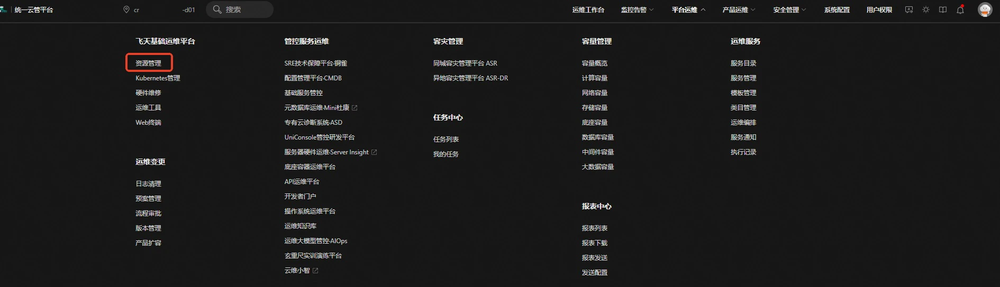
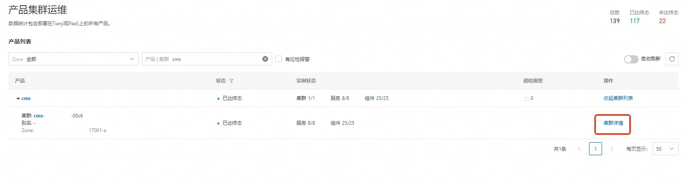
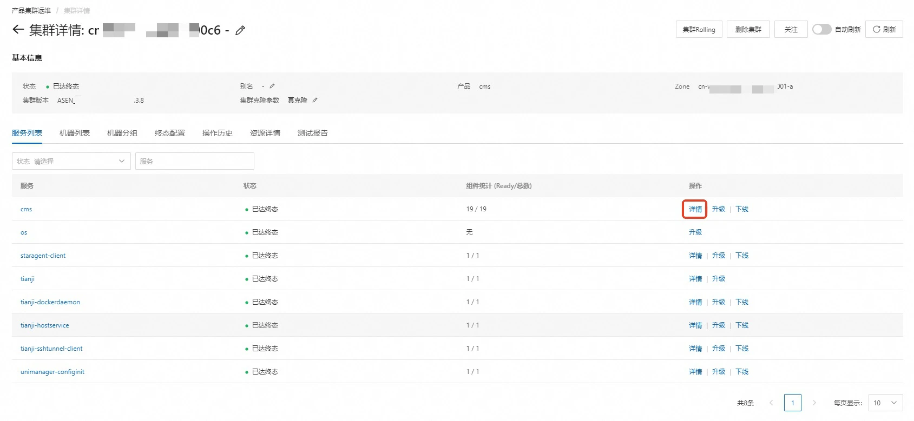
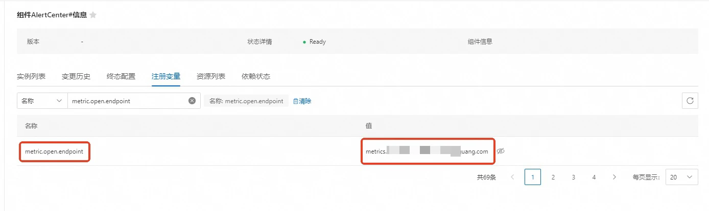
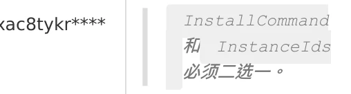

阿里云  
专有云  
云监控  
开发指南  
产品版本：v3.18.6  
文档版本：20261022

**目录**

- [1.准备工作](#section-1)
    - [1.1. 获取EndPoint](#section-1-1)
- [2.API列表](#section-2)
    - [2.1. 云产品时序指标类监控数据](#section-2-1)
        - [2.1.1. DescribeMetricLast](#section-2-1-1)
        - [2.1.2. DescribeMetricList](#section-2-1-2)
        - [2.1.3. DescribeMetricMetaList](#section-2-1-3)
        - [2.1.4. DescribeProjectMeta](#section-2-1-4)
        - [2.1.5. DescribeMetricData](#section-2-1-5)
        - [2.1.6. DescribeMetricTop](#section-2-1-6)
        - [2.1.7. DescribeMetricTopList](#section-2-1-7)
        - [2.1.8. DescribeCloudProductResourceTypes](#section-2-1-8)
    - [2.2. 控制台视图配置](#section-2-2)
        - [2.2.1. DescribeConsoleViews](#section-2-2-1)
    - [2.3. 自定义监控](#section-2-3)
        - [2.3.1. PutCustomMetric](#section-2-3-1)
        - [2.3.2. BatchDeleteCustomMetricMeta](#section-2-3-2)
        - [2.3.3. CreateCustomMetricMeta](#section-2-3-3)
        - [2.3.4. DescribeCustomMetricList](#section-2-3-4)
        - [2.3.5. DeleteCustomMetric](#section-2-3-5)
        - [2.3.6. CreateAnalysisSuit](#section-2-3-6)
        - [2.3.7. QueryAnalysisSuit](#section-2-3-7)
        - [2.3.8. QueryOrgMetricData](#section-2-3-8)
    - [2.4. 主机监控](#section-2-4)
        - [2.4.1. NodeInstall](#section-2-4-1)
        - [2.4.2. DescribeArgusAgentInstallRecord](#section-2-4-2)
        - [2.4.3. DescribeMonitoringAgentStatuses](#section-2-4-3)
        - [2.4.4. DescribeMonitoringAgentHosts](#section-2-4-4)
        - [2.4.5. InstallMonitoringAgent](#section-2-4-5)
        - [2.4.6. DescribeMonitoringAgentProcesses](#section-2-4-6)
        - [2.4.7. PutMonitoringConfig](#section-2-4-7)
        - [2.4.8. DeleteMonitoringAgentProcess](#section-2-4-8)
        - [2.4.9. CreateMonitoringAgentProcess](#section-2-4-9)
        - [2.4.10. DescribeMonitoringConfig](#section-2-4-10)
        - [2.4.11. DescribeMonitoringAgentAccessKey](#section-2-4-11)
        - [2.4.12. UninstallMonitoringAgent](#section-2-4-12)
        - [2.4.13. ExecuteEcsCommand](#section-2-4-13)
        - [2.4.14. GetEcsCommandExecution](#section-2-4-14)
    - [2.5. 报警服务](#section-2-5)
        - [2.5.1. DescribeAlertingMetricRuleResources](#section-2-5-1)
        - [2.5.2. PutResourceMetricRule](#section-2-5-2)
        - [2.5.3. DescribeAlertHistoryList](#section-2-5-3)
        - [2.5.4. DeleteMetricRuleTargets](#section-2-5-4)
        - [2.5.5. DescribeActiveMetricRuleList](#section-2-5-5)
        - [2.5.6. DescribeProductsOfActiveMetricRule](#section-2-5-6)
        - [2.5.7. DeleteMetricRuleResources](#section-2-5-7)
        - [2.5.8. DescribeMetricRuleList](#section-2-5-8)
        - [2.5.9. DescribeMetricRuleCount](#section-2-5-9)
        - [2.5.10. DeleteMetricRules](#section-2-5-10)
        - [2.5.11. DisableMetricRules](#section-2-5-11)
        - [2.5.12. EnableMetricRules](#section-2-5-12)
        - [2.5.13. DeleteContact](#section-2-5-13)
        - [2.5.14. DescribeMetricRuleTargets](#section-2-5-14)
        - [2.5.15. DescribeEventRuleList](#section-2-5-15)
        - [2.5.16. DescribeMetricRuleTemplateList](#section-2-5-16)
        - [2.5.17. DescribeContactList](#section-2-5-17)
        - [2.5.18. ApplyMetricRuleTemplate](#section-2-5-18)
        - [2.5.19. DescribeEventRuleTargetList](#section-2-5-19)
        - [2.5.20. DescribeMetricRuleTemplateAttribute](#section-2-5-20)
        - [2.5.21. DescribeEventRuleAttribute](#section-2-5-21)
        - [2.5.22. DescribeContactListByContactGroup](#section-2-5-22)
        - [2.5.23. PutContact](#section-2-5-23)
        - [2.5.24. DescribeMetricPromQLRange](#section-2-5-24)
        - [2.5.25. PutContactGroup](#section-2-5-25)
        - [2.5.26. PutGroupMetricRule](#section-2-5-26)
        - [2.5.27. CreateMetricRuleResources](#section-2-5-27)
        - [2.5.28. DescribeContactGroupList](#section-2-5-28)
        - [2.5.29. DeleteMetricRuleTemplate](#section-2-5-29)
        - [2.5.30. PutEventRuleTargets](#section-2-5-30)
        - [2.5.31. CreateMetricRuleTemplate](#section-2-5-31)
        - [2.5.32. CreateGroupMetricRules](#section-2-5-32)
        - [2.5.33. DeleteEventRules](#section-2-5-33)
        - [2.5.34. ModifyMetricRuleTemplate](#section-2-5-34)
        - [2.5.35. PutMetricRuleTargets](#section-2-5-35)
        - [2.5.36. DescribeDynamicThresholdBound](#section-2-5-36)
    - [2.6. 事件监控](#section-2-6)
        - [2.6.1. DescribeSystemEventHistogram](#section-2-6-1)
        - [2.6.2. DescribeSystemEventAttribute](#section-2-6-2)
        - [2.6.3. DescribeSystemEventCount](#section-2-6-3)
        - [2.6.4. SendDryRunSystemEvent](#section-2-6-4)
        - [2.6.5. PutCustomEvent](#section-2-6-5)
        - [2.6.6. DescribeSystemEventMetaList](#section-2-6-6)
        - [2.6.7. DescribeCustomEventCount](#section-2-6-7)
        - [2.6.8. DescribeCustomEventAttribute](#section-2-6-8)
    - [2.7. 自定义大盘](#section-2-7)
        - [2.7.1. CreateDashboardFolder](#section-2-7-1)
        - [2.7.2. ModifyDashboardToFolder](#section-2-7-2)
        - [2.7.3. ModifyDashboardFolder](#section-2-7-3)
        - [2.7.4. DescribeDashboard](#section-2-7-4)
    - [2.8. 应用分组](#section-2-8)
        - [2.8.1. DescribeMonitorGroups](#section-2-8-1)
        - [2.8.2. DescribeMonitorGroupInstances](#section-2-8-2)
        - [2.8.3. CreateMonitorGroupInstances](#section-2-8-3)
        - [2.8.4. DescribeUnhealthyHostAvailability](#section-2-8-4)
        - [2.8.5. DeleteMonitorGroupInstances](#section-2-8-5)
        - [2.8.6. DescribeMonitorGroupInstanceAttribute](#section-2-8-6)
        - [2.8.7. DescribeHostAvailabilityList](#section-2-8-7)
        - [2.8.8. CreateMonitorGroup](#section-2-8-8)
        - [2.8.9. DeleteMonitorGroup](#section-2-8-9)
        - [2.8.10. CreateHostAvailability](#section-2-8-10)
        - [2.8.11. CreateMonitorGroupNotifyPolicy](#section-2-8-11)
        - [2.8.12. DeleteHostAvailability](#section-2-8-12)
        - [2.8.13. DescribeMonitorGroupCategories](#section-2-8-13)
        - [2.8.14. ModifyMonitorGroupInstances](#section-2-8-14)
        - [2.8.15. ModifyHostAvailability](#section-2-8-15)
        - [2.8.16. PutMonitorGroupDynamicRule](#section-2-8-16)
        - [2.8.17. ModifyMonitorGroup](#section-2-8-17)
        - [2.8.18. DeleteMonitorGroupDynamicRule](#section-2-8-18)
        - [2.8.19. DeleteMonitorGroupNotifyPolicy](#section-2-8-19)
        - [2.8.20. DescribeMonitorGroupNotifyPolicyList](#section-2-8-20)
        - [2.8.21. DescribeMonitorGroupDynamicRules](#section-2-8-21)
    - [2.9. 站点监控](#section-2-9)
        - [2.9.1. DescribeSiteMonitorData](#section-2-9-1)
        - [2.9.2. DescribeSiteMonitorStatistics](#section-2-9-2)
        - [2.9.3. DescribeSiteMonitorList](#section-2-9-3)
        - [2.9.4. DescribeSiteMonitorISPCityList](#section-2-9-4)
        - [2.9.5. CreateSiteMonitor](#section-2-9-5)
        - [2.9.6. DescribeSiteMonitorAttribute](#section-2-9-6)
        - [2.9.7. DisableSiteMonitors](#section-2-9-7)
        - [2.9.8. EnableSiteMonitors](#section-2-9-8)
        - [2.9.9. DeleteSiteMonitors](#section-2-9-9)
        - [2.9.10. ModifySiteMonitor](#section-2-9-10)
        - [2.9.11. DescribeSiteMonitorQuota](#section-2-9-11)
    - [2.10. 告警中心](#section-2-10)
        - [2.10.1. DescribeBatchDetectTaskWithAlertResult](#section-2-10-1)
        - [2.10.2. DescribeNotificationRules](#section-2-10-2)
        - [2.10.3. DescribeAlertList](#section-2-10-3)
        - [2.10.4. DeleteAlertFilterConfigBatch](#section-2-10-4)
        - [2.10.5. ModifyAlertFilterConfig](#section-2-10-5)
        - [2.10.6. DescribeAlertFilterConfig](#section-2-10-6)
        - [2.10.7. DeleteNotificationRules](#section-2-10-7)
        - [2.10.8. ModifyNotificationRule](#section-2-10-8)
        - [2.10.9. CreateAlertFilterConfig](#section-2-10-9)
        - [2.10.10. PutNotificationRule](#section-2-10-10)
    - [2.11. 应用拓扑](#section-2-11)
        - [2.11.1. QueryEntityTopo](#section-2-11-1)
    - [2.12. 数据订阅](#section-2-12)
        - [2.12.1. CreateMetricPubSync](#section-2-12-1)
        - [2.12.2. UpdateMetricPubSync](#section-2-12-2)
        - [2.12.3. DeleteMetricPubSync](#section-2-12-3)
        - [2.12.4. DescribeMetricPubSyncs](#section-2-12-4)
    - [2.13. 日志监控](#section-2-13)
        - [2.13.1. PutLogMonitor](#section-2-13-1)
        - [2.13.2. DeleteLogMonitor](#section-2-13-2)
        - [2.13.3. DescribeLogMonitorList](#section-2-13-3)
- [3.云监控指标说明](#section-3)
    - [3.1. 弹性计算](#section-3-1)
        - [3.1.1. Kubernetes容器监控](#section-3-1-1)
        - [3.1.2. 云服务器ECS](#section-3-1-2)
        - [3.1.3. 弹性高性能计算E-HPC](#section-3-1-3)
        - [3.1.4. 裸金属算力平台BMCP（节点）](#section-3-1-4)
        - [3.1.5. 裸金属算力平台BMCP（裸金属-智算算力集群）](#section-3-1-5)
        - [3.1.6. 裸金属算力平台BMCP（容器-智算算力集群）](#section-3-1-6)
        - [3.1.7. 裸金属算力平台BMCP（裸金属-超算算力集群）](#section-3-1-7)
        - [3.1.8. 裸机管理 BMS](#section-3-1-8)
    - [3.2. 数据库](#section-3-2)
        - [3.2.1. 云数据库RDS](#section-3-2-1)
        - [3.2.2. 云数据库RDS（新链路）](#section-3-2-2)
        - [3.2.3. 数据库PolarDB（集群版）](#section-3-2-3)
        - [3.2.4. 数据库PolarDB（主备版）](#section-3-2-4)
        - [3.2.5. PolarDB集分一体版](#section-3-2-5)
            - [3.2.5.1. PolarDB集分一体版（计算节点）](#section-3-2-5-1)
            - [3.2.5.2. PolarDB集分一体版（数据节点）](#section-3-2-5-2)
        - [3.2.6. 云原生分布式数据库PolarDB-X 1.0](#section-3-2-6)
        - [3.2.7. 云数据库MongoDB版](#section-3-2-7)
        - [3.2.8. 云数据库MongoDB版（新链路）](#section-3-2-8)
        - [3.2.9. 云数据库Redis版](#section-3-2-9)
        - [3.2.10. 云数据库Redis版（新链路）](#section-3-2-10)
        - [3.2.11. 云原生数据仓库AnalyticDB PostgreSQL](#section-3-2-11)
        - [3.2.12. 云原生数据仓库AnalyticDB PostgreSQL（新链路）](#section-3-2-12)
        - [3.2.13. 云原生数据仓库AnalyticDB MySQL版3.0](#section-3-2-13)
        - [3.2.14. 数据传输服务DTS](#section-3-2-14)
            - [3.2.14.1. 数据传输服务DTS（订阅任务）](#section-3-2-14-1)
            - [3.2.14.2. 数据传输服务DTS（迁移任务）](#section-3-2-14-2)
            - [3.2.14.3. 数据传输服务DTS（同步任务）](#section-3-2-14-3)
        - [3.2.15. 云原生多模数据库Lindorm](#section-3-2-15)
        - [3.2.16. 云原生多模数据库 Lindorm2.0](#section-3-2-16)
    - [3.3. 存储与CDN](#section-3-3)
        - [3.3.1. 云存储网关CSG](#section-3-3-1)
        - [3.3.2. 文件存储NAS](#section-3-3-2)
        - [3.3.3. 对象存储OSS](#section-3-3-3)
        - [3.3.4. 表格存储Tablestore](#section-3-3-4)
        - [3.3.5. 文件存储CPFS](#section-3-3-5)
        - [3.3.6. 文件系统APFS](#section-3-3-6)
        - [3.3.7. EFS-NAS文件存储](#section-3-3-7)
    - [3.4. 网络](#section-3-4)
        - [3.4.1. NAT网关](#section-3-4-1)
        - [3.4.2. 负载均衡SLB](#section-3-4-2)
        - [3.4.3. 应用型负载均衡](#section-3-4-3)
        - [3.4.4. 弹性公网IP](#section-3-4-4)
        - [3.4.5. VPN网关](#section-3-4-5)
        - [3.4.6. 域名解析DNS-租户内网域名](#section-3-4-6)
        - [3.4.7. 域名解析DNS-租户转发域名](#section-3-4-7)
        - [3.4.8. 云企业网](#section-3-4-8)
    - [3.5. 应用服务](#section-3-5)
        - [3.5.1. API网关](#section-3-5-1)
    - [3.6. 互联网中间件](#section-3-6)
        - [3.6.1. 消息队列MQ（RocketMQ）](#section-3-6-1)
        - [3.6.2. 消息队列 MQ（tiangong）](#section-3-6-2)
        - [3.6.3. 消息队列Kafka](#section-3-6-3)
        - [3.6.4. API网关](#section-3-6-4)
    - [3.7. 大数据（数加）](#section-3-7)
        - [3.7.1. 实时计算Realtime Compute（Blink）](#section-3-7-1)
        - [3.7.2. 实时计算Realtime Compute（Flink）](#section-3-7-2)
        - [3.7.3. 数据总线DataHub](#section-3-7-3)
        - [3.7.4. 检索分析服务Elasticsearch版](#section-3-7-4)
            - [3.7.4.1. Elasticsearch（ECS版）](#section-3-7-4-1)
            - [3.7.4.2. Elasticsearch（K8s版）](#section-3-7-4-2)
        - [3.7.5. 交互式分析Hologres](#section-3-7-5)
        - [3.7.6. 交互式分析Hologres（新链路）](#section-3-7-6)
        - [3.7.7. 大数据计算MaxCompute](#section-3-7-7)
        - [3.7.8. 大数据计算MaxCompute（配额组）](#section-3-7-8)
        - [3.7.9. 实时计算（Flink）存算分离版](#section-3-7-9)
    - [3.8. 安全（云盾）](#section-3-8)
        - [3.8.1. 租户侧堡垒机](#section-3-8-1)
        - [3.8.2. 数据库审计](#section-3-8-2)
        - [3.8.3. 数据静态脱敏与水印](#section-3-8-3)
        - [3.8.4. 特权访问管理](#section-3-8-4)
        - [3.8.5. 漏扫引擎](#section-3-8-5)
        - [3.8.6. NFV云防火墙](#section-3-8-6)
        - [3.8.7. Web应用防火墙](#section-3-8-7)
        - [3.8.8. CSP密码服务](#section-3-8-8)
    - [3.9. 人工智能与机器学习](#section-3-9)
        - [3.9.1. AI Studio（在线服务）](#section-3-9-1)
        - [3.9.2. AI Studio（模型评测）](#section-3-9-2)
        - [3.9.3. AI Studio（Notebook建模）](#section-3-9-3)
        - [3.9.4. AI Studio（任务建模）](#section-3-9-4)
        - [3.9.5. AI Studio（可视化建模）](#section-3-9-5)
        - [3.9.6. AI Studio（模型调优）](#section-3-9-6)
        - [3.9.7. AI Studio（批量推理）](#section-3-9-7)
        - [3.9.8. AI Studio（在线服务组）](#section-3-9-8)
        - [3.9.9. AI Studio（资源池）](#section-3-9-9)
        - [3.9.10. 百炼专属版](#section-3-9-10)
        - [3.9.11. A-Speed（高性能推理服务）](#section-3-9-11)
        - [3.9.12. 弹性容错服务](#section-3-9-12)

<a id="section-1"></a>

# 1.准备工作

<a id="section-1-1"></a>

## 1.1. 获取EndPoint

本文指导您获取云监控产品的Endpoind信息。

**操作步骤**

1. 登录Apsara Uni-manager运维控制台。

2. 在顶部菜单栏选择**平台运维** > **飞天基础运维平台** > **资源管理**。

   

3. 在**产品集群运维**界面搜索CMS，单击**操作**列的**集群详情**。

   

4. 在**服务列表**页签，单击cms**操作**列的**详情**。

   

5. 在**组件详情**页面，选择**注册变量**，搜索**metric.open.endpoint**，查看EndPoint的值。

   

<a id="section-2"></a>

# 2.API列表

<a id="section-2-1"></a>

## 2.1. 云产品时序指标类监控数据

<a id="section-2-1-1"></a>

### 2.1.1. DescribeMetricLast

调用DescribeMetricLast接口查询指定监控对象的最新监控数据。

**请求参数**

| 名称 | 类型 | 是否必选 | 示例值 | 描述 |
| --- | --- | --- | --- | --- |
| Action | String | 是 | DescribeMetricL ast | 系统规定参数，取值：DescribeMetricLast。 |
| MetricName | String | 是 | CPUUtilization | 监控项名称。 |
| Namespace | String | 是 | acs_ecs_dashbo ard | 产品的数据命名空间，用于区分不同的产品。命名方式：acs_产品名。 |
| Dimensions | String | 否 | \[{"instanceId":" XXXXXX"}\] | 维度map，用于查询指定资源的监控数据。<br>格式为<code> key-value </code>键值对形式的集合，常用的<code> key-value </code>集合为<code> instanceId</code>：<code>XXXXXX </code>,instanceId安全调用范围是20个。<br><code> key </code>和<code> value </code>的长度为1~64个字节，超过64个字节时截取前64字节。<code> key </code>和<code> value </code>的取值可包含字母、数字、点号（.）、短横线（-）、下划线（_）、正斜线（/）和反斜线（\\）。<br>说明Dimensions传入时需要使用JSON字符串表示该map对象，必须按顺序传入。 |
| StartTime | String | 否 | 2019-01-31 10:00:00 | 开始时间。格式为Unix时间戳，即从1970年1月1日开始所经过的秒数。<br>说明只能查询270天以内且开始时间和结束时间不超过31天的监控数据。 |
| EndTime | String | 否 | 2019-01-31 10:10:00 | 结束时间。格式为Unix时间戳，即从1970年1月1日开始所经过的秒数。<br>说明只能查询270天以内的监控数据。 |
| Express | String | 否 | {"groupby": \["userId","instan ceId"\]} | 对现有查询结果进行实时计算的表达式。 |
| Length | String | 否 | 1000 | 返回监控数据的每页大小，用于分页查询。默认值为1000，即每页1000条监控数据。 |
| NextToken | String | 否 | 1576143285000 9dd70bb64cff1f 0fff6c0b08ffff07 3be5fb1e785e2 b020f7fed9b5e1 37bd810a6d6cff 5ae\*\*\*\* | 分页游标的标识。<br>• 如果匹配查询条件的返回结果超过了分页大小，则会返回这个分页游标。<br>• 如果需要获取下一页数据，将返回的游标值作为请求参数即可，直到没有游标值的返回则表示已经获取了全部结果数据。 |
| Period | String | 否 | 60 | 时间间隔，通常为监控项的上报周期，单位为秒。<br>• 如果不填写，则按照注册监控项时申明的上报周期来查询原始数据。<br>• 如果设置报警规则时设置了统计周期，则会按照此周期查询对应的统计数据。 |

**返回数据**

| 名称 | 类型 | 示例值 | 描述 |
| --- | --- | --- | --- |
| RequestId | String | 021472A6-25E3-4094-8D00-BA4B6A5486C3 | 请求ID。 |
| Code | String | 200 | 状态码。<br>说明状态码为200表示成功。 |
| Success | Boolean | true | 请求是否成功。 |
| Period | String | 60 | 时间间隔，单位为秒。 |
| NextToken | String | xxxxxx | 分页游标标识。 |
| Datapoints | String | \[{"timestamp":154 8777660000,"userI d":"123","instanceI d":"i-abc","Minimum":9.92,"Average":9.92, "Maximum":9.92}\] | 监控数据列表。 |
| Message | String | Success | 错误信息。 |

**示例**

请求示例

```text
http(s)://[Endpoint]/?Action=DescribeMetricLast
&MetricName=CPUUtilization
&Namespace=acs_ecs_dashboard
&<公共请求参数>
```

正常返回示例

`XML`  格式

```xml
<QueryMetricListResponse>
    <Period>60</Period>
    <Datapoints>
        <Datapoints>
            <timestamp>1490152860000</timestamp>
            <Maximum>100</Maximum>
            <userId> 123456789876****</userId>
            <Minimum>93.1</Minimum>
            <instanceId>i-abcdefgh12****</instanceId>
            <Average>99.52</Average>
        </Datapoints>
        <Datapoints>
            <timestamp>1490152920000</timestamp>
            <Maximum>100</Maximum>
            <userId> 123456789876**** </userId>
            <Minimum>92.59</Minimum>
            <instanceId>i-abcdefgh12****</instanceId>
            <Average>99.49</Average>
        </Datapoints>
        <Datapoints>
            <timestamp>1490152980000</timestamp>
            <Maximum>100</Maximum>
            <userId>123456789876****</userId>
            <Minimum>92.86</Minimum>
            <instanceId>i-abcdefgh12****</instanceId>
            <Average>99.44</Average>
        </Datapoints>
        <Datapoints>
            <timestamp>1490153040000</timestamp>
            <Maximum>100</Maximum>
            <userId>123456789876****</userId>
            <Minimum>91.43</Minimum>
            <instanceId>i-abcdefgh12****</instanceId>
            <Average>99.36</Average>
        </Datapoints>
        <Datapoints>
            <timestamp>1490153100000</timestamp>
            <Maximum>100</Maximum>
            <userId>123456789876****</userId>
            <Minimum>93.55</Minimum>
            <instanceId>i-abcdefgh12****</instanceId>
            <Average>99.51</Average>
        </Datapoints>
        <Datapoints>
            <timestamp>1490153160000</timestamp>
            <Maximum>100</Maximum>
            <userId>123456789876****</userId>
            <Minimum>93.1</Minimum>
            <instanceId>i-abcdefgh12****</instanceId>
            <Average>99.52</Average>
        </Datapoints>
        <Datapoints>
            <timestamp>1490153220000</timestamp>
            <Maximum>100</Maximum>
            <userId>123456789876****</userId>
            <Minimum>92.59</Minimum>
            <instanceId>i-abcdefgh12****</instanceId>
            <Average>99.42</Average>
        </Datapoints>
        <Datapoints>
            <timestamp>1490153280000</timestamp>
            <Maximum>100</Maximum>
            <userId>123456789876****</userId>
            <Minimum>91.18</Minimum>
            <instanceId>i-abcdefgh12****</instanceId>
            <Average>99.34</Average>
        </Datapoints>
        <Datapoints>
            <timestamp>1490153340000</timestamp>
            <Maximum>100</Maximum>
            <userId>123456789876****</userId>
            <Minimum>92.86</Minimum>
            <instanceId>i-abcdefgh12****</instanceId>
            <Average>99.46</Average>
        </Datapoints>
        <Datapoints>
            <timestamp>1490153400000</timestamp>
            <Maximum>100</Maximum>
            <userId>123456789876****</userId>
            <Minimum>91.18</Minimum>
            <instanceId>i-abcdefgh12****</instanceId>
            <Average>99.35</Average>
        </Datapoints>
    </Datapoints>
    <RequestId>6661EC50-8625-4161-B349-E0DD59002AB7</RequestId>
    <Success>true</Success>
    <Code>200</Code>
</QueryMetricListResponse>
```

`JSON`  格式

```json
{
 "Period":"60",
 "Datapoints":[
  {
   "timestamp":1490152860000,
   "Maximum":100,
   "userId":"123456789876****",
   "instanceId":"i-abcdefgh12****",
   "Minimum":93.1,
   "Average":99.52
  },
  {
   "timestamp":1490152920000,
   "Maximum":100,
   "userId":"123456789876****",
   "instanceId":"i-abcdefgh12****",
   "Minimum":92.59,
   "Average":99.49
  },
  {
   "timestamp":1490152980000,
   "Maximum":100,
   "userId":"123456789876****",
   "instanceId":"i-abcdefgh12****",
   "Minimum":92.86,
   "Average":99.44
  },
  {
   "timestamp":1490153040000,
   "Maximum":100,
   "userId":"123456789876****",
   "instanceId":"i-abcdefgh12****",
   "Minimum":91.43,
   "Average":99.36
  },
  {
   "timestamp":1490153100000,
   "Maximum":100,
   "userId":"123456789876****",
   "instanceId":"i-abcdefgh12****",
   "Minimum":93.55,
   "Average":99.51
  },
  {
   "timestamp":1490153160000,
   "Maximum":100,
   "userId":"123456789876****",
   "instanceId":"i-abcdefgh12****",
   "Minimum":93.1,
   "Average":99.52
  },
  {
   "timestamp":1490153220000,
   "Maximum":100,
   "userId":"123456789876****",
   "instanceId":"i-abcdefgh12****",
   "Minimum":92.59,
   "Average":99.42
  },
  {
   "timestamp":1490153280000,
   "Maximum":100,
   "userId":"123456789876****",
   "instanceId":"i-abcdefgh12****",
   "Minimum":91.18,
   "Average":99.34
  },
  {
   "timestamp":1490153340000,
   "Maximum":100,
   "userId":"123456789876****",
   "instanceId":"i-abcdefgh12****",
   "Minimum":92.86,
   "Average":99.46
  },
  {
   "timestamp":1490153400000,
   "Maximum":100,
   "userId":"123456789876****",
   "instanceId":"i-abcdefgh12****",
   "Minimum":91.18,
   "Average":99.35
  }
 ],
 "RequestId":"6A5F022D-AC7C-460E-94AE-B9E75083D027",
 "Success":true,
 "Code":"200"
}
```

<a id="section-2-1-2"></a>

### 2.1.2. DescribeMetricList

调用DescribeMetricList接口查询指定时间段内的云产品时序指标监控数据。

各云产品的Namespace、Metric、Period、Dimensions等参数的取值，请参见云产品监控项章节。

**请求参数**

| 名称 | 类型 | 是否必选 | 示例值 | 描述 |
| --- | --- | --- | --- | --- |
| Action | String | 是 | DescribeMetricLi st | 系统规定参数。取值：DescribeMetricList。 |
| MetricName | String | 是 | cpu_idle | 监控项名称。 |
| Namespace | String | 是 | acs_ecs_dashbo ard | 产品的数据命名空间，用于区分不同的产品。命名方式：acs_产品名。 |
| Dimensions | String | 是 | \[{"instanceId": "i-abcdefgh12\*\*\*\*"}\] | 维度map，用于查询指定资源的监控数据。格式为key-value键值对形式的集合，常用的key-value集合为instanceId：XXXXXX，instanceId安全调用范围是10个。key和value的长度为1~64个字节，超过64个字节时截取前64字节。key和value的取值可包含字母、数字、点号（.）、短横线（-）、下划线（_）、正斜线（/）和反斜线（\\）。<br>说明Dimensions传入时需要使用JSON字符串表示该Map对象，必须按顺序传入。 |
| EndTime | String | 否 | 2019-01-30 00:10:00 | 结束时间。支持的格式：<br>• Unix时间戳：从1970年1月1日开始所经过的秒数。<br>• Format格式：YYYY-MM-DDThh:mm:ssZ。 |
| Express | String | 否 | {"groupby": \["userId","instan ceId"\]} | 对查询出的现有结果进行实时计算的表达式。目前仅支持<code> groupby </code>（类似数据库的<code> groupby </code>语句）。 |
| Length | String | 否 | 1000 | 每页显示的记录条数，用于分页查询，默认值为1000。 |
| NextToken | String | 否 | 1576148535000 9dd70bb64cff1f 0fff750b08ffff07 3be5fb1e785e2 b020f1a949d5e a14aea7fed82f0 1dd87311 | 分页游标标识。<br>说明如果不传入此参数表示获取第一页的数据，此参数只要返回就说明还有下一页，您可以将返回的NextToken作为参数再次请求获得下一页的数据，直到返回为null表示获取到了所有的数据。 |
| Period | String | 否 | 60 | 时间间隔，单位为秒。取值一般为60（1分钟）、300（5分钟）、900（15分钟）。<br>说明请根据需要设置此参数。例如查询一天范围时设置Period为60，则返回1000条数据（实际存在1440，因为最大返回值不超过1000，则只返回前1000条）。如果使用Period为300，则返回288条数据。 |
| StartTime | String | 否 | 2019-01-30 00:00:00 | 开始时间。支持的格式：<br>• Unix时间戳：从1970年1月1日开始所经过的秒数。<br>• Format格式：YYYY-MM-DDThh:mm:ssZ。<br>说明开始和结束时间执行的是左开右闭的模式，startTime不能等于或大于endTime。 |

**返回数据**

| 名称 | 类型 | 示例值 | 描述 |
| --- | --- | --- | --- |
| RequestId | String | 3121AE7D-4AFF-4C25-8F1D-C8226EBB1F42 | 请求ID。 |
| Code | String | 200 | 状态码。<br>说明状态码为200表示成功。 |
| Success | Boolean | true | 请求是否成功。 |
| NextToken | String | 15761441850009d d70bb64cff1f0fff6d 0b08ffff073be5fb1 e785e2b020f7fed9 b5e137bd810a6d6 cff5aee816 | 分页游标标识。<br>说明如果不传入此参数表示获取第一页的数据，此参数只要返回就说明还有下一页，您可以将返回的NextToken作为参数再次请求获得下一页的数据，直到返回为null表示获取到了所有的数据。 |
| Period | String | 60 | 时间间隔，单位为秒。取值为60、300、900。 |
| Datapoints | String | \[{"timestamp":154 8777660000,"userI d":"123","instanceI d":"i-abc","Minimum":9.92,"Average":9.92, "Maximum":9.92}\] | 监控数据列表。 |
| Message | String | Success | 错误信息。 |

**示例**

请求示例

```text
http(s)://[Endpoint]/?Action=DescribeMetricList
&MetricName=cpu_idle
&Namespace=acs_ecs_dashboard
&<公共请求参数>
```

正常返回示例

`XML`  格式

```xml
<Period>60</Period>
<Datapoints>
    <timestamp>1490152860000</timestamp>
    <Maximum>100</Maximum>
    <userId>123456789876****</userId>
    <Minimum>93.1</Minimum>
    <instanceId>i-abcdefgh12****</instanceId>
    <Average>99.52</Average>
</Datapoints>
<Datapoints>
    <timestamp>1490152920000</timestamp>
    <Maximum>100</Maximum>
    <userId>123456789876****</userId>
    <Minimum>92.59</Minimum>
    <instanceId>i-abcdefgh12****</instanceId>
    <Average>99.49</Average>
</Datapoints>
<Datapoints>
    <timestamp>1490152980000</timestamp>
    <Maximum>100</Maximum>
    <userId>123456789876****</userId>
    <Minimum>92.86</Minimum>
    <instanceId>i-abcdefgh12****</instanceId>
    <Average>99.44</Average>
</Datapoints>
<Datapoints>
    <timestamp>1490153040000</timestamp>
    <Maximum>100</Maximum>
    <userId>123456789876****</userId>
    <Minimum>91.43</Minimum>
    <instanceId>i-abcdefgh12****</instanceId>
    <Average>99.36</Average>
</Datapoints>
<Datapoints>
    <timestamp>1490153100000</timestamp>
    <Maximum>100</Maximum>
    <userId>123456789876****</userId>
    <Minimum>93.55</Minimum>
    <instanceId>i-abcdefgh12****</instanceId>
    <Average>99.51</Average>
</Datapoints>
<Datapoints>
    <timestamp>1490153160000</timestamp>
    <Maximum>100</Maximum>
    <userId>123456789876****</userId>
    <Minimum>93.1</Minimum>
    <instanceId>i-abcdefgh12****</instanceId>
    <Average>99.52</Average>
</Datapoints>
<Datapoints>
    <timestamp>1490153220000</timestamp>
    <Maximum>100</Maximum>
    <userId>123456789876****</userId>
    <Minimum>92.59</Minimum>
    <instanceId>i-abcdefgh12****</instanceId>
    <Average>99.42</Average>
</Datapoints>
<Datapoints>
    <timestamp>1490153280000</timestamp>
    <Maximum>100</Maximum>
    <userId>123456789876****</userId>
    <Minimum>91.18</Minimum>
    <instanceId>i-abcdefgh12****</instanceId>
    <Average>99.34</Average>
</Datapoints>
<Datapoints>
    <timestamp>1490153340000</timestamp>
    <Maximum>100</Maximum>
    <userId>123456789876****</userId>
    <Minimum>92.86</Minimum>
    <instanceId>i-abcdefgh12****</instanceId>
    <Average>99.46</Average>
</Datapoints>
<Datapoints>
    <timestamp>1490153400000</timestamp>
    <Maximum>100</Maximum>
    <userId>123456789876****</userId>
    <Minimum>91.18</Minimum>
    <instanceId>i-abcdefgh12****</instanceId>
    <Average>99.35</Average>
</Datapoints>
<RequestId>6A5F022D-AC7C-460E-94AE-B9E75083D027</RequestId>
<Success>true</Success>
<Code>200</Code>
```

`JSON`  格式

```json
{
 "Period":"60",
 "Datapoints":[
  {
   "timestamp":1490152860000,
   "Maximum":100,
   "userId":"123456789876****",
   "instanceId":"i-abcdefgh12****",
   "Minimum":93.1,
   "Average":99.52
  },
  {
   "timestamp":1490152920000,
   "Maximum":100,
   "userId":"123456789876****",
   "instanceId":"i-abcdefgh12****",
   "Minimum":92.59,
   "Average":99.49
  },
  {
   "timestamp":1490152980000,
   "Maximum":100,
   "userId":"123456789876****",
   "instanceId":"i-abcdefgh12****",
   "Minimum":92.86,
   "Average":99.44
  },
  {
   "timestamp":1490153040000,
   "Maximum":100,
   "userId":"123456789876****",
   "instanceId":"i-abcdefgh12****",
   "Minimum":91.43,
   "Average":99.36
  },
  {
   "timestamp":1490153100000,
   "Maximum":100,
   "userId":"123456789876****",
   "instanceId":"i-abcdefgh12****",
   "Minimum":93.55,
   "Average":99.51
  },
  {
   "timestamp":1490153160000,
   "Maximum":100,
   "userId":"123456789876****",
   "instanceId":"i-abcdefgh12****",
   "Minimum":93.1,
   "Average":99.52
  },
  {
   "timestamp":1490153220000,
   "Maximum":100,
   "userId":"123456789876****",
   "instanceId":"i-abcdefgh12****",
   "Minimum":92.59,
   "Average":99.42
  },
  {
   "timestamp":1490153280000,
   "Maximum":100,
   "userId":"123456789876****",
   "instanceId":"i-abcdefgh12****",
   "Minimum":91.18,
   "Average":99.34
  },
  {
   "timestamp":1490153340000,
   "Maximum":100,
   "userId":"123456789876****",
   "instanceId":"i-abcdefgh12****",
   "Minimum":92.86,
   "Average":99.46
  },
  {
   "timestamp":1490153400000,
   "Maximum":100,
   "userId":"123456789876****",
   "instanceId":"i-abcdefgh12****",
   "Minimum":91.18,
   "Average":99.35
  }
 ],
 "RequestId":"6A5F022D-AC7C-460E-94AE-B9E75083D027",
 "Success":true,
 "Code":"200"
}
```

<a id="section-2-1-3"></a>

### 2.1.3. DescribeMetricMetaList

调用DescribeMetricMetaList接口查询监控项的详情信息，包括指标名称、统计方法、单位、描述、维度、上报周期等元数据信息。

**请求头**

该接口使用公共请求头，无特殊请求头。请参见公共请求参数文档。

**请求参数**

| 参数名称 | 类型 | 位置 | 是否必选 | 示例 | 说明 |
| --- | --- | --- | --- | --- | --- |
| MetricNa me | Strin g | Query | 否 | CPUUtilization | 监控指标名称，支持精确匹配。 |
| PageNum ber | Integ er | Query | 否 | 1 | 页码，从1开始计数，默认值：1。 |
| Namespac e | Strin g | Query | 否 | acs_kvstore | 指标所属的命名空间，用于区分不同产品。命名格式为：acs_产品名。您可通过DescribeProjectMeta 接口查询各产品的Namespace 值。 |
| Labels | Strin g | Query | 否 | \[{"name":"productCateg ory","value":"kvstore_ol d"}\] | 根据标签过滤监控项。格式为 JSON 数组，元素结构：{"name":"标签名","value":"标签值"}。支持标签：MetricCategory（监控项分类）、alertEnable（是否报警）、alertUnit（报警单位）、unitFactor（单位转换系数）、minAlertPeriod（最小报警周期）、productCategory（产品类型）等。 |
| PageSize | Integ er | Query | 否 | 30 | 每页显示的记录数，默认值30。取值范围：1~100。 |

**接口说明**

调用该接口查询云监控支持的监控项元数据信息。您可以通过该接口获取各云产品的监控指标详情，包括指标名称、统计方式、单位、维度等信息。

**返回数据**

| 参数名称 | 类型 | 示例 | 说明 |
| --- | --- | --- | --- |
| Resources | Array | \[{"Namespace":"ac s_ecs","MetricNam e":"CPUUtilization"}\] | 监控项元数据列表。 |
| -Namespace | String | acs_ecs | 指标所属的命名空间，用于区分不同产品。命名格式为：acs_产品名。 |
| -MetricName | String | CPUUtilization | 监控指标名称。 |
| -Statistics | String | Average,Minimum, Maximum | 统计方法。多个统计方法用逗号分隔，如Average、Minimum、Maximum、Sum、Count。 |
| -Unit | String | % | 单位。 |
| -Description | String | CPU使用率 | 监控项描述。 |
| -DescriptionJso n | String | {"en-us":"CPUUtilization","zh-cn":"CPU使用率"} | 监控项的多语言描述，JSON格式。 |
| -Dimensions | String | userId,instanceId | 监控维度。多个维度用逗号分隔，如 userId、instanceId。 |
| -Periods | String | 60,300 | 上报周期，单位为秒。多个周期用逗号分隔。 |
| -Labels | String | \[{"name":"alertEna ble","value":"true"}\] | 标签信息，JSON数组格式，包含标签名和标签值。 |
| -Version | String | 1.0 | 监控项版本。 |
| -SubProducts | String | ECS | 子产品名称。 |
|  |  |  |  |
| 参数名称 | 类型 | 示例 | 说明 |

<table>
  <tr>
    <td>RequestId</td>
    <td>String</td>
    <td>15B664E7-1823-4C84-A59B-1A3BXXXXX</td>
    <td>请求ID。</td>
  </tr>
  <tr>
    <td>Success</td>
    <td>Boolean</td>
    <td>true</td>
    <td>请求是否成功。取值：true（成功）、false（失败）。</td>
  </tr>
  <tr>
    <td>Code</td>
    <td>String</td>
    <td>200</td>
    <td>状态码。200表示成功。</td>
  </tr>
  <tr>
    <td>Message</td>
    <td>String</td>
    <td>successful</td>
    <td>返回信息。成功时返回successful。</td>
  </tr>
  <tr>
    <td>TotalCount</td>
    <td>String</td>
    <td>100</td>
    <td>总记录条数。</td>
  </tr>
</table>

**错误码**

| HttpCo de | 错误码 | 错误信息 | 描述 |
| --- | --- | --- | --- |
| 400 | 400 | ParameterInvalid | Illegal parameters. |
| 403 | 403 | AccessForbidden | User not authorized to operate on the specified resource. |
| 404 | 404 | ResourceNotFound | The specified resource is not found. |
| 500 | 500 | InternalError | The request processing has failed due to some unknown error. |

<a id="section-2-1-4"></a>

### 2.1.4. DescribeProjectMeta

调用DescribeProjectMeta接口查询云监控支持的时序类监控项产品列表。

获取接入的云产品信息，包括产品的描述信息、Namespace和标签。

**请求参数**

| 名称 | 类型 | 是否必选 | 示例值 | 描述 |
| --- | --- | --- | --- | --- |
| Action | String | 是 | DescribeProject Meta | 系统规定参数。取值：DescribeProjectMeta。 |
| callerType | String | 否 | “” | 访问用户类型。 |
| Labels | String | 否 | \[{"name":"prod uct","value":"EC S"}\] | 标签。根据标签过滤，标签为每个报警增加一些特殊标记。例如报警属于哪个产品的某一规格，是否能设置告警等，格式为<code> [{"name":"</code>标签名<code>","value":"</code>标签值<code>"}</code>、<code>{"name":"</code>标签名<code>","value":"</code>标签值<code>"}]</code><code> </code>。常用的标签名包括：<br>• alertUnit：报警的单位。<br>说明为了避免原始上报数据单位过小导致设置告警规则输入的值过大而增加的<code> alertUnit </code>标记，目前主要在云监控控制台上使用。<br>• minAlertPeriod：最小上报周期，即原始数据多长时间上报一条监控数据，通常为1分钟。<br>• metricCategory：产品的规格，例如： kvstore_sharding。<br>说明阿里云有些产品分为不同的规格，但是定义在了同一个namespace下，用这个字段加以区分。<br>• is_alarm: 能否设置告警规则。<br>说明阿里云有另外一部分标签是云监控控制台的一些特殊标记，不建议使用。 |
| PageNumber | Integer | 否 | 1 | 页码。默认值为1。 |
| PageSize | Integer | 否 | 30 | 分页大小，默认值为30。<br>说明目前阿里云并没有限制此参数，如果想获取所有的结果，将分页大小设置为较大的值即可。 |
| RequestId | string | 否 | sdsdsdd | 请求ID。 |

**返回数据**

| 名称 | 类型 | 示例值 | 描述 |
| --- | --- | --- | --- |
| Code | String | 200 | 状态码。<br>说明状态码为200表示成功。 |
| Message | String | success | 错误信息。 |
| PageNumber | String | 1 | 页码。 |
| PageSize | String | 10 | 分页大小。 |
| RequestId | String | 4C2061B2-3B1B-43BF-A4A4-C53426F479C0 | 请求ID。 |
| Resources | Array | 无 | 具体的配置信息。 |
| Resource | 无 | 无 | 具体的配置信息。 |
| Description | String | CDN | 描述信息。 |

<table>
  <tr>
    <td>Labels</td>
    <td>String</td>
    <td>[{"groupFlag":true}]</td>
    <td>标签。根据标签过滤，标签为每个报警增加一些特殊标记。例如报警属于哪个产品的某一规格，是否能设置告警等，格式为<code> [{"name":"</code>标签名<code>","value":"</code>标签值<code>"}</code>、<code>{"name":"</code>标签名<code>","value":"</code>标签值<code>"}]</code><code> </code>。常用的标签名包括：<br>• alertUnit：报警的单位。<br>说明为了避免原始上报数据单位过小导致设置告警规则输入的值过大而增加的<code> alertUnit </code>标记，目前主要在云监控控制台上使用。<br>• minAlertPeriod：最小上报周期，即原始数据多长时间上报一条监控数据，通常为1分钟。<br>• metricCategory：产品的规格，例如：kvstore_sharding。<br>说明阿里云有些产品分为不同的规格，但是定义在了同一个namespace下，用这个字段加以区分。<br>• is_alarm: 能否设置告警规则。<br>说明阿里云有另外一部分标签是云监控控制台的一些特殊标记，不建议使用。</td>
  </tr>
  <tr>
    <td>Namespace</td>
    <td>String</td>
    <td>acs_cdn</td>
    <td>命名空间，用于区分产品。通常格式为<code> acs_</code>产品缩写<code> </code>。</td>
  </tr>
  <tr>
    <td>Success</td>
    <td>Boolean</td>
    <td>true</td>
    <td>请求是否成功。</td>
  </tr>
  <tr>
    <td>Total</td>
    <td>String</td>
    <td>12</td>
    <td>总记录条数。</td>
  </tr>
</table>


**示例**

请求示例

```text
http(s)://[Endpoint]/?Action=DescribeProjectMeta
&<公共请求参数>
```

正常返回示例

> 返回示例根据各版本监控的产品不同，会返回不同的值，请以实际返回的为准。
>
> **说明**

`JSON`  格式

```json
{
 "PageNumber":1,
 "PageSize":5,
 "RequestId":"4C2061B2-3B1B-43BF-A4A4-C53426F479C0",
 "Success":true,
 "Code":200,
 "Total":62,
 "Resources":{
  "Resource":[{
     "Description": "云服务器ECS",
     "Labels": "[{\"name\":\"product\",\"value\":\"ECS\"},
{\"name\":\"productCategory\",\"value\":\"ecs,ecs_net_interface,hpc_node,hpc_cluster\"},
{\"name\":\"groupFlag\",\"value\":\"true\"},{\"name\":\"cnName\",\"value\":\"云服务器ECS
\"},{\"name\":\"enName\",\"value\":\"ECS\"}]",
     "Namespace": "acs_ecs_dashboard"
    },
    
  ]
 }
}
```

<a id="section-2-1-5"></a>

### 2.1.5. DescribeMetricData

调用DescribeMetricData接口查询指定云产品的某个监控项的监控数据。

**请求头**

该接口使用公共请求头，无特殊请求头。请参见公共请求参数文档。

**请求参数**

| 参数名称 | 类型 | 位置 | 是否必选 | 示例 | 说明 |
| --- | --- | --- | --- | --- | --- |
| Namespac e | Strin g | Query | 是 | acs_ecs_dashboard | 云产品的数据命名空间。关于云产品的数据命名空间，请参见云产品监控项。 |
| MetricNa me | Strin g | Query | 是 | cpu_idle | 云产品的监控项名称。关于云产品的监控项名称，请参见云产品监控项。 |
| Period | Strin g | Query | 否 | 60 | 监控项的统计周期。取值：15、60、900和3600。单位：秒。<br>• <em>如果不设置统计周</em><em>期，则按照注册监</em><em>控项时申请的上报</em><em>周期来查询监控数</em><em>据。</em><br>• 监控项（<code> MetricName </code>）的统计周期，请参见云产品监控项。 |
| StartTime | Strin g | Query | 否 | 1618368900000 | 查询监控数据的开始时间。<br>• 当您未设置<code> StartTime </code>和<code> E</code> <code>ndTime </code>时，查询当前时间最近一个统计周期<code> Period </code>的监控数据。<br>• 当您同时设置<code> StartTime </code>和<code> E</code> <code>ndTime </code>时，查询指定时间段内距离<code> EndTime </code>最近一个统计周期<code> Period </code>的监控数据。具体如下：<br>• 当<code> Period </code>设置为15秒时，指定时间段必须小于或等于20分钟。例如：StartTime为2021-05-08 08:10:00，EndTime为2021-05-08 08:30:00，统计距离2021-05-08 08:30:00最近一个15秒的监控数据。<br>• 当<code> Period </code>设置为60秒或900秒时，指定时间段必须小于或等于2小时。例如：Period为60秒，StartTime为2021-05-08 08:00:00，EndTime为2021-05-08 10:00:00，统计距离2021-05-08 10:00:00最近一个60秒的监控数据。 |
|  |  |  |  |  |  |
| 参数名称 | 类型 | 位置 | 是否必选 | 示例 | • 当<code> Period </code>设置为说明3600秒时，指定时间 |
|  |  |  |  |  | 段必须小于或等于2天。例如：StartTime为2021-05-08 08:00:00，EndTime为2021-05-10 08:00:00，统计距离2021-05-10 08:00:00最近一个3600秒的监控数据。<br>开始时间支持的格式：<br>• Unix时间戳：从1970年1月1日开始所经过的毫秒数。<br>• Format格式：YYYY-MM-DDThh:mm:ssZ。<br>• <em><code> StartTime </code></em><em>如</em><em>果设置过早，则无</em><em>效。</em><br>• 建议您使用Unix时间戳，避免时区的问题。 |
|  |  |  |  |  | 查询监控数据的结束时间。<br>• 当您未设置<code> StartTime </code>和<code> E</code> <code>ndTime </code>时，查询当前时间最近一个统计周期<code> Period </code>的监控数据。<br>• 当您同时设置<code> StartTime </code>和<code> E</code> <code>ndTime </code>时，查询指定时间段内距离<code> EndTime </code>最近一个统计周期<code> Period </code>的监控数据。具体如下：<br>• 当<code> Period </code>设置为15秒时，指定时间段必须小于或等于20分钟。例如：StartTime为2021-05-08 08:10:00，EndTime为2021-05-08 08:30:00，统计距离2021-05-08 08:30:00最近一个15秒的监控数据。 |
|  |  |  |  |  |  |
| 参数名称 | 类型 | 位置 | 是否必选 | 示例 | • 当<code> Period </code>设置为说明60秒或900秒时，指 |
| EndTime | Strin g | Query | 否 | 1618368960000 | 定时间段必须小于或等于2小时。例如：Period为60秒，StartTime为2021-05-08 08:00:00，EndTime为2021-05-08 10:00:00，统计距离2021-05-08 10:00:00最近一个60秒的监控数据。<br>• 当<code> Period </code>设置为3600秒时，指定时间段必须小于或等于2天。例如：StartTime为2021-05-08 08:00:00，EndTime为2021-05-10 08:00:00，统计距离2021-05-10 08:00:00最近一个3600秒的监控数据。<br>结束时间支持的格式：<br>• Unix时间戳：从1970年1月1日开始所经过的毫秒数。<br>• Format格式：YYYY-MM-DDThh:mm:ssZ。<em>建议您使用Unix时间</em><em>戳，避免时区的问题。</em> |
| Dimension s | Strin g | Query | 否 | \[{"instanceId": "i-abcdefgh12\*\*\*\*"}\] | 维度Map，用于查询指定资源的监控数据。格式：key-value键值对形式的集合，常用的key-value集合为<code> instanceId:i-</code><code>2ze2d6j5uhg20x47****</code><code> </code>。<br><em>单次请求最多支持批量</em><em>查询50个实例。</em> |


| 参数名称 | 类型 | 位置 | 是否必选 | 示例 | 说明 |
| --- | --- | --- | --- | --- | --- |
| Express | Strin g | Query | 否 | {"groupby": \["userId","instanceId"\]} | 对查询出的现有结果进行实时计算的表达式。<em>目前仅支</em><em>持</em><em><code> groupby </code></em><em>（类</em><em>似数据</em><em>库</em><em><code> groupby </code></em><em>语</em><em>句）。</em> |
| Length | Strin g | Query | 否 | 1000 | 每页显示的记录条数，用于分页查询。默认值：1000。<em>单次请求Length的最</em><em>大值为1440。</em> |

**返回数据**

| 参数名称 | 类型 | 示例 | 说明 |
| --- | --- | --- | --- |
| Code | String | 200 | 状态码。<em>200表示成功。</em> |
| Message | String | The specified resource is not found. | 错误信息。 |
| RequestId | String | 6A5F022D-AC7C-460E-94AE-B9E75083D027 | 请求ID。 |
| Datapoints | String | \[{\\"timestamp\\":16 18368900000,\\"Av erage\\":95.829166 6666667,\\"Minimu m\\":65.48,\\"Maxim um\\":100.0}, {\\"timestamp\\":16 18368960000,\\"Av erage\\":95.868333 3333333,\\"Minimu m\\":67.84,\\"Maxim um\\":100.0}\] | 监控数据列表。包括如下信息：<br>• <code> timestamp </code>：发生报警的时间戳。<br>• <code> userId </code>：发生报警的用户ID。<br>• <code> instanceId </code>：发生报警的实例ID。<br>• <code> Minimum </code>、<code> Average </code>、<code> Maximum </code>：报警规则。 |
| Period | String | 60 | 监控数据的统计周期。取值：15、60、900和3600。单位：秒。 |

**示例**

请求示例

```text
http(s)://[Endpoint]/?Action=DescribeMetricData
&Namespace=acs_ecs_dashboard
&MetricName=cpu_idle
&公共请求参数
```

正常返回示例

`JSON`  格式

```json
{
 "Message":"The specified resource is not found.",
 "RequestId":"6A5F022D-AC7C-460E-94AE-B9E75083D027",
 "Period":"60",
 "Datapoints":"
[{\\\"timestamp\\\":1618368900000,\\\"Average\\\":95.8291666666667,\\\"Minimum\\\":65.48,
\"Maximum\\\":100.0},
{\\\"timestamp\\\":1618368960000,\\\"Average\\\":95.8683333333333,\\\"Minimum\\\":67.84,\
"Maximum\\\":100.0}]",
 "Code":"200"
}
```

**错误码**

| HttpCo de | 错误码 | 错误信息 | 描述 |
| --- | --- | --- | --- |
| 400 | 400 | ParameterInvalid | Illegal parameters. |
| 403 | 403 | AccessForbidden | User not authorized to operate on the specified resource. |
| 404 | 404 | ResourceNotFound | The specified resource is not found. |
| 500 | 500 | InternalError | The request processing has failed due to some unknown error. |

<a id="section-2-1-6"></a>

### 2.1.6. DescribeMetricTop

调用DescribeMetricTop接口先查询指定云产品的指定监控项的最新监控数据，再查询该监控项排序后的监控数据。

**请求头**

该接口使用公共请求头，无特殊请求头。请参见公共请求参数文档。

**请求参数**

| 参数名称 | 类型 | 位置 | 是否必选 | 示例 | 说明 |
| --- | --- | --- | --- | --- | --- |
| Period | Strin g | Query | 否 | 60 | 监控数据的统计周期。取值：15、60、900和3600。单位：秒。<br>• <em>如果不设置统计周</em><em>期，则按照注册监</em><em>控项时申请的上报</em><em>周期来查询监控数</em><em>据。</em><br>• 每个云产品的监控项（<code> MetricName </code>）的统计周期不同。更多信息，请参见云产品监控项。 |
| Namespac e | Strin g | Query | 是 | acs_ecs_dashboard | 云产品的数据命名空间。关于云产品的数据命名空间，请参见云产品监控项。 |
| MetricNa me | Strin g | Query | 是 | cpu_idle | 云产品的监控项名称。关于监控项名称，请参见云产品监控项。 |
|  |  |  |  |  | 查询监控数据的开始时间。<br>• 当您未设置<code> StartTime </code>和<code> E</code> <code>ndTime </code>时，查询当前时间最近一个统计周期<code> Period </code>的监控数据。<br>• 当您同时设置<code> StartTime </code>和<code> E</code> <code>ndTime </code>时，查询指定时间段内距离<code> EndTime </code>最近一个统计周期<code> Period </code>的监控数据。具体如下：<br>• 当<code> Period </code>设置为15秒时，指定时间段必须小于或等于20分钟。例如：StartTime为2021-05-08 08:10:00，EndTime为2021-05-08 08:30:00，统计距离2021-05-08 08:30:00最近一个15秒的监控数据。 |
|  |  |  |  |  |  |
| 参数名称 | 类型 | 位置 | 是否必选 | 示例 | • 当<code> Period </code>设置为说明60秒或900秒时，指 |
| StartTime | Strin g | Query | 否 | 2021-05-08 08:00:00 | 定时间段必须小于或等于2小时。例如：Period为60秒，StartTime为2021-05-08 08:00:00，EndTime为2021-05-08 10:00:00，统计距离2021-05-08 10:00:00最近一个60秒的监控数据。<br>• 当<code> Period </code>设置为3600秒时，指定时间段必须小于或等于2天。例如：StartTime为2021-05-08 08:00:00，EndTime为2021-05-10 08:00:00，统计距离2021-05-10 08:00:00最近一个3600秒的监控数据。<br>开始时间支持的格式：<br>• Unix时间戳：从1970年1月1日开始所经过的毫秒数。<br>• Format格式：YYYY-MM-DDThh:mm:ssZ。<br>• <em><code> StartTime </code></em><em>如</em><em>果设置过早，则无</em><em>效。</em><br>• 建议您使用Unix时间戳，避免时区的问题。 |
|  |  |  |  |  | 查询监控数据的结束时间。<br>• 当您未设置<code> StartTime </code>和<code> E</code> <code>ndTime </code>时，查询当前时间最近一个统计周期<code> Period </code>的监控数据。<br>• 当您同时设置<code> StartTime </code>和<code> E</code> <code>ndTime </code>时，查询指定时间段内距离<code> EndTime </code>最近一个统计周期<code> Period </code>的监控数据。具体如下： |
|  |  |  |  |  |  |
| 参数名称 | 类型 | 位置 | 是否必选 | 示例 | • 当<code> Period </code>设置为说明15秒时，指定时间段 |
| EndTime | Strin g | Query | 否 | 2021-05-08 10:00:00 | 必须小于或等于20分钟。例如：StartTime为2021-05-08 08:10:00，EndTime为2021-05-08 08:30:00，统计距离2021-05-08 08:30:00最近一个15秒的监控数据。<br>• 当<code> Period </code>设置为60秒或900秒时，指定时间段必须小于或等于2小时。例如：Period为60秒，StartTime为2021-05-08 08:00:00，EndTime为2021-05-08 10:00:00，统计距离2021-05-08 10:00:00最近一个60秒的监控数据。<br>• 当<code> Period </code>设置为3600秒时，指定时间段必须小于或等于2天。例如：StartTime为2021-05-08 08:00:00，EndTime为2021-05-10 08:00:00，统计距离2021-05-10 08:00:00最近一个3600秒的监控数据。<br>结束时间支持的格式：<br>• Unix时间戳：从1970年1月1日开始所经过的毫秒数。<br>• Format格式：YYYY-MM-DDThh:mm:ssZ。<em>建议您使用Unix时间</em><em>戳，避免时区的问题。</em> |
| Dimension s | Strin g | Query | 否 | \[{"instanceId": "i-2ze2d6j5uhg20x47\*\*\*\*"}\] | 指定资源的监控维度。<br>格式：<code> key:value </code>键值对形式的集合，例如：<code> {"userId":"12088</code> <code>6317861****"} </code>和<code> {"i</code> <code>nstanceId":"i-</code><br><code>2ze2d6j5uhg20x47****"</code><code>} </code>。<br><em>单次请求最多支持批量</em><em>查询50个实例。</em> |
| OrgId | Strin g | Query | 否 | 1 | 组织id。 |
| ResourceI d | Strin g | Query | 否 |  | 资源id |
| Orderby | Strin g | Query | 否 | Average | 排序字段，即按该字段进行排序。取值：<br>• Average：平均值。<br>• Minimum：最小值。<br>• Maximum：最大值。 |
| OrderDesc | Strin g | Query | 否 | False | 排序方式。取值：<br>• True：由小到大排序。<br>• False（默认值）：由大到小排序。 |
| Length | Strin g | Query | 否 | 10 | 每页显示的记录条数。用于分页查询，默认值：10。<em>单次请求Length的最</em><em>大值为1440。</em> |
| Express | Strin g | Query | 否 | {"groupby": \["userId","instanceId"\]} | 对查询出的现有结果进行实时计算的表达式。<em>目前仅支</em><em>持</em><em><code> groupby </code></em><em>（类</em><em>似数据库的groupby</em><em>语句）。</em> |
| PageSize | Integ er | Query | 否 | 10 | 每页记录条数。 |
| PageNum ber | Integ er | Query | 否 | 1 | 页码。 |

**返回数据**

| 参数名称 | 类型 | 示例 | 说明 |
| --- | --- | --- | --- |
| Code | String | 200 | 状态码。<em>200表示成功。</em> |
| Message | String | The specified resource is not found. | 错误信息。 |
| RequestId | String | 3121AE7D-4AFF-4C25-8F1D-C8226EBB1F42 | 请求ID。 |
| Datapoints | String | \[{\\"order\\":1,\\"time stamp\\":16202875 20000,\\"userId\\":\\" 120886317861\*\*\*\* \\",\\"instanceId\\":\\"i-j6ccf7d5fn335qpo\* \*\*\*\\",\\"Average\\":9 9.92,\\"Minimum\\":9 9.5,\\"Maximum\\":1 00.0,\\"_count\\":1.0}, {\\"order\\":2,\\"times tamp\\":162028752 0000,\\"userId\\":\\"1 20886317861\*\*\*\*\\",\\"instanceId\\":\\"i-0xii2bvf42iqvxbp\*\* \*\*\\",\\"Average\\":99.91,\\"Minimum\\":99.0,\\"Maximum\\":100.0,\\"_count\\":1.0}\] | 监控数据列表。 |
| Period | String | 60 | 监控数据的统计周期。单位：秒。取值：15、60、900和3600。 |
| PageNumber | Integer | 1 | 页码。 |
| PageSize | Integer | 10 | 每页显示数量。 |
| Total | Integer | 100 | 总条数。 |

**示例**

请求示例

```text
http(s)://[Endpoint]/?Action=DescribeMetricTop
&Namespace=acs_ecs_dashboard
&MetricName=cpu_idle
&公共请求参数
```

正常返回示例

`JSON`  格式

```json
{
 "Message":"The specified resource is not found.",
 "RequestId":"3121AE7D-4AFF-4C25-8F1D-C8226EBB1F42",
 "PageSize":"",
 "PageNumber":"",
 "Total":"",
 "Period":"60",
 "Datapoints":"
[{\\\"order\\\":1,\\\"timestamp\\\":1620287520000,\\\"userId\\\":\\\"120886317861****\\\"
\\"instanceId\\\":\\\"i-
j6ccf7d5fn335qpo****\\\",\\\"Average\\\":99.92,\\\"Minimum\\\":99.5,\\\"Maximum\\\":100.0
\\"_count\\\":1.0},
{\\\"order\\\":2,\\\"timestamp\\\":1620287520000,\\\"userId\\\":\\\"120886317861****\\\",
\"instanceId\\\":\\\"i-
0xii2bvf42iqvxbp****\\\",\\\"Average\\\":99.91,\\\"Minimum\\\":99.0,\\\"Maximum\\\":100.0
\\"_count\\\":1.0}]",
 "Code":"200"
}
```

**错误码**

| HttpCo de | 错误码 | 错误信息 | 描述 |
| --- | --- | --- | --- |
| 400 | 400 | ParameterInvalid | Illegal parameters. |
| 403 | 403 | AccessForbidden | User not authorized to operate on the specified resource. |
| 404 | 404 | ResourceNotFound | The specified resource is not found. |
| 500 | 500 | InternalError | The request processing has failed due to some unknown error. |

<a id="section-2-1-7"></a>

### 2.1.7. DescribeMetricTopList

查询指定时间段内监控指标的Top列表数据。

**请求头**

该接口使用公共请求头，无特殊请求头。请参见公共请求参数文档。

**请求参数**

| 参数名称 | 类型 | 位置 | 是否必选 | 示例 | 说明 |
| --- | --- | --- | --- | --- | --- |
| StartTime | Strin g | Query | 是 | 1640608200000 | 报警生效的开始时间。 |
| EndTime | Strin g | Query | 是 | 1640608200000 | 报警生效的结束时间。 |
| Dimension s | Strin g | Query | 否 | \[{"instanceId": "i-abcdefgh12\*\*\*\*"}\] | 指定资源的监控维度。<br>格式：<code> key:value </code>键值对形式的集合，例如：<code> {"userId":"12088</code> <code>6317861****"} </code>和<code> {"i</code> <code>nstanceId":"i-</code><br><code>2ze2d6j5uhg20x47****"</code><code>} </code>。<br><em>单次请求最多支持批量</em><em>查询50个实例。</em> |
| OrgId | Strin g | Query | 否 | "" | 组织。 |
| ResourceI d | Strin g | Query | 否 | eas-r-asdasdasd\*\*\*\* | 资源id |
| Orderby | Strin g | Query | 是 | Average | 排序字段，即按该字段进行排序。取值：<br>• Average：平均值。<br>• Minimum：最小值。<br>• Maximum：最大值。 |
| OrderDesc | Strin g | Query | 否 | False | 排序方式。取值：<br>• True：由小到大排序。<br>• False（默认值）：由大到小排序。 |
| Category | Strin g | Query | 否 | ecs | 云产品名称缩写。N的取值范围：1~200。关于如何获取云产品名称缩写，请参见DescribeProjectMeta接口的返回参数<code> Labels </code>中的<code> metricCategory </code>。 |
| Period | Strin g | Query | 否 | 60 | 监控数据的聚合周期，单位：秒。取值为60的整数倍。默认为监控数据原始上报的周期。 |
| Namespac e | Strin g | Query | 是 | acs_ecs_dashboard | 产品的数据命名空间，用于区分不同的产品。命名方式：acs_产品名。详情请参见云产品监控项章节。 |
| MetricNa me | Strin g | Query | 是 | cpu_total | 监控项名称。详情请参见云产品监控项章节。 |

**返回数据**

| 参数名称 | 类型 | 示例 | 说明 |
| --- | --- | --- | --- |
| RequestId | String | ACBDBB40-DFB6-4F4C-8957-51FFB233969C | 调用云产品返回的请求ID。 |
| NextToken | String | IWBjqMYSy0is7zSM Gu16\*\*\*\* | 查询下一页使用的Token。 |
| Datapoints | String | - | 报警规则列表。 |
| Period | String | 60 | 监控数据的聚合周期。单位：秒。默认取值为监控项对应的最小频率，通常不需要指定。 |
| Success | Boolean | true | 操作是否成功。取值：<br>• true：成功。<br>• false：失败。 |
| Code | String | 200 | 状态码。200表示成功。 |
| Message | String | Success | 返回信息。当请求成功时，返回成功信息；当请求失败时，返回失败原因。 |

**示例**

请求示例

```text
http(s)://[Endpoint]/?Action=DescribeMetricTopList
&Namespace=acs_ecs_dashboard
&MetricName=cpu_total
&StartTime=1640608200000
&EndTime=1640608200000
&Orderby=Average
&公共请求参数
```

正常返回示例

`JSON`  格式

```json
{
 "Message":"请求成功",
 "RequestId":"ACBDBB40-DFB6-4F4C-8957-51FFB233969C",
 "NextToken":"IWBjqMYSy0is7zSMGu16****",
 "Period":"60",
 "Datapoints":"-",
 "Code":"404",
 "Success":true
}
```

**错误码**

| HttpCo de | 错误码 | 错误信息 | 描述 |
| --- | --- | --- | --- |
| 400 | 400 | ParameterInvalid | Illegal parameters. |
| 403 | 403 | AccessForbidden | User not authorized to operate on the specified resource. |
| 404 | 404 | ResourceNotFound | The specified resource is not found. |
| 500 |  | InternalError | The request processing has failed due to some unknown error. |

<a id="section-2-1-8"></a>

### 2.1.8. DescribeCloudProductResourceTypes

调用DescribeCloudProductResourceTypes接口查询云产品支持的资源类型列表。

**请求头**

该接口使用公共请求头，无特殊请求头。请参见公共请求参数文档。

**返回数据**

| 参数名称 | 类型 | 示例 | 说明 |
| --- | --- | --- | --- |
| Success | Boolean | true | 请求是否成功。取值：true（成功）、false（失败）。 |
| Code | Integer | 200 | 状态码。200表示成功。 |
| Message | String | successful | 返回信息。成功时返回successful。 |
| Data | String | \[{"productCode":"e cs","resourceType":"instance"}\] | 云产品资源类型列表，JSON数组格式。 |
| RequestId | String | 15B664E7-1823-4C84-A59B-1A3B\*\*\*\* | 请求ID。 |

**错误码**

| HttpCo de | 错误码 | 错误信息 | 描述 |
| --- | --- | --- | --- |
| 429 | 429 | ThrottlingException | The request was denied due to request throttling. |
| 500 | 500 | InternalError | The request processing has failed due to some unknown error. |
| 400 | 400 | ParameterInvalid | 请求参数非法。 |
| 401 | 401 | AccessDeniedException | 您没有足够的权限执行此操作。 |
| 404 | 404 | ResourceNotFound | 指定的资源不存在。 |

<a id="section-2-2"></a>

## 2.2. 控制台视图配置

<a id="section-2-2-1"></a>

### 2.2.1. DescribeConsoleViews

查询云监控控制台视图配置信息

**请求头**

该接口使用公共请求头，无特殊请求头。请参见公共请求参数文档。

**请求参数**

| 参数名称 | 类型 | 位置 | 是否必选 | 示例 | 说明 |
| --- | --- | --- | --- | --- | --- |
| PageNum ber | Integ er | Query | 否 | 1 | 页码，起始值为1 |
| PageSize | Integ er | Query | 否 | 10 | 每页显示数量，取值范围1~100 |

**返回数据**

| 参数名称 | 类型 | 示例 | 说明 |
| --- | --- | --- | --- |
| RequestId | String | 4C467B38-391A-4321-9C36-1234567890AB | 请求唯一标识 |
| Success | Boolean | true | 请求是否成功 |
| Code | String | 200 | 错误码（请求失败时返回） |
| Message | String | sucess | 错误信息（请求失败时返回） |
|  |  |  |  |
|  |  |  |  |
| 参数名称 | 类型 | { "Data": { "Data":示例\[ { "Output": " | 说明 |
|  |  | {\\"version4_0\\": {\\"productListConfi g\\": {\\"tableConfig\\": {\\"dataSource\\": {\\"filter\\": \[{\\"component\\":\\"I nput\\",\\"name\\":\\"__InstanceName__\\", \\"title\\":{\\"intl\\": {\\"zh_TW\\":\\"執行個體名稱\\",\\"en_US\\":\\"Insta nce Name\\",\\"zh_CN\\":\\ "实例名称\\",\\"ja_JP\\":\\"インスタンス名\\"}}}, {\\"component\\":\\"I nput\\",\\"name\\":\\"__InstanceId__\\",\\"tit le\\":{\\"intl\\": {\\"zh_TW\\":\\"執行個體Id\\",\\"en_US\\":\\"Inst ance ID\\",\\"zh_CN\\":\\"实例Id\\",\\"ja_JP\\":\\"インスタンスID\\"}}}\],\\"paginati on\\": {\\"pageSizeList\\": \[10,20,50\],\\"localP agination\\":false,\\" pageSize\\":10},\\"c olumns\\": \[{\\"dataIndex\\":\\"__InstanceId__\\",\\"titl e\\":{\\"intl\\": {\\"zh_TW\\":\\"執行個體\\",\\"en_US\\":\\"Insta nce\\",\\"zh_CN\\":\\"实例\\",\\"ja_JP\\":\\"例\\"}},\\"render\\": {\\"icon\\":\\"rds\\",\\"ic onColor\\":\\"B20\\",\\" description\\":\\" {{record.__Instanc eName__}}\\"}}, {\\"dataIndex\\":\\"Or ganizationName\\",\\ "title\\":{\\"intl\\": {\\"zh_TW\\":\\"組織\\",\\"en_US\\":\\"Orga nization\\",\\"zh_CN\\":\\"组织\\",\\"ja_JP\\":\\"組織\\"}}}, {\\"dataIndex\\":\\"En gine\\",\\"title\\": {\\"intl\\": {\\"zh_TW\\":\\"資料庫類型 |  |
|  |  |  |  |
| 参数名称 | 类型 | \\",\\"en_US\\":\\"DB示例Type\\",\\"zh_CN\\":\\" | 说明 |
|  |  | 数据库类型\\",\\"ja_JP\\":\\"DB タイプ\\"}},\\"render\\": {\\"value\\":\\" {{JSON.parse(reco rd.__Detail__).Engin e}}\\"}}, {\\"dataIndex\\":\\"Re sourceSetName\\",\\ "title\\":{\\"intl\\": {\\"zh_TW\\":\\"資源群組\\",\\"en_US\\":\\"Reso urce Group\\",\\"zh_CN\\":\\ "资源集\\",\\"ja_JP\\":\\"リソースグループ\\"}}}, {\\"dataIndex\\":\\"D BInstanceStatus\\",\\ "title\\":{\\"intl\\": {\\"zh_TW\\":\\"運行狀態\\",\\"en_US\\":\\"Statu s\\",\\"zh_CN\\":\\"运行状态\\",\\"ja_JP\\":\\"ステータス\\"}},\\"dataSource\\":\[{\\"label\\": {\\"intl\\": {\\"zh_TW\\":\\"建立中\\",\\"en_US\\":\\"Creat ing\\",\\"zh_CN\\":\\"创建中\\",\\"ja_JP\\":\\"作成中\\"}},\\"value\\":\\"CR EATING\\"}, {\\"label\\":{\\"intl\\": {\\"zh_TW\\":\\"運行中\\",\\"en_US\\":\\"Runni ng\\",\\"zh_CN\\":\\"运行中\\",\\"ja_JP\\":\\"実行中\\"}},\\"value\\":\\"RU NNING\\"}, {\\"label\\":{\\"intl\\": {\\"zh_TW\\":\\"刪除中\\",\\"en_US\\":\\"Delet ing\\",\\"zh_CN\\":\\"删除中\\",\\"ja_JP\\":\\"削除中\\"}},\\"value\\":\\"DEL ETING\\"},{\\"label\\": {\\"intl\\": {\\"zh_TW\\":\\"重啟中\\",\\"en_US\\":\\"Rebo oting\\",\\"zh_CN\\":\\"重启中\\",\\"ja_JP\\":\\"再起動中\\"}},\\"value\\":\\"RE BOOTING\\"}, {\\"label\\":{\\"intl\\": {\\"zh_TW\\":\\"升降級 |  |
|  |  |  |  |
| 参数名称 | 类型 | 中示例\\",\\"en_US\\":\\"Upgr | 说明 |
|  |  | ading or degrading\\",\\"zh_C N\\":\\"升降级中\\",\\"ja_JP\\":\\"アップグレードまたはダウングレードしています\\"}},\\"value\\":\\"DBI NSTANCECLASSCH ANGING\\"}, {\\"label\\":{\\"intl\\": {\\"zh_TW\\":\\"恢複中\\",\\"en_US\\":\\"Reco vering\\",\\"zh_CN\\":\\ "恢复中\\",\\"ja_JP\\":\\"リカバリを進めています\\"}},\\"value\\":\\"TR ANSING\\"}, {\\"label\\":{\\"intl\\": {\\"zh_TW\\":\\"內外網切換中\\",\\"en_US\\":\\"Switc hing between intranet and the Internet\\",\\"zh_CN\\":\\"内外网切换中\\",\\"ja_JP\\":\\"イントラネットとインターネットを切り替えています\\"}},\\"value\\":\\"EN GINEVERSIONUPGR ADING\\"}, {\\"label\\":{\\"intl\\": {\\"zh_TW\\":\\"備份恢複中\\",\\"en_US\\":\\"Back up recovering\\",\\"zh_C N\\":\\"备份恢复中\\",\\"ja_JP\\":\\"バックアップしています\\"}},\\"value\\":\\"RES TORING\\"}, {\\"label\\":{\\"intl\\": {\\"zh_TW\\":\\"數據匯入中\\",\\"en_US\\":\\"Impo rting data\\",\\"zh_CN\\":\\"数据导入中\\",\\"ja_JP\\":\\"データをインポート中\\"}},\\"value\\":\\"IMP ORTING\\"}, {\\"label\\":{\\"intl\\": {\\"zh_TW\\":\\"從其他RDS執行個體導入數據中\\",\\"en_US\\":\\"Impo rting data from other RDS instances\\",\\"zh_CN |  |
|  |  |  |  |
| 参数名称 | 类型 | \\":\\"从其他RDS实例示例导入数据中 | 说明 |
|  |  | \\",\\"ja_JP\\":\\"他のRDS インスタンスからデータをインポートしています\\"}},\\"value\\":\\"IMP ORTINGFROMOTHE RS\\"},{\\"label\\": {\\"intl\\": {\\"zh_TW\\":\\"內外網切換中\\",\\"en_US\\":\\"Switc hing between intranet and the Internet\\",\\"zh_CN\\":\\"内外网切换中\\",\\"ja_JP\\":\\"イントラネットとパブリックネットワークを切り替えています\\"}},\\"value\\":\\"DBI NSTANCENETTYPE CHANGING\\"}, {\\"label\\":{\\"intl\\": {\\"zh_TW\\":\\"容災切換中\\",\\"en_US\\":\\"Switc hing to disaster recovery\\",\\"zh_CN\\ ":\\"容灾切换中\\",\\"ja_JP\\":\\"障害復旧を切り替えています\\"}},\\"value\\":\\"GU ARDSWITCHING\\"}, {\\"label\\":{\\"intl\\": {\\"zh_TW\\":\\"SLL修改\\",\\"en_US\\":\\"SLL modification\\",\\"zh_CN\\":\\"SLL修改\\",\\"ja_JP\\":\\"SLLの変更\\"}},\\"value\\":\\"SSL _MODIFYING\\"}, {\\"label\\":{\\"intl\\": {\\"zh_TW\\":\\"網絡創建\\",\\"en_US\\":\\"Netw ork creation\\",\\"zh_CN\\ ":\\"网络创建\\",\\"ja_JP\\":\\"ネットワーク作成\\"}},\\"value\\":\\"NE T_CREATING\\"}, {\\"label\\":{\\"intl\\": {\\"zh_TW\\":\\"帳戶模式升級\\",\\"en_US\\":\\"Acco unt mode upgrade\\",\\"zh_CN\\ ":\\"帐户模式升级\\",\\"ja_JP\\":\\"アカウントモードのアップグレード |  |
|  |  |  |  |
| 参数名称 | 类型 | \\"}},\\"value\\":\\"AC示例COUNT_MODE_UPG | 说明 |
|  |  | RADING\\"}, {\\"label\\":{\\"intl\\": {\\"zh_TW\\":\\"內部克隆\\",\\"en_US\\":\\"Inter nal cloning\\",\\"zh_CN\\": \\"内部克隆\\",\\"ja_JP\\":\\"内部クローニング\\"}},\\"value\\":\\"INS _CLONING\\"}\],\\"ren der\\":{\\"value\\":\\" {{ () =&gt; JSON.parse(record.__Detail__).DBInsta nceStatus.toLocale UpperCase()}}\\"}}, {\\"dataIndex\\":\\"D BInstanceNetType\\ ",\\"title\\":{\\"intl\\": {\\"zh_TW\\":\\"網路\\",\\"en_US\\":\\"Netw ork\\",\\"zh_CN\\":\\"网络\\",\\"ja_JP\\":\\"ネットワーク\\"}},\\"dataSource\\":\[{\\"label\\": {\\"intl\\": {\\"zh_TW\\":\\"公網\\",\\"en_US\\":\\"Inter net\\",\\"zh_CN\\":\\"公网\\",\\"ja_JP\\":\\"インターネット\\"}},\\"value\\":\\"INT ERNET\\"}, {\\"label\\":{\\"intl\\": {\\"zh_TW\\":\\"內網\\",\\"en_US\\":\\"Intra net\\",\\"zh_CN\\":\\"内网\\",\\"ja_JP\\":\\"イントラネット\\"}},\\"value\\":\\"INT RANET\\"}\],\\"render \\":{\\"value\\":\\"{{ () =&gt; JSON.parse(record.__Detail__).DBInsta nceNetType.toLoca leUpperCase()}}\\"}}, {\\"dataIndex\\":\\"cp u.Average\\",\\"title\\":{\\"intl\\": {\\"zh_TW\\":\\"CPU使用率\\",\\"en_US\\":\\"CPU Utilization\\",\\"zh_C N\\":\\"CPU使用率\\",\\"ja_JP\\":\\"CPU 使用率\\"}},\\"render\\": {\\"unit\\":\\"%\\",\\"isE mphasize\\":true,\\"v |  |
|  |  |  |  |
| 参数名称 | 类型 | alue\\":\\"{{ (val)示例=&gt; val ? | 说明 |
|  |  | Number(val ?? 0).toFixed(2) : '-'}}\\"}}, {\\"dataIndex\\":\\"m emory.Average\\",\\" title\\":{\\"intl\\": {\\"zh_TW\\":\\"記憶體使用量率\\",\\"en_US\\":\\"Mem ory Usage\\",\\"zh_CN\\":\\ "内存使用率\\",\\"ja_JP\\":\\"メモリ使用率\\"}},\\"render\\": {\\"unit\\":\\"%\\",\\"isE mphasize\\":true,\\"v alue\\":\\"{{ (val) =&gt; val ? Number(val ?? 0).toFixed(2) : '-'}}\\"}}, {\\"dataIndex\\":\\"dis k.Average\\",\\"title\\":{\\"intl\\": {\\"zh_TW\\":\\"磁盤使用率\\",\\"en_US\\":\\"DiskU tilization\\",\\"zh_CN\\ ":\\"磁盘使用率\\",\\"ja_JP\\":\\"ディスク使用量\\"}},\\"render\\": {\\"unit\\":\\"%\\",\\"isE mphasize\\":true,\\"v alue\\":\\"{{ (val) =&gt; val ? Number(val ?? 0).toFixed(2) : '-'}}\\"}}\],\\"actions\\": \[{\\"request\\": {\\"product\\":\\"asc m\\",\\"action\\":\\"Dat aCenterSearch\\",\\" params\\": {\\"resourceTypes\\": \[\\"rds_instance\\"\],\\" organizationIds\\": \[\\" {{context.Organiz ationIds}}\\"\],\\"retu rnInstanceDetail\\":\\ "true\\",\\"sortField\\":\\"__CreateTime__\\",\\"pageSize\\":\\" {{context.PageSiz e}}\\",\\"regionIds\\": \[\\" {{context.Region}}\\"\],\\"page\\":\\" {{context.PageNu mber}}\\",\\"type\\":\\ "Instance\\"},\\"versi |  |
|  |  |  |  |
| 参数名称 | 类型 | on\\":\\"2019-05-示例10\\"},\\"format\\": | 说明 |
|  |  | {\\"totalPath\\":\\"tot al\\",\\"dataPath\\":\\" details\\"},\\"actions\\ ":\[{\\"request\\": {\\"product\\":\\"cms\\ ",\\"action\\":\\"Descri beMetricLast\\",\\"pa rams\\": {\\"MetricName\\":\\" CpuUsage\\",\\"Dime nsions\\": \[{\\"instanceId\\":\\" {{record.__Instanc eId__}}\\"}\],\\"Name space\\":\\"acs_rds_d ashboard\\"},\\"versi on\\":\\"2019-01-01\\"},\\"requestCon fig\\": {\\"combo\\":true},\\" format\\": {\\"comboInterface PrimaryKey\\":\\"inst anceId\\",\\"extendP ath\\":\\"cpu\\",\\"main InterfacePrimaryKe y\\":\\"__InstanceId__\\",\\"dataPath\\":\\"Da tapoints\\"}}, {\\"request\\": {\\"product\\":\\"cms\\ ",\\"action\\":\\"Descri beMetricLast\\",\\"pa rams\\": {\\"MetricName\\":\\" MemoryUsage\\",\\" Dimensions\\": \[{\\"instanceId\\":\\" {{record.__Instanc eId__}}\\"}\],\\"Name space\\":\\"acs_rds_d ashboard\\"},\\"versi on\\":\\"2019-01-01\\"},\\"requestCon fig\\": {\\"combo\\":true},\\" format\\": {\\"comboInterface PrimaryKey\\":\\"inst anceId\\",\\"extendP ath\\":\\"memory\\",\\" mainInterfacePrim aryKey\\":\\"__Instan ceId__\\",\\"dataPath \\":\\"Datapoints\\"}}, {\\"request\\": {\\"product\\":\\"cms\\ ",\\"action\\":\\"Descri beMetricLast\\",\\"pa rams\\": {\\"MetricName\\":\\" DiskUsage\\",\\"Dime nsions\\": \[{\\"instanceId\\":\\" |  |
|  |  |  |  |
| 参数名称 | 类型 | {{record.__Instanc示例eId__}}\\"}\],\\"Name | 说明 |
|  |  | space\\":\\"acs_rds_d ashboard\\"},\\"versi on\\":\\"2019-01-01\\"},\\"requestCon fig\\": {\\"combo\\":true},\\" format\\": {\\"comboInterface PrimaryKey\\":\\"inst anceId\\",\\"extendP ath\\":\\"disk\\",\\"mai nInterfacePrimaryK ey\\":\\"__InstanceId__\\",\\"dataPath\\":\\"D atapoints\\"}}\]}\]}}},\\"baseProductCo nfig\\": {\\"instanceDataKe y\\":\\"__InstanceId__\\",\\"isMetamonSup ported\\":true,\\"nam espace\\":\\"acs_rds_dashboard\\",\\"asc mCategory\\":\\"rds\\ ",\\"appGroupCateg ory\\":\\"RDS____1\\",\\ "metricInstanceKey \\":\\"instanceId\\",\\"d imensionsIncludeR egion\\":false,\\"cate gory\\":\\"rds\\",\\"intl\\ ":{\\"intl\\": {\\"zh_TW\\":\\"Apsar aDB RDS\\",\\"en_US\\":\\"A psaraDB RDS\\",\\"zh_CN\\":\\"云数据库RDS版\\",\\"ja_JP\\":\\"Apsara DB RDS\\"}},\\"helperD oc\\": {\\"metricCode\\":\\" DOC.EMBED.CMS.3 \\"},\\"instanceData Desc\\":\\"__Instance Name__\\"},\\"produ ctDetailConfig\\": {\\"tabList\\": \[{\\"subTabList\\": \[{\\"subTabListIntl\\":{\\"intl\\": {\\"zh_TW\\":\\"執行個體\\",\\"en_US\\":\\"Insta nces\\",\\"zh_CN\\":\\"实例\\",\\"ja_JP\\":\\"インスタンスリスト\\"}},\\"sectionList\\": \[{\\"sectionChartLis t\\":\[{\\"chartList\\": \[{\\"chartIntl\\": {\\"intl\\": {\\"zh_TW\\":\\"磁盤使 |  |
|  |  |  |  |
| 参数名称 | 类型 | 用率示例\\",\\"en_US\\":\\"Disk | 说明 |
|  |  | Usage\\",\\"zh_CN\\":\\ "磁盘使用率\\",\\"ja_JP\\":\\"ディスク使用率\\"}},\\"chartUnit\\":\\" %\\",\\"chartStatistic s\\": \[\\"Average\\",\\"Maxi mum\\",\\"Minimum\\ "\],\\"chartMetrics\\": \[{\\"metricStatistics \\": \[\\"Average\\",\\"Maxi mum\\",\\"Minimum\\ "\],\\"metricName\\":\\ "DiskUsage\\",\\"met ricIntl\\":{\\"intl\\": {\\"zh_TW\\":\\"硬碟使用\\",\\"en_US\\":\\"Disk Usage\\",\\"zh_CN\\":\\ "硬盘使用\\",\\"ja_JP\\":\\"ディスク使用量\\"}},\\"metricUnit\\": \\"%\\"}\],\\"chartType \\":\\"line\\",\\"showPr ops\\":{\\"Engine\\": \[\\"MySQL\\",\\"SQLSe rver\\",\\"POLARDB\\"\]},\\"chartGroupBy\\ ":\[\]},{\\"chartIntl\\": {\\"intl\\": {\\"zh_TW\\":\\"IOPS使用率\\",\\"en_US\\":\\"IOPS Usage\\",\\"zh_CN\\":\\ "IOPS使用率\\",\\"ja_JP\\":\\"IOPS 使用率\\"}},\\"chartUnit\\":\\" %\\",\\"chartStatistic s\\": \[\\"Average\\",\\"Maxi mum\\",\\"Minimum\\ "\],\\"chartMetrics\\": \[{\\"metricStatistics \\": \[\\"Average\\",\\"Maxi mum\\",\\"Minimum\\ "\],\\"metricName\\":\\ "IOPSUsage\\",\\"met ricIntl\\":{\\"intl\\": {\\"zh_TW\\":\\"IOPS使用率\\",\\"en_US\\":\\"IOPS Usage\\",\\"zh_CN\\":\\ "IOPS使用率\\",\\"ja_JP\\":\\"IOPS 使用率\\"}},\\"metricUnit\\": \\"%\\"}\],\\"chartType \\":\\"line\\",\\"showPr ops\\":{\\"Engine\\": |  |
|  |  |  |  |
| 参数名称 | 类型 | \[\\"MySQL\\",\\"SQLSe示例rver\\",\\"POLARDB\\" | 说明 |
|  |  | \]},\\"chartGroupBy\\ ":\[\]},{\\"chartIntl\\": {\\"intl\\": {\\"zh_TW\\":\\"串連數使用率\\",\\"en_US\\":\\"Conn ections Usage\\",\\"zh_CN\\":\\ "连接数使用率\\",\\"ja_JP\\":\\"接続使用率\\"}},\\"chartUnit\\":\\" %\\",\\"chartStatistic s\\": \[\\"Average\\",\\"Maxi mum\\",\\"Minimum\\ "\],\\"chartMetrics\\": \[{\\"metricStatistics \\": \[\\"Average\\",\\"Maxi mum\\",\\"Minimum\\ "\],\\"metricName\\":\\ "ConnectionUsage\\ ",\\"metricIntl\\": {\\"intl\\": {\\"zh_TW\\":\\"串連數使用率\\",\\"en_US\\":\\"Conn ections Usage\\",\\"zh_CN\\":\\ "连接数使用率\\",\\"ja_JP\\":\\"接続使用率\\"}},\\"metricUnit\\": \\"%\\"}\],\\"chartType \\":\\"line\\",\\"showPr ops\\":{\\"Engine\\": \[\\"MySQL\\",\\"SQLSe rver\\",\\"POLARDB\\"\]},\\"chartGroupBy\\ ":\[\]},{\\"chartIntl\\": {\\"intl\\": {\\"zh_TW\\":\\"CPU使用率\\",\\"en_US\\":\\"CPU Utilization\\",\\"zh_C N\\":\\"CPU使用率\\",\\"ja_JP\\":\\"CPU 使用率\\"}},\\"chartUnit\\":\\" %\\",\\"chartStatistic s\\": \[\\"Average\\",\\"Maxi mum\\",\\"Minimum\\ "\],\\"chartMetrics\\": \[{\\"metricStatistics \\": \[\\"Average\\",\\"Maxi mum\\",\\"Minimum\\ "\],\\"metricName\\":\\ "CpuUsage\\",\\"met ricIntl\\":{\\"intl\\": {\\"zh_TW\\":\\"CPU使用率 |  |
|  |  |  |  |
| 参数名称 | 类型 | \\",\\"en_US\\":\\"CPU示例Utilization\\",\\"zh_C | 说明 |
|  |  | N\\":\\"CPU使用率\\",\\"ja_JP\\":\\"CPU 使用率\\"}},\\"metricUnit\\": \\"%\\"}\],\\"chartType \\":\\"line\\",\\"showPr ops\\":{\\"Engine\\": \[\\"MySQL\\",\\"SQLSe rver\\",\\"POLARDB\\"\]},\\"chartGroupBy\\ ":\[\]},{\\"chartIntl\\": {\\"intl\\": {\\"zh_TW\\":\\"記憶體使用量率\\",\\"en_US\\":\\"Mem ory Usage\\",\\"zh_CN\\":\\ "内存使用率\\",\\"ja_JP\\":\\"メモリ使用率\\"}},\\"chartUnit\\":\\" %\\",\\"chartStatistic s\\": \[\\"Average\\",\\"Maxi mum\\",\\"Minimum\\ "\],\\"chartMetrics\\": \[{\\"metricStatistics \\": \[\\"Average\\",\\"Maxi mum\\",\\"Minimum\\ "\],\\"metricName\\":\\ "MemoryUsage\\",\\" metricIntl\\": {\\"intl\\": {\\"zh_TW\\":\\"記憶體使用量率\\",\\"en_US\\":\\"Mem ory Usage\\",\\"zh_CN\\":\\ "内存使用率\\",\\"ja_JP\\":\\"メモリ使用率\\"}},\\"metricUnit\\": \\"%\\"}\],\\"chartType \\":\\"line\\",\\"showPr ops\\":{\\"Engine\\": \[\\"MySQL\\",\\"POLAR DB\\",\\"SQLServer\\"\]},\\"chartGroupBy\\": \[\]},{\\"chartIntl\\": {\\"intl\\": {\\"zh_TW\\":\\"MySQ L網路入流量\\",\\"en_US\\":\\"MySQ L Network Inbound Traffic\\",\\"zh_CN\\":\\ "MySQL网络入流量\\",\\"ja_JP\\":\\"MySQLネットワークインバウンド交通\\"}},\\"chartUnit\\":\\" bits/s\\",\\"chartStati stics\\": \[\\"Average\\",\\"Mini |  |
|  |  |  |  |
| 参数名称 | 类型 | mum\\",\\"Maximum\\示例"\],\\"chartMetrics\\": | 说明 |
|  |  | \[{\\"metricStatistics \\": \[\\"Average\\",\\"Mini mum\\",\\"Maximum\\ "\],\\"metricName\\":\\ "MySQL_NetworkIn New\\",\\"metricIntl\\":{\\"intl\\": {\\"zh_TW\\":\\"MySQ L網路入流量\\",\\"en_US\\":\\"MySQ L Network Inbound Traffic\\",\\"zh_CN\\":\\ "MySQL网络入流量\\",\\"ja_JP\\":\\"MySQLネットワークインバウンド交通\\"}},\\"metricUnit\\": \\"bits/s\\"}\],\\"chartT ype\\":\\"line\\",\\"sho wProps\\": {\\"Engine\\": \[\\"MySQL\\"\]},\\"char tGroupBy\\":\[\]}, {\\"chartIntl\\": {\\"intl\\": {\\"zh_TW\\":\\"MySQ L網路出流量\\",\\"en_US\\":\\"MySQ L Network Outbound Traffic\\",\\"zh_CN\\":\\ "MySQL网络出流量\\",\\"ja_JP\\":\\"MySQLネットワークアウトバウンド交通\\"}},\\"chartUnit\\":\\" bits/s\\",\\"chartStati stics\\": \[\\"Average\\",\\"Mini mum\\",\\"Maximum\\ "\],\\"chartMetrics\\": \[{\\"metricStatistics \\": \[\\"Average\\",\\"Mini mum\\",\\"Maximum\\ "\],\\"metricName\\":\\ "MySQL_NetworkO utNew\\",\\"metricInt l\\":{\\"intl\\": {\\"zh_TW\\":\\"MySQ L網路出流量\\",\\"en_US\\":\\"MySQ L Network Outbound Traffic\\",\\"zh_CN\\":\\ "MySQL网络出流量\\",\\"ja_JP\\":\\"MySQLネットワークアウトバウンド交通\\"}},\\"metricUnit\\": \\"bits/s\\"}\],\\"chartT ype\\":\\"line\\",\\"sho wProps\\": |  |
|  |  |  |  |
| 参数名称 | 类型 | {\\"Engine\\":示例\[\\"MySQL\\"\]},\\"char | 说明 |
| Resource | Struct | tGroupBy\\":\[\]}, {\\"chartIntl\\": {\\"intl\\": {\\"zh_TW\\":\\"MySql每秒查詢量\\",\\"en_US\\":\\"MySq l queries per second\\",\\"zh_CN\\": \\"MySQL每秒查询量\\",\\"ja_JP\\":\\"1秒あたりのmysqlクエリ\\"}},\\"chartUnit\\":\\" count/s\\",\\"chartSta tistics\\": \[\\"Average\\"\],\\"cha rtMetrics\\": \[{\\"metricStatistics \\": \[\\"Average\\"\],\\"met ricName\\":\\"MySQL _QPS\\",\\"metricIntl\\ ":{\\"intl\\": {\\"zh_TW\\":\\"MySql每秒查詢量\\",\\"en_US\\":\\"MySq l queries per second\\",\\"zh_CN\\": \\"MySQL每秒查询量\\",\\"ja_JP\\":\\"1秒あたりのmysqlクエリ\\"}},\\"metricUnit\\": \\"count/s\\"}\],\\"char tType\\":\\"line\\",\\"sh owProps\\": {\\"Engine\\": \[\\"MySQL\\"\]},\\"char tGroupBy\\":\[\]}, {\\"chartIntl\\": {\\"intl\\": {\\"zh_TW\\":\\"データベースエージェント-CPUの使用率\\",\\"en_US\\":\\"Dock er Cpu Usage\\",\\"zh_CN\\":\\ "数据库代理-CPU使用率\\",\\"ja_JP\\":\\"Docker CPU使用率\\"}},\\"chartUnit\\":\\" %\\",\\"chartStatistic s\\": \[\\"Average\\"\],\\"cha rtMetrics\\": \[{\\"metricStatistics \\": \[\\"Average\\"\],\\"met ricName\\":\\"Docker CpuUsage\\",\\"metri cIntl\\":{\\"intl\\": {\\"zh_TW\\":\\"データベースエージェント-CPUの使用率\\",\\"en_US\\":\\"Dock | 资源数据容器 |
|  |  |  |  |
| 参数名称 | 类型 | er Cpu示例Usage\\",\\"zh_CN\\":\\ | 说明 |
|  |  | "数据库代理-CPU使用率\\",\\"ja_JP\\":\\"Docker CPU使用率\\"}},\\"metricUnit\\": \\"%\\"}\],\\"chartType \\":\\"line\\",\\"showPr ops\\":{\\"Engine\\": \[\\"MySQL\\"\]},\\"char tGroupBy\\": \[\\"type\\"\]}, {\\"chartIntl\\": {\\"intl\\": {\\"zh_TW\\":\\"SQLS erver網路入流量\\",\\"en_US\\":\\"SQL Server network inbound traffic\\",\\"zh_CN\\":\\ "SQLServer网络入流量\\",\\"ja_JP\\":\\"SQL Server ネットワークインバウンド交通\\"}},\\"chartUnit\\":\\" bits/s\\",\\"chartStati stics\\": \[\\"Average\\",\\"Mini mum\\",\\"Maximum\\ "\],\\"chartMetrics\\": \[{\\"metricStatistics \\": \[\\"Average\\",\\"Mini mum\\",\\"Maximum\\ "\],\\"metricName\\":\\ "SQLServer_Networ kInNew\\",\\"metricIn tl\\":{\\"intl\\": {\\"zh_TW\\":\\"SQLS erver網路入流量\\",\\"en_US\\":\\"SQL Server network inbound traffic\\",\\"zh_CN\\":\\ "SQLServer网络入流量\\",\\"ja_JP\\":\\"SQL Server ネットワークインバウンド交通\\"}},\\"metricUnit\\": \\"bits/s\\"}\],\\"chartT ype\\":\\"line\\",\\"sho wProps\\": {\\"Engine\\": \[\\"SQLServer\\"\]},\\" chartGroupBy\\":\[\]}, {\\"chartIntl\\": {\\"intl\\": {\\"zh_TW\\":\\"SQLS erver網路出流量\\",\\"en_US\\":\\"SQL Server network outbound traffic\\",\\"zh_CN\\":\\ "SQLServer网络出流量\\",\\"ja_JP\\":\\"SQL |  |
|  |  |  |  |
| 参数名称 | 类型 | Server ネットワーク示例アウトバウンド交通 | 说明 |
|  |  | \\"}},\\"chartUnit\\":\\" bits/s\\",\\"chartStati stics\\": \[\\"Average\\",\\"Mini mum\\",\\"Maximum\\ "\],\\"chartMetrics\\": \[{\\"metricStatistics \\": \[\\"Average\\",\\"Mini mum\\",\\"Maximum\\ "\],\\"metricName\\":\\ "SQLServer_Networ kOutNew\\",\\"metric Intl\\":{\\"intl\\": {\\"zh_TW\\":\\"SQLS erver網路出流量\\",\\"en_US\\":\\"SQL Server network outbound traffic\\",\\"zh_CN\\":\\ "SQLServer网络出流量\\",\\"ja_JP\\":\\"SQL Server ネットワークアウトバウンド交通\\"}},\\"metricUnit\\": \\"bits/s\\"}\],\\"chartT ype\\":\\"line\\",\\"sho wProps\\": {\\"Engine\\": \[\\"SQLServer\\"\]},\\" chartGroupBy\\":\[\]}, {\\"chartIntl\\": {\\"intl\\": {\\"zh_TW\\":\\"每CPU平均活躍連接數_PG雲盤\\",\\"en_US\\":\\"Aver age active connections per CPU_PG cloud disk\\",\\"zh_CN\\":\\"每CPU平均活跃连接数_PG云盘\\",\\"ja_JP\\":\\"Cpu_p gクラウドディスクあたりの平均アクティブ接続\\"}},\\"chartUnit\\":\\" Count\\",\\"chartStati stics\\": \[\\"Average\\"\],\\"cha rtMetrics\\": \[{\\"metricStatistics \\": \[\\"Average\\"\],\\"met ricName\\":\\"Active Connections\\",\\"me tricIntl\\":{\\"intl\\": {\\"zh_TW\\":\\"每CPU平均活躍連接數_PG雲盤\\",\\"en_US\\":\\"Aver age active connections per |  |
|  |  |  |  |
| 参数名称 | 类型 | CPU_PG cloud示例disk\\",\\"zh_CN\\":\\" | 说明 |
|  |  | 每CPU平均活跃连接数_PG云盘\\",\\"ja_JP\\":\\"Cpu_p gクラウドディスクあたりの平均アクティブ接続\\"}},\\"metricUnit\\": \\"Count\\"}\],\\"chart Type\\":\\"line\\",\\"sh owProps\\": {\\"DBInstanceStora geType\\": \[\\"cloud_ssd\\"\],\\"En gine\\": \[\\"PostgreSQL\\"\]},\\" chartGroupBy\\":\[\]}, {\\"chartIntl\\": {\\"intl\\": {\\"zh_TW\\":\\"INOD E使用率_PG雲端硬碟\\",\\"en_US\\":\\"Inode Usage_PG Disk\\",\\"zh_CN\\":\\"I NODE使用率_PG云盘\\",\\"ja_JP\\":\\"INODE使用率 _PG クラウドディスク\\"}},\\"chartUnit\\":\\" %\\",\\"chartStatistic s\\": \[\\"Average\\"\],\\"cha rtMetrics\\": \[{\\"metricStatistics \\": \[\\"Average\\"\],\\"met ricName\\":\\"InodeU sage\\",\\"metricIntl\\ ":{\\"intl\\": {\\"zh_TW\\":\\"INOD E使用率_PG雲端硬碟\\",\\"en_US\\":\\"Inode Usage_PG Disk\\",\\"zh_CN\\":\\"I NODE使用率_PG云盘\\",\\"ja_JP\\":\\"INODE使用率 _PG クラウドディスク\\"}},\\"metricUnit\\": \\"%\\"}\],\\"chartType \\":\\"line\\",\\"showPr ops\\": {\\"DBInstanceStora geType\\": \[\\"cloud_ssd\\"\],\\"En gine\\": \[\\"PostgreSQL\\"\]},\\" chartGroupBy\\":\[\]}, {\\"chartIntl\\": {\\"intl\\": {\\"zh_TW\\":\\"只讀同步延遲_PG雲盤\\",\\"en_US\\":\\"Read -only synchronization |  |
|  |  |  |  |
| 参数名称 | 类型 | delay_PG cloud示例disk\\",\\"zh_CN\\":\\" | 说明 |
|  |  | 只读同步延迟_PG云盘\\",\\"ja_JP\\":\\"読み取り専用同期delay_pgクラウドディスク\\"}},\\"chartUnit\\":\\" Second\\",\\"chartSta tistics\\": \[\\"Average\\"\],\\"cha rtMetrics\\": \[{\\"metricStatistics \\": \[\\"Average\\"\],\\"met ricName\\":\\"ReadL ag\\",\\"metricIntl\\": {\\"intl\\": {\\"zh_TW\\":\\"只讀同步延遲_PG雲盤\\",\\"en_US\\":\\"Read -only synchronization delay_PG cloud disk\\",\\"zh_CN\\":\\"只读同步延迟_PG云盘\\",\\"ja_JP\\":\\"読み取り専用同期delay_pgクラウドディスク\\"}},\\"metricUnit\\": \\"Second\\"}\],\\"char tType\\":\\"line\\",\\"sh owProps\\": {\\"DBInstanceStora geType\\": \[\\"cloud_ssd\\"\],\\"En gine\\": \[\\"PostgreSQL\\"\]},\\" chartGroupBy\\":\[\]}, {\\"chartIntl\\": {\\"intl\\": {\\"zh_TW\\":\\"資料庫年齡_PG雲端硬碟\\",\\"en_US\\":\\"Data base Age_PG Disk\\",\\"zh_CN\\":\\"数据库年龄_PG云盘\\",\\"ja_JP\\":\\"Databa se Age_PG クラウドディスク\\"}},\\"chartUnit\\":\\" xids\\",\\"chartStatist ics\\": \[\\"Average\\"\],\\"cha rtMetrics\\": \[{\\"metricStatistics \\": \[\\"Average\\"\],\\"met ricName\\":\\"DBAge \\",\\"metricIntl\\": {\\"intl\\": {\\"zh_TW\\":\\"資料庫年齡_PG雲端硬碟\\",\\"en_US\\":\\"Data base Age_PG |  |
|  |  |  |  |
| 参数名称 | 类型 | Disk\\",\\"zh_CN\\":\\"示例数据库年龄_PG云盘 | 说明 |
|  |  | \\",\\"ja_JP\\":\\"Databa se Age_PG クラウドディスク\\"}},\\"metricUnit\\": \\"xids\\"}\],\\"chartTy pe\\":\\"line\\",\\"show Props\\": {\\"DBInstanceStora geType\\": \[\\"cloud_ssd\\"\],\\"En gine\\": \[\\"PostgreSQL\\"\]},\\" chartGroupBy\\":\[\]}, {\\"chartIntl\\": {\\"intl\\": {\\"zh_TW\\":\\"只讀流複製狀態_PG雲盤\\",\\"en_US\\":\\"Read -only Stream replication state_pg cloud disk\\",\\"zh_CN\\":\\"只读流复制状态_PG云盘\\",\\"ja_JP\\":\\"読み取り専用ストリーム複製state_pgクラウドディスク\\"}},\\"chartUnit\\":\\" value\\",\\"chartStati stics\\": \[\\"Average\\"\],\\"cha rtMetrics\\": \[{\\"metricStatistics \\": \[\\"Average\\"\],\\"met ricName\\":\\"Stream ingStatus\\",\\"metri cIntl\\":{\\"intl\\": {\\"zh_TW\\":\\"只讀流複製狀態_PG雲盤\\",\\"en_US\\":\\"Read -only Stream replication state_pg cloud disk\\",\\"zh_CN\\":\\"只读流复制状态_PG云盘\\",\\"ja_JP\\":\\"読み取り専用ストリーム複製state_pgクラウドディスク\\"}},\\"metricUnit\\": \\"value\\"}\],\\"chartT ype\\":\\"line\\",\\"sho wProps\\": {\\"DBInstanceStora geType\\": \[\\"cloud_ssd\\"\],\\"En gine\\": \[\\"PostgreSQL\\"\]},\\" chartGroupBy\\":\[\]}, {\\"chartIntl\\": {\\"intl\\": {\\"zh_TW\\":\\"PG_連接數使用率 |  |
|  |  |  |  |
| 参数名称 | 类型 | \\",\\"en_US\\":\\"Pg_c示例onnection | 说明 |
|  |  | usage\\",\\"zh_CN\\":\\ "PG_连接数使用率\\",\\"ja_JP\\":\\"Pg_con nectionの使用法\\"}},\\"chartUnit\\":\\" %\\",\\"chartStatistic s\\": \[\\"Average\\"\],\\"cha rtMetrics\\": \[{\\"metricStatistics \\": \[\\"Average\\"\],\\"met ricName\\":\\"conn_u sage\\",\\"metricIntl\\ ":{\\"intl\\": {\\"zh_TW\\":\\"Conn_usage\\",\\"en_US\\":\\ "conn_usage\\",\\"zh _CN\\":\\"conn_usage \\",\\"ja_JP\\":\\"Conn_usage\\"}},\\"metric Unit\\":\\"%\\"}\],\\"cha rtType\\":\\"line\\",\\"s howProps\\": {\\"DBInstanceStora geType\\": \[\\"cloud_ssd\\"\],\\"En gine\\": \[\\"PostgreSQL\\"\]},\\" chartGroupBy\\":\[\]}, {\\"chartIntl\\": {\\"intl\\": {\\"zh_TW\\":\\"PG_CP U使用率\\",\\"en_US\\":\\"PG_C PU usage\\",\\"zh_CN\\":\\ "PG_CPU使用率\\",\\"ja_JP\\":\\"Pg_cpu使用率\\"}},\\"chartUnit\\":\\" %\\",\\"chartStatistic s\\": \[\\"Average\\",\\"Maxi mum\\",\\"Value\\"\],\\" chartMetrics\\": \[{\\"metricStatistics \\": \[\\"Average\\",\\"Maxi mum\\",\\"Value\\"\],\\" metricName\\":\\"cp u_usage\\",\\"metricI ntl\\":{\\"intl\\": {\\"zh_TW\\":\\"PG_CP U使用率\\",\\"en_US\\":\\"PG_C PU usage\\",\\"zh_CN\\":\\ "PG_CPU使用率\\",\\"ja_JP\\":\\"Pg_cpu使用率\\"}},\\"metricUnit\\": \\"%\\"}\],\\"chartType \\":\\"line\\",\\"showPr |  |
|  |  |  |  |
| 参数名称 | 类型 | ops\\":示例{\\"DBInstanceStora | 说明 |
|  |  | geType\\": \[\\"cloud_ssd\\"\],\\"En gine\\": \[\\"PostgreSQL\\"\]},\\" chartGroupBy\\":\[\]}, {\\"chartIntl\\": {\\"intl\\": {\\"zh_TW\\":\\"PG_IO PS使用率\\",\\"en_US\\":\\"PG_I OPS usage\\",\\"zh_CN\\":\\ "PG_IOPS使用率\\",\\"ja_JP\\":\\"Pg_iop sの使用法\\"}},\\"chartUnit\\":\\" %\\",\\"chartStatistic s\\": \[\\"Average\\"\],\\"cha rtMetrics\\": \[{\\"metricStatistics \\": \[\\"Average\\"\],\\"met ricName\\":\\"iops_us age\\",\\"metricIntl\\": {\\"intl\\": {\\"zh_TW\\":\\"PG_IO PS使用率\\",\\"en_US\\":\\"PG_I OPS usage\\",\\"zh_CN\\":\\ "PG_IOPS使用率\\",\\"ja_JP\\":\\"Pg_iop sの使用法\\"}},\\"metricUnit\\": \\"%\\"}\],\\"chartType \\":\\"line\\",\\"showPr ops\\": {\\"DBInstanceStora geType\\": \[\\"cloud_ssd\\"\],\\"En gine\\": \[\\"PostgreSQL\\"\]},\\" chartGroupBy\\":\[\]}, {\\"chartIntl\\": {\\"intl\\": {\\"zh_TW\\":\\"PG_磁盤空間使用率\\",\\"en_US\\":\\"Pg_di sk space usage\\",\\"zh_CN\\":\\ "PG_磁盘空间使用率\\",\\"ja_JP\\":\\"Pg_diskスペース使用量\\"}},\\"chartUnit\\":\\" %\\",\\"chartStatistic s\\": \[\\"Average\\"\],\\"cha rtMetrics\\": \[{\\"metricStatistics \\": \[\\"Average\\"\],\\"met ricName\\":\\"local_fs _size_usage\\",\\"me |  |
|  |  |  |  |
| 参数名称 | 类型 | tricIntl\\":{\\"intl\\":示例{\\"zh_TW\\":\\"PG_磁 | 说明 |
|  |  | 盤空間使用率\\",\\"en_US\\":\\"Pg_di sk space usage\\",\\"zh_CN\\":\\ "PG_磁盘空间使用率\\",\\"ja_JP\\":\\"Pg_diskスペース使用量\\"}},\\"metricUnit\\": \\"%\\"}\],\\"chartType \\":\\"line\\",\\"showPr ops\\": {\\"DBInstanceStora geType\\": \[\\"cloud_ssd\\"\],\\"En gine\\": \[\\"PostgreSQL\\"\]},\\" chartGroupBy\\":\[\]}, {\\"chartIntl\\": {\\"intl\\": {\\"zh_TW\\":\\"PG_記憶體使用率\\",\\"en_US\\":\\"PG Memory Usage\\",\\"zh_CN\\":\\ "PG_内存使用率\\",\\"ja_JP\\":\\"PG Memory Usage\\"}},\\"chartU nit\\":\\"%\\",\\"chartSt atistics\\": \[\\"Average\\"\],\\"cha rtMetrics\\": \[{\\"metricStatistics \\": \[\\"Average\\"\],\\"met ricName\\":\\"mem_u sage\\",\\"metricIntl\\ ":{\\"intl\\": {\\"zh_TW\\":\\"PG_記憶體使用率\\",\\"en_US\\":\\"PG Memory Usage\\",\\"zh_CN\\":\\ "PG_内存使用率\\",\\"ja_JP\\":\\"PG Memory Usage\\"}},\\"metric Unit\\":\\"%\\"}\],\\"cha rtType\\":\\"line\\",\\"s howProps\\": {\\"DBInstanceStora geType\\": \[\\"cloud_ssd\\"\],\\"En gine\\": \[\\"PostgreSQL\\"\]},\\" chartGroupBy\\":\[\]}, {\\"chartIntl\\": {\\"intl\\": {\\"zh_TW\\":\\"磁盤使用率\\",\\"en_US\\":\\"Disk Usage\\",\\"zh_CN\\":\\ "磁盘使用率\\",\\"ja_JP\\":\\"ディス |  |
|  |  |  |  |
| 参数名称 | 类型 | ク使用率示例\\"}},\\"chartUnit\\":\\" | 说明 |
|  |  | %\\",\\"chartStatistic s\\": \[\\"Average\\",\\"Maxi mum\\",\\"Minimum\\ "\],\\"chartMetrics\\": \[{\\"metricStatistics \\": \[\\"Average\\",\\"Maxi mum\\",\\"Minimum\\ "\],\\"metricName\\":\\ "DiskUsage\\",\\"met ricIntl\\":{\\"intl\\": {\\"zh_TW\\":\\"硬碟使用\\",\\"en_US\\":\\"Disk Usage\\",\\"zh_CN\\":\\ "硬盘使用\\",\\"ja_JP\\":\\"ディスク使用量\\"}},\\"metricUnit\\": \\"%\\"}\],\\"chartType \\":\\"line\\",\\"showPr ops\\": {\\"DBInstanceStora geType\\": \[\\"local_ssd\\"\],\\"En gine\\": \[\\"PostgreSQL\\"\]},\\" chartGroupBy\\":\[\]}, {\\"chartIntl\\": {\\"intl\\": {\\"zh_TW\\":\\"IOPS使用率\\",\\"en_US\\":\\"IOPS Usage\\",\\"zh_CN\\":\\ "IOPS使用率\\",\\"ja_JP\\":\\"IOPS 使用率\\"}},\\"chartUnit\\":\\" %\\",\\"chartStatistic s\\": \[\\"Average\\",\\"Maxi mum\\",\\"Minimum\\ "\],\\"chartMetrics\\": \[{\\"metricStatistics \\": \[\\"Average\\",\\"Maxi mum\\",\\"Minimum\\ "\],\\"metricName\\":\\ "IOPSUsage\\",\\"met ricIntl\\":{\\"intl\\": {\\"zh_TW\\":\\"IOPS使用率\\",\\"en_US\\":\\"IOPS Usage\\",\\"zh_CN\\":\\ "IOPS使用率\\",\\"ja_JP\\":\\"IOPS 使用率\\"}},\\"metricUnit\\": \\"%\\"}\],\\"chartType \\":\\"line\\",\\"showPr ops\\": {\\"DBInstanceStora geType\\": |  |
|  |  |  |  |
| 参数名称 | 类型 | \[\\"local_ssd\\"\],\\"En示例gine\\": | 说明 |
|  |  | \[\\"PostgreSQL\\"\]},\\" chartGroupBy\\":\[\]}, {\\"chartIntl\\": {\\"intl\\": {\\"zh_TW\\":\\"串連數使用率\\",\\"en_US\\":\\"Conn ections Usage\\",\\"zh_CN\\":\\ "连接数使用率\\",\\"ja_JP\\":\\"接続使用率\\"}},\\"chartUnit\\":\\" %\\",\\"chartStatistic s\\": \[\\"Average\\",\\"Maxi mum\\",\\"Minimum\\ "\],\\"chartMetrics\\": \[{\\"metricStatistics \\": \[\\"Average\\",\\"Maxi mum\\",\\"Minimum\\ "\],\\"metricName\\":\\ "ConnectionUsage\\ ",\\"metricIntl\\": {\\"intl\\": {\\"zh_TW\\":\\"串連數使用率\\",\\"en_US\\":\\"Conn ections Usage\\",\\"zh_CN\\":\\ "连接数使用率\\",\\"ja_JP\\":\\"接続使用率\\"}},\\"metricUnit\\": \\"%\\"}\],\\"chartType \\":\\"line\\",\\"showPr ops\\": {\\"DBInstanceStora geType\\": \[\\"local_ssd\\"\],\\"En gine\\": \[\\"PostgreSQL\\"\]},\\" chartGroupBy\\":\[\]}, {\\"chartIntl\\": {\\"intl\\": {\\"zh_TW\\":\\"CPU使用率\\",\\"en_US\\":\\"CPU Utilization\\",\\"zh_C N\\":\\"CPU使用率\\",\\"ja_JP\\":\\"CPU 使用率\\"}},\\"chartUnit\\":\\" %\\",\\"chartStatistic s\\": \[\\"Average\\",\\"Maxi mum\\",\\"Minimum\\ "\],\\"chartMetrics\\": \[{\\"metricStatistics \\": \[\\"Average\\",\\"Maxi mum\\",\\"Minimum\\ "\],\\"metricName\\":\\ |  |
|  |  |  |  |
| 参数名称 | 类型 | "CpuUsage\\",\\"met示例ricIntl\\":{\\"intl\\": | 说明 |
|  |  | {\\"zh_TW\\":\\"CPU使用率\\",\\"en_US\\":\\"CPU Utilization\\",\\"zh_C N\\":\\"CPU使用率\\",\\"ja_JP\\":\\"CPU 使用率\\"}},\\"metricUnit\\": \\"%\\"}\],\\"chartType \\":\\"line\\",\\"showPr ops\\": {\\"DBInstanceStora geType\\": \[\\"local_ssd\\"\],\\"En gine\\": \[\\"PostgreSQL\\"\]},\\" chartGroupBy\\":\[\]}, {\\"chartIntl\\": {\\"intl\\": {\\"zh_TW\\":\\"記憶體使用量率\\",\\"en_US\\":\\"Mem ory Usage\\",\\"zh_CN\\":\\ "内存使用率\\",\\"ja_JP\\":\\"メモリ使用率\\"}},\\"chartUnit\\":\\" %\\",\\"chartStatistic s\\": \[\\"Average\\",\\"Maxi mum\\",\\"Minimum\\ "\],\\"chartMetrics\\": \[{\\"metricStatistics \\": \[\\"Average\\",\\"Maxi mum\\",\\"Minimum\\ "\],\\"metricName\\":\\ "MemoryUsage\\",\\" metricIntl\\": {\\"intl\\": {\\"zh_TW\\":\\"記憶體使用量率\\",\\"en_US\\":\\"Mem ory Usage\\",\\"zh_CN\\":\\ "内存使用率\\",\\"ja_JP\\":\\"メモリ使用率\\"}},\\"metricUnit\\": \\"%\\"}\],\\"chartType \\":\\"line\\",\\"showPr ops\\": {\\"DBInstanceStora geType\\": \[\\"local_ssd\\"\],\\"En gine\\": \[\\"PostgreSQL\\"\]},\\" chartGroupBy\\": \[\]}\]}\],\\"sectionIntl\\":{\\"intl\\": {}}}\],\\"dimensions Key\\": \[\\"region\\",\\"instan |  |
|  |  |  |  |
| 参数名称 | 类型 | ceId\\"\]},示例{\\"subTabListIntl\\": | 说明 |
|  |  | {\\"intl\\": {\\"zh_TW\\":\\"慢SQL\\",\\"en_US\\":\\"S low SQL\\",\\"zh_CN\\":\\"慢SQL\\",\\"ja_JP\\":\\"慢SQL\\"}},\\"sectionLi st\\": \[{\\"sectionIntl\\": {\\"intl\\": {}},\\"sectionModul e\\": {\\"moduleResourc e\\":\[\\" {{CDN_DOMAIN}}/teamix-components/rds-slow-sql/{{VERSION}}/modules/rds-slow-sql.css\\",\\" {{CDN_DOMAIN}}/ |  |
|  |  | teamix-components/rds-{ "Data": \[ {slow-"Output": " sql/{{VERSION}}/{\\"version4_0\\": modules/rds-slow-{\\"productListConfi sql.js\\"\],\\"moduleVg\\": ersion\\":\\"3.16.2\\",\\{\\"tableConfig\\": "moduleName\\":\\"R{\\"dataSource\\": dsSlowSql\\",\\"modu{\\"filter\\": leParams\\":\[{\\"component\\":\\"I {\\"instanceId\\":\\"nput\\",\\"name\\":\\"_{{__InstanceId__}}_InstanceName__\\", \\"}}}\]}\],\\"tabListInt\\"title\\":{\\"intl\\": {\\"zh_TW\\":\\"執行個l\\":{\\"intl\\": {\\"zh_TW\\":\\"執行個體名稱體\\",\\"en_US\\":\\"Insta \\",\\"en_US\\":\\"Instance nces\\",\\"zh_CN\\":\\"Name\\",\\"zh_CN\\":\\实例\\",\\"ja_JP\\":\\"イ"实例名称ンスタンスリスト\\",\\"ja_JP\\":\\"インス\\"}}}\]}}}",タンス名\\"}}}, "ProductCategory":{\\"component\\":\\"I "rds" }\]}}nput\\",\\"name\\":\\"__InstanceId__\\",\\"tit le\\":{\\"intl\\": {\\"zh_TW\\":\\"執行個體Id\\",\\"en_US\\":\\"Inst ance ID\\",\\"zh_CN\\":\\"实例Id\\",\\"ja_JP\\":\\"インスタンスID\\"}}}\],\\"paginati on\\": {\\"pageSizeList\\": \[10,20,50\],\\"localP agination\\":false,\\" pageSize\\":10},\\"c olumns\\": \[{\\"dataIndex\\":\\"__InstanceId__\\",\\"titl |  |
|  |  |  |  |
| 参数名称 | 类型 | e\\":{\\"intl\\":示例{\\"zh_TW\\":\\"執行個 | 说明 |
|  |  | 體\\",\\"en_US\\":\\"Insta nce\\",\\"zh_CN\\":\\"实例\\",\\"ja_JP\\":\\"例\\"}},\\"render\\": {\\"icon\\":\\"rds\\",\\"ic onColor\\":\\"B20\\",\\" description\\":\\" {{record.__Instanc eName__}}\\"}}, {\\"dataIndex\\":\\"Or ganizationName\\",\\ "title\\":{\\"intl\\": {\\"zh_TW\\":\\"組織\\",\\"en_US\\":\\"Orga nization\\",\\"zh_CN\\":\\"组织\\",\\"ja_JP\\":\\"組織\\"}}}, {\\"dataIndex\\":\\"En gine\\",\\"title\\": {\\"intl\\": {\\"zh_TW\\":\\"資料庫類型\\",\\"en_US\\":\\"DB Type\\",\\"zh_CN\\":\\"数据库类型\\",\\"ja_JP\\":\\"DB タイプ\\"}},\\"render\\": {\\"value\\":\\" {{JSON.parse(reco rd.__Detail__).Engin e}}\\"}}, {\\"dataIndex\\":\\"Re sourceSetName\\",\\ "title\\":{\\"intl\\": {\\"zh_TW\\":\\"資源群組\\",\\"en_US\\":\\"Reso urce Group\\",\\"zh_CN\\":\\ "资源集\\",\\"ja_JP\\":\\"リソースグループ\\"}}}, {\\"dataIndex\\":\\"D BInstanceStatus\\",\\ "title\\":{\\"intl\\": {\\"zh_TW\\":\\"運行狀態\\",\\"en_US\\":\\"Statu s\\",\\"zh_CN\\":\\"运行状态\\",\\"ja_JP\\":\\"ステータス\\"}},\\"dataSource\\":\[{\\"label\\": {\\"intl\\": {\\"zh_TW\\":\\"建立中\\",\\"en_US\\":\\"Creat ing\\",\\"zh_CN\\":\\"创建中\\",\\"ja_JP\\":\\"作成中\\"}},\\"value\\":\\"CR EATING\\"}, {\\"label\\":{\\"intl\\": |  |
|  |  |  |  |
| 参数名称 | 类型 | {\\"zh_TW\\":\\"運行中示例\\",\\"en_US\\":\\"Runni | 说明 |
|  |  | ng\\",\\"zh_CN\\":\\"运行中\\",\\"ja_JP\\":\\"実行中\\"}},\\"value\\":\\"RU NNING\\"}, {\\"label\\":{\\"intl\\": {\\"zh_TW\\":\\"刪除中\\",\\"en_US\\":\\"Delet ing\\",\\"zh_CN\\":\\"删除中\\",\\"ja_JP\\":\\"削除中\\"}},\\"value\\":\\"DEL ETING\\"},{\\"label\\": {\\"intl\\": {\\"zh_TW\\":\\"重啟中\\",\\"en_US\\":\\"Rebo oting\\",\\"zh_CN\\":\\"重启中\\",\\"ja_JP\\":\\"再起動中\\"}},\\"value\\":\\"RE BOOTING\\"}, {\\"label\\":{\\"intl\\": {\\"zh_TW\\":\\"升降級中\\",\\"en_US\\":\\"Upgr ading or degrading\\",\\"zh_C N\\":\\"升降级中\\",\\"ja_JP\\":\\"アップグレードまたはダウングレードしています\\"}},\\"value\\":\\"DBI NSTANCECLASSCH ANGING\\"}, {\\"label\\":{\\"intl\\": {\\"zh_TW\\":\\"恢複中\\",\\"en_US\\":\\"Reco vering\\",\\"zh_CN\\":\\ "恢复中\\",\\"ja_JP\\":\\"リカバリを進めています\\"}},\\"value\\":\\"TR ANSING\\"}, {\\"label\\":{\\"intl\\": {\\"zh_TW\\":\\"內外網切換中\\",\\"en_US\\":\\"Switc hing between intranet and the Internet\\",\\"zh_CN\\":\\"内外网切换中\\",\\"ja_JP\\":\\"イントラネットとインターネットを切り替えています\\"}},\\"value\\":\\"EN GINEVERSIONUPGR ADING\\"}, {\\"label\\":{\\"intl\\": {\\"zh_TW\\":\\"備份恢複中\\",\\"en_US\\":\\"Back |  |
|  |  |  |  |
| 参数名称 | 类型 | up示例recovering\\",\\"zh_C | 说明 |
|  |  | N\\":\\"备份恢复中\\",\\"ja_JP\\":\\"バックアップしています\\"}},\\"value\\":\\"RES TORING\\"}, {\\"label\\":{\\"intl\\": {\\"zh_TW\\":\\"數據匯入中\\",\\"en_US\\":\\"Impo rting data\\",\\"zh_CN\\":\\"数据导入中\\",\\"ja_JP\\":\\"データをインポート中\\"}},\\"value\\":\\"IMP ORTING\\"}, {\\"label\\":{\\"intl\\": {\\"zh_TW\\":\\"從其他RDS執行個體導入數據中\\",\\"en_US\\":\\"Impo rting data from other RDS instances\\",\\"zh_CN \\":\\"从其他RDS实例导入数据中\\",\\"ja_JP\\":\\"他のRDS インスタンスからデータをインポートしています\\"}},\\"value\\":\\"IMP ORTINGFROMOTHE RS\\"},{\\"label\\": {\\"intl\\": {\\"zh_TW\\":\\"內外網切換中\\",\\"en_US\\":\\"Switc hing between intranet and the Internet\\",\\"zh_CN\\":\\"内外网切换中\\",\\"ja_JP\\":\\"イントラネットとパブリックネットワークを切り替えています\\"}},\\"value\\":\\"DBI NSTANCENETTYPE CHANGING\\"}, {\\"label\\":{\\"intl\\": {\\"zh_TW\\":\\"容災切換中\\",\\"en_US\\":\\"Switc hing to disaster recovery\\",\\"zh_CN\\ ":\\"容灾切换中\\",\\"ja_JP\\":\\"障害復旧を切り替えています\\"}},\\"value\\":\\"GU ARDSWITCHING\\"}, {\\"label\\":{\\"intl\\": {\\"zh_TW\\":\\"SLL修改\\",\\"en_US\\":\\"SLL modification\\",\\"zh_ |  |
|  |  |  |  |
| 参数名称 | 类型 | CN\\":\\"SLL修改示例\\",\\"ja_JP\\":\\"SLLの | 说明 |
|  |  | 変更\\"}},\\"value\\":\\"SSL _MODIFYING\\"}, {\\"label\\":{\\"intl\\": {\\"zh_TW\\":\\"網絡創建\\",\\"en_US\\":\\"Netw ork creation\\",\\"zh_CN\\ ":\\"网络创建\\",\\"ja_JP\\":\\"ネットワーク作成\\"}},\\"value\\":\\"NE T_CREATING\\"}, {\\"label\\":{\\"intl\\": {\\"zh_TW\\":\\"帳戶模式升級\\",\\"en_US\\":\\"Acco unt mode upgrade\\",\\"zh_CN\\ ":\\"帐户模式升级\\",\\"ja_JP\\":\\"アカウントモードのアップグレード\\"}},\\"value\\":\\"AC COUNT_MODE_UPG RADING\\"}, {\\"label\\":{\\"intl\\": {\\"zh_TW\\":\\"內部克隆\\",\\"en_US\\":\\"Inter nal cloning\\",\\"zh_CN\\": \\"内部克隆\\",\\"ja_JP\\":\\"内部クローニング\\"}},\\"value\\":\\"INS _CLONING\\"}\],\\"ren der\\":{\\"value\\":\\" {{ () =&gt; JSON.parse(record.__Detail__).DBInsta nceStatus.toLocale UpperCase()}}\\"}}, {\\"dataIndex\\":\\"D BInstanceNetType\\ ",\\"title\\":{\\"intl\\": {\\"zh_TW\\":\\"網路\\",\\"en_US\\":\\"Netw ork\\",\\"zh_CN\\":\\"网络\\",\\"ja_JP\\":\\"ネットワーク\\"}},\\"dataSource\\":\[{\\"label\\": {\\"intl\\": {\\"zh_TW\\":\\"公網\\",\\"en_US\\":\\"Inter net\\",\\"zh_CN\\":\\"公网\\",\\"ja_JP\\":\\"インターネット\\"}},\\"value\\":\\"INT ERNET\\"}, {\\"label\\":{\\"intl\\": |  |
|  |  |  |  |
| 参数名称 | 类型 | {\\"zh_TW\\":\\"內網示例\\",\\"en_US\\":\\"Intra | 说明 |
|  |  | net\\",\\"zh_CN\\":\\"内网\\",\\"ja_JP\\":\\"イントラネット\\"}},\\"value\\":\\"INT RANET\\"}\],\\"render \\":{\\"value\\":\\"{{ () =&gt; JSON.parse(record.__Detail__).DBInsta nceNetType.toLoca leUpperCase()}}\\"}}, {\\"dataIndex\\":\\"cp u.Average\\",\\"title\\":{\\"intl\\": {\\"zh_TW\\":\\"CPU使用率\\",\\"en_US\\":\\"CPU Utilization\\",\\"zh_C N\\":\\"CPU使用率\\",\\"ja_JP\\":\\"CPU 使用率\\"}},\\"render\\": {\\"unit\\":\\"%\\",\\"isE mphasize\\":true,\\"v alue\\":\\"{{ (val) =&gt; val ? Number(val ?? 0).toFixed(2) : '-'}}\\"}}, {\\"dataIndex\\":\\"m emory.Average\\",\\" title\\":{\\"intl\\": {\\"zh_TW\\":\\"記憶體使用量率\\",\\"en_US\\":\\"Mem ory Usage\\",\\"zh_CN\\":\\ "内存使用率\\",\\"ja_JP\\":\\"メモリ使用率\\"}},\\"render\\": {\\"unit\\":\\"%\\",\\"isE mphasize\\":true,\\"v alue\\":\\"{{ (val) =&gt; val ? Number(val ?? 0).toFixed(2) : '-'}}\\"}}, {\\"dataIndex\\":\\"dis k.Average\\",\\"title\\":{\\"intl\\": {\\"zh_TW\\":\\"磁盤使用率\\",\\"en_US\\":\\"DiskU tilization\\",\\"zh_CN\\ ":\\"磁盘使用率\\",\\"ja_JP\\":\\"ディスク使用量\\"}},\\"render\\": {\\"unit\\":\\"%\\",\\"isE mphasize\\":true,\\"v alue\\":\\"{{ (val) =&gt; val ? Number(val ?? |  |
|  |  |  |  |
| 参数名称 | 类型 | 0).toFixed(2) : '-'示例}}\\"}}\],\\"actions\\": | 说明 |
|  |  | \[{\\"request\\": {\\"product\\":\\"asc m\\",\\"action\\":\\"Dat aCenterSearch\\",\\" params\\": {\\"resourceTypes\\": \[\\"rds_instance\\"\],\\" organizationIds\\": \[\\" {{context.Organiz ationIds}}\\"\],\\"retu rnInstanceDetail\\":\\ "true\\",\\"sortField\\":\\"__CreateTime__\\",\\"pageSize\\":\\" {{context.PageSiz e}}\\",\\"regionIds\\": \[\\" {{context.Region}}\\"\],\\"page\\":\\" {{context.PageNu mber}}\\",\\"type\\":\\ "Instance\\"},\\"versi on\\":\\"2019-05-10\\"},\\"format\\": {\\"totalPath\\":\\"tot al\\",\\"dataPath\\":\\" details\\"},\\"actions\\ ":\[{\\"request\\": {\\"product\\":\\"cms\\ ",\\"action\\":\\"Descri beMetricLast\\",\\"pa rams\\": {\\"MetricName\\":\\" CpuUsage\\",\\"Dime nsions\\": \[{\\"instanceId\\":\\" {{record.__Instanc eId__}}\\"}\],\\"Name space\\":\\"acs_rds_d ashboard\\"},\\"versi on\\":\\"2019-01-01\\"},\\"requestCon fig\\": {\\"combo\\":true},\\" format\\": {\\"comboInterface PrimaryKey\\":\\"inst anceId\\",\\"extendP ath\\":\\"cpu\\",\\"main InterfacePrimaryKe y\\":\\"__InstanceId__\\",\\"dataPath\\":\\"Da tapoints\\"}}, {\\"request\\": {\\"product\\":\\"cms\\ ",\\"action\\":\\"Descri beMetricLast\\",\\"pa rams\\": {\\"MetricName\\":\\" MemoryUsage\\",\\" Dimensions\\": \[{\\"instanceId\\":\\" |  |
|  |  |  |  |
| 参数名称 | 类型 | {{record.__Instanc示例eId__}}\\"}\],\\"Name | 说明 |
|  |  | space\\":\\"acs_rds_d ashboard\\"},\\"versi on\\":\\"2019-01-01\\"},\\"requestCon fig\\": {\\"combo\\":true},\\" format\\": {\\"comboInterface PrimaryKey\\":\\"inst anceId\\",\\"extendP ath\\":\\"memory\\",\\" mainInterfacePrim aryKey\\":\\"__Instan ceId__\\",\\"dataPath \\":\\"Datapoints\\"}}, {\\"request\\": {\\"product\\":\\"cms\\ ",\\"action\\":\\"Descri beMetricLast\\",\\"pa rams\\": {\\"MetricName\\":\\" DiskUsage\\",\\"Dime nsions\\": \[{\\"instanceId\\":\\" {{record.__Instanc eId__}}\\"}\],\\"Name space\\":\\"acs_rds_d ashboard\\"},\\"versi on\\":\\"2019-01-01\\"},\\"requestCon fig\\": {\\"combo\\":true},\\" format\\": {\\"comboInterface PrimaryKey\\":\\"inst anceId\\",\\"extendP ath\\":\\"disk\\",\\"mai nInterfacePrimaryK ey\\":\\"__InstanceId__\\",\\"dataPath\\":\\"D atapoints\\"}}\]}\]}}},\\"baseProductCo nfig\\": {\\"instanceDataKe y\\":\\"__InstanceId__\\",\\"isMetamonSup ported\\":true,\\"nam espace\\":\\"acs_rds_dashboard\\",\\"asc mCategory\\":\\"rds\\ ",\\"appGroupCateg ory\\":\\"RDS____1\\",\\ "metricInstanceKey \\":\\"instanceId\\",\\"d imensionsIncludeR egion\\":false,\\"cate gory\\":\\"rds\\",\\"intl\\ ":{\\"intl\\": {\\"zh_TW\\":\\"Apsar aDB RDS\\",\\"en_US\\":\\"A psaraDB RDS\\",\\"zh_CN\\":\\"云数据库RDS版 |  |
|  |  |  |  |
| 参数名称 | 类型 | \\",\\"ja_JP\\":\\"Apsara示例DB | 说明 |
|  |  | RDS\\"}},\\"helperD oc\\": {\\"metricCode\\":\\" DOC.EMBED.CMS.3 \\"},\\"instanceData Desc\\":\\"__Instance Name__\\"},\\"produ ctDetailConfig\\": {\\"tabList\\": \[{\\"subTabList\\": \[{\\"subTabListIntl\\":{\\"intl\\": {\\"zh_TW\\":\\"執行個體\\",\\"en_US\\":\\"Insta nces\\",\\"zh_CN\\":\\"实例\\",\\"ja_JP\\":\\"インスタンスリスト\\"}},\\"sectionList\\": \[{\\"sectionChartLis t\\":\[{\\"chartList\\": \[{\\"chartIntl\\": {\\"intl\\": {\\"zh_TW\\":\\"磁盤使用率\\",\\"en_US\\":\\"Disk Usage\\",\\"zh_CN\\":\\ "磁盘使用率\\",\\"ja_JP\\":\\"ディスク使用率\\"}},\\"chartUnit\\":\\" %\\",\\"chartStatistic s\\": \[\\"Average\\",\\"Maxi mum\\",\\"Minimum\\ "\],\\"chartMetrics\\": \[{\\"metricStatistics \\": \[\\"Average\\",\\"Maxi mum\\",\\"Minimum\\ "\],\\"metricName\\":\\ "DiskUsage\\",\\"met ricIntl\\":{\\"intl\\": {\\"zh_TW\\":\\"硬碟使用\\",\\"en_US\\":\\"Disk Usage\\",\\"zh_CN\\":\\ "硬盘使用\\",\\"ja_JP\\":\\"ディスク使用量\\"}},\\"metricUnit\\": \\"%\\"}\],\\"chartType \\":\\"line\\",\\"showPr ops\\":{\\"Engine\\": \[\\"MySQL\\",\\"SQLSe rver\\",\\"POLARDB\\"\]},\\"chartGroupBy\\ ":\[\]},{\\"chartIntl\\": {\\"intl\\": {\\"zh_TW\\":\\"IOPS使用率\\",\\"en_US\\":\\"IOPS Usage\\",\\"zh_CN\\":\\ "IOPS使用率 |  |
|  |  |  |  |
| 参数名称 | 类型 | \\",\\"ja_JP\\":\\"IOPS 使示例用率 | 说明 |
|  |  | \\"}},\\"chartUnit\\":\\" %\\",\\"chartStatistic s\\": \[\\"Average\\",\\"Maxi mum\\",\\"Minimum\\ "\],\\"chartMetrics\\": \[{\\"metricStatistics \\": \[\\"Average\\",\\"Maxi mum\\",\\"Minimum\\ "\],\\"metricName\\":\\ "IOPSUsage\\",\\"met ricIntl\\":{\\"intl\\": {\\"zh_TW\\":\\"IOPS使用率\\",\\"en_US\\":\\"IOPS Usage\\",\\"zh_CN\\":\\ "IOPS使用率\\",\\"ja_JP\\":\\"IOPS 使用率\\"}},\\"metricUnit\\": \\"%\\"}\],\\"chartType \\":\\"line\\",\\"showPr ops\\":{\\"Engine\\": \[\\"MySQL\\",\\"SQLSe rver\\",\\"POLARDB\\"\]},\\"chartGroupBy\\ ":\[\]},{\\"chartIntl\\": {\\"intl\\": {\\"zh_TW\\":\\"串連數使用率\\",\\"en_US\\":\\"Conn ections Usage\\",\\"zh_CN\\":\\ "连接数使用率\\",\\"ja_JP\\":\\"接続使用率\\"}},\\"chartUnit\\":\\" %\\",\\"chartStatistic s\\": \[\\"Average\\",\\"Maxi mum\\",\\"Minimum\\ "\],\\"chartMetrics\\": \[{\\"metricStatistics \\": \[\\"Average\\",\\"Maxi mum\\",\\"Minimum\\ "\],\\"metricName\\":\\ "ConnectionUsage\\ ",\\"metricIntl\\": {\\"intl\\": {\\"zh_TW\\":\\"串連數使用率\\",\\"en_US\\":\\"Conn ections Usage\\",\\"zh_CN\\":\\ "连接数使用率\\",\\"ja_JP\\":\\"接続使用率\\"}},\\"metricUnit\\": \\"%\\"}\],\\"chartType \\":\\"line\\",\\"showPr ops\\":{\\"Engine\\": \[\\"MySQL\\",\\"SQLSe |  |
|  |  |  |  |
| 参数名称 | 类型 | rver\\",\\"POLARDB\\"示例\]},\\"chartGroupBy\\ | 说明 |
|  |  | ":\[\]},{\\"chartIntl\\": {\\"intl\\": {\\"zh_TW\\":\\"CPU使用率\\",\\"en_US\\":\\"CPU Utilization\\",\\"zh_C N\\":\\"CPU使用率\\",\\"ja_JP\\":\\"CPU 使用率\\"}},\\"chartUnit\\":\\" %\\",\\"chartStatistic s\\": \[\\"Average\\",\\"Maxi mum\\",\\"Minimum\\ "\],\\"chartMetrics\\": \[{\\"metricStatistics \\": \[\\"Average\\",\\"Maxi mum\\",\\"Minimum\\ "\],\\"metricName\\":\\ "CpuUsage\\",\\"met ricIntl\\":{\\"intl\\": {\\"zh_TW\\":\\"CPU使用率\\",\\"en_US\\":\\"CPU Utilization\\",\\"zh_C N\\":\\"CPU使用率\\",\\"ja_JP\\":\\"CPU 使用率\\"}},\\"metricUnit\\": \\"%\\"}\],\\"chartType \\":\\"line\\",\\"showPr ops\\":{\\"Engine\\": \[\\"MySQL\\",\\"SQLSe rver\\",\\"POLARDB\\"\]},\\"chartGroupBy\\ ":\[\]},{\\"chartIntl\\": {\\"intl\\": {\\"zh_TW\\":\\"記憶體使用量率\\",\\"en_US\\":\\"Mem ory Usage\\",\\"zh_CN\\":\\ "内存使用率\\",\\"ja_JP\\":\\"メモリ使用率\\"}},\\"chartUnit\\":\\" %\\",\\"chartStatistic s\\": \[\\"Average\\",\\"Maxi mum\\",\\"Minimum\\ "\],\\"chartMetrics\\": \[{\\"metricStatistics \\": \[\\"Average\\",\\"Maxi mum\\",\\"Minimum\\ "\],\\"metricName\\":\\ "MemoryUsage\\",\\" metricIntl\\": {\\"intl\\": {\\"zh_TW\\":\\"記憶體使用量率\\",\\"en_US\\":\\"Mem ory |  |
|  |  |  |  |
| 参数名称 | 类型 | Usage\\",\\"zh_CN\\":\\示例"内存使用率 | 说明 |
|  |  | \\",\\"ja_JP\\":\\"メモリ使用率\\"}},\\"metricUnit\\": \\"%\\"}\],\\"chartType \\":\\"line\\",\\"showPr ops\\":{\\"Engine\\": \[\\"MySQL\\",\\"POLAR DB\\",\\"SQLServer\\"\]},\\"chartGroupBy\\": \[\]},{\\"chartIntl\\": {\\"intl\\": {\\"zh_TW\\":\\"MySQ L網路入流量\\",\\"en_US\\":\\"MySQ L Network Inbound Traffic\\",\\"zh_CN\\":\\ "MySQL网络入流量\\",\\"ja_JP\\":\\"MySQLネットワークインバウンド交通\\"}},\\"chartUnit\\":\\" bits/s\\",\\"chartStati stics\\": \[\\"Average\\",\\"Mini mum\\",\\"Maximum\\ "\],\\"chartMetrics\\": \[{\\"metricStatistics \\": \[\\"Average\\",\\"Mini mum\\",\\"Maximum\\ "\],\\"metricName\\":\\ "MySQL_NetworkIn New\\",\\"metricIntl\\":{\\"intl\\": {\\"zh_TW\\":\\"MySQ L網路入流量\\",\\"en_US\\":\\"MySQ L Network Inbound Traffic\\",\\"zh_CN\\":\\ "MySQL网络入流量\\",\\"ja_JP\\":\\"MySQLネットワークインバウンド交通\\"}},\\"metricUnit\\": \\"bits/s\\"}\],\\"chartT ype\\":\\"line\\",\\"sho wProps\\": {\\"Engine\\": \[\\"MySQL\\"\]},\\"char tGroupBy\\":\[\]}, {\\"chartIntl\\": {\\"intl\\": {\\"zh_TW\\":\\"MySQ L網路出流量\\",\\"en_US\\":\\"MySQ L Network Outbound Traffic\\",\\"zh_CN\\":\\ "MySQL网络出流量\\",\\"ja_JP\\":\\"MySQLネットワークアウトバウンド交通\\"}},\\"chartUnit\\":\\" bits/s\\",\\"chartStati |  |
|  |  |  |  |
| 参数名称 | 类型 | stics\\":示例\[\\"Average\\",\\"Mini | 说明 |
| -Data | Array | mum\\",\\"Maximum\\ "\],\\"chartMetrics\\": \[{\\"metricStatistics \\": \[\\"Average\\",\\"Mini mum\\",\\"Maximum\\ "\],\\"metricName\\":\\ "MySQL_NetworkO utNew\\",\\"metricInt l\\":{\\"intl\\": {\\"zh_TW\\":\\"MySQ L網路出流量\\",\\"en_US\\":\\"MySQ L Network Outbound Traffic\\",\\"zh_CN\\":\\ "MySQL网络出流量\\",\\"ja_JP\\":\\"MySQLネットワークアウトバウンド交通\\"}},\\"metricUnit\\": \\"bits/s\\"}\],\\"chartT ype\\":\\"line\\",\\"sho wProps\\": {\\"Engine\\": \[\\"MySQL\\"\]},\\"char tGroupBy\\":\[\]}, {\\"chartIntl\\": {\\"intl\\": {\\"zh_TW\\":\\"MySql每秒查詢量\\",\\"en_US\\":\\"MySq l queries per second\\",\\"zh_CN\\": \\"MySQL每秒查询量\\",\\"ja_JP\\":\\"1秒あたりのmysqlクエリ\\"}},\\"chartUnit\\":\\" count/s\\",\\"chartSta tistics\\": \[\\"Average\\"\],\\"cha rtMetrics\\": \[{\\"metricStatistics \\": \[\\"Average\\"\],\\"met ricName\\":\\"MySQL _QPS\\",\\"metricIntl\\ ":{\\"intl\\": {\\"zh_TW\\":\\"MySql每秒查詢量\\",\\"en_US\\":\\"MySq l queries per second\\",\\"zh_CN\\": \\"MySQL每秒查询量\\",\\"ja_JP\\":\\"1秒あたりのmysqlクエリ\\"}},\\"metricUnit\\": \\"count/s\\"}\],\\"char tType\\":\\"line\\",\\"sh owProps\\": {\\"Engine\\": \[\\"MySQL\\"\]},\\"char tGroupBy\\":\[\]}, {\\"chartIntl\\": | 控制台视图配置列表 |
|  |  |  |  |
| 参数名称 | 类型 | {\\"intl\\":示例{\\"zh_TW\\":\\"データ | 说明 |
|  |  | ベースエージェント-CPUの使用率\\",\\"en_US\\":\\"Dock er Cpu Usage\\",\\"zh_CN\\":\\ "数据库代理-CPU使用率\\",\\"ja_JP\\":\\"Docker CPU使用率\\"}},\\"chartUnit\\":\\" %\\",\\"chartStatistic s\\": \[\\"Average\\"\],\\"cha rtMetrics\\": \[{\\"metricStatistics \\": \[\\"Average\\"\],\\"met ricName\\":\\"Docker CpuUsage\\",\\"metri cIntl\\":{\\"intl\\": {\\"zh_TW\\":\\"データベースエージェント-CPUの使用率\\",\\"en_US\\":\\"Dock er Cpu Usage\\",\\"zh_CN\\":\\ "数据库代理-CPU使用率\\",\\"ja_JP\\":\\"Docker CPU使用率\\"}},\\"metricUnit\\": \\"%\\"}\],\\"chartType \\":\\"line\\",\\"showPr ops\\":{\\"Engine\\": \[\\"MySQL\\"\]},\\"char tGroupBy\\": \[\\"type\\"\]}, {\\"chartIntl\\": {\\"intl\\": {\\"zh_TW\\":\\"SQLS erver網路入流量\\",\\"en_US\\":\\"SQL Server network inbound traffic\\",\\"zh_CN\\":\\ "SQLServer网络入流量\\",\\"ja_JP\\":\\"SQL Server ネットワークインバウンド交通\\"}},\\"chartUnit\\":\\" bits/s\\",\\"chartStati stics\\": \[\\"Average\\",\\"Mini mum\\",\\"Maximum\\ "\],\\"chartMetrics\\": \[{\\"metricStatistics \\": \[\\"Average\\",\\"Mini mum\\",\\"Maximum\\ "\],\\"metricName\\":\\ "SQLServer_Networ kInNew\\",\\"metricIn tl\\":{\\"intl\\": {\\"zh_TW\\":\\"SQLS |  |
|  |  |  |  |
| 参数名称 | 类型 | erver網路入流量示例\\",\\"en_US\\":\\"SQL | 说明 |
|  |  | Server network inbound traffic\\",\\"zh_CN\\":\\ "SQLServer网络入流量\\",\\"ja_JP\\":\\"SQL Server ネットワークインバウンド交通\\"}},\\"metricUnit\\": \\"bits/s\\"}\],\\"chartT ype\\":\\"line\\",\\"sho wProps\\": {\\"Engine\\": \[\\"SQLServer\\"\]},\\" chartGroupBy\\":\[\]}, {\\"chartIntl\\": {\\"intl\\": {\\"zh_TW\\":\\"SQLS erver網路出流量\\",\\"en_US\\":\\"SQL Server network outbound traffic\\",\\"zh_CN\\":\\ "SQLServer网络出流量\\",\\"ja_JP\\":\\"SQL Server ネットワークアウトバウンド交通\\"}},\\"chartUnit\\":\\" bits/s\\",\\"chartStati stics\\": \[\\"Average\\",\\"Mini mum\\",\\"Maximum\\ "\],\\"chartMetrics\\": \[{\\"metricStatistics \\": \[\\"Average\\",\\"Mini mum\\",\\"Maximum\\ "\],\\"metricName\\":\\ "SQLServer_Networ kOutNew\\",\\"metric Intl\\":{\\"intl\\": {\\"zh_TW\\":\\"SQLS erver網路出流量\\",\\"en_US\\":\\"SQL Server network outbound traffic\\",\\"zh_CN\\":\\ "SQLServer网络出流量\\",\\"ja_JP\\":\\"SQL Server ネットワークアウトバウンド交通\\"}},\\"metricUnit\\": \\"bits/s\\"}\],\\"chartT ype\\":\\"line\\",\\"sho wProps\\": {\\"Engine\\": \[\\"SQLServer\\"\]},\\" chartGroupBy\\":\[\]}, {\\"chartIntl\\": {\\"intl\\": {\\"zh_TW\\":\\"每CPU平均活躍連接數_PG雲盤\\",\\"en_US\\":\\"Aver age active |  |
|  |  |  |  |
| 参数名称 | 类型 | connections per示例CPU_PG cloud | 说明 |
|  |  | disk\\",\\"zh_CN\\":\\"每CPU平均活跃连接数_PG云盘\\",\\"ja_JP\\":\\"Cpu_p gクラウドディスクあたりの平均アクティブ接続\\"}},\\"chartUnit\\":\\" Count\\",\\"chartStati stics\\": \[\\"Average\\"\],\\"cha rtMetrics\\": \[{\\"metricStatistics \\": \[\\"Average\\"\],\\"met ricName\\":\\"Active Connections\\",\\"me tricIntl\\":{\\"intl\\": {\\"zh_TW\\":\\"每CPU平均活躍連接數_PG雲盤\\",\\"en_US\\":\\"Aver age active connections per CPU_PG cloud disk\\",\\"zh_CN\\":\\"每CPU平均活跃连接数_PG云盘\\",\\"ja_JP\\":\\"Cpu_p gクラウドディスクあたりの平均アクティブ接続\\"}},\\"metricUnit\\": \\"Count\\"}\],\\"chart Type\\":\\"line\\",\\"sh owProps\\": {\\"DBInstanceStora geType\\": \[\\"cloud_ssd\\"\],\\"En gine\\": \[\\"PostgreSQL\\"\]},\\" chartGroupBy\\":\[\]}, {\\"chartIntl\\": {\\"intl\\": {\\"zh_TW\\":\\"INOD E使用率_PG雲端硬碟\\",\\"en_US\\":\\"Inode Usage_PG Disk\\",\\"zh_CN\\":\\"I NODE使用率_PG云盘\\",\\"ja_JP\\":\\"INODE使用率 _PG クラウドディスク\\"}},\\"chartUnit\\":\\" %\\",\\"chartStatistic s\\": \[\\"Average\\"\],\\"cha rtMetrics\\": \[{\\"metricStatistics \\": \[\\"Average\\"\],\\"met ricName\\":\\"InodeU sage\\",\\"metricIntl\\ ":{\\"intl\\": |  |
|  |  |  |  |
| 参数名称 | 类型 | {\\"zh_TW\\":\\"INOD示例E使用率_PG雲端硬碟 | 说明 |
|  |  | \\",\\"en_US\\":\\"Inode Usage_PG Disk\\",\\"zh_CN\\":\\"I NODE使用率_PG云盘\\",\\"ja_JP\\":\\"INODE使用率 _PG クラウドディスク\\"}},\\"metricUnit\\": \\"%\\"}\],\\"chartType \\":\\"line\\",\\"showPr ops\\": {\\"DBInstanceStora geType\\": \[\\"cloud_ssd\\"\],\\"En gine\\": \[\\"PostgreSQL\\"\]},\\" chartGroupBy\\":\[\]}, {\\"chartIntl\\": {\\"intl\\": {\\"zh_TW\\":\\"只讀同步延遲_PG雲盤\\",\\"en_US\\":\\"Read -only synchronization delay_PG cloud disk\\",\\"zh_CN\\":\\"只读同步延迟_PG云盘\\",\\"ja_JP\\":\\"読み取り専用同期delay_pgクラウドディスク\\"}},\\"chartUnit\\":\\" Second\\",\\"chartSta tistics\\": \[\\"Average\\"\],\\"cha rtMetrics\\": \[{\\"metricStatistics \\": \[\\"Average\\"\],\\"met ricName\\":\\"ReadL ag\\",\\"metricIntl\\": {\\"intl\\": {\\"zh_TW\\":\\"只讀同步延遲_PG雲盤\\",\\"en_US\\":\\"Read -only synchronization delay_PG cloud disk\\",\\"zh_CN\\":\\"只读同步延迟_PG云盘\\",\\"ja_JP\\":\\"読み取り専用同期delay_pgクラウドディスク\\"}},\\"metricUnit\\": \\"Second\\"}\],\\"char tType\\":\\"line\\",\\"sh owProps\\": {\\"DBInstanceStora geType\\": \[\\"cloud_ssd\\"\],\\"En gine\\": \[\\"PostgreSQL\\"\]},\\" chartGroupBy\\":\[\]}, |  |
|  |  |  |  |
| 参数名称 | 类型 | {\\"chartIntl\\":示例{\\"intl\\": | 说明 |
|  |  | {\\"zh_TW\\":\\"資料庫年齡_PG雲端硬碟\\",\\"en_US\\":\\"Data base Age_PG Disk\\",\\"zh_CN\\":\\"数据库年龄_PG云盘\\",\\"ja_JP\\":\\"Databa se Age_PG クラウドディスク\\"}},\\"chartUnit\\":\\" xids\\",\\"chartStatist ics\\": \[\\"Average\\"\],\\"cha rtMetrics\\": \[{\\"metricStatistics \\": \[\\"Average\\"\],\\"met ricName\\":\\"DBAge \\",\\"metricIntl\\": {\\"intl\\": {\\"zh_TW\\":\\"資料庫年齡_PG雲端硬碟\\",\\"en_US\\":\\"Data base Age_PG Disk\\",\\"zh_CN\\":\\"数据库年龄_PG云盘\\",\\"ja_JP\\":\\"Databa se Age_PG クラウドディスク\\"}},\\"metricUnit\\": \\"xids\\"}\],\\"chartTy pe\\":\\"line\\",\\"show Props\\": {\\"DBInstanceStora geType\\": \[\\"cloud_ssd\\"\],\\"En gine\\": \[\\"PostgreSQL\\"\]},\\" chartGroupBy\\":\[\]}, {\\"chartIntl\\": {\\"intl\\": {\\"zh_TW\\":\\"只讀流複製狀態_PG雲盤\\",\\"en_US\\":\\"Read -only Stream replication state_pg cloud disk\\",\\"zh_CN\\":\\"只读流复制状态_PG云盘\\",\\"ja_JP\\":\\"読み取り専用ストリーム複製state_pgクラウドディスク\\"}},\\"chartUnit\\":\\" value\\",\\"chartStati stics\\": \[\\"Average\\"\],\\"cha rtMetrics\\": \[{\\"metricStatistics \\": \[\\"Average\\"\],\\"met ricName\\":\\"Stream ingStatus\\",\\"metri cIntl\\":{\\"intl\\": |  |
|  |  |  |  |
| 参数名称 | 类型 | {\\"zh_TW\\":\\"只讀流示例複製狀態_PG雲盤 | 说明 |
|  |  | \\",\\"en_US\\":\\"Read -only Stream replication state_pg cloud disk\\",\\"zh_CN\\":\\"只读流复制状态_PG云盘\\",\\"ja_JP\\":\\"読み取り専用ストリーム複製state_pgクラウドディスク\\"}},\\"metricUnit\\": \\"value\\"}\],\\"chartT ype\\":\\"line\\",\\"sho wProps\\": {\\"DBInstanceStora geType\\": \[\\"cloud_ssd\\"\],\\"En gine\\": \[\\"PostgreSQL\\"\]},\\" chartGroupBy\\":\[\]}, {\\"chartIntl\\": {\\"intl\\": {\\"zh_TW\\":\\"PG_連接數使用率\\",\\"en_US\\":\\"Pg_c onnection usage\\",\\"zh_CN\\":\\ "PG_连接数使用率\\",\\"ja_JP\\":\\"Pg_con nectionの使用法\\"}},\\"chartUnit\\":\\" %\\",\\"chartStatistic s\\": \[\\"Average\\"\],\\"cha rtMetrics\\": \[{\\"metricStatistics \\": \[\\"Average\\"\],\\"met ricName\\":\\"conn_u sage\\",\\"metricIntl\\ ":{\\"intl\\": {\\"zh_TW\\":\\"Conn_usage\\",\\"en_US\\":\\ "conn_usage\\",\\"zh _CN\\":\\"conn_usage \\",\\"ja_JP\\":\\"Conn_usage\\"}},\\"metric Unit\\":\\"%\\"}\],\\"cha rtType\\":\\"line\\",\\"s howProps\\": {\\"DBInstanceStora geType\\": \[\\"cloud_ssd\\"\],\\"En gine\\": \[\\"PostgreSQL\\"\]},\\" chartGroupBy\\":\[\]}, {\\"chartIntl\\": {\\"intl\\": {\\"zh_TW\\":\\"PG_CP U使用率\\",\\"en_US\\":\\"PG_C PU usage\\",\\"zh_CN\\":\\ "PG_CPU使用率 |  |
|  |  |  |  |
| 参数名称 | 类型 | \\",\\"ja_JP\\":\\"Pg_cpu示例使用率 | 说明 |
|  |  | \\"}},\\"chartUnit\\":\\" %\\",\\"chartStatistic s\\": \[\\"Average\\",\\"Maxi mum\\",\\"Value\\"\],\\" chartMetrics\\": \[{\\"metricStatistics \\": \[\\"Average\\",\\"Maxi mum\\",\\"Value\\"\],\\" metricName\\":\\"cp u_usage\\",\\"metricI ntl\\":{\\"intl\\": {\\"zh_TW\\":\\"PG_CP U使用率\\",\\"en_US\\":\\"PG_C PU usage\\",\\"zh_CN\\":\\ "PG_CPU使用率\\",\\"ja_JP\\":\\"Pg_cpu使用率\\"}},\\"metricUnit\\": \\"%\\"}\],\\"chartType \\":\\"line\\",\\"showPr ops\\": {\\"DBInstanceStora geType\\": \[\\"cloud_ssd\\"\],\\"En gine\\": \[\\"PostgreSQL\\"\]},\\" chartGroupBy\\":\[\]}, {\\"chartIntl\\": {\\"intl\\": {\\"zh_TW\\":\\"PG_IO PS使用率\\",\\"en_US\\":\\"PG_I OPS usage\\",\\"zh_CN\\":\\ "PG_IOPS使用率\\",\\"ja_JP\\":\\"Pg_iop sの使用法\\"}},\\"chartUnit\\":\\" %\\",\\"chartStatistic s\\": \[\\"Average\\"\],\\"cha rtMetrics\\": \[{\\"metricStatistics \\": \[\\"Average\\"\],\\"met ricName\\":\\"iops_us age\\",\\"metricIntl\\": {\\"intl\\": {\\"zh_TW\\":\\"PG_IO PS使用率\\",\\"en_US\\":\\"PG_I OPS usage\\",\\"zh_CN\\":\\ "PG_IOPS使用率\\",\\"ja_JP\\":\\"Pg_iop sの使用法\\"}},\\"metricUnit\\": \\"%\\"}\],\\"chartType \\":\\"line\\",\\"showPr ops\\": |  |
|  |  |  |  |
| 参数名称 | 类型 | {\\"DBInstanceStora示例geType\\": | 说明 |
|  |  | \[\\"cloud_ssd\\"\],\\"En gine\\": \[\\"PostgreSQL\\"\]},\\" chartGroupBy\\":\[\]}, {\\"chartIntl\\": {\\"intl\\": {\\"zh_TW\\":\\"PG_磁盤空間使用率\\",\\"en_US\\":\\"Pg_di sk space usage\\",\\"zh_CN\\":\\ "PG_磁盘空间使用率\\",\\"ja_JP\\":\\"Pg_diskスペース使用量\\"}},\\"chartUnit\\":\\" %\\",\\"chartStatistic s\\": \[\\"Average\\"\],\\"cha rtMetrics\\": \[{\\"metricStatistics \\": \[\\"Average\\"\],\\"met ricName\\":\\"local_fs _size_usage\\",\\"me tricIntl\\":{\\"intl\\": {\\"zh_TW\\":\\"PG_磁盤空間使用率\\",\\"en_US\\":\\"Pg_di sk space usage\\",\\"zh_CN\\":\\ "PG_磁盘空间使用率\\",\\"ja_JP\\":\\"Pg_diskスペース使用量\\"}},\\"metricUnit\\": \\"%\\"}\],\\"chartType \\":\\"line\\",\\"showPr ops\\": {\\"DBInstanceStora geType\\": \[\\"cloud_ssd\\"\],\\"En gine\\": \[\\"PostgreSQL\\"\]},\\" chartGroupBy\\":\[\]}, {\\"chartIntl\\": {\\"intl\\": {\\"zh_TW\\":\\"PG_記憶體使用率\\",\\"en_US\\":\\"PG Memory Usage\\",\\"zh_CN\\":\\ "PG_内存使用率\\",\\"ja_JP\\":\\"PG Memory Usage\\"}},\\"chartU nit\\":\\"%\\",\\"chartSt atistics\\": \[\\"Average\\"\],\\"cha rtMetrics\\": \[{\\"metricStatistics \\": \[\\"Average\\"\],\\"met ricName\\":\\"mem_u sage\\",\\"metricIntl\\ ":{\\"intl\\": |  |
|  |  |  |  |
| 参数名称 | 类型 | {\\"zh_TW\\":\\"PG_記示例憶體使用率 | 说明 |
|  |  | \\",\\"en_US\\":\\"PG Memory Usage\\",\\"zh_CN\\":\\ "PG_内存使用率\\",\\"ja_JP\\":\\"PG Memory Usage\\"}},\\"metric Unit\\":\\"%\\"}\],\\"cha rtType\\":\\"line\\",\\"s howProps\\": {\\"DBInstanceStora geType\\": \[\\"cloud_ssd\\"\],\\"En gine\\": \[\\"PostgreSQL\\"\]},\\" chartGroupBy\\":\[\]}, {\\"chartIntl\\": {\\"intl\\": {\\"zh_TW\\":\\"磁盤使用率\\",\\"en_US\\":\\"Disk Usage\\",\\"zh_CN\\":\\ "磁盘使用率\\",\\"ja_JP\\":\\"ディスク使用率\\"}},\\"chartUnit\\":\\" %\\",\\"chartStatistic s\\": \[\\"Average\\",\\"Maxi mum\\",\\"Minimum\\ "\],\\"chartMetrics\\": \[{\\"metricStatistics \\": \[\\"Average\\",\\"Maxi mum\\",\\"Minimum\\ "\],\\"metricName\\":\\ "DiskUsage\\",\\"met ricIntl\\":{\\"intl\\": {\\"zh_TW\\":\\"硬碟使用\\",\\"en_US\\":\\"Disk Usage\\",\\"zh_CN\\":\\ "硬盘使用\\",\\"ja_JP\\":\\"ディスク使用量\\"}},\\"metricUnit\\": \\"%\\"}\],\\"chartType \\":\\"line\\",\\"showPr ops\\": {\\"DBInstanceStora geType\\": \[\\"local_ssd\\"\],\\"En gine\\": \[\\"PostgreSQL\\"\]},\\" chartGroupBy\\":\[\]}, {\\"chartIntl\\": {\\"intl\\": {\\"zh_TW\\":\\"IOPS使用率\\",\\"en_US\\":\\"IOPS Usage\\",\\"zh_CN\\":\\ "IOPS使用率\\",\\"ja_JP\\":\\"IOPS 使用率 |  |
|  |  |  |  |
| 参数名称 | 类型 | \\"}},\\"chartUnit\\":\\"示例%\\",\\"chartStatistic | 说明 |
|  |  | s\\": \[\\"Average\\",\\"Maxi mum\\",\\"Minimum\\ "\],\\"chartMetrics\\": \[{\\"metricStatistics \\": \[\\"Average\\",\\"Maxi mum\\",\\"Minimum\\ "\],\\"metricName\\":\\ "IOPSUsage\\",\\"met ricIntl\\":{\\"intl\\": {\\"zh_TW\\":\\"IOPS使用率\\",\\"en_US\\":\\"IOPS Usage\\",\\"zh_CN\\":\\ "IOPS使用率\\",\\"ja_JP\\":\\"IOPS 使用率\\"}},\\"metricUnit\\": \\"%\\"}\],\\"chartType \\":\\"line\\",\\"showPr ops\\": {\\"DBInstanceStora geType\\": \[\\"local_ssd\\"\],\\"En gine\\": \[\\"PostgreSQL\\"\]},\\" chartGroupBy\\":\[\]}, {\\"chartIntl\\": {\\"intl\\": {\\"zh_TW\\":\\"串連數使用率\\",\\"en_US\\":\\"Conn ections Usage\\",\\"zh_CN\\":\\ "连接数使用率\\",\\"ja_JP\\":\\"接続使用率\\"}},\\"chartUnit\\":\\" %\\",\\"chartStatistic s\\": \[\\"Average\\",\\"Maxi mum\\",\\"Minimum\\ "\],\\"chartMetrics\\": \[{\\"metricStatistics \\": \[\\"Average\\",\\"Maxi mum\\",\\"Minimum\\ "\],\\"metricName\\":\\ "ConnectionUsage\\ ",\\"metricIntl\\": {\\"intl\\": {\\"zh_TW\\":\\"串連數使用率\\",\\"en_US\\":\\"Conn ections Usage\\",\\"zh_CN\\":\\ "连接数使用率\\",\\"ja_JP\\":\\"接続使用率\\"}},\\"metricUnit\\": \\"%\\"}\],\\"chartType \\":\\"line\\",\\"showPr ops\\": |  |
|  |  |  |  |
| 参数名称 | 类型 | {\\"DBInstanceStora示例geType\\": | 说明 |
|  |  | \[\\"local_ssd\\"\],\\"En gine\\": \[\\"PostgreSQL\\"\]},\\" chartGroupBy\\":\[\]}, {\\"chartIntl\\": {\\"intl\\": {\\"zh_TW\\":\\"CPU使用率\\",\\"en_US\\":\\"CPU Utilization\\",\\"zh_C N\\":\\"CPU使用率\\",\\"ja_JP\\":\\"CPU 使用率\\"}},\\"chartUnit\\":\\" %\\",\\"chartStatistic s\\": \[\\"Average\\",\\"Maxi mum\\",\\"Minimum\\ "\],\\"chartMetrics\\": \[{\\"metricStatistics \\": \[\\"Average\\",\\"Maxi mum\\",\\"Minimum\\ "\],\\"metricName\\":\\ "CpuUsage\\",\\"met ricIntl\\":{\\"intl\\": {\\"zh_TW\\":\\"CPU使用率\\",\\"en_US\\":\\"CPU Utilization\\",\\"zh_C N\\":\\"CPU使用率\\",\\"ja_JP\\":\\"CPU 使用率\\"}},\\"metricUnit\\": \\"%\\"}\],\\"chartType \\":\\"line\\",\\"showPr ops\\": {\\"DBInstanceStora geType\\": \[\\"local_ssd\\"\],\\"En gine\\": \[\\"PostgreSQL\\"\]},\\" chartGroupBy\\":\[\]}, {\\"chartIntl\\": {\\"intl\\": {\\"zh_TW\\":\\"記憶體使用量率\\",\\"en_US\\":\\"Mem ory Usage\\",\\"zh_CN\\":\\ "内存使用率\\",\\"ja_JP\\":\\"メモリ使用率\\"}},\\"chartUnit\\":\\" %\\",\\"chartStatistic s\\": \[\\"Average\\",\\"Maxi mum\\",\\"Minimum\\ "\],\\"chartMetrics\\": \[{\\"metricStatistics \\": \[\\"Average\\",\\"Maxi mum\\",\\"Minimum\\ "\],\\"metricName\\":\\ |  |
|  |  |  |  |
| 参数名称 | 类型 | "MemoryUsage\\",\\"示例metricIntl\\": | 说明 |
|  |  | {\\"intl\\": {\\"zh_TW\\":\\"記憶體使用量率\\",\\"en_US\\":\\"Mem ory Usage\\",\\"zh_CN\\":\\ "内存使用率\\",\\"ja_JP\\":\\"メモリ使用率\\"}},\\"metricUnit\\": \\"%\\"}\],\\"chartType \\":\\"line\\",\\"showPr ops\\": {\\"DBInstanceStora geType\\": \[\\"local_ssd\\"\],\\"En gine\\": \[\\"PostgreSQL\\"\]},\\" chartGroupBy\\": \[\]}\]}\],\\"sectionIntl\\":{\\"intl\\": {}}}\],\\"dimensions Key\\": \[\\"region\\",\\"instan ceId\\"\]}, {\\"subTabListIntl\\": {\\"intl\\": {\\"zh_TW\\":\\"慢SQL\\",\\"en_US\\":\\"S low SQL\\",\\"zh_CN\\":\\"慢SQL\\",\\"ja_JP\\":\\"慢SQL\\"}},\\"sectionLi st\\": \[{\\"sectionIntl\\": {\\"intl\\": {}},\\"sectionModul e\\": {\\"moduleResourc e\\":\[\\" {{CDN_DOMAIN}}/teamix-components/rds-slow-sql/{{VERSION}}/modules/rds-slow-sql.css\\",\\" {{CDN_DOMAIN}}/teamix- |  |
| --Input | String | components/rds-slow-cpu_usage sql/{{VERSION}}/ | 监控项输入参数 |
| --Output | String | modules/rds-slow-sql.js\\"\],\\"moduleV CPU使用率ersion\\":\\"3.16.2\\",\\ "moduleName\\":\\"R | 监控项显示名称 |
| --ProductCatego ry | String | dsSlowSql\\",\\"modu leParams\\": cms {\\"instanceId\\":\\" {{__InstanceId__}} | 产品分类标识 |

\\"}}}]}],\\"tabListInt

**示例**

l\\":{\\"intl\\": {\\"zh_TW\\":\\"執行個

请求示例

```text
http(s)://[Endpoint]/?Action=DescribeConsoleViews
&公共请求参数
```

正常返回示例

`JSON`  格式

```json
{
    "code": "200",
    "data": {
        "eagleEyeTraceId": "0adf091417821197961317641e0029",
        "asapiSuccess": true,
        "responseVersion": "v1",
        "RequestId": "785473e2-e701-406b-a5e2-b56237492a66",
        "success": true,
        "requestId": "0BDE1BCA-F7B8-48F0-AD55-7F1CC20DA0B6",
        "Resource": {
            "Data": {
                "Data": [
                    {
                        "Output": "{\"version4_0\":{\"productListConfig\":
{\"tableConfig\":{\"dataSource\":{\"filter\":
[{\"component\":\"Input\",\"name\":\"__InstanceName__\",\"title\":{\"intl\":{\"zh_TW\":
\"執⾏個體名稱\",\"en_US\":\"Instance Name\",\"zh_CN\":\"实例名称\",\"ja_JP\":\"インスタンス
名\"}}},{\"component\":\"Input\",\"name\":\"__InstanceId__\",\"title\":{\"intl\":
{\"zh_TW\":\"執⾏個體Id\",\"en_US\":\"Instance ID\",\"zh_CN\":\"实例Id\",\"ja_JP\":\"イン
スタンスID\"}}}],\"pagination\":{\"pageSizeList\":
[10,20,50],\"localPagination\":false,\"pageSize\":10},\"columns\":
[{\"dataIndex\":\"__InstanceId__\",\"title\":{\"intl\":{\"zh_TW\":\"執⾏個體
\",\"en_US\":\"Instance\",\"zh_CN\":\"实例\",\"ja_JP\":\"例\"}},\"render\":
{\"icon\":\"rds\",\"iconColor\":\"B20\",\"description\":\"
{{record.__InstanceName__}}\"}},{\"dataIndex\":\"OrganizationName\",\"title\":{\"intl\":{\"zh_TW\":\"組織\",\"en_US\":\"Organization\",\"zh_CN\":\"组织\",\"ja_JP\":\"組織\"}}},
{\"dataIndex\":\"Engine\",\"title\":{\"intl\":{\"zh_TW\":\"資料庫類型\",\"en_US\":\"DB Type\",\"zh_CN\":\"数据库类型\",\"ja_JP\":\"DB タイプ\"}},\"render\":{\"value\":\"{{JSON.parse(record.__Detail__).Engine}}\"}},{\"dataIndex\":\"ResourceSetName\",\"title\":{\"intl
\":{\"zh_TW\":\"資源群組\",\"en_US\":\"Resource Group\",\"zh_CN\":\"资源集\",\"ja_JP\":\"
リソースグループ\"}}},{\"dataIndex\":\"DBInstanceStatus\",\"title\":{\"intl\":{\"zh_TW\":\
"運⾏狀態\",\"en_US\":\"Status\",\"zh_CN\":\"运⾏状态\",\"ja_JP\":\"ステータス
\"}},\"dataSource\":[{\"label\":{\"intl\":{\"zh_TW\":\"建立中
\",\"en_US\":\"Creating\",\"zh_CN\":\"创建中\",\"ja_JP\":\"作成中
\"}},\"value\":\"CREATING\"},{\"label\":{\"intl\":{\"zh_TW\":\"運⾏中
\",\"en_US\":\"Running\",\"zh_CN\":\"运⾏中\",\"ja_JP\":\"実⾏中
\"}},\"value\":\"RUNNING\"},{\"label\":{\"intl\":{\"zh_TW\":\"刪除中
\",\"en_US\":\"Deleting\",\"zh_CN\":\"删除中\",\"ja_JP\":\"削除中
\"}},\"value\":\"DELETING\"},{\"label\":{\"intl\":{\"zh_TW\":\"重啟中
\",\"en_US\":\"Rebooting\",\"zh_CN\":\"重启中\",\"ja_JP\":\"再起動中
\"}},\"value\":\"REBOOTING\"},{\"label\":{\"intl\":{\"zh_TW\":\"升降級中
\",\"en_US\":\"Upgrading or degrading\",\"zh_CN\":\"升降级中\",\"ja_JP\":\"アップグレードま
たはダウングレードしています\"}},\"value\":\"DBINSTANCECLASSCHANGING\"},{\"label\":{\"intl\":{\"zh_TW\":\"恢複中\",\"en_US\":\"Recovering\",\"zh_CN\":\"恢复中\",\"ja_JP\":\"リカバリを
進めています\"}},\"value\":\"TRANSING\"},{\"label\":{\"intl\":{\"zh_TW\":\"內外網切換中\",\
"enUS\":\"SwitchingbetweenintranetandtheInternet\",\"zhCN\":\"内外⽹切换中\",\"ja
JP\":\"イントラネットとインターネットを切り替えています
\"}},\"value\":\"ENGINEVERSIONUPGRADING\"},{\"label\":{\"intl\":{\"zh_TW\":\"備份恢複中\",\"en_US\":\"Backup recovering\",\"zh_CN\":\"备份恢复中\",\"ja_JP\":\"バックアップしています
\"}},\"value\":\"RESTORING\"},{\"label\":{\"intl\":{\"zh_TW\":\"數據匯入中\",\"en_US\":\"
Importing data\",\"zh_CN\":\"数据导入中\",\"ja_JP\":\"データをインポート中
\"}},\"value\":\"IMPORTING\"},{\"label\":{\"intl\":{\"zh_TW\":\"從其他RDS執⾏個體導入數據中
\",\"en_US\":\"Importing data from other RDS instances\",\"zh_CN\":\"从其他RDS实例导入数据
中\",\"ja_JP\":\"他の RDS インスタンスからデータをインポートしています
\"}},\"value\":\"IMPORTINGFROMOTHERS\"},{\"label\":{\"intl\":{\"zh_TW\":\"內外網切換中\",
\"en_US\":\"Switching between intranet and the Internet\",\"zh_CN\":\"内外⽹切换中\",\"ja_JP\":\"イントラネットとパブリックネットワークを切り替えています
\"}},\"value\":\"DBINSTANCENETTYPECHANGING\"},{\"label\":{\"intl\":{\"zh_TW\":\"容災切換
中\",\"en_US\":\"Switching to disaster recovery\",\"zh_CN\":\"容灾切换中\",\"ja_JP\":\"障
害復旧を切り替えています\"}},\"value\":\"GUARDSWITCHING\"},{\"label\":{\"intl\":{\"zh_TW\":
\"SLL修改\",\"en_US\":\"SLL modification\",\"zh_CN\":\"SLL修改\",\"ja_JP\":\"SLLの変更\"}
},\"value\":\"SSL_MODIFYING\"},{\"label\":{\"intl\":{\"zh_TW\":\"網絡創建
\",\"en_US\":\"Network creation\",\"zh_CN\":\"⽹络创建\",\"ja_JP\":\"ネットワーク作成\"}},\
"value\":\"NET_CREATING\"},{\"label\":{\"intl\":{\"zh_TW\":\"帳⼾模式升級
\",\"en_US\":\"Account mode upgrade\",\"zh_CN\":\"帐户模式升级\",\"ja_JP\":\"アカウントモー
ドのアップグレード\"}},\"value\":\"ACCOUNT_MODE_UPGRADING\"},{\"label\":{\"intl\":{\"zh_TW
\":\"內部克隆\",\"en_US\":\"Internal cloning\",\"zh_CN\":\"内部克隆\",\"ja_JP\":\"内部クロ
ーニング\"}},\"value\":\"INS_CLONING\"}],\"render\":{\"value\":\"{{ () => 
JSON.parse(record.__Detail__).DBInstanceStatus.toLocaleUpperCase() }}\"}},
{\"dataIndex\":\"DBInstanceNetType\",\"title\":{\"intl\":{\"zh_TW\":\"網路\",\"en_US\":\
"Network\",\"zh_CN\":\"⽹络\",\"ja_JP\":\"ネットワーク\"}},\"dataSource\":[{\"label\":
{\"intl\":{\"zh_TW\":\"公網\",\"en_US\":\"Internet\",\"zh_CN\":\"公⽹\",\"ja_JP\":\"イン
ターネット\"}},\"value\":\"INTERNET\"},{\"label\":{\"intl\":{\"zh_TW\":\"內網
\",\"en_US\":\"Intranet\",\"zh_CN\":\"内⽹\",\"ja_JP\":\"イントラネット
\"}},\"value\":\"INTRANET\"}],\"render\":{\"value\":\"{{ () => 
JSON.parse(record.__Detail__).DBInstanceNetType.toLocaleUpperCase() }}\"}},
{\"dataIndex\":\"cpu.Average\",\"title\":{\"intl\":{\"zh_TW\":\"CPU使⽤率
\",\"en_US\":\"CPU Utilization\",\"zh_CN\":\"CPU使⽤率\",\"ja_JP\":\"CPU 使⽤率\"}},\"render\":{\"unit\":\"%\",\"isEmphasize\":true,\"value\":\"{{ (val) => val ? Number(val ?? 
0).toFixed(2) : '-' }}\"}},{\"dataIndex\":\"memory.Average\",\"title\":{\"intl\":{\"zh_
TW\":\"記憶體使⽤量率\",\"en_US\":\"Memory Usage\",\"zh_CN\":\"内存使⽤率\",\"ja_JP\":\"メモ
リ使⽤率\"}},\"render\":{\"unit\":\"%\",\"isEmphasize\":true,\"value\":\"{{ (val) => val 
? Number(val ?? 0).toFixed(2) : '-' }}\"}},{\"dataIndex\":\"disk.Average\",\"title\":{\
"intl\":{\"zh_TW\":\"磁盤使⽤率\",\"en_US\":\"DiskUtilization\",\"zh_CN\":\"磁盘使⽤率\",\
"ja_JP\":\"ディスク使⽤量\"}},\"render\":
{\"unit\":\"%\",\"isEmphasize\":true,\"value\":\"{{ (val) => val ? Number(val ?? 0).toFixed(2) : '-' }}\"}}],\"actions\":[{\"request\":
{\"product\":\"ascm\",\"action\":\"DataCenterSearch\",\"params\":{\"resourceTypes\":[\"rds_instance\"],\"organizationIds\":[\"
{{context.OrganizationIds}}\"],\"returnInstanceDetail\":\"true\",\"sortField\":\"__Create
me__\",\"pageSize\":\"{{context.PageSize}}\",\"regionIds\":[\"
{{context.Region}}\"],\"page\":\"
{{context.PageNumber}}\",\"type\":\"Instance\"},\"version\":\"2019-05-10\"},\"format\":
{\"totalPath\":\"total\",\"dataPath\":\"details\"},\"actions\":[{\"request\":{\"product
\":\"cms\",\"action\":\"DescribeMetricLast\",\"params\":
{\"MetricName\":\"CpuUsage\",\"Dimensions\":[{\"instanceId\":\"
{{record.__InstanceId__}}\"}],\"Namespace\":\"acs_rds_dashboard\"},\"version\":\"2019-01-01\"},\"requestConfig\":{\"combo\":true},\"format\":
{\"comboInterfacePrimaryKey\":\"instanceId\",\"extendPath\":\"cpu\",\"mainInterfacePrimar
ey\":\"__InstanceId__\",\"dataPath\":\"Datapoints\"}},{\"request\":
{\"product\":\"cms\",\"action\":\"DescribeMetricLast\",\"params\":
{\"MetricName\":\"MemoryUsage\",\"Dimensions\":[{\"instanceId\":\"
{{record.__InstanceId__}}\"}],\"Namespace\":\"acs_rds_dashboard\"},\"version\":\"2019-01-01\"},\"requestConfig\":{\"combo\":true},\"format\":
{\"comboInterfacePrimaryKey\":\"instanceId\",\"extendPath\":\"memory\",\"mainInterfacePri
ryKey\":\"__InstanceId__\",\"dataPath\":\"Datapoints\"}},{\"request\":
{\"product\":\"cms\",\"action\":\"DescribeMetricLast\",\"params\":
{\"MetricName\":\"DiskUsage\",\"Dimensions\":[{\"instanceId\":\"
{{record.__InstanceId__}}\"}],\"Namespace\":\"acs_rds_dashboard\"},\"version\":\"2019-01-01\"},\"requestConfig\":{\"combo\":true},\"format\":
{\"comboInterfacePrimaryKey\":\"instanceId\",\"extendPath\":\"disk\",\"mainInterfacePrima
Key\":\"__InstanceId__\",\"dataPath\":\"Datapoints\"}}]}]}}},\"baseProductConfig\":{\"instanceDataKey\":\"__InstanceId__\",\"isMetamonSupported\":true,\"namespace\":\"acs_rds_d
hboard\",\"ascmCategory\":\"rds\",\"appGroupCategory\":\"RDS____1\",\"metricInstanceKey\"
"instanceId\",\"dimensionsIncludeRegion\":false,\"category\":\"rds\",\"intl\":{\"intl\":{\"zh_TW\":\"ApsaraDB RDS\",\"en_US\":\"ApsaraDB RDS\",\"zh_CN\":\"云数据库RDS版\",\"ja_
JP\":\"ApsaraDB RDS\"}},\"helperDoc\":
{\"metricCode\":\"DOC.EMBED.CMS.3\"},\"instanceDataDesc\":\"__InstanceName__\"},\"product
tailConfig\":{\"tabList\":[{\"subTabList\":[{\"subTabListIntl\":{\"intl\":{\"zh_TW\":\"
執⾏個體\",\"en_US\":\"Instances\",\"zh_CN\":\"实例\",\"ja_JP\":\"インスタンスリスト\"}},\"sectionList\":[{\"sectionChartList\":[{\"chartList\":[{\"chartIntl\":{\"intl\":{\"zh_TW\
":\"磁盤使⽤率\",\"en_US\":\"Disk Usage\",\"zh_CN\":\"磁盘使⽤率\",\"ja_JP\":\"ディスク使⽤率
\"}},\"chartUnit\":\"%\",\"chartStatistics\":
[\"Average\",\"Maximum\",\"Minimum\"],\"chartMetrics\":[{\"metricStatistics\":[\"Average\",\"Maximum\",\"Minimum\"],\"metricName\":\"DiskUsage\",\"metricIntl\":{\"intl\":{\"zh_TW\":\"硬碟使⽤\",\"en_US\":\"Disk Usage\",\"zh_CN\":\"硬盘使⽤\",\"ja_JP\":\"ディスク使⽤
量\"}},\"metricUnit\":\"%\"}],\"chartType\":\"line\",\"showProps\":{\"Engine\":
[\"MySQL\",\"SQLServer\",\"POLARDB\"]},\"chartGroupBy\":[]},{\"chartIntl\":{\"intl\":{\
"zh_TW\":\"IOPS使⽤率\",\"en_US\":\"IOPS Usage\",\"zh_CN\":\"IOPS使⽤率
\",\"ja_JP\":\"IOPS 使⽤率\"}},\"chartUnit\":\"%\",\"chartStatistics\":
[\"Average\",\"Maximum\",\"Minimum\"],\"chartMetrics\":[{\"metricStatistics\":[\"Average\",\"Maximum\",\"Minimum\"],\"metricName\":\"IOPSUsage\",\"metricIntl\":{\"intl\":{\"zh_TW\":\"IOPS使⽤率\",\"en_US\":\"IOPS Usage\",\"zh_CN\":\"IOPS使⽤率\",\"ja_JP\":\"IOPS 
使⽤率\"}},\"metricUnit\":\"%\"}],\"chartType\":\"line\",\"showProps\":{\"Engine\":[\"My
SQL\",\"SQLServer\",\"POLARDB\"]},\"chartGroupBy\":[]},{\"chartIntl\":{\"intl\":{\"zh_T
W\":\"串連數使⽤率\",\"en_US\":\"Connections Usage\",\"zh_CN\":\"连接数使⽤率
\",\"ja_JP\":\"接続使⽤率\"}},\"chartUnit\":\"%\",\"chartStatistics\":[\"Average\",\"Maximum\",\"Minimum\"],\"chartMetrics\":[{\"metricStatistics\":
[\"Average\",\"Maximum\",\"Minimum\"],\"metricName\":\"ConnectionUsage\",\"metricIntl\":
{\"intl\":{\"zh_TW\":\"串連數使⽤率\",\"en_US\":\"Connections Usage\",\"zh_CN\":\"连接数使
⽤率\",\"ja_JP\":\"接続使⽤率
\"}},\"metricUnit\":\"%\"}],\"chartType\":\"line\",\"showProps\":{\"Engine\":[\"MySQL\",\"SQLServer\",\"POLARDB\"]},\"chartGroupBy\":[]},{\"chartIntl\":{\"intl\":{\"zh_TW\":\
"CPU使⽤率\",\"en_US\":\"CPU Utilization\",\"zh_CN\":\"CPU使⽤率\",\"ja_JP\":\"CPU 使⽤率\
"}},\"chartUnit\":\"%\",\"chartStatistics\":
[\"Average\",\"Maximum\",\"Minimum\"],\"chartMetrics\":[{\"metricStatistics\":[\"Average\",\"Maximum\",\"Minimum\"],\"metricName\":\"CpuUsage\",\"metricIntl\":{\"intl\":{\"zh_TW\":\"CPU使⽤率\",\"en_US\":\"CPU Utilization\",\"zh_CN\":\"CPU使⽤率\",\"ja_JP\":\"CPU 
使⽤率\"}},\"metricUnit\":\"%\"}],\"chartType\":\"line\",\"showProps\":{\"Engine\":[\"My
SQL\",\"SQLServer\",\"POLARDB\"]},\"chartGroupBy\":[]},{\"chartIntl\":{\"intl\":{\"zh_T
W\":\"記憶體使⽤量率\",\"en_US\":\"Memory Usage\",\"zh_CN\":\"内存使⽤率\",\"ja_JP\":\"メモ
リ使⽤率\"}},\"chartUnit\":\"%\",\"chartStatistics\":
[\"Average\",\"Maximum\",\"Minimum\"],\"chartMetrics\":[{\"metricStatistics\":[\"Average\",\"Maximum\",\"Minimum\"],\"metricName\":\"MemoryUsage\",\"metricIntl\":{\"intl\":{\
"zh_TW\":\"記憶體使⽤量率\",\"en_US\":\"Memory Usage\",\"zh_CN\":\"内存使⽤率
\",\"ja_JP\":\"メモリ使⽤率
\"}},\"metricUnit\":\"%\"}],\"chartType\":\"line\",\"showProps\":{\"Engine\":[\"MySQL\",\"POLARDB\",\"SQLServer\"]},\"chartGroupBy\":[]},{\"chartIntl\":{\"intl\":{\"zh_TW\":\
"MySQL網路入流量\",\"en_US\":\"MySQL Network Inbound Traffic\",\"zh_CN\":\"MySQL⽹络入流量
\",\"ja_JP\":\"MySQL ネットワークインバウンド交通
\"}},\"chartUnit\":\"bits/s\",\"chartStatistics\":
[\"Average\",\"Minimum\",\"Maximum\"],\"chartMetrics\":[{\"metricStatistics\":[\"Average\",\"Minimum\",\"Maximum\"],\"metricName\":\"MySQL_NetworkInNew\",\"metricIntl\":{\"intl\":{\"zh_TW\":\"MySQL網路入流量\",\"en_US\":\"MySQL Network Inbound 
Traffic\",\"zh_CN\":\"MySQL⽹络入流量\",\"ja_JP\":\"MySQL ネットワークインバウンド交通
\"}},\"metricUnit\":\"bits/s\"}],\"chartType\":\"line\",\"showProps\":{\"Engine\":[\"My
SQL\"]},\"chartGroupBy\":[]},{\"chartIntl\":{\"intl\":{\"zh_TW\":\"MySQL網路出流量
\",\"en_US\":\"MySQL Network Outbound Traffic\",\"zh_CN\":\"MySQL⽹络出流量\",\"ja_JP\":\
"MySQL ネットワークアウトバウンド交通\"}},\"chartUnit\":\"bits/s\",\"chartStatistics\":[\"Average\",\"Minimum\",\"Maximum\"],\"chartMetrics\":[{\"metricStatistics\":
[\"Average\",\"Minimum\",\"Maximum\"],\"metricName\":\"MySQL_NetworkOutNew\",\"metricIntl
:{\"intl\":{\"zh_TW\":\"MySQL網路出流量\",\"en_US\":\"MySQL Network Outbound Traffic\",\"zh_CN\":\"MySQL⽹络出流量\",\"ja_JP\":\"MySQL ネットワークアウトバウンド交通\"}},\"metricUnit\
":\"bits/s\"}],\"chartType\":\"line\",\"showProps\":{\"Engine\":
[\"MySQL\"]},\"chartGroupBy\":[]},{\"chartIntl\":{\"intl\":{\"zh_TW\":\"MySql每秒查詢量
\",\"en_US\":\"MySql queries per second\",\"zh_CN\":\"MySQL每秒查询量\",\"ja_JP\":\"1秒あ
たりのmysqlクエリ\"}},\"chartUnit\":\"count/s\",\"chartStatistics\":
[\"Average\"],\"chartMetrics\":[{\"metricStatistics\":
[\"Average\"],\"metricName\":\"MySQL_QPS\",\"metricIntl\":{\"intl\":{\"zh_TW\":\"MySql
每秒查詢量\",\"en_US\":\"MySql queries per second\",\"zh_CN\":\"MySQL每秒查询量
\",\"ja_JP\":\"1秒あたりのmysqlクエリ
\"}},\"metricUnit\":\"count/s\"}],\"chartType\":\"line\",\"showProps\":{\"Engine\":[\"MySQL\"]},\"chartGroupBy\":[]},{\"chartIntl\":{\"intl\":{\"zh_TW\":\"データベースエージェン
ト-CPUの使⽤率\",\"en_US\":\"Docker Cpu Usage\",\"zh_CN\":\"数据库代理-CPU使⽤率
\",\"ja_JP\":\"Docker CPU使⽤率\"}},\"chartUnit\":\"%\",\"chartStatistics\":[\"Average\"
],\"chartMetrics\":[{\"metricStatistics\":
[\"Average\"],\"metricName\":\"DockerCpuUsage\",\"metricIntl\":{\"intl\":
{\"zh_TW\":\"データベースエージェント-CPUの使⽤率\",\"en_US\":\"Docker Cpu 
Usage\",\"zh_CN\":\"数据库代理-CPU使⽤率\",\"ja_JP\":\"Docker CPU使⽤率
\"}},\"metricUnit\":\"%\"}],\"chartType\":\"line\",\"showProps\":{\"Engine\":[\"MySQL\"
]},\"chartGroupBy\":[\"type\"]},{\"chartIntl\":{\"intl\":{\"zh_TW\":\"SQLServer網路入流
量\",\"en_US\":\"SQL Server network inbound traffic\",\"zh_CN\":\"SQLServer⽹络入流量\",\
"ja_JP\":\"SQL Server ネットワークインバウンド交通
\"}},\"chartUnit\":\"bits/s\",\"chartStatistics\":
[\"Average\",\"Minimum\",\"Maximum\"],\"chartMetrics\":[{\"metricStatistics\":[\"Average\",\"Minimum\",\"Maximum\"],\"metricName\":\"SQLServer_NetworkInNew\",\"metricIntl\":{
\"intl\":{\"zh_TW\":\"SQLServer網路入流量\",\"en_US\":\"SQL Server network inbound 
traffic\",\"zh_CN\":\"SQLServer⽹络入流量\",\"ja_JP\":\"SQL Server ネットワークインバウンド交
通\"}},\"metricUnit\":\"bits/s\"}],\"chartType\":\"line\",\"showProps\":{\"Engine\":[\"
SQLServer\"]},\"chartGroupBy\":[]},{\"chartIntl\":{\"intl\":{\"zh_TW\":\"SQLServer網路出
流量\",\"en_US\":\"SQL Server network outbound traffic\",\"zh_CN\":\"SQLServer⽹络出流量\
",\"ja_JP\":\"SQL Server ネットワークアウトバウンド交通
\"}},\"chartUnit\":\"bits/s\",\"chartStatistics\":
[\"Average\",\"Minimum\",\"Maximum\"],\"chartMetrics\":[{\"metricStatistics\":[\"Average\",\"Minimum\",\"Maximum\"],\"metricName\":\"SQLServer_NetworkOutNew\",\"metricIntl\":
{\"intl\":{\"zh_TW\":\"SQLServer網路出流量\",\"en_US\":\"SQL Server network outbound 
traffic\",\"zh_CN\":\"SQLServer⽹络出流量\",\"ja_JP\":\"SQL Server ネットワークアウトバウンド
交通\"}},\"metricUnit\":\"bits/s\"}],\"chartType\":\"line\",\"showProps\":{\"Engine\":[\
"SQLServer\"]},\"chartGroupBy\":[]},{\"chartIntl\":{\"intl\":{\"zh_TW\":\"每CPU平均活躍連
接數_PG雲盤\",\"en_US\":\"Average active connections per CPU_PG cloud 
disk\",\"zh_CN\":\"每CPU平均活跃连接数_PG云盘\",\"ja_JP\":\"Cpu_pgクラウドディスクあたりの平均
アクティブ接続\"}},\"chartUnit\":\"Count\",\"chartStatistics\":
[\"Average\"],\"chartMetrics\":[{\"metricStatistics\":
[\"Average\"],\"metricName\":\"ActiveConnections\",\"metricIntl\":{\"intl\":{\"zh_TW\":
\"每CPU平均活躍連接數_PG雲盤\",\"en_US\":\"Average active connections per CPU_PG cloud disk\",\"zh_CN\":\"每CPU平均活跃连接数_PG云盘\",\"ja_JP\":\"Cpu_pgクラウドディスクあたりの平均アク
ティブ接続\"}},\"metricUnit\":\"Count\"}],\"chartType\":\"line\",\"showProps\":{\"DBInstanceStorageType\":[\"cloud_ssd\"],\"Engine\":[\"PostgreSQL\"]},\"chartGroupBy\":[]},{\"chartIntl\":{\"intl\":{\"zh_TW\":\"INODE使⽤率_PG雲端硬碟\",\"en_US\":\"Inode Usage_PG Disk\",\"zh_CN\":\"INODE使⽤率_PG云盘\",\"ja_JP\":\"INODE 使⽤率 _PG クラウドディスク
\"}},\"chartUnit\":\"%\",\"chartStatistics\":[\"Average\"],\"chartMetrics\":[{\"metricStatistics\":[\"Average\"],\"metricName\":\"InodeUsage\",\"metricIntl\":{\"intl\":{\"zh_
TW\":\"INODE使⽤率_PG雲端硬碟\",\"en_US\":\"Inode Usage_PG Disk\",\"zh_CN\":\"INODE使⽤率_
PG云盘\",\"ja_JP\":\"INODE 使⽤率 _PG クラウドディスク
\"}},\"metricUnit\":\"%\"}],\"chartType\":\"line\",\"showProps\":
{\"DBInstanceStorageType\":[\"cloud_ssd\"],\"Engine\":
[\"PostgreSQL\"]},\"chartGroupBy\":[]},{\"chartIntl\":{\"intl\":{\"zh_TW\":\"只讀同步延遲_PG雲盤\",\"en_US\":\"Read-only synchronization delay_PG cloud disk\",\"zh_CN\":\"只读同
步延迟_PG云盘\",\"ja_JP\":\"読み取り専⽤同期delay_pgクラウドディスク
\"}},\"chartUnit\":\"Second\",\"chartStatistics\":[\"Average\"],\"chartMetrics\":[{\"metricStatistics\":[\"Average\"],\"metricName\":\"ReadLag\",\"metricIntl\":{\"intl\":{\"zh_TW\":\"只讀同步延遲_PG雲盤\",\"en_US\":\"Read-only synchronization delay_PG cloud 
disk\",\"zh_CN\":\"只读同步延迟_PG云盘\",\"ja_JP\":\"読み取り専⽤同期delay_pgクラウドディスク\"
}},\"metricUnit\":\"Second\"}],\"chartType\":\"line\",\"showProps\":
{\"DBInstanceStorageType\":[\"cloud_ssd\"],\"Engine\":
[\"PostgreSQL\"]},\"chartGroupBy\":[]},{\"chartIntl\":{\"intl\":{\"zh_TW\":\"資料庫年齡
_PG雲端硬碟\",\"en_US\":\"Database Age_PG Disk\",\"zh_CN\":\"数据库年龄_PG云盘\",\"ja_JP\":
\"Database Age_PG クラウドディスク\"}},\"chartUnit\":\"xids\",\"chartStatistics\":[\"Average\"],\"chartMetrics\":[{\"metricStatistics\":
[\"Average\"],\"metricName\":\"DBAge\",\"metricIntl\":{\"intl\":{\"zh_TW\":\"資料庫年齡_P
G雲端硬碟\",\"en_US\":\"Database Age_PG Disk\",\"zh_CN\":\"数据库年龄_PG云盘\",\"ja_JP\":\"
Database Age_PG クラウドディスク
\"}},\"metricUnit\":\"xids\"}],\"chartType\":\"line\",\"showProps\":
{\"DBInstanceStorageType\":[\"cloud_ssd\"],\"Engine\":
[\"PostgreSQL\"]},\"chartGroupBy\":[]},{\"chartIntl\":{\"intl\":{\"zh_TW\":\"只讀流複製狀
態_PG雲盤\",\"en_US\":\"Read-only Stream replication state_pg cloud 
disk\",\"zh_CN\":\"只读流复制状态_PG云盘\",\"ja_JP\":\"読み取り専⽤ストリーム複製state_pgクラウ
ドディスク\"}},\"chartUnit\":\"value\",\"chartStatistics\":
[\"Average\"],\"chartMetrics\":[{\"metricStatistics\":
[\"Average\"],\"metricName\":\"StreamingStatus\",\"metricIntl\":{\"intl\":{\"zh_TW\":\"
只讀流複製狀態_PG雲盤\",\"en_US\":\"Read-only Stream replication state_pg cloud disk\",\"zh_CN\":\"只读流复制状态_PG云盘\",\"ja_JP\":\"読み取り専⽤ストリーム複製state_pgクラウドディスク\"
}},\"metricUnit\":\"value\"}],\"chartType\":\"line\",\"showProps\":
{\"DBInstanceStorageType\":[\"cloud_ssd\"],\"Engine\":
[\"PostgreSQL\"]},\"chartGroupBy\":[]},{\"chartIntl\":{\"intl\":{\"zh_TW\":\"PG_連接數使
⽤率\",\"en_US\":\"Pg_connection usage\",\"zh_CN\":\"PG_连接数使⽤率
\",\"ja_JP\":\"Pg_connectionの使⽤法\"}},\"chartUnit\":\"%\",\"chartStatistics\":
[\"Average\"],\"chartMetrics\":[{\"metricStatistics\":
[\"Average\"],\"metricName\":\"conn_usage\",\"metricIntl\":{\"intl\":
{\"zh_TW\":\"Conn_usage\",\"en_US\":\"conn_usage\",\"zh_CN\":\"conn_usage\",\"ja_JP\":\"C
n_usage\"}},\"metricUnit\":\"%\"}],\"chartType\":\"line\",\"showProps\":
{\"DBInstanceStorageType\":[\"cloud_ssd\"],\"Engine\":
[\"PostgreSQL\"]},\"chartGroupBy\":[]},{\"chartIntl\":{\"intl\":{\"zh_TW\":\"PG_CPU使⽤
率\",\"en_US\":\"PG_CPU usage\",\"zh_CN\":\"PG_CPU使⽤率\",\"ja_JP\":\"Pg_cpu使⽤率
\"}},\"chartUnit\":\"%\",\"chartStatistics\":
[\"Average\",\"Maximum\",\"Value\"],\"chartMetrics\":[{\"metricStatistics\":[\"Average\
",\"Maximum\",\"Value\"],\"metricName\":\"cpu_usage\",\"metricIntl\":{\"intl\":{\"zh_TW
\":\"PG_CPU使⽤率\",\"en_US\":\"PG_CPU usage\",\"zh_CN\":\"PG_CPU使⽤率
\",\"ja_JP\":\"Pg_cpu使⽤率
\"}},\"metricUnit\":\"%\"}],\"chartType\":\"line\",\"showProps\":
{\"DBInstanceStorageType\":[\"cloud_ssd\"],\"Engine\":
[\"PostgreSQL\"]},\"chartGroupBy\":[]},{\"chartIntl\":{\"intl\":{\"zh_TW\":\"PG_IOPS使
⽤率\",\"en_US\":\"PG_IOPS usage\",\"zh_CN\":\"PG_IOPS使⽤率\",\"ja_JP\":\"Pg_iopsの使⽤法
\"}},\"chartUnit\":\"%\",\"chartStatistics\":[\"Average\"],\"chartMetrics\":[{\"metricStatistics\":[\"Average\"],\"metricName\":\"iops_usage\",\"metricIntl\":{\"intl\":{\"zh_
TW\":\"PG_IOPS使⽤率\",\"en_US\":\"PG_IOPS usage\",\"zh_CN\":\"PG_IOPS使⽤率
\",\"ja_JP\":\"Pg_iopsの使⽤法
\"}},\"metricUnit\":\"%\"}],\"chartType\":\"line\",\"showProps\":
{\"DBInstanceStorageType\":[\"cloud_ssd\"],\"Engine\":
[\"PostgreSQL\"]},\"chartGroupBy\":[]},{\"chartIntl\":{\"intl\":{\"zh_TW\":\"PG_磁盤空間
使⽤率\",\"en_US\":\"Pg_disk space usage\",\"zh_CN\":\"PG_磁盘空间使⽤率
\",\"ja_JP\":\"Pg_diskスペース使⽤量\"}},\"chartUnit\":\"%\",\"chartStatistics\":
[\"Average\"],\"chartMetrics\":[{\"metricStatistics\":
[\"Average\"],\"metricName\":\"local_fs_size_usage\",\"metricIntl\":{\"intl\":{\"zh_TW\
":\"PG_磁盤空間使⽤率\",\"en_US\":\"Pg_disk space usage\",\"zh_CN\":\"PG_磁盘空间使⽤率\",\"ja_JP\":\"Pg_diskスペース使⽤量
\"}},\"metricUnit\":\"%\"}],\"chartType\":\"line\",\"showProps\":
{\"DBInstanceStorageType\":[\"cloud_ssd\"],\"Engine\":
[\"PostgreSQL\"]},\"chartGroupBy\":[]},{\"chartIntl\":{\"intl\":{\"zh_TW\":\"PG_記憶體使
⽤率\",\"en_US\":\"PG Memory Usage\",\"zh_CN\":\"PG_内存使⽤率\",\"ja_JP\":\"PG Memory Usage\"}},\"chartUnit\":\"%\",\"chartStatistics\":[\"Average\"],\"chartMetrics\":[{\"metricStatistics\":[\"Average\"],\"metricName\":\"mem_usage\",\"metricIntl\":{\"intl\":{\"zh_TW\":\"PG_記憶體使⽤率\",\"en_US\":\"PG Memory Usage\",\"zh_CN\":\"PG_内存使⽤率
\",\"ja_JP\":\"PG Memory 
Usage\"}},\"metricUnit\":\"%\"}],\"chartType\":\"line\",\"showProps\":
{\"DBInstanceStorageType\":[\"cloud_ssd\"],\"Engine\":
[\"PostgreSQL\"]},\"chartGroupBy\":[]},{\"chartIntl\":{\"intl\":{\"zh_TW\":\"磁盤使⽤率
\",\"en_US\":\"Disk Usage\",\"zh_CN\":\"磁盘使⽤率\",\"ja_JP\":\"ディスク使⽤率
\"}},\"chartUnit\":\"%\",\"chartStatistics\":
[\"Average\",\"Maximum\",\"Minimum\"],\"chartMetrics\":[{\"metricStatistics\":[\"Average\",\"Maximum\",\"Minimum\"],\"metricName\":\"DiskUsage\",\"metricIntl\":{\"intl\":{\"zh_TW\":\"硬碟使⽤\",\"en_US\":\"Disk Usage\",\"zh_CN\":\"硬盘使⽤\",\"ja_JP\":\"ディスク使⽤
量\"}},\"metricUnit\":\"%\"}],\"chartType\":\"line\",\"showProps\":
{\"DBInstanceStorageType\":[\"local_ssd\"],\"Engine\":
[\"PostgreSQL\"]},\"chartGroupBy\":[]},{\"chartIntl\":{\"intl\":{\"zh_TW\":\"IOPS使⽤率\
",\"en_US\":\"IOPS Usage\",\"zh_CN\":\"IOPS使⽤率\",\"ja_JP\":\"IOPS 使⽤率
\"}},\"chartUnit\":\"%\",\"chartStatistics\":
[\"Average\",\"Maximum\",\"Minimum\"],\"chartMetrics\":[{\"metricStatistics\":[\"Average\",\"Maximum\",\"Minimum\"],\"metricName\":\"IOPSUsage\",\"metricIntl\":{\"intl\":{\"zh_TW\":\"IOPS使⽤率\",\"en_US\":\"IOPS Usage\",\"zh_CN\":\"IOPS使⽤率\",\"ja_JP\":\"IOPS 
使⽤率\"}},\"metricUnit\":\"%\"}],\"chartType\":\"line\",\"showProps\":
{\"DBInstanceStorageType\":[\"local_ssd\"],\"Engine\":
[\"PostgreSQL\"]},\"chartGroupBy\":[]},{\"chartIntl\":{\"intl\":{\"zh_TW\":\"串連數使⽤率
\",\"en_US\":\"Connections Usage\",\"zh_CN\":\"连接数使⽤率\",\"ja_JP\":\"接続使⽤率\"}},\"chartUnit\":\"%\",\"chartStatistics\":
[\"Average\",\"Maximum\",\"Minimum\"],\"chartMetrics\":[{\"metricStatistics\":[\"Average\"\"Maximum\"\"Minimum\"]\"metricName\":\"ConnectionUsage\"\"metricIntl\":{\"intl\
":{\"zh_TW\":\"串連數使⽤率\",\"en_US\":\"Connections Usage\",\"zh_CN\":\"连接数使⽤率\",\"ja_JP\":\"接続使⽤率\"}},\"metricUnit\":\"%\"}],\"chartType\":\"line\",\"showProps\":{\"D
BInstanceStorageType\":[\"local_ssd\"],\"Engine\":[\"PostgreSQL\"]},\"chartGroupBy\":[]
},{\"chartIntl\":{\"intl\":{\"zh_TW\":\"CPU使⽤率\",\"en_US\":\"CPU 
Utilization\",\"zh_CN\":\"CPU使⽤率\",\"ja_JP\":\"CPU 使⽤率
\"}},\"chartUnit\":\"%\",\"chartStatistics\":
[\"Average\",\"Maximum\",\"Minimum\"],\"chartMetrics\":[{\"metricStatistics\":[\"Average\",\"Maximum\",\"Minimum\"],\"metricName\":\"CpuUsage\",\"metricIntl\":{\"intl\":{\"zh_TW\":\"CPU使⽤率\",\"en_US\":\"CPU Utilization\",\"zh_CN\":\"CPU使⽤率\",\"ja_JP\":\"CPU 
使⽤率\"}},\"metricUnit\":\"%\"}],\"chartType\":\"line\",\"showProps\":
{\"DBInstanceStorageType\":[\"local_ssd\"],\"Engine\":
[\"PostgreSQL\"]},\"chartGroupBy\":[]},{\"chartIntl\":{\"intl\":{\"zh_TW\":\"記憶體使⽤量
率\",\"en_US\":\"Memory Usage\",\"zh_CN\":\"内存使⽤率\",\"ja_JP\":\"メモリ使⽤率\"}},\"chartUnit\":\"%\",\"chartStatistics\":
[\"Average\",\"Maximum\",\"Minimum\"],\"chartMetrics\":[{\"metricStatistics\":[\"Average\",\"Maximum\",\"Minimum\"],\"metricName\":\"MemoryUsage\",\"metricIntl\":{\"intl\":{\
"zh_TW\":\"記憶體使⽤量率\",\"en_US\":\"Memory Usage\",\"zh_CN\":\"内存使⽤率
\",\"ja_JP\":\"メモリ使⽤率
\"}},\"metricUnit\":\"%\"}],\"chartType\":\"line\",\"showProps\":
{\"DBInstanceStorageType\":[\"local_ssd\"],\"Engine\":
[\"PostgreSQL\"]},\"chartGroupBy\":[]}]}],\"sectionIntl\":{\"intl\":
{}}}],\"dimensionsKey\":[\"region\",\"instanceId\"]},{\"subTabListIntl\":{\"intl\":{\"zh_TW\":\"慢SQL\",\"en_US\":\"Slow SQL\",\"zh_CN\":\"慢SQL\",\"ja_JP\":\"慢
SQL\"}},\"sectionList\":[{\"sectionIntl\":{\"intl\":{}},\"sectionModule\":
{\"moduleResource\":[\"{{CDN_DOMAIN}}/teamix-components/rds-slow-
sql/{{VERSION}}/modules/rds-slow-sql.css\",\"{{CDN_DOMAIN}}/teamix-components/rds-slow-sql/{{VERSION}}/modules/rds-slow-
sql.js\"],\"moduleVersion\":\"3.16.2\",\"moduleName\":\"RdsSlowSql\",\"moduleParams\":{
\"instanceId\":\"{{__InstanceId__}}\"}}}]}],\"tabListIntl\":{\"intl\":{\"zh_TW\":\"執⾏
個體\",\"en_US\":\"Instances\",\"zh_CN\":\"实例\",\"ja_JP\":\"インスタンスリスト\"}}}]}}}",
                        "ProductCategory": "rds"
                    },
                    {
                        "Output": "{\"version4_0\":{\"productListConfig\":
{\"tableConfig\":{\"dataSource\":{\"filter\":
[{\"component\":\"Input\",\"name\":\"__InstanceName__\",\"title\":{\"intl\":{\"zh_TW\":
\"執⾏個體名稱\",\"en_US\":\"Instance Name\",\"zh_CN\":\"实例名称\",\"ja_JP\":\"インスタンス
名\"}}},{\"component\":\"Input\",\"name\":\"__InstanceId__\",\"title\":{\"intl\":
{\"zh_TW\":\"執⾏個體Id\",\"en_US\":\"Instance ID\",\"zh_CN\":\"实例Id\",\"ja_JP\":\"イン
スタンスID\"}}}],\"pagination\":{\"pageSizeList\":
[10,20,50],\"localPagination\":false,\"pageSize\":10},\"columns\":
[{\"dataIndex\":\"__InstanceId__\",\"title\":{\"intl\":{\"zh_TW\":\"執⾏個體
\",\"en_US\":\"Instance\",\"zh_CN\":\"实例\",\"ja_JP\":\"例\"}},\"render\":
{\"icon\":\"rds\",\"iconColor\":\"B20\",\"description\":\"
{{record.__InstanceName__}}\"}},{\"dataIndex\":\"OrganizationName\",\"title\":{\"intl\":{\"zh_TW\":\"組織\",\"en_US\":\"Organization\",\"zh_CN\":\"组织\",\"ja_JP\":\"組織\"}}},
{\"dataIndex\":\"Engine\",\"title\":{\"intl\":{\"zh_TW\":\"資料庫類型\",\"en_US\":\"DB Type\",\"zh_CN\":\"数据库类型\",\"ja_JP\":\"DB タイプ\"}},\"render\":{\"value\":\"{{JSON.parse(record.__Detail__).Engine}}\"}},{\"dataIndex\":\"ResourceSetName\",\"title\":{\"intl
\":{\"zh_TW\":\"資源群組\",\"en_US\":\"Resource Group\",\"zh_CN\":\"资源集\",\"ja_JP\":\"
リソースグループ\"}}},{\"dataIndex\":\"DBInstanceStatus\",\"title\":{\"intl\":{\"zh_TW\":\
"運⾏狀態\",\"en_US\":\"Status\",\"zh_CN\":\"运⾏状态\",\"ja_JP\":\"ステータス
\"}},\"dataSource\":[{\"label\":{\"intl\":{\"zh_TW\":\"建立中
\",\"enUS\":\"Creating\",\"zhCN\":\"创建中\",\"jaJP\":\"作成中
\"}},\"value\":\"CREATING\"},{\"label\":{\"intl\":{\"zh_TW\":\"運⾏中
\",\"en_US\":\"Running\",\"zh_CN\":\"运⾏中\",\"ja_JP\":\"実⾏中
\"}},\"value\":\"RUNNING\"},{\"label\":{\"intl\":{\"zh_TW\":\"刪除中
\",\"en_US\":\"Deleting\",\"zh_CN\":\"删除中\",\"ja_JP\":\"削除中
\"}},\"value\":\"DELETING\"},{\"label\":{\"intl\":{\"zh_TW\":\"重啟中
\",\"en_US\":\"Rebooting\",\"zh_CN\":\"重启中\",\"ja_JP\":\"再起動中
\"}},\"value\":\"REBOOTING\"},{\"label\":{\"intl\":{\"zh_TW\":\"升降級中
\",\"en_US\":\"Upgrading or degrading\",\"zh_CN\":\"升降级中\",\"ja_JP\":\"アップグレードま
たはダウングレードしています\"}},\"value\":\"DBINSTANCECLASSCHANGING\"},{\"label\":{\"intl\":{\"zh_TW\":\"恢複中\",\"en_US\":\"Recovering\",\"zh_CN\":\"恢复中\",\"ja_JP\":\"リカバリを
進めています\"}},\"value\":\"TRANSING\"},{\"label\":{\"intl\":{\"zh_TW\":\"內外網切換中\",\
"en_US\":\"Switching between intranet and the Internet\",\"zh_CN\":\"内外⽹切换中\",\"ja_
JP\":\"イントラネットとインターネットを切り替えています
\"}},\"value\":\"ENGINEVERSIONUPGRADING\"},{\"label\":{\"intl\":{\"zh_TW\":\"備份恢複中\",\"en_US\":\"Backup recovering\",\"zh_CN\":\"备份恢复中\",\"ja_JP\":\"バックアップしています
\"}},\"value\":\"RESTORING\"},{\"label\":{\"intl\":{\"zh_TW\":\"數據匯入中\",\"en_US\":\"
Importing data\",\"zh_CN\":\"数据导入中\",\"ja_JP\":\"データをインポート中
\"}},\"value\":\"IMPORTING\"},{\"label\":{\"intl\":{\"zh_TW\":\"從其他RDS執⾏個體導入數據中
\",\"en_US\":\"Importing data from other RDS instances\",\"zh_CN\":\"从其他RDS实例导入数据
中\",\"ja_JP\":\"他の RDS インスタンスからデータをインポートしています
\"}},\"value\":\"IMPORTINGFROMOTHERS\"},{\"label\":{\"intl\":{\"zh_TW\":\"內外網切換中\",
\"en_US\":\"Switching between intranet and the Internet\",\"zh_CN\":\"内外⽹切换中\",\"ja_JP\":\"イントラネットとパブリックネットワークを切り替えています
\"}},\"value\":\"DBINSTANCENETTYPECHANGING\"},{\"label\":{\"intl\":{\"zh_TW\":\"容災切換
中\",\"en_US\":\"Switching to disaster recovery\",\"zh_CN\":\"容灾切换中\",\"ja_JP\":\"障
害復旧を切り替えています\"}},\"value\":\"GUARDSWITCHING\"},{\"label\":{\"intl\":{\"zh_TW\":
\"SLL修改\",\"en_US\":\"SLL modification\",\"zh_CN\":\"SLL修改\",\"ja_JP\":\"SLLの変更\"}
},\"value\":\"SSL_MODIFYING\"},{\"label\":{\"intl\":{\"zh_TW\":\"網絡創建
\",\"en_US\":\"Network creation\",\"zh_CN\":\"⽹络创建\",\"ja_JP\":\"ネットワーク作成\"}},\
"value\":\"NET_CREATING\"},{\"label\":{\"intl\":{\"zh_TW\":\"帳⼾模式升級
\",\"en_US\":\"Account mode upgrade\",\"zh_CN\":\"帐户模式升级\",\"ja_JP\":\"アカウントモー
ドのアップグレード\"}},\"value\":\"ACCOUNT_MODE_UPGRADING\"},{\"label\":{\"intl\":{\"zh_TW
\":\"內部克隆\",\"en_US\":\"Internal cloning\",\"zh_CN\":\"内部克隆\",\"ja_JP\":\"内部クロ
ーニング\"}},\"value\":\"INS_CLONING\"}],\"render\":{\"value\":\"{{ () => 
JSON.parse(record.__Detail__).DBInstanceStatus.toLocaleUpperCase() }}\"}},
{\"dataIndex\":\"DBInstanceNetType\",\"title\":{\"intl\":{\"zh_TW\":\"網路\",\"en_US\":\
"Network\",\"zh_CN\":\"⽹络\",\"ja_JP\":\"ネットワーク\"}},\"dataSource\":[{\"label\":
{\"intl\":{\"zh_TW\":\"公網\",\"en_US\":\"Internet\",\"zh_CN\":\"公⽹\",\"ja_JP\":\"イン
ターネット\"}},\"value\":\"INTERNET\"},{\"label\":{\"intl\":{\"zh_TW\":\"內網
\",\"en_US\":\"Intranet\",\"zh_CN\":\"内⽹\",\"ja_JP\":\"イントラネット
\"}},\"value\":\"INTRANET\"}],\"render\":{\"value\":\"{{ () => 
JSON.parse(record.__Detail__).DBInstanceNetType.toLocaleUpperCase() }}\"}},
{\"dataIndex\":\"cpu.Average\",\"title\":{\"intl\":{\"zh_TW\":\"CPU使⽤率
\",\"en_US\":\"CPU Utilization\",\"zh_CN\":\"CPU使⽤率\",\"ja_JP\":\"CPU 使⽤率\"}},\"render\":{\"unit\":\"%\",\"isEmphasize\":true,\"value\":\"{{ (val) => val ? Number(val ?? 
0).toFixed(2) : '-' }}\"}},{\"dataIndex\":\"memory.Average\",\"title\":{\"intl\":{\"zh_
TW\":\"記憶體使⽤量率\",\"en_US\":\"Memory Usage\",\"zh_CN\":\"内存使⽤率\",\"ja_JP\":\"メモ
リ使⽤率\"}},\"render\":{\"unit\":\"%\",\"isEmphasize\":true,\"value\":\"{{ (val) => val 
? Number(val ?? 0).toFixed(2) : '-' }}\"}},{\"dataIndex\":\"disk.Average\",\"title\":{\
"intl\":{\"zh_TW\":\"磁盤使⽤率\",\"en_US\":\"DiskUtilization\",\"zh_CN\":\"磁盘使⽤率\",\
"ja_JP\":\"ディスク使⽤量\"}},\"render\":
{\"unit\":\"%\",\"isEmphasize\":true,\"value\":\"{{ (val) => val ? Number(val ?? 0).toFixed(2) : '-' }}\"}}],\"actions\":[{\"request\":
{\"product\":\"ascm\",\"action\":\"DataCenterSearch\",\"params\":{\"resourceTypes\":[\"rds_instance\"],\"organizationIds\":[\"
{{context.OrganizationIds}}\"],\"returnInstanceDetail\":\"true\",\"sortField\":\"__Create
me__\",\"pageSize\":\"{{context.PageSize}}\",\"regionIds\":[\"
{{context.Region}}\"],\"page\":\"
{{context.PageNumber}}\",\"type\":\"Instance\"},\"version\":\"2019-05-10\"},\"format\":
{\"totalPath\":\"total\",\"dataPath\":\"details\"},\"actions\":[{\"request\":{\"product
\":\"cms\",\"action\":\"DescribeMetricLast\",\"params\":
{\"MetricName\":\"CpuUsage_new\",\"Dimensions\":[{\"instanceId\":\"
{{record.__InstanceId__}}\"}],\"Namespace\":\"acs_rds_dashboard\"},\"version\":\"2019-01-01\"},\"requestConfig\":{\"combo\":true},\"format\":
{\"comboInterfacePrimaryKey\":\"instanceId\",\"extendPath\":\"cpu\",\"mainInterfacePrimar
ey\":\"__InstanceId__\",\"dataPath\":\"Datapoints\"}},{\"request\":
{\"product\":\"cms\",\"action\":\"DescribeMetricLast\",\"params\":
{\"MetricName\":\"MemoryUsage_new\",\"Dimensions\":[{\"instanceId\":\"
{{record.__InstanceId__}}\"}],\"Namespace\":\"acs_rds_dashboard\"},\"version\":\"2019-01-01\"},\"requestConfig\":{\"combo\":true},\"format\":
{\"comboInterfacePrimaryKey\":\"instanceId\",\"extendPath\":\"memory\",\"mainInterfacePri
ryKey\":\"__InstanceId__\",\"dataPath\":\"Datapoints\"}},{\"request\":
{\"product\":\"cms\",\"action\":\"DescribeMetricLast\",\"params\":
{\"MetricName\":\"DiskUsage_new\",\"Dimensions\":[{\"instanceId\":\"
{{record.__InstanceId__}}\"}],\"Namespace\":\"acs_rds_dashboard\"},\"version\":\"2019-01-01\"},\"requestConfig\":{\"combo\":true},\"format\":
{\"comboInterfacePrimaryKey\":\"instanceId\",\"extendPath\":\"disk\",\"mainInterfacePrima
Key\":\"__InstanceId__\",\"dataPath\":\"Datapoints\"}}]}]}}},\"baseProductConfig\":{\"instanceDataKey\":\"__InstanceId__\",\"isMetamonSupported\":true,\"namespace\":\"acs_rds_d
hboard\",\"ascmCategory\":\"rds\",\"appGroupCategory\":\"RDS____0\",\"metricInstanceKey\"
"instanceId\",\"dimensionsIncludeRegion\":false,\"category\":\"rds_new\",\"intl\":{\"intl\":{\"zh_TW\":\"ApsaraDB RDS (New)\",\"en_US\":\"ApsaraDB RDS (New)\",\"zh_CN\":\"云数
据库RDS版(新链路)\",\"ja_JP\":\"ApsaraDB RDS (New)\"}},\"helperDoc\":
{\"metricCode\":\"DOC.EMBED.CMS.3\"},\"instanceDataDesc\":\"__InstanceName__\"},\"customM
uleTabsConfig\":[{\"moduleResource\":[\"{{CDN_DOMAIN}}/teamix-components/rds-slow-sql/{
{VERSION}}/modules/rds-slow-sql.css\",\"{{CDN_DOMAIN}}/teamix-components/rds-slow-sql/{
{VERSION}}/modules/rds-slow-sql.js\"],\"moduleTitle\":\"ascm-cms-
dashboard.rds_new.RDSSlowSQL\",\"moduleVersion\":\"3.16.2\",\"moduleName\":\"RdsSlowSql\"
"moduleParams\":{\"instanceId\":\"
{{__InstanceId__}}\"},\"moduleKey\":\"RdsSlowSql\"}],\"dashboardDetailConfig\":[{\"variables\":[],\"tabTitle\":\"ascm-cms-dashboard.rds_new.BasicMonitoring\",\"visible\":[{\"input\":\"MySQL\",\"symbol\":\"=\",\"key\":\"Engine\"}],\"editable\":true,\"panels\":[{
\"collapsed\":false,\"panels\":[],\"id\":8,\"title\":\"ascm-cms-
dashboard.rds_new.CoreMonitoringMetrics\",\"type\":\"row\",\"gridPos\":
{\"w\":24,\"h\":1,\"x\":0,\"y\":0}},{\"chartConfig\":
{\"type\":\"card\"},\"dataConfig\":{\"visible\":[],\"metricList\":
[{\"defaultStatistics\":\"Average\",\"name\":\"MySQL_QPS_new\"}],\"category\":\"rds_new\"
\"id\":7,\"title\":\"ascm-cms-
dashboard.rds_new.MySQLQueriesPerSecond(new)Copy\",\"type\":\"panel\",\"gridPos\":{\"w\
":6,\"h\":4,\"x\":0,\"y\":1}},{\"chartConfig\":{\"type\":\"card\"},\"dataConfig\":{\"visible\":[],\"metricList\":
[{\"defaultStatistics\":\"Average\",\"name\":\"M_TPS\"}],\"category\":\"rds_new\"},\"id\"
,\"title\":\"ascm-cms-
dashboard.rds_new.MySQLTransactionsPerSecond\",\"type\":\"panel\",\"gridPos\":{\"w\":6,
\"h\":4,\"x\":6,\"y\":1}},{\"chartConfig\":{\"type\":\"card\"},\"dataConfig\":{\"visible\":[],\"metricList\":
[{\"defaultStatistics\":\"Average\",\"name\":\"MySQL_ActiveSession\"}],\"category\":\"rds
ew\"},\"id\":6,\"title\":\"ascm-cms-
dashboard.rds_new.MySQLAverageActiveConnections\",\"type\":\"panel\",\"gridPos\":{\"w\":6,\"h\":4,\"x\":12,\"y\":1}},{\"chartConfig\":{\"type\":\"card\"},\"dataConfig\":{\"visible\":[],\"metricList\":
[{\"defaultStatistics\":\"Average\",\"name\":\"TotalConnections\"}],\"category\":\"rds_ne
"},\"id\":5,\"title\":\"ascm-cms-
dashboard.rds_new.CurrentTotalConnections(new)\",\"type\":\"panel\",\"gridPos\":{\"w\":6,\"h\":4,\"x\":18,\"y\":1}},{\"chartConfig\":{\"type\":\"card\"},\"dataConfig\":{\"visible\":[],\"metricList\":
[{\"defaultStatistics\":\"Average\",\"name\":\"lock_deadlocks\"}],\"category\":\"rds_new\
,\"id\":4,\"title\":\"ascm-cms-
dashboard.rds_new.NumberOfDeadlocks\",\"type\":\"panel\",\"gridPos\":
{\"w\":8,\"h\":4,\"x\":0,\"y\":5}},{\"chartConfig\":{\"type\":\"card\"},\"dataConfig\":
{\"visible\":[],\"metricList\":
[{\"defaultStatistics\":\"Average\",\"name\":\"SlowQueriesPs\"}],\"category\":\"rds_new\"
\"id\":3,\"title\":\"ascm-cms-
dashboard.rds_new.SlowQueriesPerSecond(new)\",\"type\":\"panel\",\"gridPos\":{\"w\":8,\
"h\":4,\"x\":8,\"y\":5}},{\"chartConfig\":{\"type\":\"card\"},\"dataConfig\":{\"visible
\":[],\"metricList\":
[{\"defaultStatistics\":\"Average\",\"name\":\"RWDelay\"}],\"category\":\"rds_new\"},\"id
:1,\"title\":\"ascm-cms-
dashboard.rds_new.Read/writeLatency(new)\",\"type\":\"panel\",\"gridPos\":
{\"w\":8,\"h\":4,\"x\":16,\"y\":5}},{\"collapsed\":false,\"panels\":
[],\"id\":9,\"title\":\"ascm-cms-
dashboard.rds_new.ResourceMonitoring\",\"type\":\"row\",\"gridPos\":
{\"w\":24,\"h\":1,\"x\":0,\"y\":9}},{\"chartConfig\":
{\"type\":\"line\"},\"dataConfig\":{\"visible\":[],\"metricList\":
[{\"defaultStatistics\":\"Average\",\"name\":\"CpuUsage_new\"}],\"category\":\"rds_new\"}
"id\":10,\"title\":\"ascm-cms-
dashboard.rds_new.CPUUsage(new)\",\"type\":\"panel\",\"gridPos\":
{\"w\":8,\"h\":9,\"x\":0,\"y\":10}},{\"chartConfig\":
{\"type\":\"line\"},\"dataConfig\":{\"visible\":[],\"metricList\":
[{\"defaultStatistics\":\"Average\",\"name\":\"MemoryUsage_new\"}],\"category\":\"rds_new
},\"id\":11,\"title\":\"ascm-cms-
dashboard.rds_new.MemoryUsage(new)\",\"type\":\"panel\",\"gridPos\":
{\"w\":8,\"h\":9,\"x\":8,\"y\":10}},{\"chartConfig\":
{\"type\":\"line\"},\"dataConfig\":{\"visible\":[],\"metricList\":
[{\"defaultStatistics\":\"Average\",\"name\":\"DiskUsage_new\"}],\"category\":\"rds_new\"
\"id\":15,\"title\":\"ascm-cms-
dashboard.rds_new.DiskUsage(new)\",\"type\":\"panel\",\"gridPos\":
{\"w\":8,\"h\":9,\"x\":16,\"y\":10}},{\"chartConfig\":
{\"type\":\"line\"},\"dataConfig\":{\"visible\":[],\"metricList\":
[{\"defaultStatistics\":\"Average\",\"name\":\"DiskUsage_data_new\"}],\"category\":\"rds_
w\"},\"id\":12,\"title\":\"ascm-cms-
dashboard.rds_new.DataDiskUsage(new)\",\"type\":\"panel\",\"gridPos\":
{\"w\":8,\"h\":9,\"x\":0,\"y\":19}},{\"chartConfig\":
{\"type\":\"line\"},\"dataConfig\":{\"visible\":[],\"metricList\":
[{\"defaultStatistics\":\"Average\",\"name\":\"MySQL_NetworkInNew_new\"},
{\"defaultStatistics\":\"Average\",\"name\":\"MySQL_NetworkOutNew_new\"}],\"category\":\"
s_new\"},\"id\":14,\"title\":\"ascm-cms-
dashboard.rds_new.MySQLNetworkInbound/outboundTrafficPerSecond\",\"type\":\"panel\",\"gri
os\":{\"w\":8,\"h\":9,\"x\":8,\"y\":19}},{\"chartConfig\":
{\"type\":\"line\"},\"dataConfig\":{\"visible\":[],\"metricList\":
[{\"defaultStatistics\":\"Average\",\"name\":\"IOPSUsage_new\"}],\"category\":\"rds_new\"
\"id\":13,\"title\":\"ascm-cms-
dashboard.rds_new.IOPSUsage(new)\",\"type\":\"panel\",\"gridPos\":
{\"w\":8,\"h\":9,\"x\":16,\"y\":19}},{\"collapsed\":false,\"panels\":
[],\"id\":16,\"title\":\"ascm-cms-
dashboard.rds_new.Disk/storageCapacity/logUsageDetails\",\"type\":\"row\",\"gridPos\":{
\"w\":24,\"h\":1,\"x\":0,\"y\":28}},{\"chartConfig\":
{\"type\":\"line\"},\"dataConfig\":{\"visible\":[],\"metricList\":
[{\"defaultStatistics\":\"Average\",\"name\":\"M_UserDataSize\"},
{\"defaultStatistics\":\"Average\",\"name\":\"M_SysDataSize\"}],\"category\":\"rds_new\"}
"id\":17,\"title\":\"ascm-cms-
dashboard.rds_new.DataUsage\",\"type\":\"panel\",\"gridPos\":
{\"w\":8,\"h\":9,\"x\":0,\"y\":29}},{\"chartConfig\":
{\"type\":\"line\"},\"dataConfig\":{\"visible\":[],\"metricList\":
[{\"defaultStatistics\":\"Average\",\"name\":\"M_InsSize\"}],\"category\":\"rds_new\"},\"
\":18,\"title\":\"ascm-cms-
dashboard.rds_new.InstanceSpaceUsage\",\"type\":\"panel\",\"gridPos\":
{\"w\":8,\"h\":9,\"x\":8,\"y\":29}},{\"chartConfig\":
{\"type\":\"line\"},\"dataConfig\":{\"visible\":[],\"metricList\":
[{\"defaultStatistics\":\"Average\",\"name\":\"M_InstanceDiskSize\"},
{\"defaultStatistics\":\"Average\",\"name\":\"M_DataDiskSize\"},
{\"defaultStatistics\":\"Average\",\"name\":\"M_TmpDiskSize\"},
{\"defaultStatistics\":\"Average\",\"name\":\"M_OtherDiskSize\"},
{\"defaultStatistics\":\"Average\",\"name\":\"M_LogDiskSize\"}],\"category\":\"rds_new\"}
"id\":19,\"title\":\"ascm-cms-
dashboard.rds_new.DiskUsage\",\"type\":\"panel\",\"gridPos\":
{\"w\":8,\"h\":9,\"x\":16,\"y\":29}},{\"chartConfig\":
{\"type\":\"line\"},\"dataConfig\":{\"visible\":[],\"metricList\":
[{\"defaultStatistics\":\"Average\",\"name\":\"M_SlowLogSize\"},
{\"defaultStatistics\":\"Average\",\"name\":\"M_RelayLogSize\"},
{\"defaultStatistics\":\"Average\",\"name\":\"M_RedoLogSize\"},
{\"defaultStatistics\":\"Average\",\"name\":\"M_GeneralLogSize\"},
{\"defaultStatistics\":\"Average\",\"name\":\"M_BinLogSize\"}],\"category\":\"rds_new\"},
id\":20,\"title\":\"ascm-cms-
dashboard.rds_new.LogUsage\",\"type\":\"panel\",\"gridPos\":
{\"w\":8,\"h\":9,\"x\":0,\"y\":38}},{\"collapsed\":false,\"panels\":
[],\"id\":21,\"title\":\"ascm-cms-
dashboard.rds_new.Connection/session\",\"type\":\"row\",\"gridPos\":
{\"w\":24,\"h\":1,\"x\":0,\"y\":47}},{\"chartConfig\":
{\"type\":\"line\"},\"dataConfig\":{\"visible\":[],\"metricList\":
[{\"defaultStatistics\":\"Average\",\"name\":\"TotalConnections\"}],\"category\":\"rds_ne
"},\"id\":22,\"title\":\"ascm-cms-
dashboard.rds_new.CurrentTotalConnections(new)\",\"type\":\"panel\",\"gridPos\":{\"w\":8,\"h\":9,\"x\":0,\"y\":48}},{\"chartConfig\":{\"type\":\"line\"},\"dataConfig\":{\"visible\":[],\"metricList\":
[{\"defaultStatistics\":\"Average\",\"name\":\"ConnectionUsage_new\"}],\"category\":\"rds
ew\"},\"id\":23,\"title\":\"ascm-cms-
dashboard.rds_new.ConnectionUsage(new)\",\"type\":\"panel\",\"gridPos\":
{\"w\":8,\"h\":9,\"x\":8,\"y\":48}},{\"chartConfig\":
{\"type\":\"line\"},\"dataConfig\":{\"visible\":[],\"metricList\":
[{\"defaultStatistics\":\"Average\",\"name\":\"ThreadsConnected\"}],\"category\":\"rds_ne
"},\"id\":24,\"title\":\"ascm-cms-
dashboard.rds_new.ThreadConnections(new)\",\"type\":\"panel\",\"gridPos\":
{\"w\":8,\"h\":9,\"x\":16,\"y\":48}},{\"chartConfig\":
{\"type\":\"line\"},\"dataConfig\":{\"visible\":[],\"metricList\":
[{\"defaultStatistics\":\"Average\",\"name\":\"ThreadsRunning\"}],\"category\":\"rds_new\
,\id\:25,\title\:\ascm-cms-
dashboard.rds_new.ThreadActivity\",\"type\":\"panel\",\"gridPos\":
{\"w\":8,\"h\":9,\"x\":0,\"y\":57}},{\"chartConfig\":
{\"type\":\"line\"},\"dataConfig\":{\"visible\":[],\"metricList\":
[{\"defaultStatistics\":\"Average\",\"name\":\"MySQL_ActiveSession\"}],\"category\":\"rds
ew\"},\"id\":26,\"title\":\"ascm-cms-
dashboard.rds_new.MySQLAverageActiveConnections\",\"type\":\"panel\",\"gridPos\":{\"w\":8,\"h\":9,\"x\":8,\"y\":57}},{\"chartConfig\":{\"type\":\"line\"},\"dataConfig\":{\"visible\":[],\"metricList\":
[{\"defaultStatistics\":\"Average\",\"name\":\"M_TotalSessions\"}],\"category\":\"rds_new
},\"id\":27,\"title\":\"ascm-cms-
dashboard.rds_new.AllSessionConnections\",\"type\":\"panel\",\"gridPos\":
{\"w\":8,\"h\":9,\"x\":16,\"y\":57}},{\"collapsed\":false,\"panels\":
[],\"id\":28,\"title\":\"ascm-cms-
dashboard.rds_new.SQLThroughput/QPS/TPS/commandCount\",\"type\":\"row\",\"gridPos\":{\"w\":24,\"h\":1,\"x\":0,\"y\":66}},{\"chartConfig\":{\"type\":\"line\"},\"dataConfig\":{
\"visible\":[],\"metricList\":
[{\"defaultStatistics\":\"Average\",\"name\":\"M_Queries_ps\"}],\"category\":\"rds_new\"}
"id\":29,\"title\":\"ascm-cms-
dashboard.rds_new.TotalSQLTimesPerSecond\",\"type\":\"panel\",\"gridPos\":
{\"w\":8,\"h\":9,\"x\":0,\"y\":67}},{\"chartConfig\":
{\"type\":\"line\"},\"dataConfig\":{\"visible\":[],\"metricList\":
[{\"defaultStatistics\":\"Average\",\"name\":\"M_TPS\"}],\"category\":\"rds_new\"},\"id\"
0,\"title\":\"ascm-cms-
dashboard.rds_new.MySQLTransactionsPerSecond\",\"type\":\"panel\",\"gridPos\":{\"w\":8,
\"h\":9,\"x\":8,\"y\":67}},{\"chartConfig\":{\"type\":\"line\"},\"dataConfig\":{\"visible\":[],\"metricList\":
[{\"defaultStatistics\":\"Average\",\"name\":\"SlowQueriesPs\"}],\"category\":\"rds_new\"
\"id\":31,\"title\":\"ascm-cms-
dashboard.rds_new.SlowQueriesPerSecond\",\"type\":\"panel\",\"gridPos\":
{\"w\":8,\"h\":9,\"x\":16,\"y\":67}},{\"chartConfig\":
{\"type\":\"line\"},\"dataConfig\":{\"visible\":[],\"metricList\":
[{\"defaultStatistics\":\"Average\",\"name\":\"MySQL_QPS_new\"}],\"category\":\"rds_new\"
\"id\":32,\"title\":\"ascm-cms-
dashboard.rds_new.MySQLQueriesPerSecond\",\"type\":\"panel\",\"gridPos\":
{\"w\":8,\"h\":9,\"x\":0,\"y\":76}},{\"chartConfig\":
{\"type\":\"line\"},\"dataConfig\":{\"visible\":[],\"metricList\":
[{\"defaultStatistics\":\"Average\",\"name\":\"M_ComReplaceSelect\"},
{\"defaultStatistics\":\"Average\",\"name\":\"M_ComInsertSelect\"},
{\"defaultStatistics\":\"Average\",\"name\":\"M_ComReplace\"},
{\"defaultStatistics\":\"Average\",\"name\":\"M_ComInsert\"},
{\"defaultStatistics\":\"Average\",\"name\":\"M_ComDelete\"}],\"category\":\"rds_new\"},\
d\":33,\"title\":\"ascm-cms-
dashboard.rds_new.MySQLOperationsPerSecond\",\"type\":\"panel\",\"gridPos\":{\"w\":8,\"h\":9,\"x\":8,\"y\":76}},{\"collapsed\":false,\"panels\":[],\"id\":34,\"title\":\"ascm-cms-
dashboard.rds_new.InnoDBPerformance/rowOperations/logs\",\"type\":\"row\",\"gridPos\":{
\"w\":24,\"h\":1,\"x\":0,\"y\":85}},{\"chartConfig\":
{\"type\":\"line\"},\"dataConfig\":{\"visible\":[],\"metricList\":
[{\"defaultStatistics\":\"Average\",\"name\":\"M_Inno_Data_Written\"}],\"category\":\"rds
ew\"},\"id\":35,\"title\":\"ascm-cms-
dashboard.rds_new.TheAmountOfDataWrittenToTheStorageEnginePerSecond.\",\"type\":\"panel\"
"gridPos\":{\"w\":8,\"h\":9,\"x\":0,\"y\":86}},{\"chartConfig\":
{\"type\":\"line\"},\"dataConfig\":{\"visible\":[],\"metricList\":
[{\"defaultStatistics\":\"Average\",\"name\":\"M_InnoDBDataRead\"},
{\"defaultStatistics\":\"Average\",\"name\":\"M_InnoDBDataWritten\"}],\"category\":\"rds_
w\"},\"id\":36,\"title\":\"ascm-cms-
dashboard.rds_new.MySQL_InnoDBRead/writeDataPerSecond\",\"type\":\"panel\",\"gridPos\":
{\"w\":8,\"h\":9,\"x\":8,\"y\":86}},{\"chartConfig\":
{\"type\":\"line\"},\"dataConfig\":{\"visible\":[],\"metricList\":
[{\"defaultStatistics\":\"Average\",\"name\":\"M_InnoDBRowUpdate\"},
{\"defaultStatistics\":\"Average\",\"name\":\"M_InnoDBRowRead\"},
{\"defaultStatistics\":\"Average\",\"name\":\"M_InnoDBRowInsert\"},
{\"defaultStatistics\":\"Average\",\"name\":\"M_InnoDBRowDelete\"}],\"category\":\"rds_ne
"},\"id\":37,\"title\":\"ascm-cms-
dashboard.rds_new.MySQL_InnoDBNumberOfOperationsPerSecond\",\"type\":\"panel\",\"gridPos\
{\"w\":8,\"h\":9,\"x\":16,\"y\":86}},{\"chartConfig\":
{\"type\":\"line\"},\"dataConfig\":{\"visible\":[],\"metricList\":
[{\"defaultStatistics\":\"Average\",\"name\":\"M_InnoDBLogWrites\"},
{\"defaultStatistics\":\"Average\",\"name\":\"M_InnoDBLogWriteRequests\"}],\"category\":\
ds_new\"},\"id\":38,\"title\":\"ascm-cms-
dashboard.rds_new.MySQL_InnoDBLogOperationsPerSecond\",\"type\":\"panel\",\"gridPos\":{
\"w\":8,\"h\":9,\"x\":0,\"y\":95}},{\"chartConfig\":{\"type\":\"line\"},\"dataConfig\":
{\"visible\":[],\"metricList\":
[{\"defaultStatistics\":\"Average\",\"name\":\"M_InnoDBLogFsync\"}],\"category\":\"rds_ne
"},\"id\":39,\"title\":\"ascm-cms-
dashboard.rds_new.MySQL_InnoDBLogFsyncPerSecond\",\"type\":\"panel\",\"gridPos\":{\"w\":8,\"h\":9,\"x\":8,\"y\":95}},{\"chartConfig\":{\"type\":\"line\"},\"dataConfig\":{\"visible\":[],\"metricList\":
[{\"defaultStatistics\":\"Average\",\"name\":\"M_InnoDBNumOpenFiles\"}],\"category\":\"rd
new\"},\"id\":40,\"title\":\"ascm-cms-
dashboard.rds_new.NumberOfFilesOpenedByInnodb\",\"type\":\"panel\",\"gridPos\":{\"w\":8,\"h\":9,\"x\":16,\"y\":95}},{\"chartConfig\":{\"type\":\"line\"},\"dataConfig\":{\"visible\":[],\"metricList\":
[{\"defaultStatistics\":\"Average\",\"name\":\"M_InnoDBRowLockTimePs\"}],\"category\":\"r
_new\"},\"id\":41,\"title\":\"ascm-cms-
dashboard.rds_new.MySQL_InnoDBWaitsRowLocksTimesPerSecond.\",\"type\":\"panel\",\"gridPos
:{\"w\":8,\"h\":9,\"x\":0,\"y\":104}},{\"collapsed\":false,\"panels\":
[],\"id\":42,\"title\":\"ascm-cms-
dashboard.rds_new.RowLock/deadlock\",\"type\":\"row\",\"gridPos\":
{\"w\":24,\"h\":1,\"x\":0,\"y\":113}},{\"chartConfig\":
{\"type\":\"line\"},\"dataConfig\":{\"visible\":[],\"metricList\":
[{\"defaultStatistics\":\"Average\",\"name\":\"InnodbRowLockWaits\"}],\"category\":\"rds_
w\"},\"id\":43,\"title\":\"ascm-cms-
dashboard.rds_new.RowLockWaitTimes\",\"type\":\"panel\",\"gridPos\":
{\"w\":8,\"h\":9,\"x\":0,\"y\":114}},{\"chartConfig\":
{\"type\":\"line\"},\"dataConfig\":{\"visible\":[],\"metricList\":
[{\"defaultStatistics\":\"Average\",\"name\":\"InnodbRowLockTime\"},
{\"defaultStatistics\":\"Average\",\"name\":\"InnodbRowLockTimeAvg\"}],\"category\":\"rds
ew\"},\"id\":44,\"title\":\"ascm-cms-
dashboard.rds_new.RowLockWaitTime\",\"type\":\"panel\",\"gridPos\":
{\"w\":8,\"h\":9,\"x\":8,\"y\":114}},{\"chartConfig\":
{\"type\":\"line\"},\"dataConfig\":{\"visible\":[],\"metricList\":
[{\"defaultStatistics\":\"Average\",\"name\":\"Innodb_row_lock_current_waits\"}],\"catego
\":\"rds_new\"},\"id\":45,\"title\":\"ascm-cms-
dashboard.rds_new.NumberOfSessionsWaitingForRowLock\",\"type\":\"panel\",\"gridPos\":{\
"w\":8,\"h\":9,\"x\":16,\"y\":114}},{\"chartConfig\":
{\"type\":\"line\"},\"dataConfig\":{\"visible\":[],\"metricList\":
[{\"defaultStatistics\":\"Average\",\"name\":\"M_Innodb_row_lock_current_waits_delta\"}],
category\":\"rds_new\"},\"id\":46,\"title\":\"ascm-cms-
dashboard.rds_new.DifferenceInTheNumberOfSessionsWaitingForRowLocks\",\"type\":\"panel\",
gridPos\":{\"w\":8,\"h\":9,\"x\":0,\"y\":123}},{\"chartConfig\":
{\"type\":\"line\"},\"dataConfig\":{\"visible\":[],\"metricList\":
[{\"defaultStatistics\":\"Average\",\"name\":\"lock_deadlocks\"}],\"category\":\"rds_new\
,\"id\":47,\"title\":\"ascm-cms-
dashboard.rds_new.NumberOfDeadlocks\",\"type\":\"panel\",\"gridPos\":
{\"w\":8,\"h\":9,\"x\":8,\"y\":123}},{\"chartConfig\":
{\"type\":\"line\"},\"dataConfig\":{\"visible\":[],\"metricList\":
[{\"defaultStatistics\":\"Average\",\"name\":\"mdl_lock_session\"}],\"category\":\"rds_ne
"},\"id\":48,\"title\":\"ascm-cms-
dashboard.rds_new.TheNumberOfConnectionsBlockedByTheCMDLock.\",\"type\":\"panel\",\"gridP
\":{\"w\":8,\"h\":9,\"x\":16,\"y\":123}},{\"collapsed\":false,\"panels\":
[],\"id\":49,\"title\":\"ascm-cms-
dashboard.rds_new.MyISAMIndicator\",\"type\":\"row\",\"gridPos\":
{\"w\":24,\"h\":1,\"x\":0,\"y\":132}},{\"chartConfig\":
{\"type\":\"line\"},\"dataConfig\":{\"visible\":[],\"metricList\":
[{\"defaultStatistics\":\"Average\",\"name\":\"M_Key_Usage_Ratio\"}],\"category\":\"rds_n
\"},\"id\":50,\"title\":\"ascm-cms-
dashboard.rds_new.MyISAMKeyBufferUtilization\",\"type\":\"panel\",\"gridPos\":{\"w\":8,
\"h\":9,\"x\":0,\"y\":133}},{\"chartConfig\":{\"type\":\"line\"},\"dataConfig\":{\"visible\":[],\"metricList\":
[{\"defaultStatistics\":\"Average\",\"name\":\"M_Key_Read_Hit_Ratio\"},
{\"defaultStatistics\":\"Average\",\"name\":\"M_Key_Write_Hit_Ratio\"}],\"category\":\"rd
new\"},\"id\":51,\"title\":\"ascm-cms-
dashboard.rds_new.MyISAMKeyBufferRead/writeHitRate\",\"type\":\"panel\",\"gridPos\":{\"w\":8,\"h\":9,\"x\":8,\"y\":133}},{\"chartConfig\":{\"type\":\"line\"},\"dataConfig\":{
\"visible\":[{}],\"metricList\":
[{\"defaultStatistics\":\"Average\",\"name\":\"M_Myisam_KeyR_W\"},
{\"defaultStatistics\":\"Average\",\"name\":\"M_Myisam_keyR_R\"},
{\"defaultStatistics\":\"Average\",\"name\":\"M_Myisam_KeyR\"},
{\"defaultStatistics\":\"Average\",\"name\":\"M_Myisam_KeyW\"}],\"category\":\"rds_new\"}
"id\":52,\"title\":\"ascm-cms-
dashboard.rds_new.MyISAMOperationsPerSecond\",\"type\":\"panel\",\"gridPos\":{\"w\":8,\
"h\":9,\"x\":16,\"y\":133}},{\"collapsed\":false,\"panels\":
[],\"id\":53,\"title\":\"ascm-cms-
dashboard.rds_new.InsertBuffer/BufferPool(IBUF/BP)\",\"type\":\"row\",\"gridPos\":{\"w\
":24,\"h\":1,\"x\":0,\"y\":142}},{\"chartConfig\":{\"type\":\"line\"},\"dataConfig\":{\
"visible\":[],\"metricList\":
[{\"defaultStatistics\":\"Average\",\"name\":\"M_IbufUseRatio\"},
{\"defaultStatistics\":\"Average\",\"name\":\"M_IbufReadHit\"},
{\"defaultStatistics\":\"Average\",\"name\":\"M_IbufDirtyRatio\"}],\"category\":\"rds_new
},\"id\":54,\"title\":\"ascm-cms-
dashboard.rds_new.MySQL_BPUsage\",\"type\":\"panel\",\"gridPos\":
{\"w\":8,\"h\":9,\"x\":0,\"y\":143}},{\"chartConfig\":
{\"type\":\"line\"},\"dataConfig\":{\"visible\":[],\"metricList\":
[{\"defaultStatistics\":\"Average\",\"name\":\"M_IbufRequestW\"},
{\"defaultStatistics\":\"Average\",\"name\":\"M_IbufRequestR\"},
{\"defaultStatistics\":\"Average\",\"name\":\"M_ibufPoolReads\"}],\"category\":\"rds_new\
,\"id\":55,\"title\":\"ascm-cms-
dashboard.rds_new.NumberOfIBUFOperationsPerSecondForMySQL\",\"type\":\"panel\",\"gridPos\
{\"w\":8,\"h\":9,\"x\":8,\"y\":143}},{\"collapsed\":false,\"panels\":
[],\"id\":56,\"title\":\"ascm-cms-dashboard.rds_new.Read-
onlyInstance/latency/temporaryTable\",\"type\":\"row\",\"gridPos\":
{\"w\":24,\"h\":1,\"x\":0,\"y\":152}},{\"chartConfig\":
{\"type\":\"line\"},\"dataConfig\":{\"visible\":[],\"metricList\":
[{\"defaultStatistics\":\"Average\",\"name\":\"M_SlaveSQLRunning\"}],\"category\":\"rds_n
\"},\"id\":57,\"title\":\"ascm-cms-dashboard.rds_new.Read-
onlyInstanceSQLThreadStatus\",\"type\":\"panel\",\"gridPos\":
{\"w\":8,\"h\":9,\"x\":0,\"y\":153}},{\"chartConfig\":
{\"type\":\"line\"},\"dataConfig\":{\"visible\":[],\"metricList\":
[{\"defaultStatistics\":\"Average\",\"name\":\"M_SlaveIORunning\"}],\"category\":\"rds_ne
"},\"id\":58,\"title\":\"ascm-cms-dashboard.rds_new.Read-
onlyInstanceIOThreadStatus\",\"type\":\"panel\",\"gridPos\":
{\"w\":8,\"h\":9,\"x\":8,\"y\":153}},{\"chartConfig\":
{\"type\":\"line\"},\"dataConfig\":{\"visible\":[],\"metricList\":
[{\"defaultStatistics\":\"Average\",\"name\":\"DataDelay\"},
{\"defaultStatistics\":\"Average\",\"name\":\"RWDelay\"}],\"category\":\"rds_new\"},\"id\
59,\"title\":\"ascm-cms-
dashboard.rds_new.StandbyDatabase/read/writeLatency\",\"type\":\"panel\",\"gridPos\":{\
"w\":8,\"h\":9,\"x\":16,\"y\":153}},{\"chartConfig\":
{\"type\":\"line\"},\"dataConfig\":{\"visible\":[],\"metricList\":
[{\"defaultStatistics\":\"Average\",\"name\":\"M_StandbySyncLag\"}],\"category\":\"rds_ne
"},\"id\":60,\"title\":\"ascm-cms-
dashboard.rds_new.SynchronizationLatencyOfPrimaryAndSecondaryDatabases\",\"type\":\"panel
,\"gridPos\":{\"w\":8,\"h\":9,\"x\":0,\"y\":162}},{\"chartConfig\":
{\"type\":\"line\"},\"dataConfig\":{\"visible\":[],\"metricList\":
[{\"defaultStatistics\":\"Average\",\"name\":\"M_TempDiskTableCreates\"}],\"category\":\"
s_new\"},\"id\":61,\"title\":\"ascm-cms-
dashboard.rds_new.NumberOfTemporaryTablesCreatedPerSecond\",\"type\":\"panel\",\"gridPos\
{\"w\":8,\"h\":9,\"x\":8,\"y\":162}}],\"time\":{\"from\":\"now-
1h\",\"to\":\"now\"},\"tabKey\":\"MySQL_base\",\"title\":\"\"}],\"productDetailConfig\":
{\"tabList\":[{\"subTabList\":[{\"subTabListIntl\":{\"intl\":{\"zh_TW\":\"執⾏個體
\",\"en_US\":\"Instances\",\"zh_CN\":\"实例\",\"ja_JP\":\"インスタンスリスト\"}},\"sectionList\":[{\"sectionChartList\":[{\"chartList\":[{\"chartIntl\":{\"intl\":{\"zh_TW\":\"磁盤
使⽤率(新)\",\"en_US\":\"Disk usage (new)\",\"zh_CN\":\"磁盘使⽤率(新)\",\"ja_JP\":\"ディス
ク使⽤量 (新規)\"}},\"chartUnit\":\"%\",\"chartStatistics\":
[\"Average\",\"Minimum\",\"Maximum\"],\"chartMetrics\":[{\"metricStatistics\":[\"Average\",\"Minimum\",\"Maximum\"],\"metricName\":\"DiskUsage_new\",\"metricIntl\":{\"intl\":
{\"zh_TW\":\"磁盤使⽤率(新)\",\"en_US\":\"Disk usage (new)\",\"zh_CN\":\"磁盘使⽤率(新)\",\
"ja_JP\":\"ディスク使⽤量 (新
規)\"}},\"metricUnit\":\"%\"}],\"chartType\":\"line\",\"showProps\":
{\"DBInstanceStorageType\":[\"local_ssd\"],\"Engine\":
[\"PostgreSQL\",\"MySQL\",\"SQLServer\",\"POLARDB\"]},\"chartGroupBy\":[]},{\"chartIntl
\":{\"intl\":{\"zh_TW\":\"IOPS使⽤率(新)\",\"en_US\":\"IOPS usage 
(new)\",\"zh_CN\":\"IOPS使⽤率(新)\",\"ja_JP\":\"Iops使⽤量 (新
規)\"}},\"chartUnit\":\"%\",\"chartStatistics\":
[\"Average\",\"Minimum\",\"Maximum\"],\"chartMetrics\":[{\"metricStatistics\":[\"Average\",\"Minimum\",\"Maximum\"],\"metricName\":\"IOPSUsage_new\",\"metricIntl\":{\"intl\":
{\"zh_TW\":\"IOPS使⽤率(新)\",\"en_US\":\"IOPS usage (new)\",\"zh_CN\":\"IOPS使⽤率(新)\",
\"ja_JP\":\"Iops使⽤量 (新
規)\"}},\"metricUnit\":\"%\"}],\"chartType\":\"line\",\"showProps\":
{\"DBInstanceStorageType\":[\"local_ssd\"],\"Engine\":
[\"PostgreSQL\",\"MySQL\",\"SQLServer\",\"POLARDB\"]},\"chartGroupBy\":[]},{\"chartIntl
\":{\"intl\":{\"zh_TW\":\"連接數使⽤率(新)\",\"en_US\":\"Connection Usage 
(New)\",\"zh_CN\":\"连接数使⽤率(新)\",\"ja_JP\":\"接続使⽤量 (新
規)\"}},\"chartUnit\":\"%\",\"chartStatistics\":
[\"Average\",\"Minimum\",\"Maximum\"],\"chartMetrics\":[{\"metricStatistics\":[\"Average\",\"Minimum\",\"Maximum\"],\"metricName\":\"ConnectionUsage_new\",\"metricIntl\":{\"intl\":{\"zh_TW\":\"連接數使⽤率(新)\",\"en_US\":\"Connection Usage (New)\",\"zh_CN\":\"连
接数使⽤率(新)\",\"ja_JP\":\"接続使⽤量 (新
規)\"}},\"metricUnit\":\"%\"}],\"chartType\":\"line\",\"showProps\":
{\"DBInstanceStorageType\":[\"local_ssd\"],\"Engine\":
[\"PostgreSQL\",\"MySQL\",\"SQLServer\",\"POLARDB\"]},\"chartGroupBy\":[]},{\"chartIntl
\":{\"intl\":{\"zh_TW\":\"CPU使⽤率(新)\",\"en_US\":\"CPU usage (new)\",\"zh_CN\":\"CPU使
⽤率(新)\",\"ja_JP\":\"Cpu使⽤率 (新規)\"}},\"chartUnit\":\"%\",\"chartStatistics\":[\"Average\",\"Minimum\",\"Maximum\"],\"chartMetrics\":[{\"metricStatistics\":
[\"Average\",\"Minimum\",\"Maximum\"],\"metricName\":\"CpuUsage_new\",\"metricIntl\":{\
"intl\":{\"zh_TW\":\"CPU使⽤率(新)\",\"en_US\":\"CPU usage (new)\",\"zh_CN\":\"CPU使⽤率(
新)\",\"ja_JP\":\"Cpu使⽤率 (新
規)\"}},\"metricUnit\":\"%\"}],\"chartType\":\"line\",\"showProps\":
{\"DBInstanceStorageType\":[\"local_ssd\"],\"Engine\":
[\"PostgreSQL\",\"MySQL\",\"SQLServer\",\"POLARDB\"]},\"chartGroupBy\":[]},{\"chartIntl
\":{\"intl\":{\"zh_TW\":\"內存使⽤率(新)\",\"en_US\":\"Memory usage 
(new)\",\"zh_CN\":\"内存使⽤率(新)\",\"ja_JP\":\"メモリ使⽤量 (新
規)\"}},\"chartUnit\":\"%\",\"chartStatistics\":
[\"Average\",\"Minimum\",\"Maximum\"],\"chartMetrics\":[{\"metricStatistics\":[\"Average\",\"Minimum\",\"Maximum\"],\"metricName\":\"MemoryUsage_new\",\"metricIntl\":{\"intl\
":{\"zh_TW\":\"內存使⽤率(新)\",\"en_US\":\"Memory usage (new)\",\"zh_CN\":\"内存使⽤率(新)
\",\"ja_JP\":\"メモリ使⽤量 (新
規)\"}},\"metricUnit\":\"%\"}],\"chartType\":\"line\",\"showProps\":
{\"DBInstanceStorageType\":[\"local_ssd\"],\"Engine\":
[\"PostgreSQL\",\"MySQL\",\"SQLServer\",\"POLARDB\"]},\"chartGroupBy\":[]},{\"chartIntl
\":{\"intl\":{\"zh_TW\":\"MySQL網絡流入帶寬(新)\",\"en_US\":\"MySQL Network inflow 
bandwidth (new)\",\"zh_CN\":\"MySQL⽹络流入带宽(新)\",\"ja_JP\":\"Mysqlネットワーク流入帯域幅
(新規)\"}},\"chartUnit\":\"bits/s\",\"chartStatistics\":
[\"Average\",\"Minimum\",\"Maximum\"],\"chartMetrics\":[{\"metricStatistics\":[\"Average\",\"Minimum\",\"Maximum\"],\"metricName\":\"MySQL_NetworkInNew_new\",\"metricIntl\":{
\"intl\":{\"zh_TW\":\"MySQL網絡流入帶寬(新)\",\"en_US\":\"MySQL Network inflow bandwidth 
(new)\",\"zh_CN\":\"MySQL⽹络流入带宽(新)\",\"ja_JP\":\"Mysqlネットワーク流入帯域幅 (新
規)\"}},\"metricUnit\":\"bits/s\"}],\"chartType\":\"line\",\"showProps\":{\"Engine\":[\
"MySQL\"]},\"chartGroupBy\":[]},{\"chartIntl\":{\"intl\":{\"zh_TW\":\"MySQL網絡流出帶寬(
新)\",\"en_US\":\"MySQL Network outflow bandwidth (new)\",\"zh_CN\":\"MySQL⽹络流出带宽(新
)\",\"ja_JP\":\"Mysqlネットワーク流出帯域幅 (新
規)\"}},\"chartUnit\":\"bits/s\",\"chartStatistics\":
[\"Average\",\"Minimum\",\"Maximum\"],\"chartMetrics\":[{\"metricStatistics\":[\"Average\",\"Minimum\",\"Maximum\"],\"metricName\":\"MySQL_NetworkOutNew_new\",\"metricIntl\":
{\"intl\":{\"zh_TW\":\"MySQL網絡流出帶寬(新)\",\"en_US\":\"MySQL Network outflow 
bandwidth (new)\",\"zh_CN\":\"MySQL⽹络流出带宽(新)\",\"ja_JP\":\"Mysqlネットワーク流出帯域幅
(新規)\"}},\"metricUnit\":\"bits/s\"}],\"chartType\":\"line\",\"showProps\":{\"Engine\":
[\"MySQL\"]},\"chartGroupBy\":[]},{\"chartIntl\":{\"intl\":{\"zh_TW\":\"MySQL每秒查詢量(
新)\",\"en_US\":\"MySQL queries per second (new)\",\"zh_CN\":\"MySQL每秒查询量
(新)\",\"ja_JP\":\"1秒あたりのmysqlクエリ (新
規)\"}},\"chartUnit\":\"count/s\",\"chartStatistics\":
[\"Average\",\"Minimum\",\"Maximum\"],\"chartMetrics\":[{\"metricStatistics\":[\"Average\",\"Minimum\",\"Maximum\"],\"metricName\":\"MySQL_QPS_new\",\"metricIntl\":{\"intl\":
{\"zh_TW\":\"MySQL每秒查詢量(新)\",\"en_US\":\"MySQL queries per second 
(new)\",\"zh_CN\":\"MySQL每秒查询量(新)\",\"ja_JP\":\"1秒あたりのmysqlクエリ (新
規)\"}},\"metricUnit\":\"count/s\"}],\"chartType\":\"line\",\"showProps\":{\"Engine\":[
\"MySQL\"]},\"chartGroupBy\":[]},{\"chartIntl\":{\"intl\":{\"zh_TW\":\"備庫延遲(新)\",\"en_US\":\"Standby Library delay (new)\",\"zh_CN\":\"备库延迟(新）\",\"ja_JP\":\"スタンバイ延
期 (new)\"}},\"chartUnit\":\"Second\",\"chartStatistics\":
[\"Average\"]\"chartMetrics\":[{\"metricStatistics\":
[\"Average\"],\"metricName\":\"DataDelay\",\"metricIntl\":{\"intl\":{\"zh_TW\":\"備庫延
遲(新)\",\"en_US\":\"Standby Library delay (new)\",\"zh_CN\":\"备库延迟(新）\",\"ja_JP\":\
"スタンバイ延期 
(new)\"}},\"metricUnit\":\"Second\"}],\"chartType\":\"line\",\"showProps\":{\"Engine\":
[\"MySQL\"]},\"chartGroupBy\":[]},{\"chartIntl\":{\"intl\":{\"zh_TW\":\"讀寫延遲
(新)\",\"en_US\":\"Read and write delay (new)\",\"zh_CN\":\"读写延迟(新)\",\"ja_JP\":\"読
み取りと書き込みの遅延 (新しい)\"}},\"chartUnit\":\"Second\",\"chartStatistics\":[\"Average\
"],\"chartMetrics\":[{\"metricStatistics\":
[\"Average\"],\"metricName\":\"RWDelay\",\"metricIntl\":{\"intl\":{\"zh_TW\":\"讀寫延遲(
新)\",\"en_US\":\"Read and write delay (new)\",\"zh_CN\":\"读写延迟(新)\",\"ja_JP\":\"読み
取りと書き込みの遅延 (新し
い)\"}},\"metricUnit\":\"Second\"}],\"chartType\":\"line\",\"showProps\":{\"Engine\":[\
"MySQL\"]},\"chartGroupBy\":[\"slave\"]},{\"chartIntl\":{\"intl\":{\"zh_TW\":\"線程連接數
(新)\",\"en_US\":\"Thread Connections (new)\",\"zh_CN\":\"线程连接数(新)\",\"ja_JP\":\"ス
レッド接続 (new)\"}},\"chartUnit\":\"count\",\"chartStatistics\":
[\"Average\",\"Minimum\",\"Maximum\"],\"chartMetrics\":[{\"metricStatistics\":[\"Average\",\"Minimum\",\"Maximum\"],\"metricName\":\"ThreadsConnected\",\"metricIntl\":{\"intl
\":{\"zh_TW\":\"線程連接數(新)\",\"en_US\":\"Thread Connections (new)\",\"zh_CN\":\"线程连
接数(新)\",\"ja_JP\":\"スレッド接続 
(new)\"}},\"metricUnit\":\"count\"}],\"chartType\":\"line\",\"showProps\":{\"Engine\":[
\"MySQL\"]},\"chartGroupBy\":[]},{\"chartIntl\":{\"intl\":{\"zh_TW\":\"線程活躍數(新)\",\
"en_US\":\"Number of threads active (new)\",\"zh_CN\":\"线程活跃数(新)\",\"ja_JP\":\"アク
ティブなスレッド数 (new)\"}},\"chartUnit\":\"count\",\"chartStatistics\":
[\"Average\",\"Minimum\",\"Maximum\"],\"chartMetrics\":[{\"metricStatistics\":[\"Average\",\"Minimum\",\"Maximum\"],\"metricName\":\"ThreadsRunning\",\"metricIntl\":{\"intl\":{\"zh_TW\":\"線程活躍數(新)\",\"en_US\":\"Number of threads active 
(new)\",\"zh_CN\":\"线程活跃数(新)\",\"ja_JP\":\"アクティブなスレッド数 
(new)\"}},\"metricUnit\":\"count\"}],\"chartType\":\"line\",\"showProps\":{\"Engine\":[
\"MySQL\"]},\"chartGroupBy\":[]},{\"chartIntl\":{\"intl\":{\"zh_TW\":\"每秒慢查詢數(新)\",\"en_US\":\"Slow Queries per Second (new)\",\"zh_CN\":\"每秒慢查询数(新)\",\"ja_JP\":\"1
秒あたりのクエリ数が遅い (new)\"}},\"chartUnit\":\"count\",\"chartStatistics\":
[\"Average\",\"Minimum\",\"Maximum\"],\"chartMetrics\":[{\"metricStatistics\":[\"Average\",\"Minimum\",\"Maximum\"],\"metricName\":\"SlowQueriesPs\",\"metricIntl\":{\"intl\":
{\"zh_TW\":\"每秒慢查詢數(新)\",\"en_US\":\"Slow Queries per Second (new)\",\"zh_CN\":\"每
秒慢查询数(新)\",\"ja_JP\":\"1秒あたりのクエリ数が遅い 
(new)\"}},\"metricUnit\":\"count\"}],\"chartType\":\"line\",\"showProps\":{\"Engine\":[
\"MySQL\"]},\"chartGroupBy\":[]},{\"chartIntl\":{\"intl\":{\"zh_TW\":\"⾏鎖等待總時間(新)\
",\"en_US\":\"Total Row Lock Wait Time (new)\",\"zh_CN\":\"⾏锁等待总时间(新)\",\"ja_JP\":
\"総⾏ロック待ち時間 (新)\"}},\"chartUnit\":\"ms\",\"chartStatistics\":
[\"Average\",\"Minimum\",\"Maximum\"],\"chartMetrics\":[{\"metricStatistics\":[\"Average\",\"Minimum\",\"Maximum\"],\"metricName\":\"InnodbRowLockTime\",\"metricIntl\":{\"intl\":{\"zh_TW\":\"⾏鎖等待總時間(新)\",\"en_US\":\"Total Row Lock Wait Time 
(new)\",\"zh_CN\":\"⾏锁等待总时间(新)\",\"ja_JP\":\"総⾏ロック待ち時間 
(新)\"}},\"metricUnit\":\"ms\"}],\"chartType\":\"line\",\"showProps\":{\"Engine\":[\"My
SQL\"]},\"chartGroupBy\":[]},{\"chartIntl\":{\"intl\":{\"zh_TW\":\"⾏鎖等待平均時間(新)\",
\"en_US\":\"Average Row Lock Wait Time (new)\",\"zh_CN\":\"⾏锁等待平均时间
(新)\",\"ja_JP\":\"平均⾏ロック待ち時間 (新)\"}},\"chartUnit\":\"ms\",\"chartStatistics\":[
\"Average\",\"Minimum\",\"Maximum\"],\"chartMetrics\":[{\"metricStatistics\":[\"Average
\",\"Minimum\",\"Maximum\"],\"metricName\":\"InnodbRowLockTimeAvg\",\"metricIntl\":{\"intl\":{\"zh_TW\":\"⾏鎖等待平均時間(新)\",\"en_US\":\"Average Row Lock Wait Time (new)\",\
"zh_CN\":\"⾏锁等待平均时间(新)\",\"ja_JP\":\"平均⾏ロック待ち時間 
(新)\"}},\"metricUnit\":\"ms\"}],\"chartType\":\"line\",\"showProps\":{\"Engine\":[\"My
SQL\"]},\"chartGroupBy\":[]},{\"chartIntl\":{\"intl\":{\"zh_TW\":\"⾏鎖等待次數
(新)\",\"enUS\":\"Rowlockwaits(new)\",\"zhCN\":\"⾏锁等待次数(新)\",\"jaJP\":\"⾏ロッ
ク待機 (新)\"}},\"chartUnit\":\"count\",\"chartStatistics\":
[\"Average\",\"Minimum\",\"Maximum\"],\"chartMetrics\":[{\"metricStatistics\":[\"Average\",\"Minimum\",\"Maximum\"],\"metricName\":\"InnodbRowLockWaits\",\"metricIntl\":{\"intl\":{\"zh_TW\":\"⾏鎖等待次數(新)\",\"en_US\":\"Row lock waits (new)\",\"zh_CN\":\"⾏锁等
待次数(新)\",\"ja_JP\":\"⾏ロック待機 
(新)\"}},\"metricUnit\":\"count\"}],\"chartType\":\"line\",\"showProps\":{\"Engine\":[\
"MySQL\"]},\"chartGroupBy\":[]},{\"chartIntl\":{\"intl\":{\"zh_TW\":\"當前總連接數(新)\",
\"en_US\":\"Current Total Connections (New)\",\"zh_CN\":\"当前总连接数(新)\",\"ja_JP\":\"
現在の合計接続数 (新規)\"}},\"chartUnit\":\"count\",\"chartStatistics\":
[\"Average\",\"Maximum\",\"Minimum\"],\"chartMetrics\":[{\"metricStatistics\":[\"Average\",\"Maximum\",\"Minimum\"],\"metricName\":\"TotalConnections\",\"metricIntl\":{\"intl
\":{\"zh_TW\":\"當前總連接數(新)\",\"en_US\":\"Current Total Connections 
(New)\",\"zh_CN\":\"当前总连接数(新)\",\"ja_JP\":\"現在の合計接続数 (新
規)\"}},\"metricUnit\":\"count\"}],\"chartType\":\"line\",\"showProps\":{\"Engine\":[\"
MySQL\"]},\"chartGroupBy\":[]},{\"chartIntl\":{\"intl\":
{\"zh_TW\":\"DiskUsage(新)\",\"en_US\":\"DiskUsage(New)\",\"zh_CN\":\"数据磁盘使⽤率(新)\",\"ja_JP\":\"DiskUsage(新)\"}},\"chartUnit\":\"%\",\"chartStatistics\":
[\"Average\",\"Maximum\",\"Minimum\"],\"chartMetrics\":[{\"metricStatistics\":[\"Average\",\"Maximum\",\"Minimum\"],\"metricName\":\"DiskUsage_data_new\",\"metricIntl\":{\"intl\":{\"zh_TW\":\"DiskUsage(新)\",\"en_US\":\"DiskUsage(New)\",\"zh_CN\":\"数据磁盘使⽤率(
```

新`)\",\"ja_JP\":\"DiskUsage(`新`)\"}},\"metricUnit\":\"%\"}],\"chartType\":\"line\",\"showPr`

```text
s\":{\"Engine\":[\"MySQL\"]},\"chartGroupBy\":[]},{\"chartIntl\":{\"intl\":{\"zh_TW\":\
"每CPU平均活躍連接數_PG雲盤(新)\",\"en_US\":\"Average number of active connections per CPU_
PG cloud disk (new)\",\"zh_CN\":\"每CPU平均活跃连接数_PG云盘(新)\",\"ja_JP\":\"Cpu_pgクラウ
ドディスクあたりのアクティブ接続の平均数 (新
規)\"}},\"chartUnit\":\"Count\",\"chartStatistics\":[\"Average\"],\"chartMetrics\":[{\"metricStatistics\":
[\"Average\"],\"metricName\":\"ActiveConnections_new\",\"metricIntl\":{\"intl\":{\"zh_T
W\":\"每CPU平均活躍連接數_PG雲盤(新)\",\"en_US\":\"Average number of active connections per
CPU_PG cloud disk (new)\",\"zh_CN\":\"每CPU平均活跃连接数_PG云盘(新)\",\"ja_JP\":\"Cpu_pgク
ラウドディスクあたりのアクティブ接続の平均数 (新
規)\"}},\"metricUnit\":\"Count\"}],\"chartType\":\"line\",\"showProps\":
{\"DBInstanceStorageType\":[\"cloud_ssd\"],\"Engine\":
[\"PostgreSQL\"]},\"chartGroupBy\":[]},{\"chartIntl\":{\"intl\":{\"zh_TW\":\"INODE使⽤率_PG雲盤(新)\",\"en_US\":\"INODE usage_PG cloud disk (new)\",\"zh_CN\":\"INODE使⽤率_PG云盘
(新)\",\"ja_JP\":\"Inode usage_pgクラウドディスク (新
規)\"}},\"chartUnit\":\"%\",\"chartStatistics\":[\"Average\"],\"chartMetrics\":
[{\"metricStatistics\":[\"Average\"],\"metricName\":\"InodeUsage_new\",\"metricIntl\":{
\"intl\":{\"zh_TW\":\"INODE使⽤率_PG雲盤(新)\",\"en_US\":\"INODE usage_PG cloud disk (new
)\",\"zh_CN\":\"INODE使⽤率_PG云盘(新)\",\"ja_JP\":\"Inode usage_pgクラウドディスク (新規)\"
}},\"metricUnit\":\"%\"}],\"chartType\":\"line\",\"showProps\":
{\"DBInstanceStorageType\":[\"cloud_ssd\"],\"Engine\":
[\"PostgreSQL\"]},\"chartGroupBy\":[]},{\"chartIntl\":{\"intl\":{\"zh_TW\":\"只讀同步延遲_PG雲盤(新)\",\"en_US\":\"Read-only synchronization delay_PG cloud disk 
(new)\",\"zh_CN\":\"只读同步延迟_PG云盘(新)\",\"ja_JP\":\"読み取り専⽤同期delay_pgクラウドディ
スク (新規)\"}},\"chartUnit\":\"Second\",\"chartStatistics\":
[\"Average\"],\"chartMetrics\":[{\"metricStatistics\":
[\"Average\"],\"metricName\":\"ReadLag_new\",\"metricIntl\":{\"intl\":{\"zh_TW\":\"只讀
同步延遲_PG雲盤(新)\",\"en_US\":\"Read-only synchronization delay_PG cloud disk 
(new)\",\"zh_CN\":\"只读同步延迟_PG云盘(新)\",\"ja_JP\":\"読み取り専⽤同期delay_pgクラウドディ
スク (新規)\"}},\"metricUnit\":\"Second\"}],\"chartType\":\"line\",\"showProps\":
{\"DBInstanceStorageType\":[\"cloud_ssd\"],\"Engine\":
[\"PostgreSQL\"]},\"chartGroupBy\":[]},{\"chartIntl\":{\"intl\":{\"zh_TW\":\"數據庫年齡
_PG雲盤(新)\",\"enUS\":\"Database agePG cloud disk (new)\",\"zhCN\":\"数据库年龄PG云盘
(新)\",\"ja_JP\":\"データベースage_pgクラウドディスク (新
規)\"}},\"chartUnit\":\"xids\",\"chartStatistics\":[\"Average\"],\"chartMetrics\":
[{\"metricStatistics\":[\"Average\"],\"metricName\":\"DBAge_new\",\"metricIntl\":{\"intl\":{\"zh_TW\":\"數據庫年齡_PG雲盤(新)\",\"en_US\":\"Database age_PG cloud disk (new)\",\"zh_CN\":\"数据库年龄_PG云盘(新)\",\"ja_JP\":\"データベースage_pgクラウドディスク (新規)\"}},\"metricUnit\":\"xids\"}],\"chartType\":\"line\",\"showProps\":{\"DBInstanceStorageType\":
[\"cloud_ssd\"],\"Engine\":[\"PostgreSQL\"]},\"chartGroupBy\":[]},{\"chartIntl\":{\"intl\":{\"zh_TW\":\"只讀流複製狀態_PG雲盤(新)\",\"en_US\":\"Read-only Stream Copy Status_PG Cloud Disk (New)\",\"zh_CN\":\"只读流复制状态_PG云盘(新)\",\"ja_JP\":\"読み取り専⽤ストリームコ
ピーstatus_pgクラウドディスク (新規)\"}},\"chartUnit\":\"value\",\"chartStatistics\":[\"Average\"],\"chartMetrics\":[{\"metricStatistics\":
[\"Average\"],\"metricName\":\"StreamingStatus_new\",\"metricIntl\":{\"intl\":{\"zh_TW\
":\"只讀流複製狀態_PG雲盤(新)\",\"en_US\":\"Read-only Stream Copy Status_PG Cloud Disk (New)\",\"zh_CN\":\"只读流复制状态_PG云盘(新)\",\"ja_JP\":\"読み取り専⽤ストリームコピーstatus_pg
クラウドディスク (新
規)\"}},\"metricUnit\":\"value\"}],\"chartType\":\"line\",\"showProps\":
{\"DBInstanceStorageType\":[\"cloud_ssd\"],\"Engine\":
[\"PostgreSQL\"]},\"chartGroupBy\":[]},{\"chartIntl\":{\"intl\":{\"zh_TW\":\"主備連接數
(0代表斷開,1代表正常)\",\"en_US\":\"Number of Primary/Secondary Connections (Value 0 
indicates disconnected. Value 1 indicates connected.)\",\"zh_CN\":\"主备连接数（0代表断开，1代表正常）\",\"ja_JP\":\"プライマリ接続とスタンバイ接続の数 (0は切断、1は正常を意味)\"}},\"chartUnit\":\"Count\",\"chartStatistics\":
[\"Average\",\"Minimum\",\"Maximum\"],\"chartMetrics\":[{\"metricStatistics\":[\"Average\",\"Minimum\",\"Maximum\"],\"metricName\":\"PG_ReplicationNum\",\"metricIntl\":{\"intl\":{\"zh_TW\":\"主備連接數(0代表斷開,1代表正常)\",\"en_US\":\"Number of Primary/Secondary 
Connections (Value 0 indicates disconnected. Value 1 indicates 
connected.)\",\"zh_CN\":\"主备连接数（0代表断开，1代表正常）\",\"ja_JP\":\"プライマリ接続とスタ
ンバイ接続の数 (0は切断、1は正常を意
味)\"}},\"metricUnit\":\"Count\"}],\"chartType\":\"line\",\"showProps\":
{\"DBInstanceStorageType\":[\"local_ssd\"],\"Engine\":
[\"PostgreSQL\"]},\"chartGroupBy\":[]},{\"chartIntl\":{\"intl\":{\"zh_TW\":\"PolarDB-O
企业版本地盘数据库平均每核活跃链接数\",\"en_US\":\"PolarDB-O Enterprise Version Territory Database Average Active Links per Core\",\"zh_CN\":\"PolarDB-O企业版本地盘数据库平均每核活跃链接
数\",\"ja_JP\":\"PolarDB-O企业版本地盘数据库平均每核活跃链接数
\"}},\"chartUnit\":\"count\",\"chartStatistics\":
[\"Average\",\"Minimum\",\"Maximum\"],\"chartMetrics\":[{\"metricStatistics\":[\"Average\",\"Minimum\",\"Maximum\"],\"metricName\":\"PG_ActiveConnectionsPerCpu\",\"metricIntl\"
{\"intl\":{\"zh_TW\":\"PolarDB-O企业版本地盘数据库平均每核活跃链接数\",\"en_US\":\"PolarDB-O 
Enterprise Version Territory Database Average Active Links per 
Core\",\"zh_CN\":\"PolarDB-O企业版本地盘数据库平均每核活跃链接数\",\"ja_JP\":\"PolarDB-O企业版
本地盘数据库平均每核活跃链接数
\"}},\"metricUnit\":\"count\"}],\"chartType\":\"line\",\"showProps\":{\"Engine\":[\"POL
ARDB\"]},\"chartGroupBy\":[]},{\"chartIntl\":{\"intl\":{\"zh_TW\":\"PolarDB-O企业版本地盘
数据库年龄\",\"en_US\":\"PolarDB-O Enterprise Version Territory Database Age\",\"zh_CN\":
\"PolarDB-O企业版本地盘数据库年龄\",\"ja_JP\":\"PolarDB-O企业版本地盘数据库年龄
\"}},\"chartUnit\":\"xids\",\"chartStatistics\":
[\"Average\",\"Minimum\",\"Maximum\"],\"chartMetrics\":[{\"metricStatistics\":[\"Average\",\"Minimum\",\"Maximum\"],\"metricName\":\"PG_O_DBAge\",\"metricIntl\":{\"intl\":{\"zh_TW\":\"PolarDB-O企业版本地盘数据库年龄\",\"en_US\":\"PolarDB-O Enterprise Version Territory Database Age\",\"zh_CN\":\"PolarDB-O企业版本地盘数据库年龄\",\"ja_JP\":\"PolarDB-O企业版
本地盘数据库年龄\"}},\"metricUnit\":\"xids\"}],\"chartType\":\"line\",\"showProps\":{\"Engine\":[\"POLARDB\"]},\"chartGroupBy\":[]},{\"chartIntl\":{\"intl\":
{\"zh_TW\":\"PolarDB-O企业版本地盘数据库膨胀点\",\"en_US\":\"PolarDB-O Enterprise Version Territory Database Expansion Point\",\"zh_CN\":\"PolarDB-O企业版本地盘数据库膨胀点\",\"ja_JP
\":\"PolarDB-O企业版本地盘数据库膨胀点\"}},\"chartUnit\":\"s\",\"chartStatistics\":[\"Average\",\"Minimum\",\"Maximum\"],\"chartMetrics\":[{\"metricStatistics\":
[\"Average\",\"Minimum\",\"Maximum\"],\"metricName\":\"PG_SwellTime\",\"metricIntl\":{\
"intl\":{\"zh_TW\":\"PolarDB-O企业版本地盘数据库膨胀点\",\"en_US\":\"PolarDB-O Enterprise Version Territory Database Expansion Point\",\"zh_CN\":\"PolarDB-O企业版本地盘数据库膨胀点\",\"ja_JP\":\"PolarDB-O企业版本地盘数据库膨胀点
\"}},\"metricUnit\":\"s\"}],\"chartType\":\"line\",\"showProps\":{\"Engine\":[\"POLARDB
\"]},\"chartGroupBy\":[]},{\"chartIntl\":{\"intl\":{\"zh_TW\":\"PolarDB-O企业版本地盘数据
库 checkpoint 延迟字节数\",\"en_US\":\"PolarDB-O Enterprise Version Site Database Checkpoint Delay Byte Count\",\"zh_CN\":\"PolarDB-O企业版本地盘数据库 checkpoint 延迟字节数\",\"ja_
JP\":\"PolarDB-O企业版本地盘数据库 checkpoint 延迟字节数
\"}},\"chartUnit\":\"MB\",\"chartStatistics\":
[\"Average\",\"Minimum\",\"Maximum\"],\"chartMetrics\":[{\"metricStatistics\":[\"Average\",\"Minimum\",\"Maximum\"],\"metricName\":\"PG_CheckpointLatencyMB\",\"metricIntl\":{
\"intl\":{\"zh_TW\":\"PolarDB-O企业版本地盘数据库 checkpoint 延迟字节数
\",\"en_US\":\"PolarDB-O Enterprise Version Site Database Checkpoint Delay Byte Count\",\"zh_CN\":\"PolarDB-O企业版本地盘数据库 checkpoint 延迟字节数\",\"ja_JP\":\"PolarDB-O企业版
本地盘数据库 checkpoint 延迟字节数
\"}},\"metricUnit\":\"MB\"}],\"chartType\":\"line\",\"showProps\":{\"Engine\":[\"POLARD
B\"]},\"chartGroupBy\":[]},{\"chartIntl\":{\"intl\":{\"zh_TW\":\"PolarDB-O企业版本地盘实例
数据库 slot 断开数\",\"en_US\":\"PolarDB-O Enterprise Version Site Instance Database Slot
Disconnected Count\",\"zh_CN\":\"PolarDB-O企业版本地盘实例数据库 slot 断开数\",\"ja_JP\":\"PolarDB-O企业版本地盘实例数据库 slot 断开数\"}},\"chartUnit\":\"count\",\"chartStatistics\":[
\"Average\",\"Minimum\",\"Maximum\"],\"chartMetrics\":[{\"metricStatistics\":[\"Average
\",\"Minimum\",\"Maximum\"],\"metricName\":\"PG_InactiveSlots\",\"metricIntl\":{\"intl\
":{\"zh_TW\":\"PolarDB-O企业版本地盘实例数据库 slot 断开数\",\"en_US\":\"PolarDB-O Enterprise Version Site Instance Database Slot Disconnected Count\",\"zh_CN\":\"PolarDB-O企业版本
地盘实例数据库 slot 断开数\",\"ja_JP\":\"PolarDB-O企业版本地盘实例数据库 slot 断开数
\"}},\"metricUnit\":\"count\"}],\"chartType\":\"line\",\"showProps\":{\"Engine\":[\"POL
ARDB\"]},\"chartGroupBy\":[]},{\"chartIntl\":{\"intl\":{\"zh_TW\":\"PolarDB-O企业版本地盘
实例数据库延迟字节数\",\"en_US\":\"PolarDB-O Enterprise Version Domain Instance Database Delay Byte Count\",\"zh_CN\":\"PolarDB-O企业版本地盘实例数据库延迟字节数
\",\"ja_JP\":\"PolarDB-O企业版本地盘实例数据库延迟字节数
\"}},\"chartUnit\":\"MB\",\"chartStatistics\":
[\"Average\",\"Minimum\",\"Maximum\"],\"chartMetrics\":[{\"metricStatistics\":[\"Average\",\"Minimum\",\"Maximum\"],\"metricName\":\"PG_ReplayLatencyInMB\",\"metricIntl\":{\"intl\":{\"zh_TW\":\"PolarDB-O企业版本地盘实例数据库延迟字节数\",\"en_US\":\"PolarDB-O 
Enterprise Version Domain Instance Database Delay Byte Count\",\"zh_CN\":\"PolarDB-O企业
版本地盘实例数据库延迟字节数\",\"ja_JP\":\"PolarDB-O企业版本地盘实例数据库延迟字节数
\"}},\"metricUnit\":\"MB\"}],\"chartType\":\"line\",\"showProps\":{\"Engine\":[\"POLARD
B\"]},\"chartGroupBy\":[]},{\"chartIntl\":{\"intl\":{\"zh_TW\":\"PG主備延時
\",\"en_US\":\"PG primary/standby delay\",\"zh_CN\":\"PG主备延时\",\"ja_JP\":\"Pgプライマ
リ/スタンバイ遅延\"}},\"chartUnit\":\"Second\",\"chartStatistics\":
[\"Average\",\"Minimum\",\"Maximum\"],\"chartMetrics\":[{\"metricStatistics\":[\"Average\",\"Minimum\",\"Maximum\"],\"metricName\":\"PG_ReplicationLag\",\"metricIntl\":{\"intl\":{\"zh_TW\":\"PG主備延時\",\"en_US\":\"PG primary/standby delay\",\"zh_CN\":\"PG主备延
时\",\"ja_JP\":\"Pgプライマリ/スタンバイ遅延
\"}},\"metricUnit\":\"Second\"}],\"chartType\":\"line\",\"showProps\":
{\"DBInstanceStorageType\":[\"local_ssd\"],\"Engine\":
[\"PostgreSQL\"]},\"chartGroupBy\":[]},{\"chartIntl\":{\"intl\":{\"zh_TW\":\"主備連接數
(0代表斷開,1代表正常)\",\"en_US\":\"Number of Primary/Secondary Connections (Value 0 
indicates disconnected. Value 1 indicates connected.)\",\"zh_CN\":\"主备连接数（0代表断开，1代表正常）\",\"ja_JP\":\"プライマリ接続とスタンバイ接続の数 (0は切断、1は正常を意味)\"}},\"chartUnit\":\"Count\",\"chartStatistics\":
[\"Average\",\"Minimum\",\"Maximum\"],\"chartMetrics\":[{\"metricStatistics\":[\"Average\",\"Minimum\",\"Maximum\"],\"metricName\":\"PG_ESSD_ReplicationNum\",\"metricIntl\":{
\"intl\":{\"zh_TW\":\"主備連接數(0代表斷開,1代表正常)\",\"en_US\":\"Number of 
Primary/Secondary Connections (Value 0 indicates disconnected. Value 1 indicates connected.)\",\"zh_CN\":\"主备连接数（0代表断开，1代表正常）\",\"ja_JP\":\"プライマリ接続とスタンバイ接
続の数 (0は切断、1は正常を意
味)\"}},\"metricUnit\":\"Count\"}],\"chartType\":\"line\",\"showProps\":
{\"DBInstanceStorageType\":[\"cloud_ssd\"],\"Engine\":
[\"PostgreSQL\"]},\"chartGroupBy\":[]},{\"chartIntl\":{\"intl\":{\"zh_TW\":\"PG雲盤_主備
延時\",\"en_US\":\"PG cloud disk_primary/standby delay\",\"zh_CN\":\"PG云盘_主备延时\",\"ja_JP\":\"Pgクラウドdisk_primary/スタンバイ遅延
\"}},\"chartUnit\":\"Second\",\"chartStatistics\":
[\"Average\",\"Minimum\",\"Maximum\"],\"chartMetrics\":[{\"metricStatistics\":[\"Average\",\"Minimum\",\"Maximum\"],\"metricName\":\"PG_ESSD_ReplicationLag\",\"metricIntl\":{
\"intl\":{\"zh_TW\":\"PG雲盤_主備延時\",\"en_US\":\"PG cloud disk_primary/standby delay\",\"zh_CN\":\"PG云盘_主备延时\",\"ja_JP\":\"Pgクラウドdisk_primary/スタンバイ遅延\"}},\"metric
Unit\":\"Second\"}],\"chartType\":\"line\",\"showProps\":{\"DBInstanceStorageType\":[\"cloud_ssd\"],\"Engine\":[\"PostgreSQL\"]},\"chartGroupBy\":[]},{\"chartIntl\":{\"intl\":{\"zh_TW\":\"PPAS主備斷開\",\"en_US\":\"PPAS Primary/Standby 
Disconnect\",\"zh_CN\":\"PPAS主备断开\",\"ja_JP\":\"Ppasプライマリ/スタンバイ切断
\"}},\"chartUnit\":\"Count\",\"chartStatistics\":
[\"Average\",\"Minimum\",\"Maximum\"],\"chartMetrics\":[{\"metricStatistics\":[\"Average\",\"Minimum\",\"Maximum\"],\"metricName\":\"PPAS_ReplicationNum\",\"metricIntl\":{\"intl\":{\"zh_TW\":\"PPAS主備斷開\",\"en_US\":\"PPAS Primary/Standby 
Disconnect\",\"zh_CN\":\"PPAS主备断开\",\"ja_JP\":\"Ppasプライマリ/スタンバイ切断
\"}},\"metricUnit\":\"Count\"}],\"chartType\":\"line\",\"showProps\":{\"Engine\":[\"POL
ARDB\"]},\"chartGroupBy\":[]},{\"chartIntl\":{\"intl\":{\"zh_TW\":\"PPAS主備延時
\",\"en_US\":\"PPAS primary/standby delay\",\"zh_CN\":\"PPAS主备延时\",\"ja_JP\":\"Ppasプ
ライマリ/スタンバイ遅延\"}},\"chartUnit\":\"Second\",\"chartStatistics\":[\"Average\",\"Minimum\",\"Maximum\"],\"chartMetrics\":[{\"metricStatistics\":
[\"Average\",\"Minimum\",\"Maximum\"],\"metricName\":\"PPAS_ReplicationLag\",\"metricIntl
:{\"intl\":{\"zh_TW\":\"PPAS主備延時\",\"en_US\":\"PPAS primary/standby 
delay\",\"zh_CN\":\"PPAS主备延时\",\"ja_JP\":\"Ppasプライマリ/スタンバイ遅延
\"}},\"metricUnit\":\"Second\"}],\"chartType\":\"line\",\"showProps\":{\"Engine\":[\"PO
LARDB\"]},\"chartGroupBy\":[]},{\"chartIntl\":{\"intl\":{\"zh_TW\":\"PG_連接數使⽤率\",\"en_US\":\"Pg_connection usage\",\"zh_CN\":\"PG_连接数使⽤率\",\"ja_JP\":\"Pg_connectionの
使⽤法\"}},\"chartUnit\":\"%\",\"chartStatistics\":
[\"Average\",\"Minimum\",\"Maximum\"],\"chartMetrics\":[{\"metricStatistics\":[\"Average\",\"Minimum\",\"Maximum\"],\"metricName\":\"conn_usage\",\"metricIntl\":{\"intl\":{\"zh_TW\":\"Conn_usage\",\"en_US\":\"conn_usage\",\"zh_CN\":\"conn_usage\",\"ja_JP\":\"Conn
sage\"}},\"metricUnit\":\"%\"}],\"chartType\":\"line\",\"showProps\":
{\"DBInstanceStorageType\":[\"cloud_ssd\"],\"Engine\":
[\"PostgreSQL\"]},\"chartGroupBy\":[]},{\"chartIntl\":{\"intl\":{\"zh_TW\":\"PG_CPU使⽤
率\",\"en_US\":\"PG_CPU usage\",\"zh_CN\":\"PG_CPU使⽤率\",\"ja_JP\":\"Pg_cpu使⽤率
\"}},\"chartUnit\":\"%\",\"chartStatistics\":
[\"Average\",\"Maximum\",\"Value\"],\"chartMetrics\":[{\"metricStatistics\":[\"Average\
",\"Maximum\",\"Value\"],\"metricName\":\"cpu_usage\",\"metricIntl\":{\"intl\":{\"zh_TW
\":\"PG_CPU使⽤率\",\"en_US\":\"PG_CPU usage\",\"zh_CN\":\"PG_CPU使⽤率
\",\"ja_JP\":\"Pg_cpu使⽤率
\"}},\"metricUnit\":\"%\"}],\"chartType\":\"line\",\"showProps\":
{\"DBInstanceStorageType\":[\"cloud_ssd\"],\"Engine\":
[\"PostgreSQL\"]},\"chartGroupBy\":[]},{\"chartIntl\":{\"intl\":{\"zh_TW\":\"PG_IOPS使
⽤率\",\"en_US\":\"PG_IOPS usage\",\"zh_CN\":\"PG_IOPS使⽤率\",\"ja_JP\":\"Pg_iopsの使⽤法
\"}},\"chartUnit\":\"%\",\"chartStatistics\":[\"Average\"],\"chartMetrics\":[{\"metricStatistics\":[\"Average\"],\"metricName\":\"iops_usage\",\"metricIntl\":{\"intl\":{\"zh_
TW\":\"PG_IOPS使⽤率\",\"en_US\":\"PG_IOPS usage\",\"zh_CN\":\"PG_IOPS使⽤率
\",\"ja_JP\":\"Pg_iopsの使⽤法
\"}},\"metricUnit\":\"%\"}],\"chartType\":\"line\",\"showProps\":
{\"DBInstanceStorageType\":[\"cloud_ssd\"],\"Engine\":
[\"PostgreSQL\"]},\"chartGroupBy\":[]},{\"chartIntl\":{\"intl\":{\"zh_TW\":\"PG_磁盤空間
使⽤率\",\"en_US\":\"Pg_disk space usage\",\"zh_CN\":\"PG_磁盘空间使⽤率
\",\"ja_JP\":\"Pg_diskスペース使⽤量\"}},\"chartUnit\":\"%\",\"chartStatistics\":
[\"Average\"],\"chartMetrics\":[{\"metricStatistics\":
[\"Average\"],\"metricName\":\"local_fs_size_usage\",\"metricIntl\":{\"intl\":{\"zh_TW\
":\"PG_磁盤空間使⽤率\",\"en_US\":\"Pg_disk space usage\",\"zh_CN\":\"PG_磁盘空间使⽤率\",\"ja_JP\":\"Pg_diskスペース使⽤量
\"}},\"metricUnit\":\"%\"}],\"chartType\":\"line\",\"showProps\":
{\"DBInstanceStorageType\":[\"cloud_ssd\"],\"Engine\":
[\"PostgreSQL\"]},\"chartGroupBy\":[]},{\"chartIntl\":{\"intl\":{\"zh_TW\":\"PG_記憶體使
⽤率\",\"en_US\":\"PG Memory Usage\",\"zh_CN\":\"PG_内存使⽤率\",\"ja_JP\":\"PG Memory Usage\"}},\"chartUnit\":\"%\",\"chartStatistics\":[\"Average\"],\"chartMetrics\":[{\"metricStatistics\":[\"Average\"],\"metricName\":\"mem_usage\",\"metricIntl\":{\"intl\":{\"zh_TW\":\"PG_記憶體使⽤率\",\"en_US\":\"PG Memory Usage\",\"zh_CN\":\"PG_内存使⽤率
\",\"ja_JP\":\"PG Memory 
Usage\"}},\"metricUnit\":\"%\"}],\"chartType\":\"line\",\"showProps\":
{\"DBInstanceStorageType\":[\"cloud_ssd\"],\"Engine\":
[\"PostgreSQL\"]},\"chartGroupBy\":[]},{\"chartIntl\":{\"intl\":{\"zh_TW\":\"MySQL平均活
躍連接數\",\"en_US\":\"Average number of active MySQL connections\",\"zh_CN\":\"MySQL平均
活跃连接数\",\"ja_JP\":\"アクティブなMySQL接続の平均数
\"}},\"chartUnit\":\"count\",\"chartStatistics\":
[\"Average\",\"Minimum\",\"Maximum\"],\"chartMetrics\":[{\"metricStatistics\":[\"Average\",\"Minimum\",\"Maximum\"],\"metricName\":\"MySQL_ActiveSession\",\"metricIntl\":{\"intl\":{\"zh_TW\":\"MySQL平均活躍連接數\",\"en_US\":\"Average number of active MySQL 
connections\",\"zh_CN\":\"MySQL平均活跃连接数\",\"ja_JP\":\"アクティブなMySQL接続の平均数\"}}
,\"metricUnit\":\"count\"}],\"chartType\":\"line\",\"showProps\":{\"Engine\":[\"MySQL\"
]},\"chartGroupBy\":[]},{\"chartIntl\":{\"intl\":{\"zh_TW\":\"正在等待⾏鎖的會話數
\",\"en_US\":\"Number of sessions waiting for row Lock\",\"zh_CN\":\"正在等待⾏锁的会话数\
",\"ja_JP\":\"⾏ロックを待っているセッションの数
\"}},\"chartUnit\":\"count\",\"chartStatistics\":
[\"Average\",\"Minimum\",\"Maximum\"],\"chartMetrics\":[{\"metricStatistics\":[\"Average\",\"Minimum\",\"Maximum\"],\"metricName\":\"Innodb_row_lock_current_waits\",\"metricInt
":{\"intl\":{\"zh_TW\":\"正在等待⾏鎖的會話數\",\"en_US\":\"Number of sessions waiting forrow Lock\",\"zh_CN\":\"正在等待⾏锁的会话数\",\"ja_JP\":\"⾏ロックを待っているセッションの数\"}}
,\"metricUnit\":\"count\"}],\"chartType\":\"line\",\"showProps\":{\"Engine\":[\"MySQL\"
]},\"chartGroupBy\":[]},{\"chartIntl\":{\"intl\":{\"zh_TW\":\"Mdl鎖阻塞的連接數
\",\"en_US\":\"Number of connections blocked by mdl lock\",\"zh_CN\":\"mdl锁阻塞的连接数\
",\"ja_JP\":\"Mdlロックによってブロックされた接続数
\"}},\"chartUnit\":\"count\",\"chartStatistics\":
[\"Average\",\"Minimum\",\"Maximum\"],\"chartMetrics\":[{\"metricStatistics\":[\"Average\",\"Minimum\",\"Maximum\"],\"metricName\":\"mdl_lock_session\",\"metricIntl\":{\"intl
\":{\"zh_TW\":\"Mdl鎖阻塞的連接數\",\"en_US\":\"Number of connections blocked by mdl 
lock\",\"zh_CN\":\"mdl锁阻塞的连接数\",\"ja_JP\":\"Mdlロックによってブロックされた接続数\"}},\"metricUnit\":\"count\"}],\"chartType\":\"line\",\"showProps\":{\"Engine\":
[\"MySQL\"]},\"chartGroupBy\":[]},{\"chartIntl\":{\"intl\":{\"zh_TW\":\"死鎖數量
\",\"en_US\":\"Number of deadlocks\",\"zh_CN\":\"死锁数量\",\"ja_JP\":\"デッドロックの数\"}
},\"chartUnit\":\"count\",\"chartStatistics\":
[\"Average\",\"Minimum\",\"Maximum\"],\"chartMetrics\":[{\"metricStatistics\":[\"Average\",\"Minimum\",\"Maximum\"],\"metricName\":\"lock_deadlocks\",\"metricIntl\":{\"intl\":{\"zhTW\":\"死鎖數量\",\"enUS\":\"Numberofdeadlocks\",\"zhCN\":\"死锁数量\",\"jaJP\
":\"デッドロックの数\"}},\"metricUnit\":\"count\"}],\"chartType\":\"line\",\"showProps\":{
\"Engine\":[\"MySQL\"]},\"chartGroupBy\":[]}]}],\"sectionIntl\":{\"intl\":
{}}}],\"dimensionsKey\":[\"region\",\"instanceId\"]},{\"subTabListIntl\":{\"intl\":{\"zh_TW\":\"慢SQL\",\"en_US\":\"Slow SQL\",\"zh_CN\":\"慢SQL\",\"ja_JP\":\"慢
SQL\"}},\"sectionList\":[{\"sectionIntl\":{\"intl\":{}},\"sectionModule\":
{\"moduleResource\":[\"{{CDN_DOMAIN}}/teamix-components/rds-slow-
sql/{{VERSION}}/modules/rds-slow-sql.css\",\"{{CDN_DOMAIN}}/teamix-components/rds-slow-sql/{{VERSION}}/modules/rds-slow-
sql.js\"],\"moduleVersion\":\"3.16.2\",\"moduleName\":\"RdsSlowSql\",\"moduleParams\":{
\"instanceId\":\"{{__InstanceId__}}\"}}}]}],\"tabListIntl\":{\"intl\":{\"zh_TW\":\"執⾏
個體\",\"en_US\":\"Instances\",\"zh_CN\":\"实例\",\"ja_JP\":\"インスタンスリスト\"}}}]}}}",
                        "ProductCategory": "rds_new"
                    },
                    {
                        "Output": "{\"version4_0\":{\"productListConfig\":
{\"tableConfig\":{\"dataSource\":{\"filter\":
[{\"component\":\"Input\",\"name\":\"__InstanceId__\",\"title\":{\"intl\":{\"zh_TW\":\"
實例 ID\",\"en_US\":\"Instance ID\",\"zh_CN\":\"实例 ID\",\"ja_JP\":\"Instance 
ID\"}}}],\"pagination\":{\"pageSizeList\":
[10,20,50],\"localPagination\":false,\"pageSize\":10},\"columns\":
[{\"dataIndex\":\"__InstanceId__\",\"title\":{\"intl\":{\"zh_TW\":\"實例 ID\",\"en_US\":
\"Instance ID\",\"zh_CN\":\"实例 ID\",\"ja_JP\":\"Instance ID\"}}},
{\"dataIndex\":\"ResourceSetName\",\"title\":{\"intl\":{\"zh_TW\":\"資源集
\",\"en_US\":\"Resource set\",\"zh_CN\":\"资源集\",\"ja_JP\":\"リソースセット\"}}},
{\"dataIndex\":\"OrganizationName\",\"title\":{\"intl\":{\"zh_TW\":\"組織\",\"en_US\":\"
Organization\",\"zh_CN\":\"组织\"}}},
{\"dataIndex\":\"__CreateTime__\",\"valueType\":\"date\",\"title\":{\"intl\":{\"zh_TW\":\"建立時間\",\"en_US\":\"Created At\",\"zh_CN\":\"创建时间\",\"ja_JP\":\"作成⽇時\"}},\"render\":{\"value\":\"{{val => Number(val)}}\"}}],\"actions\":[{\"request\":
{\"product\":\"ascm\",\"action\":\"DataCenterSearch\",\"params\":
{\"orderType\":\"desc\",\"resourceTypes\":[\"wafonecs_instance\"],\"organizationIds\":[
\"
{{context.OrganizationIds}}\"],\"returnInstanceDetail\":\"true\",\"sortField\":\"__Create
me__\",\"pageSize\":\"{{context.PageSize}}\",\"regionIds\":[\"
{{context.Region}}\"],\"page\":\"
{{context.PageNumber}}\",\"type\":\"Instance\"},\"version\":\"2019-05-10\"},\"format\":
{\"totalPath\":\"total\",\"dataPath\":\"details\"}}]}}},\"baseProductConfig\":{\"ascmInsCode\":\"wafonecs_instance\",\"instanceDataKey\":\"__InstanceId__\",\"isMetamonSupported
:true,\"namespace\":\"acs_wafonecs\",\"ascmCategory\":\"wafonecs\",\"metricInstanceKey\":
instanceId\",\"dimensionsIncludeRegion\":false,\"category\":\"wafonecs\",\"intl\":{\"intl\":{\"zh_TW\":\"Web Application Firewall\",\"en_US\":\"Web Application 
Firewall\",\"zh_CN\":\"Web应⽤防火墙\",\"ja_JP\":\"Web Application 
Firewall\"}},\"instanceDataDesc\":\"__InstanceId__\"},\"productDetailConfig\":{\"tabList\":[{\"subTabList\":[{\"subTabListIntl\":{\"intl\":{\"zh_TW\":\"虛擬專有網絡VPC\",\"en_U
S\":\"Cluster Name\",\"zh_CN\":\"删除中\",\"ja_JP\":\"検索するクラスター名を入⼒します。\"}},\
"sectionList\":[{\"sectionChartList\":[{\"chartList\":[{\"chartIntl\":{\"intl\":{\"zh_T
W\":\"(ECS)CPU使⽤率\",\"en_US\":\"(ECS)CPU usage\",\"zh_CN\":\"(ECS)CPU使⽤率
\",\"ja_JP\":\"(ECS)CPU使⽤率\"}},\"chartUnit\":\"%\",\"chartStatistics\":
[\"Average\"],\"chartMetrics\":[{\"metricStatistics\":
[\"Average\"],\"metricName\":\"CPUUtilization\",\"metricIntl\":{\"intl\":
{\"zh_TW\":\"CPU使⽤率\",\"en_US\":\"CPU Utilization\",\"zh_CN\":\"CPU使⽤率
\",\"ja_JP\":\"CPU 使⽤率\"}},\"metricUnit\":\"%\"},{\"metricStatistics\":
[\"Average\"],\"metricName\":\"CPUSysUtilization\",\"metricIntl\":{\"intl\":{\"zh_TW\":
\"CPU系統態使⽤率\",\"enUS\":\"CPU system usage\",\"zhCN\":\"CPU系统态使⽤率
\",\"ja_JP\":\"CPUシステム使⽤率\"}}},{\"metricStatistics\":
[\"Average\"],\"metricName\":\"CPUUserUtilization\",\"metricIntl\":{\"intl\":{\"zh_TW\":\"CPU⽤⼾態使⽤率\",\"en_US\":\"CPU User usage\",\"zh_CN\":\"CPU⽤户态使⽤率
\",\"ja_JP\":\"CPUユーザーの使⽤率\"}}}],\"chartType\":\"line\",\"chartGroupBy\":[\"ecsInstanceId\"]},{\"chartIntl\":{\"intl\":{\"zh_TW\":\"(ECS)內存使⽤率\",\"en_US\":\"(ECS) 
memory usage\",\"zh_CN\":\"(ECS)内存使⽤率\",\"ja_JP\":\"(ECS) メモリ使⽤量\"}},\"chartUnit
\":\"%\",\"chartStatistics\":[\"Average\"],\"chartMetrics\":[{\"metricStatistics\":[\"Average\"],\"metricName\":\"MemoryUtilization\",\"metricIntl\":{\"intl\":{\"zh_TW\":\"記
憶體使⽤量率\",\"en_US\":\"Memory Usage\",\"zh_CN\":\"内存使⽤率\",\"ja_JP\":\"メモリ使⽤率\"
}},\"metricUnit\":\"%\"}],\"chartType\":\"line\",\"chartGroupBy\":[\"ecsInstanceId\"]},
{\"chartIntl\":{\"intl\":{\"zh_TW\":\"(ECS)系統負載\",\"en_US\":\"(ECS) system 
load\",\"zh_CN\":\"(ECS)系统负载\",\"ja_JP\":\"(ECS) システム負荷
\"}},\"chartUnit\":\"Count/s\",\"chartStatistics\":[\"Average\"],\"chartMetrics\":[{\"metricStatistics\":[\"Average\"],\"metricName\":\"SystemLoad1\",\"metricIntl\":{\"intl\":{\"zh_TW\":\"(ECS)系統負載Load1\",\"en_US\":\"(ECS) system load Load1\",\"zh_CN\":\"(EC
S)系统负载Load1\",\"ja_JP\":\"(ECS) システムロードLoad1\"}}},{\"metricStatistics\":[\"Average\"],\"metricName\":\"SystemLoad5\",\"metricIntl\":{\"intl\":{\"zh_TW\":\"(ECS)系統負載
Load5\",\"en_US\":\"(ECS) system load Load5\",\"zh_CN\":\"(ECS)系统负载
Load5\",\"ja_JP\":\"(ECS) システムロードLoad5\"}}},{\"metricStatistics\":
[\"Average\"],\"metricName\":\"SystemLoad15\",\"metricIntl\":{\"intl\":{\"zh_TW\":\"(EC
S)系統負載Load15\",\"en_US\":\"(ECS) System load Load15\",\"zh_CN\":\"(ECS)系统负载
Load15\",\"ja_JP\":\"(ECS) システムロード
Load15\"}}}],\"chartType\":\"line\",\"chartGroupBy\":[\"ecsInstanceId\"]},
{\"chartIntl\":{\"intl\":{\"zh_TW\":\"(ECS)磁盤使⽤率\",\"en_US\":\"(ECS) disk usage\",\"zh_CN\":\"(ECS)磁盘使⽤率\",\"ja_JP\":\"(ECS) ディスク使⽤量
\"}},\"chartUnit\":\"%\",\"chartStatistics\":[\"Average\"],\"chartMetrics\":[{\"metricStatistics\":[\"Average\"],\"metricName\":\"RootDiskUtilization\",\"metricIntl\":{\"intl
\":{\"zh_TW\":\"(ECS)根⽬錄磁盤使⽤率\",\"en_US\":\"(ECS) root directory disk usage\",\"zh_CN\":\"(ECS)根⽬录磁盘使⽤率\",\"ja_JP\":\"(ECS) ルートディレクトリディスク使⽤率\"}}},{\"metricStatistics\":[\"Average\"],\"metricName\":\"DockerDiskUtilization\",\"metricIntl\":{\
"intl\":{\"zh_TW\":\"(ECS)Docker⽬錄磁盤使⽤率\",\"en_US\":\"(ECS)Docker directory disk usage\",\"zh_CN\":\"(ECS)Docker⽬录磁盘使⽤率\",\"ja_JP\":\"(ECS)Dockerディレクトリディスク使
⽤率\"}}}],\"chartType\":\"line\",\"chartGroupBy\":[\"ecsInstanceId\"]},{\"chartIntl\":{
\"intl\":{\"zh_TW\":\"(ECS)磁盤信息(剩餘、已⽤、總量)\",\"en_US\":\"(ECS) disk information 
(remaining, used, total)\",\"zh_CN\":\"(ECS)磁盘信息（剩余、已⽤、总量）\",\"ja_JP\":\"(ECS)
ディスク情報 (残り、使⽤、合計)\"}},\"chartUnit\":\"G/s\",\"chartStatistics\":[\"Average\"],
\"chartMetrics\":[{\"metricStatistics\":
[\"Average\"],\"metricName\":\"DfDockerBfree\",\"metricIntl\":{\"intl\":{\"zh_TW\":\"(E
CS)Docker⽬錄磁盤剩餘\",\"en_US\":\"(ECS)Docker directory disk remaining\",\"zh_CN\":\"(E
CS)Docker⽬录磁盘剩余\",\"ja_JP\":\"(ECS)Dockerディレクトリディスクの残り\"}}},
{\"metricStatistics\":[\"Average\"],\"metricName\":\"DfDockerUsed\",\"metricIntl\":{\"intl\":{\"zh_TW\":\"(ECS)Docker⽬錄磁盤已⽤\",\"en_US\":\"(ECS)Docker directory disk used\
",\"zh_CN\":\"(ECS)Docker⽬录磁盘已⽤\",\"ja_JP\":\"使⽤されている (ECS)Dockerディレクトリディ
スク\"}}},{\"metricStatistics\":
[\"Average\"],\"metricName\":\"DfDockerBtotl\",\"metricIntl\":{\"intl\":{\"zh_TW\":\"(E
CS)Docker⽬錄磁盤總量\",\"en_US\":\"(ECS) Total number of Docker directory 
disks\",\"zh_CN\":\"(ECS)Docker⽬录磁盘总量\",\"ja_JP\":\"(ECS) Dockerディレクトリディスクの
総数\"}}},{\"metricStatistics\":
[\"Average\"],\"metricName\":\"DfRootBfree\",\"metricIntl\":{\"intl\":{\"zh_TW\":\"(ECS
)根⽬錄磁盤剩餘\",\"en_US\":\"(ECS) root directory disk remaining\",\"zh_CN\":\"(ECS)根⽬
录磁盘剩余\",\"ja_JP\":\"(ECS) ルートディレクトリディスクの残り\"}}},{\"metricStatistics\":[\"
Average\"],\"metricName\":\"DfRootUsed\",\"metricIntl\":{\"intl\":{\"zh_TW\":\"(ECS)根⽬
錄磁盤已⽤\",\"en_US\":\"(ECS) root directory disk used\",\"zh_CN\":\"(ECS)根⽬录磁盘已⽤\",\"ja_JP\":\"使⽤される (ECS) ルートディレクトリディスク\"}}},{\"metricStatistics\":[\"Average\"],\"metricName\":\"DfRootBtotl\",\"metricIntl\":{\"intl\":{\"zh_TW\":\"(ECS)根⽬錄磁盤
總量\",\"en_US\":\"(ECS) Total number of root directory disks\",\"zh_CN\":\"(ECS)根⽬录磁
盘总量\",\"ja_JP\":\"(ECS) ルートディレクトリディスクの総数
\"}}}],\"chartType\":\"line\",\"chartGroupBy\":[\"ecsInstanceId\"]},{\"chartIntl\":{\"intl\":{\"zh_TW\":\"(ECS)Inode使⽤率\",\"en_US\":\"(ECS)Inode usage\",\"zh_CN\":\"(ECS)Inode使⽤率\",\"ja_JP\":\"(ECS)Inodeの使⽤量\"}},\"chartUnit\":\"%\",\"chartStatistics\":[\
"Average\"],\"chartMetrics\":[{\"metricStatistics\":
[\"Average\"],\"metricName\":\"RootInodeUtilization\",\"metricIntl\":{\"intl\":{\"zh_TW
\":\"(ECS)根⽬錄Inode使⽤率\",\"en_US\":\"(ECS) root Inode usage\",\"zh_CN\":\"(ECS)根⽬录
Inode使⽤率\",\"ja_JP\":\"(ECS) root Inodeの使⽤\"}}},{\"metricStatistics\":
[\"Average\"],\"metricName\":\"DockerInodeUtilization\",\"metricIntl\":{\"intl\":{\"zh_
TW\":\"(ECS)Docker⽬錄Inode使⽤率\",\"en_US\":\"(ECS)Docker directory Inode usage\",\"zh_
CN\":\"(ECS)Docker⽬录Inode使⽤率\",\"ja_JP\":\"(ECS)DockerディレクトリInode使⽤量\"}}}],\"chartType\":\"line\",\"chartGroupBy\":[\"ecsInstanceId\"]},{\"chartIntl\":{\"intl\":{\"zh_TW\":\"(ECS)網絡入⼝流量\",\"en_US\":\"(ECS) network ingress traffic\",\"zh_CN\":\"(ECS
)⽹络入⼝流量\",\"ja_JP\":\"(ECS) ネットワーク入⼒トラフィック
\"}},\"chartUnit\":\"Bytes/s\",\"chartStatistics\":[\"Average\"],\"chartMetrics\":[{\"metricStatistics\":[\"Average\"],\"metricName\":\"TrafficBytin\",\"metricIntl\":{\"intl\
":{\"zh_TW\":\"(ECS)網絡入⼝流量\",\"en_US\":\"(ECS) network ingress 
traffic\",\"zh_CN\":\"(ECS)⽹络入⼝流量\",\"ja_JP\":\"(ECS) ネットワーク入⼒トラフィック\"}}}],\"chartType\":\"line\",\"chartGroupBy\":[\"ecsInstanceId\"]},{\"chartIntl\":{\"intl\":
{\"zh_TW\":\"(ECS)網絡出⼝流量\",\"en_US\":\"(ECS) network egress traffic\",\"zh_CN\":\"(
ECS)⽹络出⼝流量\",\"ja_JP\":\"(ECS) ネットワークの出⼝トラフィック
\"}},\"chartUnit\":\"Bytes/s\",\"chartStatistics\":[\"Average\"],\"chartMetrics\":[{\"metricStatistics\":[\"Average\"],\"metricName\":\"TrafficBytout\",\"metricIntl\":{\"intl
\":{\"zh_TW\":\"(ECS)網絡出⼝流量\",\"en_US\":\"(ECS) network egress 
traffic\",\"zh_CN\":\"(ECS)⽹络出⼝流量\",\"ja_JP\":\"(ECS) ネットワークの出⼝トラフィック\"}}
}],\"chartType\":\"line\",\"chartGroupBy\":[\"ecsInstanceId\"]},{\"chartIntl\":{\"intl\
":{\"zh_TW\":\"(ECS)tcp鍊接數\",\"en_US\":\"(ECS)tcp links\",\"zh_CN\":\"(ECS)tcp链接数\",\"ja_JP\":\"(ECS)tcpリンク\"}},\"chartUnit\":\"Count/s\",\"chartStatistics\":[\"Average
\"],\"chartMetrics\":[{\"metricStatistics\":
[\"Average\"],\"metricName\":\"TcpConnections\",\"metricIntl\":{\"intl\":{\"zh_TW\":\"(
ECS)tcp鍊接數\",\"en_US\":\"(ECS)tcp links\",\"zh_CN\":\"(ECS)tcp链接数\",\"ja_JP\":\"(EC
S)tcpリンク\"}}}],\"chartType\":\"line\",\"chartGroupBy\":[\"ecsInstanceId\"]},{\"chartIntl\":{\"intl\":{\"zh_TW\":\"(ECS)進程數\",\"en_US\":\"(ECS) number of 
processes\",\"zh_CN\":\"(ECS)进程数\",\"ja_JP\":\"(ECS) プロセス数
\"}},\"chartUnit\":\"Bytes/s\",\"chartStatistics\":[\"Average\"],\"chartMetrics\":[{\"metricStatistics\":[\"Average\"],\"metricName\":\"ProcessNumber\",\"metricIntl\":{\"intl
\":{\"zh_TW\":\"(ECS)進程數\",\"en_US\":\"(ECS) number of processes\",\"zh_CN\":\"(ECS)
进程数\",\"ja_JP\":\"(ECS) プロセス数\"}}}],\"chartType\":\"line\",\"chartGroupBy\":[\"ecs
InstanceId\"]},{\"chartIntl\":{\"intl\":{\"zh_TW\":\"(ECS)NTP服務偏移量\",\"en_US\":\"(EC
S)NTP service offset\",\"zh_CN\":\"(ECS)NTP服务偏移量\",\"ja_JP\":\"(ECS)NTPサービスオフセ
ット\"}},\"chartUnit\":\"s\",\"chartStatistics\":[\"Average\"],\"chartMetrics\":[{\"metricStatistics\":[\"Average\"],\"metricName\":\"NtpOffset\",\"metricIntl\":{\"intl\":{\"zh_TW\":\"(ECS)NTP服務偏移量\",\"en_US\":\"(ECS)NTP service offset\",\"zh_CN\":\"(ECS)NTP
服务偏移量\",\"ja_JP\":\"(ECS)NTPサービスオフセット
\"}}}],\"chartType\":\"line\",\"chartGroupBy\":[\"ecsInstanceId\"]},{\"chartIntl\":{\"intl\":{\"zh_TW\":\"(ECS)Docker服務是否正常運⾏\",\"en_US\":\"(ECS) Whether the Docker service is running properly\",\"zh_CN\":\"(ECS)Docker服务是否正常运⾏\",\"ja_JP\":\"(ECS) Dockerサービスが正しく実⾏されているかどうか\"}},\"chartUnit\":\"Count/s\",\"chartStatistics\":[\
"Average\"],\"chartMetrics\":[{\"metricStatistics\":
[\"Average\"],\"metricName\":\"DockerService\",\"metricIntl\":{\"intl\":{\"zh_TW\":\"(E
CS)Docker服務是否正常運⾏\",\"en_US\":\"(ECS) Whether the Docker service is running 
properly\",\"zh_CN\":\"(ECS)Docker服务是否正常运⾏\",\"ja_JP\":\"(ECS) Dockerサービスが正し
く実⾏されているかどうか\"}}}],\"chartType\":\"line\",\"chartGroupBy\":
[\"ecsInstanceId\"]}]}],\"sectionIntl\":{\"intl\":{}}}],\"dimensionsKey\":
[\"instanceId\"]}],\"tabListIntl\":{\"intl\":{\"zh_TW\":\"系統監控\",\"en_US\":\"System monitoring\",\"zh_CN\":\"系统监控\",\"ja_JP\":\"システムモニタリング\"}}},{\"subTabList\":[{
\"subTabListIntl\":{\"intl\":{\"zh_TW\":\"虛擬專有網絡VPC\",\"en_US\":\"Cluster Name\",\"zh_CN\":\"删除中\",\"ja_JP\":\"検索するクラスター名を入⼒します。\"}},\"sectionList\":[{\"sectionChartList\":[{\"chartList\":[{\"chartIntl\":{\"intl\":{\"zh_TW\":\"(Service)服務健康檢
查\",\"en_US\":\"(Service) Service Health Check\",\"zh_CN\":\"(Service)服务健康检查\",\"ja_JP\":\"(サービス) サービスヘルスチェック
\"}},\"chartUnit\":\"Count/s\",\"chartStatistics\":[\"Average\"],\"chartMetrics\":[{\"metricStatistics\":[\"Average\"],\"metricName\":\"ServiceHealthCheck\",\"metricIntl\":{\
"intl\":{\"zh_TW\":\"(Service)服務健康檢查\",\"en_US\":\"(Service) Service Health Check\",\"zh_CN\":\"(Service)服务健康检查\",\"ja_JP\":\"(サービス) サービスヘルスチェック
\"}}}],\"chartType\":\"line\",\"chartGroupBy\":[\"ecsInstanceId\"]}]}],\"sectionIntl\":
{\"intl\":{}}}],\"dimensionsKey\":[\"instanceId\"]}],\"tabListIntl\":{\"intl\":{\"en_US
\":\"HealthCheck\",\"zh_CN\":\"健康检查\",\"ja_JP\":\"HealthCheck\"}}},{\"subTabList\":[
{\"subTabListIntl\":{\"intl\":{\"zh_TW\":\"虛擬專有網絡VPC\",\"en_US\":\"Cluster Name\",\
"zh_CN\":\"删除中\",\"ja_JP\":\"検索するクラスター名を入⼒します。\"}},\"sectionList\":[{\"sectionChartList\":[{\"chartList\":[{\"chartStatistics\":[\"Average\"],\"chartMetrics\":[{
\"metricName\":\"nginx_worker_count\"}],\"chartType\":\"line\",\"chartGroupBy\":[\"ecsInstanceId\"]},{\"chartStatistics\":[\"Average\"],\"chartMetrics\":
[{\"metricName\":\"concurrent_connections\"}],\"chartType\":\"line\",\"chartGroupBy\":[
\"ecsInstanceId\"]},{\"chartStatistics\":[\"Average\"],\"chartMetrics\":
[{\"metricName\":\"cps\"}],\"chartType\":\"line\",\"chartGroupBy\":
[\"ecsInstanceId\"]},{\"chartStatistics\":[\"Average\"],\"chartMetrics\":
[{\"metricName\":\"tcp_retransmission_rate\"}],\"chartType\":\"line\",\"chartGroupBy\":
[\"ecsInstanceId\"]},{\"chartStatistics\":[\"Average\"],\"chartMetrics\":
[{\"metricName\":\"syn_recv_num\"}],\"chartType\":\"line\",\"chartGroupBy\":[\"ecsInstanceId\"]},{\"chartStatistics\":[\"Average\"],\"chartMetrics\":
[{\"metricName\":\"detect_qps\"}],\"chartType\":\"line\",\"chartGroupBy\":
[\"ecsInstanceId\"]},{\"chartStatistics\":[\"Average\"],\"chartMetrics\":
[{\"metricName\":\"avg_req_handle_time\"}],\"chartType\":\"line\",\"chartGroupBy\":[\"ecsInstanceId\"]},{\"chartStatistics\":[\"Average\"],\"chartMetrics\":
[{\"metricName\":\"avg_req_detect_time\"}],\"chartType\":\"line\",\"chartGroupBy\":[\"ecsInstanceId\"]}]}],\"sectionIntl\":{\"intl\":{}}}],\"dimensionsKey\":
[\"instanceId\"]}],\"tabListIntl\":{\"intl\":
{\"en_US\":\"BusinessMonitoring\",\"zh_CN\":\"业务监控
\",\"ja_JP\":\"BusinessMonitoring\"}}}]}}}",
                        "ProductCategory": "wafonecs"
                    },
                    {
                        "Output": "{\"version4_0\":{\"productListConfig\":
{\"tableConfig\":{\"dataSource\":{\"filter\":
[{\"component\":\"Input\",\"name\":\"__InstanceId__\",\"title\":{\"intl\":{\"zh_TW\":\"
實例 ID\",\"en_US\":\"Instance ID\",\"zh_CN\":\"实例 ID\",\"ja_JP\":\"Instance ID\"}}},{
\"component\":\"Input\",\"name\":\"__InstanceName__\",\"title\":{\"intl\":{\"zh_TW\":\"
執⾏個體名稱\",\"en_US\":\"Instance Name\",\"zh_CN\":\"实例名称\",\"ja_JP\":\"インスタンス名\
"}}}],\"pagination\":{\"pageSizeList\":
[10,20,50],\"localPagination\":false,\"pageSize\":10},\"columns\":
[{\"dataIndex\":\"__InstanceId__\",\"title\":{\"intl\":{\"zh_TW\":\"实例ID/名称
\",\"en_US\":\"Instance ID/Name\",\"zh_CN\":\"实例ID/名称\",\"ja_JP\":\"Instance 
ID/Name\"}},\"render\":{\"description\":\"{{record.__InstanceName__}}\"}},
{\"dataIndex\":\"OrganizationName\",\"title\":{\"intl\":{\"zh_TW\":\"組織\",\"en_US\":\"
Organization\",\"zh_CN\":\"组织\",\"ja_JP\":\"組織\"}}},
{\"dataIndex\":\"ResourceSetName\",\"title\":{\"intl\":{\"zh_TW\":\"資源群組
\",\"en_US\":\"Resource Group\",\"zh_CN\":\"资源集\",\"ja_JP\":\"リソースグループ\"}}},{\"dataIndex\":\"gpuType\",\"title\":{\"intl\":
{\"zh_TW\":\"gpuType\",\"en_US\":\"gpuType\",\"zh_CN\":\"gpu类型
\",\"ja_JP\":\"gpuType\"}},\"dataSource\":[{\"label\":{\"intl\":
{\"zh_TW\":\"None\",\"en_US\":\"None\",\"zh_CN\":\"无
\",\"ja_JP\":\"None\"}},\"value\":0},{\"label\":{\"intl\":{\"zh_TW\":\"NVIDIA / PG1\",\
"en_US\":\"NVIDIA / PG1\",\"zh_CN\":\"英伟达（NVIDIA）/ PG1\",\"ja_JP\":\"NVIDIA / 
PG1\"}},\"value\":1},{\"label\":{\"intl\":
{\"zh_TW\":\"HYGON\",\"en_US\":\"HYGON\",\"zh_CN\":\"海光
（HYGON）\",\"ja_JP\":\"HYGON\"}},\"value\":2},{\"label\":{\"intl\":{\"zh_TW\":\"HUAWEI 
Ascend\",\"en_US\":\"HUAWEI Ascend\",\"zh_CN\":\"华为昇腾（HUAWEI 
Ascend）\",\"ja_JP\":\"HUAWEI Ascend\"}},\"value\":3}],\"render\":{\"value\":\"{{ () =>
JSON.parse(record.__Detail__).gpuType}}\"}}],\"actions\":[{\"request\":
{\"product\":\"ascm\",\"action\":\"DataCenterSearch\",\"params\":{\"resourceTypes\":[\"model_evaluation\"],\"organizationIds\":[\"
{{context.OrganizationIds}}\"],\"returnInstanceDetail\":\"true\",\"sortField\":\"__Create
me__\",\"pageSize\":\"{{context.PageSize}}\",\"regionIds\":[\"
{{context.Region}}\"],\"page\":\"
{{context.PageNumber}}\",\"type\":\"Instance\"},\"version\":\"2019-05-10\"},\"format\":
{\"totalPath\":\"total\",\"dataPath\":\"details\"}}]}}},\"baseProductConfig\":{\"ascmInsCode\":\"model_evaluation\",\"instanceDataKey\":\"__InstanceId__\",\"isMetamonSupported\
true,\"namespace\":\"acs_model_evaluation\",\"ascmCategory\":\"aipaas\",\"appGroupCategor
":\"aipaas_model_evaluation\",\"metricInstanceKey\":\"taskId\",\"dimensionsIncludeRegion\
false,\"category\":\"aipaas_model_evaluation\",\"intl\":{\"intl\":{\"zh_TW\":\"AI Studio(模型评测)\",\"en_US\":\"AI Studio(model_evaluation)\",\"zh_CN\":\"AI Studio(模型评测)\",
\"ja_JP\":\"aipaas_model_evaluation\"}},\"instanceDataDesc\":\"__InstanceName__\"},\"prod
tDetailConfig\":{\"tabList\":[{\"subTabList\":[{\"subTabListIntl\":{\"intl\":{\"zh_TW\":\"執⾏個體\",\"en_US\":\"Instances\",\"zh_CN\":\"实例\",\"ja_JP\":\"インスタンスリスト\"}},
\"sectionList\":[{\"sectionChartList\":[{\"chartList\":[{\"chartIntl\":{\"intl\":{\"zh_
TW\":\"任务cpu使⽤量\",\"en_US\":\"task.cpu.usage_rate.sum\",\"zh_CN\":\"任务cpu使⽤量\",\
"ja_JP\":\"任务cpu使⽤量\"}},\"chartUnit\":\"core\",\"chartStatistics\":[\"Value\"],\"chartMetrics\":[{\"metricName\":\"task.cpu.usage_rate.sum\",\"metricIntl\":{\"intl\":{\"zh_TW\":\"任务cpu使⽤量\",\"en_US\":\"task.cpu.usage_rate.sum\",\"zh_CN\":\"任务cpu使⽤量\",
\"ja_JP\":\"任务cpu使⽤量\"}}}],\"chartType\":\"line\",\"chartGroupBy\":[]},{\"chartIntl\
":{\"intl\":{\"zh_TW\":\"任务cpu使⽤率
\",\"en_US\":\"task.cpu.utilization\",\"zh_CN\":\"任务cpu使⽤率\",\"ja_JP\":\"任务cpu使⽤
率\"}},\"chartUnit\":\"%\",\"chartStatistics\":[\"Value\"],\"chartMetrics\":
[{\"metricName\":\"task.cpu.utilization\",\"metricIntl\":{\"intl\":{\"zh_TW\":\"任务cpu
使⽤率\",\"en_US\":\"task.cpu.utilization\",\"zh_CN\":\"任务cpu使⽤率\",\"ja_JP\":\"任务cpu使⽤率\"}}}],\"chartType\":\"line\",\"chartGroupBy\":[]},{\"chartIntl\":{\"intl\":{\"zh_TW\":\"任务⼯作内存使⽤量\",\"en_US\":\"task.memory.working_set.sum\",\"zh_CN\":\"任务⼯作
内存使⽤量\",\"ja_JP\":\"任务⼯作内存使⽤量\"}},\"chartUnit\":\"Bytes\",\"chartStatistics\":
[\"Value\"],\"chartMetrics\":
[{\"metricName\":\"task.memory.working_set.sum\",\"metricIntl\":{\"intl\":{\"zh_TW\":\"
任务⼯作内存使⽤量\",\"en_US\":\"task.memory.working_set.sum\",\"zh_CN\":\"任务⼯作内存使⽤量
\",\"ja_JP\":\"任务⼯作内存使⽤量\"}}}],\"chartType\":\"line\",\"chartGroupBy\":[]},{\"chartIntl\":{\"intl\":{\"zh_TW\":\"任务内存使⽤率
\",\"en_US\":\"task.memory.utilization\",\"zh_CN\":\"任务内存使⽤率\",\"ja_JP\":\"任务内存
使⽤率\"}},\"chartUnit\":\"%\",\"chartStatistics\":[\"Value\"],\"chartMetrics\":[{\"metricName\":\"task.memory.utilization\",\"metricIntl\":{\"intl\":{\"zh_TW\":\"任务内存使⽤率
\",\"en_US\":\"task.memory.utilization\",\"zh_CN\":\"任务内存使⽤率\",\"ja_JP\":\"任务内存
使⽤率\"}}}],\"chartType\":\"line\",\"chartGroupBy\":[]},{\"chartIntl\":{\"intl\":{\"zh_
TW\":\"任务⽹络接受速率\",\"en_US\":\"task.network.rx_rate\",\"zh_CN\":\"任务⽹络接受速率\",
\"jaJP\":\"任务⽹络接受速率\"}}\"chartUnit\":\"B/s\"\"chartStatistics\":[\"Value\"]\"chartMetrics\":[{\"metricName\":\"task.network.rx_rate\",\"metricIntl\":{\"intl\":{\"zh_
TW\":\"任务⽹络接受速率\",\"en_US\":\"task.network.rx_rate\",\"zh_CN\":\"任务⽹络接受速率\",
\"ja_JP\":\"任务⽹络接受速率\"}}}],\"chartType\":\"line\",\"chartGroupBy\":[]},{\"chartIntl\":{\"intl\":{\"zh_TW\":\"任务⽹络发送速率
\",\"en_US\":\"task.network.tx_rate\",\"zh_CN\":\"任务⽹络发送速率\",\"ja_JP\":\"任务⽹络发
送速率\"}},\"chartUnit\":\"B/s\",\"chartStatistics\":[\"Value\"],\"chartMetrics\":[{\"metricName\":\"task.network.tx_rate\",\"metricIntl\":{\"intl\":{\"zh_TW\":\"任务⽹络发送速率
\",\"en_US\":\"task.network.tx_rate\",\"zh_CN\":\"任务⽹络发送速率\",\"ja_JP\":\"任务⽹络发
送速率\"}}}],\"chartType\":\"line\",\"chartGroupBy\":[]},{\"chartIntl\":{\"intl\":{\"zh_
TW\":\"任务DCU加速卡利⽤率\",\"en_US\":\"task.dcu_utilizationrate\",\"zh_CN\":\"任务DCU加速
卡利⽤率\",\"ja_JP\":\"任务DCU加速卡利⽤率\"}},\"chartUnit\":\"%\",\"chartStatistics\":[\"Value\"],\"chartMetrics\":[{\"metricName\":\"task.dcu_utilizationrate\",\"metricIntl\":{
\"intl\":{\"zh_TW\":\"任务DCU加速卡利⽤率
\",\"en_US\":\"task.dcu_utilizationrate\",\"zh_CN\":\"任务DCU加速卡利⽤率\",\"ja_JP\":\"任
务DCU加速卡利⽤率\"}}}],\"chartType\":\"line\",\"showProps\":{\"gpuType\":
[2]},\"chartGroupBy\":[]},{\"chartIntl\":{\"intl\":{\"zh_TW\":\"任务DCU加速卡显存使⽤量\",
\"en_US\":\"task.dcu_usedmemory_bytes\",\"zh_CN\":\"任务DCU加速卡显存使⽤量\",\"ja_JP\":\"
任务DCU加速卡显存使⽤量\"}},\"chartUnit\":\"Bytes\",\"chartStatistics\":
[\"Value\"],\"chartMetrics\":
[{\"metricName\":\"task.dcu_usedmemory_bytes\",\"metricIntl\":{\"intl\":{\"zh_TW\":\"任
务DCU加速卡显存使⽤量\",\"en_US\":\"task.dcu_usedmemory_bytes\",\"zh_CN\":\"任务DCU加速卡显
存使⽤量\",\"ja_JP\":\"任务DCU加速卡显存使⽤量\"}}}],\"chartType\":\"line\",\"showProps\":{\
"gpuType\":[2]},\"chartGroupBy\":[]},{\"chartIntl\":{\"intl\":{\"zh_TW\":\"任务DCU加速卡
显存使⽤率\",\"en_US\":\"task.dcu_usedmemory_ratio\",\"zh_CN\":\"任务DCU加速卡显存使⽤率\",\
"ja_JP\":\"任务DCU加速卡显存使⽤率\"}},\"chartUnit\":\"%\",\"chartStatistics\":
[\"Value\"],\"chartMetrics\":
[{\"metricName\":\"task.dcu_usedmemory_ratio\",\"metricIntl\":{\"intl\":{\"zh_TW\":\"任
务DCU加速卡显存使⽤率\",\"en_US\":\"task.dcu_usedmemory_ratio\",\"zh_CN\":\"任务DCU加速卡显
存使⽤率\",\"ja_JP\":\"任务DCU加速卡显存使⽤率\"}}}],\"chartType\":\"line\",\"showProps\":{\
"gpuType\":[2]},\"chartGroupBy\":[]},{\"chartIntl\":{\"intl\":{\"zh_TW\":\"任务GPU利⽤率\
",\"en_US\":\"task.DCGM_CUSTOM_PROCESS_SM_UTIL\",\"zh_CN\":\"任务GPU利⽤率\",\"ja_JP\":\"
任务GPU利⽤率\"}},\"chartUnit\":\"%\",\"chartStatistics\":[\"Value\"],\"chartMetrics\":[{
\"metricName\":\"task.DCGM_CUSTOM_PROCESS_SM_UTIL\",\"metricIntl\":{\"intl\":{\"zh_TW\":\"任务GPU利⽤率\",\"en_US\":\"task.DCGM_CUSTOM_PROCESS_SM_UTIL\",\"zh_CN\":\"任务GPU利⽤
率\",\"ja_JP\":\"任务GPU利⽤率\"}}}],\"chartType\":\"line\",\"showProps\":{\"gpuType\":[1
]},\"chartGroupBy\":[\"device\"]},{\"chartIntl\":{\"intl\":{\"zh_TW\":\"任务GPU显存使⽤量
\",\"en_US\":\"task.DCGM_CUSTOM_PROCESS_MEM_USED\",\"zh_CN\":\"任务GPU显存使⽤量
\",\"ja_JP\":\"任务GPU显存使⽤量\"}},\"chartUnit\":\"MiB\",\"chartStatistics\":
[\"Value\"],\"chartMetrics\":
[{\"metricName\":\"task.DCGM_CUSTOM_PROCESS_MEM_USED\",\"metricIntl\":{\"intl\":{\"zh_T
W\":\"任务GPU显存使⽤量\",\"en_US\":\"task.DCGM_CUSTOM_PROCESS_MEM_USED\",\"zh_CN\":\"任务
GPU显存使⽤量\",\"ja_JP\":\"任务GPU显存使⽤量\"}}}],\"chartType\":\"line\",\"showProps\":{\
"gpuType\":[1]},\"chartGroupBy\":[\"device\"]},{\"chartIntl\":{\"intl\":{\"zh_TW\":\"任
务GPU显存使⽤率\",\"en_US\":\"task.DCGM_CUSTOM_PROCESS_MEM_USED_RATIO\",\"zh_CN\":\"任务GP
U显存使⽤率\",\"ja_JP\":\"任务GPU显存使⽤率\"}},\"chartUnit\":\"%\",\"chartStatistics\":[\"
Value\"],\"chartMetrics\":
[{\"metricName\":\"task.DCGM_CUSTOM_PROCESS_MEM_USED_RATIO\",\"metricIntl\":{\"intl\":{
\"zh_TW\":\"任务GPU显存使⽤率
\",\"en_US\":\"task.DCGM_CUSTOM_PROCESS_MEM_USED_RATIO\",\"zh_CN\":\"任务GPU显存使⽤率\",
\"ja_JP\":\"任务GPU显存使⽤率\"}}}],\"chartType\":\"line\",\"showProps\":{\"gpuType\":[1]
},\"chartGroupBy\":[\"device\"]},{\"chartIntl\":{\"intl\":{\"zh_TW\":\"任务NPU加速卡利⽤率
\",\"en_US\":\"task.container_npu_utilization\",\"zh_CN\":\"任务NPU加速卡利⽤率\",\"ja_JP\
":\"任务NPU加速卡利⽤率\"}},\"chartUnit\":\"%\",\"chartStatistics\":
[\"Value\"],\"chartMetrics\":
[{\"metricName\":\"task.container_npu_utilization\"}],\"chartType\":\"line\",\"showProps\
{\"gpuType\":[3]},\"chartGroupBy\":[\"id\"]},{\"chartIntl\":{\"intl\":{\"zh_TW\":\"任务N
PU加速卡显存使⽤量\",\"en_US\":\"task.container_npu_used_memory\",\"zh_CN\":\"任务NPU加速卡
显存使⽤量\",\"ja_JP\":\"任务NPU加速卡显存使⽤量
\"}},\"chartUnit\":\"Bytes\",\"chartStatistics\":[\"Value\"],\"chartMetrics\":[{\"metricName\":\"task.container_npu_used_memory\"}],\"chartType\":\"line\",\"showProps\":{\"gpuType\":[3]},\"chartGroupBy\":[\"id\"]},{\"chartIntl\":{\"intl\":{\"zh_TW\":\"任务NPU加
速卡显存使⽤率\",\"en_US\":\"task.container_npu_used_memory_ratio\",\"zh_CN\":\"任务NPU加速
卡显存使⽤率\",\"ja_JP\":\"任务NPU加速卡显存使⽤率
\"}},\"chartUnit\":\"%\",\"chartStatistics\":[\"Value\"],\"chartMetrics\":
[{\"metricName\":\"task.container_npu_used_memory_ratio\"}],\"chartType\":\"line\",\"show
ops\":{\"gpuType\":[3]},\"chartGroupBy\":[\"id\"]}]}],\"sectionIntl\":{\"intl\":{}}}],\
"dimensionsKey\":[\"taskId\"]}],\"tabListIntl\":{\"intl\":{\"zh_TW\":\"任务监控
\",\"en_US\":\"TaskMonitor\",\"zh_CN\":\"任务监控\"}}}]}}}",
                        "ProductCategory": "aipaas_model_evaluation"
                    },
                    {
                        "Output": "{\"version4_0\":{\"productListConfig\":
{\"tableConfig\":{\"dataSource\":{\"filter\":
[{\"component\":\"Input\",\"name\":\"__InstanceId__\",\"title\":{\"intl\":{\"zh_TW\":\"
實例 ID\",\"en_US\":\"Instance ID\",\"zh_CN\":\"实例 ID\",\"ja_JP\":\"Instance ID\"}}},{
\"component\":\"Input\",\"name\":\"__InstanceName__\",\"title\":{\"intl\":{\"zh_TW\":\"
執⾏個體名稱\",\"en_US\":\"Instance Name\",\"zh_CN\":\"实例名称\",\"ja_JP\":\"インスタンス名\
"}}}],\"pagination\":{\"pageSizeList\":[10,20,50],\"pageSize\":10},\"columns\":[{\"data
Index\":\"__InstanceId__\",\"title\":{\"intl\":{\"zh_TW\":\"叢集ID/叢集名稱
\",\"en_US\":\"Cluster ID/Name\",\"zh_CN\":\"集群ID/集群名称\",\"ja_JP\":\"クラスター ID/ク
ラスター名\"}},\"render\":{\"icon\":\"adb\",\"iconColor\":\"B20\",\"description\":\"{{record.__InstanceName__}}\"}},{\"dataIndex\":\"OrganizationName\",\"title\":{\"intl\":{\"zh_TW\":\"組織\",\"en_US\":\"Organization\",\"zh_CN\":\"组织\",\"ja_JP\":\"組織\"}}},{\"dataIndex\":\"ResourceSetName\",\"title\":{\"intl\":{\"zh_TW\":\"資源群組
\",\"en_US\":\"Resource Group\",\"zh_CN\":\"资源集\",\"ja_JP\":\"リソースグループ\"}}},{\"dataIndex\":\"DBClusterType\",\"title\":{\"intl\":{\"zh_TW\":\"叢集類型
\",\"en_US\":\"Cluster Type\",\"zh_CN\":\"集群类型\",\"ja_JP\":\"クラスターのタイプ
\"}},\"render\":{\"value\":\"{{JSON.parse(record.__Detail__).DBClusterType}}\"}},{\"dataIndex\":\"__CreateTime__\",\"valueType\":\"date\",\"title\":{\"intl\":{\"zh_TW\":\"建立
時間\",\"en_US\":\"Created At\",\"zh_CN\":\"创建时间\",\"ja_JP\":\"作成⽇時
\"}},\"render\":{\"value\":\"{{val => Number(val)}}\"}}],\"actions\":[{\"request\":{\"product\":\"ascm\",\"action\":\"DataCenterSearch\",\"params\":{\"resourceTypes\":[\"adb_cluster\"],\"organizationIds\":[\"
{{context.OrganizationIds}}\"],\"returnInstanceDetail\":\"true\",\"sortField\":\"__Create
me__\",\"pageSize\":\"{{context.PageSize}}\",\"regionIds\":[\"
{{context.Region}}\"],\"page\":\"
{{context.PageNumber}}\",\"type\":\"Instance\"},\"version\":\"2019-05-10\"},\"format\":
{\"totalPath\":\"total\",\"dataPath\":\"details\"}}]}}},\"baseProductConfig\":{\"instanceDataKey\":\"__InstanceId__\",\"isMetamonSupported\":true,\"namespace\":\"acs_adb\",\"as
Category\":\"adb\",\"appGroupCategory\":\"ADB\",\"metricInstanceKey\":\"instanceId\",\"di
nsionsIncludeRegion\":false,\"category\":\"adb_mysql\",\"intl\":{\"intl\":
{\"zh_TW\":\"AnalyticDB for MySQL V3.0\",\"en_US\":\"AnalyticDB for MySQL 
V3.0\",\"zh_CN\":\"云原⽣数据仓库 AnalyticDB MySQL 版3.0\",\"ja_JP\":\"AnalyticDB for MySQ
L V3.0\"}},\"helperDoc\":
{\"metricCode\":\"DOC.EMBED.CMS.10\"},\"instanceDataDesc\":\"__InstanceName__\"},\"dashbo
dDetailConfig\":[{\"variables\":[],\"tabTitle\":\"ascm-cms-
dashboard.adb_mysql.BasicIndicators\",\"visible\":[],\"editable\":true,\"panels\":[{\"panels\":[],\"id\":1,\"title\":\"ascm-cms-
dashboard.adb_mysql.CoreMetricsMonitoring\",\"type\":\"row\",\"gridPos\":
{\"w\":24,\"h\":1,\"x\":0,\"y\":0}},{\"chartConfig\":
{\"type\":\"card\"},\"dataConfig\":{\"visible\":[],\"metricList\":
[{\"defaultStatistics\":\"Average\",\"name\":\"qps\"}],\"category\":\"adb_mysql\"},\"id\"
,\"title\":\"QPS\",\"type\":\"panel\",\"gridPos\":{\"w\":6,\"h\":4,\"x\":0,\"y\":1}},{\
"chartConfig\":{\"type\":\"card\"},\"dataConfig\":{\"visible\":[],\"metricList\":[{\"defaultStatistics\":\"Average\",\"name\":\"connections\"}],\"category\":\"adb_mysql\"},\"id
:3,\"title\":\"ascm-cms-
dashboard.adb_mysql.Connections\",\"type\":\"panel\",\"gridPos\":
{\"w\":6,\"h\":4,\"x\":6,\"y\":1}},{\"chartConfig\":{\"type\":\"card\"},\"dataConfig\":
{\"visible\":[],\"metricList\":
[{\"defaultStatistics\":\"Average\",\"name\":\"executor_avg_cpu_used\"}],\"category\":\"a
_mysql\"},\"id\":4,\"title\":\"ascm-cms-
dashboard.adb_mysql.ComputeNodeCPUUsage\",\"type\":\"panel\",\"gridPos\":
{\"w\":6,\"h\":4,\"x\":12,\"y\":1}},{\"chartConfig\":
{\"type\":\"card\"},\"dataConfig\":{\"visible\":[],\"metricList\":
[{\"defaultStatistics\":\"Average\",\"name\":\"disk_used_percent\"}],\"category\":\"adb_m
ql\"},\"id\":5,\"title\":\"ascm-cms-
dashboard.adb_mysql.DiskUsage\",\"type\":\"panel\",\"gridPos\":
{\"w\":6,\"h\":4,\"x\":18,\"y\":1}},{\"panels\":[],\"id\":6,\"title\":\"ascm-cms-dashboard.adb_mysql.RequestsAndTransactions\",\"type\":\"row\",\"gridPos\":
{\"w\":24,\"h\":1,\"x\":0,\"y\":5}},{\"chartConfig\":
{\"type\":\"line\"},\"dataConfig\":{\"visible\":[],\"metricList\":
[{\"defaultStatistics\":\"Average\",\"name\":\"qps\"}],\"category\":\"adb_mysql\"},\"id\"
,\"title\":\"QPS\",\"type\":\"panel\",\"gridPos\":{\"w\":8,\"h\":8,\"x\":0,\"y\":6}},{\
"chartConfig\":{\"type\":\"line\"},\"dataConfig\":{\"visible\":[],\"metricList\":[{\"defaultStatistics\":\"Average\",\"name\":\"tps\"}],\"category\":\"adb_mysql\"},\"id\":8,\"t
le\":\"TPS\",\"type\":\"panel\",\"gridPos\":{\"w\":8,\"h\":8,\"x\":8,\"y\":6}},{\"chart
Config\":{\"type\":\"line\"},\"dataConfig\":{\"visible\":[],\"metricList\":[{\"defaultStatistics\":\"Average\",\"name\":\"connections\"}],\"category\":\"adb_mysql\"},\"id\":9,\
itle\":\"ascm-cms-dashboard.adb_mysql.Connections\",\"type\":\"panel\",\"gridPos\":{\"w
\":8,\"h\":8,\"x\":16,\"y\":6}},{\"panels\":[],\"id\":11,\"title\":\"ascm-cms-dashboard.adb_mysql.CPUAndResourceUsage\",\"type\":\"row\",\"gridPos\":
{\"w\":24,\"h\":1,\"x\":0,\"y\":14}},{\"chartConfig\":
{\"type\":\"line\"},\"dataConfig\":{\"visible\":[],\"metricList\":
[{\"defaultStatistics\":\"Average\",\"name\":\"executor_avg_cpu_used\"}],\"category\":\"a
_mysql\"},\"id\":12,\"title\":\"ascm-cms-
dashboard.adb_mysql.ComputeNodeCPUUsage\",\"type\":\"panel\",\"gridPos\":
{\"w\":8,\"h\":8,\"x\":0,\"y\":15}},{\"chartConfig\":
{\"type\":\"line\"},\"dataConfig\":{\"visible\":[],\"metricList\":
[{\"defaultStatistics\":\"Average\",\"name\":\"worker_avg_cpu_used\"}],\"category\":\"adb
ysql\"},\"id\":13,\"title\":\"ascm-cms-
dashboard.adb_mysql.CPUUsageOfReadAndWriteNodes\",\"type\":\"panel\",\"gridPos\":{\"w\":8,\"h\":8,\"x\":8,\"y\":15}},{\"chartConfig\":{\"type\":\"line\"},\"dataConfig\":{\"visible\":[],\"metricList\":
[{\"defaultStatistics\":\"Average\",\"name\":\"worker_avg_io_util\"}],\"category\":\"adb_
sql\"},\"id\":14,\"title\":\"ascm-cms-
dashboard.adb_mysql.DiskIOUsage\",\"type\":\"panel\",\"gridPos\":
{\"w\":8,\"h\":8,\"x\":16,\"y\":15}},{\"panels\":[],\"id\":15,\"title\":\"ascm-cms-dashboard.adb_mysql.DiskUsage2\",\"type\":\"row\",\"gridPos\":
{\"w\":24,\"h\":1,\"x\":0,\"y\":23}},{\"chartConfig\":
{\"type\":\"line\"},\"dataConfig\":{\"visible\":[],\"metricList\":
[{\"defaultStatistics\":\"Average\",\"name\":\"disk_used_percent\"}],\"category\":\"adb_m
ql\"},\"id\":16,\"title\":\"ascm-cms-
dashboard.adb_mysql.DiskUsage\",\"type\":\"panel\",\"gridPos\":
{\"w\":8,\"h\":8,\"x\":0,\"y\":24}},{\"chartConfig\":
{\"type\":\"line\"},\"dataConfig\":{\"visible\":[],\"metricList\":
[{\"defaultStatistics\":\"Average\",\"name\":\"worker_max_node_disk_used_percent\"}],\"ca
gory\":\"adb_mysql\"},\"id\":17,\"title\":\"ascm-cms-
dashboard.adb_mysql.MaximumNodeDiskUsage\",\"type\":\"panel\",\"gridPos\":
{\"w\":8,\"h\":8,\"x\":8,\"y\":24}},{\"chartConfig\":
{\"type\":\"line\"},\"dataConfig\":{\"visible\":[],\"metricList\":
[{\"defaultStatistics\":\"Average\",\"name\":\"ColdDataDiskUsage\"},
{\"defaultStatistics\":\"Average\",\"name\":\"HotDataDiskUsage\"},
{\"defaultStatistics\":\"Average\",\"name\":\"worker_max_node_disk_used_MB\"}],\"category
:\"adb_mysql\"},\"id\":18,\"title\":\"ascm-cms-
dashboard.adb_mysql.DiskDataUsage\",\"type\":\"panel\",\"gridPos\":
{\"w\":8,\"h\":8,\"x\":16,\"y\":24}},{\"panels\":[],\"id\":19,\"title\":\"ascm-cms-dashboard.adb_mysql.QueryPerformance\",\"type\":\"row\",\"gridPos\":
{\"w\":24,\"h\":1,\"x\":0,\"y\":32}},{\"chartConfig\":
{\"type\":\"line\"},\"dataConfig\":{\"visible\":[],\"metricList\":
[{\"defaultStatistics\":\"Average\",\"name\":\"query_avg_rt\"},
{\"defaultStatistics\":\"Average\",\"name\":\"query_max_rt\"}],\"category\":\"adb_mysql\"
\"id\":20,\"title\":\"ascm-cms-
dashboard.adb_mysql.QueryResponseTime\",\"type\":\"panel\",\"gridPos\":
{\"w\":8,\"h\":8,\"x\":0,\"y\":33}},{\"chartConfig\":
{\"type\":\"line\"},\"dataConfig\":{\"visible\":[],\"metricList\":
[{\"defaultStatistics\":\"Average\",\"name\":\"query_max_wait_time\"},
{\"defaultStatistics\":\"Average\",\"name\":\"query_total_wait_time\"}],\"category\":\"ad
mysql\"},\"id\":21,\"title\":\"ascm-cms-
dashboard.adb_mysql.QueryWaitTime\",\"type\":\"panel\",\"gridPos\":
{\"w\":8,\"h\":8,\"x\":8,\"y\":33}},{\"panels\":[],\"id\":22,\"title\":\"ascm-cms-dashboard.adb_mysql.WritePerformance\",\"type\":\"row\",\"gridPos\":
{\"w\":24,\"h\":1,\"x\":0,\"y\":41}},{\"chartConfig\":
{\"type\":\"line\"},\"dataConfig\":{\"visible\":[],\"metricList\":
[{\"defaultStatistics\":\"Average\",\"name\":\"insert_avg_rt\"},
{\"defaultStatistics\":\"Average\",\"name\":\"insert_max_rt\"}],\"category\":\"adb_mysql\
,\"id\":23,\"title\":\"ascm-cms-
dashboard.adb_mysql.WriteResponseTime\",\"type\":\"panel\",\"gridPos\":
{\"w\":8,\"h\":8,\"x\":0,\"y\":42}},{\"chartConfig\":
{\"type\":\"line\"},\"dataConfig\":{\"visible\":[],\"metricList\":
[{\"defaultStatistics\":\"Average\",\"name\":\"insert_in_bytes\"}],\"category\":\"adb_mys
\"},\"id\":24,\"title\":\"ascm-cms-
dashboard.adb_mysql.WriteThroughput\",\"type\":\"panel\",\"gridPos\":
{\"w\":8,\"h\":8,\"x\":8,\"y\":42}},{\"panels\":[],\"id\":25,\"title\":\"ascm-cms-dashboard.adb_mysql.ComputeNodeIO\",\"type\":\"row\",\"gridPos\":
{\"w\":24,\"h\":1,\"x\":0,\"y\":50}},{\"chartConfig\":
{\"type\":\"line\"},\"dataConfig\":{\"visible\":[],\"metricList\":
[{\"defaultStatistics\":\"Average\",\"name\":\"executor_avg_read_bytes_MB\"},{\"default
Statistics\":\"Average\",\"name\":\"executor_avg_write_bytes_MB\"}],\"category\":\"adb_my
l\"},\"id\":26,\"title\":\"ascm-cms-
dashboard.adb_mysql.ComputeNodeThroughput\",\"type\":\"panel\",\"gridPos\":
{\"w\":8,\"h\":8,\"x\":0,\"y\":51}},{\"chartConfig\":
{\"type\":\"line\"},\"dataConfig\":{\"visible\":[],\"metricList\":
[{\"defaultStatistics\":\"Average\",\"name\":\"executor_avg_read_iops\"},
{\"defaultStatistics\":\"Average\",\"name\":\"executor_avg_write_iops\"}],\"category\":\"
b_mysql\"},\"id\":27,\"title\":\"ascm-cms-
dashboard.adb_mysql.ComputeNodeIOPS\",\"type\":\"panel\",\"gridPos\":
{\"w\":8,\"h\":8,\"x\":8,\"y\":51}},{\"panels\":[],\"id\":28,\"title\":\"ascm-cms-dashboard.adb_mysql.Read/writeNodeIO\",\"type\":\"row\",\"gridPos\":
{\"w\":24,\"h\":1,\"x\":0,\"y\":59}},{\"chartConfig\":
{\"type\":\"line\"},\"dataConfig\":{\"visible\":[],\"metricList\":
[{\"defaultStatistics\":\"Average\",\"name\":\"worker_avg_read_bytes\"},
{\"defaultStatistics\":\"Average\",\"name\":\"worker_avg_write_bytes\"}],\"category\":\"a
_mysql\"},\"id\":29,\"title\":\"ascm-cms-
dashboard.adb_mysql.Read/writeNodeThroughput\",\"type\":\"panel\",\"gridPos\":{\"w\":8,
\"h\":8,\"x\":0,\"y\":60}},{\"chartConfig\":{\"type\":\"line\"},\"dataConfig\":{\"visible\":[],\"metricList\":
[{\"defaultStatistics\":\"Average\",\"name\":\"worker_avg_read_iops\"},
{\"defaultStatistics\":\"Average\",\"name\":\"worker_avg_write_iops\"}],\"category\":\"ad
mysql\"},\"id\":30,\"title\":\"ascm-cms-
dashboard.adb_mysql.Read/writeNodeIOPS\",\"type\":\"panel\",\"gridPos\":
{\"w\":8,\"h\":8,\"x\":8,\"y\":60}}],\"time\":{\"from\":\"now-
1h\",\"to\":\"now\"},\"tabKey\":\"base\",\"title\":\"\"}],\"productDetailConfig\":{\"tabList\":[{\"subTabList\":[{\"subTabListIntl\":{\"intl\":{\"zh_TW\":\"基礎監控
\",\"en_US\":\"Basic Monitoring\",\"zh_CN\":\"基础监控\",\"ja_JP\":\"基本的なモニタリング\"}
},\"sectionList\":[{\"sectionChartList\":[{\"chartList\":[{\"chartIntl\":{\"intl\":{\"zh_TW\":\"集群連接數\",\"en_US\":\"Number of Cluster connections\",\"zh_CN\":\"集群连接数\",\"ja_JP\":\"クラスター接続数\"}},\"chartUnit\":\"count\",\"chartStatistics\":[\"Average\"
],\"chartMetrics\":[{\"metricStatistics\":
[\"Average\"],\"metricName\":\"connections\",\"metricIntl\":{\"intl\":{\"zh_TW\":\"集群
連接數\",\"en_US\":\"Number of Cluster connections\",\"zh_CN\":\"集群连接数\",\"ja_JP\":\"
クラスター接続数\"}},\"metricUnit\":\"count\"}],\"chartType\":\"line\",\"chartGroupBy\":[]
},{\"chartIntl\":{\"intl\":{\"zh_TW\":\"CPU使⽤率\",\"en_US\":\"CPU 
Utilization\",\"zh_CN\":\"CPU使⽤率\",\"ja_JP\":\"CPU 使⽤率
\"}},\"chartUnit\":\"%\",\"chartStatistics\":[\"Average\"],\"chartMetrics\":[{\"metricStatistics\":[\"Average\"],\"metricName\":\"worker_avg_cpu_used\",\"metricIntl\":{\"intl
\":{\"zh_TW\":\"數據讀寫節點CPU使⽤率\",\"en_US\":\"Average CPU usage of 
nodes\",\"zh_CN\":\"数据读写节点CPU平均使⽤率\",\"ja_JP\":\"ノードの平均cpu使⽤率\"}},\"metric
Unit\":\"%\"},{\"metricStatistics\":
[\"Average\"],\"metricName\":\"executor_avg_cpu_used\",\"metricIntl\":{\"intl\":{\"zh_T
W\":\"查詢計算節點CPU平均使⽤率\",\"en_US\":\"Query the average CPU usage of a computing node\",\"zh_CN\":\"查询计算节点CPU平均使⽤率\",\"ja_JP\":\"コンピューティングノードの平均CPU使⽤率
の照会\"}},\"metricUnit\":\"%\"}],\"chartType\":\"line\",\"chartGroupBy\":[]},{\"chartIntl\":{\"intl\":{\"zh_TW\":\"磁盤使⽤率\",\"en_US\":\"DiskUsedPercent\",\"zh_CN\":\"(预留模
式) 磁盘使⽤率\",\"ja_JP\":\"(リザーブドモード) ディスク使⽤量
\"}},\"chartUnit\":\"%\",\"chartStatistics\":[\"Average\"],\"chartMetrics\":[{\"metricStatistics\":[\"Average\"],\"metricName\":\"disk_used_percent\",\"metricIntl\":{\"intl\":{\"zh_TW\":\"磁盤使⽤率\",\"en_US\":\"Disk usage\",\"zh_CN\":\"(预留模式) 磁盘使⽤率\",\"ja_JP\":\"ディスク使⽤量\"}},\"metricUnit\":\"%\"},{\"metricStatistics\":
[\"Average\"],\"metricName\":\"worker_max_node_disk_used_percent\",\"metricIntl\":{\"intl\":{\"zh_TW\":\"(預留模式)最⼤節點磁盤使⽤率\",\"en_US\":\"(Reserved Mode) Maximum Node Disk Usage\",\"zh_CN\":\"（预留模式）最⼤节点磁盘使⽤率\",\"ja_JP\":\"(予約モード) 最⼤ノードディ
スク使⽤量\"}},\"metricUnit\":\"%\"}],\"chartType\":\"line\",\"chartGroupBy\":[]},
{\"chartIntl\":{\"intl\":{\"zh_TW\":\"(彈性模式) 磁盤使⽤量
\",\"en_US\":\"DiskUsage\",\"zh_CN\":\"(弹性模式) 磁盘使⽤量\",\"ja_JP\":\"ディスク使⽤量 
(Elastic Mode)\"}},\"chartUnit\":\"Mbyte\",\"chartStatistics\":
[\"Average\"],\"chartMetrics\":[{\"metricStatistics\":
[\"Average\"],\"metricName\":\"worker_max_node_disk_used_MB\",\"metricIntl\":{\"intl\":
{\"zh_TW\":\"(彈性模式)最⼤節點磁盤使⽤量\",\"en_US\":\"(Elastic Mode) Maximum Node Disk 
Usage\",\"zh_CN\":\"（弹性模式）最⼤节点磁盘使⽤量\",\"ja_JP\":\"(エラスティックモード) 最⼤ノー
ドディスク使⽤量\"}},\"metricUnit\":\"Mbyte\"},{\"metricStatistics\":
[\"Average\"]\"metricName\":\"ColdDataDiskUsage\"\"metricIntl\":{\"intl\":{\"zhTW\":
\"(彈性模式)磁盤冷數據使⽤量\",\"en_US\":\"(Elastic Mode) Disk Cold Data 
Usage\",\"zh_CN\":\"(弹性模式）磁盘冷数据使⽤量\",\"ja_JP\":\"(エラスティックモード) ディスクコー
ルドデータ使⽤量\"}},\"metricUnit\":\"Mbyte\"},{\"metricStatistics\":
[\"Average\"],\"metricName\":\"HotDataDiskUsage\",\"metricIntl\":{\"intl\":
{\"zh_TW\":\"(彈性模式)磁盤熱數據使⽤量\",\"en_US\":\"(Elastic Mode) Disk Hot Data Usage\",
\"zh_CN\":\"（弹性模式）磁盘热数据使⽤量\",\"ja_JP\":\"(エラスティックモード) ディスクホットデータ
使⽤量\"}},\"metricUnit\":\"Mbyte\"}],\"chartType\":\"line\",\"chartGroupBy\":[]},{\"chartIntl\":{\"intl\":{\"zh_TW\":\"磁盤讀寫\",\"en_US\":\"Disk read and 
write\",\"zh_CN\":\"磁盘读写\",\"ja_JP\":\"ディスクの読み取りと書き込み
\"}},\"chartUnit\":\"Mbyte\",\"chartStatistics\":[\"Average\"],\"chartMetrics\":[{\"metricStatistics\":[\"Average\"],\"metricName\":\"worker_avg_read_bytes\",\"metricIntl\":{
\"intl\":{\"zh_TW\":\"磁盤讀吞吐量\",\"en_US\":\"Disk read throughput\",\"zh_CN\":\"数据读
写节点读吞吐量\",\"ja_JP\":\"ディスク読み取りスループット\"}},\"metricUnit\":\"Mbyte\"},{\"metricStatistics\":[\"Average\"],\"metricName\":\"worker_avg_write_bytes\",\"metricIntl\":
{\"intl\":{\"zh_TW\":\"磁盤寫吞吐量\",\"en_US\":\"Disk write throughput\",\"zh_CN\":\"数据
读写节点写吞吐量\",\"ja_JP\":\"ディスク書き込みスループット\"}},\"metricUnit\":\"Mbyte\"},{\"metricStatistics\":
[\"Average\"],\"metricName\":\"executor_avg_read_bytes_MB\",\"metricIntl\":{\"intl\":{\
"zh_TW\":\"查詢計算節點讀吞吐量\",\"en_US\":\"Query the read throughput of compute 
nodes\",\"zh_CN\":\"查询计算节点读吞吐量\",\"ja_JP\":\"計算ノードの読み取りスループットの照会
\"}},\"metricUnit\":\"Mbyte\"},{\"metricStatistics\":
[\"Average\"],\"metricName\":\"executor_avg_write_bytes_MB\",\"metricIntl\":{\"intl\":{
\"zh_TW\":\"查詢計算節點寫吞吐量\",\"en_US\":\"Query compute node write 
throughput\",\"zh_CN\":\"查询计算节点写吞吐量\",\"ja_JP\":\"クエリコンピューティングノードの書き
込みスループット\"}},\"metricUnit\":\"Mbyte\"}],\"chartType\":\"line\",\"chartGroupBy\":[]
},{\"chartIntl\":{\"intl\":{\"zh_TW\":\"磁盤IOPS\",\"en_US\":\"Disk 
IOPS\",\"zh_CN\":\"磁盘IOPS\",\"ja_JP\":\"ディスク
iops\"}},\"chartUnit\":\"count/s\",\"chartStatistics\":[\"Average\"],\"chartMetrics\":[
{\"metricStatistics\":
[\"Average\"],\"metricName\":\"worker_avg_read_iops\",\"metricIntl\":{\"intl\":{\"zh_TW
\":\"磁盤平均讀次數\",\"en_US\":\"Average disk reads\",\"zh_CN\":\"数据读写节点读IOPS\",\"ja_JP\":\"平均ディスク読み取り数\"}},\"metricUnit\":\"count/s\"},{\"metricStatistics\":[\"Average\"],\"metricName\":\"worker_avg_write_iops\",\"metricIntl\":{\"intl\":{\"zh_TW\":\"
磁盤平均寫次數\",\"en_US\":\"Average disk writes\",\"zh_CN\":\"数据读写节点写
IOPS\",\"ja_JP\":\"平均ディスク書き込み\"}},\"metricUnit\":\"count/s\"},
{\"metricStatistics\":
[\"Average\"],\"metricName\":\"executor_avg_read_iops\",\"metricIntl\":{\"intl\":{\"zh_
TW\":\"查詢計算節點讀IOPS\",\"en_US\":\"Query compute node read IOPS\",\"zh_CN\":\"查询计算
节点读IOPS\",\"ja_JP\":\"クエリコンピューティングノード読み取り
iops\"}},\"metricUnit\":\"count/s\"},{\"metricStatistics\":
[\"Average\"],\"metricName\":\"executor_avg_write_iops\",\"metricIntl\":{\"intl\":{\"zh_TW\":\"查詢計算節點寫IOPS\",\"en_US\":\"Query compute node write IOPS\",\"zh_CN\":\"查询
计算节点写IOPS\",\"ja_JP\":\"クエリコンピューティングノード書き込み
iops\"}},\"metricUnit\":\"count/s\"}],\"chartType\":\"line\",\"chartGroupBy\":[]},{\"chartIntl\":{\"intl\":{\"zh_TW\":\"磁盤IO使⽤率\",\"en_US\":\"Disk IO 
usage\",\"zh_CN\":\"磁盘IO使⽤率\",\"ja_JP\":\"ディスクioの使⽤法
\"}},\"chartUnit\":\"%\",\"chartStatistics\":[\"Average\"],\"chartMetrics\":[{\"metricStatistics\":[\"Average\"],\"metricName\":\"worker_avg_io_util\",\"metricIntl\":{\"intl\
":{\"zh_TW\":\"磁盤IO使⽤率\",\"en_US\":\"Disk IO usage\",\"zh_CN\":\"磁盘IO使⽤率
\",\"ja_JP\":\"ディスクio使⽤量
\"}},\"metricUnit\":\"%\"}],\"chartType\":\"line\",\"chartGroupBy\":[]},{\"chartIntl\":
{\"intl\":{\"zh_TW\":\"InsertInBytes\",\"en_US\":\"QPS\",\"zh_CN\":\"查询QPS\",\"ja_JP\":\"QPSのクエリ\"}},\"chartUnit\":\"Count/s\",\"chartStatistics\":
[\"Average\"],\"chartMetrics\":[{\"metricStatistics\":
[\"Average\"],\"metricName\":\"qps\",\"metricIntl\":{\"intl\":
{\"zh_TW\":\"QPS\",\"en_US\":\"QPS\",\"zh_CN\":\"QPS\",\"ja_JP\":\"Qps\"}},\"metricUnit\"
"Count/s\"}],\"chartType\":\"line\",\"chartGroupBy\":[]},{\"chartIntl\":{\"intl\":{\"zh_TW\":\"查詢響應時間\",\"en_US\":\"Query response time\",\"zh_CN\":\"查询响应时间\",\"ja_JP
\":\"クエリ応答時間\"}},\"chartUnit\":\"milliseconds\",\"chartStatistics\":
[\"Average\"],\"chartMetrics\":[{\"metricStatistics\":
[\"Average\"],\"metricName\":\"query_avg_rt\",\"metricIntl\":{\"intl\":{\"zh_TW\":\"平均
查詢耗時\",\"en_US\":\"Average query time\",\"zh_CN\":\"平均查询耗时\",\"ja_JP\":\"平均クエ
リ時間\"}},\"metricUnit\":\"milliseconds\"},{\"metricStatistics\":
[\"Average\"],\"metricName\":\"query_max_rt\",\"metricIntl\":{\"intl\":{\"zh_TW\":\"最⼤
查詢耗時\",\"en_US\":\"Maximum query time\",\"zh_CN\":\"最⼤查询耗时\",\"ja_JP\":\"最⼤クエ
リ時間\"}},\"metricUnit\":\"milliseconds\"}],\"chartType\":\"line\",\"chartGroupBy\":[]}
,{\"chartIntl\":{\"intl\":{\"zh_TW\":\"查詢等待耗時\",\"en_US\":\"Query waiting time\",\"zh_CN\":\"查询等待耗时\",\"ja_JP\":\"クエリ待機時間
\"}},\"chartUnit\":\"milliseconds\",\"chartStatistics\":[\"Average\"],\"chartMetrics\":
[{\"metricStatistics\":
[\"Average\"],\"metricName\":\"query_total_wait_time\",\"metricIntl\":{\"intl\":{\"zh_T
W\":\"查詢等待總耗時\",\"en_US\":\"Total query average waiting time\",\"zh_CN\":\"平均查询
等待耗时\",\"ja_JP\":\"合計クエリ待機時間\"}},\"metricUnit\":\"milliseconds\"},
{\"metricStatistics\":
[\"Average\"],\"metricName\":\"query_max_wait_time\",\"metricIntl\":{\"intl\":{\"zh_TW\
":\"查詢等待總耗時\",\"en_US\":\"Total query max waiting time\",\"zh_CN\":\"最⼤查询等待耗时
\",\"ja_JP\":\"合計クエリ待機時間
\"}},\"metricUnit\":\"milliseconds\"}],\"chartType\":\"line\",\"chartGroupBy\":[]},{\"chartIntl\":{\"intl\":{\"zh_TW\":\"AvgReadWriteIOPS\",\"en_US\":\"TPS\",\"zh_CN\":\"写入T
PS\",\"ja_JP\":\"TPSの書き込み\"}},\"chartUnit\":\"Count/s\",\"chartStatistics\":[\"Average\"],\"chartMetrics\":[{\"metricStatistics\":
[\"Average\"],\"metricName\":\"tps\",\"metricIntl\":{\"intl\":
{\"zh_TW\":\"TPS\",\"en_US\":\"TPS\",\"zh_CN\":\"TPS\",\"ja_JP\":\"Tps\"}},\"metricUnit\"
"Count/s\"}],\"chartType\":\"line\",\"chartGroupBy\":[]},{\"chartIntl\":{\"intl\":{\"zh_TW\":\"寫入響應時間\",\"en_US\":\"Write response time\",\"zh_CN\":\"写入响应时间\",\"ja_JP
\":\"書き込み応答時間\"}},\"chartUnit\":\"milliseconds\",\"chartStatistics\":[\"Average\"],\"chartMetrics\":[{\"metricStatistics\":
[\"Average\"],\"metricName\":\"insert_avg_rt\",\"metricIntl\":{\"intl\":{\"zh_TW\":\"平
均寫入響應時間\",\"en_US\":\"Average write response time\",\"zh_CN\":\"平均写入响应时间\",\"ja_JP\":\"平均書き込み応答時間\"}},\"metricUnit\":\"milliseconds\"},{\"metricStatistics\":
[\"Average\"],\"metricName\":\"insert_max_rt\",\"metricIntl\":{\"intl\":{\"zh_TW\":\"最
⼤寫入響應時間\",\"en_US\":\"Maximum write response time\",\"zh_CN\":\"最⼤写入响应时间\",\"ja_JP\":\"最⼤書き込み応答時間
\"}},\"metricUnit\":\"milliseconds\"}],\"chartType\":\"line\",\"chartGroupBy\":[]},{\"chartIntl\":{\"intl\":{\"zh_TW\":\"寫入吞吐量\",\"en_US\":\"Write 
throughput\",\"zh_CN\":\"写入吞吐量\",\"ja_JP\":\"書き込みスループット
\"}},\"chartUnit\":\"Mbyte\",\"chartStatistics\":[\"Average\"],\"chartMetrics\":[{\"metricStatistics\":[\"Average\"],\"metricName\":\"insert_in_bytes\",\"metricIntl\":{\"intl
\":{\"zh_TW\":\"寫入吞吐量\",\"en_US\":\"Write throughput\",\"zh_CN\":\"写入吞吐量
\",\"ja_JP\":\"書き込みスループット
\"}},\"metricUnit\":\"Mbyte\"}],\"chartType\":\"line\",\"chartGroupBy\":
[]}]}],\"sectionIntl\":{\"intl\":{}}}],\"dimensionsKey\":
[\"region\",\"instanceId\"]}],\"tabListIntl\":{\"intl\":{\"zh_TW\":\"实例\",\"en_US\":\"
实例\",\"zh_CN\":\"实例\",\"ja_JP\":\"实例\"}}}]}}}",
                        "ProductCategory": "adb_mysql"
                    },
                    {
                        "Output": "{\"version4_0\":{\"productListConfig\":
{\"tableConfig\":{\"dataSource\":{\"filter\":[],\"pagination\":{\"pageSizeList\":[30,50,100],\"localPagination\":false,\"pageSize\":30},\"columns\":
[{\"dataIndex\":\"DBInstanceName\",\"title\":{\"intl\":{\"zh_TW\":\"執⾏個體
\",\"en_US\":\"Instance\",\"zh_CN\":\"实例\",\"ja_JP\":\"例\"}},\"render\":
{\"icon\":\"drds\",\"iconColor\":\"B20\",\"description\":\"
{{record.DBInstanceDescription}}\"}}],\"actions\":[{\"request\":
{\"product\":\"polardbx\",\"action\":\"DescribePolarxDataNodes\",\"params\":{\"resource
Types\":[\"polardbx_instance\"],\"PageSize\":30,\"PageNumber\":1,\"RegionId\":\"{{context.Region}}\"},\"version\":\"2020-02-02\"},\"format\":
{\"totalPath\":\"TotalNumber\",\"dataPath\":\"DBInstanceDataNodes\"}}]}}},\"baseProductCo
ig\":
{\"rootSupport\":false,\"instanceDataKey\":\"DBInstanceName\",\"namespace\":\"acs_polarxs
dashboard\",\"ascmCategory\":\"polardbx\",\"appGroupCategory\":\"polarxSN\",\"metricInsta
eKey\":\"instanceId\",\"dimensionsIncludeRegion\":false,\"category\":\"drds2.0_storage_no
\",\"intl\":{\"intl\":{\"zh_TW\":\"Cloud-Native Distributed Database PolarDB-X 2.0(Data
Node)\",\"en_US\":\"Cloud-Native Distributed Database PolarDB-X 2.0(Data 
Node)\",\"zh_CN\":\"PolarDB集分⼀体版（数据节点）\",\"ja_JP\":\"Cloud-Native Distributed Database PolarDB-X 2.0(Data Node)\"}},\"helperDoc\":
{\"metricCode\":\"DOC.EMBED.CMS.12\"},\"instanceDataDesc\":\"DBInstanceDescription\"},\"p
ductDetailConfig\":{\"tabList\":[{\"subTabList\":[{\"subTabListIntl\":{\"intl\":{}},\"sectionList\":[{\"sectionChartList\":[{\"chartList\":[{\"chartIntl\":{\"intl\":{\"zh_TW\
":\"磁盤使⽤率(新)\",\"en_US\":\"Disk usage (new)\",\"zh_CN\":\"磁盘使⽤率
(新)\",\"ja_JP\":\"ディスク使⽤量 (新規)\"}},\"chartUnit\":\"%\",\"chartStatistics\":[\"Average\",\"Minimum\",\"Maximum\"],\"chartMetrics\":[{\"metricStatistics\":
[\"Average\",\"Minimum\",\"Maximum\"],\"metricName\":\"DiskUsage_new\",\"metricIntl\":{
\"intl\":{\"zh_TW\":\"磁盤使⽤率(新)\",\"en_US\":\"Disk usage (new)\",\"zh_CN\":\"磁盘使⽤
率(新)\",\"ja_JP\":\"ディスク使⽤量 (新
規)\"}},\"metricUnit\":\"%\"}],\"chartType\":\"line\",\"chartGroupBy\":[]},
{\"chartIntl\":{\"intl\":{\"zh_TW\":\"IOPS使⽤率(新)\",\"en_US\":\"IOPS usage 
(new)\",\"zh_CN\":\"IOPS使⽤率(新)\",\"ja_JP\":\"Iops使⽤量 (新
規)\"}},\"chartUnit\":\"%\",\"chartStatistics\":
[\"Average\",\"Minimum\",\"Maximum\"],\"chartMetrics\":[{\"metricStatistics\":[\"Average\",\"Minimum\",\"Maximum\"],\"metricName\":\"IOPSUsage_new\",\"metricIntl\":{\"intl\":
{\"zh_TW\":\"IOPS使⽤率(新)\",\"en_US\":\"IOPS usage (new)\",\"zh_CN\":\"IOPS使⽤率(新)\",
\"ja_JP\":\"Iops使⽤量 (新
規)\"}},\"metricUnit\":\"%\"}],\"chartType\":\"line\",\"chartGroupBy\":[]},
{\"chartIntl\":{\"intl\":{\"zh_TW\":\"連接數使⽤率(新)\",\"en_US\":\"Connection Usage (New)\",\"zh_CN\":\"连接数使⽤率(新)\",\"ja_JP\":\"接続使⽤量 (新
規)\"}},\"chartUnit\":\"%\",\"chartStatistics\":
[\"Average\",\"Minimum\",\"Maximum\"],\"chartMetrics\":[{\"metricStatistics\":[\"Average\",\"Minimum\",\"Maximum\"],\"metricName\":\"ConnectionUsage_new\",\"metricIntl\":{\"intl\":{\"zh_TW\":\"連接數使⽤率(新)\",\"en_US\":\"Connection Usage (New)\",\"zh_CN\":\"连
接数使⽤率(新)\",\"ja_JP\":\"接続使⽤量 (新
規)\"}},\"metricUnit\":\"%\"}],\"chartType\":\"line\",\"chartGroupBy\":[]},
{\"chartIntl\":{\"intl\":{\"zh_TW\":\"CPU使⽤率(新)\",\"en_US\":\"CPU usage 
(new)\",\"zh_CN\":\"CPU使⽤率(新)\",\"ja_JP\":\"Cpu使⽤率 (新
規)\"}},\"chartUnit\":\"%\",\"chartStatistics\":
[\"Average\",\"Minimum\",\"Maximum\"],\"chartMetrics\":[{\"metricStatistics\":[\"Average\",\"Minimum\",\"Maximum\"],\"metricName\":\"CpuUsage_new\",\"metricIntl\":{\"intl\":{
\"zh_TW\":\"CPU使⽤率(新)\",\"en_US\":\"CPU usage (new)\",\"zh_CN\":\"CPU使⽤率(新)\",\"ja_JP\":\"Cpu使⽤率 (新
規)\"}},\"metricUnit\":\"%\"}],\"chartType\":\"line\",\"chartGroupBy\":[]},
{\"chartIntl\":{\"intl\":{\"zh_TW\":\"內存使⽤率
\",\"en_US\":\"MemoryUtilization\",\"zh_CN\":\"内存使⽤率\",\"ja_JP\":\"メモリ使⽤量\"}},\"chartUnit\":\"%\",\"chartStatistics\":
[\"Average\",\"Minimum\",\"Maximum\"],\"chartMetrics\":[{\"metricStatistics\":[\"Average\",\"Minimum\",\"Maximum\"],\"metricName\":\"MemoryUsage_new\",\"metricIntl\":{\"intl\
":{\"zh_TW\":\"內存使⽤率\",\"en_US\":\"MemoryUtilization\",\"zh_CN\":\"内存使⽤率
\",\"ja_JP\":\"メモリ使⽤量
\"}},\"metricUnit\":\"%\"}],\"chartType\":\"line\",\"chartGroupBy\":[]},{\"chartIntl\":
{\"intl\":{\"zh_TW\":\"MySQL網絡流入帶寬(新)\",\"en_US\":\"MySQL Network inflow bandwidth 
(new)\",\"zh_CN\":\"MySQL⽹络流入带宽(新)\",\"ja_JP\":\"Mysqlネットワーク流入帯域幅 (新
規)\"}},\"chartUnit\":\"bits/s\",\"chartStatistics\":
[\"Average\",\"Minimum\",\"Maximum\"],\"chartMetrics\":[{\"metricStatistics\":[\"Average\",\"Minimum\",\"Maximum\"],\"metricName\":\"MySQL_NetworkInNew_new\",\"metricIntl\":{
\"intl\":{\"zh_TW\":\"MySQL網絡流入帶寬(新)\",\"en_US\":\"MySQL Network inflow bandwidth 
(new)\",\"zh_CN\":\"MySQL⽹络流入带宽(新)\",\"ja_JP\":\"Mysqlネットワーク流入帯域幅 (新
規)\"}},\"metricUnit\":\"bits/s\"}],\"chartType\":\"line\",\"chartGroupBy\":[]},
{\"chartIntl\":{\"intl\":{\"zh_TW\":\"MySQL網絡流出帶寬(新)\",\"en_US\":\"MySQL Network outflow bandwidth (new)\",\"zh_CN\":\"MySQL⽹络流出带宽(新)\",\"ja_JP\":\"Mysqlネットワーク流
出帯域幅 (新規)\"}},\"chartUnit\":\"bits/s\",\"chartStatistics\":
[\"Average\",\"Minimum\",\"Maximum\"],\"chartMetrics\":[{\"metricStatistics\":[\"Average\",\"Minimum\",\"Maximum\"],\"metricName\":\"MySQL_NetworkOutNew_new\",\"metricIntl\":
{\"intl\":{\"zh_TW\":\"MySQL網絡流出帶寬(新)\",\"en_US\":\"MySQL Network outflow 
bandwidth (new)\",\"zh_CN\":\"MySQL⽹络流出带宽(新)\",\"ja_JP\":\"Mysqlネットワーク流出帯域幅
(新規)\"}},\"metricUnit\":\"bits/s\"}],\"chartType\":\"line\",\"chartGroupBy\":[]},{\"chartIntl\":{\"intl\":{\"zh_TW\":\"MySQL每秒查詢量(新)\",\"en_US\":\"MySQL queries per second (new)\",\"zh_CN\":\"MySQL每秒查询量(新)\",\"ja_JP\":\"1秒あたりのmysqlクエリ (新
規)\"}},\"chartUnit\":\"count/s\",\"chartStatistics\":
[\"Average\",\"Minimum\",\"Maximum\"],\"chartMetrics\":[{\"metricStatistics\":[\"Average\",\"Minimum\",\"Maximum\"],\"metricName\":\"MySQL_QPS_new\",\"metricIntl\":{\"intl\":
{\"zh_TW\":\"MySQL每秒查詢量(新)\",\"en_US\":\"MySQL queries per second 
(new)\",\"zh_CN\":\"MySQL每秒查询量(新)\",\"ja_JP\":\"1秒あたりのmysqlクエリ (新
規)\"}},\"metricUnit\":\"count/s\"}],\"chartType\":\"line\",\"chartGroupBy\":[]},
{\"chartIntl\":{\"intl\":{\"zh_TW\":\"Instance space usage\",\"en_US\":\"Instance spaceusage\",\"zh_CN\":\"实例空间使⽤量\",\"ja_JP\":\"Instance space 
usage\"}},\"chartUnit\":\"MB\",\"chartStatistics\":
[\"Average\",\"Minimum\",\"Maximum\"],\"chartMetrics\":[{\"metricStatistics\":[\"Average\",\"Minimum\",\"Maximum\"],\"metricName\":\"data_ins_size\",\"metricIntl\":{\"intl\":
{\"zh_TW\":\"Instance space usage\",\"en_US\":\"Instance space usage\",\"zh_CN\":\"实例
空间使⽤量\",\"ja_JP\":\"Instance space 
usage\"}},\"metricUnit\":\"MB\"}],\"chartType\":\"line\",\"chartGroupBy\":[]},{\"chartIntl\":{\"intl\":{\"zh_TW\":\"Data space usage\",\"en_US\":\"Data space 
usage\",\"zh_CN\":\"数据空间使⽤量\",\"ja_JP\":\"Data space 
usage\"}},\"chartUnit\":\"MB\",\"chartStatistics\":
[\"Average\",\"Minimum\",\"Maximum\"],\"chartMetrics\":[{\"metricStatistics\":[\"Average\",\"Minimum\",\"Maximum\"],\"metricName\":\"data_data_size\",\"metricIntl\":{\"intl\":{\"zh_TW\":\"Data space usage\",\"en_US\":\"Data space usage\",\"zh_CN\":\"数据空间使⽤
量\",\"ja_JP\":\"Data space 
usage\"}},\"metricUnit\":\"MB\"}],\"chartType\":\"line\",\"chartGroupBy\":[]},{\"chartIntl\":{\"intl\":{\"zh_TW\":\"Log space usage\",\"en_US\":\"Log space 
usage\",\"zh_CN\":\"⽇志空间使⽤量\",\"ja_JP\":\"Log space 
usage\"}},\"chartUnit\":\"MB\",\"chartStatistics\":
[\"Average\",\"Minimum\",\"Maximum\"],\"chartMetrics\":[{\"metricStatistics\":[\"Average\",\"Minimum\",\"Maximum\"],\"metricName\":\"data_log_size\",\"metricIntl\":{\"intl\":
{\"zh_TW\":\"Log space usage\",\"en_US\":\"Log space usage\",\"zh_CN\":\"⽇志空间使⽤量
\",\"ja_JP\":\"Log space 
usage\"}},\"metricUnit\":\"MB\"}],\"chartType\":\"line\",\"chartGroupBy\":[]},{\"chartIntl\":{\"intl\":{\"zh_TW\":\"Temporary space usage\",\"en_US\":\"Temporary space usage\
",\"zh_CN\":\"临时空间使⽤量\",\"ja_JP\":\"Temporary space 
usage\"}},\"chartUnit\":\"MB\",\"chartStatistics\":
[\"Average\",\"Minimum\",\"Maximum\"],\"chartMetrics\":[{\"metricStatistics\":[\"Average\",\"Minimum\",\"Maximum\"],\"metricName\":\"data_tmp_size\",\"metricIntl\":{\"intl\":
{\"zh_TW\":\"Temporary space usage\",\"en_US\":\"Temporary space usage\",\"zh_CN\":\"临
时空间使⽤量\",\"ja_JP\":\"Temporary space 
usage\"}},\"metricUnit\":\"MB\"}],\"chartType\":\"line\",\"chartGroupBy\":[]},{\"chartIntl\":{\"intl\":{\"zh_TW\":\"Other space usage\",\"en_US\":\"Other space 
usage\",\"zh_CN\":\"其他空间使⽤量\",\"ja_JP\":\"Other space 
usage\"}},\"chartUnit\":\"MB\",\"chartStatistics\":
[\"Average\",\"Minimum\",\"Maximum\"],\"chartMetrics\":[{\"metricStatistics\":[\"Average\",\"Minimum\",\"Maximum\"],\"metricName\":\"data_other_size\",\"metricIntl\":{\"intl\
":{\"zh_TW\":\"Other space usage\",\"en_US\":\"Other space usage\",\"zh_CN\":\"其他空间使
⽤量\",\"ja_JP\":\"Other space 
usage\"}},\"metricUnit\":\"MB\"}],\"chartType\":\"line\",\"chartGroupBy\":
[]}]}],\"sectionIntl\":{\"intl\":{}}}],\"dimensionsKey\":
[\"region\",\"instanceId\"]}],\"tabListIntl\":{\"intl\":{\"zh_TW\":\"執⾏個體
\",\"en_US\":\"Instances\",\"zh_CN\":\"实例\",\"ja_JP\":\"インスタンスリスト\"}}}]}}}",
                        "ProductCategory": "drds2.0_storage_node"
                    },
                    {
                        "Output": "{\"version4_0\":{\"productListConfig\":
{\"tableConfig\":{\"dataSource\":{\"filter\":
[{\"component\":\"Input\",\"name\":\"__InstanceId__\",\"title\":{\"intl\":{\"zh_TW\":\"
實例 ID\",\"en_US\":\"Instance ID\",\"zh_CN\":\"实例 ID\",\"ja_JP\":\"Instance ID\"}}},{
\"component\":\"Input\",\"name\":\"__InstanceName__\",\"title\":{\"intl\":{\"zh_TW\":\"
執⾏個體名稱\",\"en_US\":\"Instance Name\",\"zh_CN\":\"实例名称\",\"ja_JP\":\"インスタンス名\
"}}}],\"pagination\":{\"pageSizeList\":[10,20,50],\"pageSize\":10},\"columns\":[{\"data
Index\":\"__InstanceId__\",\"title\":{\"intl\":{\"zh_TW\":\"實例名稱
\",\"en_US\":\"InstanceName\",\"zh_CN\":\"实例名称\",\"ja_JP\":\"インスタンス名\"}},\"render\":{\"icon\":\"ots\",\"iconColor\":\"B20\",\"description\":\"
{{JSON.parse(record.__Detail__).AliasName}}\"}},
{\"dataIndex\":\"OrganizationName\",\"title\":{\"intl\":{\"zh_TW\":\"組織\",\"en_US\":\"
Organization\",\"zh_CN\":\"组织\",\"ja_JP\":\"組織\"}}},
{\"dataIndex\":\"ResourceSetName\",\"title\":{\"intl\":{\"zh_TW\":\"資源群組
\",\"en_US\":\"Resource Group\",\"zh_CN\":\"资源集\",\"ja_JP\":\"リソースグループ\"}}},{\"dataIndex\":\"PaymentType\",\"title\":{\"intl\":{\"zh_TW\":\"實例模型
\",\"en_US\":\"Instance model\",\"zh_CN\":\"实例模型\",\"ja_JP\":\"インスタンスモデル
\"}},\"render\":{\"value\":\"{{JSON.parse(record.__Detail__).PaymentType}}\"}},{\"dataIndex\":\"InstanceSpecification\",\"title\":{\"intl\":{\"zh_TW\":\"執⾏個體規格\",\"en_US\
":\"Instance Type\",\"zh_CN\":\"实例规格\",\"ja_JP\":\"Spec\"}},\"render\":{\"value\":\"
{{JSON.parse(record.__Detail__).InstanceSpecification}}\"}},
{\"dataIndex\":\"InstanceStatus\",\"title\":{\"intl\":{\"zh_TW\":\"運⾏狀態
\",\"en_US\":\"Status\",\"zh_CN\":\"运⾏状态\",\"ja_JP\":\"状態\"}},\"dataSource\":[{\"label\":{\"intl\":{\"zh_TW\":\"運⾏中\",\"en_US\":\"Running\",\"zh_CN\":\"运⾏中
\",\"ja_JP\":\"実⾏中\"}},\"value\":\"NORMAL\"},{\"label\":{\"intl\":{\"zh_TW\":\"已禁⽤\
",\"en_US\":\"Disabled\",\"zh_CN\":\"已禁⽤\",\"ja_JP\":\"無効
\"}},\"value\":\"FORBIDDEN\"},{\"label\":{\"intl\":{\"zh_TW\":\"釋放中
\",\"en_US\":\"Under release\",\"zh_CN\":\"释放中\",\"ja_JP\":\"リリース中\"}},\"value\":\
"DELETING\"}],\"render\":{\"value\":\"{{ () => 
JSON.parse(record.__Detail__).InstanceStatus.toLocaleUpperCase() }}\"}}],\"actions\":[{
\"request\":{\"product\":\"ascm\",\"action\":\"DataCenterSearch\",\"params\":{\"resourceTypes\":[\"tablestore_instance\"],\"organizationIds\":[\"
{{contextOrganizationIds}}\"]\"returnInstanceDetail\":\"true\"\"sortField\":\"
```

```text
{{context.OrganizationIds}}\"],\"returnInstanceDetail\":\"true\",\"sortField\":\"__CreateTi
```

```text
{{context.OrganizationIds}}\"],\"returnInstanceDetail\":\"true\",\"sortField\":\"__Create
me__\",\"pageSize\":\"{{context.PageSize}}\",\"regionIds\":[\"
{{context.Region}}\"],\"page\":\"
{{context.PageNumber}}\",\"type\":\"Instance\"},\"version\":\"2019-05-10\"},\"format\":
{\"totalPath\":\"total\",\"dataPath\":\"details\"}}]}}},\"baseProductConfig\":{\"instanceDataKey\":\"__InstanceId__\",\"metricInstanceValue\":\"__InstanceName__\",\"isMetamonSu
orted\":true,\"namespace\":\"acs_ots_dashboard\",\"ascmCategory\":\"ots\",\"appGroupCateg
y\":\"OTS\",\"metricInstanceKey\":\"instanceName\",\"dimensionsIncludeRegion\":false,\"ca
gory\":\"ots\",\"intl\":{\"intl\":
{\"zh_TW\":\"Tablestore\",\"en_US\":\"Tablestore\",\"zh_CN\":\"表格存储 
Tablestore\",\"ja_JP\":\"Tablestore\"}},\"helperDoc\":
{\"metricCode\":\"DOC.EMBED.CMS.16\"},\"instanceDataDesc\":\"__InstanceName__\"},\"produc
etailConfig\":{\"tabList\":[{\"subTabList\":[{\"subTabListIntl\":{\"intl\":
{}},\"sectionList\":[{\"sectionChartList\":[{\"chartList\":[{\"chartIntl\":{\"intl\":{\
"zh_TW\":\"VCU\",\"en_US\":\"VCU\",\"zh_CN\":\"VCU\",\"ja_JP\":\"Vcu\"}},\"chartUnit\":\"
unt/s\",\"chartStatistics\":
[\"Average\",\"Maximum\",\"Minimum\",\"Sum\"],\"chartMetrics\":[{\"metricStatistics\":[
\"Average\",\"Maximum\",\"Minimum\",\"Sum\"],\"metricName\":\"InstanceVCU\",\"metricIntl\
{\"intl\":{\"zh_TW\":\"實例 VCU\",\"en_US\":\"Instance VCU\",\"zh_CN\":\"实例 
VCU\",\"ja_JP\":\"インスタンスVCU\"}},\"metricUnit\":\"count/s\"},{\"metricStatistics\":[
\"Average\",\"Maximum\",\"Minimum\",\"Sum\"],\"metricName\":\"InstanceReservedVCU\",\"met
cIntl\":{\"intl\":{\"zh_TW\":\"實例預留 VCU\",\"en_US\":\"Reserved VCU\",\"zh_CN\":\"实例
预留 VCU\",\"ja_JP\":\"インスタンス予約
VCU\"}},\"metricUnit\":\"count/s\"}],\"chartType\":\"line\",\"chartGroupBy\":[]},{\"chartIntl\":{\"intl\":{\"zh_TW\":\"實例讀寫CU\",\"en_US\":\"Instance read/write 
CU\",\"zh_CN\":\"实例读写CU\",\"ja_JP\":\"インスタンスの読み取り/書き込み
cu\"}},\"chartUnit\":\"count/s\",\"chartStatistics\":[\"Average\"],\"chartMetrics\":[{\
"metricStatistics\":
[\"Average\"],\"metricName\":\"InstanceFreeReadCU_NoOp\",\"metricIntl\":{\"intl\":{\"zh_TW\":\"內部讀CU\",\"en_US\":\"Internal Read CU\",\"zh_CN\":\"内部读CU\",\"ja_JP\":\"内部
読み取りCU\"}},\"metricUnit\":\"count/s\"},{\"metricStatistics\":
[\"Average\"],\"metricName\":\"InstanceFreeWriteCU_NoOp\",\"metricIntl\":{\"intl\":{\"zh_TW\":\"內部寫CU\",\"en_US\":\"Internal Write CU\",\"zh_CN\":\"内部写CU\",\"ja_JP\":\"内
部書き込みCU\"}},\"metricUnit\":\"count/s\"},{\"metricStatistics\":
[\"Average\"],\"metricName\":\"InstanceOverReadCU_NoOp\",\"metricIntl\":{\"intl\":{\"zh_TW\":\"實例超量讀 CU\",\"en_US\":\"Over ReadCU\",\"zh_CN\":\"实例超量读 CU\",\"ja_JP\":\"
インスタンスオーバーリードCU\"}},\"metricUnit\":\"count/s\"},{\"metricStatistics\":
[\"Average\"],\"metricName\":\"InstanceOverWriteCU_NoOp\",\"metricIntl\":{\"intl\":{\"zh_TW\":\"實例超量寫 CU\",\"en_US\":\"Over WriteCU\",\"zh_CN\":\"实例超量写 
CU\",\"ja_JP\":\"インスタンス上書きCU\"}},\"metricUnit\":\"count/s\"},
{\"metricStatistics\":
[\"Average\"],\"metricName\":\"InstanceReadCU_NoOp\",\"metricIntl\":{\"intl\":{\"zh_TW\
":\"操作讀CU\",\"en_US\":\"Read CU\",\"zh_CN\":\"操作读CU\",\"ja_JP\":\"操作読み取りCU\"}},
\"metricUnit\":\"count/s\"},{\"metricStatistics\":
[\"Average\"],\"metricName\":\"InstanceWriteCU_NoOp\",\"metricIntl\":{\"intl\":{\"zh_TW
\":\"操作寫CU\",\"en_US\":\"Read CU\",\"zh_CN\":\"操作写CU\",\"ja_JP\":\"操作書き込みCU\"}}
,\"metricUnit\":\"count/s\"}],\"chartType\":\"line\",\"chartGroupBy\":[]},
{\"chartIntl\":{\"intl\":{\"zh_TW\":\"實例請求\",\"en_US\":\"Instance 
request\",\"zh_CN\":\"实例请求\",\"ja_JP\":\"インスタンスリクエスト
\"}},\"chartUnit\":\"count/s\",\"chartStatistics\":[\"Average\"],\"chartMetrics\":[{\"metricStatistics\":
[\"Average\"],\"metricName\":\"InstanceRequestNumber_NoOp\",\"metricIntl\":{\"intl\":{\
"zh_TW\":\"總請求\",\"en_US\":\"Total Request\",\"zh_CN\":\"总请求\",\"ja_JP\":\"総リクエス
ト数\"}},\"metricUnit\":\"count/s\"},{\"metricStatistics\":
[\"Average\"],\"metricName\":\"InstanceCount2xxNumberNoOp\",\"metricIntl\":{\"intl\":{
\"zh_TW\":\"2xx請求\",\"en_US\":\"2xx Request\",\"zh_CN\":\"2xx请求\",\"ja_JP\":\"2xxリク
エスト\"}},\"metricUnit\":\"count/s\"},{\"metricStatistics\":
[\"Average\"],\"metricName\":\"InstanceCount429Number_NoOp\",\"metricIntl\":{\"intl\":{
\"zh_TW\":\"429請求\",\"en_US\":\"429 Request\",\"zh_CN\":\"429请求\",\"ja_JP\":\"429リク
エスト\"}},\"metricUnit\":\"count/s\"},{\"metricStatistics\":
[\"Average\"],\"metricName\":\"InstanceCount4xxNumber_NoOp\",\"metricIntl\":{\"intl\":{
\"zh_TW\":\"4xx請求\",\"en_US\":\"4xx Request\",\"zh_CN\":\"4xx请求\",\"ja_JP\":\"4xxリク
エスト\"}},\"metricUnit\":\"count/s\"},{\"metricStatistics\":
[\"Average\"],\"metricName\":\"InstanceCount5xxNumber_NoOp\",\"metricIntl\":{\"intl\":{
\"zh_TW\":\"5xx請求\",\"en_US\":\"5xx Request\",\"zh_CN\":\"5xx请求\",\"ja_JP\":\"5xxリク
エスト\"}},\"metricUnit\":\"count/s\"}],\"chartType\":\"line\",\"chartGroupBy\":[]},{\"chartIntl\":{\"intl\":{\"zh_TW\":\"實例流量\",\"en_US\":\"Instance 
traffic\",\"zh_CN\":\"实例流量\",\"ja_JP\":\"インスタンスのトラフィック
\"}},\"chartUnit\":\"bytes/s\",\"chartStatistics\":[\"Average\"],\"chartMetrics\":[{\"metricStatistics\":
[\"Average\"],\"metricName\":\"InstanceExtranetIn_NoOp\",\"metricIntl\":{\"intl\":{\"zh_TW\":\"外網流入流量\",\"en_US\":\"Internet Inbound\",\"zh_CN\":\"外⽹流入流量
\",\"ja_JP\":\"外部ネットワークの流入\"}},\"metricUnit\":\"bytes/s\"},
{\"metricStatistics\":
[\"Average\"],\"metricName\":\"InstanceExtranetOut_NoOp\",\"metricIntl\":{\"intl\":{\"zh_TW\":\"外網流出流量\",\"en_US\":\"Internet Inbound\",\"zh_CN\":\"外⽹流出流量\",\"ja_JP\":\"外部ネットワークの流出\"}},\"metricUnit\":\"bytes/s\"},{\"metricStatistics\":[\"Average\
"],\"metricName\":\"InstanceFreeExtranetOut_NoOp\",\"metricIntl\":{\"intl\":{\"zh_TW\":
\"免費外網流出流量\",\"en_US\":\"Free Outbound Internet\",\"zh_CN\":\"免费外⽹流出流量
\",\"ja_JP\":\"无料の外部ネットワーク流出トラフィック
\"}},\"metricUnit\":\"bytes/s\"}],\"chartType\":\"line\",\"chartGroupBy\":[]},{\"chartIntl\":{\"intl\":{\"zh_TW\":\"實例⾏數\",\"en_US\":\"Instance rows\",\"zh_CN\":\"实例⾏数\",\"ja_JP\":\"インスタンスの⾏\"}},\"chartUnit\":\"count/s\",\"chartStatistics\":[\"Average
\"],\"chartMetrics\":[{\"metricStatistics\":
[\"Average\"],\"metricName\":\"InstanceRowCount_NoOp\",\"metricIntl\":{\"intl\":{\"zh_T
W\":\"總⾏數\",\"en_US\":\"Total Rows\",\"zh_CN\":\"总⾏数\",\"ja_JP\":\"総⾏数\"}},\"metricUnit\":\"count/s\"},{\"metricStatistics\":
[\"Average\"],\"metricName\":\"InstanceFailRowCount_NoOp\",\"metricIntl\":{\"intl\":{\"zh_TW\":\"失敗⾏數\",\"en_US\":\"Failed Rows\",\"zh_CN\":\"失败⾏数\",\"ja_JP\":\"失敗した
⾏の数\"}},\"metricUnit\":\"count/s\"}],\"chartType\":\"line\",\"chartGroupBy\":[]},{\"chartIntl\":{\"intl\":{\"zh_TW\":\"指標存儲⼤⼩\",\"en_US\":\"Metric storage 
size\",\"zh_CN\":\"指标存储⼤⼩\",\"ja_JP\":\"メトリックストレージサイズ
\"}},\"chartUnit\":\"Byte\",\"chartStatistics\":
[\"Maximum\",\"Average\",\"Minimum\",\"Sum\"],\"chartMetrics\":[{\"metricStatistics\":[
\"Maximum\",\"Average\",\"Minimum\",\"Sum\"],\"metricName\":\"StorageSize\",\"metricIntl\
{\"intl\":{\"zh_TW\":\"指標存儲⼤⼩\",\"en_US\":\"Metric storage size\",\"zh_CN\":\"指标存
储⼤⼩\",\"ja_JP\":\"メトリックストレージサイズ
\"}},\"metricUnit\":\"Byte\"}],\"chartType\":\"line\",\"chartGroupBy\":
[\"tableName\"]}]}],\"sectionIntl\":{\"intl\":{}}}],\"dimensionsKey\":
[\"region\",\"instanceName\"]}],\"tabListIntl\":{\"intl\":{\"zh_TW\":\"執⾏個體
\",\"en_US\":\"Instances\",\"zh_CN\":\"实例\",\"ja_JP\":\"インスタンスリスト\"}}}]}}}",
                        "ProductCategory": "ots"
                    },
                    {
                        "Output": "{\"version4_0\":{\"productListConfig\":
{\"tableConfig\":{\"dataSource\":{\"filter\":
[{\"component\":\"Input\",\"name\":\"__InstanceId__\",\"title\":{\"intl\":{\"zh_TW\":\"
實例 ID\",\"en_US\":\"Instance ID\",\"zh_CN\":\"实例 ID\",\"ja_JP\":\"Instance ID\"}}},{
\"component\":\"Input\",\"name\":\"__InstanceName__\",\"title\":{\"intl\":{\"zh_TW\":\"
執⾏個體名稱\",\"en_US\":\"Instance Name\",\"zh_CN\":\"实例名称\",\"ja_JP\":\"インスタンス名\
"}}}],\"pagination\":{\"pageSizeList\":
[10,20,50],\"localPagination\":false,\"pageSize\":10},\"columns\":
[{\"dataIndex\":\"__InstanceId__\",\"title\":{\"intl\":{\"zh_TW\":\"執⾏個體
Id\",\"en_US\":\"InstanceId\",\"zh_CN\":\"实例ID\",\"ja_JP\":\"インスタンスID\"}},\"render
\":{\"description\":\"{{record.__InstanceName__}}\"}},
{\"dataIndex\":\"ResourceSetName\",\"title\":{\"intl\":{\"zh_TW\":\"資源集
\",\"en_US\":\"Resource set\",\"zh_CN\":\"资源集\",\"ja_JP\":\"リソースセット\"}}},
{\"dataIndex\":\"OrganizationName\",\"title\":{\"intl\":{\"zh_TW\":\"組織\",\"en_US\":\"
Organization\",\"zh_CN\":\"组织\"}}},
{\"dataIndex\":\"__CreateTime__\",\"valueType\":\"date\",\"title\":{\"intl\":{\"zh_TW\":\"建立時間\",\"en_US\":\"Created At\",\"zh_CN\":\"创建时间\",\"ja_JP\":\"作成⽇時\"}},\"render\":{\"value\":\"{{val => Number(val)}}\"}}],\"actions\":[{\"request\":
{\"product\":\"ascm\",\"action\":\"DataCenterSearch\",\"params\":{\"resourceTypes\":[\"file_system\"],\"organizationIds\":[\"
{{context.OrganizationIds}}\"],\"returnInstanceDetail\":\"true\",\"sortField\":\"__Create
me__\",\"pageSize\":\"{{context.PageSize}}\",\"regionIds\":[\"
{{context.Region}}\"],\"page\":\"
{{context.PageNumber}}\",\"type\":\"Instance\"},\"version\":\"2019-05-10\"},\"format\":
{\"totalPath\":\"total\",\"dataPath\":\"details\"}}]}}},\"baseProductConfig\":{\"ascmInsCode\":\"file_system\",\"rootSupport\":true,\"instanceDataKey\":\"__InstanceId__\",\"isM
amonSupported\":true,\"namespace\":\"acs_cpfs\",\"ascmCategory\":\"CPFS\",\"appGroupCateg
y\":\"CPFS\",\"metricInstanceKey\":\"instanceId\",\"dimensionsIncludeRegion\":false,\"cat
ory\":\"CPFS\",\"intl\":{\"intl\":{\"zh_TW\":\"CPFS File Storage\",\"en_US\":\"CPFS File Storage\",\"zh_CN\":\"⽂件存储CPFS\",\"ja_JP\":\"CPFS File 
Storage\"}},\"instanceDataDesc\":\"__InstanceName__\"},\"productDetailConfig\":{\"tabList\":[{\"subTabList\":[{\"subTabListIntl\":{\"intl\":
{\"zh_TW\":\"Overview\",\"en_US\":\"Overview\",\"zh_CN\":\"Overview\",\"ja_JP\":\"Overvie
"}},\"sectionList\":[{\"sectionChartList\":[{\"chartList\":[{\"chartIntl\":{\"intl\":{\
"zh_TW\":\"Total Capacity of the File System\",\"en_US\":\"Total Capacity of the File System\",\"zh_CN\":\"⽂件系统总容量\",\"ja_JP\":\"Total Capacity of the File 
System\"}},\"chartUnit\":\"kb\",\"chartStatistics\":[\"Maximum\"],\"chartMetrics\":[{\"metricStatistics\":[\"Maximum\"],\"metricName\":\"fs_data_total_kb\",\"metricIntl\":{\"intl\":{\"zh_TW\":\"Total Capacity of the File System\",\"en_US\":\"Total Capacity of the File System\",\"zh_CN\":\"⽂件系统总容量\",\"ja_JP\":\"Total Capacity of the File System\"}},\"metricUnit\":\"kb\"}],\"chartType\":\"line\",\"chartGroupBy\":[]},{\"chartIntl
\":{\"intl\":{\"zh_TW\":\"Remaining Capacity of the File System\",\"en_US\":\"Remaining 
Capacity of the File System\",\"zh_CN\":\"⽂件系统剩余容量\",\"ja_JP\":\"Remaining Capacity of the File System\"}},\"chartUnit\":\"kb\",\"chartStatistics\":
[\"Maximum\"],\"chartMetrics\":[{\"metricStatistics\":
[\"Maximum\"],\"metricName\":\"fs_data_free_kb\",\"metricIntl\":{\"intl\":
{\"zh_TW\":\"Remaining Capacity of the File System\",\"en_US\":\"Remaining Capacity of the File System\",\"zh_CN\":\"⽂件系统剩余容量\",\"ja_JP\":\"Remaining Capacity of the 
File System\"}},\"metricUnit\":\"kb\"}],\"chartType\":\"line\",\"chartGroupBy\":[]},{\"chartIntl\":{\"intl\":{\"zh_TW\":\"Used Capacity of the File System\",\"en_US\":\"Used 
Capacity of the File System\",\"zh_CN\":\"⽂件系统已⽤容量\",\"ja_JP\":\"Used Capacity of the File System\"}},\"chartUnit\":\"kb\",\"chartStatistics\":
[\"Maximum\"],\"chartMetrics\":[{\"metricStatistics\":
[\"Maximum\"],\"metricName\":\"fs_data_used_kb\",\"metricIntl\":{\"intl\":
{\"zh_TW\":\"Used Capacity of the File System\",\"en_US\":\"Used Capacity of the File System\",\"zh_CN\":\"⽂件系统已⽤容量\",\"ja_JP\":\"Used Capacity of the File System\"}},\"metricUnit\":\"kb\"}],\"chartType\":\"line\",\"chartGroupBy\":[]},{\"chartIntl\":{\"intl\":{\"zh_TW\":\"used Ratio of the File System\",\"en_US\":\"used Ratio of the File System\",\"zh_CN\":\"⽂件系统已⽤比例\",\"ja_JP\":\"used Ratio of the File 
System\"}},\"chartUnit\":\"%\",\"chartStatistics\":[\"Maximum\"],\"chartMetrics\":[{\"metricStatistics\":[\"Maximum\"],\"metricName\":\"fs_data_used_util\",\"metricIntl\":{\"intl\":{\"zh_TW\":\"used Ratio of the File System\",\"en_US\":\"used Ratio of the File 
System\",\"zh_CN\":\"⽂件系统已⽤比例\",\"ja_JP\":\"used Ratio of the File System\"}},\"metricUnit\":\"%\"}],\"chartType\":\"line\",\"chartGroupBy\":[]},{\"chartIntl\":{\"intl\":{\"zh_TW\":\"Read Bandwidth of the File System\",\"en_US\":\"Read Bandwidth of the File System\",\"zh_CN\":\"⽂件系统读带宽\",\"ja_JP\":\"Read Bandwidth of the File 
System\"}},\"chartUnit\":\"B/s\",\"chartStatistics\":[\"Maximum\"],\"chartMetrics\":[{\
"metricStatistics\":
[\"Maximum\"],\"metricName\":\"fs_throughput_bytes_read\",\"metricIntl\":{\"intl\":{\"zh_TW\":\"Read Bandwidth of the File System\",\"en_US\":\"Read Bandwidth of the File System\",\"zh_CN\":\"⽂件系统读带宽\",\"ja_JP\":\"Read Bandwidth of the File 
System\"}},\"metricUnit\":\"B/s\"}],\"chartType\":\"line\",\"chartGroupBy\":[]},{\"chartIntl\":{\"intl\":{\"zh_TW\":\"Write Bandwidth of the File System\",\"en_US\":\"Write Bandwidth of the File System\",\"zh_CN\":\"⽂件系统写带宽\",\"ja_JP\":\"Write Bandwidth ofthe File System\"}},\"chartUnit\":\"B/s\",\"chartStatistics\":
[\"Maximum\"],\"chartMetrics\":[{\"metricStatistics\":
[\"Maximum\"],\"metricName\":\"fs_throughput_bytes_written\",\"metricIntl\":{\"intl\":{
\"zh_TW\":\"Write Bandwidth of the File System\",\"en_US\":\"Write Bandwidth of the File System\",\"zh_CN\":\"⽂件系统写带宽\",\"ja_JP\":\"Write Bandwidth of the File 
System\"}},\"metricUnit\":\"B/s\"}],\"chartType\":\"line\",\"chartGroupBy\":[]},{\"chartIntl\":{\"intl\":{\"zh_TW\":\"Read IOPS of the File System\",\"en_US\":\"Read IOPS of the File System\",\"zh_CN\":\"⽂件系统读 iops\",\"ja_JP\":\"Read IOPS of the File System\
"}},\"chartUnit\":\"IOPS\",\"chartStatistics\":[\"Maximum\"],\"chartMetrics\":[{\"metricStatistics\":[\"Maximum\"],\"metricName\":\"fs_read_iops\",\"metricIntl\":{\"intl\":{\
"zh_TW\":\"Read IOPS of the File System\",\"en_US\":\"Read IOPS of the File System\",\"zh_CN\":\"⽂件系统读 iops\",\"ja_JP\":\"Read IOPS of the File 
System\"}},\"metricUnit\":\"IOPS\"}],\"chartType\":\"line\",\"chartGroupBy\":[]},{\"chartIntl\":{\"intl\":{\"zh_TW\":\"Write IOPS of the File System\",\"en_US\":\"Write IOPS of the File System\",\"zh_CN\":\"⽂件系统写 iops\",\"ja_JP\":\"Write IOPS of the File 
System\"}},\"chartUnit\":\"IOPS\",\"chartStatistics\":[\"Maximum\"],\"chartMetrics\":[{
\"metricStatistics\":[\"Maximum\"],\"metricName\":\"fs_write_iops\",\"metricIntl\":{\"intl\":{\"zh_TW\":\"Write IOPS of the File System\",\"en_US\":\"Write IOPS of the File System\",\"zh_CN\":\"⽂件系统写 iops\",\"ja_JP\":\"Write IOPS of the File 
System\"}},\"metricUnit\":\"IOPS\"}],\"chartType\":\"line\",\"chartGroupBy\":[]}]}],\"sectionIntl\":{\"intl\":{}}}],\"dimensionsKey\":[\"instanceId\"]}],\"tabListIntl\":{\"intl\":
{\"zh_TW\":\"Overview\",\"en_US\":\"Overview\",\"zh_CN\":\"Overview\",\"ja_JP\":\"概要\"
}}}]}}}",
                        "ProductCategory": "CPFS"
                    },
                    {
                        "Output": "{\"version4_0\":{\"productListConfig\":
{\"tableConfig\":{\"dataSource\":{\"filter\":
[{\"component\":\"Input\",\"name\":\"__InstanceName__\",\"title\":{\"intl\":{\"zh_TW\":
\"實例 ID\",\"en_US\":\"Instance ID\",\"zh_CN\":\"实例 ID\",\"ja_JP\":\"Instance 
ID\"}}},{\"component\":\"Input\",\"name\":\"InstanceAlias\",\"title\":{\"intl\":{\"zh_T
W\":\"執⾏個體名稱\",\"en_US\":\"Instance Name\",\"zh_CN\":\"实例名称\",\"ja_JP\":\"インスタ
ンス名\"}}}],\"pagination\":{\"pageSizeList\":[10,20,50],\"pageSize\":10},\"columns\":[{
\"dataIndex\":\"InstanceAlias\",\"title\":{\"intl\":{\"zh_TW\":\"實例名稱
\",\"en_US\":\"Instance name\",\"zh_CN\":\"实例名称\",\"ja_JP\":\"インスタンス名\"}},\"render\":{\"description\":\"{{record.__InstanceName__}}\"}},
{\"dataIndex\":\"ResourceSetName\",\"title\":{\"intl\":{\"zh_TW\":\"資源集
\",\"en_US\":\"Resource set\",\"zh_CN\":\"资源集\",\"ja_JP\":\"リソースセット\"}}},
{\"dataIndex\":\"OrganizationName\",\"title\":{\"intl\":{\"zh_TW\":\"組織\",\"en_US\":\"
Organization\",\"zh_CN\":\"组织\"}}},
{\"dataIndex\":\"__CreateTime__\",\"valueType\":\"date\",\"title\":{\"intl\":{\"zh_TW\":\"建立時間\",\"en_US\":\"Created At\",\"zh_CN\":\"创建时间\",\"ja_JP\":\"作成⽇時\"}},\"render\":{\"value\":\"{{val => Number(val)}}\"}}],\"actions\":[{\"request\":
{\"product\":\"ascm\",\"action\":\"DataCenterSearch\",\"params\":{\"resourceTypes\":[\"bms_instance\"],\"organizationIds\":[\"
{{context.OrganizationIds}}\"],\"returnInstanceDetail\":\"true\",\"sortField\":\"__Create
me__\",\"pageSize\":\"{{context.PageSize}}\",\"regionIds\":[\"
{{context.Region}}\"],\"page\":\"
{{context.PageNumber}}\",\"type\":\"Instance\"},\"version\":\"2019-05-10\"},\"format\":
{\"totalPath\":\"total\",\"dataPath\":\"details\"}}]}}},\"baseProductConfig\":{\"ascmInsCode\":\"bmcp_instance\",\"instanceDataKey\":\"__InstanceName__\",\"isMetamonSupported\"
rue,\"namespace\":\"acs_cgw_bms\",\"ascmCategory\":\"bms\",\"appGroupCategory\":\"BMS\",\
etricInstanceKey\":\"instanceId\",\"dimensionsIncludeRegion\":false,\"category\":\"cgw_bm
",\"intl\":{\"intl\":{\"zh_TW\":\"Bare metal management BMS\",\"en_US\":\"Bare metal management BMS\",\"zh_CN\":\"裸机管理 BMS\",\"ja_JP\":\"Bare metal management 
BMS\"}},\"instanceDataDesc\":\"__InstanceId__\"},\"productDetailConfig\":{\"tabList\":[
{\"subTabList\":[{\"subTabListIntl\":{\"intl\":{}},\"sectionList\":
[{\"sectionChartList\":[{\"chartList\":[{\"chartIntl\":{\"intl\":{\"zh_TW\":\"CPU使⽤率\
",\"en_US\":\"NODE_CPU_USAGE\",\"zh_CN\":\"CPU使⽤率\",\"ja_JP\":\"CPU使⽤率
\"}},\"chartUnit\":\"%\",\"chartStatistics\":[\"Value\"],\"chartMetrics\":
[{\"metricStatistics\":[\"Value\"],\"metricName\":\"NODE_CPU_USAGE\",\"metricIntl\":{\"intl\":{\"zh_TW\":\"CPU使⽤率\",\"en_US\":\"NODE_CPU_USAGE\",\"zh_CN\":\"CPU使⽤率\",\"ja_JP\":\"CPU使⽤率\"}},\"metricUnit\":\"%\"}],\"chartType\":\"line\"},{\"chartIntl\":{\"intl\":{\"zh_TW\":\"内存使⽤率\",\"en_US\":\"NODE_MEM_USAGE\",\"zh_CN\":\"内存使⽤率
\",\"ja_JP\":\"内存使⽤率\"}},\"chartUnit\":\"%\",\"chartStatistics\":[\"Value\"],\"chart
Metrics\":[{\"metricStatistics\":
[\"Value\"],\"metricName\":\"NODE_MEM_USAGE\",\"metricIntl\":{\"intl\":{\"zh_TW\":\"内存
使⽤率\",\"en_US\":\"NODE_MEM_USAGE\",\"zh_CN\":\"内存使⽤率\",\"ja_JP\":\"内存使⽤率
\"}},\"metricUnit\":\"%\"}],\"chartType\":\"line\"},{\"chartIntl\":{\"intl\":{\"zh_TW\":\"磁盘使⽤率\",\"en_US\":\"NODE_DISK_USAGE\",\"zh_CN\":\"磁盘使⽤率\",\"ja_JP\":\"磁盘使⽤
率\"}},\"chartUnit\":\"%\",\"chartStatistics\":[\"Value\"],\"chartMetrics\":
[{\"metricStatistics\":[\"Value\"],\"metricName\":\"NODE_DISK_USAGE\",\"metricIntl\":{\
"intl\":{\"zh_TW\":\"磁盘使⽤率\",\"en_US\":\"NODE_DISK_USAGE\",\"zh_CN\":\"磁盘使⽤率\",\
"ja_JP\":\"磁盘使⽤率\"}},\"metricUnit\":\"%\"}],\"chartType\":\"line\"},{\"chartIntl\":{
\"intl\":{\"zh_TW\":\"系统负载load1\",\"en_US\":\"NODE_LOAD1\",\"zh_CN\":\"系统负载
load1\",\"ja_JP\":\"系统负载load1\"}},\"chartUnit\":\"value\",\"chartStatistics\":
[\"Value\"],\"chartMetrics\":[{\"metricStatistics\":
[\"Value\"],\"metricName\":\"NODE_LOAD1\",\"metricIntl\":{\"intl\":{\"zh_TW\":\"系统负载load1\",\"en_US\":\"NODE_LOAD1\",\"zh_CN\":\"系统负载load1\",\"ja_JP\":\"系统负载
load1\"}},\"metricUnit\":\"value\"}],\"chartType\":\"line\"},{\"chartIntl\":{\"intl\":{
\"zh_TW\":\"系统负载load5\",\"en_US\":\"NODE_LOAD5\",\"zh_CN\":\"系统负载
load5\",\"ja_JP\":\"系统负载load5\"}},\"chartUnit\":\"value\",\"chartStatistics\":
[\"Value\"],\"chartMetrics\":[{\"metricStatistics\":
[\"Value\"],\"metricName\":\"NODE_LOAD5\",\"metricIntl\":{\"intl\":{\"zh_TW\":\"系统负载load5\",\"en_US\":\"NODE_LOAD5\",\"zh_CN\":\"系统负载load5\",\"ja_JP\":\"系统负载
load5\"}},\"metricUnit\":\"value\"}],\"chartType\":\"line\"},{\"chartIntl\":{\"intl\":{
\"zh_TW\":\"系统负载load15\",\"en_US\":\"NODE_LOAD15\",\"zh_CN\":\"系统负载load15\",\"ja_J
P\":\"系统负载load15\"}},\"chartUnit\":\"value\",\"chartStatistics\":
[\"Value\"],\"chartMetrics\":[{\"metricStatistics\":
[\"Value\"],\"metricName\":\"NODE_LOAD15\",\"metricIntl\":{\"intl\":{\"zh_TW\":\"系统负
载load15\",\"en_US\":\"NODE_LOAD15\",\"zh_CN\":\"系统负载load15\",\"ja_JP\":\"系统负载load15\"}},\"metricUnit\":\"value\"}],\"chartType\":\"line\"},{\"chartIntl\":{\"intl\":{\"zhTW\"\"tcp连接量\"\"enUS\"\"TCPESTAB\"\"hCN\"\"tcp连接量\"\"jaJP\"\"tcp连接量
\"}},\"chartUnit\":\"count\",\"chartStatistics\":[\"Value\"],\"chartMetrics\":[{\"metricStatistics\":[\"Value\"],\"metricName\":\"TCP_ESTAB\",\"metricIntl\":{\"intl\":{\"zh_T
W\":\"tcp连接量\",\"en_US\":\"TCP_ESTAB\",\"zh_CN\":\"tcp连接量\",\"ja_JP\":\"tcp连接量\"}
},\"metricUnit\":\"count\"}],\"chartType\":\"line\"},{\"chartIntl\":{\"intl\":{\"zh_TW\
":\"⽹络下载带宽\",\"en_US\":\"NETWORK_RX\",\"zh_CN\":\"⽹络下载带宽\",\"ja_JP\":\"⽹络下载
带宽\"}},\"chartUnit\":\"MB/s\",\"chartStatistics\":[\"Value\"],\"chartMetrics\":[{\"metricStatistics\":[\"Value\"],\"metricName\":\"NETWORK_RX\",\"metricIntl\":{\"intl\":{\"zh_TW\":\"⽹络下载带宽\",\"en_US\":\"NETWORK_RX\",\"zh_CN\":\"⽹络下载带宽\",\"ja_JP\":\"⽹
络下载带宽\"}},\"metricUnit\":\"MB/s\"}],\"chartType\":\"line\"},{\"chartIntl\":{\"intl\":{\"zh_TW\":\"⽹络流入带宽\",\"en_US\":\"NETWORK_TX\",\"zh_CN\":\"⽹络流入带宽
\",\"ja_JP\":\"⽹络流入带宽\"}},\"chartUnit\":\"MB/s\",\"chartStatistics\":
[\"Value\"],\"chartMetrics\":[{\"metricStatistics\":
[\"Value\"],\"metricName\":\"NETWORK_TX\",\"metricIntl\":{\"intl\":{\"zh_TW\":\"⽹络流入
带宽\",\"en_US\":\"NETWORK_TX\",\"zh_CN\":\"⽹络流入带宽\",\"ja_JP\":\"⽹络流入带宽
\"}},\"metricUnit\":\"MB/s\"}],\"chartType\":\"line\"}]}],\"sectionIntl\":{\"intl\":{}}
}],\"dimensionsKey\":[\"instanceId\"]}],\"tabListIntl\":{\"intl\":{\"zh_TW\":\"基礎監控\
",\"en_US\":\"Basic Monitoring\",\"zh_CN\":\"基础监控\",\"ja_JP\":\"基本的な監視\"}}},
{\"subTabList\":[{\"subDimensions\":{\"standardDimensions\":[{\"config\":
{\"metricLastConfig\":{\"metricName\":\"DCGM_FI_DEV_GPU_TEMP_prom\",\"format\":{\"renderOptions\":[{\"labelKey\":\"gpu\",\"valuePath\":\"gpu\"}]}}}}]},\"subTabListIntl\":{\"intl\":{}},\"sectionList\":[{\"sectionChartList\":[{\"chartList\":[{\"chartIntl\":{\"intl\":{\"zh_TW\":\"GPU温度\",\"en_US\":\"GPU_TEMP\",\"zh_CN\":\"GPU温度\",\"ja_JP\":\"GPU温
度\"}},\"chartUnit\":\"°\",\"chartStatistics\":[\"Value\"],\"chartMetrics\":
[{\"metricStatistics\":[\"Value\"],\"metricName\":\"GPU_TEMP\",\"metricIntl\":{\"intl\":{\"zh_TW\":\"GPU温度\",\"en_US\":\"GPU_TEMP\",\"zh_CN\":\"GPU温度\",\"ja_JP\":\"GPU温度\
"}},\"metricUnit\":\"°\"}],\"chartType\":\"line\"},{\"chartIntl\":{\"intl\":{\"zh_TW\":
\"GPU功率\",\"en_US\":\"GPU_POWER_USAGE\",\"zh_CN\":\"GPU功率\",\"ja_JP\":\"GPU功率\"}},\
"chartUnit\":\"W\",\"chartStatistics\":[\"Value\"],\"chartMetrics\":
[{\"metricStatistics\":[\"Value\"],\"metricName\":\"GPU_POWER_USAGE\",\"metricIntl\":{\
"intl\":{\"zh_TW\":\"GPU功率\",\"en_US\":\"GPU_POWER_USAGE\",\"zh_CN\":\"GPU功率
\",\"ja_JP\":\"GPU功率\"}},\"metricUnit\":\"W\"}],\"chartType\":\"line\"},{\"chartIntl\":{\"intl\":{\"zh_TW\":\"GPU利⽤率\",\"en_US\":\"GPU_USAGE\",\"zh_CN\":\"GPU利⽤率\",\"ja_
JP\":\"GPU利⽤率\"}},\"chartUnit\":\"%\",\"chartStatistics\":
[\"Value\"],\"chartMetrics\":[{\"metricStatistics\":
[\"Value\"],\"metricName\":\"GPU_USAGE\",\"metricIntl\":{\"intl\":{\"zh_TW\":\"GPU利⽤率
\",\"en_US\":\"GPU_USAGE\",\"zh_CN\":\"GPU利⽤率\",\"ja_JP\":\"GPU利⽤率
\"}},\"metricUnit\":\"%\"}],\"chartType\":\"line\"},{\"chartIntl\":{\"intl\":{\"zh_TW\":\"GPU编码器利⽤率\",\"en_US\":\"GPU_ENC_USAGE\",\"zh_CN\":\"GPU编码器利⽤率
\",\"ja_JP\":\"GPU编码器利⽤率\"}},\"chartUnit\":\"%\",\"chartStatistics\":
[\"Value\"],\"chartMetrics\":[{\"metricStatistics\":
[\"Value\"],\"metricName\":\"GPU_ENC_USAGE\",\"metricIntl\":{\"intl\":{\"zh_TW\":\"GPU
编码器利⽤率\",\"en_US\":\"GPU_ENC_USAGE\",\"zh_CN\":\"GPU编码器利⽤率\",\"ja_JP\":\"GPU编码
器利⽤率\"}},\"metricUnit\":\"%\"}],\"chartType\":\"line\"},{\"chartIntl\":{\"intl\":{\"zh_TW\":\"GPU解码器利⽤率\",\"en_US\":\"GPU_DEC_USAGE\",\"zh_CN\":\"GPU解码器利⽤率\",\"ja_
JP\":\"GPU解码器利⽤率\"}},\"chartUnit\":\"%\",\"chartStatistics\":
[\"Value\"],\"chartMetrics\":[{\"metricStatistics\":
[\"Value\"],\"metricName\":\"GPU_DEC_USAGE\",\"metricIntl\":{\"intl\":{\"zh_TW\":\"GPU
解码器利⽤率\",\"en_US\":\"GPU_DEC_USAGE\",\"zh_CN\":\"GPU解码器利⽤率\",\"ja_JP\":\"GPU解码
器利⽤率\"}},\"metricUnit\":\"%\"}],\"chartType\":\"line\"},{\"chartIntl\":{\"intl\":{\"zh_TW\":\"GPU帧缓存使⽤率\",\"en_US\":\"GPU_FB_USAGE\",\"zh_CN\":\"GPU帧缓存使⽤率\",\"ja_J
P\":\"GPU帧缓存使⽤率\"}},\"chartUnit\":\"%\",\"chartStatistics\":
[\"Value\"],\"chartMetrics\":[{\"metricStatistics\":
[\"Value\"],\"metricName\":\"GPU_FB_USAGE\",\"metricIntl\":{\"intl\":{\"zh_TW\":\"GPU帧
缓存使⽤率\",\"enUS\":\"GPUFBUSAGE\",\"zhCN\":\"GPU帧缓存使⽤率\",\"jaJP\":\"GPU帧缓存
使⽤率\"}},\"metricUnit\":\"%\"}],\"chartType\":\"line\"},{\"chartIntl\":{\"intl\":{\"zh_TW\":\"GPU SM 时钟频率\",\"en_US\":\"GPU_SM_CLOCK\",\"zh_CN\":\"GPUSM 时钟频率\",\"ja_JP\
":\"GPUSM 时钟频率\"}},\"chartUnit\":\"MHz\",\"chartStatistics\":
[\"Value\"],\"chartMetrics\":[{\"metricStatistics\":
[\"Value\"],\"metricName\":\"GPU_SM_CLOCK\",\"metricIntl\":{\"intl\":{\"zh_TW\":\"GPU S
M 时钟频率\",\"en_US\":\"GPU_SM_CLOCK\",\"zh_CN\":\"GPUSM 时钟频率\",\"ja_JP\":\"GPUSM 时
钟频率\"}},\"metricUnit\":\"MHz\"}],\"chartType\":\"line\"},{\"chartIntl\":{\"intl\":{\"zh_TW\":\"GPU 内存时钟频率\",\"en_US\":\"GPU_MEM_CLOCK\",\"zh_CN\":\"GPU内存时钟频率\",\"ja_JP\":\"GPU内存时钟频率\"}},\"chartUnit\":\"MHz\",\"chartStatistics\":
[\"Value\"],\"chartMetrics\":[{\"metricStatistics\":
[\"Value\"],\"metricName\":\"GPU_MEM_CLOCK\",\"metricIntl\":{\"intl\":{\"zh_TW\":\"GPU 
内存时钟频率\",\"en_US\":\"GPU_MEM_CLOCK\",\"zh_CN\":\"GPU内存时钟频率\",\"ja_JP\":\"GPU内存
时钟频率\"}},\"metricUnit\":\"MHz\"}],\"chartType\":\"line\"}]}],\"sectionIntl\":
{\"intl\":{}}}],\"dimensionsKey\":[\"instanceId\",\"gpu\"]}],\"tabListIntl\":{\"intl\":
{\"zh_TW\":\"GPU監控\",\"en_US\":\"GPU Monitoring\",\"zh_CN\":\"GPU监控
\",\"ja_JP\":\"GPUモニタリング\"}}}]}}}",
                        "ProductCategory": "cgw_bms"
                    },
                    {
                        "Output": "{\"version4_0\":{\"productListConfig\":
{\"tableConfig\":{\"dataSource\":{\"filter\":
[{\"component\":\"Input\",\"name\":\"__InstanceId__\",\"title\":{\"intl\":{\"zh_TW\":\"
實例 ID\",\"en_US\":\"Instance ID\",\"zh_CN\":\"实例 ID\",\"ja_JP\":\"Instance ID\"}}},{
\"component\":\"Input\",\"name\":\"__InstanceName__\",\"title\":{\"intl\":{\"zh_TW\":\"
執⾏個體名稱\",\"en_US\":\"Instance Name\",\"zh_CN\":\"实例名称\",\"ja_JP\":\"インスタンス名\
"}}}],\"pagination\":{\"pageSizeList\":[10,20,50],\"pageSize\":10},\"columns\":[{\"data
Index\":\"__InstanceId__\",\"title\":{\"intl\":{\"zh_TW\":\"實例 
ID\",\"en_US\":\"Instance ID\",\"zh_CN\":\"实例 ID\",\"ja_JP\":\"Instance ID\"}},\"render\":{\"icon\":\"gdb\",\"iconColor\":\"B20\",\"description\":\"
{{record.__InstanceName__}}\"}},{\"dataIndex\":\"OrganizationName\",\"title\":{\"intl\":{\"zh_TW\":\"組織\",\"en_US\":\"Organization\",\"zh_CN\":\"组织\",\"ja_JP\":\"組織\"}}},
{\"dataIndex\":\"ResourceSetName\",\"title\":{\"intl\":{\"zh_TW\":\"資源群組
\",\"en_US\":\"Resource Group\",\"zh_CN\":\"资源集\",\"ja_JP\":\"リソースグループ\"}}},{\"dataIndex\":\"DBInstanceStatus\",\"title\":{\"intl\":{\"zh_TW\":\"運⾏狀態
\",\"en_US\":\"Status\",\"zh_CN\":\"运⾏状态\",\"ja_JP\":\"ステータス\"}},\"render\":{\"value\":\"{{ () => JSON.parse(record.__Detail__).DBInstanceStatus.toLocaleUpperCase() }}\
"}}],\"actions\":[{\"request\":
{\"product\":\"ascm\",\"action\":\"DataCenterSearch\",\"params\":{\"resourceTypes\":[\"gdb_instance\"],\"organizationIds\":[\"
{{context.OrganizationIds}}\"],\"returnInstanceDetail\":\"true\",\"sortField\":\"__Create
me__\",\"pageSize\":\"{{context.PageSize}}\",\"regionIds\":[\"
{{context.Region}}\"],\"page\":\"
{{context.PageNumber}}\",\"type\":\"Instance\"},\"version\":\"2019-05-10\"},\"format\":
{\"totalPath\":\"total\",\"dataPath\":\"details\"}}]}}},\"baseProductConfig\":{\"ascmInsCode\":\"gdb_instance\",\"instanceDataKey\":\"__InstanceId__\",\"isMetamonSupported\":tr
,\"namespace\":\"acs_gdb\",\"ascmCategory\":\"gdb\",\"appGroupCategory\":\"gdb\",\"metric
stanceKey\":\"instanceId\",\"dimensionsIncludeRegion\":false,\"category\":\"gdb\",\"intl\
{\"intl\":{\"zh_TW\":\"图数据库GDB\",\"en_US\":\"GDB\",\"zh_CN\":\"图数据库GDB\",\"ja_JP\":\"GDB\"}},\"instanceDataDesc\":\"__InstanceName__\"},\"productDetailConfig\":{\"tabList\":[{\"subTabList\":[{\"subTabListIntl\":{\"intl\":{}},\"sectionList\":
[{\"sectionChartList\":[{\"chartList\":[{\"chartIntl\":{\"intl\":{\"zh_TW\":\"CPU使⽤率\
",\"en_US\":\"cpu usage\",\"zh_CN\":\"CPU使⽤率\",\"ja_JP\":\"cpu 
usage\"}},\"chartUnit\":\"%\",\"chartStatistics\":[\"Average\"],\"chartMetrics\":[{\"metricStatistics\":
[\"Average\"],\"metricName\":\"CPUUtilization\",\"metricUnit\":\"%\"}],\"chartType\":\"li
\",\"chartGroupBy\":[]},{\"chartIntl\":{\"intl\":{\"zh_TW\":\"内存使⽤率
\",\"en_US\":\"memory usage\",\"zh_CN\":\"内存使⽤率\",\"ja_JP\":\"memory usage\"}},\"chartUnit\":\"%\",\"chartStatistics\":[\"Average\"],\"chartMetrics\":
[{\"metricStatistics\":
[\"Average\",\"Minimum\",\"Maximum\"],\"metricName\":\"MemoryUtilization\",\"metricUnit\"
"%\"}],\"chartType\":\"line\",\"chartGroupBy\":[]},{\"chartIntl\":{\"intl\":{\"zh_TW\":
\"磁盘空间总使⽤量\",\"en_US\":\"total disk space usage\",\"zh_CN\":\"磁盘空间总使⽤量
\",\"ja_JP\":\"total disk space usage\"}},\"chartUnit\":\"MiB\",\"chartStatistics\":[\"
Average\"],\"chartMetrics\":[{\"metricStatistics\":
[\"Average\"],\"metricName\":\"HomeSize\",\"metricUnit\":\"MiB\"}],\"chartType\":\"line\"
"chartGroupBy\":[]},{\"chartIntl\":{\"intl\":{\"zh_TW\":\"数据使⽤量\",\"en_US\":\"data size\",\"zh_CN\":\"数据使⽤量\",\"ja_JP\":\"data 
size\"}},\"chartUnit\":\"MiB\",\"chartStatistics\":[\"Average\"],\"chartMetrics\":[{\"metricStatistics\":
[\"Average\"],\"metricName\":\"DataDiskAmountOriginal\",\"metricUnit\":\"MiB\"}],\"chartT
e\":\"line\",\"chartGroupBy\":[]},{\"chartIntl\":{\"intl\":{\"zh_TW\":\"⽇志使⽤量
\",\"en_US\":\"log size\",\"zh_CN\":\"⽇志使⽤量\",\"ja_JP\":\"log 
size\"}},\"chartUnit\":\"MiB\",\"chartStatistics\":[\"Average\"],\"chartMetrics\":[{\"metricStatistics\":
[\"Average\"],\"metricName\":\"LogDiskAmountOriginal\",\"metricUnit\":\"MiB\"}],\"chartTy
\":\"line\",\"chartGroupBy\":[]},{\"chartIntl\":{\"intl\":{\"zh_TW\":\"实例的磁盘空间使⽤
率\",\"en_US\":\"disk usage\",\"zh_CN\":\"实例的磁盘空间使⽤率\",\"ja_JP\":\"disk usage\"}}
,\"chartUnit\":\"%\",\"chartStatistics\":[\"Average\"],\"chartMetrics\":
[{\"metricStatistics\":
[\"Average\"],\"metricName\":\"DiskUsage\",\"metricUnit\":\"%\"}],\"chartType\":\"line\",
chartGroupBy\":[]},{\"chartIntl\":{\"intl\":{\"zh_TW\":\"包含实例的当前总连接数
\",\"en_US\":\"total connection num\",\"zh_CN\":\"包含实例的当前总连接数
\",\"ja_JP\":\"total connection num\"}},\"chartUnit\":\"Count\",\"chartStatistics\":[\"
Average\"],\"chartMetrics\":[{\"metricStatistics\":
[\"Average\"],\"metricName\":\"GraphDB_TotalConnNum\",\"metricUnit\":\"Count\"}],\"chartT
e\":\"line\",\"chartGroupBy\":[]},{\"chartIntl\":{\"intl\":{\"zh_TW\":\"实例数据盘平均每秒
IO请求次数\",\"en_US\":\"Average number of IO requests per second for the instance data disk\",\"zh_CN\":\"实例数据盘平均每秒IO请求次数\",\"ja_JP\":\"Average number of IO requests 
per second for the instance data 
disk\"}},\"chartUnit\":\"Count/s\",\"chartStatistics\":[\"Average\"],\"chartMetrics\":[
{\"metricStatistics\":
[\"Average\"],\"metricName\":\"DataIOPS\",\"metricUnit\":\"Count/s\"}],\"chartType\":\"li
\",\"chartGroupBy\":[]},{\"chartIntl\":{\"intl\":{\"zh_TW\":\"实例数据盘平均每秒的IO字节数\
",\"en_US\":\"Average number of IO bytes per second on the instance data 
disk\",\"zh_CN\":\"实例数据盘平均每秒的IO字节数\",\"ja_JP\":\"Average number of IO bytes per second on the instance data disk\"}},\"chartUnit\":\"Byte/s\",\"chartStatistics\":[\"
Average\"],\"chartMetrics\":[{\"metricStatistics\":
[\"Average\"],\"metricName\":\"GraphDB_DataIOPSBytes\",\"metricUnit\":\"Byte/s\"}],\"char
ype\":\"line\",\"chartGroupBy\":[]},{\"chartIntl\":{\"intl\":{\"zh_TW\":\"平均每秒Read语
句执⾏次数\",\"en_US\":\"Average number of Read statements executed per 
second\",\"zh_CN\":\"平均每秒Read语句执⾏次数\",\"ja_JP\":\"Average number of Read 
statements executed per second\"}},\"chartUnit\":\"Count/s\",\"chartStatistics\":[\"Average\"],\"chartMetrics\":[{\"metricStatistics\":
[\"Average\"],\"metricName\":\"GraphDB_DSLReadonly\",\"metricUnit\":\"Count/s\"}],\"chart
pe\":\"line\",\"chartGroupBy\":[]},{\"chartIntl\":{\"intl\":{\"zh_TW\":\"平均每秒Insert边
语句执⾏次数\",\"en_US\":\"Average number of Insert statements executed per second\",\"zh_CN\":\"平均每秒Insert边语句执⾏次数\",\"ja_JP\":\"Average number of Insert statements executed per second\"}},\"chartUnit\":\"Count/s\",\"chartStatistics\":
[\"Average\"],\"chartMetrics\":[{\"metricStatistics\":
[\"Average\"],\"metricName\":\"GraphDB_DSLInsertEdges\",\"metricUnit\":\"Count/s\"}],\"ch
tType\":\"line\",\"chartGroupBy\":[]},{\"chartIntl\":{\"intl\":{\"zh_TW\":\"平均每秒Delete边语句执⾏次数\",\"en_US\":\"Average number of Delete statements executed per 
second\",\"zh_CN\":\"平均每秒Delete边语句执⾏次数\",\"ja_JP\":\"Average number of Delete statements executed per second\"}},\"chartUnit\":\"Count/s\",\"chartStatistics\":[\"Average\"],\"chartMetrics\":[{\"metricStatistics\":
[\"Average\"],\"metricName\":\"GraphDB_DSLDeleteEdges\",\"metricUnit\":\"Count/s\"}],\"ch
tType\":\"line\",\"chartGroupBy\":[]},{\"chartIntl\":{\"intl\":{\"zh_TW\":\"平均每秒Update边语句执⾏次数\",\"en_US\":\"Average number of Update statements executed per 
second\",\"zh_CN\":\"平均每秒Update边语句执⾏次数\",\"ja_JP\":\"Average number of Update statements executed per second\"}},\"chartUnit\":\"Count/s\",\"chartStatistics\":[\"Average\"],\"chartMetrics\":[{\"metricStatistics\":
[\"Average\"],\"metricName\":\"GraphDB_DSLUpdateEdges\",\"metricUnit\":\"Count/s\"}],\"ch
tType\":\"line\",\"chartGroupBy\":[]},{\"chartIntl\":{\"intl\":{\"zh_TW\":\"平均每秒Insert点语句执⾏次数\",\"en_US\":\"Average number of Insert point statement executions per second\",\"zh_CN\":\"平均每秒Insert点语句执⾏次数\",\"ja_JP\":\"Average number of Insert point statement executions per second\"}},\"chartUnit\":\"Count/s\",\"chartStatistics\":[\"
Average\"],\"chartMetrics\":[{\"metricStatistics\":
[\"Average\"],\"metricName\":\"GraphDB_DSLInsertVertices\",\"metricUnit\":\"Count/s\"}],\
hartType\":\"line\",\"chartGroupBy\":[]},{\"chartIntl\":{\"intl\":{\"zh_TW\":\"平均每秒Update点语句执⾏次数\",\"en_US\":\"Average number of Update point statement executions persecond\",\"zh_CN\":\"平均每秒Update点语句执⾏次数\",\"ja_JP\":\"Average number of Update point statement executions per second\"}},\"chartUnit\":\"Count/s\",\"chartStatistics\":[
\"Average\"],\"chartMetrics\":[{\"metricStatistics\":
[\"Average\"],\"metricName\":\"GraphDB_DSLUpdateVertices\",\"metricUnit\":\"Count/s\"}],\
hartType\":\"line\",\"chartGroupBy\":[]},{\"chartIntl\":{\"intl\":{\"zh_TW\":\"平均每秒Delete点语句执⾏次数\",\"en_US\":\"Average number of Delete point statement executions persecond\",\"zh_CN\":\"平均每秒Delete点语句执⾏次数\",\"ja_JP\":\"Average number of Delete point statement executions per second\"}},\"chartUnit\":\"Count/s\",\"chartStatistics\":[
\"Average\"],\"chartMetrics\":[{\"metricStatistics\":
[\"Average\"],\"metricName\":\"GraphDB_DSLDeleteVertices\",\"metricUnit\":\"Count/s\"}],\
hartType\":\"line\",\"chartGroupBy\":[]},{\"chartIntl\":{\"intl\":{\"zh_TW\":\"平均每秒执
⾏事务数\",\"en_US\":\"transaction tps\",\"zh_CN\":\"平均每秒执⾏事务数
\",\"ja_JP\":\"transaction tps\"}},\"chartUnit\":\"Count/s\",\"chartStatistics\":[\"Average\"],\"chartMetrics\":[{\"metricStatistics\":
[\"Average\"],\"metricName\":\"GraphDB_TransactionTPS\",\"metricUnit\":\"Count/s\"}],\"ch
tType\":\"line\",\"chartGroupBy\":[]},{\"chartIntl\":{\"intl\":{\"zh_TW\":\"单位统计周期
内事务的最⼤执⾏时间\",\"en_US\":\"transaction max execute time\",\"zh_CN\":\"单位统计周期内
事务的最⼤执⾏时间\",\"ja_JP\":\"transaction max execute 
time\"}},\"chartUnit\":\"ms\",\"chartStatistics\":[\"Average\"],\"chartMetrics\":[{\"metricStatistics\":
[\"Average\"],\"metricName\":\"GraphDB_TransactionMaxExecTime\",\"metricUnit\":\"ms\"}],\
hartType\":\"line\",\"chartGroupBy\":[]},{\"chartIntl\":{\"intl\":{\"zh_TW\":\"单位统计周
期内事务的平均运⾏时间\",\"en_US\":\"transaction avg execute time\",\"zh_CN\":\"单位统计周期
内事务的平均运⾏时间\",\"ja_JP\":\"transaction avg execute 
time\"}},\"chartUnit\":\"ms\",\"chartStatistics\":[\"Average\"],\"chartMetrics\":[{\"metricStatistics\":
[\"Average\"],\"metricName\":\"GraphDB_TransactionAvgExecTime\",\"metricUnit\":\"ms\"}],\
hartType\":\"line\",\"chartGroupBy\":[]},{\"chartIntl\":{\"intl\":{\"zh_TW\":\"单位统计周
期内事务的执⾏成功率\",\"en_US\":\"transaction success rate\",\"zh_CN\":\"单位统计周期内事务的
执⾏成功率\",\"ja_JP\":\"transaction success 
rate\"}},\"chartUnit\":\"%\",\"chartStatistics\":[\"Average\"],\"chartMetrics\":[{\"metricStatistics\":
[\"Average\"],\"metricName\":\"GraphDB_TransactionSuccessRate\",\"metricUnit\":\"%\"}],\"
artType\":\"line\",\"chartGroupBy\":[]},{\"chartIntl\":{\"intl\":{\"zh_TW\":\"平均每秒导
入的点数⽬\",\"en_US\":\"The average number of points imported per 
second\",\"zh_CN\":\"平均每秒导入的点数⽬\",\"ja_JP\":\"The average number of points 
imported per second\"}},\"chartUnit\":\"Count/s\",\"chartStatistics\":
[\"Average\"],\"chartMetrics\":[{\"metricStatistics\":
[\"Average\"],\"metricName\":\"GraphDB_ImportVerticesPS\",\"metricUnit\":\"Count/s\"}],\"
artType\":\"line\",\"chartGroupBy\":[]},{\"chartIntl\":{\"intl\":{\"zh_TW\":\"平均每秒导
入的边数⽬\",\"en_US\":\"Average number of edges imported per second\",\"zh_CN\":\"平均每
秒导入的边数⽬\",\"ja_JP\":\"Average number of edges imported per 
second\"}},\"chartUnit\":\"Count/s\",\"chartStatistics\":
[\"Average\"],\"chartMetrics\":[{\"metricStatistics\":
[\"Average\"],\"metricName\":\"GraphDB_ImportEdgesPS\",\"metricUnit\":\"Count/s\"}],\"cha
Type\":\"line\",\"chartGroupBy\":[]}]}],\"sectionIntl\":{\"intl\":
{}}}],\"dimensionsKey\":[\"instanceId\"]}],\"tabListIntl\":{\"intl\":{\"zh_TW\":\"執⾏個
體\",\"en_US\":\"Instances\",\"zh_CN\":\"实例\",\"ja_JP\":\"インスタンスリスト\"}}}]}}}",
                        "ProductCategory": "gdb"
                    },
                    {
                        "Output": "{\"version4_0\":{\"productListConfig\":
{\"tableConfig\":{\"dataSource\":{\"filter\":
[{\"component\":\"Input\",\"name\":\"__InstanceId__\",\"title\":{\"intl\":{\"zh_TW\":\"
實例 ID\",\"en_US\":\"Instance ID\",\"zh_CN\":\"实例 ID\",\"ja_JP\":\"Instance ID\"}}},{
\"component\":\"Input\",\"name\":\"__InstanceName__\",\"title\":{\"intl\":{\"zh_TW\":\"
執⾏個體名稱\",\"en_US\":\"Instance Name\",\"zh_CN\":\"实例名称\",\"ja_JP\":\"インスタンス名\
"}}}],\"pagination\":{\"pageSizeList\":[10,20,50],\"pageSize\":10},\"columns\":[{\"data
Index\":\"__InstanceId__\",\"title\":{\"intl\":{\"zh_TW\":\"實例
\",\"en_US\":\"Instance\",\"zh_CN\":\"实例\",\"ja_JP\":\"Instance\"}},\"render\":{\"icon
\":\"gpdb\",\"iconColor\":\"B20\",\"description\":\"{{record.__InstanceName__}}\"}},{\"dataIndex\":\"OrganizationName\",\"title\":{\"intl\":{\"zh_TW\":\"組織\",\"en_US\":\"Organization\",\"zh_CN\":\"组织\",\"ja_JP\":\"組織\"}}},
{\"dataIndex\":\"DBInstanceMode\",\"title\":{\"intl\":{\"zh_TW\":\"網路類型
\",\"en_US\":\"Network Type\",\"zh_CN\":\"⽹络类型\",\"ja_JP\":\"Network 
Type\"}},\"render\":{\"value\":\"{{ () => 
JSON.parse(record.__Detail__).DBInstanceMode}}\"}},
{\"dataIndex\":\"ResourceSetName\",\"title\":{\"intl\":{\"zh_TW\":\"資源群組
\",\"en_US\":\"Resource Group\",\"zh_CN\":\"资源集\",\"ja_JP\":\"リソースグループ\"}}},{\"dataIndex\":\"DBInstanceStatus\",\"title\":{\"intl\":{\"zh_TW\":\"運⾏狀態
\",\"en_US\":\"Status\",\"zh_CN\":\"运⾏状态\",\"ja_JP\":\"ステータス\"}},\"dataSource\":[
{\"label\":{\"intl\":{\"zh_TW\":\"使⽤中\",\"en_US\":\"Running\",\"zh_CN\":\"使⽤中\",\"ja_JP\":\"で使⽤\"}},\"value\":\"RUNNING\"},{\"label\":{\"intl\":{\"zh_TW\":\"刪除中\",\"en_US\":\"Deleting\",\"zh_CN\":\"删除中\",\"ja_JP\":\"削除\"}},\"value\":\"DELETING\"},{\"label\":{\"intl\":{\"zh_TW\":\"創建中\",\"en_US\":\"Creating\",\"zh_CN\":\"创建中\",\"ja_
JP\":\"作成\"}},\"value\":\"CREATING\"},{\"label\":{\"intl\":{\"zh_TW\":\"遷移中\",\"en_U
S\":\"Transfering\",\"zh_CN\":\"迁移中\",\"ja_JP\":\"移⾏\"}},\"value\":\"TRANSFERING\"},
{\"label\":{\"intl\":{\"zh_TW\":\"重啟中\",\"en_US\":\"Rebooting\",\"zh_CN\":\"重启中\",\
"ja_JP\":\"再起動\"}},\"value\":\"REBOOTING\"}],\"render\":{\"value\":\"{{ () => JSON.parse(record.__Detail__).DBInstanceStatus.toLocaleUpperCase() }}\"}},
{\"dataIndex\":\"__CreateTime__\",\"valueType\":\"date\",\"title\":{\"intl\":{\"zh_TW\":\"建立時間\",\"en_US\":\"Created At\",\"zh_CN\":\"创建时间\",\"ja_JP\":\"作成⽇時\"}},\"render\":{\"value\":\"{{val => Number(val)}}\"}}],\"actions\":[{\"request\":
{\"product\":\"ascm\",\"action\":\"DataCenterSearch\",\"params\":{\"resourceTypes\":[\"adb_instance\"],\"organizationIds\":[\"
{{context.OrganizationIds}}\"],\"returnInstanceDetail\":\"true\",\"sortField\":\"__Create
me__\",\"pageSize\":\"{{context.PageSize}}\",\"regionIds\":[\"
{{context.Region}}\"],\"page\":\"
{{context.PageNumber}}\",\"type\":\"Instance\"},\"version\":\"2019-05-10\"},\"format\":
{\"totalPath\":\"total\",\"dataPath\":\"details\"}}]}}},\"baseProductConfig\":{\"instanceDataKey\":\"__InstanceId__\",\"isMetamonSupported\":true,\"namespace\":\"acs_hybriddb\"
"ascmCategory\":\"gpdb\",\"appGroupCategory\":\"GPDB____1\",\"metricInstanceKey\":\"insta
eId\",\"dimensionsIncludeRegion\":false,\"category\":\"gpdb\",\"intl\":{\"intl\":{\"zh_
TW\":\"AnalyticDB for PostgreSQL \",\"en_US\":\"AnalyticDB for 
PostgreSQL\",\"zh_CN\":\"云原⽣数据仓库AnalyticDB PostgreSQL版\",\"ja_JP\":\"AnalyticDB for PostgreSQL\"}}},\"productDetailConfig\":{\"tabList\":[{\"subTabList\":
[{\"subTabListIntl\":{\"intl\":{\"zh_TW\":\"執⾏個體
\",\"en_US\":\"Instances\",\"zh_CN\":\"实例\",\"ja_JP\":\"インスタンスリスト\"}},\"sectionList\":[{\"sectionChartList\":[{\"chartList\":[{\"chartIntl\":{\"intl\":{\"zh_TW\":\"【計
算存儲⼀體化】連接數使⽤率\",\"en_US\":\"[Computing and Storage Integration] Connection Usage Rate\",\"zh_CN\":\"【计算存储⼀体化】连接数使⽤率\",\"ja_JP\":\"[コンピューティングとストレー
ジの統合] 接続使⽤率\"}},\"chartUnit\":\"%\",\"chartStatistics\":
[\"Average\",\"Maximum\",\"Minimum\"],\"chartMetrics\":[{\"metricStatistics\":[\"Average\",\"Maximum\",\"Minimum\"],\"metricName\":\"ConnectionUsage\",\"metricIntl\":{\"intl\
":{\"zh_TW\":\"串連數使⽤率\",\"en_US\":\"Connections Usage\",\"zh_CN\":\"连接数使⽤率\",\"ja_JP\":\"接続使⽤率\"}},\"metricUnit\":\"%\"}],\"chartType\":\"line\",\"showProps\":{\"D
BInstanceMode\":[\"Classic\"]},\"chartGroupBy\":[]},{\"chartIntl\":{\"intl\":{\"zh_TW\":\"【計算存儲⼀體化】CPU使⽤率\",\"en_US\":\"[Integration of Computing and Storage] CPU Usage\",\"zh_CN\":\"【计算存储⼀体化】CPU使⽤率\",\"ja_JP\":\"[コンピューティングとストレージの統合]cpu使⽤率\"}},\"chartUnit\":\"%\",\"chartStatistics\":
[\"Average\",\"Maximum\",\"Minimum\"],\"chartMetrics\":[{\"metricStatistics\":[\"Average\",\"Maximum\",\"Minimum\"],\"metricName\":\"CpuUsage\",\"metricIntl\":{\"intl\":{\"zh_TW\":\"CPU使⽤率\",\"en_US\":\"CPU Utilization\",\"zh_CN\":\"CPU使⽤率\",\"ja_JP\":\"CPU 
使⽤率\"}},\"metricUnit\":\"%\"}],\"chartType\":\"line\",\"showProps\":
{\"DBInstanceMode\":[\"Classic\"]},\"chartGroupBy\":[]},{\"chartIntl\":{\"intl\":{\"zh_
TW\":\"【計算存儲⼀體化】磁盤使⽤率\",\"en_US\":\"[Computing and Storage Integration] Disk 
Usage\",\"zh_CN\":\"【计算存储⼀体化】磁盘使⽤率\",\"ja_JP\":\"[コンピューティングとストレージの
統合] ディスク使⽤量\"}},\"chartUnit\":\"%\",\"chartStatistics\":
[\"Average\",\"Maximum\",\"Minimum\"],\"chartMetrics\":[{\"metricStatistics\":[\"Average\",\"Maximum\",\"Minimum\"],\"metricName\":\"DiskUsage\",\"metricIntl\":{\"intl\":{\"zh_TW\":\"硬碟使⽤\",\"en_US\":\"Disk Usage\",\"zh_CN\":\"硬盘使⽤\",\"ja_JP\":\"ディスク使⽤
量\"}},\"metricUnit\":\"%\"}],\"chartType\":\"line\",\"showProps\":{\"DBInstanceMode\":
[\"Classic\"]},\"chartGroupBy\":[]},{\"chartIntl\":{\"intl\":{\"zh_TW\":\"【計算存儲⼀體
化】IO吞吐量使⽤率\",\"en_US\":\"[Integration of computing and storage] IO throughput 
usage\",\"zh_CN\":\"【计算存储⼀体化】IO吞吐量使⽤率\",\"ja_JP\":\"[コンピューティングとストレー
ジの統合] ioスループットの使⽤\"}},\"chartUnit\":\"%\",\"chartStatistics\":
[\"Average\",\"Maximum\",\"Minimum\"],\"chartMetrics\":[{\"metricStatistics\":[\"Average\",\"Maximum\",\"Minimum\"],\"metricName\":\"IOPSUsage\",\"metricIntl\":{\"intl\":{\"zh_TW\":\"IOPS使⽤率\",\"en_US\":\"IOPS Usage\",\"zh_CN\":\"IOPS使⽤率\",\"ja_JP\":\"IOPS 
使⽤率\"}},\"metricUnit\":\"%\"}],\"chartType\":\"line\",\"showProps\":
{\"DBInstanceMode\":[\"Classic\"]},\"chartGroupBy\":[]},{\"chartIntl\":{\"intl\":{\"zh_
TW\":\"【計算存儲⼀體化】內存使⽤率\",\"en_US\":\"[Computing and Storage Integration] 
Memory Usage\",\"zh_CN\":\"【计算存储⼀体化】内存使⽤率\",\"ja_JP\":\"[コンピューティングとスト
レージの統合] メモリ使⽤量\"}},\"chartUnit\":\"%\",\"chartStatistics\":
[\"Average\",\"Maximum\",\"Minimum\"],\"chartMetrics\":[{\"metricStatistics\":[\"Average\",\"Maximum\",\"Minimum\"],\"metricName\":\"MemoryUsage\",\"metricIntl\":{\"intl\":{\
"zh_TW\":\"記憶體使⽤量率\",\"en_US\":\"Memory Usage\",\"zh_CN\":\"内存使⽤率
\",\"ja_JP\":\"メモリ使⽤率
\"}},\"metricUnit\":\"%\"}],\"chartType\":\"line\",\"showProps\":{\"DBInstanceMode\":[\
"Classic\"]},\"chartGroupBy\":[]}]}],\"sectionIntl\":{\"intl\":{}}}],\"dimensionsKey\":
[\instanceId\]}],\tabListIntl\:{\intl\:{}}}]}}},
                        "ProductCategory": "gpdb"
                    },
                    {
                        "Output": "{\"version4_0\":{\"productListConfig\":
{\"tableConfig\":{\"dataSource\":{\"filter\":
[{\"component\":\"Input\",\"name\":\"__InstanceId__\",\"title\":{\"intl\":{\"zh_TW\":\"
實例 ID\",\"en_US\":\"Instance ID\",\"zh_CN\":\"实例 ID\",\"ja_JP\":\"Instance ID\"}}},{
\"component\":\"Input\",\"name\":\"__InstanceName__\",\"title\":{\"intl\":{\"zh_TW\":\"
執⾏個體名稱\",\"en_US\":\"Instance Name\",\"zh_CN\":\"实例名称\",\"ja_JP\":\"インスタンス名\
"}}}],\"pagination\":{\"pageSizeList\":[10,20,50],\"pageSize\":10},\"columns\":[{\"data
Index\":\"__InstanceId__\",\"title\":{\"intl\":{\"zh_TW\":\"實例
\",\"en_US\":\"Instance\",\"zh_CN\":\"实例\",\"ja_JP\":\"Instance\"}},\"render\":{\"icon
\":\"gpdb\",\"iconColor\":\"B20\",\"description\":\"{{record.__InstanceName__}}\"}},{\"dataIndex\":\"OrganizationName\",\"title\":{\"intl\":{\"zh_TW\":\"組織\",\"en_US\":\"Organization\",\"zh_CN\":\"组织\",\"ja_JP\":\"組織\"}}},
{\"dataIndex\":\"DBInstanceMode\",\"title\":{\"intl\":{\"zh_TW\":\"網路類型
\",\"en_US\":\"Network Type\",\"zh_CN\":\"⽹络类型\",\"ja_JP\":\"Network 
Type\"}},\"render\":{\"value\":\"{{ () => 
JSON.parse(record.__Detail__).DBInstanceMode}}\"}},
{\"dataIndex\":\"ResourceSetName\",\"title\":{\"intl\":{\"zh_TW\":\"資源群組
\",\"en_US\":\"Resource Group\",\"zh_CN\":\"资源集\",\"ja_JP\":\"リソースグループ\"}}},{\"dataIndex\":\"DBInstanceStatus\",\"title\":{\"intl\":{\"zh_TW\":\"運⾏狀態
\",\"en_US\":\"Status\",\"zh_CN\":\"运⾏状态\",\"ja_JP\":\"ステータス\"}},\"dataSource\":[
{\"label\":{\"intl\":{\"zh_TW\":\"使⽤中\",\"en_US\":\"Running\",\"zh_CN\":\"使⽤中\",\"ja_JP\":\"で使⽤\"}},\"value\":\"RUNNING\"},{\"label\":{\"intl\":{\"zh_TW\":\"刪除中\",\"en_US\":\"Deleting\",\"zh_CN\":\"删除中\",\"ja_JP\":\"削除\"}},\"value\":\"DELETING\"},{\"label\":{\"intl\":{\"zh_TW\":\"創建中\",\"en_US\":\"Creating\",\"zh_CN\":\"创建中\",\"ja_
JP\":\"作成\"}},\"value\":\"CREATING\"},{\"label\":{\"intl\":{\"zh_TW\":\"遷移中\",\"en_U
S\":\"Transfering\",\"zh_CN\":\"迁移中\",\"ja_JP\":\"移⾏\"}},\"value\":\"TRANSFERING\"},
{\"label\":{\"intl\":{\"zh_TW\":\"重啟中\",\"en_US\":\"Rebooting\",\"zh_CN\":\"重启中\",\
"ja_JP\":\"再起動\"}},\"value\":\"REBOOTING\"}],\"render\":{\"value\":\"{{ () => JSON.parse(record.__Detail__).DBInstanceStatus.toLocaleUpperCase() }}\"}},
{\"dataIndex\":\"__CreateTime__\",\"valueType\":\"date\",\"title\":{\"intl\":{\"zh_TW\":\"建立時間\",\"en_US\":\"Created At\",\"zh_CN\":\"创建时间\",\"ja_JP\":\"作成⽇時\"}},\"render\":{\"value\":\"{{val => Number(val)}}\"}}],\"actions\":[{\"request\":
{\"product\":\"ascm\",\"action\":\"DataCenterSearch\",\"params\":{\"resourceTypes\":[\"adb_instance\"],\"organizationIds\":[\"
{{context.OrganizationIds}}\"],\"returnInstanceDetail\":\"true\",\"sortField\":\"__Create
me__\",\"pageSize\":\"{{context.PageSize}}\",\"regionIds\":[\"
{{context.Region}}\"],\"page\":\"
{{context.PageNumber}}\",\"type\":\"Instance\"},\"version\":\"2019-05-10\"},\"format\":
{\"totalPath\":\"total\",\"dataPath\":\"details\"}}]}}},\"baseProductConfig\":{\"instanceDataKey\":\"__InstanceId__\",\"isMetamonSupported\":true,\"namespace\":\"acs_hybriddb\"
"ascmCategory\":\"gpdb\",\"appGroupCategory\":\"GPDB____0\",\"metricInstanceKey\":\"insta
eId\",\"dimensionsIncludeRegion\":false,\"category\":\"gpdb_new\",\"intl\":{\"intl\":{\
"zh_TW\":\"AnalyticDB for PostgreSQL(New) \",\"en_US\":\"AnalyticDB for 
PostgreSQL(New)\",\"zh_CN\":\"云原⽣数据仓库AnalyticDB PostgreSQL版(新链路)\",\"ja_JP\":\"AnalyticDB for 
PostgreSQL(New)\"}},\"instanceDataDesc\":\"__InstanceName__\"},\"dashboardDetailConfig\":
[{\"variables\":[],\"tabTitle\":\"ascm-cms-dashboard.gpdb_new.MasterNode\",\"visible\":
[{\"input\":\"Classic\",\"symbol\":\"=\",\"key\":\"DBInstanceMode\"}],\"editable\":true,\
anels\":[{\"id\":1,\"title\":\"ascm-cms-
dashboard.gpdb_new.CoreMetricsMonitoring\",\"type\":\"row\",\"gridPos\":
{\"w\":24,\"h\":1,\"x\":0,\"y\":0}},{\"chartConfig\":
{\"type\":\"card\"},\"dataConfig\":{\"visible\":[],\"metricList\":
[{\"defaultStatistics\":\"Average\",\"name\":\"CpuUsageMaster\"}],\"category\":\"gpdb_new
},\"id\":2,\"title\":\"ascm-cms-
dashboard.gpdb_new.CPUUsage\",\"type\":\"panel\",\"gridPos\":
{\"w\":6,\"h\":4,\"x\":0,\"y\":1}},{\"chartConfig\":{\"type\":\"card\"},\"dataConfig\":
{\"visible\":[],\"metricList\":
[{\"defaultStatistics\":\"Average\",\"name\":\"MemoryUsageMaster\"}],\"category\":\"gpdb_
w\"},\"id\":3,\"title\":\"ascm-cms-
dashboard.gpdb_new.MemoryUsage\",\"type\":\"panel\",\"gridPos\":
{\"w\":6,\"h\":4,\"x\":6,\"y\":1}},{\"chartConfig\":{\"type\":\"card\"},\"dataConfig\":
{\"visible\":[],\"metricList\":
[{\"defaultStatistics\":\"Average\",\"name\":\"DiskUsageMaster\"}],\"category\":\"gpdb_ne
"},\"id\":4,\"title\":\"ascm-cms-
dashboard.gpdb_new.DiskUsage\",\"type\":\"panel\",\"gridPos\":
{\"w\":6,\"h\":4,\"x\":12,\"y\":1}},{\"chartConfig\":
{\"type\":\"card\"},\"dataConfig\":{\"visible\":[],\"metricList\":
[{\"defaultStatistics\":\"Average\",\"name\":\"ConnectionUsageMaster\"}],\"category\":\"g
b_new\"},\"id\":5,\"title\":\"ascm-cms-
dashboard.gpdb_new.ConnectionUsage\",\"type\":\"panel\",\"gridPos\":
{\"w\":6,\"h\":4,\"x\":18,\"y\":1}},{\"id\":6,\"title\":\"ascm-cms-
dashboard.gpdb_new.ResourceUsageDetails\",\"type\":\"row\",\"gridPos\":
{\"w\":24,\"h\":1,\"x\":0,\"y\":5}},{\"chartConfig\":
{\"type\":\"line\"},\"dataConfig\":{\"visible\":[],\"metricList\":
[{\"defaultStatistics\":\"Average\",\"name\":\"CpuUsageMaster\"}],\"category\":\"gpdb_new
},\"id\":7,\"title\":\"ascm-cms-
dashboard.gpdb_new.CPUUsage\",\"type\":\"panel\",\"gridPos\":
{\"w\":8,\"h\":8,\"x\":0,\"y\":6}},{\"chartConfig\":{\"type\":\"line\"},\"dataConfig\":
{\"visible\":[],\"metricList\":
[{\"defaultStatistics\":\"Average\",\"name\":\"MemoryUsageMaster\"}],\"category\":\"gpdb_
w\"},\"id\":8,\"title\":\"ascm-cms-
dashboard.gpdb_new.MemoryUsage\",\"type\":\"panel\",\"gridPos\":
{\"w\":8,\"h\":8,\"x\":8,\"y\":6}},{\"chartConfig\":{\"type\":\"line\"},\"dataConfig\":
{\"visible\":[],\"metricList\":
[{\"defaultStatistics\":\"Average\",\"name\":\"DiskUsageMaster\"}],\"category\":\"gpdb_ne
"},\"id\":9,\"title\":\"ascm-cms-
dashboard.gpdb_new.DiskUsage\",\"type\":\"panel\",\"gridPos\":
{\"w\":8,\"h\":8,\"x\":16,\"y\":6}},{\"chartConfig\":
{\"type\":\"line\"},\"dataConfig\":{\"visible\":[],\"metricList\":
[{\"defaultStatistics\":\"Average\",\"name\":\"IOPSUsageMaster\"}],\"category\":\"gpdb_ne
"},\"id\":10,\"title\":\"ascm-cms-
dashboard.gpdb_new.IOThroughputUsage\",\"type\":\"panel\",\"gridPos\":
{\"w\":8,\"h\":8,\"x\":0,\"y\":14}},{\"chartConfig\":
{\"type\":\"line\"},\"dataConfig\":{\"visible\":[],\"metricList\":
[{\"defaultStatistics\":\"Average\",\"name\":\"ConnectionUsageMaster\"}],\"category\":\"g
b_new\"},\"id\":11,\"title\":\"ascm-cms-
dashboard.gpdb_new.ConnectionUsage\",\"type\":\"panel\",\"gridPos\":
{\"w\":8,\"h\":8,\"x\":8,\"y\":14}}],\"time\":{\"from\":\"now-
1h\",\"to\":\"now\"},\"tabKey\":\"masterNodeClassic\",\"title\":\"\"},{\"variables\":[],\"tabTitle\":\"ascm-cms-dashboard.gpdb_new.ComputeGroupNode\",\"visible\":[{\"input\":
\"Classic\",\"symbol\":\"=\",\"key\":\"DBInstanceMode\"}],\"editable\":true,\"panels\":
[{\"id\":1,\"title\":\"ascm-cms-
dashboard.gpdb_new.CoreMetricsMonitoring\",\"type\":\"row\",\"gridPos\":
{\"w\":24,\"h\":1,\"x\":0,\"y\":0}},{\"chartConfig\":
{\"type\":\"card\"},\"dataConfig\":{\"visible\":[],\"metricList\":
[{\"defaultStatistics\":\"Average\",\"name\":\"CpuUsageSegment\"}],\"category\":\"gpdb_ne
"},\"id\":2,\"title\":\"ascm-cms-
dashboard.gpdb_new.CPUUsage\",\"type\":\"panel\",\"gridPos\":
{\"w\":6,\"h\":4,\"x\":0,\"y\":1}},{\"chartConfig\":{\"type\":\"card\"},\"dataConfig\":
{\"visible\":[],\"metricList\":
[{\"defaultStatistics\":\"Average\",\"name\":\"MemoryUsageSegment\"}],\"category\":\"gpdb
ew\"},\"id\":3,\"title\":\"ascm-cms-
dashboard.gpdb_new.MemoryUsage\",\"type\":\"panel\",\"gridPos\":
{\"w\":6,\"h\":4,\"x\":6,\"y\":1}},{\"chartConfig\":{\"type\":\"card\"},\"dataConfig\":
{\"visible\":[],\"metricList\":
[{\"defaultStatistics\":\"Average\",\"name\":\"DiskUsageSegment\"}],\"category\":\"gpdb_n
\"},\"id\":4,\"title\":\"ascm-cms-
dashboard.gpdb_new.DiskUsage\",\"type\":\"panel\",\"gridPos\":
{\"w\":6,\"h\":4,\"x\":12,\"y\":1}},{\"chartConfig\":
{\"type\":\"card\"},\"dataConfig\":{\"visible\":[],\"metricList\":
[{\"defaultStatistics\":\"Average\",\"name\":\"IOPSUsageSegment\"}],\"category\":\"gpdb_n
\"},\"id\":5,\"title\":\"ascm-cms-
dashboard.gpdb_new.IOThroughputUsage\",\"type\":\"panel\",\"gridPos\":
{\"w\":6,\"h\":4,\"x\":18,\"y\":1}},{\"id\":6,\"title\":\"ascm-cms-
dashboard.gpdb_new.ResourceUsageDetails\",\"type\":\"row\",\"gridPos\":
{\"w\":24,\"h\":1,\"x\":0,\"y\":5}},{\"chartConfig\":
{\"type\":\"line\"},\"dataConfig\":{\"visible\":[],\"metricList\":
[{\"defaultStatistics\":\"Average\",\"name\":\"CpuUsageSegment\"}],\"category\":\"gpdb_ne
"},\"id\":7,\"title\":\"ascm-cms-
dashboard.gpdb_new.CPUUsage\",\"type\":\"panel\",\"gridPos\":
{\"w\":8,\"h\":8,\"x\":0,\"y\":6}},{\"chartConfig\":{\"type\":\"line\"},\"dataConfig\":
{\"visible\":[],\"metricList\":
[{\"defaultStatistics\":\"Average\",\"name\":\"MemoryUsageSegment\"}],\"category\":\"gpdb
ew\"},\"id\":8,\"title\":\"ascm-cms-
dashboard.gpdb_new.MemoryUsage\",\"type\":\"panel\",\"gridPos\":
{\"w\":8,\"h\":8,\"x\":8,\"y\":6}},{\"chartConfig\":{\"type\":\"line\"},\"dataConfig\":
{\"visible\":[],\"metricList\":
[{\"defaultStatistics\":\"Average\",\"name\":\"DiskUsageSegment\"}],\"category\":\"gpdb_n
\"},\"id\":9,\"title\":\"ascm-cms-
dashboard.gpdb_new.DiskUsage\",\"type\":\"panel\",\"gridPos\":
{\"w\":8,\"h\":8,\"x\":16,\"y\":6}},{\"chartConfig\":
{\"type\":\"line\"},\"dataConfig\":{\"visible\":[],\"metricList\":
[{\"defaultStatistics\":\"Average\",\"name\":\"IOPSUsageSegment\"}],\"category\":\"gpdb_n
\"},\"id\":10,\"title\":\"ascm-cms-
dashboard.gpdb_new.IOThroughputUsage\",\"type\":\"panel\",\"gridPos\":
{\"w\":8,\"h\":8,\"x\":0,\"y\":14}}],\"time\":{\"from\":\"now-
1h\",\"to\":\"now\"},\"tabKey\":\"computerNodeClassic\",\"title\":\"\"},{\"variables\":
[],\"tabTitle\":\"ascm-cms-dashboard.gpdb_new.MasterNode\",\"visible\":
[{\"input\":\"StorageReserver\",\"symbol\":\"=\",\"key\":\"DBInstanceMode\"}],\"editable\
true,\"panels\":[{\"id\":1,\"title\":\"ascm-cms-
dashboard.gpdb_new.CoreMetricsMonitoring\",\"type\":\"row\",\"gridPos\":
{\"w\":24,\"h\":1,\"x\":0,\"y\":0}},{\"chartConfig\":
{\"type\":\"card\"},\"dataConfig\":{\"visible\":[],\"metricList\":
[{\"defaultStatistics\":\"Average\",\"name\":\"node_cpu_used_percent_master\"}],\"categor
":\"gpdb_new\"},\"id\":2,\"title\":\"ascm-cms-
dashboard.gpdb_new.CPUUsage\",\"type\":\"panel\",\"gridPos\":
{\"w\":6,\"h\":4,\"x\":0,\"y\":1}},{\"chartConfig\":{\"type\":\"card\"},\"dataConfig\":
{\"visible\":[],\"metricList\":
[{\"defaultStatistics\":\"Average\",\"name\":\"node_mem_used_percent_master\"}],\"categor
":\"gpdb_new\"},\"id\":3,\"title\":\"ascm-cms-
dashboard.gpdb_new.MemoryUsage\",\"type\":\"panel\",\"gridPos\":
{\"w\":6,\"h\":4,\"x\":6,\"y\":1}},{\"chartConfig\":{\"type\":\"card\"},\"dataConfig\":
{\"visible\":[],\"metricList\":
[{\"defaultStatistics\":\"Average\",\"name\":\"adbpg_conn_active_master\"}],\"category\":
gpdb_new\"},\"id\":4,\"title\":\"ascm-cms-
dashboard.gpdb_new.ActiveConnections\",\"type\":\"panel\",\"gridPos\":
{\"w\":6,\"h\":4,\"x\":12,\"y\":1}},{\"chartConfig\":
{\"type\":\"card\"},\"dataConfig\":{\"visible\":[],\"metricList\":
[{\"defaultStatistics\":\"Average\",\"name\":\"adbpg_query_active_master\"}],\"category\"
"gpdb_new\"},\"id\":5,\"title\":\"ascm-cms-
dashboard.gpdb_new.NumberOfActiveQueries\",\"type\":\"panel\",\"gridPos\":
{\"w\":6,\"h\":4,\"x\":18,\"y\":1}},{\"id\":6,\"title\":\"ascm-cms-
dashboard.gpdb_new.ResourceUsage\",\"type\":\"row\",\"gridPos\":
{\"w\":24,\"h\":1,\"x\":0,\"y\":5}},{\"chartConfig\":
{\"type\":\"line\"},\"dataConfig\":{\"visible\":[],\"metricList\":
[{\"defaultStatistics\":\"Average\",\"name\":\"node_cpu_used_percent_master\"}],\"categor
":\"gpdb_new\"},\"id\":7,\"title\":\"ascm-cms-
dashboard.gpdb_new.CPUUsage\",\"type\":\"panel\",\"gridPos\":
{\"w\":8,\"h\":8,\"x\":0,\"y\":6}},{\"chartConfig\":{\"type\":\"line\"},\"dataConfig\":
{\"visible\":[],\"metricList\":
[{\"defaultStatistics\":\"Average\",\"name\":\"node_mem_used_percent_master\"}],\"categor
":\"gpdb_new\"},\"id\":8,\"title\":\"ascm-cms-
dashboard.gpdb_new.MemoryUsage\",\"type\":\"panel\",\"gridPos\":
{\"w\":8,\"h\":8,\"x\":8,\"y\":6}},{\"id\":9,\"title\":\"ascm-cms-
dashboard.gpdb_new.ConnectionManagement\",\"type\":\"row\",\"gridPos\":
{\"w\":24,\"h\":1,\"x\":0,\"y\":14}},{\"chartConfig\":
{\"type\":\"line\"},\"dataConfig\":{\"visible\":[],\"metricList\":
[{\"defaultStatistics\":\"Average\",\"name\":\"adbpg_conn_count_master\"},
{\"defaultStatistics\":\"Average\",\"name\":\"adbpg_conn_active_master\"},
{\"defaultStatistics\":\"Average\",\"name\":\"adbpg_conn_idle_master\"}],\"category\":\"g
b_new\"},\"id\":10,\"title\":\"ascm-cms-
dashboard.gpdb_new.ConnectionCountMonitoring\",\"type\":\"panel\",\"gridPos\":{\"w\":8,
\"h\":8,\"x\":0,\"y\":15}},{\"id\":11,\"title\":\"ascm-cms-
dashboard.gpdb_new.QueryMonitoring\",\"type\":\"row\",\"gridPos\":
{\"w\":24,\"h\":1,\"x\":0,\"y\":23}},{\"chartConfig\":
{\"type\":\"line\"},\"dataConfig\":{\"visible\":[],\"metricList\":
[{\"defaultStatistics\":\"Average\",\"name\":\"adbpg_query_active_master\"},{\"defaultStatistics\":\"Average\",\"name\":\"adbpg_query_queued_master\"}],\"category\":\"gpdb_new\
,\"id\":12,\"title\":\"ascm-cms-
dashboard.gpdb_new.QueryStatus\",\"type\":\"panel\",\"gridPos\":
{\"w\":8,\"h\":8,\"x\":0,\"y\":24}},{\"id\":13,\"title\":\"ascm-cms-
dashboard.gpdb_new.NodeHealth\",\"type\":\"row\",\"gridPos\":
{\"w\":24,\"h\":1,\"x\":0,\"y\":32}},{\"chartConfig\":
{\"type\":\"line\"},\"dataConfig\":{\"visible\":[],\"metricList\":
[{\"defaultStatistics\":\"Average\",\"name\":\"adbpg_master_cnt_unhealth_master\"},{\"defaultStatistics\":\"Average\",\"name\":\"adbpg_master_cnt_repl_not_sync_master\"}],\"cat
ory\":\"gpdb_new\"},\"id\":14,\"title\":\"ascm-cms-
dashboard.gpdb_new.NodeStatus\",\"type\":\"panel\",\"gridPos\":
{\"w\":8,\"h\":8,\"x\":0,\"y\":33}}],\"time\":{\"from\":\"now-
1h\",\"to\":\"now\"},\"tabKey\":\"masterNodeStorageReserver\",\"title\":\"\"},{\"variables\":[],\"tabTitle\":\"ascm-cms-dashboard.gpdb_new.ComputeGroupNode\",\"visible\":[{\"input\":\"StorageReserver\",\"symbol\":\"=\",\"key\":\"DBInstanceMode\"}],\"editable\":tr
,\"panels\":[{\"id\":1,\"title\":\"ascm-cms-
dashboard.gpdb_new.CoreMetricsMonitoring\",\"type\":\"row\",\"gridPos\":
{\"w\":24,\"h\":1,\"x\":0,\"y\":0}},{\"chartConfig\":
{\"type\":\"card\"},\"dataConfig\":{\"visible\":[],\"metricList\":
[{\"defaultStatistics\":\"Average\",\"name\":\"node_cpu_used_percent_segment\"}],\"catego
\":\"gpdb_new\"},\"id\":2,\"title\":\"ascm-cms-
dashboard.gpdb_new.CPUUsage\",\"type\":\"panel\",\"gridPos\":
{\"w\":6,\"h\":4,\"x\":0,\"y\":1}},{\"chartConfig\":{\"type\":\"card\"},\"dataConfig\":
{\"visible\":[],\"metricList\":
[{\"defaultStatistics\":\"Average\",\"name\":\"node_mem_used_percent_segment\"}],\"catego
\":\"gpdb_new\"},\"id\":3,\"title\":\"ascm-cms-
dashboard.gpdb_new.MemoryUsage\",\"type\":\"panel\",\"gridPos\":
{\"w\":6,\"h\":4,\"x\":6,\"y\":1}},{\"chartConfig\":{\"type\":\"card\"},\"dataConfig\":
{\"visible\":[],\"metricList\":
[{\"defaultStatistics\":\"Average\",\"name\":\"node_disk_used_percent_segment\"}],\"categ
y\":\"gpdb_new\"},\"id\":4,\"title\":\"ascm-cms-
dashboard.gpdb_new.DiskUsage\",\"type\":\"panel\",\"gridPos\":
{\"w\":6,\"h\":4,\"x\":12,\"y\":1}},{\"chartConfig\":
{\"type\":\"card\"},\"dataConfig\":{\"visible\":[],\"metricList\":
[{\"defaultStatistics\":\"Average\",\"name\":\"adbpg_local_data_dir_size_segment\"}],\"ca
gory\":\"gpdb_new\"},\"id\":5,\"title\":\"ascm-cms-
dashboard.gpdb_new.DataFileSize\",\"type\":\"panel\",\"gridPos\":
{\"w\":6,\"h\":4,\"x\":18,\"y\":1}},{\"id\":6,\"title\":\"ascm-cms-
dashboard.gpdb_new.ResourceUsage\",\"type\":\"row\",\"gridPos\":
{\"w\":24,\"h\":1,\"x\":0,\"y\":5}},{\"chartConfig\":
{\"type\":\"line\"},\"dataConfig\":{\"visible\":[],\"metricList\":
[{\"defaultStatistics\":\"Average\",\"name\":\"node_cpu_used_percent_segment\"}],\"catego
\":\"gpdb_new\"},\"id\":7,\"title\":\"ascm-cms-
dashboard.gpdb_new.CPUUsage\",\"type\":\"panel\",\"gridPos\":
{\"w\":8,\"h\":8,\"x\":0,\"y\":6}},{\"chartConfig\":{\"type\":\"line\"},\"dataConfig\":
{\"visible\":[],\"metricList\":
[{\"defaultStatistics\":\"Average\",\"name\":\"node_mem_used_percent_segment\"}],\"catego
\":\"gpdb_new\"},\"id\":8,\"title\":\"ascm-cms-
dashboard.gpdb_new.MemoryUsage\",\"type\":\"panel\",\"gridPos\":
{\"w\":8,\"h\":8,\"x\":8,\"y\":6}},{\"chartConfig\":{\"type\":\"line\"},\"dataConfig\":
{\"visible\":[],\"metricList\":
[{\"defaultStatistics\":\"Average\",\"name\":\"node_disk_used_percent_segment\"},{\"defaultStatistics\":\"Average\",\"name\":\"adbpg_instance_disk_usage_percent_segment\"}],\"c
egory\":\"gpdb_new\"},\"id\":9,\"title\":\"ascm-cms-
dashboard.gpdb_new.DiskUsage\",\"type\":\"panel\",\"gridPos\":
{\"w\":8,\"h\":8,\"x\":16,\"y\":6}},{\"id\":10,\"title\":\"ascm-cms-
dashboard.gpdb_new.StorageAndIO\",\"type\":\"row\",\"gridPos\":
{\"w\":24,\"h\":1,\"x\":0,\"y\":14}},{\"chartConfig\":
{\"type\":\"line\"},\"dataConfig\":{\"visible\":[],\"metricList\":
[{\"defaultStatistics\":\"Average\",\"name\":\"node_disk_iops_read_segment\"},{\"defaultStatistics\":\"Average\",\"name\":\"node_disk_iops_write_segment\"}],\"category\":\"gpdb
ew\"},\"id\":11,\"title\":\"ascm-cms-
dashboard.gpdb_new.DiskIOPS\",\"type\":\"panel\",\"gridPos\":
{\"w\":8,\"h\":8,\"x\":0,\"y\":15}},{\"chartConfig\":
{\"type\":\"line\"},\"dataConfig\":{\"visible\":[],\"metricList\":
[{\"defaultStatistics\":\"Average\",\"name\":\"adbpg_local_data_dir_size_segment\"}],\"ca
gory\":\"gpdb_new\"},\"id\":12,\"title\":\"ascm-cms-
dashboard.gpdb_new.DataFileSize\",\"type\":\"panel\",\"gridPos\":
{\"w\":8,\"h\":8,\"x\":8,\"y\":15}}],\"time\":{\"from\":\"now-
1h\",\"to\":\"now\"},\"tabKey\":\"computerNodeStorageReserver\",\"title\":\"\"}],\"produc
etailConfig\":{\"tabList\":[{\"subTabList\":[{\"subTabListIntl\":{\"intl\":
{\"zh_TW\":\"執⾏個體\",\"en_US\":\"Instances\",\"zh_CN\":\"实例\",\"ja_JP\":\"インスタンス
リスト\"}},\"sectionList\":[{\"sectionChartList\":[{\"chartList\":[{\"chartIntl\":{\"intl\":{\"zh_TW\":\"【計算存儲⼀體化】主節點連接數使⽤率(新)\",\"en_US\":\"[Computing and Storage Integration] Primary Node Connection Number Usage (New)\",\"zh_CN\":\"【计算存储⼀体化】
主节点连接数使⽤率(新)\",\"ja_JP\":\"[コンピューティングとストレージの統合] プライマリノード接続番号
使⽤量 (新規)\"}},\"chartUnit\":\"%\",\"chartStatistics\":
[\"Average\",\"Maximum\",\"Minimum\"],\"chartMetrics\":[{\"metricStatistics\":[\"Average\",\"Maximum\",\"Minimum\"],\"metricName\":\"ConnectionUsageMaster\",\"metricIntl\":{\
"intl\":{\"zh_TW\":\"【計算存儲⼀體化】主節點連接數使⽤率(新)\",\"en_US\":\"[Computing and Storage Integration] Primary Node Connection Number Usage (New)\",\"zh_CN\":\"【计算存储⼀
体化】主节点连接数使⽤率(新)\",\"ja_JP\":\"[コンピューティングとストレージの統合] プライマリノード接
続番号使⽤量 (新規)\"}},\"metricUnit\":\"%\"}],\"chartType\":\"line\",\"showProps\":{\"DBInstanceMode\":[\"Classic\"]},\"chartGroupBy\":[]},{\"chartIntl\":{\"intl\":{\"zh_TW\":\
"【計算存儲⼀體化】主節點CPU使⽤率(新)\",\"en_US\":\"[Integration of computing and storage] master node CPU usage (new)\",\"zh_CN\":\"【计算存储⼀体化】主节点CPU使⽤率
(新)\",\"ja_JP\":\"[コンピューティングとストレージの統合] マスターノードのCPU使⽤率 
(新)\"}},\"chartUnit\":\"%\",\"chartStatistics\":
[\"Average\",\"Maximum\",\"Minimum\"],\"chartMetrics\":[{\"metricStatistics\":[\"Average\",\"Maximum\",\"Minimum\"],\"metricName\":\"CpuUsageMaster\",\"metricIntl\":{\"intl\":{\"zh_TW\":\"【計算存儲⼀體化】主節點CPU使⽤率(新)\",\"en_US\":\"[Integration of computing and storage] master node CPU usage (new)\",\"zh_CN\":\"【计算存储⼀体化】主节点CPU使⽤率(新)
\",\"ja_JP\":\"[コンピューティングとストレージの統合] マスターノードのCPU使⽤率 
(新)\"}},\"metricUnit\":\"%\"}],\"chartType\":\"line\",\"showProps\":
{\"DBInstanceMode\":[\"Classic\"]},\"chartGroupBy\":[]},{\"chartIntl\":{\"intl\":{\"zh_
TW\":\"【計算存儲⼀體化】主節點磁盤使⽤率(新)\",\"en_US\":\"[Computing and Storage Integration] Primary Node Disk Usage (New)\",\"zh_CN\":\"【计算存储⼀体化】主节点磁盘使⽤率(新)\",\"ja_
JP\":\"[コンピューティングとストレージの統合] プライマリノードディスクの使⽤量 (新
規)\"}},\"chartUnit\":\"%\",\"chartStatistics\":
[\"Average\",\"Maximum\",\"Minimum\"],\"chartMetrics\":[{\"metricStatistics\":[\"Average\",\"Maximum\",\"Minimum\"],\"metricName\":\"DiskUsageMaster\",\"metricIntl\":{\"intl\
":{\"zh_TW\":\"【計算存儲⼀體化】主節點磁盤使⽤率(新)\",\"en_US\":\"[Computing and Storage Integration] Primary Node Disk Usage (New)\",\"zh_CN\":\"【计算存储⼀体化】主节点磁盘使⽤率(新)
\",\"ja_JP\":\"[コンピューティングとストレージの統合] プライマリノードディスクの使⽤量 (新規)\"}},\
"metricUnit\":\"%\"}],\"chartType\":\"line\",\"showProps\":{\"DBInstanceMode\":[\"Classic\"]},\"chartGroupBy\":[]},{\"chartIntl\":{\"intl\":{\"zh_TW\":\"【計算存儲⼀體化】主節點I
O吞吐量使⽤率(新)\",\"en_US\":\"[Integration of computing and storage] master node IO throughput usage (new)\",\"zh_CN\":\"【计算存储⼀体化】主节点IO吞吐量使⽤率(新)\",\"ja_JP\":\"[コ
ンピューティングとストレージの統合] マスターノードIOスループット使⽤量 (新
規)\"}},\"chartUnit\":\"%\",\"chartStatistics\":
[\"Average\",\"Maximum\",\"Minimum\"],\"chartMetrics\":[{\"metricStatistics\":[\"Average\",\"Maximum\",\"Minimum\"],\"metricName\":\"IOPSUsageMaster\",\"metricIntl\":{\"intl\
":{\"zh_TW\":\"【計算存儲⼀體化】主節點IO吞吐量使⽤率(新)\",\"en_US\":\"[Integration of computing and storage] master node IO throughput usage (new)\",\"zh_CN\":\"【计算存储⼀体化】主
节点IO吞吐量使⽤率(新)\",\"ja_JP\":\"[コンピューティングとストレージの統合] マスターノードIOスループ
ット使⽤量 (新規)\"}},\"metricUnit\":\"%\"}],\"chartType\":\"line\",\"showProps\":
{\"DBInstanceMode\":[\"Classic\"]},\"chartGroupBy\":[]},{\"chartIntl\":{\"intl\":{\"zh_
TW\":\"【計算存儲⼀體化】主節點內存使⽤率(新)\",\"en_US\":\"[Computing and Storage Integration] Master Node Memory Usage (New)\",\"zh_CN\":\"【计算存储⼀体化】主节点内存使⽤率(新)\",\"ja_JP\":\"[コンピューティングとストレージの統合] マスターノードのメモリ使⽤量 (新
規)\"}},\"chartUnit\":\"%\",\"chartStatistics\":
[\"Average\",\"Maximum\",\"Minimum\"],\"chartMetrics\":[{\"metricStatistics\":[\"Average\",\"Maximum\",\"Minimum\"],\"metricName\":\"MemoryUsageMaster\",\"metricIntl\":{\"intl\":{\"zh_TW\":\"【計算存儲⼀體化】主節點內存使⽤率(新)\",\"en_US\":\"[Computing and Storage 
Integration] Master Node Memory Usage (New)\",\"zhCN\":\"【计算存储⼀体化】主节点内存使⽤率(
新)\",\"ja_JP\":\"[コンピューティングとストレージの統合] マスターノードのメモリ使⽤量 (新規)\"}},\"metricUnit\":\"%\"}],\"chartType\":\"line\",\"showProps\":{\"DBInstanceMode\":[\"Classic\"]},\"chartGroupBy\":[]},{\"chartIntl\":{\"intl\":{\"zh_TW\":\"【存儲預留】主節點協調節點
異常個數(新)\",\"en_US\":\"[Storage Reservation] Number of abnormal master node 
coordination nodes (new)\",\"zh_CN\":\"【存储预留】主节点协调节点异常个数(新)\",\"ja_JP\":\"[
ストレージ予約] 異常なマスターノード調整ノードの数 (新
規)\"}},\"chartUnit\":\"count\",\"chartStatistics\":
[\"Average\",\"Maximum\",\"Minimum\"],\"chartMetrics\":[{\"metricStatistics\":[\"Average\",\"Maximum\",\"Minimum\"],\"metricName\":\"adbpg_master_cnt_unhealth_master\",\"metric
tl\":{\"intl\":{\"zh_TW\":\"【存儲預留】主節點協調節點異常個數(新)\",\"en_US\":\"[Storage Reservation] Number of abnormal master node coordination nodes (new)\",\"zh_CN\":\"【存储预
留】主节点协调节点异常个数(新)\",\"ja_JP\":\"[ストレージ予約] 異常なマスターノード調整ノードの数 (新
規)\"}},\"metricUnit\":\"count\"}],\"chartType\":\"line\",\"showProps\":
{\"DBInstanceMode\":[\"StorageReserver\"]},\"chartGroupBy\":[]},{\"chartIntl\":{\"intl\
":{\"zh_TW\":\"【存儲預留】主節點實例活躍連接數(新)\",\"en_US\":\"[Storage Reservation] Number of active connections of the primary node instance (new)\",\"zh_CN\":\"【存储预留】主节
点实例活跃连接数(新)\",\"ja_JP\":\"[ストレージ予約] プライマリノードインスタンスのアクティブな接続数
(新規)\"}},\"chartUnit\":\"count\",\"chartStatistics\":
[\"Average\",\"Maximum\",\"Minimum\"],\"chartMetrics\":[{\"metricStatistics\":[\"Average\",\"Maximum\",\"Minimum\"],\"metricName\":\"adbpg_conn_active_master\",\"metricIntl\":
{\"intl\":{\"zh_TW\":\"【存儲預留】主節點實例活躍連接數(新)\",\"en_US\":\"[Storage Reservation] Number of active connections of the primary node instance (new)\",\"zh_CN\":\"【存储
预留】主节点实例活跃连接数(新)\",\"ja_JP\":\"[ストレージ予約] プライマリノードインスタンスのアクティ
ブな接続数 (新規)\"}},\"metricUnit\":\"count\"}],\"chartType\":\"line\",\"showProps\":{\"
DBInstanceMode\":[\"StorageReserver\"]},\"chartGroupBy\":[]},{\"chartIntl\":{\"intl\":{
\"zh_TW\":\"【存儲預留】主節點實例空閒連接數(新)\",\"en_US\":\"[Storage Reservation] Number of idle connections of the master node instance (new)\",\"zh_CN\":\"【存储预留】主节点实例
空闲连接数(新)\",\"ja_JP\":\"[ストレージ予約] マスターノードインスタンスのアイドル接続数 (新規)\"}}
,\"chartUnit\":\"count\",\"chartStatistics\":
[\"Average\",\"Maximum\",\"Minimum\"],\"chartMetrics\":[{\"metricStatistics\":[\"Average\",\"Maximum\",\"Minimum\"],\"metricName\":\"adbpg_conn_idle_master\",\"metricIntl\":{
\"intl\":{\"zh_TW\":\"【存儲預留】主節點實例空閒連接數(新)\",\"en_US\":\"[Storage 
Reservation] Number of idle connections of the master node instance 
(new)\",\"zh_CN\":\"【存储预留】主节点实例空闲连接数(新)\",\"ja_JP\":\"[ストレージ予約] マスター
ノードインスタンスのアイドル接続数 (新
規)\"}},\"metricUnit\":\"count\"}],\"chartType\":\"line\",\"showProps\":
{\"DBInstanceMode\":[\"StorageReserver\"]},\"chartGroupBy\":[]},{\"chartIntl\":{\"intl\
":{\"zh_TW\":\"【存儲預留】主節點協調節點連接數(新)\",\"en_US\":\"[Storage Reservation] Number of Master Node Coordination Node Connections (New)\",\"zh_CN\":\"【存储预留】主节点协调节
点连接数(新)\",\"ja_JP\":\"[ストレージ予約] マスターノード調整ノード接続数 (新規)\"}},\"chartUnit
\":\"count\",\"chartStatistics\":
[\"Average\",\"Maximum\",\"Minimum\"],\"chartMetrics\":[{\"metricStatistics\":[\"Average\",\"Maximum\",\"Minimum\"],\"metricName\":\"adbpg_conn_count_master\",\"metricIntl\":
{\"intl\":{\"zh_TW\":\"【存儲預留】主節點協調節點連接數(新)\",\"en_US\":\"[Storage Reservation] Number of Master Node Coordination Node Connections (New)\",\"zh_CN\":\"【存储预留】主
节点协调节点连接数(新)\",\"ja_JP\":\"[ストレージ予約] マスターノード調整ノード接続数 (新
規)\"}},\"metricUnit\":\"count\"}],\"chartType\":\"line\",\"showProps\":
{\"DBInstanceMode\":[\"StorageReserver\"]},\"chartGroupBy\":[]},{\"chartIntl\":{\"intl\
":{\"zh_TW\":\"【存儲預留】主節點實例排隊查詢個數(新)\",\"en_US\":\"[Storage Reservation] Number of Queued Queries of Primary Node Instances (New)\",\"zh_CN\":\"【存储预留】主节点实例
排队查询个数(新)\",\"ja_JP\":\"[ストレージ予約] プライマリノードインスタンスのキューに入れられたクエ
リの数 (新規)\"}},\"chartUnit\":\"count\",\"chartStatistics\":
[\"Average\",\"Maximum\",\"Minimum\"],\"chartMetrics\":[{\"metricStatistics\":[\"Average\",\"Maximum\",\"Minimum\"],\"metricName\":\"adbpg_query_queued_master\",\"metricIntl\":
{\"intl\":{\"zh_TW\":\"【存儲預留】主節點實例排隊查詢個數(新)\",\"en_US\":\"[Storage Reservation] Number of Queued Queries of Primary Node Instances (New)\",\"zh_CN\":\"【存储预留】
主节点实例排队查询个数(新)\",\"ja_JP\":\"[ストレージ予約] プライマリノードインスタンスのキューに入れ
られたクエリの数 (新
規)\"}},\"metricUnit\":\"count\"}],\"chartType\":\"line\",\"showProps\":
{\"DBInstanceMode\":[\"StorageReserver\"]},\"chartGroupBy\":[]},{\"chartIntl\":{\"intl\
":{\"zh_TW\":\"【存儲預留】主節點實例活躍查詢個數(新)\",\"en_US\":\"[Storage Reservation] Number of active queries on the master node instance (new)\",\"zh_CN\":\"【存储预留】主节点实
例活跃查询个数(新)\",\"ja_JP\":\"[ストレージ予約] マスターノードインスタンスのアクティブなクエリ数 (
新規)\"}},\"chartUnit\":\"count\",\"chartStatistics\":
[\"Average\",\"Maximum\",\"Minimum\"],\"chartMetrics\":[{\"metricStatistics\":[\"Average\",\"Maximum\",\"Minimum\"],\"metricName\":\"adbpg_query_active_master\",\"metricIntl\":
{\"intl\":{\"zh_TW\":\"【存儲預留】主節點實例活躍查詢個數(新)\",\"en_US\":\"[Storage Reservation] Number of active queries on the master node instance (new)\",\"zh_CN\":\"【存储预留
】主节点实例活跃查询个数(新)\",\"ja_JP\":\"[ストレージ予約] マスターノードインスタンスのアクティブな
クエリ数 (新規)\"}},\"metricUnit\":\"count\"}],\"chartType\":\"line\",\"showProps\":{\"DB
InstanceMode\":[\"StorageReserver\"]},\"chartGroupBy\":[]},{\"chartIntl\":{\"intl\":{\"zh_TW\":\"【存儲預留】主節點協調節點處於不同步狀態的節點數(新)\",\"en_US\":\"[Storage 
Reservation] The number of nodes (new) whose master node coordinates the node out of sync.\",\"zh_CN\":\"【存储预留】主节点协调节点处于不同步状态的节点数(新)\",\"ja_JP\":\"[ストレージ
予約] マスターノードが同期していないノードを調整するノード (new) の数。
\"}},\"chartUnit\":\"count\",\"chartStatistics\":
[\"Average\",\"Maximum\",\"Minimum\"],\"chartMetrics\":[{\"metricStatistics\":[\"Average\",\"Maximum\",\"Minimum\"],\"metricName\":\"adbpg_master_cnt_repl_not_sync_master\",\"m
ricIntl\":{\"intl\":{\"zh_TW\":\"【存儲預留】主節點協調節點處於不同步狀態的節點數
(新)\",\"en_US\":\"[Storage Reservation] The number of nodes (new) whose master node coordinates the node out of sync.\",\"zh_CN\":\"【存储预留】主节点协调节点处于不同步状态的节点数(
新)\",\"ja_JP\":\"[ストレージ予約] マスターノードが同期していないノードを調整するノード (new) の数
。\"}},\"metricUnit\":\"count\"}],\"chartType\":\"line\",\"showProps\":
{\"DBInstanceMode\":[\"StorageReserver\"]},\"chartGroupBy\":[]},{\"chartIntl\":{\"intl\
":{\"zh_TW\":\"【存儲預留】主節點節點CPU使⽤率(新)\",\"en_US\":\"[Storage reservation] CPU usage of the master node (new)\",\"zh_CN\":\"【存储预留】主节点节点CPU使⽤率
(新)\",\"ja_JP\":\"[ストレージ予約] マスターノードのCPU使⽤率 
(新)\"}},\"chartUnit\":\"%\",\"chartStatistics\":
[\"Average\",\"Maximum\",\"Minimum\"],\"chartMetrics\":[{\"metricStatistics\":[\"Average\",\"Maximum\",\"Minimum\"],\"metricName\":\"node_cpu_used_percent_master\",\"metricIntl
:{\"intl\":{\"zh_TW\":\"【存儲預留】主節點節點CPU使⽤率(新)\",\"en_US\":\"[Storage reservation] CPU usage of the master node (new)\",\"zh_CN\":\"【存储预留】主节点节点CPU使⽤率(新)\",\
"ja_JP\":\"[ストレージ予約] マスターノードのCPU使⽤率 
(新)\"}},\"metricUnit\":\"%\"}],\"chartType\":\"line\",\"showProps\":
{\"DBInstanceMode\":[\"StorageReserver\"]},\"chartGroupBy\":[]},{\"chartIntl\":{\"intl\
":{\"zh_TW\":\"【存儲預留】主節點節點內存使⽤率(新)\",\"en_US\":\"[Storage Reservation] Primary Node Memory Usage (New)\",\"zh_CN\":\"【存储预留】主节点节点内存使⽤率(新)\",\"ja_JP\":\"[
ストレージ予約] プライマリノードのメモリ使⽤量 (新
規)\"}},\"chartUnit\":\"%\",\"chartStatistics\":
[\"Average\",\"Maximum\",\"Minimum\"],\"chartMetrics\":[{\"metricStatistics\":[\"Average\",\"Maximum\",\"Minimum\"],\"metricName\":\"node_mem_used_percent_master\",\"metricIntl
:{\"intl\":{\"zh_TW\":\"【存儲預留】主節點節點內存使⽤率(新)\",\"en_US\":\"[Storage Reservation] Primary Node Memory Usage (New)\",\"zh_CN\":\"【存储预留】主节点节点内存使⽤率(新)\",\"ja_JP\":\"[ストレージ予約] プライマリノードのメモリ使⽤量 (新
規)\"}},\"metricUnit\":\"%\"}],\"chartType\":\"line\",\"showProps\":
{\"DBInstanceMode\":[\"StorageReserver\"]},\"chartGroupBy\":[]}]}],\"sectionIntl\":{\"intl\":{}}}],\"dimensionsKey\":[\"instanceId\"]}],\"tabListIntl\":{\"intl\":
{\"zh_TW\":\"主節點\",\"en_US\":\"Master Node\",\"zh_CN\":\"主节点\",\"ja_JP\":\"マスターノ
ード\"}}},{\"subTabList\":[{\"subTabListIntl\":{\"intl\":{\"zh_TW\":\"執⾏個體
\",\"en_US\":\"Instances\",\"zh_CN\":\"实例\",\"ja_JP\":\"インスタンスリスト\"}},\"sectionList\":[{\"sectionChartList\":[{\"chartList\":[{\"chartIntl\":{\"intl\":{\"zh_TW\":\"【計
算存儲⼀體化】計算組節點CPU使⽤率(新)\",\"en_US\":\"[Integration of computing and storage] C
PU usage of computing group nodes (new)\",\"zh_CN\":\"【计算存储⼀体化】计算组节点CPU使⽤率(
新)\",\"ja_JP\":\"[コンピューティングとストレージの統合] コンピューティンググループノードのCPU使⽤率
(新規)\"}},\"chartUnit\":\"%\",\"chartStatistics\":
[\"Average\",\"Maximum\",\"Minimum\"],\"chartMetrics\":[{\"metricStatistics\":[\"Average\",\"Maximum\",\"Minimum\"],\"metricName\":\"CpuUsageSegment\",\"metricIntl\":{\"intl\
":{\"zh_TW\":\"【計算存儲⼀體化】計算組節點CPU使⽤率(新)\",\"en_US\":\"[Integration of computing and storage] CPU usage of computing group nodes (new)\",\"zh_CN\":\"【计算存储⼀体化】
计算组节点CPU使⽤率(新)\",\"ja_JP\":\"[コンピューティングとストレージの統合] コンピューティンググル
ープノードのCPU使⽤率 (新
規)\"}},\"metricUnit\":\"%\"}],\"chartType\":\"line\",\"showProps\":
{\"DBInstanceMode\":[\"Classic\"]},\"chartGroupBy\":[]},{\"chartIntl\":{\"intl\":{\"zh_
TW\":\"【計算存儲⼀體化】計算組節點磁盤使⽤率(新)\",\"en_US\":\"[Computing and Storage 
Integration] Computing Group Node Disk Usage (New)\",\"zh_CN\":\"【计算存储⼀体化】计算组节
点磁盘使⽤率(新)\",\"ja_JP\":\"[コンピューティングとストレージの統合] コンピューティンググループのノ
ードディスク使⽤量 (新規)\"}},\"chartUnit\":\"%\",\"chartStatistics\":
[\"Average\",\"Maximum\",\"Minimum\"],\"chartMetrics\":[{\"metricStatistics\":[\"Average\",\"Maximum\",\"Minimum\"],\"metricName\":\"DiskUsageSegment\",\"metricIntl\":{\"intl
\":{\"zh_TW\":\"【計算存儲⼀體化】計算組節點磁盤使⽤率(新)\",\"en_US\":\"[Computing and 
Storage Integration] Computing Group Node Disk Usage (New)\",\"zh_CN\":\"【计算存储⼀体化
】计算组节点磁盘使⽤率(新)\",\"ja_JP\":\"[コンピューティングとストレージの統合] コンピューティンググ
ループのノードディスク使⽤量 (新
規)\"}},\"metricUnit\":\"%\"}],\"chartType\":\"line\",\"showProps\":
{\"DBInstanceMode\":[\"Classic\"]},\"chartGroupBy\":[]},{\"chartIntl\":{\"intl\":{\"zh_
TW\":\"【計算存儲⼀體化】計算組節點IO吞吐量使⽤率(新)\",\"en_US\":\"[Integration of computing and storage] I/O throughput usage of computing group nodes (new)\",\"zh_CN\":\"【计算存储
⼀体化】计算组节点IO吞吐量使⽤率(新)\",\"ja_JP\":\"[コンピューティングとストレージの統合] コンピュー
ティンググループノードのI/Oスループット使⽤量 (新
規)\"}},\"chartUnit\":\"%\",\"chartStatistics\":
[\"Average\",\"Maximum\",\"Minimum\"],\"chartMetrics\":[{\"metricStatistics\":[\"Average\",\"Maximum\",\"Minimum\"],\"metricName\":\"IOPSUsageSegment\",\"metricIntl\":{\"intl
\":{\"zh_TW\":\"【計算存儲⼀體化】計算組節點IO吞吐量使⽤率(新)\",\"en_US\":\"[Integration of computing and storage] I/O throughput usage of computing group nodes 
(new)\",\"zh_CN\":\"【计算存储⼀体化】计算组节点IO吞吐量使⽤率(新)\",\"ja_JP\":\"[コンピューティ
ングとストレージの統合] コンピューティンググループノードのI/Oスループット使⽤量 (新
規)\"}},\"metricUnit\":\"%\"}],\"chartType\":\"line\",\"showProps\":
{\"DBInstanceMode\":[\"Classic\"]},\"chartGroupBy\":[]},{\"chartIntl\":{\"intl\":{\"zh_
TW\":\"【計算存儲⼀體化】計算組節點內存使⽤率(新)\",\"en_US\":\"[Computing and Storage 
Integration] Computing Group Node Memory Usage (New)\",\"zh_CN\":\"【计算存储⼀体化】计算组
节点内存使⽤率(新)\",\"ja_JP\":\"[コンピューティングとストレージの統合] コンピューティンググループの
ノードメモリ使⽤量 (新規)\"}},\"chartUnit\":\"%\",\"chartStatistics\":
[\"Average\",\"Maximum\",\"Minimum\"],\"chartMetrics\":[{\"metricStatistics\":[\"Average\",\"Maximum\",\"Minimum\"],\"metricName\":\"MemoryUsageSegment\",\"metricIntl\":{\"intl\":{\"zh_TW\":\"【計算存儲⼀體化】計算組節點內存使⽤率(新)\",\"en_US\":\"[Computing and 
Storage Integration] Computing Group Node Memory Usage (New)\",\"zh_CN\":\"【计算存储⼀体
化】计算组节点内存使⽤率(新)\",\"ja_JP\":\"[コンピューティングとストレージの統合] コンピューティング
グループのノードメモリ使⽤量 (新
規)\"}},\"metricUnit\":\"%\"}],\"chartType\":\"line\",\"showProps\":
{\"DBInstanceMode\":[\"Classic\"]},\"chartGroupBy\":[]},{\"chartIntl\":{\"intl\":{\"zh_
TW\":\"【存儲預留】計算組節點實例磁盤使⽤率(新)\",\"en_US\":\"[Storage Reservation] Calculate 
the disk usage of the group node instance (new)\",\"zh_CN\":\"【存储预留】计算组节点实例磁盘
使⽤率(新)\",\"ja_JP\":\"[ストレージ予約] グループノードインスタンスのディスク使⽤量を計算します (新
)\"}},\"chartUnit\":\"%\",\"chartStatistics\":
[\"Average\",\"Maximum\",\"Minimum\"],\"chartMetrics\":[{\"metricStatistics\":[\"Average\",\"Maximum\",\"Minimum\"],\"metricName\":\"adbpg_instance_disk_usage_percent_segment\"
"metricIntl\":{\"intl\":{\"zh_TW\":\"【存儲預留】計算組節點實例磁盤使⽤率(新)\",\"en_US\":\"[
Storage Reservation] Calculate the disk usage of the group node instance 
(new)\",\"zh_CN\":\"【存储预留】计算组节点实例磁盘使⽤率(新)\",\"ja_JP\":\"[ストレージ予約] グル
ープノードインスタンスのディスク使⽤量を計算します 
(新)\"}},\"metricUnit\":\"%\"}],\"chartType\":\"line\",\"showProps\":
{\"DBInstanceMode\":[\"StorageReserver\"]},\"chartGroupBy\":[]},{\"chartIntl\":{\"intl\
":{\"zh_TW\":\"【存儲預留】計算組節點節點CPU使⽤率(新)\",\"en_US\":\"[Storage reservation] CP
U usage of the group node (new)\",\"zh_CN\":\"【存储预留】计算组节点节点CPU使⽤率(新)\",\"ja_
JP\":\"[ストレージ予约] グループノードのCPU使⽤率 (新
规)\"}},\"chartUnit\":\"%\",\"chartStatistics\":
[\"Average\",\"Maximum\",\"Minimum\"],\"chartMetrics\":[{\"metricStatistics\":[\"Average\",\"Maximum\",\"Minimum\"],\"metricName\":\"node_cpu_used_percent_segment\",\"metricInt
":{\"intl\":{\"zh_TW\":\"【存儲預留】計算組節點節點CPU使⽤率(新)\",\"en_US\":\"[Storage reservation] CPU usage of the group node (new)\",\"zh_CN\":\"【存储预留】计算组节点节点CPU使⽤率(
新)\",\"ja_JP\":\"[ストレージ予约] グループノードのCPU使⽤率 (新
规)\"}},\"metricUnit\":\"%\"}],\"chartType\":\"line\",\"showProps\":
{\"DBInstanceMode\":[\"StorageReserver\"]},\"chartGroupBy\":[]},{\"chartIntl\":{\"intl\
":{\"zh_TW\":\"【存儲預留】計算組節點節點內存使⽤率(新)\",\"en_US\":\"[Storage Reservation] Memory Usage of Compute Group Node (New)\",\"zh_CN\":\"【存储预留】计算组节点节点内存使⽤率(新
)\",\"ja_JP\":\"[ストレージ予約] Compute Groupノードのメモリ使⽤量 (新
規)\"}},\"chartUnit\":\"%\",\"chartStatistics\":
[\"Average\",\"Maximum\",\"Minimum\"],\"chartMetrics\":[{\"metricStatistics\":[\"Average\",\"Maximum\",\"Minimum\"],\"metricName\":\"node_mem_used_percent_segment\",\"metricInt
":{\"intl\":{\"zh_TW\":\"【存儲預留】計算組節點節點內存使⽤率(新)\",\"en_US\":\"[Storage Reservation] Memory Usage of Compute Group Node (New)\",\"zh_CN\":\"【存储预留】计算组节点节点内
存使⽤率(新)\",\"ja_JP\":\"[ストレージ予約] Compute Groupノードのメモリ使⽤量 (新
規)\"}},\"metricUnit\":\"%\"}],\"chartType\":\"line\",\"showProps\":
{\"DBInstanceMode\":[\"StorageReserver\"]},\"chartGroupBy\":[]},{\"chartIntl\":{\"intl\
":{\"zh_TW\":\"【存儲預留】計算組節點節點磁盤使⽤率(新)\",\"en_US\":\"[Storage Reservation] Compute group node disk usage (new)\",\"zh_CN\":\"【存储预留】计算组节点节点磁盘使⽤率
(新)\",\"ja_JP\":\"[ストレージ予約] Compute Groupノードのディスク使⽤率 (新
規)\"}},\"chartUnit\":\"%\",\"chartStatistics\":
[\"Average\",\"Maximum\",\"Minimum\"],\"chartMetrics\":[{\"metricStatistics\":[\"Average\",\"Maximum\",\"Minimum\"],\"metricName\":\"node_disk_used_percent_segment\",\"metricIn
\":{\"intl\":{\"zh_TW\":\"【存儲預留】計算組節點節點磁盤使⽤率(新)\",\"en_US\":\"[Storage Reservation] Compute group node disk usage (new)\",\"zh_CN\":\"【存储预留】计算组节点节点磁盘使
⽤率(新)\",\"ja_JP\":\"[ストレージ予約] Compute Groupノードのディスク使⽤率 (新規)\"}},\"metric
Unit\":\"%\"}],\"chartType\":\"line\",\"showProps\":{\"DBInstanceMode\":
[\"StorageReserver\"]},\"chartGroupBy\":[]},{\"chartIntl\":{\"intl\":{\"zh_TW\":\"【存儲
預留】本地數據讀iops\",\"en_US\":\"[Reserved Storage] Local Data Read 
IOPS\",\"zh_CN\":\"【存储预留】本地数据读iops\",\"ja_JP\":\"[ストレージ予約] ローカルデータ読み
取りiops\"}},\"chartUnit\":\"count/s\",\"chartStatistics\":
[\"Average\",\"Maximum\",\"Minimum\"],\"chartMetrics\":[{\"metricStatistics\":[\"Average\",\"Maximum\",\"Minimum\"],\"metricName\":\"node_disk_iops_read_segment\",\"metricIntl\
{\"intl\":{\"zh_TW\":\"【存儲預留】本地數據讀iops\",\"en_US\":\"[Reserved Storage] Local Data Read IOPS\",\"zh_CN\":\"【存储预留】本地数据读iops\",\"ja_JP\":\"[ストレージ予約] ローカルデ
ータ読み取りiops\"}},\"metricUnit\":\"count/s\"}],\"chartType\":\"line\",\"showProps\":{\
"DBInstanceMode\":[\"StorageReserver\"]},\"chartGroupBy\":[]},{\"chartIntl\":{\"intl\":
{\"zh_TW\":\"【存儲預留】本地數據寫iops\",\"en_US\":\"[Reserved Storage] Local Data Write I
OPS\",\"zh_CN\":\"【存储预留】本地数据写iops\",\"ja_JP\":\"[ストレージ予約] ローカルデータ書き込
みiops\"}}\"chartUnit\":\"count/s\"\"chartStatistics\":
[\"Average\",\"Maximum\",\"Minimum\"],\"chartMetrics\":[{\"metricStatistics\":[\"Average\",\"Maximum\",\"Minimum\"],\"metricName\":\"node_disk_iops_write_segment\",\"metricIntl
:{\"intl\":{\"zh_TW\":\"【存儲預留】本地數據寫iops\",\"en_US\":\"[Reserved Storage] Local Data Write IOPS\",\"zh_CN\":\"【存储预留】本地数据写iops\",\"ja_JP\":\"[ストレージ予約] ローカ
ルデータ書き込み
iops\"}},\"metricUnit\":\"count/s\"}],\"chartType\":\"line\",\"showProps\":
{\"DBInstanceMode\":[\"StorageReserver\"]},\"chartGroupBy\":[]},{\"chartIntl\":{\"intl\
":{\"zh_TW\":\"【存儲預留】本地數據⽂件⼤⼩\",\"en_US\":\"[Reserved Storage] Local Data 
File Size\",\"zh_CN\":\"【存储预留】本地数据⽂件⼤⼩\",\"ja_JP\":\"[ストレージ予約] ローカルデー
タファイルサイズ\"}},\"chartUnit\":\"mb\",\"chartStatistics\":
[\"Average\",\"Maximum\",\"Minimum\"],\"chartMetrics\":[{\"metricStatistics\":[\"Average\",\"Maximum\",\"Minimum\"],\"metricName\":\"adbpg_local_data_dir_size_segment\",\"metri
ntl\":{\"intl\":{\"zh_TW\":\"【存儲預留】本地數據⽂件⼤⼩\",\"en_US\":\"[Reserved Storage] 
Local Data File Size\",\"zh_CN\":\"【存储预留】本地数据⽂件⼤⼩\",\"ja_JP\":\"[ストレージ予約]
ローカルデータファイルサイズ
\"}},\"metricUnit\":\"mb\"}],\"chartType\":\"line\",\"showProps\":{\"DBInstanceMode\":[
\"StorageReserver\"]},\"chartGroupBy\":[]}]}],\"sectionIntl\":{\"intl\":
{}}}],\"dimensionsKey\":[\"instanceId\"]}],\"tabListIntl\":{\"intl\":{\"zh_TW\":\"計算組
節點\",\"en_US\":\"Compute Group Node\",\"zh_CN\":\"计算组节点\",\"ja_JP\":\"Compute Groupノード\"}}}]}}}",
                        "ProductCategory": "gpdb_new"
                    },
                    {
                        "Output": "{\"version4_0\":{\"productListConfig\":
{\"tableConfig\":{\"dataSource\":{\"filter\":
[{\"component\":\"Input\",\"name\":\"__InstanceId__\",\"title\":{\"intl\":{\"zh_TW\":\"
實例 ID\",\"en_US\":\"Instance ID\",\"zh_CN\":\"实例 ID\",\"ja_JP\":\"Instance ID\"}}},{
\"component\":\"Input\",\"name\":\"__InstanceName__\",\"title\":{\"intl\":{\"zh_TW\":\"
執⾏個體名稱\",\"en_US\":\"Instance Name\",\"zh_CN\":\"实例名称\",\"ja_JP\":\"インスタンス名\
"}}}],\"pagination\":{\"pageSizeList\":
[10,20,50],\"localPagination\":false,\"pageSize\":10},\"columns\":
[{\"dataIndex\":\"__InstanceId__\",\"title\":{\"intl\":{\"zh_TW\":\"實例 ID\",\"en_US\":
\"Instance ID\",\"zh_CN\":\"实例 ID\",\"ja_JP\":\"Instance ID\"}}},
{\"dataIndex\":\"ResourceSetName\",\"title\":{\"intl\":{\"zh_TW\":\"資源集
\",\"en_US\":\"Resource set\",\"zh_CN\":\"资源集\",\"ja_JP\":\"リソースセット\"}}},
{\"dataIndex\":\"OrganizationName\",\"title\":{\"intl\":{\"zh_TW\":\"組織\",\"en_US\":\"
Organization\",\"zh_CN\":\"组织\"}}},
{\"dataIndex\":\"__CreateTime__\",\"valueType\":\"date\",\"title\":{\"intl\":{\"zh_TW\":\"建立時間\",\"en_US\":\"Created At\",\"zh_CN\":\"创建时间\",\"ja_JP\":\"作成⽇時\"}},\"render\":{\"value\":\"{{val => Number(val)}}\"}}],\"actions\":[{\"request\":
{\"product\":\"ascm\",\"action\":\"DataCenterSearch\",\"params\":
{\"orderType\":\"desc\",\"resourceTypes\":[\"scanner_agent\"],\"organizationIds\":[\"{{
context.OrganizationIds}}\"],\"returnInstanceDetail\":\"true\",\"sortField\":\"__CreateTi
__\",\"pageSize\":\"{{context.PageSize}}\",\"regionIds\":[\"
{{context.Region}}\"],\"page\":\"
{{context.PageNumber}}\",\"type\":\"Instance\"},\"version\":\"2019-05-10\"},\"format\":
{\"totalPath\":\"total\",\"dataPath\":\"details\"}}]}}},\"baseProductConfig\":{\"ascmInsCode\":\"scanner_instance\",\"instanceDataKey\":\"__InstanceId__\",\"isMetamonSupported\
true,\"namespace\":\"acs_scanner\",\"ascmCategory\":\"scanner\",\"metricInstanceKey\":\"i
tanceId\",\"dimensionsIncludeRegion\":false,\"category\":\"scanner\",\"intl\":{\"intl\":{\"zh_TW\":\"Missed scan engine\",\"en_US\":\"Missed scan engine\",\"zh_CN\":\"漏扫引擎
\",\"ja_JP\":\"Missed scan 
engine\"}},\"instanceDataDesc\":\"__InstanceName__\"},\"productDetailConfig\":{\"tabList\":[{\"subTabList\":[{\"subTabListIntl\":{\"intl\":{\"zhTW\":\"虛擬專有網絡VPC\",\"enU
S\":\"Cluster Name\",\"zh_CN\":\"删除中\",\"ja_JP\":\"検索するクラスター名を入⼒します。\"}},\
"sectionList\":[{\"sectionChartList\":[{\"chartList\":[{\"chartIntl\":{\"intl\":{\"zh_T
W\":\"(ECS)CPU使⽤率\",\"en_US\":\"(ECS)CPU usage\",\"zh_CN\":\"(ECS)CPU使⽤率
\",\"ja_JP\":\"(ECS)CPU使⽤率\"}},\"chartUnit\":\"%\",\"chartStatistics\":
[\"Average\"],\"chartMetrics\":[{\"metricStatistics\":
[\"Average\"],\"metricName\":\"CPUUtilization\",\"metricIntl\":{\"intl\":
{\"zh_TW\":\"CPU使⽤率\",\"en_US\":\"CPU Utilization\",\"zh_CN\":\"CPU使⽤率
\",\"ja_JP\":\"CPU 使⽤率\"}},\"metricUnit\":\"%\"},{\"metricStatistics\":
[\"Average\"],\"metricName\":\"CPUSysUtilization\",\"metricIntl\":{\"intl\":{\"zh_TW\":
\"CPU系統態使⽤率\",\"en_US\":\"CPU system usage\",\"zh_CN\":\"CPU系统态使⽤率
\",\"ja_JP\":\"CPUシステム使⽤率\"}}},{\"metricStatistics\":
[\"Average\"],\"metricName\":\"CPUUserUtilization\",\"metricIntl\":{\"intl\":{\"zh_TW\":\"CPU⽤⼾態使⽤率\",\"en_US\":\"CPU User usage\",\"zh_CN\":\"CPU⽤户态使⽤率
\",\"ja_JP\":\"CPUユーザーの使⽤率\"}}}],\"chartType\":\"line\",\"chartGroupBy\":[\"ecsInstanceId\"]},{\"chartIntl\":{\"intl\":{\"zh_TW\":\"(ECS)內存使⽤率\",\"en_US\":\"(ECS) 
memory usage\",\"zh_CN\":\"(ECS)内存使⽤率\",\"ja_JP\":\"(ECS) メモリ使⽤量\"}},\"chartUnit
\":\"%\",\"chartStatistics\":[\"Average\"],\"chartMetrics\":[{\"metricStatistics\":[\"Average\"],\"metricName\":\"MemoryUtilization\",\"metricIntl\":{\"intl\":{\"zh_TW\":\"記
憶體使⽤量率\",\"en_US\":\"Memory Usage\",\"zh_CN\":\"内存使⽤率\",\"ja_JP\":\"メモリ使⽤率\"
}},\"metricUnit\":\"%\"}],\"chartType\":\"line\",\"chartGroupBy\":[\"ecsInstanceId\"]},
{\"chartIntl\":{\"intl\":{\"zh_TW\":\"(ECS)系統負載\",\"en_US\":\"(ECS) system 
load\",\"zh_CN\":\"(ECS)系统负载\",\"ja_JP\":\"(ECS) システム負荷
\"}},\"chartUnit\":\"Count/s\",\"chartStatistics\":[\"Average\"],\"chartMetrics\":[{\"metricStatistics\":[\"Average\"],\"metricName\":\"SystemLoad1\",\"metricIntl\":{\"intl\":{\"zh_TW\":\"(ECS)系統負載Load1\",\"en_US\":\"(ECS) system load Load1\",\"zh_CN\":\"(EC
S)系统负载Load1\",\"ja_JP\":\"(ECS) システムロードLoad1\"}}},{\"metricStatistics\":[\"Average\"],\"metricName\":\"SystemLoad5\",\"metricIntl\":{\"intl\":{\"zh_TW\":\"(ECS)系統負載
Load5\",\"en_US\":\"(ECS) system load Load5\",\"zh_CN\":\"(ECS)系统负载
Load5\",\"ja_JP\":\"(ECS) システムロードLoad5\"}}},{\"metricStatistics\":
[\"Average\"],\"metricName\":\"SystemLoad15\",\"metricIntl\":{\"intl\":{\"zh_TW\":\"(EC
S)系統負載Load15\",\"en_US\":\"(ECS) System load Load15\",\"zh_CN\":\"(ECS)系统负载
Load15\",\"ja_JP\":\"(ECS) システムロード
Load15\"}}}],\"chartType\":\"line\",\"chartGroupBy\":[\"ecsInstanceId\"]},
{\"chartIntl\":{\"intl\":{\"zh_TW\":\"(ECS)磁盤使⽤率\",\"en_US\":\"(ECS) disk usage\",\"zh_CN\":\"(ECS)磁盘使⽤率\",\"ja_JP\":\"(ECS) ディスク使⽤量
\"}},\"chartUnit\":\"%\",\"chartStatistics\":[\"Average\"],\"chartMetrics\":[{\"metricStatistics\":[\"Average\"],\"metricName\":\"RootDiskUtilization\",\"metricIntl\":{\"intl
\":{\"zh_TW\":\"(ECS)根⽬錄磁盤使⽤率\",\"en_US\":\"(ECS) root directory disk usage\",\"zh_CN\":\"(ECS)根⽬录磁盘使⽤率\",\"ja_JP\":\"(ECS) ルートディレクトリディスク使⽤率\"}}},{\"metricStatistics\":[\"Average\"],\"metricName\":\"DockerDiskUtilization\",\"metricIntl\":{\
"intl\":{\"zh_TW\":\"(ECS)Docker⽬錄磁盤使⽤率\",\"en_US\":\"(ECS)Docker directory disk usage\",\"zh_CN\":\"(ECS)Docker⽬录磁盘使⽤率\",\"ja_JP\":\"(ECS)Dockerディレクトリディスク使
⽤率\"}}}],\"chartType\":\"line\",\"chartGroupBy\":[\"ecsInstanceId\"]},{\"chartIntl\":{
\"intl\":{\"zh_TW\":\"(ECS)磁盤信息(剩餘、已⽤、總量)\",\"en_US\":\"(ECS) disk information 
(remaining, used, total)\",\"zh_CN\":\"(ECS)磁盘信息（剩余、已⽤、总量）\",\"ja_JP\":\"(ECS)
ディスク情報 (残り、使⽤、合計)\"}},\"chartUnit\":\"G/s\",\"chartStatistics\":[\"Average\"],
\"chartMetrics\":[{\"metricStatistics\":
[\"Average\"],\"metricName\":\"DfDockerBfree\",\"metricIntl\":{\"intl\":{\"zh_TW\":\"(E
CS)Docker⽬錄磁盤剩餘\",\"en_US\":\"(ECS)Docker directory disk remaining\",\"zh_CN\":\"(E
CS)Docker⽬录磁盘剩余\",\"ja_JP\":\"(ECS)Dockerディレクトリディスクの残り\"}}},
{\"metricStatistics\":[\"Average\"],\"metricName\":\"DfDockerUsed\",\"metricIntl\":{\"intl\":{\"zh_TW\":\"(ECS)Docker⽬錄磁盤已⽤\",\"en_US\":\"(ECS)Docker directory disk used\
",\"zh_CN\":\"(ECS)Docker⽬录磁盘已⽤\",\"ja_JP\":\"使⽤されている (ECS)Dockerディレクトリディ
スク\"}}},{\"metricStatistics\":
[\"Average\"],\"metricName\":\"DfDockerBtotl\",\"metricIntl\":{\"intl\":{\"zh_TW\":\"(E
CS)Docker⽬錄磁盤總量\",\"en_US\":\"(ECS) Total number of Docker directory 
disks\",\"zh_CN\":\"(ECS)Docker⽬录磁盘总量\",\"ja_JP\":\"(ECS) Dockerディレクトリディスクの
総数\"}}},{\"metricStatistics\":
[\"Average\"],\"metricName\":\"DfRootBfree\",\"metricIntl\":{\"intl\":{\"zh_TW\":\"(ECS
)根⽬錄磁盤剩餘\",\"en_US\":\"(ECS) root directory disk remaining\",\"zh_CN\":\"(ECS)根⽬
录磁盘剩余\",\"ja_JP\":\"(ECS) ルートディレクトリディスクの残り\"}}},{\"metricStatistics\":[\"
Average\"],\"metricName\":\"DfRootUsed\",\"metricIntl\":{\"intl\":{\"zh_TW\":\"(ECS)根⽬
錄磁盤已⽤\",\"en_US\":\"(ECS) root directory disk used\",\"zh_CN\":\"(ECS)根⽬录磁盘已⽤\",\"ja_JP\":\"使⽤される (ECS) ルートディレクトリディスク\"}}},{\"metricStatistics\":[\"Average\"],\"metricName\":\"DfRootBtotl\",\"metricIntl\":{\"intl\":{\"zh_TW\":\"(ECS)根⽬錄磁盤
總量\",\"en_US\":\"(ECS) Total number of root directory disks\",\"zh_CN\":\"(ECS)根⽬录磁
盘总量\",\"ja_JP\":\"(ECS) ルートディレクトリディスクの総数
\"}}}],\"chartType\":\"line\",\"chartGroupBy\":[\"ecsInstanceId\"]},{\"chartIntl\":{\"intl\":{\"zh_TW\":\"(ECS)Inode使⽤率\",\"en_US\":\"(ECS)Inode usage\",\"zh_CN\":\"(ECS)Inode使⽤率\",\"ja_JP\":\"(ECS)Inodeの使⽤量\"}},\"chartUnit\":\"%\",\"chartStatistics\":[\
"Average\"],\"chartMetrics\":[{\"metricStatistics\":
[\"Average\"],\"metricName\":\"RootInodeUtilization\",\"metricIntl\":{\"intl\":{\"zh_TW
\":\"(ECS)根⽬錄Inode使⽤率\",\"en_US\":\"(ECS) root Inode usage\",\"zh_CN\":\"(ECS)根⽬录
Inode使⽤率\",\"ja_JP\":\"(ECS) root Inodeの使⽤\"}}},{\"metricStatistics\":
[\"Average\"],\"metricName\":\"DockerInodeUtilization\",\"metricIntl\":{\"intl\":{\"zh_
TW\":\"(ECS)Docker⽬錄Inode使⽤率\",\"en_US\":\"(ECS)Docker directory Inode usage\",\"zh_
CN\":\"(ECS)Docker⽬录Inode使⽤率\",\"ja_JP\":\"(ECS)DockerディレクトリInode使⽤量\"}}}],\"chartType\":\"line\",\"chartGroupBy\":[\"ecsInstanceId\"]},{\"chartIntl\":{\"intl\":{\"zh_TW\":\"(ECS)網絡入⼝流量\",\"en_US\":\"(ECS) network ingress traffic\",\"zh_CN\":\"(ECS
)⽹络入⼝流量\",\"ja_JP\":\"(ECS) ネットワーク入⼒トラフィック
\"}},\"chartUnit\":\"Bytes/s\",\"chartStatistics\":[\"Average\"],\"chartMetrics\":[{\"metricStatistics\":[\"Average\"],\"metricName\":\"TrafficBytin\",\"metricIntl\":{\"intl\
":{\"zh_TW\":\"(ECS)網絡入⼝流量\",\"en_US\":\"(ECS) network ingress 
traffic\",\"zh_CN\":\"(ECS)⽹络入⼝流量\",\"ja_JP\":\"(ECS) ネットワーク入⼒トラフィック\"}}}],\"chartType\":\"line\",\"chartGroupBy\":[\"ecsInstanceId\"]},{\"chartIntl\":{\"intl\":
{\"zh_TW\":\"(ECS)網絡出⼝流量\",\"en_US\":\"(ECS) network egress traffic\",\"zh_CN\":\"(
ECS)⽹络出⼝流量\",\"ja_JP\":\"(ECS) ネットワークの出⼝トラフィック
\"}},\"chartUnit\":\"Bytes/s\",\"chartStatistics\":[\"Average\"],\"chartMetrics\":[{\"metricStatistics\":[\"Average\"],\"metricName\":\"TrafficBytout\",\"metricIntl\":{\"intl
\":{\"zh_TW\":\"(ECS)網絡出⼝流量\",\"en_US\":\"(ECS) network egress 
traffic\",\"zh_CN\":\"(ECS)⽹络出⼝流量\",\"ja_JP\":\"(ECS) ネットワークの出⼝トラフィック\"}}
}],\"chartType\":\"line\",\"chartGroupBy\":[\"ecsInstanceId\"]},{\"chartIntl\":{\"intl\
":{\"zh_TW\":\"(ECS)tcp鍊接數\",\"en_US\":\"(ECS)tcp links\",\"zh_CN\":\"(ECS)tcp链接数\",\"ja_JP\":\"(ECS)tcpリンク\"}},\"chartUnit\":\"Count/s\",\"chartStatistics\":[\"Average
\"],\"chartMetrics\":[{\"metricStatistics\":
[\"Average\"],\"metricName\":\"TcpConnections\",\"metricIntl\":{\"intl\":{\"zh_TW\":\"(
ECS)tcp鍊接數\",\"en_US\":\"(ECS)tcp links\",\"zh_CN\":\"(ECS)tcp链接数\",\"ja_JP\":\"(EC
S)tcpリンク\"}}}],\"chartType\":\"line\",\"chartGroupBy\":[\"ecsInstanceId\"]},{\"chartIntl\":{\"intl\":{\"zh_TW\":\"(ECS)進程數\",\"en_US\":\"(ECS) number of 
processes\",\"zh_CN\":\"(ECS)进程数\",\"ja_JP\":\"(ECS) プロセス数
\"}},\"chartUnit\":\"Bytes/s\",\"chartStatistics\":[\"Average\"],\"chartMetrics\":[{\"metricStatistics\":[\"Average\"],\"metricName\":\"ProcessNumber\",\"metricIntl\":{\"intl
\":{\"zh_TW\":\"(ECS)進程數\",\"en_US\":\"(ECS) number of processes\",\"zh_CN\":\"(ECS)
进程数\",\"ja_JP\":\"(ECS) プロセス数\"}}}],\"chartType\":\"line\",\"chartGroupBy\":[\"ecs
InstanceId\"]},{\"chartIntl\":{\"intl\":{\"zh_TW\":\"(ECS)NTP服務偏移量\",\"en_US\":\"(EC
S)NTP service offset\",\"zh_CN\":\"(ECS)NTP服务偏移量\",\"ja_JP\":\"(ECS)NTPサービスオフセ
ット\"}},\"chartUnit\":\"s\",\"chartStatistics\":[\"Average\"],\"chartMetrics\":[{\"metricStatistics\":[\"Average\"],\"metricName\":\"NtpOffset\",\"metricIntl\":{\"intl\":{\"zh_TW\":\"(ECS)NTP服務偏移量\",\"en_US\":\"(ECS)NTP service offset\",\"zh_CN\":\"(ECS)NTP
服务偏移量\",\"ja_JP\":\"(ECS)NTPサービスオフセット
\"}}}],\"chartType\":\"line\",\"chartGroupBy\":[\"ecsInstanceId\"]},{\"chartIntl\":{\"intl\":{\"zh_TW\":\"(ECS)Docker服務是否正常運⾏\",\"en_US\":\"(ECS) Whether the Docker service is running properly\",\"zh_CN\":\"(ECS)Docker服务是否正常运⾏\",\"ja_JP\":\"(ECS) Dockerサービスが正しく実⾏されているかどうか\"}},\"chartUnit\":\"Count/s\",\"chartStatistics\":[\
"Average\"],\"chartMetrics\":[{\"metricStatistics\":
[\"Average\"],\"metricName\":\"DockerService\",\"metricIntl\":{\"intl\":{\"zh_TW\":\"(E
CS)Docker服務是否正常運⾏\",\"en_US\":\"(ECS) Whether the Docker service is running 
properly\",\"zh_CN\":\"(ECS)Docker服务是否正常运⾏\",\"ja_JP\":\"(ECS) Dockerサービスが正し
く実⾏されているかどうか\"}}}],\"chartType\":\"line\",\"chartGroupBy\":
[\"ecsInstanceId\"]}]}],\"sectionIntl\":{\"intl\":{}}}],\"dimensionsKey\":
[\"instanceId\"]}],\"tabListIntl\":{\"intl\":{\"zh_TW\":\"系統監控\",\"en_US\":\"System monitoring\",\"zh_CN\":\"系统监控\",\"ja_JP\":\"システムモニタリング\"}}},{\"subTabList\":[{
\"subTabListIntl\":{\"intl\":{\"zh_TW\":\"虛擬專有網絡VPC\",\"en_US\":\"Cluster Name\",\"zh_CN\":\"删除中\",\"ja_JP\":\"検索するクラスター名を入⼒します。\"}},\"sectionList\":[{\"sectionChartList\":[{\"chartList\":[{\"chartIntl\":{\"intl\":{\"zh_TW\":\"(Service)服務健康檢
查\",\"en_US\":\"(Service) Service Health Check\",\"zh_CN\":\"(Service)服务健康检查\",\"ja_JP\":\"(サービス) サービスヘルスチェック\"}},\"chartStatistics\":
[\"Average\"],\"chartMetrics\":[{\"metricStatistics\":
[\"Average\"],\"metricName\":\"ServiceHealthCheck\",\"metricIntl\":{\"intl\":{\"zh_TW\":\"(Service)服務健康檢查\",\"en_US\":\"(Service) Service Health Check\",\"zh_CN\":\"(Service)服务健康检查\",\"ja_JP\":\"(サービス) サービスヘルスチェック
\"}}}],\"chartType\":\"line\",\"chartGroupBy\":[\"ecsInstanceId\"]}]}],\"sectionIntl\":
{\"intl\":{}}}],\"dimensionsKey\":[\"instanceId\"]}],\"tabListIntl\":{\"intl\":{\"en_US
\":\"HealthCheck\",\"zh_CN\":\"健康检查\",\"ja_JP\":\"HealthCheck\"}}}]}}}",
                        "ProductCategory": "scanner"
                    },
                    {
                        "Output": "{\"version4_0\":{\"productListConfig\":
{\"tableConfig\":{\"dataSource\":{\"filter\":
[{\"component\":\"Input\",\"name\":\"__InstanceId__\",\"title\":{\"intl\":{\"zh_TW\":\"
實例 ID\",\"en_US\":\"Instance ID\",\"zh_CN\":\"实例 ID\",\"ja_JP\":\"Instance ID\"}}},{
\"component\":\"Input\",\"name\":\"__InstanceName__\",\"title\":{\"intl\":{\"zh_TW\":\"
執⾏個體名稱\",\"en_US\":\"Instance Name\",\"zh_CN\":\"实例名称\",\"ja_JP\":\"インスタンス名\
"}}}],\"pagination\":{\"pageSizeList\":
[10,20,50],\"localPagination\":false,\"pageSize\":10},\"columns\":
[{\"dataIndex\":\"__InstanceId__\",\"title\":{\"intl\":{\"zh_TW\":\"实例ID/名称
\",\"en_US\":\"Instance ID/Name\",\"zh_CN\":\"实例ID/名称\",\"ja_JP\":\"Instance 
ID/Name\"}},\"render\":{\"description\":\"{{record.__InstanceName__}}\"}},
{\"dataIndex\":\"OrganizationName\",\"title\":{\"intl\":{\"zh_TW\":\"組織\",\"en_US\":\"
Organization\",\"zh_CN\":\"组织\",\"ja_JP\":\"組織\"}}},
{\"dataIndex\":\"ResourceSetName\",\"title\":{\"intl\":{\"zh_TW\":\"資源群組
\",\"en_US\":\"Resource Group\",\"zh_CN\":\"资源集\",\"ja_JP\":\"リソースグループ\"}}},{\"dataIndex\":\"gpuType\",\"title\":{\"intl\":
{\"zh_TW\":\"gpuType\",\"en_US\":\"gpuType\",\"zh_CN\":\"gpu类型
\",\"ja_JP\":\"gpuType\"}},\"dataSource\":[{\"label\":{\"intl\":
{\"zh_TW\":\"None\",\"en_US\":\"None\",\"zh_CN\":\"无
\",\"ja_JP\":\"None\"}},\"value\":0},{\"label\":{\"intl\":{\"zh_TW\":\"NVIDIA / PG1\",\
"en_US\":\"NVIDIA / PG1\",\"zh_CN\":\"英伟达（NVIDIA）/ PG1\",\"ja_JP\":\"NVIDIA / 
PG1\"}},\"value\":1},{\"label\":{\"intl\":
{\"zh_TW\":\"HYGON\",\"en_US\":\"HYGON\",\"zh_CN\":\"海光
（HYGON）\",\"ja_JP\":\"HYGON\"}},\"value\":2},{\"label\":{\"intl\":{\"zh_TW\":\"HUAWEI 
Ascend\",\"en_US\":\"HUAWEI Ascend\",\"zh_CN\":\"华为昇腾（HUAWEI 
Ascend）\",\"ja_JP\":\"HUAWEI Ascend\"}},\"value\":3}],\"render\":{\"value\":\"{{ () =>
JSON.parse(record.__Detail__).gpuType}}\"}}],\"actions\":[{\"request\":
{\"product\":\"ascm\",\"action\":\"DataCenterSearch\",\"params\":{\"resourceTypes\":[\"task_modeling\"],\"organizationIds\":[\"
{{context.OrganizationIds}}\"],\"returnInstanceDetail\":\"true\",\"sortField\":\"__Create
me__\",\"pageSize\":\"{{context.PageSize}}\",\"regionIds\":[\"
{{context.Region}}\"],\"page\":\"
{{context.PageNumber}}\",\"type\":\"Instance\"},\"version\":\"2019-05-10\"},\"format\":
{\"totalPath\":\"total\",\"dataPath\":\"details\"}}]}}},\"baseProductConfig\":{\"ascmInsCode\":\"task_modeling\",\"instanceDataKey\":\"__InstanceId__\",\"isMetamonSupported\":t
e,\"namespace\":\"acs_task_modeling\",\"ascmCategory\":\"aipaas\",\"appGroupCategory\":\"
paas_task_modeling\",\"metricInstanceKey\":\"taskId\",\"dimensionsIncludeRegion\":false,\
ategory\":\"aipaas_task_modeling\",\"intl\":{\"intl\":{\"zh_TW\":\"AI Studio(任务建模)\",\"en_US\":\"AI Studio(task_modeling)\",\"zh_CN\":\"AI Studio(任务建
模)\",\"ja_JP\":\"aipaas_task_modeling\"}},\"instanceDataDesc\":\"__InstanceName__\"},\"p
ductDetailConfig\":{\"tabList\":[{\"subTabList\":[{\"subTabListIntl\":{\"intl\":{\"zh_T
W\":\"執⾏個體\",\"en_US\":\"Instances\",\"zh_CN\":\"实例\",\"ja_JP\":\"インスタンスリスト\"
}},\"sectionList\":[{\"sectionChartList\":[{\"chartList\":[{\"chartIntl\":{\"intl\":{\"zh_TW\":\"任务cpu使⽤量\",\"en_US\":\"task.cpu.usage_rate.sum\",\"zh_CN\":\"任务cpu使⽤量\
",\"ja_JP\":\"任务cpu使⽤量\"}},\"chartUnit\":\"core\",\"chartStatistics\":[\"Value\"],\"chartMetrics\":
[{\"metricName\":\"task.cpu.usage_rate.sum\"}],\"chartType\":\"line\",\"chartGroupBy\":
[]},{\"chartIntl\":{\"intl\":{\"zh_TW\":\"任务cpu使⽤率
\",\"en_US\":\"task.cpu.utilization\",\"zh_CN\":\"任务cpu使⽤率\",\"ja_JP\":\"任务cpu使⽤
率\"}},\"chartUnit\":\"%\",\"chartStatistics\":[\"Value\"],\"chartMetrics\":
[{\"metricName\":\"task.cpu.utilization\"}],\"chartType\":\"line\",\"chartGroupBy\":[]}
,{\"chartIntl\":{\"intl\":{\"zh_TW\":\"任务⼯作内存使⽤量
\",\"en_US\":\"task.memory.working_set.sum\",\"zh_CN\":\"任务⼯作内存使⽤量\",\"ja_JP\":\"
任务⼯作内存使⽤量\"}},\"chartUnit\":\"Bytes\",\"chartStatistics\":
[\"Value\"],\"chartMetrics\":
[{\"metricName\":\"task.memory.working_set.sum\"}],\"chartType\":\"line\",\"chartGroupBy\
[]},{\"chartIntl\":{\"intl\":{\"zh_TW\":\"任务内存使⽤率
\",\"en_US\":\"task.memory.utilization\",\"zh_CN\":\"任务内存使⽤率\",\"ja_JP\":\"任务内存
使⽤率\"}},\"chartUnit\":\"%\",\"chartStatistics\":[\"Value\"],\"chartMetrics\":[{\"metricName\":\"task.memory.utilization\"}],\"chartType\":\"line\",\"chartGroupBy\":[]},{\"chartIntl\":{\"intl\":{\"zh_TW\":\"任务⽹络接受速率
\",\"en_US\":\"task.network.rx_rate\",\"zh_CN\":\"任务⽹络接受速率\",\"ja_JP\":\"任务⽹络接
受速率\"}},\"chartUnit\":\"B/s\",\"chartStatistics\":[\"Value\"],\"chartMetrics\":[{\"metricName\":\"task.network.rx_rate\"}],\"chartType\":\"line\",\"chartGroupBy\":[]},{\"chartIntl\":{\"intl\":{\"zh_TW\":\"任务⽹络发送速率
\",\"en_US\":\"task.network.tx_rate\",\"zh_CN\":\"任务⽹络发送速率\",\"ja_JP\":\"任务⽹络发
送速率\"}},\"chartUnit\":\"B/s\",\"chartStatistics\":[\"Value\"],\"chartMetrics\":[{\"metricName\":\"task.network.tx_rate\"}],\"chartType\":\"line\",\"chartGroupBy\":[]},{\"chartIntl\":{\"intl\":{\"zh_TW\":\"任务DCU加速卡利⽤率
\",\"en_US\":\"task.dcu_utilizationrate\",\"zh_CN\":\"任务DCU加速卡利⽤率\",\"ja_JP\":\"任
务DCU加速卡利⽤率\"}},\"chartUnit\":\"%\",\"chartStatistics\":
[\"Value\"],\"chartMetrics\":
[{\"metricName\":\"task.dcu_utilizationrate\"}],\"chartType\":\"line\",\"showProps\":{\
"gpuType\":[2]},\"chartGroupBy\":[]},{\"chartIntl\":{\"intl\":{\"zh_TW\":\"任务DCU加速卡
显存使⽤量\",\"en_US\":\"task.dcu_usedmemory_bytes\",\"zh_CN\":\"任务DCU加速卡显存使⽤量\",\
"ja_JP\":\"任务DCU加速卡显存使⽤量\"}},\"chartUnit\":\"Bytes\",\"chartStatistics\":
[\"Value\"],\"chartMetrics\":
[{\"metricName\":\"task.dcu_usedmemory_bytes\"}],\"chartType\":\"line\",\"showProps\":{
\"gpuType\":[2]},\"chartGroupBy\":[]},{\"chartIntl\":{\"intl\":{\"zh_TW\":\"任务DCU加速
卡显存使⽤率\",\"en_US\":\"task.dcu_usedmemory_ratio\",\"zh_CN\":\"任务DCU加速卡显存使⽤率\",\"ja_JP\":\"任务DCU加速卡显存使⽤率\"}},\"chartUnit\":\"%\",\"chartStatistics\":
[\"Value\"],\"chartMetrics\":
[{\"metricName\":\"task.dcu_usedmemory_ratio\"}],\"chartType\":\"line\",\"showProps\":{
\"gpuType\":[2]},\"chartGroupBy\":[]},{\"chartIntl\":{\"intl\":{\"zh_TW\":\"任务GPU利⽤
率\",\"en_US\":\"task.DCGM_CUSTOM_PROCESS_SM_UTIL\",\"zh_CN\":\"任务GPU利⽤率
\",\"ja_JP\":\"任务GPU利⽤率\"}},\"chartUnit\":\"%\",\"chartStatistics\":[\"Value\"],\"chartMetrics\":
[{\"metricName\":\"task.DCGM_CUSTOM_PROCESS_SM_UTIL\"}],\"chartType\":\"line\",\"showProp
":{\"gpuType\":[1]},\"chartGroupBy\":[\"pod_name\"]},{\"chartIntl\":{\"intl\":{\"zh_TW\
":\"任务GPU显存使⽤量\",\"en_US\":\"task.DCGM_CUSTOM_PROCESS_MEM_USED\",\"zh_CN\":\"任务GP
U显存使⽤量\",\"ja_JP\":\"任务GPU显存使⽤量\"}},\"chartUnit\":\"MiB\",\"chartStatistics\":[
\"Value\"],\"chartMetrics\":
[{\"metricName\":\"task.DCGM_CUSTOM_PROCESS_MEM_USED\"}],\"chartType\":\"line\",\"showPro
\":{\"gpuType\":[1]},\"chartGroupBy\":[\"pod_name\"]},{\"chartIntl\":{\"intl\":{\"zh_TW
\":\"任务GPU显存使⽤率
\",\"en_US\":\"task.DCGM_CUSTOM_PROCESS_MEM_USED_RATIO\",\"zh_CN\":\"任务GPU显存使⽤率\",
\"ja_JP\":\"任务GPU显存使⽤率\"}},\"chartUnit\":\"%\",\"chartStatistics\":
[\"Value\"],\"chartMetrics\":
[{\"metricName\":\"task.DCGM_CUSTOM_PROCESS_MEM_USED_RATIO\"}],\"chartType\":\"line\",\"s
wProps\":{\"gpuType\":[1]},\"chartGroupBy\":[\"pod_name\"]},{\"chartIntl\":{\"intl\":{\
"zh_TW\":\"任务NPU加速卡利⽤率
\",\"en_US\":\"task.container_npu_utilization\",\"zh_CN\":\"任务NPU加速卡利⽤率\",\"ja_JP\
":\"任务NPU加速卡利⽤率\"}},\"chartUnit\":\"%\",\"chartStatistics\":
[\"Value\"],\"chartMetrics\":
[{\"metricName\":\"task.container_npu_utilization\"}],\"chartType\":\"line\",\"showProps\
{\"gpuType\":[3]},\"chartGroupBy\":[\"pod_name\"]},{\"chartIntl\":{\"intl\":{\"zh_TW\":
\"任务NPU加速卡显存使⽤量\",\"en_US\":\"task.container_npu_used_memory\",\"zh_CN\":\"任务NP
U加速卡显存使⽤量\",\"ja_JP\":\"任务NPU加速卡显存使⽤量
\"}},\"chartUnit\":\"Bytes\",\"chartStatistics\":[\"Value\"],\"chartMetrics\":[{\"metricName\":\"task.container_npu_used_memory\"}],\"chartType\":\"line\",\"showProps\":{\"gpuType\":[3]},\"chartGroupBy\":[\"pod_name\"]},{\"chartIntl\":{\"intl\":{\"zh_TW\":\"任务
NPU加速卡显存使⽤率\",\"en_US\":\"task.container_npu_used_memory_ratio\",\"zh_CN\":\"任务N
PU加速卡显存使⽤率\",\"ja_JP\":\"任务NPU加速卡显存使⽤率
\"}},\"chartUnit\":\"%\",\"chartStatistics\":[\"Value\"],\"chartMetrics\":
[{\"metricName\":\"task.container_npu_used_memory_ratio\"}],\"chartType\":\"line\",\"show
ops\":{\"gpuType\":[3]},\"chartGroupBy\":[\"pod_name\"]}]}],\"sectionIntl\":{\"intl\":{
}}}],\"dimensionsKey\":[\"taskId\"]}],\"tabListIntl\":{\"intl\":{\"zh_TW\":\"任务监控\",
\"en_US\":\"TaskMonitor\",\"zh_CN\":\"任务监控\"}}},{\"subTabList\":[{\"subDimensions\":
{\"customDimensions\":[{\"config\":{\"apiConfig\":{\"request\":
{\"product\":\"aipaas\",\"action\":\"ListPod\",\"params\":
{\"pageIndex\":1,\"pageSize\":1000,\"entityId\":\"taskId\"},\"isFormat\":false,\"version\
\"2024-06-24\"},\"format\":{\"renderOptions\":[{\"intl\":
{\"zh_TW\":\"SelectInstance\",\"en_US\":\"SelectInstance\",\"zh_CN\":\"选择实例
\",\"ja_JP\":\"SelectInstance\"},\"labelKey\":\"pod_name\",\"valuePath\":\"podName\"}],\"
taPath\":\"data\"}}}}]},\"subTabListIntl\":{\"intl\":{\"zh_TW\":\"執⾏個體
\",\"en_US\":\"Instances\",\"zh_CN\":\"实例\",\"ja_JP\":\"インスタンスリスト\"}},\"sectionList\":[{\"sectionChartList\":[{\"chartList\":[{\"chartIntl\":{\"intl\":{\"zh_TW\":\"容器
组cpu使⽤量\",\"en_US\":\"pod.cpu.usage_rate\",\"zh_CN\":\"容器组cpu使⽤量\",\"ja_JP\":\"容
器组cpu使⽤量\"}},\"chartUnit\":\"core\",\"chartStatistics\":
[\"Value\"],\"chartMetrics\":
[{\"metricName\":\"pod.cpu.usage_rate\"}],\"chartType\":\"line\",\"chartGroupBy\":[]},{
\"chartIntl\":{\"intl\":{\"zh_TW\":\"容器组cpu使⽤率
\",\"en_US\":\"pod.cpu.utilization\",\"zh_CN\":\"容器组cpu使⽤率\",\"ja_JP\":\"容器组cpu使
⽤率\"}},\"chartUnit\":\"%\",\"chartStatistics\":[\"Value\"],\"chartMetrics\":[{\"metric
Name\":\"pod.cpu.utilization\"}],\"chartType\":\"line\",\"chartGroupBy\":[]},{\"chartIntl\":{\"intl\":{\"zh_TW\":\"容器组⼯作内存使⽤量
\",\"en_US\":\"pod.memory.working_set\",\"zh_CN\":\"容器组⼯作内存使⽤量\",\"ja_JP\":\"容器
组⼯作内存使⽤量\"}},\"chartUnit\":\"Bytes\",\"chartStatistics\":
[\"Value\"],\"chartMetrics\":
[{\"metricName\":\"pod.memory.working_set\"}],\"chartType\":\"line\",\"chartGroupBy\":[
]},{\"chartIntl\":{\"intl\":{\"zh_TW\":\"容器组内存使⽤率
\",\"en_US\":\"pod.memory.utilization\",\"zh_CN\":\"容器组内存使⽤率\",\"ja_JP\":\"容器组内
存使⽤率\"}},\"chartUnit\":\"%\",\"chartStatistics\":[\"Value\"],\"chartMetrics\":
[{\"metricName\":\"pod.memory.utilization\"}],\"chartType\":\"line\",\"chartGroupBy\":[
]},{\"chartIntl\":{\"intl\":{\"zh_TW\":\"容器组⽹络接受速率
\",\"en_US\":\"pod.network.rx_rate\",\"zh_CN\":\"容器组⽹络接受速率\",\"ja_JP\":\"容器组⽹络
接受速率\"}},\"chartUnit\":\"B/s\",\"chartStatistics\":[\"Value\"],\"chartMetrics\":
[{\"metricName\":\"pod.network.rx_rate\"}],\"chartType\":\"line\",\"chartGroupBy\":[]},
{\"chartIntl\":{\"intl\":{\"zh_TW\":\"容器组⽹络发送速率
\",\"en_US\":\"pod.network.tx_rate\",\"zh_CN\":\"容器组⽹络发送速率\",\"ja_JP\":\"容器组⽹络
发送速率\"}},\"chartUnit\":\"B/s\",\"chartStatistics\":[\"Value\"],\"chartMetrics\":
[{\"metricName\":\"pod.network.tx_rate\"}],\"chartType\":\"line\",\"chartGroupBy\":[]},
{\"chartIntl\":{\"intl\":{\"zh_TW\":\"容器组DCU加速卡利⽤率
\",\"en_US\":\"dcu_utilizationrate\",\"zh_CN\":\"容器组DCU加速卡利⽤率\",\"ja_JP\":\"容器组
DCU加速卡利⽤率\"}},\"chartUnit\":\"%\",\"chartStatistics\":[\"Value\"],\"chartMetrics\":
[{\"metricName\":\"dcu_utilizationrate\"}],\"chartType\":\"line\",\"showProps\":{\"gpuType\":[2]},\"chartGroupBy\":[]},{\"chartIntl\":{\"intl\":{\"zh_TW\":\"容器组DCU加速卡显存
使⽤量\",\"en_US\":\"dcu_usedmemory_bytes\",\"zh_CN\":\"容器组DCU加速卡显存使⽤量\",\"ja_JP\
":\"容器组DCU加速卡显存使⽤量\"}},\"chartUnit\":\"Bytes\",\"chartStatistics\":[\"Value\"],\
"chartMetrics\":
[{\"metricName\":\"dcu_usedmemory_bytes\"}],\"chartType\":\"line\",\"showProps\":{\"gpu
Type\":[2]},\"chartGroupBy\":[]},{\"chartIntl\":{\"intl\":{\"zh_TW\":\"容器组DCU加速卡显
存使⽤率\",\"en_US\":\"dcu_usedmemory_ratio\",\"zh_CN\":\"容器组DCU加速卡显存使⽤率\",\"ja_J
P\":\"容器组DCU加速卡显存使⽤率\"}},\"chartUnit\":\"%\",\"chartStatistics\":[\"Value\"],\"chartMetrics\":
[{\"metricName\":\"dcu_usedmemory_ratio\"}],\"chartType\":\"line\",\"showProps\":{\"gpu
Type\":[2]},\"chartGroupBy\":[]},{\"chartIntl\":{\"intl\":{\"zh_TW\":\"容器组GPU利⽤率\",
\"en_US\":\"DCGM_CUSTOM_PROCESS_SM_UTIL\",\"zh_CN\":\"容器组GPU利⽤率\",\"ja_JP\":\"容器组
GPU利⽤率\"}},\"chartUnit\":\"%\",\"chartStatistics\":[\"Value\"],\"chartMetrics\":[{\"metricName\":\"DCGM_CUSTOM_PROCESS_SM_UTIL\"}],\"chartType\":\"line\",\"showProps\":{\"gpuType\":[1]},\"chartGroupBy\":[\"device\"]},{\"chartIntl\":{\"intl\":{\"zh_TW\":\"容器
组GPU显存使⽤量\",\"en_US\":\"DCGM_CUSTOM_PROCESS_MEM_USED\",\"zh_CN\":\"容器组GPU显存使⽤量
\",\"ja_JP\":\"容器组GPU显存使⽤量\"}},\"chartUnit\":\"MiB\",\"chartStatistics\":[\"Value\
"],\"chartMetrics\":
[{\"metricName\":\"DCGM_CUSTOM_PROCESS_MEM_USED\"}],\"chartType\":\"line\",\"showProps\":
{\"gpuType\":[1]},\"chartGroupBy\":[\"device\"]},{\"chartIntl\":{\"intl\":{\"zh_TW\":\"
容器组GPU显存使⽤率\",\"en_US\":\"DCGM_CUSTOM_PROCESS_MEM_USED_RATIO\",\"zh_CN\":\"容器组GP
U显存使⽤率\",\"ja_JP\":\"容器组GPU显存使⽤率\"}},\"chartUnit\":\"%\",\"chartStatistics\":[
\"Value\"],\"chartMetrics\":
[{\"metricName\":\"DCGM_CUSTOM_PROCESS_MEM_USED_RATIO\"}],\"chartType\":\"line\",\"showPr
s\":{\"gpuType\":[1]},\"chartGroupBy\":[\"device\"]},{\"chartIntl\":{\"intl\":{\"zh_TW\
":\"容器组NPU加速卡利⽤率\",\"en_US\":\"container_npu_utilization\",\"zh_CN\":\"容器组NPU加
速卡利⽤率\",\"ja_JP\":\"容器组NPU加速卡利⽤率\"}},\"chartUnit\":\"%\",\"chartStatistics\":[
\"Value\"],\"chartMetrics\":
[{\"metricName\":\"container_npu_utilization\"}],\"chartType\":\"line\",\"showProps\":{
\"gpuType\":[3]},\"chartGroupBy\":[\"id\"]},{\"chartIntl\":{\"intl\":{\"zh_TW\":\"容器组
NPU加速卡显存使⽤量\",\"en_US\":\"container_npu_used_memory\",\"zh_CN\":\"容器组NPU加速卡显
存使⽤量\",\"jaJP\":\"容器组NPU加速卡显存使⽤量
\"}},\"chartUnit\":\"Bytes\",\"chartStatistics\":[\"Value\"],\"chartMetrics\":[{\"metricName\":\"container_npu_used_memory\"}],\"chartType\":\"line\",\"showProps\":{\"gpuType
\":[3]},\"chartGroupBy\":[\"id\"]},{\"chartIntl\":{\"intl\":{\"zh_TW\":\"容器组NPU加速卡
显存使⽤率\",\"en_US\":\"container_npu_used_memory_ratio\",\"zh_CN\":\"容器组NPU加速卡显存使
⽤率\",\"ja_JP\":\"容器组NPU加速卡显存使⽤率\"}},\"chartUnit\":\"%\",\"chartStatistics\":[\
"Value\"],\"chartMetrics\":
[{\"metricName\":\"container_npu_used_memory_ratio\"}],\"chartType\":\"line\",\"showProps
:{\"gpuType\":[3]},\"chartGroupBy\":[\"id\"]}]}],\"sectionIntl\":{\"intl\":
{}}}],\"dimensionsKey\":[\"taskId\",\"pod_name\"]}],\"tabListIntl\":{\"intl\":{\"zh_TW\
":\"容器组监控\",\"en_US\":\"PodMonitor\",\"zh_CN\":\"容器组监控\"}}},{\"subTabList\":[{\"subTabListIntl\":{\"intl\":{\"zh_TW\":\"Topological 
Asociation\",\"en_US\":\"Topological Asociation\",\"zh_CN\":\"拓扑关联
\",\"ja_JP\":\"Topological Asociation\"}},\"sectionList\":[{\"sectionIntl\":{\"intl\":{
}},\"sectionModule\":{\"moduleResource\":[\"{{CDN_DOMAIN}}/cms/cms-topology-monitor/{{V
ERSION}}/modules/CmsTopologyMonitor.css\",\"{{CDN_DOMAIN}}/cms/cms-topology-monitor/{{V
ERSION}}/modules/CmsTopologyMonitor.js\"],\"moduleVersion\":\"3.18.6\",\"moduleName\":\"C
TopologyMonitor\",\"moduleParams\":{\"instanceId\":\"
{{__InstanceId__}}\"}}}]}],\"tabListIntl\":{\"intl\":{\"zh_TW\":\"Topological Asociation\",\"en_US\":\"Topological Asociation\",\"zh_CN\":\"拓扑关联\",\"ja_JP\":\"Topological 
Asociation\"}}}]}}}",
                        "ProductCategory": "aipaas_task_modeling"
                    },
                    {
                        "Output": "{\"version4_0\":{\"productListConfig\":
{\"tableConfig\":{\"dataSource\":{\"filter\":
[{\"component\":\"Input\",\"name\":\"__InstanceId__\",\"title\":{\"intl\":{\"zh_TW\":\"
實例 ID\",\"en_US\":\"Instance ID\",\"zh_CN\":\"实例 ID\",\"ja_JP\":\"Instance ID\"}}},{
\"component\":\"Input\",\"name\":\"__InstanceName__\",\"title\":{\"intl\":{\"zh_TW\":\"
執⾏個體名稱\",\"en_US\":\"Instance Name\",\"zh_CN\":\"实例名称\",\"ja_JP\":\"インスタンス名\
"}}}],\"pagination\":{\"pageSizeList\":[10,20,50],\"pageSize\":10},\"columns\":[{\"data
Index\":\"__InstanceId__\",\"title\":{\"intl\":{\"zh_TW\":\"實例
Id\",\"en_US\":\"InstanceId\",\"zh_CN\":\"实例
Id\",\"ja_JP\":\"InstanceId\"}},\"render\":
{\"icon\":\"mq\",\"iconColor\":\"B20\",\"description\":\"
{{record.__InstanceName__}}\"}},{\"dataIndex\":\"OrganizationName\",\"title\":{\"intl\":{\"zh_TW\":\"組織\",\"en_US\":\"Organization\",\"zh_CN\":\"组织\",\"ja_JP\":\"組織\"}}},
{\"dataIndex\":\"ResourceSetName\",\"title\":{\"intl\":{\"zh_TW\":\"資源群組
\",\"en_US\":\"Resource Group\",\"zh_CN\":\"资源集\",\"ja_JP\":\"リソースグループ\"}}}],\"actions\":[{\"request\":
{\"product\":\"ascm\",\"action\":\"DataCenterSearch\",\"params\":{\"resourceTypes\":[\"ons_instance\"],\"organizationIds\":[\"
{{context.OrganizationIds}}\"],\"returnInstanceDetail\":\"true\",\"sortField\":\"__Create
me__\",\"pageSize\":\"{{context.PageSize}}\",\"regionIds\":[\"
{{context.Region}}\"],\"page\":\"
{{context.PageNumber}}\",\"type\":\"Instance\"},\"version\":\"2019-05-10\"},\"format\":
{\"totalPath\":\"total\",\"dataPath\":\"details\"}}]}}},\"baseProductConfig\":{\"instanceDataKey\":\"__InstanceId__\",\"isMetamonSupported\":true,\"namespace\":\"acs_rocketmq_d
hboard\",\"ascmCategory\":\"mq\",\"appGroupCategory\":\"RocketMQ\",\"metricInstanceKey\":
instanceId\",\"dimensionsIncludeRegion\":false,\"category\":\"rocketmq\",\"intl\":{\"intl\":{\"zh_TW\":\"消息隊列 MQ\",\"en_US\":\"Message Queue for MQ\",\"zh_CN\":\"消息队列 MQ
\",\"ja_JP\":\"Message Queue for Apache MQ\"}},\"helperDoc\":
{\"metricCode\":\"DOC.EMBED.CMS.20\"},\"instanceDataDesc\":\"__InstanceName__\"},\"produc
etailConfig\":{\"tabList\":[{\"subTabList\":[{\"subTabListIntl\":{\"intl\":
{\"zh_TW\":\"執⾏個體ID\",\"en_US\":\"Instance ID\",\"zh_CN\":\"实例ID\",\"ja_JP\":\"イン
スタンス ID\"}},\"sectionList\":[{\"sectionChartList\":[{\"chartList\":[{\"chartIntl\":{
\"intl\":{\"zh_TW\":\"消息保留時長\",\"en_US\":\"Message retention 
duration\",\"zh_CN\":\"消息保留时⻓\",\"ja_JP\":\"メッセージ保持期間
\"}},\"chartUnit\":\"hour\",\"chartStatistics\":[\"Average\"],\"chartMetrics\":[{\"metricStatistics\":[\"Average\"],\"metricName\":\"MessageRetentionPeriod\",\"metricIntl\":{
\"intl\":{\"zh_TW\":\"消息保留時長\",\"en_US\":\"Message retention 
duration\",\"zh_CN\":\"消息保留时⻓\",\"ja_JP\":\"メッセージ保持期間
\"}},\"metricUnit\":\"hour\"}],\"chartType\":\"line\",\"chartGroupBy\":[]},{\"chartIntl
\":{\"intl\":{\"zh_TW\":\"執⾏個體(Instance) 每分鐘接收訊息數的數量
\",\"en_US\":\"ReceiveMessageCountPerInstance\",\"zh_CN\":\"消费者每分钟接收消息数的数量(Instance)\",\"ja_JP\":\"コンシューマが1分あたりに受信したメッセージの数 (インスタンス)\"}},\"chartUnit\":\"count/min\",\"chartStatistics\":[\"Sum\"],\"chartMetrics\":
[{\"metricStatistics\":
[\"Sum\"],\"metricName\":\"ReceiveMessageCountPerInstance\",\"metricIntl\":{\"intl\":{\
"zh_TW\":\"執⾏個體(Instance) 每分鐘接收訊息數的數量
\",\"en_US\":\"ReceiveMessageCountPerInstance\",\"zh_CN\":\"消费者每分钟接收消息数的数量(Instance)\",\"ja_JP\":\"コンシューマが1分あたりに受信したメッセージの数 (インスタンス)\"}},\"metricUnit\":\"count/min\"}],\"chartType\":\"line\",\"chartGroupBy\":[]},{\"chartIntl\":{\"intl\":{\"zh_TW\":\"執⾏個體(Instance) 每分鐘發送訊息數量
\",\"en_US\":\"SendMessageCountPerInstance\",\"zh_CN\":\"⽣产者每分钟发送消息数量(Instance)
\",\"ja_JP\":\"Producerは1分あたりにメッセージを送信します (インスタン
ス)\"}},\"chartUnit\":\"count/min\",\"chartStatistics\":[\"Sum\"],\"chartMetrics\":[{\"metricStatistics\":
[\"Sum\"],\"metricName\":\"SendMessageCountPerInstance\",\"metricIntl\":{\"intl\":{\"zh_TW\":\"執⾏個體(Instance) 每分鐘發送訊息數量
\",\"en_US\":\"SendMessageCountPerInstance\",\"zh_CN\":\"⽣产者每分钟发送消息数量(Instance)
\",\"ja_JP\":\"Producerは1分あたりにメッセージを送信します (インスタン
ス)\"}},\"metricUnit\":\"count/min\"}],\"chartType\":\"line\",\"chartGroupBy\":[]},{\"chartIntl\":{\"intl\":{\"zh_TW\":\"Consumer(Instance) 每分鐘接收消息
TPS\",\"en_US\":\"Consumer(Instance) receives messages 
TPS\",\"zh_CN\":\"Consumer(Instance) 接收消息TPS\",\"ja_JP\":\"コンシューマー (インスタンス) 
は1分あたりtpsメッセージを受信します\"}},\"chartUnit\":\"count/min\",\"chartStatistics\":[\"
Sum\"],\"chartMetrics\":[{\"metricStatistics\":
[\"Sum\"],\"metricName\":\"ReceiveMessageTPSPerInstance\",\"metricIntl\":{\"intl\":{\"zh_TW\":\"Consumer(Instance) 每分鐘接收消息TPS\",\"en_US\":\"Consumer(Instance) receives messages TPS\",\"zh_CN\":\"Consumer(Instance) 接收消息TPS\",\"ja_JP\":\"コンシューマー (イン
スタンス) は1分あたりtpsメッセージを受信します
\"}},\"metricUnit\":\"count/min\"}],\"chartType\":\"line\",\"chartGroupBy\":[]},{\"chartIntl\":{\"intl\":{\"zh_TW\":\"Producer(Instance)每分鐘發送消息
TPS\",\"en_US\":\"Producer(Instance) sends messages 
TPS\",\"zh_CN\":\"Producer(Instance)发送消息TPS\",\"ja_JP\":\"プロデューサ (インスタンス) は1
分あたりtpsメッセージを送信します\"}},\"chartUnit\":\"count/min\",\"chartStatistics\":[\"Sum
\"],\"chartMetrics\":[{\"metricStatistics\":
[\"Sum\"],\"metricName\":\"SendMessageTPSPerInstance\",\"metricIntl\":{\"intl\":{\"zh_T
W\":\"Producer(Instance)每分鐘發送消息TPS\",\"en_US\":\"Producer(Instance) sends messages 
TPS\",\"zh_CN\":\"Producer(Instance)发送消息TPS\",\"ja_JP\":\"プロデューサ (インスタンス) は1
分あたりtpsメッセージを送信します
\"}},\"metricUnit\":\"count/min\"}],\"chartType\":\"line\",\"chartGroupBy\":[]},{\"chartIntl\":{\"intl\":{\"zh_TW\":\"Consumer(Instance) 每分鐘接收消息TPS率
\",\"en_US\":\"Consumer(Instance) receives messages TPS 
Usage\",\"zh_CN\":\"Consumer(Instance) 接收消息TPS率\",\"ja_JP\":\"Consumer(Instance) receives messages TPS Usage\"}},\"chartUnit\":\"percent\",\"chartStatistics\":[\"Value\"],
\"chartMetrics\":[{\"metricStatistics\":
[\"Value\"],\"metricName\":\"ReceiveMessageTPSPerInstanceUsage\",\"metricIntl\":{\"intl
\":{\"zh_TW\":\"Consumer(Instance) 每分鐘接收消息TPS率\",\"en_US\":\"Consumer(Instance) receives messages TPS Usage\",\"zh_CN\":\"Consumer(Instance) 接收消息TPS率\",\"ja_JP\":\"Consumer(Instance) receives messages TPS 
Usage\"}},\"metricUnit\":\"percent\"}],\"chartType\":\"line\",\"chartGroupBy\":[]},{\"chartIntl\":{\"intl\":{\"zh_TW\":\"Producer(Instance)每分鐘發送消息TPS率
\",\"en_US\":\"Producer(Instance) sends messages TPS 
Usage\",\"zh_CN\":\"Producer(Instance)发送消息TPS率\",\"ja_JP\":\"Producer(Instance) sends messages TPS Usage\"}},\"chartUnit\":\"percent\",\"chartStatistics\":
[\"Value\"],\"chartMetrics\":[{\"metricStatistics\":
[\"Value\"],\"metricName\":\"SendMessageTPSPerInstanceUsage\",\"metricIntl\":{\"intl\":
{\"zh_TW\":\"Producer(Instance)每分鐘發送消息TPS率\",\"en_US\":\"Producer(Instance) sends messages TPS Usage\",\"zh_CN\":\"Producer(Instance)发送消息TPS率
\",\"ja_JP\":\"Producer(Instance) sends messages TPS 
Usage\"}},\"metricUnit\":\"percent\"}],\"chartType\":\"line\",\"chartGroupBy\":[]}]}],\
"sectionIntl\":{\"intl\":{}}}],\"dimensionsKey\":[\"instanceId\"]}],\"tabListIntl\":{\"intl\":{\"zh_TW\":\"实例\",\"en_US\":\"instance\",\"zh_CN\":\"实例\",\"ja_JP\":\"選択\"}}
},{\"subTabList\":[{\"subDimensions\":{\"standardDimensions\":[{\"config\":
{\"metricLastConfig\":{\"metricName\":\"ReceiveMessageCountPerGid\",\"format\":{\"renderOptions\":
[{\"labelKey\":\"groupId\",\"valuePath\":\"groupId\"}]}}}}]},\"subTabListIntl\":{\"intl
\":
{\"zh_TW\":\"Group\",\"en_US\":\"Group\",\"zh_CN\":\"Group\",\"ja_JP\":\"Group\"}},\"sect
nList\":[{\"sectionChartList\":[{\"chartList\":[{\"chartIntl\":{\"intl\":
{\"zh_TW\":\"訊息堆積\",\"en_US\":\"ConsumerLagPerGid\",\"zh_CN\":\"消息堆积量
(Group)\",\"ja_JP\":\"メッセージの蓄积 (グルー
プ)\"}},\"chartUnit\":\"count\",\"chartStatistics\":[\"Sum\"],\"chartMetrics\":
[{\"metricStatistics\":[\"Sum\"],\"metricName\":\"ConsumerLag\",\"metricIntl\":{\"intl\
":{\"zh_TW\":\"訊息堆積\",\"en_US\":\"ConsumerLagPerGid\",\"zh_CN\":\"消息堆积量(Group)\",
\"ja_JP\":\"メッセージの蓄积 (グルー
プ)\"}},\"metricUnit\":\"count\"}],\"chartType\":\"line\",\"chartGroupBy\":[]},
{\"chartIntl\":{\"intl\":{\"zh_TW\":\"訊息堆積
(ConsumerIp)\",\"en_US\":\"ConsumerLag(ConsumerIp)\",\"zh_CN\":\"消息堆积量(ConsumerIp)\",\"ja_JP\":\"メッセージの蓄积 
(ConsumerIp)\"}},\"chartUnit\":\"count\",\"chartStatistics\":
[\"Sum\"],\"chartMetrics\":[{\"metricStatistics\":
[\"Sum\"],\"metricName\":\"ConsumerLagByConsumerIp\",\"metricIntl\":{\"intl\":{\"zh_TW\
":\"訊息堆積(ConsumerIp)\",\"en_US\":\"ConsumerLag(ConsumerIp)\",\"zh_CN\":\"消息堆积量(ConsumerIp)\",\"ja_JP\":\"メッセージの蓄积 
(ConsumerIp)\"}},\"metricUnit\":\"count\"}],\"chartType\":\"line\",\"chartGroupBy\":[\"consumerIp\"]},{\"chartIntl\":{\"intl\":{\"zh_TW\":\"Consumer(GroupId) 每分鐘接收訊息數量\
",\"en_US\":\"ReceiveMessageCountPerGid\",\"zh_CN\":\"消费者每分钟接收消息数量
(Group)\",\"ja_JP\":\"消費者が1分あたりに受け取るメッセージの数 (グルー
プ)\"}},\"chartUnit\":\"count/min\",\"chartStatistics\":[\"Sum\"],\"chartMetrics\":[{\"metricStatistics\":
[\"Sum\"],\"metricName\":\"ReceiveMessageCountPerGid\",\"metricIntl\":{\"intl\":{\"zh_T
W\":\"Consumer(GroupId) 每分鐘接收訊息數量
\",\"en_US\":\"ReceiveMessageCountPerGid\",\"zh_CN\":\"消费者每分钟接收消息数量
(Group)\",\"ja_JP\":\"消費者が1分あたりに受け取るメッセージの数 (グルー
プ)\"}},\"metricUnit\":\"count/min\"}],\"chartType\":\"line\",\"chartGroupBy\":[]},{\"chartIntl\":{\"intl\":{\"zh_TW\":\"每分鐘產⽣死信消息的數量
(Group)\",\"en_US\":\"SendDLQMessageCountPerGid\",\"zh_CN\":\"每分钟产⽣死信消息的数量(Group)\",\"ja_JP\":\"1分あたりに⽣成されたデッドレターメッセージの数 (グルー
プ)\"}},\"chartUnit\":\"count/min\",\"chartStatistics\":[\"Sum\"],\"chartMetrics\":[{\"metricStatistics\":
[\"Sum\"],\"metricName\":\"SendDLQMessageCountPerGid\",\"metricIntl\":{\"intl\":{\"zh_T
W\":\"每分鐘產⽣死信消息的數量
(Group)\",\"en_US\":\"SendDLQMessageCountPerGid\",\"zh_CN\":\"每分钟产⽣死信消息的数量(Group)\",\"ja_JP\":\"1分あたりに⽣成されたデッドレターメッセージの数 (グルー
プ)\"}},\"metricUnit\":\"count/min\"}],\"chartType\":\"line\",\"chartGroupBy\":[]},{\"chartIntl\":{\"intl\":{\"zh_TW\":\"每分鐘產⽣死信消息的數量
(ConsumerIp)\",\"en_US\":\"SendDLQMessageCountPerGidByConsumerIp(ConsumerIp)\",\"zh_CN\":
每分钟产⽣死信消息的数量(ConsumerIp)\",\"ja_JP\":\"1分あたりに⽣成されたデッドレターメッセージの数 
(ConsumerIp)\"}},\"chartUnit\":\"count/min\",\"chartStatistics\":
[\"Sum\"],\"chartMetrics\":[{\"metricStatistics\":
[\"Sum\"],\"metricName\":\"SendDLQMessageCountPerGidByConsumerIp\",\"metricIntl\":{\"intl\":{\"zh_TW\":\"每分鐘產⽣死信消息的數量
(ConsumerIp)\",\"en_US\":\"SendDLQMessageCountPerGid(ConsumerIp)\",\"zh_CN\":\"每分钟产⽣
死信消息的数量(ConsumerIp)\",\"ja_JP\":\"1分あたりに⽣成されたデッドレターメッセージの数 (ConsumerIp)\"}},\"metricUnit\":\"count/min\"}],\"chartType\":\"line\",\"chartGroupBy\":[\"consumerIp\"]},{\"chartIntl\":{\"intl\":{\"zh_TW\":\"Producer(GroupId) 每分鐘發送消息的數量\",
\"en_US\":\"Producer(GroupId) Number of messages sent per 
minute\",\"zh_CN\":\"Producer(GroupId) 每分钟发送消息的数量\",\"ja_JP\":\"プロデューサー (groupid) 1分あたりに送信されるメッセージ数\"}},\"chartUnit\":\"count/min\",\"chartStatistics\":
[\"Sum\"],\"chartMetrics\":[{\"metricStatistics\":
[\"Sum\"],\"metricName\":\"SendMessageCountPerGid\",\"metricIntl\":{\"intl\":{\"zh_TW\":\"Producer(GroupId) 每分鐘發送消息的數量\",\"en_US\":\"Producer(GroupId) Number of 
messages sent per minute\",\"zh_CN\":\"Producer(GroupId) 每分钟发送消息的数量
\",\"ja_JP\":\"プロデューサー (groupid) 1分あたりに送信されるメッセージ数
\"}},\"metricUnit\":\"count/min\"}],\"chartType\":\"line\",\"chartGroupBy\":[]},{\"chartIntl\":{\"intl\":{\"zh_TW\":\"Consumer(GroupId)每分鐘接收消息
TPS\",\"en_US\":\"Consumer(GroupId) receives message 
TPS\",\"zh_CN\":\"Consumer(GroupId)接收消息TPS\",\"ja_JP\":\"コンシューマー (groupid) は1分
あたりのメッセージtpsを受信します\"}},\"chartUnit\":\"count/min\",\"chartStatistics\":[\"Sum
\"],\"chartMetrics\":[{\"metricStatistics\":
[\"Sum\"],\"metricName\":\"ReceiveMessageTPSPerGid\",\"metricIntl\":{\"intl\":{\"zh_TW\
":\"Consumer(GroupId)每分鐘接收消息TPS\",\"en_US\":\"Consumer(GroupId) receives message T
PS\",\"zh_CN\":\"Consumer(GroupId)接收消息TPS\",\"ja_JP\":\"コンシューマー (groupid) は1分あ
たりのメッセージtpsを受信します
\"}},\"metricUnit\":\"count/min\"}],\"chartType\":\"line\",\"chartGroupBy\":[]},{\"chartIntl\":{\"intl\":{\"zh_TW\":\"Producer(GroupId)每分鐘發送消息
TPS\",\"en_US\":\"Producer(GroupId) sends messages TPS\",\"zh_CN\":\"Producer(GroupId)
发送消息TPS\",\"ja_JP\":\"プロデューサー (groupid) は1分あたりtpsメッセージを送信します\"}},\"chartUnit\":\"count/min\",\"chartStatistics\":[\"Sum\"],\"chartMetrics\":
[{\"metricStatistics\":
[\"Sum\"],\"metricName\":\"SendMessageTPSPerGid\",\"metricIntl\":{\"intl\":
{\"zh_TW\":\"Producer(GroupId)每分鐘發送消息TPS\",\"en_US\":\"Producer(GroupId) sends messages TPS\",\"zh_CN\":\"Producer(GroupId)发送消息TPS\",\"ja_JP\":\"プロデューサー (groupid)
は1分あたりtpsメッセージを送信します
\"}},\"metricUnit\":\"count/min\"}],\"chartType\":\"line\",\"chartGroupBy\":[]}]}],\"sectionIntl\":{\"intl\":{}}}],\"dimensionsKey\":
[\"instanceId\",\"groupId\"]}],\"tabListIntl\":{\"intl\":
{\"zh_TW\":\"Group\",\"en_US\":\"Group\",\"zh_CN\":\"Group\",\"ja_JP\":\"Group\"}}},{\"subTabList\":[{\"subDimensions\":{\"standardDimensions\":[{\"config\":
{\"metricLastConfig\":{\"metricName\":\"ReceiveMessageCountPerTopic\",\"format\":{\"renderOptions\":
[{\"labelKey\":\"topic\",\"valuePath\":\"topic\"}]}}}}]},\"subTabListIntl\":{\"intl\":{
\"zh_TW\":\"Topic\",\"en_US\":\"Topic\",\"zh_CN\":\"Topic\",\"ja_JP\":\"Topic\"}},\"secti
List\":[{\"sectionChartList\":[{\"chartList\":[{\"chartIntl\":{\"intl\":
{\"zhTW\":\"Consumer(Toipc)每分鐘接收訊息的數量
\",\"en_US\":\"ReceiveMessageCountPerTopic\",\"zh_CN\":\"消费者每分钟接收消息的数量
(Topic)\",\"ja_JP\":\"コンシューマが1分あたりに受信したメッセージの数 (トピッ
ク)\"}},\"chartUnit\":\"count/min\",\"chartStatistics\":[\"Sum\"],\"chartMetrics\":[{\"metricStatistics\":
[\"Sum\"],\"metricName\":\"ReceiveMessageCountPerTopic\",\"metricIntl\":{\"intl\":{\"zh_TW\":\"Consumer(Toipc) 每分鐘接收訊息的數量
\",\"en_US\":\"ReceiveMessageCountPerTopic\",\"zh_CN\":\"消费者每分钟接收消息的数量
(Topic)\",\"ja_JP\":\"コンシューマが1分あたりに受信したメッセージの数 (トピッ
ク)\"}},\"metricUnit\":\"count/min\"}],\"chartType\":\"line\",\"chartGroupBy\":[]},{\"chartIntl\":{\"intl\":{\"zh_TW\":\"Producer(Topic) 每分鐘發送訊息數量
\",\"en_US\":\"SendMessageCountPerTopic\",\"zh_CN\":\"⽣产者每分钟发送消息数量
(Topic)\",\"ja_JP\":\"プロデューサーが1分あたりに送信したメッセージの数 (トピッ
ク)\"}},\"chartUnit\":\"count/min\",\"chartStatistics\":[\"Sum\"],\"chartMetrics\":[{\"metricStatistics\":
[\"Sum\"],\"metricName\":\"SendMessageCountPerTopic\",\"metricIntl\":{\"intl\":{\"zh_TW
\":\"Producer(Topic) 每分鐘發送訊息數量
\",\"en_US\":\"SendMessageCountPerTopic\",\"zh_CN\":\"⽣产者每分钟发送消息数量
(Topic)\",\"ja_JP\":\"プロデューサーが1分あたりに送信したメッセージの数 (トピッ
ク)\"}},\"metricUnit\":\"count/min\"}],\"chartType\":\"line\",\"chartGroupBy\":[]},{\"chartIntl\":{\"intl\":{\"zh_TW\":\"Consumer(Topic)每分鐘接收消息
TPS\",\"en_US\":\"Consumer(Topic) receives message TPS\",\"zh_CN\":\"Consumer(Topic)接收
消息TPS\",\"ja_JP\":\"コンシューマー (トピック) は1分あたりのメッセージtpsを受信します
\"}},\"chartUnit\":\"count/min\",\"chartStatistics\":[\"Sum\"],\"chartMetrics\":[{\"metricStatistics\":[\"Sum\"],\"metricName\":\"ReceiveMessageTPSPerTopic\",\"metricIntl\":{
\"intl\":{\"zh_TW\":\"Consumer(Topic)每分鐘接收消息TPS\",\"en_US\":\"Consumer(Topic) receives message TPS\",\"zh_CN\":\"Consumer(Topic)接收消息TPS\",\"ja_JP\":\"コンシューマー (ト
ピック) は1分あたりのメッセージtpsを受信します
\"}},\"metricUnit\":\"count/min\"}],\"chartType\":\"line\",\"chartGroupBy\":[]},{\"chartIntl\":{\"intl\":{\"zh_TW\":\"Producer(Topic)每分鐘發送消息
TPS\",\"en_US\":\"Producer(Topic) sends messages TPS per 
minute\",\"zh_CN\":\"Producer(Topic)每分钟发送消息TPS\",\"ja_JP\":\"プロデューサー (トピック)
は1分あたりtpsメッセージを送信します\"}},\"chartUnit\":\"count/min\",\"chartStatistics\":[\"
Sum\"],\"chartMetrics\":[{\"metricStatistics\":
[\"Sum\"],\"metricName\":\"SendMessageTPSPerTopic\",\"metricIntl\":{\"intl\":{\"zh_TW\":\"Producer(Topic)每分鐘發送消息TPS\",\"en_US\":\"Producer(Topic) sends messages TPS per minute\",\"zh_CN\":\"Producer(Topic)每分钟发送消息TPS\",\"ja_JP\":\"プロデューサー (トピック)
は1分あたりtpsメッセージを送信します
\"}},\"metricUnit\":\"count/min\"}],\"chartType\":\"line\",\"chartGroupBy\":[]}]}],\"sectionIntl\":{\"intl\":{}}}],\"dimensionsKey\":
[\"instanceId\",\"topic\"]}],\"tabListIntl\":{\"intl\":
{\"zh_TW\":\"Topic\",\"en_US\":\"Topic\",\"zh_CN\":\"Topic\",\"ja_JP\":\"Topic\"}}},{\"subTabList\":[{\"subDimensions\":{\"standardDimensions\":[{\"config\":
{\"metricLastConfig\":{\"metricName\":\"ReceiveMessageCountPerGidTopic\",\"format\":{\"renderOptions\":[{\"labelKey\":\"topic\",\"valuePath\":\"topic\"},
{\"labelKey\":\"groupId\",\"valuePath\":\"groupId\"}]}}}}]},\"subTabListIntl\":{\"intl\
":
{\"zh_TW\":\"Topic\",\"en_US\":\"Topic\",\"zh_CN\":\"Topic\",\"ja_JP\":\"Topic\"}},\"sect
nList\":[{\"sectionChartList\":[{\"chartList\":[{\"chartIntl\":{\"intl\":
{\"zh_TW\":\"訊息堆積
(GroupID&Topic)\",\"en_US\":\"ConsumerLagPerGidTopic\",\"zh_CN\":\"消息堆积量(Group&Topic
)\",\"ja_JP\":\"メッセージの蓄積 (グループ & トピッ
ク)\"}},\"chartUnit\":\"count\",\"chartStatistics\":[\"Sum\"],\"chartMetrics\":
[{\"metricStatistics\":
[\"Sum\"],\"metricName\":\"ConsumerLagPerGidTopic\",\"metricIntl\":{\"intl\":{\"zh_TW\":\"訊息堆積(GroupID&Topic)\",\"en_US\":\"ConsumerLagPerGidTopic\",\"zh_CN\":\"消息堆积量(Group&Topic)\",\"ja_JP\":\"メッセージの蓄積 (グループ & トピッ
ク)\"}},\"metricUnit\":\"count\"}],\"chartType\":\"line\",\"chartGroupBy\":[]},
{\"chartIntl\":{\"intl\":{\"zh_TW\":\"訊息堆積
(PerGidTopicByConsumerIp)\",\"en_US\":\"ConsumerLagPerGidTopicByConsumerIp\",\"zh_CN\":\"
息堆积量(PerGidTopicByConsumerIp)\",\"ja_JP\":\"メッセージの蓄積 
(PerGidTopicByConsumerIp)\"}},\"chartUnit\":\"count\",\"chartStatistics\":
[\"Sum\"],\"chartMetrics\":[{\"metricStatistics\":
[\"Sum\"],\"metricName\":\"ConsumerLagPerGidTopicByConsumerIp\",\"metricIntl\":{\"intl\
":{\"zh_TW\":\"訊息堆積
(PerGidTopicByConsumerIp)\",\"en_US\":\"ConsumerLagPerGidTopicByConsumerIp\",\"zh_CN\":\"
息堆积量(PerGidTopicByConsumerIp)\",\"ja_JP\":\"メッセージの蓄積 
(PerGidTopicByConsumerIp)\"}},\"metricUnit\":\"count\"}],\"chartType\":\"line\",\"chartGr
pBy\":[\"consumerIp\"]},{\"chartIntl\":{\"intl\":{\"zh_TW\":\"Consumer(GroupId&Toipc) 
每分鐘接收訊息數量\",\"en_US\":\"ReceiveMessageCountPerGidTopic\",\"zh_CN\":\"消费者每分钟接
收消息数量(Group&Topic)\",\"ja_JP\":\"コンシューマが1分あたりに受信したメッセージの数 (グループ & 
トピック)\"}},\"chartUnit\":\"count/min\",\"chartStatistics\":
[\"Sum\"],\"chartMetrics\":[{\"metricStatistics\":
[\"Sum\"],\"metricName\":\"ReceiveMessageCountPerGidTopic\",\"metricIntl\":{\"intl\":{\
"zh_TW\":\"Consumer(GroupId&Toipc) 每分鐘接收訊息數量
\",\"en_US\":\"ReceiveMessageCountPerGidTopic\",\"zh_CN\":\"消费者每分钟接收消息数量(Group&
Topic)\",\"ja_JP\":\"コンシューマが1分あたりに受信したメッセージの数 (グループ & トピッ
ク)\"}},\"metricUnit\":\"count/min\"}],\"chartType\":\"line\",\"chartGroupBy\":[]},{\"chartIntl\":{\"intl\":{\"zh_TW\":\"每分鐘產⽣死信消息的數量
(Group&Topic)\",\"en_US\":\"SendDLQMessageCountPerGidTopic\",\"zh_CN\":\"每分钟产⽣死信消
息的数量(Group&Topic)\",\"ja_JP\":\"1分あたりに⽣成されたデッドレターメッセージの数 (グループ & ト
ピック)\"}},\"chartUnit\":\"count/min\",\"chartStatistics\":[\"Sum\"],\"chartMetrics\":[
{\"metricStatistics\":
[\"Sum\"],\"metricName\":\"SendDLQMessageCountPerGidTopic\",\"metricIntl\":{\"intl\":{\
"zh_TW\":\"每分鐘產⽣死信消息的數量
(Group&Topic)\",\"en_US\":\"SendDLQMessageCountPerGidTopic\",\"zh_CN\":\"每分钟产⽣死信消
息的数量(Group&Topic)\",\"ja_JP\":\"1分あたりに⽣成されたデッドレターメッセージの数 (グループ & ト
ピック)\"}},\"metricUnit\":\"count/min\"}],\"chartType\":\"line\",\"chartGroupBy\":[]},{
\"chartIntl\":{\"intl\":{\"zh_TW\":\"每分鐘產⽣死信消息的數量
(PerGidTopicByConsumerIp)\",\"en_US\":\"SendDLQMessageCountPerGidTopicByConsumerIp\",\"zh
N\":\"每分钟产⽣死信消息的数量(PerGidTopicByConsumerIp)\",\"ja_JP\":\"1分あたりに⽣成されたデッ
ドレターメッセージの数 
(PerGidTopicByConsumerIp)\"}},\"chartUnit\":\"count/min\",\"chartStatistics\":[\"Sum\"],\"chartMetrics\":[{\"metricStatistics\":
[\"Sum\"],\"metricName\":\"SendDLQMessageCountPerGidTopicByConsumerIp\",\"metricIntl\":
{\"intl\":{\"zh_TW\":\"每分鐘產⽣死信消息的數量
(PerGidTopicByConsumerIp)\",\"en_US\":\"SendDLQMessageCountPerGidTopicByConsumerIp\",\"zh
N\":\"每分钟产⽣死信消息的数量(PerGidTopicByConsumerIp)\",\"ja_JP\":\"1分あたりに⽣成されたデッ
ドレターメッセージの数 
(PerGidTopicByConsumerIp)\"}},\"metricUnit\":\"count/min\"}],\"chartType\":\"line\",\"cha
GroupBy\":[\"consumerIp\"]},{\"chartIntl\":{\"intl\":
{\"zh_TW\":\"Producer(GroupId&Topic) 每分鐘發送消息數量\",\"en_US\":\"Producer(GroupId & Topic) Number of messages sent per minute\",\"zh_CN\":\"Producer(GroupId&Topic) 每分钟发
送消息数量\",\"ja_JP\":\"プロデューサー (groupid & topic) 1分あたりに送信されるメッセージ数\"}},
\"chartUnit\":\"count/min\",\"chartStatistics\":[\"Sum\"],\"chartMetrics\":[{\"metricStatistics\":[\"Sum\"],\"metricName\":\"SendMessageCountPerGidTopic\",\"metricIntl\":{\"intl\":{\"zh_TW\":\"Producer(GroupId&Topic) 每分鐘發送消息數量
\",\"en_US\":\"Producer(GroupId & Topic) Number of messages sent per 
minute\",\"zh_CN\":\"Producer(GroupId&Topic) 每分钟发送消息数量\",\"ja_JP\":\"プロデューサー
(groupid & topic) 1分あたりに送信されるメッセージ数
\"}},\"metricUnit\":\"count/min\"}],\"chartType\":\"line\",\"chartGroupBy\":[]}]}],\"sectionIntl\":{\"intl\":{}}}],\"dimensionsKey\":
[\"instanceId\",\"topic\",\"groupId\"]}],\"tabListIntl\":{\"intl\":
{\"zh_TW\":\"Topic&Group\",\"en_US\":\"Topic&Group\",\"zh_CN\":\"Topic&Group\",\"ja_JP\":
Topic&Group\"}}}]}}}",
                        "ProductCategory": "rocketmq"
                    },
                    {
                        "Output": "{\"version4_0\":{\"productListConfig\":
{\"tableConfig\":{\"dataSource\":{\"filter\":
[{\"component\":\"Input\",\"name\":\"__InstanceId__\",\"title\":{\"intl\":
{\"zh_TW\":\"Bucket名稱\",\"en_US\":\"Bucket Name\",\"zh_CN\":\"Bucket名称
\",\"ja_JP\":\"バケット名\"}}}],\"pagination\":{\"pageSizeList\":
[10,20,50],\"pageSize\":10},\"columns\":[{\"dataIndex\":\"__InstanceId__\",\"title\":{\
"intl\":{\"zh_TW\":\"名稱\",\"en_US\":\"Name\",\"zh_CN\":\"名称\",\"ja_JP\":\"バケット名\"
}},\"render\":{\"icon\":\"oss\",\"iconColor\":\"B20\",\"description\":\"
{{record.__InstanceName__}}\"}},{\"dataIndex\":\"OrganizationName\",\"title\":{\"intl\":{\"zh_TW\":\"組織\",\"en_US\":\"Organization\",\"zh_CN\":\"组织\",\"ja_JP\":\"組織\"}}},
{\"dataIndex\":\"ResourceSetName\",\"title\":{\"intl\":{\"zh_TW\":\"資源群組
\",\"en_US\":\"Resource Group\",\"zh_CN\":\"资源集\",\"ja_JP\":\"リソースグループ\"}}},{\"dataIndex\":\"__CreateTime__\",\"valueType\":\"date\",\"title\":{\"intl\":
{\"zh_TW\":\"建立時間\",\"en_US\":\"Created At\",\"zh_CN\":\"创建时间\",\"ja_JP\":\"作成⽇
時\"}},\"render\":{\"value\":\"{{val => Number(val)}}\"}}],\"actions\":[{\"request\":{\
"product\":\"ascm\",\"action\":\"DataCenterSearch\",\"params\":{\"resourceTypes\":[\"oss_instance\"],\"organizationIds\":[\"
{{context.OrganizationIds}}\"],\"returnInstanceDetail\":\"true\",\"sortField\":\"__Create
me__\",\"pageSize\":\"{{context.PageSize}}\",\"regionIds\":[\"
{{context.Region}}\"],\"page\":\"
{{context.PageNumber}}\",\"type\":\"Instance\"},\"version\":\"2019-05-10\"},\"format\":
{\"totalPath\":\"total\",\"dataPath\":\"details\"}}]}}},\"baseProductConfig\":{\"instanceDataKey\":\"__InstanceId__\",\"metricInstanceValue\":\"__InstanceName__\",\"isMetamonSu
orted\":true,\"namespace\":\"acs_oss_dashboard\",\"ascmCategory\":\"oss\",\"appGroupCateg
y\":\"OSS\",\"metricInstanceKey\":\"BucketName\",\"dimensionsIncludeRegion\":false,\"cate
ry\":\"oss\",\"intl\":{\"intl\":{\"zh_TW\":\"Object Storage 
Service\",\"en_US\":\"Object Storage Service\",\"zh_CN\":\"对象存储 
OSS\",\"ja_JP\":\"Object Storage Service\"}},\"helperDoc\":
{\"metricCode\":\"DOC.EMBED.CMS.5\"},\"instanceDataDesc\":\"__InstanceName__\"},\"dashboa
DetailConfig\":[{\"variables\":[],\"tabTitle\":\"服务监控总览\",\"visible\":
[],\"editable\":true,\"panels\":[{\"collapsed\":false,\"panels\":
[],\"id\":1,\"title\":\"核⼼指标监控\",\"type\":\"row\",\"gridPos\":
{\"w\":24,\"h\":1,\"x\":0,\"y\":0}},{\"chartConfig\":
{\"type\":\"card\"},\"dataConfig\":{\"visible\":[],\"metricList\":
[{\"defaultStatistics\":\"Value\",\"name\":\"Availability\"}],\"category\":\"oss\"},\"id\
2,\"title\":\"可⽤性\",\"type\":\"panel\",\"gridPos\":
{\"w\":6,\"h\":4,\"x\":0,\"y\":1}},{\"chartConfig\":{\"type\":\"card\"},\"dataConfig\":
{\"visible\":[],\"metricList\":
[{\"defaultStatistics\":\"Value\",\"name\":\"RequestValidRate\"}],\"category\":\"oss\"},\
d\":3,\"title\":\"有效请求率\",\"type\":\"panel\",\"gridPos\":
{\"w\":6,\"h\":4,\"x\":6,\"y\":1}},{\"chartConfig\":{\"type\":\"card\"},\"dataConfig\":
{\"visible\":[],\"metricList\":
[{\"defaultStatistics\":\"Value\",\"name\":\"TotalRequestCount\"}],\"category\":\"oss\"},
id\":4,\"title\":\"总请求数\",\"type\":\"panel\",\"gridPos\":
{\"w\":6,\"h\":4,\"x\":12,\"y\":1}},{\"chartConfig\":
{\"type\":\"card\"},\"dataConfig\":{\"visible\":[],\"metricList\":
[{\"defaultStatistics\":\"Value\",\"name\":\"InternetSend\"}],\"category\":\"oss\"},\"id\
5,\"title\":\"公⽹流出流量\",\"type\":\"panel\",\"gridPos\":
{\"w\":6,\"h\":4,\"x\":18,\"y\":1}},{\"collapsed\":false,\"panels\":
[],\"id\":6,\"title\":\"服务监控总览\",\"type\":\"row\",\"gridPos\":
{\"w\":24,\"h\":1,\"x\":0,\"y\":5}},{\"chartConfig\":
{\"type\":\"line\"},\"dataConfig\":{\"visible\":[],\"metricList\":
[{\"defaultStatistics\":\"Value\",\"name\":\"Availability\"},
{\"defaultStatistics\":\"Value\",\"name\":\"RequestValidRate\"}],\"category\":\"oss\"},\"
\":7,\"title\":\"可⽤性/有效请求率\",\"type\":\"panel\",\"gridPos\":
{\"w\":8,\"h\":8,\"x\":0,\"y\":6}},{\"chartConfig\":{\"type\":\"line\"},\"dataConfig\":
{\"visible\":[],\"metricList\":
[{\"defaultStatistics\":\"Value\",\"name\":\"ValidRequestCount\"},
{\"defaultStatistics\":\"Value\",\"name\":\"TotalRequestCount\"}],\"category\":\"oss\"},\
d\":8,\"title\":\"总请求数/有效请求数\",\"type\":\"panel\",\"gridPos\":
{\"w\":8,\"h\":8,\"x\":8,\"y\":6}},{\"chartConfig\":{\"type\":\"line\"},\"dataConfig\":
{\"visible\":[],\"metricList\":
[{\"defaultStatistics\":\"Value\",\"name\":\"InternetSend\"},
{\"defaultStatistics\":\"Value\",\"name\":\"InternetRecv\"},
{\"defaultStatistics\":\"Value\",\"name\":\"IntranetSend\"},
{\"defaultStatistics\":\"Value\",\"name\":\"IntranetRecv\"},
{\"defaultStatistics\":\"Value\",\"name\":\"CdnSend\"},
{\"defaultStatistics\":\"Value\",\"name\":\"CdnRecv\"},
{\"defaultStatistics\":\"Value\",\"name\":\"SyncSend\"},
{\"defaultStatistics\":\"Value\",\"name\":\"SyncRecv\"}],\"category\":\"oss\"},\"id\":9,\
itle\":\"流量\",\"type\":\"panel\",\"gridPos\":{\"w\":8,\"h\":8,\"x\":16,\"y\":6}},{\"chartConfig\":{\"type\":\"line\"},\"dataConfig\":{\"visible\":[],\"metricList\":[{\"defaultStatistics\":\"Value\",\"name\":\"MeteringStorageUtilization\"}],\"category\":\"oss\"},
id\":10,\"title\":\"存储⼤⼩\",\"type\":\"panel\",\"gridPos\":
{\"w\":8,\"h\":8,\"x\":0,\"y\":14}},{\"chartConfig\":
{\"type\":\"line\"},\"dataConfig\":{\"visible\":[],\"metricList\":
[{\"defaultStatistics\":\"Value\",\"name\":\"MeteringStorageUtilizationGB\"}],\"category\
\"oss\"},\"id\":11,\"title\":\"存储⼤⼩(GB)\",\"type\":\"panel\",\"gridPos\":
{\"w\":8,\"h\":8,\"x\":8,\"y\":14}},{\"chartConfig\":
{\"type\":\"line\"},\"dataConfig\":{\"visible\":[],\"metricList\":
[{\"defaultStatistics\":\"Value\",\"name\":\"MeteringStorageUtilizationPercent\"}],\"cate
ry\":\"oss\"},\"id\":12,\"title\":\"存储使⽤率\",\"type\":\"panel\",\"gridPos\":{\"w\":8,
\"h\":8,\"x\":16,\"y\":14}},{\"chartConfig\":{\"type\":\"line\"},\"dataConfig\":{\"visible\":[],\"metricList\":
[{\"defaultStatistics\":\"Value\",\"name\":\"MeteringStoragesCapacity\"}],\"category\":\"
s\"},\"id\":13,\"title\":\"存储容量\",\"type\":\"panel\",\"gridPos\":
{\"w\":8,\"h\":8,\"x\":0,\"y\":22}}],\"time\":{\"from\":\"now-
1h\",\"to\":\"now\"},\"tabKey\":\"serviceOverview\",\"title\":\"\"},{\"variables\":[],\
"tabTitle\":\"请求状态详情\",\"visible\":[],\"editable\":true,\"panels\":
[{\"collapsed\":false,\"panels\":[],\"id\":1,\"title\":\"核⼼指标监控
\",\"type\":\"row\",\"gridPos\":{\"w\":24,\"h\":1,\"x\":0,\"y\":0}},{\"chartConfig\":{\
"type\":\"card\"},\"dataConfig\":{\"visible\":[],\"metricList\":
[{\"defaultStatistics\":\"Value\",\"name\":\"ServerErrorCount\"}],\"category\":\"oss\"},\
d\":2,\"title\":\"服务端错误请求数\",\"type\":\"panel\",\"gridPos\":
{\"w\":6,\"h\":4,\"x\":0,\"y\":1}},{\"chartConfig\":{\"type\":\"card\"},\"dataConfig\":
{\"visible\":[],\"metricList\":
[{\"defaultStatistics\":\"Value\",\"name\":\"ServerErrorRate\"}],\"category\":\"oss\"},\"
\":3,\"title\":\"服务端错误请求占比\",\"type\":\"panel\",\"gridPos\":
{\"w\":6,\"h\":4,\"x\":6,\"y\":1}},{\"chartConfig\":{\"type\":\"card\"},\"dataConfig\":
{\"visible\":[],\"metricList\":
[{\"defaultStatistics\":\"Value\",\"name\":\"NetworkErrorCount\"}],\"category\":\"oss\"},
id\":4,\"title\":\"⽹络错误请求数\",\"type\":\"panel\",\"gridPos\":
{\"w\":6,\"h\":4,\"x\":12,\"y\":1}},{\"chartConfig\":
{\"type\":\"card\"},\"dataConfig\":{\"visible\":[],\"metricList\":
[{\"defaultStatistics\":\"Value\",\"name\":\"NetworkErrorRate\"}],\"category\":\"oss\"},\
d\":5,\"title\":\"⽹络错误请求占比\",\"type\":\"panel\",\"gridPos\":
{\"w\":6,\"h\":4,\"x\":18,\"y\":1}},{\"collapsed\":false,\"panels\":
[],\"id\":6,\"title\":\"请求状态详情\",\"type\":\"row\",\"gridPos\":
{\"w\":24,\"h\":1,\"x\":0,\"y\":5}},{\"chartConfig\":
{\"type\":\"line\"},\"dataConfig\":{\"visible\":[],\"metricList\":
[{\"defaultStatistics\":\"Value\",\"name\":\"ServerErrorCount\"}],\"category\":\"oss\"},\
d\":7,\"title\":\"服务端错误请求数\",\"type\":\"panel\",\"gridPos\":
{\"w\":8,\"h\":8,\"x\":0,\"y\":6}},{\"chartConfig\":{\"type\":\"line\"},\"dataConfig\":
{\"visible\":[],\"metricList\":
[{\"defaultStatistics\":\"Value\",\"name\":\"ServerErrorRate\"}],\"category\":\"oss\"},\"
\":8,\"title\":\"服务端错误请求占比\",\"type\":\"panel\",\"gridPos\":
{\"w\":8,\"h\":8,\"x\":8,\"y\":6}},{\"chartConfig\":{\"type\":\"line\"},\"dataConfig\":
{\"visible\":[],\"metricList\":
[{\"defaultStatistics\":\"Value\",\"name\":\"NetworkErrorCount\"}],\"category\":\"oss\"},
id\":9,\"title\":\"⽹络错误请求数\",\"type\":\"panel\",\"gridPos\":
{\"w\":8,\"h\":8,\"x\":16,\"y\":6}},{\"chartConfig\":
{\"type\":\"line\"},\"dataConfig\":{\"visible\":[],\"metricList\":
[{\"defaultStatistics\":\"Value\",\"name\":\"NetworkErrorRate\"}],\"category\":\"oss\"},\
d\":10,\"title\":\"⽹络错误请求占比\",\"type\":\"panel\",\"gridPos\":
{\"w\":8,\"h\":8,\"x\":0,\"y\":14}},{\"chartConfig\":
{\"type\":\"line\"},\"dataConfig\":{\"visible\":[],\"metricList\":
[{\"defaultStatistics\":\"Value\",\"name\":\"AuthorizationErrorCount\"},
{\"defaultStatistics\":\"Value\",\"name\":\"ResourceNotFoundErrorCount\"},
{\"defaultStatistics\":\"Value\",\"name\":\"ClientTimeoutErrorCount\"},
{\"defaultStatistics\":\"Value\",\"name\":\"ClientOtherErrorCount\"}],\"category\":\"oss\
,\"id\":11,\"title\":\"客户端错误请求数\",\"type\":\"panel\",\"gridPos\":{\"w\":8,\"h\":8,
\"x\":8,\"y\":14}},{\"chartConfig\":{\"type\":\"line\"},\"dataConfig\":{\"visible\":[],
\"metricList\":[{\"defaultStatistics\":\"Value\",\"name\":\"AuthorizationErrorRate\"},{
\"defaultStatistics\":\"Value\",\"name\":\"ResourceNotFoundErrorRate\"},
{\"defaultStatistics\":\"Value\",\"name\":\"ClientTimeoutErrorRate\"},
{\"defaultStatistics\":\"Value\",\"name\":\"ClientOtherErrorRate\"}],\"category\":\"oss\"
\"id\":12,\"title\":\"客户端错误请求占比\",\"type\":\"panel\",\"gridPos\":
{\"w\":8,\"h\":8,\"x\":16,\"y\":14}},{\"chartConfig\":
{\"type\":\"line\"},\"dataConfig\":{\"visible\":[],\"metricList\":
[{\"defaultStatistics\":\"Value\",\"name\":\"SuccessCount\"},
{\"defaultStatistics\":\"Value\",\"name\":\"RedirectCount\"}],\"category\":\"oss\"},\"id\
13,\"title\":\"有效请求数\",\"type\":\"panel\",\"gridPos\":
{\"w\":8,\"h\":8,\"x\":0,\"y\":22}},{\"chartConfig\":
{\"type\":\"line\"},\"dataConfig\":{\"visible\":[],\"metricList\":
[{\"defaultStatistics\":\"Value\",\"name\":\"SuccessRate\"},
{\"defaultStatistics\":\"Value\",\"name\":\"RedirectRate\"}],\"category\":\"oss\"},\"id\"
4,\"title\":\"有效请求占比\",\"type\":\"panel\",\"gridPos\":
{\"w\":8,\"h\":8,\"x\":8,\"y\":22}}],\"time\":{\"from\":\"now-
1h\",\"to\":\"now\"},\"tabKey\":\"requestStatus\",\"title\":\"\"},{\"variables\":[],\"tabTitle\":\"最⼤延时\",\"visible\":[],\"editable\":true,\"panels\":
[{\"collapsed\":false,\"panels\":[],\"id\":1,\"title\":\"核⼼指标监控
\",\"type\":\"row\",\"gridPos\":{\"w\":24,\"h\":1,\"x\":0,\"y\":0}},{\"chartConfig\":{\
"type\":\"card\"},\"dataConfig\":{\"visible\":[],\"metricList\":
[{\"defaultStatistics\":\"Value\"\"name\":\"MaxGetObjectE2eLatency\"}]\"category\":\"os
"},\"id\":2,\"title\":\"GetObject请求最⼤E2E延时\",\"type\":\"panel\",\"gridPos\":{\"w\":6,\"h\":4,\"x\":0,\"y\":1}},{\"chartConfig\":{\"type\":\"card\"},\"dataConfig\":{\"visible\":[],\"metricList\":
[{\"defaultStatistics\":\"Value\",\"name\":\"MaxHeadObjectE2eLatency\"}],\"category\":\"o
\"},\"id\":3,\"title\":\"HeadObject请求最⼤E2E延时\",\"type\":\"panel\",\"gridPos\":{\"w\
":6,\"h\":4,\"x\":6,\"y\":1}},{\"chartConfig\":{\"type\":\"card\"},\"dataConfig\":{\"visible\":[],\"metricList\":
[{\"defaultStatistics\":\"Value\",\"name\":\"MaxPutObjectE2eLatency\"}],\"category\":\"os
"},\"id\":4,\"title\":\"PutObject请求最⼤E2E延时\",\"type\":\"panel\",\"gridPos\":{\"w\":6,\"h\":4,\"x\":12,\"y\":1}},{\"chartConfig\":{\"type\":\"card\"},\"dataConfig\":{\"visible\":[],\"metricList\":
[{\"defaultStatistics\":\"Value\",\"name\":\"MaxPostObjectE2eLatency\"}],\"category\":\"o
\"},\"id\":5,\"title\":\"PostObject请求最⼤E2E延时\",\"type\":\"panel\",\"gridPos\":{\"w\
":6,\"h\":4,\"x\":18,\"y\":1}},{\"collapsed\":false,\"panels\":[],\"id\":6,\"title\":\"
最⼤延时\",\"type\":\"row\",\"gridPos\":{\"w\":24,\"h\":1,\"x\":0,\"y\":5}},
{\"chartConfig\":{\"type\":\"line\"},\"dataConfig\":{\"visible\":[],\"metricList\":[{\"defaultStatistics\":\"Value\",\"name\":\"MaxGetObjectE2eLatency\"},
{\"defaultStatistics\":\"Value\",\"name\":\"MaxGetObjectServerLatency\"}],\"category\":\"
s\"},\"id\":7,\"title\":\"GetObject请求最⼤延时\",\"type\":\"panel\",\"gridPos\":{\"w\":8,\"h\":8,\"x\":0,\"y\":6}},{\"chartConfig\":{\"type\":\"line\"},\"dataConfig\":{\"visible\":[],\"metricList\":
[{\"defaultStatistics\":\"Value\",\"name\":\"MaxHeadObjectE2eLatency\"},
{\"defaultStatistics\":\"Value\",\"name\":\"MaxHeadObjectServerLatency\"}],\"category\":\
ss\"},\"id\":8,\"title\":\"HeadObject请求最⼤延时\",\"type\":\"panel\",\"gridPos\":{\"w\":8,\"h\":8,\"x\":8,\"y\":6}},{\"chartConfig\":{\"type\":\"line\"},\"dataConfig\":{\"visible\":[],\"metricList\":
[{\"defaultStatistics\":\"Value\",\"name\":\"MaxPutObjectE2eLatency\"},
{\"defaultStatistics\":\"Value\",\"name\":\"MaxPutObjectServerLatency\"}],\"category\":\"
s\"},\"id\":9,\"title\":\"PutObject请求最⼤延时\",\"type\":\"panel\",\"gridPos\":{\"w\":8,\"h\":8,\"x\":16,\"y\":6}},{\"chartConfig\":{\"type\":\"line\"},\"dataConfig\":{\"visible\":[],\"metricList\":
[{\"defaultStatistics\":\"Value\",\"name\":\"MaxPostObjectE2eLatency\"},
{\"defaultStatistics\":\"Value\",\"name\":\"MaxPostObjectServerLatency\"}],\"category\":\
ss\"},\"id\":10,\"title\":\"PostObject请求最⼤延时\",\"type\":\"panel\",\"gridPos\":{\"w\
":8,\"h\":8,\"x\":0,\"y\":14}},{\"chartConfig\":{\"type\":\"line\"},\"dataConfig\":{\"visible\":[],\"metricList\":
[{\"defaultStatistics\":\"Value\",\"name\":\"MaxAppendObjectE2eLatency\"},
{\"defaultStatistics\":\"Value\",\"name\":\"MaxAppendObjectServerLatency\"}],\"category\"
"oss\"},\"id\":11,\"title\":\"AppendObject请求最⼤延时\",\"type\":\"panel\",\"gridPos\":{
\"w\":8,\"h\":8,\"x\":8,\"y\":14}},{\"chartConfig\":{\"type\":\"line\"},\"dataConfig\":
{\"visible\":[],\"metricList\":
[{\"defaultStatistics\":\"Value\",\"name\":\"MaxUploadPartE2eLatency\"},
{\"defaultStatistics\":\"Value\",\"name\":\"MaxUploadPartServerLatency\"}],\"category\":\
ss\"},\"id\":12,\"title\":\"UploadPart请求最⼤延时\",\"type\":\"panel\",\"gridPos\":{\"w\
":8,\"h\":8,\"x\":16,\"y\":14}},{\"chartConfig\":{\"type\":\"line\"},\"dataConfig\":{\"visible\":[],\"metricList\":
[{\"defaultStatistics\":\"Value\",\"name\":\"MaxUploadPartCopyE2eLatency\"},{\"defaultStatistics\":\"Value\",\"name\":\"MaxUploadPartCopyServerLatency\"}],\"category\":\"oss\"}
"id\":13,\"title\":\"UploadPartCopy请求最⼤延时\",\"type\":\"panel\",\"gridPos\":{\"w\":8,\"h\":8,\"x\":0,\"y\":22}}],\"time\":{\"from\":\"now-
1h\",\"to\":\"now\"},\"tabKey\":\"maxLatency\",\"title\":\"\"},{\"variables\":[],\"tabTitle\":\"成功请求操作分类\",\"visible\":[],\"editable\":true,\"panels\":
[{\"collapsed\":false,\"panels\":[],\"id\":1,\"title\":\"核⼼指标监控
\",\"type\":\"row\",\"gridPos\":{\"w\":24,\"h\":1,\"x\":0,\"y\":0}},{\"chartConfig\":{\
"type\":\"card\"},\"dataConfig\":{\"visible\":[],\"metricList\":
[{\"defaultStatistics\":\"Value\",\"name\":\"GetObjectCount\"}],\"category\":\"oss\"},\"i
":2,\"title\":\"GetObject成功请求数\",\"type\":\"panel\",\"gridPos\":
{\"w\":6,\"h\":4,\"x\":0,\"y\":1}},{\"chartConfig\":{\"type\":\"card\"},\"dataConfig\":
{\"visible\":[],\"metricList\":
[{\"defaultStatistics\":\"Value\",\"name\":\"HeadObjectCount\"}],\"category\":\"oss\"},\"
\":3,\"title\":\"HeadObject成功请求数\",\"type\":\"panel\",\"gridPos\":{\"w\":6,\"h\":4,\
"x\":6,\"y\":1}},{\"chartConfig\":{\"type\":\"card\"},\"dataConfig\":{\"visible\":[],\"metricList\":
[{\"defaultStatistics\":\"Value\",\"name\":\"PutObjectCount\"}],\"category\":\"oss\"},\"i
":4,\"title\":\"PutObject成功请求数\",\"type\":\"panel\",\"gridPos\":
{\"w\":6,\"h\":4,\"x\":12,\"y\":1}},{\"chartConfig\":
{\"type\":\"card\"},\"dataConfig\":{\"visible\":[],\"metricList\":
[{\"defaultStatistics\":\"Value\",\"name\":\"PostObjectCount\"}],\"category\":\"oss\"},\"
\":5,\"title\":\"PostObject成功请求数\",\"type\":\"panel\",\"gridPos\":{\"w\":6,\"h\":4,\
"x\":18,\"y\":1}},{\"collapsed\":false,\"panels\":[],\"id\":6,\"title\":\"成功请求操作分类
\",\"type\":\"row\",\"gridPos\":{\"w\":24,\"h\":1,\"x\":0,\"y\":5}},{\"chartConfig\":{\
"type\":\"line\"},\"dataConfig\":{\"visible\":[],\"metricList\":
[{\"defaultStatistics\":\"Value\",\"name\":\"GetObjectCount\"}],\"category\":\"oss\"},\"i
":7,\"title\":\"GetObject成功请求\",\"type\":\"panel\",\"gridPos\":
{\"w\":8,\"h\":8,\"x\":0,\"y\":6}},{\"chartConfig\":{\"type\":\"line\"},\"dataConfig\":
{\"visible\":[],\"metricList\":
[{\"defaultStatistics\":\"Value\",\"name\":\"HeadObjectCount\"}],\"category\":\"oss\"},\"
\":8,\"title\":\"HeadObject成功请求\",\"type\":\"panel\",\"gridPos\":
{\"w\":8,\"h\":8,\"x\":8,\"y\":6}},{\"chartConfig\":{\"type\":\"line\"},\"dataConfig\":
{\"visible\":[],\"metricList\":
[{\"defaultStatistics\":\"Value\",\"name\":\"PutObjectCount\"}],\"category\":\"oss\"},\"i
":9,\"title\":\"PutObject成功请求\",\"type\":\"panel\",\"gridPos\":
{\"w\":8,\"h\":8,\"x\":16,\"y\":6}},{\"chartConfig\":
{\"type\":\"line\"},\"dataConfig\":{\"visible\":[],\"metricList\":
[{\"defaultStatistics\":\"Value\",\"name\":\"PostObjectCount\"}],\"category\":\"oss\"},\"
\":10,\"title\":\"PostObject成功请求\",\"type\":\"panel\",\"gridPos\":
{\"w\":8,\"h\":8,\"x\":0,\"y\":14}},{\"chartConfig\":
{\"type\":\"line\"},\"dataConfig\":{\"visible\":[],\"metricList\":
[{\"defaultStatistics\":\"Value\",\"name\":\"AppendObjectCount\"}],\"category\":\"oss\"},
id\":11,\"title\":\"AppendObject成功请求\",\"type\":\"panel\",\"gridPos\":
{\"w\":8,\"h\":8,\"x\":8,\"y\":14}},{\"chartConfig\":
{\"type\":\"line\"},\"dataConfig\":{\"visible\":[],\"metricList\":
[{\"defaultStatistics\":\"Value\",\"name\":\"UploadPartCount\"}],\"category\":\"oss\"},\"
\":12,\"title\":\"UploadPart成功请求\",\"type\":\"panel\",\"gridPos\":
{\"w\":8,\"h\":8,\"x\":16,\"y\":14}},{\"chartConfig\":
{\"type\":\"line\"},\"dataConfig\":{\"visible\":[],\"metricList\":
[{\"defaultStatistics\":\"Value\",\"name\":\"UploadPartCopyCount\"}],\"category\":\"oss\"
\"id\":13,\"title\":\"UploadPartCopy成功请求\",\"type\":\"panel\",\"gridPos\":
{\"w\":8,\"h\":8,\"x\":0,\"y\":22}},{\"chartConfig\":
{\"type\":\"line\"},\"dataConfig\":{\"visible\":[],\"metricList\":
[{\"defaultStatistics\":\"Value\",\"name\":\"DeleteObjectCount\"}],\"category\":\"oss\"},
id\":14,\"title\":\"DeleteObject成功请求\",\"type\":\"panel\",\"gridPos\":
{\"w\":8,\"h\":8,\"x\":8,\"y\":22}},{\"chartConfig\":
{\"type\":\"line\"},\"dataConfig\":{\"visible\":[],\"metricList\":
[{\"defaultStatistics\":\"Value\",\"name\":\"DeleteObjectsCount\"}],\"category\":\"oss\"}
"id\":15,\"title\":\"DeleteObjects成功请求\",\"type\":\"panel\",\"gridPos\":
{\"w\":8,\"h\":8,\"x\":16,\"y\":22}}],\"time\":{\"from\":\"now-
1h\",\"to\":\"now\"},\"tabKey\":\"successCategory\",\"title\":\"\"}],\"productDetailConfi
":{\"tabList\":[{\"subTabList\":[{\"subTabListIntl\":{\"intl\":
{\"zh_TW\":\"Bucket\",\"en_US\":\"Bucket\",\"zh_CN\":\"Bucket\",\"ja_JP\":\"バケット\"}}
,\"sectionList\":[{\"sectionChartList\":[{\"chartList\":[{\"chartIntl\":{\"intl\":{\"zh_TW\":\"可⽤性/有效請求率\",\"en_US\":\"Availability/Valid Request 
Rate(%)\",\"zh_CN\":\"可⽤性/有效请求率\",\"ja_JP\":\"有効リクエスト可⽤性
\"}},\"chartUnit\":\"%\",\"chartStatistics\":[\"Value\"],\"chartMetrics\":
[{\"metricStatistics\":[\"Value\"],\"metricName\":\"Availability\",\"metricIntl\":{\"intl\":{\"zh_TW\":\"可⽤性\",\"en_US\":\"Availability\",\"zh_CN\":\"可⽤性\",\"ja_JP\":\"可
⽤性\"}},\"metricUnit\":\"%\"},{\"metricStatistics\":
[\"Value\"],\"metricName\":\"RequestValidRate\",\"metricIntl\":{\"intl\":
{\"zh_TW\":\"有效請求率\",\"en_US\":\"Valid Request Proportion\",\"zh_CN\":\"有效请求率\",
\"ja_JP\":\"リクエスト有効率
\"}},\"metricUnit\":\"%\"}],\"chartType\":\"line\",\"chartGroupBy\":[]},{\"chartIntl\":
{\"intl\":{\"zh_TW\":\"總請求數/有效請求數\",\"en_US\":\"Total Number of Requests/Number of Valid Requests\",\"zh_CN\":\"总请求数/有效请求数\",\"ja_JP\":\"合計/有効リクエスト
\"}},\"chartUnit\":\"Count\",\"chartStatistics\":[\"Value\"],\"chartMetrics\":[{\"metricStatistics\":[\"Value\"],\"metricName\":\"ValidRequestCount\",\"metricIntl\":{\"intl\":{\"zh_TW\":\"有效請求數\",\"en_US\":\"Number of Valid Requests\",\"zh_CN\":\"有效请求数
\",\"ja_JP\":\"有効リクエスト回数\"}},\"metricUnit\":\"Count\"},{\"metricStatistics\":[\"Value\"],\"metricName\":\"TotalRequestCount\",\"metricIntl\":{\"intl\":{\"zh_TW\":\"總請
求數\",\"en_US\":\"Total Number of Requests\",\"zh_CN\":\"总请求数\",\"ja_JP\":\"リクエスト
総数\"}},\"metricUnit\":\"Count\"}],\"chartType\":\"line\",\"chartGroupBy\":[]},{\"chart
Intl\":{\"intl\":{\"zh_TW\":\"流量\",\"en_US\":\"Traffic\",\"zh_CN\":\"流量
\",\"ja_JP\":\"オーバーフロー\"}},\"chartUnit\":\"bytes\",\"chartStatistics\":
[\"Value\"],\"chartMetrics\":[{\"metricStatistics\":
[\"Value\"],\"metricName\":\"InternetSend\",\"metricIntl\":{\"intl\":{\"zh_TW\":\"公網流
出流量\",\"en_US\":\"Internet Outbound Traffic\",\"zh_CN\":\"公⽹流出流量\",\"ja_JP\":\"イ
ンターネット送信量\"}},\"metricUnit\":\"bytes\"},{\"metricStatistics\":
[\"Value\"],\"metricName\":\"InternetRecv\",\"metricIntl\":{\"intl\":{\"zh_TW\":\"公網流
入流量\",\"en_US\":\"Internet Inbound Traffic\",\"zh_CN\":\"公⽹流入流量\",\"ja_JP\":\"イン
ターネット受信量\"}},\"metricUnit\":\"bytes\"},{\"metricStatistics\":
[\"Value\"],\"metricName\":\"IntranetSend\",\"metricIntl\":{\"intl\":{\"zh_TW\":\"內網流
出流量\",\"en_US\":\"Intranet Outbound Traffic\",\"zh_CN\":\"内⽹流出流量\",\"ja_JP\":\"イ
ントラネット送信量\"}},\"metricUnit\":\"bytes\"},{\"metricStatistics\":
[\"Value\"],\"metricName\":\"IntranetRecv\",\"metricIntl\":{\"intl\":{\"zh_TW\":\"內網流
入流量\",\"en_US\":\"Intranet Inbound Traffic\",\"zh_CN\":\"内⽹流入流量\",\"ja_JP\":\"イン
トラネット受信量\"}},\"metricUnit\":\"bytes\"},{\"metricStatistics\":
[\"Value\"],\"metricName\":\"CdnSend\",\"metricIntl\":{\"intl\":{\"zh_TW\":\"cdn流出流量
\",\"en_US\":\"CND Outbound Traffic\",\"zh_CN\":\"cdn流出流量\",\"ja_JP\":\"cdn 送信量\"}
},\"metricUnit\":\"bytes\"},{\"metricStatistics\":
[\"Value\"],\"metricName\":\"CdnRecv\",\"metricIntl\":{\"intl\":{\"zh_TW\":\"cdn流入流量
\",\"en_US\":\"CDN Inbound Traffic\",\"zh_CN\":\"cdn流入流量\",\"ja_JP\":\"cdn 受信量
\"}},\"metricUnit\":\"bytes\"},{\"metricStatistics\":
[\"Value\"],\"metricName\":\"SyncSend\",\"metricIntl\":{\"intl\":{\"zh_TW\":\"跨地區複製
流出流量\",\"en_US\":\"Cross-region Sync Outbound Traffic\",\"zh_CN\":\"跨区域复制流出流量\
",\"ja_JP\":\"リージョン間送信量\"}},\"metricUnit\":\"bytes\"},{\"metricStatistics\":[\"Value\"],\"metricName\":\"SyncRecv\",\"metricIntl\":{\"intl\":{\"zh_TW\":\"跨地區複製流入流
量\",\"en_US\":\"Cross-region Sync Inbound Traffic\",\"zh_CN\":\"跨区域复制流入流量
\",\"ja_JP\":\"リージョン間受信量
\"}},\"metricUnit\":\"bytes\"}],\"chartType\":\"line\",\"chartGroupBy\":[]},{\"chartIntl\":{\"intl\":{\"zh_TW\":\"存儲⼤⼩
\",\"en_US\":\"MeteringStorageUtilization\",\"zh_CN\":\"存储⼤⼩\",\"ja_JP\":\"ストレージ
サイズ\"}},\"chartUnit\":\"bytes\",\"chartStatistics\":[\"Value\"],\"chartMetrics\":[{\"metricStatistics\":
[\"Value\"],\"metricName\":\"MeteringStorageUtilization\",\"metricIntl\":{\"intl\":{\"zh_TW\":\"儲存⼤⼩\",\"en_US\":\"Storage Size\",\"zh_CN\":\"存储⼤⼩\",\"ja_JP\":\"ストレー
ジ使⽤率\"}},\"metricUnit\":\"bytes\"}],\"chartType\":\"line\",\"chartGroupBy\":[]},{\"chartIntl\":{\"intl\":{\"zh_TW\":\"該Bucket每⼩時使⽤的平均存儲⼤⼩
(GB)\",\"en_US\":\"MeteringStorageUtilizationGB\",\"zh_CN\":\"存储⼤⼩
(GB)\",\"ja_JP\":\"バケットが1時間あたりに使⽤する平均ストレージサイズ (gb)。
\"}},\"chartUnit\":\"Gbytes\",\"chartStatistics\":[\"Value\"],\"chartMetrics\":[{\"metricStatistics\":
[\"Value\"],\"metricName\":\"MeteringStorageUtilizationGB\",\"metricIntl\":{\"intl\":{\
"zh_TW\":\"該Bucket每⼩時使⽤的平均存儲⼤⼩
(GB)\",\"en_US\":\"MeteringStorageUtilizationGB\",\"zh_CN\":\"存储⼤⼩
(GB)\",\"ja_JP\":\"バケットが1時間あたりに使⽤する平均ストレージサイズ (gb)。
\"}},\"metricUnit\":\"Gbytes\"}],\"chartType\":\"line\",\"chartGroupBy\":[]},{\"chartIntl\":{\"intl\":{\"zh_TW\":\"存儲使⽤率\",\"en_US\":\"Storage Usage\",\"zh_CN\":\"存储使⽤
率\",\"ja_JP\":\"ストレージ使⽤量\"}},\"chartUnit\":\"%\",\"chartStatistics\":[\"Value\"],
\"chartMetrics\":[{\"metricStatistics\":
[\"Value\"],\"metricName\":\"MeteringStorageUtilizationPercent\",\"metricIntl\":{\"intl
\":{\"zh_TW\":\"存儲使⽤率\",\"en_US\":\"Storage Usage\",\"zh_CN\":\"存储使⽤率
\",\"ja_JP\":\"ストレージ使⽤量
\"}},\"metricUnit\":\"%\"}],\"chartType\":\"line\",\"chartGroupBy\":[]},{\"chartIntl\":
{\"intl\":{\"zh_TW\":\"Storage Capacity\",\"en_US\":\"Storage Capacity\",\"zh_CN\":\"存
储容量\",\"ja_JP\":\"Storage Capacity\"}},\"chartUnit\":\"bytes\",\"chartStatistics\":[\
"Value\"],\"chartMetrics\":[{\"metricStatistics\":
[\"Value\"],\"metricName\":\"MeteringStoragesCapacity\",\"metricIntl\":{\"intl\":{\"zh_
TW\":\"Storage Capacity\",\"en_US\":\"Storage Capacity\",\"zh_CN\":\"存储容量
\",\"ja_JP\":\"Storage 
Capacity\"}},\"metricUnit\":\"bytes\"}],\"chartType\":\"line\",\"chartGroupBy\":[]}]}],
\"sectionIntl\":{\"intl\":{}}}],\"dimensionsKey\":[\"BucketName\"]}],\"tabListIntl\":{\
"intl\":{\"zh_TW\":\"服務監控總覽\",\"en_US\":\"Monitoring Service 
Overview\",\"zh_CN\":\"服务监控总览\",\"ja_JP\":\"モニタリングサービスの概要\"}}},
{\"subTabList\":[{\"subTabListIntl\":{\"intl\":
{\"zh_TW\":\"Bucket\",\"en_US\":\"Bucket\",\"zh_CN\":\"Bucket\",\"ja_JP\":\"バケット\"}}
,\"sectionList\":[{\"sectionChartList\":[{\"chartList\":[{\"chartIntl\":{\"intl\":{\"zh_TW\":\"服務端錯誤請求數\",\"en_US\":\"Number of Server Error Requests\",\"zh_CN\":\"服务端
错误请求数\",\"ja_JP\":\"サーバーエラー回数\"}},\"chartUnit\":\"Count\",\"chartStatistics\":
[\"Value\"],\"chartMetrics\":[{\"metricStatistics\":
[\"Value\"],\"metricName\":\"ServerErrorCount\",\"metricIntl\":{\"intl\":
{\"zh_TW\":\"服務端錯誤請求數\",\"en_US\":\"Number of Server Error Requests\",\"zh_CN\":\"
服务端错误请求数\",\"ja_JP\":\"サーバーエラー回数
\"}},\"metricUnit\":\"Count\"}],\"chartType\":\"line\",\"chartGroupBy\":[]},{\"chartIntl\":{\"intl\":{\"zh_TW\":\"服務端錯誤請求佔比\",\"en_US\":\"Server Error Request Proportion\",\"zh_CN\":\"服务端错误请求占比\",\"ja_JP\":\"サーバーエラー率
\"}},\"chartUnit\":\"%\",\"chartStatistics\":[\"Value\"],\"chartMetrics\":
[{\"metricStatistics\":[\"Value\"],\"metricName\":\"ServerErrorRate\",\"metricIntl\":{\
"intl\":{\"zh_TW\":\"服務端錯誤請求佔比\",\"en_US\":\"Server Error Request 
Proportion\",\"zh_CN\":\"服务端错误请求占比\",\"ja_JP\":\"サーバーエラー率\"}},\"metricUnit\":\"%\"}],\"chartType\":\"line\",\"chartGroupBy\":[]},{\"chartIntl\":{\"intl\":{\"zh_TW\
":\"網路錯誤請求數\",\"en_US\":\"Number of Network Error Requests\",\"zh_CN\":\"⽹络错误请
求数\",\"ja_JP\":\"ネットワークエラー回数\"}},\"chartUnit\":\"Count\",\"chartStatistics\":[
\"Value\"],\"chartMetrics\":[{\"metricStatistics\":
[\"Value\"],\"metricName\":\"NetworkErrorCount\",\"metricIntl\":{\"intl\":{\"zh_TW\":\"
網路錯誤請求數\",\"en_US\":\"Number of Network Error Requests\",\"zh_CN\":\"⽹络错误请求数\",\"ja_JP\":\"ネットワークエラー回数
\"}},\"metricUnit\":\"Count\"}],\"chartType\":\"line\",\"chartGroupBy\":[]},{\"chartIntl\":{\"intl\":{\"zh_TW\":\"網路錯誤請求佔比\",\"en_US\":\"Network Error Request Proportion
\",\"zh_CN\":\"⽹络错误请求占比\",\"ja_JP\":\"ネットワークエラー率
\"}},\"chartUnit\":\"%\",\"chartStatistics\":[\"Value\"],\"chartMetrics\":
[{\"metricStatistics\":[\"Value\"],\"metricName\":\"NetworkErrorRate\",\"metricIntl\":{
\"intl\":{\"zh_TW\":\"網路錯誤請求佔比\",\"en_US\":\"Network Error Request Proportion\",\"zh_CN\":\"⽹络错误请求占比\",\"ja_JP\":\"ネットワークエラー率
\"}},\"metricUnit\":\"%\"}],\"chartType\":\"line\",\"chartGroupBy\":[]},{\"chartIntl\":
{\"intl\":{\"zh_TW\":\"客⼾端錯誤請求數\",\"en_US\":\"Number of Client Error Requests\",\"zh_CN\":\"客户端错误请求数\",\"ja_JP\":\"クライアントエラーリクエスト回数
\"}},\"chartUnit\":\"Count\",\"chartStatistics\":[\"Value\"],\"chartMetrics\":[{\"metricStatistics\":[\"Value\"],\"metricName\":\"AuthorizationErrorCount\",\"metricIntl\":{\"intl\":{\"zh_TW\":\"授權錯誤請求數\",\"en_US\":\"Number of Authorization Error 
Requests\",\"zh_CN\":\"授权错误请求数\",\"ja_JP\":\"権限付与エラー回数
\"}},\"metricUnit\":\"Count\"},{\"metricStatistics\":
[\"Value\"],\"metricName\":\"ResourceNotFoundErrorCount\",\"metricIntl\":{\"intl\":{\"zh_TW\":\"資源不存在錯誤請求數\",\"en_US\":\"Number of Resource Not Found Error 
Requests\",\"zh_CN\":\"资源不存在错误请求数\",\"ja_JP\":\"オブジェクト存在しないエラー回数\"}},\
"metricUnit\":\"Count\"},{\"metricStatistics\":
[\"Value\"],\"metricName\":\"ClientTimeoutErrorCount\",\"metricIntl\":{\"intl\":{\"zh_T
W\":\"客⼾端逾時錯誤請求數\",\"en_US\":\"Number of Client Timeout Error 
Requests\",\"zh_CN\":\"客户端超时错误请求数\",\"ja_JP\":\"クライアントタイムアウトエラー回数\"}}
,\"metricUnit\":\"Count\"},{\"metricStatistics\":
[\"Value\"],\"metricName\":\"ClientOtherErrorCount\",\"metricIntl\":{\"intl\":{\"zh_TW\
":\"客⼾端其他錯誤請求數\",\"en_US\":\"Number of Client Other Error 
Requests\",\"zh_CN\":\"客户端其他错误请求数\",\"ja_JP\":\"クライアントその他のエラー回数
\"}},\"metricUnit\":\"Count\"}],\"chartType\":\"line\",\"chartGroupBy\":[]},{\"chartIntl\":{\"intl\":{\"zh_TW\":\"客⼾端錯誤請求佔比\",\"en_US\":\"Client Error Request Proportion\",\"zh_CN\":\"客户端错误请求占比\",\"ja_JP\":\"クライアントエラーリクエスト率 
(%)\"}},\"chartUnit\":\"%\",\"chartStatistics\":[\"Value\"],\"chartMetrics\":[{\"metric
Statistics\":[\"Value\"],\"metricName\":\"AuthorizationErrorRate\",\"metricIntl\":{\"intl\":{\"zh_TW\":\"授權錯誤請求佔比\",\"en_US\":\"Authorization Error Requests Proportion\",\"zh_CN\":\"授权错误请求占比\",\"ja_JP\":\"権限付与エラー率\"}},\"metricUnit\":\"%\"},{\"metricStatistics\":
[\"Value\"],\"metricName\":\"ResourceNotFoundErrorRate\",\"metricIntl\":{\"intl\":{\"zh_TW\":\"資源不存在錯誤請求佔比\",\"en_US\":\"Resource Not Found Error Request Proportion\",
\"zh_CN\":\"资源不存在错误请求占比\",\"ja_JP\":\"オブジェクト存在しないエラー率
\"}},\"metricUnit\":\"%\"},{\"metricStatistics\":
[\"Value\"],\"metricName\":\"ClientTimeoutErrorRate\",\"metricIntl\":{\"intl\":{\"zh_TW
\":\"客⼾端逾時錯誤請求佔比\",\"en_US\":\"Client Timeout Error Request 
Proportion\",\"zh_CN\":\"客户端超时错误请求占比\",\"ja_JP\":\"クライアントタイムアウトエラー率\"
}},\"metricUnit\":\"%\"},{\"metricStatistics\":
[\"Value\"],\"metricName\":\"ClientOtherErrorRate\",\"metricIntl\":{\"intl\":{\"zh_TW\":\"客⼾端其他錯誤請求佔比\",\"en_US\":\"Client Other Error Request 
Proportion\",\"zh_CN\":\"客户端其他错误请求占比\",\"ja_JP\":\"クライアントその他のエラー率\"}},
\"metricUnit\":\"%\"}],\"chartType\":\"line\",\"chartGroupBy\":[]},{\"chartIntl\":{\"intl\":{\"zh_TW\":\"有效請求數\",\"en_US\":\"Number of Valid Requests\",\"zh_CN\":\"有效请求
数\",\"ja_JP\":\"リダイレクトリクエスト回数\"}},\"chartUnit\":\"Count\",\"chartStatistics\":
[\"Value\"],\"chartMetrics\":[{\"metricStatistics\":
[\"Value\"],\"metricName\":\"SuccessCount\",\"metricIntl\":{\"intl\":{\"zh_TW\":\"成功請
求數\",\"en_US\":\"Number of Successful Requests\",\"zh_CN\":\"成功请求数\",\"ja_JP\":\"リ
クエスト成功回数\"}},\"metricUnit\":\"Count\"},{\"metricStatistics\":
[\"Value\"],\"metricName\":\"RedirectCount\",\"metricIntl\":{\"intl\":{\"zh_TW\":\"重新
導向請求數\",\"en_US\":\"Number of Redirected Requests\",\"zh_CN\":\"重定向请求数\",\"ja_JP
\":\"リダイレクト回数
\"}}\"metricUnit\":\"Count\"}]\"chartType\":\"line\"\"chartGroupBy\":[]}{\"chartIntl\":{\"intl\":{\"zh_TW\":\"有效請求佔比\",\"en_US\":\"Valid Request 
Proportion\",\"zh_CN\":\"有效请求占比\",\"ja_JP\":\"成功リダイレクト率
\"}},\"chartUnit\":\"%\",\"chartStatistics\":[\"Value\"],\"chartMetrics\":
[{\"metricStatistics\":[\"Value\"],\"metricName\":\"SuccessRate\",\"metricIntl\":{\"intl\":{\"zh_TW\":\"成功請求佔比\",\"en_US\":\"Successful Request 
Proportion\",\"zh_CN\":\"成功请求占比\",\"ja_JP\":\"リクエスト成功率
\"}},\"metricUnit\":\"%\"},{\"metricStatistics\":
[\"Value\"],\"metricName\":\"RedirectRate\",\"metricIntl\":{\"intl\":{\"zh_TW\":\"重新導
向請求佔比\",\"en_US\":\"Redirected Request Proportion\",\"zh_CN\":\"重定向请求占比\",\"ja_
JP\":\"リダイレクト率\"}},\"metricUnit\":\"%\"}],\"chartType\":\"line\",\"chartGroupBy\":
[]}]}],\"sectionIntl\":{\"intl\":{}}}],\"dimensionsKey\":
[\"BucketName\"]}],\"tabListIntl\":{\"intl\":{\"zh_TW\":\"請求狀態詳情
\",\"en_US\":\"Request Status Details\",\"zh_CN\":\"请求状态详情\",\"ja_JP\":\"クエリ状態詳
細\"}}},{\"subTabList\":[{\"subTabListIntl\":{\"intl\":
{\"zh_TW\":\"Bucket\",\"en_US\":\"Bucket\",\"zh_CN\":\"Bucket\",\"ja_JP\":\"バケット\"}}
,\"sectionList\":[{\"sectionChartList\":[{\"chartList\":[{\"chartIntl\":{\"intl\":{\"zh_TW\":\"GetObject請求最⼤延時\",\"en_US\":\"GetObject Request Maximum 
Latency\",\"zh_CN\":\"GetObject请求最⼤延时\",\"ja_JP\":\"getObject 最⼤レイテンシ
\"}},\"chartUnit\":\"Milliseconds\",\"chartStatistics\":[\"Value\"],\"chartMetrics\":[{
\"metricStatistics\":
[\"Value\"],\"metricName\":\"MaxGetObjectE2eLatency\",\"metricIntl\":{\"intl\":{\"zh_TW
\":\"GetObject請求最⼤E2E延時\",\"en_US\":\"Maximum E2E Latency for GetObject Requests\",
\"zh_CN\":\"GetObject请求最⼤E2E延时\",\"ja_JP\":\"GetObject リクエスト E2E 最⼤遅延\"}},\"metricUnit\":\"Milliseconds\"},{\"metricStatistics\":
[\"Value\"],\"metricName\":\"MaxGetObjectServerLatency\",\"metricIntl\":{\"intl\":{\"zh_TW\":\"GetObject請求最⼤伺服器延時\",\"en_US\":\"Getobject Request Maximum Server Latency
\",\"zh_CN\":\"GetObject请求最⼤服务器延时\",\"ja_JP\":\"GetObject リクエストサーバー最⼤遅延\
"}},\"metricUnit\":\"Milliseconds\"}],\"chartType\":\"line\",\"chartGroupBy\":[]},{\"chartIntl\":{\"intl\":{\"zh_TW\":\"HeadObject請求最⼤延時\",\"en_US\":\"HeadObject Request 
Maximum Latency\",\"zh_CN\":\"HeadObject请求最⼤延时\",\"ja_JP\":\"headObject 最⼤レイテン
シ\"}},\"chartUnit\":\"Milliseconds\",\"chartStatistics\":[\"Value\"],\"chartMetrics\":
[{\"metricStatistics\":
[\"Value\"],\"metricName\":\"MaxHeadObjectE2eLatency\",\"metricIntl\":{\"intl\":{\"zh_T
W\":\"HeadObject請求最⼤E2E延時\",\"en_US\":\"HeadObject Request Maximum E2E 
Latency\",\"zh_CN\":\"HeadObject请求最⼤E2E延时\",\"ja_JP\":\"HeadObject リクエスト E2E 最
⼤遅延\"}},\"metricUnit\":\"Milliseconds\"},{\"metricStatistics\":
[\"Value\"],\"metricName\":\"MaxHeadObjectServerLatency\",\"metricIntl\":{\"intl\":{\"zh_TW\":\"HeadObject請求最⼤伺服器延時\",\"en_US\":\"HeadObject Request Maximum Server Latency\",\"zh_CN\":\"HeadObject请求最⼤服务器延时\",\"ja_JP\":\"HeadObject リクエストサーバー最⼤
遅延\"}},\"metricUnit\":\"Milliseconds\"}],\"chartType\":\"line\",\"chartGroupBy\":[]},{
\"chartIntl\":{\"intl\":{\"zh_TW\":\"PutObject請求最⼤延時\",\"en_US\":\"PutObject Request Maximum Latency\",\"zh_CN\":\"PutObject请求最⼤延时\",\"ja_JP\":\"putObject 最⼤レイテン
シ\"}},\"chartUnit\":\"Milliseconds\",\"chartStatistics\":[\"Value\"],\"chartMetrics\":
[{\"metricStatistics\":
[\"Value\"],\"metricName\":\"MaxPutObjectE2eLatency\",\"metricIntl\":{\"intl\":{\"zh_TW
\":\"PutObject請求最⼤E2E延時\",\"en_US\":\"PutObject Request Maximum E2E 
Latency\",\"zh_CN\":\"PutObject请求最⼤E2E延时\",\"ja_JP\":\"PutObject リクエスト E2E 最⼤遅
延\"}},\"metricUnit\":\"Milliseconds\"},{\"metricStatistics\":
[\"Value\"],\"metricName\":\"MaxPutObjectServerLatency\",\"metricIntl\":{\"intl\":{\"zh_TW\":\"PutObject請求最⼤伺服器延時\",\"en_US\":\"PutObject Request Maximum Server Latency
\",\"zh_CN\":\"PutObject请求最⼤服务器延时\",\"ja_JP\":\"PutObject リクエストサーバー最⼤遅延\
"}},\"metricUnit\":\"Milliseconds\"}],\"chartType\":\"line\",\"chartGroupBy\":[]},{\"chartIntl\":{\"intl\":{\"zh_TW\":\"PostObject請求最⼤延時\",\"en_US\":\"PostObject Request 
MaximumLatency\",\"zhCN\":\"PostObject请求最⼤延时\",\"jaJP\":\"postObject最⼤レイテン
シ\"}},\"chartUnit\":\"Milliseconds\",\"chartStatistics\":[\"Value\"],\"chartMetrics\":
[{\"metricStatistics\":
[\"Value\"],\"metricName\":\"MaxPostObjectE2eLatency\",\"metricIntl\":{\"intl\":{\"zh_T
W\":\"PostObject請求最⼤E2E延時\",\"en_US\":\"PostObject Request Maximum E2E 
Latency\",\"zh_CN\":\"PostObject请求最⼤E2E延时\",\"ja_JP\":\"PostObject リクエスト E2E 最
⼤遅延\"}},\"metricUnit\":\"Milliseconds\"},{\"metricStatistics\":
[\"Value\"],\"metricName\":\"MaxPostObjectServerLatency\",\"metricIntl\":{\"intl\":{\"zh_TW\":\"PostObject請求最⼤伺服器延時\",\"en_US\":\"PostObject Request Maximum Server Latency\",\"zh_CN\":\"PostObject请求最⼤服务器延时\",\"ja_JP\":\"PostObject リクエストサーバー最⼤
遅延\"}},\"metricUnit\":\"Milliseconds\"}],\"chartType\":\"line\",\"chartGroupBy\":[]},{
\"chartIntl\":{\"intl\":{\"zh_TW\":\"AppendObject請求最⼤延時\",\"en_US\":\"AppendObject 
Request Maximum Latency\",\"zh_CN\":\"AppendObject请求最⼤延时\",\"ja_JP\":\"オブジェクト付
加の最⼤レイテンシ\"}},\"chartUnit\":\"Milliseconds\",\"chartStatistics\":
[\"Value\"],\"chartMetrics\":[{\"metricStatistics\":
[\"Value\"],\"metricName\":\"MaxAppendObjectE2eLatency\",\"metricIntl\":{\"intl\":{\"zh_TW\":\"AppendObject請求最⼤E2E延時\",\"en_US\":\"AppendObject Request Maximum E2E Latency\",\"zh_CN\":\"AppendObject请求最⼤E2E延时\",\"ja_JP\":\"AppendObject リクエスト E2E 最⼤遅
延\"}},\"metricUnit\":\"Milliseconds\"},{\"metricStatistics\":
[\"Value\"],\"metricName\":\"MaxAppendObjectServerLatency\",\"metricIntl\":{\"intl\":{\
"zh_TW\":\"AppendObject請求最⼤伺服器延時\",\"en_US\":\"AppendObject Request Maximum Server Latency\",\"zh_CN\":\"AppendObject请求最⼤服务器延时\",\"ja_JP\":\"AppendObject リクエスト
サーバー最⼤遅延
\"}},\"metricUnit\":\"Milliseconds\"}],\"chartType\":\"line\",\"chartGroupBy\":[]},{\"chartIntl\":{\"intl\":{\"zh_TW\":\"UploadPart請求最⼤延時\",\"en_US\":\"UploadPart Request
Maximum Latency\",\"zh_CN\":\"UploadPart请求最⼤延时\",\"ja_JP\":\"パーツアップロードの最⼤レ
イテンシ\"}},\"chartUnit\":\"Milliseconds\",\"chartStatistics\":
[\"Value\"],\"chartMetrics\":[{\"metricStatistics\":
[\"Value\"],\"metricName\":\"MaxUploadPartE2eLatency\",\"metricIntl\":{\"intl\":{\"zh_T
W\":\"UploadPart請求最⼤E2E延時\",\"en_US\":\"UploadPart Request Maximum E2E 
Latency\",\"zh_CN\":\"UploadPart请求最⼤E2E延时\",\"ja_JP\":\"UploadPart リクエスト E2E 最
⼤遅延\"}},\"metricUnit\":\"Milliseconds\"},{\"metricStatistics\":
[\"Value\"],\"metricName\":\"MaxUploadPartServerLatency\",\"metricIntl\":{\"intl\":{\"zh_TW\":\"UploadPart請求最⼤伺服器延時\",\"en_US\":\"UploadPart Request Maximum Server Latency\",\"zh_CN\":\"UploadPart请求最⼤服务器延时\",\"ja_JP\":\"UploadPart リクエストサーバー最⼤
遅延\"}},\"metricUnit\":\"Milliseconds\"}],\"chartType\":\"line\",\"chartGroupBy\":[]},{
\"chartIntl\":{\"intl\":{\"zh_TW\":\"UploadPartCopy請求最⼤延時
\",\"en_US\":\"UploadPartCopy Request Maximum Latency\",\"zh_CN\":\"UploadPartCopy请求最
⼤延时\",\"ja_JP\":\"コピーパーツアップロードの最⼤レイテンシ
\"}},\"chartUnit\":\"Milliseconds\",\"chartStatistics\":[\"Value\"],\"chartMetrics\":[{
\"metricStatistics\":
[\"Value\"],\"metricName\":\"MaxUploadPartCopyE2eLatency\",\"metricIntl\":{\"intl\":{\"zh_TW\":\"UploadPartCopy請求最⼤E2E延時\",\"en_US\":\"UploadPart Request Maximum E2E Latency\",\"zh_CN\":\"UploadPartCopy请求最⼤E2E延时\",\"ja_JP\":\"UploadPartCopy リクエスト E2E
最⼤遅延\"}},\"metricUnit\":\"Milliseconds\"},{\"metricStatistics\":
[\"Value\"],\"metricName\":\"MaxUploadPartCopyServerLatency\",\"metricIntl\":{\"intl\":
{\"zh_TW\":\"UploadPartCopy請求最⼤伺服器延時\",\"en_US\":\"UploadPart Request Maximum Server Latency\",\"zh_CN\":\"UploadPartCopy请求最⼤服务器延时\",\"ja_JP\":\"UploadPartCopy リ
クエストサーバー最⼤遅延
\"}},\"metricUnit\":\"Milliseconds\"}],\"chartType\":\"line\",\"chartGroupBy\":[]}]}],\
"sectionIntl\":{\"intl\":{}}}],\"dimensionsKey\":[\"BucketName\"]}],\"tabListIntl\":{\"intl\":{\"zh_TW\":\"最⼤延時\",\"en_US\":\"Maximum Latency\",\"zh_CN\":\"最⼤延时
\",\"ja_JP\":\"最⼤レイテンシ\"}}},{\"subTabList\":[{\"subTabListIntl\":{\"intl\":
{\"zh_TW\":\"Bucket\",\"en_US\":\"Bucket\",\"zh_CN\":\"Bucket\",\"ja_JP\":\"バケット\"}}
,\"sectionList\":[{\"sectionChartList\":[{\"chartList\":[{\"chartIntl\":{\"intl\":{\"zh_TW\":\"GetObject成功請求\",\"en_US\":\"Successful GetObject 
Request\",\"zh_CN\":\"GetObject成功请求\",\"ja_JP\":\"getObject 成功回数
\"}},\"chartUnit\":\"Frequency\",\"chartStatistics\":[\"Value\"],\"chartMetrics\":[{\"metricStatistics\":[\"Value\"],\"metricName\":\"GetObjectCount\",\"metricIntl\":{\"intl\
":{\"zh_TW\":\"GetObject成功請求數\",\"en_US\":\"Number of Successful GetObject Requests\
",\"zh_CN\":\"GetObject成功请求数\",\"ja_JP\":\"GetObject リクエスト成功数
\"}},\"metricUnit\":\"Frequency\"}],\"chartType\":\"line\",\"chartGroupBy\":[]},{\"chartIntl\":{\"intl\":{\"zh_TW\":\"HeadObject成功請求\",\"en_US\":\"Successful HeadObject Request\",\"zh_CN\":\"HeadObject成功请求\",\"ja_JP\":\"headObject 成功回数\"}},\"chartUnit\":\"Count\",\"chartStatistics\":[\"Value\"],\"chartMetrics\":[{\"metricStatistics\":[\"Value\"],\"metricName\":\"HeadObjectCount\",\"metricIntl\":{\"intl\":
{\"zh_TW\":\"HeadObject成功請求數\",\"en_US\":\"Number of Successful HeadObject Requests\
",\"zh_CN\":\"HeadObject成功请求数\",\"ja_JP\":\"HeadObject リクエスト成功数
\"}},\"metricUnit\":\"Count\"}],\"chartType\":\"line\",\"chartGroupBy\":[]},{\"chartIntl\":{\"intl\":{\"zh_TW\":\"PutObject成功請求\",\"en_US\":\"Successful PutObject 
Request\",\"zh_CN\":\"PutObject成功请求\",\"ja_JP\":\"putObject 成功回数
\"}},\"chartUnit\":\"Count\",\"chartStatistics\":[\"Value\"],\"chartMetrics\":[{\"metricStatistics\":[\"Value\"],\"metricName\":\"PutObjectCount\",\"metricIntl\":{\"intl\":{\
"zh_TW\":\"PutObject成功請求數\",\"en_US\":\"Number of Successful PutObject Requests\",\"zh_CN\":\"PutObject成功请求数\",\"ja_JP\":\"PutObject リクエスト成功数
\"}},\"metricUnit\":\"Count\"}],\"chartType\":\"line\",\"chartGroupBy\":[]},{\"chartIntl\":{\"intl\":{\"zh_TW\":\"PostObject成功請求\",\"en_US\":\"Successful PostObject 
Request\",\"zh_CN\":\"PostObject成功请求\",\"ja_JP\":\"Post オブジェクト成功回数\"}},\"chart
Unit\":\"Count\",\"chartStatistics\":[\"Value\"],\"chartMetrics\":
[{\"metricStatistics\":[\"Value\"],\"metricName\":\"PostObjectCount\",\"metricIntl\":{\
"intl\":{\"zh_TW\":\"PostObject成功請求數\",\"en_US\":\"Number of Successful PostObject Requests\",\"zh_CN\":\"PostObject成功请求数\",\"ja_JP\":\"PostObject リクエスト成功数
\"}},\"metricUnit\":\"Count\"}],\"chartType\":\"line\",\"chartGroupBy\":[]},{\"chartIntl\":{\"intl\":{\"zh_TW\":\"AppendObject成功請求\",\"en_US\":\"Successful AppendObject Request\",\"zh_CN\":\"AppendObject成功请求\",\"ja_JP\":\"オブジェクト付加成功回数
\"}},\"chartUnit\":\"Count\",\"chartStatistics\":[\"Value\"],\"chartMetrics\":[{\"metricStatistics\":[\"Value\"],\"metricName\":\"AppendObjectCount\",\"metricIntl\":{\"intl\":{\"zh_TW\":\"AppendObject成功請求數\",\"en_US\":\"Number of Successful AppendObject Requests\",\"zh_CN\":\"AppendObject成功请求数\",\"ja_JP\":\"AppendObject リクエスト成功数
\"}},\"metricUnit\":\"Count\"}],\"chartType\":\"line\",\"chartGroupBy\":[]},{\"chartIntl\":{\"intl\":{\"zh_TW\":\"UploadPart成功請求\",\"en_US\":\"Successful UploadPart 
Request\",\"zh_CN\":\"UploadPart成功请求\",\"ja_JP\":\"パーツアップロード成功回数
\"}},\"chartUnit\":\"Count\",\"chartStatistics\":[\"Value\"],\"chartMetrics\":[{\"metricStatistics\":[\"Value\"],\"metricName\":\"UploadPartCount\",\"metricIntl\":{\"intl\":{
\"zh_TW\":\"UploadPart成功請求數\",\"en_US\":\"Number of Successful UploadPart Requests\",\"zh_CN\":\"UploadPart成功请求数\",\"ja_JP\":\"UploadPart リクエスト成功数
\"}},\"metricUnit\":\"Count\"}],\"chartType\":\"line\",\"chartGroupBy\":[]},{\"chartIntl\":{\"intl\":{\"zh_TW\":\"UploadPartCopy成功請求\",\"en_US\":\"Successful 
UploadPartCopy Request\",\"zh_CN\":\"UploadPartCopy成功请求\",\"ja_JP\":\"コピーパーツアッ
プロード成功回数\"}},\"chartUnit\":\"Count\",\"chartStatistics\":
[\"Value\"],\"chartMetrics\":[{\"metricStatistics\":
[\"Value\"],\"metricName\":\"UploadPartCopyCount\",\"metricIntl\":{\"intl\":{\"zh_TW\":
\"UploadPartCopy成功請求數\",\"en_US\":\"Number of Successful UploadPartCopy Requests\",\
"zh_CN\":\"UploadPartCopy成功请求数\",\"ja_JP\":\"UploadPartCopy リクエスト成功数
\"}},\"metricUnit\":\"Count\"}],\"chartType\":\"line\",\"chartGroupBy\":[]},{\"chartIntl\":{\"intl\":{\"zh_TW\":\"DeleteObject成功請求\",\"en_US\":\"Successful DeleteObject Request\",\"zh_CN\":\"DeleteObject成功请求\",\"ja_JP\":\"オブジェクト削除成功回数
\"}},\"chartUnit\":\"Count\",\"chartStatistics\":[\"Value\"],\"chartMetrics\":[{\"metricStatistics\":[\"Value\"],\"metricName\":\"DeleteObjectCount\",\"metricIntl\":{\"intl\":{\"zh_TW\":\"DeleteObject成功請求數\",\"en_US\":\"Number of Successful DeleteObject Requests\",\"zh_CN\":\"DeleteObject成功请求数\",\"ja_JP\":\"DeleteObject リクエスト成功数
\"}},\"metricUnit\":\"Count\"}],\"chartType\":\"line\",\"chartGroupBy\":[]},{\"chartIntl\":{\"intl\":{\"zh_TW\":\"DeleteObjects成功請求\",\"en_US\":\"Successful DeleteObjects 
Request\",\"zh_CN\":\"DeleteObjects成功请求\",\"ja_JP\":\"deleteObjects 成功回数\"}},\"chartUnit\":\"Count\",\"chartStatistics\":[\"Value\"],\"chartMetrics\":
[{\"metricStatistics\":
[\"Value\"],\"metricName\":\"DeleteObjectsCount\",\"metricIntl\":{\"intl\":
{\"zh_TW\":\"DeleteObjects成功請求數\",\"en_US\":\"Number of Successful DeleteObjects Requests\",\"zh_CN\":\"DeleteObjects成功请求数\",\"ja_JP\":\"DeleteObject リクエスト成功数\"}}
,\"metricUnit\":\"Count\"}],\"chartType\":\"line\",\"chartGroupBy\":
[]}]}],\"sectionIntl\":{\"intl\":{}}}],\"dimensionsKey\":
[\"BucketName\"]}],\"tabListIntl\":{\"intl\":{\"zh_TW\":\"成功請求操作分類\",\"en_US\":\"Successful Request Category\",\"zh_CN\":\"成功请求操作分类\",\"ja_JP\":\"成功リクエストカテゴ
リ\"}}}]}}}",
                        "ProductCategory": "oss"
                    },
                    {
                        "Output": "{\"version4_0\":{\"productListConfig\":
{\"tableConfig\":{\"dataSource\":{\"filter\":
[{\"component\":\"Input\",\"name\":\"__InstanceId__\",\"title\":{\"intl\":{\"zh_TW\":\"
實例 ID\",\"en_US\":\"Instance ID\",\"zh_CN\":\"实例 ID\",\"ja_JP\":\"Instance ID\"}}},{
\"component\":\"Input\",\"name\":\"__InstanceName__\",\"title\":{\"intl\":{\"zh_TW\":\"
執⾏個體名稱\",\"en_US\":\"Instance Name\",\"zh_CN\":\"实例名称\",\"ja_JP\":\"インスタンス名\
"}}}],\"pagination\":{\"pageSizeList\":[10,20,50],\"pageSize\":10},\"columns\":[{\"data
Index\":\"__InstanceId__\",\"title\":{\"intl\":{\"zh_TW\":\"執⾏個體名稱
\",\"en_US\":\"Instance Name\",\"zh_CN\":\"实例名称\",\"ja_JP\":\"インスタンス名\"}},\"render\":{\"icon\":\"vpc\",\"iconColor\":\"B20\",\"description\":\"
{{record.__InstanceName__}}\"}},{\"dataIndex\":\"OrganizationName\",\"title\":{\"intl\":{\"zh_TW\":\"組織\",\"en_US\":\"Organization\",\"zh_CN\":\"组织\",\"ja_JP\":\"組織\"}}},
{\"dataIndex\":\"ResourceSetName\",\"title\":{\"intl\":{\"zh_TW\":\"資源群組
\",\"en_US\":\"Resource Group\",\"zh_CN\":\"资源集\",\"ja_JP\":\"リソースグループ\"}}},{\"dataIndex\":\"InternetIp\",\"title\":{\"intl\":{\"zh_TW\":\"IP地址\",\"en_US\":\"IP Address\",\"zh_CN\":\"IP地址\",\"ja_JP\":\"IP Address\"}},\"render\":{\"value\":\"{{JSON.parse(record.__Detail__).InternetIp}}\"}},{\"dataIndex\":\"VpcId\",\"title\":{\"intl\":{\"zh_TW\":\"vpc\",\"en_US\":\"VPC\",\"zh_CN\":\"vpc\",\"ja_JP\":\"VPC\"}},\"render\":{\"value\":\"{{JSON.parse(record.__Detail__).VpcId}}\"}},
{\"dataIndex\":\"Status\",\"title\":{\"intl\":{\"zh_TW\":\"狀態
\",\"en_US\":\"Status\",\"zh_CN\":\"状态\",\"ja_JP\":\"ステータス\"}},\"dataSource\":[{\"label\":{\"intl\":{\"zh_TW\":\"更新中\",\"en_US\":\"Updating\",\"zh_CN\":\"更新中\",\"ja_
JP\":\"更新\"}},\"value\":\"UPDATING\"},{\"label\":{\"intl\":{\"zh_TW\":\"刪除中\",\"en_U
S\":\"Deleting\",\"zh_CN\":\"删除中\",\"ja_JP\":\"削除\"}},\"value\":\"DELETING\"},{\"label\":{\"intl\":{\"zh_TW\":\"配置中\",\"en_US\":\"Configuration in 
progress\",\"zh_CN\":\"配置中\",\"ja_JP\":\"構成進⾏中\"}},\"value\":\"PROVISIONING\"},{\"label\":{\"intl\":{\"zh_TW\":\"正常\",\"en_US\":\"Normal\",\"zh_CN\":\"正常
\",\"ja_JP\":\"通常\"}},\"value\":\"ACTIVE\"},{\"label\":{\"intl\":{\"zh_TW\":\"初始化中\
",\"en_US\":\"In initialization\",\"zh_CN\":\"初始化中\",\"ja_JP\":\"初期化で\"}},\"value\
":\"INIT\"}],\"render\":{\"value\":\"{{ () => 
JSON.parse(record.__Detail__).Status.toLocaleUpperCase() }}\"}}],\"actions\":[{\"request\":{\"product\":\"ascm\",\"action\":\"DataCenterSearch\",\"params\":
{\"resourceTypes\":[\"vpn_gateway\"],\"organizationIds\":[\"
{{context.OrganizationIds}}\"],\"returnInstanceDetail\":\"true\",\"sortField\":\"__Create
me__\",\"pageSize\":\"{{context.PageSize}}\",\"regionIds\":[\"
{{context.Region}}\"],\"page\":\"
{{context.PageNumber}}\",\"type\":\"Instance\"},\"version\":\"2019-05-10\"},\"format\":
{\"totalPath\":\"total\",\"dataPath\":\"details\"}}]}}},\"baseProductConfig\":{\"instanceDataKey\":\"__InstanceId__\",\"isMetamonSupported\":true,\"namespace\":\"acs_vpn\",\"as
Category\":\"vpc\",\"appGroupCategory\":\"VPN\",\"metricInstanceKey\":\"instanceId\",\"di
nsionsIncludeRegion\":false,\"category\":\"vpn\",\"intl\":{\"intl\":{\"zh_TW\":\"VPN網關
\",\"en_US\":\"VPN Gateways\",\"zh_CN\":\"VPN ⽹关\",\"ja_JP\":\"VPN ゲートウェイ\"}},\"helperDoc\":
{\"metricCode\":\"DOC.EMBED.CMS.9\"},\"instanceDataDesc\":\"__InstanceName__\"},\"product
tailConfig\":{\"tabList\":[{\"subTabList\":[{\"subDimensions\":{\"standardDimensions\":
[{\"config\":{\"metricLastConfig\":{\"metricName\":\"ipsec.rxPkgs\",\"format\":{\"renderOptions\":[{\"intl\":
{\"zh_TW\":\"Id\",\"en_US\":\"Id\",\"zh_CN\":\"Id\",\"ja_JP\":\"Id\"},\"labelKey\":\"ipse
d\",\"valuePath\":\"ipsecId\"}]}}}}]},\"subTabListIntl\":{\"intl\":{}},\"sectionList\":
[{\"sectionChartList\":[{\"chartList\":[{\"chartIntl\":{\"intl\":{\"zh_TW\":\"串連流入包
速率\",\"en_US\":\"connection.rxPkgs\",\"zh_CN\":\"流入包速率\",\"ja_JP\":\"接続がパケットに
流れ込むレート\"}},\"chartUnit\":\"pps\",\"chartStatistics\":
[\"Value\"],\"chartMetrics\":[{\"metricStatistics\":
[\"Value\"],\"metricName\":\"ipsec.rxPkgs\",\"metricIntl\":{\"intl\":{\"zh_TW\":\"串連流
入包速率\",\"en_US\":\"connection.rxPkgs\",\"zh_CN\":\"流入包速率\",\"ja_JP\":\"接続がパケッ
トに流れ込むレート\"}},\"metricUnit\":\"pps\"}],\"chartType\":\"line\",\"chartGroupBy\":[\
"ipsecId\"]},{\"chartIntl\":{\"intl\":{\"zh_TW\":\"串連流出包速率
\",\"en_US\":\"connection.txpkgs\",\"zh_CN\":\"流出包速率\",\"ja_JP\":\"接続流出パッケージレ
ート\"}},\"chartUnit\":\"pps\",\"chartStatistics\":[\"Value\"],\"chartMetrics\":[{\"metricStatistics\":[\"Value\"],\"metricName\":\"ipsec.txPkgs\",\"metricIntl\":{\"intl\":{\"zh_TW\":\"串連流出包速率\",\"en_US\":\"connection.txpkgs\",\"zh_CN\":\"流出包速率\",\"ja_JP
\":\"接続流出パッケージレート
\"}},\"metricUnit\":\"pps\"}],\"chartType\":\"line\",\"chartGroupBy\":[\"ipsecId\"]},{\
"chartIntl\":{\"intl\":{\"zh_TW\":\"串連流入頻寬
\",\"en_US\":\"connection.rx.rate\",\"zh_CN\":\"流入带宽\",\"ja_JP\":\"接続流入帯域幅\"}},\
"chartUnit\":\"bits/s\",\"chartStatistics\":[\"Value\"],\"chartMetrics\":
[{\"metricStatistics\":[\"Value\"],\"metricName\":\"ipsec_rx.rate\",\"metricIntl\":{\"intl\":{\"zh_TW\":\"串連流入頻寬\",\"en_US\":\"connection.rx.rate\",\"zh_CN\":\"流入带宽\",
\"ja_JP\":\"接続流入帯域幅
\"}},\"metricUnit\":\"bits/s\"}],\"chartType\":\"line\",\"chartGroupBy\":
[\"ipsecId\"]},{\"chartIntl\":{\"intl\":{\"zh_TW\":\"連接流出頻寬
\",\"en_US\":\"connection.tx.rate\",\"zh_CN\":\"流出带宽\",\"ja_JP\":\"接続流出帯域幅\"}},\
"chartUnit\":\"bits/s\",\"chartStatistics\":[\"Value\"],\"chartMetrics\":
[{\"metricStatistics\":[\"Value\"],\"metricName\":\"ipsec_tx.rate\",\"metricIntl\":{\"intl\":{\"zh_TW\":\"連接流出頻寬\",\"en_US\":\"connection.tx.rate\",\"zh_CN\":\"流出带宽\",
\"ja_JP\":\"接続流出帯域幅
\"}},\"metricUnit\":\"bits/s\"}],\"chartType\":\"line\",\"chartGroupBy\":
[\"ipsecId\"]},{\"chartIntl\":{\"intl\":{\"zh_TW\":\"串連流入頻寬率
\",\"en_US\":\"connection.rx.rate_usage\",\"zh_CN\":\"流入带宽率
\",\"ja_JP\":\"connection.rx.rate_usage\"}},\"chartUnit\":\"percent\",\"chartStatistics\"
[\"Value\"],\"chartMetrics\":[{\"metricStatistics\":
[\"Value\"],\"metricName\":\"ipsec_rx.rate_usage\",\"metricIntl\":{\"intl\":{\"zh_TW\":
\"串連流入頻寬率\",\"en_US\":\"connection.rx.rate_usage\",\"zh_CN\":\"流入带宽率\",\"ja_JP\
":\"connection.rx.rate_usage\"}},\"metricUnit\":\"percent\"}],\"chartType\":\"line\",\"ch
tGroupBy\":[]},{\"chartIntl\":{\"intl\":
{\"zh_TW\":\"connection.tx.rate_usage\",\"en_US\":\"connection.tx.rate_usage\",\"zh_CN\":
流出带宽率
\",\"ja_JP\":\"connection.tx.rate_usage\"}},\"chartUnit\":\"percent\",\"chartStatistics\"
[\"Value\"],\"chartMetrics\":[{\"metricStatistics\":
[\"Value\"],\"metricName\":\"ipsec_tx.rate_usage\",\"metricIntl\":{\"intl\":{\"zh_TW\":
\"connection.tx.rate_usage\",\"en_US\":\"connection.tx.rate_usage\",\"zh_CN\":\"流出带宽
率
\",\"ja_JP\":\"connection.tx.rate_usage\"}},\"metricUnit\":\"percent\"}],\"chartType\":\"
ne\",\"chartGroupBy\":[]}]}],\"sectionIntl\":{\"intl\":{}}}],\"dimensionsKey\":[\"region\",\"instanceId\",\"ipsecId\"]}],\"tabListIntl\":{\"intl\":{\"zh_TW\":\"IPSec Client\",\"en_US\":\"IPSec Client\",\"zh_CN\":\"IPSec连接\",\"ja_JP\":\"IPSec Client\"}}},{\"sub
TabList\":[{\"subTabListIntl\":{\"intl\":{}},\"sectionList\":[{\"sectionChartList\":[{\
"chartList\":[{\"chartIntl\":{\"intl\":{\"zh_TW\":\"SSL Client Count\",\"en_US\":\"SSL 
Client Count\",\"zh_CN\":\"SSL服务端连接个数\",\"ja_JP\":\"SSL Client 
Count\"}},\"chartUnit\":\"count\",\"chartStatistics\":[\"Value\"],\"chartMetrics\":[{\"metricStatistics\":[\"Value\"],\"metricName\":\"ssl_client.count\",\"metricIntl\":{\"intl\":{\"zh_TW\":\"SSL Client Count\",\"en_US\":\"SSL Client Count\",\"zh_CN\":\"SSL服务
端连接个数\",\"ja_JP\":\"SSL Client 
Count\"}},\"metricUnit\":\"count\"}],\"chartType\":\"line\"}]}],\"sectionIntl\":{\"intl
\":{}}}],\"dimensionsKey\":[\"region\",\"instanceId\"]}],\"tabListIntl\":{\"intl\":{\"zh_TW\":\"SSL Servers\",\"en_US\":\"SSL Servers\",\"zh_CN\":\"SSL服务端\",\"ja_JP\":\"SSL 
Server\"}}}]}}}",
                        "ProductCategory": "vpn"
                    },
                    {
                        "Output": "{\"version4_0\":{\"productListConfig\":
{\"tableConfig\":{\"dataSource\":{\"filter\":
[{\"component\":\"Input\",\"name\":\"__InstanceId__\",\"title\":{\"intl\":{\"zh_TW\":\"
實例 ID\",\"en_US\":\"Instance ID\",\"zh_CN\":\"实例 ID\",\"ja_JP\":\"Instance ID\"}}},{
\"component\":\"Input\",\"name\":\"__InstanceName__\",\"title\":{\"intl\":{\"zh_TW\":\"
執⾏個體名稱\",\"en_US\":\"Instance Name\",\"zh_CN\":\"实例名称\",\"ja_JP\":\"インスタンス名\
"}}}],\"pagination\":{\"pageSizeList\":[10,20,50],\"pageSize\":10},\"columns\":[{\"data
Index\":\"__InstanceId__\",\"title\":{\"intl\":{\"zh_TW\":\"Api名稱\",\"en_US\":\"API Name\",\"zh_CN\":\"Api名称\",\"ja_JP\":\"API 名\"}},\"render\":
{\"icon\":\"apigateway\",\"iconColor\":\"B20\",\"description\":\"
{{record.__InstanceName__}}\"}},{\"dataIndex\":\"OrganizationName\",\"title\":{\"intl\":{\"zh_TW\":\"組織\",\"en_US\":\"Organization\",\"zh_CN\":\"组织\",\"ja_JP\":\"組織\"}}},
{\"dataIndex\":\"ResourceSetName\",\"title\":{\"intl\":{\"zh_TW\":\"資源群組
\",\"en_US\":\"Resource Group\",\"zh_CN\":\"资源集\",\"ja_JP\":\"リソースグループ\"}}},{\"dataIndex\":\"GroupName\",\"title\":{\"intl\":{\"zh_TW\":\"分組\",\"en_US\":\"Group Name\
",\"zh_CN\":\"分组\",\"ja_JP\":\"グループ名\"}},\"render\":{\"value\":\"
{{JSON.parse(record.__Detail__).GroupName}}\"}},
{\"dataIndex\":\"__CreateTime__\",\"valueType\":\"date\",\"title\":{\"intl\":{\"zh_TW\":\"建立時間\",\"en_US\":\"Created At\",\"zh_CN\":\"创建时间\",\"ja_JP\":\"作成⽇時\"}},\"render\":{\"value\":\"{{val => Number(val)}}\"}}],\"actions\":[{\"request\":
{\"product\":\"ascm\",\"action\":\"DataCenterSearch\",\"params\":{\"resourceTypes\":[\"cloudapi_api\"],\"organizationIds\":[\"
{{context.OrganizationIds}}\"],\"returnInstanceDetail\":\"true\",\"sortField\":\"__Create
me__\",\"pageSize\":\"{{context.PageSize}}\",\"regionIds\":[\"
{{context.Region}}\"],\"page\":\"
{{context.PageNumber}}\",\"type\":\"Instance\"},\"version\":\"2019-05-10\"},\"format\":
{\"totalPath\":\"total\",\"dataPath\":\"details\"}}]}}},\"baseProductConfig\":{\"instanceDataKey\":\"__InstanceId__\",\"isMetamonSupported\":true,\"namespace\":\"acs_apigateway
ashboard\",\"ascmCategory\":\"cloudapi\",\"appGroupCategory\":\"APIGateway\",\"metricInst
ceKey\":\"apiUid\",\"dimensionsIncludeRegion\":false,\"category\":\"apigateway\",\"intl\"
{\"intl\":{\"zh_TW\":\"API Gateway監控 (old)\",\"en_US\":\"API Gateway 
(old)\",\"zh_CN\":\"API⽹关(旧)\",\"ja_JP\":\"API カテゴリ (old)\"}},\"helperDoc\":
{\"metricCode\":\"DOC.EMBED.CMS.14\"},\"instanceDataDesc\":\"__InstanceName__\"},\"produc
etailConfig\":{\"tabList\":[{\"subTabList\":[{\"subTabListIntl\":{\"intl\":
{}},\"sectionList\":[{\"sectionChartList\":[{\"chartList\":[{\"chartIntl\":{\"intl\":{\
"zh_TW\":\"返回碼2XX個數\",\"en_US\":\"code2XX Number\",\"zh_CN\":\"返回码2XX个数
\",\"ja_JP\":\"コード数2XXを返す\"}},\"chartUnit\":\"count\",\"chartStatistics\":
[\"Value\"],\"chartMetrics\":[{\"metricStatistics\":
[\"Value\"],\"metricName\":\"code2XX\",\"metricIntl\":{\"intl\":{\"zh_TW\":\"返回碼2XX個
數\",\"en_US\":\"code2XX Number\",\"zh_CN\":\"返回码2XX个数\",\"ja_JP\":\"コード数2XXを返す
\"}},\"metricUnit\":\"count\"}],\"chartType\":\"line\",\"chartGroupBy\":[]},{\"chartIntl\":{\"intl\":{\"zh_TW\":\"返回碼4XX個數\",\"en_US\":\"code4XX Number\",\"zh_CN\":\"返回
码4XX个数\",\"ja_JP\":\"リターンコード数
4XX\"}},\"chartUnit\":\"count\",\"chartStatistics\":[\"Value\"],\"chartMetrics\":[{\"metricStatistics\":[\"Value\"],\"metricName\":\"code4XX\",\"metricIntl\":{\"intl\":{\"zh_
TW\":\"返回碼4XX個數\",\"en_US\":\"code4XX Number\",\"zh_CN\":\"返回码4XX个数
\",\"ja_JP\":\"リターンコード数
4XX\"}},\"metricUnit\":\"count\"}],\"chartType\":\"line\",\"chartGroupBy\":[]},{\"chart
Intl\":{\"intl\":{\"zh_TW\":\"返回碼5XX個數\",\"en_US\":\"code5XX Number\",\"zh_CN\":\"返
回码5XX个数\",\"ja_JP\":\"リターンコード5XX番号
\"}},\"chartUnit\":\"count\",\"chartStatistics\":[\"Value\"],\"chartMetrics\":[{\"metricStatistics\":[\"Value\"],\"metricName\":\"code5XX\",\"metricIntl\":{\"intl\":{\"zh_TW\
":\"返回碼5XX個數\",\"en_US\":\"code5XX Number\",\"zh_CN\":\"返回码5XX个数
\",\"ja_JP\":\"リターンコード5XX番号
\"}},\"metricUnit\":\"count\"}],\"chartType\":\"line\",\"chartGroupBy\":[]},{\"chartIntl\":{\"intl\":{\"zh_TW\":\"流入流量\",\"en_US\":\"TrafficRX\",\"zh_CN\":\"流入流量\",\"ja_
JP\":\"流入フロー\"}},\"chartUnit\":\"KBytes\",\"chartStatistics\":
[\"Sum\"],\"chartMetrics\":[{\"metricStatistics\":
[\"Sum\"],\"metricName\":\"TrafficRX\",\"metricIntl\":{\"intl\":{\"zh_TW\":\"流入頻寬\",
\"en_US\":\"Inbound Traffic\",\"zh_CN\":\"流入带宽\",\"ja_JP\":\"流入率
\"}},\"metricUnit\":\"KBytes\"}],\"chartType\":\"line\",\"chartGroupBy\":[]},{\"chartIntl\":{\"intl\":{\"zh_TW\":\"流出流量\",\"en_US\":\"TrafficTX\",\"zh_CN\":\"流出流量\",\"ja_JP\":\"流出フロー\"}},\"chartUnit\":\"KBytes\",\"chartStatistics\":
[\"Sum\"],\"chartMetrics\":[{\"metricStatistics\":
[\"Sum\"],\"metricName\":\"TrafficTX\",\"metricIntl\":{\"intl\":{\"zh_TW\":\"流出頻寬\",
\"en_US\":\"Outbound Traffic\",\"zh_CN\":\"流出带宽\",\"ja_JP\":\"流出率
\"}},\"metricUnit\":\"KBytes\"}],\"chartType\":\"line\",\"chartGroupBy\":[]},{\"chartIntl\":{\"intl\":{\"zh_TW\":\"響應時間\",\"en_US\":\"Latency\",\"zh_CN\":\"响应时间\",\"ja_J
P\":\"応答時間\"}},\"chartUnit\":\"ms\",\"chartStatistics\":
[\"Average\"],\"chartMetrics\":[{\"metricStatistics\":
[\"Average\"],\"metricName\":\"Latency\",\"metricIntl\":{\"intl\":{\"zh_TW\":\"响应时间\
",\"en_US\":\"Latency\",\"zh_CN\":\"响应时间\",\"ja_JP\":\"潜時
\"}},\"metricUnit\":\"ms\"}],\"chartType\":\"line\",\"chartGroupBy\":[]},
{\"chartIntl\":{\"intl\":{\"zh_TW\":\"總體請求次數\",\"en_US\":\"SumQPS\",\"zh_CN\":\"总体
请求次数\",\"ja_JP\":\"リクエストの総数\"}},\"chartUnit\":\"Count\",\"chartStatistics\":[\"
Count\"],\"chartMetrics\":[{\"metricStatistics\":
[\"Count\"],\"metricName\":\"SumQPS\",\"metricIntl\":{\"intl\":{\"zh_TW\":\"Sum QPS\",\
"en_US\":\"Sum QPS\",\"zh_CN\":\"总体请求次数\",\"ja_JP\":\"Sum 
QPS\"}},\"metricUnit\":\"Count\"}],\"chartType\":\"line\",\"chartGroupBy\":
[]}]}],\"sectionIntl\":{\"intl\":{}}}],\"dimensionsKey\":[]}],\"tabListIntl\":{\"intl\":{\"zh_TW\":\"執⾏個體\",\"en_US\":\"Instances\",\"zh_CN\":\"实例\",\"ja_JP\":\"インスタン
スリスト\"}}}]}}}",
                        "ProductCategory": "apigateway"
                    },
                    {
                        "Output": "{\"version4_0\":{\"productListConfig\":
{\"tableConfig\":{\"dataSource\":{\"filter\":
[{\"component\":\"Input\",\"name\":\"__InstanceId__\",\"title\":{\"intl\":{\"zh_TW\":\"
集群 ID\",\"enUS\":\"Cluster ID\",\"zhCN\":\"集群 ID\",\"jaJP\":\"Cluster ID\"}}},{\"component\":\"Input\",\"name\":\"__InstanceName__\",\"title\":{\"intl\":{\"zh_TW\":\"集
群名称\",\"en_US\":\"Cluster Name\",\"zh_CN\":\"集群名称\",\"ja_JP\":\"Cluster 
Name\"}}}],\"pagination\":{\"pageSizeList\":[10,20,50],\"pageSize\":10},\"columns\":[{\
"dataIndex\":\"__InstanceId__\",\"title\":{\"intl\":{\"zh_TW\":\"集群名称/集群
ID\",\"en_US\":\"Cluster name/Cluster ID\",\"zh_CN\":\"集群名称/集群ID\",\"ja_JP\":\"集群
名称/集群ID\"}},\"render\":{\"description\":\"{{record.__InstanceName__}}\"}},
{\"dataIndex\":\"ResourceSetName\",\"title\":{\"intl\":{\"zh_TW\":\"資源集
\",\"en_US\":\"Resource set\",\"zh_CN\":\"资源集\",\"ja_JP\":\"リソースセット\"}}},
{\"dataIndex\":\"OrganizationName\",\"title\":{\"intl\":{\"zh_TW\":\"組織\",\"en_US\":\"
Organization\",\"zh_CN\":\"组织\"}}},
{\"dataIndex\":\"__CreateTime__\",\"valueType\":\"date\",\"title\":{\"intl\":{\"zh_TW\":\"建立時間\",\"en_US\":\"Created At\",\"zh_CN\":\"创建时间\",\"ja_JP\":\"作成⽇時\"}},\"render\":{\"value\":\"{{val => Number(val)}}\"}}],\"actions\":[{\"request\":
{\"product\":\"ascm\",\"action\":\"DataCenterSearch\",\"params\":{\"resourceTypes\":[\"ehpc_cluster\"],\"organizationIds\":[\"
{{context.OrganizationIds}}\"],\"returnInstanceDetail\":\"true\",\"sortField\":\"__Create
me__\",\"pageSize\":\"{{context.PageSize}}\",\"regionIds\":[\"
{{context.Region}}\"],\"page\":\"
{{context.PageNumber}}\",\"type\":\"Instance\"},\"version\":\"2019-05-10\"},\"format\":
{\"totalPath\":\"total\",\"dataPath\":\"details\"}}]}}},\"baseProductConfig\":{\"ascmInsCode\":\"ehpc_cluster\",\"instanceDataKey\":\"__InstanceId__\",\"isMetamonSupported\":tr
,\"namespace\":\"acs_bmcp_ehpc\",\"ascmCategory\":\"easyai\",\"appGroupCategory\":\"ehpc_
uster\",\"metricInstanceKey\":\"instanceId\",\"dimensionsIncludeRegion\":true,\"category\
\"bmcp_ehpc\",\"intl\":{\"intl\":{\"zh_TW\":\"Bare metal computing power platform BMCP(
BMS EHPC Cluster)\",\"en_US\":\"Bare metal computing power platform BMCP(BMS EHPC Cluster)\",\"zh_CN\":\"裸⾦属算⼒平台BMCP(裸⾦属-超算算⼒集群)\",\"ja_JP\":\"Bare metal computing 
power platform BMCP(BMS EHPC 
Cluster)\"}},\"instanceDataDesc\":\"__InstanceName__\"},\"productDetailConfig\":{\"tabList\":[{\"subTabList\":[{\"subTabListIntl\":{\"intl\":{}},\"sectionList\":
[{\"sectionChartList\":[{\"chartList\":[{\"chartIntl\":{\"intl\":{\"zh_TW\":\"CPU使⽤率\
",\"en_US\":\"NODE_CPU_USAGE\",\"zh_CN\":\"CPU使⽤率\",\"ja_JP\":\"CPU使⽤率
\"}},\"chartUnit\":\"%\",\"chartStatistics\":[\"Value\"],\"chartMetrics\":
[{\"metricStatistics\":[\"Value\"],\"metricName\":\"NODE_CPU_USAGE\",\"metricIntl\":{\"intl\":{\"zh_TW\":\"CPU使⽤率\",\"en_US\":\"NODE_CPU_USAGE\",\"zh_CN\":\"CPU使⽤率\",\"ja_JP\":\"CPU使⽤率\"}},\"metricUnit\":\"%\"}],\"chartType\":\"line\"},{\"chartIntl\":{\"intl\":{\"zh_TW\":\"内存使⽤率\",\"en_US\":\"NODE_MEM_USAGE\",\"zh_CN\":\"内存使⽤率
\",\"ja_JP\":\"内存使⽤率\"}},\"chartUnit\":\"%\",\"chartStatistics\":[\"Value\"],\"chart
Metrics\":[{\"metricStatistics\":
[\"Value\"],\"metricName\":\"NODE_MEM_USAGE\",\"metricIntl\":{\"intl\":{\"zh_TW\":\"内存
使⽤率\",\"en_US\":\"NODE_MEM_USAGE\",\"zh_CN\":\"内存使⽤率\",\"ja_JP\":\"内存使⽤率
\"}},\"metricUnit\":\"%\"}],\"chartType\":\"line\"},{\"chartIntl\":{\"intl\":{\"zh_TW\":\"磁盘使⽤率\",\"en_US\":\"NODE_DISK_USAGE\",\"zh_CN\":\"磁盘使⽤率\",\"ja_JP\":\"磁盘使⽤
率\"}},\"chartUnit\":\"%\",\"chartStatistics\":[\"Value\"],\"chartMetrics\":
[{\"metricStatistics\":[\"Value\"],\"metricName\":\"NODE_DISK_USAGE\",\"metricIntl\":{\
"intl\":{\"zh_TW\":\"磁盘使⽤率\",\"en_US\":\"NODE_DISK_USAGE\",\"zh_CN\":\"磁盘使⽤率\",\
"ja_JP\":\"磁盘使⽤率\"}},\"metricUnit\":\"%\"}],\"chartType\":\"line\"},{\"chartIntl\":{
\"intl\":{\"zh_TW\":\"系统负载load1\",\"en_US\":\"NODE_LOAD1\",\"zh_CN\":\"系统负载
load1\",\"ja_JP\":\"系统负载load1\"}},\"chartUnit\":\"value\",\"chartStatistics\":
[\"Value\"],\"chartMetrics\":[{\"metricStatistics\":
[\"Value\"],\"metricName\":\"NODE_LOAD1\",\"metricIntl\":{\"intl\":{\"zh_TW\":\"系统负载load1\",\"en_US\":\"NODE_LOAD1\",\"zh_CN\":\"系统负载load1\",\"ja_JP\":\"系统负载
load1\"}},\"metricUnit\":\"value\"}],\"chartType\":\"line\"},{\"chartIntl\":{\"intl\":{
\"zh_TW\":\"系统负载load5\",\"en_US\":\"NODE_LOAD5\",\"zh_CN\":\"系统负载
load5\",\"ja_JP\":\"系统负载load5\"}},\"chartUnit\":\"value\",\"chartStatistics\":
[\"Value\"],\"chartMetrics\":[{\"metricStatistics\":
[\"Value\"],\"metricName\":\"NODE_LOAD5\",\"metricIntl\":{\"intl\":{\"zh_TW\":\"系统负载load5\",\"en_US\":\"NODE_LOAD5\",\"zh_CN\":\"系统负载load5\",\"ja_JP\":\"系统负载
load5\"}},\"metricUnit\":\"value\"}],\"chartType\":\"line\"},{\"chartIntl\":{\"intl\":{
\"zh_TW\":\"系统负载load15\",\"en_US\":\"NODE_LOAD15\",\"zh_CN\":\"系统负载load15\",\"ja_J
P\":\"系统负载load15\"}},\"chartUnit\":\"value\",\"chartStatistics\":
[\"Value\"],\"chartMetrics\":[{\"metricStatistics\":
[\"Value\"],\"metricName\":\"NODE_LOAD15\",\"metricIntl\":{\"intl\":{\"zh_TW\":\"系统负
载load15\",\"en_US\":\"NODE_LOAD15\",\"zh_CN\":\"系统负载load15\",\"ja_JP\":\"系统负载load15\"}},\"metricUnit\":\"value\"}],\"chartType\":\"line\"},{\"chartIntl\":{\"intl\":{\"zh_TW\":\"tcp连接数\",\"en_US\":\"TCP_ESTAB\",\"zh_CN\":\"tcp连接数\",\"ja_JP\":\"tcp连接数
\"}},\"chartUnit\":\"count\",\"chartStatistics\":[\"Value\"],\"chartMetrics\":[{\"metricStatistics\":[\"Value\"],\"metricName\":\"TCP_ESTAB\",\"metricIntl\":{\"intl\":{\"zh_T
W\":\"tcp连接数\",\"en_US\":\"TCP_ESTAB\",\"zh_CN\":\"tcp连接数\",\"ja_JP\":\"tcp连接数\"}
},\"metricUnit\":\"count\"}],\"chartType\":\"line\"},{\"chartIntl\":{\"intl\":{\"zh_TW\
":\"⽹络下载带宽\",\"en_US\":\"NETWORK_RX\",\"zh_CN\":\"⽹络下载带宽\",\"ja_JP\":\"⽹络下载
带宽\"}},\"chartUnit\":\"MB/s\",\"chartStatistics\":[\"Value\"],\"chartMetrics\":[{\"metricStatistics\":[\"Value\"],\"metricName\":\"NETWORK_RX\",\"metricIntl\":{\"intl\":{\"zh_TW\":\"⽹络下载带宽\",\"en_US\":\"NETWORK_RX\",\"zh_CN\":\"⽹络下载带宽\",\"ja_JP\":\"⽹
络下载带宽\"}},\"metricUnit\":\"MB/s\"}],\"chartType\":\"line\"},{\"chartIntl\":{\"intl\":{\"zh_TW\":\"⽹络流入带宽\",\"en_US\":\"NETWORK_TX\",\"zh_CN\":\"⽹络流入带宽
\",\"ja_JP\":\"⽹络流入带宽\"}},\"chartUnit\":\"MB/s\",\"chartStatistics\":
[\"Value\"],\"chartMetrics\":[{\"metricStatistics\":
[\"Value\"],\"metricName\":\"NETWORK_TX\",\"metricIntl\":{\"intl\":{\"zh_TW\":\"⽹络流入
带宽\",\"en_US\":\"NETWORK_TX\",\"zh_CN\":\"⽹络流入带宽\",\"ja_JP\":\"⽹络流入带宽
\"}},\"metricUnit\":\"MB/s\"}],\"chartType\":\"line\"}]}],\"sectionIntl\":{\"intl\":{}}
}],\"dimensionsKey\":[\"instanceId\"]}],\"tabListIntl\":{\"intl\":{\"zh_TW\":\"基礎監控\
",\"en_US\":\"Basic Monitoring\",\"zh_CN\":\"基础监控\",\"ja_JP\":\"基本的な監視
\"}}}]}}}",
                        "ProductCategory": "bmcp_ehpc"
                    },
                    {
                        "Output": "{\"version4_0\":{\"productListConfig\":
{\"tableConfig\":{\"dataSource\":{\"filter\":
[{\"component\":\"Input\",\"name\":\"__InstanceId__\",\"title\":{\"intl\":
{\"zh_TW\":\"Project名稱\",\"en_US\":\"Project Name\",\"zh_CN\":\"Project名称
\",\"ja_JP\":\"プロジェクト名\"}}}],\"pagination\":{\"pageSizeList\":
[10,20,50],\"pageSize\":10},\"columns\":[{\"dataIndex\":\"__InstanceId__\",\"title\":{\
"intl\":{\"zh_TW\":\"Project名稱\",\"en_US\":\"Project Name\",\"zh_CN\":\"Project名称\",
\"ja_JP\":\"プロジェクト名\"}},\"render\":{\"description\":\"
{{record.__InstanceName__}}\"}},{\"dataIndex\":\"ResourceSetName\",\"title\":{\"intl\":
{\"zh_TW\":\"資源集\",\"en_US\":\"Resource set\",\"zh_CN\":\"资源集\",\"ja_JP\":\"リソース
セット\"}}},{\"dataIndex\":\"OrganizationName\",\"title\":{\"intl\":{\"zh_TW\":\"組織\",\
"en_US\":\"Organization\",\"zh_CN\":\"组织\"}}},
{\"dataIndex\":\"__CreateTime__\",\"valueType\":\"date\",\"title\":{\"intl\":{\"zh_TW\":\"建立時間\",\"en_US\":\"Created At\",\"zh_CN\":\"创建时间\",\"ja_JP\":\"作成⽇時\"}},\"render\":{\"value\":\"{{val => Number(val)}}\"}}],\"actions\":[{\"request\":
{\"product\":\"ascm\",\"action\":\"DataCenterSearch\",\"params\":{\"resourceTypes\":[\"datahub_project\"],\"organizationIds\":[\"
{{context.OrganizationIds}}\"],\"returnInstanceDetail\":\"true\",\"sortField\":\"__Create
me__\",\"pageSize\":\"{{context.PageSize}}\",\"regionIds\":[\"
{{context.Region}}\"],\"page\":\"
{{context.PageNumber}}\",\"type\":\"Instance\"},\"version\":\"2019-05-10\"},\"format\":
{\"totalPath\":\"total\",\"dataPath\":\"details\"}}]}}},\"baseProductConfig\":{\"rootSupport\":false,\"instanceDataKey\":\"__InstanceId__\",\"isMetamonSupported\":true,\"ascmCa
gory\":\"dh\",\"dimensionsIncludeRegion\":false,\"intl\":{\"intl\":{\"zh_TW\":\"資料匯流
排DataHub\",\"en_US\":\"DataHub\",\"zh_CN\":\"数据总线DataHub\",\"ja_JP\":\"データハブ DataHub\"}},\"helperDoc\":
{\"metricCode\":\"DOC.EMBED.CMS.19\"},\"ascmInsCode\":\"datahub_project\",\"namespace\":\
cs_datahub\",\"appGroupCategory\":\"datahub\",\"metricInstanceKey\":\"ProjectName\",\"cat
ory\":\"datahub\",\"instanceDataDesc\":\"__InstanceName__\"},\"productDetailConfig\":{\
"tabList\":[{\"subTabList\":[{\"subDimensions\":{\"standardDimensions\":[{\"config\":{\
"metricLastConfig\":{\"metricName\":\"subscribe_delay\",\"format\":{\"renderOptions\":[
{\"labelKey\":\"TopicName\",\"valuePath\":\"TopicName\"}]}}}}]},\"subTabListIntl\":{\"intl\":{}},\"sectionList\":[{\"sectionChartList\":[{\"chartList\":[{\"chartIntl\":{\"intl\":{\"zh_TW\":\"訂閱延遲時間\",\"en_US\":\"subscription delay time\",\"zh_CN\":\"订阅延迟
时间\",\"ja_JP\":\"サブスクリプション遅延時間\"}},\"chartUnit\":\"s\",\"chartStatistics\":[\
"Average\"],\"chartMetrics\":[{\"metricStatistics\":
[\"Average\"],\"metricName\":\"subscribe_delay\",\"metricIntl\":{\"intl\":{\"zh_TW\":\"
訂閱延遲\",\"en_US\":\"subscription delay time\",\"zh_CN\":\"订阅延迟\",\"ja_JP\":\"サブス
クリプションの遅延\"}},\"metricUnit\":\"s\"}],\"chartType\":\"line\",\"chartGroupBy\":[\"SubscriptionId\"]},{\"chartIntl\":{\"intl\":{\"zh_TW\":\"消费延迟\",\"en_US\":\"consume delay time\",\"zh_CN\":\"消费延迟\",\"ja_JP\":\"consume delay 
time\"}},\"chartUnit\":\"s\",\"chartStatistics\":[\"Average\"],\"chartMetrics\":[{\"metricStatistics\":[\"Average\"],\"metricName\":\"consume_delay\",\"metricIntl\":{\"intl\":{\"zh_TW\":\"消费延迟\",\"en_US\":\"consume delay time\",\"zh_CN\":\"消费延迟\",\"ja_JP\":\"consume delay 
time\"}},\"metricUnit\":\"s\"}],\"chartType\":\"line\",\"chartGroupBy\":
[\"SubscriptionId\"]},{\"chartIntl\":{\"intl\":{\"zh_TW\":\"消息堆积量\",\"en_US\":\"consume record stacked\",\"zh_CN\":\"消息堆积量\",\"ja_JP\":\"consume record 
stacked\"}},\"chartUnit\":\"count\",\"chartStatistics\":[\"Average\"],\"chartMetrics\":
[{\"metricStatistics\":[\"Average\"],\"metricName\":\"record_stacked\",\"metricIntl\":{
\"intl\":{\"zh_TW\":\"消息堆积量\",\"en_US\":\"consume record stacked\",\"zh_CN\":\"消息
堆积量\",\"ja_JP\":\"consume record 
stacked\"}},\"metricUnit\":\"count\"}],\"chartType\":\"line\",\"chartGroupBy\":[\"SubscriptionId\"]}]}],\"sectionIntl\":{\"intl\":{}}}],\"dimensionsKey\":
[\"ProjectName\",\"TopicName\"]}],\"tabListIntl\":{\"intl\":{\"zh_TW\":\"訂閱ID\",\"en_U
S\":\"SubscriptionId\",\"zh_CN\":\"订阅ID\",\"ja_JP\":\"サブスクリプションID\"}}}]}}}",
                        "ProductCategory": "datahub"
                    },
                    {
                        "Output": "{\"version4_0\":{\"productListConfig\":
{\"tableConfig\":{\"dataSource\":{\"filter\":
[{\"component\":\"Input\",\"name\":\"__InstanceId__\",\"title\":{\"intl\":{\"zh_TW\":\"
實例 ID\",\"en_US\":\"Instance ID\",\"zh_CN\":\"实例 ID\",\"ja_JP\":\"Instance 
ID\"}}}],\"pagination\":{\"pageSizeList\":[10,20,50],\"pageSize\":10},\"columns\":[{\"dataIndex\":\"__InstanceId__\",\"title\":{\"intl\":{\"zh_TW\":\"實例 
ID\",\"en_US\":\"Instance ID\",\"zh_CN\":\"实例 ID\",\"ja_JP\":\"Instance ID\"}}},{\"dataIndex\":\"ResourceSetName\",\"title\":{\"intl\":{\"zh_TW\":\"資源集
\",\"en_US\":\"Resource set\",\"zh_CN\":\"资源集\",\"ja_JP\":\"リソースセット\"}}},
{\"dataIndex\":\"OrganizationName\",\"title\":{\"intl\":{\"zh_TW\":\"組織\",\"en_US\":\"
Organization\",\"zh_CN\":\"组织\"}}},
{\"dataIndex\":\"__CreateTime__\",\"valueType\":\"date\",\"title\":{\"intl\":{\"zh_TW\":\"建立時間\",\"en_US\":\"Created At\",\"zh_CN\":\"创建时间\",\"ja_JP\":\"作成⽇時\"}},\"render\":{\"value\":\"{{val => Number(val)}}\"}}],\"actions\":[{\"request\":
{\"product\":\"ascm\",\"action\":\"DataCenterSearch\",\"params\":
{\"orderType\":\"desc\",\"resourceTypes\":[\"dbaudit_instance\"],\"organizationIds\":[\
"
```

```text
{{context.OrganizationIds}}\"],\"returnInstanceDetail\":\"true\",\"sortField\":\"__CreateTi
```

```text
{{context.OrganizationIds}}\"],\"returnInstanceDetail\":\"true\",\"sortField\":\"__Create
me__\",\"pageSize\":\"{{context.PageSize}}\",\"regionIds\":[\"
{{context.Region}}\"],\"page\":\"
{{context.PageNumber}}\",\"type\":\"Instance\"},\"version\":\"2019-05-10\"},\"format\":
{\"totalPath\":\"total\",\"dataPath\":\"details\"}}]}}},\"baseProductConfig\":{\"instanceDataKey\":\"__InstanceId__\",\"isMetamonSupported\":true,\"namespace\":\"acs_dbaudit\",
ascmCategory\":\"dbaudit\",\"metricInstanceKey\":\"instanceId\",\"dimensionsIncludeRegion
:false,\"category\":\"dbaudit\",\"intl\":{\"intl\":{\"zh_TW\":\"數據庫審計\",\"en_US\":\"dbaudit\",\"zh_CN\":\"数据库审计\",\"ja_JP\":\"データベース監査
\"}},\"instanceDataDesc\":\"__InstanceName__\"},\"productDetailConfig\":{\"tabList\":[{
\"subTabList\":[{\"subTabListIntl\":{\"intl\":{\"zh_TW\":\"報警規則
\",\"en_US\":\"Upgrading\",\"zh_CN\":\"报警规则\",\"ja_JP\":\"Kubernetesコンテナーモニタリン
グ\"}},\"sectionList\":[{\"sectionChartList\":[{\"chartList\":[{\"chartIntl\":
{\"intl\":{\"zh_TW\":\"(ECS)CPU使⽤率\",\"en_US\":\"(ECS)CPU usage\",\"zh_CN\":\"(ECS)CP
U使⽤率\",\"ja_JP\":\"(ECS)CPU使⽤率\"}},\"chartUnit\":\"%\",\"chartStatistics\":[\"Average\",\"Maximum\",\"Minimum\"],\"chartMetrics\":[{\"metricStatistics\":
[\"Average\",\"Maximum\",\"Minimum\"],\"metricName\":\"CPUUtilization\",\"metricIntl\":
{\"intl\":{\"zh_TW\":\"CPU使⽤率\",\"en_US\":\"CPU Utilization\",\"zh_CN\":\"CPU使⽤率\",
\"ja_JP\":\"CPU 使⽤率\"}},\"metricUnit\":\"%\"},
{\"metricName\":\"CPUSysUtilization\",\"metricIntl\":{\"intl\":{\"zh_TW\":\"CPU系統態使⽤
率\",\"en_US\":\"CPU system usage\",\"zh_CN\":\"CPU系统态使⽤率\",\"ja_JP\":\"CPUシステム使
⽤率\"}}},{\"metricName\":\"CPUUserUtilization\",\"metricIntl\":{\"intl\":{\"zh_TW\":\"C
PU⽤⼾態使⽤率\",\"en_US\":\"CPU User usage\",\"zh_CN\":\"CPU⽤户态使⽤率\",\"ja_JP\":\"CPU
ユーザーの使⽤率\"}}}],\"chartType\":\"line\",\"chartGroupBy\":[\"ecsInstanceId\"]},{\"chartIntl\":{\"intl\":{\"zh_TW\":\"(ECS)內存使⽤率\",\"en_US\":\"(ECS) memory 
usage\",\"zh_CN\":\"(ECS)内存使⽤率\",\"ja_JP\":\"(ECS) メモリ使⽤量
\"}},\"chartUnit\":\"%\",\"chartStatistics\":
[\"Average\",\"Maximum\",\"Minimum\"],\"chartMetrics\":[{\"metricStatistics\":[\"Average\",\"Maximum\",\"Minimum\"],\"metricName\":\"MemoryUtilization\",\"metricIntl\":{\"intl\":{\"zh_TW\":\"記憶體使⽤量率\",\"en_US\":\"Memory Usage\",\"zh_CN\":\"内存使⽤率\",\"ja_
JP\":\"メモリ使⽤率\"}},\"metricUnit\":\"%\"}],\"chartType\":\"line\",\"chartGroupBy\":[\
"ecsInstanceId\"]},{\"chartIntl\":{\"intl\":{\"zh_TW\":\"(ECS)系統負載\",\"en_US\":\"(EC
S) system load\",\"zh_CN\":\"(ECS)系统负载\",\"ja_JP\":\"(ECS) システム負荷
\"}},\"chartUnit\":\"Count/s\",\"chartMetrics\":
[{\"metricName\":\"SystemLoad1\",\"metricIntl\":{\"intl\":{\"zh_TW\":\"(ECS)系統負載Load1\",\"en_US\":\"(ECS) system load Load1\",\"zh_CN\":\"(ECS)系统负载Load1\",\"ja_JP\":\"(
ECS) システムロードLoad1\"}}},{\"metricName\":\"SystemLoad5\",\"metricIntl\":{\"intl\":{\
"zh_TW\":\"(ECS)系統負載Load5\",\"en_US\":\"(ECS) system load Load5\",\"zh_CN\":\"(ECS)系
统负载Load5\",\"ja_JP\":\"(ECS) システムロードLoad5\"}}},
{\"metricName\":\"SystemLoad15\",\"metricIntl\":{\"intl\":{\"zh_TW\":\"(ECS)系統負載Load15\",\"en_US\":\"(ECS) System load Load15\",\"zh_CN\":\"(ECS)系统负载
Load15\",\"ja_JP\":\"(ECS) システムロード
Load15\"}}}],\"chartType\":\"line\",\"chartGroupBy\":[\"ecsInstanceId\"]},
{\"chartIntl\":{\"intl\":{\"zh_TW\":\"(ECS)磁盤使⽤率\",\"en_US\":\"(ECS) disk usage\",\"zh_CN\":\"(ECS)磁盘使⽤率\",\"ja_JP\":\"(ECS) ディスク使⽤量\"}},\"chartMetrics\":[{\"metricName\":\"RootDiskUtilization\",\"metricIntl\":{\"intl\":{\"zh_TW\":\"(ECS)根⽬錄磁盤使⽤
率\",\"en_US\":\"(ECS) root directory disk usage\",\"zh_CN\":\"(ECS)根⽬录磁盘使⽤率\",\"ja_JP\":\"(ECS) ルートディレクトリディスク使⽤率\"}}},
{\"metricName\":\"DockerDiskUtilization\",\"metricIntl\":{\"intl\":{\"zh_TW\":\"(ECS)Docker⽬錄磁盤使⽤率\",\"en_US\":\"(ECS)Docker directory disk usage\",\"zh_CN\":\"
(ECS)Docker⽬录磁盘使⽤率\",\"ja_JP\":\"(ECS)Dockerディレクトリディスク使⽤率\"}}}],\"chartType\":\"line\",\"chartGroupBy\":[\"ecsInstanceId\"]},{\"chartIntl\":{\"intl\":{\"zh_TW\":
\"(ECS)磁盤信息(剩餘、已⽤、總量)\",\"en_US\":\"(ECS) disk information (remaining, used, total)\",\"zh_CN\":\"(ECS)磁盘信息（剩余、已⽤、总量）\",\"ja_JP\":\"(ECS) ディスク情報 (残り、使
⽤、合計)\"}}\"chartUnit\":\"G/s\"\"chartMetrics\":
[{\"metricName\":\"DfDockerBfree\",\"metricIntl\":{\"intl\":{\"zh_TW\":\"(ECS)Docker⽬錄
磁盤剩餘\",\"en_US\":\"(ECS)Docker directory disk remaining\",\"zh_CN\":\"(ECS)Docker⽬录
磁盘剩余\",\"ja_JP\":\"(ECS)Dockerディレクトリディスクの残り\"}}},
{\"metricName\":\"DfDockerUsed\",\"metricIntl\":{\"intl\":{\"zh_TW\":\"(ECS)Docker⽬錄磁
盤已⽤\",\"en_US\":\"(ECS)Docker directory disk used\",\"zh_CN\":\"(ECS)Docker⽬录磁盘已⽤
\",\"ja_JP\":\"使⽤されている (ECS)Dockerディレクトリディスク\"}}},
{\"metricName\":\"DfDockerBtotl\",\"metricIntl\":{\"intl\":{\"zh_TW\":\"(ECS)Docker⽬錄
磁盤總量\",\"en_US\":\"(ECS) Total number of Docker directory disks\",\"zh_CN\":\"
(ECS)Docker⽬录磁盘总量\",\"ja_JP\":\"(ECS) Dockerディレクトリディスクの総数\"}}},
{\"metricName\":\"DfRootBfree\",\"metricIntl\":{\"intl\":{\"zh_TW\":\"(ECS)根⽬錄磁盤剩餘
\",\"en_US\":\"(ECS) root directory disk remaining\",\"zh_CN\":\"(ECS)根⽬录磁盘剩余\",\"ja_JP\":\"(ECS) ルートディレクトリディスクの残り\"}}},
{\"metricName\":\"DfRootUsed\",\"metricIntl\":{\"intl\":{\"zh_TW\":\"(ECS)根⽬錄磁盤已⽤\
",\"en_US\":\"(ECS) root directory disk used\",\"zh_CN\":\"(ECS)根⽬录磁盘已⽤
\",\"ja_JP\":\"使⽤される (ECS) ルートディレクトリディスク\"}}},
{\"metricName\":\"DfRootBtotl\",\"metricIntl\":{\"intl\":{\"zh_TW\":\"(ECS)根⽬錄磁盤總量
\",\"en_US\":\"(ECS) Total number of root directory disks\",\"zh_CN\":\"(ECS)根⽬录磁盘总
量\",\"ja_JP\":\"(ECS) ルートディレクトリディスクの総数
\"}}}],\"chartType\":\"line\",\"chartGroupBy\":[\"ecsInstanceId\"]},{\"chartIntl\":{\"intl\":{\"zh_TW\":\"(ECS)Inode使⽤率\",\"en_US\":\"(ECS)Inode usage\",\"zh_CN\":\"(ECS)Inode使⽤率\",\"ja_JP\":\"(ECS)Inodeの使⽤量\"}},\"chartUnit\":\"%\",\"chartMetrics\":
[{\"metricName\":\"RootInodeUtilization\",\"metricIntl\":{\"intl\":{\"zh_TW\":\"(ECS)根
⽬錄Inode使⽤率\",\"en_US\":\"(ECS) root Inode usage\",\"zh_CN\":\"(ECS)根⽬录Inode使⽤率\",\"ja_JP\":\"(ECS) root Inodeの使⽤\"}}},
{\"metricName\":\"DockerInodeUtilization\",\"metricIntl\":{\"intl\":{\"zh_TW\":\"(ECS)Docker⽬錄Inode使⽤率\",\"en_US\":\"(ECS)Docker directory Inode usage\",\"zh_CN\":\"(ECS)Docker⽬录Inode使⽤率\",\"ja_JP\":\"(ECS)DockerディレクトリInode使⽤量
\"}}}],\"chartType\":\"line\",\"chartGroupBy\":[\"ecsInstanceId\"]},{\"chartIntl\":{\"intl\":{\"zh_TW\":\"(ECS)網絡入⼝流量\",\"en_US\":\"(ECS) network ingress 
traffic\",\"zh_CN\":\"(ECS)⽹络入⼝流量\",\"ja_JP\":\"(ECS) ネットワーク入⼒トラフィック\"}},\
"chartUnit\":\"Bytes/s\",\"chartMetrics\":
[{\"metricName\":\"TrafficBytin\",\"metricIntl\":{\"intl\":{\"zh_TW\":\"(ECS)網絡入⼝流量
\",\"en_US\":\"(ECS) network ingress traffic\",\"zh_CN\":\"(ECS)⽹络入⼝流量
\",\"ja_JP\":\"(ECS) ネットワーク入⼒トラフィック
\"}}}],\"chartType\":\"line\",\"chartGroupBy\":[\"ecsInstanceId\"]},{\"chartIntl\":{\"intl\":{\"zh_TW\":\"(ECS)網絡出⼝流量\",\"en_US\":\"(ECS) network egress 
traffic\",\"zh_CN\":\"(ECS)⽹络出⼝流量\",\"ja_JP\":\"(ECS) ネットワークの出⼝トラフィック\"}}
,\"chartUnit\":\"Bytes/s\",\"chartMetrics\":
[{\"metricName\":\"TrafficBytout\",\"metricIntl\":{\"intl\":{\"zh_TW\":\"(ECS)網絡出⼝流
量\",\"en_US\":\"(ECS) network egress traffic\",\"zh_CN\":\"(ECS)⽹络出⼝流量
\",\"ja_JP\":\"(ECS) ネットワークの出⼝トラフィック
\"}}}],\"chartType\":\"line\",\"chartGroupBy\":[\"ecsInstanceId\"]},{\"chartIntl\":{\"intl\":{\"zh_TW\":\"(ECS)tcp鍊接數\",\"en_US\":\"(ECS)tcp links\",\"zh_CN\":\"(ECS)tcp链接
数\",\"ja_JP\":\"(ECS)tcpリンク\"}},\"chartUnit\":\"Count/s\",\"chartMetrics\":
[{\"metricName\":\"TcpConnections\",\"metricIntl\":{\"intl\":{\"zh_TW\":\"(ECS)tcp鍊接數
\",\"en_US\":\"(ECS)tcp links\",\"zh_CN\":\"(ECS)tcp链接数\",\"ja_JP\":\"(ECS)tcpリンク\"
}}}],\"chartType\":\"line\",\"chartGroupBy\":[\"ecsInstanceId\"]},{\"chartIntl\":{\"intl\":{\"zh_TW\":\"(ECS)進程數\",\"en_US\":\"(ECS) number of processes\",\"zh_CN\":\"(ECS)
进程数\",\"ja_JP\":\"(ECS) プロセス数\"}},\"chartUnit\":\"Bytes/s\",\"chartMetrics\":[{\"metricName\":\"ProcessNumber\",\"metricIntl\":{\"intl\":{\"zh_TW\":\"(ECS)進程數\",\"en_U
S\":\"(ECS) number of processes\",\"zh_CN\":\"(ECS)进程数\",\"ja_JP\":\"(ECS) プロセス数\"
}}}],\"chartType\":\"line\",\"chartGroupBy\":[\"ecsInstanceId\"]},{\"chartIntl\":{\"intl\":{\"zh_TW\":\"(ECS)NTP服務偏移量\",\"en_US\":\"(ECS)NTP service offset\",\"zh_CN\":\"(
ECS)NTP服务偏移量\",\"jaJP\":\"(ECS)NTPサービスオフセット
\"}},\"chartUnit\":\"s\",\"chartMetrics\":
[{\"metricName\":\"NtpOffset\",\"metricIntl\":{\"intl\":{\"zh_TW\":\"(ECS)NTP服務偏移量\",\"en_US\":\"(ECS)NTP service offset\",\"zh_CN\":\"(ECS)NTP服务偏移量\",\"ja_JP\":\"(ECS)
NTPサービスオフセット\"}}}],\"chartType\":\"line\",\"chartGroupBy\":[\"ecsInstanceId\"]},{
\"chartIntl\":{\"intl\":{\"zh_TW\":\"(ECS)Docker服務是否正常運⾏\",\"en_US\":\"(ECS) Whether the Docker service is running properly\",\"zh_CN\":\"(ECS)Docker服务是否正常运⾏\",\"ja_JP\":\"(ECS) Dockerサービスが正しく実⾏されているかどうか
\"}},\"chartUnit\":\"Count/s\",\"chartMetrics\":
[{\"metricName\":\"DockerService\",\"metricIntl\":{\"intl\":{\"zh_TW\":\"(ECS)Docker服務
是否正常運⾏\",\"en_US\":\"(ECS) Whether the Docker service is running 
properly\",\"zh_CN\":\"(ECS)Docker服务是否正常运⾏\",\"ja_JP\":\"(ECS) Dockerサービスが正し
く実⾏されているかどうか\"}}}],\"chartType\":\"line\",\"chartGroupBy\":
[\"ecsInstanceId\"]},{\"chartIntl\":{\"intl\":{\"zh_TW\":\"实例授权数 
\",\"en_US\":\"maxDbCount\",\"zh_CN\":\"实例授权数 
\",\"ja_JP\":\"maxDbCount\"}},\"chartUnit\":\"Count\",\"chartStatistics\":
[\"Average\"],\"chartMetrics\":
[{\"metricName\":\"maxDbCount\"}],\"chartType\":\"line\",\"chartGroupBy\":
[\"ecsInstanceId\"]},{\"chartIntl\":{\"intl\":{\"zh_TW\":\"已⽤授权数 
\",\"en_US\":\"dbCount\",\"zh_CN\":\"已⽤授权数 
\",\"ja_JP\":\"dbCount\"}},\"chartUnit\":\"Count\",\"chartStatistics\":
[\"Average\"],\"chartMetrics\":
[{\"metricName\":\"dbCount\"}],\"chartType\":\"line\",\"chartGroupBy\":
[\"ecsInstanceId\"]},{\"chartIntl\":{\"intl\":{\"zh_TW\":\"语句总量
\",\"en_US\":\"sqlTotalCount\",\"zh_CN\":\"语句总量
\",\"ja_JP\":\"sqlTotalCount\"}},\"chartUnit\":\"Count\",\"chartStatistics\":[\"Average
\"],\"chartMetrics\":
[{\"metricName\":\"sqlTotalCount\"}],\"chartType\":\"line\",\"chartGroupBy\":[\"ecsInstanceId\"]},{\"chartIntl\":{\"intl\":{\"zh_TW\":\"今⽇语句量  
\",\"en_US\":\"sqlTodayCount\",\"zh_CN\":\"今⽇语句量 
\",\"ja_JP\":\"sqlTodayCount\"}},\"chartUnit\":\"Count\",\"chartStatistics\":[\"Average
\"],\"chartMetrics\":
[{\"metricName\":\"sqlTodayCount\"}],\"chartType\":\"line\",\"chartGroupBy\":[\"ecsInstanceId\"]},{\"chartIntl\":{\"intl\":{\"zh_TW\":\"在线语句量
\",\"en_US\":\"sqlOnlineCount\",\"zh_CN\":\"在线语句量
\",\"ja_JP\":\"sqlOnlineCount\"}},\"chartUnit\":\"Count\",\"chartStatistics\":[\"Average\"],\"chartMetrics\":
[{\"metricName\":\"sqlOnlineCount\"}],\"chartType\":\"line\",\"chartGroupBy\":[\"ecsInstanceId\"]},{\"chartIntl\":{\"intl\":{\"zh_TW\":\"agent总数
\",\"en_US\":\"agentTotalCount\",\"zh_CN\":\"agent总数
\",\"ja_JP\":\"agentTotalCount\"}},\"chartUnit\":\"Count\",\"chartStatistics\":[\"Average\"],\"chartMetrics\":
[{\"metricName\":\"agentTotalCount\"}],\"chartType\":\"line\",\"chartGroupBy\":[\"ecsInstanceId\"]},{\"chartIntl\":{\"intl\":{\"zh_TW\":\"正常agent数
\",\"en_US\":\"agentNormalCount\",\"zh_CN\":\"正常agent数
\",\"ja_JP\":\"agentNormalCount\"}},\"chartUnit\":\"Count\",\"chartStatistics\":[\"Average\"],\"chartMetrics\":
[{\"metricName\":\"agentNormalCount\"}],\"chartType\":\"line\",\"chartGroupBy\":[\"ecsInstanceId\"]},{\"chartIntl\":{\"intl\":{\"zh_TW\":\"agent发包率
\",\"en_US\":\"sendPacketRate\",\"zh_CN\":\"agent发包率
\",\"ja_JP\":\"sendPacketRate\"}},\"chartUnit\":\"Count/s\",\"chartStatistics\":[\"Average\"],\"chartMetrics\":
[{\"metricName\":\"sendPacketRate\"}],\"chartType\":\"line\",\"chartGroupBy\":[\"ecsInstanceId\"]}]}],\"sectionIntl\":{\"intl\":{}}}],\"dimensionsKey\":
[\"instanceId\"]}],\"tabListIntl\":{\"intl\":{\"zh_TW\":\"系統監控\",\"en_US\":\"System monitoring\",\"zh_CN\":\"系统监控\",\"ja_JP\":\"システムモニタリング\"}}},{\"subTabList\":[{
\"subTabListIntl\":{\"intl\":{\"zh_TW\":\"報警規則
\",\"en_US\":\"Upgrading\",\"zh_CN\":\"报警规则\",\"ja_JP\":\"Kubernetesコンテナーモニタリン
グ\"}},\"sectionList\":[{\"sectionChartList\":[{\"chartList\":[{\"chartIntl\":
{\"intl\":{\"zh_TW\":\"(Service)服務健康檢查\",\"en_US\":\"(Service) Service Health Check
\",\"zh_CN\":\"(Service)服务健康检查\",\"ja_JP\":\"(サービス) サービスヘルスチェック\"}},\"chartMetrics\":[{\"metricName\":\"ServiceHealthCheck\",\"metricIntl\":{\"intl\":{\"zh_TW\":\"(Service)服務健康檢查\",\"en_US\":\"(Service) Service Health Check\",\"zh_CN\":\"(Service)服务健康检查\",\"ja_JP\":\"(サービス) サービスヘルスチェック
\"}}}],\"chartType\":\"line\",\"chartGroupBy\":[\"ecsInstanceId\"]}]}],\"sectionIntl\":
{\"intl\":{}}}],\"dimensionsKey\":[\"instanceId\"]}],\"tabListIntl\":{\"intl\":{\"en_US
\":\"HealthCheck\",\"zh_CN\":\"健康检查\",\"ja_JP\":\"HealthCheck\"}}}]}}}",
                        "ProductCategory": "dbaudit"
                    },
                    {
                        "Output": "{\"version4_0\":{\"productListConfig\":
{\"tableConfig\":{\"dataSource\":{\"filter\":
[{\"component\":\"Input\",\"name\":\"__InstanceId__\",\"title\":{\"intl\":{\"zh_TW\":\"
實例 ID\",\"en_US\":\"Instance ID\",\"zh_CN\":\"实例 ID\",\"ja_JP\":\"Instance 
ID\"}}}],\"pagination\":{\"pageSizeList\":
[10,20,50],\"localPagination\":false,\"pageSize\":10},\"columns\":
[{\"dataIndex\":\"__InstanceId__\",\"title\":{\"intl\":{\"zh_TW\":\"實例 ID\",\"en_US\":
\"Instance ID\",\"zh_CN\":\"实例 ID\",\"ja_JP\":\"Instance ID\"}}},
{\"dataIndex\":\"ResourceSetName\",\"title\":{\"intl\":{\"zh_TW\":\"資源集
\",\"en_US\":\"Resource set\",\"zh_CN\":\"资源集\",\"ja_JP\":\"リソースセット\"}}},
{\"dataIndex\":\"OrganizationName\",\"title\":{\"intl\":{\"zh_TW\":\"組織\",\"en_US\":\"
Organization\",\"zh_CN\":\"组织\"}}},
{\"dataIndex\":\"__CreateTime__\",\"valueType\":\"date\",\"title\":{\"intl\":{\"zh_TW\":\"建立時間\",\"en_US\":\"Created At\",\"zh_CN\":\"创建时间\",\"ja_JP\":\"作成⽇時\"}},\"render\":{\"value\":\"{{val => Number(val)}}\"}}],\"actions\":[{\"request\":
{\"product\":\"ascm\",\"action\":\"DataCenterSearch\",\"params\":
{\"orderType\":\"desc\",\"resourceTypes\":[\"nfv_cloud_firewall\"],\"organizationIds\":
[\"
{{context.OrganizationIds}}\"],\"returnInstanceDetail\":\"true\",\"sortField\":\"__Create
me__\",\"pageSize\":\"{{context.PageSize}}\",\"regionIds\":[\"
{{context.Region}}\"],\"page\":\"
{{context.PageNumber}}\",\"type\":\"Instance\"},\"version\":\"2019-05-10\"},\"format\":
{\"totalPath\":\"total\",\"dataPath\":\"details\"}}]}}},\"baseProductConfig\":{\"ascmInsCode\":\"nfv_cloud_firewall\",\"instanceDataKey\":\"__InstanceId__\",\"isMetamonSupporte
":true,\"namespace\":\"acs_nfv\",\"ascmCategory\":\"yundunVfw\",\"metricInstanceKey\":\"i
tanceId\",\"dimensionsIncludeRegion\":false,\"category\":\"nfv\",\"intl\":{\"intl\":{\"zh_TW\":\"NFV CloudFirewall\",\"en_US\":\"NFV CloudFirewall\",\"zh_CN\":\"NFV云防火墙\",
\"ja_JP\":\"NFV 
CloudFirewall\"}},\"instanceDataDesc\":\"__InstanceId__\"},\"productDetailConfig\":{\"tabList\":[{\"subTabList\":[{\"subTabListIntl\":{\"intl\":{\"zh_TW\":\"虛擬專有網絡VPC\",\
"en_US\":\"Cluster Name\",\"zh_CN\":\"删除中\",\"ja_JP\":\"検索するクラスター名を入⼒します。\
"}},\"sectionList\":[{\"sectionChartList\":[{\"chartList\":[{\"chartStatistics\":[\"Value\"],\"chartMetrics\":
[{\"metricName\":\"cpu\"}],\"chartType\":\"line\",\"chartGroupBy\":
[\"ecsInstanceId\"]},{\"chartMetrics\":
[{\"metricName\":\"mem\"}],\"chartType\":\"line\",\"chartGroupBy\":
[\"ecsInstanceId\"]},{\"chartMetrics\":
[{\"metricName\":\"dfRootUtil\"}],\"chartType\":\"line\",\"chartGroupBy\":
[\"ecsInstanceId\"]},{\"chartMetrics\":
[{\"metricName\":\"dfRootBfree\"}],\"chartType\":\"line\",\"chartGroupBy\":
[\"ecsInstanceId\"]},{\"chartMetrics\":
[{\"metricName\":\"dfRootUsed\"}],\"chartType\":\"line\",\"chartGroupBy\":
[\"ecsInstanceId\"]},{\"chartMetrics\":
[{\"metricName\":\"dfRootBtotl\"}],\"chartType\":\"line\",\"chartGroupBy\":
[\"ecsInstanceId\"]},{\"chartMetrics\":
[{\"metricName\":\"trafficBytein\"}],\"chartType\":\"line\",\"chartGroupBy\":[\"ecsInstanceId\"]},{\"chartMetrics\":
[{\"metricName\":\"trafficByteout\"}],\"chartType\":\"line\",\"chartGroupBy\":[\"ecsInstanceId\"]},{\"chartMetrics\":
[{\"metricName\":\"tcpConnections\"}],\"chartType\":\"line\",\"chartGroupBy\":[\"ecsInstanceId\"]}]}],\"sectionIntl\":{\"intl\":{}}}],\"dimensionsKey\":
[\"instanceId\"]}],\"tabListIntl\":{\"intl\":{\"zh_TW\":\"系統監控\",\"en_US\":\"System monitoring\",\"zh_CN\":\"系统监控\",\"ja_JP\":\"システムモニタリング\"}}},{\"subTabList\":[{
\"subTabListIntl\":{\"intl\":{\"zh_TW\":\"虛擬專有網絡VPC\",\"en_US\":\"Cluster Name\",\"zh_CN\":\"删除中\",\"ja_JP\":\"検索するクラスター名を入⼒します。\"}},\"sectionList\":[{\"sectionChartList\":[{\"chartList\":[{\"chartMetrics\":
[{\"metricName\":\"health\"}],\"chartType\":\"line\",\"chartGroupBy\":
[\"ecsInstanceId\"]}]}],\"sectionIntl\":{\"intl\":{}}}],\"dimensionsKey\":
[\"instanceId\"]}],\"tabListIntl\":{\"intl\":{\"en_US\":\"HealthCheck\",\"zh_CN\":\"健康
检查\",\"ja_JP\":\"HealthCheck\"}}}]}}}",
                        "ProductCategory": "nfv"
                    },
                    {
                        "Output": "{\"version4_0\":{\"productListConfig\":
{\"tableConfig\":{\"dataSource\":{\"filter\":
[{\"component\":\"Input\",\"name\":\"__InstanceId__\",\"title\":{\"intl\":{\"zh_TW\":\"
實例 ID\",\"en_US\":\"Instance ID\",\"zh_CN\":\"实例 ID\",\"ja_JP\":\"Instance ID\"}}},{
\"component\":\"Input\",\"name\":\"__InstanceName__\",\"title\":{\"intl\":{\"zh_TW\":\"
執⾏個體名稱\",\"en_US\":\"Instance Name\",\"zh_CN\":\"实例名称\",\"ja_JP\":\"インスタンス名\
"}}}],\"pagination\":{\"pageSizeList\":
[10,20,50],\"localPagination\":false,\"pageSize\":10},\"columns\":
[{\"dataIndex\":\"__InstanceId__\",\"title\":{\"intl\":{\"zh_TW\":\"实例ID/名称
\",\"en_US\":\"Instance ID/Name\",\"zh_CN\":\"实例ID/名称\",\"ja_JP\":\"Instance 
ID/Name\"}},\"render\":{\"description\":\"{{record.__InstanceName__}}\"}},
{\"dataIndex\":\"OrganizationName\",\"title\":{\"intl\":{\"zh_TW\":\"組織\",\"en_US\":\"
Organization\",\"zh_CN\":\"组织\",\"ja_JP\":\"組織\"}}},
{\"dataIndex\":\"ResourceSetName\",\"title\":{\"intl\":{\"zh_TW\":\"資源群組
\",\"en_US\":\"Resource Group\",\"zh_CN\":\"资源集\",\"ja_JP\":\"リソースグループ\"}}},{\"dataIndex\":\"gpuType\",\"title\":{\"intl\":
{\"zh_TW\":\"gpuType\",\"en_US\":\"gpuType\",\"zh_CN\":\"gpu类型
\",\"ja_JP\":\"gpuType\"}},\"dataSource\":[{\"label\":{\"intl\":
{\"zh_TW\":\"None\",\"en_US\":\"None\",\"zh_CN\":\"无
\",\"ja_JP\":\"None\"}},\"value\":0},{\"label\":{\"intl\":{\"zh_TW\":\"NVIDIA / PG1\",\
"en_US\":\"NVIDIA / PG1\",\"zh_CN\":\"英伟达（NVIDIA）/ PG1\",\"ja_JP\":\"NVIDIA / 
PG1\"}},\"value\":1},{\"label\":{\"intl\":
{\"zh_TW\":\"HYGON\",\"en_US\":\"HYGON\",\"zh_CN\":\"海光
（HYGON）\",\"ja_JP\":\"HYGON\"}},\"value\":2},{\"label\":{\"intl\":{\"zh_TW\":\"HUAWEI 
Ascend\",\"en_US\":\"HUAWEI Ascend\",\"zh_CN\":\"华为昇腾（HUAWEI 
Ascend）\",\"ja_JP\":\"HUAWEI Ascend\"}},\"value\":3}],\"render\":{\"value\":\"{{ () =>
JSON.parse(record.__Detail__).gpuType}}\"}}],\"actions\":[{\"request\":
{\"product\":\"ascm\",\"action\":\"DataCenterSearch\",\"params\":{\"resourceTypes\":[\"pipeline_draft\"],\"organizationIds\":[\"
{{context.OrganizationIds}}\"],\"returnInstanceDetail\":\"true\",\"sortField\":\"__Create
me__\",\"pageSize\":\"{{context.PageSize}}\",\"regionIds\":[\"
{{context.Region}}\"],\"page\":\"
{{context.PageNumber}}\",\"type\":\"Instance\"},\"version\":\"2019-05-10\"},\"format\":
{\"totalPath\":\"total\",\"dataPath\":\"details\"}}]}}},\"baseProductConfig\":{\"ascmInsCode\":\"pipeline_draft\",\"instanceDataKey\":\"__InstanceId__\",\"isMetamonSupported\":
ue,\"namespace\":\"acs_pipeline_draft\",\"ascmCategory\":\"aipaas\",\"appGroupCategory\":
aipaas_pipeline_draft\",\"metricInstanceKey\":\"taskId\",\"dimensionsIncludeRegion\":fals
\"category\":\"aipaas_pipeline_draft\",\"intl\":{\"intl\":{\"zh_TW\":\"AI 
Studio(Visualized Modeling)\",\"en_US\":\"AI Studio(Visualized 
Modeling)\",\"zh_CN\":\"AI Studio(可视化建模)\",\"ja_JP\":\"AI Studio(Visualized Modeling
)\"}},\"instanceDataDesc\":\"__InstanceName__\"},\"productDetailConfig\":{\"tabList\":[
{\"subTabList\":[{\"subTabListIntl\":{\"intl\":{\"zh_TW\":\"執⾏個體
\",\"en_US\":\"Instances\",\"zh_CN\":\"实例\",\"ja_JP\":\"インスタンスリスト\"}},\"sectionList\":[{\"sectionChartList\":[{\"chartList\":[{\"chartIntl\":{\"intl\":{\"zh_TW\":\"任务cpu使⽤量\",\"en_US\":\"task.cpu.usage_rate.sum\",\"zh_CN\":\"任务cpu使⽤量\",\"ja_JP\":\"
任务cpu使⽤量\"}},\"chartUnit\":\"core\",\"chartStatistics\":
[\"Value\"],\"chartMetrics\":
[{\"metricName\":\"task.cpu.usage_rate.sum\"}],\"chartType\":\"line\",\"chartGroupBy\":
[]},{\"chartIntl\":{\"intl\":{\"zh_TW\":\"任务cpu使⽤率
\",\"en_US\":\"task.cpu.utilization\",\"zh_CN\":\"任务cpu使⽤率\",\"ja_JP\":\"任务cpu使⽤
率\"}},\"chartUnit\":\"%\",\"chartStatistics\":[\"Value\"],\"chartMetrics\":
[{\"metricName\":\"task.cpu.utilization\"}],\"chartType\":\"line\",\"chartGroupBy\":[]}
,{\"chartIntl\":{\"intl\":{\"zh_TW\":\"任务⼯作内存使⽤量
\",\"en_US\":\"task.memory.working_set.sum\",\"zh_CN\":\"任务⼯作内存使⽤量\",\"ja_JP\":\"
任务⼯作内存使⽤量\"}},\"chartUnit\":\"Byte\",\"chartStatistics\":
[\"Value\"],\"chartMetrics\":
[{\"metricName\":\"task.memory.working_set.sum\"}],\"chartType\":\"line\",\"chartGroupBy\
[]},{\"chartIntl\":{\"intl\":{\"zh_TW\":\"任务内存使⽤率
\",\"en_US\":\"task.memory.utilization\",\"zh_CN\":\"任务内存使⽤率\",\"ja_JP\":\"任务内存
使⽤率\"}},\"chartUnit\":\"%\",\"chartStatistics\":[\"Value\"],\"chartMetrics\":[{\"metricName\":\"task.memory.utilization\"}],\"chartType\":\"line\",\"chartGroupBy\":[]},{\"chartIntl\":{\"intl\":{\"zh_TW\":\"任务⽹络接受速率
\",\"en_US\":\"task.network.rx_rate\",\"zh_CN\":\"任务⽹络接受速率\",\"ja_JP\":\"任务⽹络接
受速率\"}},\"chartUnit\":\"B/s\",\"chartStatistics\":[\"Value\"],\"chartMetrics\":[{\"metricName\":\"task.network.rx_rate\"}],\"chartType\":\"line\",\"chartGroupBy\":[]},{\"chartIntl\":{\"intl\":{\"zh_TW\":\"任务⽹络发送速率
\",\"en_US\":\"task.network.tx_rate\",\"zh_CN\":\"任务⽹络发送速率\",\"ja_JP\":\"任务⽹络发
送速率\"}},\"chartUnit\":\"B/s\",\"chartStatistics\":[\"Value\"],\"chartMetrics\":[{\"metricName\":\"task.network.tx_rate\"}],\"chartType\":\"line\",\"chartGroupBy\":[]},{\"chartIntl\":{\"intl\":{\"zh_TW\":\"任务DCU加速卡利⽤率
\",\"en_US\":\"task.dcu_utilizationrate\",\"zh_CN\":\"任务DCU加速卡利⽤率\",\"ja_JP\":\"任
务DCU加速卡利⽤率\"}},\"chartUnit\":\"%\",\"chartStatistics\":
[\"Value\"],\"chartMetrics\":
[{\"metricName\":\"task.dcu_utilizationrate\"}],\"chartType\":\"line\",\"showProps\":{\
"gpuType\":[2]},\"chartGroupBy\":[]},{\"chartIntl\":{\"intl\":{\"zh_TW\":\"任务DCU加速卡
显存使⽤量\",\"en_US\":\"task.dcu_usedmemory_bytes\",\"zh_CN\":\"任务DCU加速卡显存使⽤量\",\
"ja_JP\":\"任务DCU加速卡显存使⽤量\"}},\"chartUnit\":\"Bytes\",\"chartStatistics\":
[\"Value\"],\"chartMetrics\":
[{\"metricName\":\"task.dcu_usedmemory_bytes\"}],\"chartType\":\"line\",\"showProps\":{
\"gpuType\":[2]},\"chartGroupBy\":[]},{\"chartIntl\":{\"intl\":{\"zh_TW\":\"任务DCU加速
卡显存使⽤率\",\"en_US\":\"task.dcu_usedmemory_ratio\",\"zh_CN\":\"任务DCU加速卡显存使⽤率\",\"ja_JP\":\"任务DCU加速卡显存使⽤率\"}},\"chartUnit\":\"%\",\"chartStatistics\":
[\"Value\"],\"chartMetrics\":
[{\"metricName\":\"task.dcu_usedmemory_ratio\"}],\"chartType\":\"line\",\"showProps\":{
\"gpuType\":[2]}\"chartGroupBy\":[]}{\"chartIntl\":{\"intl\":{\"zhTW\":\"任务GPU利⽤
率\",\"en_US\":\"task.DCGM_CUSTOM_PROCESS_SM_UTIL\",\"zh_CN\":\"任务GPU利⽤率
\",\"ja_JP\":\"任务GPU利⽤率\"}},\"chartUnit\":\"%\",\"chartStatistics\":[\"Value\"],\"chartMetrics\":
[{\"metricName\":\"task.DCGM_CUSTOM_PROCESS_SM_UTIL\"}],\"chartType\":\"line\",\"showProp
":{\"gpuType\":[1]},\"chartGroupBy\":[\"device\"]},{\"chartIntl\":{\"intl\":{\"zh_TW\":
\"任务GPU显存使⽤量\",\"en_US\":\"task.DCGM_CUSTOM_PROCESS_MEM_USED\",\"zh_CN\":\"任务GPU
显存使⽤量\",\"ja_JP\":\"任务GPU显存使⽤量\"}},\"chartUnit\":\"MiB\",\"chartStatistics\":[\
"Value\"],\"chartMetrics\":
[{\"metricName\":\"task.DCGM_CUSTOM_PROCESS_MEM_USED\"}],\"chartType\":\"line\",\"showPro
\":{\"gpuType\":[1]},\"chartGroupBy\":[\"device\"]},{\"chartIntl\":{\"intl\":{\"zh_TW\":\"任务GPU显存使⽤率
\",\"en_US\":\"task.DCGM_CUSTOM_PROCESS_MEM_USED_RATIO\",\"zh_CN\":\"任务GPU显存使⽤率\",
\"ja_JP\":\"任务GPU显存使⽤率\"}},\"chartUnit\":\"%\",\"chartStatistics\":
[\"Value\"],\"chartMetrics\":
[{\"metricName\":\"task.DCGM_CUSTOM_PROCESS_MEM_USED_RATIO\"}],\"chartType\":\"line\",\"s
wProps\":{\"gpuType\":[1]},\"chartGroupBy\":[\"device\"]},{\"chartIntl\":{\"intl\":{\"zh_TW\":\"任务NPU加速卡利⽤率\",\"en_US\":\"task.container_npu_utilization\",\"zh_CN\":\"任
务NPU加速卡利⽤率\",\"ja_JP\":\"任务NPU加速卡利⽤率
\"}},\"chartUnit\":\"%\",\"chartStatistics\":[\"Value\"],\"chartMetrics\":
[{\"metricName\":\"task.container_npu_utilization\"}],\"chartType\":\"line\",\"showProps\
{\"gpuType\":[3]},\"chartGroupBy\":[\"id\"]},{\"chartIntl\":{\"intl\":{\"zh_TW\":\"任务N
PU加速卡显存使⽤量\",\"en_US\":\"task.container_npu_used_memory\",\"zh_CN\":\"任务NPU加速卡
显存使⽤量\",\"ja_JP\":\"任务NPU加速卡显存使⽤量
\"}},\"chartUnit\":\"Bytes\",\"chartStatistics\":[\"Value\"],\"chartMetrics\":[{\"metricName\":\"task.container_npu_used_memory\"}],\"chartType\":\"line\",\"showProps\":{\"gpuType\":[3]},\"chartGroupBy\":[\"id\"]},{\"chartIntl\":{\"intl\":{\"zh_TW\":\"任务NPU加
速卡显存使⽤率\",\"en_US\":\"task.container_npu_used_memory_ratio\",\"zh_CN\":\"任务NPU加速
卡显存使⽤率\",\"ja_JP\":\"任务NPU加速卡显存使⽤率
\"}},\"chartUnit\":\"%\",\"chartStatistics\":[\"Value\"],\"chartMetrics\":
[{\"metricName\":\"task.container_npu_used_memory_ratio\"}],\"chartType\":\"line\",\"show
ops\":{\"gpuType\":[3]},\"chartGroupBy\":[\"id\"]}]}],\"sectionIntl\":{\"intl\":{}}}],\
"dimensionsKey\":[\"taskId\"]}],\"tabListIntl\":{\"intl\":{\"zh_TW\":\"任务监控
\",\"en_US\":\"TaskMonitor\",\"zh_CN\":\"任务监控\"}}}]}}}",
                        "ProductCategory": "aipaas_pipeline_draft"
                    },
                    {
                        "Output": "{\"version4_0\":{\"productListConfig\":
{\"tableConfig\":{\"dataSource\":{\"filter\":
[{\"component\":\"Input\",\"name\":\"__InstanceId__\",\"title\":{\"intl\":
{\"zh_TW\":\"Namespace Id\",\"en_US\":\"Namespace Id\",\"zh_CN\":\"Namespace Id\",\"ja_
JP\":\"Namespace Id\"}}},
{\"component\":\"Input\",\"name\":\"__InstanceName__\",\"title\":{\"intl\":
{\"zh_TW\":\"Namespace 名稱\",\"en_US\":\"Namespace Name\",\"zh_CN\":\"Namespace 名称
\",\"ja_JP\":\"Namespace Name\"}}}],\"pagination\":{\"pageSizeList\":
[10,20,50],\"localPagination\":false,\"pageSize\":10},\"columns\":
[{\"dataIndex\":\"__InstanceId__\",\"title\":{\"intl\":{\"zh_TW\":\"Namespace 名稱\",\"en_US\":\"Namespace Name\",\"zh_CN\":\"Namespace 名称\",\"ja_JP\":\"Namespace Name\"}},\"render\":{\"description\":\"{{record.__InstanceName__}}\"}},
{\"dataIndex\":\"ResourceSetName\",\"title\":{\"intl\":{\"zh_TW\":\"資源集
\",\"en_US\":\"Resource set\",\"zh_CN\":\"资源集\",\"ja_JP\":\"リソースセット\"}}},
{\"dataIndex\":\"OrganizationName\",\"title\":{\"intl\":{\"zh_TW\":\"組織\",\"en_US\":\"
Organization\",\"zh_CN\":\"组织\"}}},
{\"dataIndex\":\"__CreateTime__\",\"valueType\":\"date\",\"title\":{\"intl\":{\"zh_TW\":\"建立時間\",\"enUS\":\"Created At\",\"zhCN\":\"创建时间\",\"jaJP\":\"作成⽇時\"}},\"render\":{\"value\":\"{{val => Number(val)}}\"}}],\"actions\":[{\"request\":
{\"product\":\"ascm\",\"action\":\"DataCenterSearch\",\"params\":{\"resourceTypes\":[\"namespace\"],\"organizationIds\":[\"
{{context.OrganizationIds}}\"],\"returnInstanceDetail\":\"true\",\"sortField\":\"__Create
me__\",\"pageSize\":\"{{context.PageSize}}\",\"regionIds\":[\"
{{context.Region}}\"],\"page\":\"
{{context.PageNumber}}\",\"type\":\"Instance\"},\"version\":\"2019-05-10\"},\"format\":
{\"totalPath\":\"total\",\"dataPath\":\"details\"}}]}}},\"baseProductConfig\":{\"rootSupport\":false,\"instanceDataKey\":\"__InstanceId__\",\"isMetamonSupported\":true,\"namesp
e\":\"acs_flink\",\"ascmCategory\":\"flink\",\"appGroupCategory\":\"flink\",\"metricInsta
eKey\":\"namespace\",\"dimensionsIncludeRegion\":false,\"category\":\"flink\",\"intl\":
{\"intl\":{\"zh_TW\":\"Realtime Compute Flink\",\"en_US\":\"Realtime Compute 
Flink\",\"zh_CN\":\"实时计算 Realtime Compute Flink\",\"ja_JP\":\"Realtime Compute 
Flink\"}},\"instanceDataDesc\":\"__InstanceName__\"},\"productDetailConfig\":{\"tabList
\":[{\"subTabList\":[{\"subDimensions\":{\"standardDimensions\":[{\"config\":{\"metricLastConfig\":{\"metricName\":\"flink_jobmanager_job_uptime\",\"format\":
{\"renderOptions\":[{\"labelKey\":\"deploymentName\",\"valuePath\":\"deploymentName\"},
{\"labelKey\":\"instanceId\",\"valuePath\":\"instanceId\"}]}}}}]},\"subTabListIntl\":{\
"intl\":
{\"zh_TW\":\"Overview\",\"en_US\":\"Overview\",\"zh_CN\":\"Overview\",\"ja_JP\":\"Overvie
"}},\"sectionList\":[{\"sectionChartList\":[{\"chartList\":[{\"chartIntl\":{\"intl\":{\
"zh_TW\":\"作業錯誤恢復次數\",\"en_US\":\"Number of Times a Job Is Restarted upon a Failure\",\"zh_CN\":\"作业错误恢复次数\",\"ja_JP\":\"ジョブエラーの回復時間
\"}},\"chartUnit\":\"count\",\"chartStatistics\":[\"Value\"],\"chartMetrics\":[{\"metricStatistics\":
[\"Value\"],\"metricName\":\"flink_jobmanager_job_numRestarts\",\"metricIntl\":{\"intl\
":{\"zh_TW\":\"作業錯誤恢復次數\",\"en_US\":\"Number of Times a Job Is Restarted upon a Failure\",\"zh_CN\":\"作业错误恢复次数\",\"ja_JP\":\"ジョブエラーの回復時間
\"}},\"metricUnit\":\"count\"}],\"chartType\":\"line\",\"chartGroupBy\":[]},{\"chartIntl\":{\"intl\":{\"zh_TW\":\"作業已運⾏時長\",\"en_US\":\"Job Duration\",\"zh_CN\":\"作业已运
⾏时⻓\",\"ja_JP\":\"ジョブ実⾏期間\"}},\"chartUnit\":\"ms\",\"chartStatistics\":
[\"Value\"],\"chartMetrics\":[{\"metricStatistics\":
[\"Value\"],\"metricName\":\"flink_jobmanager_job_uptime\",\"metricIntl\":{\"intl\":{\"zh_TW\":\"作業已運⾏時長\",\"en_US\":\"Job Duration\",\"zh_CN\":\"作业已运⾏时⻓\",\"ja_JP\":\"ジョブ実⾏期間\"}},\"metricUnit\":\"ms\"}],\"chartType\":\"line\",\"chartGroupBy\":[]}
,{\"chartIntl\":{\"intl\":{\"zh_TW\":\"運⾏作業數\",\"en_US\":\"Running Jobs\",\"zh_CN\":
\"运⾏作业数\",\"ja_JP\":\"実⾏されたジョブの数
\"}},\"chartUnit\":\"count\",\"chartStatistics\":[\"Value\"],\"chartMetrics\":[{\"metricStatistics\":
[\"Value\"],\"metricName\":\"flink_jobmanager_numRunningJobs\",\"metricIntl\":{\"intl\":{\"zh_TW\":\"運⾏作業數\",\"en_US\":\"Running Jobs\",\"zh_CN\":\"运⾏作业数
\",\"ja_JP\":\"実⾏されたジョブの数
\"}},\"metricUnit\":\"count\"}],\"chartType\":\"line\",\"chartGroupBy\":[]},{\"chartIntl\":{\"intl\":{\"zh_TW\":\"可⽤slot數\",\"en_US\":\"Available Slots\",\"zh_CN\":\"可⽤slot数\",\"ja_JP\":\"使⽤可能なスロットの数\"}},\"chartUnit\":\"count\",\"chartStatistics\":[\
"Value\"],\"chartMetrics\":[{\"metricStatistics\":
[\"Value\"],\"metricName\":\"flink_jobmanager_taskSlotsAvailable\",\"metricIntl\":{\"intl\":{\"zh_TW\":\"可⽤slot數\",\"en_US\":\"Available Slots\",\"zh_CN\":\"可⽤slot数\",\"ja_JP\":\"使⽤可能なスロットの数
\"}},\"metricUnit\":\"count\"}],\"chartType\":\"line\",\"chartGroupBy\":[]},{\"chartIntl\":{\"intl\":{\"zh_TW\":\"任務總slot數\",\"en_US\":\"Total Number of Slots for a Task\",\"zh_CN\":\"任务总slot数\",\"ja_JP\":\"タスクスロットの総数
\"}},\"chartUnit\":\"count\",\"chartStatistics\":[\"Value\"],\"chartMetrics\":[{\"metricStatistics\":
[\"Value\"],\"metricName\":\"flink_jobmanager_taskSlotsTotal\",\"metricIntl\":{\"intl\":{\"zh_TW\":\"任務總slot數\",\"en_US\":\"Total Number of Slots for a Task\",\"zh_CN\":\"
任务总slot数\",\"ja_JP\":\"タスクスロットの総数
\"}},\"metricUnit\":\"count\"}],\"chartType\":\"line\",\"chartGroupBy\":[]},{\"chartIntl\":{\"intl\":{\"zh_TW\":\"Tm數量\",\"en_US\":\"TM Quantity\",\"zh_CN\":\"tm数量
\",\"ja_JP\":\"Tm数量\"}},\"chartUnit\":\"count\",\"chartStatistics\":[\"Value\"],\"chartMetrics\":[{\"metricStatistics\":
[\"Value\"],\"metricName\":\"flink_jobmanager_numRegisteredTaskManagers\",\"metricIntl\":
{\"intl\":{\"zh_TW\":\"Tm數量\",\"en_US\":\"TM Quantity\",\"zh_CN\":\"tm数量
\",\"ja_JP\":\"Tm数量
\"}},\"metricUnit\":\"count\"}],\"chartType\":\"line\",\"chartGroupBy\":[]},{\"chartIntl\":{\"intl\":{\"zh_TW\":\"業務延時\",\"en_US\":\"Processing Latency\",\"zh_CN\":\"业务延
时\",\"ja_JP\":\"サービス遅延\"}},\"chartUnit\":\"ms\",\"chartStatistics\":
[\"Value\"],\"chartMetrics\":[{\"metricStatistics\":
[\"Value\"],\"metricName\":\"flink_taskmanager_job_task_operator_currentEmitEventTimeLag\
\"metricIntl\":{\"intl\":{\"zh_TW\":\"業務延時\",\"en_US\":\"Processing 
Latency\",\"zh_CN\":\"业务延时\",\"ja_JP\":\"サービス遅延
\"}},\"metricUnit\":\"ms\"}],\"chartType\":\"line\",\"chartGroupBy\":[]},
{\"chartIntl\":{\"intl\":{\"zh_TW\":\"傳輸延時\",\"en_US\":\"Transmission 
Latency\",\"zh_CN\":\"传输延时\",\"ja_JP\":\"伝送遅延
\"}},\"chartUnit\":\"s\",\"chartStatistics\":[\"Value\"],\"chartMetrics\":
[{\"metricStatistics\":
[\"Value\"],\"metricName\":\"flink_taskmanager_job_task_operator_currentFetchEventTimeLag
,\"metricIntl\":{\"intl\":{\"zh_TW\":\"傳輸延時\",\"en_US\":\"Transmission 
Latency\",\"zh_CN\":\"传输延时\",\"ja_JP\":\"伝送遅延
\"}},\"metricUnit\":\"s\"}],\"chartType\":\"line\",\"chartGroupBy\":[]},{\"chartIntl\":
{\"intl\":{\"zh_TW\":\"所有Operator的輸入的記錄總數\",\"en_US\":\"Total Number of Input Data Records of All Operators\",\"zh_CN\":\"所有Operator的输入的记录总数\",\"ja_JP\":\"すべて
の演算⼦の入⼒レコードの総数\"}},\"chartUnit\":\"conut\",\"chartStatistics\":[\"Value\"],\"chartMetrics\":[{\"metricStatistics\":
[\"Value\"],\"metricName\":\"flink_taskmanager_job_task_operator_numRecordsIn\",\"metricI
l\":{\"intl\":{\"zh_TW\":\"所有Operator的輸入的記錄總數\",\"en_US\":\"Total Number of Input Data Records of All Operators\",\"zh_CN\":\"所有Operator的输入的记录总数\",\"ja_JP\":\"す
べての演算⼦の入⼒レコードの総数
\"}},\"metricUnit\":\"conut\"}],\"chartType\":\"line\",\"chartGroupBy\":[]},{\"chartIntl\":{\"intl\":{\"zh_TW\":\"輸出記錄總數\",\"en_US\":\"Total Number of Output Data Records
\",\"zh_CN\":\"输出记录总数\",\"ja_JP\":\"総出⼒レコード
\"}},\"chartUnit\":\"count\",\"chartStatistics\":[\"Value\"],\"chartMetrics\":[{\"metricStatistics\":
[\"Value\"],\"metricName\":\"flink_taskmanager_job_task_operator_numRecordsOut\",\"metric
tl\":{\"intl\":{\"zh_TW\":\"輸出記錄總數\",\"en_US\":\"Total Number of Output Data Records\",\"zh_CN\":\"输出记录总数\",\"ja_JP\":\"総出⼒レコード
\"}},\"metricUnit\":\"count\"}],\"chartType\":\"line\",\"chartGroupBy\":[]},{\"chartIntl\":{\"intl\":{\"zh_TW\":\"整個數據流每秒鐘輸入的記錄數\",\"en_US\":\"Number of Input Data Records per Second for All Data Streams\",\"zh_CN\":\"整个数据流每秒钟输入的记录数
\",\"ja_JP\":\"データストリーム全体で1秒あたりに入⼒されたレコード数
\"}},\"chartUnit\":\"count/s\",\"chartStatistics\":[\"Value\"],\"chartMetrics\":[{\"metricStatistics\":
[\"Value\"],\"metricName\":\"flink_taskmanager_job_task_operator_numRecordsInPerSecond\",
metricIntl\":{\"intl\":{\"zh_TW\":\"整個數據流每秒鐘輸入的記錄數\",\"en_US\":\"Number of Input Data Records per Second for All Data Streams\",\"zh_CN\":\"整个数据流每秒钟输入的记录数\
",\"ja_JP\":\"データストリーム全体で1秒あたりに入⼒されたレコード数
\"}},\"metricUnit\":\"count/s\"}],\"chartType\":\"line\",\"chartGroupBy\":[]},{\"chartIntl\":{\"intl\":{\"zh_TW\":\"整個數據流每秒鐘輸出的記錄數\",\"en_US\":\"Number of Output Data Records per Second for All Data Streams\",\"zh_CN\":\"整个数据流每秒钟输出的记录数
\",\"ja_JP\":\"データストリーム全体の1秒あたりのレコード出⼒数
\"}},\"chartUnit\":\"count/s\",\"chartStatistics\":[\"Value\"],\"chartMetrics\":[{\"metricStatistics\":
[\"Value\"],\"metricName\":\"flink_taskmanager_job_task_operator_numRecordsOutPerSecond\"
"metricIntl\":{\"intl\":{\"zh_TW\":\"整個數據流每秒鐘輸出的記錄數\",\"en_US\":\"Number of Output Data Records per Second for All Data Streams\",\"zh_CN\":\"整个数据流每秒钟输出的记录
数\",\"ja_JP\":\"データストリーム全体の1秒あたりのレコード出⼒数
\"}},\"metricUnit\":\"count/s\"}],\"chartType\":\"line\",\"chartGroupBy\":[]},{\"chartIntl\":{\"intl\":{\"zh_TW\":\"源端未讀取數據的條數\",\"en_US\":\"Number of Data Records Not 
Read by the Source\",\"zh_CN\":\"源端未读取数据的条数\",\"ja_JP\":\"ソースから読み込まれていな
いデータの数\"}},\"chartUnit\":\"count\",\"chartStatistics\":
[\"Value\"],\"chartMetrics\":[{\"metricStatistics\":
[\"Value\"],\"metricName\":\"flink_taskmanager_job_task_operator_pendingRecords\",\"metri
ntl\":{\"intl\":{\"zh_TW\":\"源端未讀取數據的條數\",\"en_US\":\"Number of Data Records Not 
Read by the Source\",\"zh_CN\":\"源端未读取数据的条数\",\"ja_JP\":\"ソースから読み込まれていな
いデータの数\"}},\"metricUnit\":\"count\"}],\"chartType\":\"line\",\"chartGroupBy\":[]},{
\"chartIntl\":{\"intl\":{\"zh_TW\":\"源端未處理數據的時間\",\"en_US\":\"Duration for Which 
Data Is Not Processed in the Source\",\"zh_CN\":\"源端未处理数据的时间\",\"ja_JP\":\"ソース
側でデータが処理されない時間\"}},\"chartUnit\":\"ms\",\"chartStatistics\":[\"Value\"],\"chartMetrics\":[{\"metricStatistics\":
[\"Value\"],\"metricName\":\"flink_taskmanager_job_task_operator_sourceIdleTime\",\"metri
ntl\":{\"intl\":{\"zh_TW\":\"源端未處理數據的時間\",\"en_US\":\"Duration for Which Data Is
Not Processed in the Source\",\"zh_CN\":\"源端未处理数据的时间\",\"ja_JP\":\"ソース側でデータ
が処理されない時間\"}},\"metricUnit\":\"ms\"}],\"chartType\":\"line\",\"chartGroupBy\":[]}
]}],\"sectionIntl\":{\"intl\":{}}}],\"dimensionsKey\":
[\"namespace\",\"deploymentName\",\"instanceId\"]}],\"tabListIntl\":{\"intl\":{\"zh_TW\
":\"Overview\",\"en_US\":\"Overview\",\"zh_CN\":\"Overview\",\"ja_JP\":\"概要\"}}},{\"subTabList\":[{\"subDimensions\":{\"standardDimensions\":[{\"config\":
{\"metricLastConfig\":{\"metricName\":\"flink_jobmanager_job_uptime\",\"format\":{\"renderOptions\":[{\"labelKey\":\"deploymentName\",\"valuePath\":\"deploymentName\"},{\"labelKey\":\"instanceId\",\"valuePath\":\"instanceId\"}]}}}}]},\"subTabListIntl\":{\"intl\
":
{\"zh_TW\":\"Checkpoint\",\"en_US\":\"Checkpoint\",\"zh_CN\":\"Checkpoint\",\"ja_JP\":\"C
ckpoint\"}},\"sectionList\":[{\"sectionChartList\":[{\"chartList\":[{\"chartIntl\":{\"intl\":{\"zh_TW\":\"Checkpoint數量(Total)\",\"en_US\":\"Total Number of Checkpoints\",\"zh_CN\":\"Checkpoint数量(Total)\",\"ja_JP\":\"チェックポイントの数 (合
計)\"}},\"chartUnit\":\"count\",\"chartStatistics\":[\"Value\"],\"chartMetrics\":
[{\"metricStatistics\":
[\"Value\"],\"metricName\":\"flink_jobmanager_job_totalNumberOfCheckpoints\",\"metricIntl
:{\"intl\":{\"zh_TW\":\"Checkpoint數量(Total)\",\"en_US\":\"Total Number of Checkpoints\
",\"zh_CN\":\"Checkpoint数量(Total)\",\"ja_JP\":\"チェックポイントの数 (合計)\"}},\"metricUnit\":\"count\"}],\"chartType\":\"line\",\"chartGroupBy\":[]},{\"chartIntl\":{\"intl\":{
\"zh_TW\":\"Checkpoint數量(Failed)\",\"en_US\":\"Number of Failed 
Checkpoints\",\"zh_CN\":\"Checkpoint数量(Failed)\",\"ja_JP\":\"チェックポイントの数 (失敗)\"
}},\"chartUnit\":\"count\",\"chartStatistics\":[\"Value\"],\"chartMetrics\":
[{\"metricStatistics\":
[\"Value\"],\"metricName\":\"flink_jobmanager_job_numberOfFailedCheckpoints\",\"metricInt
":{\"intl\":{\"zh_TW\":\"Checkpoint數量(Failed)\",\"en_US\":\"Number of Failed Checkpoints\",\"zh_CN\":\"Checkpoint数量(Failed)\",\"ja_JP\":\"チェックポイントの数 (失
敗)\"}},\"metricUnit\":\"count\"}],\"chartType\":\"line\",\"chartGroupBy\":[]},
{\"chartIntl\":{\"intl\":{\"zh_TW\":\"Checkpoint數量(Completed)\",\"en_US\":\"Number of 
Completed Checkpoints\",\"zh_CN\":\"Checkpoint数量(Completed)\",\"ja_JP\":\"チェックポイン
トの数 (完成品)\"}},\"chartUnit\":\"count\",\"chartStatistics\":
[\"Value\"],\"chartMetrics\":[{\"metricStatistics\":
[\"Value\"],\"metricName\":\"flink_jobmanager_job_numberOfCompletedCheckpoints\",\"metric
tl\":{\"intl\":{\"zh_TW\":\"Checkpoint數量(Completed)\",\"en_US\":\"Number of Completed 
Checkpoints\",\"zh_CN\":\"Checkpoint数量(Completed)\",\"ja_JP\":\"チェックポイントの数 (完成
品)\"}},\"metricUnit\":\"count\"}],\"chartType\":\"line\",\"chartGroupBy\":[]},
{\"chartIntl\":{\"intl\":{\"zh_TW\":\"Checkpoint數量(InProgress)\",\"en_US\":\"Number of
In-progress Checkpoints\",\"zh_CN\":\"Checkpoint数量(InProgress)\",\"ja_JP\":\"チェックポ
イントの数 (InProgress)\"}},\"chartUnit\":\"count\",\"chartStatistics\":[\"Value\"],\"chartMetrics\":[{\"metricStatistics\":
[\"Value\"],\"metricName\":\"flink_jobmanager_job_numberOfInProgressCheckpoints\",\"metri
ntl\":{\"intl\":{\"zh_TW\":\"Checkpoint數量(InProgress)\",\"en_US\":\"Number of In-progress Checkpoints\",\"zh_CN\":\"Checkpoint数量(InProgress)\",\"ja_JP\":\"チェックポイントの数
(InProgress)\"}},\"metricUnit\":\"count\"}],\"chartType\":\"line\",\"chartGroupBy\":[]}
,{\"chartIntl\":{\"intl\":{\"zh_TW\":\"最近⼀個Checkpoint的持續時間\",\"en_US\":\"Duration 
of the Last Checkpoint\",\"zh_CN\":\"最近⼀个Checkpoint的持续时间\",\"ja_JP\":\"最新のチェッ
クポイントの期間。\"}},\"chartUnit\":\"ms\",\"chartStatistics\":
[\"Value\"],\"chartMetrics\":[{\"metricStatistics\":
[\"Value\"],\"metricName\":\"flink_jobmanager_job_lastCheckpointDuration\",\"metricIntl\"
{\"intl\":{\"zh_TW\":\"最近⼀個Checkpoint的持續時間\",\"en_US\":\"Duration of the Last Checkpoint\",\"zh_CN\":\"最近⼀个Checkpoint的持续时间\",\"ja_JP\":\"最新のチェックポイントの期間。
\"}},\"metricUnit\":\"ms\"}],\"chartType\":\"line\",\"chartGroupBy\":[]},
{\"chartIntl\":{\"intl\":{\"zh_TW\":\"最近⼀個Checkpoint的⼤⼩\",\"en_US\":\"Size of the 
Last Checkpoint\",\"zh_CN\":\"最近⼀个Checkpoint的⼤⼩\",\"ja_JP\":\"最新のチェックポイントの
サイズ\"}},\"chartUnit\":\"Bytes\",\"chartStatistics\":[\"Value\"],\"chartMetrics\":[{\"metricStatistics\":
[\"Value\"],\"metricName\":\"flink_jobmanager_job_lastCheckpointSize\",\"metricIntl\":{
\"intl\":{\"zh_TW\":\"最近⼀個Checkpoint的⼤⼩\",\"en_US\":\"Size of the Last 
Checkpoint\",\"zh_CN\":\"最近⼀个Checkpoint的⼤⼩\",\"ja_JP\":\"最新のチェックポイントのサイズ
\"}},\"metricUnit\":\"Bytes\"}],\"chartType\":\"line\",\"chartGroupBy\":
[]}]}],\"sectionIntl\":{\"intl\":{}}}],\"dimensionsKey\":
[\"namespace\",\"deploymentName\",\"instanceId\"]}],\"tabListIntl\":{\"intl\":{\"zh_TW\
":\"Checkpoint\",\"en_US\":\"Checkpoint\",\"zh_CN\":\"Checkpoint\",\"ja_JP\":\"チェックポ
イント\"}}},{\"subTabList\":[{\"subDimensions\":{\"standardDimensions\":[{\"config\":{\"metricLastConfig\":{\"metricName\":\"flink_jobmanager_job_uptime\",\"format\":{\"render
Options\":[{\"labelKey\":\"deploymentName\",\"valuePath\":\"deploymentName\"},{\"labelKey\":\"instanceId\",\"valuePath\":\"instanceId\"}]}}}}]},\"subTabListIntl\":{\"intl\":{
\"zh_TW\":\"State\",\"en_US\":\"State\",\"zh_CN\":\"State\",\"ja_JP\":\"State\"}},\"secti
List\":[{\"sectionChartList\":[{\"chartList\":[{\"chartIntl\":{\"intl\":{\"zh_TW\":\"單
次狀態清理延遲最⼤值\",\"en_US\":\"Maximum Latency in a State Data Cleanup\",\"zh_CN\":\"单
次状态清理延迟最⼤值\",\"ja_JP\":\"最⼤シングルステートクリーンアップ遅延
\"}},\"chartUnit\":\"ns\",\"chartStatistics\":[\"Value\"],\"chartMetrics\":
[{\"metricStatistics\":
[\"Value\"],\"metricName\":\"flink_taskmanager_job_task_operator_state_name_stateClearLat
cy\",\"metricIntl\":{\"intl\":{\"zh_TW\":\"單次狀態清理延遲最⼤值\",\"en_US\":\"Maximum 
Latency in a State Data Cleanup\",\"zh_CN\":\"单次状态清理延迟最⼤值\",\"ja_JP\":\"最⼤シン
グルステートクリーンアップ遅延
\"}},\"metricUnit\":\"ns\"}],\"chartType\":\"line\",\"chartGroupBy\":[]},
{\"chartIntl\":{\"intl\":{\"zh_TW\":\"單次Value State訪問延遲的最⼤值
(Get)\",\"en_US\":\"Maximum Latency in Single ValueState Access (Get)\",\"zh_CN\":\"单次
Value State访问延迟的最⼤值(Get)\",\"ja_JP\":\"最⼤値状態アクセスレイテンシ 
(Get)\"}},\"chartUnit\":\"ns\",\"chartStatistics\":[\"Value\"],\"chartMetrics\":[{\"metricStatistics\":
[\"Value\"],\"metricName\":\"flink_taskmanager_job_task_operator_state_name_valueStateGet
tency\",\"metricIntl\":{\"intl\":{\"zh_TW\":\"單次Value State訪問延遲的最⼤值
(Get)\"\"enUS\":\"MaximumLatencyinSingleValueStateAccess(Get)\"\"zhCN\":\"单次
Value State访问延迟的最⼤值(Get)\",\"ja_JP\":\"最⼤値状態アクセスレイテンシ 
(Get)\"}},\"metricUnit\":\"ns\"}],\"chartType\":\"line\",\"chartGroupBy\":[]},{\"chartIntl\":{\"intl\":{\"zh_TW\":\"單次Value State訪問延遲的最⼤值(Update)\",\"en_US\":\"Maximum 
Latency in Single ValueState Access (Update)\",\"zh_CN\":\"单次Value State访问延迟的最⼤值
(Update)\",\"ja_JP\":\"最⼤値状態アクセスレイテンシ (更
新)\"}},\"chartUnit\":\"ns\",\"chartStatistics\":[\"Value\"],\"chartMetrics\":
[{\"metricStatistics\":
[\"Value\"],\"metricName\":\"flink_taskmanager_job_task_operator_state_name_valueStateUpd
eLatency\",\"metricIntl\":{\"intl\":{\"zh_TW\":\"單次Value State訪問延遲的最⼤值
(Update)\",\"en_US\":\"Maximum Latency in Single ValueState Access 
(Update)\",\"zh_CN\":\"单次Value State访问延迟的最⼤值(Update)\",\"ja_JP\":\"最⼤値状態アクセ
スレイテンシ (更新)\"}},\"metricUnit\":\"ns\"}],\"chartType\":\"line\",\"chartGroupBy\":[]
},{\"chartIntl\":{\"intl\":{\"zh_TW\":\"單次Aggregating State訪問延遲的最⼤值
(Get)\",\"en_US\":\"Maximum Latency in Single AggregatingState Access 
(Get)\",\"zh_CN\":\"单次Aggregating State访问延迟的最⼤值(Get)\",\"ja_JP\":\"最⼤ (Get) シン
グルアグリゲーション状態アクセスレイテンシ\"}},\"chartUnit\":\"ns\",\"chartStatistics\":[\"Value\"],\"chartMetrics\":[{\"metricStatistics\":
[\"Value\"],\"metricName\":\"flink_taskmanager_job_task_operator_state_name_aggregatingSt
eGetLatency\",\"metricIntl\":{\"intl\":{\"zh_TW\":\"單次Aggregating State訪問延遲的最⼤值(
Get)\",\"en_US\":\"Maximum Latency in Single AggregatingState Access 
(Get)\",\"zh_CN\":\"单次Aggregating State访问延迟的最⼤值(Get)\",\"ja_JP\":\"最⼤ (Get) シン
グルアグリゲーション状態アクセスレイテンシ
\"}},\"metricUnit\":\"ns\"}],\"chartType\":\"line\",\"chartGroupBy\":[]},
{\"chartIntl\":{\"intl\":{\"zh_TW\":\"單次Aggregating State訪問延遲的最⼤值
(Add)\",\"en_US\":\"Maximum Latency in Single AggregatingState Access 
(Add)\",\"zh_CN\":\"单次Aggregating State访问延迟的最⼤值(Add)\",\"ja_JP\":\"最⼤ (追加) シ
ングルアグリゲーション状態アクセスレイテンシ\"}},\"chartUnit\":\"ns\",\"chartStatistics\":[\"Value\"],\"chartMetrics\":[{\"metricStatistics\":
[\"Value\"],\"metricName\":\"flink_taskmanager_job_task_operator_state_name_aggregatingSt
eAddLatency\",\"metricIntl\":{\"intl\":{\"zh_TW\":\"單次Aggregating State訪問延遲的最⼤值(
Add)\",\"en_US\":\"Maximum Latency in Single AggregatingState Access 
(Add)\",\"zh_CN\":\"单次Aggregating State访问延迟的最⼤值(Add)\",\"ja_JP\":\"最⼤ (追加) シ
ングルアグリゲーション状態アクセスレイテンシ
\"}},\"metricUnit\":\"ns\"}],\"chartType\":\"line\",\"chartGroupBy\":[]},
{\"chartIntl\":{\"intl\":{\"zh_TW\":\"單次Aggregating State訪問延遲的最⼤值
(MerageNamespaces)\",\"en_US\":\"Maximum Latency in Single AggregatingState Access (MerageNamespaces)\",\"zh_CN\":\"单次Aggregating State访问延迟的最⼤值
(MerageNamespaces)\",\"ja_JP\":\"最⼤シングルアグリゲーション状態アクセスレイテンシ 
(MerageNamespaces)\"}},\"chartUnit\":\"ns\",\"chartStatistics\":
[\"Value\"],\"chartMetrics\":[{\"metricStatistics\":
[\"Value\"],\"metricName\":\"flink_taskmanager_job_task_operator_state_name_aggregatingSt
eMergeNamespacesLatency\",\"metricIntl\":{\"intl\":{\"zh_TW\":\"單次Aggregating State訪
問延遲的最⼤值(MerageNamespaces)\",\"en_US\":\"Maximum Latency in Single AggregatingState 
Access (MerageNamespaces)\",\"zh_CN\":\"单次Aggregating State访问延迟的最⼤值
(MerageNamespaces)\",\"ja_JP\":\"最⼤シングルアグリゲーション状態アクセスレイテンシ 
(MerageNamespaces)\"}},\"metricUnit\":\"ns\"}],\"chartType\":\"line\",\"chartGroupBy\":
[]},{\"chartIntl\":{\"intl\":{\"zh_TW\":\"單次Reducing State訪問延遲的最⼤值
(Get)\",\"en_US\":\"Maximum Latency in Single ReducingState Access (Get)\",\"zh_CN\":\"
单次Reducing State访问延迟的最⼤值(Get)\",\"ja_JP\":\"最⼤シングル削減ステートアクセスレイテンシ 
(Get)\"}},\"chartUnit\":\"ns\",\"chartStatistics\":[\"Value\"],\"chartMetrics\":[{\"metricStatistics\":
[\"Value\"],\"metricName\":\"flink_taskmanager_job_task_operator_state_name_reducingState
tLatency\",\"metricIntl\":{\"intl\":{\"zh_TW\":\"單次Reducing State訪問延遲的最⼤值
(Get)\",\"enUS\":\"MaximumLatencyinSingleReducingStateAccess(Get)\",\"zhCN\":\"
单次Reducing State访问延迟的最⼤值(Get)\",\"ja_JP\":\"最⼤シングル削減ステートアクセスレイテンシ 
(Get)\"}},\"metricUnit\":\"ns\"}],\"chartType\":\"line\",\"chartGroupBy\":[]},{\"chartIntl\":{\"intl\":{\"zh_TW\":\"單次Reducing State訪問延遲的最⼤值(Add)\",\"en_US\":\"Maximum 
Latency in Single ReducingState Access (Add)\",\"zh_CN\":\"单次Reducing State访问延迟的最
⼤值(Add)\",\"ja_JP\":\"最⼤シングル削減ステートアクセスレイテンシ (追
加)\"}},\"chartUnit\":\"ns\",\"chartStatistics\":[\"Value\"],\"chartMetrics\":
[{\"metricStatistics\":
[\"Value\"],\"metricName\":\"flink_taskmanager_job_task_operator_state_name_reducingState
dLatency\",\"metricIntl\":{\"intl\":{\"zh_TW\":\"單次Reducing State訪問延遲的最⼤值
(Add)\",\"en_US\":\"Maximum Latency in Single ReducingState Access (Add)\",\"zh_CN\":\"
单次Reducing State访问延迟的最⼤值(Add)\",\"ja_JP\":\"最⼤シングル削減ステートアクセスレイテンシ 
(追加)\"}},\"metricUnit\":\"ns\"}],\"chartType\":\"line\",\"chartGroupBy\":[]},{\"chartIntl\":{\"intl\":{\"zh_TW\":\"單次Reducing State訪問延遲的最⼤值
(MerageNamespaces)\",\"en_US\":\"Maximum Latency in Single ReducingState Access (Merage
Namespaces)\",\"zh_CN\":\"单次Reducing State访问延迟的最⼤值
(MerageNamespaces)\",\"ja_JP\":\"最⼤シングル削減ステートアクセスレイテンシ 
(MerageNamespaces)\"}},\"chartUnit\":\"ns\",\"chartStatistics\":
[\"Value\"],\"chartMetrics\":[{\"metricStatistics\":
[\"Value\"],\"metricName\":\"flink_taskmanager_job_task_operator_state_name_reducingState
rgeNamespacesLatency\",\"metricIntl\":{\"intl\":{\"zh_TW\":\"單次Reducing State訪問延遲的
最⼤值(MerageNamespaces)\",\"en_US\":\"Maximum Latency in Single ReducingState Access (MerageNamespaces)\",\"zh_CN\":\"单次Reducing State访问延迟的最⼤值
(MerageNamespaces)\",\"ja_JP\":\"最⼤シングル削減ステートアクセスレイテンシ 
(MerageNamespaces)\"}},\"metricUnit\":\"ns\"}],\"chartType\":\"line\",\"chartGroupBy\":
[]},{\"chartIntl\":{\"intl\":{\"zh_TW\":\"單次Map State訪問延遲的最⼤值
(IsEmpty)\",\"en_US\":\"Maximum Latency in Single MapState Access 
(IsEmpty)\",\"zh_CN\":\"单次Map State访问延迟的最⼤值(IsEmpty)\",\"ja_JP\":\"単⼀のMap 
Stateアクセスの最⼤レイテンシ (IsEmpty)\"}},\"chartUnit\":\"ns\",\"chartStatistics\":[\"Value\"],\"chartMetrics\":[{\"metricStatistics\":
[\"Value\"],\"metricName\":\"flink_taskmanager_job_task_operator_state_name_mapStateIsEmp
Latency\",\"metricIntl\":{\"intl\":{\"zh_TW\":\"單次Map State訪問延遲的最⼤值
(IsEmpty)\",\"en_US\":\"Maximum Latency in Single MapState Access 
(IsEmpty)\",\"zh_CN\":\"单次Map State访问延迟的最⼤值(IsEmpty)\",\"ja_JP\":\"単⼀のMap 
Stateアクセスの最⼤レイテンシ 
(IsEmpty)\"}},\"metricUnit\":\"ns\"}],\"chartType\":\"line\",\"chartGroupBy\":[]},{\"chartIntl\":{\"intl\":{\"zh_TW\":\"單次Map State訪問延遲的最⼤值
(IteratorHasNext)\",\"en_US\":\"Maximum Latency in Single MapState Access 
(IteratorHasNext)\",\"zh_CN\":\"单次Map State访问延迟的最⼤值
(IteratorHasNext)\",\"ja_JP\":\"単⼀のMap Stateアクセスの最⼤レイテンシ 
(IteratorHasNext)\"}},\"chartUnit\":\"ns\",\"chartStatistics\":
[\"Value\"],\"chartMetrics\":[{\"metricStatistics\":
[\"Value\"],\"metricName\":\"flink_taskmanager_job_task_operator_state_name_mapStateItera
rHasNextLatency\",\"metricIntl\":{\"intl\":{\"zh_TW\":\"單次Map State訪問延遲的最⼤值
(IteratorHasNext)\",\"en_US\":\"Maximum Latency in Single MapState Access 
(IteratorHasNext)\",\"zh_CN\":\"单次Map State访问延迟的最⼤值
(IteratorHasNext)\",\"ja_JP\":\"単⼀のMap Stateアクセスの最⼤レイテンシ 
(IteratorHasNext)\"}},\"metricUnit\":\"ns\"}],\"chartType\":\"line\",\"chartGroupBy\":[
]},{\"chartIntl\":{\"intl\":{\"zh_TW\":\"單次Map State訪問延遲的最⼤值
(IteratorNext)\",\"en_US\":\"Maximum Latency in Single MapState Access 
(IteratorNext)\",\"zh_CN\":\"单次Map State访问延迟的最⼤值(IteratorNext)\",\"ja_JP\":\"単⼀
のMap Stateアクセスの最⼤レイテンシ 
(IteratorNext)\"}},\"chartUnit\":\"ns\",\"chartStatistics\":
[\"Value\"],\"chartMetrics\":[{\"metricStatistics\":
[\"Value\"],\"metricName\":\"flinktaskmanagerjobtaskoperatorstatenamemapStateItera
```

```text
[\"Value\"],\"metricName\":\"flink_taskmanager_job_task_operator_state_name_mapStateIterato
```

```text
rNextLatency\",\"metricIntl\":{\"intl\":{\"zh_TW\":\"單次Map State訪問延遲的最⼤值
(IteratorNext)\",\"en_US\":\"Maximum Latency in Single MapState Access 
(IteratorNext)\",\"zh_CN\":\"单次Map State访问延迟的最⼤值(IteratorNext)\",\"ja_JP\":\"単⼀
のMap Stateアクセスの最⼤レイテンシ 
(IteratorNext)\"}},\"metricUnit\":\"ns\"}],\"chartType\":\"line\",\"chartGroupBy\":[]},
{\"chartIntl\":{\"intl\":{\"zh_TW\":\"單次Map State訪問延遲的最⼤值
(IteratorRemove)\",\"en_US\":\"Maximum Latency in Single MapState Access 
(IteratorRemove)\",\"zh_CN\":\"单次Map State访问延迟的最⼤值
(IteratorRemove)\",\"ja_JP\":\"単⼀のMap Stateアクセスの最⼤レイテンシ 
(IteratorRemove)\"}},\"chartUnit\":\"ns\",\"chartStatistics\":
[\"Value\"],\"chartMetrics\":[{\"metricStatistics\":
[\"Value\"],\"metricName\":\"flink_taskmanager_job_task_operator_state_name_mapStateItera
rRemoveLatency\",\"metricIntl\":{\"intl\":{\"zh_TW\":\"單次Map State訪問延遲的最⼤值
(IteratorRemove)\",\"en_US\":\"Maximum Latency in Single MapState Access 
(IteratorRemove)\",\"zh_CN\":\"单次Map State访问延迟的最⼤值
(IteratorRemove)\",\"ja_JP\":\"単⼀のMap Stateアクセスの最⼤レイテンシ 
(IteratorRemove)\"}},\"metricUnit\":\"ns\"}],\"chartType\":\"line\",\"chartGroupBy\":[]
},{\"chartIntl\":{\"intl\":{\"zh_TW\":\"單次Map State訪問延遲的最⼤值
(Get)\",\"en_US\":\"Maximum Latency in Single MapState Access (Get)\",\"zh_CN\":\"单次
Map State访问延迟的最⼤值(Get)\",\"ja_JP\":\"単⼀のMap Stateアクセスの最⼤レイテンシ (Get)\"}},
\"chartUnit\":\"ns\",\"chartStatistics\":[\"Value\"],\"chartMetrics\":
[{\"metricStatistics\":
[\"Value\"],\"metricName\":\"flink_taskmanager_job_task_operator_state_name_mapStateGetLa
ncy\",\"metricIntl\":{\"intl\":{\"zh_TW\":\"單次Map State訪問延遲的最⼤值
(Get)\",\"en_US\":\"Maximum Latency in Single MapState Access (Get)\",\"zh_CN\":\"单次
Map State访问延迟的最⼤值(Get)\",\"ja_JP\":\"単⼀のMap Stateアクセスの最⼤レイテンシ (Get)\"}},
\"metricUnit\":\"ns\"}],\"chartType\":\"line\",\"chartGroupBy\":[]},{\"chartIntl\":{\"intl\":{\"zh_TW\":\"單次Map State訪問延遲的最⼤值(Put)\",\"en_US\":\"Maximum Latency in 
Single MapState Access (Put)\",\"zh_CN\":\"单次Map State访问延迟的最⼤值
(Put)\",\"ja_JP\":\"単⼀のMap Stateアクセスの最⼤レイテンシ 
(Put)\"}},\"chartUnit\":\"ns\",\"chartStatistics\":[\"Value\"],\"chartMetrics\":[{\"metricStatistics\":
[\"Value\"],\"metricName\":\"flink_taskmanager_job_task_operator_state_name_mapStatePutLa
ncy\",\"metricIntl\":{\"intl\":{\"zh_TW\":\"單次Map State訪問延遲的最⼤值
(Put)\",\"en_US\":\"Maximum Latency in Single MapState Access (Put)\",\"zh_CN\":\"单次
Map State访问延迟的最⼤值(Put)\",\"ja_JP\":\"単⼀のMap Stateアクセスの最⼤レイテンシ (Put)\"}},
\"metricUnit\":\"ns\"}],\"chartType\":\"line\",\"chartGroupBy\":[]},{\"chartIntl\":{\"intl\":{\"zh_TW\":\"單次Map State訪問延遲的最⼤值(PutAll)\",\"en_US\":\"Maximum Latency in 
Single MapState Access (PutAll)\",\"zh_CN\":\"单次Map State访问延迟的最⼤值
(PutAll)\",\"ja_JP\":\"単⼀のMap Stateアクセスの最⼤レイテンシ 
(PutAll)\"}},\"chartUnit\":\"ns\",\"chartStatistics\":[\"Value\"],\"chartMetrics\":[{\"metricStatistics\":
[\"Value\"],\"metricName\":\"flink_taskmanager_job_task_operator_state_name_mapStatePutAl
atency\",\"metricIntl\":{\"intl\":{\"zh_TW\":\"單次Map State訪問延遲的最⼤值
(PutAll)\",\"en_US\":\"Maximum Latency in Single MapState Access 
(PutAll)\",\"zh_CN\":\"单次Map State访问延迟的最⼤值(PutAll)\",\"ja_JP\":\"単⼀のMap Stateア
クセスの最⼤レイテンシ 
(PutAll)\"}},\"metricUnit\":\"ns\"}],\"chartType\":\"line\",\"chartGroupBy\":[]},{\"chartIntl\":{\"intl\":{\"zh_TW\":\"單次Map State訪問延遲的最⼤值
(Remove)\",\"en_US\":\"Maximum Latency in Single MapState Access 
(Remove)\",\"zh_CN\":\"单次Map State访问延迟的最⼤值(Remove)\",\"ja_JP\":\"単⼀のMap Stateア
クセスの最⼤レイテンシ (削除)\"}},\"chartUnit\":\"ns\",\"chartStatistics\":
[\"Value\"],\"chartMetrics\":[{\"metricStatistics\":
[\"Value\"],\"metricName\":\"flink_taskmanager_job_task_operator_state_name_mapStateRemov
atency\",\"metricIntl\":{\"intl\":{\"zh_TW\":\"單次Map State訪問延遲的最⼤值
(Remove)\",\"en_US\":\"Maximum Latency in Single MapState Access 
(Remove)\",\"zh_CN\":\"单次Map State访问延迟的最⼤值(Remove)\",\"ja_JP\":\"単⼀のMap Stateア
クセスの最⼤レイテンシ (削
除)\"}},\"metricUnit\":\"ns\"}],\"chartType\":\"line\",\"chartGroupBy\":[]},
{\"chartIntl\":{\"intl\":{\"zh_TW\":\"單次Map State訪問延遲的最⼤值
(Contains)\",\"en_US\":\"Maximum Latency in Single MapState Access 
(Contains)\",\"zh_CN\":\"单次Map State访问延迟的最⼤值(Contains)\",\"ja_JP\":\"単⼀のMap Stateアクセスの最⼤レイテンシ (含む)\"}},\"chartUnit\":\"ns\",\"chartStatistics\":[\"Value\"],
\"chartMetrics\":[{\"metricStatistics\":
[\"Value\"],\"metricName\":\"flink_taskmanager_job_task_operator_state_name_mapStateConta
sLatency\",\"metricIntl\":{\"intl\":{\"zh_TW\":\"單次Map State訪問延遲的最⼤值
(Contains)\",\"en_US\":\"Maximum Latency in Single MapState Access 
(Contains)\",\"zh_CN\":\"单次Map State访问延迟的最⼤值(Contains)\",\"ja_JP\":\"単⼀のMap Stateアクセスの最⼤レイテンシ (含
む)\"}},\"metricUnit\":\"ns\"}],\"chartType\":\"line\",\"chartGroupBy\":[]},
{\"chartIntl\":{\"intl\":{\"zh_TW\":\"單次Map State訪問延遲的最⼤值
(EntriesInit)\",\"en_US\":\"Maximum Latency in Single MapState Access 
(EntriesInit)\",\"zh_CN\":\"单次Map State访问延迟的最⼤值(EntriesInit)\",\"ja_JP\":\"単⼀の
Map Stateアクセスの最⼤レイテンシ 
(EntriesInit)\"}},\"chartUnit\":\"ns\",\"chartStatistics\":
[\"Value\"],\"chartMetrics\":[{\"metricStatistics\":
[\"Value\"],\"metricName\":\"flink_taskmanager_job_task_operator_state_name_mapStateEntri
InitLatency\",\"metricIntl\":{\"intl\":{\"zh_TW\":\"單次Map State訪問延遲的最⼤值
(EntriesInit)\",\"en_US\":\"Maximum Latency in Single MapState Access 
(EntriesInit)\",\"zh_CN\":\"单次Map State访问延迟的最⼤值(EntriesInit)\",\"ja_JP\":\"単⼀の
Map Stateアクセスの最⼤レイテンシ 
(EntriesInit)\"}},\"metricUnit\":\"ns\"}],\"chartType\":\"line\",\"chartGroupBy\":[]},{
\"chartIntl\":{\"intl\":{\"zh_TW\":\"單次Map State訪問延遲的最⼤值
(KeysInit)\",\"en_US\":\"Maximum Latency in Single MapState Access 
(KeysInit)\",\"zh_CN\":\"单次Map State访问延迟的最⼤值(KeysInit)\",\"ja_JP\":\"単⼀のMap Stateアクセスの最⼤レイテンシ (KeysInit)\"}},\"chartUnit\":\"ns\",\"chartStatistics\":[\"Value\"],\"chartMetrics\":[{\"metricStatistics\":
[\"Value\"],\"metricName\":\"flink_taskmanager_job_task_operator_state_name_mapStateKeysI
tLatency\",\"metricIntl\":{\"intl\":{\"zh_TW\":\"單次Map State訪問延遲的最⼤值
(KeysInit)\",\"en_US\":\"Maximum Latency in Single MapState Access 
(KeysInit)\",\"zh_CN\":\"单次Map State访问延迟的最⼤值(KeysInit)\",\"ja_JP\":\"単⼀のMap Stateアクセスの最⼤レイテンシ 
(KeysInit)\"}},\"metricUnit\":\"ns\"}],\"chartType\":\"line\",\"chartGroupBy\":[]},{\"chartIntl\":{\"intl\":{\"zh_TW\":\"單次Map State訪問延遲的最⼤值
(ValuesInit)\",\"en_US\":\"Maximum Latency in Single MapState Access 
(ValuesInit)\",\"zh_CN\":\"单次Map State访问延迟的最⼤值(ValuesInit)\",\"ja_JP\":\"単⼀のMap Stateアクセスの最⼤レイテンシ (ValuesInit)\"}},\"chartUnit\":\"ns\",\"chartStatistics\":[
\"Value\"],\"chartMetrics\":[{\"metricStatistics\":
[\"Value\"],\"metricName\":\"flink_taskmanager_job_task_operator_state_name_mapStateValue
nitLatency\",\"metricIntl\":{\"intl\":{\"zh_TW\":\"單次Map State訪問延遲的最⼤值
(ValuesInit)\",\"en_US\":\"Maximum Latency in Single MapState Access 
(ValuesInit)\",\"zh_CN\":\"单次Map State访问延迟的最⼤值(ValuesInit)\",\"ja_JP\":\"単⼀のMap Stateアクセスの最⼤レイテンシ 
(ValuesInit)\"}},\"metricUnit\":\"ns\"}],\"chartType\":\"line\",\"chartGroupBy\":[]},{\
"chartIntl\":{\"intl\":{\"zh_TW\":\"單次Map State訪問延遲的最⼤值
(IteratorInit)\",\"en_US\":\"Maximum Latency in Single MapState Access 
(IteratorInit)\",\"zh_CN\":\"单次Map State访问延迟的最⼤值(IteratorInit)\",\"ja_JP\":\"単⼀
のMap Stateアクセスの最⼤レイテンシ 
(IteratorInit)\"}},\"chartUnit\":\"ns\",\"chartStatistics\":
[\"Value\"],\"chartMetrics\":[{\"metricStatistics\":
[\"Value\"],\"metricName\":\"flink_taskmanager_job_task_operator_state_name_mapStateItera
rInitLatency\",\"metricIntl\":{\"intl\":{\"zh_TW\":\"單次Map State訪問延遲的最⼤值
(IteratorInit)\",\"en_US\":\"Maximum Latency in Single MapState Access 
(IteratorInit)\",\"zh_CN\":\"单次Map State访问延迟的最⼤值(IteratorInit)\",\"ja_JP\":\"単⼀
のMap Stateアクセスの最⼤レイテンシ 
(IteratorInit)\"}},\"metricUnit\":\"ns\"}],\"chartType\":\"line\",\"chartGroupBy\":[]},
{\"chartIntl\":{\"intl\":{\"zh_TW\":\"單次List State訪問延遲的最⼤值
(Get)\",\"en_US\":\"Maximum Latency in Single ListState Access (Get)\",\"zh_CN\":\"单次List State访问延迟的最⼤值(Get)\",\"ja_JP\":\"最⼤シングルリストステートアクセスレイテンシ (Get)\"
}},\"chartUnit\":\"ns\",\"chartStatistics\":[\"Value\"],\"chartMetrics\":
[{\"metricStatistics\":
[\"Value\"],\"metricName\":\"flink_taskmanager_job_task_operator_state_name_listStateGetL
ency\",\"metricIntl\":{\"intl\":{\"zh_TW\":\"單次List State訪問延遲的最⼤值
(Get)\",\"en_US\":\"Maximum Latency in Single ListState Access (Get)\",\"zh_CN\":\"单次List State访问延迟的最⼤值(Get)\",\"ja_JP\":\"最⼤シングルリストステートアクセスレイテンシ (Get)\"
}},\"metricUnit\":\"ns\"}],\"chartType\":\"line\",\"chartGroupBy\":[]},{\"chartIntl\":{
\"intl\":{\"zh_TW\":\"單次List State訪問延遲的最⼤值(Add)\",\"en_US\":\"Maximum Latency in
Single ListState Access (Add)\",\"zh_CN\":\"单次List State访问延迟的最⼤值
(Add)\",\"ja_JP\":\"最⼤シングルリストステートアクセスレイテンシ (追
加)\"}},\"chartUnit\":\"ns\",\"chartStatistics\":[\"Value\"],\"chartMetrics\":
[{\"metricStatistics\":
[\"Value\"],\"metricName\":\"flink_taskmanager_job_task_operator_state_name_listStateAddL
ency\",\"metricIntl\":{\"intl\":{\"zh_TW\":\"單次List State訪問延遲的最⼤值
(Add)\",\"en_US\":\"Maximum Latency in Single ListState Access (Add)\",\"zh_CN\":\"单次List State访问延迟的最⼤值(Add)\",\"ja_JP\":\"最⼤シングルリストステートアクセスレイテンシ (追加)\"
}},\"metricUnit\":\"ns\"}],\"chartType\":\"line\",\"chartGroupBy\":[]},{\"chartIntl\":{
\"intl\":{\"zh_TW\":\"單次List State訪問延遲的最⼤值(AddAll)\",\"en_US\":\"Maximum Latency 
in Single ListState Access (AddAll)\",\"zh_CN\":\"单次List State访问延迟的最⼤值
(AddAll)\",\"ja_JP\":\"最⼤シングルリストステートアクセスレイテンシ 
(AddAll)\"}},\"chartUnit\":\"ns\",\"chartStatistics\":[\"Value\"],\"chartMetrics\":[{\"metricStatistics\":
[\"Value\"],\"metricName\":\"flink_taskmanager_job_task_operator_state_name_listStateAddA
Latency\",\"metricIntl\":{\"intl\":{\"zh_TW\":\"單次List State訪問延遲的最⼤值
(AddAll)\",\"en_US\":\"Maximum Latency in Single ListState Access 
(AddAll)\",\"zh_CN\":\"单次List State访问延迟的最⼤值(AddAll)\",\"ja_JP\":\"最⼤シングルリス
トステートアクセスレイテンシ 
(AddAll)\"}},\"metricUnit\":\"ns\"}],\"chartType\":\"line\",\"chartGroupBy\":[]},{\"chartIntl\":{\"intl\":{\"zh_TW\":\"單次List State訪問延遲的最⼤值
(Update)\",\"en_US\":\"Maximum Latency in Single ListState Access 
(Update)\",\"zh_CN\":\"单次List State访问延迟的最⼤值(Update)\",\"ja_JP\":\"最⼤シングルリス
トステートアクセスレイテンシ (更新)\"}},\"chartUnit\":\"ns\",\"chartStatistics\":
[\"Value\"],\"chartMetrics\":[{\"metricStatistics\":
[\"Value\"],\"metricName\":\"flink_taskmanager_job_task_operator_state_name_listStateUpda
Latency\",\"metricIntl\":{\"intl\":{\"zh_TW\":\"單次List State訪問延遲的最⼤值
(Update)\",\"en_US\":\"Maximum Latency in Single ListState Access 
(Update)\",\"zh_CN\":\"单次List State访问延迟的最⼤值(Update)\",\"ja_JP\":\"最⼤シングルリス
トステートアクセスレイテンシ (更
新)\"}},\"metricUnit\":\"ns\"}],\"chartType\":\"line\",\"chartGroupBy\":[]},
{\"chartIntl\":{\"intl\":{\"zh_TW\":\"單次List State訪問延遲的最⼤值
(MergeNamespaces)\",\"en_US\":\"Maximum Latency in Single ListState Access 
(MergeNamespaces)\",\"zh_CN\":\"单次List State访问延迟的最⼤值
(MergeNamespaces)\",\"ja_JP\":\"最⼤シングルリスト状態アクセスレイテンシ 
(MergeNamespaces)\"}},\"chartUnit\":\"ns\",\"chartStatistics\":
[\"Value\"],\"chartMetrics\":[{\"metricStatistics\":
[\"Value\"],\"metricName\":\"flink_taskmanager_job_task_operator_state_name_listStateMerg
amespacesLatency\",\"metricIntl\":{\"intl\":{\"zh_TW\":\"單次List State訪問延遲的最⼤值(MergeNamespaces)\",\"en_US\":\"Maximum Latency in Single ListState Access 
(MergeNamespaces)\",\"zh_CN\":\"单次List State访问延迟的最⼤值
(MergeNamespaces)\",\"ja_JP\":\"最⼤シングルリスト状態アクセスレイテンシ 
(MergeNamespaces)\"}},\"metricUnit\":\"ns\"}],\"chartType\":\"line\",\"chartGroupBy\":[
]},{\"chartIntl\":{\"intl\":{\"zh_TW\":\"單次Sorted Map State訪問延遲的最⼤值
(FirstEntry)\",\"en_US\":\"Maximum Latency in Single SortedMapState Access 
(FirstEntry)\",\"zh_CN\":\"单次Sorted Map State访问延迟的最⼤值
(FirstEntry)\",\"ja_JP\":\"最⼤シングルソートマップ状態アクセスレイテンシ 
(FirstEntry)\"}},\"chartUnit\":\"ns\",\"chartStatistics\":[\"Value\"],\"chartMetrics\":
[{\"metricStatistics\":
[\"Value\"],\"metricName\":\"flink_taskmanager_job_task_operator_state_name_sortedMapStat
irstEntryLatency\",\"metricIntl\":{\"intl\":{\"zh_TW\":\"單次Sorted Map State訪問延遲的最
⼤值(FirstEntry)\",\"en_US\":\"Maximum Latency in Single SortedMapState Access (FirstEntry)\",\"zh_CN\":\"单次Sorted Map State访问延迟的最⼤值(FirstEntry)\",\"ja_JP\":\"最⼤シング
ルソートマップ状態アクセスレイテンシ 
(FirstEntry)\"}},\"metricUnit\":\"ns\"}],\"chartType\":\"line\",\"chartGroupBy\":[]},{\
"chartIntl\":{\"intl\":{\"zh_TW\":\"單次Sorted Map State訪問延遲的最⼤值
(LastEntry)\",\"en_US\":\"Maximum Latency in Single SortedMapState Access 
(LastEntry)\",\"zh_CN\":\"单次Sorted Map State访问延迟的最⼤值(LastEntry)\",\"ja_JP\":\"単
⼀のソートされたマップ状態アクセスの最⼤レイテンシ 
(LastEntry)\"}},\"chartUnit\":\"ns\",\"chartStatistics\":[\"Value\"],\"chartMetrics\":[
{\"metricStatistics\":
[\"Value\"],\"metricName\":\"flink_taskmanager_job_task_operator_state_name_sortedMapStat
astEntryLatency\",\"metricIntl\":{\"intl\":{\"zh_TW\":\"單次Sorted Map State訪問延遲的最⼤
值(LastEntry)\",\"en_US\":\"Maximum Latency in Single SortedMapState Access 
(LastEntry)\",\"zh_CN\":\"单次Sorted Map State访问延迟的最⼤值(LastEntry)\",\"ja_JP\":\"単
⼀のソートされたマップ状態アクセスの最⼤レイテンシ 
(LastEntry)\"}},\"metricUnit\":\"ns\"}],\"chartType\":\"line\",\"chartGroupBy\":[]}]}],
\"sectionIntl\":{\"intl\":{}}}],\"dimensionsKey\":
[\"namespace\",\"deploymentName\",\"instanceId\"]}],\"tabListIntl\":{\"intl\":{\"zh_TW\
":\"State\",\"en_US\":\"State\",\"zh_CN\":\"State\",\"ja_JP\":\"状態\"}}},{\"subTabList\
":[{\"subDimensions\":{\"standardDimensions\":[{\"config\":{\"metricLastConfig\":{\"metricName\":\"flink_jobmanager_job_uptime\",\"format\":{\"renderOptions\":
[{\"labelKey\":\"deploymentName\",\"valuePath\":\"deploymentName\"},
{\"labelKey\":\"instanceId\",\"valuePath\":\"instanceId\"}]}}}}]},\"subTabListIntl\":{\
"intl\":
{\"zh_TW\":\"Network\",\"en_US\":\"Network\",\"zh_CN\":\"Network\",\"ja_JP\":\"Network\"}
\"sectionList\":[{\"sectionChartList\":[{\"chartList\":[{\"chartIntl\":{\"intl\":{\"zh_
TW\":\"輸入池使⽤率\",\"en_US\":\"Input Pool Usage\",\"zh_CN\":\"输入池使⽤率
\",\"ja_JP\":\"プールの使⽤状況を入⼒\"}},\"chartUnit\":\"%\",\"chartStatistics\":
[\"Value\"],\"chartMetrics\":[{\"metricStatistics\":
[\"Value\"],\"metricName\":\"flink_taskmanager_job_task_buffers_inPoolUsage\",\"metricInt
":{\"intl\":{\"zh_TW\":\"輸入池使⽤率\",\"en_US\":\"Input Pool Usage\",\"zh_CN\":\"输入池
使⽤率\",\"ja_JP\":\"プールの使⽤状況を入⼒
\"}},\"metricUnit\":\"%\"}],\"chartType\":\"line\",\"chartGroupBy\":[]},{\"chartIntl\":
{\"intl\":{\"zh_TW\":\"輸出池使⽤率\",\"en_US\":\"Output Pool Usage\",\"zh_CN\":\"输出池使
⽤率\",\"ja_JP\":\"出⼒プールの使⽤率\"}},\"chartUnit\":\"%\",\"chartStatistics\":
[\"Value\"],\"chartMetrics\":[{\"metricStatistics\":
[\"Value\"],\"metricName\":\"flink_taskmanager_job_task_buffers_outPoolUsage\",\"metricIn
\":{\"intl\":{\"zh_TW\":\"輸出池使⽤率\",\"en_US\":\"Output Pool Usage\",\"zh_CN\":\"输出
池使⽤率\",\"jaJP\":\"出⼒プールの使⽤率
\"}},\"metricUnit\":\"%\"}],\"chartType\":\"line\",\"chartGroupBy\":[]},{\"chartIntl\":
{\"intl\":{\"zh_TW\":\"輸入隊列長度\",\"en_US\":\"Input Queue Length\",\"zh_CN\":\"输入队
列⻓度\",\"ja_JP\":\"入⼒キューの長さ\"}},\"chartUnit\":\"value\",\"chartStatistics\":[\"Value\"],\"chartMetrics\":[{\"metricStatistics\":
[\"Value\"],\"metricName\":\"flink_taskmanager_job_task_buffers_inputQueueLength\",\"metr
Intl\":{\"intl\":{\"zh_TW\":\"輸入隊列長度\",\"en_US\":\"Input Queue 
Length\",\"zh_CN\":\"输入队列⻓度\",\"ja_JP\":\"入⼒キューの長さ
\"}},\"metricUnit\":\"value\"}],\"chartType\":\"line\",\"chartGroupBy\":[]},{\"chartIntl\":{\"intl\":{\"zh_TW\":\"輸出隊列長度\",\"en_US\":\"Output Queue 
Length\",\"zh_CN\":\"输出队列⻓度\",\"ja_JP\":\"出⼒キュー長
\"}},\"chartUnit\":\"value\",\"chartStatistics\":[\"Value\"],\"chartMetrics\":[{\"metricStatistics\":
[\"Value\"],\"metricName\":\"flink_taskmanager_job_task_buffers_outputQueueLength\",\"met
cIntl\":{\"intl\":{\"zh_TW\":\"輸出隊列長度\",\"en_US\":\"Output Queue 
Length\",\"zh_CN\":\"输出队列⻓度\",\"ja_JP\":\"出⼒キュー長
\"}},\"metricUnit\":\"value\"}],\"chartType\":\"line\",\"chartGroupBy\":
[]}]}],\"sectionIntl\":{\"intl\":{}}}],\"dimensionsKey\":
[\"namespace\",\"deploymentName\",\"instanceId\"]}],\"tabListIntl\":{\"intl\":{\"zh_TW\
":\"Network\",\"en_US\":\"Network\",\"zh_CN\":\"Network\",\"ja_JP\":\"ネットワーク\"}}},{
\"subTabList\":[{\"subDimensions\":{\"standardDimensions\":[{\"config\":
{\"metricLastConfig\":{\"metricName\":\"flink_jobmanager_job_uptime\",\"format\":{\"renderOptions\":[{\"labelKey\":\"deploymentName\",\"valuePath\":\"deploymentName\"},{\"labelKey\":\"instanceId\",\"valuePath\":\"instanceId\"}]}}}}]},\"subTabListIntl\":{\"intl\
":
{\"zh_TW\":\"IO\",\"en_US\":\"IO\",\"zh_CN\":\"IO\",\"ja_JP\":\"IO\"}},\"sectionList\":
[{\"sectionChartList\":[{\"chartList\":[{\"chartIntl\":{\"intl\":{\"zh_TW\":\"輸入字節總
數\",\"en_US\":\"Total Number of Input Bytes\",\"zh_CN\":\"输入字节总数\",\"ja_JP\":\"総入
⼒バイト数\"}},\"chartUnit\":\"Bytes\",\"chartStatistics\":[\"Value\"],\"chartMetrics\":[
{\"metricStatistics\":
[\"Value\"],\"metricName\":\"flink_taskmanager_job_task_operator_numBytesIn\",\"metricInt
":{\"intl\":{\"zh_TW\":\"輸入字節總數\",\"en_US\":\"Total Number of Input 
Bytes\",\"zh_CN\":\"输入字节总数\",\"ja_JP\":\"総入⼒バイト数
\"}},\"metricUnit\":\"Bytes\"}],\"chartType\":\"line\",\"chartGroupBy\":[]},{\"chartIntl\":{\"intl\":{\"zh_TW\":\"每秒輸入字節總數(Local)\",\"en_US\":\"Total Number of Input 
Bytes per Second (Local)\",\"zh_CN\":\"每秒输入字节总数(Local)\",\"ja_JP\":\"1秒あたりの総入
⼒バイト数 (ローカル)\"}},\"chartUnit\":\"Bytes/s\",\"chartStatistics\":
[\"Value\"],\"chartMetrics\":[{\"metricStatistics\":
[\"Value\"],\"metricName\":\"flink_taskmanager_job_task_numBytesInLocalPerSecond\",\"metr
Intl\":{\"intl\":{\"zh_TW\":\"每秒輸入字節總數(Local)\",\"en_US\":\"Total Number of Input 
Bytes per Second (Local)\",\"zh_CN\":\"每秒输入字节总数(Local)\",\"ja_JP\":\"1秒あたりの総入
⼒バイト数 (ローカ
ル)\"}},\"metricUnit\":\"Bytes/s\"}],\"chartType\":\"line\",\"chartGroupBy\":[]},
{\"chartIntl\":{\"intl\":{\"zh_TW\":\"每秒輸入字節總數(Remote)\",\"en_US\":\"Total Number of Input Bytes per Second (Remote)\",\"zh_CN\":\"每秒输入字节总数(Remote)\",\"ja_JP\":\"1
秒あたりの総入⼒バイト数 (リモート)\"}},\"chartUnit\":\"Bytes/s\",\"chartStatistics\":
[\"Value\"],\"chartMetrics\":[{\"metricStatistics\":
[\"Value\"],\"metricName\":\"flink_taskmanager_job_task_numBytesInRemotePerSecond\",\"met
cIntl\":{\"intl\":{\"zh_TW\":\"每秒輸入字節總數(Remote)\",\"en_US\":\"Total Number of Input Bytes per Second (Remote)\",\"zh_CN\":\"每秒输入字节总数(Remote)\",\"ja_JP\":\"1秒あたり
の総入⼒バイト数 (リモー
ト)\"}},\"metricUnit\":\"Bytes/s\"}],\"chartType\":\"line\",\"chartGroupBy\":[]},
{\"chartIntl\":{\"intl\":{\"zh_TW\":\"每秒輸入Buffer總數(Local)\",\"en_US\":\"Total Number of Input Buffers per Second (Local)\",\"zh_CN\":\"每秒输入Buffer总数
(Local)\",\"jaJP\":\"1秒あたりの入⼒バッファの総数 (ローカ
ル)\"}},\"chartUnit\":\"Bytes/s\",\"chartStatistics\":[\"Value\"],\"chartMetrics\":
[{\"metricStatistics\":
[\"Value\"],\"metricName\":\"flink_taskmanager_job_task_numBuffersInLocalPerSecond\",\"me
icIntl\":{\"intl\":{\"zh_TW\":\"每秒輸入Buffer總數(Local)\",\"en_US\":\"Total Number of Input Buffers per Second (Local)\",\"zh_CN\":\"每秒输入Buffer总数(Local)\",\"ja_JP\":\"1秒
あたりの入⼒バッファの総数 (ローカ
ル)\"}},\"metricUnit\":\"Bytes/s\"}],\"chartType\":\"line\",\"chartGroupBy\":[]},
{\"chartIntl\":{\"intl\":{\"zh_TW\":\"每秒輸入Buffer總數(Remote)\",\"en_US\":\"Total Number of Input Buffers per Second (Remote)\",\"zh_CN\":\"每秒输入Buffer总数
(Remote)\",\"ja_JP\":\"1秒あたりの入⼒バッファの総数 (リモー
ト)\"}},\"chartUnit\":\"Bytes/s\",\"chartStatistics\":[\"Value\"],\"chartMetrics\":
[{\"metricStatistics\":
[\"Value\"],\"metricName\":\"flink_taskmanager_job_task_numBuffersInRemotePerSecond\",\"m
ricIntl\":{\"intl\":{\"zh_TW\":\"每秒輸入Buffer總數(Remote)\",\"en_US\":\"Total Number of
Input Buffers per Second (Remote)\",\"zh_CN\":\"每秒输入Buffer总数
(Remote)\",\"ja_JP\":\"1秒あたりの入⼒バッファの総数 (リモー
ト)\"}},\"metricUnit\":\"Bytes/s\"}],\"chartType\":\"line\",\"chartGroupBy\":[]},
{\"chartIntl\":{\"intl\":{\"zh_TW\":\"每秒輸入字節總數(operator)\",\"en_US\":\"Total Number of Input Bytes per Second (Operator)\",\"zh_CN\":\"每秒输入字节总数
(operator)\",\"ja_JP\":\"1秒あたりの総入⼒バイト数 (演算
⼦)\"}},\"chartUnit\":\"Bytes/s\",\"chartStatistics\":[\"Value\"],\"chartMetrics\":
[{\"metricStatistics\":
[\"Value\"],\"metricName\":\"flink_taskmanager_job_task_operator_numBytesInPerSecond\",\"
tricIntl\":{\"intl\":{\"zh_TW\":\"每秒輸入字節總數(operator)\",\"en_US\":\"Total Number of
Input Bytes per Second (Operator)\",\"zh_CN\":\"每秒输入字节总数(operator)\",\"ja_JP\":\"1
秒あたりの総入⼒バイト数 (演算
⼦)\"}},\"metricUnit\":\"Bytes/s\"}],\"chartType\":\"line\",\"chartGroupBy\":[]},
{\"chartIntl\":{\"intl\":{\"zh_TW\":\"輸出字節總數\",\"en_US\":\"Total Number of Output Bytes\",\"zh_CN\":\"输出字节总数\",\"ja_JP\":\"総出⼒バイト数
\"}},\"chartUnit\":\"Bytes\",\"chartStatistics\":[\"Value\"],\"chartMetrics\":[{\"metricStatistics\":
[\"Value\"],\"metricName\":\"flink_taskmanager_job_task_operator_numBytesOut\",\"metricIn
\":{\"intl\":{\"zh_TW\":\"輸出字節總數\",\"en_US\":\"Total Number of Output 
Bytes\",\"zh_CN\":\"输出字节总数\",\"ja_JP\":\"総出⼒バイト数
\"}},\"metricUnit\":\"Bytes\"}],\"chartType\":\"line\",\"chartGroupBy\":[]},{\"chartIntl\":{\"intl\":{\"zh_TW\":\"每秒輸出字節總數\",\"en_US\":\"Total Number of Output Bytes 
per Second\",\"zh_CN\":\"每秒输出字节总数\",\"ja_JP\":\"1秒あたりの総出⼒バイト数\"}},\"chartUnit\":\"Bytes/s\",\"chartStatistics\":[\"Value\"],\"chartMetrics\":
[{\"metricStatistics\":
[\"Value\"],\"metricName\":\"flink_taskmanager_job_task_numBytesOutPerSecond\",\"metricIn
\":{\"intl\":{\"zh_TW\":\"每秒輸出字節總數\",\"en_US\":\"Total Number of Output Bytes per 
Second\",\"zh_CN\":\"每秒输出字节总数\",\"ja_JP\":\"1秒あたりの総出⼒バイト数\"}},\"metricUnit
\":\"Bytes/s\"}],\"chartType\":\"line\",\"chartGroupBy\":[]},{\"chartIntl\":{\"intl\":{
\"zh_TW\":\"每秒輸出Buffer總數\",\"en_US\":\"Total Number of Output Buffers per Second\",
\"zh_CN\":\"每秒输出Buffer总数\",\"ja_JP\":\"1秒あたりの総出⼒バッファ数
\"}},\"chartUnit\":\"Bytes/s\",\"chartStatistics\":[\"Value\"],\"chartMetrics\":[{\"metricStatistics\":
[\"Value\"],\"metricName\":\"flink_taskmanager_job_task_numBuffersOutPerSecond\",\"metric
tl\":{\"intl\":{\"zh_TW\":\"每秒輸出Buffer總數\",\"en_US\":\"Total Number of Output Buffers per Second\",\"zh_CN\":\"每秒输出Buffer总数\",\"ja_JP\":\"1秒あたりの総出⼒バッファ数\"}},
\"metricUnit\":\"Bytes/s\"}],\"chartType\":\"line\",\"chartGroupBy\":[]},
{\"chartIntl\":{\"intl\":{\"zh_TW\":\"每秒輸出字節總數(operator)\",\"en_US\":\"Total Number of Output Bytes per Second (Operator)\",\"zh_CN\":\"每秒输出字节总数
(operator)\",\"ja_JP\":\"総出⼒バイト/秒 (演算
⼦)\"}},\"chartUnit\":\"Bytes/s\",\"chartStatistics\":[\"Value\"],\"chartMetrics\":
[{\"metricStatistics\":
[\"Value\"],\"metricName\":\"flink_taskmanager_job_task_operator_numBytesOutPerSecond\",\
etricIntl\":{\"intl\":{\"zh_TW\":\"每秒輸出字節總數(operator)\",\"en_US\":\"Total Number of Output Bytes per Second (Operator)\",\"zh_CN\":\"每秒输出字节总数
(operator)\",\"ja_JP\":\"総出⼒バイト/秒 (演算
⼦)\"}},\"metricUnit\":\"Bytes/s\"}],\"chartType\":\"line\",\"chartGroupBy\":[]},
{\"chartIntl\":{\"intl\":{\"zh_TW\":\"每個Subtask收到總數據量\",\"en_US\":\"Total Number of Data Records That Flow into Each Subtask\",\"zh_CN\":\"每个Subtask收到总数据量
\",\"ja_JP\":\"サブタスクごとに受信したデータの合計量
\"}},\"chartUnit\":\"count\",\"chartStatistics\":[\"Value\"],\"chartMetrics\":[{\"metricStatistics\":
[\"Value\"],\"metricName\":\"flink_taskmanager_job_task_numRecordsIn\",\"metricIntl\":{
\"intl\":{\"zh_TW\":\"每個Subtask收到總數據量\",\"en_US\":\"Total Number of Data Records 
That Flow into Each Subtask\",\"zh_CN\":\"每个Subtask收到总数据量\",\"ja_JP\":\"サブタスク
ごとに受信したデータの合計量
\"}},\"metricUnit\":\"count\"}],\"chartType\":\"line\",\"chartGroupBy\":[]},{\"chartIntl\":{\"intl\":{\"zh_TW\":\"每個Subtask輸出的總數據量\",\"en_US\":\"Total Number of Data Records That Are Exported by Each Subtask\",\"zh_CN\":\"每个Subtask输出的总数据量\",\"ja_JP\
":\"各サブタスクによる総データ出⼒量\"}},\"chartUnit\":\"count\",\"chartStatistics\":
[\"Value\"],\"chartMetrics\":[{\"metricStatistics\":
[\"Value\"],\"metricName\":\"flink_taskmanager_job_task_numRecordsOut\",\"metricIntl\":
{\"intl\":{\"zh_TW\":\"每個Subtask輸出的總數據量\",\"en_US\":\"Total Number of Data Records That Are Exported by Each Subtask\",\"zh_CN\":\"每个Subtask输出的总数据量\",\"ja_JP\":\"
各サブタスクによる総データ出⼒量
\"}},\"metricUnit\":\"count\"}],\"chartType\":\"line\",\"chartGroupBy\":[]},{\"chartIntl\":{\"intl\":{\"zh_TW\":\"每個Subtask每秒收到的總數據量\",\"en_US\":\"Total Number of 
Data Records That Flow into Each Subtask per Second\",\"zh_CN\":\"每个Subtask每秒收到的总
数据量\",\"ja_JP\":\"サブタスクごとに1秒あたりに受信したデータの合計量
\"}},\"chartUnit\":\"count/s\",\"chartStatistics\":[\"Value\"],\"chartMetrics\":[{\"metricStatistics\":
[\"Value\"],\"metricName\":\"flink_taskmanager_job_task_numRecordsInPerSecond\",\"metricI
l\":{\"intl\":{\"zh_TW\":\"每個Subtask每秒收到的總數據量\",\"en_US\":\"Total Number of 
Data Records That Flow into Each Subtask per Second\",\"zh_CN\":\"每个Subtask每秒收到的总
数据量\",\"ja_JP\":\"サブタスクごとに1秒あたりに受信したデータの合計量
\"}},\"metricUnit\":\"count/s\"}],\"chartType\":\"line\",\"chartGroupBy\":[]},{\"chartIntl\":{\"intl\":{\"zh_TW\":\"每個Subtask每秒輸出的總數據量\",\"en_US\":\"Total Number of Data Records That Are Exported by Each Subtask per Second\",\"zh_CN\":\"每个Subtask每秒输出
的总数据量\",\"ja_JP\":\"各サブタスクによる1秒あたりの総データ出⼒量
\"}},\"chartUnit\":\"count/s\",\"chartStatistics\":[\"Value\"],\"chartMetrics\":[{\"metricStatistics\":
[\"Value\"],\"metricName\":\"flink_taskmanager_job_task_numRecordsOutPerSecond\",\"metric
tl\":{\"intl\":{\"zh_TW\":\"每個Subtask每秒輸出的總數據量\",\"en_US\":\"Total Number of 
Data Records That Are Exported by Each Subtask per Second\",\"zh_CN\":\"每个Subtask每秒
输出的总数据量\",\"ja_JP\":\"各サブタスクによる1秒あたりの総データ出⼒量
\"}},\"metricUnit\":\"count/s\"}],\"chartType\":\"line\",\"chartGroupBy\":[]},{\"chartIntl\":{\"intl\":{\"zh_TW\":\"輸出到下游系統的每個Subtask發送最近⼀條數據的⽤時
\",\"en_US\":\"Time Required by Each Subtask to Export the Last Data Record to the Sink
\",\"zh_CN\":\"输出到下游系统的每个Subtask发送最近⼀条数据的⽤时\",\"ja_JP\":\"サブタスク出⼒ごと
に最新のデータをダウンストリームシステムに送信する時間
\"}},\"chartUnit\":\"s\",\"chartStatistics\":[\"Value\"],\"chartMetrics\":
[{\"metricStatistics\":
[\"Value\"],\"metricName\":\"flink_taskmanager_job_task_operator_currentSendTime\",\"metr
Intl\":{\"intl\":{\"zh_TW\":\"輸出到下游系統的每個Subtask發送最近⼀條數據的⽤時
\",\"en_US\":\"Time Required by Each Subtask to Export the Last Data Record to the Sink
\",\"zh_CN\":\"输出到下游系统的每个Subtask发送最近⼀条数据的⽤时\",\"ja_JP\":\"サブタスク出⼒ごと
に最新のデータをダウンストリームシステムに送信する時間
\"}},\"metricUnit\":\"s\"}],\"chartType\":\"line\",\"chartGroupBy\":
[]}]}],\"sectionIntl\":{\"intl\":{}}}],\"dimensionsKey\":
[\"namespace\",\"deploymentName\",\"instanceId\"]}],\"tabListIntl\":{\"intl\":{\"zh_TW\
":\"IO\",\"en_US\":\"IO\",\"zh_CN\":\"IO\",\"ja_JP\":\"IO\"}}},{\"subTabList\":[{\"subDimensions\":{\"standardDimensions\":[{\"config\":{\"metricLastConfig\":
{\"metricName\":\"flink_jobmanager_job_uptime\",\"format\":{\"renderOptions\":[{\"label
Key\":\"deploymentName\",\"valuePath\":\"deploymentName\"},
{\"labelKey\":\"instanceId\",\"valuePath\":\"instanceId\"}]}}}}]},\"subTabListIntl\":{\
"intl\":
{\"zh_TW\":\"WaterMark\",\"en_US\":\"WaterMark\",\"zh_CN\":\"WaterMark\",\"ja_JP\":\"Wate
ark\"}},\"sectionList\":[{\"sectionChartList\":[{\"chartList\":[{\"chartIntl\":{\"intl\
":{\"zh_TW\":\"每個Task收到最近⼀條⽔印的時間\",\"en_US\":\"Time When Each Task Receives the Latest Watermark\",\"zh_CN\":\"每个Task收到最近⼀条⽔印的时间\",\"ja_JP\":\"各タスクが最新の
透かしを受信する時刻。\"}},\"chartUnit\":\"ms\",\"chartStatistics\":
[\"Value\"],\"chartMetrics\":[{\"metricStatistics\":
[\"Value\"],\"metricName\":\"flink_taskmanager_job_task_currentInputWatermark\",\"metricI
l\":{\"intl\":{\"zh_TW\":\"每個Task收到最近⼀條⽔印的時間\",\"en_US\":\"Time When Each Task
Receives the Latest Watermark\",\"zh_CN\":\"每个Task收到最近⼀条⽔印的时间\",\"ja_JP\":\"各
タスクが最新の透かしを受信する時刻。
\"}},\"metricUnit\":\"ms\"}],\"chartType\":\"line\",\"chartGroupBy\":[]},
{\"chartIntl\":{\"intl\":{\"zh_TW\":\"每個Task收到最近⼀條⽔印的時間
(operator)\",\"en_US\":\"Time When Each Task Receives the Latest Watermark (Operator)\",\"zh_CN\":\"每个Task收到最近⼀条⽔印的时间(operator)\",\"ja_JP\":\"各タスクが最新の透かし (演
算⼦) を受信する時刻\"}},\"chartUnit\":\"ms\",\"chartStatistics\":
[\"Value\"],\"chartMetrics\":[{\"metricStatistics\":
[\"Value\"],\"metricName\":\"flink_taskmanager_job_task_operator_currentInputWatermark\",
metricIntl\":{\"intl\":{\"zh_TW\":\"每個Task收到最近⼀條⽔印的時間
(operator)\",\"en_US\":\"Time When Each Task Receives the Latest Watermark (Operator)\",\"zh_CN\":\"每个Task收到最近⼀条⽔印的时间(operator)\",\"ja_JP\":\"各タスクが最新の透かし (演
算⼦) を受信する時刻\"}},\"metricUnit\":\"ms\"}],\"chartType\":\"line\",\"chartGroupBy\":[
]},{\"chartIntl\":{\"intl\":{\"zh_TW\":\"每個Task輸出最近⼀條⽔印的時間
(operator)\",\"en_US\":\"Time When Each Task Transmits the Latest Watermark (Operator)\
",\"zh_CN\":\"每个Task输出最近⼀条⽔印的时间(operator)\",\"ja_JP\":\"タスク (演算⼦) ごとに最新
の透かしが出⼒される時刻\"}},\"chartUnit\":\"ms\",\"chartStatistics\":
[\"Value\"],\"chartMetrics\":[{\"metricStatistics\":
[\"Value\"],\"metricName\":\"flink_taskmanager_job_task_operator_currentOutputWatermark\"
"metricIntl\":{\"intl\":{\"zh_TW\":\"每個Task輸出最近⼀條⽔印的時間
(operator)\",\"en_US\":\"Time When Each Task Transmits the Latest Watermark (Operator)\
",\"zh_CN\":\"每个Task输出最近⼀条⽔印的时间(operator)\",\"ja_JP\":\"タスク (演算⼦) ごとに最新
の透かしが出⼒される時刻
\"}},\"metricUnit\":\"ms\"}],\"chartType\":\"line\",\"chartGroupBy\":[]},
{\"chartIntl\":{\"intl\":{\"zh_TW\":\"Watermark延遲\",\"en_US\":\"Watermark Latency\",\"zh_CN\":\"Watermark延迟\",\"ja_JP\":\"透かしの遅延
\"}},\"chartUnit\":\"ms\",\"chartStatistics\":[\"Value\"],\"chartMetrics\":
[{\"metricStatistics\":
[\"Value\"],\"metricName\":\"flink_taskmanager_job_task_operator_watermarkLag\",\"metricI
l\":{\"intl\":{\"zh_TW\":\"Watermark延遲\",\"en_US\":\"Watermark 
Latency\",\"zh_CN\":\"Watermark延迟\",\"ja_JP\":\"透かしの遅延
\"}},\"metricUnit\":\"ms\"}],\"chartType\":\"line\",\"chartGroupBy\":
[]}]}],\"sectionIntl\":{\"intl\":{}}}],\"dimensionsKey\":
[\"namespace\",\"deploymentName\",\"instanceId\"]}],\"tabListIntl\":{\"intl\":{\"zh_TW\
":\"WaterMark\",\"en_US\":\"Watermark\",\"zh_CN\":\"WaterMark\",\"ja_JP\":\"ウォーターマ
ーク\"}}},{\"subTabList\":[{\"subDimensions\":{\"standardDimensions\":[{\"config\":{\"metricLastConfig\":{\"metricName\":\"flink_jobmanager_job_uptime\",\"format\":{\"renderOptions\":[{\"labelKey\":\"deploymentName\",\"valuePath\":\"deploymentName\"},{\"labelKey
\":\"instanceId\",\"valuePath\":\"instanceId\"}]}}}}]},\"subTabListIntl\":{\"intl\":{\"zh_TW\":\"CPU\",\"en_US\":\"CPU\",\"zh_CN\":\"CPU\",\"ja_JP\":\"CPU\"}},\"sectionList\":
[{\"sectionChartList\":[{\"chartList\":[{\"chartIntl\":{\"intl\":{\"zh_TW\":\"單個JM CPU
的負載\",\"en_US\":\"CPU Load of a Single JM\",\"zh_CN\":\"单个JM CPU的负载
\",\"ja_JP\":\"単⼀のJM CPUのロード\"}},\"chartUnit\":\"%\",\"chartStatistics\":
[\"Value\"],\"chartMetrics\":[{\"metricStatistics\":
[\"Value\"],\"metricName\":\"flink_jobmanager_Status_JVM_CPU_Load\",\"metricIntl\":{\"intl\":{\"zh_TW\":\"單個JM CPU的負載\",\"en_US\":\"CPU Load of a Single 
JM\",\"zh_CN\":\"单个JM CPU的负载\",\"ja_JP\":\"単⼀のJM CPUのロード
\"}},\"metricUnit\":\"%\"}],\"chartType\":\"line\",\"chartGroupBy\":[]},{\"chartIntl\":
{\"intl\":{\"zh_TW\":\"單個TM CPU的負載\",\"en_US\":\"CPU Load of a Single 
TM\",\"zh_CN\":\"单个TM CPU的负载\",\"ja_JP\":\"単⼀のTM CPUのロード
\"}},\"chartUnit\":\"%\",\"chartStatistics\":[\"Value\"],\"chartMetrics\":
[{\"metricStatistics\":
[\"Value\"],\"metricName\":\"flink_taskmanager_Status_JVM_CPU_Load\",\"metricIntl\":{\"intl\":{\"zh_TW\":\"單個TM CPU的負載\",\"en_US\":\"CPU Load of a Single 
TM\",\"zh_CN\":\"单个TM CPU的负载\",\"ja_JP\":\"単⼀のTM CPUのロード
\"}},\"metricUnit\":\"%\"}],\"chartType\":\"line\",\"chartGroupBy\":[]},{\"chartIntl\":
{\"intl\":{\"zh_TW\":\"單個TM CPU的CPU利⽤率\",\"en_US\":\"CPU Utilization of a Single TM
\",\"zh_CN\":\"单个TM CPU的CPU利⽤率\",\"ja_JP\":\"単⼀TM CPUのCPU使⽤率
\"}},\"chartUnit\":\"%\",\"chartStatistics\":[\"Value\"],\"chartMetrics\":
[{\"metricStatistics\":
[\"Value\"],\"metricName\":\"flink_taskmanager_Status_ProcessTree_CPU_Usage\",\"metricInt
":{\"intl\":{\"zh_TW\":\"單個TM CPU的CPU利⽤率\",\"en_US\":\"CPU Utilization of a Single 
TM\",\"zh_CN\":\"单个TM CPU的CPU利⽤率\",\"ja_JP\":\"単⼀TM CPUのCPU使⽤率
\"}},\"metricUnit\":\"%\"}],\"chartType\":\"line\",\"chartGroupBy\":
[]}]}],\"sectionIntl\":{\"intl\":{}}}],\"dimensionsKey\":
[\"namespace\",\"deploymentName\",\"instanceId\"]}],\"tabListIntl\":{\"intl\":{\"zh_TW\
":\"CPU\",\"en_US\":\"CPU\",\"zh_CN\":\"CPU\",\"ja_JP\":\"CPU\"}}},{\"subTabList\":[{\"subDimensions\":{\"standardDimensions\":[{\"config\":{\"metricLastConfig\":
{\"metricName\":\"flink_jobmanager_job_uptime\",\"format\":{\"renderOptions\":[{\"label
Key\":\"deploymentName\",\"valuePath\":\"deploymentName\"},
{\"labelKey\":\"instanceId\",\"valuePath\":\"instanceId\"}]}}}}]},\"subTabListIntl\":{\
"intl\":
{\"zh_TW\":\"Memory\",\"en_US\":\"Memory\",\"zh_CN\":\"Memory\",\"ja_JP\":\"Memory\"}},\"
ctionList\":[{\"sectionChartList\":[{\"chartList\":[{\"chartIntl\":{\"intl\":{\"zh_TW\":\"JM的堆內存(Used)\",\"en_US\":\"Heap Memory of JM (Used)\",\"zh_CN\":\"JM的堆内存(Used)\
",\"ja_JP\":\"JMヒープメモリ (使⽤済み)\"}},\"chartUnit\":\"Bytes\",\"chartStatistics\":[\
"Value\"],\"chartMetrics\":[{\"metricStatistics\":
[\"Value\"],\"metricName\":\"flink_jobmanager_Status_JVM_Memory_Heap_Used\",\"metricIntl\
{\"intl\":{\"zh_TW\":\"JM的堆內存(Used)\",\"en_US\":\"Heap Memory of JM 
(Used)\",\"zh_CN\":\"JM的堆内存(Used)\",\"ja_JP\":\"JMヒープメモリ (使⽤済み)\"}},\"metricUnit\":\"Bytes\"}],\"chartType\":\"line\",\"chartGroupBy\":[]},{\"chartIntl\":{\"intl\":{
\"zh_TW\":\"JM的堆內存(Committed)\",\"en_US\":\"Heap Memory of JM 
(Committed)\",\"zh_CN\":\"JM的堆内存(Committed)\",\"ja_JP\":\"JMヒープメモリ (コミット)\"}},
\"chartUnit\":\"Bytes\",\"chartStatistics\":[\"Value\"],\"chartMetrics\":
[{\"metricStatistics\":
[\"Value\"],\"metricName\":\"flink_jobmanager_Status_JVM_Memory_Heap_Committed\",\"metric
tl\":{\"intl\":{\"zh_TW\":\"JM的堆內存(Committed)\",\"en_US\":\"Heap Memory of JM 
(Committed)\",\"zh_CN\":\"JM的堆内存(Committed)\",\"ja_JP\":\"JMヒープメモリ (コミット)\"}},
\"metricUnit\":\"Bytes\"}]\"chartType\":\"line\"\"chartGroupBy\":[]}{\"chartIntl\":{
\"intl\":{\"zh_TW\":\"JM的堆內存(Max)\",\"en_US\":\"Heap Memory of JM 
(Max)\",\"zh_CN\":\"JM的堆内存(Max)\",\"ja_JP\":\"JMヒープメモリ 
(Max)\"}},\"chartUnit\":\"Bytes\",\"chartStatistics\":[\"Value\"],\"chartMetrics\":[{\"metricStatistics\":
[\"Value\"],\"metricName\":\"flink_jobmanager_Status_JVM_Memory_Heap_Max\",\"metricIntl\"
{\"intl\":{\"zh_TW\":\"JM的堆內存(Max)\",\"en_US\":\"Heap Memory of JM 
(Max)\",\"zh_CN\":\"JM的堆内存(Max)\",\"ja_JP\":\"JMヒープメモリ 
(Max)\"}},\"metricUnit\":\"Bytes\"}],\"chartType\":\"line\",\"chartGroupBy\":[]},{\"chartIntl\":{\"intl\":{\"zh_TW\":\"JM的非堆內存(Used)\",\"en_US\":\"Non-Heap Memory of JM 
(Used)\",\"zh_CN\":\"JM的非堆内存(Used)\",\"ja_JP\":\"JM非ヒープメモリ (使⽤済
み)\"}},\"chartUnit\":\"Bytes\",\"chartStatistics\":[\"Value\"],\"chartMetrics\":
[{\"metricStatistics\":
[\"Value\"],\"metricName\":\"flink_jobmanager_Status_JVM_Memory_NonHeap_Used\",\"metricIn
\":{\"intl\":{\"zh_TW\":\"JM的非堆內存(Used)\",\"en_US\":\"Non-Heap Memory of JM 
(Used)\",\"zh_CN\":\"JM的非堆内存(Used)\",\"ja_JP\":\"JM非ヒープメモリ (使⽤済
み)\"}},\"metricUnit\":\"Bytes\"}],\"chartType\":\"line\",\"chartGroupBy\":[]},
{\"chartIntl\":{\"intl\":{\"zh_TW\":\"JM的非堆內存(Committed)\",\"en_US\":\"Non-Heap 
Memory of JM (Committed)\",\"zh_CN\":\"JM的非堆内存(Committed)\",\"ja_JP\":\"JMの非ヒープメ
モリ (コミット)\"}},\"chartUnit\":\"Bytes\",\"chartStatistics\":
[\"Value\"],\"chartMetrics\":[{\"metricStatistics\":
[\"Value\"],\"metricName\":\"flink_jobmanager_Status_JVM_Memory_NonHeap_Committed\",\"met
cIntl\":{\"intl\":{\"zh_TW\":\"JM的非堆內存(Committed)\",\"en_US\":\"Non-Heap Memory of 
JM (Committed)\",\"zh_CN\":\"JM的非堆内存(Committed)\",\"ja_JP\":\"JMの非ヒープメモリ (コミ
ット)\"}},\"metricUnit\":\"Bytes\"}],\"chartType\":\"line\",\"chartGroupBy\":[]},
{\"chartIntl\":{\"intl\":{\"zh_TW\":\"JM的非堆內存(Max)\",\"en_US\":\"Non-Heap Memory of 
JM (Max)\",\"zh_CN\":\"JM的非堆内存(Max)\",\"ja_JP\":\"JM非ヒープメモリ 
(Max)\"}},\"chartUnit\":\"Bytes\",\"chartStatistics\":[\"Value\"],\"chartMetrics\":[{\"metricStatistics\":
[\"Value\"],\"metricName\":\"flink_jobmanager_Status_JVM_Memory_NonHeap_Max\",\"metricInt
":{\"intl\":{\"zh_TW\":\"JM的非堆內存(Max)\",\"en_US\":\"Non-Heap Memory of JM (Max)\",\"zh_CN\":\"JM的非堆内存(Max)\",\"ja_JP\":\"JM非ヒープメモリ 
(Max)\"}},\"metricUnit\":\"Bytes\"}],\"chartType\":\"line\",\"chartGroupBy\":[]},{\"chartIntl\":{\"intl\":{\"zh_TW\":\"TM的堆內存(Used)\",\"en_US\":\"Used Heap Memory of TM\",
\"zh_CN\":\"TM的堆内存(Used)\",\"ja_JP\":\"TMのヒープメモリ (使⽤済
み)\"}},\"chartUnit\":\"Bytes\",\"chartStatistics\":[\"Value\"],\"chartMetrics\":
[{\"metricStatistics\":
[\"Value\"],\"metricName\":\"flink_taskmanager_Status_JVM_Memory_Heap_Used\",\"metricIntl
:{\"intl\":{\"zh_TW\":\"TM的堆內存(Used)\",\"en_US\":\"Used Heap Memory of 
TM\",\"zh_CN\":\"TM的堆内存(Used)\",\"ja_JP\":\"TMのヒープメモリ (使⽤済
み)\"}},\"metricUnit\":\"Bytes\"}],\"chartType\":\"line\",\"chartGroupBy\":[]},
{\"chartIntl\":{\"intl\":{\"zh_TW\":\"TM的堆內存(Committed)\",\"en_US\":\"Committed Heap
Memory of TM\",\"zh_CN\":\"TM的堆内存(Committed)\",\"ja_JP\":\"TMのヒープメモリ (コミット済み
)\"}},\"chartUnit\":\"Bytes\",\"chartStatistics\":[\"Value\"],\"chartMetrics\":[{\"metricStatistics\":
[\"Value\"],\"metricName\":\"flink_taskmanager_Status_JVM_Memory_Heap_Committed\",\"metri
ntl\":{\"intl\":{\"zh_TW\":\"TM的堆內存(Committed)\",\"en_US\":\"Committed Heap Memory of TM\",\"zh_CN\":\"TM的堆内存(Committed)\",\"ja_JP\":\"TMのヒープメモリ (コミット済み)\"}},\"metricUnit\":\"Bytes\"}],\"chartType\":\"line\",\"chartGroupBy\":[]},{\"chartIntl\":{\"intl\":{\"zh_TW\":\"TM的堆內存(Max)\",\"en_US\":\"Max. Heap Memory of 
TM\",\"zh_CN\":\"TM的堆内存(Max)\",\"ja_JP\":\"TM (Max) のヒープメモリ
\"}},\"chartUnit\":\"Bytes\",\"chartStatistics\":[\"Value\"],\"chartMetrics\":[{\"metricStatistics\":
[\"Value\"],\"metricName\":\"flink_taskmanager_Status_JVM_Memory_Heap_Max\",\"metricIntl\
{\"intl\":{\"zhTW\":\"TM的堆內存(Max)\",\"enUS\":\"Max. Heap Memory of 
TM\",\"zh_CN\":\"TM的堆内存(Max)\",\"ja_JP\":\"TM (Max) のヒープメモリ
\"}},\"metricUnit\":\"Bytes\"}],\"chartType\":\"line\",\"chartGroupBy\":[]},{\"chartIntl\":{\"intl\":{\"zh_TW\":\"TM的非堆內存(Used)\",\"en_US\":\"Used Non-Heap Memory of 
TM\",\"zh_CN\":\"TM的非堆内存(Used)\",\"ja_JP\":\"TMの非ヒープメモリ 
(Used)\"}},\"chartUnit\":\"Bytes\",\"chartStatistics\":[\"Value\"],\"chartMetrics\":[{\
"metricStatistics\":
[\"Value\"],\"metricName\":\"flink_taskmanager_Status_JVM_Memory_NonHeap_Used\",\"metricI
l\":{\"intl\":{\"zh_TW\":\"TM的非堆內存(Used)\",\"en_US\":\"Used Non-Heap Memory of 
TM\",\"zh_CN\":\"TM的非堆内存(Used)\",\"ja_JP\":\"TMの非ヒープメモリ 
(Used)\"}},\"metricUnit\":\"Bytes\"}],\"chartType\":\"line\",\"chartGroupBy\":[]},{\"chartIntl\":{\"intl\":{\"zh_TW\":\"TM的非堆內存(Committed)\",\"en_US\":\"Committed Non-
Heap Memory of TM\",\"zh_CN\":\"TM的非堆内存(Committed)\",\"ja_JP\":\"TMの非ヒープメモリ 
(コミット)\"}},\"chartUnit\":\"Bytes\",\"chartStatistics\":[\"Value\"],\"chartMetrics\":
[{\"metricStatistics\":
[\"Value\"],\"metricName\":\"flink_taskmanager_Status_JVM_Memory_NonHeap_Committed\",\"me
icIntl\":{\"intl\":{\"zh_TW\":\"TM的非堆內存(Committed)\",\"en_US\":\"Committed Non-Heap 
Memory of TM\",\"zh_CN\":\"TM的非堆内存(Committed)\",\"ja_JP\":\"TMの非ヒープメモリ (コミット
)\"}},\"metricUnit\":\"Bytes\"}],\"chartType\":\"line\",\"chartGroupBy\":[]},{\"chartIntl\":{\"intl\":{\"zh_TW\":\"TM的非堆內存(Max)\",\"en_US\":\"Max. Non-Heap Memory of TM\",
\"zh_CN\":\"TM的非堆内存(Max)\",\"ja_JP\":\"TM非ヒープメモリ 
(Max)\"}},\"chartUnit\":\"Bytes\",\"chartStatistics\":[\"Value\"],\"chartMetrics\":[{\"metricStatistics\":
[\"Value\"],\"metricName\":\"flink_taskmanager_Status_JVM_Memory_NonHeap_Max\",\"metricIn
\":{\"intl\":{\"zh_TW\":\"TM的非堆內存(Max)\",\"en_US\":\"Max. Non-Heap Memory of TM\",\"zh_CN\":\"TM的非堆内存(Max)\",\"ja_JP\":\"TM非ヒープメモリ 
(Max)\"}},\"metricUnit\":\"Bytes\"}],\"chartType\":\"line\",\"chartGroupBy\":[]},{\"chartIntl\":{\"intl\":{\"zh_TW\":\"通過linux獲取的整個進程的內存\",\"en_US\":\"Memory of the Entire Process by Using Linux\",\"zh_CN\":\"通过linux获取的整个进程的内存
\",\"ja_JP\":\"Linuxを通じて得られたプロセス全体のメモリ
\"}},\"chartUnit\":\"Bytes\",\"chartStatistics\":[\"Value\"],\"chartMetrics\":[{\"metricStatistics\":
[\"Value\"],\"metricName\":\"flink_taskmanager_Status_ProcessTree_Memory_RSS\",\"metricIn
\":{\"intl\":{\"zh_TW\":\"通過linux獲取的整個進程的內存\",\"en_US\":\"Memory of the Entire 
Process by Using Linux\",\"zh_CN\":\"通过linux获取的整个进程的内存\",\"ja_JP\":\"Linuxを通じ
て得られたプロセス全体のメモリ
\"}},\"metricUnit\":\"Bytes\"}],\"chartType\":\"line\",\"chartGroupBy\":
[]}]}],\"sectionIntl\":{\"intl\":{}}}],\"dimensionsKey\":
[\"namespace\",\"deploymentName\",\"instanceId\"]}],\"tabListIntl\":{\"intl\":{\"zh_TW\
":\"Memory\",\"en_US\":\"Memory\",\"zh_CN\":\"Memory\",\"ja_JP\":\"メモリ\"}}},{\"subTab
List\":[{\"subDimensions\":{\"standardDimensions\":[{\"config\":{\"metricLastConfig\":{
\"metricName\":\"flink_jobmanager_job_uptime\",\"format\":{\"renderOptions\":[{\"labelKey\":\"deploymentName\",\"valuePath\":\"deploymentName\"},
{\"labelKey\":\"instanceId\",\"valuePath\":\"instanceId\"}]}}}}]},\"subTabListIntl\":{\
"intl\":
{\"zh_TW\":\"JVM\",\"en_US\":\"JVM\",\"zh_CN\":\"JVM\",\"ja_JP\":\"JVM\"}},\"sectionList\
[{\"sectionChartList\":[{\"chartList\":[{\"chartIntl\":{\"intl\":{\"zh_TW\":\"JM線程數\",\"en_US\":\"Number of Threads of JM\",\"zh_CN\":\"JM线程数\",\"ja_JP\":\"JMスレッド
\"}},\"chartUnit\":\"count\",\"chartStatistics\":[\"Value\"],\"chartMetrics\":[{\"metricStatistics\":
[\"Value\"],\"metricName\":\"flink_jobmanager_Status_JVM_Threads_Count\",\"metricIntl\":
{\"intl\":{\"zh_TW\":\"JM線程數\",\"en_US\":\"Number of Threads of JM\",\"zh_CN\":\"JM线
程数\",\"ja_JP\":\"JMスレッド
\"}},\"metricUnit\":\"count\"}],\"chartType\":\"line\",\"chartGroupBy\":[]},{\"chartIntl\":{\"intl\":{\"zh_TW\":\"TM線程數\",\"en_US\":\"Number of Threads of 
TM\",\"zh_CN\":\"TM线程数\",\"ja_JP\":\"TMスレッド数
\"}},\"chartUnit\":\"count\",\"chartStatistics\":[\"Value\"],\"chartMetrics\":[{\"metricStatistics\":
[\"Value\"],\"metricName\":\"flink_taskmanager_Status_JVM_Threads_Count\",\"metricIntl\":
{\"intl\":{\"zh_TW\":\"TM線程數\",\"en_US\":\"Number of Threads of TM\",\"zh_CN\":\"TM线
程数\",\"ja_JP\":\"TMスレッド数
\"}},\"metricUnit\":\"count\"}],\"chartType\":\"line\",\"chartGroupBy\":[]},{\"chartIntl\":{\"intl\":{\"zh_TW\":\"JM GC次數(ParNew)\",\"en_US\":\"Number of GCs on JM (ParNew)\
",\"zh_CN\":\"JM GC次数(ParNew)\",\"ja_JP\":\"JM GC回 
(ParNew)\"}},\"chartUnit\":\"count\",\"chartStatistics\":[\"Value\"],\"chartMetrics\":[
{\"metricStatistics\":
[\"Value\"],\"metricName\":\"flink_jobmanager_Status_JVM_GarbageCollector_ParNew_Count\",
metricIntl\":{\"intl\":{\"zh_TW\":\"JM GC次數(ParNew)\",\"en_US\":\"Number of GCs on JM 
(ParNew)\",\"zh_CN\":\"JM GC次数(ParNew)\",\"ja_JP\":\"JM GC回 
(ParNew)\"}},\"metricUnit\":\"count\"}],\"chartType\":\"line\",\"chartGroupBy\":[]},{\"chartIntl\":{\"intl\":{\"zh_TW\":\"JM GC次數(ConcurrentMarkSweep)\",\"en_US\":\"Number of GCs on JM (ConcurrentMarkSweep)\",\"zh_CN\":\"JM GC次数
(ConcurrentMarkSweep)\",\"ja_JP\":\"JM GC時間 
(ConcurrentMarkSweep)\"}},\"chartUnit\":\"count\",\"chartStatistics\":
[\"Value\"],\"chartMetrics\":[{\"metricStatistics\":
[\"Value\"],\"metricName\":\"flink_jobmanager_Status_JVM_GarbageCollector_ConcurrentMarkS
ep_Count\",\"metricIntl\":{\"intl\":{\"zh_TW\":\"JM GC次數
(ConcurrentMarkSweep)\",\"en_US\":\"Number of GCs on JM 
(ConcurrentMarkSweep)\",\"zh_CN\":\"JM GC次数(ConcurrentMarkSweep)\",\"ja_JP\":\"JM GC時
間 
(ConcurrentMarkSweep)\"}},\"metricUnit\":\"count\"}],\"chartType\":\"line\",\"chartGroupB
":[]},{\"chartIntl\":{\"intl\":{\"zh_TW\":\"每次JM GC時間(ParNew)\",\"en_US\":\"Duration 
of Each GC on JM (ParNew)\",\"zh_CN\":\"每次JM GC时间(ParNew)\",\"ja_JP\":\"JM GCタイムあ
たり (ParNew)\"}},\"chartUnit\":\"ms\",\"chartStatistics\":[\"Value\"],\"chartMetrics\":
[{\"metricStatistics\":
[\"Value\"],\"metricName\":\"flink_jobmanager_Status_JVM_GarbageCollector_ParNew_Time\",\
etricIntl\":{\"intl\":{\"zh_TW\":\"每次JM GC時間(ParNew)\",\"en_US\":\"Duration of Each 
GC on JM (ParNew)\",\"zh_CN\":\"每次JM GC时间(ParNew)\",\"ja_JP\":\"JM GCタイムあたり 
(ParNew)\"}},\"metricUnit\":\"ms\"}],\"chartType\":\"line\",\"chartGroupBy\":[]},{\"chartIntl\":{\"intl\":{\"zh_TW\":\"每次JM GC時間
(ConcurrentMarkSweep)\",\"en_US\":\"Duration of Each GC on JM 
(ConcurrentMarkSweep)\",\"zh_CN\":\"每次JM GC时间(ConcurrentMarkSweep)\",\"ja_JP\":\"時間
あたりのJM GC時間 (ConcurrentMarkSweep)\"}},\"chartUnit\":\"ms\",\"chartStatistics\":[\"Value\"],\"chartMetrics\":[{\"metricStatistics\":
[\"Value\"],\"metricName\":\"flink_jobmanager_Status_JVM_GarbageCollector_ConcurrentMarkS
ep_Time\",\"metricIntl\":{\"intl\":{\"zh_TW\":\"每次JM GC時間
(ConcurrentMarkSweep)\",\"en_US\":\"Duration of Each GC on JM 
(ConcurrentMarkSweep)\",\"zh_CN\":\"每次JM GC时间(ConcurrentMarkSweep)\",\"ja_JP\":\"時間
あたりのJM GC時間 
(ConcurrentMarkSweep)\"}},\"metricUnit\":\"ms\"}],\"chartType\":\"line\",\"chartGroupBy\"
[]},{\"chartIntl\":{\"intl\":{\"zh_TW\":\"TM GC次數(ParNew)\",\"en_US\":\"Number of GCs on TM (ParNew)\",\"zh_CN\":\"TM GC次数(ParNew)\",\"ja_JP\":\"TM GC時間 
(ParNew)\"}},\"chartUnit\":\"count\",\"chartStatistics\":[\"Value\"],\"chartMetrics\":[
{\"metricStatistics\":
[\"Value\"],\"metricName\":\"flink_taskmanager_Status_JVM_GarbageCollector_ParNew_Count\"
"metricIntl\":{\"intl\":{\"zh_TW\":\"TM GC次數(ParNew)\",\"en_US\":\"Number of GCs on TM
(ParNew)\",\"zh_CN\":\"TM GC次数(ParNew)\",\"ja_JP\":\"TM GC時間 
(ParNew)\"}},\"metricUnit\":\"count\"}],\"chartType\":\"line\",\"chartGroupBy\":[]},{\"chartIntl\":{\"intl\":{\"zh_TW\":\"TM GC次數(ConcurrentMarkSweep)\",\"en_US\":\"Number of GCs on TM (ConcurrentMarkSweep)\",\"zh_CN\":\"TM GC次数
(ConcurrentMarkSweep)\",\"ja_JP\":\"TM GC時間 
(ConcurrentMarkSweep)\"}},\"chartUnit\":\"count\",\"chartStatistics\":
[\"Value\"],\"chartMetrics\":[{\"metricStatistics\":
[\"Value\"],\"metricName\":\"flink_taskmanager_Status_JVM_GarbageCollector_ConcurrentMark
eep_Count\",\"metricIntl\":{\"intl\":{\"zh_TW\":\"TM GC次數
(ConcurrentMarkSweep)\",\"en_US\":\"Number of GCs on TM 
(ConcurrentMarkSweep)\",\"zh_CN\":\"TM GC次数(ConcurrentMarkSweep)\",\"ja_JP\":\"TM GC時
間 
(ConcurrentMarkSweep)\"}},\"metricUnit\":\"count\"}],\"chartType\":\"line\",\"chartGroupB
":[]},{\"chartIntl\":{\"intl\":{\"zh_TW\":\"每次TM GC時間(ParNew)\",\"en_US\":\"Duration 
of Each GC on TM (ParNew)\",\"zh_CN\":\"每次TM GC时间(ParNew)\",\"ja_JP\":\"時間あたりのTM
GC時間 (ParNew)\"}},\"chartUnit\":\"ms\",\"chartStatistics\":
[\"Value\"],\"chartMetrics\":[{\"metricStatistics\":
[\"Value\"],\"metricName\":\"flink_taskmanager_Status_JVM_GarbageCollector_ParNew_Time\",
metricIntl\":{\"intl\":{\"zh_TW\":\"每次TM GC時間(ParNew)\",\"en_US\":\"Duration of Each 
GC on TM (ParNew)\",\"zh_CN\":\"每次TM GC时间(ParNew)\",\"ja_JP\":\"時間あたりのTM GC時間 (
ParNew)\"}},\"metricUnit\":\"ms\"}],\"chartType\":\"line\",\"chartGroupBy\":[]},{\"chartIntl\":{\"intl\":{\"zh_TW\":\"每次TM GC時間(ConcurrentMarkSweep)\",\"en_US\":\"Duration 
of Each GC on JM (ConcurrentMarkSweep)\",\"zh_CN\":\"每次TM GC时间
(ConcurrentMarkSweep)\",\"ja_JP\":\"時間あたりのTM GC時間 
(ConcurrentMarkSweep)\"}},\"chartUnit\":\"ms\",\"chartStatistics\":
[\"Value\"],\"chartMetrics\":[{\"metricStatistics\":
[\"Value\"],\"metricName\":\"flink_taskmanager_Status_JVM_GarbageCollector_ConcurrentMark
eep_Time\",\"metricIntl\":{\"intl\":{\"zh_TW\":\"每次TM GC時間
(ConcurrentMarkSweep)\",\"en_US\":\"Duration of Each GC on JM 
(ConcurrentMarkSweep)\",\"zh_CN\":\"每次TM GC时间(ConcurrentMarkSweep)\",\"ja_JP\":\"時間
あたりのTM GC時間 
(ConcurrentMarkSweep)\"}},\"metricUnit\":\"ms\"}],\"chartType\":\"line\",\"chartGroupBy\"
[]},{\"chartIntl\":{\"intl\":{\"zh_TW\":\"JM所在的JVM創建後加載類的總數\",\"en_US\":\"Total 
Classes Loaded After the JVM Where the JM Resides Is Created\",\"zh_CN\":\"JM所在的JVM创
建后加载类的总数\",\"ja_JP\":\"JMが配置されているJVMが作成された後にロードされたクラスの総数\"}},\"chartUnit\":\"value\",\"chartStatistics\":[\"Value\"],\"chartMetrics\":
[{\"metricStatistics\":
[\"Value\"],\"metricName\":\"flink_jobmanager_Status_JVM_ClassLoader_ClassesLoaded\",\"me
icIntl\":{\"intl\":{\"zh_TW\":\"JM所在的JVM創建後加載類的總數\",\"en_US\":\"Total Classes Loaded After the JVM Where the JM Resides Is Created\",\"zh_CN\":\"JM所在的JVM创建后加载类
的总数\",\"ja_JP\":\"JMが配置されているJVMが作成された後にロードされたクラスの総数
\"}},\"metricUnit\":\"value\"}],\"chartType\":\"line\",\"chartGroupBy\":[]},{\"chartIntl\":{\"intl\":{\"zh_TW\":\"JM所在的JVM創建後卸載類的總數\",\"en_US\":\"Total Classes Unloaded After the JVM Where the JM Resides Is Created\",\"zh_CN\":\"JM所在的JVM创建后卸载类的总
数\",\"ja_JP\":\"JMが配置されているJVMの作成後にアンロードされたクラスの総数
\"}},\"chartUnit\":\"value\",\"chartStatistics\":[\"Value\"],\"chartMetrics\":[{\"metricStatistics\":
[\"Value\"],\"metricName\":\"flink_jobmanager_Status_JVM_ClassLoader_ClassesUnloaded\",\"
tricIntl\":{\"intl\":{\"zh_TW\":\"JM所在的JVM創建後卸載類的總數\",\"en_US\":\"Total Classes
Unloaded After the JVM Where the JM Resides Is Created\",\"zh_CN\":\"JM所在的JVM创建后卸载
类的总数\",\"ja_JP\":\"JMが配置されているJVMの作成後にアンロードされたクラスの総数
\"}},\"metricUnit\":\"value\"}],\"chartType\":\"line\",\"chartGroupBy\":[]},{\"chartIntl\":{\"intl\":{\"zh_TW\":\"TM所在的JVM創建後加載類的總數\",\"en_US\":\"Total Classes Loaded
After the JVM Where the TM Resides Is Created\",\"zh_CN\":\"TM所在的JVM创建后加载类的总数\",\"ja_JP\":\"TMが配置されているJVMが作成された後にロードされたクラスの総数
\"}},\"chartUnit\":\"value\",\"chartStatistics\":[\"Value\"],\"chartMetrics\":[{\"metricStatistics\":
```

```text
[\"Value\"],\"metricName\":\"flink_taskmanager_Status_JVM_ClassLoader_ClassesLoaded\",\"met
```

```text
[\"Value\"],\"metricName\":\"flink_taskmanager_Status_JVM_ClassLoader_ClassesLoaded\",\"m
ricIntl\":{\"intl\":{\"zh_TW\":\"TM所在的JVM創建後加載類的總數\",\"en_US\":\"Total Classes 
Loaded After the JVM Where the TM Resides Is Created\",\"zh_CN\":\"TM所在的JVM创建后加载类
的总数\",\"ja_JP\":\"TMが配置されているJVMが作成された後にロードされたクラスの総数
\"}},\"metricUnit\":\"value\"}],\"chartType\":\"line\",\"chartGroupBy\":[]},{\"chartIntl\":{\"intl\":{\"zh_TW\":\"TM所在的JVM創建後卸載類的總數\",\"en_US\":\"Total Classes Unloaded After the JVM Where the TM Resides Is Created\",\"zh_CN\":\"TM所在的JVM创建后卸载类的总
数\",\"ja_JP\":\"TMが配置されているJVMが作成された後のアンロードされていないクラスの総数
\"}},\"chartUnit\":\"value\",\"chartStatistics\":[\"Value\"],\"chartMetrics\":[{\"metricStatistics\":
[\"Value\"],\"metricName\":\"flink_taskmanager_Status_JVM_ClassLoader_ClassesUnloaded\",\
etricIntl\":{\"intl\":{\"zh_TW\":\"TM所在的JVM創建後卸載類的總數\",\"en_US\":\"Total Classes Unloaded After the JVM Where the TM Resides Is Created\",\"zh_CN\":\"TM所在的JVM创建后
卸载类的总数\",\"ja_JP\":\"TMが配置されているJVMが作成された後のアンロードされていないクラスの総数\"
}},\"metricUnit\":\"value\"}],\"chartType\":\"line\",\"chartGroupBy\":
[]}]}],\"sectionIntl\":{\"intl\":{}}}],\"dimensionsKey\":
[\"namespace\",\"deploymentName\",\"instanceId\"]}],\"tabListIntl\":{\"intl\":{\"zh_TW\
":\"JVM\",\"en_US\":\"JVM\",\"zh_CN\":\"JVM\",\"ja_JP\":\"JVM\"}}}]}}}",
                        "ProductCategory": "flink"
                    },
                    {
                        "Output": "{\"version4_0\":{\"productListConfig\":
{\"tableConfig\":{\"dataSource\":{\"filter\":
[{\"component\":\"Input\",\"name\":\"__InstanceId__\",\"title\":{\"intl\":{\"zh_TW\":\"
實例 ID\",\"en_US\":\"Instance ID\",\"zh_CN\":\"实例 ID\",\"ja_JP\":\"Instance ID\"}}},{
\"component\":\"Input\",\"name\":\"__InstanceName__\",\"title\":{\"intl\":{\"zh_TW\":\"
執⾏個體名稱\",\"en_US\":\"Instance Name\",\"zh_CN\":\"实例名称\",\"ja_JP\":\"インスタンス名\
"}}}],\"pagination\":{\"pageSizeList\":
[10,20,50],\"localPagination\":false,\"pageSize\":10},\"columns\":
[{\"dataIndex\":\"__InstanceId__\",\"title\":{\"intl\":{\"zh_TW\":\"实例ID/名称
\",\"en_US\":\"Instance ID/Name\",\"zh_CN\":\"实例ID/名称\",\"ja_JP\":\"Instance 
ID/Name\"}},\"render\":{\"description\":\"{{record.__InstanceName__}}\"}},
{\"dataIndex\":\"OrganizationName\",\"title\":{\"intl\":{\"zh_TW\":\"組織\",\"en_US\":\"
Organization\",\"zh_CN\":\"组织\",\"ja_JP\":\"組織\"}}},
{\"dataIndex\":\"ResourceSetName\",\"title\":{\"intl\":{\"zh_TW\":\"資源群組
\",\"en_US\":\"Resource Group\",\"zh_CN\":\"资源集\",\"ja_JP\":\"リソースグループ\"}}},{\"dataIndex\":\"gpuType\",\"title\":{\"intl\":
{\"zh_TW\":\"gpuType\",\"en_US\":\"gpuType\",\"zh_CN\":\"gpu类型
\",\"ja_JP\":\"gpuType\"}},\"dataSource\":[{\"label\":{\"intl\":
{\"zh_TW\":\"None\",\"en_US\":\"None\",\"zh_CN\":\"无
\",\"ja_JP\":\"None\"}},\"value\":0},{\"label\":{\"intl\":{\"zh_TW\":\"NVIDIA / PG1\",\
"en_US\":\"NVIDIA / PG1\",\"zh_CN\":\"英伟达（NVIDIA）/ PG1\",\"ja_JP\":\"NVIDIA / 
PG1\"}},\"value\":1},{\"label\":{\"intl\":
{\"zh_TW\":\"HYGON\",\"en_US\":\"HYGON\",\"zh_CN\":\"海光
（HYGON）\",\"ja_JP\":\"HYGON\"}},\"value\":2},{\"label\":{\"intl\":{\"zh_TW\":\"HUAWEI 
Ascend\",\"en_US\":\"HUAWEI Ascend\",\"zh_CN\":\"华为昇腾（HUAWEI 
Ascend）\",\"ja_JP\":\"HUAWEI Ascend\"}},\"value\":3}],\"render\":{\"value\":\"{{ () =>
JSON.parse(record.__Detail__).gpuType}}\"}}],\"actions\":[{\"request\":
{\"product\":\"ascm\",\"action\":\"DataCenterSearch\",\"params\":{\"resourceTypes\":[\"online_service\"],\"organizationIds\":[\"
{{context.OrganizationIds}}\"],\"returnInstanceDetail\":\"true\",\"sortField\":\"__Create
me__\",\"pageSize\":\"{{context.PageSize}}\",\"regionIds\":[\"
{{context.Region}}\"],\"page\":\"
{{context.PageNumber}}\",\"type\":\"Instance\"},\"version\":\"2019-05-10\"},\"format\":
{\"totalPath\":\"total\"\"dataPath\":\"details\"}}]}}}\"baseProductConfig\":{\"ascmInsCode\":\"online_service\",\"instanceDataKey\":\"__InstanceId__\",\"isMetamonSupported\":
ue,\"namespace\":\"acs_online_service\",\"ascmCategory\":\"aipaas\",\"appGroupCategory\":
aipaas_online_service\",\"metricInstanceKey\":\"taskId\",\"dimensionsIncludeRegion\":fals
\"category\":\"aipaas_online_service\",\"intl\":{\"intl\":{\"zh_TW\":\"AI Studio(在线服
务)\",\"en_US\":\"AI Studio(online_service)\",\"zh_CN\":\"AI Studio(在线服务)\",\"ja_JP\":\"aipaas_online_service\"}},\"instanceDataDesc\":\"__InstanceName__\"},\"productDetailCo
ig\":{\"tabList\":[{\"subTabList\":[{\"subTabListIntl\":{\"intl\":{\"zh_TW\":\"執⾏個體\
",\"en_US\":\"Instances\",\"zh_CN\":\"实例\",\"ja_JP\":\"インスタンスリスト\"}},\"sectionList\":[{\"sectionChartList\":[{\"chartList\":[{\"chartIntl\":{\"intl\":{\"zh_TW\":\"任务cpu使⽤量\",\"en_US\":\"task.cpu.usage_rate.sum\",\"zh_CN\":\"任务cpu使⽤量
\",\"ja_JP\":\"任务cpu使⽤量\"}},\"chartUnit\":\"core\",\"chartStatistics\":[\"Value\"],\
"chartMetrics\":
[{\"metricName\":\"task.cpu.usage_rate.sum\"}],\"chartType\":\"line\",\"chartGroupBy\":
[]},{\"chartIntl\":{\"intl\":{\"zh_TW\":\"任务cpu使⽤率
\",\"en_US\":\"task.cpu.utilization\",\"zh_CN\":\"任务cpu使⽤率\",\"ja_JP\":\"任务cpu使⽤
率\"}},\"chartUnit\":\"%\",\"chartStatistics\":[\"Value\"],\"chartMetrics\":
[{\"metricName\":\"task.cpu.utilization\"}],\"chartType\":\"line\",\"chartGroupBy\":[]}
,{\"chartIntl\":{\"intl\":{\"zh_TW\":\"任务⼯作内存使⽤量
\",\"en_US\":\"task.memory.working_set.sum\",\"zh_CN\":\"任务⼯作内存使⽤量\",\"ja_JP\":\"
任务⼯作内存使⽤量\"}},\"chartUnit\":\"Bytes\",\"chartStatistics\":
[\"Value\"],\"chartMetrics\":
[{\"metricName\":\"task.memory.working_set.sum\"}],\"chartType\":\"line\",\"chartGroupBy\
[]},{\"chartIntl\":{\"intl\":{\"zh_TW\":\"任务内存使⽤率
\",\"en_US\":\"task.memory.utilization\",\"zh_CN\":\"任务内存使⽤率\",\"ja_JP\":\"任务内存
使⽤率\"}},\"chartUnit\":\"%\",\"chartStatistics\":[\"Value\"],\"chartMetrics\":[{\"metricName\":\"task.memory.utilization\"}],\"chartType\":\"line\",\"chartGroupBy\":[]},{\"chartIntl\":{\"intl\":{\"zh_TW\":\"任务⽹络接受速率
\",\"en_US\":\"task.network.rx_rate\",\"zh_CN\":\"任务⽹络接受速率\",\"ja_JP\":\"任务⽹络接
受速率\"}},\"chartUnit\":\"B/s\",\"chartStatistics\":[\"Value\"],\"chartMetrics\":[{\"metricName\":\"task.network.rx_rate\"}],\"chartType\":\"line\",\"chartGroupBy\":[]},{\"chartIntl\":{\"intl\":{\"zh_TW\":\"任务⽹络发送速率
\",\"en_US\":\"task.network.tx_rate\",\"zh_CN\":\"任务⽹络发送速率\",\"ja_JP\":\"任务⽹络发
送速率\"}},\"chartUnit\":\"B/s\",\"chartStatistics\":[\"Value\"],\"chartMetrics\":[{\"metricName\":\"task.network.tx_rate\"}],\"chartType\":\"line\",\"chartGroupBy\":[]},{\"chartIntl\":{\"intl\":{\"zh_TW\":\"任务DCU加速卡利⽤率
\",\"en_US\":\"task.dcu_utilizationrate\",\"zh_CN\":\"任务DCU加速卡利⽤率\",\"ja_JP\":\"任
务DCU加速卡利⽤率\"}},\"chartUnit\":\"%\",\"chartStatistics\":
[\"Value\"],\"chartMetrics\":
[{\"metricName\":\"task.dcu_utilizationrate\"}],\"chartType\":\"line\",\"showProps\":{\
"gpuType\":[2]},\"chartGroupBy\":[]},{\"chartIntl\":{\"intl\":{\"zh_TW\":\"任务DCU加速卡
显存使⽤量\",\"en_US\":\"task.dcu_usedmemory_bytes\",\"zh_CN\":\"任务DCU加速卡显存使⽤量\",\
"ja_JP\":\"任务DCU加速卡显存使⽤量\"}},\"chartUnit\":\"Bytes\",\"chartStatistics\":
[\"Value\"],\"chartMetrics\":
[{\"metricName\":\"task.dcu_usedmemory_bytes\"}],\"chartType\":\"line\",\"showProps\":{
\"gpuType\":[2]},\"chartGroupBy\":[]},{\"chartIntl\":{\"intl\":{\"zh_TW\":\"任务DCU加速
卡显存使⽤率\",\"en_US\":\"task.dcu_usedmemory_ratio\",\"zh_CN\":\"任务DCU加速卡显存使⽤率\",\"ja_JP\":\"任务DCU加速卡显存使⽤率\"}},\"chartUnit\":\"%\",\"chartStatistics\":
[\"Value\"],\"chartMetrics\":
[{\"metricName\":\"task.dcu_usedmemory_ratio\"}],\"chartType\":\"line\",\"showProps\":{
\"gpuType\":[2]},\"chartGroupBy\":[]},{\"chartIntl\":{\"intl\":{\"zh_TW\":\"任务GPU利⽤
率\",\"en_US\":\"task.DCGM_CUSTOM_PROCESS_SM_UTIL\",\"zh_CN\":\"任务GPU利⽤率
\",\"ja_JP\":\"任务GPU利⽤率\"}},\"chartUnit\":\"%\",\"chartStatistics\":[\"Value\"],\"chartMetrics\":
[{\"metricName\":\"task.DCGMCUSTOMPROCESSSMUTIL\"}],\"chartType\":\"line\",\"showProp
":{\"gpuType\":[1]},\"chartGroupBy\":[\"pod_name\"]},{\"chartIntl\":{\"intl\":{\"zh_TW\
":\"任务GPU显存使⽤量\",\"en_US\":\"task.DCGM_CUSTOM_PROCESS_MEM_USED\",\"zh_CN\":\"任务GP
U显存使⽤量\",\"ja_JP\":\"任务GPU显存使⽤量\"}},\"chartUnit\":\"MiB\",\"chartStatistics\":[
\"Value\"],\"chartMetrics\":
[{\"metricName\":\"task.DCGM_CUSTOM_PROCESS_MEM_USED\"}],\"chartType\":\"line\",\"showPro
\":{\"gpuType\":[1]},\"chartGroupBy\":[\"pod_name\"]},{\"chartIntl\":{\"intl\":{\"zh_TW
\":\"任务GPU显存使⽤率
\",\"en_US\":\"task.DCGM_CUSTOM_PROCESS_MEM_USED_RATIO\",\"zh_CN\":\"任务GPU显存使⽤率\",
\"ja_JP\":\"任务GPU显存使⽤率\"}},\"chartUnit\":\"%\",\"chartStatistics\":
[\"Value\"],\"chartMetrics\":
[{\"metricName\":\"task.DCGM_CUSTOM_PROCESS_MEM_USED_RATIO\"}],\"chartType\":\"line\",\"s
wProps\":{\"gpuType\":[1]},\"chartGroupBy\":[\"pod_name\"]},{\"chartIntl\":{\"intl\":{\
"zh_TW\":\"任务NPU加速卡利⽤率
\",\"en_US\":\"task.container_npu_utilization\",\"zh_CN\":\"任务NPU加速卡利⽤率\",\"ja_JP\
":\"任务NPU加速卡利⽤率\"}},\"chartUnit\":\"%\",\"chartStatistics\":
[\"Value\"],\"chartMetrics\":
[{\"metricName\":\"task.container_npu_utilization\"}],\"chartType\":\"line\",\"showProps\
{\"gpuType\":[3]},\"chartGroupBy\":[\"pod_name\"]},{\"chartIntl\":{\"intl\":{\"zh_TW\":
\"任务NPU加速卡显存使⽤量\",\"en_US\":\"task.container_npu_used_memory\",\"zh_CN\":\"任务NP
U加速卡显存使⽤量\",\"ja_JP\":\"任务NPU加速卡显存使⽤量
\"}},\"chartUnit\":\"Bytes\",\"chartStatistics\":[\"Value\"],\"chartMetrics\":[{\"metricName\":\"task.container_npu_used_memory\"}],\"chartType\":\"line\",\"showProps\":{\"gpuType\":[3]},\"chartGroupBy\":[\"pod_name\"]},{\"chartIntl\":{\"intl\":{\"zh_TW\":\"任务
NPU加速卡显存使⽤率\",\"en_US\":\"task.container_npu_used_memory_ratio\",\"zh_CN\":\"任务N
PU加速卡显存使⽤率\",\"ja_JP\":\"任务NPU加速卡显存使⽤率
\"}},\"chartUnit\":\"%\",\"chartStatistics\":[\"Value\"],\"chartMetrics\":
[{\"metricName\":\"task.container_npu_used_memory_ratio\"}],\"chartType\":\"line\",\"show
ops\":{\"gpuType\":[3]},\"chartGroupBy\":[\"pod_name\"]}]}],\"sectionIntl\":{\"intl\":{
}}}],\"dimensionsKey\":[\"taskId\"]}],\"tabListIntl\":{\"intl\":{\"zh_TW\":\"任务监控\",
\"en_US\":\"TaskMonitor\",\"zh_CN\":\"任务监控\"}}},{\"subTabList\":[{\"subDimensions\":
{\"customDimensions\":[{\"config\":{\"apiConfig\":{\"request\":
{\"product\":\"aipaas\",\"action\":\"ListPod\",\"params\":
{\"pageIndex\":1,\"pageSize\":1000,\"entityId\":\"taskId\"},\"isFormat\":false,\"version\
\"2024-06-24\"},\"format\":{\"renderOptions\":[{\"intl\":
{\"zh_TW\":\"SelectInstance\",\"en_US\":\"SelectInstance\",\"zh_CN\":\"选择实例
\",\"ja_JP\":\"SelectInstance\"},\"labelKey\":\"pod_name\",\"valuePath\":\"podName\"}],\"
taPath\":\"data\"}}}}]},\"subTabListIntl\":{\"intl\":{\"zh_TW\":\"執⾏個體
\",\"en_US\":\"Instances\",\"zh_CN\":\"实例\",\"ja_JP\":\"インスタンスリスト\"}},\"sectionList\":[{\"sectionChartList\":[{\"chartList\":[{\"chartIntl\":{\"intl\":{\"zh_TW\":\"容器
组cpu使⽤量\",\"en_US\":\"pod.cpu.usage_rate\",\"zh_CN\":\"容器组cpu使⽤量\",\"ja_JP\":\"容
器组cpu使⽤量\"}},\"chartUnit\":\"core\",\"chartStatistics\":
[\"Value\"],\"chartMetrics\":
[{\"metricName\":\"pod.cpu.usage_rate\"}],\"chartType\":\"line\",\"chartGroupBy\":[]},{
\"chartIntl\":{\"intl\":{\"zh_TW\":\"容器组cpu使⽤率
\",\"en_US\":\"pod.cpu.utilization\",\"zh_CN\":\"容器组cpu使⽤率\",\"ja_JP\":\"容器组cpu使
⽤率\"}},\"chartUnit\":\"%\",\"chartStatistics\":[\"Value\"],\"chartMetrics\":[{\"metric
Name\":\"pod.cpu.utilization\"}],\"chartType\":\"line\",\"chartGroupBy\":[]},{\"chartIntl\":{\"intl\":{\"zh_TW\":\"容器组⼯作内存使⽤量
\",\"en_US\":\"pod.memory.working_set\",\"zh_CN\":\"容器组⼯作内存使⽤量\",\"ja_JP\":\"容器
组⼯作内存使⽤量\"}},\"chartUnit\":\"Bytes\",\"chartStatistics\":
[\"Value\"],\"chartMetrics\":
[{\"metricName\":\"pod.memory.working_set\"}],\"chartType\":\"line\",\"chartGroupBy\":[
]},{\"chartIntl\":{\"intl\":{\"zh_TW\":\"容器组内存使⽤率
\",\"en_US\":\"pod.memory.utilization\",\"zh_CN\":\"容器组内存使⽤率\",\"ja_JP\":\"容器组内
存使⽤率\"}},\"chartUnit\":\"%\",\"chartStatistics\":[\"Value\"],\"chartMetrics\":
[{\"metricName\":\"pod.memory.utilization\"}],\"chartType\":\"line\",\"chartGroupBy\":[
]},{\"chartIntl\":{\"intl\":{\"zh_TW\":\"容器组⽹络接受速率
\",\"en_US\":\"pod.network.rx_rate\",\"zh_CN\":\"容器组⽹络接受速率\",\"ja_JP\":\"容器组⽹络
接受速率\"}},\"chartUnit\":\"B/s\",\"chartStatistics\":[\"Value\"],\"chartMetrics\":
[{\"metricName\":\"pod.network.rx_rate\"}],\"chartType\":\"line\",\"chartGroupBy\":[]},
{\"chartIntl\":{\"intl\":{\"zh_TW\":\"容器组⽹络发送速率
\",\"en_US\":\"pod.network.tx_rate\",\"zh_CN\":\"容器组⽹络发送速率\",\"ja_JP\":\"容器组⽹络
发送速率\"}},\"chartUnit\":\"B/s\",\"chartStatistics\":[\"Value\"],\"chartMetrics\":
[{\"metricName\":\"pod.network.tx_rate\"}],\"chartType\":\"line\",\"chartGroupBy\":[]},
{\"chartIntl\":{\"intl\":{\"zh_TW\":\"容器组DCU加速卡利⽤率
\",\"en_US\":\"dcu_utilizationrate\",\"zh_CN\":\"容器组DCU加速卡利⽤率\",\"ja_JP\":\"容器组
DCU加速卡利⽤率\"}},\"chartUnit\":\"%\",\"chartStatistics\":[\"Value\"],\"chartMetrics\":
[{\"metricName\":\"dcu_utilizationrate\"}],\"chartType\":\"line\",\"showProps\":{\"gpuType\":[2]},\"chartGroupBy\":[]},{\"chartIntl\":{\"intl\":{\"zh_TW\":\"容器组DCU加速卡显存
使⽤量\",\"en_US\":\"dcu_usedmemory_bytes\",\"zh_CN\":\"容器组DCU加速卡显存使⽤量\",\"ja_JP\
":\"容器组DCU加速卡显存使⽤量\"}},\"chartUnit\":\"Bytes\",\"chartStatistics\":[\"Value\"],\
"chartMetrics\":
[{\"metricName\":\"dcu_usedmemory_bytes\"}],\"chartType\":\"line\",\"showProps\":{\"gpu
Type\":[2]},\"chartGroupBy\":[]},{\"chartIntl\":{\"intl\":{\"zh_TW\":\"容器组DCU加速卡显
存使⽤率\",\"en_US\":\"dcu_usedmemory_ratio\",\"zh_CN\":\"容器组DCU加速卡显存使⽤率\",\"ja_J
P\":\"容器组DCU加速卡显存使⽤率\"}},\"chartUnit\":\"%\",\"chartStatistics\":[\"Value\"],\"chartMetrics\":
[{\"metricName\":\"dcu_usedmemory_ratio\"}],\"chartType\":\"line\",\"showProps\":{\"gpu
Type\":[2]},\"chartGroupBy\":[]},{\"chartIntl\":{\"intl\":{\"zh_TW\":\"容器组GPU利⽤率\",
\"en_US\":\"DCGM_CUSTOM_PROCESS_SM_UTIL\",\"zh_CN\":\"容器组GPU利⽤率\",\"ja_JP\":\"容器组
GPU利⽤率\"}},\"chartUnit\":\"%\",\"chartStatistics\":[\"Value\"],\"chartMetrics\":[{\"metricName\":\"DCGM_CUSTOM_PROCESS_SM_UTIL\"}],\"chartType\":\"line\",\"showProps\":{\"gpuType\":[1]},\"chartGroupBy\":[\"device\"]},{\"chartIntl\":{\"intl\":{\"zh_TW\":\"容器
组GPU显存使⽤量\",\"en_US\":\"DCGM_CUSTOM_PROCESS_MEM_USED\",\"zh_CN\":\"容器组GPU显存使⽤量
\",\"ja_JP\":\"容器组GPU显存使⽤量\"}},\"chartUnit\":\"MiB\",\"chartStatistics\":[\"Value\
"],\"chartMetrics\":
[{\"metricName\":\"DCGM_CUSTOM_PROCESS_MEM_USED\"}],\"chartType\":\"line\",\"showProps\":
{\"gpuType\":[1]},\"chartGroupBy\":[\"device\"]},{\"chartIntl\":{\"intl\":{\"zh_TW\":\"
容器组GPU显存使⽤率\",\"en_US\":\"DCGM_CUSTOM_PROCESS_MEM_USED_RATIO\",\"zh_CN\":\"容器组GP
U显存使⽤率\",\"ja_JP\":\"容器组GPU显存使⽤率\"}},\"chartUnit\":\"%\",\"chartStatistics\":[
\"Value\"],\"chartMetrics\":
[{\"metricName\":\"DCGM_CUSTOM_PROCESS_MEM_USED_RATIO\"}],\"chartType\":\"line\",\"showPr
s\":{\"gpuType\":[1]},\"chartGroupBy\":[\"device\"]},{\"chartIntl\":{\"intl\":{\"zh_TW\
":\"容器组NPU加速卡利⽤率\",\"en_US\":\"container_npu_utilization\",\"zh_CN\":\"容器组NPU加
速卡利⽤率\",\"ja_JP\":\"容器组NPU加速卡利⽤率\"}},\"chartUnit\":\"%\",\"chartStatistics\":[
\"Value\"],\"chartMetrics\":
[{\"metricName\":\"container_npu_utilization\"}],\"chartType\":\"line\",\"showProps\":{
\"gpuType\":[3]},\"chartGroupBy\":[\"id\"]},{\"chartIntl\":{\"intl\":{\"zh_TW\":\"容器组
NPU加速卡显存使⽤量\",\"en_US\":\"container_npu_used_memory\",\"zh_CN\":\"容器组NPU加速卡显
存使⽤量\",\"ja_JP\":\"容器组NPU加速卡显存使⽤量
\"}},\"chartUnit\":\"Bytes\",\"chartStatistics\":[\"Value\"],\"chartMetrics\":[{\"metricName\":\"container_npu_used_memory\"}],\"chartType\":\"line\",\"showProps\":{\"gpuType
\":[3]},\"chartGroupBy\":[\"id\"]},{\"chartIntl\":{\"intl\":{\"zh_TW\":\"容器组NPU加速卡
显存使⽤率\",\"en_US\":\"container_npu_used_memory_ratio\",\"zh_CN\":\"容器组NPU加速卡显存使
⽤率\",\"ja_JP\":\"容器组NPU加速卡显存使⽤率\"}},\"chartUnit\":\"%\",\"chartStatistics\":[\
"Value\"],\"chartMetrics\":
[{\"metricName\":\"container_npu_used_memory_ratio\"}],\"chartType\":\"line\",\"showProps
:{\"gpuType\":[3]},\"chartGroupBy\":[\"id\"]}]}],\"sectionIntl\":{\"intl\":
{}}}],\"dimensionsKey\":[\"taskId\",\"pod_name\"]}],\"tabListIntl\":{\"intl\":{\"zh_TW\
":\"容器组监控\",\"en_US\":\"PodMonitor\",\"zh_CN\":\"容器组监控\"}}},{\"subTabList\":[{\"subDimensions\":{\"customDimensions\":[{\"config\":{\"apiConfig\":{\"request\":{\"product\":\"aipaas\",\"action\":\"ListGatewayApikey\",\"params\":
{\"pageIndex\":1,\"pageSize\":1000,\"occupantId\":\"taskId\"},\"isFormat\":false,\"versio
":\"2024-06-24\"},\"format\":{\"renderOptions\":
[{\"renderValuePath\":\"apikeyName\",\"intl\":{\"zh_TW\":\"SelectAPI 
Key\",\"en_US\":\"SelectAPI Key\",\"zh_CN\":\"选择API Key\",\"ja_JP\":\"SelectAPI Key\"}
,\"labelKey\":\"ai_consumer\",\"valuePath\":\"apikeyUid\"}],\"dataPath\":\"data\"}}}}]},\
ubTabListIntl\":{\"intl\":{\"zh_TW\":\"⽹关监控
\",\"en_US\":\"GatewayMonitor\",\"zh_CN\":\"⽹关监控\"}},\"sectionList\":
[{\"sectionChartList\":[{\"chartList\":[{\"chartIntl\":{\"intl\":{\"zh_TW\":\"Number oftokens input per second\",\"en_US\":\"Number of tokens input per 
second\",\"zh_CN\":\"每秒输入token数\",\"ja_JP\":\"Number of tokens input per second\"}},
\"chartUnit\":\"Count/s\",\"chartStatistics\":[\"Value\"],\"chartMetrics\":
[{\"metricStatistics\":
[\"Value\"],\"metricName\":\"route_upstream_model_consumer_metric_input_token_sumpm\",\"m
ricIntl\":{\"intl\":{\"zh_TW\":\"Number of tokens input per 
second(sum)\",\"en_US\":\"Number of tokens input per second(sum)\",\"zh_CN\":\"每秒输入token数(全部)\",\"ja_JP\":\"Number of tokens input per 
second(sum)\"}},\"metricUnit\":\"Count/s\"}],\"chartType\":\"line\",\"chartGroupBy\":[\
"ai_route\"]},{\"chartIntl\":{\"intl\":{\"zh_TW\":\"Number of tokens output per second\
",\"en_US\":\"Number of tokens output per second\",\"zh_CN\":\"每秒输出token数
\",\"ja_JP\":\"Number of tokens output per 
second\"}},\"chartUnit\":\"Count/s\",\"chartStatistics\":[\"Value\"],\"chartMetrics\":[
{\"metricStatistics\":
[\"Value\"],\"metricName\":\"route_upstream_model_consumer_metric_output_token_sumpm\",\"
tricIntl\":{\"intl\":{\"zh_TW\":\"Number of tokens output per 
second(sum)\",\"en_US\":\"Number of tokens output per second(sum)\",\"zh_CN\":\"每秒输出token数(全部)\",\"ja_JP\":\"Number of tokens output per 
second(sum)\"}},\"metricUnit\":\"Count/s\"}],\"chartType\":\"line\",\"chartGroupBy\":[\
"ai_route\"]},{\"chartIntl\":{\"intl\":{\"zh_TW\":\"Response 
time\",\"en_US\":\"Response time\",\"zh_CN\":\"响应时⻓\",\"ja_JP\":\"Response 
time\"}},\"chartUnit\":\"ms\",\"chartStatistics\":[\"Value\"],\"chartMetrics\":[{\"metricStatistics\":
[\"Value\"],\"metricName\":\"route_upstream_model_consumer_metric_llm_service_duration_su
m\",\"metricIntl\":{\"intl\":{\"zh_TW\":\"Response time(sum)\",\"en_US\":\"Response time(sum)\",\"zh_CN\":\"响应时⻓(全部)\",\"ja_JP\":\"Response 
time(sum)\"}},\"metricUnit\":\"ms\"}],\"chartType\":\"line\",\"chartGroupBy\":[\"ai_route\"]},{\"chartIntl\":{\"intl\":
{\"zh_TW\":\"QPS\",\"en_US\":\"QPS\",\"zh_CN\":\"QPS\",\"ja_JP\":\"QPS\"}},\"chartUnit\":
Count\",\"chartStatistics\":[\"Value\"],\"chartMetrics\":[{\"metricStatistics\":[\"Value\"],\"metricName\":\"envoy_cluster_upstream_rq\",\"metricIntl\":{\"intl\":
{\"zh_TW\":\"QPS\",\"en_US\":\"QPS\",\"zh_CN\":\"QPS\",\"ja_JP\":\"QPS\"}},\"metricUnit\"
"Count\"}],\"chartType\":\"line\",\"chartGroupBy\":[\"response_code_class\"]},{\"chartIntl\":{\"intl\":{\"zh_TW\":\"request success rate\",\"en_US\":\"request success rate\",
\"zh_CN\":\"请求成功率\",\"ja_JP\":\"request success 
rate\"}},\"chartUnit\":\"%\",\"chartStatistics\":[\"Value\"],\"chartMetrics\":[{\"metricStatistics\":
[\"Value\"],\"metricName\":\"envoy_cluster_upstream_rq_succer_rate\",\"metricIntl\":{\"intl\":{\"zh_TW\":\"request success rate\",\"en_US\":\"request success 
rate\",\"zh_CN\":\"请求成功率\",\"ja_JP\":\"request success 
rate\"}},\"metricUnit\":\"%\"}],\"chartType\":\"line\",\"chartGroupBy\":[]},{\"chartIntl\":{\"intl\":{\"zh_TW\":\"first token delay\",\"en_US\":\"first token 
delay\",\"zh_CN\":\"⾸ Token 延迟\",\"ja_JP\":\"first token 
delay\"}},\"chartUnit\":\"ms\",\"chartStatistics\":[\"Value\"],\"chartMetrics\":[{\"metricStatistics\":
[\"Value\"],\"metricName\":\"route_upstream_model_consumer_metric_llm_first_token_delay\"
"metricIntl\":{\"intl\":{\"zh_TW\":\"first token delay\",\"en_US\":\"first token delay\
",\"zh_CN\":\"⾸ Token 延迟\",\"ja_JP\":\"first token 
delay\"}},\"metricUnit\":\"ms\"}],\"chartType\":\"line\",\"chartGroupBy\":
[]}]}],\"sectionIntl\":{\"intl\":{}}}],\"dimensionsKey\":[]}],\"tabListIntl\":{\"intl\":{\"zh_TW\":\"⽹关监控\",\"en_US\":\"GatewayMonitor\",\"zh_CN\":\"⽹关监控\"}}},{\"subTabList\":[{\"subTabListIntl\":{\"intl\":{\"zh_TW\":\"Topological 
Asociation\",\"en_US\":\"Topological Asociation\",\"zh_CN\":\"拓扑关联
\",\"ja_JP\":\"Topological Asociation\"}},\"sectionList\":[{\"sectionIntl\":{\"intl\":{
}},\"sectionModule\":{\"moduleResource\":[\"{{CDN_DOMAIN}}/cms/cms-topology-monitor/{{V
ERSION}}/modules/CmsTopologyMonitor.css\",\"{{CDN_DOMAIN}}/cms/cms-topology-monitor/{{V
ERSION}}/modules/CmsTopologyMonitor.js\"],\"moduleVersion\":\"3.18.6\",\"moduleName\":\"C
TopologyMonitor\",\"moduleParams\":{\"instanceId\":\"
{{__InstanceId__}}\"}}}]}],\"tabListIntl\":{\"intl\":{\"zh_TW\":\"Topological Asociation\",\"en_US\":\"Topological Asociation\",\"zh_CN\":\"拓扑关联\",\"ja_JP\":\"Topological 
Asociation\"}}}]}}}",
                        "ProductCategory": "aipaas_online_service"
                    },
                    {
                        "Output": "{\"version4_0\":{\"productListConfig\":
{\"tableConfig\":{\"dataSource\":{\"filter\":
[{\"component\":\"Input\",\"name\":\"__InstanceId__\",\"title\":{\"intl\":{\"zh_TW\":\"
⽂件系統ID\",\"en_US\":\"File system ID\",\"zh_CN\":\"⽂件系统ID\",\"ja_JP\":\"ファイルシス
テムID\"}}},{\"component\":\"Input\",\"name\":\"__InstanceName__\",\"title\":{\"intl\":{
\"zh_TW\":\"⽂件系統名称\",\"en_US\":\"File system Name\",\"zh_CN\":\"⽂件系统名称\",\"ja_J
P\":\"File system Name\"}}}],\"pagination\":{\"pageSizeList\":
[10,20,50],\"pageSize\":10},\"columns\":[{\"dataIndex\":\"__InstanceId__\",\"title\":{\
"intl\":{\"zh_TW\":\"檔案系統ID\",\"en_US\":\"File System ID\",\"zh_CN\":\"⽂件系统ID\",\"ja_JP\":\"ファイルシステムのID。\"}},\"render\":
{\"icon\":\"nas\",\"iconColor\":\"B20\",\"description\":\"
{{record.__InstanceName__}}\"}},{\"dataIndex\":\"StorageType\",\"title\":{\"intl\":{\"zh_TW\":\"名稱\",\"en_US\":\"FileSystemType\",\"zh_CN\":\"类型\",\"ja_JP\":\"タイプ
\"}},\"render\":{\"value\":\"{{JSON.parse(record.__Detail__).StorageType}}\"}},{\"dataIndex\":\"ResourceSetName\",\"title\":{\"intl\":{\"zh_TW\":\"資源集
\",\"en_US\":\"Resource set\",\"zh_CN\":\"资源集\",\"ja_JP\":\"リソースセット\"}}},
{\"dataIndex\":\"OrganizationName\",\"title\":{\"intl\":{\"zh_TW\":\"組織\",\"en_US\":\"
Organization\",\"zh_CN\":\"组织\"}}},{\"dataIndex\":\"ProtocolType\",\"title\":{\"intl\":{\"zh_TW\":\"協議類型\",\"en_US\":\"Protocol Type\",\"zh_CN\":\"协议类型\",\"ja_JP\":\"プ
ロトコルタイプ\"}},\"render\":{\"value\":\"
{{JSON.parse(record.__Detail__).ProtocolType}}\"}},
{\"dataIndex\":\"MeteredSize\",\"title\":{\"intl\":{\"zh_TW\":\"儲存量
\",\"en_US\":\"Disk Space Used\",\"zh_CN\":\"使⽤量\",\"ja_JP\":\"使⽤⽅法
\"}},\"render\":{\"value\":\"{{JSON.parse(record.__Detail__).MeteredSize}}\"}},{\"dataIndex\":\"ZoneId\",\"title\":{\"intl\":{\"zh_TW\":\"可⽤區
\",\"en_US\":\"Zone\",\"zh_CN\":\"可⽤区\",\"ja_JP\":\"使⽤ゾーン\"}},\"render\":{\"value\
":\"{{JSON.parse(record.__Detail__).ZoneId}}\"}}],\"actions\":[{\"request\":{\"product\
":\"ascm\",\"action\":\"DataCenterSearch\",\"params\":{\"resourceTypes\":
[\"file_system\"],\"organizationIds\":[\"
{{context.OrganizationIds}}\"],\"returnInstanceDetail\":\"true\",\"sortField\":\"__Create
me__\",\"pageSize\":\"{{context.PageSize}}\",\"regionIds\":[\"
{{context.Region}}\"],\"page\":\"
{{contextPageNumber}}\"\"type\":\"Instance\"}\"version\":\"20190510\"}\"format\":
{\"totalPath\":\"total\",\"dataPath\":\"details\"}}]}}},\"baseProductConfig\":{\"instanceDataKey\":\"__InstanceId__\",\"isMetamonSupported\":true,\"namespace\":\"acs_nas\",\"as
Category\":\"nas\",\"appGroupCategory\":\"NAS\",\"metricInstanceKey\":\"fileSystemId\",\"
mensionsIncludeRegion\":false,\"category\":\"nas\",\"intl\":{\"intl\":
{\"zh_TW\":\"NAS\",\"en_US\":\"NAS\",\"zh_CN\":\"⽂件存储
NAS\",\"ja_JP\":\"NAS\"}},\"helperDoc\":
{\"metricCode\":\"DOC.EMBED.CMS.21\"},\"instanceDataDesc\":\"__InstanceName__\"},\"produc
etailConfig\":{\"tabList\":[{\"subTabList\":[{\"subTabListIntl\":{\"intl\":
{\"zh_TW\":\"Instance\",\"en_US\":\"Instance\",\"zh_CN\":\"Instance\",\"ja_JP\":\"Instanc
"}},\"sectionList\":[{\"sectionChartList\":[{\"chartList\":[{\"chartIntl\":{\"intl\":{\
"zh_TW\":\"寫吞吐\",\"en_US\":\"Write Throughput\",\"zh_CN\":\"写吞吐\",\"ja_JP\":\"書き込
みスループット\"}},\"chartUnit\":\"bytes/s\",\"chartStatistics\":
[\"Value\"],\"chartMetrics\":[{\"metricStatistics\":
[\"Value\"],\"metricName\":\"ThruputWrite\",\"metricIntl\":{\"intl\":{\"zh_TW\":\"寫吞吐
\",\"en_US\":\"Write Throughput\",\"zh_CN\":\"写吞吐\",\"ja_JP\":\"書き込みスループット\"}}
,\"metricUnit\":\"bytes/s\"}],\"chartType\":\"line\",\"chartGroupBy\":
[\"fileSystemId\"]},{\"chartIntl\":{\"intl\":{\"zh_TW\":\"寫IOPS\",\"en_US\":\"Write IO
PS\",\"zh_CN\":\"写IOPS\",\"ja_JP\":\"IOPSの書き込み
\"}},\"chartUnit\":\"op/s\",\"chartStatistics\":[\"Value\"],\"chartMetrics\":[{\"metric
Statistics\":[\"Value\"],\"metricName\":\"IopsWrite\",\"metricIntl\":{\"intl\":{\"zh_TW
\":\"寫IOPS\",\"en_US\":\"Write IOPS\",\"zh_CN\":\"写IOPS\",\"ja_JP\":\"IOPSの書き込み\"}
},\"metricUnit\":\"op/s\"}],\"chartType\":\"line\",\"chartGroupBy\":
[\"fileSystemId\"]},{\"chartIntl\":{\"intl\":{\"zh_TW\":\"寫延遲\",\"en_US\":\"Write Latency\",\"zh_CN\":\"写延迟\",\"ja_JP\":\"遅延の書き込み
\"}},\"chartUnit\":\"ms\",\"chartStatistics\":[\"Value\"],\"chartMetrics\":
[{\"metricStatistics\":[\"Value\"],\"metricName\":\"LatencyWrite\",\"metricIntl\":{\"intl\":{\"zh_TW\":\"寫延遲\",\"en_US\":\"Write Latency\",\"zh_CN\":\"写延迟
\",\"ja_JP\":\"遅延の書き込み
\"}},\"metricUnit\":\"ms\"}],\"chartType\":\"line\",\"chartGroupBy\":
[\"fileSystemId\"]}]}],\"sectionIntl\":{\"intl\":{}}},{\"sectionChartList\":[{\"chartList\":[{\"chartIntl\":{\"intl\":{\"zh_TW\":\"讀吞吐\",\"en_US\":\"Read 
Throughput\",\"zh_CN\":\"读吞吐\",\"ja_JP\":\"読み取りスループット
\"}},\"chartUnit\":\"bytes/s\",\"chartStatistics\":[\"Value\"],\"chartMetrics\":[{\"metricStatistics\":[\"Value\"],\"metricName\":\"ThruputRead\",\"metricIntl\":{\"intl\":{\"zh_TW\":\"讀吞吐\",\"en_US\":\"Read Throughput\",\"zh_CN\":\"读吞吐\",\"ja_JP\":\"読み取り
スループット\"}},\"metricUnit\":\"bytes/s\"}],\"chartType\":\"line\",\"chartGroupBy\":[\"fileSystemId\"]},{\"chartIntl\":{\"intl\":{\"zh_TW\":\"讀IOPS\",\"en_US\":\"Read 
IOPS\",\"zh_CN\":\"读IOPS\",\"ja_JP\":\"IOPSの読み取り
\"}},\"chartUnit\":\"op/s\",\"chartStatistics\":[\"Value\"],\"chartMetrics\":[{\"metric
Statistics\":[\"Value\"],\"metricName\":\"IopsRead\",\"metricIntl\":{\"intl\":{\"zh_TW\
":\"讀IOPS\",\"en_US\":\"Read IOPS\",\"zh_CN\":\"读IOPS\",\"ja_JP\":\"IOPSの読み取り\"}},
\"metricUnit\":\"op/s\"}],\"chartType\":\"line\",\"chartGroupBy\":[\"fileSystemId\"]},{
\"chartIntl\":{\"intl\":{\"zh_TW\":\"讀延遲\",\"en_US\":\"Read Latency\",\"zh_CN\":\"读延
迟\",\"ja_JP\":\"遅延の読み取り\"}},\"chartUnit\":\"ms\",\"chartStatistics\":[\"Value\"],\
"chartMetrics\":[{\"metricStatistics\":
[\"Value\"],\"metricName\":\"LatencyRead\",\"metricIntl\":{\"intl\":{\"zh_TW\":\"讀延遲\
",\"en_US\":\"Read Latency\",\"zh_CN\":\"读延迟\",\"ja_JP\":\"遅延の読み取り
\"}},\"metricUnit\":\"ms\"}],\"chartType\":\"line\",\"chartGroupBy\":
[\"fileSystemId\"]}]}],\"sectionIntl\":{\"intl\":{}}},{\"sectionChartList\":[{\"chartList\":[{\"chartIntl\":{\"intl\":{\"zh_TW\":\"中繼資料QPS\",\"en_US\":\"Metadata 
QPS\",\"zh_CN\":\"元数据QPS\",\"ja_JP\":\"メタデータ
QPS\"}},\"chartUnit\":\"op/s\",\"chartStatistics\":[\"Value\"],\"chartMetrics\":[{\"metricStatistics\":[\"Value\"],\"metricName\":\"QpsMeta\",\"metricIntl\":{\"intl\":{\"zh_T
W\":\"中繼資料QPS\",\"enUS\":\"MetadataQPS\",\"zhCN\":\"元数据QPS\",\"jaJP\":\"メタデー
タQPS\"}},\"metricUnit\":\"op/s\"}],\"chartType\":\"line\",\"chartGroupBy\":
[\"fileSystemId\"]},{\"chartIntl\":{\"intl\":{\"zh_TW\":\"元數據延遲
\",\"en_US\":\"Metadata delay\",\"zh_CN\":\"元数据延迟\",\"ja_JP\":\"メタデータ遅延\"}},\"chartUnit\":\"ms\",\"chartStatistics\":[\"Value\"],\"chartMetrics\":
[{\"metricStatistics\":[\"Value\"],\"metricName\":\"LatencyMeta\",\"metricIntl\":{\"intl\":{\"zh_TW\":\"元數據延遲\",\"en_US\":\"Metadata delay\",\"zh_CN\":\"元数据延迟
\",\"ja_JP\":\"メタデータ遅延
\"}},\"metricUnit\":\"ms\"}],\"chartType\":\"line\",\"chartGroupBy\":
[\"fileSystemId\"]},{\"chartIntl\":{\"intl\":{\"zh_TW\":\"读操作错误率
\",\"en_US\":\"ErrorRateRead\",\"zh_CN\":\"读操作错误率\",\"ja_JP\":\"读操作错误率\"}},\"chartUnit\":\"%\",\"chartStatistics\":[\"Value\"],\"chartMetrics\":
[{\"metricStatistics\":[\"Value\"],\"metricName\":\"ErrorRateRead\",\"metricIntl\":{\"intl\":{\"zh_TW\":\"读操作错误率\",\"en_US\":\"ErrorRateRead\",\"zh_CN\":\"读操作错误率\",\"ja_JP\":\"读操作错误率
\"}},\"metricUnit\":\"%\"}],\"chartType\":\"line\",\"chartGroupBy\":[]},{\"chartIntl\":
{\"intl\":{\"zh_TW\":\"写操作错误率\",\"en_US\":\"ErrorRateWrite\",\"zh_CN\":\"写操作错误率
\",\"ja_JP\":\"写操作错误率\"}},\"chartUnit\":\"%\",\"chartStatistics\":
[\"Value\"],\"chartMetrics\":[{\"metricStatistics\":
[\"Value\"],\"metricName\":\"ErrorRateWrite\",\"metricIntl\":{\"intl\":{\"zh_TW\":\"写操
作错误率\",\"en_US\":\"ErrorRateWrite\",\"zh_CN\":\"写操作错误率\",\"ja_JP\":\"写操作错误率\
"}},\"metricUnit\":\"%\"}],\"chartType\":\"line\",\"chartGroupBy\":[]},{\"chartIntl\":{
\"intl\":{\"zh_TW\":\"元数据操作错误率\",\"en_US\":\"ErrorRateMeta\",\"zh_CN\":\"元数据操作
错误率\",\"ja_JP\":\"元数据操作错误率\"}},\"chartUnit\":\"%\",\"chartStatistics\":
[\"Value\"],\"chartMetrics\":[{\"metricStatistics\":
[\"Value\"],\"metricName\":\"ErrorRateMeta\",\"metricIntl\":{\"intl\":{\"zh_TW\":\"元数
据操作错误率\",\"en_US\":\"ErrorRateMeta\",\"zh_CN\":\"元数据操作错误率\",\"ja_JP\":\"元数据
操作错误率\"}},\"metricUnit\":\"%\"}],\"chartType\":\"line\",\"chartGroupBy\":[]}]}],\"sectionIntl\":{\"intl\":{}}}],\"dimensionsKey\":
[\"region\",\"fileSystemId\"]}],\"tabListIntl\":{\"intl\":{\"zh_TW\":\"檔案系統監控\",\"en_US\":\"File System Monitoring\",\"zh_CN\":\"⽂件系统监控\",\"ja_JP\":\"ファイルシステムの
監視\"}}},{\"subTabList\":[{\"subTabListIntl\":{\"intl\":
{\"zh_TW\":\"Instance\",\"en_US\":\"Instance\",\"zh_CN\":\"Instance\",\"ja_JP\":\"Instanc
"}},\"sectionList\":[{\"sectionChartList\":[{\"chartList\":[{\"chartIntl\":{\"intl\":{\
"zh_TW\":\"NAS數據量\",\"en_US\":\"Aligned Size\",\"zh_CN\":\"NAS数据量\",\"ja_JP\":\"NAS
データ量\"}},\"chartUnit\":\"byte\",\"chartStatistics\":[\"Value\"],\"chartMetrics\":[{\
"metricStatistics\":[\"Value\"],\"metricName\":\"AlignedSize\",\"metricIntl\":{\"intl\":{\"zh_TW\":\"通⽤型NAS數據量(不含低頻介質)\",\"en_US\":\"Aligned Size\",\"zh_CN\":\"通⽤型N
AS数据量（不含低频介质）\",\"ja_JP\":\"汎⽤NASデータ量 (低周波メディアな
し)\"}},\"metricUnit\":\"byte\"},{\"metricStatistics\":
[\"Value\"],\"metricName\":\"SecondaryAlignedSize\",\"metricIntl\":{\"intl\":{\"zh_TW\":\"低頻介質數據量\",\"en_US\":\"Storage Usage of IA Storage Medium\",\"zh_CN\":\"低频介质数
据量\",\"ja_JP\":\"低周波中データ量
\"}},\"metricUnit\":\"byte\"}],\"chartType\":\"line\",\"chartGroupBy\":[]},{\"chartIntl
\":{\"intl\":{\"zh_TW\":\"最⼤可⽤容量\",\"en_US\":\"Maximum usable 
capacity\",\"zh_CN\":\"最⼤可⽤容量\",\"ja_JP\":\"最⼤使⽤可能容量
\"}},\"chartUnit\":\"byte\",\"chartStatistics\":[\"Value\"],\"chartMetrics\":[{\"metric
Statistics\":[\"Value\"],\"metricName\":\"Quota\",\"metricIntl\":{\"intl\":
{\"zh_TW\":\"最⼤可⽤容量\",\"en_US\":\"Maximum usable capacity\",\"zh_CN\":\"最⼤可⽤容量\
",\"ja_JP\":\"最⼤使⽤可能容量
\"}},\"metricUnit\":\"byte\"}],\"chartType\":\"line\",\"chartGroupBy\":[]},{\"chartIntl
\":{\"intl\":{\"zh_TW\":\"⽂件數\",\"en_US\":\"File Count\",\"zh_CN\":\"⽂件数
\",\"ja_JP\":\"ファイル数\"}},\"chartUnit\":\"count\",\"chartStatistics\":[\"Value\"],\"chartMetrics\":[{\"metricStatistics\":
[\"Value\"],\"metricName\":\"FileCount\",\"metricIntl\":{\"intl\":{\"zhTW\":\"⽂件數\",
\"en_US\":\"File Count\",\"zh_CN\":\"⽂件数\",\"ja_JP\":\"ファイル数
\"}},\"metricUnit\":\"count\"}],\"chartType\":\"line\",\"chartGroupBy\":[]},{\"chartIntl\":{\"intl\":{\"zh_TW\":\"最⼤⽂件數量\",\"en_US\":\"Maximum number of 
files\",\"zh_CN\":\"最⼤⽂件数量\",\"ja_JP\":\"ファイルの最⼤数
\"}},\"chartUnit\":\"count\",\"chartStatistics\":[\"Value\"],\"chartMetrics\":[{\"metricStatistics\":[\"Value\"],\"metricName\":\"MaxFileCount\",\"metricIntl\":{\"intl\":{\"zh_TW\":\"最⼤⽂件數量\",\"en_US\":\"Maximum number of files\",\"zh_CN\":\"最⼤⽂件数量\",\"ja_JP\":\"ファイルの最⼤数
\"}},\"metricUnit\":\"count\"}],\"chartType\":\"line\",\"chartGroupBy\":[]},{\"chartIntl\":{\"intl\":{\"zh_TW\":\"存储使⽤率\",\"en_US\":\"Storage Utilization 
Rate\",\"zh_CN\":\"存储使⽤率\",\"ja_JP\":\"存储使⽤率
\"}},\"chartUnit\":\"%\",\"chartStatistics\":[\"Value\"],\"chartMetrics\":
[{\"metricStatistics\":
[\"Value\"],\"metricName\":\"StorageUtilizationRate\",\"metricIntl\":{\"intl\":{\"zh_TW
\":\"存储使⽤率\",\"en_US\":\"Storage Utilization Rate\",\"zh_CN\":\"存储使⽤率
\",\"ja_JP\":\"存储使⽤率
\"}},\"metricUnit\":\"%\"}],\"chartType\":\"line\",\"chartGroupBy\":
[]}]}],\"sectionIntl\":{\"intl\":{}}}],\"dimensionsKey\":
[\"region\",\"fileSystemId\"]}],\"tabListIntl\":{\"intl\":{\"zh_TW\":\"檔案系統容量\",\"en_US\":\"FFile System Capacity\",\"zh_CN\":\"⽂件系统容量\",\"ja_JP\":\"ファイルシステム容量
\"}}}]}}}",
                        "ProductCategory": "nas"
                    },
                    {
                        "Output": "{\"version4_0\":{\"productListConfig\":
{\"tableConfig\":{\"dataSource\":{\"filter\":
[{\"component\":\"Input\",\"name\":\"__InstanceId__\",\"title\":{\"intl\":{\"zh_TW\":\"
實例 ID\",\"en_US\":\"Instance ID\",\"zh_CN\":\"实例 ID\",\"ja_JP\":\"Instance ID\"}}},{
\"component\":\"Input\",\"name\":\"__InstanceName__\",\"title\":{\"intl\":{\"zh_TW\":\"
執⾏個體名稱\",\"en_US\":\"Instance Name\",\"zh_CN\":\"实例名称\",\"ja_JP\":\"インスタンス名\
"}}}],\"pagination\":{\"pageSizeList\":[10,20,50],\"pageSize\":10},\"columns\":[{\"data
Index\":\"__InstanceId__\",\"title\":{\"intl\":{\"zh_TW\":\"執⾏個體
\",\"en_US\":\"Instance\",\"zh_CN\":\"实例\",\"ja_JP\":\"例\"}},\"render\":
{\"icon\":\"polardb\",\"iconColor\":\"B20\",\"description\":\"
{{record.__InstanceName__}}\"}},
{\"dataIndex\":\"__CreateTime__\",\"valueType\":\"date\",\"title\":{\"intl\":{\"zh_TW\":\"建立時間\",\"en_US\":\"Created At\",\"zh_CN\":\"创建时间\",\"ja_JP\":\"作成⽇時\"}},\"render\":{\"value\":\"{{val => Number(val)}}\"}},{\"dataIndex\":\"DBType\",\"title\":{\"intl\":{\"zh_TW\":\"資料庫類型\",\"en_US\":\"Database Type\",\"zh_CN\":\"数据库类型
\",\"ja_JP\":\"データベースタイプ\"}},\"render\":{\"value\":\"
{{JSON.parse(record.__Detail__).DBType}}\"}},{\"dataIndex\":\"DBNodeNumber\",\"title\":
{\"intl\":{\"zh_TW\":\"數據節點數\",\"en_US\":\"Number of data nodes\",\"zh_CN\":\"数据节
点数\",\"ja_JP\":\"データノード数\"}},\"render\":{\"value\":\"
{{JSON.parse(record.__Detail__).DBNodeNumber}}\"}}],\"actions\":[{\"request\":{\"product\":\"ascm\",\"action\":\"DataCenterSearch\",\"params\":{\"resourceTypes\":
[\"polardb_dbcluster\"],\"organizationIds\":[\"
{{context.OrganizationIds}}\"],\"returnInstanceDetail\":\"true\",\"sortField\":\"__Create
me__\",\"pageSize\":\"{{context.PageSize}}\",\"regionIds\":[\"
{{context.Region}}\"],\"page\":\"
{{context.PageNumber}}\",\"type\":\"Instance\"},\"version\":\"2019-05-10\"},\"format\":
{\"totalPath\":\"total\",\"dataPath\":\"details\"}}]}}},\"baseProductConfig\":{\"instanceDataKey\":\"__InstanceId__\",\"isMetamonSupported\":true,\"namespace\":\"acs_polardb_da
board\",\"ascmCategory\":\"polardb\",\"appGroupCategory\":\"PolarDB\",\"metricInstanceKey
:\"instanceId\",\"supportArch\":
[\"x86_64\"],\"dimensionsIncludeRegion\":false,\"category\":\"polardb\",\"intl\":{\"intl\":{\"zh_TW\":\"PolarDB\",\"en_US\":\"PolarDB\",\"zh_CN\":\"数据库PolarDB（集群版）\",\"ja_JP\":\"PolarDB\"}},\"helperDoc\":
{\"metricCode\":\"DOC.EMBED.CMS.22\"},\"instanceDataDesc\":\"__InstanceName__\"},\"dashbo
dDetailConfig\":[{\"variables\":[],\"tabTitle\":\"ascm-cms-
dashboard.polardb.BasicIndicators\",\"visible\":
[{\"input\":\"MySQL\",\"symbol\":\"=\",\"key\":\"DBType\"}],\"editable\":true,\"panels\":
[{\"collapsed\":false,\"panels\":[],\"id\":1,\"title\":\"ascm-cms-
dashboard.polardb.CoreMetricsMonitoring\",\"type\":\"row\",\"gridPos\":
{\"w\":24,\"h\":1,\"x\":0,\"y\":0}},{\"chartConfig\":
{\"type\":\"card\"},\"dataConfig\":{\"visible\":[],\"metricList\":
[{\"defaultStatistics\":\"Average\",\"name\":\"CpuUsage_new\"}],\"category\":\"polardb\"}
"id\":2,\"title\":\"ascm-cms-
dashboard.polardb.CPUUsage\",\"type\":\"panel\",\"gridPos\":
{\"w\":6,\"h\":4,\"x\":0,\"y\":1}},{\"chartConfig\":{\"type\":\"card\"},\"dataConfig\":
{\"visible\":[],\"metricList\":
[{\"defaultStatistics\":\"Average\",\"name\":\"MemoryUsage_new\"}],\"category\":\"polardb
},\"id\":3,\"title\":\"ascm-cms-
dashboard.polardb.MemoryUsage\",\"type\":\"panel\",\"gridPos\":
{\"w\":6,\"h\":4,\"x\":6,\"y\":1}},{\"chartConfig\":{\"type\":\"card\"},\"dataConfig\":
{\"visible\":[],\"metricList\":
[{\"defaultStatistics\":\"Average\",\"name\":\"ConnectionUsage_new\"}],\"category\":\"pol
db\"},\"id\":4,\"title\":\"ascm-cms-
dashboard.polardb.ConnectionUsage\",\"type\":\"panel\",\"gridPos\":
{\"w\":6,\"h\":4,\"x\":12,\"y\":1}},{\"chartConfig\":
{\"type\":\"card\"},\"dataConfig\":{\"visible\":[],\"metricList\":
[{\"defaultStatistics\":\"Average\",\"name\":\"DiskUsage\"}],\"category\":\"polardb\"},\"
\":5,\"title\":\"ascm-cms-
dashboard.polardb.DiskSpaceUsage\",\"type\":\"panel\",\"gridPos\":
{\"w\":6,\"h\":4,\"x\":18,\"y\":1}},{\"collapsed\":false,\"panels\":
[],\"id\":6,\"title\":\"ascm-cms-
dashboard.polardb.ResourceUsage\",\"type\":\"row\",\"gridPos\":
{\"w\":24,\"h\":1,\"x\":0,\"y\":5}},{\"chartConfig\":
{\"type\":\"line\"},\"dataConfig\":{\"visible\":[],\"metricList\":
[{\"defaultStatistics\":\"Average\",\"name\":\"CpuUsage_new\"}],\"category\":\"polardb\"}
"id\":7,\"title\":\"ascm-cms-
dashboard.polardb.CPUUsage\",\"type\":\"panel\",\"gridPos\":
{\"w\":8,\"h\":8,\"x\":0,\"y\":6}},{\"chartConfig\":{\"type\":\"line\"},\"dataConfig\":
{\"visible\":[],\"metricList\":
[{\"defaultStatistics\":\"Average\",\"name\":\"MemoryUsage_new\"}],\"category\":\"polardb
},\"id\":8,\"title\":\"ascm-cms-
dashboard.polardb.MemoryUsage\",\"type\":\"panel\",\"gridPos\":
{\"w\":8,\"h\":8,\"x\":8,\"y\":6}},{\"chartConfig\":{\"type\":\"line\"},\"dataConfig\":
{\"visible\":[],\"metricList\":
[{\"defaultStatistics\":\"Average\",\"name\":\"ConnectionUsage_new\"}],\"category\":\"pol
db\"},\"id\":9,\"title\":\"ascm-cms-
dashboard.polardb.ConnectionUsage\",\"type\":\"panel\",\"gridPos\":
{\"w\":8,\"h\":8,\"x\":16,\"y\":6}},{\"chartConfig\":
{\"type\":\"line\"},\"dataConfig\":{\"visible\":[],\"metricList\":
[{\"defaultStatistics\":\"Average\",\"name\":\"DiskUsage\"}],\"category\":\"polardb\"},\"
\":10,\"title\":\"ascm-cms-
dashboard.polardb.DiskSpaceUsage\",\"type\":\"panel\",\"gridPos\":
{\"w\":8,\"h\":8,\"x\":0,\"y\":14}},{\"chartConfig\":
{\"type\":\"line\"},\"dataConfig\":{\"visible\":[],\"metricList\":
[{\"defaultStatistics\":\"Average\",\"name\":\"BlktagUsage\"}],\"category\":\"polardb\"},
id\":11,\"title\":\"ascm-cms-
dashboard.polardb.blkTagUsage\",\"type\":\"panel\",\"gridPos\":
{\"w\":8,\"h\":8,\"x\":8,\"y\":14}},{\"chartConfig\":
{\"type\":\"line\"},\"dataConfig\":{\"visible\":[],\"metricList\":
[{\"defaultStatistics\":\"Average\",\"name\":\"InodeUsage\"}],\"category\":\"polardb\"},\
d\":12,\"title\":\"ascm-cms-
dashboard.polardb.iNodeUsage\",\"type\":\"panel\",\"gridPos\":
{\"w\":8,\"h\":8,\"x\":16,\"y\":14}},{\"collapsed\":false,\"panels\":
[],\"id\":13,\"title\":\"ascm-cms-
dashboard.polardb.IOPerformance\",\"type\":\"row\",\"gridPos\":
{\"w\":24,\"h\":1,\"x\":0,\"y\":22}},{\"chartConfig\":
{\"type\":\"line\"},\"dataConfig\":{\"visible\":[],\"metricList\":
[{\"defaultStatistics\":\"Average\",\"name\":\"Iops_throughout_new\"}],\"category\":\"pol
db\"},\"id\":14,\"title\":\"ascm-cms-
dashboard.polardb.StorageEngineIOThroughput\",\"type\":\"panel\",\"gridPos\":{\"w\":8,\
"h\":8,\"x\":0,\"y\":23}},{\"chartConfig\":{\"type\":\"line\"},\"dataConfig\":{\"visible\":[],\"metricList\":[{\"defaultStatistics\":\"Average\",\"name\":\"Mps_new\"},{\"defaultStatistics\":\"Average\",\"name\":\"DataIo_Ps_new\"}],\"category\":\"polardb\"},\"id\"
5,\"title\":\"ascm-cms-
dashboard.polardb.IOStatisticsPerSecond\",\"type\":\"panel\",\"gridPos\":
{\"w\":8,\"h\":8,\"x\":8,\"y\":23}},{\"collapsed\":false,\"panels\":
[],\"id\":16,\"title\":\"ascm-cms-
dashboard.polardb.QueryPerformance\",\"type\":\"row\",\"gridPos\":
{\"w\":24,\"h\":1,\"x\":0,\"y\":31}},{\"chartConfig\":
{\"type\":\"line\"},\"dataConfig\":{\"visible\":[],\"metricList\":
[{\"defaultStatistics\":\"Average\",\"name\":\"Queries_Ps_new\"}],\"category\":\"polardb\
,\"id\":17,\"title\":\"ascm-cms-
dashboard.polardb.NumberOfQueries\",\"type\":\"panel\",\"gridPos\":
{\"w\":8,\"h\":8,\"x\":0,\"y\":32}},{\"chartConfig\":
{\"type\":\"line\"},\"dataConfig\":{\"visible\":[],\"metricList\":
[{\"defaultStatistics\":\"Average\",\"name\":\"SlowQueries_Ps_new\"},
{\"defaultStatistics\":\"Average\",\"name\":\"Tps_M\"}],\"category\":\"polardb\"},\"id\":
,\"title\":\"ascm-cms-
dashboard.polardb.QueryAndTransactionStatistics\",\"type\":\"panel\",\"gridPos\":{\"w\":8,\"h\":8,\"x\":8,\"y\":32}},{\"collapsed\":false,\"panels\":
[],\"id\":19,\"title\":\"ascm-cms-
dashboard.polardb.StorageCapacity\",\"type\":\"row\",\"gridPos\":
{\"w\":24,\"h\":1,\"x\":0,\"y\":40}},{\"chartConfig\":
{\"type\":\"line\"},\"dataConfig\":{\"visible\":[],\"metricList\":
[{\"defaultStatistics\":\"Average\",\"name\":\"BlktagLeft\"},
{\"defaultStatistics\":\"Average\",\"name\":\"InodeLeft\"}],\"category\":\"polardb\"},\"i
":20,\"title\":\"ascm-cms-
dashboard.polardb.StorageRemaining\",\"type\":\"panel\",\"gridPos\":
{\"w\":8,\"h\":8,\"x\":0,\"y\":41}},{\"chartConfig\":
{\"type\":\"line\"},\"dataConfig\":{\"visible\":[],\"metricList\":
[{\"defaultStatistics\":\"Average\",\"name\":\"DiskLeft\"}],\"category\":\"polardb\"},\"i
":21,\"title\":\"ascm-cms-
dashboard.polardb.DiskSpaceRemaining\",\"type\":\"panel\",\"gridPos\":
{\"w\":8,\"h\":8,\"x\":8,\"y\":41}},{\"collapsed\":false,\"panels\":
[],\"id\":22,\"title\":\"ascm-cms-
dashboard.polardb.ConnectionMonitoring\",\"type\":\"row\",\"gridPos\":
{\"w\":24,\"h\":1,\"x\":0,\"y\":49}},{\"chartConfig\":
{\"type\":\"line\"},\"dataConfig\":{\"visible\":[],\"metricList\":
[{\"defaltStatistics\"\"Aerage\"\"name\"\"ActieSessionne\"}]\"categor\"\"pola
b\"},\"id\":23,\"title\":\"ascm-cms-
dashboard.polardb.ActiveConnections\",\"type\":\"panel\",\"gridPos\":
{\"w\":8,\"h\":8,\"x\":0,\"y\":50}}],\"time\":{\"from\":\"now-
1h\",\"to\":\"now\"},\"tabKey\":\"MySQL\",\"title\":\"\"},{\"variables\":
[],\"tabTitle\":\"ascm-cms-dashboard.polardb.DiskCapacity\",\"visible\":
[{\"input\":\"PostgreSQL\",\"symbol\":\"=\",\"key\":\"DBType\"}],\"editable\":true,\"pane
\":[{\"collapsed\":false,\"panels\":[],\"id\":1,\"title\":\"ascm-cms-
dashboard.polardb.CoreMetricsMonitoring\",\"type\":\"row\",\"gridPos\":
{\"w\":24,\"h\":1,\"x\":0,\"y\":0}},{\"chartConfig\":
{\"type\":\"card\"},\"dataConfig\":{\"visible\":[],\"metricList\":
[{\"defaultStatistics\":\"Average\",\"name\":\"PG_CPUUtilization\"}],\"category\":\"polar
\"},\"id\":2,\"title\":\"ascm-cms-
dashboard.polardb.CPUUsage\",\"type\":\"panel\",\"gridPos\":
{\"w\":6,\"h\":4,\"x\":0,\"y\":1}},{\"chartConfig\":{\"type\":\"card\"},\"dataConfig\":
{\"visible\":[],\"metricList\":
[{\"defaultStatistics\":\"Average\",\"name\":\"PG_MemoryUtilization\"}],\"category\":\"po
rdb\"},\"id\":3,\"title\":\"ascm-cms-
dashboard.polardb.MemoryUsage\",\"type\":\"panel\",\"gridPos\":
{\"w\":6,\"h\":4,\"x\":6,\"y\":1}},{\"chartConfig\":{\"type\":\"card\"},\"dataConfig\":
{\"visible\":[],\"metricList\":
[{\"defaultStatistics\":\"Average\",\"name\":\"PG_ConnectionUsage\"}],\"category\":\"pola
b\"},\"id\":4,\"title\":\"ascm-cms-
dashboard.polardb.ConnectionUsage\",\"type\":\"panel\",\"gridPos\":
{\"w\":6,\"h\":4,\"x\":12,\"y\":1}},{\"chartConfig\":
{\"type\":\"card\"},\"dataConfig\":{\"visible\":[],\"metricList\":
[{\"defaultStatistics\":\"Average\",\"name\":\"PG_DiskUsage\"}],\"category\":\"polardb\"}
"id\":5,\"title\":\"ascm-cms-
dashboard.polardb.DiskSpaceUsage\",\"type\":\"panel\",\"gridPos\":
{\"w\":6,\"h\":4,\"x\":18,\"y\":1}},{\"collapsed\":false,\"panels\":
[],\"id\":6,\"title\":\"ascm-cms-
dashboard.polardb.ResourceUsage\",\"type\":\"row\",\"gridPos\":
{\"w\":24,\"h\":1,\"x\":0,\"y\":5}},{\"chartConfig\":
{\"type\":\"line\"},\"dataConfig\":{\"visible\":[],\"metricList\":
[{\"defaultStatistics\":\"Average\",\"name\":\"PG_CPUUtilization\"}],\"category\":\"polar
\"},\"id\":7,\"title\":\"ascm-cms-
dashboard.polardb.CPUUsage\",\"type\":\"panel\",\"gridPos\":
{\"w\":8,\"h\":8,\"x\":0,\"y\":6}},{\"chartConfig\":{\"type\":\"line\"},\"dataConfig\":
{\"visible\":[],\"metricList\":
[{\"defaultStatistics\":\"Average\",\"name\":\"PG_MemoryUtilization\"}],\"category\":\"po
rdb\"},\"id\":8,\"title\":\"ascm-cms-
dashboard.polardb.MemoryUsage\",\"type\":\"panel\",\"gridPos\":
{\"w\":8,\"h\":8,\"x\":8,\"y\":6}},{\"chartConfig\":{\"type\":\"line\"},\"dataConfig\":
{\"visible\":[],\"metricList\":
[{\"defaultStatistics\":\"Average\",\"name\":\"PG_ConnectionUsage\"}],\"category\":\"pola
b\"},\"id\":9,\"title\":\"ascm-cms-
dashboard.polardb.ConnectionUsage\",\"type\":\"panel\",\"gridPos\":
{\"w\":8,\"h\":8,\"x\":16,\"y\":6}},{\"chartConfig\":
{\"type\":\"line\"},\"dataConfig\":{\"visible\":[],\"metricList\":
[{\"defaultStatistics\":\"Average\",\"name\":\"PG_DiskUsage\"}],\"category\":\"polardb\"}
"id\":10,\"title\":\"ascm-cms-
dashboard.polardb.DiskSpaceUsage\",\"type\":\"panel\",\"gridPos\":
{\"w\":8,\"h\":8,\"x\":0,\"y\":14}},{\"chartConfig\":
{\"type\":\"line\"},\"dataConfig\":{\"visible\":[],\"metricList\":
[{\"defaultStatistics\":\"Average\",\"name\":\"PGCgroupCPUUser\"}],\"category\":\"polard
"},\"id\":11,\"title\":\"ascm-cms-dashboard.polardb.User-
stateCPUUsage\",\"type\":\"panel\",\"gridPos\":{\"w\":8,\"h\":8,\"x\":8,\"y\":14}},{\"chartConfig\":{\"type\":\"line\"},\"dataConfig\":{\"visible\":[],\"metricList\":[{\"defaultStatistics\":\"Average\",\"name\":\"PG_PLSBlkUsage\"}],\"category\":\"polardb\"},\"id\
12,\"title\":\"ascm-cms-
dashboard.polardb.DatabaseSpaceUsage\",\"type\":\"panel\",\"gridPos\":
{\"w\":8,\"h\":8,\"x\":16,\"y\":14}},{\"collapsed\":false,\"panels\":
[],\"id\":13,\"title\":\"ascm-cms-
dashboard.polardb.ConnectionMonitoring\",\"type\":\"row\",\"gridPos\":
{\"w\":24,\"h\":1,\"x\":0,\"y\":22}},{\"chartConfig\":
{\"type\":\"line\"},\"dataConfig\":{\"visible\":[],\"metricList\":
[{\"defaultStatistics\":\"Average\",\"name\":\"PG_PolarDBConnections\"},
{\"defaultStatistics\":\"Average\",\"name\":\"PG_PolarDBActiveConnections\"}],\"category\
\"polardb\"},\"id\":14,\"title\":\"ascm-cms-
dashboard.polardb.ConnectionCount\",\"type\":\"panel\",\"gridPos\":
{\"w\":8,\"h\":8,\"x\":0,\"y\":23}},{\"chartConfig\":
{\"type\":\"line\"},\"dataConfig\":{\"visible\":[],\"metricList\":
[{\"defaultStatistics\":\"Average\",\"name\":\"PG_ActiveConnPerCore\"}],\"category\":\"po
rdb\"},\"id\":15,\"title\":\"ascm-cms-
dashboard.polardb.AverageNumberOfActiveConnectionsPerCore\",\"type\":\"panel\",\"gridPos\
{\"w\":8,\"h\":8,\"x\":8,\"y\":23}},{\"collapsed\":false,\"panels\":
[],\"id\":16,\"title\":\"ascm-cms-
dashboard.polardb.IOPerformance\",\"type\":\"row\",\"gridPos\":
{\"w\":24,\"h\":1,\"x\":0,\"y\":31}},{\"chartConfig\":
{\"type\":\"line\"},\"dataConfig\":{\"visible\":[],\"metricList\":
[{\"defaultStatistics\":\"Average\",\"name\":\"PG_ReadIOPS\"},
{\"defaultStatistics\":\"Average\",\"name\":\"PG_WriteIOPS\"}],\"category\":\"polardb\"},
id\":17,\"title\":\"PFS IOPS\",\"type\":\"panel\",\"gridPos\":
{\"w\":8,\"h\":8,\"x\":0,\"y\":32}},{\"chartConfig\":
{\"type\":\"line\"},\"dataConfig\":{\"visible\":[],\"metricList\":
[{\"defaultStatistics\":\"Average\",\"name\":\"PG_TPS\"}],\"category\":\"polardb\"},\"id\
18,\"title\":\"TPS\",\"type\":\"panel\",\"gridPos\":
{\"w\":8,\"h\":8,\"x\":8,\"y\":32}},{\"collapsed\":false,\"panels\":
[],\"id\":19,\"title\":\"ascm-cms-
dashboard.polardb.PFSStorage\",\"type\":\"row\",\"gridPos\":
{\"w\":24,\"h\":1,\"x\":0,\"y\":40}},{\"chartConfig\":
{\"type\":\"line\"},\"dataConfig\":{\"visible\":[],\"metricList\":
[{\"defaultStatistics\":\"Average\",\"name\":\"PG_PLSBlkUsed\"},
{\"defaultStatistics\":\"Average\",\"name\":\"PG_PLSBlkTotal\"}],\"category\":\"polardb\"
\"id\":20,\"title\":\"ascm-cms-
dashboard.polardb.PFSBlockStatistics\",\"type\":\"panel\",\"gridPos\":
{\"w\":8,\"h\":8,\"x\":0,\"y\":41}},{\"collapsed\":false,\"panels\":
[],\"id\":21,\"title\":\"ascm-cms-
dashboard.polardb.ReplicationLatency\",\"type\":\"row\",\"gridPos\":
{\"w\":24,\"h\":1,\"x\":0,\"y\":49}},{\"chartConfig\":
{\"type\":\"line\"},\"dataConfig\":{\"visible\":[],\"metricList\":
[{\"defaultStatistics\":\"Average\",\"name\":\"PG_ReplyLatency\"},
{\"defaultStatistics\":\"Average\",\"name\":\"PG_LogicalLatency\"},
{\"defaultStatistics\":\"Average\",\"name\":\"PG_CheckpointLatency\"}],\"category\":\"pol
db\"},\"id\":22,\"title\":\"ascm-cms-
dashboard.polardb.ReplicationLatencyStatistics\",\"type\":\"panel\",\"gridPos\":{\"w\":8,\"h\":8,\"x\":0,\"y\":50}},{\"chartConfig\":{\"type\":\"line\"},\"dataConfig\":{\"visible\":[],\"metricList\":
[{\"defaultStatistics\":\"Average\",\"name\":\"PG_WPAPLatency\"},
{\"defaultStatistics\":\"Average\",\"name\":\"PG_WPCPLatency\"},
{\"defaultStatistics\":\"Average\",\"name\":\"PG_APCPLatency\"}],\"category\":\"polardb\"
\"id\":23,\"title\":\"ascm-cms-
dashboard.polardb.WALSiteDelay\",\"type\":\"panel\",\"gridPos\":
{\"w\":8,\"h\":8,\"x\":8,\"y\":50}},{\"collapsed\":false,\"panels\":
[],\"id\":24,\"title\":\"ascm-cms-
dashboard.polardb.SlotStatus\",\"type\":\"row\",\"gridPos\":
{\"w\":24,\"h\":1,\"x\":0,\"y\":58}},{\"chartConfig\":
{\"type\":\"line\"},\"dataConfig\":{\"visible\":[],\"metricList\":
[{\"defaultStatistics\":\"Average\",\"name\":\"PG_ReplSlotStatus\"},
{\"defaultStatistics\":\"Average\",\"name\":\"PG_StandbySlotStatus\"}],\"category\":\"pol
db\"},\"id\":25,\"title\":\"ascm-cms-
dashboard.polardb.SlotStatusMonitoring\",\"type\":\"panel\",\"gridPos\":
{\"w\":8,\"h\":8,\"x\":0,\"y\":59}},{\"collapsed\":false,\"panels\":
[],\"id\":26,\"title\":\"ascm-cms-
dashboard.polardb.DatabaseStatus\",\"type\":\"row\",\"gridPos\":
{\"w\":24,\"h\":1,\"x\":0,\"y\":67}},{\"chartConfig\":
{\"type\":\"line\"},\"dataConfig\":{\"visible\":[],\"metricList\":
[{\"defaultStatistics\":\"Average\",\"name\":\"PG_DBAge\"}],\"category\":\"polardb\"},\"i
":27,\"title\":\"ascm-cms-
dashboard.polardb.MaximumDatabaseAge\",\"type\":\"panel\",\"gridPos\":
{\"w\":8,\"h\":8,\"x\":0,\"y\":68}},{\"chartConfig\":
{\"type\":\"line\"},\"dataConfig\":{\"visible\":[],\"metricList\":
[{\"defaultStatistics\":\"Average\",\"name\":\"PG_SwellTime\"}],\"category\":\"polardb\"}
"id\":28,\"title\":\"ascm-cms-
dashboard.polardb.MaximumTransactionDuration\",\"type\":\"panel\",\"gridPos\":{\"w\":8,
\"h\":8,\"x\":8,\"y\":68}}],\"time\":{\"from\":\"now-
1h\",\"to\":\"now\"},\"tabKey\":\"PostgreSQL\",\"title\":\"\"},{\"variables\":[],\"tabTitle\":\"ascm-cms-dashboard.polardb.DiskCapacity\",\"visible\":
[{\"input\":\"Oracle\",\"symbol\":\"=\",\"key\":\"DBType\"}],\"editable\":true,\"panels\"
[{\"collapsed\":false,\"panels\":[],\"id\":1,\"title\":\"ascm-cms-
dashboard.polardb.CoreMetricsMonitoring\",\"type\":\"row\",\"gridPos\":
{\"w\":24,\"h\":1,\"x\":0,\"y\":0}},{\"chartConfig\":
{\"type\":\"card\"},\"dataConfig\":{\"visible\":[],\"metricList\":
[{\"defaultStatistics\":\"Average\",\"name\":\"Cgroup_Cpu_Total\"}],\"category\":\"polard
"},\"id\":2,\"title\":\"ascm-cms-
dashboard.polardb.DatabaseCPUUsage\",\"type\":\"panel\",\"gridPos\":
{\"w\":6,\"h\":4,\"x\":0,\"y\":1}},{\"chartConfig\":{\"type\":\"card\"},\"dataConfig\":
{\"visible\":[],\"metricList\":
[{\"defaultStatistics\":\"Average\",\"name\":\"Cgroup_Mem_Usage\"}],\"category\":\"polard
"},\"id\":3,\"title\":\"ascm-cms-
dashboard.polardb.DatabaseMemoryUsage\",\"type\":\"panel\",\"gridPos\":
{\"w\":6,\"h\":4,\"x\":6,\"y\":1}},{\"chartConfig\":{\"type\":\"card\"},\"dataConfig\":
{\"visible\":[],\"metricList\":
[{\"defaultStatistics\":\"Average\",\"name\":\"Connection_Ratio\"}],\"category\":\"polard
"},\"id\":4,\"title\":\"ascm-cms-
dashboard.polardb.ConnectionUsage\",\"type\":\"panel\",\"gridPos\":
{\"w\":6,\"h\":4,\"x\":12,\"y\":1}},{\"chartConfig\":
{\"type\":\"card\"},\"dataConfig\":{\"visible\":[],\"metricList\":
[{\"defaultStatistics\":\"Average\",\"name\":\"Local_Disk_Usage\"}],\"category\":\"polard
"},\"id\":5,\"title\":\"ascm-cms-
dashboard.polardb.LocalDiskUsage\",\"type\":\"panel\",\"gridPos\":
{\"w\":6,\"h\":4,\"x\":18,\"y\":1}},{\"collapsed\":false,\"panels\":
[],\"id\":6,\"title\":\"ascm-cms-
dashboard.polardb.ResourceUsage\",\"type\":\"row\",\"gridPos\":
{\"w\":24,\"h\":1,\"x\":0,\"y\":5}},{\"chartConfig\":
{\"type\":\"line\"},\"dataConfig\":{\"visible\":[],\"metricList\":
[{\"defaultStatistics\":\"Average\",\"name\":\"Cgroup_Cpu_Total\"}],\"category\":\"polard
"},\"id\":7,\"title\":\"ascm-cms-
dashboard.polardb.DatabaseCPUUsage\",\"type\":\"panel\",\"gridPos\":
{\"w\":8,\"h\":8,\"x\":0,\"y\":6}},{\"chartConfig\":{\"type\":\"line\"},\"dataConfig\":
{\"visible\":[],\"metricList\":
[{\"defaultStatistics\":\"Average\",\"name\":\"Cgroup_Mem_Usage\"}],\"category\":\"polard
"},\"id\":8,\"title\":\"ascm-cms-
dashboard.polardb.DatabaseMemoryUsage\",\"type\":\"panel\",\"gridPos\":
{\"w\":8,\"h\":8,\"x\":8,\"y\":6}},{\"chartConfig\":{\"type\":\"line\"},\"dataConfig\":
{\"visible\":[],\"metricList\":
[{\"defaultStatistics\":\"Average\",\"name\":\"Connection_Ratio\"}],\"category\":\"polard
"},\"id\":9,\"title\":\"ascm-cms-
dashboard.polardb.ConnectionUsage\",\"type\":\"panel\",\"gridPos\":
{\"w\":8,\"h\":8,\"x\":16,\"y\":6}},{\"chartConfig\":
{\"type\":\"line\"},\"dataConfig\":{\"visible\":[],\"metricList\":
[{\"defaultStatistics\":\"Average\",\"name\":\"Local_Disk_Usage\"}],\"category\":\"polard
"},\"id\":10,\"title\":\"ascm-cms-
dashboard.polardb.LocalDiskUsage\",\"type\":\"panel\",\"gridPos\":
{\"w\":8,\"h\":8,\"x\":0,\"y\":14}},{\"collapsed\":false,\"panels\":
[],\"id\":11,\"title\":\"ascm-cms-
dashboard.polardb.ConnectionMonitoring\",\"type\":\"row\",\"gridPos\":
{\"w\":24,\"h\":1,\"x\":0,\"y\":22}},{\"chartConfig\":
{\"type\":\"line\"},\"dataConfig\":{\"visible\":[],\"metricList\":
[{\"defaultStatistics\":\"Average\",\"name\":\"Connections_O\"},
{\"defaultStatistics\":\"Average\",\"name\":\"Active_Connections\"}],\"category\":\"polar
\"},\"id\":12,\"title\":\"ascm-cms-
dashboard.polardb.ConnectionCount\",\"type\":\"panel\",\"gridPos\":
{\"w\":8,\"h\":8,\"x\":0,\"y\":23}},{\"collapsed\":false,\"panels\":
[],\"id\":13,\"title\":\"ascm-cms-
dashboard.polardb.IOPerformance\",\"type\":\"row\",\"gridPos\":
{\"w\":24,\"h\":1,\"x\":0,\"y\":31}},{\"chartConfig\":
{\"type\":\"line\"},\"dataConfig\":{\"visible\":[],\"metricList\":
[{\"defaultStatistics\":\"Average\",\"name\":\"Pfsd_Read_Iops\"},
{\"defaultStatistics\":\"Average\",\"name\":\"Pfsd_Write_Iops\"}],\"category\":\"polardb\
,\"id\":14,\"title\":\"PFS IOPS\",\"type\":\"panel\",\"gridPos\":
{\"w\":8,\"h\":8,\"x\":0,\"y\":32}},{\"chartConfig\":
{\"type\":\"line\"},\"dataConfig\":{\"visible\":[],\"metricList\":
[{\"defaultStatistics\":\"Average\",\"name\":\"Tps_O\"}],\"category\":\"polardb\"},\"id\"
5,\"title\":\"TPS\",\"type\":\"panel\",\"gridPos\":{\"w\":8,\"h\":8,\"x\":8,\"y\":32}},
{\"collapsed\":false,\"panels\":[],\"id\":16,\"title\":\"ascm-cms-
dashboard.polardb.DatabaseStatus\",\"type\":\"row\",\"gridPos\":
{\"w\":24,\"h\":1,\"x\":0,\"y\":40}},{\"chartConfig\":
{\"type\":\"line\"},\"dataConfig\":{\"visible\":[],\"metricList\":
[{\"defaultStatistics\":\"Average\",\"name\":\"Db_Age\"}],\"category\":\"polardb\"},\"id\
17,\"title\":\"ascm-cms-dashboard.polardb.DatabaseAge\",\"type\":\"panel\",\"gridPos\":
{\"w\":8,\"h\":8,\"x\":0,\"y\":41}}],\"time\":{\"from\":\"now-
1h\",\"to\":\"now\"},\"tabKey\":\"Oracle\",\"title\":\"\"},{\"variables\":
[{\"current\":\"\",\"custom\":
[{\"product\":\"PolarDB\",\"action\":\"DescribeDBClusterAttribute\",\"params\":\"{\    
\\\"DBClusterId\\\": 
\\\"$instanceId\\\"\}\",\"valueKey\":\"DBNodeId\",\"version\":\"2017-08-
01\",\"dataPath\":\"DBNodes.DBNode\"}],\"name\":\"nodeId\",\"dimensionsType\":\"custom\",
type\":\"query\"}],\"tabTitle\":\"分布式 PG 节点监控\",\"visible\":
[{\"input\":\"LOCAL_SSD\",\"symbol\":\"=\",\"key\":\"Category\"},
{\"input\":\"PostgreSQL\",\"symbol\":\"=\",\"key\":\"DBType\"}],\"editable\":true,\"panel
":[{\"id\":1,\"title\":\"核⼼指标监控\",\"type\":\"row\",\"gridPos\":
{\"w\":24,\"h\":1,\"x\":0,\"y\":0}},{\"chartConfig\":
{\"type\":\"card\"},\"dataConfig\":{\"visible\":[],\"metricList\":
[{\"defaultStatistics\":\"Average\",\"name\":\"data_cpu_user_usage\",\"dependencies\":\"i
tanceId,nodeId\"}],\"category\":\"polardb\"},\"id\":2,\"title\":\"CPU使⽤率
\",\"type\":\"panel\",\"gridPos\":{\"w\":6,\"h\":4,\"x\":0,\"y\":1}},{\"chartConfig\":{
\"type\":\"card\"},\"dataConfig\":{\"visible\":[],\"metricList\":
[{\"defaultStatistics\":\"Average\",\"name\":\"data_cgroup_mem_usage\",\"dependencies\":\
nstanceId,nodeId\"}],\"category\":\"polardb\"},\"id\":3,\"title\":\"内存使⽤率\",\"type\":\"panel\",\"gridPos\":{\"w\":6,\"h\":4,\"x\":6,\"y\":1}},{\"chartConfig\":{\"type\":\"card\"},\"dataConfig\":{\"visible\":[],\"metricList\":
[{\"defaultStatistics\":\"Average\",\"name\":\"data_local_data_dir_size\",\"dependencies\
\"instanceId,nodeId\"}],\"category\":\"polardb\"},\"id\":4,\"title\":\"数据空间使⽤量\",\
"type\":\"panel\",\"gridPos\":{\"w\":6,\"h\":4,\"x\":12,\"y\":1}},{\"chartConfig\":{\"type\":\"card\"},\"dataConfig\":{\"visible\":[],\"metricList\":
[{\"defaultStatistics\":\"Average\",\"name\":\"data_connection_ratio\",\"dependencies\":\
nstanceId,nodeId\"}],\"category\":\"polardb\"},\"id\":5,\"title\":\"连接使⽤率\",\"type\":\"panel\",\"gridPos\":{\"w\":6,\"h\":4,\"x\":18,\"y\":1}},{\"id\":6,\"title\":\"资源利
⽤\",\"type\":\"row\",\"gridPos\":{\"w\":24,\"h\":1,\"x\":0,\"y\":5}},{\"chartConfig\":
{\"type\":\"line\"},\"dataConfig\":{\"visible\":[],\"metricList\":
[{\"defaultStatistics\":\"Average\",\"name\":\"data_cpu_user_usage\",\"dependencies\":\"i
tanceId,nodeId\"}],\"category\":\"polardb\"},\"id\":7,\"title\":\"CPU使⽤率
\",\"type\":\"panel\",\"gridPos\":{\"w\":8,\"h\":8,\"x\":0,\"y\":6}},{\"chartConfig\":{
\"type\":\"line\"},\"dataConfig\":{\"visible\":[],\"metricList\":
[{\"defaultStatistics\":\"Average\",\"name\":\"data_cgroup_mem_usage\",\"dependencies\":\
nstanceId,nodeId\"}],\"category\":\"polardb\"},\"id\":8,\"title\":\"内存使⽤率\",\"type\":\"panel\",\"gridPos\":{\"w\":8,\"h\":8,\"x\":8,\"y\":6}},{\"chartConfig\":{\"type\":\"line\"},\"dataConfig\":{\"visible\":[],\"metricList\":
[{\"defaultStatistics\":\"Average\",\"name\":\"data_hit_ratio\",\"dependencies\":\"instan
Id,nodeId\"}],\"category\":\"polardb\"},\"id\":9,\"title\":\"缓存命中率\",\"type\":\"panel\",\"gridPos\":{\"w\":8,\"h\":8,\"x\":16,\"y\":6}},{\"id\":10,\"title\":\"磁盘空间
\",\"type\":\"row\",\"gridPos\":{\"w\":24,\"h\":1,\"x\":0,\"y\":14}},{\"chartConfig\":{
\"type\":\"line\"},\"dataConfig\":{\"visible\":[],\"metricList\":
[{\"defaultStatistics\":\"Average\",\"name\":\"data_local_data_dir_size\",\"dependencies\
\"instanceId,nodeId\"}],\"category\":\"polardb\"},\"id\":11,\"title\":\"数据空间使⽤量\",
\"type\":\"panel\",\"gridPos\":{\"w\":12,\"h\":8,\"x\":0,\"y\":15}},{\"chartConfig\":{\
"type\":\"line\"},\"dataConfig\":{\"visible\":[],\"metricList\":
[{\"defaultStatistics\":\"Average\",\"name\":\"data_local_pg_log_dir_size\",\"dependencie
":\"instanceId,nodeId\"}],\"category\":\"polardb\"},\"id\":12,\"title\":\"⽇志空间使⽤量\
",\"type\":\"panel\",\"gridPos\":{\"w\":12,\"h\":8,\"x\":12,\"y\":15}},
{\"id\":13,\"title\":\"连接监控\",\"type\":\"row\",\"gridPos\":
{\"w\":24,\"h\":1,\"x\":0,\"y\":23}},{\"chartConfig\":
{\"type\":\"line\"},\"dataConfig\":{\"visible\":[],\"metricList\":
[{\"defaultStatistics\":\"Average\",\"name\":\"data_active_connections\",\"dependencies\"
"instanceId,nodeId\"}],\"category\":\"polardb\"},\"id\":14,\"title\":\"活跃连接数\",\"type\":\"panel\",\"gridPos\":{\"w\":8,\"h\":8,\"x\":0,\"y\":24}},{\"chartConfig\":{\"type\
":\"line\"},\"dataConfig\":{\"visible\":[],\"metricList\":
[{\"defaultStatistics\":\"Average\",\"name\":\"data_connections\",\"dependencies\":\"inst
ceId,nodeId\"}],\"category\":\"polardb\"},\"id\":15,\"title\":\"总连接数
\",\"type\":\"panel\",\"gridPos\":{\"w\":8,\"h\":8,\"x\":8,\"y\":24}},{\"chartConfig\":
{\"type\":\"line\"},\"dataConfig\":{\"visible\":[],\"metricList\":
[{\"defaultStatistics\":\"Average\",\"name\":\"data_connection_ratio\",\"dependencies\":\
nstanceId,nodeId\"}],\"category\":\"polardb\"},\"id\":16,\"title\":\"连接使⽤率\",\"type\
":\"panel\",\"gridPos\":{\"w\":8,\"h\":8,\"x\":16,\"y\":24}},{\"id\":17,\"title\":\"事务
与性能\",\"type\":\"row\",\"gridPos\":{\"w\":24,\"h\":1,\"x\":0,\"y\":32}},
{\"chartConfig\":{\"type\":\"line\"},\"dataConfig\":{\"visible\":[],\"metricList\":[{\"defaultStatistics\":\"Average\",\"name\":\"data_tps\",\"dependencies\":\"instanceId,nodeI
"}],\"category\":\"polardb\"},\"id\":18,\"title\":\"每秒事务数
\",\"type\":\"panel\",\"gridPos\":{\"w\":12,\"h\":8,\"x\":0,\"y\":33}},
{\"chartConfig\":{\"type\":\"line\"},\"dataConfig\":{\"visible\":[],\"metricList\":[{\"defaultStatistics\":\"Average\",\"name\":\"data_replay_latency_in_mb\",\"dependencies\":\
nstanceId,nodeId\"}],\"category\":\"polardb\"},\"id\":19,\"title\":\"复制延迟（从库）\",\"type\":\"panel\",\"gridPos\":{\"w\":12,\"h\":8,\"x\":12,\"y\":33}},
{\"id\":20,\"title\":\"数据库状态\",\"type\":\"row\",\"gridPos\":
{\"w\":24,\"h\":1,\"x\":0,\"y\":41}},{\"chartConfig\":
{\"type\":\"line\"},\"dataConfig\":{\"visible\":[],\"metricList\":
[{\"defaultStatistics\":\"Average\",\"name\":\"data_db_age\",\"dependencies\":\"instanceI
nodeId\"}],\"category\":\"polardb\"},\"id\":21,\"title\":\"数据库最⼤年龄
\",\"type\":\"panel\",\"gridPos\":{\"w\":24,\"h\":8,\"x\":0,\"y\":42}}],\"time\":{\"from\":\"now-
1h\",\"to\":\"now\"},\"tabKey\":\"distributed_pg_node_monitor\",\"title\":\"\"}],\"produc
etailConfig\":{\"tabList\":[{\"subTabList\":[{\"subTabListIntl\":{\"intl\":
{}},\"sectionList\":[{\"sectionChartList\":[{\"chartList\":[{\"chartIntl\":{\"intl\":{\
"zh_TW\":\"(PolarDB-M)連接數使⽤率\",\"en_US\":\"(PolarDB-M) Number of Connections Usage\
",\"zh_CN\":\"(PolarDB-M)连接数使⽤率\",\"ja_JP\":\"(PolarDB-M) 接続の使⽤回数
\"}},\"chartUnit\":\"%\",\"chartStatistics\":
[\"Average\",\"Minimum\",\"Maximum\"],\"chartMetrics\":[{\"metricStatistics\":[\"Average\",\"Minimum\",\"Maximum\"],\"metricName\":\"ConnectionUsage_new\",\"metricIntl\":{\"intl\":{\"zh_TW\":\"(PolarDB-M)連接數使⽤率\",\"en_US\":\"(PolarDB-M) Number of Connections Usage\",\"zh_CN\":\"(PolarDB-M)连接数使⽤率\",\"ja_JP\":\"(PolarDB-M) 接続の使⽤回数\"}},
\"metricUnit\":\"%\"}],\"chartType\":\"line\",\"showProps\":{\"DBType\":
[\"MySQL\"]},\"chartGroupBy\":[]},{\"chartIntl\":{\"intl\":{\"zh_TW\":\"(PolarDB-M)CPU
使⽤率\",\"en_US\":\"(PolarDB-M)CPU usage\",\"zh_CN\":\"(PolarDB-M)CPU使⽤率\",\"ja_JP\":
\"(PolarDB-M)CPU使⽤率\"}},\"chartUnit\":\"%\",\"chartStatistics\":
[\"Average\",\"Minimum\",\"Maximum\"],\"chartMetrics\":[{\"metricStatistics\":[\"Average\",\"Minimum\",\"Maximum\"],\"metricName\":\"CpuUsage_new\",\"metricIntl\":{\"intl\":{
\"zh_TW\":\"(PolarDB-M)CPU使⽤率\",\"en_US\":\"(PolarDB-M)CPU usage\",\"zh_CN\":\"(Polar
DB-M)CPU使⽤率\",\"ja_JP\":\"(PolarDB-M)CPU使⽤率
\"}},\"metricUnit\":\"%\"}],\"chartType\":\"line\",\"showProps\":{\"DBType\":[\"MySQL\"
]},\"chartGroupBy\":[]},{\"chartIntl\":{\"intl\":{\"zh_TW\":\"(PolarDB-M)內存使⽤率
\",\"en_US\":\"(PolarDB-M) Memory Usage\",\"zh_CN\":\"(PolarDB-M)内存使⽤率
\",\"ja_JP\":\"(PolarDB-M) メモリ使⽤量\"}},\"chartUnit\":\"%\",\"chartStatistics\":[\"Average\",\"Minimum\",\"Maximum\"],\"chartMetrics\":[{\"metricStatistics\":
[\"Average\",\"Minimum\",\"Maximum\"],\"metricName\":\"MemoryUsage_new\",\"metricIntl\":
{\"intl\":{\"zh_TW\":\"(PolarDB-M)內存使⽤率\",\"en_US\":\"(PolarDB-M) Memory 
Usage\",\"zh_CN\":\"(PolarDB-M)内存使⽤率\",\"ja_JP\":\"(PolarDB-M) メモリ使⽤量
\"}},\"metricUnit\":\"%\"}],\"chartType\":\"line\",\"showProps\":{\"DBType\":[\"MySQL\"
]},\"chartGroupBy\":[]},{\"chartIntl\":{\"intl\":{\"zh_TW\":\"活躍連接數
\",\"en_US\":\"Number of active connections\",\"zh_CN\":\"(PolarDB-M)活跃连接数
\",\"ja_JP\":\"アクティブな接続数\"}},\"chartUnit\":\"count\",\"chartStatistics\":[\"Average\"],\"chartMetrics\":[{\"metricStatistics\":
[\"Average\"],\"metricName\":\"Active_Session_new\",\"metricIntl\":{\"intl\":{\"zh_TW\":\"活躍連接數\",\"en_US\":\"Number of active connections\",\"zh_CN\":\"(PolarDB-M)活跃连接
数\",\"ja_JP\":\"アクティブな接続数
\"}}\"metricUnit\":\"count\"}]\"chartType\":\"line\"\"showProps\":{\"DBType\":[\"MyS
QL\"]},\"chartGroupBy\":[]},{\"chartIntl\":{\"intl\":{\"zh_TW\":\"每秒存儲引擎IO吞吐量\",\
"en_US\":\"Storage Engine IO throughput per second\",\"zh_CN\":\"(PolarDB-M)每秒存储引擎I
O吞吐量\",\"ja_JP\":\"ストレージエンジンioスループット/秒
\"}},\"chartUnit\":\"KB\",\"chartStatistics\":[\"Average\"],\"chartMetrics\":[{\"metric
Statistics\":[\"Average\"],\"metricName\":\"Iops_throughout_new\",\"metricIntl\":{\"intl\":{\"zh_TW\":\"每秒存儲引擎IO吞吐量\",\"en_US\":\"Storage Engine IO throughput per second\",\"zh_CN\":\"(PolarDB-M)每秒存储引擎IO吞吐量\",\"ja_JP\":\"ストレージエンジンioスループット/
秒\"}},\"metricUnit\":\"KB\"}],\"chartType\":\"line\",\"showProps\":{\"DBType\":
[\"MySQL\"]},\"chartGroupBy\":[]},{\"chartIntl\":{\"intl\":{\"zh_TW\":\"每秒存儲引擎IO次
數\",\"en_US\":\"Storage engine IO times per second\",\"zh_CN\":\"(PolarDB-M)每秒存储引擎
IO次数\",\"ja_JP\":\"ストレージエンジン毎秒のIO回
\"}},\"chartUnit\":\"count/s\",\"chartStatistics\":[\"Average\"],\"chartMetrics\":[{\"metricStatistics\":[\"Average\"],\"metricName\":\"Mps_new\",\"metricIntl\":{\"intl\":{\"zh_TW\":\"每秒存儲引擎IO次數\",\"en_US\":\"Storage engine IO times per 
second\",\"zh_CN\":\"(PolarDB-M)每秒存储引擎IO次数\",\"ja_JP\":\"ストレージエンジン毎秒のIO回\
"}},\"metricUnit\":\"count/s\"}],\"chartType\":\"line\",\"showProps\":{\"DBType\":[\"My
SQL\"]},\"chartGroupBy\":[]},{\"chartIntl\":{\"intl\":{\"zh_TW\":\"每秒IO次數
\",\"en_US\":\"IO times per second\",\"zh_CN\":\"(PolarDB-M)每秒IO次数\",\"ja_JP\":\"毎秒
のIO回\"}},\"chartUnit\":\"count/s\",\"chartStatistics\":[\"Average\"],\"chartMetrics\":
[{\"metricStatistics\":[\"Average\"],\"metricName\":\"DataIo_Ps_new\",\"metricIntl\":{\
"intl\":{\"zh_TW\":\"每秒IO次數\",\"en_US\":\"IO times per second\",\"zh_CN\":\"
(PolarDB-M)每秒IO次数\",\"ja_JP\":\"毎秒のIO回
\"}},\"metricUnit\":\"count/s\"}],\"chartType\":\"line\",\"showProps\":{\"DBType\":[\"MySQL\"]},\"chartGroupBy\":[]},{\"chartIntl\":{\"intl\":{\"zh_TW\":\"查詢次數
\",\"en_US\":\"Number of queries\",\"zh_CN\":\"(PolarDB-M)查询次数\",\"ja_JP\":\"クエリ数\
"}},\"chartUnit\":\"count\",\"chartStatistics\":[\"Average\"],\"chartMetrics\":[{\"metricStatistics\":[\"Average\"],\"metricName\":\"Queries_Ps_new\",\"metricIntl\":{\"intl\":{\"zh_TW\":\"查詢次數\",\"en_US\":\"Number of queries\",\"zh_CN\":\"(PolarDB-M)查询次数\",\"ja_JP\":\"クエリ数
\"}},\"metricUnit\":\"count\"}],\"chartType\":\"line\",\"showProps\":{\"DBType\":[\"MyS
QL\"]},\"chartGroupBy\":[]},{\"chartIntl\":{\"intl\":{\"zh_TW\":\"每秒慢查詢次數
\",\"en_US\":\"Slow queries per second\",\"zh_CN\":\"(PolarDB-M)每秒慢查询次数
\",\"ja_JP\":\"1秒あたりの遅いクエリ\"}},\"chartUnit\":\"count/s\",\"chartStatistics\":[\"
Average\"],\"chartMetrics\":[{\"metricStatistics\":
[\"Average\"],\"metricName\":\"SlowQueries_Ps_new\",\"metricIntl\":{\"intl\":{\"zh_TW\":\"每秒慢查詢次數\",\"en_US\":\"Slow queries per second\",\"zh_CN\":\"(PolarDB-M)每秒慢查询
次数\",\"ja_JP\":\"1秒あたりの遅いクエリ
\"}},\"metricUnit\":\"count/s\"}],\"chartType\":\"line\",\"showProps\":{\"DBType\":[\"MySQL\"]},\"chartGroupBy\":[]},{\"chartIntl\":{\"intl\":
{\"zh_TW\":\"TPS\",\"en_US\":\"TPS\",\"zh_CN\":\"(PolarDB-
M)TPS\",\"ja_JP\":\"TPS\"}},\"chartUnit\":\"count/s\",\"chartStatistics\":
[\"Average\"],\"chartMetrics\":[{\"metricStatistics\":
[\"Average\"],\"metricName\":\"Tps_M\",\"metricIntl\":{\"intl\":
{\"zh_TW\":\"TPS\",\"en_US\":\"TPS\",\"zh_CN\":\"(PolarDB-
M)TPS\",\"ja_JP\":\"TPS\"}},\"metricUnit\":\"count/s\"}],\"chartType\":\"line\",\"showPro
\":{\"DBType\":[\"MySQL\"]},\"chartGroupBy\":[]},{\"chartIntl\":{\"intl\":{\"zh_TW\":\"
BlktagUsage\",\"en_US\":\"BlktagUsage\",\"zh_CN\":\"(PolarDB-M)blkTag 使⽤率
\",\"ja_JP\":\"BlktagUsage\"}},\"chartUnit\":\"%\",\"chartStatistics\":
[\"Average\",\"Minimum\",\"Maximum\",\"Sum\",\"value\"],\"chartMetrics\":
[{\"metricStatistics\":
[\"Average\",\"Minimum\",\"Maximum\",\"Sum\",\"value\"],\"metricName\":\"BlktagUsage\",\"
tricIntl\":{\"intl\":{\"zh_TW\":\"BlktagUsage\",\"en_US\":\"BlktagUsage\",\"zh_CN\":\"(
PolarDB-M)blkTag 使⽤率
\",\"jaJP\":\"BlktagUsage\"}},\"metricUnit\":\"%\"}],\"chartType\":\"line\",\"showProps\
```

```text
\",\"ja_JP\":\"BlktagUsage\"}},\"metricUnit\":\"%\"}],\"chartType\":\"line\",\"showProps\":
```

```text
{\"DBType\":[\"MySQL\"]},\"chartGroupBy\":[]},{\"chartIntl\":{\"intl\":
{\"zh_TW\":\"BlktagLeft\",\"en_US\":\"BlktagLeft\",\"zh_CN\":\"(PolarDB-M)blkTag 剩余量\
",\"ja_JP\":\"BlktagLeft\"}},\"chartUnit\":\"MB\",\"chartStatistics\":
[\"Average\",\"Minimum\",\"Maximum\",\"Sum\",\"value\"],\"chartMetrics\":
[{\"metricStatistics\":
[\"Average\",\"Minimum\",\"Maximum\",\"Sum\",\"value\"],\"metricName\":\"BlktagLeft\",\"m
ricIntl\":{\"intl\":{\"zh_TW\":\"BlktagLeft\",\"en_US\":\"BlktagLeft\",\"zh_CN\":\"(PolarDB-M)blkTag 剩余量
\",\"ja_JP\":\"BlktagLeft\"}},\"metricUnit\":\"MB\"}],\"chartType\":\"line\",\"showProps\
{\"DBType\":[\"MySQL\"]},\"chartGroupBy\":[]},{\"chartIntl\":{\"intl\":
{\"zh_TW\":\"InodeUsage\",\"en_US\":\"InodeUsage\",\"zh_CN\":\"(PolarDB-M)iNode 使⽤率\",\"ja_JP\":\"InodeUsage\"}},\"chartUnit\":\"%\",\"chartStatistics\":
[\"Average\",\"Minimum\",\"Maximum\",\"Sum\",\"value\"],\"chartMetrics\":
[{\"metricStatistics\":
[\"Average\",\"Minimum\",\"Maximum\",\"Sum\",\"value\"],\"metricName\":\"InodeUsage\",\"m
ricIntl\":{\"intl\":{\"zh_TW\":\"InodeUsage\",\"en_US\":\"InodeUsage\",\"zh_CN\":\"(PolarDB-M)iNode 使⽤率
\",\"ja_JP\":\"InodeUsage\"}},\"metricUnit\":\"%\"}],\"chartType\":\"line\",\"showProps\"
{\"DBType\":[\"MySQL\"]},\"chartGroupBy\":[]},{\"chartIntl\":{\"intl\":
{\"zh_TW\":\"InodeLeft\",\"en_US\":\"InodeLeft\",\"zh_CN\":\"(PolarDB-M)iNode剩余量\",\"ja_JP\":\"InodeLeft\"}},\"chartUnit\":\"MB\",\"chartStatistics\":
[\"Average\",\"Minimum\",\"Maximum\",\"Sum\",\"value\"],\"chartMetrics\":
[{\"metricStatistics\":
[\"Average\",\"Minimum\",\"Maximum\",\"Sum\",\"value\"],\"metricName\":\"InodeLeft\",\"me
icIntl\":{\"intl\":{\"zh_TW\":\"InodeLeft\",\"en_US\":\"InodeLeft\",\"zh_CN\":\"(PolarD
B-M)iNode剩余量
\",\"ja_JP\":\"InodeLeft\"}},\"metricUnit\":\"MB\"}],\"chartType\":\"line\",\"showProps\"
{\"DBType\":[\"MySQL\"]},\"chartGroupBy\":[]},{\"chartIntl\":{\"intl\":
{\"zh_TW\":\"DiskUsage\",\"en_US\":\"DiskUsage\",\"zh_CN\":\"(PolarDB-M)磁盘空间使⽤率\",
\"ja_JP\":\"DiskUsage\"}},\"chartUnit\":\"%\",\"chartStatistics\":
[\"Average\",\"Minimum\",\"Maximum\",\"Sum\",\"value\"],\"chartMetrics\":
[{\"metricStatistics\":
[\"Average\",\"Minimum\",\"Maximum\",\"Sum\",\"value\"],\"metricName\":\"DiskUsage\",\"me
icIntl\":{\"intl\":{\"zh_TW\":\"DiskUsage\",\"en_US\":\"DiskUsage\",\"zh_CN\":\"(PolarD
B-M)磁盘空间使⽤率
\",\"ja_JP\":\"DiskUsage\"}},\"metricUnit\":\"%\"}],\"chartType\":\"line\",\"showProps\":
{\"DBType\":[\"MySQL\"]},\"chartGroupBy\":[]},{\"chartIntl\":{\"intl\":
{\"zh_TW\":\"DiskLeft\",\"en_US\":\"DiskLeft\",\"zh_CN\":\"(PolarDB-M)磁盘空间剩余量\",\"ja_JP\":\"DiskLeft\"}},\"chartUnit\":\"MB\",\"chartStatistics\":
[\"Average\",\"Minimum\",\"Maximum\",\"Sum\",\"value\"],\"chartMetrics\":
[{\"metricStatistics\":
[\"Average\",\"Minimum\",\"Maximum\",\"Sum\",\"value\"],\"metricName\":\"DiskLeft\",\"met
cIntl\":{\"intl\":{\"zh_TW\":\"DiskLeft\",\"en_US\":\"DiskLeft\",\"zh_CN\":\"(PolarDB-M
)磁盘空间剩余量
\",\"ja_JP\":\"DiskLeft\"}},\"metricUnit\":\"MB\"}],\"chartType\":\"line\",\"showProps\":
{\"DBType\":[\"MySQL\"]},\"chartGroupBy\":[]},{\"chartIntl\":{\"intl\":{\"zh_TW\":\"(PolarDB-O)TPS\",\"en_US\":\"(PolarDB-O)TPS\",\"zh_CN\":\"(PolarDB-O)TPS\",\"ja_JP\":\"(Polardb-o) tps\"}},\"chartUnit\":\"count/s\",\"chartStatistics\":
[\"Average\"],\"chartMetrics\":[{\"metricStatistics\":
[\"Average\"],\"metricName\":\"Tps_O\",\"metricIntl\":{\"intl\":{\"zh_TW\":\"(PolarDB-O
)TPS\",\"en_US\":\"(PolarDB-O)TPS\",\"zh_CN\":\"(PolarDB-O)TPS\",\"ja_JP\":\"(Polardb-o
) tps\"}},\"metricUnit\":\"count/s\"}],\"chartType\":\"line\",\"showProps\":
{\"DBType\":[\"Oracle\"]},\"chartGroupBy\":[]},{\"chartIntl\":{\"intl\":{\"zh_TW\":\"(PolarDB-O)數據庫CPU使⽤率\",\"en_US\":\"(PolarDB-O) database CPU usage\",\"zh_CN\":\"(PolarDB-O)数据库CPU使⽤率\",\"ja_JP\":\"(Polardb-o) データベースCPU使⽤率
\"}},\"chartUnit\":\"%\",\"chartStatistics\":[\"Average\"],\"chartMetrics\":[{\"metricStatistics\":[\"Average\"],\"metricName\":\"Cgroup_Cpu_Total\",\"metricIntl\":{\"intl\":
{\"zh_TW\":\"(PolarDB-O)數據庫CPU使⽤率\",\"en_US\":\"(PolarDB-O) database CPU usage\",\"zh_CN\":\"(PolarDB-O)数据库CPU使⽤率\",\"ja_JP\":\"(Polardb-o) データベースCPU使⽤率\"}},\"metricUnit\":\"%\"}],\"chartType\":\"line\",\"showProps\":{\"DBType\":
[\"Oracle\"]},\"chartGroupBy\":[]},{\"chartIntl\":{\"intl\":{\"zh_TW\":\"(PolarDB-O)數
據庫內存使⽤率\",\"en_US\":\"(PolarDB-O) Database Memory Usage\",\"zh_CN\":\"(PolarDB-O)
数据库内存使⽤率\",\"ja_JP\":\"(Polardb-o) データベースメモリ使⽤量
\"}},\"chartUnit\":\"%\",\"chartStatistics\":[\"Average\"],\"chartMetrics\":[{\"metricStatistics\":[\"Average\"],\"metricName\":\"Cgroup_Mem_Usage\",\"metricIntl\":{\"intl\":
{\"zh_TW\":\"(PolarDB-O)數據庫內存使⽤率\",\"en_US\":\"(PolarDB-O) Database Memory 
Usage\",\"zh_CN\":\"(PolarDB-O)数据库内存使⽤率\",\"ja_JP\":\"(Polardb-o) データベースメモリ
使⽤量\"}},\"metricUnit\":\"%\"}],\"chartType\":\"line\",\"showProps\":{\"DBType\":[\"Oracle\"]},\"chartGroupBy\":[]},{\"chartIntl\":{\"intl\":{\"zh_TW\":\"(PolarDB-O)連接數使
⽤率\",\"en_US\":\"(PolarDB-O) Connection Usage\",\"zh_CN\":\"(PolarDB-O)连接数使⽤率
\",\"ja_JP\":\"(Polardb-o) 接続使⽤法\"}},\"chartUnit\":\"%\",\"chartStatistics\":
[\"Average\"],\"chartMetrics\":[{\"metricStatistics\":
[\"Average\"],\"metricName\":\"Connection_Ratio\",\"metricIntl\":{\"intl\":
{\"zh_TW\":\"(PolarDB-O)連接數使⽤率\",\"en_US\":\"(PolarDB-O) Connection 
Usage\",\"zh_CN\":\"(PolarDB-O)连接数使⽤率\",\"ja_JP\":\"(Polardb-o) 接続使⽤法
\"}},\"metricUnit\":\"%\"}],\"chartType\":\"line\",\"showProps\":{\"DBType\":[\"Oracle\
"]},\"chartGroupBy\":[]},{\"chartIntl\":{\"intl\":{\"zh_TW\":\"(PolarDB-O)連接數\",\"en_
US\":\"(PolarDB-O) Connections\",\"zh_CN\":\"(PolarDB-O)连接数\",\"ja_JP\":\"(PolarDB-O)
接続\"}},\"chartUnit\":\"count\",\"chartStatistics\":[\"Average\"],\"chartMetrics\":[{\"metricStatistics\":[\"Average\"],\"metricName\":\"Connections_O\",\"metricIntl\":{\"intl\":{\"zh_TW\":\"(PolarDB-O)連接數\",\"en_US\":\"(PolarDB-O) Connections\",\"zh_CN\":\"(
PolarDB-O)连接数\",\"ja_JP\":\"(PolarDB-O) 接続
\"}},\"metricUnit\":\"count\"}],\"chartType\":\"line\",\"showProps\":{\"DBType\":[\"Oracle\"]},\"chartGroupBy\":[]},{\"chartIntl\":{\"intl\":{\"zh_TW\":\"(PolarDB-O)活躍連接數
\",\"en_US\":\"(PolarDB-O) Active Connections\",\"zh_CN\":\"(PolarDB-O)活跃连接数
\",\"ja_JP\":\"(PolarDB-O) アクティブ接続
\"}},\"chartUnit\":\"count\",\"chartStatistics\":[\"Average\"],\"chartMetrics\":[{\"metricStatistics\":[\"Average\"],\"metricName\":\"Active_Connections\",\"metricIntl\":{\"intl\":{\"zh_TW\":\"(PolarDB-O)活躍連接數\",\"en_US\":\"(PolarDB-O) Active 
Connections\",\"zh_CN\":\"(PolarDB-O)活跃连接数\",\"ja_JP\":\"(PolarDB-O) アクティブ接続\"}
},\"metricUnit\":\"count\"}],\"chartType\":\"line\",\"showProps\":{\"DBType\":[\"Oracle
\"]},\"chartGroupBy\":[]},{\"chartIntl\":{\"intl\":{\"zh_TW\":\"(PolarDB-O)PFS讀IOPS\",
\"en_US\":\"(PolarDB-O)PFS reads IOPS\",\"zh_CN\":\"(PolarDB-O)PFS读IOPS\",\"ja_JP\":\"
(PolarDB-O)PFSはIOPSを読み取ります\"}},\"chartUnit\":\"frequency\",\"chartStatistics\":
[\"Average\"],\"chartMetrics\":[{\"metricStatistics\":
[\"Average\"],\"metricName\":\"Pfsd_Read_Iops\",\"metricIntl\":{\"intl\":{\"zh_TW\":\"(
PolarDB-O)PFS讀IOPS\",\"en_US\":\"(PolarDB-O)PFS reads IOPS\",\"zh_CN\":\"(PolarDB-O)PF
S读IOPS\",\"ja_JP\":\"(PolarDB-O)PFSはIOPSを読み取ります
\"}},\"metricUnit\":\"frequency\"}],\"chartType\":\"line\",\"showProps\":{\"DBType\":[\
"Oracle\"]},\"chartGroupBy\":[]},{\"chartIntl\":{\"intl\":{\"zh_TW\":\"(PolarDB-O)PFS寫
IOPS\",\"en_US\":\"(PolarDB-O)PFS writes IOPS\",\"zh_CN\":\"(PolarDB-O)PFS写
IOPS\",\"ja_JP\":\"(Polardb-o) pfsはiopsを書き込みます
\"}},\"chartUnit\":\"frequency\",\"chartStatistics\":[\"Average\"],\"chartMetrics\":[{\
"metricStatistics\":[\"Average\"],\"metricName\":\"Pfsd_Write_Iops\",\"metricIntl\":{\"intl\":{\"zh_TW\":\"(PolarDB-O)PFS寫IOPS\",\"en_US\":\"(PolarDB-O)PFS writes 
IOPS\",\"zh_CN\":\"(PolarDB-O)PFS写IOPS\",\"ja_JP\":\"(Polardb-o) pfsはiopsを書き込みます\
"}},\"metricUnit\":\"frequency\"}],\"chartType\":\"line\",\"showProps\":{\"DBType\":[\"
Oracle\"]},\"chartGroupBy\":[]},{\"chartIntl\":{\"intl\":{\"zh_TW\":\"(PolarDB-O)數據庫
年齡\",\"en_US\":\"(PolarDB-O) Database Age\",\"zh_CN\":\"(PolarDB-O)数据库年龄
\",\"ja_JP\":\"(Polardb-o) データベース年齢
\"}},\"chartUnit\":\"xids\",\"chartStatistics\":[\"Average\"],\"chartMetrics\":[{\"metricStatistics\":[\"Average\"],\"metricName\":\"Db_Age\",\"metricIntl\":{\"intl\":{\"zh_T
W\":\"(PolarDB-O)數據庫年齡\",\"en_US\":\"(PolarDB-O) Database Age\",\"zh_CN\":\"
(PolarDB-O)数据库年龄\",\"ja_JP\":\"(Polardb-o) データベース年齢
\"}},\"metricUnit\":\"xids\"}],\"chartType\":\"line\",\"showProps\":{\"DBType\":[\"Oracle\"]},\"chartGroupBy\":[]},{\"chartIntl\":{\"intl\":{\"zh_TW\":\"(PolarDB-O)本地磁盤使⽤
率\",\"en_US\":\"(PolarDB-O) Local Disk Usage\",\"zh_CN\":\"(PolarDB-O)本地磁盘使⽤率
\",\"ja_JP\":\"(Polardb-o) ローカルディスク使⽤量
\"}},\"chartUnit\":\"%\",\"chartStatistics\":[\"Average\"],\"chartMetrics\":[{\"metricStatistics\":[\"Average\"],\"metricName\":\"Local_Disk_Usage\",\"metricIntl\":{\"intl\":
{\"zh_TW\":\"(PolarDB-O)本地磁盤使⽤率\",\"en_US\":\"(PolarDB-O) Local Disk 
Usage\",\"zh_CN\":\"(PolarDB-O)本地磁盘使⽤率\",\"ja_JP\":\"(Polardb-o) ローカルディスク使⽤
量\"}},\"metricUnit\":\"%\"}],\"chartType\":\"line\",\"showProps\":{\"DBType\":
[\"Oracle\"]},\"chartGroupBy\":[]},{\"chartIntl\":{\"intl\":
{\"zh_TW\":\"PG_CPUUtilization\",\"en_US\":\"PG_CPUUtilization\",\"zh_CN\":\"(PolarDB-P
G) CPU使⽤率
\",\"ja_JP\":\"PG_CPUUtilization\"}},\"chartUnit\":\"%\",\"chartStatistics\":[\"Average
\"],\"chartMetrics\":[{\"metricStatistics\":
[\"Average\"],\"metricName\":\"PG_CPUUtilization\",\"metricUnit\":\"%\"}],\"chartType\":\
ine\",\"showProps\":{\"DBType\":[\"PostgreSQL\"]},\"chartGroupBy\":[]},{\"chartIntl\":{
\"intl\":
{\"zh_TW\":\"PG_MemoryUtilization\",\"en_US\":\"PG_MemoryUtilization\",\"zh_CN\":\"(PolarDB-PG) 内存使⽤率
\",\"ja_JP\":\"PG_MemoryUtilization\"}},\"chartUnit\":\"%\",\"chartStatistics\":[\"Average\"],\"chartMetrics\":[{\"metricStatistics\":
[\"Average\"],\"metricName\":\"PG_MemoryUtilization\",\"metricUnit\":\"%\"}],\"chartType\
\"line\",\"showProps\":{\"DBType\":[\"PostgreSQL\"]},\"chartGroupBy\":[]},{\"chartIntl\
":{\"intl\":{\"zh_TW\":\"PG_DiskUsage\",\"en_US\":\"PG_DiskUsage\",\"zh_CN\":\"(PolarDB-PG) 磁盘空间使⽤率
\",\"ja_JP\":\"PG_DiskUsage\"}},\"chartUnit\":\"%\",\"chartStatistics\":
[\"Average\"],\"chartMetrics\":[{\"metricStatistics\":
[\"Average\"],\"metricName\":\"PG_DiskUsage\",\"metricUnit\":\"%\"}],\"chartType\":\"line
,\"showProps\":{\"DBType\":[\"PostgreSQL\"]},\"chartGroupBy\":[]},{\"chartIntl\":{\"intl\":{\"zh_TW\":\"PG_ConnectionUsage\",\"en_US\":\"PG_ConnectionUsage\",\"zh_CN\":\"(PolarDB-PG) 连接数使⽤率
\",\"ja_JP\":\"PG_ConnectionUsage\"}},\"chartUnit\":\"%\",\"chartStatistics\":[\"Average\"],\"chartMetrics\":[{\"metricStatistics\":
[\"Average\"],\"metricName\":\"PG_ConnectionUsage\",\"metricUnit\":\"%\"}],\"chartType\":
line\",\"showProps\":{\"DBType\":[\"PostgreSQL\"]},\"chartGroupBy\":[]},{\"chartIntl\":
{\"intl\":{\"zh_TW\":\"PG_TPS\",\"en_US\":\"PG_TPS\",\"zh_CN\":\"(PolarDB-PG) TPS\",\"ja_JP\":\"PG_TPS\"}},\"chartUnit\":\"Count\",\"chartStatistics\":
[\"Average\"],\"chartMetrics\":[{\"metricStatistics\":
[\"Average\"],\"metricName\":\"PG_TPS\",\"metricUnit\":\"Count\"}],\"chartType\":\"line\"
"showProps\":{\"DBType\":[\"PostgreSQL\"]},\"chartGroupBy\":[]},{\"chartIntl\":{\"intl\
":{\"zh_TW\":\"PG_PolarDBConnections\",\"en_US\":\"PG_PolarDBConnections\",\"zh_CN\":\"
(PolarDB-PG) 连接数
\",\"ja_JP\":\"PG_PolarDBConnections\"}},\"chartUnit\":\"Count\",\"chartStatistics\":[\
"Average\"],\"chartMetrics\":[{\"metricStatistics\":
[\"Average\"],\"metricName\":\"PG_PolarDBConnections\",\"metricUnit\":\"Count\"}],\"chart
pe\":\"line\",\"showProps\":{\"DBType\":[\"PostgreSQL\"]},\"chartGroupBy\":[]},{\"chart
Intl\":{\"intl\":
{\"zh_TW\":\"PG_PolarDBActiveConnections\",\"en_US\":\"PG_PolarDBActiveConnections\",\"zh
N\":\"(PolarDB-PG) 活跃连接数
\",\"ja_JP\":\"PG_PolarDBActiveConnections\"}},\"chartUnit\":\"Count\",\"chartStatistics\
[\"Average\"],\"chartMetrics\":[{\"metricStatistics\":
[\"Average\"],\"metricName\":\"PG_PolarDBActiveConnections\",\"metricUnit\":\"Count\"}],\
hartType\":\"line\",\"showProps\":{\"DBType\":[\"PostgreSQL\"]},\"chartGroupBy\":[]},{\
"chartIntl\":{\"intl\":
{\"zh_TW\":\"PG_ReadIOPS\",\"en_US\":\"PG_ReadIOPS\",\"zh_CN\":\"(PolarDB-PG) PFS读IOPS
\",\"ja_JP\":\"PG_ReadIOPS\"}},\"chartUnit\":\"Count\",\"chartStatistics\":
[\"Average\"],\"chartMetrics\":[{\"metricStatistics\":
[\"Average\"],\"metricName\":\"PG_ReadIOPS\",\"metricUnit\":\"Count\"}],\"chartType\":\"l
e\",\"showProps\":{\"DBType\":[\"PostgreSQL\"]},\"chartGroupBy\":[]},{\"chartIntl\":{\"intl\":{\"zh_TW\":\"PG_WriteIOPS\",\"en_US\":\"PG_WriteIOPS\",\"zh_CN\":\"(PolarDB-PG) 
PFS写IOPS\",\"ja_JP\":\"PG_WriteIOPS\"}},\"chartUnit\":\"Count\",\"chartStatistics\":[\
"Average\"],\"chartMetrics\":[{\"metricStatistics\":
[\"Average\"],\"metricName\":\"PG_WriteIOPS\",\"metricUnit\":\"Count\"}],\"chartType\":\"
ne\",\"showProps\":{\"DBType\":[\"PostgreSQL\"]},\"chartGroupBy\":[]},{\"chartIntl\":{\
"intl\":{\"zh_TW\":\"PG_DBAge\",\"en_US\":\"PG_DBAge\",\"zh_CN\":\"(PolarDB-PG) 数据库最
⼤年龄\",\"ja_JP\":\"PG_DBAge\"}},\"chartUnit\":\"xids\",\"chartStatistics\":[\"Average\
"],\"chartMetrics\":[{\"metricStatistics\":
[\"Average\"],\"metricName\":\"PG_DBAge\",\"metricUnit\":\"xids\"}],\"chartType\":\"line\
\"showProps\":{\"DBType\":[\"PostgreSQL\"]},\"chartGroupBy\":[]},{\"chartIntl\":{\"intl
\":{\"zh_TW\":\"PG_ReplSlotStatus\",\"en_US\":\"PG_ReplSlotStatus\",\"zh_CN\":\"(PolarD
B-PG) slot状态
```

（`replica`）`\",\"ja_JP\":\"PG_ReplSlotStatus\"}},\"chartUnit\":\"xids\",\"chartStatistics\"`

```text
[\"Average\"],\"chartMetrics\":[{\"metricStatistics\":
[\"Average\"],\"metricName\":\"PG_ReplSlotStatus\",\"metricUnit\":\"xids\"}],\"chartType\
\"line\",\"showProps\":{\"DBType\":[\"PostgreSQL\"]},\"chartGroupBy\":[]},{\"chartIntl\
":{\"intl\":
{\"zh_TW\":\"PG_StandbySlotStatus\",\"en_US\":\"PG_StandbySlotStatus\",\"zh_CN\":\"(PolarDB-PG) slot状态
```

（`standby`）`\",\"ja_JP\":\"PG_StandbySlotStatus\"}},\"chartUnit\":\"xids\",\"chartStatistic`

```text
":[\"Average\"],\"chartMetrics\":[{\"metricStatistics\":
[\"Average\"],\"metricName\":\"PG_StandbySlotStatus\",\"metricUnit\":\"xids\"}],\"chartTy
\":\"line\",\"showProps\":{\"DBType\":[\"PostgreSQL\"]},\"chartGroupBy\":[]},{\"chartIntl\":{\"intl\":
{\"zh_TW\":\"PG_ReplyLatency\",\"en_US\":\"PG_ReplyLatency\",\"zh_CN\":\"(PolarDB-PG) 
备回放延迟\",\"ja_JP\":\"PG_ReplyLatency\"}},\"chartUnit\":\"xids\",\"chartStatistics\":[
\"Average\"],\"chartMetrics\":[{\"metricStatistics\":
[\"Average\"],\"metricName\":\"PG_ReplyLatency\",\"metricUnit\":\"xids\"}],\"chartType\":
line\",\"showProps\":{\"DBType\":[\"PostgreSQL\"]},\"chartGroupBy\":[]},{\"chartIntl\":
{\"intl\":{\"zh_TW\":\"PG_LogicalLatency\",\"en_US\":\"PG_LogicalLatency\",\"zh_CN\":\"
(PolarDB-PG) 逻辑复制延迟
\",\"ja_JP\":\"PG_LogicalLatency\"}},\"chartUnit\":\"xids\",\"chartStatistics\":[\"Average\"],\"chartMetrics\":[{\"metricStatistics\":
[\"Average\"],\"metricName\":\"PG_LogicalLatency\",\"metricUnit\":\"xids\"}],\"chartType\
\"line\",\"showProps\":{\"DBType\":[\"PostgreSQL\"]},\"chartGroupBy\":[]},{\"chartIntl\
":{\"intl\":{\"zh_TW\":\"PG_CgroupCPUUser\",\"en_US\":\"PG_CgroupCPUUser\",\"zh_CN\":\"
(PolarDB-PG) 数据库⽤户态CPU使⽤率
\",\"ja_JP\":\"PG_CgroupCPUUser\"}},\"chartUnit\":\"xids\",\"chartStatistics\":[\"Average\"],\"chartMetrics\":[{\"metricStatistics\":
[\"Average\"],\"metricName\":\"PG_CgroupCPUUser\",\"metricUnit\":\"xids\"}],\"chartType\"
"line\",\"showProps\":{\"DBType\":[\"PostgreSQL\"]},\"chartGroupBy\":[]},{\"chartIntl\":{\"intl\":{\"zh_TW\":\"PG_PLSBlkUsage\",\"en_US\":\"PG_PLSBlkUsage\",\"zh_CN\":\"(PolarDB-PG) 数据库空间使⽤率
\"\"jaJP\":\"PGPLSBlkUsage\"}}\"chartUnit\":\"xids\"\"chartStatistics\":[\"Average
\"],\"chartMetrics\":[{\"metricStatistics\":
[\"Average\"],\"metricName\":\"PG_PLSBlkUsage\",\"metricUnit\":\"xids\"}],\"chartType\":\
ine\",\"showProps\":{\"DBType\":[\"PostgreSQL\"]},\"chartGroupBy\":[]},{\"chartIntl\":{
\"intl\":{\"zh_TW\":\"PG_PLSBlkUsed\",\"en_US\":\"PG_PLSBlkUsed\",\"zh_CN\":\"(PolarDB-
PG) PFS block使⽤量
\",\"ja_JP\":\"PG_PLSBlkUsed\"}},\"chartUnit\":\"xids\",\"chartStatistics\":[\"Average\
"],\"chartMetrics\":[{\"metricStatistics\":
[\"Average\"],\"metricName\":\"PG_PLSBlkUsed\",\"metricUnit\":\"xids\"}],\"chartType\":\"
ne\",\"showProps\":{\"DBType\":[\"PostgreSQL\"]},\"chartGroupBy\":[]},{\"chartIntl\":{\
"intl\":{\"zh_TW\":\"PG_PLSBlkTotal\",\"en_US\":\"PG_PLSBlkTotal\",\"zh_CN\":\"(PolarDB-PG) PFS block总数
\",\"ja_JP\":\"PG_PLSBlkTotal\"}},\"chartUnit\":\"xids\",\"chartStatistics\":[\"Average
\"],\"chartMetrics\":[{\"metricStatistics\":
[\"Average\"],\"metricName\":\"PG_PLSBlkTotal\",\"metricUnit\":\"xids\"}],\"chartType\":\
ine\",\"showProps\":{\"DBType\":[\"PostgreSQL\"]},\"chartGroupBy\":[]},{\"chartIntl\":{
\"intl\":{\"zh_TW\":\"PG_SwellTime\",\"en_US\":\"PG_SwellTime\",\"zh_CN\":\"(PolarDB-PG
) 最⻓事务持续时间
\",\"ja_JP\":\"PG_SwellTime\"}},\"chartUnit\":\"xids\",\"chartStatistics\":
[\"Average\"],\"chartMetrics\":[{\"metricStatistics\":
[\"Average\"],\"metricName\":\"PG_SwellTime\",\"metricUnit\":\"xids\"}],\"chartType\":\"l
e\",\"showProps\":{\"DBType\":[\"PostgreSQL\"]},\"chartGroupBy\":[]},{\"chartIntl\":{\"intl\":
{\"zh_TW\":\"PG_ActiveConnPerCore\",\"en_US\":\"PG_ActiveConnPerCore\",\"zh_CN\":\"(PolarDB-PG) 平均每核活跃连接数
\",\"ja_JP\":\"PG_ActiveConnPerCore\"}},\"chartUnit\":\"xids\",\"chartStatistics\":[\"Average\"],\"chartMetrics\":[{\"metricStatistics\":
[\"Average\"],\"metricName\":\"PG_ActiveConnPerCore\",\"metricUnit\":\"xids\"}],\"chartTy
\":\"line\",\"showProps\":{\"DBType\":[\"PostgreSQL\"]},\"chartGroupBy\":[]},{\"chartIntl\":{\"intl\":
{\"zh_TW\":\"PG_CheckpointLatency\",\"en_US\":\"PG_CheckpointLatency\",\"zh_CN\":\"(PolarDB-PG) checkpoint延迟
\",\"ja_JP\":\"PG_CheckpointLatency\"}},\"chartUnit\":\"xids\",\"chartStatistics\":[\"Average\"],\"chartMetrics\":[{\"metricStatistics\":
[\"Average\"],\"metricName\":\"PG_CheckpointLatency\",\"metricUnit\":\"xids\"}],\"chartTy
\":\"line\",\"showProps\":{\"DBType\":[\"PostgreSQL\"]},\"chartGroupBy\":[]},{\"chartIntl\":{\"intl\":{\"zh_TW\":\"PG_WPAPLatency\",\"en_US\":\"PG_WPAPLatency\",\"zh_CN\":\"(
PolarDB-PG) wal位点和回放位点差距
\",\"ja_JP\":\"PG_WPAPLatency\"}},\"chartUnit\":\"xids\",\"chartStatistics\":[\"Average
\"],\"chartMetrics\":[{\"metricStatistics\":
[\"Average\"],\"metricName\":\"PG_WPAPLatency\",\"metricUnit\":\"xids\"}],\"chartType\":\
ine\",\"showProps\":{\"DBType\":[\"PostgreSQL\"]},\"chartGroupBy\":[]},{\"chartIntl\":{
\"intl\":{\"zh_TW\":\"PG_WPCPLatency\",\"en_US\":\"PG_WPCPLatency\",\"zh_CN\":\"(PolarD
B-PG) wal位点和⼀致性位点差距
\",\"ja_JP\":\"PG_WPCPLatency\"}},\"chartUnit\":\"xids\",\"chartStatistics\":[\"Average
\"],\"chartMetrics\":[{\"metricStatistics\":
[\"Average\"],\"metricName\":\"PG_WPCPLatency\",\"metricUnit\":\"xids\"}],\"chartType\":\
ine\",\"showProps\":{\"DBType\":[\"PostgreSQL\"]},\"chartGroupBy\":[]},{\"chartIntl\":{
\"intl\":{\"zh_TW\":\"PG_APCPLatency\",\"en_US\":\"PG_APCPLatency\",\"zh_CN\":\"(PolarD
B-PG) 回放位点和⼀致性位点差距
\",\"ja_JP\":\"PG_APCPLatency\"}},\"chartUnit\":\"xids\",\"chartStatistics\":[\"Average
\"],\"chartMetrics\":[{\"metricStatistics\":
[\"Average\"],\"metricName\":\"PG_APCPLatency\",\"metricUnit\":\"xids\"}],\"chartType\":\
ine\",\"showProps\":{\"DBType\":[\"PostgreSQL\"]},\"chartGroupBy\":
[]}]}],\"sectionIntl\":{\"intl\":{}}}],\"dimensionsKey\":
[\"region\",\"instanceId\"]}],\"tabListIntl\":{\"intl\":{\"zh_TW\":\"執⾏個體
\",\"en_US\":\"Instances\",\"zh_CN\":\"实例\",\"ja_JP\":\"インスタンスリスト\"}}}]}}}",
                        "ProductCategory": "polardb"
                    },
                    {
                        "Output": "{\"version4_0\":{\"productListConfig\":
{\"tableConfig\":{\"dataSource\":{\"filter\":
[{\"component\":\"Input\",\"name\":\"__InstanceId__\",\"title\":{\"intl\":{\"zh_TW\":\"
實例 ID\",\"en_US\":\"Instance ID\",\"zh_CN\":\"实例 ID\",\"ja_JP\":\"Instance ID\"}}},{
\"component\":\"Input\",\"name\":\"__InstanceName__\",\"title\":{\"intl\":{\"zh_TW\":\"
執⾏個體名稱\",\"en_US\":\"Instance Name\",\"zh_CN\":\"实例名称\",\"ja_JP\":\"インスタンス名\
"}}}],\"pagination\":{\"pageSizeList\":[10,20,50],\"pageSize\":10},\"columns\":[{\"data
Index\":\"__InstanceId__\",\"title\":{\"intl\":{\"zh_TW\":\"實例 ID/名稱
\",\"en_US\":\"Instance ID/name\",\"zh_CN\":\"实例 ID/名称\",\"ja_JP\":\"インスタンスid/名
前\"}},\"render\":{\"icon\":\"drds\",\"iconColor\":\"B20\",\"description\":\"
{{record.__InstanceName__}}\"}},{\"dataIndex\":\"OrganizationName\",\"title\":{\"intl\":{\"zh_TW\":\"組織\",\"en_US\":\"Organization\",\"zh_CN\":\"组织\",\"ja_JP\":\"組織\"}}},
{\"dataIndex\":\"ResourceSetName\",\"title\":{\"intl\":{\"zh_TW\":\"資源群組
\",\"en_US\":\"Resource Group\",\"zh_CN\":\"资源集\",\"ja_JP\":\"リソースグループ\"}}},{\"dataIndex\":\"RegionId\",\"title\":{\"intl\":{\"zh_TW\":\"地區
\",\"en_US\":\"Region\",\"zh_CN\":\"地域\",\"ja_JP\":\"リージョン\"}},\"render\":
{\"value\":\"{{JSON.parse(record.__Detail__).RegionId}}\"}}],\"actions\":[{\"request\":
{\"product\":\"ascm\",\"action\":\"DataCenterSearch\",\"params\":{\"resourceTypes\":[\"drds_instance\"],\"organizationIds\":[\"
{{context.OrganizationIds}}\"],\"returnInstanceDetail\":\"true\",\"sortField\":\"__Create
me__\",\"pageSize\":\"{{context.PageSize}}\",\"regionIds\":[\"
{{context.Region}}\"],\"page\":\"
{{context.PageNumber}}\",\"type\":\"Instance\"},\"version\":\"2019-05-10\"},\"format\":
{\"totalPath\":\"total\",\"dataPath\":\"details\"}}]}}},\"baseProductConfig\":{\"instanceDataKey\":\"__InstanceId__\",\"isMetamonSupported\":true,\"namespace\":\"acs_polarx_drd
",\"ascmCategory\":\"drds\",\"appGroupCategory\":\"polarx1.0\",\"metricInstanceKey\":\"in
anceId\",\"dimensionsIncludeRegion\":false,\"category\":\"drds\",\"intl\":{\"intl\":{\"zh_TW\":\"Cloud-Native Distributed Database PolarDB-X 1.0\",\"en_US\":\"Cloud-Native Distributed Database PolarDB-X 1.0\",\"zh_CN\":\"云原⽣分布式数据库PolarDB-X 
1.0\",\"ja_JP\":\"Cloud-Native Distributed Database PolarDB-X 1.0\"}},\"helperDoc\":{\"metricCode\":\"DOC.EMBED.CMS.11\"},\"instanceDataDesc\":\"__InstanceName__\"},\"productDe
ilConfig\":{\"tabList\":[{\"subTabList\":[{\"subTabListIntl\":{\"intl\":
{}},\"sectionList\":[{\"sectionChartList\":[{\"chartList\":[{\"chartIntl\":{\"intl\":{\
"zh_TW\":\"CPU使⽤率\",\"en_US\":\"CPU Utilization\",\"zh_CN\":\"CPU使⽤率
\",\"ja_JP\":\"CPU 使⽤率\"}},\"chartUnit\":\"%\",\"chartStatistics\":
[\"Average\"],\"chartMetrics\":[{\"metricStatistics\":
[\"Average\"],\"metricName\":\"CPUUtilization\",\"metricIntl\":{\"intl\":
{\"zh_TW\":\"CPU使⽤率\",\"en_US\":\"CPU Utilization\",\"zh_CN\":\"CPU使⽤率
\",\"ja_JP\":\"CPU 使⽤率
\"}},\"metricUnit\":\"%\"}],\"chartType\":\"line\",\"chartGroupBy\":[]},{\"chartIntl\":
{\"intl\":{\"zh_TW\":\"記憶體使⽤量率\",\"en_US\":\"Memory Usage\",\"zh_CN\":\"内存使⽤率\",\"ja_JP\":\"メモリ使⽤率\"}},\"chartUnit\":\"%\",\"chartStatistics\":
[\"Average\"],\"chartMetrics\":[{\"metricStatistics\":
[\"Average\"],\"metricName\":\"MemoryUtilization\",\"metricIntl\":{\"intl\":{\"zh_TW\":
\"記憶體使⽤量率\",\"en_US\":\"Memory Usage\",\"zh_CN\":\"内存使⽤率\",\"ja_JP\":\"メモリ使⽤
率\"}},\"metricUnit\":\"%\"}],\"chartType\":\"line\",\"chartGroupBy\":[]},
{\"chartIntl\":{\"intl\":{\"zh_TW\":\"網絡輸入量\",\"en_US\":\"Network input quantity\",\
"zh_CN\":\"⽹络输入量\",\"ja_JP\":\"ネットワーク入⼒
\"}},\"chartUnit\":\"bit/s\",\"chartStatistics\":[\"Average\"],\"chartMetrics\":[{\"metricStatistics\":[\"Average\"],\"metricName\":\"NetworkInputTraffic\",\"metricIntl\":{\"intl\":{\"zh_TW\":\"網絡輸入量\",\"en_US\":\"Network input quantity\",\"zh_CN\":\"⽹络输入
量\",\"ja_JP\":\"ネットワーク入⼒
\"}},\"metricUnit\":\"bit/s\"}],\"chartType\":\"line\",\"chartGroupBy\":[]},{\"chartIntl\":{\"intl\":{\"zh_TW\":\"網絡輸出量\",\"en_US\":\"Network output\",\"zh_CN\":\"⽹络输出
量\",\"ja_JP\":\"ネットワーク出⼒\"}},\"chartUnit\":\"bit/s\",\"chartStatistics\":[\"Average\"],\"chartMetrics\":[{\"metricStatistics\":
[\"Average\"],\"metricName\":\"NetworkOutputTraffic\",\"metricIntl\":{\"intl\":{\"zh_TW
\":\"網絡輸出量\",\"en_US\":\"Network output\",\"zh_CN\":\"⽹络输出量\",\"ja_JP\":\"ネット
ワーク出⼒\"}},\"metricUnit\":\"bit/s\"}],\"chartType\":\"line\",\"chartGroupBy\":[]},{\"chartIntl\":{\"intl\":{\"zh_TW\":\"每秒請求數\",\"en_US\":\"Requests per 
second\",\"zh_CN\":\"每秒请求数\",\"ja_JP\":\"1秒あたりのリクエスト
\"}},\"chartUnit\":\"count\",\"chartStatistics\":[\"Average\"],\"chartMetrics\":[{\"metricStatistics\":[\"Average\"],\"metricName\":\"LogicQPS\",\"metricIntl\":{\"intl\":{\"zh_TW\":\"每秒請求數\",\"en_US\":\"Requests per second\",\"zh_CN\":\"每秒请求数
\",\"ja_JP\":\"1秒あたりのリクエスト
\"}},\"metricUnit\":\"count\"}],\"chartType\":\"line\",\"chartGroupBy\":[]},{\"chartIntl\":{\"intl\":{\"zh_TW\":\"平均邏輯響應時間\",\"en_US\":\"Average logical response 
time\",\"zh_CN\":\"平均逻辑响应时间\",\"ja_JP\":\"平均論理応答時間
\"}},\"chartUnit\":\"ms\",\"chartStatistics\":[\"Average\"],\"chartMetrics\":[{\"metric
Statistics\":[\"Average\"],\"metricName\":\"LogicRT\",\"metricIntl\":{\"intl\":{\"zh_TW
\":\"平均邏輯響應時間\",\"en_US\":\"Average logical response time\",\"zh_CN\":\"平均逻辑响
应时间\",\"ja_JP\":\"平均論理応答時間
\"}},\"metricUnit\":\"ms\"}],\"chartType\":\"line\",\"chartGroupBy\":[]},
{\"chartIntl\":{\"intl\":{\"zh_TW\":\"平均每秒物理請求數\",\"en_US\":\"Average number of physical requests per second\",\"zh_CN\":\"平均每秒物理请求数\",\"ja_JP\":\"1秒あたりの平均物
理リクエスト数\"}},\"chartUnit\":\"count\",\"chartStatistics\":
[\"Average\"],\"chartMetrics\":[{\"metricStatistics\":
[\"Average\"],\"metricName\":\"PhysicsQPS\",\"metricIntl\":{\"intl\":{\"zh_TW\":\"平均每
秒物理請求數\",\"en_US\":\"Average number of physical requests per 
second\",\"zh_CN\":\"平均每秒物理请求数\",\"ja_JP\":\"1秒あたりの平均物理リクエスト数\"}},\"metricUnit\":\"count\"}],\"chartType\":\"line\",\"chartGroupBy\":[]},{\"chartIntl\":{\"intl\":{\"zh_TW\":\"平均物理響應時間\",\"en_US\":\"Average physical response 
time\",\"zh_CN\":\"平均物理响应时间\",\"ja_JP\":\"平均物理応答時間
\"}},\"chartUnit\":\"ms\",\"chartStatistics\":[\"Average\"],\"chartMetrics\":[{\"metric
Statistics\":[\"Average\"],\"metricName\":\"PhysicsRT\",\"metricIntl\":{\"intl\":{\"zh_
TW\":\"平均物理響應時間\",\"en_US\":\"Average physical response time\",\"zh_CN\":\"平均物理
响应时间\",\"ja_JP\":\"平均物理応答時間
\"}},\"metricUnit\":\"ms\"}],\"chartType\":\"line\",\"chartGroupBy\":[]},
{\"chartIntl\":{\"intl\":{\"zh_TW\":\"串連數\",\"en_US\":\"Number of 
Connections\",\"zh_CN\":\"连接数\",\"ja_JP\":\"接続数
\"}},\"chartUnit\":\"count\",\"chartStatistics\":
[\"Average\",\"Maximum\"],\"chartMetrics\":[{\"metricStatistics\":
[\"Average\",\"Maximum\"],\"metricName\":\"ConnectionCount\",\"metricIntl\":{\"intl\":{
\"zh_TW\":\"串連數\",\"en_US\":\"Number of Connections\",\"zh_CN\":\"连接数
\",\"ja_JP\":\"接続数
\"}},\"metricUnit\":\"count\"}],\"chartType\":\"line\",\"chartGroupBy\":[]},{\"chartIntl\":{\"intl\":{\"zh_TW\":\"活躍會話數\",\"en_US\":\"Number of active 
sessions\",\"zh_CN\":\"活跃会话数\",\"ja_JP\":\"アクティブなセッション数
\"}},\"chartUnit\":\"count\",\"chartStatistics\":[\"Average\"],\"chartMetrics\":[{\"metricStatistics\":[\"Average\"],\"metricName\":\"ThreadCount\",\"metricIntl\":{\"intl\":{
\"zh_TW\":\"活躍會話數\",\"en_US\":\"Number of active sessions\",\"zh_CN\":\"活跃会话数\",
\"ja_JP\":\"アクティブなセッション数
\"}},\"metricUnit\":\"count\"}],\"chartType\":\"line\",\"chartGroupBy\":[]},{\"chartIntl\":{\"intl\":{\"zh_TW\":\"平均每秒邏輯錯誤數\",\"en_US\":\"Average Logical Errors per Second\",\"zh_CN\":\"平均每秒逻辑错误数\",\"ja_JP\":\"1秒あたりの平均論理エラー
\"}},\"chartUnit\":\"count\",\"chartStatistics\":[\"Average\"],\"chartMetrics\":[{\"metricStatistics\":[\"Average\"],\"metricName\":\"LogicErrorCount\",\"metricIntl\":{\"intl
\":{\"zh_TW\":\"平均每秒邏輯錯誤數\",\"en_US\":\"Average Logical Errors per 
Second\",\"zh_CN\":\"平均每秒逻辑错误数\",\"ja_JP\":\"1秒あたりの平均論理エラー
\"}},\"metricUnit\":\"count\"}],\"chartType\":\"line\",\"chartGroupBy\":
[]}]}],\"sectionIntl\":{\"intl\":{}}}],\"dimensionsKey\":
[\"region\",\"instanceId\"]}],\"tabListIntl\":{\"intl\":{\"zh_TW\":\"執⾏個體
\",\"en_US\":\"Instances\",\"zh_CN\":\"实例\",\"ja_JP\":\"インスタンスリスト\"}}}]}}}",
                        "ProductCategory": "drds"
                    },
                    {
                        "Output": "{\"version4_0\":{\"productListConfig\":
{\"tableConfig\":{\"dataSource\":{\"filter\":
[{\"component\":\"Input\",\"name\":\"__InstanceId__\",\"title\":{\"intl\":{\"zh_TW\":\"
實例 ID\",\"en_US\":\"Instance ID\",\"zh_CN\":\"实例 ID\",\"ja_JP\":\"Instance 
ID\"}}}],\"pagination\":{\"pageSizeList\":
[10,20,50],\"localPagination\":false,\"pageSize\":10},\"columns\":
[{\"dataIndex\":\"__InstanceId__\",\"title\":{\"intl\":{\"zh_TW\":\"實例 ID\",\"en_US\":
\"Instance ID\",\"zh_CN\":\"实例 ID\",\"ja_JP\":\"Instance ID\"}},\"render\":{\"description\":\"{{record.__InstanceName__}}\"}},{\"dataIndex\":\"ResourceSetName\",\"title\":{\
"intl\":{\"zh_TW\":\"資源集\",\"en_US\":\"Resource set\",\"zh_CN\":\"资源集
\",\"ja_JP\":\"リソースセット\"}}},{\"dataIndex\":\"OrganizationName\",\"title\":
{\"intl\":{\"zh_TW\":\"組織\",\"en_US\":\"Organization\",\"zh_CN\":\"组织\"}}},
{\"dataIndex\":\"__CreateTime__\",\"valueType\":\"date\",\"title\":{\"intl\":{\"zh_TW\":\"建立時間\",\"en_US\":\"Created At\",\"zh_CN\":\"创建时间\",\"ja_JP\":\"作成⽇時\"}},\"render\":{\"value\":\"{{val => Number(val)}}\"}}],\"actions\":[{\"request\":
{\"product\":\"ascm\",\"action\":\"DataCenterSearch\",\"params\":
{\"orderType\":\"desc\",\"resourceTypes\":[\"pam_instance\"],\"organizationIds\":[\"{{context.OrganizationIds}}\"],\"returnInstanceDetail\":\"true\",\"sortField\":\"__CreateTim
_\",\"pageSize\":\"{{context.PageSize}}\",\"regionIds\":[\"
{{context.Region}}\"],\"page\":\"
{{context.PageNumber}}\",\"type\":\"Instance\"},\"version\":\"2019-05-10\"},\"format\":
{\"totalPath\":\"total\",\"dataPath\":\"details\"}}]}}},\"baseProductConfig\":{\"instanceDataKey\":\"__InstanceId__\",\"isMetamonSupported\":true,\"namespace\":\"acs_pam\",\"as
Category\":\"pam\",\"metricInstanceKey\":\"instanceId\",\"dimensionsIncludeRegion\":false
"category\":\"pam\",\"intl\":{\"intl\":{\"zh_TW\":\"特權訪問管理\",\"en_US\":\"Privileged 
Access Management\",\"zh_CN\":\"特权访问管理\",\"ja_JP\":\"特権アクセス管理\"}},\"instanceDataDesc\":\"__InstanceName__\"},\"productDetailConfig\":{\"tabList\":[{\"subTabList\":[{
\"subTabListIntl\":{\"intl\":
{\"zh_TW\":\"master\",\"en_US\":\"master\",\"zh_CN\":\"master\",\"ja_JP\":\"master\"}},\"
ctionList\":[{\"sectionChartList\":[{\"chartList\":[{\"chartIntl\":{\"intl\":{\"zh_TW\":\"(ECS)CPU使⽤率\",\"en_US\":\"(ECS)CPU usage\",\"zh_CN\":\"(ECS)CPU使⽤率
\",\"ja_JP\":\"(ECS)CPU使⽤率\"}},\"chartUnit\":\"%\",\"chartStatistics\":
[\"Average\"],\"chartMetrics\":[{\"metricStatistics\":
[\"Average\",\"Maximum\",\"Minimum\"],\"metricName\":\"CPUUtilization\",\"metricIntl\":
{\"intl\":{\"zh_TW\":\"CPU使⽤率\",\"en_US\":\"CPU Utilization\",\"zh_CN\":\"CPU使⽤率\",
\"ja_JP\":\"CPU 使⽤率\"}},\"metricUnit\":\"%\"},
{\"metricName\":\"CPUSysUtilization\",\"metricIntl\":{\"intl\":{\"zh_TW\":\"CPU系統態使⽤
率\",\"en_US\":\"CPU system usage\",\"zh_CN\":\"CPU系统态使⽤率\",\"ja_JP\":\"CPUシステム使
⽤率\"}}},{\"metricName\":\"CPUUserUtilization\",\"metricIntl\":{\"intl\":{\"zh_TW\":\"C
PU⽤⼾態使⽤率\",\"en_US\":\"CPU User usage\",\"zh_CN\":\"CPU⽤户态使⽤率\",\"ja_JP\":\"CPU
ユーザーの使⽤率\"}}}],\"chartType\":\"line\",\"chartGroupBy\":[\"ecsInstanceId\"]},{\"chartIntl\":{\"intl\":{\"zh_TW\":\"(ECS)內存使⽤率\",\"en_US\":\"(ECS) memory 
usage\",\"zh_CN\":\"(ECS)内存使⽤率\",\"ja_JP\":\"(ECS) メモリ使⽤量
\"}},\"chartUnit\":\"%\",\"chartStatistics\":[\"Average\"],\"chartMetrics\":[{\"metricStatistics\":
[\"Average\",\"Maximum\",\"Minimum\"],\"metricName\":\"MemoryUtilization\",\"metricIntl\"
{\"intl\":{\"zh_TW\":\"記憶體使⽤量率\",\"en_US\":\"Memory Usage\",\"zh_CN\":\"内存使⽤率\",\"ja_JP\":\"メモリ使⽤率
\"}},\"metricUnit\":\"%\"}],\"chartType\":\"line\",\"chartGroupBy\":
[\"ecsInstanceId\"]},{\"chartIntl\":{\"intl\":{\"zh_TW\":\"(ECS)系統負載\",\"en_US\":\"(
ECS) system load\",\"zh_CN\":\"(ECS)系统负载\",\"ja_JP\":\"(ECS) システム負荷
\"}},\"chartUnit\":\"Count/s\",\"chartStatistics\":[\"Average\"],\"chartMetrics\":[{\"metricName\":\"SystemLoad1\",\"metricIntl\":{\"intl\":{\"zh_TW\":\"(ECS)系統負載
Load1\",\"en_US\":\"(ECS) system load Load1\",\"zh_CN\":\"(ECS)系统负载
Load1\",\"ja_JP\":\"(ECS) システムロードLoad1\"}}},
{\"metricName\":\"SystemLoad5\",\"metricIntl\":{\"intl\":{\"zh_TW\":\"(ECS)系統負載
Load5\",\"en_US\":\"(ECS) system load Load5\",\"zh_CN\":\"(ECS)系统负载
Load5\",\"ja_JP\":\"(ECS) システムロードLoad5\"}}},
{\"metricName\":\"SystemLoad15\",\"metricIntl\":{\"intl\":{\"zh_TW\":\"(ECS)系統負載Load15\",\"en_US\":\"(ECS) System load Load15\",\"zh_CN\":\"(ECS)系统负载
Load15\",\"ja_JP\":\"(ECS) システムロード
Load15\"}}}],\"chartType\":\"line\",\"chartGroupBy\":[\"ecsInstanceId\"]},
{\"chartIntl\":{\"intl\":{\"zh_TW\":\"(ECS)磁盤使⽤率\",\"en_US\":\"(ECS) disk usage\",\"zh_CN\":\"(ECS)磁盘使⽤率\",\"ja_JP\":\"(ECS) ディスク使⽤量
\"}},\"chartUnit\":\"%\",\"chartStatistics\":[\"Average\"],\"chartMetrics\":[{\"metricName\":\"RootDiskUtilization\",\"metricIntl\":{\"intl\":{\"zh_TW\":\"(ECS)根⽬錄磁盤使⽤率\
",\"en_US\":\"(ECS) root directory disk usage\",\"zh_CN\":\"(ECS)根⽬录磁盘使⽤率\",\"ja_J
P\":\"(ECS) ルートディレクトリディスク使⽤率\"}}},
{\"metricName\":\"DockerDiskUtilization\",\"metricIntl\":{\"intl\":{\"zh_TW\":\"(ECS)Docker⽬錄磁盤使⽤率\",\"en_US\":\"(ECS)Docker directory disk usage\",\"zh_CN\":\"
(ECS)Docker⽬录磁盘使⽤率\",\"ja_JP\":\"(ECS)Dockerディレクトリディスク使⽤率\"}}}],\"chartType\":\"line\",\"chartGroupBy\":[\"ecsInstanceId\"]},{\"chartIntl\":{\"intl\":{\"zh_TW\":
\"(ECS)磁盤信息(剩餘、已⽤、總量)\",\"en_US\":\"(ECS) disk information (remaining, used, total)\",\"zh_CN\":\"(ECS)磁盘信息（剩余、已⽤、总量）\",\"ja_JP\":\"(ECS) ディスク情報 (残り、使
⽤、合計)\"}},\"chartUnit\":\"G/s\",\"chartStatistics\":[\"Average\"],\"chartMetrics\":[
{\"metricName\":\"DfDockerBfree\",\"metricIntl\":{\"intl\":{\"zh_TW\":\"(ECS)Docker⽬錄
磁盤剩餘\",\"en_US\":\"(ECS)Docker directory disk remaining\",\"zh_CN\":\"(ECS)Docker⽬录
磁盘剩余\",\"ja_JP\":\"(ECS)Dockerディレクトリディスクの残り\"}}},
{\"metricName\":\"DfDockerUsed\",\"metricIntl\":{\"intl\":{\"zh_TW\":\"(ECS)Docker⽬錄磁
盤已⽤\",\"en_US\":\"(ECS)Docker directory disk used\",\"zh_CN\":\"(ECS)Docker⽬录磁盘已⽤
\",\"ja_JP\":\"使⽤されている (ECS)Dockerディレクトリディスク\"}}},
{\"metricName\":\"DfDockerBtotl\",\"metricIntl\":{\"intl\":{\"zh_TW\":\"(ECS)Docker⽬錄
磁盤總量\",\"en_US\":\"(ECS) Total number of Docker directory disks\",\"zh_CN\":\"
(ECS)Docker⽬录磁盘总量\",\"ja_JP\":\"(ECS) Dockerディレクトリディスクの総数\"}}},
{\"metricName\":\"DfRootBfree\",\"metricIntl\":{\"intl\":{\"zh_TW\":\"(ECS)根⽬錄磁盤剩餘
\",\"en_US\":\"(ECS) root directory disk remaining\",\"zh_CN\":\"(ECS)根⽬录磁盘剩余\",\"ja_JP\":\"(ECS) ルートディレクトリディスクの残り\"}}},
{\"metricName\":\"DfRootUsed\",\"metricIntl\":{\"intl\":{\"zh_TW\":\"(ECS)根⽬錄磁盤已⽤\
",\"en_US\":\"(ECS) root directory disk used\",\"zh_CN\":\"(ECS)根⽬录磁盘已⽤
\",\"ja_JP\":\"使⽤される (ECS) ルートディレクトリディスク\"}}},
{\"metricName\":\"DfRootBtotl\",\"metricIntl\":{\"intl\":{\"zh_TW\":\"(ECS)根⽬錄磁盤總量
\",\"en_US\":\"(ECS) Total number of root directory disks\",\"zh_CN\":\"(ECS)根⽬录磁盘总
量\",\"ja_JP\":\"(ECS) ルートディレクトリディスクの総数
\"}}}],\"chartType\":\"line\",\"chartGroupBy\":[\"ecsInstanceId\"]},{\"chartIntl\":{\"intl\":{\"zh_TW\":\"(ECS)Inode使⽤率\",\"en_US\":\"(ECS)Inode usage\",\"zh_CN\":\"(ECS)Inode使⽤率\"\"jaJP\":\"(ECS)Inodeの使⽤量\"}}\"chartUnit\":\"%\"\"chartStatistics\":[\
"Average\"],\"chartMetrics\":[{\"metricName\":\"RootInodeUtilization\",\"metricIntl\":{
\"intl\":{\"zh_TW\":\"(ECS)根⽬錄Inode使⽤率\",\"en_US\":\"(ECS) root Inode 
usage\",\"zh_CN\":\"(ECS)根⽬录Inode使⽤率\",\"ja_JP\":\"(ECS) root Inodeの使⽤\"}}},{\"metricName\":\"DockerInodeUtilization\",\"metricIntl\":{\"intl\":{\"zh_TW\":\"(ECS)Docker
⽬錄Inode使⽤率\",\"en_US\":\"(ECS)Docker directory Inode usage\",\"zh_CN\":\"(ECS)Docker
⽬录Inode使⽤率\",\"ja_JP\":\"(ECS)DockerディレクトリInode使⽤量
\"}}}],\"chartType\":\"line\",\"chartGroupBy\":[\"ecsInstanceId\"]},{\"chartIntl\":{\"intl\":{\"zh_TW\":\"(ECS)網絡入⼝流量\",\"en_US\":\"(ECS) network ingress 
traffic\",\"zh_CN\":\"(ECS)⽹络入⼝流量\",\"ja_JP\":\"(ECS) ネットワーク入⼒トラフィック\"}},\
"chartUnit\":\"Bytes/s\",\"chartStatistics\":[\"Average\"],\"chartMetrics\":[{\"metricName\":\"TrafficBytin\",\"metricIntl\":{\"intl\":{\"zh_TW\":\"(ECS)網絡入⼝流量\",\"en_US\
":\"(ECS) network ingress traffic\",\"zh_CN\":\"(ECS)⽹络入⼝流量\",\"ja_JP\":\"(ECS) ネッ
トワーク入⼒トラフィック\"}}}],\"chartType\":\"line\",\"chartGroupBy\":
[\"ecsInstanceId\"]},{\"chartIntl\":{\"intl\":{\"zh_TW\":\"(ECS)網絡出⼝流量
\",\"en_US\":\"(ECS) network egress traffic\",\"zh_CN\":\"(ECS)⽹络出⼝流量
\",\"ja_JP\":\"(ECS) ネットワークの出⼝トラフィック
\"}},\"chartUnit\":\"Bytes/s\",\"chartStatistics\":[\"Average\"],\"chartMetrics\":[{\"metricName\":\"TrafficBytout\",\"metricIntl\":{\"intl\":{\"zh_TW\":\"(ECS)網絡出⼝流量\",\
"en_US\":\"(ECS) network egress traffic\",\"zh_CN\":\"(ECS)⽹络出⼝流量\",\"ja_JP\":\"(EC
S) ネットワークの出⼝トラフィック\"}}}],\"chartType\":\"line\",\"chartGroupBy\":
[\"ecsInstanceId\"]},{\"chartIntl\":{\"intl\":{\"zh_TW\":\"(ECS)tcp鍊接數\",\"en_US\":\"
(ECS)tcp links\",\"zh_CN\":\"(ECS)tcp链接数\",\"ja_JP\":\"(ECS)tcpリンク
\"}},\"chartUnit\":\"Count/s\",\"chartStatistics\":[\"Average\"],\"chartMetrics\":[{\"metricName\":\"TcpConnections\",\"metricIntl\":{\"intl\":{\"zh_TW\":\"(ECS)tcp鍊接數\",\"en_US\":\"(ECS)tcp links\",\"zh_CN\":\"(ECS)tcp链接数\",\"ja_JP\":\"(ECS)tcpリンク\"}}}],
\"chartType\":\"line\",\"chartGroupBy\":[\"ecsInstanceId\"]},{\"chartIntl\":{\"intl\":{
\"zh_TW\":\"(ECS)進程數\",\"en_US\":\"(ECS) number of processes\",\"zh_CN\":\"(ECS)进程数
\",\"ja_JP\":\"(ECS) プロセス数\"}},\"chartUnit\":\"Bytes/s\",\"chartStatistics\":[\"Average\"],\"chartMetrics\":[{\"metricName\":\"ProcessNumber\",\"metricIntl\":{\"intl\":{\"zh_TW\":\"(ECS)進程數\",\"en_US\":\"(ECS) number of processes\",\"zh_CN\":\"(ECS)进程数\",\"ja_JP\":\"(ECS) プロセス数\"}}}],\"chartType\":\"line\",\"chartGroupBy\":[\"ecsInstanceId\"]},{\"chartIntl\":{\"intl\":{\"zh_TW\":\"(ECS)NTP服務偏移量\",\"en_US\":\"(ECS)NTP service offset\",\"zh_CN\":\"(ECS)NTP服务偏移量\",\"ja_JP\":\"(ECS)NTPサービスオフセット\"}},
\"chartUnit\":\"s\",\"chartStatistics\":[\"Average\"],\"chartMetrics\":
[{\"metricName\":\"NtpOffset\",\"metricIntl\":{\"intl\":{\"zh_TW\":\"(ECS)NTP服務偏移量\",\"en_US\":\"(ECS)NTP service offset\",\"zh_CN\":\"(ECS)NTP服务偏移量\",\"ja_JP\":\"(ECS)
NTPサービスオフセット\"}}}],\"chartType\":\"line\",\"chartGroupBy\":[\"ecsInstanceId\"]},{
\"chartIntl\":{\"intl\":{\"zh_TW\":\"(ECS)Docker服務是否正常運⾏\",\"en_US\":\"(ECS) Whether the Docker service is running properly\",\"zh_CN\":\"(ECS)Docker服务是否正常运⾏\",\"ja_JP\":\"(ECS) Dockerサービスが正しく実⾏されているかどうか
\"}},\"chartUnit\":\"Count/s\",\"chartStatistics\":[\"Average\"],\"chartMetrics\":[{\"metricName\":\"DockerService\",\"metricIntl\":{\"intl\":{\"zh_TW\":\"(ECS)Docker服務是否正
常運⾏\",\"en_US\":\"(ECS) Whether the Docker service is running properly\",\"zh_CN\":\"
(ECS)Docker服务是否正常运⾏\",\"ja_JP\":\"(ECS) Dockerサービスが正しく実⾏されているかどうか\"}}
}],\"chartType\":\"line\",\"chartGroupBy\":[\"ecsInstanceId\"]},{\"chartIntl\":{\"intl\
":{\"zh_TW\":\"(Service)服務健康檢查\",\"en_US\":\"(Service) Service Health Check\",\"zh_
CN\":\"(Service)服务健康检查\",\"ja_JP\":\"(サービス) サービスヘルスチェック
\"}},\"chartUnit\":\"Count/s\",\"chartStatistics\":[\"Average\"],\"chartMetrics\":[{\"metricName\":\"ServiceHealthCheck\",\"metricIntl\":{\"intl\":{\"zh_TW\":\"(Service)服務健
康檢查\",\"en_US\":\"(Service) Service Health Check\",\"zh_CN\":\"(Service)服务健康检查\",
\"ja_JP\":\"(サービス) サービスヘルスチェック\"}}}],\"chartType\":\"line\",\"chartGroupBy\":
[\"ecsInstanceId\"]}]}],\"sectionIntl\":{\"intl\":{}}}],\"dimensionsKey\":
[\"instanceId\"]}],\"tabListIntl\":{\"intl\":
{\"zhTW\":\"master\",\"enUS\":\"master\",\"zhCN\":\"master\",\"jaJP\":\"master\"}}},
{\"subTabList\":[{\"subTabListIntl\":{\"intl\":
{\"zh_TW\":\"worker\",\"en_US\":\"worker\",\"zh_CN\":\"worker\",\"ja_JP\":\"worker\"}},\"
ctionList\":[{\"sectionChartList\":[{\"chartList\":[{\"chartIntl\":{\"intl\":{\"zh_TW\":\"(ECS)CPU使⽤率\",\"en_US\":\"(ECS)CPU usage\",\"zh_CN\":\"(ECS)CPU使⽤率
\",\"ja_JP\":\"(ECS)CPU使⽤率\"}},\"chartUnit\":\"%\",\"chartStatistics\":
[\"Average\"],\"chartMetrics\":[{\"metricStatistics\":
[\"Average\",\"Maximum\",\"Minimum\"],\"metricName\":\"CPUUtilization_worker\",\"metricIn
\":{\"intl\":{\"zh_TW\":\"CPU使⽤率\",\"en_US\":\"CPU Utilization\",\"zh_CN\":\"CPU使⽤率
\",\"ja_JP\":\"CPU 使⽤率\"}},\"metricUnit\":\"%\"},
{\"metricName\":\"CPUSysUtilization_worker\",\"metricIntl\":{\"intl\":{\"zh_TW\":\"CPU
系統態使⽤率\",\"en_US\":\"CPU system usage\",\"zh_CN\":\"CPU系统态使⽤率\",\"ja_JP\":\"CPU
システム使⽤率\"}}},{\"metricName\":\"CPUUserUtilization_worker\",\"metricIntl\":
{\"intl\":{\"zh_TW\":\"CPU⽤⼾態使⽤率\",\"en_US\":\"CPU User usage\",\"zh_CN\":\"CPU⽤户
态使⽤率\",\"ja_JP\":\"CPUユーザーの使⽤率\"}}}],\"chartType\":\"line\",\"chartGroupBy\":[\
"ecsInstanceId\"]},{\"chartIntl\":{\"intl\":{\"zh_TW\":\"(ECS)內存使⽤率\",\"en_US\":\"(E
CS) memory usage\",\"zh_CN\":\"(ECS)内存使⽤率\",\"ja_JP\":\"(ECS) メモリ使⽤量\"}},\"chart
Unit\":\"%\",\"chartStatistics\":[\"Average\"],\"chartMetrics\":[{\"metricStatistics\":
[\"Average\",\"Maximum\",\"Minimum\"],\"metricName\":\"MemoryUtilization_worker\",\"metri
ntl\":{\"intl\":{\"zh_TW\":\"記憶體使⽤量率\",\"en_US\":\"Memory Usage\",\"zh_CN\":\"内存
使⽤率\",\"ja_JP\":\"メモリ使⽤率
\"}},\"metricUnit\":\"%\"}],\"chartType\":\"line\",\"chartGroupBy\":
[\"ecsInstanceId\"]},{\"chartIntl\":{\"intl\":{\"zh_TW\":\"(ECS)系統負載\",\"en_US\":\"(
ECS) system load\",\"zh_CN\":\"(ECS)系统负载\",\"ja_JP\":\"(ECS) システム負荷
\"}},\"chartUnit\":\"Count/s\",\"chartStatistics\":[\"Average\"],\"chartMetrics\":[{\"metricName\":\"SystemLoad1_worker\",\"metricIntl\":{\"intl\":{\"zh_TW\":\"(ECS)系統負載Load1\",\"en_US\":\"(ECS) system load Load1\",\"zh_CN\":\"(ECS)系统负载
Load1\",\"ja_JP\":\"(ECS) システムロードLoad1\"}}},
{\"metricName\":\"SystemLoad5_worker\",\"metricIntl\":{\"intl\":{\"zh_TW\":\"(ECS)系統負
載Load5\",\"en_US\":\"(ECS) system load Load5\",\"zh_CN\":\"(ECS)系统负载Load5\",\"ja_JP\
":\"(ECS) システムロードLoad5\"}}},
{\"metricName\":\"SystemLoad15_worker\",\"metricIntl\":{\"intl\":{\"zh_TW\":\"(ECS)系統
負載Load15\",\"en_US\":\"(ECS) System load Load15\",\"zh_CN\":\"(ECS)系统负载Load15\",\"ja_JP\":\"(ECS) システムロードLoad15\"}}}],\"chartType\":\"line\",\"chartGroupBy\":
[\"ecsInstanceId\"]},{\"chartIntl\":{\"intl\":{\"zh_TW\":\"(ECS)磁盤使⽤率\",\"en_US\":\"
(ECS) disk usage\",\"zh_CN\":\"(ECS)磁盘使⽤率\",\"ja_JP\":\"(ECS) ディスク使⽤量\"}},\"chartUnit\":\"%\",\"chartStatistics\":[\"Average\"],\"chartMetrics\":
[{\"metricName\":\"RootDiskUtilization_worker\",\"metricIntl\":{\"intl\":{\"zh_TW\":\"(
ECS)根⽬錄磁盤使⽤率\",\"en_US\":\"(ECS) root directory disk usage\",\"zh_CN\":\"(ECS)根⽬
录磁盘使⽤率\",\"ja_JP\":\"(ECS) ルートディレクトリディスク使⽤率\"}}},
{\"metricName\":\"DockerDiskUtilization_worker\",\"metricIntl\":{\"intl\":{\"zh_TW\":\"
(ECS)Docker⽬錄磁盤使⽤率\",\"en_US\":\"(ECS)Docker directory disk usage\",\"zh_CN\":\"(E
CS)Docker⽬录磁盘使⽤率\",\"ja_JP\":\"(ECS)Dockerディレクトリディスク使⽤率\"}}}],\"chartType\
":\"line\",\"chartGroupBy\":[\"ecsInstanceId\"]},{\"chartIntl\":{\"intl\":{\"zh_TW\":\"
(ECS)磁盤信息(剩餘、已⽤、總量)\",\"en_US\":\"(ECS) disk information (remaining, used, total)\",\"zh_CN\":\"(ECS)磁盘信息（剩余、已⽤、总量）\",\"ja_JP\":\"(ECS) ディスク情報 (残り、使⽤
、合計)\"}},\"chartUnit\":\"G/s\",\"chartStatistics\":[\"Average\"],\"chartMetrics\":[{\
"metricName\":\"DfDockerBfree_worker\",\"metricIntl\":{\"intl\":{\"zh_TW\":\"(ECS)Docker⽬錄磁盤剩餘\",\"en_US\":\"(ECS)Docker directory disk remaining\",\"zh_CN\":\"(ECS)Docker⽬录磁盘剩余\",\"ja_JP\":\"(ECS)Dockerディレクトリディスクの残り\"}}},
{\"metricName\":\"DfDockerUsed_worker\",\"metricIntl\":{\"intl\":{\"zh_TW\":\"(ECS)Docker⽬錄磁盤已⽤\",\"en_US\":\"(ECS)Docker directory disk used\",\"zh_CN\":\"(ECS)Docker⽬录
磁盘已⽤\",\"ja_JP\":\"使⽤されている (ECS)Dockerディレクトリディスク\"}}},
{\"metricName\":\"DfDockerBtotl_worker\",\"metricIntl\":{\"intl\":{\"zh_TW\":\"(ECS)Docker⽬錄磁盤總量\",\"enUS\":\"(ECS) Total number of Docker directory disks\",\"zhCN\":\"
(ECS)Docker⽬录磁盘总量\",\"ja_JP\":\"(ECS) Dockerディレクトリディスクの総数\"}}},
{\"metricName\":\"DfRootBfree_worker\",\"metricIntl\":{\"intl\":{\"zh_TW\":\"(ECS)根⽬錄
磁盤剩餘\",\"en_US\":\"(ECS) root directory disk remaining\",\"zh_CN\":\"(ECS)根⽬录磁盘剩
余\",\"ja_JP\":\"(ECS) ルートディレクトリディスクの残り\"}}},
{\"metricName\":\"DfRootUsed_worker\",\"metricIntl\":{\"intl\":{\"zh_TW\":\"(ECS)根⽬錄
磁盤已⽤\",\"en_US\":\"(ECS) root directory disk used\",\"zh_CN\":\"(ECS)根⽬录磁盘已⽤
\",\"ja_JP\":\"使⽤される (ECS) ルートディレクトリディスク\"}}},
{\"metricName\":\"DfRootBtotl_worker\",\"metricIntl\":{\"intl\":{\"zh_TW\":\"(ECS)根⽬錄
磁盤總量\",\"en_US\":\"(ECS) Total number of root directory disks\",\"zh_CN\":\"(ECS)根⽬
录磁盘总量\",\"ja_JP\":\"(ECS) ルートディレクトリディスクの総数
\"}}}],\"chartType\":\"line\",\"chartGroupBy\":[\"ecsInstanceId\"]},{\"chartIntl\":{\"intl\":{\"zh_TW\":\"(ECS)Inode使⽤率\",\"en_US\":\"(ECS)Inode usage\",\"zh_CN\":\"(ECS)Inode使⽤率\",\"ja_JP\":\"(ECS)Inodeの使⽤量\"}},\"chartUnit\":\"%\",\"chartStatistics\":[\
"Average\"],\"chartMetrics\":
[{\"metricName\":\"RootInodeUtilization_worker\",\"metricIntl\":{\"intl\":{\"zh_TW\":\"
(ECS)根⽬錄Inode使⽤率\",\"en_US\":\"(ECS) root Inode usage\",\"zh_CN\":\"(ECS)根⽬录Inode
使⽤率\",\"ja_JP\":\"(ECS) root Inodeの使⽤\"}}},
{\"metricName\":\"DockerInodeUtilization_worker\",\"metricIntl\":{\"intl\":
{\"zh_TW\":\"(ECS)Docker⽬錄Inode使⽤率\",\"en_US\":\"(ECS)Docker directory Inode usage\",\"zh_CN\":\"(ECS)Docker⽬录Inode使⽤率\",\"ja_JP\":\"(ECS)DockerディレクトリInode使⽤量\"}}
}],\"chartType\":\"line\",\"chartGroupBy\":[\"ecsInstanceId\"]},{\"chartIntl\":{\"intl\
":{\"zh_TW\":\"(ECS)網絡入⼝流量\",\"en_US\":\"(ECS) network ingress 
traffic\",\"zh_CN\":\"(ECS)⽹络入⼝流量\",\"ja_JP\":\"(ECS) ネットワーク入⼒トラフィック\"}},\
"chartUnit\":\"Bytes/s\",\"chartStatistics\":[\"Average\"],\"chartMetrics\":[{\"metricName\":\"TrafficBytin_worker\",\"metricIntl\":{\"intl\":{\"zh_TW\":\"(ECS)網絡入⼝流量\",\
"en_US\":\"(ECS) network ingress traffic\",\"zh_CN\":\"(ECS)⽹络入⼝流量\",\"ja_JP\":\"(E
CS) ネットワーク入⼒トラフィック\"}}}],\"chartType\":\"line\",\"chartGroupBy\":[\"ecsInstanceId\"]},{\"chartIntl\":{\"intl\":{\"zh_TW\":\"(ECS)網絡出⼝流量\",\"en_US\":\"(ECS) network egress traffic\",\"zh_CN\":\"(ECS)⽹络出⼝流量\",\"ja_JP\":\"(ECS) ネットワークの出⼝トラ
フィック\"}},\"chartUnit\":\"Bytes/s\",\"chartStatistics\":
[\"Average\"],\"chartMetrics\":
[{\"metricName\":\"TrafficBytout_worker\",\"metricIntl\":{\"intl\":{\"zh_TW\":\"(ECS)網
絡出⼝流量\",\"en_US\":\"(ECS) network egress traffic\",\"zh_CN\":\"(ECS)⽹络出⼝流量\",\"ja_JP\":\"(ECS) ネットワークの出⼝トラフィック\"}}}],\"chartType\":\"line\",\"chartGroupBy\":
[\"ecsInstanceId\"]},{\"chartIntl\":{\"intl\":{\"zh_TW\":\"(ECS)tcp鍊接數\",\"en_US\":\"
(ECS)tcp links\",\"zh_CN\":\"(ECS)tcp链接数\",\"ja_JP\":\"(ECS)tcpリンク
\"}},\"chartUnit\":\"Count/s\",\"chartStatistics\":[\"Average\"],\"chartMetrics\":[{\"metricName\":\"TcpConnections_worker\",\"metricIntl\":{\"intl\":{\"zh_TW\":\"(ECS)tcp鍊接
數\",\"en_US\":\"(ECS)tcp links\",\"zh_CN\":\"(ECS)tcp链接数\",\"ja_JP\":\"(ECS)tcpリンク
\"}}}],\"chartType\":\"line\",\"chartGroupBy\":[\"ecsInstanceId\"]},{\"chartIntl\":{\"intl\":{\"zh_TW\":\"(ECS)進程數\",\"en_US\":\"(ECS) number of processes\",\"zh_CN\":\"(EC
S)进程数\",\"ja_JP\":\"(ECS) プロセス数\"}},\"chartUnit\":\"Bytes/s\",\"chartStatistics\":
[\"Average\"],\"chartMetrics\":
[{\"metricName\":\"ProcessNumber_worker\",\"metricIntl\":{\"intl\":{\"zh_TW\":\"(ECS)進
程數\",\"en_US\":\"(ECS) number of processes\",\"zh_CN\":\"(ECS)进程数\",\"ja_JP\":\"
(ECS) プロセス数\"}}}],\"chartType\":\"line\",\"chartGroupBy\":[\"ecsInstanceId\"]},{\"chartIntl\":{\"intl\":{\"zh_TW\":\"(ECS)NTP服務偏移量\",\"en_US\":\"(ECS)NTP service offset
\",\"zh_CN\":\"(ECS)NTP服务偏移量\",\"ja_JP\":\"(ECS)NTPサービスオフセット\"}},\"chartUnit\":\"s\",\"chartStatistics\":[\"Average\"],\"chartMetrics\":
[{\"metricName\":\"NtpOffset_worker\",\"metricIntl\":{\"intl\":{\"zh_TW\":\"(ECS)NTP服務
偏移量\",\"en_US\":\"(ECS)NTP service offset\",\"zh_CN\":\"(ECS)NTP服务偏移量\",\"ja_JP\":
\"(ECS)NTPサービスオフセット\"}}}],\"chartType\":\"line\",\"chartGroupBy\":
[\"ecsInstanceId\"]},{\"chartIntl\":{\"intl\":{\"zh_TW\":\"(ECS)Docker服務是否正常運⾏\",\
"en_US\":\"(ECS) Whether the Docker service is running properly\",\"zh_CN\":\"(ECS)Docker服务是否正常运⾏\",\"ja_JP\":\"(ECS) Dockerサービスが正しく実⾏されているかどうか\"}},\"chartUnit\":\"Count/s\",\"chartStatistics\":[\"Average\"],\"chartMetrics\":
[{\"metricName\":\"DockerService_worker\",\"metricIntl\":{\"intl\":{\"zh_TW\":\"(ECS)Docker服務是否正常運⾏\",\"en_US\":\"(ECS) Whether the Docker service is running 
properly\",\"zh_CN\":\"(ECS)Docker服务是否正常运⾏\",\"ja_JP\":\"(ECS) Dockerサービスが正し
く実⾏されているかどうか\"}}}],\"chartType\":\"line\",\"chartGroupBy\":
[\"ecsInstanceId\"]},{\"chartIntl\":{\"intl\":{\"zh_TW\":\"(Service)服務健康檢查\",\"en_U
S\":\"(Service) Service Health Check\",\"zh_CN\":\"(Service)服务健康检查\",\"ja_JP\":\"(
サービス) サービスヘルスチェック\"}},\"chartUnit\":\"Count/s\",\"chartStatistics\":[\"Average\"],\"chartMetrics\":[{\"metricName\":\"ServiceHealthCheck_worker\",\"metricIntl\":{\"intl\":{\"zh_TW\":\"(Service)服務健康檢查\",\"en_US\":\"(Service) Service Health Check\",
\"zh_CN\":\"(Service)服务健康检查\",\"ja_JP\":\"(サービス) サービスヘルスチェック
\"}}}],\"chartType\":\"line\",\"chartGroupBy\":[\"ecsInstanceId\"]}]}],\"sectionIntl\":
{\"intl\":{}}}],\"dimensionsKey\":[\"instanceId\"]}],\"tabListIntl\":{\"intl\":{\"en_US
\":\"worker\",\"zh_CN\":\"worker\",\"ja_JP\":\"worker\"}}},{\"subTabList\":
[{\"subTabListIntl\":{\"intl\":
{\"zh_TW\":\"cache\",\"en_US\":\"cache\",\"zh_CN\":\"cache\",\"ja_JP\":\"cache\"}},\"sect
nList\":[{\"sectionChartList\":[{\"chartList\":[{\"chartIntl\":{\"intl\":{\"zh_TW\":\"(
ECS)CPU使⽤率\",\"en_US\":\"(ECS)CPU usage\",\"zh_CN\":\"(ECS)CPU使⽤率\",\"ja_JP\":\"(EC
S)CPU使⽤率\"}},\"chartUnit\":\"%\",\"chartStatistics\":[\"Average\"],\"chartMetrics\":[
{\"metricStatistics\":
[\"Average\",\"Maximum\",\"Minimum\"],\"metricName\":\"CPUUtilization_cache\",\"metricInt
":{\"intl\":{\"zh_TW\":\"CPU使⽤率\",\"en_US\":\"CPU Utilization\",\"zh_CN\":\"CPU使⽤率\
",\"ja_JP\":\"CPU 使⽤率\"}},\"metricUnit\":\"%\"},
{\"metricName\":\"CPUSysUtilization_cache\",\"metricIntl\":{\"intl\":{\"zh_TW\":\"CPU系
統態使⽤率\",\"en_US\":\"CPU system usage\",\"zh_CN\":\"CPU系统态使⽤率\",\"ja_JP\":\"CPUシ
ステム使⽤率\"}}},{\"metricName\":\"CPUUserUtilization_cache\",\"metricIntl\":{\"intl\":{
\"zh_TW\":\"CPU⽤⼾態使⽤率\",\"en_US\":\"CPU User usage\",\"zh_CN\":\"CPU⽤户态使⽤率\",\"ja_JP\":\"CPUユーザーの使⽤率\"}}}],\"chartType\":\"line\",\"chartGroupBy\":[\"ecsInstance
Id\"]},{\"chartIntl\":{\"intl\":{\"zh_TW\":\"(ECS)內存使⽤率\",\"en_US\":\"(ECS) memory usage\",\"zh_CN\":\"(ECS)内存使⽤率\",\"ja_JP\":\"(ECS) メモリ使⽤量
\"}},\"chartUnit\":\"%\",\"chartStatistics\":[\"Average\"],\"chartMetrics\":[{\"metricStatistics\":
[\"Average\",\"Maximum\",\"Minimum\"],\"metricName\":\"MemoryUtilization_cache\",\"metric
tl\":{\"intl\":{\"zh_TW\":\"記憶體使⽤量率\",\"en_US\":\"Memory Usage\",\"zh_CN\":\"内存使
⽤率\",\"ja_JP\":\"メモリ使⽤率
\"}},\"metricUnit\":\"%\"}],\"chartType\":\"line\",\"chartGroupBy\":
[\"ecsInstanceId\"]},{\"chartIntl\":{\"intl\":{\"zh_TW\":\"(ECS)系統負載\",\"en_US\":\"(
ECS) system load\",\"zh_CN\":\"(ECS)系统负载\",\"ja_JP\":\"(ECS) システム負荷
\"}},\"chartUnit\":\"Count/s\",\"chartStatistics\":[\"Average\"],\"chartMetrics\":[{\"metricName\":\"SystemLoad1_cache\",\"metricIntl\":{\"intl\":{\"zh_TW\":\"(ECS)系統負載Load1\",\"en_US\":\"(ECS) system load Load1\",\"zh_CN\":\"(ECS)系统负载Load1\",\"ja_JP\":\"
(ECS) システムロードLoad1\"}}},{\"metricName\":\"SystemLoad5_cache\",\"metricIntl\":
{\"intl\":{\"zh_TW\":\"(ECS)系統負載Load5\",\"en_US\":\"(ECS) system load 
Load5\",\"zh_CN\":\"(ECS)系统负载Load5\",\"ja_JP\":\"(ECS) システムロードLoad5\"}}},{\"metricName\":\"SystemLoad15_cache\",\"metricIntl\":{\"intl\":{\"zh_TW\":\"(ECS)系統負載
Load15\",\"en_US\":\"(ECS) System load Load15\",\"zh_CN\":\"(ECS)系统负载
Load15\",\"ja_JP\":\"(ECS) システムロード
Load15\"}}}],\"chartType\":\"line\",\"chartGroupBy\":[\"ecsInstanceId\"]},
{\"chartIntl\":{\"intl\":{\"zh_TW\":\"(ECS)磁盤使⽤率\",\"en_US\":\"(ECS) disk usage\",\"zh_CN\":\"(ECS)磁盘使⽤率\",\"ja_JP\":\"(ECS) ディスク使⽤量
\"}},\"chartUnit\":\"%\",\"chartStatistics\":[\"Average\"],\"chartMetrics\":[{\"metricName\":\"RootDiskUtilization_cache\",\"metricIntl\":{\"intl\":{\"zh_TW\":\"(ECS)根⽬錄磁盤
使⽤率\",\"en_US\":\"(ECS) root directory disk usage\",\"zh_CN\":\"(ECS)根⽬录磁盘使⽤率\",
\"ja_JP\":\"(ECS) ルートディレクトリディスク使⽤率\"}}},
{\"metricName\":\"DockerDiskUtilization_cache\",\"metricIntl\":{\"intl\":{\"zh_TW\":\"(
ECS)Docker⽬錄磁盤使⽤率\",\"en_US\":\"(ECS)Docker directory disk usage\",\"zh_CN\":\"(EC
S)Docker⽬录磁盘使⽤率\",\"ja_JP\":\"(ECS)Dockerディレクトリディスク使⽤率
\"}}}],\"chartType\":\"line\",\"chartGroupBy\":[\"ecsInstanceId\"]},{\"chartIntl\":{\"intl\":{\"zh_TW\":\"(ECS)磁盤信息(剩餘、已⽤、總量)\",\"en_US\":\"(ECS) disk information (remaining, used, total)\",\"zh_CN\":\"(ECS)磁盘信息（剩余、已⽤、总量）\",\"ja_JP\":\"(ECS) デ
ィスク情報 (残り、使⽤、合計)\"}},\"chartUnit\":\"G/s\",\"chartStatistics\":
[\"Average\"],\"chartMetrics\":[{\"metricName\":\"DfDockerBfree_cache\",\"metricIntl\":
{\"intl\":{\"zh_TW\":\"(ECS)Docker⽬錄磁盤剩餘\",\"en_US\":\"(ECS)Docker directory disk remaining\",\"zh_CN\":\"(ECS)Docker⽬录磁盘剩余\",\"ja_JP\":\"(ECS)Dockerディレクトリディスク
の残り\"}}},{\"metricName\":\"DfDockerUsed_cache\",\"metricIntl\":{\"intl\":
{\"zh_TW\":\"(ECS)Docker⽬錄磁盤已⽤\",\"en_US\":\"(ECS)Docker directory disk 
used\",\"zh_CN\":\"(ECS)Docker⽬录磁盘已⽤\",\"ja_JP\":\"使⽤されている (ECS)Dockerディレクト
リディスク\"}}},{\"metricName\":\"DfDockerBtotl_cache\",\"metricIntl\":{\"intl\":{\"zh_TW
\":\"(ECS)Docker⽬錄磁盤總量\",\"en_US\":\"(ECS) Total number of Docker directory disks\",\"zh_CN\":\"(ECS)Docker⽬录磁盘总量\",\"ja_JP\":\"(ECS) Dockerディレクトリディスクの総数\"}}
},{\"metricName\":\"DfRootBfree_cache\",\"metricIntl\":{\"intl\":{\"zh_TW\":\"(ECS)根⽬
錄磁盤剩餘\",\"en_US\":\"(ECS) root directory disk remaining\",\"zh_CN\":\"(ECS)根⽬录磁盘
剩余\",\"ja_JP\":\"(ECS) ルートディレクトリディスクの残り\"}}},
{\"metricName\":\"DfRootUsed_cache\",\"metricIntl\":{\"intl\":{\"zh_TW\":\"(ECS)根⽬錄磁
盤已⽤\",\"en_US\":\"(ECS) root directory disk used\",\"zh_CN\":\"(ECS)根⽬录磁盘已⽤\",\"ja_JP\":\"使⽤される (ECS) ルートディレクトリディスク\"}}},
{\"metricName\":\"DfRootBtotl_cache\",\"metricIntl\":{\"intl\":{\"zh_TW\":\"(ECS)根⽬錄
磁盤總量\",\"en_US\":\"(ECS) Total number of root directory disks\",\"zh_CN\":\"(ECS)根⽬
录磁盘总量\",\"ja_JP\":\"(ECS) ルートディレクトリディスクの総数
\"}}}],\"chartType\":\"line\",\"chartGroupBy\":[\"ecsInstanceId\"]},{\"chartIntl\":{\"intl\":{\"zh_TW\":\"(ECS)Inode使⽤率\",\"en_US\":\"(ECS)Inode usage\",\"zh_CN\":\"(ECS)Inode使⽤率\",\"ja_JP\":\"(ECS)Inodeの使⽤量\"}},\"chartUnit\":\"%\",\"chartStatistics\":[\
"Average\"],\"chartMetrics\":
[{\"metricName\":\"RootInodeUtilization_cache\",\"metricIntl\":{\"intl\":{\"zh_TW\":\"(
ECS)根⽬錄Inode使⽤率\",\"en_US\":\"(ECS) root Inode usage\",\"zh_CN\":\"(ECS)根⽬录Inode
使⽤率\",\"ja_JP\":\"(ECS) root Inodeの使⽤\"}}},
{\"metricName\":\"DockerInodeUtilization_cache\",\"metricIntl\":{\"intl\":{\"zh_TW\":\"
(ECS)Docker⽬錄Inode使⽤率\",\"en_US\":\"(ECS)Docker directory Inode usage\",\"zh_CN\":\"
(ECS)Docker⽬录Inode使⽤率\",\"ja_JP\":\"(ECS)DockerディレクトリInode使⽤量\"}}}],\"chartType\":\"line\",\"chartGroupBy\":[\"ecsInstanceId\"]},{\"chartIntl\":{\"intl\":{\"zh_TW\":
\"(ECS)網絡入⼝流量\",\"en_US\":\"(ECS) network ingress traffic\",\"zh_CN\":\"(ECS)⽹络入
⼝流量\",\"ja_JP\":\"(ECS) ネットワーク入⼒トラフィック
\"}},\"chartUnit\":\"Bytes/s\",\"chartStatistics\":[\"Average\"],\"chartMetrics\":[{\"metricName\":\"TrafficBytin_cache\",\"metricIntl\":{\"intl\":{\"zh_TW\":\"(ECS)網絡入⼝流
量\",\"en_US\":\"(ECS) network ingress traffic\",\"zh_CN\":\"(ECS)⽹络入⼝流量
\",\"ja_JP\":\"(ECS) ネットワーク入⼒トラフィック
\"}}}],\"chartType\":\"line\",\"chartGroupBy\":[\"ecsInstanceId\"]},{\"chartIntl\":{\"intl\":{\"zh_TW\":\"(ECS)網絡出⼝流量\",\"en_US\":\"(ECS) network egress 
traffic\",\"zh_CN\":\"(ECS)⽹络出⼝流量\",\"ja_JP\":\"(ECS) ネットワークの出⼝トラフィック\"}}
,\"chartUnit\":\"Bytes/s\",\"chartStatistics\":[\"Average\"],\"chartMetrics\":[{\"metricName\":\"TrafficBytout_cache\",\"metricIntl\":{\"intl\":{\"zh_TW\":\"(ECS)網絡出⼝流量\",\"en_US\":\"(ECS) network egress traffic\",\"zh_CN\":\"(ECS)⽹络出⼝流量\",\"ja_JP\":\"(
ECS) ネットワークの出⼝トラフィック\"}}}],\"chartType\":\"line\",\"chartGroupBy\":[\"ecsInstanceId\"]},{\"chartIntl\":{\"intl\":{\"zh_TW\":\"(ECS)tcp鍊接數\",\"en_US\":\"(ECS)tcp links\",\"zh_CN\":\"(ECS)tcp链接数\",\"ja_JP\":\"(ECS)tcpリンク
\"}},\"chartUnit\":\"Count/s\",\"chartStatistics\":[\"Average\"],\"chartMetrics\":[{\"metricName\":\"TcpConnections_cache\",\"metricIntl\":{\"intl\":{\"zh_TW\":\"(ECS)tcp鍊接
數\"\"enUS\"\"(ECS)tcplinks\"\"hCN\"\"(ECS)tcp链接数\"\"jaJP\"\"(ECS)tcpリンク
\"}}}],\"chartType\":\"line\",\"chartGroupBy\":[\"ecsInstanceId\"]},{\"chartIntl\":{\"intl\":{\"zh_TW\":\"(ECS)進程數\",\"en_US\":\"(ECS) number of processes\",\"zh_CN\":\"(EC
S)进程数\",\"ja_JP\":\"(ECS) プロセス数\"}},\"chartUnit\":\"Bytes/s\",\"chartStatistics\":
[\"Average\"],\"chartMetrics\":[{\"metricName\":\"ProcessNumber_cache\",\"metricIntl\":
{\"intl\":{\"zh_TW\":\"(ECS)進程數\",\"en_US\":\"(ECS) number of 
processes\",\"zh_CN\":\"(ECS)进程数\",\"ja_JP\":\"(ECS) プロセス数
\"}}}],\"chartType\":\"line\",\"chartGroupBy\":[\"ecsInstanceId\"]},{\"chartIntl\":{\"intl\":{\"zh_TW\":\"(ECS)NTP服務偏移量\",\"en_US\":\"(ECS)NTP service 
offset\",\"zh_CN\":\"(ECS)NTP服务偏移量\",\"ja_JP\":\"(ECS)NTPサービスオフセット\"}},\"chart
Unit\":\"s\",\"chartStatistics\":[\"Average\"],\"chartMetrics\":
[{\"metricName\":\"NtpOffset_cache\",\"metricIntl\":{\"intl\":{\"zh_TW\":\"(ECS)NTP服務
偏移量\",\"en_US\":\"(ECS)NTP service offset\",\"zh_CN\":\"(ECS)NTP服务偏移量\",\"ja_JP\":
\"(ECS)NTPサービスオフセット\"}}}],\"chartType\":\"line\",\"chartGroupBy\":
[\"ecsInstanceId\"]},{\"chartIntl\":{\"intl\":{\"zh_TW\":\"(ECS)Docker服務是否正常運⾏\",\
"en_US\":\"(ECS) Whether the Docker service is running properly\",\"zh_CN\":\"(ECS)Docker服务是否正常运⾏\",\"ja_JP\":\"(ECS) Dockerサービスが正しく実⾏されているかどうか\"}},\"chartUnit\":\"Count/s\",\"chartStatistics\":[\"Average\"],\"chartMetrics\":
[{\"metricName\":\"DockerService_cache\",\"metricIntl\":{\"intl\":{\"zh_TW\":\"(ECS)Docker服務是否正常運⾏\",\"en_US\":\"(ECS) Whether the Docker service is running properly\",\
"zh_CN\":\"(ECS)Docker服务是否正常运⾏\",\"ja_JP\":\"(ECS) Dockerサービスが正しく実⾏されている
かどうか\"}}}],\"chartType\":\"line\",\"chartGroupBy\":[\"ecsInstanceId\"]},
{\"chartIntl\":{\"intl\":{\"zh_TW\":\"(Service)服務健康檢查\",\"en_US\":\"(Service) Service Health Check\",\"zh_CN\":\"(Service)服务健康检查\",\"ja_JP\":\"(サービス) サービスヘルスチ
ェック\"}},\"chartUnit\":\"Count/s\",\"chartStatistics\":[\"Average\"],\"chartMetrics\":
[{\"metricName\":\"ServiceHealthCheck_cache\",\"metricIntl\":{\"intl\":{\"zh_TW\":\"(Service)服務健康檢查\",\"en_US\":\"(Service) Service Health Check\",\"zh_CN\":\"(Service)服
务健康检查\",\"ja_JP\":\"(サービス) サービスヘルスチェック
\"}}}],\"chartType\":\"line\",\"chartGroupBy\":[\"ecsInstanceId\"]}]}],\"sectionIntl\":
{\"intl\":{}}}],\"dimensionsKey\":[\"instanceId\"]}],\"tabListIntl\":{\"intl\":{\"en_US
\":\"cache\",\"zh_CN\":\"cache\",\"ja_JP\":\"cache\"}}}]}}}",
                        "ProductCategory": "pam"
                    },
                    {
                        "Output": "{\"version4_0\":{\"productListConfig\":
{\"tableConfig\":{\"dataSource\":{\"filter\":
[{\"component\":\"Input\",\"name\":\"__InstanceId__\",\"title\":{\"intl\":{\"zh_TW\":\"
實例 ID\",\"en_US\":\"Instance ID\",\"zh_CN\":\"实例 ID\",\"ja_JP\":\"Instance ID\"}}},{
\"component\":\"Input\",\"name\":\"__InstanceName__\",\"title\":{\"intl\":{\"zh_TW\":\"
執⾏個體名稱\",\"en_US\":\"Instance Name\",\"zh_CN\":\"实例名称\",\"ja_JP\":\"インスタンス名\
"}}}],\"pagination\":{\"pageSizeList\":[10,20,50],\"pageSize\":10},\"columns\":[{\"data
Index\":\"__InstanceId__\",\"title\":{\"intl\":{\"zh_TW\":\"執⾏個體
\",\"en_US\":\"Instance\",\"zh_CN\":\"实例\",\"ja_JP\":\"例\"}},\"render\":
{\"icon\":\"csg\",\"iconColor\":\"B20\",\"description\":\"
{{record.__InstanceName__}}\"}},{\"dataIndex\":\"OrganizationName\",\"title\":{\"intl\":{\"zh_TW\":\"組織\",\"en_US\":\"Organization\",\"zh_CN\":\"组织\",\"ja_JP\":\"組織\"}}},
{\"dataIndex\":\"ResourceSetName\",\"title\":{\"intl\":{\"zh_TW\":\"資源群組
\",\"en_US\":\"Resource Group\",\"zh_CN\":\"资源集\",\"ja_JP\":\"リソースグループ\"}}},{\"dataIndex\":\"Status\",\"title\":{\"intl\":{\"zh_TW\":\"狀態
\",\"en_US\":\"Status\",\"zh_CN\":\"状态\",\"ja_JP\":\"Status\"}},\"render\":{\"value\":
\"{{JSON.parse(record.__Detail__).Status}}\"}}],\"actions\":[{\"request\":
{\"product\":\"ascm\",\"action\":\"DataCenterSearch\",\"params\":{\"resourceTypes\":[\"csg_gateway\"],\"organizationIds\":[\"
{{context.OrganizationIds}}\"],\"returnInstanceDetail\":\"true\",\"sortField\":\"__Create
me__\",\"pageSize\":\"{{context.PageSize}}\",\"regionIds\":[\"
{{context.Region}}\"],\"page\":\"
{{context.PageNumber}}\",\"type\":\"Instance\"},\"version\":\"2019-05-10\"},\"format\":
{\"totalPath\":\"total\",\"dataPath\":\"details\"}}]}}},\"baseProductConfig\":{\"instanceDataKey\":\"__InstanceId__\",\"isMetamonSupported\":true,\"namespace\":\"acs_csg_dashbo
d\",\"ascmCategory\":\"cds\",\"appGroupCategory\":\"csg\",\"metricInstanceKey\":\"instanc
d\",\"supportArch\":
[\"x86_64\"],\"dimensionsIncludeRegion\":false,\"category\":\"csg\",\"intl\":{\"intl\":
{\"zh_TW\":\"雲存儲網關\",\"en_US\":\"Cloud storage gateway\",\"zh_CN\":\"云存储⽹关
\",\"ja_JP\":\"クラウドストレージゲートウェイ
\"}},\"instanceDataDesc\":\"__InstanceName__\"},\"productDetailConfig\":{\"tabList\":[{
\"subTabList\":[{\"subTabListIntl\":{\"intl\":{}},\"sectionList\":
[{\"sectionChartList\":[{\"chartList\":[{\"chartIntl\":{\"intl\":{\"zh_TW\":\"網關cpu使
⽤率\",\"en_US\":\"Gateway CPU usage percentage\",\"zh_CN\":\"⽹关cpu使⽤率
\",\"ja_JP\":\"ゲートウェイcpu使⽤率\"}},\"chartUnit\":\"%\",\"chartStatistics\":[\"Average\"],\"chartMetrics\":[{\"metricStatistics\":
[\"Average\"],\"metricName\":\"csg_gateway_cpu_usage_percentage\",\"metricIntl\":{\"intl\":{\"zh_TW\":\"網關cpu使⽤率\",\"en_US\":\"Gateway CPU usage 
percentage\",\"zh_CN\":\"⽹关cpu使⽤率\",\"ja_JP\":\"ゲートウェイcpu使⽤率\"}},\"metricUnit\
":\"%\"}],\"chartType\":\"line\",\"chartGroupBy\":[]},{\"chartIntl\":{\"intl\":{\"zh_TW
\":\"網關內存使⽤率\",\"en_US\":\"Gateway memory usage percentage\",\"zh_CN\":\"⽹关内存使
⽤率\",\"ja_JP\":\"ゲートウェイメモリ使⽤量\"}},\"chartUnit\":\"%\",\"chartStatistics\":
[\"Average\"],\"chartMetrics\":[{\"metricStatistics\":
[\"Average\"],\"metricName\":\"csg_gateway_memory_usage_percentage\",\"metricIntl\":{\"intl\":{\"zh_TW\":\"網關內存使⽤率\",\"en_US\":\"Gateway memory usage 
percentage\",\"zh_CN\":\"⽹关内存使⽤率\",\"ja_JP\":\"ゲートウェイメモリ使⽤量
\"}},\"metricUnit\":\"%\"}],\"chartType\":\"line\",\"chartGroupBy\":[]},{\"chartIntl\":
{\"intl\":{\"zh_TW\":\"網關運⾏狀態\",\"en_US\":\"Gateway running state\",\"zh_CN\":\"⽹关
运⾏状态\",\"ja_JP\":\"ゲートウェイ操作ステータス
\"}},\"chartUnit\":\"Count\",\"chartStatistics\":[\"Value\"],\"chartMetrics\":[{\"metricStatistics\":[\"Value\"],\"metricName\":\"csg_gateway_running_state\",\"metricIntl\":{
\"intl\":{\"zh_TW\":\"網關運⾏狀態\",\"en_US\":\"Gateway running state\",\"zh_CN\":\"⽹关
运⾏状态\",\"ja_JP\":\"ゲートウェイ操作ステータス
\"}},\"metricUnit\":\"Count\"}],\"chartType\":\"line\",\"chartGroupBy\":
[]}]}],\"sectionIntl\":{\"intl\":{}}}],\"dimensionsKey\":
[\"region\",\"instanceId\"]}],\"tabListIntl\":{\"intl\":
{\"en_US\":\"gateway\",\"zh_CN\":\"⽹关\",\"ja_JP\":\"ゲートウェイ\"}}},{\"subTabList\":[{
\"subDimensions\":{\"standardDimensions\":[{\"config\":{\"metricLastConfig\":{\"metricName\":\"csg_gateway_cache_usage_percentage\",\"format\":{\"renderOptions\":
[{\"labelKey\":\"shareName\",\"valuePath\":\"shareName\"}]}}}}]},\"subTabListIntl\":{\"intl\":{}},\"sectionList\":[{\"sectionChartList\":[{\"chartList\":[{\"chartIntl\":{\"intl\":{\"zh_TW\":\"網關緩存空間使⽤率\",\"en_US\":\"Gateway cache usage 
percentage\",\"zh_CN\":\" ⽹关共享缓存空间使⽤率\",\"ja_JP\":\"ゲートウェイキャッシュスペースの
使⽤量\"}},\"chartUnit\":\"%\",\"chartStatistics\":[\"Average\"],\"chartMetrics\":[{\"metricStatistics\":
[\"Average\"],\"metricName\":\"csg_gateway_cache_usage_percentage\",\"metricIntl\":{\"intl\":{\"zh_TW\":\"網關緩存空間使⽤率\",\"en_US\":\"Gateway cache usage 
percentage\",\"zh_CN\":\" ⽹关共享缓存空间使⽤率\",\"ja_JP\":\"ゲートウェイキャッシュスペースの
使⽤量\"}},\"metricUnit\":\"%\"}],\"chartType\":\"line\",\"chartGroupBy\":[]},{\"chartIntl\":{\"intl\":{\"zh_TW\":\"網關共享上傳bucket隊列長度\",\"en_US\":\"Gateway share Upload bucket queue length\",\"zh_CN\":\"⽹关共享上传bucket队列⻓度\",\"ja_JP\":\"Gateway shareバ
ケットキューのアップロード長\"}},\"chartUnit\":\"Count\",\"chartStatistics\":[\"Average\"],\
"chartMetrics\":[{\"metricStatistics\":
[\"Average\"],\"metricName\":\"csg_gateway_file_share_upload_queue_num\",\"metricIntl\":
{\"intl\":{\"zhTW\":\"網關共享上傳bucket隊列長度\",\"enUS\":\"Gateway share Upload 
bucket queue length\",\"zh_CN\":\"⽹关共享上传bucket队列⻓度\",\"ja_JP\":\"Gateway shareバ
ケットキューのアップロード長
\"}},\"metricUnit\":\"Count\"}],\"chartType\":\"line\",\"chartGroupBy\":[]},{\"chartIntl\":{\"intl\":{\"zh_TW\":\"網關共享剩餘元數據空間\",\"en_US\":\"Gateway file share 
remaining meta space\",\"zh_CN\":\"⽹关共享剩余元数据空间\",\"ja_JP\":\"ゲートウェイ株式残りメ
タデータスペース\"}},\"chartUnit\":\"Byte\",\"chartStatistics\":
[\"Average\"],\"chartMetrics\":[{\"metricStatistics\":
[\"Average\"],\"metricName\":\"csg_gateway_file_share_remaining_meta_space_bytes\",\"metr
Intl\":{\"intl\":{\"zh_TW\":\"網關共享剩餘元數據空間\",\"en_US\":\"Gateway file share remaining meta space\",\"zh_CN\":\"⽹关共享剩余元数据空间\",\"ja_JP\":\"ゲートウェイ株式残りメタデー
タスペース\"}},\"metricUnit\":\"Byte\"}],\"chartType\":\"line\",\"chartGroupBy\":[]},
{\"chartIntl\":{\"intl\":{\"zh_TW\":\"網關共享限流狀態\",\"en_US\":\"Gateway file share throttling state\",\"zh_CN\":\"⽹关共享限流状态\",\"ja_JP\":\"現在の制限ステータスを共有するゲート
ウェイ\"}},\"chartUnit\":\"state\",\"chartStatistics\":[\"Average\"],\"chartMetrics\":[{
\"metricStatistics\":
[\"Average\"],\"metricName\":\"csg_gateway_file_share_throttling_state\",\"metricIntl\":
{\"intl\":{\"zh_TW\":\"網關共享限流狀態\",\"en_US\":\"Gateway file share throttling state\
",\"zh_CN\":\"⽹关共享限流状态\",\"ja_JP\":\"現在の制限ステータスを共有するゲートウェイ\"}},\"metricUnit\":\"state\"}],\"chartType\":\"line\",\"chartGroupBy\":[]},{\"chartIntl\":{\"intl\":{\"zh_TW\":\"網關共享讀寫速率\",\"en_US\":\"Gateway shared read/write 
rate\",\"zh_CN\":\"⽹关共享读写速率\",\"ja_JP\":\"ゲートウェイ共有読み取り/書き込みレート\"}},\"chartUnit\":\"KBps\",\"chartStatistics\":[\"Average\"],\"chartMetrics\":
[{\"metricStatistics\":
[\"Average\"],\"metricName\":\"csg_gateway_file_share_read_write_rate_KBps\",\"metricIntl
:{\"intl\":{\"zh_TW\":\"網關共享讀寫速率\",\"en_US\":\"Gateway shared read/write rate\",\"zh_CN\":\"⽹关共享读写速率\",\"ja_JP\":\"ゲートウェイ共有読み取り/書き込みレート
\"}},\"metricUnit\":\"KBps\"}],\"chartType\":\"line\",\"chartGroupBy\":[]},{\"chartIntl
\":{\"intl\":{\"zh_TW\":\"網關共享讀IOPS\",\"en_US\":\"Gateway file share read iops\",\"zh_CN\":\"⽹关共享读IOPS\",\"ja_JP\":\"ゲートウェイ共有読み取り
iops\"}},\"chartUnit\":\"Count\",\"chartStatistics\":[\"Average\"],\"chartMetrics\":[{\
"metricStatistics\":
[\"Average\"],\"metricName\":\"csg_gateway_file_share_read_IOPS\",\"metricIntl\":{\"intl\":{\"zh_TW\":\"網關共享讀IOPS\",\"en_US\":\"Gateway file share read iops\",\"zh_CN\":\"
⽹关共享读IOPS\",\"ja_JP\":\"ゲートウェイ共有読み取り
iops\"}},\"metricUnit\":\"Count\"}],\"chartType\":\"line\",\"chartGroupBy\":[]},{\"chartIntl\":{\"intl\":{\"zh_TW\":\"網關共享寫IOPS\",\"en_US\":\"Gateway file share write iops
\",\"zh_CN\":\"⽹关共享写IOPS\",\"ja_JP\":\"ゲートウェイ共有書き込み
iops\"}},\"chartUnit\":\"Count\",\"chartStatistics\":[\"Average\"],\"chartMetrics\":[{\
"metricStatistics\":
[\"Average\"],\"metricName\":\"csg_gateway_file_share_write_IOPS\",\"metricIntl\":{\"intl\":{\"zh_TW\":\"網關共享寫IOPS\",\"en_US\":\"Gateway file share write 
iops\",\"zh_CN\":\"⽹关共享写IOPS\",\"ja_JP\":\"ゲートウェイ共有書き込み
iops\"}},\"metricUnit\":\"Count\"}],\"chartType\":\"line\",\"chartGroupBy\":[]},{\"chartIntl\":{\"intl\":{\"zh_TW\":\"網關共享上傳OSS速率\",\"en_US\":\"Gateway file share upload
OSS rate\",\"zh_CN\":\"⽹关共享上传OSS速率\",\"ja_JP\":\"ゲートウェイ共有アップロードossレート\
"}},\"chartUnit\":\"KBps\",\"chartStatistics\":[\"Average\"],\"chartMetrics\":[{\"metricStatistics\":
[\"Average\"],\"metricName\":\"csg_gateway_file_share_upload_rate_KBps\",\"metricIntl\":
{\"intl\":{\"zh_TW\":\"網關共享上傳OSS速率\",\"en_US\":\"Gateway file share upload OSS 
rate\",\"zh_CN\":\"⽹关共享上传OSS速率\",\"ja_JP\":\"ゲートウェイ共有アップロードossレート
\"}},\"metricUnit\":\"KBps\"}],\"chartType\":\"line\",\"chartGroupBy\":
[]}]}],\"sectionIntl\":{\"intl\":{}}}],\"dimensionsKey\":
[\"region\",\"instanceId\",\"shareName\"]}],\"tabListIntl\":{\"intl\":{\"zh_TW\":\"共⽤\
",\"en_US\":\"Shared\",\"zh_CN\":\"共享\",\"ja_JP\":\"共有\"}}}]}}}",
                        "ProductCategory": "csg"
                    },
                    {
                        "Output": "{\"version4_0\":{\"productListConfig\":
{\"tableConfig\":{\"dataSource\":{\"filter\":
[{\"component\":\"Input\",\"name\":\"__InstanceId__\",\"title\":{\"intl\":{\"zh_TW\":\"
實例 ID\",\"en_US\":\"Instance ID\",\"zh_CN\":\"实例 ID\",\"ja_JP\":\"Instance ID\"}}},{
\"component\":\"Input\",\"name\":\"__InstanceName__\",\"title\":{\"intl\":{\"zh_TW\":\"
執⾏個體名稱\",\"en_US\":\"Instance Name\",\"zh_CN\":\"实例名称\",\"ja_JP\":\"インスタンス名\
"}}}],\"pagination\":{\"pageSizeList\":
[10,20,50],\"localPagination\":false,\"pageSize\":10},\"columns\":
[{\"dataIndex\":\"__InstanceId__\",\"title\":{\"intl\":{\"zh_TW\":\"实例ID/名称
\",\"en_US\":\"Instance ID/Name\",\"zh_CN\":\"实例ID/名称\",\"ja_JP\":\"Instance 
ID/Name\"}},\"render\":{\"description\":\"{{record.__InstanceName__}}\"}},
{\"dataIndex\":\"OrganizationName\",\"title\":{\"intl\":{\"zh_TW\":\"組織\",\"en_US\":\"
Organization\",\"zh_CN\":\"组织\",\"ja_JP\":\"組織\"}}},
{\"dataIndex\":\"ResourceSetName\",\"title\":{\"intl\":{\"zh_TW\":\"資源群組
\",\"en_US\":\"Resource Group\",\"zh_CN\":\"资源集\",\"ja_JP\":\"リソースグループ\"}}},{\"dataIndex\":\"gpuType\",\"title\":{\"intl\":
{\"zh_TW\":\"gpuType\",\"en_US\":\"gpuType\",\"zh_CN\":\"gpu类型
\",\"ja_JP\":\"gpuType\"}},\"dataSource\":[{\"label\":{\"intl\":
{\"zh_TW\":\"None\",\"en_US\":\"None\",\"zh_CN\":\"无
\",\"ja_JP\":\"None\"}},\"value\":0},{\"label\":{\"intl\":{\"zh_TW\":\"NVIDIA / PG1\",\
"en_US\":\"NVIDIA / PG1\",\"zh_CN\":\"英伟达（NVIDIA）/ PG1\",\"ja_JP\":\"NVIDIA / 
PG1\"}},\"value\":1},{\"label\":{\"intl\":
{\"zh_TW\":\"HYGON\",\"en_US\":\"HYGON\",\"zh_CN\":\"海光
（HYGON）\",\"ja_JP\":\"HYGON\"}},\"value\":2},{\"label\":{\"intl\":{\"zh_TW\":\"HUAWEI 
Ascend\",\"en_US\":\"HUAWEI Ascend\",\"zh_CN\":\"华为昇腾（HUAWEI 
Ascend）\",\"ja_JP\":\"HUAWEI Ascend\"}},\"value\":3}],\"render\":{\"value\":\"{{ () =>
JSON.parse(record.__Detail__).gpuType}}\"}}],\"actions\":[{\"request\":
{\"product\":\"ascm\",\"action\":\"DataCenterSearch\",\"params\":{\"resourceTypes\":[\"notebook_modeling\"],\"organizationIds\":[\"
{{context.OrganizationIds}}\"],\"returnInstanceDetail\":\"true\",\"sortField\":\"__Create
me__\",\"pageSize\":\"{{context.PageSize}}\",\"regionIds\":[\"
{{context.Region}}\"],\"page\":\"
{{context.PageNumber}}\",\"type\":\"Instance\"},\"version\":\"2019-05-10\"},\"format\":
{\"totalPath\":\"total\",\"dataPath\":\"details\"}}]}}},\"baseProductConfig\":{\"ascmInsCode\":\"notebook_modeling\",\"instanceDataKey\":\"__InstanceId__\",\"isMetamonSupported
:true,\"namespace\":\"acs_notebook_modeling\",\"ascmCategory\":\"aipaas\",\"appGroupCateg
y\":\"aipaas_notebook_modeling\",\"metricInstanceKey\":\"taskId\",\"dimensionsIncludeRegi
\":false,\"category\":\"aipaas_notebook_modeling\",\"intl\":{\"intl\":{\"zh_TW\":\"AI Studio(notebook_modeling)\",\"en_US\":\"AI Studio(notebook_modeling)\",\"zh_CN\":\"AI Studio(Notebook建模)\",\"ja_JP\":\"AI 
Studio(notebook_modeling)\"}},\"instanceDataDesc\":\"__InstanceName__\"},\"productDetailC
fig\":{\"tabList\":[{\"subTabList\":[{\"subTabListIntl\":{\"intl\":{\"zh_TW\":\"執⾏個體
\",\"en_US\":\"Instances\",\"zh_CN\":\"实例\",\"ja_JP\":\"インスタンスリスト\"}},\"sectionList\":[{\"sectionChartList\":[{\"chartList\":[{\"chartIntl\":{\"intl\":{\"zh_TW\":\"任务cpu使⽤量\",\"en_US\":\"task.cpu.usage_rate.sum\",\"zh_CN\":\"任务cpu使⽤量\",\"ja_JP\":\"
任务cpu使⽤量\"}},\"chartUnit\":\"core\",\"chartStatistics\":
[\"Value\"],\"chartMetrics\":
[{\"metricName\":\"task.cpu.usage_rate.sum\"}],\"chartType\":\"line\",\"chartGroupBy\":
[]},{\"chartIntl\":{\"intl\":{\"zh_TW\":\"任务cpu使⽤率
\",\"en_US\":\"task.cpu.utilization\",\"zh_CN\":\"任务cpu使⽤率\",\"ja_JP\":\"任务cpu使⽤
率\"}},\"chartUnit\":\"%\",\"chartStatistics\":[\"Value\"],\"chartMetrics\":
[{\"metricName\":\"task.cpu.utilization\"}],\"chartType\":\"line\",\"chartGroupBy\":[]}
,{\"chartIntl\":{\"intl\":{\"zh_TW\":\"任务⼯作内存使⽤量
\",\"en_US\":\"task.memory.working_set.sum\",\"zh_CN\":\"任务⼯作内存使⽤量\",\"ja_JP\":\"
任务⼯作内存使⽤量\"}},\"chartUnit\":\"Byte\",\"chartStatistics\":
[\"Value\"],\"chartMetrics\":
[{\"metricName\":\"task.memory.working_set.sum\"}],\"chartType\":\"line\",\"chartGroupBy\
[]},{\"chartIntl\":{\"intl\":{\"zh_TW\":\"任务内存使⽤率
\",\"en_US\":\"task.memory.utilization\",\"zh_CN\":\"任务内存使⽤率\",\"ja_JP\":\"任务内存
使⽤率\"}},\"chartUnit\":\"%\",\"chartStatistics\":[\"Value\"],\"chartMetrics\":[{\"metricName\":\"task.memory.utilization\"}],\"chartType\":\"line\",\"chartGroupBy\":[]},{\"chartIntl\":{\"intl\":{\"zh_TW\":\"任务⽹络接受速率
\",\"en_US\":\"task.network.rx_rate\",\"zh_CN\":\"任务⽹络接受速率\",\"ja_JP\":\"任务⽹络接
受速率\"}},\"chartUnit\":\"B/s\",\"chartStatistics\":[\"Value\"],\"chartMetrics\":[{\"metricName\":\"task.network.rx_rate\"}],\"chartType\":\"line\",\"chartGroupBy\":[]},{\"chartIntl\":{\"intl\":{\"zh_TW\":\"任务⽹络发送速率
\",\"en_US\":\"task.network.tx_rate\",\"zh_CN\":\"任务⽹络发送速率\",\"ja_JP\":\"任务⽹络发
送速率\"}},\"chartUnit\":\"B/s\",\"chartStatistics\":[\"Value\"],\"chartMetrics\":[{\"metricName\":\"task.network.tx_rate\"}],\"chartType\":\"line\",\"chartGroupBy\":[]},{\"chartIntl\":{\"intl\":{\"zh_TW\":\"任务DCU加速卡利⽤率
\",\"en_US\":\"task.dcu_utilizationrate\",\"zh_CN\":\"任务DCU加速卡利⽤率\",\"ja_JP\":\"任
务DCU加速卡利⽤率\"}},\"chartUnit\":\"%\",\"chartStatistics\":
[\"Value\"],\"chartMetrics\":
[{\"metricName\":\"task.dcu_utilizationrate\"}],\"chartType\":\"line\",\"showProps\":{\
"gpuType\":[2]},\"chartGroupBy\":[]},{\"chartIntl\":{\"intl\":{\"zh_TW\":\"任务DCU加速卡
显存使⽤量\",\"en_US\":\"task.dcu_usedmemory_bytes\",\"zh_CN\":\"任务DCU加速卡显存使⽤量\",\
"ja_JP\":\"任务DCU加速卡显存使⽤量\"}},\"chartUnit\":\"Bytes\",\"chartStatistics\":
[\"Value\"],\"chartMetrics\":
[{\"metricName\":\"task.dcu_usedmemory_bytes\"}],\"chartType\":\"line\",\"showProps\":{
\"gpuType\":[2]},\"chartGroupBy\":[]},{\"chartIntl\":{\"intl\":{\"zh_TW\":\"任务DCU加速
卡显存使⽤率\",\"en_US\":\"task.dcu_usedmemory_ratio\",\"zh_CN\":\"任务DCU加速卡显存使⽤率\",\"ja_JP\":\"任务DCU加速卡显存使⽤率\"}},\"chartUnit\":\"%\",\"chartStatistics\":
[\"Value\"],\"chartMetrics\":
[{\"metricName\":\"task.dcu_usedmemory_ratio\"}],\"chartType\":\"line\",\"showProps\":{
\"gpuType\":[2]},\"chartGroupBy\":[]},{\"chartIntl\":{\"intl\":{\"zh_TW\":\"任务GPU利⽤
率\",\"en_US\":\"task.DCGM_CUSTOM_PROCESS_SM_UTIL\",\"zh_CN\":\"任务GPU利⽤率
\",\"ja_JP\":\"任务GPU利⽤率\"}},\"chartUnit\":\"%\",\"chartStatistics\":[\"Value\"],\"chartMetrics\":
[{\"metricName\":\"task.DCGM_CUSTOM_PROCESS_SM_UTIL\"}],\"chartType\":\"line\",\"showProp
":{\"gpuType\":[1]},\"chartGroupBy\":[\"device\"]},{\"chartIntl\":{\"intl\":{\"zh_TW\":
\"任务GPU显存使⽤量\",\"en_US\":\"task.DCGM_CUSTOM_PROCESS_MEM_USED\",\"zh_CN\":\"任务GPU
显存使⽤量\",\"ja_JP\":\"任务GPU显存使⽤量\"}},\"chartUnit\":\"MiB\",\"chartStatistics\":[\
"Value\"],\"chartMetrics\":
[{\"metricName\":\"task.DCGM_CUSTOM_PROCESS_MEM_USED\"}],\"chartType\":\"line\",\"showPro
\":{\"gpuType\":[1]},\"chartGroupBy\":[\"device\"]},{\"chartIntl\":{\"intl\":{\"zh_TW\":\"任务GPU显存使⽤率
\",\"en_US\":\"task.DCGM_CUSTOM_PROCESS_MEM_USED_RATIO\",\"zh_CN\":\"任务GPU显存使⽤率\",
\"ja_JP\":\"任务GPU显存使⽤率\"}},\"chartUnit\":\"%\",\"chartStatistics\":
[\"Value\"],\"chartMetrics\":
[{\"metricName\":\"task.DCGM_CUSTOM_PROCESS_MEM_USED_RATIO\"}],\"chartType\":\"line\",\"s
wProps\":{\"gpuType\":[1]},\"chartGroupBy\":[\"device\"]},{\"chartIntl\":{\"intl\":{\"zh_TW\":\"任务NPU加速卡利⽤率\",\"en_US\":\"task.container_npu_utilization\",\"zh_CN\":\"任
务NPU加速卡利⽤率\",\"ja_JP\":\"任务NPU加速卡利⽤率
\"}},\"chartUnit\":\"%\",\"chartStatistics\":[\"Value\"],\"chartMetrics\":
[{\"metricName\":\"task.container_npu_utilization\"}],\"chartType\":\"line\",\"showProps\
{\"gpuType\":[3]},\"chartGroupBy\":[\"id\"]},{\"chartIntl\":{\"intl\":{\"zh_TW\":\"任务N
PU加速卡显存使⽤量\",\"en_US\":\"task.container_npu_used_memory\",\"zh_CN\":\"任务NPU加速卡
显存使⽤量\",\"ja_JP\":\"任务NPU加速卡显存使⽤量
\"}},\"chartUnit\":\"Bytes\",\"chartStatistics\":[\"Value\"],\"chartMetrics\":[{\"metricName\":\"task.container_npu_used_memory\"}],\"chartType\":\"line\",\"showProps\":{\"gpuType\":[3]},\"chartGroupBy\":[\"id\"]},{\"chartIntl\":{\"intl\":{\"zh_TW\":\"任务NPU加
速卡显存使⽤率\",\"en_US\":\"task.container_npu_used_memory_ratio\",\"zh_CN\":\"任务NPU加速
卡显存使⽤率\",\"ja_JP\":\"任务NPU加速卡显存使⽤率
\"}},\"chartUnit\":\"%\",\"chartStatistics\":[\"Value\"],\"chartMetrics\":
[{\"metricName\":\"task.container_npu_used_memory_ratio\"}],\"chartType\":\"line\",\"show
ops\":{\"gpuType\":[3]},\"chartGroupBy\":[\"id\"]}]}],\"sectionIntl\":{\"intl\":{}}}],\
"dimensionsKey\":[\"taskId\"]}],\"tabListIntl\":{\"intl\":{\"zh_TW\":\"任务监控
\",\"en_US\":\"TaskMonitor\",\"zh_CN\":\"任务监控\"}}},{\"subTabList\":
[{\"subTabListIntl\":{\"intl\":{\"zh_TW\":\"Topological 
Asociation\",\"en_US\":\"Topological Asociation\",\"zh_CN\":\"拓扑关联
\",\"ja_JP\":\"Topological Asociation\"}},\"sectionList\":[{\"sectionIntl\":{\"intl\":{
}},\"sectionModule\":{\"moduleResource\":[\"{{CDN_DOMAIN}}/cms/cms-topology-monitor/{{V
ERSION}}/modules/CmsTopologyMonitor.css\",\"{{CDN_DOMAIN}}/cms/cms-topology-monitor/{{V
ERSION}}/modules/CmsTopologyMonitor.js\"],\"moduleVersion\":\"3.18.6\",\"moduleName\":\"C
TopologyMonitor\",\"moduleParams\":{\"instanceId\":\"
{{__InstanceId__}}\"}}}]}],\"tabListIntl\":{\"intl\":{\"zh_TW\":\"Topological Asociation\",\"en_US\":\"Topological Asociation\",\"zh_CN\":\"拓扑关联\",\"ja_JP\":\"Topological 
Asociation\"}}}]}}}",
                        "ProductCategory": "aipaas_notebook_modeling"
                    },
                    {
                        "Output": "{\"version4_0\":{\"productListConfig\":
{\"tableConfig\":{\"dataSource\":{\"filter\":
[{\"component\":\"Input\",\"name\":\"__InstanceId__\",\"title\":{\"intl\":{\"zh_TW\":\"
實例 ID\",\"en_US\":\"Instance ID\",\"zh_CN\":\"实例 ID\",\"ja_JP\":\"Instance ID\"}}},{
\"component\":\"Input\",\"name\":\"__InstanceName__\",\"title\":{\"intl\":{\"zh_TW\":\"
執⾏個體名稱\",\"en_US\":\"Instance Name\",\"zh_CN\":\"实例名称\",\"ja_JP\":\"インスタンス名\
"}}}],\"pagination\":{\"pageSizeList\":
[10,20,50],\"localPagination\":false,\"pageSize\":10},\"columns\":
[{\"dataIndex\":\"__InstanceId__\",\"title\":{\"intl\":{\"zh_TW\":\"实例ID/名称
\",\"en_US\":\"Instance ID/Name\",\"zh_CN\":\"实例ID/名称\",\"ja_JP\":\"Instance 
ID/Name\"}},\"render\":{\"description\":\"{{record.__InstanceName__}}\"}},
{\"dataIndex\":\"OrganizationName\",\"title\":{\"intl\":{\"zh_TW\":\"組織\",\"en_US\":\"
Organization\",\"zh_CN\":\"组织\",\"ja_JP\":\"組織\"}}},
{\"dataIndex\":\"ResourceSetName\",\"title\":{\"intl\":{\"zh_TW\":\"資源群組
\",\"en_US\":\"Resource Group\",\"zh_CN\":\"资源集\",\"ja_JP\":\"リソースグループ\"}}},{\"dataIndex\":\"gpuType\",\"title\":{\"intl\":
{\"zh_TW\":\"gpuType\",\"en_US\":\"gpuType\",\"zh_CN\":\"gpu类型
\",\"ja_JP\":\"gpuType\"}},\"dataSource\":[{\"label\":{\"intl\":
{\"zh_TW\":\"None\",\"en_US\":\"None\",\"zh_CN\":\"无
\",\"ja_JP\":\"None\"}},\"value\":0},{\"label\":{\"intl\":{\"zh_TW\":\"NVIDIA / PG1\",\
"en_US\":\"NVIDIA / PG1\",\"zh_CN\":\"英伟达（NVIDIA）/ PG1\",\"ja_JP\":\"NVIDIA / 
PG1\"}},\"value\":1},{\"label\":{\"intl\":
{\"zh_TW\":\"HYGON\",\"en_US\":\"HYGON\",\"zh_CN\":\"海光
（HYGON）\",\"ja_JP\":\"HYGON\"}},\"value\":2},{\"label\":{\"intl\":{\"zh_TW\":\"HUAWEI 
Ascend\",\"en_US\":\"HUAWEI Ascend\",\"zh_CN\":\"华为昇腾（HUAWEI 
Ascend）\",\"ja_JP\":\"HUAWEI Ascend\"}},\"value\":3}],\"render\":{\"value\":\"{{ () =>
JSON.parse(record.__Detail__).gpuType}}\"}}],\"actions\":[{\"request\":
{\"product\":\"ascm\",\"action\":\"DataCenterSearch\",\"params\":{\"resourceTypes\":[\"finetune\"]\"organizationIds\":[\"
{{context.OrganizationIds}}\"],\"returnInstanceDetail\":\"true\",\"sortField\":\"__Create
me__\",\"pageSize\":\"{{context.PageSize}}\",\"regionIds\":[\"
{{context.Region}}\"],\"page\":\"
{{context.PageNumber}}\",\"type\":\"Instance\"},\"version\":\"2019-05-10\"},\"format\":
{\"totalPath\":\"total\",\"dataPath\":\"details\"}}]}}},\"baseProductConfig\":{\"ascmInsCode\":\"finetune\",\"instanceDataKey\":\"__InstanceId__\",\"isMetamonSupported\":true,\
amespace\":\"acs_finetune\",\"ascmCategory\":\"aipaas\",\"appGroupCategory\":\"aipaas_fin
une\",\"metricInstanceKey\":\"taskId\",\"dimensionsIncludeRegion\":false,\"category\":\"a
aas_finetune\",\"intl\":{\"intl\":{\"zh_TW\":\"AI Studio(Finetune)\",\"en_US\":\"AI Studio(Finetune)\",\"zh_CN\":\"AI Studio(模型调优)\",\"ja_JP\":\"AI 
Studio(Finetune)\"}},\"instanceDataDesc\":\"__InstanceName__\"},\"productDetailConfig\":
{\"tabList\":[{\"subTabList\":[{\"subTabListIntl\":{\"intl\":{\"zh_TW\":\"執⾏個體
\",\"en_US\":\"Instances\",\"zh_CN\":\"实例\",\"ja_JP\":\"インスタンスリスト\"}},\"sectionList\":[{\"sectionChartList\":[{\"chartList\":[{\"chartIntl\":{\"intl\":{\"zh_TW\":\"任务cpu使⽤量\",\"en_US\":\"task.cpu.usage_rate.sum\",\"zh_CN\":\"任务cpu使⽤量\",\"ja_JP\":\"
任务cpu使⽤量\"}},\"chartUnit\":\"core\",\"chartStatistics\":
[\"Value\"],\"chartMetrics\":
[{\"metricName\":\"task.cpu.usage_rate.sum\"}],\"chartType\":\"line\",\"chartGroupBy\":
[]},{\"chartIntl\":{\"intl\":{\"zh_TW\":\"任务cpu使⽤率
\",\"en_US\":\"task.cpu.utilization\",\"zh_CN\":\"任务cpu使⽤率\",\"ja_JP\":\"任务cpu使⽤
率\"}},\"chartUnit\":\"%\",\"chartStatistics\":[\"Value\"],\"chartMetrics\":
[{\"metricName\":\"task.cpu.utilization\"}],\"chartType\":\"line\",\"chartGroupBy\":[]}
,{\"chartIntl\":{\"intl\":{\"zh_TW\":\"任务⼯作内存使⽤量
\",\"en_US\":\"task.memory.working_set.sum\",\"zh_CN\":\"任务⼯作内存使⽤量\",\"ja_JP\":\"
任务⼯作内存使⽤量\"}},\"chartUnit\":\"Byte\",\"chartStatistics\":
[\"Value\"],\"chartMetrics\":
[{\"metricName\":\"task.memory.working_set.sum\"}],\"chartType\":\"line\",\"chartGroupBy\
[]},{\"chartIntl\":{\"intl\":{\"zh_TW\":\"任务内存使⽤率
\",\"en_US\":\"task.memory.utilization\",\"zh_CN\":\"任务内存使⽤率\",\"ja_JP\":\"任务内存
使⽤率\"}},\"chartUnit\":\"%\",\"chartStatistics\":[\"Value\"],\"chartMetrics\":[{\"metricName\":\"task.memory.utilization\"}],\"chartType\":\"line\",\"chartGroupBy\":[]},{\"chartIntl\":{\"intl\":{\"zh_TW\":\"任务⽹络接受速率
\",\"en_US\":\"task.network.rx_rate\",\"zh_CN\":\"任务⽹络接受速率\",\"ja_JP\":\"任务⽹络接
受速率\"}},\"chartUnit\":\"B/s\",\"chartStatistics\":[\"Value\"],\"chartMetrics\":[{\"metricName\":\"task.network.rx_rate\"}],\"chartType\":\"line\",\"chartGroupBy\":[]},{\"chartIntl\":{\"intl\":{\"zh_TW\":\"任务⽹络发送速率
\",\"en_US\":\"task.network.tx_rate\",\"zh_CN\":\"任务⽹络发送速率\",\"ja_JP\":\"任务⽹络发
送速率\"}},\"chartUnit\":\"B/s\",\"chartStatistics\":[\"Value\"],\"chartMetrics\":[{\"metricName\":\"task.network.tx_rate\"}],\"chartType\":\"line\",\"chartGroupBy\":[]},{\"chartIntl\":{\"intl\":{\"zh_TW\":\"任务DCU加速卡利⽤率
\",\"en_US\":\"task.dcu_utilizationrate\",\"zh_CN\":\"任务DCU加速卡利⽤率\",\"ja_JP\":\"任
务DCU加速卡利⽤率\"}},\"chartUnit\":\"%\",\"chartStatistics\":
[\"Value\"],\"chartMetrics\":
[{\"metricName\":\"task.dcu_utilizationrate\"}],\"chartType\":\"line\",\"showProps\":{\
"gpuType\":[2]},\"chartGroupBy\":[]},{\"chartIntl\":{\"intl\":{\"zh_TW\":\"任务DCU加速卡
显存使⽤量\",\"en_US\":\"task.dcu_usedmemory_bytes\",\"zh_CN\":\"任务DCU加速卡显存使⽤量\",\
"ja_JP\":\"任务DCU加速卡显存使⽤量\"}},\"chartUnit\":\"Bytes\",\"chartStatistics\":
[\"Value\"],\"chartMetrics\":
[{\"metricName\":\"task.dcu_usedmemory_bytes\"}],\"chartType\":\"line\",\"showProps\":{
\"gpuType\":[2]},\"chartGroupBy\":[]},{\"chartIntl\":{\"intl\":{\"zh_TW\":\"任务DCU加速
卡显存使⽤率\",\"en_US\":\"task.dcu_usedmemory_ratio\",\"zh_CN\":\"任务DCU加速卡显存使⽤率\",\"ja_JP\":\"任务DCU加速卡显存使⽤率\"}},\"chartUnit\":\"%\",\"chartStatistics\":
[\"Value\"],\"chartMetrics\":
[{\"metricName\":\"task.dcu_usedmemory_ratio\"}],\"chartType\":\"line\",\"showProps\":{
\"gpuType\":[2]},\"chartGroupBy\":[]},{\"chartIntl\":{\"intl\":{\"zh_TW\":\"任务GPU利⽤
率\",\"en_US\":\"task.DCGM_CUSTOM_PROCESS_SM_UTIL\",\"zh_CN\":\"任务GPU利⽤率
\",\"ja_JP\":\"任务GPU利⽤率\"}},\"chartUnit\":\"%\",\"chartStatistics\":[\"Value\"],\"chartMetrics\":
[{\"metricName\":\"task.DCGM_CUSTOM_PROCESS_SM_UTIL\"}],\"chartType\":\"line\",\"showProp
":{\"gpuType\":[1]},\"chartGroupBy\":[\"pod_name\"]},{\"chartIntl\":{\"intl\":{\"zh_TW\
":\"任务GPU显存使⽤量\",\"en_US\":\"task.DCGM_CUSTOM_PROCESS_MEM_USED\",\"zh_CN\":\"任务GP
U显存使⽤量\",\"ja_JP\":\"任务GPU显存使⽤量\"}},\"chartUnit\":\"MiB\",\"chartStatistics\":[
\"Value\"],\"chartMetrics\":
[{\"metricName\":\"task.DCGM_CUSTOM_PROCESS_MEM_USED\"}],\"chartType\":\"line\",\"showPro
\":{\"gpuType\":[1]},\"chartGroupBy\":[\"pod_name\"]},{\"chartIntl\":{\"intl\":{\"zh_TW
\":\"任务GPU显存使⽤率
\",\"en_US\":\"task.DCGM_CUSTOM_PROCESS_MEM_USED_RATIO\",\"zh_CN\":\"任务GPU显存使⽤率\",
\"ja_JP\":\"任务GPU显存使⽤率\"}},\"chartUnit\":\"%\",\"chartStatistics\":
[\"Value\"],\"chartMetrics\":
[{\"metricName\":\"task.DCGM_CUSTOM_PROCESS_MEM_USED_RATIO\"}],\"chartType\":\"line\",\"s
wProps\":{\"gpuType\":[1]},\"chartGroupBy\":[\"pod_name\"]},{\"chartIntl\":{\"intl\":{\
"zh_TW\":\"任务NPU加速卡利⽤率
\",\"en_US\":\"task.container_npu_utilization\",\"zh_CN\":\"任务NPU加速卡利⽤率\",\"ja_JP\
":\"任务NPU加速卡利⽤率\"}},\"chartUnit\":\"%\",\"chartStatistics\":
[\"Value\"],\"chartMetrics\":
[{\"metricName\":\"task.container_npu_utilization\"}],\"chartType\":\"line\",\"showProps\
{\"gpuType\":[3]},\"chartGroupBy\":[\"pod_name\"]},{\"chartIntl\":{\"intl\":{\"zh_TW\":
\"任务NPU加速卡显存使⽤量\",\"en_US\":\"task.container_npu_used_memory\",\"zh_CN\":\"任务NP
U加速卡显存使⽤量\",\"ja_JP\":\"任务NPU加速卡显存使⽤量
\"}},\"chartUnit\":\"Bytes\",\"chartStatistics\":[\"Value\"],\"chartMetrics\":[{\"metricName\":\"task.container_npu_used_memory\"}],\"chartType\":\"line\",\"showProps\":{\"gpuType\":[3]},\"chartGroupBy\":[\"pod_name\"]},{\"chartIntl\":{\"intl\":{\"zh_TW\":\"任务
NPU加速卡显存使⽤率\",\"en_US\":\"task.container_npu_used_memory_ratio\",\"zh_CN\":\"任务N
PU加速卡显存使⽤率\",\"ja_JP\":\"任务NPU加速卡显存使⽤率
\"}},\"chartUnit\":\"%\",\"chartStatistics\":[\"Value\"],\"chartMetrics\":
[{\"metricName\":\"task.container_npu_used_memory_ratio\"}],\"chartType\":\"line\",\"show
ops\":{\"gpuType\":[3]},\"chartGroupBy\":[\"pod_name\"]}]}],\"sectionIntl\":{\"intl\":{
}}}],\"dimensionsKey\":[\"taskId\"]}],\"tabListIntl\":{\"intl\":{\"zh_TW\":\"任务监控\",
\"en_US\":\"TaskMonitor\",\"zh_CN\":\"任务监控\"}}},{\"subTabList\":[{\"subDimensions\":
{\"customDimensions\":[{\"config\":{\"apiConfig\":{\"request\":
{\"product\":\"aipaas\",\"action\":\"ListPod\",\"params\":
{\"pageIndex\":1,\"pageSize\":1000,\"entityId\":\"taskId\"},\"isFormat\":false,\"version\
\"2024-06-24\"},\"format\":{\"renderOptions\":[{\"intl\":
{\"zh_TW\":\"SelectInstance\",\"en_US\":\"SelectInstance\",\"zh_CN\":\"选择实例
\",\"ja_JP\":\"SelectInstance\"},\"labelKey\":\"pod_name\",\"valuePath\":\"podName\"}],\"
taPath\":\"data\"}}}}]},\"subTabListIntl\":{\"intl\":{\"zh_TW\":\"執⾏個體
\",\"en_US\":\"Instances\",\"zh_CN\":\"实例\",\"ja_JP\":\"インスタンスリスト\"}},\"sectionList\":[{\"sectionChartList\":[{\"chartList\":[{\"chartIntl\":{\"intl\":{\"zh_TW\":\"容器
组cpu使⽤量\",\"en_US\":\"pod.cpu.usage_rate\",\"zh_CN\":\"容器组cpu使⽤量\",\"ja_JP\":\"容
器组cpu使⽤量\"}},\"chartUnit\":\"core\",\"chartStatistics\":
[\"Value\"],\"chartMetrics\":
[{\"metricName\":\"pod.cpu.usage_rate\"}],\"chartType\":\"line\",\"chartGroupBy\":[]},{
\"chartIntl\":{\"intl\":{\"zh_TW\":\"容器组cpu使⽤率
\",\"en_US\":\"pod.cpu.utilization\",\"zh_CN\":\"容器组cpu使⽤率\",\"ja_JP\":\"容器组cpu使
⽤率\"}},\"chartUnit\":\"%\",\"chartStatistics\":[\"Value\"],\"chartMetrics\":[{\"metric
Name\":\"pod.cpu.utilization\"}],\"chartType\":\"line\",\"chartGroupBy\":[]},{\"chartIntl\":{\"intl\":{\"zh_TW\":\"容器组⼯作内存使⽤量
\",\"en_US\":\"pod.memory.working_set\",\"zh_CN\":\"容器组⼯作内存使⽤量\",\"ja_JP\":\"容器
组⼯作内存使⽤量\"}},\"chartUnit\":\"Bytes\",\"chartStatistics\":
[\"Value\"],\"chartMetrics\":
[{\"metricName\":\"pod.memory.working_set\"}],\"chartType\":\"line\",\"chartGroupBy\":[
]},{\"chartIntl\":{\"intl\":{\"zh_TW\":\"容器组内存使⽤率
\",\"en_US\":\"pod.memory.utilization\",\"zh_CN\":\"容器组内存使⽤率\",\"ja_JP\":\"容器组内
存使⽤率\"}},\"chartUnit\":\"%\",\"chartStatistics\":[\"Value\"],\"chartMetrics\":
[{\"metricName\":\"pod.memory.utilization\"}],\"chartType\":\"line\",\"chartGroupBy\":[
]},{\"chartIntl\":{\"intl\":{\"zh_TW\":\"容器组⽹络接受速率
\",\"en_US\":\"pod.network.rx_rate\",\"zh_CN\":\"容器组⽹络接受速率\",\"ja_JP\":\"容器组⽹络
接受速率\"}},\"chartUnit\":\"B/s\",\"chartStatistics\":[\"Value\"],\"chartMetrics\":
[{\"metricName\":\"pod.network.rx_rate\"}],\"chartType\":\"line\",\"chartGroupBy\":[]},
{\"chartIntl\":{\"intl\":{\"zh_TW\":\"容器组⽹络发送速率
\",\"en_US\":\"pod.network.tx_rate\",\"zh_CN\":\"容器组⽹络发送速率\",\"ja_JP\":\"容器组⽹络
发送速率\"}},\"chartUnit\":\"B/s\",\"chartStatistics\":[\"Value\"],\"chartMetrics\":
[{\"metricName\":\"pod.network.tx_rate\"}],\"chartType\":\"line\",\"chartGroupBy\":[]},
{\"chartIntl\":{\"intl\":{\"zh_TW\":\"容器组DCU加速卡利⽤率
\",\"en_US\":\"dcu_utilizationrate\",\"zh_CN\":\"容器组DCU加速卡利⽤率\",\"ja_JP\":\"容器组
DCU加速卡利⽤率\"}},\"chartUnit\":\"%\",\"chartStatistics\":[\"Value\"],\"chartMetrics\":
[{\"metricName\":\"dcu_utilizationrate\"}],\"chartType\":\"line\",\"showProps\":{\"gpuType\":[2]},\"chartGroupBy\":[]},{\"chartIntl\":{\"intl\":{\"zh_TW\":\"容器组DCU加速卡显存
使⽤量\",\"en_US\":\"dcu_usedmemory_bytes\",\"zh_CN\":\"容器组DCU加速卡显存使⽤量\",\"ja_JP\
":\"容器组DCU加速卡显存使⽤量\"}},\"chartUnit\":\"Bytes\",\"chartStatistics\":[\"Value\"],\
"chartMetrics\":
[{\"metricName\":\"dcu_usedmemory_bytes\"}],\"chartType\":\"line\",\"showProps\":{\"gpu
Type\":[2]},\"chartGroupBy\":[]},{\"chartIntl\":{\"intl\":{\"zh_TW\":\"容器组DCU加速卡显
存使⽤率\",\"en_US\":\"dcu_usedmemory_ratio\",\"zh_CN\":\"容器组DCU加速卡显存使⽤率\",\"ja_J
P\":\"容器组DCU加速卡显存使⽤率\"}},\"chartUnit\":\"%\",\"chartStatistics\":[\"Value\"],\"chartMetrics\":
[{\"metricName\":\"dcu_usedmemory_ratio\"}],\"chartType\":\"line\",\"showProps\":{\"gpu
Type\":[2]},\"chartGroupBy\":[]},{\"chartIntl\":{\"intl\":{\"zh_TW\":\"容器组GPU利⽤率\",
\"en_US\":\"DCGM_CUSTOM_PROCESS_SM_UTIL\",\"zh_CN\":\"容器组GPU利⽤率\",\"ja_JP\":\"容器组
GPU利⽤率\"}},\"chartUnit\":\"%\",\"chartStatistics\":[\"Value\"],\"chartMetrics\":[{\"metricName\":\"DCGM_CUSTOM_PROCESS_SM_UTIL\"}],\"chartType\":\"line\",\"showProps\":{\"gpuType\":[1]},\"chartGroupBy\":[\"device\"]},{\"chartIntl\":{\"intl\":{\"zh_TW\":\"容器
组GPU显存使⽤量\",\"en_US\":\"DCGM_CUSTOM_PROCESS_MEM_USED\",\"zh_CN\":\"容器组GPU显存使⽤量
\",\"ja_JP\":\"容器组GPU显存使⽤量\"}},\"chartUnit\":\"MiB\",\"chartStatistics\":
[\"Value\"],\"chartMetrics\":
[{\"metricName\":\"DCGM_CUSTOM_PROCESS_MEM_USED\"}],\"chartType\":\"line\",\"showProps\":
{\"gpuType\":[1]},\"chartGroupBy\":[\"device\"]},{\"chartIntl\":{\"intl\":{\"zh_TW\":\"
容器组GPU显存使⽤率\",\"en_US\":\"DCGM_CUSTOM_PROCESS_MEM_USED_RATIO\",\"zh_CN\":\"容器组GP
U显存使⽤率\",\"ja_JP\":\"容器组GPU显存使⽤率\"}},\"chartUnit\":\"%\",\"chartStatistics\":[
\"Value\"],\"chartMetrics\":
[{\"metricName\":\"DCGM_CUSTOM_PROCESS_MEM_USED_RATIO\"}],\"chartType\":\"line\",\"showPr
s\":{\"gpuType\":[1]},\"chartGroupBy\":[\"device\"]},{\"chartIntl\":{\"intl\":{\"zh_TW\
":\"容器组NPU加速卡利⽤率\",\"en_US\":\"container_npu_utilization\",\"zh_CN\":\"容器组NPU加
速卡利⽤率\",\"ja_JP\":\"容器组NPU加速卡利⽤率\"}},\"chartUnit\":\"%\",\"chartStatistics\":[
\"Value\"],\"chartMetrics\":
[{\"metricName\":\"container_npu_utilization\"}],\"chartType\":\"line\",\"showProps\":{
\"gpuType\":[3]},\"chartGroupBy\":[\"id\"]},{\"chartIntl\":{\"intl\":{\"zh_TW\":\"容器组
NPU加速卡显存使⽤量\",\"en_US\":\"container_npu_used_memory\",\"zh_CN\":\"容器组NPU加速卡显
存使⽤量\",\"ja_JP\":\"容器组NPU加速卡显存使⽤量
\"}},\"chartUnit\":\"Bytes\",\"chartStatistics\":[\"Value\"],\"chartMetrics\":[{\"metricName\":\"container_npu_used_memory\"}],\"chartType\":\"line\",\"showProps\":{\"gpuType
\":[3]},\"chartGroupBy\":[\"id\"]},{\"chartIntl\":{\"intl\":{\"zh_TW\":\"容器组NPU加速卡
显存使⽤率\",\"en_US\":\"container_npu_used_memory_ratio\",\"zh_CN\":\"容器组NPU加速卡显存使
⽤率\",\"ja_JP\":\"容器组NPU加速卡显存使⽤率\"}},\"chartUnit\":\"%\",\"chartStatistics\":[\
"Value\"],\"chartMetrics\":
[{\"metricName\":\"container_npu_used_memory_ratio\"}],\"chartType\":\"line\",\"showProps
:{\"gpuType\":[3]},\"chartGroupBy\":[\"id\"]}]}],\"sectionIntl\":{\"intl\":
{}}}],\"dimensionsKey\":[\"taskId\",\"pod_name\"]}],\"tabListIntl\":{\"intl\":{\"zh_TW\
":\"容器组监控\",\"en_US\":\"PodMonitor\",\"zh_CN\":\"容器组监控\"}}}]}}}",
                        "ProductCategory": "aipaas_finetune"
                    },
                    {
                        "Output": "{\"version4_0\":{\"productListConfig\":
{\"tableConfig\":{\"dataSource\":{\"filter\":
[{\"component\":\"Input\",\"name\":\"__InstanceId__\",\"title\":{\"intl\":{\"zh_TW\":\"
實例 ID\",\"en_US\":\"Instance ID\",\"zh_CN\":\"实例 ID\",\"ja_JP\":\"Instance ID\"}}},{
\"component\":\"Input\",\"name\":\"__InstanceName__\",\"title\":{\"intl\":{\"zh_TW\":\"
執⾏個體名稱\",\"en_US\":\"Instance Name\",\"zh_CN\":\"实例名称\",\"ja_JP\":\"インスタンス名\
"}}}],\"pagination\":{\"pageSizeList\":[10,20,50],\"pageSize\":10},\"columns\":[{\"data
Index\":\"__InstanceId__\",\"title\":{\"intl\":{\"zh_TW\":\"實例名稱
\",\"en_US\":\"Instance name\",\"zh_CN\":\"实例名称\",\"ja_JP\":\"インスタンス名\"}},\"render\":{\"description\":\"{{JSON.parse(record.__Detail__).InstanceAlias}}\"}},
{\"dataIndex\":\"ResourceSetName\",\"title\":{\"intl\":{\"zh_TW\":\"資源集
\",\"en_US\":\"Resource set\",\"zh_CN\":\"资源集\",\"ja_JP\":\"リソースセット\"}}},
{\"dataIndex\":\"OrganizationName\",\"title\":{\"intl\":{\"zh_TW\":\"組織\",\"en_US\":\"
Organization\",\"zh_CN\":\"组织\"}}},
{\"dataIndex\":\"__CreateTime__\",\"valueType\":\"date\",\"title\":{\"intl\":{\"zh_TW\":\"建立時間\",\"en_US\":\"Created At\",\"zh_CN\":\"创建时间\",\"ja_JP\":\"作成⽇時\"}},\"render\":{\"value\":\"{{val => Number(val)}}\"}}],\"actions\":[{\"request\":
{\"product\":\"ascm\",\"action\":\"DataCenterSearch\",\"params\":
{\"orderType\":\"desc\",\"resourceTypes\":[\"lindorm_instance\"],\"organizationIds\":[\
"
{{context.OrganizationIds}}\"],\"returnInstanceDetail\":\"true\",\"sortField\":\"__Create
me__\",\"pageSize\":\"{{context.PageSize}}\",\"regionIds\":[\"
{{context.Region}}\"],\"page\":\"
{{context.PageNumber}}\",\"type\":\"Instance\"},\"version\":\"2019-05-10\"},\"format\":
{\"totalPath\":\"total\",\"dataPath\":\"details\"}}]}}},\"baseProductConfig\":{\"instanceDataKey\":\"__InstanceId__\",\"isMetamonSupported\":true,\"namespace\":\"acs_lindorm_mu
i_model\",\"ascmCategory\":\"lindorm\",\"appGroupCategory\":\"lindorm_multi_model\",\"met
cInstanceKey\":\"instanceId\",\"dimensionsIncludeRegion\":false,\"category\":\"lindorm_mu
i_model\",\"intl\":{\"intl\":
{\"zh_TW\":\"Lindorm2.0\",\"en_US\":\"Lindorm2.0\",\"zh_CN\":\"云原⽣多模数据库 Lindorm2.0
\",\"ja_JP\":\"Lindorm2.0\"}},\"instanceDataDesc\":\"__InstanceName__\"},\"dashboardDetai
onfig\":[{\"variables\":[],\"tabTitle\":\"ascm-cms-
dashboard.lindorm_multi_model.ClusterOverview\",\"visible\":
[],\"editable\":true,\"panels\":[{\"collapsed\":false,\"panels\":
[],\"id\":7,\"title\":\"ascm-cms-
dashboard.lindorm_multi_model.CPUAndLoad\",\"type\":\"row\",\"gridPos\":
{\"w\":24,\"h\":1,\"x\":0,\"y\":0}},{\"chartConfig\":
{\"type\":\"line\"},\"dataConfig\":{\"visible\":[],\"metricList\":
[{\"defaultStatistics\":\"Value\",\"name\":\"lindorm_cluster_system_load5\",\"groupBy\":\
omponent\"}],\"category\":\"lindorm_multi_model\"},\"id\":1,\"title\":\"ascm-cms-dashboard.lindorm_multi_model.AverageLoadEvery5Minutes(load5)\",\"type\":\"panel\",\"gridPos\":
{\"w\":8,\"h\":7,\"x\":0,\"y\":1}},{\"chartConfig\":{\"type\":\"line\"},\"dataConfig\":
{\"visible\":[],\"metricList\":
[{\"defaultStatistics\":\"Value\",\"name\":\"lindorm_cluster_system_load1\",\"groupBy\":\
omponent\"}],\"category\":\"lindorm_multi_model\"},\"id\":2,\"title\":\"ascm-cms-dashboard.lindorm_multi_model.AverageLoadPerMinute(load1)\",\"type\":\"panel\",\"gridPos\":{\
"w\":8,\"h\":7,\"x\":8,\"y\":1}},{\"chartConfig\":{\"type\":\"line\"},\"dataConfig\":{\
"visible\":[],\"metricList\":
[{\"defaultStatistics\":\"Value\",\"name\":\"lindorm_cluster_cpu_usage_idle\",\"groupBy\"
"component\"}],\"category\":\"lindorm_multi_model\"},\"id\":3,\"title\":\"ascm-cms-dashboard.lindorm_multi_model.CPUIdleRate\",\"type\":\"panel\",\"gridPos\":
{\"w\":8,\"h\":7,\"x\":16,\"y\":1}},{\"chartConfig\":
{\"type\":\"line\"},\"dataConfig\":{\"visible\":[],\"metricList\":
[{\"defaultStatistics\":\"Value\",\"name\":\"lindorm_cluster_cpu_usage_iowait\",\"groupBy
:\"component\"}],\"category\":\"lindorm_multi_model\"},\"id\":4,\"title\":\"ascm-cms-dashboard.lindorm_multi_model.CPUWIOUsage\",\"type\":\"panel\",\"gridPos\":
{\"w\":8,\"h\":7,\"x\":0,\"y\":8}},{\"chartConfig\":{\"type\":\"line\"},\"dataConfig\":
{\"visible\":[],\"metricList\":
[{\"defaultStatistics\":\"Value\",\"name\":\"lindorm_cluster_cpu_usage_system\",\"groupBy
:\"component\"}],\"category\":\"lindorm_multi_model\"},\"id\":5,\"title\":\"ascm-cms-dashboard.lindorm_multi_model.CPUUtilizationSystem\",\"type\":\"panel\",\"gridPos\":{\"w\
":8,\"h\":7,\"x\":8,\"y\":8}},{\"chartConfig\":{\"type\":\"line\"},\"dataConfig\":{\"visible\":[],\"metricList\":
[{\"defaultStatistics\":\"Value\",\"name\":\"lindorm_cluster_cpu_usage_user\",\"groupBy\"
"component\"}],\"category\":\"lindorm_multi_model\"},\"id\":6,\"title\":\"ascm-cms-dashboard.lindorm_multi_model.CPUUtilizationUser\",\"type\":\"panel\",\"gridPos\":{\"w\":8,
\"h\":7,\"x\":16,\"y\":8}}],\"time\":{\"from\":\"now-
1h\",\"to\":\"now\"},\"tabKey\":\"clusterOverview\",\"title\":\"\"},{\"variables\":[],\
"tabTitle\":\"ascm-cms-dashboard.lindorm_multi_model.ComputingEngine\",\"visible\":[],\
"editable\":true,\"panels\":[{\"collapsed\":false,\"panels\":
[],\"id\":1,\"title\":\"ascm-cms-
dashboard.lindorm_multi_model.LDPSInstanceOverview\",\"type\":\"row\",\"gridPos\":{\"w\
":24,\"h\":1,\"x\":0,\"y\":0}},{\"chartConfig\":{\"type\":\"line\"},\"dataConfig\":{\"visible\":[],\"metricList\":
[{\"defaultStatistics\":\"Value\",\"name\":\"ldps_total_cuh\",\"groupBy\":\"computeGroup\
],\"category\":\"lindorm_multi_model\"},\"id\":2,\"title\":\"ascm-cms-
dashboard.lindorm_multi_model.CumulativeUsageOfResourceGroupsOnTheCurrentDay\",\"type\":\
anel\",\"gridPos\":{\"w\":8,\"h\":9,\"x\":0,\"y\":1}},{\"chartConfig\":
{\"type\":\"line\"},\"dataConfig\":{\"visible\":[],\"metricList\":
[{\"defaultStatistics\":\"Value\",\"name\":\"ldps_memory_scale_by_compute_group\",\"group
\":\"computeGroup\"}],\"category\":\"lindorm_multi_model\"},\"id\":3,\"title\":\"ascm-cms-dashboard.lindorm_multi_model.Real-
timeMemoryUsageOfResourceGroups\",\"type\":\"panel\",\"gridPos\":
{\"w\":8,\"h\":9,\"x\":8,\"y\":1}},{\"chartConfig\":{\"type\":\"line\"},\"dataConfig\":
{\"visible\":[],\"metricList\":
[{\"defaultStatistics\":\"Value\",\"name\":\"ldps_cpu_scale_by_compute_group\",\"groupBy\
\"computeGroup\"}],\"category\":\"lindorm_multi_model\"},\"id\":4,\"title\":\"ascm-cms-dashboard.lindorm_multi_model.Real-
timeCPUUsageOfResourceGroups\",\"type\":\"panel\",\"gridPos\":
{\"w\":8,\"h\":9,\"x\":16,\"y\":1}}],\"time\":{\"from\":\"now-
1h\",\"to\":\"now\"},\"tabKey\":\"COMPUTE\",\"title\":\"\"},{\"variables\":
[],\"tabTitle\":\"ascm-cms-dashboard.lindorm_multi_model.SearchEngine\",\"visible\":[],
\"editable\":true,\"panels\":[{\"collapsed\":false,\"panels\":
[],\"id\":21,\"title\":\"ascm-cms-
dashboard.lindorm_multi_model.IndexTableDimensionMonitoring\",\"type\":\"row\",\"gridPos\
{\"w\":24,\"h\":1,\"x\":0,\"y\":0}},{\"chartConfig\":
{\"type\":\"line\"},\"dataConfig\":{\"visible\":[],\"metricList\":
[{\"defaultStatistics\":\"Value\",\"name\":\"search_node_index_level_docs_count\"}],\"cat
ory\:\lindorm_multi_model\},\id\:7,\title\:\Doc 
count\",\"type\":\"panel\",\"gridPos\":{\"w\":8,\"h\":7,\"x\":0,\"y\":1}},
{\"collapsed\":false,\"panels\":[],\"id\":22,\"title\":\"ascm-cms-
dashboard.lindorm_multi_model.IndexTableRead/writeDistributionDetails\",\"type\":\"row\",
gridPos\":{\"w\":24,\"h\":1,\"x\":0,\"y\":8}},{\"chartConfig\":
{\"type\":\"line\"},\"dataConfig\":{\"visible\":[],\"metricList\":
[{\"defaultStatistics\":\"Value\",\"name\":\"search_node_index_level_docs_total_size_in_b
es\"}],\"category\":\"lindorm_multi_model\"},\"id\":2,\"title\":\"ascm-cms-dashboard.lindorm_multi_model.IndexDocStoreSize\",\"type\":\"panel\",\"gridPos\":
{\"w\":8,\"h\":7,\"x\":0,\"y\":9}},{\"collapsed\":false,\"panels\":
[],\"id\":23,\"title\":\"ascm-cms-
dashboard.lindorm_multi_model.ClusterDimensionBusinessLayerMetrics\",\"type\":\"row\",\"g
dPos\":{\"w\":24,\"h\":1,\"x\":0,\"y\":16}},{\"chartConfig\":
{\"type\":\"line\"},\"dataConfig\":{\"visible\":[],\"metricList\":
[{\"defaultStatistics\":\"Value\",\"name\":\"search_node_cache_field_data_cache_memory_si
_in_bytes\"}],\"category\":\"lindorm_multi_model\"},\"id\":14,\"title\":\"ascm-cms-dashboard.lindorm_multi_model.fieldDataCacheDetails\",\"type\":\"panel\",\"gridPos\":{\"w\":8,\"h\":7,\"x\":0,\"y\":17}},{\"chartConfig\":{\"type\":\"line\"},\"dataConfig\":{\"visible\":[],\"metricList\":
[{\"defaultStatistics\":\"Value\",\"name\":\"search_node_cache_request_cache_memory_size_
_bytes\"}],\"category\":\"lindorm_multi_model\"},\"id\":12,\"title\":\"ascm-cms-dashboard.lindorm_multi_model.requestCacheDetails\",\"type\":\"panel\",\"gridPos\":{\"w\":8,\"h\":7,\"x\":8,\"y\":17}},{\"chartConfig\":{\"type\":\"line\"},\"dataConfig\":{\"visible
\":[],\"metricList\":
[{\"defaultStatistics\":\"Value\",\"name\":\"search_node_cache_query_cache_memory_size_in
ytes\"}],\"category\":\"lindorm_multi_model\"},\"id\":13,\"title\":\"ascm-cms-dashboard.lindorm_multi_model.queryCacheDetails\",\"type\":\"panel\",\"gridPos\":
{\"w\":8,\"h\":7,\"x\":16,\"y\":17}},{\"chartConfig\":
{\"type\":\"line\"},\"dataConfig\":{\"visible\":[],\"metricList\":
[{\"defaultStatistics\":\"Value\",\"name\":\"search_node_thread_pool_write_active\"}],\"c
egory\":\"lindorm_multi_model\"},\"id\":17,\"title\":\"ascm-cms-
dashboard.lindorm_multi_model.WriteThreadActiveDetails\",\"type\":\"panel\",\"gridPos\":
{\"w\":8,\"h\":7,\"x\":0,\"y\":24}},{\"chartConfig\":
{\"type\":\"line\"},\"dataConfig\":{\"visible\":[],\"metricList\":
[{\"defaultStatistics\":\"Value\",\"name\":\"search_node_thread_pool_write_queue\"}],\"ca
gory\":\"lindorm_multi_model\"},\"id\":15,\"title\":\"ascm-cms-
dashboard.lindorm_multi_model.QueueDetailsOfWRITETHREADS\",\"type\":\"panel\",\"gridPos\"
{\"w\":8,\"h\":7,\"x\":8,\"y\":24}},{\"chartConfig\":
{\"type\":\"line\"},\"dataConfig\":{\"visible\":[],\"metricList\":
[{\"defaultStatistics\":\"Value\",\"name\":\"search_node_thread_pool_search_queue\"}],\"c
egory\":\"lindorm_multi_model\"},\"id\":16,\"title\":\"ascm-cms-
dashboard.lindorm_multi_model.QueryThreadQueuingDetails\",\"type\":\"panel\",\"gridPos\":
{\"w\":8,\"h\":7,\"x\":16,\"y\":24}},{\"chartConfig\":
{\"type\":\"line\"},\"dataConfig\":{\"visible\":[],\"metricList\":
[{\"defaultStatistics\":\"Value\",\"name\":\"lindorm_search_node_indices_search_query_rat
"}],\"category\":\"lindorm_multi_model\"},\"id\":20,\"title\":\"ascm-cms-
dashboard.lindorm_multi_model.NodeQueryQPS\",\"type\":\"panel\",\"gridPos\":{\"w\":8,\"h\":7,\"x\":0,\"y\":31}},{\"chartConfig\":{\"type\":\"line\"},\"dataConfig\":{\"visible
\":[],\"metricList\":
[{\"defaultStatistics\":\"Value\",\"name\":\"search_node_thread_pool_search_active\"}],\"
tegory\":\"lindorm_multi_model\"},\"id\":18,\"title\":\"ascm-cms-
dashboard.lindorm_multi_model.QueryThreadActivityDetails\",\"type\":\"panel\",\"gridPos\"
{\"w\":8,\"h\":7,\"x\":8,\"y\":31}},{\"chartConfig\":
{\"type\":\"line\"},\"dataConfig\":{\"visible\":[],\"metricList\":
[{\"defaultStatistics\":\"Value\",\"name\":\"searchnodefetchqps\"}],\"category\":\"lin
```

```text
[{\"defaultStatistics\":\"Value\",\"name\":\"search_node_fetch_qps\"}],\"category\":\"lindo
```

```text
                                     ae\:\seac_ode_etc_qps\}],\categoy\:\
rm_multi_model\"},\"id\":19,\"title\":\"ascm-cms-
dashboard.lindorm_multi_model.NodeFetchQPS\",\"type\":\"panel\",\"gridPos\":{\"w\":8,\"h\":7,\"x\":16,\"y\":31}},{\"chartConfig\":{\"type\":\"line\"},\"dataConfig\":{\"visible\":[],\"metricList\":
[{\"defaultStatistics\":\"Value\",\"name\":\"search_node_write_tps\"}],\"category\":\"lin
rm_multi_model\"},\"id\":1,\"title\":\"ascm-cms-
dashboard.lindorm_multi_model.NodeWritesTPS\",\"type\":\"panel\",\"gridPos\":{\"w\":8,\
"h\":7,\"x\":0,\"y\":38}}],\"time\":{\"from\":\"now-
1h\",\"to\":\"now\"},\"tabKey\":\"LSEARCH\",\"title\":\"\"},{\"variables\":
[],\"tabTitle\":\"ascm-cms-dashboard.lindorm_multi_model.WideTableEngine\",\"visible\":
[],\"editable\":true,\"panels\":[{\"collapsed\":false,\"panels\":
[],\"id\":15,\"title\":\"ascm-cms-
dashboard.lindorm_multi_model.WideTableClusterLoad\",\"type\":\"row\",\"gridPos\":{\"w\
":24,\"h\":1,\"x\":0,\"y\":0}},{\"chartConfig\":{\"type\":\"line\"},\"dataConfig\":{\"visible\":[],\"metricList\":
[{\"defaultStatistics\":\"Value\",\"name\":\"lindorm_ldserver_compactionQueueSize_prom\",
groupBy\":\"component\"}],\"category\":\"lindorm_multi_model\"},\"id\":1,\"title\":\"ascm
cms-
dashboard.lindorm_multi_model.CompactionQueueLength\",\"type\":\"panel\",\"gridPos\":{\
"w\":8,\"h\":7,\"x\":0,\"y\":1}},{\"chartConfig\":{\"type\":\"line\"},\"dataConfig\":{\
"visible\":[],\"metricList\":
[{\"defaultStatistics\":\"Value\",\"name\":\"lindorm_ldserver_handlerQueueSize_prom\",\"g
upBy\":\"component\"}],\"category\":\"lindorm_multi_model\"},\"id\":2,\"title\":\"ascm-cms-dashboard.lindorm_multi_model.HandlerQueueLength\",\"type\":\"panel\",\"gridPos\":{
\"w\":8,\"h\":7,\"x\":8,\"y\":1}},{\"chartConfig\":{\"type\":\"line\"},\"dataConfig\":{
\"visible\":[],\"metricList\":
[{\"defaultStatistics\":\"Value\",\"name\":\"lindorm_ldserver_regions_prom\",\"groupBy\":
component\"}],\"category\":\"lindorm_multi_model\"},\"id\":3,\"title\":\"ascm-cms-dashboard.lindorm_multi_model.NumberOfRegionsOfRS\",\"type\":\"panel\",\"gridPos\":{\"w\":8,
\"h\":7,\"x\":16,\"y\":1}},{\"collapsed\":false,\"panels\":
[],\"id\":16,\"title\":\"ascm-cms-
dashboard.lindorm_multi_model.WriteRequest\",\"type\":\"row\",\"gridPos\":
{\"w\":24,\"h\":1,\"x\":0,\"y\":8}},{\"chartConfig\":
{\"type\":\"line\"},\"dataConfig\":{\"visible\":[],\"metricList\":
[{\"defaultStatistics\":\"Value\",\"name\":\"lindorm_ldserver_putRequestLatency_num_ops_p
m\",\"groupBy\":\"component\"}],\"category\":\"lindorm_multi_model\"},\"id\":4,\"title\":
ascm-cms-dashboard.lindorm_multi_model.PutRequests\",\"type\":\"panel\",\"gridPos\":{\"w\":8,\"h\":7,\"x\":0,\"y\":9}},{\"chartConfig\":{\"type\":\"line\"},\"dataConfig\":{\"visible\":[],\"metricList\":
[{\"defaultStatistics\":\"Value\",\"name\":\"lindorm_ldserver_writeDataPerSecondKB_prom\"
"groupBy\":\"component\"}],\"category\":\"lindorm_multi_model\"},\"id\":6,\"title\":\"asc
cms-dashboard.lindorm_multi_model.WriteTraffic\",\"type\":\"panel\",\"gridPos\":{\"w\":8,\"h\":7,\"x\":8,\"y\":9}},{\"chartConfig\":{\"type\":\"line\"},\"dataConfig\":{\"visible\":[],\"metricList\":
[{\"defaultStatistics\":\"Value\",\"name\":\"lindorm_ldserver_writeRequests_num_ops_prom\
\"groupBy\":\"component\"}],\"category\":\"lindorm_multi_model\"},\"id\":7,\"title\":\"as
-cms-dashboard.lindorm_multi_model.WriteRequests\",\"type\":\"panel\",\"gridPos\":{\"w\
":8,\"h\":7,\"x\":16,\"y\":9}},{\"collapsed\":false,\"panels\":
[],\"id\":17,\"title\":\"ascm-cms-
dashboard.lindorm_multi_model.ReadRequest\",\"type\":\"row\",\"gridPos\":
{\"w\":24,\"h\":1,\"x\":0,\"y\":16}},{\"chartConfig\":
{\"type\":\"line\"},\"dataConfig\":{\"visible\":[],\"metricList\":
[{\"defaultStatistics\":\"Value\",\"name\":\"lindorm_ldserver_readRequests_num_ops_prom\"
"groupBy\":\"component\"}],\"category\":\"lindorm_multi_model\"},\"id\":14,\"title\":\"as
-cms-dashboard.lindorm_multi_model.READRequests\",\"type\":\"panel\",\"gridPos\":{\"w\":8,\"h\":7,\"x\":0,\"y\":17}},{\"chartConfig\":{\"type\":\"line\"},\"dataConfig\":{\"visible\":[],\"metricList\":
[{\"defaultStatistics\":\"Value\",\"name\":\"lindorm_ldserver_getRequestLatency_num_ops_p
m\",\"groupBy\":\"component\"}],\"category\":\"lindorm_multi_model\"},\"id\":11,\"title\"
"ascm-cms-dashboard.lindorm_multi_model.GetRequests\",\"type\":\"panel\",\"gridPos\":{\
"w\":8,\"h\":7,\"x\":8,\"y\":17}},{\"chartConfig\":{\"type\":\"line\"},\"dataConfig\":{
\"visible\":[],\"metricList\":
[{\"defaultStatistics\":\"Value\",\"name\":\"lindorm_ldserver_nextrpcRequestLatency_num_o
_prom\",\"groupBy\":\"component\"}],\"category\":\"lindorm_multi_model\"},\"id\":9,\"titl
":\"ascm-cms-
dashboard.lindorm_multi_model.ScanRequests\",\"type\":\"panel\",\"gridPos\":{\"w\":8,\"h\":7,\"x\":16,\"y\":17}},{\"chartConfig\":{\"type\":\"line\"},\"dataConfig\":{\"visible\":[],\"metricList\":
[{\"defaultStatistics\":\"Value\",\"name\":\"lindorm_ldserver_readDataPerSecondKB_prom\",
groupBy\":\"component\"}],\"category\":\"lindorm_multi_model\"},\"id\":12,\"title\":\"asc
cms-dashboard.lindorm_multi_model.ReadTraffic\",\"type\":\"panel\",\"gridPos\":{\"w\":8,\"h\":7,\"x\":0,\"y\":24}}],\"time\":{\"from\":\"now-
1h\",\"to\":\"now\"},\"tabKey\":\"TABLE\",\"title\":\"\"},{\"variables\":
[],\"tabTitle\":\"ascm-cms-
dashboard.lindorm_multi_model.TimeSeriesEngine\",\"visible\":
[],\"editable\":true,\"panels\":[{\"chartConfig\":{\"type\":\"line\"},\"dataConfig\":{\
"visible\":[],\"metricList\":
[{\"defaultStatistics\":\"Value\",\"name\":\"tsdb_reporter_tsd_connectionmgr_connections_
en_prom\"}],\"category\":\"lindorm_multi_model\"},\"id\":1,\"title\":\"ascm-cms-dashboard.lindorm_multi_model.ClientConnections\",\"type\":\"panel\",\"gridPos\":
{\"w\":8,\"h\":7,\"x\":0,\"y\":0}},{\"chartConfig\":{\"type\":\"line\"},\"dataConfig\":
{\"visible\":[],\"metricList\":
[{\"defaultStatistics\":\"Value\",\"name\":\"tsdb_reporter_tsql_connector_query_timer_1mi
prom\"}],\"category\":\"lindorm_multi_model\"},\"id\":2,\"title\":\"ascm-cms-dashboard.lindorm_multi_model.SelectRequests(SQL)\",\"type\":\"panel\",\"gridPos\":
{\"w\":8,\"h\":7,\"x\":8,\"y\":0}},{\"chartConfig\":{\"type\":\"line\"},\"dataConfig\":
{\"visible\":[],\"metricList\":
[{\"defaultStatistics\":\"Value\",\"name\":\"tsdb_reporter_tsql_resultset_active_counter_
om\"}],\"category\":\"lindorm_multi_model\"},\"id\":5,\"title\":\"ascm-cms-dashboard.lindorm_multi_model.NumberOfActiveResultSet(SQL)\",\"type\":\"panel\",\"gridPos\":{\"w\":8,\"h\":7,\"x\":8,\"y\":7}},{\"chartConfig\":{\"type\":\"line\"},\"dataConfig\":{\"visible\":[],\"metricList\":
[{\"defaultStatistics\":\"Value\",\"name\":\"tsdb_reporter_tsql_statement_active_counter_
om\"}],\"category\":\"lindorm_multi_model\"},\"id\":6,\"title\":\"ascm-cms-dashboard.lindorm_multi_model.NumberOfActiveStatement(SQL)\",\"type\":\"panel\",\"gridPos\":{\"w\":8,\"h\":7,\"x\":16,\"y\":7}},{\"chartConfig\":{\"type\":\"line\"},\"dataConfig\":{\"visible\":[],\"metricList\":
[{\"defaultStatistics\":\"Value\",\"name\":\"tsdb_reporter_tsql_connection_active_counter
rom\"}],\"category\":\"lindorm_multi_model\"},\"id\":7,\"title\":\"ascm-cms-dashboard.lindorm_multi_model.NumberOfActiveSQLConnections(negativeNumbersRepresentNoRelevantIndicat
s)\",\"type\":\"panel\",\"gridPos\":{\"w\":8,\"h\":7,\"x\":0,\"y\":14}}],\"time\":{\"from\":\"now-1h\",\"to\":\"now\"},\"tabKey\":\"TSDB\",\"title\":\"\"},{\"variables\":[],\
"tabTitle\":\"ascm-cms-dashboard.lindorm_multi_model.VectorEngine\",\"visible\":[],\"editable\":true,\"panels\":[{\"collapsed\":false,\"panels\":[],\"id\":7,\"title\":\"ascm-cms-
dashboard.lindorm_multi_model.VectorServiceIndicator\",\"type\":\"row\",\"gridPos\":{\"w\":24,\"h\":1,\"x\":0,\"y\":0}},{\"chartConfig\":{\"type\":\"line\"},\"dataConfig\":{\
"visible\":[],\"metricList\":
[{\"defaultStatistics\":\"Value\",\"name\":\"lindorm_vector_node_proxy_total_connections\
],\"category\":\"lindorm_multi_model\"},\"id\":1,\"title\":\"ascm-cms-
dashboard.lindorm_multi_model.VectorProxyClientLinks\",\"type\":\"panel\",\"gridPos\":{
\"w\":8,\"h\":9,\"x\":0,\"y\":1}},{\"chartConfig\":{\"type\":\"line\"},\"dataConfig\":{
\"visible\":[],\"metricList\":
[{\"defaultStatistics\":\"Value\",\"name\":\"lindorm_vector_node_vs_delete_max\"},{\"defaultStatistics\":\"Value\",\"name\":\"lindorm_vector_node_vs_delete_mean\"}],\"category\
\"lindorm_multi_model\"},\"id\":2,\"title\":\"ascm-cms-
dashboard.lindorm_multi_model.DeleteLatency\",\"type\":\"panel\",\"gridPos\":{\"w\":8,\
"h\":9,\"x\":8,\"y\":1}},{\"chartConfig\":{\"type\":\"line\"},\"dataConfig\":{\"visible
\":[],\"metricList\":
[{\"defaultStatistics\":\"Value\",\"name\":\"lindorm_vector_node_vs_get_max\"},{\"defaultStatistics\":\"Value\",\"name\":\"lindorm_vector_node_vs_get_mean\"}],\"category\":\"li
orm_multi_model\"},\"id\":3,\"title\":\"ascm-cms-
dashboard.lindorm_multi_model.GetLatency\",\"type\":\"panel\",\"gridPos\":
{\"w\":8,\"h\":9,\"x\":16,\"y\":1}},{\"chartConfig\":
{\"type\":\"line\"},\"dataConfig\":{\"visible\":[],\"metricList\":
[{\"defaultStatistics\":\"Value\",\"name\":\"lindorm_vector_node_vs_getdistance_max\"},
{\"defaultStatistics\":\"Value\",\"name\":\"lindorm_vector_node_vs_getdistance_mean\"}],\
ategory\":\"lindorm_multi_model\"},\"id\":4,\"title\":\"ascm-cms-
dashboard.lindorm_multi_model.GetDistanceLatency\",\"type\":\"panel\",\"gridPos\":{\"w\
":8,\"h\":9,\"x\":0,\"y\":10}},{\"chartConfig\":{\"type\":\"line\"},\"dataConfig\":{\"visible\":[],\"metricList\":
[{\"defaultStatistics\":\"Value\",\"name\":\"lindorm_vector_node_vs_put_max\"},{\"defaultStatistics\":\"Value\",\"name\":\"lindorm_vector_node_vs_put_mean\"}],\"category\":\"li
orm_multi_model\"},\"id\":5,\"title\":\"ascm-cms-
dashboard.lindorm_multi_model.PutLatency\",\"type\":\"panel\",\"gridPos\":
{\"w\":8,\"h\":9,\"x\":8,\"y\":10}},{\"chartConfig\":
{\"type\":\"line\"},\"dataConfig\":{\"visible\":[],\"metricList\":
[{\"defaultStatistics\":\"Value\",\"name\":\"lindorm_vector_node_vs_knnsearch_max\"},{\
"defaultStatistics\":\"Value\",\"name\":\"lindorm_vector_node_vs_knnsearch_mean\"}],\"cat
ory\":\"lindorm_multi_model\"},\"id\":6,\"title\":\"ascm-cms-
dashboard.lindorm_multi_model.KnnSearchLatency\",\"type\":\"panel\",\"gridPos\":{\"w\":8,\"h\":9,\"x\":16,\"y\":10}}],\"time\":{\"from\":\"now-
1h\",\"to\":\"now\"},\"tabKey\":\"LVECTOR\",\"title\":\"\"},{\"variables\":
[],\"tabTitle\":\"ascm-cms-dashboard.lindorm_multi_model.StreamEngine\",\"visible\":[],
\"editable\":true,\"panels\":[{\"collapsed\":false,\"panels\":
[],\"id\":1,\"title\":\"Cluster Overview\",\"type\":\"row\",\"gridPos\":
{\"w\":24,\"h\":1,\"x\":0,\"y\":0}},{\"chartConfig\":{\"type\":\"card\",\"config\":{\"label\":true}},\"dataConfig\":{\"visible\":[],\"metricList\":
[{\"defaultStatistics\":\"Value\",\"name\":\"lindorm_jobmanager_num_registered_task_manag
s\",\"groupBy\":\"component\"}],\"category\":\"lindorm_multi_model\"},\"id\":2,\"title\":
TaskManagers\",\"type\":\"panel\",\"gridPos\":{\"w\":6,\"h\":5,\"x\":0,\"y\":1}},{\"chartConfig\":{\"type\":\"card\",\"config\":{\"label\":true}},\"dataConfig\":{\"visible\":
[],\"metricList\":
[{\"defaultStatistics\":\"Value\",\"name\":\"lindorm_jobmanager_num_running_jobs\",\"grou
y\":\"component\"}],\"category\":\"lindorm_multi_model\"},\"id\":3,\"title\":\"RunningJob
",\"type\":\"panel\",\"gridPos\":{\"w\":6,\"h\":5,\"x\":6,\"y\":1}},{\"chartConfig\":{\
"type\":\"card\",\"config\":{\"label\":true}},\"dataConfig\":{\"visible\":
[],\"metricList\":
[{\"defaultStatistics\":\"Value\",\"name\":\"lindorm_jobmanager_task_slots_total\",\"grou
y\":\"component\"}],\"category\":\"lindorm_multi_model\"},\"id\":4,\"title\":\"TotalTaskS
ts\",\"type\":\"panel\",\"gridPos\":{\"w\":6,\"h\":5,\"x\":12,\"y\":1}},
{\"chartConfig\":{\"type\":\"card\",\"config\":{\"label\":true}},\"dataConfig\":{\"visible\":[],\"metricList\":
[{\"defaultStatistics\":\"Value\",\"name\":\"lindorm_jobmanager_task_slots_available\",\"
oupBy\":\"component\"}],\"category\":\"lindorm_multi_model\"},\"id\":5,\"title\":\"Availa
eTaskSlots\",\"type\":\"panel\",\"gridPos\":
{\"w\":6,\"h\":5,\"x\":18,\"y\":1}}],\"time\":{\"from\":\"now-
1h\",\"to\":\"now\"},\"tabKey\":\"STREAM\",\"title\":\"\"},{\"variables\":
[],\"tabTitle\":\"ascm-cms-
dashboard.lindorm_multi_model.ColumnStorageEngine\",\"visible\":
[],\"editable\":true,\"panels\":[{\"collapsed\":false,\"panels\":
[],\"id\":1,\"title\":\"ascm-cms-
dashboard.lindorm_multi_model.SQLRelated\",\"type\":\"row\",\"gridPos\":
{\"w\":24,\"h\":1,\"x\":0,\"y\":0}},{\"chartConfig\":
{\"type\":\"line\"},\"dataConfig\":{\"visible\":[],\"metricList\":
[{\"defaultStatistics\":\"Value\",\"name\":\"lindorm_ldserver_sql_mysql_server_connection
auge\",\"groupBy\":\"component\"}],\"category\":\"lindorm_multi_model\"},\"id\":2,\"title
:\"ascm-cms-
dashboard.lindorm_multi_model.SQLProtocolConnections\",\"type\":\"panel\",\"gridPos\":{
\"w\":8,\"h\":9,\"x\":0,\"y\":1}},{\"chartConfig\":{\"type\":\"line\"},\"dataConfig\":{
\"visible\":[],\"metricList\":
[{\"defaultStatistics\":\"Value\",\"name\":\"lindorm_cloumn_ldserver_sql_prepare_timer_me
\",\"groupBy\":\"component\"}],\"category\":\"lindorm_multi_model\"},\"id\":3,\"title\":\
scm-cms-dashboard.lindorm_multi_model.Time-
consumingQueryPhasePrepare\",\"type\":\"panel\",\"gridPos\":
{\"w\":8,\"h\":9,\"x\":8,\"y\":1}}],\"time\":{\"from\":\"now-
1h\",\"to\":\"now\"},\"tabKey\":\"COLUMNAR\",\"title\":\"\"}]}}",
                        "ProductCategory": "lindorm_multi_model"
                    },
                    {
                        "Output": "{\"version4_0\":{\"productListConfig\":
{\"tableConfig\":{\"dataSource\":{\"filter\":
[{\"component\":\"Input\",\"name\":\"__InstanceId__\",\"title\":{\"intl\":{\"zh_TW\":\"
實例 ID\",\"en_US\":\"Instance ID\",\"zh_CN\":\"实例 ID\",\"ja_JP\":\"Instance ID\"}}},{
\"component\":\"Input\",\"name\":\"__InstanceName__\",\"title\":{\"intl\":{\"zh_TW\":\"
執⾏個體名稱\",\"en_US\":\"Instance Name\",\"zh_CN\":\"实例名称\",\"ja_JP\":\"インスタンス名\
"}}}],\"pagination\":{\"pageSizeList\":
[10,20,50],\"localPagination\":false,\"pageSize\":10},\"columns\":
[{\"dataIndex\":\"__InstanceId__\",\"title\":{\"intl\":{\"zh_TW\":\"實例名稱
\",\"en_US\":\"Instance name\",\"zh_CN\":\"实例名称\",\"ja_JP\":\"インスタンス名\"}},\"render\":{\"description\":\"{{record.__InstanceName__}}\"}},
{\"dataIndex\":\"ResourceSetName\",\"title\":{\"intl\":{\"zh_TW\":\"資源集
\",\"en_US\":\"Resource set\",\"zh_CN\":\"资源集\",\"ja_JP\":\"リソースセット\"}}},
{\"dataIndex\":\"OrganizationName\",\"title\":{\"intl\":{\"zh_TW\":\"組織\",\"en_US\":\"
Organization\",\"zh_CN\":\"组织\"}}},
{\"dataIndex\":\"__CreateTime__\",\"valueType\":\"date\",\"title\":{\"intl\":{\"zh_TW\":\"建立時間\",\"en_US\":\"Created At\",\"zh_CN\":\"创建时间\",\"ja_JP\":\"作成⽇時\"}},\"render\":{\"value\":\"{{val => Number(val)}}\"}}],\"actions\":[{\"request\":
{\"product\":\"ascm\",\"action\":\"DataCenterSearch\",\"params\":{\"resourceTypes\":[\"kafka_instance\"],\"organizationIds\":[\"
{{context.OrganizationIds}}\"],\"returnInstanceDetail\":\"true\",\"pageSize\":\"{{context.PageSize}}\",\"regionIds\":[\"{{context.Region}}\"],\"page\":\"
{{context.PageNumber}}\",\"type\":\"Instance\"},\"version\":\"2019-05-10\"},\"format\":
{\"totalPath\":\"total\",\"dataPath\":\"details\"}}]}}},\"baseProductConfig\":{\"instanceDataKey\":\"__InstanceId__\",\"isMetamonSupported\":true,\"namespace\":\"acs_kafka\",\"
cmCategory\":\"kafka\",\"metricInstanceKey\":\"instanceId\",\"dimensionsIncludeRegion\":f
se,\"category\":\"kafka\",\"intl\":{\"intl\":{\"zh_TW\":\"消息隊列 
Kafka\",\"en_US\":\"Message Queue Kafka\",\"zh_CN\":\"消息队列 Kafka\",\"ja_JP\":\"メッセ
ージキューKafka\"}},\"instanceDataDesc\":\"__InstanceName__\"},\"productDetailConfig\":{\
"tabList\":[{\"subTabList\":[{\"subTabListIntl\":{\"intl\":
{\"zh_TW\":\"Broker\",\"en_US\":\"Broker\",\"zh_CN\":\"Broker\",\"ja_JP\":\"Broker\"}},\"
ctionList\":[{\"sectionChartList\":[{\"chartList\":[{\"chartIntl\":{\"intl\":{\"zh_TW\":\"Broker消息⽣產流量\",\"en_US\":\"Broker Message production 
traffic\",\"zh_CN\":\"Broker消息⽣产流量\",\"ja_JP\":\"ブローカーメッセージ制作トラフィック\"}}
,\"chartUnit\":\"bytes\",\"chartStatistics\":[\"Value\"],\"chartMetrics\":
[{\"metricStatistics\":
[\"Value\"],\"metricName\":\"instance_kafka_server_brokertopicmetrics_bytesin_total\",\"m
ricIntl\":{\"intl\":{\"zh_TW\":\"Broker消息⽣產流量\",\"en_US\":\"Broker Message production traffic\",\"zh_CN\":\"Broker消息⽣产流量\",\"ja_JP\":\"ブローカーメッセージ制作トラフィック\
"}},\"metricUnit\":\"bytes\"}],\"chartType\":\"line\",\"chartGroupBy\":[\"pod\"]},{\"chartIntl\":{\"intl\":{\"zh_TW\":\"Broker消息消費流量\",\"en_US\":\"Broker message consumption traffic\",\"zh_CN\":\"Broker消息消费流量\",\"ja_JP\":\"ブローカーメッセージ消費トラフィック
\"}},\"chartUnit\":\"bytes\",\"chartStatistics\":[\"Value\"],\"chartMetrics\":[{\"metricStatistics\":
[\"Value\"],\"metricName\":\"instance_kafka_server_brokertopicmetrics_bytesout_total\",\"
tricIntl\":{\"intl\":{\"zh_TW\":\"Broker消息消費流量\",\"en_US\":\"Broker message consumption traffic\",\"zh_CN\":\"Broker消息消费流量\",\"ja_JP\":\"ブローカーメッセージ消費トラフィッ
ク\"}},\"metricUnit\":\"bytes\"}],\"chartType\":\"line\",\"chartGroupBy\":[\"pod\"]},{\
"chartIntl\":{\"intl\":{\"zh_TW\":\"Broker消息⽣產請求頻率\",\"en_US\":\"Broker Message production request frequency\",\"zh_CN\":\"Broker消息⽣产请求频率\",\"ja_JP\":\"ブローカーメッ
セージ作成要求頻度\"}},\"chartUnit\":\"count\",\"chartStatistics\":
[\"Value\"],\"chartMetrics\":[{\"metricStatistics\":
[\"Value\"],\"metricName\":\"instance_kafka_server_brokertopicmetrics_totalproducerequest
total\",\"metricIntl\":{\"intl\":{\"zh_TW\":\"Broker消息⽣產請求頻率\",\"en_US\":\"Broker 
Message production request frequency\",\"zh_CN\":\"Broker消息⽣产请求频率\",\"ja_JP\":\"ブ
ローカーメッセージ作成要求頻度
\"}},\"metricUnit\":\"count\"}],\"chartType\":\"line\",\"chartGroupBy\":[\"pod\"]},{\"chartIntl\":{\"intl\":{\"zh_TW\":\"Broker消息⽣產條數\",\"en_US\":\"Number of Broker messages produced\",\"zh_CN\":\"Broker消息⽣产条数\",\"ja_JP\":\"作成されたブローカーメッセージの数\
"}},\"chartUnit\":\"count\",\"chartStatistics\":[\"Value\"],\"chartMetrics\":[{\"metric
Statistics\":
[\"Value\"],\"metricName\":\"instance_kafka_server_brokertopicmetrics_messagesin_total\",
metricIntl\":{\"intl\":{\"zh_TW\":\"Broker消息⽣產條數\",\"en_US\":\"Number of Broker messages produced\",\"zh_CN\":\"Broker消息⽣产条数\",\"ja_JP\":\"作成されたブローカーメッセージの
数\"}},\"metricUnit\":\"count\"}],\"chartType\":\"line\",\"chartGroupBy\":[\"pod\"]},{\
"chartIntl\":{\"intl\":{\"zh_TW\":\"Broker消息消費請求頻率\",\"en_US\":\"Broker message consumption request frequency\",\"zh_CN\":\"Broker消息消费请求频率\",\"ja_JP\":\"ブローカーメ
ッセージの消費要求頻度\"}},\"chartUnit\":\"count\",\"chartStatistics\":
[\"Value\"],\"chartMetrics\":[{\"metricStatistics\":
[\"Value\"],\"metricName\":\"instance_kafka_server_brokertopicmetrics_totalfetchrequests_
tal\",\"metricIntl\":{\"intl\":{\"zh_TW\":\"Broker消息消費請求頻率\",\"en_US\":\"Broker message consumption request frequency\",\"zh_CN\":\"Broker消息消费请求频率\",\"ja_JP\":\"ブ
ローカーメッセージの消費要求頻度
\"}},\"metricUnit\":\"count\"}],\"chartType\":\"line\",\"chartGroupBy\":
[\"pod\"]}]}],\"sectionIntl\":{\"intl\":{}}}],\"dimensionsKey\":
[\"instanceId\"]}],\"tabListIntl\":{\"intl\":
{\"zh_TW\":\"Broker\",\"en_US\":\"Broker\",\"zh_CN\":\"Broker\",\"ja_JP\":\"Broker\"}}},
{\"subTabList\":[{\"subTabListIntl\":{\"intl\":
{\"zh_TW\":\"Topic\",\"en_US\":\"Topic\",\"zh_CN\":\"Topic\",\"ja_JP\":\"Topic\"}},\"sect
nList\":[{\"sectionChartList\":[{\"chartList\":[{\"chartIntl\":{\"intl\":
{\zh_TW\:\Topic消息⽣產流量\,\en_US\:\Topic message production 
traffic\",\"zh_CN\":\"Topic消息⽣产流量\",\"ja_JP\":\"トピックメッセージ⽣成トラフィック
\"}},\"chartUnit\":\"bytes\",\"chartStatistics\":[\"Value\"],\"chartMetrics\":[{\"metricStatistics\":
[\"Value\"],\"metricName\":\"topic_kafka_server_brokertopicmetrics_bytesin_total\",\"metr
Intl\":{\"intl\":{\"zh_TW\":\"Topic消息⽣產流量\",\"en_US\":\"Topic message production traffic\",\"zh_CN\":\"Topic消息⽣产流量\",\"ja_JP\":\"トピックメッセージ⽣成トラフィック
\"}},\"metricUnit\":\"bytes\"}],\"chartType\":\"line\",\"chartGroupBy\":[\"topic\"]},{\
"chartIntl\":{\"intl\":{\"zh_TW\":\"Topic消息消費流量\",\"en_US\":\"Topic message consumption traffic\",\"zh_CN\":\"Topic消息消费流量\",\"ja_JP\":\"トピックメッセージ消費トラフィック
\"}},\"chartUnit\":\"bytes\",\"chartStatistics\":[\"Value\"],\"chartMetrics\":[{\"metricStatistics\":
[\"Value\"],\"metricName\":\"topic_kafka_server_brokertopicmetrics_bytesout_total\",\"met
cIntl\":{\"intl\":{\"zh_TW\":\"Topic消息消費流量\",\"en_US\":\"Topic message consumption traffic\",\"zh_CN\":\"Topic消息消费流量\",\"ja_JP\":\"トピックメッセージ消費トラフィック
\"}},\"metricUnit\":\"bytes\"}],\"chartType\":\"line\",\"chartGroupBy\":[\"topic\"]},{\
"chartIntl\":{\"intl\":{\"zh_TW\":\"Topic消息⽣產頻率\",\"en_US\":\"Topic message production frequency\",\"zh_CN\":\"Topic消息⽣产频率\",\"ja_JP\":\"トピックメッセージ⽣成頻度
\"}},\"chartUnit\":\"count\",\"chartStatistics\":[\"Value\"],\"chartMetrics\":[{\"metricStatistics\":
[\"Value\"],\"metricName\":\"topic_kafka_server_brokertopicmetrics_totalproducerequests_t
al\",\"metricIntl\":{\"intl\":{\"zh_TW\":\"Topic消息⽣產頻率\",\"en_US\":\"Topic message production frequency\",\"zh_CN\":\"Topic消息⽣产频率\",\"ja_JP\":\"トピックメッセージ⽣成頻度
\"}},\"metricUnit\":\"count\"}],\"chartType\":\"line\",\"chartGroupBy\":[\"topic\"]},{\
"chartIntl\":{\"intl\":{\"zh_TW\":\"Topic消息消費頻率\",\"en_US\":\"Topic message Consumption Frequency\",\"zh_CN\":\"Topic消息消费频率\",\"ja_JP\":\"トピックメッセージの消費頻度
\"}},\"chartUnit\":\"count\",\"chartStatistics\":[\"Value\"],\"chartMetrics\":[{\"metricStatistics\":
[\"Value\"],\"metricName\":\"topic_kafka_server_brokertopicmetrics_totalfetchrequests_tot
\",\"metricIntl\":{\"intl\":{\"zh_TW\":\"Topic消息消費頻率\",\"en_US\":\"Topic message Consumption Frequency\",\"zh_CN\":\"Topic消息消费频率\",\"ja_JP\":\"トピックメッセージの消費頻
度\"}},\"metricUnit\":\"count\"}],\"chartType\":\"line\",\"chartGroupBy\":[\"topic\"]},
{\"chartIntl\":{\"intl\":{\"zh_TW\":\"Topic消息⽣產條數\",\"en_US\":\"Number of messages produced by Topic\",\"zh_CN\":\"Topic消息⽣产条数\",\"ja_JP\":\"トピックによって⽣成されたメッ
セージの数\"}},\"chartUnit\":\"count\",\"chartStatistics\":[\"Value\"],\"chartMetrics\":[
{\"metricStatistics\":
[\"Value\"],\"metricName\":\"topic_kafka_server_brokertopicmetrics_messagesin_total\",\"m
ricIntl\":{\"intl\":{\"zh_TW\":\"Topic消息⽣產條數\",\"en_US\":\"Number of messages produced by Topic\",\"zh_CN\":\"Topic消息⽣产条数\",\"ja_JP\":\"トピックによって⽣成されたメッセージ
の数\"}},\"metricUnit\":\"count\"}],\"chartType\":\"line\",\"chartGroupBy\":[\"topic\"]}
]}],\"sectionIntl\":{\"intl\":{}}}],\"dimensionsKey\":
[\"instanceId\"]}],\"tabListIntl\":{\"intl\":
{\"zh_TW\":\"Topic\",\"en_US\":\"Topic\",\"zh_CN\":\"Topic\",\"ja_JP\":\"Topic\"}}},{\"subTabList\":[{\"subTabListIntl\":{\"intl\":
{\"zh_TW\":\"Group\",\"en_US\":\"Group\",\"zh_CN\":\"Group\",\"ja_JP\":\"Group\"}},\"sect
nList\":[{\"sectionChartList\":[{\"chartList\":[{\"chartIntl\":{\"intl\":
{\"zh_TW\":\"Group消息堆積量\",\"en_US\":\"Group Message Accumulation\",\"zh_CN\":\"Group
消息堆积量\",\"ja_JP\":\"グループメッセージの蓄積
\"}},\"chartUnit\":\"count\",\"chartStatistics\":[\"Value\"],\"chartMetrics\":[{\"metricStatistics\":
[\"Value\"],\"metricName\":\"group_kafka_hk_consumer_group_lag\",\"metricIntl\":{\"intl
\":{\"zh_TW\":\"Group消息堆積量\",\"en_US\":\"Group Message 
Accumulation\",\"zh_CN\":\"Group消息堆积量\",\"ja_JP\":\"グループメッセージの蓄積
\"}},\"metricUnit\":\"count\"}],\"chartType\":\"line\",\"chartGroupBy\":
[\"consumer_group\"]}]}],\"sectionIntl\":{\"intl\":{}}}],\"dimensionsKey\":
[\"instanceId\"]}],\"tabListIntl\":{\"intl\":
{\"zh_TW\":\"Group\",\"en_US\":\"Group\",\"zh_CN\":\"Group\",\"ja_JP\":\"Group\"}}}]}}}",

                        "ProductCategory": "kafka"
                    },
                    {
                        "Output": "{\"version4_0\":{\"productListConfig\":
{\"tableConfig\":{\"dataSource\":{\"filter\":
[{\"component\":\"Input\",\"name\":\"__InstanceId__\",\"title\":{\"intl\":{\"zh_TW\":\"
實例 ID\",\"en_US\":\"Instance ID\",\"zh_CN\":\"实例 ID\",\"ja_JP\":\"Instance ID\"}}},{
\"component\":\"Input\",\"name\":\"__InstanceName__\",\"title\":{\"intl\":{\"zh_TW\":\"
執⾏個體名稱\",\"en_US\":\"Instance Name\",\"zh_CN\":\"实例名称\",\"ja_JP\":\"インスタンス名\
"}}}],\"pagination\":{\"pageSizeList\":
[10,20,50],\"localPagination\":false,\"pageSize\":10},\"columns\":
[{\"dataIndex\":\"__InstanceId__\",\"title\":{\"intl\":{\"zh_TW\":\"实例ID/名称
\",\"en_US\":\"Instance ID/Name\",\"zh_CN\":\"实例ID/名称\",\"ja_JP\":\"Instance 
ID/Name\"}},\"render\":{\"description\":\"{{record.__InstanceName__}}\"}},
{\"dataIndex\":\"OrganizationName\",\"title\":{\"intl\":{\"zh_TW\":\"組織\",\"en_US\":\"
Organization\",\"zh_CN\":\"组织\",\"ja_JP\":\"組織\"}}},
{\"dataIndex\":\"ResourceSetName\",\"title\":{\"intl\":{\"zh_TW\":\"資源群組
\",\"en_US\":\"Resource Group\",\"zh_CN\":\"资源集\",\"ja_JP\":\"リソースグループ\"}}},{\"dataIndex\":\"gpuType\",\"title\":{\"intl\":
{\"zh_TW\":\"gpuType\",\"en_US\":\"gpuType\",\"zh_CN\":\"gpu类型
\",\"ja_JP\":\"gpuType\"}},\"dataSource\":[{\"label\":{\"intl\":
{\"zh_TW\":\"None\",\"en_US\":\"None\",\"zh_CN\":\"无
\",\"ja_JP\":\"None\"}},\"value\":0},{\"label\":{\"intl\":{\"zh_TW\":\"NVIDIA / PG1\",\
"en_US\":\"NVIDIA / PG1\",\"zh_CN\":\"英伟达（NVIDIA）/ PG1\",\"ja_JP\":\"NVIDIA / 
PG1\"}},\"value\":1},{\"label\":{\"intl\":
{\"zh_TW\":\"HYGON\",\"en_US\":\"HYGON\",\"zh_CN\":\"海光
（HYGON）\",\"ja_JP\":\"HYGON\"}},\"value\":2},{\"label\":{\"intl\":{\"zh_TW\":\"HUAWEI 
Ascend\",\"en_US\":\"HUAWEI Ascend\",\"zh_CN\":\"华为昇腾（HUAWEI 
Ascend）\",\"ja_JP\":\"HUAWEI Ascend\"}},\"value\":3}],\"render\":{\"value\":\"{{ () =>
JSON.parse(record.__Detail__).gpuType}}\"}}],\"actions\":[{\"request\":
{\"product\":\"ascm\",\"action\":\"DataCenterSearch\",\"params\":{\"resourceTypes\":[\"batch_inference\"],\"organizationIds\":[\"
{{context.OrganizationIds}}\"],\"returnInstanceDetail\":\"true\",\"sortField\":\"__Create
me__\",\"pageSize\":\"{{context.PageSize}}\",\"regionIds\":[\"
{{context.Region}}\"],\"page\":\"
{{context.PageNumber}}\",\"type\":\"Instance\"},\"version\":\"2019-05-10\"},\"format\":
{\"totalPath\":\"total\",\"dataPath\":\"details\"}}]}}},\"baseProductConfig\":{\"ascmInsCode\":\"batch_inference\",\"instanceDataKey\":\"__InstanceId__\",\"isMetamonSupported\"
rue,\"namespace\":\"acs_batch_inference\",\"ascmCategory\":\"aipaas\",\"appGroupCategory\
\"aipaas_batch_inference\",\"metricInstanceKey\":\"taskId\",\"dimensionsIncludeRegion\":f
se,\"category\":\"aipaas_batch_inference\",\"intl\":{\"intl\":{\"zh_TW\":\"AI Studio(Batch Inference)\",\"en_US\":\"AI Studio(Batch Inference)\",\"zh_CN\":\"AI Studio(批量推理
)\",\"ja_JP\":\"AI Studio(Batch 
Inference)\"}},\"instanceDataDesc\":\"__InstanceName__\"},\"productDetailConfig\":{\"tabList\":[{\"subTabList\":[{\"subTabListIntl\":{\"intl\":{\"zh_TW\":\"執⾏個體
\",\"en_US\":\"Instances\",\"zh_CN\":\"实例\",\"ja_JP\":\"インスタンスリスト\"}},\"sectionList\":[{\"sectionChartList\":[{\"chartList\":[{\"chartIntl\":{\"intl\":{\"zh_TW\":\"任务cpu使⽤量\",\"en_US\":\"task.cpu.usage_rate.sum\",\"zh_CN\":\"任务cpu使⽤量\",\"ja_JP\":\"
任务cpu使⽤量\"}},\"chartUnit\":\"core\",\"chartStatistics\":
[\"Value\"],\"chartMetrics\":
[{\"metricName\":\"task.cpu.usage_rate.sum\"}],\"chartType\":\"line\",\"chartGroupBy\":
[]},{\"chartIntl\":{\"intl\":{\"zh_TW\":\"任务cpu使⽤率
\",\"en_US\":\"task.cpu.utilization\",\"zh_CN\":\"任务cpu使⽤率\",\"ja_JP\":\"任务cpu使⽤
率\"}},\"chartUnit\":\"%\",\"chartStatistics\":[\"Value\"],\"chartMetrics\":
[{\"metricName\":\"task.cpu.utilization\"}],\"chartType\":\"line\",\"chartGroupBy\":[]}
,{\"chartIntl\":{\"intl\":{\"zh_TW\":\"任务⼯作内存使⽤量
\",\"en_US\":\"task.memory.working_set.sum\",\"zh_CN\":\"任务⼯作内存使⽤量\",\"ja_JP\":\"
任务⼯作内存使⽤量\"}},\"chartUnit\":\"Byte\",\"chartStatistics\":
[\"Value\"],\"chartMetrics\":
[{\"metricName\":\"task.memory.working_set.sum\"}],\"chartType\":\"line\",\"chartGroupBy\
[]},{\"chartIntl\":{\"intl\":{\"zh_TW\":\"任务内存使⽤率
\",\"en_US\":\"task.memory.utilization\",\"zh_CN\":\"任务内存使⽤率\",\"ja_JP\":\"任务内存
使⽤率\"}},\"chartUnit\":\"%\",\"chartStatistics\":[\"Value\"],\"chartMetrics\":[{\"metricName\":\"task.memory.utilization\"}],\"chartType\":\"line\",\"chartGroupBy\":[]},{\"chartIntl\":{\"intl\":{\"zh_TW\":\"任务⽹络接受速率
\",\"en_US\":\"task.network.rx_rate\",\"zh_CN\":\"任务⽹络接受速率\",\"ja_JP\":\"任务⽹络接
受速率\"}},\"chartUnit\":\"B/s\",\"chartStatistics\":[\"Value\"],\"chartMetrics\":[{\"metricName\":\"task.network.rx_rate\"}],\"chartType\":\"line\",\"chartGroupBy\":[]},{\"chartIntl\":{\"intl\":{\"zh_TW\":\"任务⽹络发送速率
\",\"en_US\":\"task.network.tx_rate\",\"zh_CN\":\"任务⽹络发送速率\",\"ja_JP\":\"任务⽹络发
送速率\"}},\"chartUnit\":\"B/s\",\"chartStatistics\":[\"Value\"],\"chartMetrics\":[{\"metricName\":\"task.network.tx_rate\"}],\"chartType\":\"line\",\"chartGroupBy\":[]},{\"chartIntl\":{\"intl\":{\"zh_TW\":\"任务DCU加速卡利⽤率
\",\"en_US\":\"task.dcu_utilizationrate\",\"zh_CN\":\"任务DCU加速卡利⽤率\",\"ja_JP\":\"任
务DCU加速卡利⽤率\"}},\"chartUnit\":\"%\",\"chartStatistics\":
[\"Value\"],\"chartMetrics\":
[{\"metricName\":\"task.dcu_utilizationrate\"}],\"chartType\":\"line\",\"showProps\":{\
"gpuType\":[2]},\"chartGroupBy\":[]},{\"chartIntl\":{\"intl\":{\"zh_TW\":\"任务DCU加速卡
显存使⽤量\",\"en_US\":\"task.dcu_usedmemory_bytes\",\"zh_CN\":\"任务DCU加速卡显存使⽤量\",\
"ja_JP\":\"任务DCU加速卡显存使⽤量\"}},\"chartUnit\":\"Bytes\",\"chartStatistics\":
[\"Value\"],\"chartMetrics\":
[{\"metricName\":\"task.dcu_usedmemory_bytes\"}],\"chartType\":\"line\",\"showProps\":{
\"gpuType\":[2]},\"chartGroupBy\":[]},{\"chartIntl\":{\"intl\":{\"zh_TW\":\"任务DCU加速
卡显存使⽤率\",\"en_US\":\"task.dcu_usedmemory_ratio\",\"zh_CN\":\"任务DCU加速卡显存使⽤率\",\"ja_JP\":\"任务DCU加速卡显存使⽤率\"}},\"chartUnit\":\"%\",\"chartStatistics\":
[\"Value\"],\"chartMetrics\":
[{\"metricName\":\"task.dcu_usedmemory_ratio\"}],\"chartType\":\"line\",\"showProps\":{
\"gpuType\":[2]},\"chartGroupBy\":[]},{\"chartIntl\":{\"intl\":{\"zh_TW\":\"任务GPU利⽤
率\",\"en_US\":\"task.DCGM_CUSTOM_PROCESS_SM_UTIL\",\"zh_CN\":\"任务GPU利⽤率
\",\"ja_JP\":\"任务GPU利⽤率\"}},\"chartUnit\":\"%\",\"chartStatistics\":[\"Value\"],\"chartMetrics\":
[{\"metricName\":\"task.DCGM_CUSTOM_PROCESS_SM_UTIL\"}],\"chartType\":\"line\",\"showProp
":{\"gpuType\":[1]},\"chartGroupBy\":[\"device\"]},{\"chartIntl\":{\"intl\":{\"zh_TW\":
\"任务GPU显存使⽤量\",\"en_US\":\"task.DCGM_CUSTOM_PROCESS_MEM_USED\",\"zh_CN\":\"任务GPU
显存使⽤量\",\"ja_JP\":\"任务GPU显存使⽤量\"}},\"chartUnit\":\"MiB\",\"chartStatistics\":[\
"Value\"],\"chartMetrics\":
[{\"metricName\":\"task.DCGM_CUSTOM_PROCESS_MEM_USED\"}],\"chartType\":\"line\",\"showPro
\":{\"gpuType\":[1]},\"chartGroupBy\":[\"device\"]},{\"chartIntl\":{\"intl\":{\"zh_TW\":\"任务GPU显存使⽤率
\",\"en_US\":\"task.DCGM_CUSTOM_PROCESS_MEM_USED_RATIO\",\"zh_CN\":\"任务GPU显存使⽤率\",
\"ja_JP\":\"任务GPU显存使⽤率\"}},\"chartUnit\":\"%\",\"chartStatistics\":
[\"Value\"],\"chartMetrics\":
[{\"metricName\":\"task.DCGM_CUSTOM_PROCESS_MEM_USED_RATIO\"}],\"chartType\":\"line\",\"s
wProps\":{\"gpuType\":[1]},\"chartGroupBy\":[\"device\"]},{\"chartIntl\":{\"intl\":{\"zh_TW\":\"任务NPU加速卡利⽤率\",\"en_US\":\"task.container_npu_utilization\",\"zh_CN\":\"任
务NPU加速卡利⽤率\",\"ja_JP\":\"任务NPU加速卡利⽤率
\"}},\"chartUnit\":\"%\",\"chartStatistics\":[\"Value\"],\"chartMetrics\":
[{\"metricName\":\"task.container_npu_utilization\"}],\"chartType\":\"line\",\"showProps\
{\"gpuType\":[3]},\"chartGroupBy\":[\"id\"]},{\"chartIntl\":{\"intl\":{\"zh_TW\":\"任务N
PU加速卡显存使⽤量\",\"en_US\":\"task.container_npu_used_memory\",\"zh_CN\":\"任务NPU加速卡
显存使⽤量\",\"ja_JP\":\"任务NPU加速卡显存使⽤量
\"}},\"chartUnit\":\"Bytes\",\"chartStatistics\":[\"Value\"],\"chartMetrics\":[{\"metricName\":\"task.container_npu_used_memory\"}],\"chartType\":\"line\",\"showProps\":{\"gpuType\":[3]},\"chartGroupBy\":[\"id\"]},{\"chartIntl\":{\"intl\":{\"zh_TW\":\"任务NPU加
速卡显存使⽤率\",\"en_US\":\"task.container_npu_used_memory_ratio\",\"zh_CN\":\"任务NPU加速
卡显存使⽤率\",\"ja_JP\":\"任务NPU加速卡显存使⽤率
\"}},\"chartUnit\":\"%\",\"chartStatistics\":[\"Value\"],\"chartMetrics\":
[{\"metricName\":\"task.container_npu_used_memory_ratio\"}],\"chartType\":\"line\",\"show
ops\":{\"gpuType\":[3]},\"chartGroupBy\":[\"id\"]}]}],\"sectionIntl\":{\"intl\":{}}}],\
"dimensionsKey\":[\"taskId\"]}],\"tabListIntl\":{\"intl\":{\"zh_TW\":\"任务监控
\",\"en_US\":\"TaskMonitor\",\"zh_CN\":\"任务监控\"}}},{\"subTabList\":
[{\"subTabListIntl\":{\"intl\":{\"zh_TW\":\"Topological 
Asociation\",\"en_US\":\"Topological Asociation\",\"zh_CN\":\"拓扑关联
\",\"ja_JP\":\"Topological Asociation\"}},\"sectionList\":[{\"sectionIntl\":{\"intl\":{
}},\"sectionModule\":{\"moduleResource\":[\"{{CDN_DOMAIN}}/cms/cms-topology-monitor/{{V
ERSION}}/modules/CmsTopologyMonitor.css\",\"{{CDN_DOMAIN}}/cms/cms-topology-monitor/{{V
ERSION}}/modules/CmsTopologyMonitor.js\"],\"moduleVersion\":\"3.18.6\",\"moduleName\":\"C
TopologyMonitor\",\"moduleParams\":{\"instanceId\":\"
{{__InstanceId__}}\"}}}]}],\"tabListIntl\":{\"intl\":{\"zh_TW\":\"Topological Asociation\",\"en_US\":\"Topological Asociation\",\"zh_CN\":\"拓扑关联\",\"ja_JP\":\"Topological 
Asociation\"}}}]}}}",
                        "ProductCategory": "aipaas_batch_inference"
                    },
                    {
                        "Output": "{\"version4_0\":{\"productListConfig\":
{\"tableConfig\":{\"dataSource\":{\"filter\":
[{\"component\":\"Input\",\"name\":\"__InstanceId__\",\"title\":{\"intl\":{\"zh_TW\":\"
集群 ID\",\"en_US\":\"Cluster ID\",\"zh_CN\":\"集群 ID\",\"ja_JP\":\"Cluster ID\"}}},{\"component\":\"Input\",\"name\":\"__InstanceName__\",\"title\":{\"intl\":{\"zh_TW\":\"集
群名称\",\"en_US\":\"Cluster Name\",\"zh_CN\":\"集群名称\",\"ja_JP\":\"Cluster 
Name\"}}}],\"pagination\":{\"pageSizeList\":[10,20,50],\"pageSize\":10},\"columns\":[{\
"dataIndex\":\"__InstanceId__\",\"title\":{\"intl\":{\"zh_TW\":\"集群名称/集群
ID\",\"en_US\":\"Cluster name/Cluster ID\",\"zh_CN\":\"集群名称/集群ID\",\"ja_JP\":\"集群
名称/集群ID\"}},\"render\":{\"description\":\"{{record.__InstanceName__}}\"}},
{\"dataIndex\":\"ResourceSetName\",\"title\":{\"intl\":{\"zh_TW\":\"資源集
\",\"en_US\":\"Resource set\",\"zh_CN\":\"资源集\",\"ja_JP\":\"リソースセット\"}}},
{\"dataIndex\":\"OrganizationName\",\"title\":{\"intl\":{\"zh_TW\":\"組織\",\"en_US\":\"
Organization\",\"zh_CN\":\"组织\"}}},
{\"dataIndex\":\"__CreateTime__\",\"valueType\":\"date\",\"title\":{\"intl\":{\"zh_TW\":\"建立時間\",\"en_US\":\"Created At\",\"zh_CN\":\"创建时间\",\"ja_JP\":\"作成⽇時\"}},\"render\":{\"value\":\"{{val => Number(val)}}\"}}],\"actions\":[{\"request\":
{\"product\":\"ascm\",\"action\":\"DataCenterSearch\",\"params\":{\"resourceTypes\":[\"ackcluster\"],\"organizationIds\":[\"
{{context.OrganizationIds}}\"],\"returnInstanceDetail\":\"true\",\"sortField\":\"__Create
me__\",\"pageSize\":\"{{context.PageSize}}\",\"regionIds\":[\"
{{context.Region}}\"],\"page\":\"
{{context.PageNumber}}\",\"type\":\"Instance\"},\"version\":\"2019-05-10\"},\"format\":
{\"totalPath\":\"total\",\"dataPath\":\"details\"}}]}}},\"baseProductConfig\":{\"ascmInsCode\":\"ackcluster\",\"instanceDataKey\":\"__InstanceId__\",\"isMetamonSupported\":true
"namespace\"\"acsbmcpack\"\"ascmCategor\"\"easai\"\"appGropCategor\"\"ackclst
\",\"metricInstanceKey\":\"instanceId\",\"dimensionsIncludeRegion\":true,\"category\":\"b
p_ack\",\"intl\":{\"intl\":{\"zh_TW\":\"Bare metal computing power platform BMCP(Container - Intelligent Computing Power Cluster)\",\"en_US\":\"Bare metal computing power platform BMCP(Container - Intelligent Computing Power Cluster)\",\"zh_CN\":\"裸⾦属算⼒平台 
BMCP(容器-智算算⼒集群)\",\"ja_JP\":\"Bare metal computing power platform BMCP(Container -
Intelligent Computing Power 
Cluster)\"}},\"instanceDataDesc\":\"__InstanceName__\"},\"productDetailConfig\":{\"tabList\":[{\"subTabList\":[{\"subTabListIntl\":{\"intl\":{}},\"sectionList\":
[{\"sectionChartList\":[{\"chartList\":[{\"chartIntl\":{\"intl\":{\"zh_TW\":\"集群CPU使
⽤率\",\"en_US\":\"NODE_CPU_USAGE_cluster\",\"zh_CN\":\"集群CPU使⽤率\",\"ja_JP\":\"集群CP
U使⽤率\"}},\"chartUnit\":\"%\",\"chartStatistics\":[\"Value\"],\"chartMetrics\":[{\"metricStatistics\":[\"Value\"],\"metricName\":\"NODE_CPU_USAGE_cluster\",\"metricIntl\":{\
"intl\":{\"zh_TW\":\"集群CPU使⽤率\",\"en_US\":\"NODE_CPU_USAGE_cluster\",\"zh_CN\":\"集
群CPU使⽤率\",\"ja_JP\":\"集群CPU使⽤率
\"}},\"metricUnit\":\"%\"}],\"chartType\":\"line\"},{\"chartIntl\":{\"intl\":{\"zh_TW\":\"内存使⽤率\",\"en_US\":\"NODE_MEM_USAGE\",\"zh_CN\":\"内存使⽤率\",\"ja_JP\":\"内存使⽤率
\"}},\"chartUnit\":\"%\",\"chartStatistics\":[\"Value\"],\"chartMetrics\":
[{\"metricStatistics\":[\"Value\"],\"metricName\":\"NODE_MEM_USAGE\",\"metricIntl\":{\"intl\":{\"zh_TW\":\"内存使⽤率\",\"en_US\":\"NODE_MEM_USAGE\",\"zh_CN\":\"内存使⽤率
\",\"ja_JP\":\"内存使⽤率\"}},\"metricUnit\":\"%\"}],\"chartType\":\"line\"},{\"chartIntl
\":{\"intl\":{\"zh_TW\":\"磁盘使⽤率\",\"en_US\":\"NODE_DISK_USAGE\",\"zh_CN\":\"磁盘使⽤
率\",\"ja_JP\":\"磁盘使⽤率\"}},\"chartUnit\":\"%\",\"chartStatistics\":
[\"Value\"],\"chartMetrics\":[{\"metricStatistics\":
[\"Value\"],\"metricName\":\"NODE_DISK_USAGE\",\"metricIntl\":{\"intl\":{\"zh_TW\":\"磁
盘使⽤率\",\"en_US\":\"NODE_DISK_USAGE\",\"zh_CN\":\"磁盘使⽤率\",\"ja_JP\":\"磁盘使⽤率
\"}},\"metricUnit\":\"%\"}],\"chartType\":\"line\"},{\"chartIntl\":{\"intl\":{\"zh_TW\":\"系统负载load1\",\"en_US\":\"NODE_LOAD1\",\"zh_CN\":\"系统负载load1\",\"ja_JP\":\"系统负
载load1\"}},\"chartUnit\":\"value\",\"chartStatistics\":[\"Value\"],\"chartMetrics\":[{
\"metricStatistics\":[\"Value\"],\"metricName\":\"NODE_LOAD1\",\"metricIntl\":{\"intl\":{\"zh_TW\":\"系统负载load1\",\"en_US\":\"NODE_LOAD1\",\"zh_CN\":\"系统负载load1\",\"ja_JP
\":\"系统负载load1\"}},\"metricUnit\":\"value\"}],\"chartType\":\"line\"},
{\"chartIntl\":{\"intl\":{\"zh_TW\":\"系统负载
load5\",\"en_US\":\"NODE_LOAD5\",\"zh_CN\":\"系统负载load5\",\"ja_JP\":\"系统负载
load5\"}},\"chartUnit\":\"value\",\"chartStatistics\":[\"Value\"],\"chartMetrics\":[{\"metricStatistics\":[\"Value\"],\"metricName\":\"NODE_LOAD5\",\"metricIntl\":{\"intl\":{
\"zh_TW\":\"系统负载load5\",\"en_US\":\"NODE_LOAD5\",\"zh_CN\":\"系统负载
load5\",\"ja_JP\":\"系统负载
load5\"}},\"metricUnit\":\"value\"}],\"chartType\":\"line\"},{\"chartIntl\":{\"intl\":{
\"zh_TW\":\"系统负载load15\",\"en_US\":\"NODE_LOAD15\",\"zh_CN\":\"系统负载load15\",\"ja_J
P\":\"系统负载load15\"}},\"chartUnit\":\"value\",\"chartStatistics\":
[\"Value\"],\"chartMetrics\":[{\"metricStatistics\":
[\"Value\"],\"metricName\":\"NODE_LOAD15\",\"metricIntl\":{\"intl\":{\"zh_TW\":\"系统负
载load15\",\"en_US\":\"NODE_LOAD15\",\"zh_CN\":\"系统负载load15\",\"ja_JP\":\"系统负载load15\"}},\"metricUnit\":\"value\"}],\"chartType\":\"line\"},{\"chartIntl\":{\"intl\":{\"zh_TW\":\"tcp连接数\",\"en_US\":\"TCP_ESTAB\",\"zh_CN\":\"tcp连接数\",\"ja_JP\":\"tcp连接数
\"}},\"chartUnit\":\"count\",\"chartStatistics\":[\"Value\"],\"chartMetrics\":[{\"metricStatistics\":[\"Value\"],\"metricName\":\"TCP_ESTAB\",\"metricIntl\":{\"intl\":{\"zh_T
W\":\"tcp连接数\",\"en_US\":\"TCP_ESTAB\",\"zh_CN\":\"tcp连接数\",\"ja_JP\":\"tcp连接数\"}
},\"metricUnit\":\"count\"}],\"chartType\":\"line\"},{\"chartIntl\":{\"intl\":{\"zh_TW\
":\"⽹络下载带宽\",\"en_US\":\"NETWORK_RX\",\"zh_CN\":\"⽹络下载带宽\",\"ja_JP\":\"⽹络下载
带宽\"}},\"chartUnit\":\"MB/s\",\"chartStatistics\":[\"Value\"],\"chartMetrics\":[{\"metricStatistics\":[\"Value\"],\"metricName\":\"NETWORK_RX\",\"metricIntl\":{\"intl\":{\"zh_TW\":\"⽹络下载带宽\",\"en_US\":\"NETWORK_RX\",\"zh_CN\":\"⽹络下载带宽\",\"ja_JP\":\"⽹
络下载带宽\"}},\"metricUnit\":\"MB/s\"}],\"chartType\":\"line\"},{\"chartIntl\":{\"intl\":{\"zh_TW\":\"⽹络流入带宽\",\"en_US\":\"NETWORK_TX\",\"zh_CN\":\"⽹络流入带宽
\",\"ja_JP\":\"⽹络流入带宽\"}},\"chartUnit\":\"MB/s\",\"chartStatistics\":
[\"Value\"],\"chartMetrics\":[{\"metricStatistics\":
[\"Value\"],\"metricName\":\"NETWORK_TX\",\"metricIntl\":{\"intl\":{\"zh_TW\":\"⽹络流入
带宽\",\"en_US\":\"NETWORK_TX\",\"zh_CN\":\"⽹络流入带宽\",\"ja_JP\":\"⽹络流入带宽
\"}},\"metricUnit\":\"MB/s\"}],\"chartType\":\"line\"}]}],\"sectionIntl\":{\"intl\":{}}
}],\"dimensionsKey\":[\"instanceId\"]}],\"tabListIntl\":{\"intl\":{\"zh_TW\":\"基礎監控\
",\"en_US\":\"Basic Monitoring\",\"zh_CN\":\"基础监控\",\"ja_JP\":\"基本的な監視\"}}},
{\"subTabList\":[{\"subTabListIntl\":{\"intl\":{}},\"sectionList\":
[{\"sectionChartList\":[{\"chartList\":[{\"chartIntl\":{\"intl\":{\"zh_TW\":\"GPU温度\",
\"en_US\":\"GPU_TEMP\",\"zh_CN\":\"GPU温度\",\"ja_JP\":\"GPU温度
\"}},\"chartUnit\":\"°\",\"chartStatistics\":[\"Value\"],\"chartMetrics\":
[{\"metricStatistics\":[\"Value\"],\"metricName\":\"GPU_TEMP\",\"metricIntl\":{\"intl\":{\"zh_TW\":\"GPU温度\",\"en_US\":\"GPU_TEMP\",\"zh_CN\":\"GPU温度\",\"ja_JP\":\"GPU温度\
"}},\"metricUnit\":\"°\"}],\"chartType\":\"line\"},{\"chartIntl\":{\"intl\":{\"zh_TW\":
\"GPU功率\",\"en_US\":\"GPU_POWER_USAGE\",\"zh_CN\":\"GPU功率\",\"ja_JP\":\"GPU功率\"}},\
"chartUnit\":\"W\",\"chartStatistics\":[\"Value\"],\"chartMetrics\":
[{\"metricStatistics\":[\"Value\"],\"metricName\":\"GPU_POWER_USAGE\",\"metricIntl\":{\
"intl\":{\"zh_TW\":\"GPU功率\",\"en_US\":\"GPU_POWER_USAGE\",\"zh_CN\":\"GPU功率
\",\"ja_JP\":\"GPU功率\"}},\"metricUnit\":\"W\"}],\"chartType\":\"line\"},{\"chartIntl\":{\"intl\":{\"zh_TW\":\"GPU利⽤率\",\"en_US\":\"GPU_USAGE\",\"zh_CN\":\"GPU利⽤率\",\"ja_
JP\":\"GPU利⽤率\"}},\"chartUnit\":\"%\",\"chartStatistics\":
[\"Value\"],\"chartMetrics\":[{\"metricStatistics\":
[\"Value\"],\"metricName\":\"GPU_USAGE\",\"metricIntl\":{\"intl\":{\"zh_TW\":\"GPU利⽤率
\",\"en_US\":\"GPU_USAGE\",\"zh_CN\":\"GPU利⽤率\",\"ja_JP\":\"GPU利⽤率
\"}},\"metricUnit\":\"%\"}],\"chartType\":\"line\"},{\"chartIntl\":{\"intl\":{\"zh_TW\":\"GPU编码器利⽤率\",\"en_US\":\"GPU_ENC_USAGE\",\"zh_CN\":\"GPU编码器利⽤率
\",\"ja_JP\":\"GPU编码器利⽤率\"}},\"chartUnit\":\"%\",\"chartStatistics\":
[\"Value\"],\"chartMetrics\":[{\"metricStatistics\":
[\"Value\"],\"metricName\":\"GPU_ENC_USAGE\",\"metricIntl\":{\"intl\":{\"zh_TW\":\"GPU
编码器利⽤率\",\"en_US\":\"GPU_ENC_USAGE\",\"zh_CN\":\"GPU编码器利\",\"ja_JP\":\"GPU编码器利
⽤率\"}},\"metricUnit\":\"W\"}],\"chartType\":\"line\"},{\"chartIntl\":{\"intl\":{\"zh_T
W\":\"GPU解码器利⽤率\",\"en_US\":\"GPU_DEC_USAGE\",\"zh_CN\":\"GPU解码器利⽤率\",\"ja_JP\":\"GPU解码器利⽤率\"}},\"chartUnit\":\"%\",\"chartStatistics\":
[\"Value\"],\"chartMetrics\":[{\"metricStatistics\":
[\"Value\"],\"metricName\":\"GPU_DEC_USAGE\",\"metricIntl\":{\"intl\":{\"zh_TW\":\"GPU
解码器利⽤率\",\"en_US\":\"GPU_DEC_USAGE\",\"zh_CN\":\"GPU解码器利⽤率\",\"ja_JP\":\"GPU解码
器利⽤率\"}},\"metricUnit\":\"%\"}],\"chartType\":\"line\"},{\"chartIntl\":{\"intl\":{\"zh_TW\":\"GPU帧缓存使⽤率\",\"en_US\":\"GPU_FB_USAGE\",\"zh_CN\":\"GPU帧缓存使⽤率\",\"ja_J
P\":\"GPU帧缓存使⽤率\"}},\"chartUnit\":\"%\",\"chartStatistics\":
[\"Value\"],\"chartMetrics\":[{\"metricStatistics\":
[\"Value\"],\"metricName\":\"GPU_FB_USAGE\",\"metricIntl\":{\"intl\":{\"zh_TW\":\"GPU帧
缓存使⽤率\",\"en_US\":\"GPU_FB_USAGE\",\"zh_CN\":\"GPU帧缓存使⽤率\",\"ja_JP\":\"GPU帧缓存
使⽤率\"}},\"metricUnit\":\"%\"}],\"chartType\":\"line\"},{\"chartIntl\":{\"intl\":{\"zh_TW\":\"GPU SM使⽤率\",\"en_US\":\"DCGM_FI_PROF_SM_ACTIVE\",\"zh_CN\":\"GPU SM使⽤率\",\"ja_JP\":\"GPU SM使⽤率\"}},\"chartUnit\":\"%\",\"chartStatistics\":
[\"Value\"],\"chartMetrics\":[{\"metricStatistics\":
[\"Value\"],\"metricName\":\"DCGM_FI_PROF_SM_ACTIVE\",\"metricIntl\":{\"intl\":{\"zh_TW
\":\"GPU SM使⽤率\",\"en_US\":\"DCGM_FI_PROF_SM_ACTIVE\",\"zh_CN\":\"GPU SM使⽤率\",\"ja_
JP\":\"GPU SM使⽤率
\"}},\"metricUnit\":\"%\"}],\"chartType\":\"line\"}]}],\"sectionIntl\":{\"intl\":{}}}],
\"dimensionsKey\":[\"instanceId\"]}],\"tabListIntl\":{\"intl\":{\"zh_TW\":\"GPU監控\",\"en_US\":\"GPU Monitoring\",\"zh_CN\":\"GPU监控\",\"ja_JP\":\"GPUモニタリング\"}}},{\"subTabList\":[{\"subTabListIntl\":{\"intl\":{}},\"sectionList\":[{\"sectionChartList\":[{\"chartList\":[{\"chartIntl\":{\"intl\":{\"zh_TW\":\"RDMA⽹络发送吞吐
\",\"en_US\":\"rdma_tx_bytes\",\"zh_CN\":\"RDMA⽹络发送吞吐\",\"ja_JP\":\"RDMA⽹络发送吞吐\
"}},\"chartUnit\":\"MB/s\",\"chartStatistics\":[\"Value\"],\"chartMetrics\":
[{\"metricStatistics\":[\"Value\"],\"metricName\":\"rdma_tx_bytes\",\"metricIntl\":{\"intl\":{\"zh_TW\":\"RDMA⽹络发送吞吐\",\"en_US\":\"rdma_tx_bytes\",\"zh_CN\":\"RDMA⽹络发送
吞吐\",\"ja_JP\":\"RDMA⽹络发送吞吐\"}},\"metricUnit\":\"MB/s\"}],\"chartType\":\"line\"},
{\"chartIntl\":{\"intl\":{\"zh_TW\":\"RDMA⽹络接收吞吐
\",\"en_US\":\"rdma_rx_bytes\",\"zh_CN\":\"RDMA⽹络接收吞吐\",\"ja_JP\":\"RDMA⽹络接收吞吐\
"}},\"chartUnit\":\"MB/s\",\"chartStatistics\":[\"Value\"],\"chartMetrics\":
[{\"metricStatistics\":[\"Value\"],\"metricName\":\"rdma_rx_bytes\",\"metricIntl\":{\"intl\":{\"zh_TW\":\"RDMA⽹络接收吞吐\",\"en_US\":\"rdma_rx_bytes\",\"zh_CN\":\"RDMA⽹络接收
吞吐\",\"ja_JP\":\"RDMA⽹络接收吞吐\"}},\"metricUnit\":\"MB/s\"}],\"chartType\":\"line\"},
{\"chartIntl\":{\"intl\":{\"zh_TW\":\"RDMA⽹络缓冲区溢出数
\",\"en_US\":\"rdma_out_of_buffer\",\"zh_CN\":\"RDMA⽹络缓冲区溢出数\",\"ja_JP\":\"RDMA⽹
络缓冲区溢出数\"}},\"chartUnit\":\"count\",\"chartStatistics\":
[\"Value\"],\"chartMetrics\":[{\"metricStatistics\":
[\"Value\"],\"metricName\":\"rdma_out_of_buffer\",\"metricIntl\":{\"intl\":
{\"zh_TW\":\"RDMA⽹络缓冲区溢出数\",\"en_US\":\"rdma_out_of_buffer\",\"zh_CN\":\"RDMA⽹络缓
冲区溢出数\",\"ja_JP\":\"RDMA⽹络缓冲区溢出数
\"}},\"metricUnit\":\"count\"}],\"chartType\":\"line\"},{\"chartIntl\":{\"intl\":{\"zh_
TW\":\"RDMA⽹络数据报⽂乱序数\",\"en_US\":\"rdma_out_of_seq\",\"zh_CN\":\"RDMA⽹络数据报⽂乱
序数\",\"ja_JP\":\"RDMA⽹络数据报⽂乱序数\"}},\"chartUnit\":\"count\",\"chartStatistics\":[
\"Value\"],\"chartMetrics\":[{\"metricStatistics\":
[\"Value\"],\"metricName\":\"rdma_out_of_seq\",\"metricIntl\":{\"intl\":
{\"zh_TW\":\"RDMA⽹络数据报⽂乱序数\",\"en_US\":\"rdma_out_of_seq\",\"zh_CN\":\"RDMA⽹络数
据报⽂乱序数\",\"ja_JP\":\"RDMA⽹络数据报⽂乱序数
\"}},\"metricUnit\":\"count\"}],\"chartType\":\"line\"},{\"chartIntl\":{\"intl\":{\"zh_
TW\":\"RDMA本机CQE错误数\",\"en_US\":\"rdma_cqe_error\",\"zh_CN\":\"RDMA本机CQE错误数
\",\"ja_JP\":\"RDMA本机CQE错误数\"}},\"chartUnit\":\"count\",\"chartStatistics\":[\"Value
\"],\"chartMetrics\":[{\"metricStatistics\":
[\"Value\"],\"metricName\":\"rdma_cqe_error\",\"metricIntl\":{\"intl\":
{\"zh_TW\":\"RDMA本机CQE错误数\",\"en_US\":\"rdma_cqe_error\",\"zh_CN\":\"RDMA本机CQE错误
数\",\"ja_JP\":\"RDMA本机CQE错误数
\"}},\"metricUnit\":\"count\"}],\"chartType\":\"line\"},{\"chartIntl\":{\"intl\":{\"zh_
TW\":\"对端RNR NAK包数
\",\"en_US\":\"rdma_service_monitor_rnr_nak_retry_err\",\"zh_CN\":\"对端RNR NAK包数\",\"ja_JP\":\"对端RNR NAK包数\"}},\"chartUnit\":\"count\",\"chartStatistics\":
[\"Value\"],\"chartMetrics\":[{\"metricStatistics\":
[\"Value\"],\"metricName\":\"rdma_service_monitor_rnr_nak_retry_err\",\"metricIntl\":{\
"intl\":{\"zh_TW\":\"对端RNR NAK包数
\",\"en_US\":\"rdma_service_monitor_rnr_nak_retry_err\",\"zh_CN\":\"对端RNR NAK包数\",\"ja_JP\":\"对端RNR NAK包数
\"}},\"metricUnit\":\"count\"}],\"chartType\":\"line\"}]}],\"sectionIntl\":{\"intl\":{}
}}],\"dimensionsKey\":[\"instanceId\"]}],\"tabListIntl\":{\"intl\":{\"zh_TW\":\"RDMA監
控\",\"en_US\":\"RDMA Monitoring\",\"zh_CN\":\"RDMA监控\",\"ja_JP\":\"RDMAモニタリング\"}}
}]}}}",
                        "ProductCategory": "bmcp_ack"
                    },
                    {
                        "Output": "{\"version4_0\":{\"productListConfig\":
{\"tableConfig\":{\"dataSource\":{\"filter\":
[{\"component\":\"Input\",\"name\":\"__InstanceId__\",\"title\":{\"intl\":{\"zh_TW\":\"
實例 ID\",\"en_US\":\"Instance ID\",\"zh_CN\":\"实例 ID\",\"ja_JP\":\"Instance ID\"}}},{
\"component\":\"Input\",\"name\":\"__InstanceName__\",\"title\":{\"intl\":{\"zh_TW\":\"
執⾏個體名稱\",\"en_US\":\"Instance Name\",\"zh_CN\":\"实例名称\",\"ja_JP\":\"インスタンス名\
"}}}],\"pagination\":{\"pageSizeList\":
[10,20,50],\"localPagination\":false,\"pageSize\":10},\"columns\":
[{\"dataIndex\":\"__InstanceId__\",\"title\":{\"intl\":{\"zh_TW\":\"实例ID/名称
\",\"en_US\":\"Instance ID/Name\",\"zh_CN\":\"实例ID/名称\",\"ja_JP\":\"Instance 
ID/Name\"}},\"render\":{\"description\":\"{{record.__InstanceName__}}\"}},
{\"dataIndex\":\"OrganizationName\",\"title\":{\"intl\":{\"zh_TW\":\"組織\",\"en_US\":\"
Organization\",\"zh_CN\":\"组织\",\"ja_JP\":\"組織\"}}},
{\"dataIndex\":\"ResourceSetName\",\"title\":{\"intl\":{\"zh_TW\":\"資源群組
\",\"en_US\":\"Resource Group\",\"zh_CN\":\"资源集\",\"ja_JP\":\"リソースグループ\"}}}],\"actions\":[{\"request\":
{\"product\":\"ascm\",\"action\":\"DataCenterSearch\",\"params\":{\"resourceTypes\":[\"online_service_group\"],\"organizationIds\":[\"
{{context.OrganizationIds}}\"],\"returnInstanceDetail\":\"true\",\"sortField\":\"__Create
me__\",\"pageSize\":\"{{context.PageSize}}\",\"regionIds\":[\"
{{context.Region}}\"],\"page\":\"
{{context.PageNumber}}\",\"type\":\"Instance\"},\"version\":\"2019-05-10\"},\"format\":
{\"totalPath\":\"total\",\"dataPath\":\"details\"}}]}}},\"baseProductConfig\":{\"ascmInsCode\":\"online_service_group\",\"instanceDataKey\":\"__InstanceId__\",\"isMetamonSuppor
d\":true,\"namespace\":\"acs_online_service_group\",\"ascmCategory\":\"aipaas\",\"appGrou
ategory\":\"aipaas_online_service_group\",\"metricInstanceKey\":\"serviceGroupId\",\"dime
ionsIncludeRegion\":false,\"category\":\"aipaas_online_service_group\",\"intl\":{\"intl
\":{\"zh_TW\":\"AI Studio(在线服务组)\",\"en_US\":\"AI 
Studio(online_service_group)\",\"zh_CN\":\"AI Studio(在线服务
组)\",\"ja_JP\":\"aipaas_online_service_group\"}},\"instanceDataDesc\":\"__InstanceName__
},\"productDetailConfig\":{\"tabList\":[{\"subTabList\":[{\"subDimensions\":{\"customDimensions\":[{\"config\":{\"apiConfig\":{\"request\":
{\"product\":\"aipaas\",\"action\":\"ListGatewayApikey\",\"params\":
{\"pageIndex\":1,\"pageSize\":1000,\"occupantId\":\"serviceGroupId\"},\"isFormat\":false,
version\":\"2024-06-24\"},\"format\":{\"renderOptions\":
[{\"renderValuePath\":\"apikeyName\",\"intl\":{\"zh_TW\":\"SelectAPI 
Key\",\"en_US\":\"SelectAPI Key\",\"zh_CN\":\"选择API Key\",\"ja_JP\":\"SelectAPI Key\"}
,\"labelKey\":\"ai_consumer\",\"valuePath\":\"apikeyUid\"}],\"dataPath\":\"data\"}}}},{
\"config\":{\"apiConfig\":{\"request\":
{\"product\":\"aipaas\",\"action\":\"ListServiceGroupRelatedService\",\"params\":{\"pageIndex\":1,\"pageSize\":1000,\"serviceGroupId\":\"serviceGroupId\"},\"isFormat\":false,\"
rsion\":\"2024-06-24\"},\"format\":{\"renderOptions\":[{\"intl\":
{\"zh_TW\":\"SelectService\",\"en_US\":\"SelectService\",\"zh_CN\":\"选择服务
\",\"ja_JP\":\"SelectService\"},\"labelKey\":\"taskId\",\"valuePath\":\"serviceId\"}],\"d
aPath\":\"data\"}}}}]},\"subTabListIntl\":{\"intl\":{\"zh_TW\":\"⽹关监控
\",\"en_US\":\"GatewayMonitor\",\"zh_CN\":\"⽹关监控\"}},\"sectionList\":
[{\"sectionChartList\":[{\"chartList\":[{\"chartIntl\":{\"intl\":{\"zh_TW\":\"Number oftokens input per second\",\"en_US\":\"Number of tokens input per 
second\",\"zh_CN\":\"每秒输入token数\",\"ja_JP\":\"Number of tokens input per second\"}},
\"chartUnit\":\"Count/s\",\"chartStatistics\":[\"Value\"],\"chartMetrics\":
[{\"metricStatistics\":
[\"Value\"],\"metricName\":\"route_upstream_model_consumer_metric_input_token_sumpm\",\"m
ricIntl\":{\"intl\":{\"zh_TW\":\"Number of tokens input per 
second(sum)\",\"en_US\":\"Number of tokens input per second(sum)\",\"zh_CN\":\"每秒输入token数(全部)\",\"ja_JP\":\"Number of tokens input per 
second(sum)\"}},\"metricUnit\":\"Count/s\"}],\"chartType\":\"line\",\"chartGroupBy\":[\
"ai_route\"]},{\"chartIntl\":{\"intl\":{\"zh_TW\":\"Number of tokens output per second\
",\"en_US\":\"Number of tokens output per second\",\"zh_CN\":\"每秒输出token数
\",\"ja_JP\":\"Number of tokens output per 
second\"}},\"chartUnit\":\"Count/s\",\"chartStatistics\":[\"Value\"],\"chartMetrics\":[
{\"metricStatistics\":
[\"Value\"],\"metricName\":\"route_upstream_model_consumer_metric_output_token_sumpm\",\"
tricIntl\":{\"intl\":{\"zh_TW\":\"Number of tokens output per 
second(sum)\",\"en_US\":\"Number of tokens output per second(sum)\",\"zh_CN\":\"每秒输出token数(全部)\",\"ja_JP\":\"Number of tokens output per 
second(sum)\"}},\"metricUnit\":\"Count/s\"}],\"chartType\":\"line\",\"chartGroupBy\":[\
"ai_route\"]},{\"chartIntl\":{\"intl\":{\"zh_TW\":\"Response 
time\",\"en_US\":\"Response time\",\"zh_CN\":\"响应时⻓\",\"ja_JP\":\"Response 
time\"}},\"chartUnit\":\"ms\",\"chartStatistics\":[\"Value\"],\"chartMetrics\":[{\"metricStatistics\":
[\"Value\"],\"metricName\":\"route_upstream_model_consumer_metric_llm_service_duration_su
m\",\"metricIntl\":{\"intl\":{\"zh_TW\":\"Response time(sum)\",\"en_US\":\"Response time(sum)\",\"zh_CN\":\"响应时⻓(全部)\",\"ja_JP\":\"Response 
time(sum)\"}},\"metricUnit\":\"ms\"}],\"chartType\":\"line\",\"chartGroupBy\":[\"ai_route\"]},{\"chartIntl\":{\"intl\":
{\"zh_TW\":\"QPS\",\"en_US\":\"QPS\",\"zh_CN\":\"QPS\",\"ja_JP\":\"QPS\"}},\"chartUnit\":
Count\",\"chartStatistics\":[\"Value\"],\"chartMetrics\":[{\"metricStatistics\":[\"Value\"],\"metricName\":\"envoy_cluster_upstream_rq\",\"metricIntl\":{\"intl\":
{\"zh_TW\":\"QPS\",\"en_US\":\"QPS\",\"zh_CN\":\"QPS\",\"ja_JP\":\"QPS\"}},\"metricUnit\"
"Count\"}],\"chartType\":\"line\",\"chartGroupBy\":[\"response_code_class\"]},{\"chartIntl\":{\"intl\":{\"zh_TW\":\"request success rate\",\"en_US\":\"request success rate\",
\"zh_CN\":\"请求成功率\",\"ja_JP\":\"request success 
rate\"}},\"chartUnit\":\"%\",\"chartStatistics\":[\"Value\"],\"chartMetrics\":[{\"metricStatistics\":
[\"Value\"],\"metricName\":\"envoy_cluster_upstream_rq_succer_rate\",\"metricIntl\":{\"intl\":{\"zh_TW\":\"request success rate\",\"en_US\":\"request success 
rate\",\"zh_CN\":\"请求成功率\",\"ja_JP\":\"request success 
rate\"}},\"metricUnit\":\"%\"}],\"chartType\":\"line\",\"chartGroupBy\":[]},{\"chartIntl\":{\"intl\":{\"zh_TW\":\"first token delay\",\"en_US\":\"first token 
delay\",\"zh_CN\":\"⾸ Token 延迟\",\"ja_JP\":\"first token 
delay\"}},\"chartUnit\":\"ms\",\"chartStatistics\":[\"Value\"],\"chartMetrics\":[{\"metricStatistics\":
[\"Value\"],\"metricName\":\"route_upstream_model_consumer_metric_llm_first_token_delay\"
"metricIntl\":{\"intl\":{\"zh_TW\":\"first token delay\",\"en_US\":\"first token delay\
",\"zh_CN\":\"⾸ Token 延迟\",\"ja_JP\":\"first token 
delay\"}},\"metricUnit\":\"ms\"}],\"chartType\":\"line\",\"chartGroupBy\":
[]}]}],\"sectionIntl\":{\"intl\":{}}}],\"dimensionsKey\":[]}],\"tabListIntl\":{\"intl\":{\"zh_TW\":\"⽹关监控\",\"en_US\":\"GatewayMonitor\",\"zh_CN\":\"⽹关监控\"}}}]}}}",
                        "ProductCategory": "aipaas_online_service_group"
                    },
                    {
                        "Output": "{\"version4_0\":{\"productListConfig\":
{\"tableConfig\":{\"dataSource\":{\"filter\":
[{\"component\":\"Input\",\"name\":\"__InstanceId__\",\"title\":{\"intl\":{\"zh_TW\":\"
项⽬ ID\",\"en_US\":\"Project ID\",\"zh_CN\":\"项⽬ ID\",\"ja_JP\":\"プロジェクID\"}}},{\"component\":\"Input\",\"name\":\"__InstanceName__\",\"title\":{\"intl\":{\"zh_TW\":\"執
⾏個體名稱\",\"en_US\":\"Project Name\",\"zh_CN\":\"项⽬名称\",\"ja_JP\":\"インスタンス名\"}
}}],\"pagination\":{\"pageSizeList\":[10,20,50],\"pageSize\":10},\"columns\":[{\"dataIndex\":\"__InstanceId__\",\"title\":{\"intl\":{\"zh_TW\":\"项⽬名稱\",\"en_US\":\"Project 
Name\",\"zh_CN\":\"项⽬名称\",\"ja_JP\":\"プロジェクト名\"}},\"render\":{\"description\":\"
{{record.__InstanceName__}}\"}},{\"dataIndex\":\"OrganizationName\",\"title\":{\"intl\":{\"zh_TW\":\"組織\",\"en_US\":\"Organization\",\"zh_CN\":\"组织\"}}},
{\"dataIndex\":\"Description\",\"title\":{\"intl\":{\"zh_TW\":\"描述資訊
\",\"en_US\":\"Description\",\"zh_CN\":\"描述信息\",\"ja_JP\":\"説明\"}},\"render\":{\"value\":\"{{JSON.parse(record.__Detail__).Description}}\"}},
{\"dataIndex\":\"__CreateTime__\",\"valueType\":\"date\",\"title\":{\"intl\":{\"zh_TW\":\"建立時間\",\"en_US\":\"Created At\",\"zh_CN\":\"创建时间\",\"ja_JP\":\"作成⽇時\"}},\"render\":{\"value\":\"{{val => Number(val)}}\"}}],\"actions\":[{\"request\":
{\"product\":\"ascm\",\"action\":\"DataCenterSearch\",\"params\":{\"resourceTypes\":[\"foas_project\"],\"organizationIds\":[\"
{{context.OrganizationIds}}\"],\"returnInstanceDetail\":\"true\",\"sortField\":\"__Create
me__\",\"pageSize\":\"{{context.PageSize}}\",\"regionIds\":[\"
{{context.Region}}\"],\"page\":\"
{{context.PageNumber}}\",\"type\":\"Instance\"},\"version\":\"2019-05-10\"},\"format\":
{\"totalPath\":\"total\",\"dataPath\":\"details\"}}]}}},\"baseProductConfig\":{\"instanceDataKey\":\"__InstanceId__\",\"metricInstanceValue\":\"__InstanceId__\",\"isMetamonSupp
ted\":true,\"namespace\":\"acs_blink\",\"ascmCategory\":\"blink\",\"appGroupCategory\":\"
ink\",\"metricInstanceKey\":\"projectName\",\"dimensionsIncludeRegion\":false,\"category\
\"blink\",\"intl\":{\"intl\":{\"zh_TW\":\"實時計算Realtime 
Compute\",\"en_US\":\"Realtime Compute\",\"zh_CN\":\"实时计算Realtime 
Compute\",\"ja_JP\":\"リアルタイムコンピューティング\"}},\"helperDoc\":
{\"metricCode\":\"DOC.EMBED.CMS.24\"},\"instanceDataDesc\":\"__InstanceName__\"},\"produc
etailConfig\":{\"tabList\":[{\"subTabList\":[{\"subDimensions\":
{\"standardDimensions\":[{\"config\":{\"metricLastConfig\":
{\"metricName\":\"inputDelay\",\"format\":{\"renderOptions\":
[{\"labelKey\":\"jobName\",\"valuePath\":\"jobName\"}]}}}}]},\"subTabListIntl\":{\"intl
\":
{\"zh_TW\":\"Job\",\"en_US\":\"Job\",\"zh_CN\":\"Job\",\"ja_JP\":\"Job\"}},\"sectionList\
[{\"sectionChartList\":[{\"chartList\":[{\"chartIntl\":{\"intl\":{\"zh_TW\":\"業務延遲\",\"en_US\":\"Response Delay\",\"zh_CN\":\"业务延迟\",\"ja_JP\":\"ビジネス遅延
\"}},\"chartUnit\":\"s\",\"chartStatistics\":[\"Average\"],\"chartMetrics\":[{\"metricStatistics\":[\"Average\"],\"metricName\":\"inputDelay\",\"metricIntl\":{\"intl\":{\"zh_
TW\":\"業務延遲\",\"en_US\":\"Response Delay\",\"zh_CN\":\"业务延迟\",\"ja_JP\":\"入⼒遅延\
"}},\"metricUnit\":\"s\"}],\"chartType\":\"line\",\"chartGroupBy\":[]},{\"chartIntl\":{
\"intl\":{\"zh_TW\":\"讀入RPS\",\"en_US\":\"Read RPS\",\"zh_CN\":\"读入
RPS\",\"ja_JP\":\"RPSに読み込む\"}},\"chartUnit\":\"rps\",\"chartStatistics\":[\"Average\
"],\"chartMetrics\":[{\"metricStatistics\":
[\"Average\"],\"metricName\":\"ParserTpsRate\",\"metricIntl\":{\"intl\":{\"zh_TW\":\"讀
入RPS\",\"en_US\":\"Read RPS\",\"zh_CN\":\"读入RPS\",\"ja_JP\":\"読んで
RPS\"}},\"metricUnit\":\"rps\"}],\"chartType\":\"line\",\"chartGroupBy\":[]},{\"chartIntl\":{\"intl\":{\"zh_TW\":\"寫出RPS\",\"en_US\":\"Write RPS\",\"zh_CN\":\"写出
RPS\",\"ja_JP\":\"RPSを書き出す\"}},\"chartUnit\":\"rps\",\"chartStatistics\":[\"Average\
"],\"chartMetrics\":[{\"metricStatistics\":
[\"Average\"],\"metricName\":\"SinkOutTpsRate\",\"metricIntl\":{\"intl\":
{\"zh_TW\":\"寫出RPS\",\"en_US\":\"Write RPS\",\"zh_CN\":\"写出RPS\",\"ja_JP\":\"書くRPS\
"}},\"metricUnit\":\"rps\"}],\"chartType\":\"line\",\"chartGroupBy\":[]},
{\"chartIntl\":{\"intl\":
{\"zh_TW\":\"FailoverRate\",\"en_US\":\"FailoverRate\",\"zh_CN\":\"FailoverRate\",\"ja_JP
:\"フェイルオーバーレート\"}},\"chartUnit\":\"%\",\"chartStatistics\":
[\"Average\"],\"chartMetrics\":[{\"metricStatistics\":
[\"Average\"],\"metricName\":\"TaskFailoverRate\",\"metricIntl\":{\"intl\":
{\"zh_TW\":\"FailoverRate\",\"en_US\":\"FailoverRate\",\"zh_CN\":\"FailoverRate\",\"ja_JP
:\"FailoverRate\"}},\"metricUnit\":\"%\"}],\"chartType\":\"line\",\"chartGroupBy\":[]},
{\"chartIntl\":{\"intl\":{\"zh_TW\":\"處理延遲 
\",\"en_US\":\"FetchedDelay\",\"zh_CN\":\"处理延迟 \",\"ja_JP\":\"処理遅延\"}},\"chartUnit
\":\"s\",\"chartStatistics\":[\"Average\"],\"chartMetrics\":[{\"metricStatistics\":[\"Average\"],\"metricName\":\"FetchedDelay\",\"metricIntl\":{\"intl\":{\"zh_TW\":\"數據滯留
時間\"\"enUS\":\"FetchedDelay\"\"zhCN\":\"数据滞留时间\"\"jaJP\":\"データ滞在時間\"}}
,\"metricUnit\":\"s\"}],\"chartType\":\"line\",\"chartGroupBy\":[]}]}],\"sectionIntl\":
{\"intl\":{}}}],\"dimensionsKey\":[\"projectName\",\"jobName\"]}],\"tabListIntl\":{\"intl\":{\"zh_TW\":\"默認分組\",\"en_US\":\"Default Group\",\"zh_CN\":\"默认分组\",\"ja_JP\":
\"デフォルトグループ\"}}}]}}}",
                        "ProductCategory": "blink"
                    },
                    {
                        "Output": "{\"version4_0\":{\"productListConfig\":
{\"tableConfig\":{\"dataSource\":{\"filter\":
[{\"component\":\"Input\",\"name\":\"__InstanceId__\",\"title\":{\"intl\":{\"zh_TW\":\"
實例 ID\",\"en_US\":\"Instance ID\",\"zh_CN\":\"实例 ID\",\"ja_JP\":\"Instance ID\"}}},{
\"component\":\"Input\",\"name\":\"__InstanceName__\",\"title\":{\"intl\":{\"zh_TW\":\"
執⾏個體名稱\",\"en_US\":\"Instance Name\",\"zh_CN\":\"实例名称\",\"ja_JP\":\"インスタンス名\
"}}}],\"pagination\":{\"pageSizeList\":[10,20,50],\"pageSize\":10},\"columns\":[{\"data
Index\":\"__InstanceId__\",\"title\":{\"intl\":{\"zh_TW\":\"實例名稱
\",\"en_US\":\"Instance name\",\"zh_CN\":\"实例名称\",\"ja_JP\":\"インスタンス名\"}},\"render\":{\"description\":\"{{JSON.parse(record.__Detail__).InstanceAlias}}\"}},
{\"dataIndex\":\"ResourceSetName\",\"title\":{\"intl\":{\"zh_TW\":\"資源集
\",\"en_US\":\"Resource set\",\"zh_CN\":\"资源集\",\"ja_JP\":\"リソースセット\"}}},
{\"dataIndex\":\"OrganizationName\",\"title\":{\"intl\":{\"zh_TW\":\"組織\",\"en_US\":\"
Organization\",\"zh_CN\":\"组织\"}}},
{\"dataIndex\":\"__CreateTime__\",\"valueType\":\"date\",\"title\":{\"intl\":{\"zh_TW\":\"建立時間\",\"en_US\":\"Created At\",\"zh_CN\":\"创建时间\",\"ja_JP\":\"作成⽇時\"}},\"render\":{\"value\":\"{{val => Number(val)}}\"}}],\"actions\":[{\"request\":
{\"product\":\"ascm\",\"action\":\"DataCenterSearch\",\"params\":
{\"orderType\":\"desc\",\"resourceTypes\":[\"lindorm_instance\"],\"organizationIds\":[\
"
{{context.OrganizationIds}}\"],\"returnInstanceDetail\":\"true\",\"sortField\":\"__Create
me__\",\"pageSize\":\"{{context.PageSize}}\",\"regionIds\":[\"
{{context.Region}}\"],\"page\":\"
{{context.PageNumber}}\",\"type\":\"Instance\"},\"version\":\"2019-05-10\"},\"format\":
{\"totalPath\":\"total\",\"dataPath\":\"details\"}}]}}},\"baseProductConfig\":{\"ascmInsCode\":\"lindorm_instance\",\"instanceDataKey\":\"__InstanceId__\",\"isMetamonSupported\
true,\"namespace\":\"acs_lindorm\",\"ascmCategory\":\"lindorm\",\"appGroupCategory\":\"li
orm\",\"metricInstanceKey\":\"instanceId\",\"dimensionsIncludeRegion\":false,\"category\"
"lindorm\",\"intl\":{\"intl\":
{\"zh_TW\":\"Lindorm\",\"en_US\":\"Lindorm\",\"zh_CN\":\"云原⽣多模数据库Lindorm\",\"ja_JP
\":\"Lindorm\"}},\"instanceDataDesc\":\"__InstanceName__\"},\"dashboardDetailConfig\":[
{\"variables\":[],\"tabTitle\":\"ascm-cms-
dashboard.lindorm.WideTableEngine\",\"visible\":[],\"editable\":true,\"panels\":[{\"id\
":1,\"title\":\"ascm-cms-
dashboard.lindorm.CoreMetricsMonitoring\",\"type\":\"row\",\"gridPos\":
{\"w\":24,\"h\":1,\"x\":0,\"y\":0}},{\"chartConfig\":
{\"type\":\"card\"},\"dataConfig\":{\"visible\":[],\"metricList\":
[{\"defaultStatistics\":\"Value\",\"name\":\"WTEM_RR_readRequestVolume\"}],\"category\":\
indorm\"},\"id\":2,\"title\":\"ascm-cms-
dashboard.lindorm.READRequests\",\"type\":\"panel\",\"gridPos\":
{\"w\":6,\"h\":4,\"x\":0,\"y\":1}},{\"chartConfig\":{\"type\":\"card\"},\"dataConfig\":
{\"visible\":[],\"metricList\":
[{\"defaultStatistics\":\"Value\",\"name\":\"WTEM_WR_writeRequestVolume\"}],\"category\":
lindorm\"},\"id\":3,\"title\":\"ascm-cms-
dashboard.lindorm.WriteRequests\",\"type\":\"panel\",\"gridPos\":
{\"w\":6,\"h\":4,\"x\":6,\"y\":1}},{\"chartConfig\":{\"type\":\"card\"},\"dataConfig\":
{\"visible\":[],\"metricList\":
[{\"defaultStatistics\":\"Value\",\"name\":\"WTEM_RR_readAverageRT\"}],\"category\":\"lin
rm\"},\"id\":4,\"title\":\"ascm-cms-
dashboard.lindorm.ReadAverageRT\",\"type\":\"panel\",\"gridPos\":
{\"w\":6,\"h\":4,\"x\":12,\"y\":1}},{\"chartConfig\":
{\"type\":\"card\"},\"dataConfig\":{\"visible\":[],\"metricList\":
[{\"defaultStatistics\":\"Value\",\"name\":\"WTEM_WR_writeRequests\"}],\"category\":\"lin
rm\"},\"id\":5,\"title\":\"ascm-cms-
dashboard.lindorm.WriteAverageRT\",\"type\":\"panel\",\"gridPos\":
{\"w\":6,\"h\":4,\"x\":18,\"y\":1}},{\"id\":6,\"title\":\"ascm-cms-
dashboard.lindorm.ReadRequestDetails\",\"type\":\"row\",\"gridPos\":
{\"w\":24,\"h\":1,\"x\":0,\"y\":5}},{\"chartConfig\":
{\"type\":\"line\"},\"dataConfig\":{\"visible\":[],\"metricList\":
[{\"defaultStatistics\":\"Value\",\"name\":\"WTEM_RR_readRequestVolume\"}],\"category\":\
indorm\"},\"id\":7,\"title\":\"ascm-cms-
dashboard.lindorm.READRequests\",\"type\":\"panel\",\"gridPos\":
{\"w\":8,\"h\":8,\"x\":0,\"y\":6}},{\"chartConfig\":{\"type\":\"line\"},\"dataConfig\":
{\"visible\":[],\"metricList\":
[{\"defaultStatistics\":\"Value\",\"name\":\"WTEM_RR_readAverageRT\"}],\"category\":\"lin
rm\"},\"id\":8,\"title\":\"ascm-cms-
dashboard.lindorm.ReadAverageRT\",\"type\":\"panel\",\"gridPos\":
{\"w\":8,\"h\":8,\"x\":8,\"y\":6}},{\"chartConfig\":{\"type\":\"line\"},\"dataConfig\":
{\"visible\":[],\"metricList\":
[{\"defaultStatistics\":\"Value\",\"name\":\"WTEM_RR_readTraffic\"}],\"category\":\"lindo
\"},\"id\":9,\"title\":\"ascm-cms-
dashboard.lindorm.ReadTraffic\",\"type\":\"panel\",\"gridPos\":
{\"w\":8,\"h\":8,\"x\":16,\"y\":6}},{\"chartConfig\":
{\"type\":\"line\"},\"dataConfig\":{\"visible\":[],\"metricList\":
[{\"defaultStatistics\":\"Value\",\"name\":\"WTEM_RR_getRequestVolume\"}],\"category\":\"
ndorm\"},\"id\":10,\"title\":\"ascm-cms-
dashboard.lindorm.GetRequests\",\"type\":\"panel\",\"gridPos\":
{\"w\":8,\"h\":8,\"x\":0,\"y\":14}},{\"chartConfig\":
{\"type\":\"line\"},\"dataConfig\":{\"visible\":[],\"metricList\":
[{\"defaultStatistics\":\"Value\",\"name\":\"WTEM_RR_getAverageRT\"},
{\"defaultStatistics\":\"Value\",\"name\":\"WTEM_RR_getP99RT\"}],\"category\":\"lindorm\"
\"id\":11,\"title\":\"ascm-cms-
dashboard.lindorm.GetResponseTime\",\"type\":\"panel\",\"gridPos\":
{\"w\":8,\"h\":8,\"x\":8,\"y\":14}},{\"chartConfig\":
{\"type\":\"line\"},\"dataConfig\":{\"visible\":[],\"metricList\":
[{\"defaultStatistics\":\"Value\",\"name\":\"WTEM_RR_scanRequestVolume\"}],\"category\":\
indorm\"},\"id\":12,\"title\":\"ascm-cms-
dashboard.lindorm.ScanRequests\",\"type\":\"panel\",\"gridPos\":
{\"w\":8,\"h\":8,\"x\":16,\"y\":14}},{\"chartConfig\":
{\"type\":\"line\"},\"dataConfig\":{\"visible\":[],\"metricList\":
[{\"defaultStatistics\":\"Value\",\"name\":\"WTEM_RR_scanAverageRT\"},
{\"defaultStatistics\":\"Value\",\"name\":\"WTEM_RR_scanP99RT\"}],\"category\":\"lindorm\
,\"id\":13,\"title\":\"ascm-cms-
dashboard.lindorm.ScanResponseTime\",\"type\":\"panel\",\"gridPos\":
{\"w\":8,\"h\":8,\"x\":0,\"y\":22}},{\"id\":14,\"title\":\"ascm-cms-
dashboard.lindorm.WriteRequestDetails\",\"type\":\"row\",\"gridPos\":
{\"w\":24,\"h\":1,\"x\":0,\"y\":30}},{\"chartConfig\":
{\"type\":\"line\"},\"dataConfig\":{\"visible\":[],\"metricList\":
[{\"defaultStatistics\":\"Value\",\"name\":\"WTEM_WR_writeRequestVolume\"}],\"category\":
lindorm\"},\"id\":15,\"title\":\"ascm-cms-
dashboard.lindorm.WriteRequests\",\"type\":\"panel\",\"gridPos\":
{\"w\":8,\"h\":8,\"x\":0,\"y\":31}},{\"chartConfig\":
{\"type\":\"line\"},\"dataConfig\":{\"visible\":[],\"metricList\":
[{\"defaultStatistics\":\"Value\",\"name\":\"WTEM_WR_writeRequests\"}],\"category\":\"lin
rm\"},\"id\":16,\"title\":\"ascm-cms-
dashboard.lindorm.WriteAverageRT\",\"type\":\"panel\",\"gridPos\":
{\"w\":8,\"h\":8,\"x\":8,\"y\":31}},{\"chartConfig\":
{\"type\":\"line\"},\"dataConfig\":{\"visible\":[],\"metricList\":
[{\"defaultStatistics\":\"Value\",\"name\":\"WTEM_WR_writeTraffic\"}],\"category\":\"lind
m\"},\"id\":17,\"title\":\"ascm-cms-
dashboard.lindorm.WriteTraffic\",\"type\":\"panel\",\"gridPos\":
{\"w\":8,\"h\":8,\"x\":16,\"y\":31}},{\"chartConfig\":
{\"type\":\"line\"},\"dataConfig\":{\"visible\":[],\"metricList\":
[{\"defaultStatistics\":\"Value\",\"name\":\"WTEM_WR_putTotalRequestVolume\"},{\"defaultStatistics\":\"Value\",\"name\":\"WTEM_WR_putRequestVolume\"}],\"category\":\"lindorm\"}
"id\":18,\"title\":\"ascm-cms-
dashboard.lindorm.PutRequests\",\"type\":\"panel\",\"gridPos\":
{\"w\":8,\"h\":8,\"x\":0,\"y\":39}},{\"chartConfig\":
{\"type\":\"line\"},\"dataConfig\":{\"visible\":[],\"metricList\":
[{\"defaultStatistics\":\"Value\",\"name\":\"WTEM_WR_putAverageRT\"},
{\"defaultStatistics\":\"Value\",\"name\":\"WTEM_WR_putP99RT\"}],\"category\":\"lindorm\"
\"id\":19,\"title\":\"ascm-cms-
dashboard.lindorm.PutResponseTime\",\"type\":\"panel\",\"gridPos\":
{\"w\":8,\"h\":8,\"x\":8,\"y\":39}},{\"chartConfig\":
{\"type\":\"line\"},\"dataConfig\":{\"visible\":[],\"metricList\":
[{\"defaultStatistics\":\"Value\",\"name\":\"WTEM_WR_exceedingMemstoreUpperLimit\"}],\"ca
gory\":\"lindorm\"},\"id\":20,\"title\":\"ascm-cms-
dashboard.lindorm.TheMaximumNumberOfTimesExceededMemstore\",\"type\":\"panel\",\"gridPos\
{\"w\":8,\"h\":8,\"x\":16,\"y\":39}},{\"id\":21,\"title\":\"ascm-cms-
dashboard.lindorm.SQLv2Query\",\"type\":\"row\",\"gridPos\":
{\"w\":24,\"h\":1,\"x\":0,\"y\":47}},{\"chartConfig\":
{\"type\":\"line\"},\"dataConfig\":{\"visible\":[],\"metricList\":
[{\"defaultStatistics\":\"Value\",\"name\":\"WTEM_SQLv2_sQLConnectionCount\"}],\"category
:\"lindorm\"},\"id\":22,\"title\":\"ascm-cms-
dashboard.lindorm.SQLConnections\",\"type\":\"panel\",\"gridPos\":
{\"w\":8,\"h\":8,\"x\":0,\"y\":48}},{\"chartConfig\":
{\"type\":\"line\"},\"dataConfig\":{\"visible\":[],\"metricList\":
[{\"defaultStatistics\":\"Value\",\"name\":\"WTEM_SQLv2_selectRequestCount\"}],\"category
:\"lindorm\"},\"id\":23,\"title\":\"ascm-cms-
dashboard.lindorm.selectRequests\",\"type\":\"panel\",\"gridPos\":
{\"w\":8,\"h\":8,\"x\":8,\"y\":48}},{\"chartConfig\":
{\"type\":\"line\"},\"dataConfig\":{\"visible\":[],\"metricList\":
[{\"defaultStatistics\":\"Value\",\"name\":\"WTEM_SQLv2_selectP99RequestTime\"},{\"defaultStatistics\":\"Value\",\"name\":\"WTEM_SQLv2_selectMedianRequestTime\"}],\"category\":
lindorm\"},\"id\":24,\"title\":\"ascm-cms-
dashboard.lindorm.selectTimeConsuming\",\"type\":\"panel\",\"gridPos\":
{\"w\":8,\"h\":8,\"x\":16,\"y\":48}},{\"chartConfig\":
{\"type\":\"line\"},\"dataConfig\":{\"visible\":[],\"metricList\":
[{\"defaultStatistics\":\"Value\",\"name\":\"WTEM_SQLv2_upsertRequestCount\"}],\"category
:\"lindorm\"},\"id\":25,\"title\":\"ascm-cms-
dashboard.lindorm.upsertRequests\",\"type\":\"panel\",\"gridPos\":
{\"w\":8,\"h\":8,\"x\":0,\"y\":56}},{\"chartConfig\":
{\"type\":\"line\"},\"dataConfig\":{\"visible\":[],\"metricList\":
[{\"defaultStatistics\":\"Value\",\"name\":\"WTEM_SQLv2_upsertP99RequestTime\"},{\"defaultStatistics\":\"Value\",\"name\":\"WTEM_SQLv2_upsertMedianRequestTime\"}],\"category\":
lindorm\"},\"id\":26,\"title\":\"ascm-cms-
dashboard.lindorm.upsertTimeConsuming\",\"type\":\"panel\",\"gridPos\":
{\"w\":8,\"h\":8,\"x\":8,\"y\":56}},{\"chartConfig\":
{\"type\":\"line\"},\"dataConfig\":{\"visible\":[],\"metricList\":
[{\"defaultStatistics\":\"Value\",\"name\":\"WTEM_SQLv2_deleteRequestCount\"}],\"category
:\"lindorm\"},\"id\":27,\"title\":\"ascm-cms-
dashboard.lindorm.deleteRequests\",\"type\":\"panel\",\"gridPos\":
{\"w\":8,\"h\":8,\"x\":16,\"y\":56}},{\"chartConfig\":
{\"type\":\"line\"},\"dataConfig\":{\"visible\":[],\"metricList\":
[{\"defaultStatistics\":\"Value\",\"name\":\"WTEM_SQLv2_deleteP99RequestTime\"},{\"defaultStatistics\":\"Value\",\"name\":\"WTEM_SQLv2_deleteMedianRequestTime\"}],\"category\":
lindorm\"},\"id\":28,\"title\":\"ascm-cms-
dashboard.lindorm.deleteTimeConsuming\",\"type\":\"panel\",\"gridPos\":
{\"w\":8,\"h\":8,\"x\":0,\"y\":64}},{\"id\":29,\"title\":\"ascm-cms-
dashboard.lindorm.ClusterLoad\",\"type\":\"row\",\"gridPos\":
{\"w\":24,\"h\":1,\"x\":0,\"y\":72}},{\"chartConfig\":
{\"type\":\"line\"},\"dataConfig\":{\"visible\":[],\"metricList\":
[{\"defaultStatistics\":\"Value\",\"name\":\"WTEM_CL_rSRegionCount\"}],\"category\":\"lin
rm\"},\"id\":30,\"title\":\"ascm-cms-
dashboard.lindorm.RSRegion\",\"type\":\"panel\",\"gridPos\":
{\"w\":8,\"h\":8,\"x\":0,\"y\":73}},{\"chartConfig\":
{\"type\":\"line\"},\"dataConfig\":{\"visible\":[],\"metricList\":
[{\"defaultStatistics\":\"Value\",\"name\":\"WTEM_CL_handlerQueueLength\"},
{\"defaultStatistics\":\"Value\",\"name\":\"WTEM_CL_compactionQueueLength\"}],\"category\
\"lindorm\"},\"id\":31,\"title\":\"ascm-cms-
dashboard.lindorm.QueueLength\",\"type\":\"panel\",\"gridPos\":
{\"w\":8,\"h\":8,\"x\":8,\"y\":73}}],\"time\":{\"from\":\"now-
1h\",\"to\":\"now\"},\"tabKey\":\"wtem\",\"title\":\"\"},{\"variables\":
[],\"tabTitle\":\"ascm-cms-dashboard.lindorm.TimeSeriesEngine\",\"visible\":[],\"editable\":true,\"panels\":[{\"id\":1,\"title\":\"ascm-cms-
dashboard.lindorm.CoreMetricsMonitoring\",\"type\":\"row\",\"gridPos\":
{\"w\":24,\"h\":1,\"x\":0,\"y\":0}},{\"chartConfig\":
{\"type\":\"card\"},\"dataConfig\":{\"visible\":[],\"metricList\":
[{\"defaultStatistics\":\"Value\",\"name\":\"TSEM_WV\"}],\"category\":\"lindorm\"},\"id\"
,\"title\":\"ascm-cms-dashboard.lindorm.WriteVolume\",\"type\":\"panel\",\"gridPos\":{\
"w\":6,\"h\":4,\"x\":0,\"y\":1}},{\"chartConfig\":{\"type\":\"card\"},\"dataConfig\":{\
"visible\":[],\"metricList\":
[{\"defaultStatistics\":\"Value\",\"name\":\"TSEM_readRequestVolume\"}],\"category\":\"li
orm\"},\"id\":3,\"title\":\"ascm-cms-
dashboard.lindorm.READRequests\",\"type\":\"panel\",\"gridPos\":
{\"w\":6,\"h\":4,\"x\":6,\"y\":1}},{\"chartConfig\":{\"type\":\"card\"},\"dataConfig\":
{\"visible\":[],\"metricList\":
[{\"defaultStatistics\":\"Value\",\"name\":\"TSEM_writeAverageRT\"}],\"category\":\"lindo
\"},\"id\":4,\"title\":\"ascm-cms-
dashboard.lindorm.WriteAverageRT\",\"type\":\"panel\",\"gridPos\":
{\"w\":6,\"h\":4,\"x\":12,\"y\":1}},{\"chartConfig\":
{\"type\":\"card\"},\"dataConfig\":{\"visible\":[],\"metricList\":
[{\"defaultStatistics\":\"Value\",\"name\":\"TSEM_selectAverageRT\"}],\"category\":\"lind
m\"},\"id\":5,\"title\":\"ascm-cms-
dashboard.lindorm.SelectAverageRT\",\"type\":\"panel\",\"gridPos\":
{\"w\":6,\"h\":4,\"x\":18,\"y\":1}},{\"id\":6,\"title\":\"ascm-cms-
dashboard.lindorm.WriteMetricDetails\",\"type\":\"row\",\"gridPos\":
{\"w\":24,\"h\":1,\"x\":0,\"y\":5}},{\"chartConfig\":
{\"type\":\"line\"},\"dataConfig\":{\"visible\":[],\"metricList\":
```

```text
[{\"defaultStatistics\":\"Value\",\"name\":\"TSEM_WV\"}],\"category\":\"lindorm\"},\"id\":7
```

```text
[{\"defaultStatistics\":\"Value\",\"name\":\"TSEM_WV\"}],\"category\":\"lindorm\"},\"id\"
,\"title\":\"ascm-cms-dashboard.lindorm.WriteVolume\",\"type\":\"panel\",\"gridPos\":{\
"w\":8,\"h\":8,\"x\":0,\"y\":6}},{\"chartConfig\":{\"type\":\"line\"},\"dataConfig\":{\
"visible\":[],\"metricList\":
[{\"defaultStatistics\":\"Value\",\"name\":\"TSEM_FV\"}],\"category\":\"lindorm\"},\"id\"
,\"title\":\"ascm-cms-
dashboard.lindorm.NumberOfFailures\",\"type\":\"panel\",\"gridPos\":
{\"w\":8,\"h\":8,\"x\":8,\"y\":6}},{\"chartConfig\":{\"type\":\"line\"},\"dataConfig\":
{\"visible\":[],\"metricList\":
[{\"defaultStatistics\":\"Value\",\"name\":\"TSEM_writeRequestVolume\"}],\"category\":\"l
dorm\"},\"id\":9,\"title\":\"ascm-cms-
dashboard.lindorm.WriteRequests3\",\"type\":\"panel\",\"gridPos\":
{\"w\":8,\"h\":8,\"x\":16,\"y\":6}},{\"chartConfig\":
{\"type\":\"line\"},\"dataConfig\":{\"visible\":[],\"metricList\":
[{\"defaultStatistics\":\"Value\",\"name\":\"TSEM_writeAverageRT\"},
{\"defaultStatistics\":\"Value\",\"name\":\"TSEM_writeRTP99\"}],\"category\":\"lindorm\"}
"id\":10,\"title\":\"ascm-cms-
dashboard.lindorm.WriteResponseTime\",\"type\":\"panel\",\"gridPos\":
{\"w\":8,\"h\":8,\"x\":0,\"y\":14}},{\"chartConfig\":
{\"type\":\"line\"},\"dataConfig\":{\"visible\":[],\"metricList\":
[{\"defaultStatistics\":\"Value\",\"name\":\"TSEM_insertRowCount\"}],\"category\":\"lindo
\"},\"id\":11,\"title\":\"ascm-cms-
dashboard.lindorm.InsertRows\",\"type\":\"panel\",\"gridPos\":
{\"w\":8,\"h\":8,\"x\":8,\"y\":14}},{\"chartConfig\":
{\"type\":\"line\"},\"dataConfig\":{\"visible\":[],\"metricList\":
[{\"defaultStatistics\":\"Value\",\"name\":\"TSEM_timelineCount\"}],\"category\":\"lindor
"},\"id\":12,\"title\":\"ascm-cms-
dashboard.lindorm.NumberOfTimelines\",\"type\":\"panel\",\"gridPos\":
{\"w\":8,\"h\":8,\"x\":16,\"y\":14}},{\"id\":13,\"title\":\"ascm-cms-
dashboard.lindorm.ReadMetricDetails\",\"type\":\"row\",\"gridPos\":
{\"w\":24,\"h\":1,\"x\":0,\"y\":22}},{\"chartConfig\":
{\"type\":\"line\"},\"dataConfig\":{\"visible\":[],\"metricList\":
[{\"defaultStatistics\":\"Value\",\"name\":\"TSEM_readRequestVolume\"}],\"category\":\"li
orm\"},\"id\":14,\"title\":\"ascm-cms-
dashboard.lindorm.READRequests\",\"type\":\"panel\",\"gridPos\":
{\"w\":8,\"h\":8,\"x\":0,\"y\":23}},{\"chartConfig\":
{\"type\":\"line\"},\"dataConfig\":{\"visible\":[],\"metricList\":
[{\"defaultStatistics\":\"Value\",\"name\":\"TSEM_selectRequestCount\"}],\"category\":\"l
dorm\"},\"id\":15,\"title\":\"ascm-cms-
dashboard.lindorm.SelectRequests\",\"type\":\"panel\",\"gridPos\":
{\"w\":8,\"h\":8,\"x\":8,\"y\":23}},{\"chartConfig\":
{\"type\":\"line\"},\"dataConfig\":{\"visible\":[],\"metricList\":
[{\"defaultStatistics\":\"Value\",\"name\":\"TSEM_selectScanRowCount\"}],\"category\":\"l
dorm\"},\"id\":16,\"title\":\"ascm-cms-
dashboard.lindorm.SelectScanRows\",\"type\":\"panel\",\"gridPos\":
{\"w\":8,\"h\":8,\"x\":16,\"y\":23}},{\"chartConfig\":
{\"type\":\"line\"},\"dataConfig\":{\"visible\":[],\"metricList\":
[{\"defaultStatistics\":\"Value\",\"name\":\"TSEM_selectAverageRT\"},
{\"defaultStatistics\":\"Value\",\"name\":\"TSEM_selectTimeP99\"}],\"category\":\"lindorm
},\"id\":17,\"title\":\"ascm-cms-
dashboard.lindorm.SelectResponseTime\",\"type\":\"panel\",\"gridPos\":
{\"w\":8,\"h\":8,\"x\":0,\"y\":31}},{\"id\":18,\"title\":\"ascm-cms-
dashboard.lindorm.SQLAndConnection\",\"type\":\"row\",\"gridPos\":
{\"w\":24,\"h\":1,\"x\":0,\"y\":39}},{\"chartConfig\":
{\"type\":\"line\"}\"dataConfig\":{\"visible\":[]\"metricList\":
[{\"defaultStatistics\":\"Value\",\"name\":\"TSEM_activeConnectionsCount\"}],\"category\"
"lindorm\"},\"id\":19,\"title\":\"ascm-cms-
dashboard.lindorm.SQLActiveConnections\",\"type\":\"panel\",\"gridPos\":
{\"w\":8,\"h\":8,\"x\":0,\"y\":40}},{\"chartConfig\":
{\"type\":\"line\"},\"dataConfig\":{\"visible\":[],\"metricList\":
[{\"defaultStatistics\":\"Value\",\"name\":\"TSEM_clientConnectionCount\"}],\"category\":
lindorm\"},\"id\":20,\"title\":\"ascm-cms-
dashboard.lindorm.ClientConnections\",\"type\":\"panel\",\"gridPos\":
{\"w\":8,\"h\":8,\"x\":8,\"y\":40}},{\"chartConfig\":
{\"type\":\"line\"},\"dataConfig\":{\"visible\":[],\"metricList\":
[{\"defaultStatistics\":\"Value\",\"name\":\"TSEM_activesStatementCount\"},
{\"defaultStatistics\":\"Value\",\"name\":\"TSEM_activeResultSetCount\"}],\"category\":\"
ndorm\"},\"id\":21,\"title\":\"ascm-cms-
dashboard.lindorm.ActiveResources\",\"type\":\"panel\",\"gridPos\":
{\"w\":8,\"h\":8,\"x\":16,\"y\":40}},{\"id\":22,\"title\":\"ascm-cms-
dashboard.lindorm.APIQuery\",\"type\":\"row\",\"gridPos\":
{\"w\":24,\"h\":1,\"x\":0,\"y\":48}},{\"chartConfig\":
{\"type\":\"line\"},\"dataConfig\":{\"visible\":[],\"metricList\":
[{\"defaultStatistics\":\"Value\",\"name\":\"TSEM_queryAverageRT_mquery\"},
{\"defaultStatistics\":\"Value\",\"name\":\"TSEM_queryRTP99_mquery\"}],\"category\":\"lin
rm\"},\"id\":23,\"title\":\"ascm-cms-dashboard.lindorm.Multi-
valueAPIQueryRT\",\"type\":\"panel\",\"gridPos\":{\"w\":8,\"h\":8,\"x\":0,\"y\":49}},{\
"chartConfig\":{\"type\":\"line\"},\"dataConfig\":{\"visible\":[],\"metricList\":[{\"defaultStatistics\":\"Value\",\"name\":\"TSEM_TSEM_queryAverageRT_query\"},
{\"defaultStatistics\":\"Value\",\"name\":\"TSEM_queryRTP99_query\"}],\"category\":\"lind
m\"},\"id\":24,\"title\":\"ascm-cms-dashboard.lindorm.Single-
valueAPIQueryRT\",\"type\":\"panel\",\"gridPos\":
{\"w\":8,\"h\":8,\"x\":8,\"y\":49}}],\"time\":{\"from\":\"now-
1h\",\"to\":\"now\"},\"tabKey\":\"tsem\",\"title\":\"\"},{\"variables\":
[],\"tabTitle\":\"ascm-cms-dashboard.lindorm.FileEngine\",\"visible\":
[],\"editable\":true,\"panels\":[{\"id\":1,\"title\":\"ascm-cms-
dashboard.lindorm.CoreMetricsMonitoring\",\"type\":\"row\",\"gridPos\":
{\"w\":24,\"h\":1,\"x\":0,\"y\":0}},{\"chartConfig\":
{\"type\":\"card\"},\"dataConfig\":{\"visible\":[],\"metricList\":
[{\"defaultStatistics\":\"Value\",\"name\":\"FEM_SU_storageUsed\"}],\"category\":\"lindor
"},\"id\":2,\"title\":\"ascm-cms-
dashboard.lindorm.StorageUsage\",\"type\":\"panel\",\"gridPos\":
{\"w\":6,\"h\":4,\"x\":0,\"y\":1}},{\"chartConfig\":{\"type\":\"card\"},\"dataConfig\":
{\"visible\":[],\"metricList\":
[{\"defaultStatistics\":\"Value\",\"name\":\"FEM_sWatermark\"}],\"category\":\"lindorm\"}
"id\":3,\"title\":\"ascm-cms-
dashboard.lindorm.StorageWaterLevel\",\"type\":\"panel\",\"gridPos\":
{\"w\":6,\"h\":4,\"x\":6,\"y\":1}},{\"chartConfig\":{\"type\":\"card\"},\"dataConfig\":
{\"visible\":[],\"metricList\":
[{\"defaultStatistics\":\"Value\",\"name\":\"FEM_dataNodeReadTraffic\"}],\"category\":\"l
dorm\"},\"id\":4,\"title\":\"ascm-cms-
dashboard.lindorm.DataNodeReadTraffic\",\"type\":\"panel\",\"gridPos\":
{\"w\":6,\"h\":4,\"x\":12,\"y\":1}},{\"chartConfig\":
{\"type\":\"card\"},\"dataConfig\":{\"visible\":[],\"metricList\":
[{\"defaultStatistics\":\"Value\",\"name\":\"FEM_dataNodeWriteTraffic\"}],\"category\":\"
ndorm\"},\"id\":5,\"title\":\"ascm-cms-
dashboard.lindorm.DataNodeWriteTraffic\",\"type\":\"panel\",\"gridPos\":
{\"w\":6,\"h\":4,\"x\":18,\"y\":1}},{\"id\":6,\"title\":\"ascm-cms-
dashboard.lindorm.StorageUsage2\",\"type\":\"row\",\"gridPos\":
{\"w\":24,\"h\":1,\"x\":0,\"y\":5}},{\"chartConfig\":
{\"type\":\"line\"},\"dataConfig\":{\"visible\":[],\"metricList\":
[{\"defaultStatistics\":\"Value\",\"name\":\"FEM_SU_storageUsed\"},
{\"defaultStatistics\":\"Value\",\"name\":\"FEM_SU_totalStorage\"}],\"category\":\"lindor
"},\"id\":7,\"title\":\"ascm-cms-
dashboard.lindorm.StorageCapacity\",\"type\":\"panel\",\"gridPos\":
{\"w\":8,\"h\":8,\"x\":0,\"y\":6}},{\"chartConfig\":{\"type\":\"line\"},\"dataConfig\":
{\"visible\":[],\"metricList\":
[{\"defaultStatistics\":\"Value\",\"name\":\"FEM_sWatermark\"}],\"category\":\"lindorm\"}
"id\":8,\"title\":\"ascm-cms-
dashboard.lindorm.StorageWaterLevel\",\"type\":\"panel\",\"gridPos\":
{\"w\":8,\"h\":8,\"x\":8,\"y\":6}},{\"chartConfig\":{\"type\":\"line\"},\"dataConfig\":
{\"visible\":[],\"metricList\":
[{\"defaultStatistics\":\"Value\",\"name\":\"FEM_SU_dfs_fsnamesystem_capacitytotal\"},{
\"defaultStatistics\":\"Value\",\"name\":\"FEM_SU_dfs_fsnamesystem_capacityused\"}],\"cat
ory\":\"lindorm\"},\"id\":9,\"title\":\"ascm-cms-dashboard.lindorm.Multi-
zoneCapacity\",\"type\":\"panel\",\"gridPos\":{\"w\":8,\"h\":8,\"x\":16,\"y\":6}},{\"id
\":10,\"title\":\"ascm-cms-
dashboard.lindorm.NameNodeOperations\",\"type\":\"row\",\"gridPos\":
{\"w\":24,\"h\":1,\"x\":0,\"y\":14}},{\"chartConfig\":
{\"type\":\"line\"},\"dataConfig\":{\"visible\":[],\"metricList\":
[{\"defaultStatistics\":\"Value\",\"name\":\"FEM_NO_create_file_ops\"},
{\"defaultStatistics\":\"Value\",\"name\":\"FEM_NO_delete_file_ops\"}],\"category\":\"lin
rm\"},\"id\":11,\"title\":\"ascm-cms-
dashboard.lindorm.FileOperations\",\"type\":\"panel\",\"gridPos\":
{\"w\":8,\"h\":8,\"x\":0,\"y\":15}},{\"chartConfig\":
{\"type\":\"line\"},\"dataConfig\":{\"visible\":[],\"metricList\":
[{\"defaultStatistics\":\"Value\",\"name\":\"FEM_NO_add_block_ops\"},
{\"defaultStatistics\":\"Value\",\"name\":\"FEM_NO\"},
{\"defaultStatistics\":\"Value\",\"name\":\"FEM_NO_block_report_ops\"}],\"category\":\"li
orm\"},\"id\":12,\"title\":\"ascm-cms-
dashboard.lindorm.BlockOperation\",\"type\":\"panel\",\"gridPos\":
{\"w\":8,\"h\":8,\"x\":8,\"y\":15}},{\"chartConfig\":
{\"type\":\"line\"},\"dataConfig\":{\"visible\":[],\"metricList\":
[{\"defaultStatistics\":\"Value\",\"name\":\"FEM_NO_get_file_info_ops\"},
{\"defaultStatistics\":\"Value\",\"name\":\"FEM_NO_list_dir_ops\"}],\"category\":\"lindor
"},\"id\":13,\"title\":\"ascm-cms-
dashboard.lindorm.InformationQueryOperation\",\"type\":\"panel\",\"gridPos\":{\"w\":8,\
"h\":8,\"x\":16,\"y\":15}},{\"id\":14,\"title\":\"ascm-cms-
dashboard.lindorm.DataNodeTraffic\",\"type\":\"row\",\"gridPos\":
{\"w\":24,\"h\":1,\"x\":0,\"y\":23}},{\"chartConfig\":
{\"type\":\"line\"},\"dataConfig\":{\"visible\":[],\"metricList\":
[{\"defaultStatistics\":\"Value\",\"name\":\"FEM_dataNodeReadTraffic\"},
{\"defaultStatistics\":\"Value\",\"name\":\"FEM_dataNodeWriteTraffic\"}],\"category\":\"l
dorm\"},\"id\":15,\"title\":\"ascm-cms-
dashboard.lindorm.DataNodeRead/writeTraffic\",\"type\":\"panel\",\"gridPos\":{\"w\":8,\
"h\":8,\"x\":0,\"y\":24}}],\"time\":{\"from\":\"now-
1h\",\"to\":\"now\"},\"tabKey\":\"fem\",\"title\":\"\"}],\"productDetailConfig\":{\"tab
List\":[{\"subTabList\":[{\"subTabListIntl\":{\"intl\":{\"zh_TW\":\"【存儲預留】本地數據寫iops\",\"en_US\":\"[Reserved Storage] Local Data Read IOPS\",\"zh_CN\":\"【存储预留】本地数
据读iops\",\"ja_JP\":\"[ストレージ予約] ローカルデータ書き込みiops\"}},\"sectionList\":[{\"sectionChartList\":[{\"chartList\":[{\"chartIntl\":{\"intl\":{\"zh_TW\":\"寬表引擎指標--讀請
求-讀請求量\",\"en_US\":\"Wide Table Engine Metrics-Read Requests-Read Request Volume\",\
"zh_CN\":\"宽表引擎指标——读请求-读请求量\",\"ja_JP\":\"ワイドテーブルエンジンメトリクス-読み取り要
求-読み取り要求ボリューム\"}},\"chartUnit\":\"rows/sec\",\"chartStatistics\":
[\"Value\"],\"chartMetrics\":[{\"metricStatistics\":
[\"Value\"],\"metricName\":\"WTEM_WR_putP99RT\",\"metricIntl\":{\"intl\":
{\"zh_TW\":\"寬表引擎指標--寫請求-Put P99 RT\",\"en_US\":\"Wide table engine metric-write request-Put P99 RT\",\"zh_CN\":\"宽表引擎指标——写请求-Put P99 RT\",\"ja_JP\":\"ワイドテーブ
ルエンジンのメトリック書き込み要求-P99 RTを置く\"}},\"metricUnit\":\"ms\"},
{\"metricStatistics\":
[\"Value\"],\"metricName\":\"WTEM_RR_readRequestVolume\",\"metricIntl\":{\"intl\":{\"zh_TW\":\"寬表引擎指標--讀請求-讀請求量\",\"en_US\":\"Wide Table Engine Metrics-Read 
Requests-Read Request Volume\",\"zh_CN\":\"宽表引擎指标——读请求-读请求量\",\"ja_JP\":\"ワイ
ドテーブルエンジンメトリクス-読み取り要求-読み取り要求ボリューム
\"}},\"metricUnit\":\"rows/sec\"}],\"chartType\":\"line\",\"chartGroupBy\":[]},{\"chart
Intl\":{\"intl\":{\"zh_TW\":\"寬表引擎指標--讀請求-讀平均RT\",\"en_US\":\"Wide table enginemetric-read request-read average RT\",\"zh_CN\":\"宽表引擎指标——读请求-读平均RT\",\"ja_JP\":\"ワイドテーブルエンジンメトリック-読み取り要求-読み取り平均
RT\"}},\"chartUnit\":\"ms\",\"chartStatistics\":[\"Value\"],\"chartMetrics\":[{\"metric
Statistics\":[\"Value\"],\"metricName\":\"WTEM_RR_readAverageRT\",\"metricIntl\":{\"intl\":{\"zh_TW\":\"寬表引擎指標--讀請求-讀平均RT\",\"en_US\":\"Wide table engine metric-read request-read average RT\",\"zh_CN\":\"宽表引擎指标——读请求-读平均RT\",\"ja_JP\":\"ワイドテー
ブルエンジンメトリック-読み取り要求-読み取り平均
RT\"}},\"metricUnit\":\"ms\"}],\"chartType\":\"line\",\"chartGroupBy\":[]},{\"chartIntl
\":{\"intl\":{\"zh_TW\":\"寬表引擎指標--讀請求-讀流量\",\"en_US\":\"Wide Table Engine Metrics-Read Request-Read Traffic\",\"zh_CN\":\"宽表引擎指标——读请求-读流量\",\"ja_JP\":\"ワイド
テーブルエンジンメトリクス-読み取り要求-読み取りトラフィック
\"}},\"chartUnit\":\"value\",\"chartStatistics\":[\"Value\"],\"chartMetrics\":[{\"metricStatistics\":[\"Value\"],\"metricName\":\"WTEM_RR_readTraffic\",\"metricIntl\":{\"intl
\":{\"zh_TW\":\"寬表引擎指標--讀請求-讀流量\",\"en_US\":\"Wide Table Engine Metrics-Read Request-Read Traffic\",\"zh_CN\":\"宽表引擎指标——读请求-读流量\",\"ja_JP\":\"ワイドテーブルエン
ジンメトリクス-読み取り要求-読み取りトラフィック
\"}},\"metricUnit\":\"value\"}],\"chartType\":\"line\",\"chartGroupBy\":[]},{\"chartIntl\":{\"intl\":{\"zh_TW\":\"寬表引擎指標--讀請求-Get請求量\",\"en_US\":\"Wide table engine metric-read request-Get request volume\",\"zh_CN\":\"宽表引擎指标——读请求-Get请求量\",\"ja_J
P\":\"ワイドテーブルエンジン測定値-読み取りリクエスト-リクエストボリュームの取得
\"}},\"chartUnit\":\"rows/sec\",\"chartStatistics\":[\"Value\"],\"chartMetrics\":[{\"metricStatistics\":
[\"Value\"],\"metricName\":\"WTEM_RR_getRequestVolume\",\"metricIntl\":{\"intl\":{\"zh_
TW\":\"寬表引擎指標--讀請求-Get請求量\",\"en_US\":\"Wide table engine metric-read request-Get request volume\",\"zh_CN\":\"宽表引擎指标——读请求-Get请求量\",\"ja_JP\":\"ワイドテーブルエ
ンジン測定値-読み取りリクエスト-リクエストボリュームの取得
\"}},\"metricUnit\":\"rows/sec\"}],\"chartType\":\"line\",\"chartGroupBy\":[]},{\"chart
Intl\":{\"intl\":{\"zh_TW\":\"寬表引擎指標--讀請求-Get平均RT\",\"en_US\":\"Wide table engine metric-read request-Get average RT\",\"zh_CN\":\"宽表引擎指标——读请求-Get平均RT\",\"ja_JP
\":\"ワイドテーブルエンジンメトリック-読み取りリクエスト-平均RTを取得
\"}},\"chartUnit\":\"ms\",\"chartStatistics\":[\"Value\"],\"chartMetrics\":
[{\"metricStatistics\":
[\"Value\"],\"metricName\":\"WTEM_RR_getAverageRT\",\"metricIntl\":{\"intl\":{\"zh_TW\":\"寬表引擎指標--讀請求-Get平均RT\",\"en_US\":\"Wide table engine metric-read request-Get average RT\",\"zh_CN\":\"宽表引擎指标——读请求-Get平均RT\",\"ja_JP\":\"ワイドテーブルエンジンメト
リック-読み取りリクエスト-平均RTを取得
\"}},\"metricUnit\":\"ms\"}],\"chartType\":\"line\",\"chartGroupBy\":[]},
{\"chartIntl\":{\"intl\":{\"zh_TW\":\"寬表引擎指標--讀請求-Get P99 RT\",\"en_US\":\"Wide table engine metric-read request-Get P99 RT\",\"zh_CN\":\"宽表引擎指标——读请求-Get P99 RT\",\"ja_JP\":\"ワイドテーブルエンジンメトリック-読み取りリクエスト-P99 RTを取得
\"}},\"chartUnit\":\"ms\",\"chartStatistics\":[\"Value\"],\"chartMetrics\":
[{\"metricStatistics\":[\"Value\"],\"metricName\":\"WTEM_RR_getP99RT\",\"metricIntl\":{
\"intl\":{\"zh_TW\":\"寬表引擎指標--讀請求-Get P99 RT\",\"en_US\":\"Wide table engine metric-read request-Get P99 RT\",\"zh_CN\":\"宽表引擎指标——读请求-Get P99 RT\",\"ja_JP\":\"ワ
イドテーブルエンジンメトリック-読み取りリクエスト-P99 RTを取得
\"}},\"metricUnit\":\"ms\"}],\"chartType\":\"line\",\"chartGroupBy\":[]},
{\"chartIntl\":{\"intl\":{\"zh_TW\":\"寬表引擎指標--讀請求-Scan請求量\",\"en_US\":\"Wide table engine metrics-read requests-Scan requests\",\"zh_CN\":\"宽表引擎指标——读请求-Scan请求
量\",\"ja_JP\":\"ワイドテーブルエンジンメトリック-読み取りリクエスト-スキャンリクエスト\"}},\"chart
Unit\":\"ops/sec\",\"chartStatistics\":[\"Value\"],\"chartMetrics\":
[{\"metricStatistics\":
[\"Value\"],\"metricName\":\"WTEM_RR_scanRequestVolume\",\"metricIntl\":{\"intl\":{\"zh_TW\":\"寬表引擎指標--讀請求-Scan請求量\",\"en_US\":\"Wide table engine metrics-read requests-Scan requests\",\"zh_CN\":\"宽表引擎指标——读请求-Scan请求量\",\"ja_JP\":\"ワイドテーブルエ
ンジンメトリック-読み取りリクエスト-スキャンリクエスト
\"}},\"metricUnit\":\"ops/sec\"}],\"chartType\":\"line\",\"chartGroupBy\":[]},{\"chartIntl\":{\"intl\":{\"zh_TW\":\"寬表引擎指標--讀請求-Scan平均RT\",\"en_US\":\"Wide table engine metric-read request-Scan average RT\",\"zh_CN\":\"宽表引擎指标——读请求-Scan平均
RT\",\"ja_JP\":\"ワイドテーブルエンジンメトリック-読み取りリクエスト-スキャン平均
RT\"}},\"chartUnit\":\"ms\",\"chartStatistics\":[\"Value\"],\"chartMetrics\":[{\"metric
Statistics\":[\"Value\"],\"metricName\":\"WTEM_RR_scanAverageRT\",\"metricIntl\":{\"intl\":{\"zh_TW\":\"寬表引擎指標--讀請求-Scan平均RT\",\"en_US\":\"Wide table engine metric-read request-Scan average RT\",\"zh_CN\":\"宽表引擎指标——读请求-Scan平均RT\",\"ja_JP\":\"ワイ
ドテーブルエンジンメトリック-読み取りリクエスト-スキャン平均
RT\"}},\"metricUnit\":\"ms\"}],\"chartType\":\"line\",\"chartGroupBy\":[]},{\"chartIntl
\":{\"intl\":{\"zh_TW\":\"寬表引擎指標--讀請求-Scan P99 RT\",\"en_US\":\"Wide table enginemetric-read request-Scan P99 RT\",\"zh_CN\":\"宽表引擎指标——读请求-Scan P99 RT\",\"ja_JP\":\"ワイドテーブルエンジンメトリック-読み取り要求-スキャンP99 
RT\"}},\"chartUnit\":\"ms\",\"chartStatistics\":[\"Value\"],\"chartMetrics\":[{\"metric
Statistics\":[\"Value\"],\"metricName\":\"WTEM_RR_scanP99RT\",\"metricIntl\":{\"intl\":
{\"zh_TW\":\"寬表引擎指標--讀請求-Scan P99 RT\",\"en_US\":\"Wide table engine metric-read request-Scan P99 RT\",\"zh_CN\":\"宽表引擎指标——读请求-Scan P99 RT\",\"ja_JP\":\"ワイドテー
ブルエンジンメトリック-読み取り要求-スキャンP99 
RT\"}},\"metricUnit\":\"ms\"}],\"chartType\":\"line\",\"chartGroupBy\":[]},{\"chartIntl
\":{\"intl\":{\"zh_TW\":\"寬表引擎指標--寫請求-寫請求量\",\"en_US\":\"Wide Table Engine 
Metrics-Write Requests-Write Request Volume\",\"zh_CN\":\"宽表引擎指标——写请求-写请求量\",\
"ja_JP\":\"ワイドテーブルエンジンメトリクス-書き込み要求-書き込み要求ボリューム
\"}},\"chartUnit\":\"ops/sec\",\"chartStatistics\":[\"Value\"],\"chartMetrics\":[{\"metricStatistics\":
[\"Value\"],\"metricName\":\"WTEM_WR_writeRequestVolume\",\"metricIntl\":{\"intl\":{\"zh_TW\":\"寬表引擎指標--寫請求-寫請求量\",\"en_US\":\"Wide Table Engine Metrics-Write 
Requests-Write Request Volume\",\"zh_CN\":\"宽表引擎指标——写请求-写请求量\",\"ja_JP\":\"ワイ
ドテーブルエンジンメトリクス-書き込み要求-書き込み要求ボリューム
\"}},\"metricUnit\":\"ops/sec\"}],\"chartType\":\"line\",\"chartGroupBy\":[]},{\"chartIntl\":{\"intl\":{\"zh_TW\":\"寬表引擎指標--寫請求-寫平均RT\",\"en_US\":\"Wide Table Engine 
Metrics-Write Request-Write Average RT\",\"zh_CN\":\"宽表引擎指标——写请求-写平均RT\",\"ja_J
P\":\"ワイドテーブルエンジンメトリクス-書き込み要求-書き込み平均
RT\"}},\"chartUnit\":\"ms\",\"chartStatistics\":[\"Value\"],\"chartMetrics\":[{\"metric
Statistics\":[\"Value\"],\"metricName\":\"WTEM_WR_writeRequests\",\"metricIntl\":{\"intl\":{\"zh_TW\":\"寬表引擎指標--寫請求-寫平均RT\",\"en_US\":\"Wide Table Engine Metrics-Write Request-Write Average RT\",\"zh_CN\":\"宽表引擎指标——写请求-写平均RT\",\"ja_JP\":\"ワイド
テーブルエンジンメトリクス-書き込み要求-書き込み平均
RT\"}},\"metricUnit\":\"ms\"}],\"chartType\":\"line\",\"chartGroupBy\":[]},{\"chartIntl
\":{\"intl\":{\"zh_TW\":\"寬表引擎指標--寫請求-寫流量\",\"en_US\":\"Wide Table Engine Metrics-Write Request-Write Traffic\",\"zh_CN\":\"宽表引擎指标——写请求-写流量\",\"ja_JP\":\"ワイ
ドテーブルエンジンメトリクス-書き込み要求-書き込みトラフィック
\"}},\"chartUnit\":\"value\",\"chartStatistics\":[\"Value\"],\"chartMetrics\":[{\"metricStatistics\":[\"Value\"],\"metricName\":\"WTEM_WR_writeTraffic\",\"metricIntl\":{\"intl\":{\"zh_TW\":\"寬表引擎指標--寫請求-寫流量\",\"en_US\":\"Wide Table Engine Metrics-Write 
Request-Write Traffic\",\"zh_CN\":\"宽表引擎指标——写请求-写流量\",\"ja_JP\":\"ワイドテーブルエ
ンジンメトリクス-書き込み要求-書き込みトラフィック
\"}},\"metricUnit\":\"value\"}],\"chartType\":\"line\",\"chartGroupBy\":[]},{\"chartIntl\":{\"intl\":{\"zh_TW\":\"寬表引擎指標--寫請求-Put總請求量\",\"en_US\":\"Wide Table Engine 
Metrics-Write Requests-Put Total Requests\",\"zh_CN\":\"宽表引擎指标——写请求-Put总请求量
\",\"ja_JP\":\"ワイドテーブルエンジンメトリクス-書き込みリクエスト-合計リクエストを入れる\"}},\"chartUnit\":\"ops/sec\",\"chartStatistics\":[\"Value\"],\"chartMetrics\":
[{\"metricStatistics\":
[\"Value\"],\"metricName\":\"WTEM_WR_putTotalRequestVolume\",\"metricIntl\":{\"intl\":{
\"zh_TW\":\"寬表引擎指標--寫請求-Put總請求量\",\"en_US\":\"Wide Table Engine Metrics-Write 
Requests-Put Total Requests\",\"zh_CN\":\"宽表引擎指标——写请求-Put总请求量\",\"ja_JP\":\"ワ
イドテーブルエンジンメトリクス-書き込みリクエスト-合計リクエストを入れる
\"}},\"metricUnit\":\"ops/sec\"}],\"chartType\":\"line\",\"chartGroupBy\":[]},{\"chartIntl\":{\"intl\":{\"zh_TW\":\"寬表引擎指標--寫請求-Put平均RT\",\"en_US\":\"Wide table enginemetric-write request-Put average RT\",\"zh_CN\":\"宽表引擎指标——写请求-Put平均RT\",\"ja_JP\
":\"ワイドテーブルエンジンメトリック-書き込みリクエスト-Put平均
RT\"}},\"chartUnit\":\"ms\",\"chartStatistics\":[\"Value\"],\"chartMetrics\":[{\"metric
Statistics\":[\"Value\"],\"metricName\":\"WTEM_WR_putAverageRT\",\"metricIntl\":{\"intl
\":{\"zh_TW\":\"寬表引擎指標--寫請求-Put平均RT\",\"en_US\":\"Wide table engine metric-writerequest-Put average RT\",\"zh_CN\":\"宽表引擎指标——写请求-Put平均RT\",\"ja_JP\":\"ワイドテー
ブルエンジンメトリック-書き込みリクエスト-Put平均
RT\"}},\"metricUnit\":\"ms\"}],\"chartType\":\"line\",\"chartGroupBy\":[]},{\"chartIntl
\":{\"intl\":{\"zh_TW\":\"寬表引擎指標--寫請求-Put請求量\",\"en_US\":\"Wide Table Engine Metrics-Write Requests-Put Requests\",\"zh_CN\":\"宽表引擎指标——写请求-Put请求量
\",\"ja_JP\":\"ワイドテーブルエンジンメトリクス-書き込みリクエスト-プットリクエスト
\"}},\"chartUnit\":\"ops/sec\",\"chartStatistics\":[\"Value\"],\"chartMetrics\":[{\"metricStatistics\":[\"Value\"],\"metricName\":\"WTEM_WR_putRequestVolume\",\"metricIntl\":
{\"intl\":{\"zh_TW\":\"寬表引擎指標--寫請求-Put請求量\",\"en_US\":\"Wide Table Engine Metrics-Write Requests-Put Requests\",\"zh_CN\":\"宽表引擎指标——写请求-Put请求量
\",\"ja_JP\":\"ワイドテーブルエンジンメトリクス-書き込みリクエスト-プットリクエスト
\"}},\"metricUnit\":\"ops/sec\"}],\"chartType\":\"line\",\"chartGroupBy\":[]},{\"chartIntl\":{\"intl\":{\"zh_TW\":\"寬表引擎指標--寫請求-超過Memstore上限次數\",\"en_US\":\"Wide Table Engine metrics-Write requests-Number of times the Memstore limit has been exceeded\
",\"zh_CN\":\"宽表引擎指标——写请求-超过Memstore上限次数\",\"ja_JP\":\"ワイドテーブルエンジンのメ
トリクス-書き込みリクエスト-Memstoreの制限を超えた回数
\"}},\"chartUnit\":\"ms\",\"chartStatistics\":[\"Value\"],\"chartMetrics\":
[{\"metricStatistics\":
[\"Value\"],\"metricName\":\"WTEM_WR_exceedingMemstoreUpperLimit\",\"metricIntl\":{\"intl\":{\"zh_TW\":\"寬表引擎指標--寫請求-超過Memstore上限次數\",\"en_US\":\"Wide Table Engine metrics-Write requests-Number of times the Memstore limit has been 
exceeded\",\"zh_CN\":\"宽表引擎指标——写请求-超过Memstore上限次数\",\"ja_JP\":\"ワイドテーブルエ
ンジンのメトリクス-書き込みリクエスト-Memstoreの制限を超えた回数
\"}},\"metricUnit\":\"ms\"}],\"chartType\":\"line\",\"chartGroupBy\":[]},
{\"chartIntl\":{\"intl\":{\"zh_TW\":\"寬表引擎指標--寫請求-Put P99 RT\",\"en_US\":\"Wide table engine metric-write request-Put P99 RT\",\"zh_CN\":\"宽表引擎指标——写请求-Put P99 RT\
",\"ja_JP\":\"ワイドテーブルエンジンのメトリック書き込み要求-P99 RTを置く
\"}},\"chartUnit\":\"ms\",\"chartStatistics\":[\"Value\"],\"chartMetrics\":
[{\"metricStatistics\":
[\"Value\"],\"metricName\":\"WTEM_WR_exceedingMemstoreUpperLimit\",\"metricIntl\":{\"intl\":{\"zh_TW\":\"寬表引擎指標--寫請求-Put P99 RT\",\"en_US\":\"Wide table engine metric-write request-Put P99 RT\",\"zh_CN\":\"宽表引擎指标——写请求-Put P99 RT\",\"ja_JP\":\"ワイド
テーブルエンジンのメトリック書き込み要求-P99 RTを置く
\"}},\"metricUnit\":\"ms\"}],\"chartType\":\"line\",\"chartGroupBy\":[]},
{\"chartIntl\":{\"intl\":{\"zh_TW\":\"寬表引擎指標--SQLv2-sql連接數\",\"en_US\":\"Wide table engine metric -- SQLv2-Number of SQL connections\",\"zh_CN\":\"宽表引擎指标——SQLv2-sql
连接数\",\"ja_JP\":\"ワイドテーブルエンジン測定値-SQL接続のSQLv2-
Number\"}},\"chartUnit\":\"count\",\"chartStatistics\":[\"Value\"],\"chartMetrics\":[{\
"metricStatistics\":
[\"Value\"],\"metricName\":\"WTEM_SQLv2_sQLConnectionCount\",\"metricIntl\":{\"intl\":{
\"zh_TW\":\"寬表引擎指標--SQLv2-sql連接數\",\"en_US\":\"Wide table engine metric -- SQLv2-
Number of SQL connections\",\"zh_CN\":\"宽表引擎指标——SQLv2-sql连接数\",\"ja_JP\":\"ワイド
テーブルエンジン測定値-SQL接続のSQLv2-
Number\"}},\"metricUnit\":\"count\"}],\"chartType\":\"line\",\"chartGroupBy\":[]},{\"chartIntl\":{\"intl\":{\"zh_TW\":\"寬表引擎指標--SQLv2-select請求數\",\"en_US\":\"Wide Table
Engine Metrics-SQLv2-Number of select requests\",\"zh_CN\":\"宽表引擎指标——SQLv2-select请
求数\",\"ja_JP\":\"選択リクエストのワイドテーブルエンジンMetrics-SQLv2-
Number\"}},\"chartUnit\":\"ops/sec\",\"chartStatistics\":[\"Value\"],\"chartMetrics\":[
{\"metricStatistics\":
[\"Value\"],\"metricName\":\"WTEM_SQLv2_selectRequestCount\",\"metricIntl\":{\"intl\":{
\"zh_TW\":\"寬表引擎指標--SQLv2-select請求數\",\"en_US\":\"Wide Table Engine Metrics-SQLv2-Number of select requests\",\"zh_CN\":\"宽表引擎指标——SQLv2-select请求数\",\"ja_JP\":\"選
択リクエストのワイドテーブルエンジンMetrics-SQLv2-
Number\"}},\"metricUnit\":\"ops/sec\"}],\"chartType\":\"line\",\"chartGroupBy\":[]},{\"chartIntl\":{\"intl\":{\"zh_TW\":\"寬表引擎指標--SQLv2-select請求p99耗時
\",\"en_US\":\"Wide table engine metrics-SQLv2-select request p99 time 
consumption\",\"zh_CN\":\"宽表引擎指标——SQLv2-select请求p99耗时\",\"ja_JP\":\"ワイドテーブル
エンジンmetrics-SQLv2-selectリクエストp99時間消費
\"}},\"chartUnit\":\"ms\",\"chartStatistics\":[\"Value\"],\"chartMetrics\":
[{\"metricStatistics\":
[\"Value\"],\"metricName\":\"WTEM_SQLv2_selectP99RequestTime\",\"metricIntl\":{\"intl\":{\"zh_TW\":\"寬表引擎指標--SQLv2-select請求p99耗時\",\"en_US\":\"Wide table engine metrics
-SQLv2-select request p99 time consumption\",\"zh_CN\":\"宽表引擎指标——SQLv2-select请求p99
耗时\",\"ja_JP\":\"ワイドテーブルエンジンmetrics-SQLv2-selectリクエストp99時間消費
\"}},\"metricUnit\":\"ms\"}],\"chartType\":\"line\",\"chartGroupBy\":[]},
{\"chartIntl\":{\"intl\":{\"zh_TW\":\"寬表引擎指標--SQLv2-upsert請求數\",\"en_US\":\"Wide 
Table Engine Metrics-SQLv2-Number of upsert requests\",\"zh_CN\":\"宽表引擎指标——SQLv2-upsert请求数\",\"ja_JP\":\"UpsertリクエストのワイドテーブルエンジンMetrics-SQLv2-Number\"}},\"chartUnit\":\"ops/sec\",\"chartStatistics\":[\"Value\"],\"chartMetrics\":
[{\"metricStatistics\":
[\"Value\"],\"metricName\":\"WTEM_SQLv2_upsertRequestCount\",\"metricIntl\":{\"intl\":{
\"zh_TW\":\"寬表引擎指標--SQLv2-upsert請求數\",\"en_US\":\"Wide Table Engine Metrics-SQLv2-Number of upsert requests\",\"zh_CN\":\"宽表引擎指标——SQLv2-upsert请求数
\",\"ja_JP\":\"UpsertリクエストのワイドテーブルエンジンMetrics-SQLv2-
Number\"}},\"metricUnit\":\"ops/sec\"}],\"chartType\":\"line\",\"chartGroupBy\":[]},{\"chartIntl\":{\"intl\":{\"zh_TW\":\"寬表引擎指標--SQLv2-upsert請求p99耗時
\",\"en_US\":\"Wide Table Engine Metrics-SQLv2-upsert Request p99 Time\",\"zh_CN\":\"宽
表引擎指标——SQLv2-upsert请求p99耗时\",\"ja_JP\":\"ワイドテーブルエンジンMetrics-SQLv2-upsert要
求p99时间\"}},\"chartUnit\":\"ms\",\"chartStatistics\":[\"Value\"],\"chartMetrics\":[{\"metricStatistics\":
[\"Value\"],\"metricName\":\"WTEM_SQLv2_upsertP99RequestTime\",\"metricIntl\":{\"intl\":{\"zh_TW\":\"寬表引擎指標--SQLv2-upsert請求p99耗時\",\"en_US\":\"Wide Table Engine Metrics
-SQLv2-upsert Request p99 Time\",\"zh_CN\":\"宽表引擎指标——SQLv2-upsert请求p99耗时
\",\"ja_JP\":\"ワイドテーブルエンジンMetrics-SQLv2-upsert要求p99时间
\"}},\"metricUnit\":\"ms\"}],\"chartType\":\"line\",\"chartGroupBy\":[]},
{\"chartIntl\":{\"intl\":{\"zhTW\":\"寬表引擎指標--SQLv2-delete請求數\",\"enUS\":\"Widee 
Table Engine Metrics-SQLv2-Number of delete requests\",\"zh_CN\":\"宽表引擎指标——SQLv2-delete请求数\",\"ja_JP\":\"ワイドテーブルエンジンの削除リクエストMetrics-SQLv2-
Number\"}},\"chartUnit\":\"ops/sec\",\"chartStatistics\":[\"Value\"],\"chartMetrics\":[
{\"metricStatistics\":
[\"Value\"],\"metricName\":\"WTEM_SQLv2_deleteRequestCount\",\"metricIntl\":{\"intl\":{
\"zh_TW\":\"寬表引擎指標--SQLv2-delete請求數\",\"en_US\":\"Wide Table Engine Metrics-SQLv2-Number of delete requests\",\"zh_CN\":\"宽表引擎指标——SQLv2-delete请求数\",\"ja_JP\":\"ワ
イドテーブルエンジンの削除リクエストMetrics-SQLv2-
Number\"}},\"metricUnit\":\"ops/sec\"}],\"chartType\":\"line\",\"chartGroupBy\":[]},{\"chartIntl\":{\"intl\":{\"zh_TW\":\"寬表引擎指標--SQLv2-delete請求p99耗時
\",\"en_US\":\"Wide table engine metric -- SQLv2-delete request p99 time 
consumed\",\"zh_CN\":\"宽表引擎指标——SQLv2-delete请求p99耗时\",\"ja_JP\":\"ワイドテーブルエン
ジンメトリック-SQLv2-deleteリクエストp99時間が消費されました
\"}},\"chartUnit\":\"ms\",\"chartStatistics\":[\"Value\"],\"chartMetrics\":
[{\"metricStatistics\":
[\"Value\"],\"metricName\":\"WTEM_SQLv2_deleteP99RequestTime\",\"metricIntl\":{\"intl\":{\"zh_TW\":\"寬表引擎指標--SQLv2-delete請求p99耗時\",\"en_US\":\"Wide table engine metric 
-- SQLv2-delete request p99 time consumed\",\"zh_CN\":\"宽表引擎指标——SQLv2-delete请求p99
耗时\",\"ja_JP\":\"ワイドテーブルエンジンメトリック-SQLv2-deleteリクエストp99時間が消費されました\
"}},\"metricUnit\":\"ms\"}],\"chartType\":\"line\",\"chartGroupBy\":[]},{\"chartIntl\":
{\"intl\":{\"zh_TW\":\"寬表引擎指標--集群負載-RS的region數\",\"en_US\":\"Wide table engine metric-cluster load-number of regions of RS\",\"zh_CN\":\"宽表引擎指标——集群负载-RS的region
数\",\"ja_JP\":\"ワイドテーブルエンジンメトリック-クラスター負荷-RSのリージョン数
\"}},\"chartUnit\":\"count\",\"chartStatistics\":[\"Value\"],\"chartMetrics\":[{\"metricStatistics\":[\"Value\"],\"metricName\":\"WTEM_CL_rSRegionCount\",\"metricIntl\":{\"intl\":{\"zh_TW\":\"寬表引擎指標--集群負載-RS的region數\",\"en_US\":\"Wide table engine metric-cluster load-number of regions of RS\",\"zh_CN\":\"宽表引擎指标——集群负载-RS的region数\",
\"ja_JP\":\"ワイドテーブルエンジンメトリック-クラスター負荷-RSのリージョン数
\"}},\"metricUnit\":\"count\"}],\"chartType\":\"line\",\"chartGroupBy\":[]},{\"chartIntl\":{\"intl\":{\"zh_TW\":\"寬表引擎指標-集群負載-Handler隊列長度\",\"en_US\":\"Wide Table Engine Metrics-Cluster Load-Handler Queue Length\",\"zh_CN\":\"宽表引擎指标-集群负载-Handler
队列⻓度\",\"ja_JP\":\"ワイドテーブルエンジンメトリクス-クラスターロードハンドラーのキュー長\"}},\"chartUnit\":\"count\",\"chartStatistics\":[\"Value\"],\"chartMetrics\":
[{\"metricStatistics\":
[\"Value\"],\"metricName\":\"WTEM_CL_handlerQueueLength\",\"metricIntl\":{\"intl\":{\"zh_TW\":\"寬表引擎指標-集群負載-Handler隊列長度\",\"en_US\":\"Wide Table Engine Metrics-Cluster Load-Handler Queue Length\",\"zh_CN\":\"宽表引擎指标-集群负载-Handler队列⻓度\",\"ja_JP\":\"ワイドテーブルエンジンメトリクス-クラスターロードハンドラーのキュー長
\"}},\"metricUnit\":\"count\"}],\"chartType\":\"line\",\"chartGroupBy\":[]},{\"chartIntl\":{\"intl\":{\"zh_TW\":\"寬表引擎指標--集群負載-Compaction隊列長度\",\"en_US\":\"Wide Table Engine Metrics-Cluster Load-Compaction Queue Length\",\"zh_CN\":\"宽表引擎指标——集群负载-Compaction队列⻓度\",\"ja_JP\":\"ワイドテーブルエンジンメトリクス-クラスター負荷圧縮キュー長\"}},
\"chartUnit\":\"count\",\"chartStatistics\":[\"Value\"],\"chartMetrics\":
[{\"metricStatistics\":
[\"Value\"],\"metricName\":\"WTEM_CL_compactionQueueLength\",\"metricIntl\":{\"intl\":{
\"zh_TW\":\"寬表引擎指標--集群負載-Compaction隊列長度\",\"en_US\":\"Wide Table Engine Metrics-Cluster Load-Compaction Queue Length\",\"zh_CN\":\"宽表引擎指标——集群负载-Compaction队列
⻓度\",\"ja_JP\":\"ワイドテーブルエンジンメトリクス-クラスター負荷圧縮キュー長
\"}},\"metricUnit\":\"count\"}],\"chartType\":\"line\",\"chartGroupBy\":[]},{\"chartIntl\":{\"intl\":{\"zh_TW\":\"寬表引擎指標--SQLv2-delete請求中位數耗時\",\"en_US\":\"Wide 
Table Engine metric-SQLv2-median time spent on delete requests\",\"zh_CN\":\"宽表引擎指标
——SQLv2-delete请求中位数耗时\",\"ja_JP\":\"ワイドテーブルエンジンmetric-SQLv2-medianの削除リク
エストに費やされた時間\"}},\"chartUnit\":\"ms\",\"chartStatistics\":
[\"Value\"],\"chartMetrics\":[{\"metricStatistics\":
[\"Value\"],\"metricName\":\"WTEM_SQLv2_deleteMedianRequestTime\",\"metricIntl\":{\"intl\":{\"zh_TW\":\"寬表引擎指標--SQLv2-delete請求中位數耗時\",\"en_US\":\"Wide Table Engine 
metric-SQLv2-median time spent on delete requests\",\"zh_CN\":\"宽表引擎指标——SQLv2-delete请求中位数耗时\",\"ja_JP\":\"ワイドテーブルエンジンmetric-SQLv2-medianの削除リクエストに費やされ
た時間\"}},\"metricUnit\":\"ms\"}],\"chartType\":\"line\",\"chartGroupBy\":[]},{\"chartIntl\":{\"intl\":{\"zh_TW\":\"寬表引擎指標--SQLv2-upsert請求中位數耗時\",\"en_US\":\"Wide 
table engine metric-SQLv2-median upsert request time\",\"zh_CN\":\"宽表引擎指标——SQLv2-upsert请求中位数耗时\",\"ja_JP\":\"ワイドテーブルエンジンmetric-SQLv2-median upsertリクエスト时间
\"}},\"chartUnit\":\"ms\",\"chartStatistics\":[\"Value\"],\"chartMetrics\":
[{\"metricStatistics\":
[\"Value\"],\"metricName\":\"WTEM_SQLv2_upsertMedianRequestTime\",\"metricIntl\":{\"intl\":{\"zh_TW\":\"寬表引擎指標--SQLv2-upsert請求中位數耗時\",\"en_US\":\"Wide table engine 
metric-SQLv2-median upsert request time\",\"zh_CN\":\"宽表引擎指标——SQLv2-upsert请求中位数
耗时\",\"ja_JP\":\"ワイドテーブルエンジンmetric-SQLv2-median upsertリクエスト时间\"}},\"metric
Unit\":\"ms\"}],\"chartType\":\"line\",\"chartGroupBy\":[]},{\"chartIntl\":{\"intl\":{\
"zh_TW\":\"寬表引擎指標--SQLv2-select請求中位數耗時\",\"en_US\":\"Wide table engine metric-S
QLv2-median time spent on select requests\",\"zh_CN\":\"宽表引擎指标——SQLv2-select请求中位
数耗时\",\"ja_JP\":\"選択したリクエストに費やされた幅広いテーブルエンジンのmetric-SQLv2-median時間
\"}},\"chartUnit\":\"ms\",\"chartStatistics\":[\"Value\"],\"chartMetrics\":
[{\"metricStatistics\":
[\"Value\"],\"metricName\":\"WTEM_SQLv2_selectMedianRequestTime\",\"metricIntl\":{\"intl\":{\"zh_TW\":\"寬表引擎指標--SQLv2-select請求中位數耗時\",\"en_US\":\"Wide table engine 
metric-SQLv2-median time spent on select requests\",\"zh_CN\":\"宽表引擎指标——SQLv2-select请求中位数耗时\",\"ja_JP\":\"選択したリクエストに費やされた幅広いテーブルエンジンのmetric-SQLv2-median時間\"}},\"metricUnit\":\"ms\"}],\"chartType\":\"line\",\"chartGroupBy\":[]}]}],\"sectionIntl\":{\"intl\":{}}}],\"dimensionsKey\":[\"instanceId\"]}],\"tabListIntl\":{\"intl\":{\"en_US\":\"Wide Column Metrics\",\"zh_CN\":\"宽表引擎指标\"}}},{\"subTabList\":[{\
"subTabListIntl\":{\"intl\":{\"zh_TW\":\"【存儲預留】本地數據寫iops\",\"en_US\":\"[Reserved
Storage] Local Data Read IOPS\",\"zh_CN\":\"【存储预留】本地数据读iops\",\"ja_JP\":\"[ストレ
ージ予約] ローカルデータ書き込みiops\"}},\"sectionList\":[{\"sectionChartList\":
[{\"chartList\":[{\"chartIntl\":{\"intl\":{\"zh_TW\":\"時序引擎指標-寫入量
\",\"en_US\":\"Timing Engine Metrics-Write Volume\",\"zh_CN\":\"时序引擎指标-写入量\",\"ja_JP\":\"タイミングエンジンのメトリクス-書き込みボリューム
\"}},\"chartUnit\":\"points/sec\",\"chartStatistics\":[\"Value\"],\"chartMetrics\":[{\"metricStatistics\":[\"Value\"],\"metricName\":\"TSEM_WV\",\"metricIntl\":{\"intl\":{\"zh_TW\":\"時序引擎指標-寫入量\",\"en_US\":\"Timing Engine Metrics-Write 
Volume\",\"zh_CN\":\"时序引擎指标-写入量\",\"ja_JP\":\"タイミングエンジンのメトリクス-書き込みボ
リューム\"}},\"metricUnit\":\"points/sec\"}],\"chartType\":\"line\",\"chartGroupBy\":[]}
,{\"chartIntl\":{\"intl\":{\"zh_TW\":\"時序引擎指標-失敗量\",\"en_US\":\"Timing Engine Metrics-Failure Amount\",\"zh_CN\":\"时序引擎指标-失败量\",\"ja_JP\":\"タイミングエンジンのメトリ
クス-故障量\"}},\"chartUnit\":\"points/sec\",\"chartStatistics\":
[\"Value\"],\"chartMetrics\":[{\"metricStatistics\":
[\"Value\"],\"metricName\":\"TSEM_FV\",\"metricIntl\":{\"intl\":{\"zh_TW\":\"時序引擎指標-失敗量\",\"en_US\":\"Timing Engine Metrics-Failure Amount\",\"zh_CN\":\"时序引擎指标-失败
量\",\"ja_JP\":\"タイミングエンジンのメトリクス-故障量
\"}},\"metricUnit\":\"points/sec\"}],\"chartType\":\"line\",\"chartGroupBy\":[]},{\"chartIntl\":{\"intl\":{\"zh_TW\":\"時序引擎指標-寫入請求量\",\"en_US\":\"Timing Engine Metrics-Write Request Volume\",\"zh_CN\":\"时序引擎指标-写入请求量\",\"ja_JP\":\"タイミングエンジンメ
トリクス-書き込み要求ボリューム\"}},\"chartUnit\":\"ops/sec\",\"chartStatistics\":[\"Value\"
],\"chartMetrics\":[{\"metricStatistics\":
[\"Value\"],\"metricName\":\"TSEM_writeRequestVolume\",\"metricIntl\":{\"intl\":{\"zh_T
W\":\"時序引擎指標-寫入請求量\",\"en_US\":\"Timing Engine Metrics-Write Request Volume\",\"zh_CN\":\"时序引擎指标-写入请求量\",\"ja_JP\":\"タイミングエンジンメトリクス-書き込み要求ボリューム
\"}},\"metricUnit\":\"ops/sec\"}],\"chartType\":\"line\",\"chartGroupBy\":[]},{\"chartIntl\":{\"intl\":{\"zh_TW\":\"時序引擎指標-寫平均RT\",\"en_US\":\"Time series engine metrics-write average RT\",\"zh_CN\":\"时序引擎指标-写平均RT\",\"ja_JP\":\"時系列エンジンメトリック-
平均RTを書く\"}},\"chartUnit\":\"ms\",\"chartStatistics\":[\"Value\"],\"chartMetrics\":[{
\"metricStatistics\":[\"Value\"],\"metricName\":\"TSEM_writeAverageRT\",\"metricIntl\":
{\"intl\":{\"zh_TW\":\"時序引擎指標-寫平均RT\",\"en_US\":\"Time series engine metrics-write average RT\",\"zh_CN\":\"时序引擎指标-写平均RT\",\"ja_JP\":\"時系列エンジンメトリック-平均RT
を書く\"}},\"metricUnit\":\"ms\"}],\"chartType\":\"line\",\"chartGroupBy\":[]},{\"chartIntl\":{\"intl\":{\"zh_TW\":\"時序引擎指標-寫入RT P99\",\"en_US\":\"Timing Engine Metrics-Write RT P99\",\"zh_CN\":\"时序引擎指标-写入RT P99\",\"ja_JP\":\"タイミングエンジンのメトリクス-
RT P99の書き込み\"}},\"chartUnit\":\"ms\",\"chartStatistics\":
[\"Value\"],\"chartMetrics\":[{\"metricStatistics\":
[\"Value\"],\"metricName\":\"TSEM_writeRTP99\",\"metricIntl\":{\"intl\":{\"zh_TW\":\"時
序引擎指標-寫入RT P99\",\"en_US\":\"Timing Engine Metrics-Write RT P99\",\"zh_CN\":\"时序
引擎指标-写入RT P99\",\"ja_JP\":\"タイミングエンジンのメトリクス-RT P99の書き込み\"}},\"metricUnit\":\"ms\"}],\"chartType\":\"line\",\"chartGroupBy\":[]},{\"chartIntl\":{\"intl\":{\"zh_TW\":\"時序引擎指標-讀請求量\",\"en_US\":\"Time Series Engine Metrics-Read Request Volume\",\"zh_CN\":\"时序引擎指标-读请求量\",\"ja_JP\":\"時系列エンジンのメトリクス-読み取り要求ボリュ
ーム\"}},\"chartUnit\":\"ops/sec\",\"chartStatistics\":[\"Value\"],\"chartMetrics\":[{\"metricStatistics\":
[\"Value\"],\"metricName\":\"TSEM_readRequestVolume\",\"metricIntl\":{\"intl\":{\"zh_TW
\":\"時序引擎指標-讀請求量\",\"en_US\":\"Time Series Engine Metrics-Read Request 
Volume\",\"zh_CN\":\"时序引擎指标-读请求量\",\"ja_JP\":\"時系列エンジンのメトリクス-読み取り要求
ボリューム\"}},\"metricUnit\":\"ops/sec\"}],\"chartType\":\"line\",\"chartGroupBy\":[]},{
\"chartIntl\":{\"intl\":{\"zh_TW\":\"時序引擎指標-SQL活躍連接數(Negative numbers represent no relevant indicators)\",\"en_US\":\"Time Series Engine Metrics-SQL Number of Active Connections(Negative numbers represent no relevant indicators)\",\"zh_CN\":\"时序引擎指标-
SQL活跃连接数(负数代表无相关指标)\",\"ja_JP\":\"時系列エンジンメトリクス-アクティブ接続数(Negative 
numbers represent no relevant 
indicators)\"}},\"chartUnit\":\"count\",\"chartStatistics\":
[\"Value\"],\"chartMetrics\":[{\"metricStatistics\":
[\"Value\"],\"metricName\":\"TSEM_activeConnectionsCount\",\"metricIntl\":{\"intl\":{\"zh_TW\":\"時序引擎指標-SQL活躍連接數(Negative numbers represent no relevant indicators)\",\
"en_US\":\"Time Series Engine Metrics-SQL Number of Active Connections(Negative numbersrepresent no relevant indicators)\",\"zh_CN\":\"时序引擎指标-SQL活跃连接数(负数代表无相关指标)
\",\"ja_JP\":\"時系列エンジンメトリクス-アクティブ接続数(Negative numbers represent no relevant indicators)\"}},\"metricUnit\":\"count\"}],\"chartType\":\"line\",\"chartGroupBy\":[]
},{\"chartIntl\":{\"intl\":{\"zh_TW\":\"時序引擎指標-活躍Statement數量\",\"en_US\":\"Time 
Series Engine Metrics-Number of Active Statements\",\"zh_CN\":\"时序引擎指标-活跃Statement
数量\",\"ja_JP\":\"時系列エンジンのメトリクス-アクティブステートメントの数
\"}},\"chartUnit\":\"count\",\"chartStatistics\":[\"Value\"],\"chartMetrics\":[{\"metricStatistics\":[\"Value\"],\"metricName\":\"TSEM_activesStatementCount\",\"metricIntl\":
{\"intl\":{\"zh_TW\":\"時序引擎指標-活躍Statement數量\",\"en_US\":\"Time Series Engine Metrics-Number of Active Statements\",\"zh_CN\":\"时序引擎指标-活跃Statement数量
\",\"ja_JP\":\"時系列エンジンのメトリクス-アクティブステートメントの数
\"}},\"metricUnit\":\"count\"}],\"chartType\":\"line\",\"chartGroupBy\":[]},{\"chartIntl\":{\"intl\":{\"zh_TW\":\"時序引擎指標-活躍ResultSet數量\",\"en_US\":\"Timing Engine Metrics-Number of Active Resultsets\",\"zh_CN\":\"时序引擎指标-活跃ResultSet数量
\",\"ja_JP\":\"タイミングエンジンのメトリクス-アクティブな结果セットの数
\"}},\"chartUnit\":\"rows/sec\",\"chartStatistics\":[\"Value\"],\"chartMetrics\":[{\"metricStatistics\":
[\"Value\"],\"metricName\":\"TSEM_activeResultSetCount\",\"metricIntl\":{\"intl\":{\"zh_TW\":\"時序引擎指標-活躍ResultSet數量\",\"en_US\":\"Timing Engine Metrics-Number of 
Active Resultsets\",\"zh_CN\":\"时序引擎指标-活跃ResultSet数量\",\"ja_JP\":\"タイミングエンジ
ンのメトリクス-アクティブな结果セットの数
\"}},\"metricUnit\":\"count\"}],\"chartType\":\"line\",\"chartGroupBy\":[]},{\"chartIntl\":{\"intl\":{\"zh_TW\":\"時序引擎指標-Insert⾏數\",\"en_US\":\"Time Series Engine Metrics-Insert Rows\",\"zh_CN\":\"时序引擎指标-Insert⾏数\",\"ja_JP\":\"時系列エンジンのメトリクス-
⾏を挿入\"}},\"chartUnit\":\"count\",\"chartStatistics\":[\"Value\"],\"chartMetrics\":[{
\"metricStatistics\":[\"Value\"],\"metricName\":\"TSEM_insertRowCount\",\"metricIntl\":
{\"intl\":{\"zh_TW\":\"時序引擎指標-Insert⾏數\",\"en_US\":\"Time Series Engine Metrics-Insert Rows\",\"zh_CN\":\"时序引擎指标-Insert⾏数\",\"ja_JP\":\"時系列エンジンのメトリクス-⾏を挿
入\"}},\"metricUnit\":\"rows/sec\"}],\"chartType\":\"line\",\"chartGroupBy\":[]},
{\"chartIntl\":{\"intl\":{\"zh_TW\":\"時序引擎指標-Select掃描⾏數\",\"en_US\":\"Timing 
Engine Metrics-Select Number of Scan Lines\",\"zh_CN\":\"时序引擎指标-Select扫描⾏数
\",\"ja_JP\":\"タイミングエンジンのメトリクス-スキャンラインの数を選択
\"}},\"chartUnit\":\"rows/sec\",\"chartStatistics\":[\"Value\"],\"chartMetrics\":[{\"metricStatistics\":[\"Value\"],\"metricName\":\"TSEM_selectScanRowCount\",\"metricIntl\":
{\"intl\":{\"zh_TW\":\"時序引擎指標-Select掃描⾏數\",\"en_US\":\"Timing Engine Metrics-Select Number of Scan Lines\",\"zh_CN\":\"时序引擎指标-Select扫描⾏数\",\"ja_JP\":\"タイミング
エンジンのメトリクス-スキャンラインの数を選択
\"}},\"metricUnit\":\"rows/sec\"}],\"chartType\":\"line\",\"chartGroupBy\":[]},{\"chart
Intl\":{\"intl\":{\"zh_TW\":\"時序引擎指標-Select請求數\",\"en_US\":\"Time Series Engine Metrics-Number of Select requests\",\"zh_CN\":\"时序引擎指标-Select请求数\",\"ja_JP\":\"時系
列エンジンメトリクス-選択したリクエスト数\"}},\"chartUnit\":\"rows/sec\",\"chartStatistics\":[
\"Value\"],\"chartMetrics\":[{\"metricStatistics\":
[\"Value\"],\"metricName\":\"TSEM_selectRequestCount\",\"metricIntl\":{\"intl\":{\"zh_T
W\":\"時序引擎指標-Select請求數\",\"en_US\":\"Time Series Engine Metrics-Number of Select requests\",\"zh_CN\":\"时序引擎指标-Select请求数\",\"ja_JP\":\"時系列エンジンメトリクス-選択し
たリクエスト数\"}},\"metricUnit\":\"rows/sec\"}],\"chartType\":\"line\",\"chartGroupBy\":
[]},{\"chartIntl\":{\"intl\":{\"zh_TW\":\"時序引擎指標-Select平均RT\",\"en_US\":\"Time series engine metric-Select average RT\",\"zh_CN\":\"时序引擎指标-Select平均RT\",\"ja_JP\":\"
時系列エンジンメトリック-平均RTを選択\"}},\"chartUnit\":\"ms\",\"chartStatistics\":[\"Value\"
],\"chartMetrics\":[{\"metricStatistics\":
[\"Value\"],\"metricName\":\"TSEM_selectAverageRT\",\"metricIntl\":{\"intl\":{\"zh_TW\":\"時序引擎指標-Select平均RT\",\"en_US\":\"Time series engine metric-Select average RT\",\
"zh_CN\":\"时序引擎指标-Select平均RT\",\"ja_JP\":\"時系列エンジンメトリック-平均RTを選択
\"}},\"metricUnit\":\"ms\"}],\"chartType\":\"line\",\"chartGroupBy\":[]},
{\"chartIntl\":{\"intl\":{\"zh_TW\":\"時序引擎指標-Select耗時 P99\",\"en_US\":\"Time series engine metrics-Select time consumption P99\",\"zh_CN\":\"时序引擎指标-Select耗时 P99\",\
"ja_JP\":\"時系列エンジンメトリック-時間消費量P99を選択
\"}},\"chartUnit\":\"ms\",\"chartStatistics\":[\"Value\"],\"chartMetrics\":
[{\"metricStatistics\":
[\"Value\"],\"metricName\":\"TSEM_selectTimeP99\",\"metricIntl\":{\"intl\":
{\"zh_TW\":\"時序引擎指標-Select耗時 P99\",\"en_US\":\"Time series engine metrics-Select time consumption P99\",\"zh_CN\":\"时序引擎指标-Select耗时 P99\",\"ja_JP\":\"時系列エンジンメ
トリック-時間消費量P99を選択
\"}},\"metricUnit\":\"ms\"}],\"chartType\":\"line\",\"chartGroupBy\":[]},
{\"chartIntl\":{\"intl\":{\"zh_TW\":\"時序引擎指標-客⼾端連接數\",\"en_US\":\"Time Series Engine Metrics - Client Connections\",\"zh_CN\":\"时序引擎指标-客户端连接数\",\"ja_JP\":\"時
系列エンジンメトリクス-クライアント接続数\"}},\"chartUnit\":\"count\",\"chartStatistics\":[\"Value\"],\"chartMetrics\":[{\"metricStatistics\":
[\"Value\"],\"metricName\":\"TSEM_selectTimeP99\",\"metricIntl\":{\"intl\":
{\"zh_TW\":\"時序引擎指標-客⼾端連接數\",\"en_US\":\"Time Series Engine Metrics - Client Connections\",\"zh_CN\":\"时序引擎指标-客户端连接数\",\"ja_JP\":\"時系列エンジンメトリクス-クライ
アント接続数\"}},\"metricUnit\":\"count\"}],\"chartType\":\"line\",\"chartGroupBy\":[]},{
\"chartIntl\":{\"intl\":{\"zh_TW\":\"時序引擎指標-多值API查詢平均RT\",\"en_US\":\"Time Series Engine Metrics - Average RT for API-based Multi-value Query\",\"zh_CN\":\"时序引擎指标-多值API查询平均RT\",\"ja_JP\":\"時系列エンジンメトリック-マルチバリューAPIクエリ平均
RT\"}}\"chartUnit\"\"ms\"\"chartStatistics\"[\"Vale\"]\"chartMetrics\"[{\"metric
Statistics\":[\"Value\"],\"metricName\":\"TSEM_queryAverageRT_mquery\",\"metricIntl\":{
\"intl\":{\"zh_TW\":\"時序引擎指標-多值API查詢平均RT\",\"en_US\":\"Time Series Engine Metrics - Average RT for API-based Multi-value Query\",\"zh_CN\":\"时序引擎指标-多值API查询平均R
T\",\"ja_JP\":\"時系列エンジンメトリック-マルチバリューAPIクエリ平均
RT\"}},\"metricUnit\":\"ms\"}],\"chartType\":\"line\",\"chartGroupBy\":[]},{\"chartIntl
\":{\"intl\":{\"zh_TW\":\"時序引擎指標-單值API查詢平均RT\",\"en_US\":\"Time Series Engine Metrics - Average RT for API-based Single-value Query\",\"zh_CN\":\"时序引擎指标-单值API查
询平均RT\",\"ja_JP\":\"時系列エンジンメトリック-単⼀値APIクエリ平均
RT\"}},\"chartUnit\":\"ms\",\"chartStatistics\":[\"Value\"],\"chartMetrics\":[{\"metric
Statistics\":
[\"Value\"],\"metricName\":\"TSEM_TSEM_queryAverageRT_query\",\"metricIntl\":{\"intl\":
{\"zh_TW\":\"時序引擎指標-單值API查詢平均RT\",\"en_US\":\"Time Series Engine Metrics - Average RT for API-based Single-value Query\",\"zh_CN\":\"时序引擎指标-单值API查询平均RT\",\"ja_JP\":\"時系列エンジンメトリック-単⼀値APIクエリ平均
RT\"}},\"metricUnit\":\"ms\"}],\"chartType\":\"line\",\"chartGroupBy\":[]},{\"chartIntl
\":{\"intl\":{\"zh_TW\":\"時序引擎指標-多值API查詢RT P99\",\"en_US\":\"Time Series Engine 
Metrics - RT for API-based Multi-value Query (P99)\",\"zh_CN\":\"时序引擎指标-多值API查询R
T P99\",\"ja_JP\":\"時系列エンジンメトリック-マルチバリューAPIクエリRT 
P99\"}},\"chartUnit\":\"ms\",\"chartStatistics\":[\"Value\"],\"chartMetrics\":[{\"metricStatistics\":[\"Value\"],\"metricName\":\"TSEM_queryRTP99_mquery\",\"metricIntl\":{\"intl\":{\"zh_TW\":\"時序引擎指標-多值API查詢RT P99\",\"en_US\":\"Time Series Engine Metrics 
- RT for API-based Multi-value Query (P99)\",\"zh_CN\":\"时序引擎指标-多值API查询RT 
P99\",\"ja_JP\":\"時系列エンジンメトリック-マルチバリューAPIクエリRT 
P99\"}},\"metricUnit\":\"ms\"}],\"chartType\":\"line\",\"chartGroupBy\":[]},{\"chartIntl\":{\"intl\":{\"zh_TW\":\"時序引擎指標-單值API查詢RT P99\",\"en_US\":\"Time Series Engine 
Metrics - RT for API-based Single-value Query (P99)\",\"zh_CN\":\"时序引擎指标-单值API查询
RT P99\",\"ja_JP\":\"時系列エンジンメトリック-単⼀値APIクエリRT 
P99\"}},\"chartUnit\":\"ms\",\"chartStatistics\":[\"Value\"],\"chartMetrics\":[{\"metricStatistics\":[\"Value\"],\"metricName\":\"TSEM_queryRTP99_query\",\"metricIntl\":{\"intl\":{\"zh_TW\":\"時序引擎指標-單值API查詢RT P99\",\"en_US\":\"Time Series Engine Metrics 
- RT for API-based Single-value Query (P99)\",\"zh_CN\":\"时序引擎指标-单值API查询RT 
P99\",\"ja_JP\":\"時系列エンジンメトリック-単⼀値APIクエリRT 
P99\"}},\"metricUnit\":\"ms\"}],\"chartType\":\"line\",\"chartGroupBy\":[]},{\"chartIntl\":{\"intl\":{\"zh_TW\":\"時序引擎指標-時間線數量\",\"en_US\":\"Time Series Engine Metrics-Number of Timelines\",\"zh_CN\":\"时序引擎指标-时间线数量\",\"ja_JP\":\"時系列エンジンのメト
リクス-タイムラインの数\"}},\"chartUnit\":\"count\",\"chartStatistics\":
[\"Value\"],\"chartMetrics\":[{\"metricStatistics\":
[\"Value\"],\"metricName\":\"TSEM_timelineCount\",\"metricIntl\":{\"intl\":
{\"zh_TW\":\"時序引擎指標-時間線數量\",\"en_US\":\"Time Series Engine Metrics-Number of Timelines\",\"zh_CN\":\"时序引擎指标-时间线数量\",\"ja_JP\":\"時系列エンジンのメトリクス-タイムライ
ンの数\"}},\"metricUnit\":\"count\"}],\"chartType\":\"line\",\"chartGroupBy\":[]}]}],\"sectionIntl\":{\"intl\":{}}}],\"dimensionsKey\":[\"instanceId\"]}],\"tabListIntl\":{\"intl\":{\"en_US\":\"TimeSeries Metrics\",\"zh_CN\":\"时序引擎指标\"}}},{\"subTabList\":[{\"subTabListIntl\":{\"intl\":{\"zh_TW\":\"【存儲預留】本地數據寫iops\",\"en_US\":\"[Reserved 
Storage] Local Data Read IOPS\",\"zh_CN\":\"【存储预留】本地数据读iops\",\"ja_JP\":\"[ストレ
ージ予約] ローカルデータ書き込みiops\"}},\"sectionList\":[{\"sectionChartList\":
[{\"chartList\":[{\"chartIntl\":{\"intl\":{\"zh_TW\":\"⽂件引擎指標-存儲(熱存)使⽤情況-存儲使
⽤量\",\"en_US\":\"File Engine Metrics-Storage (Hot Storage) Usage-Storage 
Usage\",\"zh_CN\":\"⽂件引擎指标-存储(热存)使⽤情况-存储使⽤量\",\"ja_JP\":\"ファイルエンジンメト
リクス-ストレージ (ホットストレージ) 使⽤量-ストレージ使⽤量
\"}},\"chartUnit\":\"MB\",\"chartStatistics\":[\"Value\"],\"chartMetrics\":
[{\"metricStatistics\":
[\"Value\"],\"metricName\":\"FEM_SU_storageUsed\",\"metricIntl\":{\"intl\":
{\"zhTW\":\"⽂件引擎指標-存儲(熱存)使⽤情況-存儲使⽤量\",\"enUS\":\"FileEngineMetrics-
Storage (Hot Storage) Usage-Storage Usage\",\"zh_CN\":\"⽂件引擎指标-存储(热存)使⽤情况-存储
使⽤量\",\"ja_JP\":\"ファイルエンジンメトリクス-ストレージ (ホットストレージ) 使⽤量-ストレージ使⽤
量\"}},\"metricUnit\":\"MB\"}],\"chartType\":\"line\",\"chartGroupBy\":[]},
{\"chartIntl\":{\"intl\":{\"zh_TW\":\"⽂件引擎指標-存儲(熱存)使⽤情況-存儲總量
\",\"en_US\":\"File Engine Metrics-Storage (Hot Storage) Usage-Total 
Storage\",\"zh_CN\":\"⽂件引擎指标-存储(热存)使⽤情况-存储总量\",\"ja_JP\":\"ファイルエンジンメ
トリクス-ストレージ (ホットストレージ) 使⽤量-総ストレージ
\"}},\"chartUnit\":\"MB\",\"chartStatistics\":[\"Value\"],\"chartMetrics\":
[{\"metricStatistics\":
[\"Value\"],\"metricName\":\"FEM_SU_totalStorage\",\"metricIntl\":{\"intl\":{\"zh_TW\":
\"⽂件引擎指標-存儲(熱存)使⽤情況-存儲總量\",\"en_US\":\"File Engine Metrics-Storage (Hot Storage) Usage-Total Storage\",\"zh_CN\":\"⽂件引擎指标-存储(热存)使⽤情况-存储总量
\",\"ja_JP\":\"ファイルエンジンメトリクス-ストレージ (ホットストレージ) 使⽤量-総ストレージ\"}},\"metricUnit\":\"MB\"}],\"chartType\":\"line\",\"chartGroupBy\":[]},{\"chartIntl\":{\"intl
\":{\"zh_TW\":\"⽂件引擎指標-存儲(熱存)使⽤情況-dfs_fsnamesystem_capacitytotal(lindorm多可⽤
區)\",\"en_US\":\"File Engine Metrics-Storage (Hot Storage) Usage-(lindorm Multi-AZ)\",
\"zh_CN\":\"⽂件引擎指标-存储(热存)使⽤情况-dfs_fsnamesystem_capacitytotal(lindorm多可⽤区)\",\"ja_JP\":\"ファイルエンジンメトリクス-ストレージ (ホットストレージ) 使⽤量-(lindorm Multi-AZ)\"
}},\"chartUnit\":\"value\",\"chartStatistics\":[\"Value\"],\"chartMetrics\":
[{\"metricStatistics\":
[\"Value\"],\"metricName\":\"FEM_SU_dfs_fsnamesystem_capacitytotal\",\"metricIntl\":{\"intl\":{\"zh_TW\":\"⽂件引擎指標-存儲(熱存)使⽤情況-dfs_fsnamesystem_capacitytotal(lindorm多
可⽤區)\",\"en_US\":\"File Engine Metrics-Storage (Hot Storage) Usage-(lindorm Multi-AZ)
\",\"zh_CN\":\"⽂件引擎指标-存储(热存)使⽤情况-dfs_fsnamesystem_capacitytotal(lindorm多可⽤区
)\",\"ja_JP\":\"ファイルエンジンメトリクス-ストレージ (ホットストレージ) 使⽤量-(lindorm Multi-AZ
)\"}},\"metricUnit\":\"value\"}],\"chartType\":\"line\",\"chartGroupBy\":[]},{\"chartIntl\":{\"intl\":{\"zh_TW\":\"⽂件引擎指標-存儲(熱存)使⽤情況-
dfs_fsnamesystem_capacityused(Lindorm多可⽤區)\",\"en_US\":\"File Engine Metrics-Storage 
(Hot Storage) Usage-(Lindorm Multi-AZ)\",\"zh_CN\":\"⽂件引擎指标-存储(热存)使⽤情况-dfs_fsnamesystem_capacityused(Lindorm多可⽤区)\",\"ja_JP\":\"ファイルエンジンメトリクス-ストレージ (ホ
ットストレージ) 使⽤量-(Lindorm Multi-AZ)\"}},\"chartUnit\":\"value\",\"chartStatistics\":
[\"Value\"],\"chartMetrics\":[{\"metricStatistics\":
[\"Value\"],\"metricName\":\"FEM_SU_dfs_fsnamesystem_capacityused\",\"metricIntl\":{\"intl\":{\"zh_TW\":\"⽂件引擎指標-存儲(熱存)使⽤情況-dfs_fsnamesystem_capacityused(Lindorm多可
⽤區)\",\"en_US\":\"File Engine Metrics-Storage (Hot Storage) Usage-(Lindorm Multi-
AZ)\",\"zh_CN\":\"⽂件引擎指标-存储(热存)使⽤情况-dfs_fsnamesystem_capacityused(Lindorm多可⽤
区)\",\"ja_JP\":\"ファイルエンジンメトリクス-ストレージ (ホットストレージ) 使⽤量-(Lindorm Multi-
AZ)\"}},\"metricUnit\":\"value\"}],\"chartType\":\"line\",\"chartGroupBy\":[]},{\"chart
Intl\":{\"intl\":{\"zh_TW\":\"⽂件引擎指標-存儲(熱存)⽔位\",\"en_US\":\"File Engine Indicator-Storage (Hot Storage) Level\",\"zh_CN\":\"⽂件引擎指标-存储(热存)⽔位\",\"ja_JP\":\"ファ
イルエンジンインジケーター-ストレージ (ホットストレージ) レベル
\"}},\"chartUnit\":\"%\",\"chartStatistics\":[\"Value\"],\"chartMetrics\":
[{\"metricStatistics\":[\"Value\"],\"metricName\":\"FEM_sWatermark\",\"metricIntl\":{\"intl\":{\"zh_TW\":\"⽂件引擎指標-存儲(熱存)⽔位\",\"en_US\":\"File Engine Indicator-Storage
(Hot Storage) Level\",\"zh_CN\":\"⽂件引擎指标-存储(热存)⽔位\",\"ja_JP\":\"ファイルエンジンイ
ンジケーター-ストレージ (ホットストレージ) レベル
\"}},\"metricUnit\":\"%\"}],\"chartType\":\"line\",\"chartGroupBy\":[]},{\"chartIntl\":
{\"intl\":{\"zh_TW\":\"⽂件引擎指標-NameNode操作數(次/秒)-
create_file_ops\",\"en_US\":\"File Engine Metrics-NameNode Operands (times/sec)-create_file_ops\",\"zh_CN\":\"⽂件引擎指标-NameNode操作数(次/秒)-
create_file_ops\",\"ja_JP\":\"ファイルエンジンメトリクス-NameNodeオペランド (回数/秒)-create_file_ops\"}},\"chartUnit\":\"ops/sec\",\"chartStatistics\":[\"Value\"],\"chartMetrics\":
[{\"metricStatistics\":
[\"Value\"],\"metricName\":\"FEM_NO_create_file_ops\",\"metricIntl\":{\"intl\":{\"zh_TW
\":\"⽂件引擎指標-NameNode操作數(次/秒)-create_file_ops\",\"en_US\":\"File Engine Metrics-NameNode Operands (times/sec)-create_file_ops\",\"zh_CN\":\"⽂件引擎指标-NameNode操作数(次/
秒)-create_file_ops\",\"ja_JP\":\"ファイルエンジンメトリクス-NameNodeオペランド (回数/秒)-create_file_ops\"}},\"metricUnit\":\"ops/sec\"}],\"chartType\":\"line\",\"chartGroupBy\":[]
},{\"chartIntl\":{\"intl\":{\"zh_TW\":\"⽂件引擎指標-NameNode操作數(次/秒)-delete_file_ops\
",\"en_US\":\"File Engine Metrics-NameNode Operands (times/sec)-
delete_file_ops\",\"zh_CN\":\"⽂件引擎指标-NameNode操作数(次/秒)-
delete_file_ops\",\"ja_JP\":\"ファイルエンジンメトリクス-NameNodeオペランド (回数/秒)-delete_file_ops\"}},\"chartUnit\":\"ops/sec\",\"chartStatistics\":[\"Value\"],\"chartMetrics\":
[{\"metricStatistics\":
[\"Value\"],\"metricName\":\"FEM_NO_delete_file_ops\",\"metricIntl\":{\"intl\":{\"zh_TW
\":\"⽂件引擎指標-NameNode操作數(次/秒)-delete_file_ops\",\"en_US\":\"File Engine Metrics-NameNode Operands (times/sec)-delete_file_ops\",\"zh_CN\":\"⽂件引擎指标-NameNode操作数(次/
秒)-delete_file_ops\",\"ja_JP\":\"ファイルエンジンメトリクス-NameNodeオペランド (回数/秒)-delete_file_ops\"}},\"metricUnit\":\"ops/sec\"}],\"chartType\":\"line\",\"chartGroupBy\":[]
},{\"chartIntl\":{\"intl\":{\"zh_TW\":\"⽂件引擎指標-NameNode操作數(次/秒)-add_block_ops\",
\"en_US\":\"File Engine Metrics-NameNode Operands (times/sec)-
add_block_ops\",\"zh_CN\":\"⽂件引擎指标-NameNode操作数(次/秒)-add_block_ops\",\"ja_JP\":\"
ファイルエンジンメトリクス-NameNodeオペランド (回数/秒)-
add_block_ops\"}},\"chartUnit\":\"ops/sec\",\"chartStatistics\":
[\"Value\"],\"chartMetrics\":[{\"metricStatistics\":
[\"Value\"],\"metricName\":\"FEM_NO_add_block_ops\",\"metricIntl\":{\"intl\":{\"zh_TW\":\"⽂件引擎指標-NameNode操作數(次/秒)-add_block_ops\",\"en_US\":\"File Engine Metrics-
NameNode Operands (times/sec)-add_block_ops\",\"zh_CN\":\"⽂件引擎指标-NameNode操作数(次/秒
)-add_block_ops\",\"ja_JP\":\"ファイルエンジンメトリクス-NameNodeオペランド (回数/秒)-add_block_ops\"}},\"metricUnit\":\"ops/sec\"}],\"chartType\":\"line\",\"chartGroupBy\":[]},{\"chartIntl\":{\"intl\":{\"zh_TW\":\"⽂件引擎指標-NameNode操作數(次/秒)-
get_blockloc_ops\",\"en_US\":\"File Engine Metrics-NameNode Operands (times/sec)-get_blockloc_ops\",\"zh_CN\":\"⽂件引擎指标-NameNode操作数(次/秒)-get_blockloc_ops\",\"ja_JP\":\"
ファイルエンジンメトリクス-NameNodeオペランド (times/sec)-
get_blockloc_ops\"}},\"chartUnit\":\"ops/sec\",\"chartStatistics\":
[\"Value\"],\"chartMetrics\":[{\"metricStatistics\":
[\"Value\"],\"metricName\":\"FEM_NO\",\"metricIntl\":{\"intl\":{\"zh_TW\":\"⽂件引擎指標-
NameNode操作數(次/秒)-get_blockloc_ops\",\"en_US\":\"File Engine Metrics-NameNode 
Operands (times/sec)-get_blockloc_ops\",\"zh_CN\":\"⽂件引擎指标-NameNode操作数(次/秒)-get_blockloc_ops\",\"ja_JP\":\"ファイルエンジンメトリクス-NameNodeオペランド (times/sec)-get_blockloc_ops\"}},\"metricUnit\":\"ops/sec\"}],\"chartType\":\"line\",\"chartGroupBy\":[]},{
\"chartIntl\":{\"intl\":{\"zh_TW\":\"⽂件引擎指標-NameNode操作數(次/秒)-
get_file_info_ops\",\"en_US\":\"File Engine Metrics-NameNode Operands (times/sec)-get_file_info_ops\",\"zh_CN\":\"⽂件引擎指标-NameNode操作数(次/秒)-
get_file_info_ops\",\"ja_JP\":\"ファイルエンジンメトリクス-NameNodeオペランド (回数/秒)-get_file_info_ops\"}},\"chartUnit\":\"ops/sec\",\"chartStatistics\":
[\"Value\"],\"chartMetrics\":[{\"metricStatistics\":
[\"Value\"],\"metricName\":\"FEM_NO_get_file_info_ops\",\"metricIntl\":{\"intl\":{\"zh_
TW\":\"⽂件引擎指標-NameNode操作數(次/秒)-get_file_info_ops\",\"en_US\":\"File Engine Metrics-NameNode Operands (times/sec)-get_file_info_ops\",\"zh_CN\":\"⽂件引擎指标-NameNode操作
数(次/秒)-get_file_info_ops\",\"ja_JP\":\"ファイルエンジンメトリクス-NameNodeオペランド (回数/
秒)-
get_file_info_ops\"}},\"metricUnit\":\"ops/sec\"}],\"chartType\":\"line\",\"chartGroupBy\
[]},{\"chartIntl\":{\"intl\":{\"zh_TW\":\"⽂件引擎指標-NameNode操作數(次/秒)-list_dir_ops\",\"en_US\":\"File Engine Metrics-NameNode Operands (times/sec)-
list_dir_ops\",\"zh_CN\":\"⽂件引擎指标-NameNode操作数(次/秒)-list_dir_ops\",\"ja_JP\":\"フ
ァイルエンジンメトリクス-NameNodeオペランド (回数/秒)-
list_dir_ops\"}},\"chartUnit\":\"ops/sec\",\"chartStatistics\":
[\"Value\"],\"chartMetrics\":[{\"metricStatistics\":
[\"Value\"],\"metricName\":\"FEM_NO_list_dir_ops\",\"metricIntl\":{\"intl\":{\"zh_TW\":
\"⽂件引擎指標-NameNode操作數(次/秒)-list_dir_ops\",\"en_US\":\"File Engine Metrics-
NameNode Operands (times/sec)-list_dir_ops\",\"zh_CN\":\"⽂件引擎指标-NameNode操作数(次/秒)-list_dir_ops\",\"ja_JP\":\"ファイルエンジンメトリクス-NameNodeオペランド (回数/秒)-list_dir_ops\"}},\"metricUnit\":\"ops/sec\"}],\"chartType\":\"line\",\"chartGroupBy\":[]},{\"chartIntl\":{\"intl\":{\"zh_TW\":\"⽂件引擎指標-NameNode操作數(次/秒)-
block_report_ops\",\"en_US\":\"File Engine Metrics-NameNode Operands (times/sec)-block_report_ops\",\"zh_CN\":\"⽂件引擎指标-NameNode操作数(次/秒)-block_report_ops\",\"ja_JP\":\"
ファイルエンジンメトリクス-NameNodeオペランド (回数/秒)-
block_report_ops\"}},\"chartUnit\":\"ops/sec\",\"chartStatistics\":
[\"Value\"],\"chartMetrics\":[{\"metricStatistics\":
[\"Value\"],\"metricName\":\"FEM_NO_block_report_ops\",\"metricIntl\":{\"intl\":{\"zh_T
W\":\"⽂件引擎指標-NameNode操作數(次/秒)-block_report_ops\",\"en_US\":\"File Engine Metrics-NameNode Operands (times/sec)-block_report_ops\",\"zh_CN\":\"⽂件引擎指标-NameNode操作数(
次/秒)-block_report_ops\",\"ja_JP\":\"ファイルエンジンメトリクス-NameNodeオペランド (回数/秒)-block_report_ops\"}},\"metricUnit\":\"ops/sec\"}],\"chartType\":\"line\",\"chartGroupBy\":
[]},{\"chartIntl\":{\"intl\":{\"zh_TW\":\"⽂件引擎指標-DataNode讀流量\",\"en_US\":\"File engine metrics-DataNode read traffic\",\"zh_CN\":\"⽂件引擎指标-DataNode读流量
\",\"ja_JP\":\"ファイルエンジンメトリクス-DataNode読み取りトラフィック
\"}},\"chartUnit\":\"value\",\"chartStatistics\":[\"Value\"],\"chartMetrics\":[{\"metricStatistics\":[\"Value\"],\"metricName\":\"FEM_dataNodeReadTraffic\",\"metricIntl\":{\"intl\":{\"zh_TW\":\"⽂件引擎指標-DataNode讀流量\",\"en_US\":\"File engine metrics-DataNoderead traffic\",\"zh_CN\":\"⽂件引擎指标-DataNode读流量\",\"ja_JP\":\"ファイルエンジンメトリク
ス-DataNode読み取りトラフィック
\"}},\"metricUnit\":\"value\"}],\"chartType\":\"line\",\"chartGroupBy\":[]},{\"chartIntl\":{\"intl\":{\"zh_TW\":\"⽂件引擎指標-DataNode寫流量\",\"en_US\":\"File engine metrics-DataNode write traffic\",\"zh_CN\":\"⽂件引擎指标-DataNode写流量\",\"ja_JP\":\"ファイルエンジ
ンメトリクス-DataNode書き込みトラフィック\"}},\"chartUnit\":\"value\",\"chartStatistics\":[\
"Value\"],\"chartMetrics\":[{\"metricStatistics\":
[\"Value\"],\"metricName\":\"FEM_dataNodeWriteTraffic\",\"metricIntl\":{\"intl\":{\"zh_
TW\":\"⽂件引擎指標-DataNode寫流量\",\"en_US\":\"File engine metrics-DataNode write traffic\",\"zh_CN\":\"⽂件引擎指标-DataNode写流量\",\"ja_JP\":\"ファイルエンジンメトリクス-DataNode書
き込みトラフィック\"}},\"metricUnit\":\"value\"}],\"chartType\":\"line\",\"chartGroupBy\":
[]}]}]}],\"dimensionsKey\":[\"instanceId\"]}],\"tabListIntl\":{\"intl\":
{\"zh_TW\":\"File Engine Metrics\",\"en_US\":\"File Engine Metrics\",\"zh_CN\":\"⽂件引
擎指标\",\"ja_JP\":\"File Engine Metrics\"}}}]}}}",
                        "ProductCategory": "lindorm"
                    },
                    {
                        "Output": "{\"version4_0\":{\"productListConfig\":
{\"tableConfig\":{\"dataSource\":{\"filter\":
[{\"component\":\"Input\",\"name\":\"__InstanceId__\",\"title\":{\"intl\":{\"zh_TW\":\"
實例 ID\",\"en_US\":\"Instance ID\",\"zh_CN\":\"实例 ID\",\"ja_JP\":\"Instance ID\"}}},{
\"component\":\"Input\",\"name\":\"__InstanceName__\",\"title\":{\"intl\":{\"zh_TW\":\"
執⾏個體名稱\",\"en_US\":\"Instance Name\",\"zh_CN\":\"实例名称\",\"ja_JP\":\"インスタンス名\
"}}}],\"pagination\":{\"pageSizeList\":[10,20,50],\"pageSize\":10},\"columns\":[{\"data
Index\":\"__InstanceId__\",\"title\":{\"intl\":{\"zh_TW\":\"實例名稱
\",\"en_US\":\"Instance name\",\"zh_CN\":\"实例名称\",\"ja_JP\":\"インスタンス名\"}}},{\"dataIndex\":\"ResourceSetName\",\"title\":{\"intl\":{\"zh_TW\":\"資源集
\",\"en_US\":\"Resource set\",\"zh_CN\":\"资源集\",\"ja_JP\":\"リソースセット\"}}},
{\"dataIndex\":\"OrganizationName\",\"title\":{\"intl\":{\"zh_TW\":\"組織\",\"en_US\":\"
Organization\",\"zh_CN\":\"组织\"}}},
{\"dataIndex\":\"__CreateTime__\",\"valueType\":\"date\",\"title\":{\"intl\":{\"zh_TW\":\"建立時間\",\"en_US\":\"Created At\",\"zh_CN\":\"创建时间\",\"ja_JP\":\"作成⽇時\"}},\"render\":{\"value\":\"{{val => Number(val)}}\"}}],\"actions\":[{\"request\":
{\"product\":\"ascm\",\"action\":\"DataCenterSearch\",\"params\":
{\"orderType\":\"desc\",\"resourceTypes\":[\"sfm_workspace\"],\"organizationIds\":[\"{{
context.OrganizationIds}}\"],\"returnInstanceDetail\":\"true\",\"sortField\":\"__CreateTi
__\",\"pageSize\":\"{{context.PageSize}}\",\"regionIds\":[\"
{{context.Region}}\"],\"page\":\"
{{context.PageNumber}}\",\"type\":\"Instance\"},\"version\":\"2019-05-10\"},\"format\":
{\"totalPath\":\"total\",\"dataPath\":\"details\"}}]}}},\"baseProductConfig\":{\"rootSupport\":false,\"uiEnable\":false,\"instanceDataKey\":\"__InstanceId__\",\"isMetamonSuppor
d\":true,\"namespace\":\"acs_op_dataprocessing\",\"ascmCategory\":\"SFM\",\"appGroupCateg
y\":\"sfm\",\"metricInstanceKey\":\"instanceId\",\"dimensionsIncludeRegion\":false,\"cate
ry\":\"op_dataprocessing\",\"intl\":{\"intl\":{\"zh_TW\":\"OP Data 
Processing\",\"en_US\":\"OP Data Processing\",\"zh_CN\":\"百炼(数据加⼯)\",\"ja_JP\":\"OP 
Data 
Processing\"}},\"instanceDataDesc\":\"__InstanceName__\"},\"dashboardDetailConfig\":[{\
"variables\":[{\"current\":\"dke-elastic-job-i41x8v2626am\",\"custom\":[{\"headers\":\"
{\    \\\"x-sfm-workspacecode\\\": 
\\\"$code\\\"\}\",\"product\":\"sfm\",\"action\":\"GetDataEngineApiV2CmsWorkspaceJobPage\
\"params\":\"{\    \\\"pageNumber\\\":1,\    \\\"pageSize\\\": 
1000\}\",\"valueKey\":\"taskId\",\"version\":\"2025-11-
10\",\"dataPath\":\"data.data\"}],\"name\":\"taskId\",\"description\":\"\",\"label\":\"\"
"dimensionsType\":\"custom\",\"type\":\"query\"},{\"current\":\"dke-elastic-job-i41x8v2626am-88grg\",\"custom\":[{\"headers\":\"{\    \\\"x-sfm-
workspacecode\\\":\\\"$code\\\"\}\",\"product\":\"sfm\",\"action\":\"GetDataEngineApiV2Cm
obDimPage\",\"params\":\"{\    \\\"pageSize\\\": 1000,\    \\\"pageNumber\\\": 1,\    \
\\"taskId\\\": \\\"$taskId\\\"\}\",\"valueKey\":\"key\",\"version\":\"2025-11-10\",\"dataPath\":\"data.data\"}],\"name\":\"pod\",\"dimensionsType\":\"custom\",\"type\":\"query\
,{\"current\":\"dke-elastic-job-i41x8v2626am-88grg\",\"custom\":[{\"headers\":\"{\    \
\\"x-sfm-
workspacecode\\\":\\\"$code\\\"\}\",\"product\":\"sfm\",\"action\":\"GetDataEngineApiV2Cm
obDimPage\",\"params\":\"{\    \\\"pageSize\\\": 1000,\    \\\"pageNumber\\\": 1,\    \
\\"taskId\\\": \\\"$taskId\\\"\}\",\"valueKey\":\"clusterId\",\"version\":\"2025-11-10\
",\"dataPath\":\"data.data\"}],\"name\":\"cluster\",\"dimensionsType\":\"custom\",\"type\
\"query\"}],\"tabTitle\":\"ascm-cms-
dashboard.op_dataprocessing.NodeMonitoring\",\"editable\":true,\"panels\":
[{\"collapsed\":false,\"panels\":
[],\"id\":4,\"title\":\"CPU\",\"type\":\"row\",\"gridPos\":
{\"w\":24,\"h\":1,\"x\":0,\"y\":0}},{\"chartConfig\":
{\"type\":\"line\"},\"dataConfig\":{\"visible\":[],\"metricList\":
[{\"defaultStatistics\":\"Value\",\"name\":\"pod.cpu.usage_rate\",\"dependencies\":\"pod\
],\"category\":\"CS\"},\"id\":1,\"title\":\"ascm-cms-
dashboard.op_dataprocessing.ContainerGroupCPUUsage\",\"type\":\"panel\",\"gridPos\":{\"w\":8,\"h\":8,\"x\":0,\"y\":1}},{\"chartConfig\":{\"type\":\"line\"},\"dataConfig\":{\"visible\":[],\"metricList\":
[{\"defaultStatistics\":\"Value\",\"name\":\"pod.cpu.utilization\",\"dependencies\":\"pod
}],\"category\":\"CS\"},\"id\":2,\"title\":\"ascm-cms-
dashboard.op_dataprocessing.ContainerGroupCpuUsage\",\"type\":\"panel\",\"gridPos\":{\"w\":8,\"h\":8,\"x\":8,\"y\":1}},{\"collapsed\":false,\"panels\":
[],\"id\":5,\"title\":\"ascm-cms-
dashboard.op_dataprocessing.Memory\",\"type\":\"row\",\"gridPos\":
{\"w\":24,\"h\":1,\"x\":0,\"y\":11}},{\"chartConfig\":
{\"type\":\"line\"},\"dataConfig\":{\"visible\":[],\"metricList\":
[{\"defaultStatistics\":\"Value\",\"name\":\"pod.memory.working_set\",\"dependencies\":\"
d\"}],\"category\":\"CS\"},\"id\":3,\"title\":\"ascm-cms-
dashboard.op_dataprocessing.ContainerGroupWorkingMemoryUsage\",\"type\":\"panel\",\"gridP
\":{\"w\":8,\"h\":8,\"x\":0,\"y\":12}},{\"chartConfig\":
{\"type\":\"line\"},\"dataConfig\":{\"visible\":[],\"metricList\":
[{\"defaultStatistics\":\"Value\",\"name\":\"pod.memory.utilization\",\"dependencies\":\"
d\"}],\"category\":\"CS\"},\"id\":6,\"title\":\"ascm-cms-
dashboard.op_dataprocessing.ContainerGroupMemoryUsage\",\"type\":\"panel\",\"gridPos\":
{\"w\":8,\"h\":8,\"x\":8,\"y\":12}},{\"collapsed\":false,\"panels\":
[],\"id\":7,\"title\":\"ascm-cms-
dashboard.op_dataprocessing.Network\",\"type\":\"row\",\"gridPos\":
{\"w\":24,\"h\":1,\"x\":0,\"y\":22}},{\"chartConfig\":
{\"type\":\"line\"},\"dataConfig\":{\"visible\":[],\"metricList\":
[{\"defaultStatistics\":\"Value\",\"name\":\"pod.network.rx_rate\",\"dependencies\":\"pod
},
{\"defaultStatistics\":\"Value\",\"name\":\"pod.network.tx_rate\",\"dependencies\":\"pod\
],\"category\":\"CS\"},\"id\":8,\"title\":\"ascm-cms-
dashboard.op_dataprocessing.ContainerGroupNetworkAcceptanceRate\",\"type\":\"panel\",\"gr
Pos\":{\"w\":8,\"h\":8,\"x\":0,\"y\":23}},{\"chartConfig\":
{\"type\":\"line\"},\"dataConfig\":{\"visible\":[],\"metricList\":
[{\"defaultStatistics\":\"Value\",\"name\":\"pod.network.tx_rate\",\"dependencies\":\"pod
}],\"category\":\"CS\"},\"id\":9,\"title\":\"ascm-cms-
dashboard.op_dataprocessing.ContainerGroupNetworkSendingRate\",\"type\":\"panel\",\"gridP
\":{\"w\":8,\"h\":8,\"x\":8,\"y\":23}}],\"time\":{\"from\":\"now-
1h\",\"to\":\"now\"},\"tabKey\":\"node\",\"title\":\"\"}]}}",
                        "ProductCategory": "op_dataprocessing"
                    },
                    {
                        "Output": "{\"version4_0\":{\"productListConfig\":
{\"tableConfig\":{\"dataSource\":{\"filter\":
[{\"component\":\"Input\",\"name\":\"__InstanceId__\",\"title\":{\"intl\":{\"zh_TW\":\"
實例 ID\",\"en_US\":\"Instance ID\",\"zh_CN\":\"实例 ID\",\"ja_JP\":\"Instance ID\"}}},{
\"component\":\"Input\",\"name\":\"__InstanceName__\",\"title\":{\"intl\":{\"zh_TW\":\"
執⾏個體名稱\",\"en_US\":\"Instance Name\",\"zh_CN\":\"实例名称\",\"ja_JP\":\"インスタンス名\
"}}}],\"pagination\":{\"pageSizeList\":[10,20,50],\"pageSize\":10},\"columns\":[{\"data
Index\":\"__InstanceId__\",\"title\":{\"intl\":{\"zh_TW\":\"執⾏個體
\",\"en_US\":\"Instance\",\"zh_CN\":\"实例\",\"ja_JP\":\"例\"}},\"render\":
{\"icon\":\"dns\",\"iconColor\":\"B20\",\"description\":\"
{{record.__InstanceName__}}\"}},{\"dataIndex\":\"OrganizationName\",\"title\":{\"intl\":{\"zh_TW\":\"組織\",\"en_US\":\"Organization\",\"zh_CN\":\"组织\"}}},
{\"dataIndex\":\"ResourceSetName\",\"title\":{\"intl\":{\"zh_TW\":\"資源群組
\",\"en_US\":\"Resource Group\",\"zh_CN\":\"资源集\",\"ja_JP\":\"リソースグループ\"}}}],\"actions\":[{\"request\":
{\"product\":\"ascm\",\"action\":\"DataCenterSearch\",\"params\":{\"resourceTypes\":[\"auth_zone\"],\"organizationIds\":[\"
{{context.OrganizationIds}}\"],\"returnInstanceDetail\":\"true\",\"sortField\":\"__Create
me__\",\"pageSize\":\"{{context.PageSize}}\",\"regionIds\":[\"
{{context.Region}}\"],\"page\":\"
{{context.PageNumber}}\",\"type\":\"Instance\"},\"version\":\"2019-05-10\"},\"format\":
{\"totalPath\":\"total\",\"dataPath\":\"details\"}}]}}},\"baseProductConfig\":{\"ascmInsCode\":\"auth_zone\",\"instanceDataKey\":\"__InstanceId__\",\"isMetamonSupported\":true,
namespace\":\"acs_dns_dashboard\",\"ascmCategory\":\"dns\",\"metricInstanceKey\":\"instan
Id\",\"dimensionsIncludeRegion\":false,\"category\":\"dns\",\"intl\":{\"intl\":{\"zh_TW
\":\"PrivateAuthZone\",\"en_US\":\"PrivateAuthZone\",\"zh_CN\":\"域名解析DNS-租户内⽹域名\
",\"ja_JP\":\"PrivateAuthZone\"}},\"instanceDataDesc\":\"__InstanceName__\"},\"productDet
lConfig\":{\"tabList\":[{\"subTabList\":[{\"subTabListIntl\":{\"intl\":
{}},\"sectionList\":[{\"sectionChartList\":[{\"chartList\":[{\"chartIntl\":{\"intl\":{\
"zh_TW\":\"响应时间\",\"en_US\":\"Latency\",\"zh_CN\":\"响应时间\",\"ja_JP\":\"潜時
\"}},\"chartUnit\":\"ms\",\"chartStatistics\":[\"Value\"],\"chartMetrics\":
[{\"metricStatistics\":[\"Average\"],\"metricName\":\"Latency\",\"metricIntl\":{\"intl\
":{\"zh_TW\":\"响应时间\",\"en_US\":\"Latency\",\"zh_CN\":\"响应时间\",\"ja_JP\":\"潜時\"}
},\"metricUnit\":\"ms\"}],\"chartType\":\"line\",\"chartGroupBy\":[]},{\"chartIntl\":{\
"intl\":{\"zh_TW\":\"解析成功/总数\",\"en_US\":\"ParsingSucceeded/Total\",\"zh_CN\":\"解析
成功/总数\",\"ja_JP\":\"解像度成功/总数\"}},\"chartUnit\":\"count\",\"chartStatistics\":[\"
Value\"],\"chartMetrics\":[{\"metricStatistics\":
[\"Value\"],\"metricName\":\"ParsingSucceeded\",\"metricIntl\":{\"intl\":
{\"zh_TW\":\"解析成功\",\"en_US\":\"ParsingSucceeded\",\"zh_CN\":\"解析成功\",\"ja_JP\":\"
解像度成功\"}},\"metricUnit\":\"count\"},{\"metricStatistics\":
[\"Value\"],\"metricName\":\"ParsingTotal\",\"metricIntl\":{\"intl\":{\"zh_TW\":\"解析總
數\",\"en_US\":\"Total number of analyses\",\"zh_CN\":\"解析总数\",\"ja_JP\":\"合計解決済み
\"}},\"metricUnit\":\"count\"}],\"chartType\":\"line\",\"chartGroupBy\":[]},{\"chartIntl\":{\"intl\":{\"zh_TW\":\"client_count\",\"en_US\":\"client_count\",\"zh_CN\":\"客户端ip个数\",\"ja_JP\":\"client_count\"}},\"chartUnit\":\"count\",\"chartStatistics\":[\"Value\"],\"chartMetrics\":[{\"metricStatistics\":
[\"Value\"],\"metricName\":\"client_count\",\"metricIntl\":{\"intl\":
{\"zh_TW\":\"client_count\",\"en_US\":\"client_count\",\"zh_CN\":\"客户端ip个数\",\"ja_JP
\":\"client_count\"}},\"metricUnit\":\"count\"}],\"chartType\":\"line\",\"chartGroupBy\":
[]},{\"chartIntl\":{\"intl\":
{\"zh_TW\":\"ParsingSucceededRate\",\"en_US\":\"ParsingSucceededRate\",\"zh_CN\":\"域名
解析成功率
\",\"ja_JP\":\"ParsingSucceededRate\"}},\"chartUnit\":\"%\",\"chartStatistics\":[\"Value\"],\"chartMetrics\":[{\"metricStatistics\":
[\"Value\"],\"metricName\":\"ParsingSucceededRate\",\"metricIntl\":{\"intl\":{\"zh_TW\":\"ParsingSucceededRate\",\"en_US\":\"ParsingSucceededRate\",\"zh_CN\":\"域名解析成功率\",\"ja_JP\":\"ParsingSucceededRate\"}},\"metricUnit\":\"%\"}],\"chartType\":\"line\",\"cha
GroupBy\":[]},{\"chartIntl\":{\"intl\":
{\"zh_TW\":\"LatencybyQname\",\"en_US\":\"LatencybyQname\",\"zh_CN\":\"响应时间
(qname)\",\"ja_JP\":\"LatencybyQname\"}},\"chartUnit\":\"ms\",\"chartStatistics\":[\"Value\"],\"chartMetrics\":[{\"metricStatistics\":
[\"Value\"],\"metricName\":\"LatencybyQname\",\"metricIntl\":{\"intl\":
{\"zh_TW\":\"LatencybyQname\",\"en_US\":\"LatencybyQname\",\"zh_CN\":\"响应时间
(qname)\",\"ja_JP\":\"LatencybyQname\"}},\"metricUnit\":\"ms\"}],\"chartType\":\"line\",\
hartGroupBy\":[\"qname\"]},{\"chartIntl\":{\"intl\":
{\"zh_TW\":\"ParsingSucceededbyQname\",\"en_US\":\"ParsingSucceededbyQname\",\"zh_CN\":\"
析成功
(qname)\",\"ja_JP\":\"ParsingSucceededbyQname\"}},\"chartUnit\":\"count\",\"chartStatisti
\":[\"Value\"],\"chartMetrics\":[{\"metricStatistics\":
[\"Value\"],\"metricName\":\"ParsingSucceededbyQname\",\"metricIntl\":{\"intl\":{\"zh_T
W\":\"ParsingSucceededbyQname\",\"en_US\":\"ParsingSucceededbyQname\",\"zh_CN\":\"解析成
功
(qname)\",\"ja_JP\":\"ParsingSucceededbyQname\"}},\"metricUnit\":\"count\"}],\"chartType\
\"line\",\"chartGroupBy\":[\"qname\"]},{\"chartIntl\":{\"intl\":
{\"zh_TW\":\"ParsingTotalbyQname\",\"en_US\":\"ParsingTotalbyQname\",\"zh_CN\":\"解析总
数
(qname)\",\"ja_JP\":\"ParsingTotalbyQname\"}},\"chartUnit\":\"count\",\"chartStatistics\"
[\"Value\"],\"chartMetrics\":[{\"metricStatistics\":
[\"Value\"],\"metricName\":\"ParsingTotalbyQname\",\"metricIntl\":{\"intl\":{\"zh_TW\":
\"ParsingTotalbyQname\",\"en_US\":\"ParsingTotalbyQname\",\"zh_CN\":\"解析总数
(qname)\",\"ja_JP\":\"ParsingTotalbyQname\"}},\"metricUnit\":\"count\"}],\"chartType\":\"
ne\",\"chartGroupBy\":[\"qname\"]}]}],\"sectionIntl\":{\"intl\":
{}}}],\"dimensionsKey\":[\"instanceId\"]}],\"tabListIntl\":{\"intl\":{\"zh_TW\":\"執⾏個
體\",\"en_US\":\"Instances\",\"zh_CN\":\"实例\",\"ja_JP\":\"インスタンスリスト\"}}}]}}}",
                        "ProductCategory": "dns"
                    },
                    {
                        "Output": "{\"version4_0\":{\"productListConfig\":
{\"tableConfig\":{\"dataSource\":{\"filter\":
[{\"component\":\"Input\",\"name\":\"__InstanceId__\",\"title\":{\"intl\":{\"zh_TW\":\"
實例 ID\",\"en_US\":\"Instance ID\",\"zh_CN\":\"实例 ID\",\"ja_JP\":\"Instance ID\"}}},{
\"component\":\"Input\",\"name\":\"__InstanceName__\",\"title\":{\"intl\":{\"zh_TW\":\"
執⾏個體名稱\",\"en_US\":\"Instance Name\",\"zh_CN\":\"实例名称\",\"ja_JP\":\"インスタンス名\
"}}}],\"pagination\":{\"pageSizeList\":[10,20,50],\"pageSize\":10},\"columns\":[{\"data
Index\":\"__InstanceId__\",\"title\":{\"intl\":{\"zh_TW\":\"執⾏個體
ID\",\"en_US\":\"Instance ID\",\"zh_CN\":\"实例ID\",\"ja_JP\":\"インスタンス ID\"}},\"render\":{\"icon\":\"slb\",\"iconColor\":\"B20\",\"description\":\"
{{record.__InstanceName__}}\"}},{\"dataIndex\":\"OrganizationName\",\"title\":{\"intl\":{\"zh_TW\":\"組織\",\"en_US\":\"Organization\",\"zh_CN\":\"组织\",\"ja_JP\":\"組織\"}}},
{\"dataIndex\":\"ResourceSetName\",\"title\":{\"intl\":{\"zh_TW\":\"資源群組
\",\"en_US\":\"Resource Group\",\"zh_CN\":\"资源集\",\"ja_JP\":\"リソースグループ\"}}}],\"actions\":[{\"request\":
{\"product\":\"ascm\",\"action\":\"DataCenterSearch\",\"params\":{\"resourceTypes\":[\"alb_instance\"],\"organizationIds\":[\"
{{context.OrganizationIds}}\"],\"returnInstanceDetail\":\"true\",\"sortField\":\"__Create
me__\",\"pageSize\":\"{{context.PageSize}}\",\"regionIds\":[\"
{{context.Region}}\"],\"page\":\"
{{context.PageNumber}}\",\"type\":\"Instance\"},\"version\":\"2019-05-10\"},\"format\":
{\"totalPath\":\"total\",\"dataPath\":\"details\"}}]}}},\"baseProductConfig\":{\"instanceDataKey\":\"__InstanceId__\",\"isMetamonSupported\":true,\"namespace\":\"acs_alb\",\"as
Category\":\"slb\",\"appGroupCategory\":\"ALB\",\"metricInstanceKey\":\"instanceId\",\"di
nsionsIncludeRegion\":false,\"category\":\"alb\",\"intl\":{\"intl\":{\"zh_TW\":\"应⽤型
负载均衡\",\"en_US\":\"Application based load balancing\",\"zh_CN\":\"应⽤型负载均衡\",\"ja_JP\":\"Application based load 
balancing\"}},\"instanceDataDesc\":\"__InstanceName__\"},\"productDetailConfig\":{\"tab
List\":[{\"subTabList\":[{\"subTabListIntl\":{\"intl\":{\"zh_TW\":\"執⾏個體
\",\"en_US\":\"Instances\",\"zh_CN\":\"实例\",\"ja_JP\":\"インスタンスリスト\"}},\"sectionList\":[{\"sectionChartList\":[{\"chartList\":[{\"chartIntl\":{\"intl\":
{\"zh_TW\":\"Maximum concurrent connections for load balancing 
instances\",\"en_US\":\"Maximum concurrent connections for load balancing 
instances\",\"zh_CN\":\"负载均衡实例最⼤并发连接数\",\"ja_JP\":\"Maximum concurrent 
connections for load balancing 
instances\"}},\"chartUnit\":\"Count\",\"chartStatistics\":[\"Value\"],\"chartMetrics\":
[{\"metricStatistics\":[\"Value\"],\"metricName\":\"conn_concurrent\",\"metricIntl\":{\
"intl\":{\"zh_TW\":\"Maximum concurrent connections for load balancing 
instances\",\"en_US\":\"Maximum concurrent connections for load balancing 
instances\",\"zh_CN\":\"负载均衡实例最⼤并发连接数\",\"ja_JP\":\"Maximum concurrent 
connections for load balancing 
instances\"}},\"metricUnit\":\"Count\"}],\"chartType\":\"line\",\"chartGroupBy\":[]},{\
"chartIntl\":{\"intl\":{\"zh_TW\":\"The number of TLS handshake failures per second in the backend of load balancing instances\",\"en_US\":\"The number of TLS handshake failures per second in the backend of load balancing instances\",\"zh_CN\":\"负载均衡实例后端每
秒TLS握⼿失败数\",\"ja_JP\":\"The number of TLS handshake failures per second in the backend of load balancing instances\"}},\"chartUnit\":\"Count/s\",\"chartStatistics\":[\"Value\"],\"chartMetrics\":[{\"metricStatistics\":
[\"Value\"],\"metricName\":\"ups_tls_cps_fail\",\"metricIntl\":{\"intl\":
{\"zh_TW\":\"The number of TLS handshake failures per second in the backend of load balancing instances\",\"en_US\":\"The number of TLS handshake failures per second in the backend of load balancing instances\",\"zh_CN\":\"负载均衡实例后端每秒TLS握⼿失败数\",\"ja_JP
\":\"The number of TLS handshake failures per second in the backend of load balancing instances\"}},\"metricUnit\":\"Count/s\"}],\"chartType\":\"line\",\"chartGroupBy\":[]},{
\"chartIntl\":{\"intl\":{\"zh_TW\":\"New connections per second for load balancing instances\",\"en_US\":\"New connections per second for load balancing 
instances\",\"zh_CN\":\"负载均衡实例每秒新建连接数\",\"ja_JP\":\"New connections per second 
for load balancing instances\"}},\"chartUnit\":\"Count/s\",\"chartStatistics\":[\"Value
\"],\"chartMetrics\":[{\"metricStatistics\":
[\"Value\"],\"metricName\":\"cps\",\"metricIntl\":{\"intl\":{\"zh_TW\":\"New connections per second for load balancing instances\",\"en_US\":\"New connections per second for load balancing instances\",\"zh_CN\":\"负载均衡实例每秒新建连接数\",\"ja_JP\":\"New 
connections per second for load balancing 
instances\"}},\"metricUnit\":\"Count/s\"}],\"chartType\":\"line\",\"chartGroupBy\":[]},
{\"chartIntl\":{\"intl\":{\"zh_TW\":\"The number of connection failures per second for the backend of load balancing instances\",\"en_US\":\"The number of connection failuresper second for the backend of load balancing instances\",\"zh_CN\":\"负载均衡实例后端每秒
连接失败数\",\"ja_JP\":\"The number of connection failures per second for the backend of load balancing instances\"}},\"chartUnit\":\"Count/s\",\"chartStatistics\":[\"Value\"],
\"chartMetrics\":[{\"metricStatistics\":
[\"Value\"],\"metricName\":\"upstream_conn_error\",\"metricIntl\":{\"intl\":{\"zh_TW\":
\"The number of connection failures per second for the backend of load balancing instances\",\"en_US\":\"The number of connection failures per second for the backend of load balancing instances\",\"zh_CN\":\"负载均衡实例后端每秒连接失败数\",\"ja_JP\":\"The number ofconnection failures per second for the backend of load balancing 
instances\"}},\"metricUnit\":\"Count/s\"}],\"chartType\":\"line\",\"chartGroupBy\":[]},
{\"chartIntl\":{\"intl\":{\"zh_TW\":\"The number of TLS handshake failed connections per second for load balancing instances\",\"en_US\":\"The number of TLS handshake failed connections per second for load balancing instances\",\"zh_CN\":\"负载均衡实例每秒TLS握⼿
失败连接数\",\"ja_JP\":\"The number of TLS handshake failed connections per second for load balancing instances\"}},\"chartUnit\":\"Count/s\",\"chartStatistics\":
[\"Value\"],\"chartMetrics\":[{\"metricStatistics\":
[\"Value\"],\"metricName\":\"tls_cps_fail\",\"metricIntl\":{\"intl\":{\"zh_TW\":\"The number of TLS handshake failed connections per second for load balancing instances\",\"en_US\":\"The number of TLS handshake failed connections per second for load balancing instances\",\"zh_CN\":\"负载均衡实例每秒TLS握⼿失败连接数\",\"ja_JP\":\"The number of TLS handshake failed connections per second for load balancing 
instances\"}},\"metricUnit\":\"Count/s\"}],\"chartType\":\"line\",\"chartGroupBy\":[]},
{\"chartIntl\":{\"intl\":{\"zh_TW\":\"TNumber of redirects per second for load balancing instances\",\"en_US\":\"Number of redirects per second for load balancing instances\",\"zh_CN\":\"负载均衡实例每秒重定向个数\",\"ja_JP\":\"Number of redirects per second for load balancing instances\"}},\"chartUnit\":\"Count/s\",\"chartStatistics\":
[\"Value\"],\"chartMetrics\":[{\"metricStatistics\":
[\"Value\"],\"metricName\":\"redirect_count\",\"metricIntl\":{\"intl\":
{\"zh_TW\":\"TNumber of redirects per second for load balancing 
instances\",\"en_US\":\"Number of redirects per second for load balancing instances\",\
"zh_CN\":\"负载均衡实例每秒重定向个数\",\"ja_JP\":\"Number of redirects per second for loadbalancing 
instances\"}},\"metricUnit\":\"Count/s\"}],\"chartType\":\"line\",\"chartGroupBy\":[]},
{\"chartIntl\":{\"intl\":{\"zh_TW\":\"Number of requests per second for load balancing instances\",\"en_US\":\"Number of requests per second for load balancing instances\",\"zh_CN\":\"负载均衡实例每秒请求数\",\"ja_JP\":\"Number of requests per second for load 
balancing instances\"}},\"chartUnit\":\"Count/s\",\"chartStatistics\":
[\"Value\"],\"chartMetrics\":[{\"metricStatistics\":
[\"Value\"],\"metricName\":\"qps\",\"metricIntl\":{\"intl\":{\"zh_TW\":\"Number of requests per second for load balancing instances\",\"en_US\":\"Number of requests per second for load balancing instances\",\"zh_CN\":\"负载均衡实例每秒请求数\",\"ja_JP\":\"Number ofrequests per second for load balancing 
instances\"}},\"metricUnit\":\"Count/s\"}],\"chartType\":\"line\",\"chartGroupBy\":[]},
{\"chartIntl\":{\"intl\":{\"zh_TW\":\"Backend response time for load balancing instances\",\"en_US\":\"Backend response time for load balancing instances\",\"zh_CN\":\"负载均
衡实例后端应答时间\",\"ja_JP\":\"Backend response time for load balancing 
instances\"}},\"chartUnit\":\"ms\",\"chartStatistics\":[\"Value\"],\"chartMetrics\":[{\
"metricStatistics\":[\"Value\"],\"metricName\":\"upstream_rt\",\"metricIntl\":{\"intl\":{\"zh_TW\":\"Backend response time for load balancing instances\",\"en_US\":\"Backend response time for load balancing instances\",\"zh_CN\":\"负载均衡实例后端应答时间\",\"ja_JP
\":\"Backend response time for load balancing 
instances\"}},\"metricUnit\":\"ms\"}],\"chartType\":\"line\",\"chartGroupBy\":[]},{\"chartIntl\":{\"intl\":{\"zh_TW\":\"Load balancing instance request 
latency\",\"en_US\":\"Load balancing instance request latency\",\"zh_CN\":\"负载均衡实例
请求时延\",\"ja_JP\":\"Load balancing instance request 
latency\"}},\"chartUnit\":\"ms\",\"chartStatistics\":[\"Value\"],\"chartMetrics\":[{\"metricStatistics\":[\"Value\"],\"metricName\":\"rt\",\"metricIntl\":{\"intl\":{\"zh_TW\":\"Load balancing instance request latency\",\"en_US\":\"Load balancing instance request latency\",\"zh_CN\":\"负载均衡实例请求时延\",\"ja_JP\":\"Load balancing instance request 
latency\"}},\"metricUnit\":\"ms\"}],\"chartType\":\"line\",\"chartGroupBy\":[]},{\"chartIntl\":{\"intl\":{\"zh_TW\":\"Load balancing instance generates 
bandwidth\",\"en_US\":\"Load balancing instance generates bandwidth\",\"zh_CN\":\"负载均
衡实例出带宽\",\"ja_JP\":\"Load balancing instance generates 
bandwidth\"}},\"chartUnit\":\"bps\",\"chartStatistics\":[\"Value\"],\"chartMetrics\":[{
\"metricStatistics\":[\"Value\"],\"metricName\":\"bytes_out\",\"metricIntl\":{\"intl\":
{\"zh_TW\":\"Load balancing instance generates bandwidth\",\"en_US\":\"Load balancing instance generates bandwidth\",\"zh_CN\":\"负载均衡实例出带宽\",\"ja_JP\":\"Load balancing instance generates 
bandwidth\"}},\"metricUnit\":\"bps\"}],\"chartType\":\"line\",\"chartGroupBy\":[]},{\"chartIntl\":{\"intl\":{\"zh_TW\":\"Load balancing instance bandwidth 
input\",\"en_US\":\"Load balancing instance bandwidth input\",\"zh_CN\":\"负载均衡实例入带
宽\",\"ja_JP\":\"Load balancing instance bandwidth 
input\"}},\"chartUnit\":\"bps\",\"chartStatistics\":[\"Value\"],\"chartMetrics\":[{\"metricStatistics\":[\"Value\"],\"metricName\":\"bytes_in\",\"metricIntl\":{\"intl\":{\"zh_TW\":\"Load balancing instance bandwidth input\",\"en_US\":\"Load balancing instance bandwidth input\",\"zh_CN\":\"负载均衡实例入带宽\",\"ja_JP\":\"Load balancing instance bandwidth input\"}},\"metricUnit\":\"bps\"}],\"chartType\":\"line\",\"chartGroupBy\":[]},{\
"chartIntl\":{\"intl\":{\"zh_TW\":\"2XX instances per second for load 
balancing\",\"en_US\":\"2XX instances per second for load balancing\",\"zh_CN\":\"负载均
衡实例每秒2XX个数\",\"ja_JP\":\"2XX instances per second for load 
balancing\"}},\"chartUnit\":\"Count/s\",\"chartStatistics\":
[\"Value\"],\"chartMetrics\":[{\"metricStatistics\":
[\"Value\"],\"metricName\":\"status_code_2xx\",\"metricIntl\":{\"intl\":
{\"zh_TW\":\"2XX instances per second for load balancing\",\"en_US\":\"2XX instances per second for load balancing\",\"zh_CN\":\"负载均衡实例每秒2XX个数\",\"ja_JP\":\"2XX 
instances per second for load 
balancing\"}},\"metricUnit\":\"Count/s\"}],\"chartType\":\"line\",\"chartGroupBy\":[]},
{\"chartIntl\":{\"intl\":{\"zh_TW\":\"3XX instances per second for load 
balancing\",\"en_US\":\"3XX instances per second for load balancing\",\"zh_CN\":\"负载均
衡实例每秒3XX个数\",\"ja_JP\":\"3XX instances per second for load 
balancing\"}},\"chartUnit\":\"Count/s\",\"chartStatistics\":
[\"Value\"],\"chartMetrics\":[{\"metricStatistics\":
[\"Value\"],\"metricName\":\"status_code_3XX\",\"metricIntl\":{\"intl\":
{\"zh_TW\":\"3XX instances per second for load balancing\",\"en_US\":\"3XX instances per second for load balancing\",\"zh_CN\":\"负载均衡实例每秒3XX个数\",\"ja_JP\":\"3XX 
instances per second for load 
balancing\"}},\"metricUnit\":\"Count/s\"}],\"chartType\":\"line\",\"chartGroupBy\":[]},
{\"chartIntl\":{\"intl\":{\"zh_TW\":\"4XX instances per second for load 
balancing\",\"en_US\":\"4XX instances per second for load balancing\",\"zh_CN\":\"负载均
衡实例每秒4XX个数\",\"ja_JP\":\"4XX instances per second for load 
balancing\"}},\"chartUnit\":\"Count/s\",\"chartStatistics\":
[\"Value\"],\"chartMetrics\":[{\"metricStatistics\":
[\"Value\"],\"metricName\":\"status_code_4XX\",\"metricIntl\":{\"intl\":
{\"zh_TW\":\"4XX instances per second for load balancing\",\"en_US\":\"4XX instances per second for load balancing\",\"zh_CN\":\"负载均衡实例每秒4XX个数\",\"ja_JP\":\"4XX 
instances per second for load 
balancing\"}},\"metricUnit\":\"Count/s\"}],\"chartType\":\"line\",\"chartGroupBy\":[]},
{\"chartIntl\":{\"intl\":{\"zh_TW\":\"500 instances per second for load 
balancing\",\"en_US\":\"500 instances per second for load balancing\",\"zh_CN\":\"负载均
衡实例每秒500个数\",\"ja_JP\":\"500 instances per second for load 
balancing\"}},\"chartUnit\":\"Count/s\",\"chartStatistics\":
[\"Value\"],\"chartMetrics\":[{\"metricStatistics\":
[\"Value\"],\"metricName\":\"500_count\",\"metricIntl\":{\"intl\":{\"zh_TW\":\"500 instances per second for load balancing\",\"en_US\":\"500 instances per second for load balancing\",\"zh_CN\":\"负载均衡实例每秒500个数\",\"ja_JP\":\"500 instances per second for load balancing\"}},\"metricUnit\":\"Count/s\"}],\"chartType\":\"line\",\"chartGroupBy\":[
]},{\"chartIntl\":{\"intl\":{\"zh_TW\":\"502 instances per second for load balancing\",
\"en_US\":\"502 instances per second for load balancing\",\"zh_CN\":\"负载均衡实例每秒502
个数\",\"ja_JP\":\"502 instances per second for load 
balancing\"}},\"chartUnit\":\"Count/s\",\"chartStatistics\":
[\"Value\"],\"chartMetrics\":[{\"metricStatistics\":
[\"Value\"],\"metricName\":\"502_count\",\"metricIntl\":{\"intl\":{\"zh_TW\":\"502 instances per second for load balancing\",\"en_US\":\"502 instances per second for load balancing\",\"zh_CN\":\"负载均衡实例每秒502个数\",\"ja_JP\":\"502 instances per second for load balancing\"}},\"metricUnit\":\"Count/s\"}],\"chartType\":\"line\",\"chartGroupBy\":[
]},{\"chartIntl\":{\"intl\":{\"zh_TW\":\"503 instances per second for load balancing\",
\"en_US\":\"503 instances per second for load balancing\",\"zh_CN\":\"负载均衡实例每秒503
个数\",\"ja_JP\":\"503 instances per second for load 
balancing\"}},\"chartUnit\":\"Count/s\",\"chartStatistics\":
[\"Value\"],\"chartMetrics\":[{\"metricStatistics\":
[\"Value\"],\"metricName\":\"503_count\",\"metricIntl\":{\"intl\":{\"zh_TW\":\"503 instances per second for load balancing\",\"en_US\":\"503 instances per second for load balancing\",\"zh_CN\":\"负载均衡实例每秒503个数\",\"ja_JP\":\"503 instances per second for load balancing\"}},\"metricUnit\":\"Count/s\"}],\"chartType\":\"line\",\"chartGroupBy\":[
]},{\"chartIntl\":{\"intl\":{\"zh_TW\":\"504 instances per second for load balancing\",
\"en_US\":\"504 instances per second for load balancing\",\"zh_CN\":\"负载均衡实例每秒504
个数\",\"ja_JP\":\"504 instances per second for load 
balancing\"}},\"chartUnit\":\"Count/s\",\"chartStatistics\":
[\"Value\"],\"chartMetrics\":[{\"metricStatistics\":
[\"Value\"],\"metricName\":\"504_count\",\"metricIntl\":{\"intl\":{\"zh_TW\":\"504 instances per second for load balancing\",\"en_US\":\"504 instances per second for load balancing\",\"zh_CN\":\"负载均衡实例每秒504个数\",\"ja_JP\":\"504 instances per second for load balancing\"}},\"metricUnit\":\"Count/s\"}],\"chartType\":\"line\",\"chartGroupBy\":[
]},{\"chartIntl\":{\"intl\":{\"zh_TW\":\"5XX instances per second for load balancing\",
\"en_US\":\"5XX instances per second for load balancing\",\"zh_CN\":\"负载均衡实例每秒5XX
个数\,\ja_JP\:\5XX instances per second for load 
balancing\"}},\"chartUnit\":\"Count/s\",\"chartStatistics\":
[\"Value\"],\"chartMetrics\":[{\"metricStatistics\":
[\"Value\"],\"metricName\":\"status_code_5xx\",\"metricIntl\":{\"intl\":
{\"zh_TW\":\"5XX instances per second for load balancing\",\"en_US\":\"5XX instances per second for load balancing\",\"zh_CN\":\"负载均衡实例每秒5XX个数\",\"ja_JP\":\"5XX 
instances per second for load 
balancing\"}},\"metricUnit\":\"Count/s\"}],\"chartType\":\"line\",\"chartGroupBy\":[]},
{\"chartIntl\":{\"intl\":{\"zh_TW\":\"2XX instances per second for load 
balancing\",\"en_US\":\"2XX instances per second for load balancing\",\"zh_CN\":\"负载均
衡实例每秒2XX个数\",\"ja_JP\":\"2XX instances per second for load 
balancing\"}},\"chartUnit\":\"Count/s\",\"chartStatistics\":
[\"Value\"],\"chartMetrics\":[{\"metricStatistics\":
[\"Value\"],\"metricName\":\"upstream_code_2xx\",\"metricIntl\":{\"intl\":
{\"zh_TW\":\"2XX instances per second for load balancing\",\"en_US\":\"2XX instances per second for load balancing\",\"zh_CN\":\"负载均衡实例每秒2XX个数\",\"ja_JP\":\"2XX 
instances per second for load 
balancing\"}},\"metricUnit\":\"Count/s\"}],\"chartType\":\"line\",\"chartGroupBy\":[]},
{\"chartIntl\":{\"intl\":{\"zh_TW\":\"3XX instances per second for load 
balancing\",\"en_US\":\"3XX instances per second for load balancing\",\"zh_CN\":\"负载均
衡实例每秒3XX个数\",\"ja_JP\":\"3XX instances per second for load 
balancing\"}},\"chartUnit\":\"Count/s\",\"chartStatistics\":
[\"Value\"],\"chartMetrics\":[{\"metricStatistics\":
[\"Value\"],\"metricName\":\"upstream_code_3XX\",\"metricIntl\":{\"intl\":
{\"zh_TW\":\"3XX instances per second for load balancing\",\"en_US\":\"3XX instances per second for load balancing\",\"zh_CN\":\"负载均衡实例每秒3XX个数\",\"ja_JP\":\"3XX 
instances per second for load 
balancing\"}},\"metricUnit\":\"Count/s\"}],\"chartType\":\"line\",\"chartGroupBy\":[]},
{\"chartIntl\":{\"intl\":{\"zh_TW\":\"4XX instances per second for load 
balancing\",\"en_US\":\"4XX instances per second for load balancing\",\"zh_CN\":\"负载均
衡实例每秒4XX个数\",\"ja_JP\":\"4XX instances per second for load 
balancing\"}},\"chartUnit\":\"Count/s\",\"chartStatistics\":
[\"Value\"],\"chartMetrics\":[{\"metricStatistics\":
[\"Value\"],\"metricName\":\"upstream_code_4XX\",\"metricIntl\":{\"intl\":
{\"zh_TW\":\"4XX instances per second for load balancing\",\"en_US\":\"4XX instances per second for load balancing\",\"zh_CN\":\"负载均衡实例每秒4XX个数\",\"ja_JP\":\"4XX 
instances per second for load 
balancing\"}},\"metricUnit\":\"Count/s\"}],\"chartType\":\"line\",\"chartGroupBy\":[]},
{\"chartIntl\":{\"intl\":{\"zh_TW\":\"5XX instances per second for load 
balancing\",\"en_US\":\"5XX instances per second for load balancing\",\"zh_CN\":\"负载均
衡实例每秒5XX个数\",\"ja_JP\":\"5XX instances per second for load 
balancing\"}},\"chartUnit\":\"Count/s\",\"chartStatistics\":
[\"Value\"],\"chartMetrics\":[{\"metricStatistics\":
[\"Value\"],\"metricName\":\"upstream_code_5XX\",\"metricIntl\":{\"intl\":
{\"zh_TW\":\"5XX instances per second for load balancing\",\"en_US\":\"5XX instances per second for load balancing\",\"zh_CN\":\"负载均衡实例每秒5XX个数\",\"ja_JP\":\"5XX 
instances per second for load 
balancing\"}},\"metricUnit\":\"Count/s\"}],\"chartType\":\"line\",\"chartGroupBy\":[]},
{\"chartIntl\":{\"intl\":{\"zh_TW\":\"Number of healthy servers for load balancing instances\",\"en_US\":\"Number of healthy servers for load balancing 
instances\",\"zh_CN\":\"负载均衡实例健康的服务器数\",\"ja_JP\":\"Number of healthy servers for load balancing instances\"}},\"chartUnit\":\"Count\",\"chartStatistics\":[\"Value\"
],\"chartMetrics\":[{\"metricStatistics\":
[\"Value\"],\"metricName\":\"statusup\",\"metricIntl\":{\"intl\":{\"zh_TW\":\"Number ofhealthy servers for load balancing instances\",\"en_US\":\"Number of healthy servers for load balancing instances\",\"zh_CN\":\"负载均衡实例健康的服务器数\",\"ja_JP\":\"Number ofhealthy servers for load balancing 
instances\"}},\"metricUnit\":\"Count\"}],\"chartType\":\"line\",\"chartGroupBy\":[]},{\
"chartIntl\":{\"intl\":{\"zh_TW\":\"Number of servers with unhealthy load balancing instances\",\"en_US\":\"Number of servers with unhealthy load balancing 
instances\",\"zh_CN\":\"负载均衡实例不健康的服务器数\",\"ja_JP\":\"Number of servers with unhealthy load balancing instances\"}},\"chartUnit\":\"Count\",\"chartStatistics\":[\"Value\"],\"chartMetrics\":[{\"metricStatistics\":
[\"Value\"],\"metricName\":\"statusdown\",\"metricIntl\":{\"intl\":{\"zh_TW\":\"Number of servers with unhealthy load balancing instances\",\"en_US\":\"Number of servers withunhealthy load balancing instances\",\"zh_CN\":\"负载均衡实例不健康的服务器数
\",\"ja_JP\":\"Number of servers with unhealthy load balancing 
instances\"}},\"metricUnit\":\"Count\"}],\"chartType\":\"line\",\"chartGroupBy\":[]}]}],\"sectionIntl\":{\"intl\":{}}}],\"dimensionsKey\":[\"instanceId\"]}],\"tabListIntl\":{
\"intl\":{\"zh_TW\":\"執⾏個體\",\"en_US\":\"Instance\",\"zh_CN\":\"实例\",\"ja_JP\":\"例
\"}}}]}}}",
                        "ProductCategory": "alb"
                    },
                    {
                        "Output": "{\"version4_0\":{\"productListConfig\":
{\"tableConfig\":{\"dataSource\":{\"filter\":
[{\"component\":\"Input\",\"name\":\"__InstanceId__\",\"title\":{\"intl\":{\"zh_TW\":\"
實例 ID\",\"en_US\":\"Instance ID\",\"zh_CN\":\"实例 ID\",\"ja_JP\":\"Instance ID\"}}},{
\"component\":\"Input\",\"name\":\"__InstanceName__\",\"title\":{\"intl\":{\"zh_TW\":\"
執⾏個體名稱\",\"en_US\":\"Instance Name\",\"zh_CN\":\"实例名称\",\"ja_JP\":\"インスタンス名\
"}}}],\"pagination\":{\"pageSizeList\":[10,20,50],\"pageSize\":10},\"columns\":[{\"data
Index\":\"__InstanceId__\",\"title\":{\"intl\":{\"zh_TW\":\"執⾏個體名稱
\",\"en_US\":\"Instance Name\",\"zh_CN\":\"实例名称\",\"ja_JP\":\"インスタンス名\"}},\"render\":{\"icon\":\"adb\",\"iconColor\":\"B20\",\"description\":\"
{{record.__InstanceName__}}\"}},{\"dataIndex\":\"ResourceSetName\",\"title\":{\"intl\":
{\"zh_TW\":\"資源集\",\"en_US\":\"Resource set\",\"zh_CN\":\"资源集\",\"ja_JP\":\"リソース
セット\"}}},{\"dataIndex\":\"OrganizationName\",\"title\":{\"intl\":{\"zh_TW\":\"組織\",\
"en_US\":\"Organization\",\"zh_CN\":\"组织\"}}},
{\"dataIndex\":\"__CreateTime__\",\"valueType\":\"date\",\"title\":{\"intl\":{\"zh_TW\":\"建立時間\",\"en_US\":\"Created At\",\"zh_CN\":\"创建时间\",\"ja_JP\":\"作成⽇時\"}},\"render\":{\"value\":\"{{val => Number(val)}}\"}}],\"actions\":[{\"request\":
{\"product\":\"ascm\",\"action\":\"DataCenterSearch\",\"params\":
{\"orderType\":\"desc\",\"resourceTypes\":[\"odps_engine\"],\"organizationIds\":[\"{{context.OrganizationIds}}\"],\"returnInstanceDetail\":\"true\",\"sortField\":\"__CreateTime
\",\"pageSize\":\"{{context.PageSize}}\",\"regionIds\":[],\"page\":\"
{{context.PageNumber}}\",\"type\":\"Instance\"},\"version\":\"2019-05-10\"},\"format\":
{\"totalPath\":\"total\",\"dataPath\":\"details\"}}]}}},\"baseProductConfig\":{\"instanceDataKey\":\"__InstanceId__\",\"isMetamonSupported\":true,\"namespace\":\"acs_maxcompute
,\"ascmCategory\":\"odps\",\"appGroupCategory\":\"odps\",\"metricInstanceKey\":\"instance
\",\"dimensionsIncludeRegion\":false,\"category\":\"odps\",\"intl\":{\"intl\":{\"zh_TW\
":\"⼤數據計算 MaxCompute\",\"en_US\":\"MaxCompute\",\"zh_CN\":\"⼤数据计算 
MaxCompute\",\"ja_JP\":\"MaxComputeビッグデータコンピューティング
\"}},\"instanceDataDesc\":\"__InstanceName__\"},\"productDetailConfig\":{\"tabList\":[{
\"subTabList\":[{\"subTabListIntl\":{\"intl\":{\"zh_TW\":\"實例消息消費流量count類型
\",\"en_US\":\"Instance Disk Usage\",\"zh_CN\":\"实例消息消费流量count类型\",\"ja_JP\":\"ト
ピックメッセージ消費トラフィック数タイプ\"}},\"sectionList\":[{\"sectionChartList\":[{\"chartList\":[{\"chartIntl\":{\"intl\":{\"zh_TW\":\"項⽬使⽤空間\",\"en_US\":\"Project Use Space
\",\"zh_CN\":\"项⽬使⽤空间\",\"ja_JP\":\"プロジェクト使⽤スペース
\"}},\"chartUnit\":\"bytes\",\"chartStatistics\":[\"Value\"],\"chartMetrics\":[{\"metricStatistics\":[\"Value\"],\"metricName\":\"project_used_size\",\"metricIntl\":{\"intl\":{\"zh_TW\":\"項⽬使⽤空間\",\"en_US\":\"Project Use Space\",\"zh_CN\":\"项⽬使⽤空间\",\"ja_JP\":\"プロジェクト使⽤スペース
\"}},\"metricUnit\":\"bytes\"}],\"chartType\":\"line\",\"chartGroupBy\":[]},{\"chartIntl\":{\"intl\":{\"zh_TW\":\"項⽬上限空間\",\"en_US\":\"Project upper limit 
space\",\"zh_CN\":\"项⽬上限空间\",\"ja_JP\":\"プロジェクト上限スペース
\"}},\"chartUnit\":\"bytes\",\"chartStatistics\":[\"Value\"],\"chartMetrics\":[{\"metricStatistics\":[\"Value\"],\"metricName\":\"project_max_size\",\"metricIntl\":{\"intl\":
{\"zh_TW\":\"項⽬上限空間\",\"en_US\":\"Project upper limit space\",\"zh_CN\":\"项⽬上限空
间\",\"ja_JP\":\"プロジェクト上限スペース
\"}},\"metricUnit\":\"bytes\"}],\"chartType\":\"line\",\"chartGroupBy\":[]},{\"chartIntl\":{\"intl\":{\"zh_TW\":\"項⽬空間使⽤率\",\"en_US\":\"Project space 
usage\",\"zh_CN\":\"项⽬空间使⽤率\",\"ja_JP\":\"プロジェクトスペースの使⽤\"}},\"chartUnit\":
\"%\",\"chartStatistics\":[\"Value\"],\"chartMetrics\":[{\"metricStatistics\":[\"Value\
"],\"metricName\":\"project_used_rate\",\"metricIntl\":{\"intl\":{\"zh_TW\":\"項⽬空間使
⽤率\",\"en_US\":\"Project space usage\",\"zh_CN\":\"项⽬空间使⽤率\",\"ja_JP\":\"プロジェク
トスペースの使⽤\"}},\"metricUnit\":\"%\"}],\"chartType\":\"line\",\"chartGroupBy\":[]},
{\"chartIntl\":{\"intl\":{\"zh_TW\":\"項⽬使⽤⽂件數\",\"en_US\":\"Number of files used by the project\",\"zh_CN\":\"项⽬使⽤⽂件数\",\"ja_JP\":\"プロジェクトで使⽤されているファイルの
数\"}},\"chartUnit\":\"count\",\"chartStatistics\":[\"Value\"],\"chartMetrics\":
[{\"metricStatistics\":
[\"Value\"],\"metricName\":\"project_used_file_number\",\"metricIntl\":{\"intl\":{\"zh_
TW\":\"項⽬使⽤⽂件數\",\"en_US\":\"Number of files used by the project\",\"zh_CN\":\"项⽬
使⽤⽂件数\",\"ja_JP\":\"プロジェクトで使⽤されているファイルの数
\"}},\"metricUnit\":\"count\"}],\"chartType\":\"line\",\"chartGroupBy\":
[]}]}],\"sectionIntl\":{\"intl\":{}}}],\"dimensionsKey\":
[\"instanceId\"]}],\"tabListIntl\":{\"intl\":
{\"zh_TW\":\"Overview\",\"en_US\":\"Overview\",\"zh_CN\":\"Overview\",\"ja_JP\":\"概要\"
}}}]}}}",
                        "ProductCategory": "odps"
                    },
                    {
                        "Output": "{\"version4_0\":{\"productListConfig\":
{\"tableConfig\":{\"dataSource\":{\"filter\":
[{\"component\":\"Input\",\"name\":\"__InstanceId__\",\"title\":{\"intl\":{\"zh_TW\":\"
⽂件系統ID\",\"en_US\":\"File system ID\",\"zh_CN\":\"⽂件系统ID\",\"ja_JP\":\"ファイルシス
テムID\"}}},{\"component\":\"Input\",\"name\":\"__InstanceName__\",\"title\":{\"intl\":{
\"zh_TW\":\"⽂件系統名称\",\"en_US\":\"File system Name\",\"zh_CN\":\"⽂件系统名称\",\"ja_J
P\":\"File system Name\"}}}],\"pagination\":{\"pageSizeList\":
[10,20,50],\"pageSize\":10},\"columns\":[{\"dataIndex\":\"__InstanceId__\",\"title\":{\
"intl\":{\"zh_TW\":\"檔案系統ID\",\"en_US\":\"File System ID\",\"zh_CN\":\"⽂件系统ID\",\"ja_JP\":\"ファイルシステムのID。\"}},\"render\":
{\"icon\":\"nas\",\"iconColor\":\"B20\",\"description\":\"
{{record.__InstanceName__}}\"}},{\"dataIndex\":\"ResourceSetName\",\"title\":{\"intl\":
{\"zh_TW\":\"資源集\",\"en_US\":\"Resource set\",\"zh_CN\":\"资源集\",\"ja_JP\":\"リソース
セット\"}}},{\"dataIndex\":\"OrganizationName\",\"title\":{\"intl\":{\"zh_TW\":\"組織\",\
"en_US\":\"Organization\",\"zh_CN\":\"组织\"}}},{\"dataIndex\":\"ZoneId\",\"title\":{\"intl\":{\"zh_TW\":\"可⽤區\",\"en_US\":\"Zone\",\"zh_CN\":\"可⽤区\",\"ja_JP\":\"使⽤ゾーン\
"}},\"render\":{\"value\":\"{{JSON.parse(record.__Detail__).ZoneId}}\"}}],\"actions\":[
{\"request\":{\"product\":\"ascm\",\"action\":\"DataCenterSearch\",\"params\":{\"resourceTypes\":[\"EfsNasFileSystem\"],\"organizationIds\":[\"
{{context.OrganizationIds}}\"],\"returnInstanceDetail\":\"true\",\"sortField\":\"__Create
me__\",\"pageSize\":\"{{context.PageSize}}\",\"regionIds\":[\"
{{context.Region}}\"],\"page\":\"
{{context.PageNumber}}\",\"type\":\"Instance\"},\"version\":\"2019-05-10\"},\"format\":
{\"totalPath\":\"total\",\"dataPath\":\"details\"}}]}}},\"baseProductConfig\":{\"instanceDataKey\":\"__InstanceId__\",\"isMetamonSupported\":true,\"namespace\":\"acs_efs_nas\",
ascmCategory\":\"EfsNas\",\"appGroupCategory\":\"EfsNas\",\"metricInstanceKey\":\"instanc
d\",\"dimensionsIncludeRegion\":false,\"category\":\"efsnas\",\"intl\":{\"intl\":{\"zh_
TW\":\"EFS-NAS File System\",\"en_US\":\"EFS-NAS File System\",\"zh_CN\":\"EFS-NAS⽂件存
储\",\"ja_JP\":\"EFS-NAS File 
System\"}},\"instanceDataDesc\":\"__InstanceName__\"},\"productDetailConfig\":{\"tabList\":[{\"subTabList\":[{\"subTabListIntl\":{\"intl\":
{\"zh_TW\":\"Instance\",\"en_US\":\"Instance\",\"zh_CN\":\"Instance\",\"ja_JP\":\"Instanc
"}},\"sectionList\":[{\"sectionChartList\":[{\"chartList\":[{\"chartIntl\":{\"intl\":{\
"zh_TW\":\"ReadBandwidth\",\"en_US\":\"ReadBandwidth\",\"zh_CN\":\"读带宽
\",\"ja_JP\":\"ReadBandwidth\"}},\"chartUnit\":\"kbyte/s\",\"chartStatistics\":[\"Value
\"],\"chartMetrics\":[{\"metricStatistics\":
[\"Value\"],\"metricName\":\"ReadBandwidth\",\"metricIntl\":{\"intl\":
{\"zh_TW\":\"ReadBandwidth\",\"en_US\":\"ReadBandwidth\",\"zh_CN\":\"读带宽
\",\"ja_JP\":\"ReadBandwidth\"}},\"metricUnit\":\"kbyte/s\"}],\"chartType\":\"line\",\"ch
tGroupBy\":[]},{\"chartIntl\":{\"intl\":
{\"zh_TW\":\"WriteBandwidth\",\"en_US\":\"WriteBandwidth\",\"zh_CN\":\"写带宽\",\"ja_JP\
":\"WriteBandwidth\"}},\"chartUnit\":\"kbyte/s\",\"chartStatistics\":
[\"Value\"],\"chartMetrics\":[{\"metricStatistics\":
[\"Value\"],\"metricName\":\"WriteBandwidth\",\"metricIntl\":{\"intl\":
{\"zh_TW\":\"WriteBandwidth\",\"en_US\":\"WriteBandwidth\",\"zh_CN\":\"写带宽\",\"ja_JP\
":\"WriteBandwidth\"}},\"metricUnit\":\"kbyte/s\"}],\"chartType\":\"line\",\"chartGroupBy
:[]},{\"chartIntl\":{\"intl\":
{\"zh_TW\":\"ReadLlatency\",\"en_US\":\"ReadLlatency\",\"zh_CN\":\"读延迟
\",\"ja_JP\":\"ReadLlatency\"}},\"chartUnit\":\"us\",\"chartStatistics\":
[\"Value\"],\"chartMetrics\":[{\"metricStatistics\":
[\"Value\"],\"metricName\":\"ReadLlatency\",\"metricIntl\":{\"intl\":
{\"zh_TW\":\"ReadLlatency\",\"en_US\":\"ReadLlatency\",\"zh_CN\":\"读延迟
\",\"ja_JP\":\"ReadLlatency\"}},\"metricUnit\":\"us\"}],\"chartType\":\"line\",\"chartGro
By\":[]},{\"chartIntl\":{\"intl\":
{\"zh_TW\":\"WriteLatency\",\"en_US\":\"WriteLatency\",\"zh_CN\":\"写延迟
\",\"ja_JP\":\"WriteLatency\"}},\"chartUnit\":\"us\",\"chartStatistics\":
[\"Value\"],\"chartMetrics\":[{\"metricStatistics\":
[\"Value\"],\"metricName\":\"WriteLatency\",\"metricIntl\":{\"intl\":
{\"zh_TW\":\"WriteLatency\",\"en_US\":\"WriteLatency\",\"zh_CN\":\"写延迟
\",\"ja_JP\":\"WriteLatency\"}},\"metricUnit\":\"us\"}],\"chartType\":\"line\",\"chartGro
By\":[]},{\"chartIntl\":{\"intl\":
{\"zh_TW\":\"WriteOPS\",\"en_US\":\"WriteOPS\",\"zh_CN\":\"数据写
OPS\",\"ja_JP\":\"WriteOPS\"}},\"chartUnit\":\"IOPS\",\"chartStatistics\":
[\"Value\"],\"chartMetrics\":[{\"metricStatistics\":
[\"Value\"],\"metricName\":\"WriteOPS\",\"metricIntl\":{\"intl\":
{\"zh_TW\":\"WriteOPS\",\"en_US\":\"WriteOPS\",\"zh_CN\":\"数据写
OPS\",\"ja_JP\":\"WriteOPS\"}},\"metricUnit\":\"IOPS\"}],\"chartType\":\"line\",\"chartGr
pBy\":[]},{\"chartIntl\":{\"intl\":
{\"zh_TW\":\"ReadOPS\",\"en_US\":\"ReadOPS\",\"zh_CN\":\"数据读
OPS\",\"ja_JP\":\"ReadOPS\"}},\"chartUnit\":\"IOPS\",\"chartStatistics\":
[\"Value\"],\"chartMetrics\":[{\"metricStatistics\":
[\"Value\"],\"metricName\":\"ReadOPS\",\"metricIntl\":{\"intl\":
{\"zh_TW\":\"ReadOPS\",\"en_US\":\"ReadOPS\",\"zh_CN\":\"数据读
OPS\",\"ja_JP\":\"ReadOPS\"}},\"metricUnit\":\"IOPS\"}],\"chartType\":\"line\",\"chartGro
By\":[]}]}],\"sectionIntl\":{\"intl\":{}}}],\"dimensionsKey\":
[\"instanceId\"]}],\"tabListIntl\":{\"intl\":{\"zh_TW\":\"檔案系統監控\",\"en_US\":\"File 
System Monitoring\",\"zh_CN\":\"⽂件系统监控\",\"ja_JP\":\"ファイルシステムの監視\"}}}]}}}",
                        "ProductCategory": "efsnas"
                    },
                    {
                        "Output": "{\"version4_0\":{\"productListConfig\":
{\"tableConfig\":{\"dataSource\":{\"filter\":
[{\"component\":\"Input\",\"name\":\"__InstanceId__\",\"title\":{\"intl\":{\"zh_TW\":\"
實例 ID\",\"en_US\":\"Instance ID\",\"zh_CN\":\"实例 ID\",\"ja_JP\":\"Instance ID\"}}},{
\"component\":\"Input\",\"name\":\"__InstanceName__\",\"title\":{\"intl\":{\"zh_TW\":\"
執⾏個體名稱\",\"en_US\":\"Instance Name\",\"zh_CN\":\"实例名称\",\"ja_JP\":\"インスタンス名\
"}}}],\"pagination\":{\"pageSizeList\":[10,20,50],\"pageSize\":10},\"columns\":[{\"data
Index\":\"__InstanceId__\",\"title\":{\"intl\":{\"zh_TW\":\"執⾏個體名稱
\",\"en_US\":\"Instance Name\",\"zh_CN\":\"实例名称\",\"ja_JP\":\"インスタンス名\"}},\"render\":{\"icon\":\"adb\",\"iconColor\":\"B20\",\"description\":\"
{{record.__InstanceName__}}\"}},{\"dataIndex\":\"ResourceSetName\",\"title\":{\"intl\":
{\"zh_TW\":\"資源集\",\"en_US\":\"Resource set\",\"zh_CN\":\"资源集\",\"ja_JP\":\"リソース
セット\"}}},{\"dataIndex\":\"OrganizationName\",\"title\":{\"intl\":{\"zh_TW\":\"組織\",\
"en_US\":\"Organization\",\"zh_CN\":\"组织\"}}},
{\"dataIndex\":\"__CreateTime__\",\"valueType\":\"date\",\"title\":{\"intl\":{\"zh_TW\":\"建立時間\",\"en_US\":\"Created At\",\"zh_CN\":\"创建时间\",\"ja_JP\":\"作成⽇時\"}},\"render\":{\"value\":\"{{val => Number(val)}}\"}}],\"actions\":[{\"request\":
{\"product\":\"ascm\",\"action\":\"DataCenterSearch\",\"params\":
{\"orderType\":\"desc\",\"resourceTypes\":[\"cu\"],\"organizationIds\":[\"
{{context.OrganizationIds}}\"],\"returnInstanceDetail\":\"true\",\"sortField\":\"__Create
me__\",\"pageSize\":\"{{context.PageSize}}\",\"regionIds\":[],\"page\":\"
{{context.PageNumber}}\",\"type\":\"Instance\"},\"version\":\"2019-05-10\"},\"format\":
{\"totalPath\":\"total\",\"dataPath\":\"details\"}}]}}},\"baseProductConfig\":{\"ascmInsCode\":\"cu\",\"instanceDataKey\":\"__InstanceId__\",\"isMetamonSupported\":true,\"names
ce\":\"acs_maxcompute_quota\",\"ascmCategory\":\"odps\",\"appGroupCategory\":\"odps_quota
,\"metricInstanceKey\":\"instanceId\",\"dimensionsIncludeRegion\":false,\"category\":\"od
_quota\",\"intl\":{\"intl\":{\"zh_TW\":\"⼤數據計算 
MaxCompute(quota)\",\"en_US\":\"MaxCompute(quota)\",\"zh_CN\":\"⼤数据计算 MaxCompute(配
额组)\",\"ja_JP\":\"MaxComputeビッグデータコンピューティング
(quota)\"}},\"instanceDataDesc\":\"__InstanceName__\"},\"productDetailConfig\":{\"tabList\":[{\"subTabList\":[{\"subTabListIntl\":{\"intl\":{\"zh_TW\":\"實例消息消費流量count類
型\",\"en_US\":\"Instance Disk Usage\",\"zh_CN\":\"实例消息消费流量count类型\",\"ja_JP\":\"
トピックメッセージ消費トラフィック数タイプ\"}},\"sectionList\":[{\"sectionChartList\":[{\"chartList\":[{\"chartIntl\":{\"intl\":{\"zh_TW\":\"配置组cpu上限
\",\"en_US\":\"quota_max_cpu\",\"zh_CN\":\"配置组cpu上限\",\"ja_JP\":\"配置组cpu上限
\"}},\"chartUnit\":\"cu\",\"chartStatistics\":[\"Maximum\"],\"chartMetrics\":[{\"metric
Statistics\":[\"Maximum\"],\"metricName\":\"quota_max_cpu\",\"metricIntl\":{\"intl\":{\
"zh_TW\":\"配置组cpu上限\",\"en_US\":\"quota_max_cpu\",\"zh_CN\":\"配置组cpu上限
\",\"ja_JP\":\"配置组cpu上限
\"}},\"metricUnit\":\"cu\"}],\"chartType\":\"line\",\"chartGroupBy\":[]},
{\"chartIntl\":{\"intl\":{\"zh_TW\":\"配置组cpu保障
\",\"en_US\":\"quota_min_cpu\",\"zh_CN\":\"配置组cpu保障\",\"ja_JP\":\"配置组cpu保障
\"}},\"chartUnit\":\"cu\",\"chartStatistics\":[\"Maximum\"],\"chartMetrics\":[{\"metric
Statistics\":[\"Maximum\"],\"metricName\":\"quota_min_cpu\",\"metricIntl\":{\"intl\":{\
"zh_TW\":\"配置组cpu保障\",\"en_US\":\"quota_min_cpu\",\"zh_CN\":\"配置组cpu保障
\",\"ja_JP\":\"配置组cpu保障
\"}},\"metricUnit\":\"cu\"}],\"chartType\":\"line\",\"chartGroupBy\":[]},
{\"chartIntl\":{\"intl\":{\"zh_TW\":\"配置组cpu使⽤
\",\"en_US\":\"quota_used_cpu\",\"zh_CN\":\"配置组cpu使⽤\",\"ja_JP\":\"配置组cpu使⽤
\"}},\"chartUnit\":\"cu\",\"chartStatistics\":[\"Maximum\"],\"chartMetrics\":[{\"metric
Statistics\":[\"Maximum\"]\"metricName\":\"quotausedcpu\"\"metricIntl\":{\"intl\":{
\"zh_TW\":\"配置组cpu使⽤\",\"en_US\":\"quota_used_cpu\",\"zh_CN\":\"配置组cpu使⽤
\",\"ja_JP\":\"配置组cpu使⽤
\"}},\"metricUnit\":\"cu\"}],\"chartType\":\"line\",\"chartGroupBy\":[]},
{\"chartIntl\":{\"intl\":{\"zh_TW\":\"配置组内存上限
\",\"en_US\":\"quota_max_memory\",\"zh_CN\":\"配置组内存上限\",\"ja_JP\":\"配置组内存上限\"}
},\"chartUnit\":\"GB\",\"chartStatistics\":[\"Maximum\"],\"chartMetrics\":
[{\"metricStatistics\":
[\"Maximum\"],\"metricName\":\"quota_max_memory\",\"metricIntl\":{\"intl\":
{\"zh_TW\":\"配置组内存上限\",\"en_US\":\"quota_max_memory\",\"zh_CN\":\"配置组内存上限\",\"ja_JP\":\"配置组内存上限
\"}},\"metricUnit\":\"GB\"}],\"chartType\":\"line\",\"chartGroupBy\":[]},
{\"chartIntl\":{\"intl\":{\"zh_TW\":\"配置组内存保障
\",\"en_US\":\"quota_min_memory\",\"zh_CN\":\"配置组内存保障\",\"ja_JP\":\"配置组内存保障\"}
},\"chartUnit\":\"GB\",\"chartStatistics\":[\"Maximum\"],\"chartMetrics\":
[{\"metricStatistics\":
[\"Maximum\"],\"metricName\":\"quota_min_memory\",\"metricIntl\":{\"intl\":
{\"zh_TW\":\"配置组内存保障\",\"en_US\":\"quota_min_memory\",\"zh_CN\":\"配置组内存保障\",\"ja_JP\":\"配置组内存保障
\"}},\"metricUnit\":\"GB\"}],\"chartType\":\"line\",\"chartGroupBy\":[]},
{\"chartIntl\":{\"intl\":{\"zh_TW\":\"配置组内存使⽤
\",\"en_US\":\"quota_used_memory\",\"zh_CN\":\"配置组内存使⽤\",\"ja_JP\":\"配置组内存使⽤\"
}},\"chartUnit\":\"GB\",\"chartStatistics\":[\"Maximum\"],\"chartMetrics\":
[{\"metricStatistics\":
[\"Maximum\"],\"metricName\":\"quota_used_memory\",\"metricIntl\":{\"intl\":{\"zh_TW\":
\"配置组内存使⽤\",\"en_US\":\"quota_used_memory\",\"zh_CN\":\"配置组内存使⽤\",\"ja_JP\":\"
配置组内存使⽤\"}},\"metricUnit\":\"GB\"}],\"chartType\":\"line\",\"chartGroupBy\":[]},{\
"chartIntl\":{\"intl\":{\"zh_TW\":\"配置组cpu使⽤率
\",\"en_US\":\"quota_used_cpu_rate\",\"zh_CN\":\"配置组cpu使⽤率\",\"ja_JP\":\"配置组cpu使
⽤率\"}},\"chartUnit\":\"%\",\"chartStatistics\":[\"Value\"],\"chartMetrics\":[{\"metric
Statistics\":[\"Value\"],\"metricName\":\"quota_used_cpu_rate\",\"metricIntl\":{\"intl\
":{\"zh_TW\":\"配置组cpu使⽤率\",\"en_US\":\"quota_used_cpu_rate\",\"zh_CN\":\"配置组cpu使
⽤率\",\"ja_JP\":\"配置组cpu使⽤率
\"}},\"metricUnit\":\"%\"}],\"chartType\":\"line\",\"chartGroupBy\":[]},{\"chartIntl\":
{\"intl\":{\"zh_TW\":\"配置组mem使⽤率
\",\"en_US\":\"quota_used_memory_rate\",\"zh_CN\":\"配置组mem使⽤率\",\"ja_JP\":\"配置组mem使⽤率\"}},\"chartUnit\":\"%\",\"chartStatistics\":[\"Value\"],\"chartMetrics\":[{\"metricStatistics\":[\"Value\"],\"metricName\":\"quota_used_memory_rate\",\"metricIntl\":{\
"intl\":{\"zh_TW\":\"配置组mem使⽤率
\",\"en_US\":\"quota_used_memory_rate\",\"zh_CN\":\"配置组mem使⽤率\",\"ja_JP\":\"配置组mem使⽤率\"}},\"metricUnit\":\"%\"}],\"chartType\":\"line\",\"chartGroupBy\":
[]}]}],\"sectionIntl\":{\"intl\":{}}}],\"dimensionsKey\":
[\"instanceId\"]}],\"tabListIntl\":{\"intl\":
{\"zh_TW\":\"Overview\",\"en_US\":\"Overview\",\"zh_CN\":\"Overview\",\"ja_JP\":\"概要\"
}}}]}}}",
                        "ProductCategory": "odps_quota"
                    },
                    {
                        "Output": "{\"version4_0\":{\"productListConfig\":
{\"tableConfig\":{\"dataSource\":{\"filter\":
[{\"component\":\"Input\",\"name\":\"__InstanceId__\",\"title\":{\"intl\":{\"zh_TW\":\"
實例 ID\",\"en_US\":\"Instance ID\",\"zh_CN\":\"实例 ID\",\"ja_JP\":\"Instance ID\"}}},{
\"component\":\"Input\",\"name\":\"__InstanceName__\",\"title\":{\"intl\":{\"zh_TW\":\"
執⾏個體名稱\",\"en_US\":\"Instance Name\",\"zh_CN\":\"实例名称\",\"ja_JP\":\"インスタンス名\
"}}}],\"pagination\":{\"pageSizeList\":[10,20,50],\"pageSize\":10},\"columns\":[{\"data
Index\":\"__InstanceId__\",\"title\":{\"intl\":{\"zh_TW\":\"執⾏個體
\",\"en_US\":\"Instance\",\"zh_CN\":\"实例\",\"ja_JP\":\"例\"}},\"render\":
{\"icon\":\"redis\",\"iconColor\":\"B20\",\"description\":\"
{{record.__InstanceName__}}\"}},{\"dataIndex\":\"OrganizationName\",\"title\":{\"intl\":{\"zh_TW\":\"組織\",\"en_US\":\"Organization\",\"zh_CN\":\"组织\",\"ja_JP\":\"組織\"}}},
{\"dataIndex\":\"ResourceSetName\",\"title\":{\"intl\":{\"zh_TW\":\"資源群組
\",\"en_US\":\"Resource Group\",\"zh_CN\":\"资源集\",\"ja_JP\":\"リソースグループ\"}}},{\"dataIndex\":\"InstanceStatus\",\"title\":{\"intl\":{\"zh_TW\":\"執⾏個體狀態
\",\"en_US\":\"Instance Status\",\"zh_CN\":\"实例状态\",\"ja_JP\":\"インスタンスステータス\"
}},\"dataSource\":[{\"label\":{\"intl\":{\"zh_TW\":\"遷移中
\",\"en_US\":\"Migrating\",\"zh_CN\":\"迁移中
\",\"ja_JP\":\"Migrating\"}},\"value\":\"MIGRATING\"},{\"label\":{\"intl\":
{\"zh_TW\":\"備份恢複中\",\"en_US\":\"BackupRecovering\",\"zh_CN\":\"备份恢复中
\",\"ja_JP\":\"BackupRecovering\"}},\"value\":\"BACKUPRECOVERING\"},{\"label\":{\"intl\
":{\"zh_TW\":\"被禁⽤\",\"en_US\":\"Inactive\",\"zh_CN\":\"被禁⽤
\",\"ja_JP\":\"Inactive\"}},\"value\":\"INACTIVE\"},{\"label\":{\"intl\":
{\"zh_TW\":\"轉換中\",\"en_US\":\"Transforming\",\"zh_CN\":\"转换中
\",\"ja_JP\":\"Transforming\"}},\"value\":\"TRANSFORMING\"},{\"label\":{\"intl\":{\"zh_
TW\":\"服務停⽌\",\"en_US\":\"Unavailable\",\"zh_CN\":\"服务停⽌
\",\"ja_JP\":\"Unavailable\"}},\"value\":\"UNAVAILABLE\"},{\"label\":{\"intl\":{\"zh_TW
\":\"建立中\",\"en_US\":\"Creating\",\"zh_CN\":\"创建中
\",\"ja_JP\":\"Creating\"}},\"value\":\"CREATING\"},{\"label\":{\"intl\":
{\"zh_TW\":\"建立失敗\",\"en_US\":\"Error\",\"zh_CN\":\"创建失败
\",\"ja_JP\":\"Error\"}},\"value\":\"ERROR\"},{\"label\":{\"intl\":{\"zh_TW\":\"修改中\",\"en_US\":\"Changing\",\"zh_CN\":\"修改中
\",\"ja_JP\":\"Changing\"}},\"value\":\"CHANGING\"},{\"label\":{\"intl\":
{\"zh_TW\":\"⼤版本升級中，可正常訪問\",\"en_US\":\"MajorVersionUpgrading\",\"zh_CN\":\"⼤版
本升级中，可正常访问
\",\"ja_JP\":\"MajorVersionUpgrading\"}},\"value\":\"MAJORVERSIONUPGRADING\"},{\"label\
":{\"intl\":{\"zh_TW\":\"⼩版本升級中
\",\"en_US\":\"MinorVersionUpgrading\",\"zh_CN\":\"⼩版本升级中
\",\"ja_JP\":\"MinorVersionUpgrading\"}},\"value\":\"MINORVERSIONUPGRADING\"},{\"label\
":{\"intl\":{\"zh_TW\":\"正常\",\"en_US\":\"Normal\",\"zh_CN\":\"正常
\",\"ja_JP\":\"Normal\"}},\"value\":\"NORMAL\"}],\"render\":{\"value\":\"{{ () => JSON.parse(record.__Detail__).InstanceStatus.toLocaleUpperCase() }}\"}},
{\"dataIndex\":\"Bandwidth\",\"title\":{\"intl\":{\"zh_TW\":\"頻寬
\",\"en_US\":\"Bandwidth\",\"zh_CN\":\"带宽\",\"ja_JP\":\"帯域幅\"}},\"render\":{\"value\
":\"{{JSON.parse(record.__Detail__).Bandwidth}}\"}},
{\"dataIndex\":\"Connections\",\"title\":{\"intl\":{\"zh_TW\":\"最⼤串連數\",\"en_US\":\"
Maximum Connection\",\"zh_CN\":\"最⼤连接数\",\"ja_JP\":\"最⼤接続\"}},\"render\":{\"value
\":\"{{JSON.parse(record.__Detail__).Connections}}\"}}],\"actions\":[{\"request\":{\"product\":\"ascm\",\"action\":\"DataCenterSearch\",\"params\":{\"resourceTypes\":[\"redis_instance\"],\"organizationIds\":[\"
{{context.OrganizationIds}}\"],\"returnInstanceDetail\":\"true\",\"sortField\":\"__Create
me__\",\"pageSize\":\"{{context.PageSize}}\",\"regionIds\":[\"
{{context.Region}}\"],\"page\":\"
{{context.PageNumber}}\",\"type\":\"Instance\"},\"version\":\"2019-05-10\"},\"format\":
{\"totalPath\":\"total\",\"dataPath\":\"details\"}}]}}},\"baseProductConfig\":{\"instanceDataKey\":\"__InstanceId__\",\"isMetamonSupported\":true,\"namespace\":\"acs_kvstore\",
ascmCategory\":\"kvstore\",\"appGroupCategory\":\"KVStore____1\",\"metricInstanceKey\":\"
stanceId\",\"dimensionsIncludeRegion\":false,\"category\":\"kvstore\",\"intl\":{\"intl\
":{\"zh_TW\":\"Redis\",\"en_US\":\"Redis\",\"zh_CN\":\"云数据库Redis版\",\"ja_JP\":\"Redis\"}},\"helperDoc\":
{\"metricCode\":\"DOC.EMBED.CMS.6\"},\"instanceDataDesc\":\"  InstanceName  \"},\"dashboa
```

```text
{\"metricCode\":\"DOC.EMBED.CMS.6\"},\"instanceDataDesc\":\"__InstanceName__\"},\"dashboard
```

```text
DetailConfig\":[],\"productDetailConfig\":{\"tabList\":[{\"subTabList\":
[{\"subTabListIntl\":{\"intl\":{}},\"sectionList\":[{\"sectionChartList\":
[{\"chartList\":[{\"chartIntl\":{\"intl\":{\"zh_TW\":\"串連數使⽤率
\",\"en_US\":\"Connections Usage\",\"zh_CN\":\"连接数使⽤率\",\"ja_JP\":\"接続使⽤率\"}},\"chartUnit\":\"%\",\"chartStatistics\":
[\"Average\",\"Maximum\",\"Minimum\"],\"chartMetrics\":[{\"metricStatistics\":[\"Average\",\"Maximum\",\"Minimum\"],\"metricName\":\"ConnectionUsage\",\"metricIntl\":{\"intl\
":{\"zh_TW\":\"串連數使⽤率\",\"en_US\":\"Connections Usage\",\"zh_CN\":\"连接数使⽤率\",\"ja_JP\":\"接続使⽤率\"}},\"metricUnit\":\"%\"}],\"chartType\":\"line\",\"showProps\":{\"ArchitectureType\":[\"standard\"]},\"chartGroupBy\":[]},{\"chartIntl\":{\"intl\":{\"zh_T
W\":\"操作失敗數\",\"en_US\":\"Number of failed operations\",\"zh_CN\":\"操作失败数
\",\"ja_JP\":\"失敗カウント\"}},\"chartUnit\":\"Count/s\",\"chartStatistics\":[\"Average\
",\"Minimum\",\"Maximum\"],\"chartMetrics\":[{\"metricStatistics\":
[\"Average\",\"Minimum\",\"Maximum\"],\"metricName\":\"FailedCount\",\"metricIntl\":{\"intl\":{\"zh_TW\":\"操作失敗數\",\"en_US\":\"Failed Operations\",\"zh_CN\":\"操作失败数\",
\"ja_JP\":\"操作失敗回数
\"}},\"metricUnit\":\"Count/s\"}],\"chartType\":\"line\",\"showProps\":
{\"ArchitectureType\":[\"standard\"]},\"chartGroupBy\":[]},{\"chartIntl\":{\"intl\":{\"zh_TW\":\"內網網路入流量\",\"en_US\":\"Cache Inbound Bandwidth\",\"zh_CN\":\"内⽹⽹络入流量\
",\"ja_JP\":\"イントラネット受信量\"}},\"chartUnit\":\"bytes\",\"chartStatistics\":
[\"Average\",\"Maximum\",\"Minimum\"],\"chartMetrics\":[{\"metricStatistics\":[\"Average\",\"Maximum\",\"Minimum\"],\"metricName\":\"IntranetIn\",\"metricIntl\":{\"intl\":{\"zh_TW\":\"內網網路入流量\",\"en_US\":\"Cache Inbound Bandwidth\",\"zh_CN\":\"内⽹⽹络入流量\
",\"ja_JP\":\"イントラネット受信量
\"}},\"metricUnit\":\"bytes\"}],\"chartType\":\"line\",\"showProps\":
{\"ArchitectureType\":[\"standard\"]},\"chartGroupBy\":[]},{\"chartIntl\":{\"intl\":{\"zh_TW\":\"寫入頻寬使⽤率\",\"en_US\":\"Write Bandwidth Usage\",\"zh_CN\":\"写入带宽使⽤率\",
\"ja_JP\":\"イントラネット受信速度\"}},\"chartUnit\":\"%\",\"chartStatistics\":
[\"Average\",\"Minimum\",\"Maximum\"],\"chartMetrics\":[{\"metricStatistics\":[\"Average\",\"Minimum\",\"Maximum\"],\"metricName\":\"IntranetInRatio\",\"metricIntl\":{\"intl\
":{\"zh_TW\":\"寫入頻寬使⽤率\",\"en_US\":\"Inbound Bandwidth Usage\",\"zh_CN\":\"写入带宽
使⽤率\",\"ja_JP\":\"イントラネット受信速度
\"}},\"metricUnit\":\"%\"}],\"chartType\":\"line\",\"showProps\":{\"ArchitectureType\":
[\"standard\"]},\"chartGroupBy\":[]},{\"chartIntl\":{\"intl\":{\"zh_TW\":\"內網網路出流量
\",\"en_US\":\"Cache Outbound Bandwidth\",\"zh_CN\":\"内⽹⽹络出流量\",\"ja_JP\":\"イント
ラネット送信量\"}},\"chartUnit\":\"bytes\",\"chartStatistics\":
[\"Average\",\"Maximum\",\"Minimum\"],\"chartMetrics\":[{\"metricStatistics\":[\"Average\",\"Maximum\",\"Minimum\"],\"metricName\":\"IntranetOut\",\"metricIntl\":{\"intl\":{\
"zh_TW\":\"內網網路出流量\",\"en_US\":\"Cache Outbound Bandwidth\",\"zh_CN\":\"内⽹⽹络出流
量\",\"ja_JP\":\"イントラネット送信量
\"}},\"metricUnit\":\"bytes\"}],\"chartType\":\"line\",\"showProps\":
{\"ArchitectureType\":[\"standard\"]},\"chartGroupBy\":[]},{\"chartIntl\":{\"intl\":{\"zh_TW\":\"讀取頻寬使⽤率\",\"en_US\":\"Outbound Bandwidth Usage\",\"zh_CN\":\"读取带宽使⽤率
\",\"ja_JP\":\"イントラネット送信速度\"}},\"chartUnit\":\"%\",\"chartStatistics\":
[\"Average\",\"Minimum\",\"Maximum\"],\"chartMetrics\":[{\"metricStatistics\":[\"Average\",\"Minimum\",\"Maximum\"],\"metricName\":\"IntranetOutRatio\",\"metricIntl\":{\"intl
\":{\"zh_TW\":\"讀取頻寬使⽤率\",\"en_US\":\"Outbound Bandwidth Usage\",\"zh_CN\":\"读取带
宽使⽤率\",\"ja_JP\":\"イントラネット送信速度
\"}},\"metricUnit\":\"%\"}],\"chartType\":\"line\",\"showProps\":{\"ArchitectureType\":
[\"standard\"]},\"chartGroupBy\":[]},{\"chartIntl\":{\"intl\":{\"zh_TW\":\"記憶體使⽤量率
\",\"en_US\":\"Memory Usage\",\"zh_CN\":\"内存使⽤率\",\"ja_JP\":\"メモリ使⽤量\"}},\"chart
Unit\":\"%\",\"chartStatistics\":
[\"Average\",\"Maximum\",\"Minimum\"],\"chartMetrics\":[{\"metricStatistics\":[\"Average\",\"Maximum\",\"Minimum\"],\"metricName\":\"MemoryUsage\",\"metricIntl\":{\"intl\":{\
"zh_TW\":\"記憶體使⽤量率\",\"en_US\":\"Memory Usage\",\"zh_CN\":\"内存使⽤率
\",\"ja_JP\":\"メモリ使⽤率
\"}},\"metricUnit\":\"%\"}],\"chartType\":\"line\",\"showProps\":{\"ArchitectureType\":
[\"standard\"]},\"chartGroupBy\":[]},{\"chartIntl\":{\"intl\":{\"zh_TW\":\"已⽤QPS數量\",\"en_US\":\"Used QPS\",\"zh_CN\":\"已⽤QPS数量\",\"ja_JP\":\"Used 
QPS\"}},\"chartUnit\":\"Count/s\",\"chartStatistics\":
[\"Average\",\"Minimum\",\"Maximum\"],\"chartMetrics\":[{\"metricStatistics\":[\"Average\",\"Minimum\",\"Maximum\"],\"metricName\":\"UsedQPS\",\"metricIntl\":{\"intl\":{\"zh_
TW\":\"已⽤QPS數量\",\"en_US\":\"Used QPS\",\"zh_CN\":\"已⽤QPS数量\",\"ja_JP\":\"Used QPS
\"}},\"metricUnit\":\"Count/s\"}],\"chartType\":\"line\",\"showProps\":
{\"ArchitectureType\":[\"standard\"]},\"chartGroupBy\":[]},{\"chartIntl\":{\"intl\":{\"zh_TW\":\"CPU使⽤率\",\"en_US\":\"CPU Utilization\",\"zh_CN\":\"CPU使⽤率
\",\"ja_JP\":\"CPU 使⽤率\"}},\"chartUnit\":\"%\",\"chartStatistics\":
[\"Average\",\"Maximum\",\"Minimum\"],\"chartMetrics\":[{\"metricStatistics\":[\"Average\",\"Maximum\",\"Minimum\"],\"metricName\":\"CpuUsage\",\"metricIntl\":{\"intl\":{\"zh_TW\":\"CPU使⽤率\",\"en_US\":\"CPU Utilization\",\"zh_CN\":\"CPU使⽤率\",\"ja_JP\":\"CPU 
使⽤率\"}},\"metricUnit\":\"%\"}],\"chartType\":\"line\",\"showProps\":
{\"ArchitectureType\":[\"standard\"]},\"chartGroupBy\":[]}]}],\"sectionIntl\":{\"intl\":{}}}],\"dimensionsKey\":[\"region\",\"instanceId\"]}],\"tabListIntl\":{\"intl\":{\"zh_
TW\":\"实例\",\"en_US\":\"实例\",\"zh_CN\":\"实例\",\"ja_JP\":\"实例\"}}}]}}}",
                        "ProductCategory": "kvstore"
                    },
                    {
                        "Output": "{\"version4_0\":{\"productListConfig\":
{\"tableConfig\":{\"dataSource\":{\"filter\":
[{\"component\":\"Input\",\"name\":\"__InstanceId__\",\"title\":{\"intl\":{\"zh_TW\":\"
實例 ID\",\"en_US\":\"Instance ID\",\"zh_CN\":\"实例 ID\",\"ja_JP\":\"Instance ID\"}}},{
\"component\":\"Input\",\"name\":\"__InstanceName__\",\"title\":{\"intl\":{\"zh_TW\":\"
執⾏個體名稱\",\"en_US\":\"Instance Name\",\"zh_CN\":\"实例名称\",\"ja_JP\":\"インスタンス名\
"}}}],\"pagination\":{\"pageSizeList\":[10,20,50],\"pageSize\":10},\"columns\":[{\"data
Index\":\"__InstanceId__\",\"title\":{\"intl\":{\"zh_TW\":\"執⾏個體
\",\"en_US\":\"Instance\",\"zh_CN\":\"实例\",\"ja_JP\":\"例\"}},\"render\":
{\"icon\":\"redis\",\"iconColor\":\"B20\",\"description\":\"
{{record.__InstanceName__}}\"}},{\"dataIndex\":\"OrganizationName\",\"title\":{\"intl\":{\"zh_TW\":\"組織\",\"en_US\":\"Organization\",\"zh_CN\":\"组织\",\"ja_JP\":\"組織\"}}},
{\"dataIndex\":\"ResourceSetName\",\"title\":{\"intl\":{\"zh_TW\":\"資源群組
\",\"en_US\":\"Resource Group\",\"zh_CN\":\"资源集\",\"ja_JP\":\"リソースグループ\"}}},{\"dataIndex\":\"InstanceStatus\",\"title\":{\"intl\":{\"zh_TW\":\"執⾏個體狀態
\",\"en_US\":\"Instance Status\",\"zh_CN\":\"实例状态\",\"ja_JP\":\"インスタンスステータス\"
}},\"dataSource\":[{\"label\":{\"intl\":{\"zh_TW\":\"遷移中
\",\"en_US\":\"Migrating\",\"zh_CN\":\"迁移中
\",\"ja_JP\":\"Migrating\"}},\"value\":\"MIGRATING\"},{\"label\":{\"intl\":
{\"zh_TW\":\"備份恢複中\",\"en_US\":\"BackupRecovering\",\"zh_CN\":\"备份恢复中
\",\"ja_JP\":\"BackupRecovering\"}},\"value\":\"BACKUPRECOVERING\"},{\"label\":{\"intl\
":{\"zh_TW\":\"被禁⽤\",\"en_US\":\"Inactive\",\"zh_CN\":\"被禁⽤
\",\"ja_JP\":\"Inactive\"}},\"value\":\"INACTIVE\"},{\"label\":{\"intl\":
{\"zh_TW\":\"轉換中\",\"en_US\":\"Transforming\",\"zh_CN\":\"转换中
\",\"ja_JP\":\"Transforming\"}},\"value\":\"TRANSFORMING\"},{\"label\":{\"intl\":{\"zh_
TW\":\"服務停⽌\",\"en_US\":\"Unavailable\",\"zh_CN\":\"服务停⽌
\",\"ja_JP\":\"Unavailable\"}},\"value\":\"UNAVAILABLE\"},{\"label\":{\"intl\":{\"zh_TW
\":\"建立中\",\"en_US\":\"Creating\",\"zh_CN\":\"创建中
\",\"ja_JP\":\"Creating\"}},\"value\":\"CREATING\"},{\"label\":{\"intl\":
{\"zh_TW\":\"建立失敗\",\"en_US\":\"Error\",\"zh_CN\":\"创建失败
\",\"ja_JP\":\"Error\"}},\"value\":\"ERROR\"},{\"label\":{\"intl\":{\"zh_TW\":\"修改中\",\"en_US\":\"Changing\",\"zh_CN\":\"修改中
\",\"ja_JP\":\"Changing\"}},\"value\":\"CHANGING\"},{\"label\":{\"intl\":
{\"zh_TW\":\"⼤版本升級中，可正常訪問\",\"en_US\":\"MajorVersionUpgrading\",\"zh_CN\":\"⼤版
本升级中，可正常访问
\",\"ja_JP\":\"MajorVersionUpgrading\"}},\"value\":\"MAJORVERSIONUPGRADING\"},{\"label\
":{\"intl\":{\"zh_TW\":\"⼩版本升級中
\",\"en_US\":\"MinorVersionUpgrading\",\"zh_CN\":\"⼩版本升级中
\",\"ja_JP\":\"MinorVersionUpgrading\"}},\"value\":\"MINORVERSIONUPGRADING\"},{\"label\
":{\"intl\":{\"zh_TW\":\"正常\",\"en_US\":\"Normal\",\"zh_CN\":\"正常
\",\"ja_JP\":\"Normal\"}},\"value\":\"NORMAL\"}],\"render\":{\"value\":\"{{ () => JSON.parse(record.__Detail__).InstanceStatus.toLocaleUpperCase() }}\"}},
{\"dataIndex\":\"Bandwidth\",\"title\":{\"intl\":{\"zh_TW\":\"頻寬
\",\"en_US\":\"Bandwidth\",\"zh_CN\":\"带宽\",\"ja_JP\":\"帯域幅\"}},\"render\":{\"value\
":\"{{JSON.parse(record.__Detail__).Bandwidth}}\"}},
{\"dataIndex\":\"Connections\",\"title\":{\"intl\":{\"zh_TW\":\"最⼤串連數\",\"en_US\":\"
Maximum Connection\",\"zh_CN\":\"最⼤连接数\",\"ja_JP\":\"最⼤接続\"}},\"render\":{\"value
\":\"{{JSON.parse(record.__Detail__).Connections}}\"}}],\"actions\":[{\"request\":{\"product\":\"ascm\",\"action\":\"DataCenterSearch\",\"params\":{\"resourceTypes\":[\"redis_instance\"],\"organizationIds\":[\"
{{context.OrganizationIds}}\"],\"returnInstanceDetail\":\"true\",\"sortField\":\"__Create
me__\",\"pageSize\":\"{{context.PageSize}}\",\"regionIds\":[\"
{{context.Region}}\"],\"page\":\"
{{context.PageNumber}}\",\"type\":\"Instance\"},\"version\":\"2019-05-10\"},\"format\":
{\"totalPath\":\"total\",\"dataPath\":\"details\"}}]}}},\"baseProductConfig\":{\"instanceDataKey\":\"__InstanceId__\",\"isMetamonSupported\":true,\"namespace\":\"acs_kvstore\",
ascmCategory\":\"kvstore\",\"appGroupCategory\":\"KVStore____0\",\"metricInstanceKey\":\"
stanceId\",\"dimensionsIncludeRegion\":false,\"category\":\"kvstore_new\",\"intl\":{\"intl\":{\"zh_TW\":\"Redis(New)\",\"en_US\":\"Redis(New)\",\"zh_CN\":\"云数据库Redis版(新链
路)\",\"ja_JP\":\"Redis(New)\"}},\"helperDoc\":
{\"metricCode\":\"DOC.EMBED.CMS.6\"},\"instanceDataDesc\":\"__InstanceName__\"},\"dashboa
DetailConfig\":[{\"variables\":[],\"tabTitle\":\"ascm-cms-
dashboard.kvstore_new_2.0.InstanceGlobal\",\"visible\":
[{\"input\":\"standard\",\"symbol\":\"=\",\"key\":\"ArchitectureType\"}],\"editable\":tru
\"panels\":[{\"collapsed\":false,\"panels\":[],\"id\":1,\"title\":\"ascm-cms-dashboard.kvstore_new_2.0.CoreMonitoringMetrics\",\"type\":\"row\",\"gridPos\":
{\"w\":24,\"h\":1,\"x\":0,\"y\":0}},{\"chartConfig\":
{\"type\":\"card\"},\"dataConfig\":{\"visible\":[],\"metricList\":
[{\"defaultStatistics\":\"Average\",\"name\":\"StandardCpuUsage\"}],\"category\":\"kvstor
new\"},\"id\":2,\"title\":\"ascm-cms-
dashboard.kvstore_new_2.0.CPUUsage\",\"type\":\"panel\",\"gridPos\":
{\"w\":6,\"h\":4,\"x\":0,\"y\":1}},{\"chartConfig\":{\"type\":\"card\"},\"dataConfig\":
{\"visible\":[],\"metricList\":
[{\"defaultStatistics\":\"Average\",\"name\":\"StandardMemoryUsage\"}],\"category\":\"kvs
re_new\"},\"id\":3,\"title\":\"ascm-cms-
dashboard.kvstore_new_2.0.MemoryUsage\",\"type\":\"panel\",\"gridPos\":
{\"w\":6,\"h\":4,\"x\":6,\"y\":1}},{\"chartConfig\":{\"type\":\"card\"},\"dataConfig\":
{\"visible\":[],\"metricList\":
[{\"defaultStatistics\":\"Average\",\"name\":\"StandardConnectionUsage\"}],\"category\":\
vstore_new\"},\"id\":4,\"title\":\"ascm-cms-
dashboard.kvstore_new_2.0.ConnectionUsage\",\"type\":\"panel\",\"gridPos\":
{\"w\":6,\"h\":4,\"x\":12,\"y\":1}},{\"chartConfig\":
{\"type\":\"card\"},\"dataConfig\":{\"visible\":[],\"metricList\":
[{\"defaultStatistics\":\"Average\",\"name\":\"StandardAvgRt\"}],\"category\":\"kvstore_n
\"},\"id\":5,\"title\":\"ascm-cms-
dashboard.kvstore_new_2.0.AverageResponseTime\",\"type\":\"panel\",\"gridPos\":{\"w\":6,\"h\":4,\"x\":18,\"y\":1}},{\"collapsed\":false,\"panels\":
[],\"id\":6,\"title\":\"ascm-cms-dashboard.kvstore_new_2.0.ResourceMonitoring-CPU&Memory\",\"type\":\"row\",\"gridPos\":{\"w\":24,\"h\":1,\"x\":0,\"y\":5}},{\"chartConfig\":{
\"type\":\"line\"},\"dataConfig\":{\"visible\":[],\"metricList\":
[{\"defaultStatistics\":\"Average\",\"name\":\"StandardCpuUsage\"}],\"category\":\"kvstor
new\"},\"id\":7,\"title\":\"ascm-cms-
dashboard.kvstore_new_2.0.CPUUsage\",\"type\":\"panel\",\"gridPos\":
{\"w\":8,\"h\":8,\"x\":0,\"y\":6}},{\"chartConfig\":{\"type\":\"line\"},\"dataConfig\":
{\"visible\":[],\"metricList\":
[{\"defaultStatistics\":\"Average\",\"name\":\"StandardMemoryUsage\"}],\"category\":\"kvs
re_new\"},\"id\":8,\"title\":\"ascm-cms-
dashboard.kvstore_new_2.0.MemoryUsage\",\"type\":\"panel\",\"gridPos\":
{\"w\":8,\"h\":8,\"x\":8,\"y\":6}},{\"chartConfig\":{\"type\":\"line\"},\"dataConfig\":
{\"visible\":[],\"metricList\":
[{\"defaultStatistics\":\"Average\",\"name\":\"StandardUsedMemory\"},
{\"defaultStatistics\":\"Average\",\"name\":\"StandardUsedMemoryLua\"}],\"category\":\"kv
ore_new\"},\"id\":9,\"title\":\"ascm-cms-
dashboard.kvstore_new_2.0.MemoryUsage3\",\"type\":\"panel\",\"gridPos\":
{\"w\":8,\"h\":8,\"x\":16,\"y\":6}},{\"collapsed\":false,\"panels\":
[],\"id\":10,\"title\":\"ascm-cms-dashboard.kvstore_new_2.0.ResourceMonitoring-network\
",\"type\":\"row\",\"gridPos\":{\"w\":24,\"h\":1,\"x\":0,\"y\":14}},{\"chartConfig\":{\
"type\":\"line\"},\"dataConfig\":{\"visible\":[],\"metricList\":
[{\"defaultStatistics\":\"Average\",\"name\":\"StandardIntranetIn\"},
{\"defaultStatistics\":\"Average\",\"name\":\"StandardIntranetOut\"}],\"category\":\"kvst
e_new\"},\"id\":11,\"title\":\"ascm-cms-
dashboard.kvstore_new_2.0.Inbound/outboundBandwidthRate\",\"type\":\"panel\",\"gridPos\":
{\"w\":8,\"h\":8,\"x\":0,\"y\":15}},{\"chartConfig\":
{\"type\":\"line\"},\"dataConfig\":{\"visible\":[],\"metricList\":
[{\"defaultStatistics\":\"Average\",\"name\":\"StandardIntranetInRatio\"},
{\"defaultStatistics\":\"Average\",\"name\":\"StandardIntranetOutRatio\"}],\"category\":\
vstore_new\"},\"id\":12,\"title\":\"ascm-cms-
dashboard.kvstore_new_2.0.Inbound/outboundBandwidthUsage\",\"type\":\"panel\",\"gridPos\"
{\"w\":8,\"h\":8,\"x\":8,\"y\":15}},{\"collapsed\":false,\"panels\":
[],\"id\":13,\"title\":\"ascm-cms-
dashboard.kvstore_new_2.0.ConnectionManagement\",\"type\":\"row\",\"gridPos\":{\"w\":24,\"h\":1,\"x\":0,\"y\":23}},{\"chartConfig\":{\"type\":\"line\"},\"dataConfig\":{\"visible\":[],\"metricList\":
[{\"defaultStatistics\":\"Average\",\"name\":\"StandardTotalConnections\"},
{\"defaultStatistics\":\"Average\",\"name\":\"StandardUsedConnection\"},
{\"defaultStatistics\":\"Average\",\"name\":\"StandardErrorConnections\"}],\"category\":\
vstore_new\"},\"id\":14,\"title\":\"ascm-cms-
dashboard.kvstore_new_2.0.Connections\",\"type\":\"panel\",\"gridPos\":
{\"w\":8,\"h\":8,\"x\":0,\"y\":24}},{\"chartConfig\":
{\"type\":\"line\"},\"dataConfig\":{\"visible\":[],\"metricList\":
[{\"defaultStatistics\":\"Average\",\"name\":\"StandardConnectionUsage\"}],\"category\":\
vstore_new\"},\"id\":15,\"title\":\"ascm-cms-
dashboard.kvstore_new_2.0.ConnectionUsage\",\"type\":\"panel\",\"gridPos\":
{\"w\":8,\"h\":8,\"x\":8,\"y\":24}},{\"chartConfig\":
{\"type\":\"line\"},\"dataConfig\":{\"visible\":[],\"metricList\":
[{\"defaultStatistics\":\"Average\",\"name\":\"StandardAdminClients\"}],\"category\":\"kv
ore_new\"},\"id\":25,\"title\":\"ascm-cms-
dashboard.kvstore_new_2.0.NumberOfConnectionsFromProxyToDBNode\",\"type\":\"panel\",\"gri
os\":{\"w\":8,\"h\":8,\"x\":16,\"y\":24}},{\"collapsed\":false,\"panels\":
[],\"id\":16,\"title\":\"ascm-cms-
dashboard.kvstore_new_2.0.RequestLoad/latency\",\"type\":\"row\",\"gridPos\":{\"w\":24,
\"h\":1,\"x\":0,\"y\":32}},{\"chartConfig\":{\"type\":\"line\"},\"dataConfig\":{\"visible\":[],\"metricList\":
[{\"defaultStatistics\":\"Average\",\"name\":\"StandardTotalQps\"},
{\"defaultStatistics\":\"Average\",\"name\":\"StandardPutQps\"},
{\"defaultStatistics\":\"Average\",\"name\":\"StandardGetQps\"},
{\"defaultStatistics\":\"Average\",\"name\":\"StandardOtherOps\"}],\"category\":\"kvstore
ew\"},\"id\":17,\"title\":\"QPS\",\"type\":\"panel\",\"gridPos\":
{\"w\":8,\"h\":8,\"x\":0,\"y\":33}},{\"chartConfig\":
{\"type\":\"line\"},\"dataConfig\":{\"visible\":[],\"metricList\":
[{\"defaultStatistics\":\"Average\",\"name\":\"StandardQPSUsage\"}],\"category\":\"kvstor
new\"},\"id\":26,\"title\":\"ascm-cms-
dashboard.kvstore_new_2.0.QPSUsage\",\"type\":\"panel\",\"gridPos\":
{\"w\":8,\"h\":8,\"x\":8,\"y\":33}},{\"chartConfig\":
{\"type\":\"line\"},\"dataConfig\":{\"visible\":[],\"metricList\":
[{\"defaultStatistics\":\"Average\",\"name\":\"StandardUsedQPS\"}],\"category\":\"kvstore
ew\"},\"id\":19,\"title\":\"ascm-cms-
dashboard.kvstore_new_2.0.AverageNumberOfVisitsPerSecond\",\"type\":\"panel\",\"gridPos\"
{\"w\":8,\"h\":8,\"x\":16,\"y\":33}},{\"chartConfig\":
{\"type\":\"line\"},\"dataConfig\":{\"visible\":[],\"metricList\":
[{\"defaultStatistics\":\"Average\",\"name\":\"StandardTotalCommandsProcessed\"}],\"categ
y\":\"kvstore_new\"},\"id\":18,\"title\":\"ascm-cms-
dashboard.kvstore_new_2.0.TotalNumberOfProcessedCommands\",\"type\":\"panel\",\"gridPos\"
{\"w\":8,\"h\":8,\"x\":0,\"y\":41}},{\"chartConfig\":
{\"type\":\"line\"},\"dataConfig\":{\"visible\":[],\"metricList\":
[{\"defaultStatistics\":\"Average\",\"name\":\"StandardMaxRt\"}],\"category\":\"kvstore_n
\"},\"id\":27,\"title\":\"ascm-cms-
dashboard.kvstore_new_2.0.MaximumLatency\",\"type\":\"panel\",\"gridPos\":
{\"w\":8,\"h\":8,\"x\":8,\"y\":41}},{\"collapsed\":false,\"panels\":
[],\"id\":28,\"title\":\"ascm-cms-
dashboard.kvstore_new_2.0.SlowQuery\",\"type\":\"row\",\"gridPos\":
{\"w\":24,\"h\":1,\"x\":0,\"y\":49}},{\"chartConfig\":
{\"type\":\"line\"},\"dataConfig\":{\"visible\":[],\"metricList\":
[{\"defaultStatistics\":\"Average\",\"name\":\"StandardSlowlogCount\"}],\"category\":\"kv
ore_new\"},\"id\":29,\"title\":\"ascm-cms-
dashboard.kvstore_new_2.0.NumberOfSlowQueries\",\"type\":\"panel\",\"gridPos\":{\"w\":8,\"h\":9,\"x\":0,\"y\":50}},{\"chartConfig\":{\"type\":\"line\"},\"dataConfig\":{\"visible\":[],\"metricList\":
[{\"defaultStatistics\":\"Average\",\"name\":\"StandardSlowlogCountDelta\"}],\"category\"
"kvstore_new\"},\"id\":30,\"title\":\"ascm-cms-
dashboard.kvstore_new_2.0.ChangesInTheNumberOfSlowQueries\",\"type\":\"panel\",\"gridPos\
{\"w\":8,\"h\":9,\"x\":8,\"y\":50}},{\"collapsed\":false,\"panels\":
[],\"id\":20,\"title\":\"ascm-cms-
dashboard.kvstore_new_2.0.Performance/cache/Status\",\"type\":\"row\",\"gridPos\":{\"w\
":24,\"h\":1,\"x\":0,\"y\":59}},{\"chartConfig\":{\"type\":\"line\"},\"dataConfig\":{\"visible\":[],\"metricList\":
[{\"defaultStatistics\":\"Average\",\"name\":\"StandardAvgRt\"}],\"category\":\"kvstore_n
\"},\"id\":21,\"title\":\"ascm-cms-
dashboard.kvstore_new_2.0.AverageResponseTime\",\"type\":\"panel\",\"gridPos\":{\"w\":8,\"h\":8,\"x\":0,\"y\":60}},{\"chartConfig\":{\"type\":\"line\"},\"dataConfig\":{\"visible\":[],\"metricList\":
[{\"defaultStatistics\":\"Average\",\"name\":\"StandardHitRate\"}],\"category\":\"kvstore
ew\"},\"id\":22,\"title\":\"ascm-cms-
dashboard.kvstore_new_2.0.HitRateOfDataNodes\",\"type\":\"panel\",\"gridPos\":{\"w\":8,
\"h\":8,\"x\":8,\"y\":60}},{\"chartConfig\":{\"type\":\"line\"},\"dataConfig\":{\"visible\":[],\"metricList\":
[{\"defaultStatistics\":\"Average\",\"name\":\"StandardBlockedClients\"}],\"category\":\"
store_new\"},\"id\":23,\"title\":\"ascm-cms-
dashboard.kvstore_new_2.0.NumberOfClientsTemporarilySuspendedAfterExecutingTheBlockComman
",\"type\":\"panel\",\"gridPos\":{\"w\":8,\"h\":8,\"x\":16,\"y\":60}},{\"chartConfig\":
{\"type\":\"line\"},\"dataConfig\":{\"visible\":[],\"metricList\":
[{\"defaultStatistics\":\"Average\",\"name\":\"StandardSyncDelayTime\"}],\"category\":\"k
tore_new\"},\"id\":24,\"title\":\"ascm-cms-
dashboard.kvstore_new_2.0.TheDelayBetweenTheCurrentBinlogSynchronizationToTheLatestBinlog
tandardCluster)\",\"type\":\"panel\",\"gridPos\":
{\"w\":8,\"h\":8,\"x\":0,\"y\":68}}],\"time\":{\"from\":\"now-
1h\",\"to\":\"now\"},\"tabKey\":\"instance\",\"title\":\"\"},{\"variables\":[],\"tabTitle\":\"ascm-cms-dashboard.kvstore_new_2.0.InstanceGlobal\",\"visible\":
[{\"input\":\"cluster\",\"symbol\":\"=\",\"key\":\"ArchitectureType\"}],\"editable\":true
"panels\":[{\"collapsed\":false,\"panels\":[],\"id\":1,\"title\":\"ascm-cms-dashboard.kvstore_new_2.0.CoreMonitoringMetrics\",\"type\":\"row\",\"gridPos\":
{\"w\":24,\"h\":1,\"x\":0,\"y\":0}},{\"chartConfig\":
{\"type\":\"card\"},\"dataConfig\":{\"visible\":[],\"metricList\":
[{\"defaultStatistics\":\"Average\",\"name\":\"ShardingCpuUsage\"}],\"category\":\"kvstor
new\"},\"id\":2,\"title\":\"ascm-cms-
dashboard.kvstore_new_2.0.CPUUsage\",\"type\":\"panel\",\"gridPos\":
{\"w\":6,\"h\":4,\"x\":0,\"y\":1}},{\"chartConfig\":{\"type\":\"card\"},\"dataConfig\":
{\"visible\":[],\"metricList\":
[{\"defaultStatistics\":\"Average\",\"name\":\"ShardingMemoryUsage\"}],\"category\":\"kvs
re_new\"},\"id\":3,\"title\":\"ascm-cms-
dashboard.kvstore_new_2.0.MemoryUsage\",\"type\":\"panel\",\"gridPos\":
{\"w\":6,\"h\":4,\"x\":6,\"y\":1}},{\"chartConfig\":{\"type\":\"card\"},\"dataConfig\":
{\"visible\":[],\"metricList\":
[{\"defaultStatistics\":\"Average\",\"name\":\"ShardingConnectionUsage\"}],\"category\":\
vstore_new\"},\"id\":4,\"title\":\"ascm-cms-
dashboard.kvstore_new_2.0.ConnectionUsage\",\"type\":\"panel\",\"gridPos\":
{\"w\":6,\"h\":4,\"x\":12,\"y\":1}},{\"chartConfig\":
{\"type\":\"card\"},\"dataConfig\":{\"visible\":[],\"metricList\":
[{\"defaultStatistics\":\"Average\",\"name\":\"ShardingAvgRt\"}],\"category\":\"kvstore_n
\"},\"id\":5,\"title\":\"ascm-cms-
dashboard.kvstore_new_2.0.AverageResponseTime\",\"type\":\"panel\",\"gridPos\":{\"w\":6,\"h\":4,\"x\":18,\"y\":1}},{\"collapsed\":false,\"panels\":
[],\"id\":6,\"title\":\"ascm-cms-dashboard.kvstore_new_2.0.ResourceMonitoring-CPU&Memory\",\"type\":\"row\",\"gridPos\":{\"w\":24,\"h\":1,\"x\":0,\"y\":5}},{\"chartConfig\":{
\"type\":\"line\"},\"dataConfig\":{\"visible\":[],\"metricList\":
[{\"defaultStatistics\":\"Average\",\"name\":\"ShardingCpuUsage\"}],\"category\":\"kvstor
new\"},\"id\":7,\"title\":\"ascm-cms-
dashboard.kvstore_new_2.0.CPUUsage\",\"type\":\"panel\",\"gridPos\":
{\"w\":8,\"h\":8,\"x\":0,\"y\":6}},{\"chartConfig\":{\"type\":\"line\"},\"dataConfig\":
{\"visible\":[],\"metricList\":
[{\"defaultStatistics\":\"Average\",\"name\":\"ShardingMemoryUsage\"}],\"category\":\"kvs
re_new\"},\"id\":8,\"title\":\"ascm-cms-
dashboard.kvstore_new_2.0.MemoryUsage\",\"type\":\"panel\",\"gridPos\":
{\"w\":8,\"h\":8,\"x\":8,\"y\":6}},{\"chartConfig\":{\"type\":\"line\"},\"dataConfig\":
{\"visible\":[],\"metricList\":
[{\"defaultStatistics\":\"Average\",\"name\":\"ShardingUsedMemoryLua\"}],\"category\":\"k
tore_new\"},\"id\":9,\"title\":\"ascm-cms-
dashboard.kvstore_new_2.0.MemoryUsage3\",\"type\":\"panel\",\"gridPos\":
{\"w\":8,\"h\":8,\"x\":16,\"y\":6}},{\"collapsed\":false,\"panels\":
[],\"id\":10,\"title\":\"ascm-cms-dashboard.kvstore_new_2.0.ResourceMonitoring-network\
",\"type\":\"row\",\"gridPos\":{\"w\":24,\"h\":1,\"x\":0,\"y\":14}},{\"chartConfig\":{\
"type\":\"line\"},\"dataConfig\":{\"visible\":[],\"metricList\":
[{\"defaultStatistics\":\"Average\",\"name\":\"ShardingIntranetIn\"},
{\"defaultStatistics\":\"Average\",\"name\":\"ShardingIntranetOut\"}],\"category\":\"kvst
e_new\"},\"id\":11,\"title\":\"ascm-cms-
dashboard.kvstore_new_2.0.Inbound/outboundBandwidthRate\",\"type\":\"panel\",\"gridPos\":
{\"w\":8,\"h\":8,\"x\":0,\"y\":15}},{\"chartConfig\":
{\"type\":\"line\"},\"dataConfig\":{\"visible\":[],\"metricList\":
[{\"defaultStatistics\":\"Average\",\"name\":\"ShardingIntranetInRatio\"},
{\"defaultStatistics\":\"Average\",\"name\":\"ShardingIntranetOutRatio\"}],\"category\":\
vstore_new\"},\"id\":12,\"title\":\"ascm-cms-
dashboard.kvstore_new_2.0.Inbound/outboundBandwidthUsage\",\"type\":\"panel\",\"gridPos\"
{\"w\":8,\"h\":8,\"x\":8,\"y\":15}},{\"collapsed\":false,\"panels\":
[],\"id\":13,\"title\":\"ascm-cms-
dashboard.kvstore_new_2.0.ConnectionManagement\",\"type\":\"row\",\"gridPos\":{\"w\":24,\"h\":1,\"x\":0,\"y\":23}},{\"chartConfig\":{\"type\":\"line\"},\"dataConfig\":{\"visible\":[],\"metricList\":
[{\"defaultStatistics\":\"Average\",\"name\":\"ShardingTotalConnections\"},
{\"defaultStatistics\":\"Average\",\"name\":\"ShardingUsedConnection\"},
{\"defaultStatistics\":\"Average\",\"name\":\"ShardingErrorConnections\"}],\"category\":\
vstore_new\"},\"id\":14,\"title\":\"ascm-cms-
dashboard.kvstore_new_2.0.Connections\",\"type\":\"panel\",\"gridPos\":
{\"w\":8,\"h\":8,\"x\":0,\"y\":24}},{\"chartConfig\":
{\"type\":\"line\"},\"dataConfig\":{\"visible\":[],\"metricList\":
[{\"defaultStatistics\":\"Average\",\"name\":\"ShardingAdminClients\"}],\"category\":\"kv
ore_new\"},\"id\":28,\"title\":\"ascm-cms-
dashboard.kvstore_new_2.0.NumberOfConnectionsFromProxyToDBNode\",\"type\":\"panel\",\"gri
os\":{\"w\":8,\"h\":8,\"x\":8,\"y\":24}},{\"chartConfig\":
{\"type\":\"line\"},\"dataConfig\":{\"visible\":[],\"metricList\":
[{\"defaultStatistics\":\"Average\",\"name\":\"ShardingConnectionUsage\"}],\"category\":\
vstore_new\"},\"id\":15,\"title\":\"ascm-cms-
dashboard.kvstore_new_2.0.ConnectionUsage\",\"type\":\"panel\",\"gridPos\":
{\"w\":8,\"h\":8,\"x\":16,\"y\":24}},{\"chartConfig\":
{\"type\":\"line\"},\"dataConfig\":{\"visible\":[],\"metricList\":
[{\"defaultStatistics\":\"Average\",\"name\":\"ShardingProxyConnections\"}],\"category\":
kvstore_new\"},\"id\":31,\"title\":\"ascm-cms-
dashboard.kvstore_new.RedisProxyNodeConnections\",\"type\":\"panel\",\"gridPos\":{\"w\":8,\"h\":9,\"x\":0,\"y\":32}},{\"collapsed\":false,\"panels\":
[],\"id\":16,\"title\":\"ascm-cms-
dashboard.kvstore_new_2.0.RequestLoad\",\"type\":\"row\",\"gridPos\":
{\"w\":24,\"h\":1,\"x\":0,\"y\":41}},{\"chartConfig\":
{\"type\":\"line\"},\"dataConfig\":{\"visible\":[],\"metricList\":
[{\"defaultStatistics\":\"Average\",\"name\":\"ShardingTotalQps\"},
{\"defaultStatistics\":\"Average\",\"name\":\"ShardingPutQps\"},
{\"defaultStatistics\":\"Average\",\"name\":\"ShardingGetQps\"},
{\"defaultStatistics\":\"Average\",\"name\":\"ShardingOtherOps\"}],\"category\":\"kvstore
ew\"},\"id\":17,\"title\":\"QPS\",\"type\":\"panel\",\"gridPos\":
{\"w\":8,\"h\":8,\"x\":0,\"y\":42}},{\"chartConfig\":
{\"type\":\"line\"},\"dataConfig\":{\"visible\":[],\"metricList\":
[{\"defaultStatistics\":\"Average\",\"name\":\"ShardingQPSUsage\"}],\"category\":\"kvstor
new\"},\"id\":29,\"title\":\"ascm-cms-
dashboard.kvstore_new_2.0.QPSUsage\",\"type\":\"panel\",\"gridPos\":
{\"w\":8,\"h\":8,\"x\":8,\"y\":42}},{\"chartConfig\":
{\"type\":\"line\"},\"dataConfig\":{\"visible\":[],\"metricList\":
[{\"defaultStatistics\":\"Average\",\"name\":\"ShardingUsedQPS\"}],\"category\":\"kvstore
ew\"},\"id\":19,\"title\":\"ascm-cms-
dashboard.kvstore_new_2.0.AverageNumberOfVisitsPerSecond\",\"type\":\"panel\",\"gridPos\"
{\"w\":8,\"h\":8,\"x\":16,\"y\":42}},{\"chartConfig\":
{\"type\":\"line\"},\"dataConfig\":{\"visible\":[],\"metricList\":
[{\"defaultStatistics\":\"Average\",\"name\":\"ShardingTotalCommandsProcessed\"}],\"categ
y\":\"kvstore_new\"},\"id\":18,\"title\":\"ascm-cms-
dashboard.kvstore_new_2.0.TotalNumberOfProcessedCommands\",\"type\":\"panel\",\"gridPos\"
{\"w\":8,\"h\":8,\"x\":0,\"y\":50}},{\"collapsed\":false,\"panels\":
[],\"id\":25,\"title\":\"ascm-cms-
dashboard.kvstore_new_2.0.SlowQuery\",\"type\":\"row\",\"gridPos\":
{\"w\":24,\"h\":1,\"x\":0,\"y\":58}},{\"chartConfig\":
{\"type\":\"line\"},\"dataConfig\":{\"visible\":[],\"metricList\":
[{\"defaultStatistics\":\"Average\",\"name\":\"ShardingSlowlogCount\"}],\"category\":\"kv
ore_new\"},\"id\":26,\"title\":\"ascm-cms-
dashboard.kvstore_new_2.0.NumberOfSlowQueries\",\"type\":\"panel\",\"gridPos\":{\"w\":8,\"h\":9,\"x\":0,\"y\":59}},{\"chartConfig\":{\"type\":\"line\"},\"dataConfig\":{\"visible\":[],\"metricList\":
[{\"defaultStatistics\":\"Average\",\"name\":\"ShardingSlowlogCountDelta\"}],\"category\"
"kvstore_new\"},\"id\":27,\"title\":\"ascm-cms-
dashboard.kvstore_new_2.0.ChangesInTheNumberOfSlowQueries\",\"type\":\"panel\",\"gridPos\
{\"w\":8,\"h\":9,\"x\":8,\"y\":59}},{\"collapsed\":false,\"panels\":
[],\"id\":20,\"title\":\"ascm-cms-
dashboard.kvstore_new_2.0.Performance/cache/Status\",\"type\":\"row\",\"gridPos\":{\"w\
":24,\"h\":1,\"x\":0,\"y\":68}},{\"chartConfig\":{\"type\":\"line\"},\"dataConfig\":{\"visible\":[],\"metricList\":
[{\"defaultStatistics\":\"Average\",\"name\":\"ShardingAvgRt\"}],\"category\":\"kvstore_n
\"},\"id\":21,\"title\":\"ascm-cms-
dashboard.kvstore_new_2.0.AverageResponseTime\",\"type\":\"panel\",\"gridPos\":{\"w\":8,\"h\":8,\"x\":0,\"y\":69}},{\"chartConfig\":{\"type\":\"line\"},\"dataConfig\":{\"visible\":[],\"metricList\":
[{\"defaultStatistics\":\"Average\",\"name\":\"ShardingHitRate\"}],\"category\":\"kvstore
ew\"},\"id\":22,\"title\":\"ascm-cms-
dashboard.kvstore_new_2.0.HitRateOfDataNodes\",\"type\":\"panel\",\"gridPos\":{\"w\":8,
\"h\":8,\"x\":8,\"y\":69}},{\"chartConfig\":{\"type\":\"line\"},\"dataConfig\":{\"visible\":[],\"metricList\":
[{\"defaultStatistics\":\"Average\",\"name\":\"ShardingBlockedClients\"}],\"category\":\"
store_new\"},\"id\":23,\"title\":\"ascm-cms-
dashboard.kvstore_new_2.0.NumberOfClientsTemporarilySuspendedAfterExecutingTheBlockComman
",\"type\":\"panel\",\"gridPos\":{\"w\":8,\"h\":8,\"x\":16,\"y\":69}},{\"chartConfig\":
{\"type\":\"line\"},\"dataConfig\":{\"visible\":[],\"metricList\":
[{\"defaultStatistics\":\"Average\",\"name\":\"ShardingSyncDelayTime\"}],\"category\":\"k
tore_new\"},\"id\":24,\"title\":\"ascm-cms-
dashboard.kvstore_new_2.0.TheDelayBetweenTheCurrentBinlogSynchronizationToTheLatestBinlog
hardedCluster)\",\"type\":\"panel\",\"gridPos\":{\"w\":8,\"h\":8,\"x\":0,\"y\":77}},{\"chartConfig\":{\"type\":\"line\"},\"dataConfig\":{\"visible\":[],\"metricList\":[{\"defaultStatistics\":\"Average\",\"name\":\"ShardingKeys\"}],\"category\":\"kvstore_new\"},\"
\":30,\"title\":\"ascm-cms-
dashboard.kvstore_new_2.0.NumberOfKeysInTheCache\",\"type\":\"panel\",\"gridPos\":{\"w\
":8,\"h\":8,\"x\":8,\"y\":77}}],\"time\":{\"from\":\"now-
1h\",\"to\":\"now\"},\"tabKey\":\"instance\",\"title\":\"\"},{\"variables\":[{\"standard\":
```

```text
[{\"metric\":\"NodeCpuUsage\",\"category\":\"kvstore_new\"}],\"current\":\"4753\",\"name\":
```

```text
[{\"metric\":\"NodeCpuUsage\",\"category\":\"kvstore_new\"}],\"current\":\"4753\",\"name\
\"nodeId\",\"dimensionsType\":\"standard\",\"type\":\"query\"}],\"tabTitle\":\"ascm-cms-dashboard.kvstore_new_2.0.DataNode\",\"visible\":
[{\"input\":\"cluster\",\"symbol\":\"=\",\"key\":\"ArchitectureType\"}],\"editable\":true
"panels\":[{\"collapsed\":false,\"panels\":[],\"id\":1,\"title\":\"ascm-cms-dashboard.kvstore_new_2.0.CoreMonitoringMetrics\",\"type\":\"row\",\"gridPos\":
{\"w\":24,\"h\":1,\"x\":0,\"y\":0}},{\"chartConfig\":
{\"type\":\"card\"},\"dataConfig\":{\"visible\":[],\"metricList\":
[{\"defaultStatistics\":\"Average\",\"name\":\"NodeCpuUsage\",\"groupBy\":\"nodeId\",\"de
ndencies\":\"nodeId\"}],\"category\":\"kvstore_new\"},\"id\":2,\"title\":\"ascm-cms-dashboard.kvstore_new_2.0.CPUUsage\",\"type\":\"panel\",\"gridPos\":
{\"w\":6,\"h\":4,\"x\":0,\"y\":1}},{\"chartConfig\":{\"type\":\"card\"},\"dataConfig\":
{\"visible\":[],\"metricList\":
[{\"defaultStatistics\":\"Average\",\"name\":\"NodeMemoryUsage\",\"groupBy\":\"nodeId\",\
ependencies\":\"nodeId\"}],\"category\":\"kvstore_new\"},\"id\":3,\"title\":\"ascm-cms-dashboard.kvstore_new_2.0.MemoryUsage\",\"type\":\"panel\",\"gridPos\":
{\"w\":6,\"h\":4,\"x\":6,\"y\":1}},{\"chartConfig\":{\"type\":\"card\"},\"dataConfig\":
{\"visible\":[],\"metricList\":
[{\"defaultStatistics\":\"Average\",\"name\":\"NodeAvgRt\",\"groupBy\":\"nodeId\",\"depen
ncies\":\"nodeId\"}],\"category\":\"kvstore_new\"},\"id\":5,\"title\":\"ascm-cms-dashboard.kvstore_new_2.0.AverageResponseTime\",\"type\":\"panel\",\"gridPos\":
{\"w\":6,\"h\":4,\"x\":12,\"y\":1}},{\"chartConfig\":
{\"type\":\"card\"},\"dataConfig\":{\"visible\":[],\"metricList\":
[{\"defaultStatistics\":\"Average\",\"name\":\"NodeConnectionUsage\",\"groupBy\":\"nodeId
,\"dependencies\":\"nodeId\"}],\"category\":\"kvstore_new\"},\"id\":4,\"title\":\"ascm-cms-dashboard.kvstore_new_2.0.ConnectionUsage\",\"type\":\"panel\",\"gridPos\":{\"w\":6,\"h\":4,\"x\":18,\"y\":1}},{\"collapsed\":false,\"panels\":
[],\"id\":6,\"title\":\"ascm-cms-dashboard.kvstore_new_2.0.ResourceMonitoring-CPU&Memory\",\"type\":\"row\",\"gridPos\":{\"w\":24,\"h\":1,\"x\":0,\"y\":5}},{\"chartConfig\":{
\"type\":\"line\"},\"dataConfig\":{\"visible\":[],\"metricList\":
[{\"defaultStatistics\":\"Average\",\"name\":\"NodeCpuUsage\",\"groupBy\":\"nodeId\",\"de
ndencies\":\"nodeId\"}],\"category\":\"kvstore_new\"},\"id\":7,\"title\":\"ascm-cms-dashboard.kvstore_new_2.0.CPUUsage\",\"type\":\"panel\",\"gridPos\":
{\"w\":8,\"h\":8,\"x\":0,\"y\":6}},{\"chartConfig\":{\"type\":\"line\"},\"dataConfig\":
{\"visible\":[],\"metricList\":
[{\"defaultStatistics\":\"Average\",\"name\":\"NodeMemoryUsage\",\"groupBy\":\"nodeId\",\
ependencies\":\"nodeId\"}],\"category\":\"kvstore_new\"},\"id\":8,\"title\":\"ascm-cms-dashboard.kvstore_new_2.0.MemoryUsage\",\"type\":\"panel\",\"gridPos\":
{\"w\":8,\"h\":8,\"x\":8,\"y\":6}},{\"chartConfig\":{\"type\":\"line\"},\"dataConfig\":
{\"visible\":[],\"metricList\":
[{\"defaultStatistics\":\"Average\",\"name\":\"NodeUsedMemory\",\"groupBy\":\"nodeId\",\"
pendencies\":\"nodeId\"},
{\"defaultStatistics\":\"Average\",\"name\":\"NodeUsedMemoryLua\",\"groupBy\":\"nodeId\",
dependencies\":\"nodeId\"}],\"category\":\"kvstore_new\"},\"id\":23,\"title\":\"ascm-cms-dashboard.kvstore_new_2.0.MemoryUsage3\",\"type\":\"panel\",\"gridPos\":
{\"w\":8,\"h\":8,\"x\":16,\"y\":6}},{\"collapsed\":false,\"panels\":
[],\"id\":9,\"title\":\"ascm-cms-dashboard.kvstore_new_2.0.ResourceMonitoring-network\",\"type\":\"row\",\"gridPos\":{\"w\":24,\"h\":1,\"x\":0,\"y\":14}},{\"chartConfig\":{\"type\":\"line\"},\"dataConfig\":{\"visible\":[],\"metricList\":
[{\"defaultStatistics\":\"Average\",\"name\":\"NodeIntranetIn\",\"groupBy\":\"nodeId\",\"
pendencies\":\"nodeId\"},
{\"defaultStatistics\":\"Average\",\"name\":\"NodeIntranetOut\",\"groupBy\":\"nodeId\",\"
pendencies\":\"nodeId\"}],\"category\":\"kvstore_new\"},\"id\":10,\"title\":\"ascm-cms-dashboard.kvstore_new_2.0.Inbound/outboundBandwidth\",\"type\":\"panel\",\"gridPos\":{\
"w\":8\"h\":8\"x\":0\"y\":15}}{\"chartConfig\":{\"type\":\"line\"}\"dataConfig\":{
\"visible\":[],\"metricList\":
[{\"defaultStatistics\":\"Average\",\"name\":\"NodeIntranetInRatio\",\"groupBy\":\"nodeId
,\"dependencies\":\"nodeId\"},
{\"defaultStatistics\":\"Average\",\"name\":\"NodeIntranetOutRatio\",\"groupBy\":\"nodeId
,\"dependencies\":\"nodeId\"}],\"category\":\"kvstore_new\"},\"id\":11,\"title\":\"ascm-
cms-
dashboard.kvstore_new_2.0.Inbound/outboundBandwidthUsage\",\"type\":\"panel\",\"gridPos\"
{\"w\":8,\"h\":8,\"x\":8,\"y\":15}},{\"collapsed\":false,\"panels\":
[],\"id\":12,\"title\":\"ascm-cms-
dashboard.kvstore_new_2.0.ConnectionManagement\",\"type\":\"row\",\"gridPos\":{\"w\":24,\"h\":1,\"x\":0,\"y\":23}},{\"chartConfig\":{\"type\":\"line\"},\"dataConfig\":{\"visible\":[],\"metricList\":
[{\"defaultStatistics\":\"Average\",\"name\":\"NodeTotalConnections\",\"groupBy\":\"nodeI
",\"dependencies\":\"nodeId\"},
{\"defaultStatistics\":\"Average\",\"name\":\"NodeUsedConnection\",\"groupBy\":\"nodeId\"
"dependencies\":\"nodeId\"}],\"category\":\"kvstore_new\"},\"id\":13,\"title\":\"ascm-cms-dashboard.kvstore_new_2.0.Connections\",\"type\":\"panel\",\"gridPos\":
{\"w\":8,\"h\":8,\"x\":0,\"y\":24}},{\"chartConfig\":
{\"type\":\"line\"},\"dataConfig\":{\"visible\":[],\"metricList\":
[{\"defaultStatistics\":\"Average\",\"name\":\"NodeConnectionUsage\",\"groupBy\":\"nodeId
,\"dependencies\":\"nodeId\"}],\"category\":\"kvstore_new\"},\"id\":14,\"title\":\"ascm-
cms-dashboard.kvstore_new_2.0.ConnectionUsage\",\"type\":\"panel\",\"gridPos\":{\"w\":8,\"h\":8,\"x\":8,\"y\":24}},{\"chartConfig\":{\"type\":\"line\"},\"dataConfig\":{\"visible\":[],\"metricList\":
[{\"defaultStatistics\":\"Average\",\"name\":\"NodeAdminClients\",\"groupBy\":\"nodeId\",
dependencies\":\"nodeId\"}],\"category\":\"kvstore_new\"},\"id\":30,\"title\":\"ascm-cms-
dashboard.kvstore_new_2.0.NumberOfConnectionsFromProxyToDBNode\",\"type\":\"panel\",\"gri
os\":{\"w\":8,\"h\":8,\"x\":16,\"y\":24}},{\"collapsed\":false,\"panels\":
[],\"id\":15,\"title\":\"ascm-cms-
dashboard.kvstore_new_2.0.RequestLoad\",\"type\":\"row\",\"gridPos\":
{\"w\":24,\"h\":1,\"x\":0,\"y\":33}},{\"chartConfig\":
{\"type\":\"line\"},\"dataConfig\":{\"visible\":[],\"metricList\":
[{\"defaultStatistics\":\"Average\",\"name\":\"NodeTotalQps\",\"groupBy\":\"nodeId\",\"de
ndencies\":\"nodeId\"}],\"category\":\"kvstore_new\"},\"id\":16,\"title\":\"ascm-cms-dashboard.kvstore_new_2.0.TotalQPS\",\"type\":\"panel\",\"gridPos\":
{\"w\":8,\"h\":8,\"x\":0,\"y\":34}},{\"chartConfig\":
{\"type\":\"line\"},\"dataConfig\":{\"visible\":[],\"metricList\":
[{\"defaultStatistics\":\"Average\",\"name\":\"NodeOtherOps\",\"groupBy\":\"nodeId\",\"de
ndencies\":\"nodeId\"}],\"category\":\"kvstore_new\"},\"id\":25,\"title\":\"ascm-cms-dashboard.kvstore_new_2.0.OtherQPS\",\"type\":\"panel\",\"gridPos\":
{\"w\":8,\"h\":8,\"x\":8,\"y\":34}},{\"chartConfig\":
{\"type\":\"line\"},\"dataConfig\":{\"visible\":[],\"metricList\":
[{\"defaultStatistics\":\"Average\",\"name\":\"NodeQPSUsage\",\"groupBy\":\"nodeId\",\"de
ndencies\":\"nodeId\"}],\"category\":\"kvstore_new\"},\"id\":18,\"title\":\"ascm-cms-dashboard.kvstore_new_2.0.QPSUsage\",\"type\":\"panel\",\"gridPos\":
{\"w\":8,\"h\":8,\"x\":16,\"y\":34}},{\"chartConfig\":
{\"type\":\"line\"},\"dataConfig\":{\"visible\":[],\"metricList\":
[{\"defaultStatistics\":\"Average\",\"name\":\"NodePutQps\",\"groupBy\":\"nodeId\",\"depe
encies\":\"nodeId\"},
{\"defaultStatistics\":\"Average\",\"name\":\"NodeGetQps\",\"groupBy\":\"nodeId\",\"depen
ncies\":\"nodeId\"}],\"category\":\"kvstore_new\"},\"id\":26,\"title\":\"ascm-cms-dashboard.kvstore_new_2.0.Read/writeQPS\",\"type\":\"panel\",\"gridPos\":
{\"w\":8,\"h\":8,\"x\":0,\"y\":42}},{\"collapsed\":false,\"panels\":
[],\"id\":19,\"title\":\"ascm-cms-
dashboard.kvstore_new_2.0.Performance/cache\",\"type\":\"row\",\"gridPos\":
{\"w\":24,\"h\":1,\"x\":0,\"y\":50}},{\"chartConfig\":
{\"type\":\"line\"},\"dataConfig\":{\"visible\":[],\"metricList\":
[{\"defaultStatistics\":\"Average\",\"name\":\"NodeAvgRt\",\"groupBy\":\"nodeId\",\"depen
ncies\":\"nodeId\"}],\"category\":\"kvstore_new\"},\"id\":20,\"title\":\"ascm-cms-dashboard.kvstore_new_2.0.AverageResponseTime\",\"type\":\"panel\",\"gridPos\":
{\"w\":8,\"h\":8,\"x\":0,\"y\":51}},{\"chartConfig\":
{\"type\":\"line\"},\"dataConfig\":{\"visible\":[],\"metricList\":
[{\"defaultStatistics\":\"Average\",\"name\":\"NodeHitRate\",\"groupBy\":\"nodeId\",\"dep
dencies\":\"nodeId\"}],\"category\":\"kvstore_new\"},\"id\":21,\"title\":\"ascm-cms-dashboard.kvstore_new_2.0.HitRate\",\"type\":\"panel\",\"gridPos\":
{\"w\":8,\"h\":8,\"x\":8,\"y\":51}},{\"chartConfig\":
{\"type\":\"line\"},\"dataConfig\":{\"visible\":[],\"metricList\":
[{\"defaultStatistics\":\"Average\",\"name\":\"NodeMaxRt\",\"groupBy\":\"nodeId\",\"depen
ncies\":\"nodeId\"}],\"category\":\"kvstore_new\"},\"id\":22,\"title\":\"ascm-cms-dashboard.kvstore_new_2.0.MaximumLatency\",\"type\":\"panel\",\"gridPos\":
{\"w\":8,\"h\":8,\"x\":16,\"y\":51}},{\"chartConfig\":
{\"type\":\"line\"},\"dataConfig\":{\"visible\":[],\"metricList\":
[{\"defaultStatistics\":\"Average\",\"name\":\"NodeSyncDelayTime\",\"groupBy\":\"nodeId\"
"dependencies\":\"nodeId\"}],\"category\":\"kvstore_new\"},\"id\":24,\"title\":\"ascm-cms-
dashboard.kvstore_new_2.0.TheDelayFromTheCurrentBinlogSynchronizationToTheLatestBinlog\",
type\":\"panel\",\"gridPos\":{\"w\":8,\"h\":8,\"x\":0,\"y\":59}},{\"chartConfig\":{\"type\":\"line\"},\"dataConfig\":{\"visible\":[],\"metricList\":
[{\"defaultStatistics\":\"Average\",\"name\":\"NodeUsedQPS\",\"groupBy\":\"nodeId\",\"dep
dencies\":\"nodeId\"}],\"category\":\"kvstore_new\"},\"id\":17,\"title\":\"ascm-cms-dashboard.kvstore_new_2.0.AverageNumberOfVisitsPerSecond\",\"type\":\"panel\",\"gridPos\":
{\"w\":8,\"h\":8,\"x\":8,\"y\":59}},{\"chartConfig\":
{\"type\":\"line\"},\"dataConfig\":{\"visible\":[],\"metricList\":
[{\"defaultStatistics\":\"Average\",\"name\":\"NodeKeys\",\"groupBy\":\"nodeId\",\"depend
cies\":\"nodeId\"},
{\"defaultStatistics\":\"Average\",\"name\":\"NodeExpires\",\"groupBy\":\"nodeId\",\"depe
encies\":\"nodeId\"},
{\"defaultStatistics\":\"Average\",\"name\":\"NodeExpiredKeys\",\"groupBy\":\"nodeId\",\"
pendencies\":\"nodeId\"},
{\"defaultStatistics\":\"Average\",\"name\":\"NodeEvictedKeys\",\"groupBy\":\"nodeId\",\"
pendencies\":\"nodeId\"}],\"category\":\"kvstore_new\"},\"id\":27,\"title\":\"ascm-cms-dashboard.kvstore_new_2.0.KeyQuantityOperationStatistics\",\"type\":\"panel\",\"gridPos\"
{\"w\":8,\"h\":8,\"x\":16,\"y\":59}},{\"chartConfig\":
{\"type\":\"line\"},\"dataConfig\":{\"visible\":[],\"metricList\":
[{\"defaultStatistics\":\"Average\",\"name\":\"NodeMisses\",\"groupBy\":\"nodeId\",\"depe
encies\":\"nodeId\"},
{\"defaultStatistics\":\"Average\",\"name\":\"NodeExpiredKeysPerSecond\",\"groupBy\":\"no
Id\",\"dependencies\":\"nodeId\"},
{\"defaultStatistics\":\"Average\",\"name\":\"NodeEvictedKeysPerSecond\",\"groupBy\":\"no
Id\",\"dependencies\":\"nodeId\"}],\"category\":\"kvstore_new\"},\"id\":28,\"title\":\"as
-cms-dashboard.kvstore_new_2.0.NumberOfKeysPerSecond\",\"type\":\"panel\",\"gridPos\":{
\"w\":8,\"h\":8,\"x\":0,\"y\":67}},{\"chartConfig\":{\"type\":\"line\"},\"dataConfig\":
{\"visible\":[],\"metricList\":
[{\"defaultStatistics\":\"Average\",\"name\":\"NodeBlockedClients\",\"groupBy\":\"nodeId\
\"dependencies\":\"nodeId\"}],\"category\":\"kvstore_new\"},\"id\":29,\"title\":\"ascm-cms-
dashboard.kvstore_new_2.0.NumberOfClientsTemporarilySuspendedAfterExecutingTheBlockComman
\",\"type\":\"panel\",\"gridPos\":{\"w\":8,\"h\":8,\"x\":8,\"y\":67}},{\"chartConfig\":
{\"type\":\"line\"},\"dataConfig\":{\"visible\":[],\"metricList\":
[{\"defaultStatistics\":\"Average\",\"name\":\"NodeTotalCommandsProcessed\",\"groupBy\":\
odeId\",\"dependencies\":\"nodeId\"}],\"category\":\"kvstore_new\"},\"id\":31,\"title\":\
scm-cms-
dashboard.kvstore_new_2.0.TotalNumberOfProcessedCommands\",\"type\":\"panel\",\"gridPos\"
{\"w\":8,\"h\":8,\"x\":16,\"y\":67}},{\"chartConfig\":
{\"type\":\"line\"},\"dataConfig\":{\"visible\":[],\"metricList\":
[{\"defaultStatistics\":\"Average\",\"name\":\"NodeFailedCount\",\"groupBy\":\"nodeId\",\
ependencies\":\"nodeId\"}],\"category\":\"kvstore_new\"},\"id\":32,\"title\":\"ascm-cms-dashboard.kvstore_new_2.0.NumberOfOperationFailures\",\"type\":\"panel\",\"gridPos\":{
\"w\":8,\"h\":8,\"x\":0,\"y\":76}}],\"time\":{\"from\":\"now-
1h\",\"to\":\"now\"},\"tabKey\":\"data_node\",\"title\":\"\"},{\"variables\":[{\"standard\":
[{\"metric\":\"ShardingProxyCpuUsage\",\"category\":\"kvstore_new\"}],\"current\":\"4753\
\"name\":\"nodeId\",\"dimensionsType\":\"standard\",\"type\":\"query\"}],\"tabTitle\":\"a
m-cms-dashboard.kvstore_new_2.0.ProxyNode\",\"visible\":
[{\"input\":\"cluster\",\"symbol\":\"=\",\"key\":\"ArchitectureType\"}],\"editable\":true
"panels\":[{\"collapsed\":false,\"panels\":[],\"id\":1,\"title\":\"ascm-cms-dashboard.kvstore_new_2.0.CoreMonitoringMetrics\",\"type\":\"row\",\"gridPos\":
{\"w\":24,\"h\":1,\"x\":0,\"y\":0}},{\"chartConfig\":
{\"type\":\"card\"},\"dataConfig\":{\"visible\":[],\"metricList\":
[{\"defaultStatistics\":\"Average\",\"name\":\"ShardingProxyCpuUsage\",\"groupBy\":\"node
\",\"dependencies\":\"nodeId\"}],\"category\":\"kvstore_new\"},\"id\":2,\"title\":\"ascm-
cms-dashboard.kvstore_new_2.0.proxyCPUUsage\",\"type\":\"panel\",\"gridPos\":{\"w\":8,\
"h\":4,\"x\":0,\"y\":1}},{\"chartConfig\":{\"type\":\"card\"},\"dataConfig\":{\"visible
\":[],\"metricList\":
[{\"defaultStatistics\":\"Average\",\"name\":\"ShardingProxyConnectionUsage\",\"groupBy\"
"nodeId\",\"dependencies\":\"nodeId\"}],\"category\":\"kvstore_new\"},\"id\":3,\"title\":
ascm-cms-dashboard.kvstore_new_2.0.UsedConnections\",\"type\":\"panel\",\"gridPos\":{\"w\":8,\"h\":4,\"x\":8,\"y\":1}},{\"chartConfig\":{\"type\":\"card\"},\"dataConfig\":{\"visible\":[],\"metricList\":
[{\"defaultStatistics\":\"Average\",\"name\":\"ShardingProxyAvgRt\",\"groupBy\":\"nodeId\
\"dependencies\":\"nodeId\"}],\"category\":\"kvstore_new\"},\"id\":4,\"title\":\"ascm-cms-dashboard.kvstore_new_2.0.AverageLatency\",\"type\":\"panel\",\"gridPos\":{\"w\":8,\
"h\":4,\"x\":16,\"y\":1}},{\"collapsed\":false,\"panels\":[],\"id\":5,\"title\":\"ascm-cms-dashboard.kvstore_new_2.0.ResourceMonitoring-CPU\",\"type\":\"row\",\"gridPos\":{\"w\":24,\"h\":1,\"x\":0,\"y\":5}},{\"chartConfig\":{\"type\":\"line\"},\"dataConfig\":{\
"visible\":[],\"metricList\":
[{\"defaultStatistics\":\"Average\",\"name\":\"ShardingProxyCpuUsage\",\"groupBy\":\"node
\",\"dependencies\":\"nodeId\"}],\"category\":\"kvstore_new\"},\"id\":6,\"title\":\"ascm-
cms-dashboard.kvstore_new_2.0.proxyCPUUsage\",\"type\":\"panel\",\"gridPos\":{\"w\":8,\
"h\":8,\"x\":0,\"y\":6}},{\"collapsed\":false,\"panels\":[],\"id\":7,\"title\":\"ascm-cms-dashboard.kvstore_new_2.0.ResourceMonitoring-
Network&Request\",\"type\":\"row\",\"gridPos\":{\"w\":24,\"h\":1,\"x\":0,\"y\":14}},{\"chartConfig\":{\"type\":\"line\"},\"dataConfig\":{\"visible\":[],\"metricList\":[{\"defaultStatistics\":\"Average\",\"name\":\"ShardingProxyIntranetOut\",\"groupBy\":\"nodeId\"
"dependencies\":\"nodeId\"}],\"category\":\"kvstore_new\"},\"id\":8,\"title\":\"ascm-cms-dashboard.kvstore_new_2.0.ProxyOutboundTrafficRate\",\"type\":\"panel\",\"gridPos\":{
\"w\":8,\"h\":8,\"x\":0,\"y\":15}},{\"chartConfig\":{\"type\":\"line\"},\"dataConfig\":
{\"visible\":[],\"metricList\":
[{\"defaultStatistics\":\"Average\",\"name\":\"ShardingProxyAvgRequestSize\",\"groupBy\":
nodeId\",\"dependencies\":\"nodeId\"},
{\"defaultStatistics\":\"Average\",\"name\":\"ShardingProxyMaxRequestSize\",\"groupBy\":\
odeId\",\"dependencies\":\"nodeId\"},
{\"defaultStatistics\":\"Average\",\"name\":\"ShardingProxyAvgResponseSize\",\"groupBy\":
nodeId\",\"dependencies\":\"nodeId\"},
{\"defaultStatistics\":\"Average\",\"name\":\"ShardingProxyMaxResponseSize\",\"groupBy\":
nodeId\",\"dependencies\":\"nodeId\"}],\"category\":\"kvstore_new\"},\"id\":9,\"title\":\
scm-cms-
dashboard.kvstore_new_2.0.ProxySingleCountRequests\",\"type\":\"panel\",\"gridPos\":{\"w\":8,\"h\":8,\"x\":8,\"y\":15}},{\"collapsed\":false,\"panels\":
[],\"id\":10,\"title\":\"ascm-cms-
dashboard.kvstore_new_2.0.RequestLoad\",\"type\":\"row\",\"gridPos\":
{\"w\":24,\"h\":1,\"x\":0,\"y\":23}},{\"chartConfig\":
{\"type\":\"line\"},\"dataConfig\":{\"visible\":[],\"metricList\":
[{\"defaultStatistics\":\"Average\",\"name\":\"ShardingProxyTotalQps\",\"groupBy\":\"node
\",\"dependencies\":\"nodeId\"}],\"category\":\"kvstore_new\"},\"id\":11,\"title\":\"ascm
cms-
dashboard.kvstore_new_2.0.TotalProxyRequestsPerSecond\",\"type\":\"panel\",\"gridPos\":
{\"w\":8,\"h\":8,\"x\":0,\"y\":24}},{\"chartConfig\":
{\"type\":\"line\"},\"dataConfig\":{\"visible\":[],\"metricList\":
[{\"defaultStatistics\":\"Average\",\"name\":\"ShardingProxyPutQps\",\"groupBy\":\"nodeId
,\"dependencies\":\"nodeId\"},
{\"defaultStatistics\":\"Average\",\"name\":\"ShardingProxyGetQps\",\"groupBy\":\"nodeId\
\"dependencies\":\"nodeId\"}],\"category\":\"kvstore_new\"},\"id\":12,\"title\":\"ascm-cms-dashboard.kvstore_new_2.0.proxyRead/writeQPS\",\"type\":\"panel\",\"gridPos\":{\"w\
":8,\"h\":8,\"x\":8,\"y\":24}},{\"collapsed\":false,\"panels\":
[],\"id\":13,\"title\":\"ascm-cms-
dashboard.kvstore_new_2.0.PerformanceLatency&ConnectionManagement\",\"type\":\"row\",\"gr
Pos\":{\"w\":24,\"h\":1,\"x\":0,\"y\":32}},{\"chartConfig\":
{\"type\":\"line\"},\"dataConfig\":{\"visible\":[],\"metricList\":
[{\"defaultStatistics\":\"Average\",\"name\":\"ShardingProxyAvgRt\",\"groupBy\":\"nodeId\
\"dependencies\":\"nodeId\"},
{\"defaultStatistics\":\"Average\",\"name\":\"ShardingProxyMaxRt\",\"groupBy\":\"nodeId\"
"dependencies\":\"nodeId\"}],\"category\":\"kvstore_new\"},\"id\":14,\"title\":\"ascm-cms-dashboard.kvstore_new_2.0.PerformanceLatency\",\"type\":\"panel\",\"gridPos\":{\"w\":8,\"h\":8,\"x\":0,\"y\":33}},{\"chartConfig\":{\"type\":\"line\"},\"dataConfig\":{\"visible\":[],\"metricList\":
[{\"defaultStatistics\":\"Average\",\"name\":\"ShardingProxyConnectionUsage\",\"groupBy\"
"nodeId\",\"dependencies\":\"nodeId\"}],\"category\":\"kvstore_new\"},\"id\":15,\"title\"
"ascm-cms-dashboard.kvstore_new_2.0.UsedConnections\",\"type\":\"panel\",\"gridPos\":{\
"w\":8,\"h\":8,\"x\":8,\"y\":33}}],\"time\":{\"from\":\"now-
1h\",\"to\":\"now\"},\"tabKey\":\"proxy_node\",\"title\":\"\"},{\"variables\":[],\"tabTitle\":\"ascm-cms-dashboard.kvstore_new_2.0.InstanceGlobal\",\"visible\":
[{\"input\":\"rwsplit\",\"symbol\":\"=\",\"key\":\"ArchitectureType\"}],\"editable\":true
"panels\":[{\"collapsed\":false,\"panels\":[],\"id\":1,\"title\":\"ascm-cms-dashboard.kvstore_new_2.0.CoreMonitoringMetrics\",\"type\":\"row\",\"gridPos\":
{\"w\":24,\"h\":1,\"x\":0,\"y\":0}},{\"chartConfig\":
{\"type\":\"card\"},\"dataConfig\":{\"visible\":[],\"metricList\":
[{\"defaultStatistics\":\"Average\",\"name\":\"SplitrwCpuUsage\"}],\"category\":\"kvstore
ew\"},\"id\":2,\"title\":\"ascm-cms-
dashboard.kvstore_new_2.0.CPUUsage7\",\"type\":\"panel\",\"gridPos\":
{\"w\":8,\"h\":4,\"x\":0,\"y\":1}},{\"chartConfig\":{\"type\":\"card\"},\"dataConfig\":
{\"visible\":[],\"metricList\":
[{\"defaultStatistics\":\"Average\",\"name\":\"SplitrwUsedMemoryLua\"}],\"category\":\"kv
ore_new\"},\"id\":3,\"title\":\"ascm-cms-
dashboard.kvstore_new_2.0.LuaScriptMemoryUsage\",\"type\":\"panel\",\"gridPos\":{\"w\":8,\"h\":4,\"x\":8,\"y\":1}},{\"chartConfig\":{\"type\":\"card\"},\"dataConfig\":{\"visible\":[],\"metricList\":
[{\"defaultStatistics\":\"Average\",\"name\":\"SplitrwTotalCommandsProcessed\"}],\"catego
\":\"kvstore_new\"},\"id\":4,\"title\":\"ascm-cms-
dashboard.kvstore_new_2.0.TotalNumberOfProcessedCommands\",\"type\":\"panel\",\"gridPos\"
{\"w\":8,\"h\":4,\"x\":16,\"y\":1}},{\"collapsed\":false,\"panels\":
[],\"id\":5,\"title\":\"ascm-cms-dashboard.kvstore_new_2.0.ResourceMonitoring-CPU&Memory\",\"type\":\"row\",\"gridPos\":{\"w\":24,\"h\":1,\"x\":0,\"y\":5}},{\"chartConfig\":{
\"type\":\"line\"},\"dataConfig\":{\"visible\":[],\"metricList\":
[{\"defaultStatistics\":\"Average\",\"name\":\"SplitrwCpuUsage\"}],\"category\":\"kvstore
ew\"},\"id\":6,\"title\":\"ascm-cms-
dashboard.kvstore_new_2.0.CPUUsage7\",\"type\":\"panel\",\"gridPos\":
{\"w\":8,\"h\":8,\"x\":0,\"y\":6}},{\"chartConfig\":{\"type\":\"line\"},\"dataConfig\":
{\"visible\":[],\"metricList\":
[{\"defaultStatistics\":\"Average\",\"name\":\"SplitrwUsedMemoryLua\"}],\"category\":\"kv
ore_new\"},\"id\":7,\"title\":\"ascm-cms-
dashboard.kvstore_new_2.0.LuaScriptMemoryUsage\",\"type\":\"panel\",\"gridPos\":{\"w\":8,\"h\":8,\"x\":8,\"y\":6}},{\"collapsed\":false,\"panels\":
[],\"id\":8,\"title\":\"ascm-cms-
dashboard.kvstore_new_2.0.RequestLoad\",\"type\":\"row\",\"gridPos\":
{\"w\":24,\"h\":1,\"x\":0,\"y\":14}},{\"chartConfig\":
{\"type\":\"line\"},\"dataConfig\":{\"visible\":[],\"metricList\":
[{\"defaultStatistics\":\"Average\",\"name\":\"SplitrwTotalCommandsProcessed\"}],\"catego
\":\"kvstore_new\"},\"id\":9,\"title\":\"ascm-cms-
dashboard.kvstore_new_2.0.TotalNumberOfProcessedCommands\",\"type\":\"panel\",\"gridPos\"
{\"w\":8,\"h\":8,\"x\":0,\"y\":15}},{\"chartConfig\":
{\"type\":\"line\"},\"dataConfig\":{\"visible\":[],\"metricList\":
[{\"defaultStatistics\":\"Average\",\"name\":\"SplitrwGetQps\"},
{\"defaultStatistics\":\"Average\",\"name\":\"SplitrwPutQps\"},
{\"defaultStatistics\":\"Average\",\"name\":\"SplitrwOtherOps\"}],\"category\":\"kvstore_
w\"},\"id\":10,\"title\":\"QPS\",\"type\":\"panel\",\"gridPos\":
{\"w\":8,\"h\":8,\"x\":8,\"y\":15}},{\"collapsed\":false,\"panels\":
[],\"id\":11,\"title\":\"ascm-cms-
dashboard.kvstore_new_2.0.CacheEfficiency&DataSize\",\"type\":\"row\",\"gridPos\":{\"w\
":24,\"h\":1,\"x\":0,\"y\":23}},{\"chartConfig\":{\"type\":\"line\"},\"dataConfig\":{\"visible\":[],\"metricList\":
[{\"defaultStatistics\":\"Average\",\"name\":\"SplitrwMisses\"},
{\"defaultStatistics\":\"Average\",\"name\":\"SplitrwExpiredKeysPerSecond\"},{\"default
Statistics\":\"Average\",\"name\":\"SplitrwEvictedKeysPerSecond\"}],\"category\":\"kvstor
new\"},\"id\":12,\"title\":\"ascm-cms-
dashboard.kvstore_new_2.0.NumberOfKeysPerSecond\",\"type\":\"panel\",\"gridPos\":{\"w\":8,\"h\":8,\"x\":0,\"y\":24}},{\"chartConfig\":{\"type\":\"line\"},\"dataConfig\":{\"visible\":[],\"metricList\":
[{\"defaultStatistics\":\"Average\",\"name\":\"SplitrwKeys\"},
{\"defaultStatistics\":\"Average\",\"name\":\"SplitrwExpires\"},
{\"defaultStatistics\":\"Average\",\"name\":\"SplitrwExpiredKeys\"},
{\"defaultStatistics\":\"Average\",\"name\":\"SplitrwEvictedKeys\"}],\"category\":\"kvsto
_new\"},\"id\":13,\"title\":\"ascm-cms-
dashboard.kvstore_new_2.0.KeyQuantityOperationStatistics\",\"type\":\"panel\",\"gridPos\"
{\"w\":8,\"h\":8,\"x\":8,\"y\":24}},{\"collapsed\":false,\"panels\":
[],\"id\":18,\"title\":\"ascm-cms-
dashboard.kvstore_new_2.0.Connections\",\"type\":\"row\",\"gridPos\":
{\"w\":24,\"h\":1,\"x\":0,\"y\":32}},{\"chartConfig\":
{\"type\":\"line\"},\"dataConfig\":{\"visible\":[],\"metricList\":
[{\"defaultStatistics\":\"Average\"\"name\":\"SplitrwAdminClients\"}]\"category\":\"kvs
re_new\"},\"id\":17,\"title\":\"ascm-cms-
dashboard.kvstore_new_2.0.NumberOfConnectionsFromProxyToDBNode\",\"type\":\"panel\",\"gri
os\":{\"w\":8,\"h\":9,\"x\":0,\"y\":33}},{\"chartConfig\":
{\"type\":\"line\"},\"dataConfig\":{\"visible\":[],\"metricList\":
[{\"defaultStatistics\":\"Average\",\"name\":\"SplitrwProxyConnections\",\"groupBy\":\"\"
"dependencies\":\"\"}],\"category\":\"kvstore_new\"},\"id\":22,\"title\":\"ascm-cms-dashboard.kvstore_new.RedisProxyNodeConnections\",\"type\":\"panel\",\"gridPos\":{\"w\":8,
\"h\":9,\"x\":8,\"y\":33}},{\"collapsed\":false,\"panels\":
[],\"id\":19,\"title\":\"ascm-cms-
dashboard.kvstore_new_2.0.SlowQuery\",\"type\":\"row\",\"gridPos\":
{\"w\":24,\"h\":1,\"x\":0,\"y\":42}},{\"chartConfig\":
{\"type\":\"line\"},\"dataConfig\":{\"visible\":[],\"metricList\":
[{\"defaultStatistics\":\"Average\",\"name\":\"SplitrwSlowlogCount\"}],\"category\":\"kvs
re_new\"},\"id\":20,\"title\":\"ascm-cms-
dashboard.kvstore_new_2.0.NumberOfSlowQueries\",\"type\":\"panel\",\"gridPos\":{\"w\":8,\"h\":9,\"x\":0,\"y\":43}},{\"chartConfig\":{\"type\":\"line\"},\"dataConfig\":{\"visible\":[],\"metricList\":
[{\"defaultStatistics\":\"Average\",\"name\":\"SplitrwSlowlogCountDelta\"}],\"category\":
kvstore_new\"},\"id\":21,\"title\":\"ascm-cms-
dashboard.kvstore_new_2.0.SlowQueryQuantityChange\",\"type\":\"panel\",\"gridPos\":{\"w
\":8,\"h\":9,\"x\":8,\"y\":43}},{\"collapsed\":false,\"panels\":
[],\"id\":14,\"title\":\"ascm-cms-
dashboard.kvstore_new_2.0.SpecialStatus&Performance&Latency\",\"type\":\"row\",\"gridPos\
{\"w\":24,\"h\":1,\"x\":0,\"y\":52}},{\"chartConfig\":
{\"type\":\"line\"},\"dataConfig\":{\"visible\":[],\"metricList\":
[{\"defaultStatistics\":\"Average\",\"name\":\"SplitrwBlockedClients\"}],\"category\":\"k
tore_new\"},\"id\":15,\"title\":\"ascm-cms-
dashboard.kvstore_new_2.0.NumberOfClientsTemporarilySuspendedAfterExecutingTheBlockComman
",\"type\":\"panel\",\"gridPos\":{\"w\":8,\"h\":8,\"x\":0,\"y\":53}},{\"chartConfig\":{
\"type\":\"line\"},\"dataConfig\":{\"visible\":[],\"metricList\":
[{\"defaultStatistics\":\"Average\",\"name\":\"SplitrwSyncDelayTime\"}],\"category\":\"kv
ore_new\"},\"id\":16,\"title\":\"ascm-cms-
dashboard.kvstore_new_2.0.TheDelayFromTheCurrentBinlogSynchronizationToTheLatestBinlog\",
type\":\"panel\",\"gridPos\":{\"w\":8,\"h\":8,\"x\":8,\"y\":53}}],\"time\":
{\"from\":\"now-1h\",\"to\":\"now\"},\"tabKey\":\"instance\",\"title\":\"\"},{\"variables\":[{\"standard\":
[{\"metric\":\"SplitrwNodeCpuUsage\",\"category\":\"kvstore_new\"}],\"current\":\"4753\",
name\":\"nodeId\",\"dimensionsType\":\"standard\",\"type\":\"query\"}],\"tabTitle\":\"asc
cms-dashboard.kvstore_new_2.0.DataNode\",\"visible\":
[{\"input\":\"rwsplit\",\"symbol\":\"=\",\"key\":\"ArchitectureType\"}],\"editable\":true
"panels\":[{\"collapsed\":false,\"panels\":[],\"id\":1,\"title\":\"ascm-cms-dashboard.kvstore_new_2.0.CoreMonitoringMetrics\",\"type\":\"row\",\"gridPos\":
{\"w\":24,\"h\":1,\"x\":0,\"y\":0}},{\"chartConfig\":
{\"type\":\"card\"},\"dataConfig\":{\"visible\":[],\"metricList\":
[{\"defaultStatistics\":\"Average\",\"name\":\"SplitrwNodeCpuUsage\",\"groupBy\":\"nodeId
,\"dependencies\":\"nodeId\"}],\"category\":\"kvstore_new\"},\"id\":2,\"title\":\"ascm-cms-dashboard.kvstore_new_2.0.CPUUsage\",\"type\":\"panel\",\"gridPos\":
{\"w\":6,\"h\":4,\"x\":0,\"y\":1}},{\"chartConfig\":{\"type\":\"card\"},\"dataConfig\":
{\"visible\":[],\"metricList\":
[{\"defaultStatistics\":\"Average\",\"name\":\"SplitrwNodeMemoryUsage\",\"groupBy\":\"nod
d\",\"dependencies\":\"nodeId\"}],\"category\":\"kvstore_new\"},\"id\":3,\"title\":\"ascm
cms-dashboard.kvstore_new_2.0.MemoryUsage\",\"type\":\"panel\",\"gridPos\":{\"w\":6,\"h
\":4,\"x\":6,\"y\":1}},{\"chartConfig\":{\"type\":\"card\"},\"dataConfig\":{\"visible\":[],\"metricList\":
[{\"defaultStatistics\":\"Average\",\"name\":\"SplitrwNodeAvgRt\",\"groupBy\":\"nodeId\",
dependencies\":\"nodeId\"}],\"category\":\"kvstore_new\"},\"id\":5,\"title\":\"ascm-cms-dashboard.kvstore_new_2.0.AverageResponseTime\",\"type\":\"panel\",\"gridPos\":{\"w\":6,\"h\":4,\"x\":12,\"y\":1}},{\"chartConfig\":{\"type\":\"card\"},\"dataConfig\":{\"visible\":[],\"metricList\":
[{\"defaultStatistics\":\"Average\",\"name\":\"SplitrwNodeConnectionUsage\",\"groupBy\":\
odeId\",\"dependencies\":\"nodeId\"}],\"category\":\"kvstore_new\"},\"id\":4,\"title\":\"
cm-cms-dashboard.kvstore_new_2.0.ConnectionUsage\",\"type\":\"panel\",\"gridPos\":{\"w\
":6,\"h\":4,\"x\":18,\"y\":1}},{\"collapsed\":false,\"panels\":
[],\"id\":6,\"title\":\"ascm-cms-dashboard.kvstore_new_2.0.ResourceMonitoring-CPU&Memory\",\"type\":\"row\",\"gridPos\":{\"w\":24,\"h\":1,\"x\":0,\"y\":5}},{\"chartConfig\":{
\"type\":\"line\"},\"dataConfig\":{\"visible\":[],\"metricList\":
[{\"defaultStatistics\":\"Average\",\"name\":\"SplitrwNodeCpuUsage\",\"groupBy\":\"nodeId
,\"dependencies\":\"nodeId\"}],\"category\":\"kvstore_new\"},\"id\":7,\"title\":\"ascm-cms-dashboard.kvstore_new_2.0.CPUUsage\",\"type\":\"panel\",\"gridPos\":
{\"w\":8,\"h\":8,\"x\":0,\"y\":6}},{\"chartConfig\":{\"type\":\"line\"},\"dataConfig\":
{\"visible\":[],\"metricList\":
[{\"defaultStatistics\":\"Average\",\"name\":\"SplitrwNodeMemoryUsage\",\"groupBy\":\"nod
d\",\"dependencies\":\"nodeId\"}],\"category\":\"kvstore_new\"},\"id\":8,\"title\":\"ascm
cms-dashboard.kvstore_new_2.0.MemoryUsage\",\"type\":\"panel\",\"gridPos\":{\"w\":8,\"h
\":8,\"x\":8,\"y\":6}},{\"chartConfig\":{\"type\":\"line\"},\"dataConfig\":{\"visible\":[],\"metricList\":
[{\"defaultStatistics\":\"Average\",\"name\":\"SplitrwNodeUsedMemory\",\"groupBy\":\"node
\",\"dependencies\":\"nodeId\"},
{\"defaultStatistics\":\"Average\",\"name\":\"SplitrwNodeUsedMemoryLua\",\"groupBy\":\"no
Id\",\"dependencies\":\"nodeId\"}],\"category\":\"kvstore_new\"},\"id\":23,\"title\":\"as
-cms-dashboard.kvstore_new_2.0.MemoryUsage3\",\"type\":\"panel\",\"gridPos\":{\"w\":8,\
"h\":8,\"x\":16,\"y\":6}},{\"collapsed\":false,\"panels\":[],\"id\":9,\"title\":\"ascm-cms-dashboard.kvstore_new_2.0.ResourceMonitoring-
network\",\"type\":\"row\",\"gridPos\":{\"w\":24,\"h\":1,\"x\":0,\"y\":14}},
{\"chartConfig\":{\"type\":\"line\"},\"dataConfig\":{\"visible\":[],\"metricList\":[{\"defaultStatistics\":\"Average\",\"name\":\"SplitrwNodeIntranetIn\",\"groupBy\":\"nodeId\"
"dependencies\":\"nodeId\"},
{\"defaultStatistics\":\"Average\",\"name\":\"SplitrwNodeIntranetOut\",\"groupBy\":\"node
\",\"dependencies\":\"nodeId\"}],\"category\":\"kvstore_new\"},\"id\":10,\"title\":\"ascm
cms-
dashboard.kvstore_new_2.0.Inbound/outboundBandwidth\",\"type\":\"panel\",\"gridPos\":{\
"w\":8,\"h\":8,\"x\":0,\"y\":15}},{\"chartConfig\":{\"type\":\"line\"},\"dataConfig\":{
\"visible\":[],\"metricList\":
[{\"defaultStatistics\":\"Average\",\"name\":\"SplitrwNodeIntranetInRatio\",\"groupBy\":\
odeId\",\"dependencies\":\"nodeId\"},
{\"defaultStatistics\":\"Average\",\"name\":\"SplitrwNodeIntranetOutRatio\",\"groupBy\":\
odeId\",\"dependencies\":\"nodeId\"}],\"category\":\"kvstore_new\"},\"id\":11,\"title\":\
scm-cms-
dashboard.kvstore_new_2.0.Inbound/outboundBandwidthUsage\",\"type\":\"panel\",\"gridPos\"
{\"w\":8,\"h\":8,\"x\":8,\"y\":15}},{\"collapsed\":false,\"panels\":
[],\"id\":12,\"title\":\"ascm-cms-
dashboard.kvstore_new_2.0.ConnectionManagement\",\"type\":\"row\",\"gridPos\":{\"w\":24,\"h\":1,\"x\":0,\"y\":23}},{\"chartConfig\":{\"type\":\"line\"},\"dataConfig\":{\"visible\":[],\"metricList\":
[{\"defaultStatistics\":\"Average\",\"name\":\"SplitrwNodeTotalConnections\",\"groupBy\":
nodeId\",\"dependencies\":\"nodeId\"},
{\"defaultStatistics\":\"Average\",\"name\":\"SplitrwNodeUsedConnection\",\"groupBy\":\"n
eId\",\"dependencies\":\"nodeId\"}],\"category\":\"kvstore_new\"},\"id\":13,\"title\":\"a
m-cms-dashboard.kvstore_new_2.0.Connections\",\"type\":\"panel\",\"gridPos\":{\"w\":8,\
"h\":8,\"x\":0,\"y\":24}},{\"chartConfig\":{\"type\":\"line\"},\"dataConfig\":{\"visible\":[],\"metricList\":
[{\"defaultStatistics\":\"Average\",\"name\":\"SplitrwNodeConnectionUsage\",\"groupBy\":\
odeId\",\"dependencies\":\"nodeId\"}],\"category\":\"kvstore_new\"},\"id\":14,\"title\":\
scm-cms-dashboard.kvstore_new_2.0.ConnectionUsage\",\"type\":\"panel\",\"gridPos\":{\"w
\":8,\"h\":8,\"x\":8,\"y\":24}},{\"chartConfig\":{\"type\":\"line\"},\"dataConfig\":{\"visible\":[],\"metricList\":
[{\"defaultStatistics\":\"Average\",\"name\":\"SplitrwNodeAdminClients\",\"groupBy\":\"no
Id\",\"dependencies\":\"nodeId\"}],\"category\":\"kvstore_new\"},\"id\":30,\"title\":\"as
-cms-
dashboard.kvstore_new_2.0.NumberOfConnectionsFromProxyToDBNode\",\"type\":\"panel\",\"gri
os\":{\"w\":8,\"h\":8,\"x\":16,\"y\":24}},{\"collapsed\":false,\"panels\":
[],\"id\":15,\"title\":\"ascm-cms-
dashboard.kvstore_new_2.0.RequestLoad\",\"type\":\"row\",\"gridPos\":
{\"w\":24,\"h\":1,\"x\":0,\"y\":33}},{\"chartConfig\":
{\"type\":\"line\"},\"dataConfig\":{\"visible\":[],\"metricList\":
[{\"defaultStatistics\":\"Average\",\"name\":\"SplitrwNodeTotalQps\",\"groupBy\":\"nodeId
,\"dependencies\":\"nodeId\"}],\"category\":\"kvstore_new\"},\"id\":16,\"title\":\"ascm-
cms-dashboard.kvstore_new_2.0.TotalQPS\",\"type\":\"panel\",\"gridPos\":
{\"w\":8,\"h\":8,\"x\":0,\"y\":34}},{\"chartConfig\":
{\"type\":\"line\"},\"dataConfig\":{\"visible\":[],\"metricList\":
[{\"defaultStatistics\":\"Average\",\"name\":\"SplitrwNodeOtherOps\",\"groupBy\":\"nodeId
,\"dependencies\":\"nodeId\"}],\"category\":\"kvstore_new\"},\"id\":25,\"title\":\"ascm-
cms-dashboard.kvstore_new_2.0.OtherQPS\",\"type\":\"panel\",\"gridPos\":
{\"w\":8,\"h\":8,\"x\":8,\"y\":34}},{\"chartConfig\":
{\"type\":\"line\"},\"dataConfig\":{\"visible\":[],\"metricList\":
[{\"defaultStatistics\":\"Average\",\"name\":\"SplitrwNodeQPSUsage\",\"groupBy\":\"nodeId
,\"dependencies\":\"nodeId\"}],\"category\":\"kvstore_new\"},\"id\":18,\"title\":\"ascm-
cms-dashboard.kvstore_new_2.0.QPSUsage\",\"type\":\"panel\",\"gridPos\":
{\"w\":8,\"h\":8,\"x\":16,\"y\":34}},{\"chartConfig\":
{\"type\":\"line\"},\"dataConfig\":{\"visible\":[],\"metricList\":
[{\"defaultStatistics\":\"Average\",\"name\":\"SplitrwNodePutQps\",\"groupBy\":\"nodeId\"
"dependencies\":\"nodeId\"},
{\"defaultStatistics\":\"Average\",\"name\":\"SplitrwNodeGetQps\",\"groupBy\":\"nodeId\",
dependencies\":\"nodeId\"}],\"category\":\"kvstore_new\"},\"id\":26,\"title\":\"ascm-cms-dashboard.kvstore_new_2.0.Read/writeQPS\",\"type\":\"panel\",\"gridPos\":{\"w\":8,\"h
\":8,\"x\":0,\"y\":42}},{\"collapsed\":false,\"panels\":[],\"id\":19,\"title\":\"ascm-cms-dashboard.kvstore_new_2.0.Performance/cache\",\"type\":\"row\",\"gridPos\":{\"w\":24,\"h\":1,\"x\":0,\"y\":50}},{\"chartConfig\":{\"type\":\"line\"},\"dataConfig\":{\"visible\":[],\"metricList\":
[{\"defaultStatistics\":\"Average\",\"name\":\"SplitrwNodeAvgRt\",\"groupBy\":\"nodeId\",
dependencies\":\"nodeId\"}],\"category\":\"kvstore_new\"},\"id\":20,\"title\":\"ascm-cms-dashboard.kvstore_new_2.0.AverageResponseTime\",\"type\":\"panel\",\"gridPos\":{\"w\":8,\"h\":8,\"x\":0,\"y\":51}},{\"chartConfig\":{\"type\":\"line\"},\"dataConfig\":{\"visible\":[],\"metricList\":
[{\"defaultStatistics\":\"Average\",\"name\":\"SplitrwNodeHitRate\",\"groupBy\":\"nodeId\
\"dependencies\":\"nodeId\"}],\"category\":\"kvstore_new\"},\"id\":21,\"title\":\"ascm-cms-dashboard.kvstore_new_2.0.HitRate\",\"type\":\"panel\",\"gridPos\":
{\"w\":8,\"h\":8,\"x\":8,\"y\":51}},{\"chartConfig\":
{\"type\":\"line\"},\"dataConfig\":{\"visible\":[],\"metricList\":
[{\"defaultStatistics\":\"Average\",\"name\":\"SplitrwNodeMaxRt\",\"groupBy\":\"nodeId\",
dependencies\":\"nodeId\"}],\"category\":\"kvstore_new\"},\"id\":22,\"title\":\"ascm-cms-dashboard.kvstore_new_2.0.MaximumLatency\",\"type\":\"panel\",\"gridPos\":{\"w\":8,\"h\":8,\"x\":16,\"y\":51}},{\"chartConfig\":{\"type\":\"line\"},\"dataConfig\":{\"visible\":[],\"metricList\":
[{\"defaultStatistics\":\"Average\",\"name\":\"SplitrwNodeSyncDelayTime\",\"groupBy\":\"n
eId\",\"dependencies\":\"nodeId\"}],\"category\":\"kvstore_new\"},\"id\":24,\"title\":\"a
m-cms-
dashboard.kvstore_new_2.0.TheDelayFromTheCurrentBinlogSynchronizationToTheLatestBinlog\",
type\":\"panel\",\"gridPos\":{\"w\":8,\"h\":8,\"x\":0,\"y\":59}},{\"chartConfig\":{\"type\":\"line\"},\"dataConfig\":{\"visible\":[],\"metricList\":
[{\"defaultStatistics\":\"Average\",\"name\":\"SplitrwNodeUsedQPS\",\"groupBy\":\"nodeId\
\"dependencies\":\"nodeId\"}],\"category\":\"kvstore_new\"},\"id\":17,\"title\":\"ascm-cms-
dashboard.kvstore_new_2.0.AverageNumberOfVisitsPerSecond\",\"type\":\"panel\",\"gridPos\"
{\"w\":8,\"h\":8,\"x\":8,\"y\":59}},{\"chartConfig\":
{\"type\":\"line\"},\"dataConfig\":{\"visible\":[],\"metricList\":
[{\"defaultStatistics\":\"Average\",\"name\":\"SplitrwNodeKeys\",\"groupBy\":\"nodeId\",\
ependencies\":\"nodeId\"},
{\"defaultStatistics\":\"Average\",\"name\":\"SplitrwNodeExpires\",\"groupBy\":\"nodeId\"
"dependencies\":\"nodeId\"},
{\"defaultStatistics\":\"Average\",\"name\":\"SplitrwNodeExpiredKeys\",\"groupBy\":\"node
\",\"dependencies\":\"nodeId\"},
{\"defaultStatistics\":\"Average\",\"name\":\"SplitrwNodeEvictedKeys\",\"groupBy\":\"node
\",\"dependencies\":\"nodeId\"}],\"category\":\"kvstore_new\"},\"id\":27,\"title\":\"ascm
cms-
dashboard.kvstore_new_2.0.KeyQuantityOperationStatistics\",\"type\":\"panel\",\"gridPos\"
{\"w\":8,\"h\":8,\"x\":16,\"y\":59}},{\"chartConfig\":
{\"type\":\"line\"},\"dataConfig\":{\"visible\":[],\"metricList\":
[{\"defaultStatistics\":\"Average\",\"name\":\"SplitrwNodeMisses\",\"groupBy\":\"nodeId\"
"dependencies\":\"nodeId\"},
{\"defaultStatistics\":\"Average\",\"name\":\"SplitrwNodeExpiredKeysPerSecond\",\"groupBy
:\"nodeId\",\"dependencies\":\"nodeId\"},
{\"defaultStatistics\":\"Average\",\"name\":\"SplitrwNodeEvictedKeysPerSecond\",\"groupBy
:\"nodeId\",\"dependencies\":\"nodeId\"}],\"category\":\"kvstore_new\"},\"id\":28,\"title
:\"ascm-cms-
dashboard.kvstore_new_2.0.NumberOfKeysPerSecond\",\"type\":\"panel\",\"gridPos\":{\"w\":8,\"h\":8,\"x\":0,\"y\":67}},{\"chartConfig\":{\"type\":\"line\"},\"dataConfig\":{\"visible\":[],\"metricList\":
[{\"defaultStatistics\":\"Average\",\"name\":\"SplitrwNodeBlockedClients\",\"groupBy\":\"
deId\",\"dependencies\":\"nodeId\"}],\"category\":\"kvstore_new\"},\"id\":29,\"title\":\"
cm-cms-
dashboard.kvstore_new_2.0.NumberOfClientsTemporarilySuspendedAfterExecutingTheBlockComman
\",\"type\":\"panel\",\"gridPos\":{\"w\":8,\"h\":8,\"x\":8,\"y\":67}},{\"chartConfig\":
{\"type\":\"line\"},\"dataConfig\":{\"visible\":[],\"metricList\":
[{\"defaultStatistics\":\"Average\",\"name\":\"SplitrwNodeTotalCommandsProcessed\",\"grou
y\":\"nodeId\",\"dependencies\":\"nodeId\"}],\"category\":\"kvstore_new\"},\"id\":31,\"ti
e\":\"ascm-cms-
dashboard.kvstore_new_2.0.TotalNumberOfProcessedCommands\",\"type\":\"panel\",\"gridPos\"
{\"w\":8,\"h\":8,\"x\":16,\"y\":67}},{\"chartConfig\":
{\"type\":\"line\"},\"dataConfig\":{\"visible\":[],\"metricList\":
[{\"defaultStatistics\":\"Average\",\"name\":\"SplitrwNodeFailedCount\",\"groupBy\":\"nod
d\",\"dependencies\":\"nodeId\"}],\"category\":\"kvstore_new\"},\"id\":32,\"title\":\"asc
cms-
dashboard.kvstore_new_2.0.NumberOfOperationFailures\",\"type\":\"panel\",\"gridPos\":{\
"w\":8,\"h\":8,\"x\":0,\"y\":76}}],\"time\":{\"from\":\"now-
1h\",\"to\":\"now\"},\"tabKey\":\"data_node\",\"title\":\"\"},{\"variables\":[{\"standard\":
[{\"metric\":\"SplitrwProxyCpuUsage\",\"category\":\"kvstore_new\"}],\"current\":\"4753\
",\"name\":\"nodeId\",\"dimensionsType\":\"standard\",\"type\":\"query\"}],\"tabTitle\":\
scm-cms-dashboard.kvstore_new_2.0.ProxyNode\",\"visible\":
[{\"input\":\"rwsplit\",\"symbol\":\"=\",\"key\":\"ArchitectureType\"}],\"editable\":true
"panels\":[{\"collapsed\":false,\"panels\":[],\"id\":1,\"title\":\"ascm-cms-dashboard.kvstore_new_2.0.CoreMonitoringMetrics\",\"type\":\"row\",\"gridPos\":
{\"w\":24,\"h\":1,\"x\":0,\"y\":0}},{\"chartConfig\":
{\"type\":\"card\"},\"dataConfig\":{\"visible\":[],\"metricList\":
[{\"defaultStatistics\":\"Average\",\"name\":\"SplitrwProxyCpuUsage\",\"groupBy\":\"nodeI
",\"dependencies\":\"nodeId\"}],\"category\":\"kvstore_new\"},\"id\":2,\"title\":\"ascm-
cms-dashboard.kvstore_new_2.0.proxyCPUUsage\",\"type\":\"panel\",\"gridPos\":{\"w\":8,\
"h\":4,\"x\":0,\"y\":1}},{\"chartConfig\":{\"type\":\"card\"},\"dataConfig\":{\"visible
\":[],\"metricList\":
[{\"defaultStatistics\":\"Average\",\"name\":\"SplitrwProxyConnectionUsage\",\"groupBy\":
nodeId\",\"dependencies\":\"nodeId\"}],\"category\":\"kvstore_new\"},\"id\":3,\"title\":\
scm-cms-dashboard.kvstore_new_2.0.UsedConnections\",\"type\":\"panel\",\"gridPos\":{\"w
\":8,\"h\":4,\"x\":8,\"y\":1}},{\"chartConfig\":{\"type\":\"card\"},\"dataConfig\":{\"visible\":[],\"metricList\":
[{\"defaultStatistics\":\"Average\",\"name\":\"SplitrwProxyAvgRt\",\"groupBy\":\"nodeId\"
"dependencies\":\"nodeId\"}],\"category\":\"kvstore_new\"},\"id\":4,\"title\":\"ascm-cms-dashboard.kvstore_new_2.0.AverageLatency\",\"type\":\"panel\",\"gridPos\":{\"w\":8,\"h\":4,\"x\":16,\"y\":1}},{\"collapsed\":false,\"panels\":[],\"id\":5,\"title\":\"ascm-cms-dashboard.kvstore_new_2.0.ResourceMonitoring-CPU\",\"type\":\"row\",\"gridPos\":{\"w
\":24,\"h\":1,\"x\":0,\"y\":5}},{\"chartConfig\":{\"type\":\"line\"},\"dataConfig\":{\"visible\":[],\"metricList\":
[{\"defaultStatistics\":\"Average\",\"name\":\"SplitrwProxyCpuUsage\",\"groupBy\":\"nodeI
",\"dependencies\":\"nodeId\"}],\"category\":\"kvstore_new\"},\"id\":6,\"title\":\"ascm-
cms-dashboard.kvstore_new_2.0.proxyCPUUsage\",\"type\":\"panel\",\"gridPos\":{\"w\":8,\
"h\":8,\"x\":0,\"y\":6}},{\"collapsed\":false,\"panels\":[],\"id\":7,\"title\":\"ascm-cms-dashboard.kvstore_new_2.0.ResourceMonitoring-
Network&Request\",\"type\":\"row\",\"gridPos\":{\"w\":24,\"h\":1,\"x\":0,\"y\":14}},{\"chartConfig\":{\"type\":\"line\"},\"dataConfig\":{\"visible\":[],\"metricList\":[{\"defaultStatistics\":\"Average\",\"name\":\"SplitrwProxyIntranetOut\",\"groupBy\":\"nodeId\",
dependencies\":\"nodeId\"}],\"category\":\"kvstore_new\"},\"id\":8,\"title\":\"ascm-cms-dashboard.kvstore_new_2.0.ProxyOutboundTrafficRate\",\"type\":\"panel\",\"gridPos\":{\
"w\":8,\"h\":8,\"x\":0,\"y\":15}},{\"chartConfig\":{\"type\":\"line\"},\"dataConfig\":{
\"visible\":[],\"metricList\":
[{\"defaultStatistics\":\"Average\",\"name\":\"SplitrwProxyAvgRequestSize\",\"groupBy\":\
odeId\",\"dependencies\":\"nodeId\"},
{\"defaultStatistics\":\"Average\",\"name\":\"SplitrwProxyMaxRequestSize\",\"groupBy\":\"
deId\",\"dependencies\":\"nodeId\"},
{\"defaultStatistics\":\"Average\",\"name\":\"SplitrwProxyAvgResponseSize\",\"groupBy\":\
odeId\",\"dependencies\":\"nodeId\"},
{\"defaultStatistics\":\"Average\",\"name\":\"SplitrwProxyMaxResponseSize\",\"groupBy\":\
odeId\",\"dependencies\":\"nodeId\"}],\"category\":\"kvstore_new\"},\"id\":9,\"title\":\"
cm-cms-
dashboard.kvstore_new_2.0.ProxySingleCountRequests\",\"type\":\"panel\",\"gridPos\":{\"w\":8,\"h\":8,\"x\":8,\"y\":15}},{\"collapsed\":false,\"panels\":
[],\"id\":10,\"title\":\"ascm-cms-
dashboard.kvstore_new_2.0.RequestLoad\",\"type\":\"row\",\"gridPos\":
{\"w\":24,\"h\":1,\"x\":0,\"y\":23}},{\"chartConfig\":
{\"type\":\"line\"},\"dataConfig\":{\"visible\":[],\"metricList\":
[{\"defaultStatistics\":\"Average\",\"name\":\"SplitrwProxyTotalQps\",\"groupBy\":\"nodeI
",\"dependencies\":\"nodeId\"}],\"category\":\"kvstore_new\"},\"id\":11,\"title\":\"ascm-
cms-
dashboard.kvstore_new_2.0.TotalProxyRequestsPerSecond\",\"type\":\"panel\",\"gridPos\":
{\"w\":8,\"h\":8,\"x\":0,\"y\":24}},{\"chartConfig\":
{\"type\":\"line\"},\"dataConfig\":{\"visible\":[],\"metricList\":
[{\"defaultStatistics\":\"Average\",\"name\":\"SplitrwProxyPutQps\",\"groupBy\":\"nodeId\
\"dependencies\":\"nodeId\"},
{\"defaultStatistics\":\"Average\",\"name\":\"SplitrwProxyGetQps\",\"groupBy\":\"nodeId\"
"dependencies\":\"nodeId\"}],\"category\":\"kvstore_new\"},\"id\":12,\"title\":\"ascm-cms-dashboard.kvstore_new_2.0.proxyRead/writeQPS\",\"type\":\"panel\",\"gridPos\":{\"w\":8,\"h\":8,\"x\":8,\"y\":24}},{\"collapsed\":false,\"panels\":
[],\"id\":13,\"title\":\"ascm-cms-
dashboard.kvstore_new_2.0.PerformanceLatency&ConnectionManagement\",\"type\":\"row\",\"gr
Pos\":{\"w\":24,\"h\":1,\"x\":0,\"y\":32}},{\"chartConfig\":
{\"type\":\"line\"},\"dataConfig\":{\"visible\":[],\"metricList\":
[{\"defaultStatistics\":\"Average\",\"name\":\"SplitrwProxyAvgRt\",\"groupBy\":\"nodeId\"
"dependencies\":\"nodeId\"},
{\"defaultStatistics\":\"Average\",\"name\":\"SplitrwProxyMaxRt\",\"groupBy\":\"nodeId\",
dependencies\":\"nodeId\"}],\"category\":\"kvstore_new\"},\"id\":14,\"title\":\"ascm-cms-dashboard.kvstore_new_2.0.PerformanceLatency\",\"type\":\"panel\",\"gridPos\":{\"w\":8,\"h\":8,\"x\":0,\"y\":33}},{\"chartConfig\":{\"type\":\"line\"},\"dataConfig\":{\"visible\":[],\"metricList\":
[{\"defaultStatistics\":\"Average\",\"name\":\"SplitrwProxyConnectionUsage\",\"groupBy\":
nodeId\",\"dependencies\":\"nodeId\"}],\"category\":\"kvstore_new\"},\"id\":15,\"title\":
ascm-cms-dashboard.kvstore_new_2.0.UsedConnections\",\"type\":\"panel\",\"gridPos\":{\"w\":8,\"h\":8,\"x\":8,\"y\":33}}],\"time\":{\"from\":\"now-
1h\",\"to\":\"now\"},\"tabKey\":\"proxy_node\",\"title\":\"\"}],\"productDetailConfig\":
{\"tabList\":[{\"subTabList\":[{\"subTabListIntl\":{\"intl\":{}},\"sectionList\":[{\"sectionChartList\":[{\"chartList\":[{\"chartIntl\":{\"intl\":{\"zh_TW\":\"連接數使⽤率(標準
版)\",\"en_US\":\"Usage of Connections (Standard Edition)\",\"zh_CN\":\"连接数使⽤率(标准
版/读写分离）\",\"ja_JP\":\"接続の使⽤ (standard 
edition)\"}},\"chartUnit\":\"%\",\"chartStatistics\":[\"Average\"],\"chartMetrics\":[{\
"metricStatistics\":
[\"Average\"],\"metricName\":\"StandardConnectionUsage\",\"metricIntl\":{\"intl\":{\"zh_TW\":\"連接數使⽤率(標準版)\",\"en_US\":\"Usage of Connections (Standard 
Edition)\",\"zh_CN\":\"连接数使⽤率(标准版/读写分离）\",\"ja_JP\":\"接続の使⽤ (standard 
edition)\"}},\"metricUnit\":\"%\"}],\"chartType\":\"line\",\"showProps\":
{\"ArchitectureType\":[\"standard\",\"rwsplit\"]},\"chartGroupBy\":[]},{\"chartIntl\":{
\"intl\":{\"zh_TW\":\"流入帶寬(標準版)\",\"en_US\":\"Inflow Bandwidth (Standard 
Edition)\",\"zh_CN\":\"流入带宽(标准版/读写分离）\",\"ja_JP\":\"流入帯域幅 (standard edition)
\"}},\"chartUnit\":\"KB/s\",\"chartStatistics\":[\"Average\"],\"chartMetrics\":[{\"metricStatistics\":[\"Average\"],\"metricName\":\"StandardIntranetIn\",\"metricIntl\":{\"intl\":{\"zh_TW\":\"流入帶寬(標準版)\",\"en_US\":\"Inflow Bandwidth (Standard 
Edition)\",\"zh_CN\":\"流入带宽(标准版/读写分离）\",\"ja_JP\":\"流入帯域幅 (standard edition)
\"}},\"metricUnit\":\"KB/s\"}],\"chartType\":\"line\",\"showProps\":
{\"ArchitectureType\":[\"standard\",\"rwsplit\"]},\"chartGroupBy\":[]},{\"chartIntl\":{
\"intl\":{\"zh_TW\":\"流入帶寬使⽤率(標準版)\",\"en_US\":\"Inflow Bandwidth Usage 
(Standard Edition)\",\"zh_CN\":\"流入带宽使⽤率(标准版/读写分离）\",\"ja_JP\":\"流入帯域幅使⽤
量 (standard edition)\"}},\"chartUnit\":\"%\",\"chartStatistics\":
[\"Average\"],\"chartMetrics\":[{\"metricStatistics\":
[\"Average\"],\"metricName\":\"StandardIntranetInRatio\",\"metricIntl\":{\"intl\":{\"zh_TW\":\"流入帶寬使⽤率(標準版)\",\"en_US\":\"Inflow Bandwidth Usage (Standard 
Edition)\",\"zh_CN\":\"流入带宽使⽤率(标准版/读写分离）\",\"ja_JP\":\"流入帯域幅使⽤量 (standard edition)\"}},\"metricUnit\":\"%\"}],\"chartType\":\"line\",\"showProps\":
{\"ArchitectureType\":[\"standard\",\"rwsplit\"]},\"chartGroupBy\":[]},{\"chartIntl\":{
\"intl\":{\"zh_TW\":\"流出帶寬(標準版)\",\"en_US\":\"Outflow Bandwidth (Standard 
Edition)\",\"zh_CN\":\"流出带宽(标准版/读写分离）\",\"ja_JP\":\"流出帯域幅 (standard edition)
\"}},\"chartUnit\":\"KB/s\",\"chartStatistics\":[\"Average\"],\"chartMetrics\":[{\"metricStatistics\":[\"Average\"],\"metricName\":\"StandardIntranetOut\",\"metricIntl\":{\"intl\":{\"zh_TW\":\"流出帶寬(標準版)\",\"en_US\":\"Outflow Bandwidth (Standard 
Edition)\",\"zh_CN\":\"流出带宽(标准版/读写分离）\",\"ja_JP\":\"流出帯域幅 (standard edition)
\"}},\"metricUnit\":\"KB/s\"}],\"chartType\":\"line\",\"showProps\":
{\"ArchitectureType\":[\"standard\",\"rwsplit\"]},\"chartGroupBy\":[]},{\"chartIntl\":{
\"intl\":{\"zh_TW\":\"流出帶寬使⽤率(標準版)\",\"en_US\":\"Outflow Bandwidth Usage 
(Standard Edition)\",\"zh_CN\":\"流出带宽使⽤率(标准版/读写分离）\",\"ja_JP\":\"流出帯域幅使⽤
量 (standard edition)\"}},\"chartUnit\":\"%\",\"chartStatistics\":
[\"Average\"],\"chartMetrics\":[{\"metricStatistics\":
[\"Average\"],\"metricName\":\"StandardIntranetOutRatio\",\"metricIntl\":{\"intl\":{\"zh_TW\":\"流出帶寬使⽤率(標準版)\",\"en_US\":\"Outflow Bandwidth Usage (Standard 
Edition)\",\"zh_CN\":\"流出带宽使⽤率(标准版/读写分离）\",\"ja_JP\":\"流出帯域幅使⽤量 (standard edition)\"}},\"metricUnit\":\"%\"}],\"chartType\":\"line\",\"showProps\":
{\"ArchitectureType\":[\"standard\",\"rwsplit\"]},\"chartGroupBy\":[]},{\"chartIntl\":{
\"intl\":{\"zh_TW\":\"內存使⽤率(標準版)\",\"en_US\":\"Memory Usage (Standard Edition)\",\
"zh_CN\":\"内存使⽤率(标准版/读写分离）\",\"ja_JP\":\"メモリ使⽤量 (標準
版)\"}},\"chartUnit\":\"%\",\"chartStatistics\":[\"Average\"],\"chartMetrics\":
[{\"metricStatistics\":
[\"Average\"],\"metricName\":\"StandardMemoryUsage\",\"metricIntl\":{\"intl\":{\"zh_TW\
":\"內存使⽤率(標準版)\",\"en_US\":\"Memory Usage (Standard Edition)\",\"zh_CN\":\"内存使⽤
率(标准版/读写分离）\",\"ja_JP\":\"メモリ使⽤量 (標準
版)\"}},\"metricUnit\":\"%\"}],\"chartType\":\"line\",\"showProps\":
{\"ArchitectureType\":[\"standard\",\"rwsplit\"]},\"chartGroupBy\":[]},{\"chartIntl\":{
\"intl\":{\"zh_TW\":\"QPS使⽤率(標準版)\",\"en_US\":\"QPS usage rate (standard 
version)\",\"zh_CN\":\"QPS使⽤率(标准版/读写分离）\",\"ja_JP\":\"Qps使⽤率 (標準バージョン)\"}
},\"chartUnit\":\"%\",\"chartStatistics\":[\"Average\"],\"chartMetrics\":
[{\"metricStatistics\":
[\"Average\"],\"metricName\":\"StandardQPSUsage\",\"metricIntl\":{\"intl\":
{\"zh_TW\":\"QPS使⽤率(標準版)\",\"en_US\":\"QPS usage rate (standard 
version)\",\"zh_CN\":\"QPS使⽤率(标准版/读写分离）\",\"ja_JP\":\"Qps使⽤率 (標準バージョン)\"}
},\"metricUnit\":\"%\"}],\"chartType\":\"line\",\"showProps\":{\"ArchitectureType\":[\"standard\",\"rwsplit\"]},\"chartGroupBy\":[]},{\"chartIntl\":{\"intl\":{\"zh_TW\":\"CPU
使⽤率(標準版)\",\"en_US\":\"CPU usage (standard version)\",\"zh_CN\":\"CPU使⽤率(标准版/读
写分离）\",\"ja_JP\":\"Cpu使⽤率 (標準バージョ
ン)\"}},\"chartUnit\":\"%\",\"chartStatistics\":[\"Average\"],\"chartMetrics\":
[{\"metricStatistics\":
[\"Average\"],\"metricName\":\"StandardCpuUsage\",\"metricIntl\":{\"intl\":
{\"zh_TW\":\"CPU使⽤率(標準版)\",\"en_US\":\"CPU usage (standard 
version)\",\"zh_CN\":\"CPU使⽤率(标准版/读写分离）\",\"ja_JP\":\"Cpu使⽤率 (標準バージョン)\"}
},\"metricUnit\":\"%\"}],\"chartType\":\"line\",\"showProps\":{\"ArchitectureType\":[\"standard\",\"rwsplit\"]},\"chartGroupBy\":[]},{\"chartIntl\":{\"intl\":{\"zh_TW\":\"平均
每秒訪問次數(標準版)\",\"en_US\":\"Average visits per second (standard 
version)\",\"zh_CN\":\"平均每秒访问次数(标准版/读写分离）\",\"ja_JP\":\"1秒あたりの平均訪問数 (
標準バージョン)\"}},\"chartUnit\":\"Count/S\",\"chartStatistics\":
[\"Average\"],\"chartMetrics\":[{\"metricStatistics\":
[\"Average\"],\"metricName\":\"StandardUsedQPS\",\"metricIntl\":{\"intl\":{\"zh_TW\":\"
平均每秒訪問次數(標準版)\",\"en_US\":\"Average visits per second (standard 
version)\",\"zh_CN\":\"平均每秒访问次数(标准版/读写分离）\",\"ja_JP\":\"1秒あたりの平均訪問数 (
標準バージョン)\"}},\"metricUnit\":\"Count/S\"}],\"chartType\":\"line\",\"showProps\":{\"
ArchitectureType\":[\"standard\",\"rwsplit\"]},\"chartGroupBy\":[]},{\"chartIntl\":{\"intl\":{\"zhTW\":\"總QPS(標準版)\",\"enUS\":\"Total QPS (Standard 
Edition)\",\"zh_CN\":\"总QPS(标准版/读写分离）\",\"ja_JP\":\"合計qps (標準版)\"}},\"chartUnit\":\"Count/S\",\"chartStatistics\":[\"Average\",\"Maximum\"],\"chartMetrics\":[{\"metricStatistics\":
[\"Average\",\"Maximum\"],\"metricName\":\"StandardTotalQps\",\"metricIntl\":{\"intl\":
{\"zh_TW\":\"總QPS\",\"en_US\":\"Total QPS\",\"zh_CN\":\"总QPS\",\"ja_JP\":\"合計
qps\"}},\"metricUnit\":\"Count/S\"}],\"chartType\":\"line\",\"showProps\":
{\"ArchitectureType\":[\"standard\",\"rwsplit\"]},\"chartGroupBy\":[]},{\"chartIntl\":{
\"intl\":{\"zh_TW\":\"當前總連接數(標準版)\",\"en_US\":\"Current Total Connections (Standard Edition)\",\"zh_CN\":\"当前总连接数(标准版/读写分离)\",\"ja_JP\":\"現在の合計接続数 (Standard Edition)\"}},\"chartUnit\":\"count\",\"chartStatistics\":
[\"Average\",\"Maximum\"],\"chartMetrics\":[{\"metricStatistics\":
[\"Average\",\"Maximum\"],\"metricName\":\"StandardTotalConnections\",\"metricIntl\":{\
"intl\":{\"zh_TW\":\"當前總連接數(標準版)\",\"en_US\":\"Current Total Connections (Standard Edition)\",\"zh_CN\":\"当前总连接数(标准版/读写分离)\",\"ja_JP\":\"現在の合計接続数 
(Standard Edition)\"}},\"metricUnit\":\"count\"}],\"chartType\":\"line\",\"showProps\":
{\"ArchitectureType\":[\"standard\",\"rwsplit\"]},\"chartGroupBy\":[]},{\"chartIntl\":{
\"intl\":{\"zh_TW\":\"連接數使⽤率(集群版)\",\"en_US\":\"Usage of Connections (Cluster Edition)\",\"zh_CN\":\"连接数使⽤率(集群版）\",\"ja_JP\":\"接続の使⽤ (cluster 
edition)\"}},\"chartUnit\":\"%\",\"chartStatistics\":[\"Average\"],\"chartMetrics\":[{\
"metricStatistics\":
[\"Average\"],\"metricName\":\"ShardingConnectionUsage\",\"metricIntl\":{\"intl\":{\"zh_TW\":\"連接數使⽤率(集群版)\",\"en_US\":\"Usage of Connections (Cluster 
Edition)\",\"zh_CN\":\"连接数使⽤率(集群版）\",\"ja_JP\":\"接続の使⽤ (cluster 
edition)\"}},\"metricUnit\":\"%\"}],\"chartType\":\"line\",\"showProps\":
{\"ArchitectureType\":[\"cluster\"]},\"chartGroupBy\":[]},{\"chartIntl\":{\"intl\":{\"zh_TW\":\"流入帶寬(集群版)\",\"en_US\":\"Inflow Bandwidth (Cluster 
Version)\",\"zh_CN\":\"流入带宽(集群版）\",\"ja_JP\":\"流入帯域幅 (クラスターバージョン)\"}},\"chartUnit\":\"KB/s\",\"chartStatistics\":[\"Average\"],\"chartMetrics\":
[{\"metricStatistics\":
[\"Average\"],\"metricName\":\"ShardingIntranetIn\",\"metricIntl\":{\"intl\":{\"zh_TW\":\"內網入流量\",\"en_US\":\"Intranet Inbound Traffic\",\"zh_CN\":\"内⽹入流量
\",\"ja_JP\":\"Intranet 
inflow\"}},\"metricUnit\":\"KB/s\"}],\"chartType\":\"line\",\"showProps\":
{\"ArchitectureType\":[\"cluster\"]},\"chartGroupBy\":[]},{\"chartIntl\":{\"intl\":{\"zh_TW\":\"流出帶寬(集群版)\",\"en_US\":\"Outflow Bandwidth (Cluster 
Version)\",\"zh_CN\":\"流出带宽(集群版）\",\"ja_JP\":\"流出帯域幅 (クラスターバージョン)\"}},\"chartUnit\":\"KB/s\",\"chartStatistics\":[\"Average\"],\"chartMetrics\":
[{\"metricStatistics\":
[\"Average\"],\"metricName\":\"ShardingIntranetOut\",\"metricIntl\":{\"intl\":{\"zh_TW\
":\"內網出流量\",\"en_US\":\"Intranet Outbound Traffic\",\"zh_CN\":\"内⽹出流量
\",\"ja_JP\":\"Intranet 
outflow\"}},\"metricUnit\":\"KB/s\"}],\"chartType\":\"line\",\"showProps\":
{\"ArchitectureType\":[\"cluster\"]},\"chartGroupBy\":[]},{\"chartIntl\":{\"intl\":{\"zh_TW\":\"流入帶寬使⽤率(集群版)\",\"en_US\":\"Inflow Bandwidth Usage (Cluster 
Version)\",\"zh_CN\":\"流入带宽使⽤率(集群版）\",\"ja_JP\":\"流入帯域幅使⽤量 (クラスターバージ
ョン)\"}},\"chartUnit\":\"%\",\"chartStatistics\":[\"Average\"],\"chartMetrics\":[{\"metricStatistics\":
[\"Average\"],\"metricName\":\"ShardingIntranetInRatio\",\"metricIntl\":{\"intl\":{\"zh_TW\":\"流入帶寬使⽤率(集群版)\",\"en_US\":\"Inflow Bandwidth Usage (Cluster 
Version)\",\"zh_CN\":\"流入带宽使⽤率(集群版）\",\"ja_JP\":\"流入帯域幅使⽤量 (クラスターバージ
ョン)\"}},\"metricUnit\":\"%\"}],\"chartType\":\"line\",\"showProps\":{\"ArchitectureType\":[\"cluster\"]},\"chartGroupBy\":[]},{\"chartIntl\":{\"intl\":{\"zh_TW\":\"流出帶寬使
⽤率(集群版)\",\"en_US\":\"Outflow Bandwidth Usage (Cluster Version)\",\"zh_CN\":\"流出带
宽使⽤率(集群版）\",\"ja_JP\":\"流出帯域幅使⽤量 (クラスターバージョ
ン)\"}},\"chartUnit\":\"%\",\"chartStatistics\":[\"Average\"],\"chartMetrics\":
[{\"metricStatistics\":
[\"Average\"],\"metricName\":\"ShardingIntranetOutRatio\",\"metricIntl\":{\"intl\":{\"zh_TW\":\"流出帶寬使⽤率(集群版)\",\"en_US\":\"Outflow Bandwidth Usage (Cluster 
Version)\",\"zh_CN\":\"流出带宽使⽤率(集群版）\",\"ja_JP\":\"流出帯域幅使⽤量 (クラスターバージ
ョン)\"}},\"metricUnit\":\"%\"}],\"chartType\":\"line\",\"showProps\":{\"ArchitectureType\":[\"cluster\"]},\"chartGroupBy\":[]},{\"chartIntl\":{\"intl\":{\"zh_TW\":\"內存使⽤率
(集群版)\",\"en_US\":\"Memory usage (cluster version)\",\"zh_CN\":\"内存使⽤率(集群版）\",\
"ja_JP\":\"メモリ使⽤量 (クラスターバージョン)\"}},\"chartUnit\":\"%\",\"chartStatistics\":[
\"Average\"],\"chartMetrics\":[{\"metricStatistics\":
[\"Average\"],\"metricName\":\"ShardingMemoryUsage\",\"metricIntl\":{\"intl\":{\"zh_TW\
":\"內存使⽤率(集群版)\",\"en_US\":\"Memory usage (cluster version)\",\"zh_CN\":\"内存使⽤
率(集群版）\",\"ja_JP\":\"メモリ使⽤量 (クラスターバージョ
ン)\"}},\"metricUnit\":\"%\"}],\"chartType\":\"line\",\"showProps\":
{\"ArchitectureType\":[\"cluster\"]},\"chartGroupBy\":[]},{\"chartIntl\":{\"intl\":{\"zh_TW\":\"QPS使⽤率(集群版)\",\"en_US\":\"QPS usage (cluster version)\",\"zh_CN\":\"QPS使⽤
率(集群版）\",\"ja_JP\":\"Qps使⽤量 (クラスターバージョ
ン)\"}},\"chartUnit\":\"%\",\"chartStatistics\":[\"Average\"],\"chartMetrics\":
[{\"metricStatistics\":
[\"Average\"],\"metricName\":\"ShardingQPSUsage\",\"metricIntl\":{\"intl\":
{\"zh_TW\":\"QPS使⽤率(集群版)\",\"en_US\":\"QPS usage (cluster 
version)\",\"zh_CN\":\"QPS使⽤率(集群版）\",\"ja_JP\":\"Qps使⽤量 (クラスターバージョン)\"}},\
"metricUnit\":\"%\"}],\"chartType\":\"line\",\"showProps\":{\"ArchitectureType\":[\"cluster\"]},\"chartGroupBy\":[]},{\"chartIntl\":{\"intl\":{\"zh_TW\":\"CPU使⽤率(集群版)\",\
"en_US\":\"CPU usage (cluster version)\",\"zh_CN\":\"CPU使⽤率(集群版）\",\"ja_JP\":\"Cpu
使⽤率 (クラスターバージョン)\"}},\"chartUnit\":\"%\",\"chartStatistics\":
[\"Average\"],\"chartMetrics\":[{\"metricStatistics\":
[\"Average\"],\"metricName\":\"ShardingCpuUsage\",\"metricIntl\":{\"intl\":
{\"zh_TW\":\"CPU使⽤率(集群版)\",\"en_US\":\"CPU usage (cluster 
version)\",\"zh_CN\":\"CPU使⽤率(集群版）\",\"ja_JP\":\"Cpu使⽤率 (クラスターバージョン)\"}},\
"metricUnit\":\"%\"}],\"chartType\":\"line\",\"showProps\":{\"ArchitectureType\":[\"cluster\"]},\"chartGroupBy\":[]},{\"chartIntl\":{\"intl\":{\"zh_TW\":\"平均每秒訪問次數(集群版
)\",\"en_US\":\"Average accesses per second (cluster version)\",\"zh_CN\":\"平均每秒访问
次数(集群版）\",\"ja_JP\":\"1秒あたりの平均アクセス数 (クラスターバージョ
ン)\"}},\"chartUnit\":\"Count/S\",\"chartStatistics\":[\"Average\"],\"chartMetrics\":[{
\"metricStatistics\":[\"Average\"],\"metricName\":\"ShardingUsedQPS\",\"metricIntl\":{\
"intl\":{\"zh_TW\":\"平均每秒訪問次數(集群版)\",\"en_US\":\"Average accesses per second 
(cluster version)\",\"zh_CN\":\"平均每秒访问次数(集群版）\",\"ja_JP\":\"1秒あたりの平均アクセス
数 (クラスターバージョ
ン)\"}},\"metricUnit\":\"Count/S\"}],\"chartType\":\"line\",\"showProps\":
{\"ArchitectureType\":[\"cluster\"]},\"chartGroupBy\":[]},{\"chartIntl\":{\"intl\":{\"zh_TW\":\"總QPS(集群版)\",\"en_US\":\"Total QPS (Cluster Edition)\",\"zh_CN\":\"总QPS(集群
版）\",\"ja_JP\":\"合計qps (クラスターエディショ
ン)\"}},\"chartUnit\":\"Count/S\",\"chartStatistics\":[\"Average\"],\"chartMetrics\":[{
\"metricStatistics\":[\"Average\"],\"metricName\":\"ShardingTotalQps\",\"metricIntl\":{
\"intl\":{\"zh_TW\":\"總QPS(集群版)\",\"en_US\":\"Total QPS (Cluster 
Edition)\",\"zh_CN\":\"总QPS(集群版）\",\"ja_JP\":\"合計qps (クラスターエディション)\"}},\"metricUnit\":\"Count/S\"}],\"chartType\":\"line\",\"showProps\":{\"ArchitectureType\":[\"cluster\"]},\"chartGroupBy\":[]},{\"chartIntl\":{\"intl\":{\"zh_TW\":\"當前總連接數(集群版
)\",\"en_US\":\"Total Current Connections (Cluster Edition)\",\"zh_CN\":\"当前总连接数(集
群版)\",\"ja_JP\":\"合計現在の接続数 (クラスター
版)\"}},\"chartUnit\":\"count\",\"chartStatistics\":
[\"Average\",\"Maximum\"],\"chartMetrics\":[{\"metricStatistics\":
[\"Average\",\"Maximum\"],\"metricName\":\"ShardingTotalConnections\",\"metricIntl\":{\
"intl\":{\"zh_TW\":\"當前總連接數(集群版)\",\"en_US\":\"Total Current Connections (Cluster
Edition)\",\"zh_CN\":\"当前总连接数(集群版)\",\"ja_JP\":\"合計現在の接続数 (クラスター版)\"}},\
"metricUnit\":\"count\"}],\"chartType\":\"line\",\"showProps\":{\"ArchitectureType\":[\
"cluster\"]},\"chartGroupBy\":[]},{\"chartIntl\":{\"intl\":{\"zh_TW\":\"活躍連接數(集群版)
\",\"en_US\":\"Active Connections (Cluster Edition)\",\"zh_CN\":\"活跃连接数(集群版) \",\"ja_JP\":\"アクティブ接続 (クラスター版)\"}},\"chartUnit\":\"count\",\"chartStatistics\":[\"
Average\",\"Minimum\",\"Maximum\"],\"chartMetrics\":[{\"metricStatistics\":
[\"Average\",\"Minimum\",\"Maximum\"],\"metricName\":\"ShardingUsedConnection\",\"metricI
l\":{\"intl\":{\"zh_TW\":\"活躍連接數(集群版)\",\"en_US\":\"Active Connections (Cluster 
Edition)\",\"zh_CN\":\"活跃连接数(集群版)\",\"ja_JP\":\"アクティブ接続 (クラスター版)\"}},\"metricUnit\":\"count\"}],\"chartType\":\"line\",\"showProps\":{\"ArchitectureType\":[\"cluster\"]},\"chartGroupBy\":[]},{\"chartIntl\":{\"intl\":{\"zh_TW\":\"命中率(集群版)\",\"en_US\":\"Hit Rate (Cluster Version)\",\"zh_CN\":\"命中率(集群版）\",\"ja_JP\":\"ヒット率 (
クラスターバージョン)\"}},\"chartUnit\":\"%\",\"chartStatistics\":
[\"Average\",\"Maximum\"],\"chartMetrics\":[{\"metricStatistics\":
[\"Average\",\"Maximum\"],\"metricName\":\"ShardingHitRate\",\"metricIntl\":{\"intl\":{
\"zh_TW\":\"數據節點命中率(集群版)\",\"en_US\":\"Data Node Hit Ratio (Cluster 
Edition)\",\"zh_CN\":\"数据节点命中率(集群版)\",\"ja_JP\":\"データノードのヒット比 (Cluster Edition)\"}},\"metricUnit\":\"%\"}],\"chartType\":\"line\",\"showProps\":
{\"ArchitectureType\":[\"cluster\"]},\"chartGroupBy\":[]},{\"chartIntl\":{\"intl\":{\"zh_TW\":\"平均響應時間(集群版)\",\"en_US\":\"Average response time (cluster 
version)\",\"zh_CN\":\"平均响应时间(集群版）\",\"ja_JP\":\"平均応答時間 (クラスターバージョン)\"
}},\"chartUnit\":\"ms\",\"chartStatistics\":[\"Average\",\"Maximum\"],\"chartMetrics\":
[{\"metricStatistics\":
[\"Average\",\"Maximum\"],\"metricName\":\"ShardingAvgRt\",\"metricIntl\":{\"intl\":{\"zh_TW\":\"平均響應時間(集群版)\",\"en_US\":\"Average Response Time (Cluster 
Edition)\",\"zh_CN\":\"平均响应时间(集群版）\",\"ja_JP\":\"平均応答時間 (クラスター
版)\"}},\"metricUnit\":\"ms\"}],\"chartType\":\"line\",\"showProps\":
{\"ArchitectureType\":[\"cluster\"]},\"chartGroupBy\":[]},{\"chartIntl\":{\"intl\":{\"zh_TW\":\"活躍連接數(標準版)\",\"en_US\":\"Number of Active Connections (Standard 
Edition)\",\"zh_CN\":\"活跃连接数(标准版/读写分离)\",\"ja_JP\":\"アクティブ接続数 (Standard Edition)\"}},\"chartUnit\":\"count\",\"chartStatistics\":
[\"Average\",\"Minimum\",\"Maximum\"],\"chartMetrics\":[{\"metricStatistics\":[\"Average\",\"Minimum\",\"Maximum\"],\"metricName\":\"StandardUsedConnection\",\"metricIntl\":{
\"intl\":{\"zh_TW\":\"活躍連接數(標準版)\",\"en_US\":\"Number of Active Connections 
(Standard Edition)\",\"zh_CN\":\"活跃连接数(标准版/读写分离)\",\"ja_JP\":\"アクティブ接続数 (Standard Edition)\"}},\"metricUnit\":\"count\"}],\"chartType\":\"line\",\"showProps\":{\
"ArchitectureType\":[\"standard\",\"rwsplit\"]},\"chartGroupBy\":[]},{\"chartIntl\":{\"intl\":{\"zh_TW\":\"平均響應時間(標準版)\",\"en_US\":\"Average Response Time (Standard Edition)\",\"zh_CN\":\"平均响应时间(标准版/读写分离)\",\"ja_JP\":\"平均応答時間 (Standard 
Edition)\"}},\"chartUnit\":\"ms\",\"chartStatistics\":
[\"Average\",\"Maximum\"],\"chartMetrics\":[{\"metricStatistics\":
[\"Average\",\"Maximum\"],\"metricName\":\"StandardAvgRt\",\"metricIntl\":{\"intl\":{\"zh_TW\":\"平均響應時間(標準版)\",\"en_US\":\"Average Response Time (Standard 
Edition)\",\"zh_CN\":\"平均响应时间(标准版/读写分离）\",\"ja_JP\":\"平均応答時間 (Standard Edition)\"}},\"metricUnit\":\"ms\"}],\"chartType\":\"line\",\"showProps\":
{\"ArchitectureType\":[\"standard\",\"rwsplit\"]},\"chartGroupBy\":[]},{\"chartIntl\":{
\"intl\":{\"zh_TW\":\"命中率(標準版)\",\"en_US\":\"Hit Rate (Standard 
Edition)\",\"zh_CN\":\"命中率(标准版/读写分离)\",\"ja_JP\":\"ヒット率 (Standard Edition)\"}}
,\"chartUnit\":\"%\",\"chartStatistics\":[\"Average\",\"Maximum\"],\"chartMetrics\":[{\
"metricStatistics\":
[\"Average\",\"Maximum\"],\"metricName\":\"StandardHitRate\",\"metricIntl\":{\"intl\":{
\"zh_TW\":\"數據節點命中率(標準版)\",\"en_US\":\"Data Node Hit Ratio (Standard 
Edition)\",\"zh_CN\":\"数据节点命中率(标准版/读写分离）\",\"ja_JP\":\"データノードのヒット比 (StandardEdition)\"}}\"metricUnit\"\"%\"}]\"chartTpe\"\"line\"\"shoProps\"{\"ArchitectureType\":[\"standard\",\"rwsplit\"]},\"chartGroupBy\":[]}]}],\"sectionIntl\":{\"intl\":{}}}],\"dimensionsKey\":[\"region\",\"instanceId\"]}],\"tabListIntl\":{\"intl\":{
\"zh_TW\":\"執⾏個體\",\"en_US\":\"Instance\",\"zh_CN\":\"实例\",\"ja_JP\":\"例\"}}},{\"subTabList\":[{\"subDimensions\":{\"standardDimensions\":[{\"config\":
{\"metricLastConfig\":{\"metricName\":\"NodeConnectionUsage\",\"format\":
{\"renderOptions\":
[{\"labelKey\":\"nodeId\",\"valuePath\":\"nodeId\"}]}}}}]},\"subTabListIntl\":{\"intl\":{}},\"sectionList\":[{\"sectionChartList\":[{\"chartList\":[{\"chartIntl\":{\"intl\":{
\"zh_TW\":\"連接數使⽤率(節點)\",\"en_US\":\"Connection Usage (Node)\",\"zh_CN\":\"连接数使
⽤率(节点）\",\"ja_JP\":\"接続使⽤量 (ノード)\"}},\"chartUnit\":\"%\",\"chartStatistics\":[
\"Average\",\"Minimum\",\"Maximum\"],\"chartMetrics\":[{\"metricStatistics\":[\"Average
\",\"Minimum\",\"Maximum\"],\"metricName\":\"NodeConnectionUsage\",\"metricIntl\":{\"intl\":{\"zh_TW\":\"連接數使⽤率(節點)\",\"en_US\":\"Connection Usage 
(Node)\",\"zh_CN\":\"连接数使⽤率(节点）\",\"ja_JP\":\"接続使⽤量 (ノー
ド)\"}},\"metricUnit\":\"%\"}],\"chartType\":\"line\",\"showProps\":
{\"ArchitectureType\":[\"cluster\"]},\"chartGroupBy\":[]},{\"chartIntl\":{\"intl\":{\"zh_TW\":\"流入帶寬(節點)\",\"en_US\":\"Inflow bandwidth (node)\",\"zh_CN\":\"流入带宽(节点)\
",\"ja_JP\":\"流入帯域幅 (ノード)\"}},\"chartUnit\":\"KByte/s\",\"chartStatistics\":[\"Average\",\"Minimum\",\"Maximum\"],\"chartMetrics\":[{\"metricStatistics\":
[\"Average\",\"Minimum\",\"Maximum\"],\"metricName\":\"NodeIntranetIn\",\"metricIntl\":
{\"intl\":{\"zh_TW\":\"流入帶寬(節點)\",\"en_US\":\"Inflow bandwidth 
(node)\",\"zh_CN\":\"流入带宽(节点)\",\"ja_JP\":\"流入帯域幅 (ノー
ド)\"}},\"metricUnit\":\"KByte/s\"}],\"chartType\":\"line\",\"showProps\":
{\"ArchitectureType\":[\"cluster\"]},\"chartGroupBy\":[]},{\"chartIntl\":{\"intl\":{\"zh_TW\":\"流出帶寬(節點)\",\"en_US\":\"Outflow bandwidth (node)\",\"zh_CN\":\"流出带宽(节点
）\",\"ja_JP\":\"アウトフロー帯域幅 (ノー
ド)\"}},\"chartUnit\":\"KByte/s\",\"chartStatistics\":
[\"Average\",\"Minimum\",\"Maximum\"],\"chartMetrics\":[{\"metricStatistics\":[\"Average\",\"Minimum\",\"Maximum\"],\"metricName\":\"NodeIntranetOut\",\"metricIntl\":{\"intl\
":{\"zh_TW\":\"流出帶寬(節點)\",\"en_US\":\"Outflow bandwidth (node)\",\"zh_CN\":\"流出带
宽(节点）\",\"ja_JP\":\"アウトフロー帯域幅 (ノー
ド)\"}},\"metricUnit\":\"KByte/s\"}],\"chartType\":\"line\",\"showProps\":
{\"ArchitectureType\":[\"cluster\"]},\"chartGroupBy\":[]},{\"chartIntl\":{\"intl\":{\"zh_TW\":\"流入帶寬使⽤率(節點)\",\"en_US\":\"Inflow Bandwidth Usage (Node)\",\"zh_CN\":\"流
入带宽使⽤率(节点）\",\"ja_JP\":\"流入帯域幅使⽤量 (ノー
ド)\"}},\"chartUnit\":\"%\",\"chartStatistics\":
[\"Average\",\"Minimum\",\"Maximum\"],\"chartMetrics\":[{\"metricStatistics\":[\"Average\",\"Minimum\",\"Maximum\"],\"metricName\":\"NodeIntranetInRatio\",\"metricIntl\":{\"intl\":{\"zh_TW\":\"流入帶寬使⽤率(節點)\",\"en_US\":\"Inflow Bandwidth Usage 
(Node)\",\"zh_CN\":\"流入带宽使⽤率(节点）\",\"ja_JP\":\"流入帯域幅使⽤量 (ノー
ド)\"}},\"metricUnit\":\"%\"}],\"chartType\":\"line\",\"showProps\":
{\"ArchitectureType\":[\"cluster\"]},\"chartGroupBy\":[]},{\"chartIntl\":{\"intl\":{\"zh_TW\":\"流出帶寬使⽤率(節點)\",\"en_US\":\"Outflow bandwidth usage 
(node)\",\"zh_CN\":\"流出带宽使⽤率(节点）\",\"ja_JP\":\"アウトフロー帯域幅使⽤量 (ノー
ド)\"}},\"chartUnit\":\"%\",\"chartStatistics\":
[\"Average\",\"Minimum\",\"Maximum\"],\"chartMetrics\":[{\"metricStatistics\":[\"Average\",\"Minimum\",\"Maximum\"],\"metricName\":\"NodeIntranetOutRatio\",\"metricIntl\":{\"intl\":{\"zh_TW\":\"流出帶寬使⽤率(節點)\",\"en_US\":\"Outflow bandwidth usage 
(node)\",\"zh_CN\":\"流出带宽使⽤率(节点）\",\"ja_JP\":\"アウトフロー帯域幅使⽤量 (ノー
ド)\"}},\"metricUnit\":\"%\"}],\"chartType\":\"line\",\"showProps\":
{\"ArchitectureType\":[\"cluster\"]},\"chartGroupBy\":[]},{\"chartIntl\":{\"intl\":{\"zh_TW\":\"內存使⽤率(節點)\",\"en_US\":\"Memory usage (node)\",\"zh_CN\":\"内存使⽤率(节点）\
",\"ja_JP\":\"メモリ使⽤量 (ノード)\"}},\"chartUnit\":\"%\",\"chartStatistics\":[\"Average
\",\"Minimum\",\"Maximum\"],\"chartMetrics\":[{\"metricStatistics\":
[\"Average\",\"Minimum\",\"Maximum\"],\"metricName\":\"NodeMemoryUsage\",\"metricIntl\":
{\"intl\":{\"zh_TW\":\"內存使⽤率(節點)\",\"en_US\":\"Memory usage (node)\",\"zh_CN\":\"内
存使⽤率(节点）\",\"ja_JP\":\"メモリ使⽤量 (ノー
ド)\"}},\"metricUnit\":\"%\"}],\"chartType\":\"line\",\"showProps\":
{\"ArchitectureType\":[\"cluster\"]},\"chartGroupBy\":[]},{\"chartIntl\":{\"intl\":{\"zh_TW\":\"QPS使⽤率(節點)\",\"en_US\":\"QPS usage (node)\",\"zh_CN\":\"QPS使⽤率(节点）\",\"ja_JP\":\"QPS使⽤率 (ノード)\"}},\"chartUnit\":\"%\",\"chartStatistics\":
[\"Average\",\"Maximum\"],\"chartMetrics\":[{\"metricStatistics\":
[\"Average\",\"Maximum\"],\"metricName\":\"NodeQPSUsage\",\"metricIntl\":{\"intl\":{\"zh_TW\":\"QPS使⽤率(節點)\",\"en_US\":\"QPS usage (node)\",\"zh_CN\":\"QPS使⽤率(节点）\",\"ja_JP\":\"QPS使⽤率 (ノー
ド)\"}},\"metricUnit\":\"%\"}],\"chartType\":\"line\",\"showProps\":
{\"ArchitectureType\":[\"cluster\"]},\"chartGroupBy\":[]},{\"chartIntl\":{\"intl\":{\"zh_TW\":\"CPU使⽤率(節點)\",\"en_US\":\"CPU usage (node)\",\"zh_CN\":\"CPU使⽤率(节点）\",\"ja_JP\":\"CPU使⽤率 (ノード)\"}},\"chartUnit\":\"%\",\"chartStatistics\":
[\"Average\",\"Minimum\",\"Maximum\"],\"chartMetrics\":[{\"metricStatistics\":[\"Average\",\"Minimum\",\"Maximum\"],\"metricName\":\"NodeCpuUsage\",\"metricIntl\":{\"intl\":{
\"zh_TW\":\"CPU使⽤率(節點)\",\"en_US\":\"CPU usage (node)\",\"zh_CN\":\"CPU使⽤率(节点）\",\"ja_JP\":\"CPU使⽤率 (ノー
ド)\"}},\"metricUnit\":\"%\"}],\"chartType\":\"line\",\"showProps\":
{\"ArchitectureType\":[\"cluster\"]},\"chartGroupBy\":[]},{\"chartIntl\":{\"intl\":{\"zh_TW\":\"平均每秒訪問次數(節點)\",\"en_US\":\"Average accesses per second 
(node)\",\"zh_CN\":\"平均每秒访问次数(节点）\",\"ja_JP\":\"1秒あたりの平均アクセス数 (ノード)\"}
},\"chartUnit\":\"Count\",\"chartStatistics\":
[\"Average\",\"Minimum\",\"Maximum\"],\"chartMetrics\":[{\"metricStatistics\":[\"Average\",\"Minimum\",\"Maximum\"],\"metricName\":\"NodeUsedQPS\",\"metricIntl\":{\"intl\":{\
"zh_TW\":\"平均每秒訪問次數(節點)\",\"en_US\":\"Average accesses per second 
(node)\",\"zh_CN\":\"平均每秒访问次数(节点）\",\"ja_JP\":\"1秒あたりの平均アクセス数 (ノード)\"}
},\"metricUnit\":\"Count\"}],\"chartType\":\"line\",\"showProps\":
{\"ArchitectureType\":[\"cluster\"]},\"chartGroupBy\":[]},{\"chartIntl\":{\"intl\":{\"zh_TW\":\"總QPS(節點)\",\"en_US\":\"Total QPS (node)\",\"zh_CN\":\"总QPS(节
点）\",\"ja_JP\":\"合計QPS (ノード)\"}},\"chartUnit\":\"count/s\",\"chartStatistics\":[\"
Average\",\"Maximum\"],\"chartMetrics\":[{\"metricStatistics\":
[\"Average\",\"Maximum\"],\"metricName\":\"NodeTotalQps\",\"metricIntl\":{\"intl\":{\"zh_TW\":\"總QPS(節點)\",\"en_US\":\"Total QPS (node)\",\"zh_CN\":\"总QPS(节
点）\",\"ja_JP\":\"合計QPS (ノー
ド)\"}},\"metricUnit\":\"count/s\"}],\"chartType\":\"line\",\"showProps\":
{\"ArchitectureType\":[\"cluster\"]},\"chartGroupBy\":[]},{\"chartIntl\":{\"intl\":{\"zh_TW\":\"當前總連接數(節點)\",\"en_US\":\"Total Current Connections (Nodes)\",\"zh_CN\":\"
当前总连接数(节点)\",\"ja_JP\":\"合計現在の接続数 (ノー
ド)\"}},\"chartUnit\":\"count\",\"chartStatistics\":
[\"Average\",\"Maximum\"],\"chartMetrics\":[{\"metricStatistics\":
[\"Average\",\"Maximum\"],\"metricName\":\"NodeTotalConnections\",\"metricIntl\":{\"intl\":{\"zh_TW\":\"當前總連接數(節點)\",\"en_US\":\"Total Current Connections (Nodes)\",\"zh_CN\":\"当前总连接数(节点)\",\"ja_JP\":\"合計現在の接続数 (ノー
ド)\"}},\"metricUnit\":\"count\"}],\"chartType\":\"line\",\"showProps\":
{\"ArchitectureType\":[\"cluster\"]},\"chartGroupBy\":[]},{\"chartIntl\":{\"intl\":{\"zh_TW\":\"活躍連接數(節點)\",\"en_US\":\"Number of active connections 
(nodes)\",\"zh_CN\":\"活跃连接数（节点）\",\"ja_JP\":\"アクティブな接続数 (ノード
数)\"}},\"chartUnit\":\"count\",\"chartStatistics\":
[\"Average\",\"Minimum\",\"Maximum\"],\"chartMetrics\":[{\"metricStatistics\":[\"Average\",\"Minimum\",\"Maximum\"],\"metricName\":\"NodeUsedConnection\",\"metricIntl\":{\"intl\":{\"zh_TW\":\"活躍連接數(節點)\",\"en_US\":\"Number of active connections 
(nodes)\",\"zhCN\":\"活跃连接数（节点）\",\"jaJP\":\"アクティブな接続数 (ノード
数)\"}},\"metricUnit\":\"count\"}],\"chartType\":\"line\",\"showProps\":
{\"ArchitectureType\":[\"cluster\"]},\"chartGroupBy\":[]},{\"chartIntl\":{\"intl\":{\"zh_TW\":\"平均響應時間(節點)\",\"en_US\":\"Average Response Time (Node)\",\"zh_CN\":\"平均
响应时间(节点)\",\"ja_JP\":\"平均応答時間 (ノー
ド)\"}},\"chartUnit\":\"ms\",\"chartStatistics\":
[\"Average\",\"Minimum\",\"Maximum\"],\"chartMetrics\":[{\"metricStatistics\":[\"Average\",\"Minimum\",\"Maximum\"],\"metricName\":\"NodeAvgRt\",\"metricIntl\":{\"intl\":{\"zh_TW\":\"平均響應時間(節點)\",\"en_US\":\"Average Response Time (Node)\",\"zh_CN\":\"平均
响应时间(节点)\",\"ja_JP\":\"平均応答時間 (ノー
ド)\"}},\"metricUnit\":\"ms\"}],\"chartType\":\"line\",\"showProps\":
{\"ArchitectureType\":[\"cluster\"]},\"chartGroupBy\":[]},{\"chartIntl\":{\"intl\":{\"zh_TW\":\"命中率(節點)\",\"en_US\":\"Hit Ratio (Node)\",\"zh_CN\":\"命中率(节
点)\",\"ja_JP\":\"ヒット比 (ノード)\"}},\"chartUnit\":\"%\",\"chartStatistics\":[\"Average
\",\"Minimum\",\"Maximum\"],\"chartMetrics\":[{\"metricStatistics\":
[\"Average\",\"Minimum\",\"Maximum\"],\"metricName\":\"NodeHitRate\",\"metricIntl\":{\"intl\":{\"zh_TW\":\"命中率(節點)\",\"en_US\":\"Hit Ratio (Node)\",\"zh_CN\":\"命中率(节点)
\",\"ja_JP\":\"ヒット比 (ノー
ド)\"}},\"metricUnit\":\"%\"}],\"chartType\":\"line\",\"showProps\":
{\"ArchitectureType\":[\"cluster\"]},\"chartGroupBy\":[]}]}],\"sectionIntl\":{\"intl\":
{}}}],\"dimensionsKey\":[\"region\",\"instanceId\",\"nodeId\"]}],\"tabListIntl\":{\"intl\":{\"zh_TW\":\"節點\",\"en_US\":\"Node\",\"zh_CN\":\"节点\",\"ja_JP\":\"ノード
\"}},\"showProps\":{\"ArchitectureType\":[\"cluster\"]}}]}}}",
                        "ProductCategory": "kvstore_new"
                    },
                    {
                        "Output": "{\"version4_0\":{\"productListConfig\":
{\"tableConfig\":{\"dataSource\":{\"filter\":
[{\"component\":\"Input\",\"name\":\"__InstanceId__\",\"title\":{\"intl\":{\"zh_TW\":\"
實例 ID\",\"en_US\":\"Instance ID\",\"zh_CN\":\"实例 ID\",\"ja_JP\":\"Instance ID\"}}},{
\"component\":\"Input\",\"name\":\"__InstanceName__\",\"title\":{\"intl\":{\"zh_TW\":\"
執⾏個體名稱\",\"en_US\":\"Instance Name\",\"zh_CN\":\"实例名称\",\"ja_JP\":\"インスタンス名\
"}}}],\"pagination\":{\"pageSizeList\":[10,20,50],\"pageSize\":10},\"columns\":[{\"data
Index\":\"__InstanceId__\",\"title\":{\"intl\":{\"zh_TW\":\"實例 
ID\",\"en_US\":\"Instance ID\",\"zh_CN\":\"实例 ID\",\"ja_JP\":\"Instance ID\"}},\"render\":{\"icon\":\"dts\",\"iconColor\":\"B20\",\"description\":\"
{{record.__InstanceName__}}\"}},{\"dataIndex\":\"OrganizationName\",\"title\":{\"intl\":{\"zh_TW\":\"組織\",\"en_US\":\"Organization\",\"zh_CN\":\"组织\",\"ja_JP\":\"組織\"}}}],\"actions\":[{\"request\":
{\"product\":\"ascm\",\"action\":\"DataCenterSearch\",\"params\":{\"resourceTypes\":[\"subscription_instance\"],\"organizationIds\":[\"
{{context.OrganizationIds}}\"],\"returnInstanceDetail\":\"true\",\"sortField\":\"__Create
me__\",\"pageSize\":\"{{context.PageSize}}\",\"regionIds\":[\"
{{context.Region}}\"],\"page\":\"
{{context.PageNumber}}\",\"type\":\"Instance\"},\"version\":\"2019-05-10\"},\"format\":
{\"totalPath\":\"total\",\"dataPath\":\"details\"}}]}}},\"baseProductConfig\":{\"instanceDataKey\":\"__InstanceId__\",\"isMetamonSupported\":true,\"namespace\":\"acs_dts_subscr
tion\",\"ascmCategory\":\"dts\",\"appGroupCategory\":\"dts_subscription\",\"metricInstanc
ey\":\"instanceId\",\"dimensionsIncludeRegion\":false,\"category\":\"dts_subscription\",\
ntl\":{\"intl\":{\"zh_TW\":\"數據傳輸服務 DTS(訂閱任
務)\",\"en_US\":\"DTS(SUBSCRIBE)\",\"zh_CN\":\"数据传输服务 DTS(订阅任务)\",\"ja_JP\":\"数
据传输服务 DTS(サブスクリプションタスク)\"}},\"helperDoc\":
{\"metricCode\":\"DOC.EMBED.CMS.23\"},\"instanceDataDesc\":\"__InstanceName__\"},\"produc
etailConfig\":{\"tabList\":[{\"subTabList\":[{\"subTabListIntl\":{\"intl\":
{}},\"sectionList\":[{\"sectionChartList\":[{\"chartList\":[{\"chartIntl\":{\"intl\":{\
"zh_TW\":\"任務延遲\",\"en_US\":\"Task delay\",\"zh_CN\":\"任务延迟\",\"ja_JP\":\"タスクの
遅延\"}},\"chartUnit\":\"s\",\"chartStatistics\":[\"Value\"],\"chartMetrics\":[{\"metric
Statistics\":[\"Value\"],\"metricName\":\"ChangeTrackingLatency\",\"metricIntl\":{\"intl\":{\"zh_TW\":\"訂閱任務延遲\",\"en_US\":\"ChangeTrackingLatency\",\"zh_CN\":\"订阅任务延
迟\",\"ja_JP\":\"サブスクリプションタスク遅延
\"}},\"metricUnit\":\"s\"}],\"chartType\":\"line\",\"chartGroupBy\":[]},{\"chartIntl\":
{\"intl\":{\"zh_TW\":\"資料傳輸失敗任務
\",\"en_US\":\"ChangeTrackingJobFailed\",\"zh_CN\":\"数据传输失败任务\",\"ja_JP\":\"データ
伝送失敗タスク\"}},\"chartUnit\":\"Count\",\"chartStatistics\":
[\"Value\"],\"chartMetrics\":[{\"metricStatistics\":
[\"Value\"],\"metricName\":\"ChangeTrackingJobFailed\",\"metricIntl\":{\"intl\":{\"zh_T
W\":\"資料傳輸失敗任務\",\"en_US\":\"ChangeTrackingJobFailed\",\"zh_CN\":\"数据传输失败任务\
",\"ja_JP\":\"データ伝送失敗タスク
\"}},\"metricUnit\":\"Count\"}],\"chartType\":\"line\",\"chartGroupBy\":[]},{\"chartIntl\":{\"intl\":{\"zh_TW\":\"訂閱任務實例總數\",\"en_US\":\"Total Subscription Task 
Instances\",\"zh_CN\":\"订阅任务实例总数\",\"ja_JP\":\"サブスクリプションタスクインスタンス総数\
"}},\"chartUnit\":\"Count\",\"chartStatistics\":[\"Value\"],\"chartMetrics\":[{\"metric
Statistics\":
[\"Value\"],\"metricName\":\"SubscribeInstanceTotal\",\"metricUnit\":\"Count\"}],\"chartT
e\":\"line\",\"chartGroupBy\":[\"userId\"]},{\"chartIntl\":{\"intl\":{\"zh_TW\":\"訂閱任
務實例不可⽤數\",\"en_US\":\"Unavailable Subscription Task Instances\",\"zh_CN\":\"订阅任务
实例不可⽤数\",\"ja_JP\":\"サブスクリプションタスクインスタンス不可⽤数
\"}},\"chartUnit\":\"Count\",\"chartStatistics\":[\"Value\"],\"chartMetrics\":[{\"metricStatistics\":
[\"Value\"],\"metricName\":\"SubscribeInstanceUnavailability\",\"metricUnit\":\"Count\"}]
"chartType\":\"line\",\"chartGroupBy\":[\"userId\"]}]}],\"sectionIntl\":{\"intl\":{}}}],\"dimensionsKey\":[]}],\"tabListIntl\":{\"intl\":{\"zh_TW\":\"執⾏個體
\",\"en_US\":\"Instances\",\"zh_CN\":\"实例\",\"ja_JP\":\"インスタンスリスト\"}}}]}}}",
                        "ProductCategory": "dts_subscription"
                    },
                    {
                        "Output": "{\"version4_0\":{\"productListConfig\":
{\"tableConfig\":{\"dataSource\":{\"filter\":
[{\"component\":\"Input\",\"name\":\"__InstanceId__\",\"title\":{\"intl\":{\"zh_TW\":\"
實例 ID\",\"en_US\":\"Instance ID\",\"zh_CN\":\"实例 ID\",\"ja_JP\":\"Instance ID\"}}},{
\"component\":\"Input\",\"name\":\"__InstanceName__\",\"title\":{\"intl\":{\"zh_TW\":\"
執⾏個體名稱\",\"en_US\":\"Instance Name\",\"zh_CN\":\"实例名称\",\"ja_JP\":\"インスタンス名\
"}}}],\"pagination\":{\"pageSizeList\":
[10,20,50],\"localPagination\":false,\"pageSize\":10},\"columns\":
[{\"dataIndex\":\"__InstanceId__\",\"title\":{\"intl\":{\"zh_TW\":\"執⾏個體
Id\",\"en_US\":\"InstanceId\",\"zh_CN\":\"实例ID\",\"ja_JP\":\"インスタンスID\"}},\"render
\":{\"description\":\"{{record.__InstanceName__}}\"}},
{\"dataIndex\":\"ResourceSetName\",\"title\":{\"intl\":{\"zh_TW\":\"資源集
\",\"en_US\":\"Resource set\",\"zh_CN\":\"资源集\",\"ja_JP\":\"リソースセット\"}}},
{\"dataIndex\":\"OrganizationName\",\"title\":{\"intl\":{\"zh_TW\":\"組織\",\"en_US\":\"
Organization\",\"zh_CN\":\"组织\"}}},
{\"dataIndex\":\"__CreateTime__\",\"valueType\":\"date\",\"title\":{\"intl\":{\"zh_TW\":\"建立時間\",\"en_US\":\"Created At\",\"zh_CN\":\"创建时间\",\"ja_JP\":\"作成⽇時\"}},\"render\":{\"value\":\"{{val => Number(val)}}\"}}],\"actions\":[{\"request\":
{\"product\":\"ascm\",\"action\":\"DataCenterSearch\",\"params\":{\"resourceTypes\":[\"efs_instance\"],\"organizationIds\":[\"
{{context.OrganizationIds}}\"],\"returnInstanceDetail\":\"true\",\"sortField\":\"__Create
me__\",\"pageSize\":\"{{context.PageSize}}\",\"regionIds\":[\"
{{context.Region}}\"],\"page\":\"
{{context.PageNumber}}\",\"type\":\"Instance\"},\"version\":\"2019-05-10\"},\"format\":
{\"totalPath\":\"total\",\"dataPath\":\"details\"}}]}}},\"baseProductConfig\":{\"ascmInsCode\":\"efs_instance\",\"rootSupport\":true,\"instanceDataKey\":\"__InstanceId__\",\"is
tamonSupported\":true,\"namespace\":\"acs_apfs\",\"ascmCategory\":\"efs\",\"appGroupCateg
y\":\"APFS\",\"metricInstanceKey\":\"instanceId\",\"dimensionsIncludeRegion\":false,\"cat
ory\":\"APFS\",\"intl\":{\"intl\":{\"zh_TW\":\"APFS File Storage\",\"en_US\":\"APFS File Storage\",\"zh_CN\":\"⽂件系统APFS\",\"ja_JP\":\"APFS File 
Storage\"}},\"instanceDataDesc\":\"__InstanceName__\"},\"productDetailConfig\":{\"tabList\":[{\"subTabList\":[{\"subTabListIntl\":{\"intl\":
{\"zh_TW\":\"Overview\",\"en_US\":\"Overview\",\"zh_CN\":\"Overview\",\"ja_JP\":\"Overvie
"}},\"sectionList\":[{\"sectionChartList\":[{\"chartList\":[{\"chartIntl\":{\"intl\":{\
"zh_TW\":\"Total Capacity of the File System\",\"en_US\":\"Total Capacity of the File System\",\"zh_CN\":\"⽂件系统总容量\",\"ja_JP\":\"Total Capacity of the File 
System\"}},\"chartUnit\":\"byte\",\"chartStatistics\":[\"Average\"],\"chartMetrics\":[{
\"metricStatistics\":
[\"Average\"],\"metricName\":\"efs_filesystem_total_bytes\",\"metricIntl\":{\"intl\":{\
"zh_TW\":\"Total Capacity of the File System\",\"en_US\":\"Total Capacity of the File System\",\"zh_CN\":\"⽂件系统总容量\",\"ja_JP\":\"Total Capacity of the File 
System\"}},\"metricUnit\":\"byte\"}],\"chartType\":\"line\",\"chartGroupBy\":[]},{\"chartIntl\":{\"intl\":{\"zh_TW\":\"Remaining Capacity of the File 
System\",\"en_US\":\"Remaining Capacity of the File System\",\"zh_CN\":\"⽂件系统剩余容量
\",\"ja_JP\":\"Remaining Capacity of the File 
System\"}},\"chartUnit\":\"byte\",\"chartStatistics\":[\"Average\"],\"chartMetrics\":[{
\"metricStatistics\":
[\"Average\"],\"metricName\":\"efs_filesystem_free_bytes\",\"metricIntl\":{\"intl\":{\"zh_TW\":\"Remaining Capacity of the File System\",\"en_US\":\"Remaining Capacity of the
File System\",\"zh_CN\":\"⽂件系统剩余容量\",\"ja_JP\":\"Remaining Capacity of the File 
System\"}},\"metricUnit\":\"byte\"}],\"chartType\":\"line\",\"chartGroupBy\":[]},{\"chartIntl\":{\"intl\":{\"zh_TW\":\"Used Capacity of the File System\",\"en_US\":\"Used Capacity of the File System\",\"zh_CN\":\"⽂件系统已⽤容量\",\"ja_JP\":\"Used Capacity of 
the File System\"}},\"chartUnit\":\"byte\",\"chartStatistics\":
[\"Average\"],\"chartMetrics\":[{\"metricStatistics\":
[\"Average\"],\"metricName\":\"efs_filesystem_used_bytes\",\"metricIntl\":{\"intl\":{\"zh_TW\":\"Used Capacity of the File System\",\"en_US\":\"Used Capacity of the File System\",\"zh_CN\":\"⽂件系统已⽤容量\",\"ja_JP\":\"Used Capacity of the File 
System\"}},\"metricUnit\":\"byte\"}],\"chartType\":\"line\",\"chartGroupBy\":[]},{\"chartIntl\":{\"intl\":{\"zh_TW\":\"used Ratio of the File System\",\"en_US\":\"used Ratio of the File System\",\"zh_CN\":\"⽂件系统已⽤比例\",\"ja_JP\":\"used Ratio of the File 
System\"}},\"chartUnit\":\"%\",\"chartStatistics\":[\"Average\"],\"chartMetrics\":[{\"metricStatistics\":
[\"Average\"],\"metricName\":\"efs_filesystem_used_util\",\"metricIntl\":{\"intl\":{\"zh_TW\":\"used Ratio of the File System\",\"en_US\":\"used Ratio of the File 
System\",\"zh_CN\":\"efs_filesystem_used_util\",\"ja_JP\":\"used Ratio of the File System\"}},\"metricUnit\":\"%\"}],\"chartType\":\"line\",\"chartGroupBy\":[]},
{\"chartIntl\":{\"intl\":{\"zh_TW\":\"Read Bandwidth of the File 
System\",\"en_US\":\"Read Bandwidth of the File System\",\"zh_CN\":\"⽂件系统读带宽\",\"ja_JP\":\"Read Bandwidth of the File 
System\"}},\"chartUnit\":\"byte/s\",\"chartStatistics\":[\"Average\"],\"chartMetrics\":
[{\"metricStatistics\":
[\"Average\"],\"metricName\":\"efs_filesystem_read_throughput\",\"metricIntl\":{\"intl\
":{\"zh_TW\":\"Read Bandwidth of the File System\",\"en_US\":\"Read Bandwidth of the File System\",\"zh_CN\":\"⽂件系统读带宽\",\"ja_JP\":\"Read Bandwidth of the File 
System\"}},\"metricUnit\":\"byte/s\"}],\"chartType\":\"line\",\"chartGroupBy\":[]},{\"chartIntl\":{\"intl\":{\"zh_TW\":\"Write Bandwidth of the File 
System\",\"en_US\":\"Write Bandwidth of the File System\",\"zh_CN\":\"⽂件系统写带宽\",\"ja_JP\":\"Write Bandwidth of the File 
System\"}},\"chartUnit\":\"byte/s\",\"chartStatistics\":[\"Average\"],\"chartMetrics\":
[{\"metricStatistics\":
[\"Average\"],\"metricName\":\"efs_filesystem_write_throughput\",\"metricIntl\":{\"intl
\":{\"zh_TW\":\"Write Bandwidth of the File System\",\"en_US\":\"Write Bandwidth of the
File System\",\"zh_CN\":\"⽂件系统写带宽\",\"ja_JP\":\"Write Bandwidth of the File System
\"}},\"metricUnit\":\"byte/s\"}],\"chartType\":\"line\",\"chartGroupBy\":[]},{\"chartIntl\":{\"intl\":{\"zh_TW\":\"Read IOPS of the File System\",\"en_US\":\"Read IOPS of the
File System\",\"zh_CN\":\"⽂件系统读 iops\",\"ja_JP\":\"Read IOPS of the File 
System\"}},\"chartUnit\":\"IOPS\",\"chartStatistics\":[\"Average\"],\"chartMetrics\":[{
\"metricStatistics\":
[\"Average\"],\"metricName\":\"efs_filesystem_read_iops\",\"metricIntl\":{\"intl\":{\"zh_TW\":\"Read IOPS of the File System\",\"en_US\":\"Read IOPS of the File 
System\",\"zh_CN\":\"⽂件系统读 iops\",\"ja_JP\":\"Read IOPS of the File System\"}},\"metricUnit\":\"IOPS\"}],\"chartType\":\"line\",\"chartGroupBy\":[]},{\"chartIntl\":{\"intl
\":{\"zh_TW\":\"Write IOPS of the File System\",\"en_US\":\"Write IOPS of the File System\",\"zh_CN\":\"⽂件系统写 iops\",\"ja_JP\":\"Write IOPS of the File 
System\"}},\"chartUnit\":\"IOPS\",\"chartStatistics\":[\"Average\"],\"chartMetrics\":[{
\"metricStatistics\":
[\"Average\"],\"metricName\":\"efs_filesystem_write_iops\",\"metricIntl\":{\"intl\":{\"zh_TW\":\"Write IOPS of the File System\",\"en_US\":\"Write IOPS of the File System\",\
"zh_CN\":\"⽂件系统写 iops\",\"ja_JP\":\"Write IOPS of the File 
System\"}},\"metricUnit\":\"IOPS\"}],\"chartType\":\"line\",\"chartGroupBy\":[]}]}],\"sectionIntl\":{\"intl\":{}}}],\"dimensionsKey\":[\"instanceId\"]}],\"tabListIntl\":{\"intl\":
{\"zh_TW\":\"Overview\",\"en_US\":\"Overview\",\"zh_CN\":\"Overview\",\"ja_JP\":\"概要\"
}}}]}}}",
                        "ProductCategory": "APFS"
                    },
                    {
                        "Output": "{\"version4_0\":{\"productListConfig\":
{\"tableConfig\":{\"dataSource\":{\"filter\":
[{\"component\":\"Input\",\"name\":\"__InstanceId__\",\"title\":{\"intl\":{\"zh_TW\":\"
實例 ID\",\"en_US\":\"Instance ID\",\"zh_CN\":\"实例 ID\",\"ja_JP\":\"Instance ID\"}}},{
\"component\":\"Input\",\"name\":\"__InstanceName__\",\"title\":{\"intl\":{\"zh_TW\":\"
執⾏個體名稱\",\"en_US\":\"Instance Name\",\"zh_CN\":\"实例名称\",\"ja_JP\":\"インスタンス名\
"}}}],\"pagination\":{\"pageSizeList\":[10,20,50],\"pageSize\":10},\"columns\":[{\"data
Index\":\"__InstanceId__\",\"title\":{\"intl\":{\"zh_TW\":\"執⾏個體
ID\",\"en_US\":\"Instance ID\",\"zh_CN\":\"实例ID\",\"ja_JP\":\"インスタンス ID\"}},\"render\":{\"icon\":\"slb\",\"iconColor\":\"B20\",\"description\":\"
{{record.__InstanceName__}}\"}},{\"dataIndex\":\"OrganizationName\",\"title\":{\"intl\":{\"zh_TW\":\"組織\",\"en_US\":\"Organization\",\"zh_CN\":\"组织\",\"ja_JP\":\"組織\"}}},
{\"dataIndex\":\"ResourceSetName\",\"title\":{\"intl\":{\"zh_TW\":\"資源群組
\",\"en_US\":\"Resource Group\",\"zh_CN\":\"资源集\",\"ja_JP\":\"リソースグループ\"}}},{\"dataIndex\":\"Address\",\"title\":{\"intl\":{\"zh_TW\":\"服務地址\",\"en_US\":\"Service Address\",\"zh_CN\":\"服务地址\",\"ja_JP\":\"サービスアドレス\"}},\"render\":{\"value\":\"{{
JSON.parse(record.__Detail__).Address}}\"}},
{\"dataIndex\":\"LoadBalancerStatus\",\"title\":{\"intl\":{\"zh_TW\":\"運⾏狀態
\",\"en_US\":\"Status\",\"zh_CN\":\"运⾏状态\",\"ja_JP\":\"ステータス\"}},\"dataSource\":[
{\"label\":{\"intl\":{\"zh_TW\":\"運⾏中\",\"en_US\":\"Running\",\"zh_CN\":\"运⾏中\",\"ja_JP\":\"実⾏中\"}},\"value\":\"ACTIVE\"},{\"label\":{\"intl\":{\"zh_TW\":\"已停⽌\",\"en_US\":\"Stopped\",\"zh_CN\":\"已停⽌\",\"ja_JP\":\"停⽌
\"}},\"value\":\"INACTIVE\"}],\"render\":{\"value\":\"{{ () => 
JSON.parse(record.__Detail__).LoadBalancerStatus.toLocaleUpperCase() 
}}\"}}],\"actions\":[{\"request\":
{\"product\":\"ascm\",\"action\":\"DataCenterSearch\",\"params\":{\"resourceTypes\":[\"slb_instance\"],\"organizationIds\":[\"
{{context.OrganizationIds}}\"],\"returnInstanceDetail\":\"true\",\"sortField\":\"__Create
me__\",\"pageSize\":\"{{context.PageSize}}\",\"regionIds\":[\"
{{context.Region}}\"],\"page\":\"
{{context.PageNumber}}\",\"type\":\"Instance\"},\"version\":\"2019-05-10\"},\"format\":
{\"totalPath\":\"total\",\"dataPath\":\"details\"}}]}}},\"baseProductConfig\":{\"instanceDataKey\":\"__InstanceId__\",\"isMetamonSupported\":true,\"namespace\":\"acs_slb_dashbo
d\",\"ascmCategory\":\"slb\",\"appGroupCategory\":\"SLB\",\"metricInstanceKey\":\"instanc
d\",\"dimensionsIncludeRegion\":false,\"category\":\"slb\",\"intl\":{\"intl\":{\"zh_TW\
":\"負載平衡 SLB\",\"en_US\":\"Server Load Balancer\",\"zh_CN\":\"负载均衡 SLB\",\"ja_JP\":\"Server Load Balancer\"}},\"helperDoc\":
{\"metricCode\":\"DOC.EMBED.CMS.4\"},\"instanceDataDesc\":\"__InstanceName__\"},\"product
tailConfig\":{\"tabList\":[{\"subTabList\":[{\"subTabListIntl\":{\"intl\":{\"zh_TW\":\"
執⾏個體\",\"en_US\":\"Instances\",\"zh_CN\":\"实例\",\"ja_JP\":\"インスタンスリスト\"}},\"sectionList\":[{\"sectionChartList\":[{\"chartList\":[{\"chartIntl\":{\"intl\":{\"zh_TW\
":\"流入頻寬\",\"en_US\":\"Inbound Bandwidth\",\"zh_CN\":\"流入带宽\",\"ja_JP\":\"受信速度\
"}},\"chartUnit\":\"bits/s\",\"chartStatistics\":
[\"Average\",\"Minimum\",\"Maximum\",\"Value\",\"Value\"],\"chartMetrics\":
[{\"metricStatistics\":
[\"Average\",\"Minimum\",\"Maximum\",\"Value\",\"Value\"],\"metricName\":\"InstanceTraffi
XNew\",\"metricIntl\":{\"intl\":{\"zh_TW\":\"實例每秒入bit數\",\"en_US\":\"Instance bits per second\",\"zh_CN\":\"实例每秒入bit数\",\"ja_JP\":\"インスタンスビット/秒
\"}},\"metricUnit\":\"bits/s\"}],\"chartType\":\"line\",\"chartGroupBy\":[]},{\"chartIntl\":{\"intl\":{\"zh_TW\":\"流出頻寬\",\"en_US\":\"Outbound Bandwidth\",\"zh_CN\":\"流出
带宽\",\"ja_JP\":\"送信速度\"}},\"chartUnit\":\"bits/s\",\"chartStatistics\":[\"Average\",\"Minimum\",\"Maximum\",\"Value\",\"Value\"],\"chartMetrics\":[{\"metricStatistics\":[
\"Average\",\"Minimum\",\"Maximum\",\"Value\",\"Value\"],\"metricName\":\"InstanceTraffic
New\",\"metricIntl\":{\"intl\":{\"zh_TW\":\"實例每秒出bit數\",\"en_US\":\"The number of bits per second of the instance\",\"zh_CN\":\"实例每秒出bit数\",\"ja_JP\":\"インスタンスの1秒
あたりのビット数\"}},\"metricUnit\":\"bits/s\"}],\"chartType\":\"line\",\"chartGroupBy\":[
]},{\"chartIntl\":{\"intl\":{\"zh_TW\":\"流入帶寬總和\",\"en_US\":\"Sum Of Inflow Bandwidth\",\"zh_CN\":\"流入带宽总和\",\"ja_JP\":\"流入帯域幅の合計
\"}},\"chartUnit\":\"bits/s\",\"chartStatistics\":[\"Value\"],\"chartMetrics\":[{\"metricStatistics\":[\"Value\"],\"metricName\":\"InstanceTrafficRXNew_SUM\",\"metricIntl\":{
\"intl\":{\"zh_TW\":\"流入帶寬總和\",\"en_US\":\"Sum Of Inflow Bandwidth\",\"zh_CN\":\"流
入带宽总和\",\"ja_JP\":\"流入帯域幅の合計
\"}},\"metricUnit\":\"bits/s\"}],\"chartType\":\"line\",\"chartGroupBy\":[]},{\"chartIntl\":{\"intl\":{\"zh_TW\":\"流出帶寬總和\",\"en_US\":\"Sum of outflow 
bandwidth\",\"zh_CN\":\"流出带宽总和\",\"ja_JP\":\"流出帯域幅の合計
\"}},\"chartUnit\":\"bits/s\",\"chartStatistics\":[\"Value\"],\"chartMetrics\":[{\"metricStatistics\":[\"Value\"],\"metricName\":\"InstanceTrafficTXNew_SUM\",\"metricIntl\":{
\"intl\":{\"zh_TW\":\"流出帶寬總和\",\"en_US\":\"Sum of outflow 
bandwidth\",\"zh_CN\":\"流出带宽总和\",\"ja_JP\":\"流出帯域幅の合計
\"}},\"metricUnit\":\"bits/s\"}],\"chartType\":\"line\",\"chartGroupBy\":[]},{\"chartIntl\":{\"intl\":{\"zh_TW\":\"新建串連數\",\"en_US\":\"Number of New 
Connections\",\"zh_CN\":\"新建连接数\",\"ja_JP\":\"新規接続数
\"}},\"chartUnit\":\"Count\",\"chartStatistics\":
[\"Average\",\"Minimum\",\"Maximum\",\"Value\"],\"chartMetrics\":
[{\"metricStatistics\":
[\"Average\",\"Minimum\",\"Maximum\",\"Value\"],\"metricName\":\"InstanceNewConnection\",
metricIntl\":{\"intl\":{\"zh_TW\":\"執⾏個體每秒新建串連數
\",\"enUS\":\"InstanceNewConnection\",\"zhCN\":\"实例每秒新建连接数
\",\"ja_JP\":\"InstanceNewConnection\"}},\"metricUnit\":\"Count\"}],\"chartType\":\"line\
\"chartGroupBy\":[]},{\"chartIntl\":{\"intl\":{\"zh_TW\":\"流入數據包數
\",\"en_US\":\"Number of Inbound Data Packets\",\"zh_CN\":\"流入数据包数\",\"ja_JP\":\"受
信データパケット数\"}},\"chartUnit\":\"Count/s\",\"chartStatistics\":
[\"Average\",\"Minimum\",\"Maximum\",\"Value\"],\"chartMetrics\":
[{\"metricStatistics\":
[\"Average\",\"Minimum\",\"Maximum\",\"Value\"],\"metricName\":\"InstancePacketRX\",\"met
cIntl\":{\"intl\":{\"zh_TW\":\"執⾏個體每秒入包數
\",\"en_US\":\"InstancePacketRX\",\"zh_CN\":\"实例每秒入包数
\",\"ja_JP\":\"InstancePacketRX\"}},\"metricUnit\":\"Count/s\"}],\"chartType\":\"line\",\
hartGroupBy\":[]},{\"chartIntl\":{\"intl\":{\"zh_TW\":\"流出數據包數\",\"en_US\":\"Number 
of Outbound Data Packets\",\"zh_CN\":\"流出数据包数\",\"ja_JP\":\"送信データパケット数\"}},\
"chartUnit\":\"Count/s\",\"chartStatistics\":
[\"Average\",\"Minimum\",\"Maximum\",\"Value\"],\"chartMetrics\":
[{\"metricStatistics\":
[\"Average\",\"Minimum\",\"Maximum\",\"Value\"],\"metricName\":\"InstancePacketTX\",\"met
cIntl\":{\"intl\":{\"zh_TW\":\"執⾏個體每秒出包數
\",\"en_US\":\"InstancePacketTX\",\"zh_CN\":\"实例每秒出包数
\",\"ja_JP\":\"InstancePacketTX\"}},\"metricUnit\":\"Count/s\"}],\"chartType\":\"line\",\
hartGroupBy\":[]},{\"chartIntl\":{\"intl\":{\"zh_TW\":\"活躍串連數\",\"en_US\":\"Number of Active Connections\",\"zh_CN\":\"活跃连接数\",\"ja_JP\":\"アクティブな接続数\"}},\"chartUnit\":\"Count\",\"chartStatistics\":
[\"Average\",\"Minimum\",\"Maximum\",\"Value\"],\"chartMetrics\":
[{\"metricStatistics\":
[\"Average\",\"Minimum\",\"Maximum\",\"Value\"],\"metricName\":\"InstanceActiveConnection
,\"metricIntl\":{\"intl\":{\"zh_TW\":\"執⾏個體每秒活躍串連數
\",\"en_US\":\"InstanceActiveConnection\",\"zh_CN\":\"实例每秒活跃连接数
\",\"ja_JP\":\"InstanceActiveConnection\"}},\"metricUnit\":\"Count\"}],\"chartType\":\"li
\",\"chartGroupBy\":[]},{\"chartIntl\":{\"intl\":{\"zh_TW\":\"非活躍串連數
\",\"en_US\":\"Number of Inactive Connections\",\"zh_CN\":\"非活跃连接数\",\"ja_JP\":\"非
アクティブな接続数\"}},\"chartUnit\":\"Count\",\"chartStatistics\":
[\"Average\",\"Minimum\",\"Maximum\",\"Value\"],\"chartMetrics\":
[{\"metricStatistics\":
[\"Average\",\"Minimum\",\"Maximum\",\"Value\"],\"metricName\":\"InstanceInactiveConnecti
\",\"metricIntl\":{\"intl\":{\"zh_TW\":\"執⾏個體每秒非活躍串連數
\",\"en_US\":\"InstanceInactiveConnection\",\"zh_CN\":\"实例每秒非活跃连接数
\",\"ja_JP\":\"InstanceInactiveConnection\"}},\"metricUnit\":\"Count\"}],\"chartType\":\"
ne\",\"chartGroupBy\":[]},{\"chartIntl\":{\"intl\":{\"zh_TW\":\"連接埠並發串連數
\",\"en_US\":\"Max Connection\",\"zh_CN\":\"端⼝并发连接数\",\"ja_JP\":\"同時最⼤接続数\"}},
\"chartUnit\":\"Count/s\",\"chartStatistics\":
[\"Value\",\"Minimum\",\"Maximum\",\"Average\"],\"chartMetrics\":
[{\"metricStatistics\":
[\"Value\",\"Minimum\",\"Maximum\",\"Average\"],\"metricName\":\"InstanceMaxConnection\",
metricIntl\":{\"intl\":{\"zh_TW\":\"執⾏個體每秒最⼤並發串連數
\",\"en_US\":\"InstanceMaxConnection\",\"zh_CN\":\"实例每秒最⼤并发连接数\",\"ja_JP\":\"InstanceMaxConnection\"}},\"metricUnit\":\"Count/s\"}],\"chartType\":\"line\",\"chartGroupBy
:[]},{\"chartIntl\":{\"intl\":{\"zh_TW\":\"執⾏個體每秒丟失串連數
\",\"en_US\":\"InstanceDropConnection\",\"zh_CN\":\"实例每秒丢失连接数
\",\"ja_JP\":\"InstanceDropConnection\"}},\"chartUnit\":\"Count/s\",\"chartStatistics\":
[\"Average\",\"Minimum\",\"Maximum\",\"Value\"],\"chartMetrics\":
[{\"metricStatistics\":
[\"Average\",\"Minimum\",\"Maximum\",\"Value\"],\"metricName\":\"InstanceDropConnection\"
"metricIntl\":{\"intl\":{\"zh_TW\":\"執⾏個體每秒丟失串連數\",\"en_US\":\"Instance Drop Connection\",\"zh_CN\":\"实例每秒丢失连接数\",\"ja_JP\":\"Instance Drop 
Connection\"}},\"metricUnit\":\"Count/s\"}],\"chartType\":\"line\",\"chartGroupBy\":[]}
,{\"chartIntl\":{\"intl\":{\"zh_TW\":\"執⾏個體每秒丟失bit數
\",\"en_US\":\"InstanceDropTraffic\",\"zh_CN\":\"实例每秒丢失bit数
\",\"ja_JP\":\"InstanceDropTraffic\"}},\"chartUnit\":\"bits/s\",\"chartStatistics\":[\"
Average\",\"Minimum\",\"Maximum\",\"Value\"],\"chartMetrics\":[{\"metricStatistics\":[\
"Average\",\"Minimum\",\"Maximum\",\"Value\"],\"metricName\":\"InstanceDropTrafficRX\",\"
tricIntl\":{\"intl\":{\"zh_TW\":\"執⾏個體每秒丟失入bit數\",\"en_US\":\"Instance Drop 
TrafficRX\",\"zh_CN\":\"实例每秒丢失入bit数\",\"ja_JP\":\"Instance Drop 
TrafficRX\"}},\"metricUnit\":\"bits/s\"},{\"metricStatistics\":
[\"Average\",\"Minimum\",\"Maximum\",\"Value\"],\"metricName\":\"InstanceDropTrafficTX\",
metricIntl\":{\"intl\":{\"zh_TW\":\"執⾏個體每秒丟失出bit數
\",\"en_US\":\"InstanceDropTrafficTX\",\"zh_CN\":\"实例每秒丢失出bit数
\",\"ja_JP\":\"InstanceDropTrafficTX\"}},\"metricUnit\":\"bits/s\"}],\"chartType\":\"line
,\"chartGroupBy\":[]},{\"chartIntl\":{\"intl\":{\"zh_TW\":\"執⾏個體每秒丟失包數
\",\"en_US\":\"InstanceDropPacket\",\"zh_CN\":\"实例每秒丢失包数
\",\"ja_JP\":\"InstanceDropPacket\"}},\"chartUnit\":\"Count/s\",\"chartStatistics\":[\"
Average\",\"Minimum\",\"Maximum\",\"Value\"],\"chartMetrics\":[{\"metricStatistics\":[\
"Average\",\"Minimum\",\"Maximum\",\"Value\"],\"metricName\":\"InstanceDropPacketRX\",\"m
ricIntl\":{\"intl\":{\"zh_TW\":\"執⾏個體每秒丟失入包數
\",\"en_US\":\"InstanceDropPacketRX\",\"zh_CN\":\"实例每秒丢失入包数
\",\"ja_JP\":\"InstanceDropPacketRX\"}},\"metricUnit\":\"Count/s\"},
{\"metricStatistics\":
[\"Average\",\"Minimum\",\"Maximum\",\"Value\"],\"metricName\":\"InstanceDropPacketTX\",\
etricIntl\":{\"intl\":{\"zh_TW\":\"執⾏個體每秒丟失出包數
\",\"en_US\":\"InstanceDropPacketTX\",\"zh_CN\":\"实例每秒丢失出包数
\",\"ja_JP\":\"InstanceDropPacketTX\"}},\"metricUnit\":\"Count/s\"}],\"chartType\":\"line
,\"chartGroupBy\":[]},{\"chartIntl\":{\"intl\":{\"zh_TW\":\"後端ECS實例個數
\",\"en_US\":\"Number Of Backend ECS Instances\",\"zh_CN\":\"后端ECS实例个数
\",\"ja_JP\":\"バックエンドecsインスタンスの数
\"}},\"chartUnit\":\"Count\",\"chartStatistics\":[\"Value\"],\"chartMetrics\":[{\"metricStatistics\":
[\"Value\"],\"metricName\":\"InstanceUnhealthyServerCount\",\"metricIntl\":{\"intl\":{\
"zh_TW\":\"實例健康檢查後端異常ECS實例個數\",\"en_US\":\"Instance health check the number ofbackend abnormal ECS instances\",\"zh_CN\":\"实例健康检查后端异常ECS实例个数
\",\"ja_JP\":\"ECSインスタンスのヘルスチェックバックエンド例外数\"}},\"metricUnit\":\"Count\"},
{\"metricStatistics\":
[\"Value\"],\"metricName\":\"InstanceHeathyServerCount\",\"metricIntl\":{\"intl\":{\"zh_TW\":\"實例正常服務數\",\"en_US\":\"Instance normal number of services\",\"zh_CN\":\"实例
正常服务数\",\"ja_JP\":\"インスタンスの通常のサービス数
\"}},\"metricUnit\":\"Count\"}],\"chartType\":\"line\",\"chartGroupBy\":[]},{\"chartIntl\":{\"intl\":{\"zh_TW\":\"七層實例Qps\",\"en_US\":\"Seven-layer instance 
Qps\",\"zh_CN\":\"七层实例Qps\",\"ja_JP\":\"7層インスタンス
qps\"}},\"chartUnit\":\"req/s\",\"chartStatistics\":[\"Average\"],\"chartMetrics\":[{\"metricStatistics\":
[\"Average\"],\"metricName\":\"InstanceSevenFloorQps\",\"metricIntl\":{\"intl\":{\"zh_T
W\":\"七層實例Qps\",\"en_US\":\"Seven Layer Instance Qps\",\"zh_CN\":\"七层实例Qps\",\"ja_
JP\":\"7層インスタンス
qps\"}},\"metricUnit\":\"req/s\"}],\"chartType\":\"line\",\"chartGroupBy\":[]},{\"chart
Intl\":{\"intl\":{\"zh_TW\":\"實例失敗連接數
\",\"en_US\":\"InstanceFailConnection\",\"zh_CN\":\"实例失败连接数\",\"ja_JP\":\"失敗したイ
ンスタンス接続の数\"}},\"chartUnit\":\"count\",\"chartStatistics\":
[\"Average\",\"Sum\",\"Maximum\",\"Minimum\"],\"chartMetrics\":[{\"metricStatistics\":[
\"Average\",\"Sum\",\"Maximum\",\"Minimum\"],\"metricName\":\"InstanceFailConnection\",\"
tricIntl\":{\"intl\":{\"zh_TW\":\"實例失敗連接數\",\"en_US\":\"Instance Fail 
Connection\",\"zh_CN\":\"实例失败连接数\",\"ja_JP\":\"失敗したインスタンス接続の数\"}},\"metricUnit\":\"count\"}],\"chartType\":\"line\",\"chartGroupBy\":[]},{\"chartIntl\":{\"intl\
":{\"zh_TW\":\"实例七层后端健康检查失败率
\",\"en_US\":\"InstanceSeventhFloorUnhealthyServerRate\",\"zh_CN\":\"实例七层后端健康检查失
败率
\",\"ja_JP\":\"InstanceSeventhFloorUnhealthyServerRate\"}},\"chartUnit\":\"%\",\"chartSta
stics\":[\"Value\"],\"chartMetrics\":[{\"metricStatistics\":
[\"Value\"],\"metricName\":\"InstanceSeventhFloorUnhealthyServerRate\",\"metricIntl\":{
\"intl\":{\"zh_TW\":\"实例七层后端健康检查失败率\",\"en_US\":\"Instance Seventh Floor 
Unhealthy Server Rate\",\"zh_CN\":\"实例七层后端健康检查失败率\",\"ja_JP\":\"Instance Seventh Floor Unhealthy Server 
Rate\"}},\"metricUnit\":\"%\"}],\"chartType\":\"line\",\"chartGroupBy\":[\"rip\"]},{\"chartIntl\":{\"intl\":{\"zh_TW\":\"实例最⼤连接数使⽤率
\",\"en_US\":\"InstanceMaxConnectionRate\",\"zh_CN\":\"实例最⼤连接数使⽤率
\",\"ja_JP\":\"InstanceMaxConnectionRate\"}},\"chartUnit\":\"%\",\"chartStatistics\":[\
"Value\"],\"chartMetrics\":[{\"metricStatistics\":
[\"Value\"],\"metricName\":\"InstanceMaxConnectionRate\",\"metricIntl\":{\"intl\":{\"zh_TW\":\"实例最⼤连接数使⽤率\",\"en_US\":\"Instance Max Connection Rate\",\"zh_CN\":\"实例
最⼤连接数使⽤率\",\"ja_JP\":\"Instance Max Connection 
Rate\"}},\"metricUnit\":\"%\"}],\"chartType\":\"line\",\"chartGroupBy\":[]},{\"chartIntl\":{\"intl\":{\"zh_TW\":\"七层实例Qps使⽤率
\",\"en_US\":\"InstanceSevenFloorQpsRate\",\"zh_CN\":\"七层实例Qps使⽤率
\",\"ja_JP\":\"InstanceSevenFloorQpsRate\"}},\"chartUnit\":\"%\",\"chartStatistics\":[\
"Value\"],\"chartMetrics\":[{\"metricStatistics\":
[\"Value\"],\"metricName\":\"InstanceSevenFloorQpsRate\",\"metricIntl\":{\"intl\":{\"zh_TW\":\"七层实例Qps使⽤率\",\"en_US\":\"Instance Seven Floor Qps Rate\",\"zh_CN\":\"七层实
例Qps使⽤率\",\"ja_JP\":\"Instance Seven Floor Qps 
Rate\"}},\"metricUnit\":\"%\"}],\"chartType\":\"line\",\"chartGroupBy\":
[]}]}],\"sectionIntl\":{\"intl\":{}}}],\"dimensionsKey\":
[\"instanceId\"]}],\"tabListIntl\":{\"intl\":{\"zh_TW\":\"執⾏個體
\",\"en_US\":\"Instance\",\"zh_CN\":\"实例\",\"ja_JP\":\"例\"}}},{\"subTabList\":[{\"sub
Dimensions\":{\"standardDimensions\":[{\"config\":{\"metricLastConfig\":
{\"metricName\":\"TrafficRXNew\",\"format\":{\"renderOptions\":
[{\"labelKey\":\"port\",\"valuePath\":\"port\"}]}}}}]},\"subTabListIntl\":{\"intl\":{\"zh_TW\":\"連接埠\",\"en_US\":\"Port\",\"zh_CN\":\"端⼝\",\"ja_JP\":\"ポート\"}},\"sectionList\":[{\"sectionChartList\":[{\"chartList\":[{\"chartIntl\":{\"intl\":{\"zh_TW\":\"流入
頻寬\",\"en_US\":\"Inbound Bandwidth\",\"zh_CN\":\"流入带宽\",\"ja_JP\":\"受信速度
\"}},\"chartUnit\":\"bits/s\",\"chartStatistics\":
[\"Average\",\"Minimum\",\"Maximum\",\"Value\"],\"chartMetrics\":
[{\"metricStatistics\":
[\"Average\",\"Minimum\",\"Maximum\",\"Value\"],\"metricName\":\"TrafficRXNew\",\"metricI
l\":{\"intl\":{\"zh_TW\":\"流入頻寬\",\"en_US\":\"Inbound Bandwidth\",\"zh_CN\":\"流入带
宽\",\"ja_JP\":\"受信速度
\"}},\"metricUnit\":\"bits/s\"}],\"chartType\":\"line\",\"chartGroupBy\":[]},{\"chartIntl\":{\"intl\":{\"zh_TW\":\"流出頻寬\",\"en_US\":\"Outbound Bandwidth\",\"zh_CN\":\"流出
带宽\",\"ja_JP\":\"送信速度\"}},\"chartUnit\":\"bits/s\",\"chartStatistics\":[\"Average\",\"Minimum\",\"Maximum\",\"Value\"],\"chartMetrics\":[{\"metricStatistics\":[\"Average\
",\"Minimum\",\"Maximum\",\"Value\"],\"metricName\":\"TrafficTXNew\",\"metricIntl\":{\"intl\":{\"zh_TW\":\"流出頻寬\",\"en_US\":\"Outbound Bandwidth\",\"zh_CN\":\"流出带宽\",\"ja_JP\":\"送信速度
\"}},\"metricUnit\":\"bits/s\"}],\"chartType\":\"line\",\"chartGroupBy\":[]},{\"chartIntl\":{\"intl\":{\"zh_TW\":\"端⼝流入帶寬總和\",\"en_US\":\"Port inflow bandwidth sum\",\"zh_CN\":\"端⼝流入带宽总和\",\"ja_JP\":\"ポート流入帯域幅の合計
\"}},\"chartUnit\":\"bits/s\",\"chartStatistics\":[\"Value\"],\"chartMetrics\":[{\"metricStatistics\":[\"Value\"],\"metricName\":\"TrafficRXNew_SUM\",\"metricIntl\":{\"intl\":{\"zh_TW\":\"端⼝流入帶寬總和\",\"en_US\":\"Port inflow bandwidth sum\",\"zh_CN\":\"端⼝流
入带宽总和\",\"ja_JP\":\"ポート流入帯域幅の合計
\"}},\"metricUnit\":\"bits/s\"}],\"chartType\":\"line\",\"chartGroupBy\":[]},{\"chartIntl\":{\"intl\":{\"zh_TW\":\"端⼝流出帶寬總和\",\"en_US\":\"Port outflow bandwidth sum\",\"zh_CN\":\"端⼝流出带宽总和\",\"ja_JP\":\"ポート流出帯域幅の合計
\"}},\"chartUnit\":\"bits/s\",\"chartStatistics\":[\"Value\"],\"chartMetrics\":[{\"metricStatistics\":[\"Value\"],\"metricName\":\"TrafficTXNew_SUM\",\"metricIntl\":{\"intl\":{\"zh_TW\":\"端⼝流出帶寬總和\",\"en_US\":\"Port outflow bandwidth sum\",\"zh_CN\":\"端⼝
流出带宽总和\",\"ja_JP\":\"ポート流出帯域幅の合計
\"}},\"metricUnit\":\"bits/s\"}],\"chartType\":\"line\",\"chartGroupBy\":[]},{\"chartIntl\":{\"intl\":{\"zh_TW\":\"新建串連數\",\"en_US\":\"Number of New 
Connections\",\"zh_CN\":\"新建连接数\",\"ja_JP\":\"新規接続数
\"}},\"chartUnit\":\"Count\",\"chartStatistics\":
[\"Average\",\"Minimum\",\"Maximum\",\"Value\"],\"chartMetrics\":
[{\"metricStatistics\":
[\"Average\",\"Minimum\",\"Maximum\",\"Value\"],\"metricName\":\"NewConnection\",\"metric
tl\":{\"intl\":{\"zh_TW\":\"新建串連數\",\"en_US\":\"Number of New 
Connections\",\"zh_CN\":\"新建连接数\",\"ja_JP\":\"新規接続数
\"}},\"metricUnit\":\"Count\"}],\"chartType\":\"line\",\"chartGroupBy\":[]},{\"chartIntl\":{\"intl\":{\"zh_TW\":\"流入數據包數\",\"en_US\":\"Number of Inbound Data 
Packets\",\"zh_CN\":\"流入数据包数\",\"ja_JP\":\"受信データパケット数
\"}},\"chartUnit\":\"Count/s\",\"chartStatistics\":
[\"Average\",\"Minimum\",\"Maximum\",\"Value\"],\"chartMetrics\":
[{\"metricStatistics\":
[\"Average\",\"Minimum\",\"Maximum\",\"Value\"],\"metricName\":\"PacketRX\",\"metricIntl\
{\"intl\":{\"zh_TW\":\"流入數據包數\",\"en_US\":\"Number of Inbound Data 
Packets\",\"zh_CN\":\"流入数据包数\",\"ja_JP\":\"受信データパケット数
\"}},\"metricUnit\":\"Count/s\"}],\"chartType\":\"line\",\"chartGroupBy\":[]},{\"chartIntl\":{\"intl\":{\"zh_TW\":\"流出數據包數\",\"en_US\":\"Number of Outbound Data Packets\",\"zh_CN\":\"流出数据包数\",\"ja_JP\":\"送信データパケット数
\"}},\"chartUnit\":\"Count/s\",\"chartStatistics\":
[\"Average\",\"Minimum\",\"Maximum\",\"Value\"],\"chartMetrics\":
[{\"metricStatistics\":
[\"Average\",\"Minimum\",\"Maximum\",\"Value\"],\"metricName\":\"PacketTX\",\"metricIntl\
{\"intl\":{\"zh_TW\":\"流出數據包數\",\"en_US\":\"Number of Outbound Data 
Packets\",\"zh_CN\":\"流出数据包数\",\"ja_JP\":\"送信データパケット数
\"}},\"metricUnit\":\"Count/s\"}],\"chartType\":\"line\",\"chartGroupBy\":[]},{\"chartIntl\":{\"intl\":{\"zh_TW\":\"活躍串連數\",\"en_US\":\"Number of Active 
Connections\",\"zh_CN\":\"活跃连接数\",\"ja_JP\":\"アクティブな接続数
\"}},\"chartUnit\":\"Count\",\"chartStatistics\":
[\"Average\",\"Minimum\",\"Maximum\",\"Value\"],\"chartMetrics\":
[{\"metricStatistics\":
[\"Average\",\"Minimum\",\"Maximum\",\"Value\"],\"metricName\":\"ActiveConnection\",\"met
cIntl\":{\"intl\":{\"zh_TW\":\"活躍串連數\",\"en_US\":\"Number of Active Connections\",\"zh_CN\":\"活跃连接数\",\"ja_JP\":\"アクティブな接続数
\"}},\"metricUnit\":\"Count\"}],\"chartType\":\"line\",\"chartGroupBy\":[]},{\"chartIntl\":{\"intl\":{\"zh_TW\":\"非活躍串連數\",\"en_US\":\"Number of Inactive 
Connections\",\"zh_CN\":\"非活跃连接数\",\"ja_JP\":\"非アクティブな接続数
\"}},\"chartUnit\":\"Count\",\"chartStatistics\":
[\"Average\",\"Minimum\",\"Maximum\",\"Value\"],\"chartMetrics\":
[{\"metricStatistics\":
[\"Average\",\"Minimum\",\"Maximum\",\"Value\"],\"metricName\":\"InactiveConnection\",\"m
ricIntl\":{\"intl\":{\"zh_TW\":\"非活躍串連數\",\"en_US\":\"Number of Inactive Connections\"\"zhCN\":\"非活跃连接数\"\"jaJP\":\"非アクティブな接続数
\"}},\"metricUnit\":\"Count\"}],\"chartType\":\"line\",\"chartGroupBy\":[]},{\"chartIntl\":{\"intl\":{\"zh_TW\":\"連接埠並發串連數\",\"en_US\":\"MaxConnection\",\"zh_CN\":\"端⼝
并发连接数\",\"ja_JP\":\"同時最⼤接続数\"}},\"chartUnit\":\"Count/s\",\"chartStatistics\":[
\"Value\",\"Minimum\",\"Maximum\",\"Average\"],\"chartMetrics\":[{\"metricStatistics\":
[\"Value\",\"Minimum\",\"Maximum\",\"Average\"],\"metricName\":\"MaxConnection\",\"metric
tl\":{\"intl\":{\"zh_TW\":\"並發串連數\",\"en_US\":\"Concurrent 
Connections\",\"zh_CN\":\"并发连接数\",\"ja_JP\":\"同時最⼤接続数
\"}},\"metricUnit\":\"Count/s\"}],\"chartType\":\"line\",\"chartGroupBy\":[]},{\"chartIntl\":{\"intl\":{\"zh_TW\":\"監聽每秒丟失串連數
\",\"en_US\":\"DropConnection\",\"zh_CN\":\"监听每秒丢失连接数
\",\"ja_JP\":\"DropConnection\"}},\"chartUnit\":\"Count/s\",\"chartStatistics\":[\"Average\",\"Minimum\",\"Maximum\",\"Value\"],\"chartMetrics\":[{\"metricStatistics\":[\"Average\",\"Minimum\",\"Maximum\",\"Value\"],\"metricName\":\"DropConnection\",\"metricIntl\
{\"intl\":{\"zh_TW\":\"監聽每秒丟失串連數\",\"en_US\":\"DropConnection\",\"zh_CN\":\"监听每
秒丢失连接数
\",\"ja_JP\":\"DropConnection\"}},\"metricUnit\":\"Count/s\"}],\"chartType\":\"line\",\"c
rtGroupBy\":[]},{\"chartIntl\":{\"intl\":{\"zh_TW\":\"監聽每秒丟失bit數
\",\"en_US\":\"Monitor the number of lost bits per second\",\"zh_CN\":\"监听每秒丢失bit数
\",\"ja_JP\":\"1秒あたりの失われたビット数を監視する
\"}},\"chartUnit\":\"bits/s\",\"chartStatistics\":
[\"Average\",\"Minimum\",\"Maximum\",\"Value\"],\"chartMetrics\":
[{\"metricStatistics\":
[\"Average\",\"Minimum\",\"Maximum\",\"Value\"],\"metricName\":\"DropTrafficRX\",\"metric
tl\":{\"intl\":{\"zh_TW\":\"監聽每秒丟失入bit數
\",\"en_US\":\"DropTrafficRX\",\"zh_CN\":\"监听每秒丢失入bit数
\",\"ja_JP\":\"DropTrafficRX\"}},\"metricUnit\":\"bits/s\"},{\"metricStatistics\":[\"Average\",\"Minimum\",\"Maximum\",\"Value\"],\"metricName\":\"DropTrafficTX\",\"metricIntl\
{\"intl\":{\"zh_TW\":\"監聽每秒丟失出bit數\",\"en_US\":\"DropTrafficTX\",\"zh_CN\":\"监听每
秒丢失出bit数
\",\"ja_JP\":\"DropTrafficTX\"}},\"metricUnit\":\"bits/s\"}],\"chartType\":\"line\",\"cha
GroupBy\":[]},{\"chartIntl\":{\"intl\":{\"zh_TW\":\"監聽每秒丟失包數
\",\"en_US\":\"Monitor the number of lost packets per second\",\"zh_CN\":\"监听每秒丢失包
数\",\"ja_JP\":\"1秒あたりに失われたパケット数
\"}},\"chartUnit\":\"Count/s\",\"chartStatistics\":
[\"Average\",\"Minimum\",\"Maximum\",\"Value\"],\"chartMetrics\":
[{\"metricStatistics\":
[\"Average\",\"Minimum\",\"Maximum\",\"Value\"],\"metricName\":\"DropPacketRX\",\"metricI
l\":{\"intl\":{\"zh_TW\":\"監聽每秒丟失入包數\",\"en_US\":\"DropPacketRX\",\"zh_CN\":\"监听
每秒丢失入包数\",\"ja_JP\":\"DropPacketRX\"}},\"metricUnit\":\"Count/s\"},
{\"metricStatistics\":
[\"Average\",\"Minimum\",\"Maximum\",\"Value\"],\"metricName\":\"DropPacketTX\",\"metricI
l\":{\"intl\":{\"zh_TW\":\"監聽每秒丟失出包數\",\"en_US\":\"DropPacketTX\",\"zh_CN\":\"监听
每秒丢失出包数
\",\"ja_JP\":\"DropPacketTX\"}},\"metricUnit\":\"Count/s\"}],\"chartType\":\"line\",\"cha
GroupBy\":[]},{\"chartIntl\":{\"intl\":{\"zh_TW\":\"端⼝後端ECS實例個數\",\"en_US\":\"Number of backend ECS instances\",\"zh_CN\":\"端⼝后端ECS实例个数\",\"ja_JP\":\"バックエンドecs
インスタンスの数\"}},\"chartUnit\":\"Count\",\"chartStatistics\":
[\"Value\"],\"chartMetrics\":[{\"metricStatistics\":
[\"Value\"],\"metricName\":\"UnhealthyServerCount\",\"metricIntl\":{\"intl\":{\"zh_TW\":\"連接埠後端異常ECS執⾏個體數\",\"en_US\":\"UnhealthyServerCount\",\"zh_CN\":\"后端异常ECS实
例个数\",\"ja_JP\":\"障害サーバー数\"}},\"metricUnit\":\"Count\"},{\"metricStatistics\":[\
"Value\"],\"metricName\":\"HeathyServerCount\",\"metricIntl\":{\"intl\":{\"zh_TW\":\"連
接埠後端健康ECS執⾏個體數\",\"en_US\":\"HeathyServerCount\",\"zh_CN\":\"健康检查后端健康ECS实
例个数\",\"jaJP\":\"健全なサーバー数
\"}},\"metricUnit\":\"Count\"}],\"chartType\":\"line\",\"chartGroupBy\":[]},{\"chartIntl\":{\"intl\":{\"zh_TW\":\"七層Qps\",\"en_US\":\"Seven layers Qps\",\"zh_CN\":\"七层Qps\
",\"ja_JP\":\"7レイヤーqps\"}},\"chartUnit\":\"req/s\",\"chartStatistics\":
[\"Average\"],\"chartMetrics\":[{\"metricStatistics\":
[\"Average\"],\"metricName\":\"SevenFloorQps\",\"metricIntl\":{\"intl\":{\"zh_TW\":\"七
層Qps\",\"en_US\":\"Seven layers Qps\",\"zh_CN\":\"七层Qps\",\"ja_JP\":\"7レイヤー
qps\"}},\"metricUnit\":\"req/s\"}],\"chartType\":\"line\",\"chartGroupBy\":[]},{\"chart
Intl\":{\"intl\":{\"zh_TW\":\"每秒建連失敗數\",\"en_US\":\"Number of connection failures per second\",\"zh_CN\":\"每秒建连失败数\",\"ja_JP\":\"1秒あたりの接続障害数\"}},\"chartUnit\":\"count\",\"chartStatistics\":
[\"Average\",\"Sum\",\"Maximum\",\"Minimum\"],\"chartMetrics\":[{\"metricStatistics\":[
\"Average\",\"Sum\",\"Maximum\",\"Minimum\"],\"metricName\":\"FailConnection\",\"metricIn
\":{\"intl\":{\"zh_TW\":\"每秒建連失敗數\",\"en_US\":\"Number of connection failures per second\",\"zh_CN\":\"每秒建连失败数\",\"ja_JP\":\"1秒あたりの接続障害数
\"}},\"metricUnit\":\"count\"}],\"chartType\":\"line\",\"chartGroupBy\":[]},{\"chartIntl\":{\"intl\":{\"zh_TW\":\"七层后端健康检查失败率
\",\"en_US\":\"SeventhFloorUnhealthyServerRate\",\"zh_CN\":\"七层后端健康检查失败率\",\"ja_
JP\":\"SeventhFloorUnhealthyServerRate\"}},\"chartUnit\":\"%\",\"chartStatistics\":[\"Value\"],\"chartMetrics\":[{\"metricStatistics\":
[\"Value\"],\"metricName\":\"SeventhFloorUnhealthyServerRate\",\"metricIntl\":{\"intl\":{\"zh_TW\":\"七层后端健康检查失败率
\",\"en_US\":\"SeventhFloorUnhealthyServerRate\",\"zh_CN\":\"七层后端健康检查失败率\",\"ja_
JP\":\"SeventhFloorUnhealthyServerRate\"}},\"metricUnit\":\"%\"}],\"chartType\":\"line\",
chartGroupBy\":[\"port\",\"rip\"]}]}],\"sectionIntl\":{\"intl\":
{}}}],\"dimensionsKey\":[\"instanceId\",\"port\"]}],\"tabListIntl\":{\"intl\":{\"zh_TW\
":\"連接埠\",\"en_US\":\"Port\",\"zh_CN\":\"端⼝\",\"ja_JP\":\"ポート\"}}},{\"subTabList\":[{\"subTabListIntl\":{\"intl\":{\"zh_TW\":\"Fine-grained 
Monitoring\",\"en_US\":\"Fine-grained Monitoring\",\"zh_CN\":\"⾼精度秒级监控
\",\"ja_JP\":\"Fine-grained Monitoring\"}},\"sectionList\":[{\"sectionIntl\":{\"intl\":
{}},\"sectionModule\":{\"moduleResource\":[\"{{CDN_DOMAIN}}/teamix-module/slb-second-monitor/{{VERSION}}/modules/SlbSecondMonitor.css\",\"{{CDN_DOMAIN}}/teamix-module/slb-second-
monitor/{{VERSION}}/modules/SlbSecondMonitor.js\"],\"moduleVersion\":\"1.0.0\",\"moduleNa
\":\"RdsSlowSql\",\"moduleParams\":{\"instanceId\":\"
{{instanceId}}\"}}}]}],\"tabListIntl\":{\"intl\":{\"zh_TW\":\"Fine-grained 
Monitoring\",\"en_US\":\"Fine-grained Monitoring\",\"zh_CN\":\"⾼精度秒级监控
\",\"ja_JP\":\"Fine-grained Monitoring\"}}}]}}}",
                        "ProductCategory": "slb"
                    },
                    {
                        "Output": "{\"version4_0\":{\"productListConfig\":
{\"tableConfig\":{\"dataSource\":{\"filter\":
[{\"component\":\"Input\",\"name\":\"__InstanceId__\",\"title\":{\"intl\":{\"zh_TW\":\"
實例 ID\",\"en_US\":\"Instance ID\",\"zh_CN\":\"实例 ID\",\"ja_JP\":\"Instance ID\"}}},{
\"component\":\"Input\",\"name\":\"__InstanceName__\",\"title\":{\"intl\":{\"zh_TW\":\"
執⾏個體名稱\",\"en_US\":\"Instance Name\",\"zh_CN\":\"实例名称\",\"ja_JP\":\"インスタンス名\
"}}}],\"pagination\":{\"pageSizeList\":[10,20,50],\"pageSize\":10},\"columns\":[{\"data
Index\":\"__InstanceId__\",\"title\":{\"intl\":{\"zh_TW\":\"執⾏個體
\",\"en_US\":\"Instance\",\"zh_CN\":\"实例\",\"ja_JP\":\"例\"}},\"render\":
{\"iconColor\":\"B20\",\"description\":\"{{record.__InstanceName__}}\"}},
{\"dataIndex\":\"OrganizationName\",\"title\":{\"intl\":{\"zh_TW\":\"組織\",\"en_US\":\"
Organization\",\"zh_CN\":\"组织\",\"ja_JP\":\"組織\"}}},
{\"dataIndex\":\"ResourceSetName\",\"title\":{\"intl\":{\"zh_TW\":\"資源群組
\",\"en_US\":\"Resource Group\",\"zh_CN\":\"资源集\",\"ja_JP\":\"リソースグループ\"}}},{\"dataIndex\":\"DBInstanceStatus\",\"title\":{\"intl\":{\"zh_TW\":\"運⾏狀態
\",\"en_US\":\"Status\",\"zh_CN\":\"运⾏状态\",\"ja_JP\":\"ステータス\"}},\"render\":{\"value\":\"{{ () => JSON.parse(record.__Detail__).DBInstanceStatus.toLocaleUpperCase() }}\
"}},{\"dataIndex\":\"Engine\",\"title\":{\"intl\":{\"zh_TW\":\"資料庫類型\",\"en_US\":\"D
B Type\",\"zh_CN\":\"数据库类型\",\"ja_JP\":\"DB タイプ\"}},\"render\":{\"value\":\"{{ () 
=> JSON.parse(record.__Detail__).Engine}}\"}}],\"actions\":[{\"request\":
{\"product\":\"ascm\",\"action\":\"DataCenterSearch\",\"params\":{\"resourceTypes\":[\"polardb_instance\"],\"organizationIds\":[\"
{{context.OrganizationIds}}\"],\"returnInstanceDetail\":\"true\",\"sortField\":\"__Create
me__\",\"pageSize\":\"{{context.PageSize}}\",\"regionIds\":[\"
{{context.Region}}\"],\"page\":\"
{{context.PageNumber}}\",\"type\":\"Instance\"},\"version\":\"2019-05-10\"},\"format\":
{\"totalPath\":\"total\",\"dataPath\":\"details\"}}]}}},\"baseProductConfig\":{\"ascmInsCode\":\"polardb_instance\",\"instanceDataKey\":\"__InstanceId__\",\"isMetamonSupported\
true,\"namespace\":\"acs_polardblocal\",\"ascmCategory\":\"polardb\",\"metricInstanceKey\
\"instanceId\",\"dimensionsIncludeRegion\":false,\"category\":\"polardblocal\",\"intl\":
{\"intl\":{\"zh_TW\":\"PolarDB(local)\",\"en_US\":\"PolarDB(local)\",\"zh_CN\":\"数据库PolarDB（主备
```

版）`\",\"ja_JP\":\"PolarDB(local)\"}},\"instanceDataDesc\":\"__InstanceName__\"},\"dashboa`

```text
DetailConfig\":[{\"variables\":[],\"tabTitle\":\"ascm-cms-
v2.cloudmonitor.dashboard.polardblocal.baseMonitor\",\"visible\":
[{\"input\":\"MySQL\",\"symbol\":\"=\",\"key\":\"Engine\"}],\"editable\":true,\"panels\":
[{\"collapsed\":false,\"panels\":[],\"id\":8,\"title\":\"ascm-cms-
v2.cloudmonitor.dashboard.polardblocal.CoreMonitoringMetrics\",\"type\":\"row\",\"gridPos
:{\"w\":24,\"h\":1,\"x\":0,\"y\":0}},{\"chartConfig\":
{\"type\":\"card\"},\"dataConfig\":{\"metricList\":
[{\"defaultStatistics\":\"Average\",\"name\":\"MySQL_QPS_new\"}],\"category\":\"polardblo
l\"},\"id\":1,\"title\":\"ascm-cms-
v2.cloudmonitor.dashboard.polardblocal.MySQLQueriesPerSecond\",\"gridPos\":
{\"w\":6,\"h\":4,\"x\":0,\"y\":1}},{\"chartConfig\":{\"type\":\"card\"},\"dataConfig\":
{\"metricList\":
[{\"defaultStatistics\":\"Average\",\"name\":\"M_TPS\"}],\"category\":\"polardblocal\"},\
d\":2,\"title\":\"ascm-cms-
v2.cloudmonitor.dashboard.polardblocal.MySQLTransactionsPerSecond\",\"gridPos\":{\"w\":6,\"h\":4,\"x\":6,\"y\":1}},{\"chartConfig\":{\"type\":\"card\"},\"dataConfig\":{\"metricList\":
[{\"defaultStatistics\":\"Average\",\"name\":\"MySQL_ActiveSession\"}],\"category\":\"pol
dblocal\"},\"id\":3,\"title\":\"ascm-cms-
v2.cloudmonitor.dashboard.polardblocal.MySQLAverageActiveConnections\",\"gridPos\":{\"w
\":6,\"h\":4,\"x\":12,\"y\":1}},{\"chartConfig\":{\"type\":\"card\"},\"dataConfig\":{\"metricList\":
[{\"defaultStatistics\":\"Average\",\"name\":\"TotalConnections\"}],\"category\":\"polard
ocal\"},\"id\":4,\"title\":\"ascm-cms-
v2.cloudmonitor.dashboard.polardblocal.CurrentTotalConnections\",\"gridPos\":{\"w\":6,\
"h\":4,\"x\":18,\"y\":1}},{\"chartConfig\":{\"type\":\"card\"},\"dataConfig\":{\"metric
List\":
[{\"defaultStatistics\":\"Average\",\"name\":\"lock_deadlocks\"}],\"category\":\"polardbl
al\"},\"id\":5,\"title\":\"ascm-cms-
v2.cloudmonitor.dashboard.polardblocal.NumberOfDeadlocks\",\"gridPos\":
{\"w\":8,\"h\":4,\"x\":0,\"y\":5}},{\"chartConfig\":{\"type\":\"card\"},\"dataConfig\":
{\"metricList\":
[{\"defaultStatistics\":\"Average\",\"name\":\"SlowQueriesPs\"}],\"category\":\"polardblo
l\"},\"id\":6,\"title\":\"ascm-cms-
v2.cloudmonitor.dashboard.polardblocal.SlowQueriesPerSecond\",\"gridPos\":
{\"w\":8,\"h\":4,\"x\":8,\"y\":5}},{\"chartConfig\":{\"type\":\"card\"},\"dataConfig\":
{\"metricList\":
[{\"defaultStatistics\":\"Average\",\"name\":\"RWDelay\"}],\"category\":\"polardblocal\"}
"id\":7,\"title\":\"ascm-cms-
v2.cloudmonitor.dashboard.polardblocal.Read/writeLatency\",\"gridPos\":
{\"w\":8,\"h\":4,\"x\":16,\"y\":5}},{\"collapsed\":false,\"panels\":
[],\"id\":9,\"title\":\"ascm-cms-
v2.cloudmonitor.dashboard.polardblocal.ResourceMonitoring-
CPU&Memory\",\"type\":\"row\",\"gridPos\":{\"w\":24,\"h\":1,\"x\":0,\"y\":9}},{\"chartConfig\":{\"type\":\"line\"},\"dataConfig\":{\"visible\":
[{\"input\":\"local_ssd\",\"symbol\":\"=\",\"key\":\"DBInstanceStorageType\"}],\"metricLi
\":
[{\"defaultStatistics\":\"Average\",\"name\":\"CpuUsage_new\"}],\"category\":\"polardbloc
\"},\"id\":10,\"title\":\"ascm-cms-
v2.cloudmonitor.dashboard.polardblocal.CPUUsage\",\"gridPos\":
{\"w\":8,\"h\":8,\"x\":0,\"y\":10}},{\"chartConfig\":
{\"type\":\"line\"},\"dataConfig\":{\"visible\":
[{\"input\":\"local_ssd\",\"symbol\":\"=\",\"key\":\"DBInstanceStorageType\"}],\"metricLi
\":
[{\"defaultStatistics\":\"Average\",\"name\":\"MemoryUsage_new\"}],\"category\":\"polardb
cal\"},\"id\":11,\"title\":\"ascm-cms-
v2.cloudmonitor.dashboard.polardblocal.MemoryUsage\",\"gridPos\":
{\"w\":8,\"h\":8,\"x\":8,\"y\":10}},{\"collapsed\":false,\"panels\":
[],\"id\":12,\"title\":\"ascm-cms-
v2.cloudmonitor.dashboard.polardblocal.ResourceMonitoring-
disk\",\"type\":\"row\",\"gridPos\":{\"w\":24,\"h\":1,\"x\":0,\"y\":18}},
{\"chartConfig\":{\"type\":\"line\"},\"dataConfig\":{\"visible\":[],\"metricList\":[{\"defaultStatistics\":\"Average\",\"name\":\"M_TmpDiskSize\"},
{\"defaultStatistics\":\"Average\",\"name\":\"M_OtherDiskSize\"},
{\"defaultStatistics\":\"Average\",\"name\":\"M_LogDiskSize\"}],\"category\":\"polardbloc
\"},\"id\":15,\"title\":\"ascm-cms-
v2.cloudmonitor.dashboard.polardblocal.DiskUsage\",\"gridPos\":
{\"w\":8,\"h\":8,\"x\":0,\"y\":19}},{\"chartConfig\":
{\"type\":\"line\"},\"dataConfig\":{\"visible\":
[{\"input\":\"local_ssd\",\"symbol\":\"=\",\"key\":\"DBInstanceStorageType\"}],\"metricLi
\":
[{\"defaultStatistics\":\"Average\",\"name\":\"IOPSUsage_new\"}],\"category\":\"polardblo
l\"},\"id\":17,\"title\":\"ascm-cms-
v2.cloudmonitor.dashboard.polardblocal.IOPSUsage\",\"gridPos\":
{\"w\":8,\"h\":8,\"x\":8,\"y\":19}},{\"chartConfig\":
{\"type\":\"line\"},\"dataConfig\":{\"visible\":
[{\"input\":\"local_ssd\",\"symbol\":\"=\",\"key\":\"DBInstanceStorageType\"}],\"metricLi
\":
[{\"defaultStatistics\":\"Average\",\"name\":\"DiskUsage_new\"}],\"category\":\"polardblo
l\"},\"id\":16,\"title\":\"ascm-cms-
v2.cloudmonitor.dashboard.polardblocal.DiskUsage2\",\"gridPos\":
{\"w\":8,\"h\":8,\"x\":16,\"y\":19}},{\"chartConfig\":
{\"type\":\"line\"},\"dataConfig\":{\"visible\":[],\"metricList\":
[{\"defaultStatistics\":\"Average\",\"name\":\"M_SlowLogSize\"}],\"category\":\"polardblo
l\"},\"id\":13,\"title\":\"ascm-cms-
v2.cloudmonitor.dashboard.polardblocal.SlowLogUsage\",\"gridPos\":
{\"w\":8,\"h\":8,\"x\":0,\"y\":27}},{\"chartConfig\":
{\"type\":\"line\"},\"dataConfig\":{\"visible\":[],\"metricList\":
[{\"defaultStatistics\":\"Average\",\"name\":\"M_RelayLogSize\"},
{\"defaultStatistics\":\"Average\",\"name\":\"M_RedoLogSize\"},
{\"defaultStatistics\":\"Average\",\"name\":\"M_GeneralLogSize\"},
{\"defaultStatistics\":\"Average\",\"name\":\"M_BinLogSize\"}],\"category\":\"polardbloca
"},\"id\":14,\"title\":\"ascm-cms-
v2.cloudmonitor.dashboard.polardblocal.logUsage\",\"gridPos\":
{\"w\":8,\"h\":8,\"x\":8,\"y\":27}},{\"chartConfig\":
{\"type\":\"line\"},\"dataConfig\":{\"visible\":[],\"metricList\":
[{\"defaultStatistics\":\"Average\",\"name\":\"M_InnoDBNumOpenFiles\"}],\"category\":\"po
rdblocal\"},\"id\":18,\"title\":\"ascm-cms-
v2.cloudmonitor.dashboard.polardblocal.NumberOfFilesOpenedByInnodb\",\"gridPos\":{\"w\":8,\"h\":8,\"x\":16,\"y\":27}},{\"collapsed\":false,\"panels\":
[],\"id\":19,\"title\":\"ascm-cms-
v2.cloudmonitor.dashboard.polardblocal.ResourceMonitoring-
network\",\"type\":\"row\",\"gridPos\":{\"w\":24,\"h\":1,\"x\":0,\"y\":35}},
{\"chartConfig\":{\"type\":\"line\"},\"dataConfig\":{\"visible\":[],\"metricList\":[{\"defaultStatistics\":\"Average\",\"name\":\"MySQL_NetworkInNew_new\"},
{\"defaultStatistics\":\"Average\",\"name\":\"MySQL_NetworkOutNew_new\"}],\"category\":\"
lardblocal\"},\"id\":20,\"title\":\"ascm-cms-
v2.cloudmonitor.dashboard.polardblocal.MySQLNetworkInbound/outboundBandwidth\",\"gridPos\
{\"w\":8,\"h\":8,\"x\":0,\"y\":36}},{\"collapsed\":false,\"panels\":
[],\"id\":21,\"title\":\"ascm-cms-
v2.cloudmonitor.dashboard.polardblocal.BasicDatabaseMetrics-
Connections&Threads\",\"type\":\"row\",\"gridPos\":
{\"w\":24,\"h\":1,\"x\":0,\"y\":44}},{\"chartConfig\":
{\"type\":\"line\"},\"dataConfig\":{\"visible\":[],\"metricList\":
[{\"defaultStatistics\":\"Average\",\"name\":\"TotalConnections\"},
{\"defaultStatistics\":\"Average\",\"name\":\"FailedCount\"},
{\"defaultStatistics\":\"Average\",\"name\":\"MySQL_ActiveSession\"}],\"category\":\"pola
blocal\"},\"id\":22,\"title\":\"ascm-cms-
v2.cloudmonitor.dashboard.polardblocal.Connections\",\"gridPos\":
{\"w\":8,\"h\":8,\"x\":0,\"y\":45}},{\"chartConfig\":
{\"type\":\"line\"},\"dataConfig\":{\"visible\":[],\"metricList\":
[{\"defaultStatistics\":\"Average\",\"name\":\"ThreadsRunning\"},
{\"defaultStatistics\":\"Average\",\"name\":\"ThreadsConnected\"}],\"category\":\"polardb
cal\"},\"id\":23,\"title\":\"ascm-cms-
v2.cloudmonitor.dashboard.polardblocal.NumberOfThreads\",\"gridPos\":
{\"w\":8,\"h\":8,\"x\":8,\"y\":45}},{\"chartConfig\":
{\"type\":\"line\"},\"dataConfig\":{\"visible\":
[{\"input\":\"local_ssd\",\"symbol\":\"=\",\"key\":\"DBInstanceStorageType\"}],\"metricLi
\":
[{\"defaultStatistics\":\"Average\",\"name\":\"ConnectionUsage_new\"}],\"category\":\"pol
dblocal\"},\"id\":50,\"title\":\"ascm-cms-
v2.cloudmonitor.dashboard.polardblocal.ConnectionUsage(new)\",\"gridPos\":
{\"w\":8,\"h\":8,\"x\":16,\"y\":45}},{\"collapsed\":false,\"panels\":
[],\"id\":24,\"title\":\"ascm-cms-
v2.cloudmonitor.dashboard.polardblocal.BasicDatabaseMetrics-
performanceQuery\",\"type\":\"row\",\"gridPos\":{\"w\":24,\"h\":1,\"x\":0,\"y\":53}},{\
"chartConfig\":{\"type\":\"line\"},\"dataConfig\":{\"visible\":[],\"metricList\":[{\"defaultStatistics\":\"Average\",\"name\":\"M_TPS\"}],\"category\":\"polardblocal\"},\"id\":
,\"title\":\"ascm-cms-
v2.cloudmonitor.dashboard.polardblocal.MySQLTransactionsPerSecond2\",\"gridPos\":{\"w\":8,\"h\":8,\"x\":0,\"y\":54}},{\"chartConfig\":{\"type\":\"line\"},\"dataConfig\":{\"visible\":[],\"metricList\":
[{\"defaultStatistics\":\"Average\",\"name\":\"MySQL_QPS_new\"}],\"category\":\"polardblo
l\"},\"id\":26,\"title\":\"ascm-cms-
v2.cloudmonitor.dashboard.polardblocal.MySQLQueriesPerSecond2\",\"gridPos\":{\"w\":8,\"h\":8,\"x\":8,\"y\":54}},{\"chartConfig\":{\"type\":\"line\"},\"dataConfig\":{\"visible
\":[],\"metricList\":
[{\"defaultStatistics\":\"Average\",\"name\":\"lock_deadlocks\"}],\"category\":\"polardbl
al\"},\"id\":27,\"title\":\"ascm-cms-
v2.cloudmonitor.dashboard.polardblocal.NumberOfDeadlocks2\",\"gridPos\":
{\"w\":8,\"h\":8,\"x\":16,\"y\":54}},{\"chartConfig\":
{\"type\":\"line\"},\"dataConfig\":{\"visible\":[],\"metricList\":
[{\"defaultStatistics\":\"Average\",\"name\":\"SlowQueriesPs\"}],\"category\":\"polardblo
l\"},\"id\":28,\"title\":\"ascm-cms-
v2.cloudmonitor.dashboard.polardblocal.SlowQueriesPerSecond2\",\"gridPos\":
{\"w\":8,\"h\":8,\"x\":0,\"y\":62}},{\"collapsed\":false,\"panels\":
[],\"id\":29,\"title\":\"ascm-cms-
v2.cloudmonitor.dashboard.polardblocal.BasicDatabaseMetrics-
DMLCommandStatistics&RowOperationStatistics\",\"type\":\"row\",\"gridPos\":
{\"w\":24,\"h\":1,\"x\":0,\"y\":70}},{\"chartConfig\":
{\"type\":\"line\"},\"dataConfig\":{\"visible\":[],\"metricList\":
[{\"defaultStatistics\":\"Average\",\"name\":\"M_ComReplaceSelect\"},
{\"defaultStatistics\":\"Average\",\"name\":\"M_ComReplace\"},
{\"defaultStatistics\":\"Average\",\"name\":\"M_ComInsertSelect\"},
{\"defaultStatistics\":\"Average\",\"name\":\"M_ComInsert\"},
{\"defaultStatistics\":\"Average\",\"name\":\"M_ComDelete\"}],\"category\":\"polardblocal
},\"id\":30,\"title\":\"ascm-cms-v2.cloudmonitor.dashboard.polardblocal.SQLOperations-D
MLStatistics\",\"gridPos\":{\"w\":8,\"h\":8,\"x\":0,\"y\":71}},{\"chartConfig\":{\"type
\":\"line\"},\"dataConfig\":{\"visible\":[],\"metricList\":
[{\"defaultStatistics\":\"Average\",\"name\":\"M_InnoDBRowUpdate\"},
{\"defaultStatistics\":\"Average\",\"name\":\"M_InnoDBRowRead\"},
{\"defaultStatistics\":\"Average\",\"name\":\"M_InnoDBRowInsert\"},
{\"defaultStatistics\":\"Average\",\"name\":\"M_InnoDBRowDelete\"}],\"category\":\"polard
ocal\"},\"id\":31,\"title\":\"ascm-cms-v2.cloudmonitor.dashboard.polardblocal.InnoDB-numberOfRowOperations\",\"gridPos\":{\"w\":8,\"h\":8,\"x\":8,\"y\":71}},
{\"collapsed\":false,\"panels\":[],\"id\":32,\"title\":\"ascm-cms-
v2.cloudmonitor.dashboard.polardblocal.Buffer-read/writeTimes&Mysql-cacheAndBuffer-bufferPoolStatus\",\"type\":\"row\",\"gridPos\":{\"w\":24,\"h\":1,\"x\":0,\"y\":79}},{\"chartConfig\":{\"type\":\"line\"},\"dataConfig\":{\"visible\":[],\"metricList\":[{\"defaultStatistics\":\"Average\",\"name\":\"M_IbufRequestW\"},
{\"defaultStatistics\":\"Average\",\"name\":\"M_IbufRequestR\"},
{\"defaultStatistics\":\"Average\",\"name\":\"M_ibufPoolReads\"}],\"category\":\"polardbl
al\"},\"id\":33,\"title\":\"ascm-cms-v2.cloudmonitor.dashboard.polardblocal.Buffer-read/writeTimes\",\"gridPos\":{\"w\":8,\"h\":8,\"x\":0,\"y\":80}},{\"chartConfig\":{\"type\
":\"line\"},\"dataConfig\":{\"visible\":[],\"metricList\":
[{\"defaultStatistics\":\"Average\",\"name\":\"M_IbufUseRatio\"},
{\"defaultStatistics\":\"Average\",\"name\":\"M_IbufReadHit\"},
{\"defaultStatistics\":\"Average\",\"name\":\"M_IbufDirtyRatio\"}],\"category\":\"polardb
cal\"},\"id\":34,\"title\":\"ascm-cms-v2.cloudmonitor.dashboard.polardblocal.Mysql-Cache&Buffer-bufferPoolStatus\",\"gridPos\":{\"w\":8,\"h\":8,\"x\":8,\"y\":80}},{\"collapsed\":false,\"panels\":[],\"id\":35,\"title\":\"ascm-cms-
v2.cloudmonitor.dashboard.polardblocal.InnoDB-
dataVolume\",\"type\":\"row\",\"gridPos\":{\"w\":24,\"h\":1,\"x\":0,\"y\":88}},{\"chart
Config\":{\"type\":\"line\"},\"dataConfig\":{\"visible\":[],\"metricList\":[{\"defaultStatistics\":\"Average\",\"name\":\"M_InnoDBDataWritten\"},
{\"defaultStatistics\":\"Average\",\"name\":\"M_InnoDBDataRead\"}],\"category\":\"polardb
cal\"},\"id\":36,\"title\":\"ascm-cms-
v2.cloudmonitor.dashboard.polardblocal.MySQLInnoDBWrite/readDataPerSecond\",\"gridPos\":
{\"w\":8,\"h\":8,\"x\":0,\"y\":89}},{\"chartConfig\":
{\"type\":\"line\"},\"dataConfig\":{\"visible\":[],\"metricList\":
[{\"defaultStatistics\":\"Average\",\"name\":\"M_InnoDBLogFsync\"}],\"category\":\"polard
ocal\"},\"id\":37,\"title\":\"ascm-cms-
v2.cloudmonitor.dashboard.polardblocal.MySQL_InnoDBLogFsyncPerSecond\",\"gridPos\":{\"w
\":8,\"h\":8,\"x\":8,\"y\":89}},{\"chartConfig\":{\"type\":\"line\"},\"dataConfig\":{\"visible\":[],\"metricList\":
[{\"defaultStatistics\":\"Average\",\"name\":\"M_InnoDBLogWrites\"},
{\"defaultStatistics\":\"Average\",\"name\":\"M_InnoDBLogWriteRequests\"}],\"category\":\
olardblocal\"},\"id\":38,\"title\":\"ascm-cms-
v2.cloudmonitor.dashboard.polardblocal.MySQL_InnoDBLogOperationsPerSecond\",\"gridPos\":
{\"w\":8,\"h\":8,\"x\":16,\"y\":89}},{\"collapsed\":false,\"panels\":
[],\"id\":42,\"title\":\"ascm-cms-v2.cloudmonitor.dashboard.polardblocal.InnoDB-rowLock
Indicator\",\"type\":\"row\",\"gridPos\":{\"w\":24,\"h\":1,\"x\":0,\"y\":97}},{\"chartConfig\":{\"type\":\"line\"},\"dataConfig\":{\"visible\":[],\"metricList\":
[{\"defaultStatistics\":\"Average\",\"name\":\"InnodbRowLockWaits\"}],\"category\":\"pola
blocal\"},\"id\":43,\"title\":\"ascm-cms-
v2.cloudmonitor.dashboard.polardblocal.RowLockWaitTimes\",\"gridPos\":
{\"w\":8,\"h\":8,\"x\":0,\"y\":98}},{\"chartConfig\":
{\"type\":\"line\"},\"dataConfig\":{\"visible\":[],\"metricList\":
[{\"defaultStatistics\":\"Average\",\"name\":\"InnodbRowLockTimeAvg\"}],\"category\":\"po
rdblocal\"},\"id\":44,\"title\":\"ascm-cms-
v2.cloudmonitor.dashboard.polardblocal.AverageWaitingTimeForRowLock\",\"gridPos\":{\"w\
":8,\"h\":8,\"x\":8,\"y\":98}},{\"chartConfig\":{\"type\":\"line\"},\"dataConfig\":{\"visible\":[],\"metricList\":
[{\"defaultStatistics\":\"Average\",\"name\":\"M_InnoDBRowLockTimePs\"},
{\"defaultStatistics\":\"Average\",\"name\":\"InnodbRowLockTime\"}],\"category\":\"polard
ocal\"},\"id\":45,\"title\":\"ascm-cms-v2.cloudmonitor.dashboard.polardblocal.InnoDB-rowLockWaitTime\",\"gridPos\":{\"w\":8,\"h\":8,\"x\":16,\"y\":98}},
{\"collapsed\":false,\"panels\":[],\"id\":39,\"title\":\"ascm-cms-
v2.cloudmonitor.dashboard.polardblocal.LockAnalysis\",\"type\":\"row\",\"gridPos\":{\"w
\":24,\"h\":1,\"x\":0,\"y\":106}},{\"chartConfig\":{\"type\":\"line\"},\"dataConfig\":{
\"visible\":[],\"metricList\":
[{\"defaultStatistics\":\"Average\",\"name\":\"mdl_lock_session\"}],\"category\":\"polard
ocal\"},\"id\":40,\"title\":\"ascm-cms-
v2.cloudmonitor.dashboard.polardblocal.TheNumberOfConnectionsBlockedByTheCMDLock.\",\"gri
os\":{\"w\":8,\"h\":8,\"x\":0,\"y\":107}},{\"chartConfig\":
{\"type\":\"line\"},\"dataConfig\":{\"visible\":[],\"metricList\":
[{\"defaultStatistics\":\"Average\",\"name\":\"Innodb_row_lock_current_waits\"}],\"catego
\":\"polardblocal\"},\"id\":41,\"title\":\"ascm-cms-
v2.cloudmonitor.dashboard.polardblocal.NumberOfSessionsWaitingForRowLock\",\"gridPos\":
{\"w\":8,\"h\":8,\"x\":8,\"y\":107}},{\"collapsed\":false,\"panels\":
[],\"id\":51,\"title\":\"ascm-cms-
dashboard.polardblocal.HighAvailability\",\"type\":\"row\",\"gridPos\":
{\"w\":24,\"h\":1,\"x\":0,\"y\":115}},{\"chartConfig\":
{\"type\":\"line\"},\"dataConfig\":{\"visible\":[],\"metricList\":
[{\"defaultStatistics\":\"Count\",\"name\":\"SemiSyncDegradation\"}],\"category\":\"polar
local\"},\"id\":52,\"title\":\"ascm-cms-dashboard.polardblocal.Semi-
synchronousDegradationAsynchronous\",\"type\":\"panel\",\"gridPos\":
{\"w\":8,\"h\":9,\"x\":0,\"y\":116}},{\"collapsed\":false,\"panels\":
[],\"id\":46,\"title\":\"ascm-cms-v2.cloudmonitor.dashboard.polardblocal.Read-onlyInstanceMetrics\",\"type\":\"row\",\"gridPos\":{\"w\":24,\"h\":1,\"x\":0,\"y\":125}},{\"chartConfig\":{\"type\":\"line\"},\"dataConfig\":{\"visible\":[],\"metricList\":[{\"default
Statistics\":\"Average\",\"name\":\"DataDelay\"}],\"category\":\"polardblocal\"},\"id\":4
\"title\":\"ascm-cms-v2.cloudmonitor.dashboard.polardblocal.Read-
onlyInstanceLatency\",\"gridPos\":{\"w\":8,\"h\":8,\"x\":0,\"y\":126}},
{\"chartConfig\":{\"type\":\"line\"},\"dataConfig\":{\"visible\":[],\"metricList\":[{\"defaultStatistics\":\"Average\",\"name\":\"M_SlaveIORunning\"}],\"category\":\"polardbloc
\"},\"id\":48,\"title\":\"ascm-cms-v2.cloudmonitor.dashboard.polardblocal.Read-onlyInstanceIOThreadStatus(monitoredFromNode)\",\"gridPos\":
{\"w\":8,\"h\":8,\"x\":8,\"y\":126}},{\"chartConfig\":
{\"type\":\"line\"},\"dataConfig\":{\"visible\":[],\"metricList\":
[{\"defaultStatistics\":\"Average\",\"name\":\"M_SlaveSQLRunning\"}],\"category\":\"polar
local\"},\"id\":49,\"title\":\"ascm-cms-v2.cloudmonitor.dashboard.polardblocal.Read-onlyInstanceSQLThreadStatus(monitoredFromNode)\",\"gridPos\":
{\"w\":8,\"h\":8,\"x\":16,\"y\":126}}],\"time\":{\"from\":\"now-
1h\",\"to\":\"now\"},\"tabKey\":\"MySQL\",\"title\":\"\"},{\"variables\":
[],\"tabTitle\":\"ascm-cms-
v2.cloudmonitor.dashboard.polardblocal.baseMonitor\",\"visible\":
[{\"input\":\"PolarDB_PG\",\"symbol\":\"=\",\"key\":\"Engine\"}],\"panels\":[{\"collapsed\":false,\"panels\":[],\"id\":100,\"title\":\"ascm-cms-
v2.cloudmonitor.dashboard.polardblocal.CoreMonitoringMetrics\",\"type\":\"row\",\"gridPos
:{\"w\":24,\"h\":1,\"x\":0,\"y\":0}},{\"chartConfig\":
{\"type\":\"card\"},\"dataConfig\":{\"visible\":
[{\"input\":\"local_ssd\",\"symbol\":\"=\",\"key\":\"DBInstanceStorageType\"}],\"metricLi
\":
[{\"defaultStatistics\":\"Average\",\"name\":\"CpuUsage_new\"}],\"category\":\"polardbloc
\"},\"id\":101,\"title\":\"ascm-cms-
v2.cloudmonitor.dashboard.polardblocal.CPUUsage\",\"gridPos\":
{\"w\":6,\"h\":4,\"x\":0,\"y\":1}},{\"chartConfig\":{\"type\":\"card\"},\"dataConfig\":
{\"visible\":
[{\"input\":\"local_ssd\",\"symbol\":\"=\",\"key\":\"DBInstanceStorageType\"}],\"metricLi
\":
[{\"defaultStatistics\":\"Average\",\"name\":\"MemoryUsage_new\"}],\"category\":\"polardb
cal\"},\"id\":102,\"title\":\"ascm-cms-
v2.cloudmonitor.dashboard.polardblocal.MemoryUsage\",\"gridPos\":
{\"w\":6,\"h\":4,\"x\":6,\"y\":1}},{\"chartConfig\":{\"type\":\"card\"},\"dataConfig\":
{\"visible\":
[{\"input\":\"local_ssd\",\"symbol\":\"=\",\"key\":\"DBInstanceStorageType\"}],\"metricLi
\":
[{\"defaultStatistics\":\"Average\",\"name\":\"DiskUsage_new\"}],\"category\":\"polardblo
l\"},\"id\":103,\"title\":\"ascm-cms-
v2.cloudmonitor.dashboard.polardblocal.DiskUsage\",\"gridPos\":
{\"w\":6,\"h\":4,\"x\":12,\"y\":1}},{\"chartConfig\":
{\"type\":\"card\"},\"dataConfig\":{\"visible\":
[{\"input\":\"local_ssd\",\"symbol\":\"=\",\"key\":\"DBInstanceStorageType\"}],\"metricLi
\":
[{\"defaultStatistics\":\"Average\",\"name\":\"ConnectionUsage_new\"}],\"category\":\"pol
dblocal\"},\"id\":104,\"title\":\"ascm-cms-
v2.cloudmonitor.dashboard.polardblocal.ConnectionUsage\",\"gridPos\":
{\"w\":6,\"h\":4,\"x\":18,\"y\":1}},{\"collapsed\":false,\"panels\":
[],\"id\":105,\"title\":\"ascm-cms-
v2.cloudmonitor.dashboard.polardblocal.ResourceMonitoring-
CPU&Memory\",\"type\":\"row\",\"gridPos\":{\"w\":24,\"h\":1,\"x\":0,\"y\":5}},{\"chartConfig\":{\"type\":\"line\"},\"dataConfig\":{\"visible\":
[{\"input\":\"local_ssd\",\"symbol\":\"=\",\"key\":\"DBInstanceStorageType\"}],\"metricLi
\":
[{\"defaultStatistics\":\"Average\",\"name\":\"CpuUsage_new\"}],\"category\":\"polardbloc
\"},\"id\":106,\"title\":\"ascm-cms-
v2.cloudmonitor.dashboard.polardblocal.CPUUsage\",\"gridPos\":
{\"w\":8,\"h\":8,\"x\":0,\"y\":6}},{\"chartConfig\":{\"type\":\"line\"},\"dataConfig\":
{\"visible\":
[{\"input\":\"local_ssd\",\"symbol\":\"=\",\"key\":\"DBInstanceStorageType\"}],\"metricLi
\":
[{\"defaultStatistics\":\"Average\",\"name\":\"MemoryUsage_new\"}],\"category\":\"polardb
cal\"},\"id\":107,\"title\":\"ascm-cms-
v2.cloudmonitor.dashboard.polardblocal.MemoryUsage\",\"gridPos\":
{\"w\":8,\"h\":8,\"x\":8,\"y\":6}},{\"chartConfig\":{\"type\":\"line\"},\"dataConfig\":
{\"visible\":
[{\"input\":\"local_ssd\",\"symbol\":\"=\",\"key\":\"DBInstanceStorageType\"}],\"metricLi
\":
[{\"defaultStatistics\":\"Average\",\"name\":\"IOPSUsage_new\"}],\"category\":\"polardblo
l\"},\"id\":108,\"title\":\"ascm-cms-
v2.cloudmonitor.dashboard.polardblocal.IOPSUsage\",\"gridPos\":
{\"w\":8,\"h\":8,\"x\":16,\"y\":6}},{\"chartConfig\":
{\"type\":\"line\"},\"dataConfig\":{\"visible\":
[{\"input\":\"local_ssd\",\"symbol\":\"=\",\"key\":\"DBInstanceStorageType\"}],\"metricLi
\":
[{\"defaultStatistics\":\"Average\",\"name\":\"DiskUsage_new\"}],\"category\":\"polardblo
l\"},\"id\":109,\"title\":\"ascm-cms-
v2.cloudmonitor.dashboard.polardblocal.DiskUsage\",\"gridPos\":
{\"w\":8,\"h\":8,\"x\":0,\"y\":14}},{\"chartConfig\":
{\"type\":\"line\"},\"dataConfig\":{\"visible\":
[{\"input\":\"local_ssd\",\"symbol\":\"=\",\"key\":\"DBInstanceStorageType\"}],\"metricLi
\":
[{\"defaultStatistics\":\"Average\",\"name\":\"ConnectionUsage_new\"}],\"category\":\"pol
dblocal\"},\"id\":110,\"title\":\"ascm-cms-
v2.cloudmonitor.dashboard.polardblocal.ConnectionUsage\",\"gridPos\":
{\"w\":8,\"h\":8,\"x\":8,\"y\":14}},{\"collapsed\":false,\"panels\":
[],\"id\":111,\"title\":\"ascm-cms-
dashboard.polardblocal.DatabaseHealthMetrics\",\"type\":\"row\",\"gridPos\":{\"w\":24,\
"h\":1,\"x\":0,\"y\":22}},{\"chartConfig\":{\"type\":\"line\"},\"dataConfig\":{\"visible\":[],\"metricList\":
[{\"defaultStatistics\":\"Average\",\"name\":\"PG_ActiveConnectionsPerCpu\"}],\"category\
\"polardblocal\"},\"id\":112,\"title\":\"ascm-cms-
v2.cloudmonitor.dashboard.polardblocal.PolarDB-
OEnterpriseEditionLocalDiskDatabaseAverageNumberOfActiveLinksPerCore\",\"gridPos\":{\"w
\":8,\"h\":8,\"x\":0,\"y\":23}},{\"chartConfig\":{\"type\":\"line\"},\"dataConfig\":{\"visible\":[],\"metricList\":
[{\"defaultStatistics\":\"Average\",\"name\":\"PG_SwellTime\"}],\"category\":\"polardbloc
\"},\"id\":113,\"title\":\"ascm-cms-v2.cloudmonitor.dashboard.polardblocal.PolarDB-OEnterpriseEditionLocalDiskDatabaseExpansionPoint\",\"gridPos\":
{\"w\":8,\"h\":8,\"x\":8,\"y\":23}},{\"chartConfig\":
{\"type\":\"line\"},\"dataConfig\":{\"visible\":[],\"metricList\":
[{\"defaultStatistics\":\"Average\",\"name\":\"PG_DBAge\"}],\"category\":\"polardblocal\"
\"id\":114,\"title\":\"ascm-cms-v2.cloudmonitor.dashboard.polardblocal.PolarDB-OEnterpriseEditionLocalDiskDatabaseAge\",\"gridPos\":{\"w\":8,\"h\":8,\"x\":16,\"y\":23}},{\"collapsed\":false,\"panels\":[],\"id\":115,\"title\":\"ascm-cms-
dashboard.polardblocal.StorageAndLatency\",\"type\":\"row\",\"gridPos\":
{\"w\":24,\"h\":1,\"x\":0,\"y\":31}},{\"chartConfig\":
{\"type\":\"line\"},\"dataConfig\":{\"visible\":[],\"metricList\":
[{\"defaultStatistics\":\"Average\",\"name\":\"PG_CheckpointLatencyMB\"},
{\"defaultStatistics\":\"Average\",\"name\":\"PG_ReplayLatencyInMB\"}],\"category\":\"pol
dblocal\"},\"id\":116,\"title\":\"ascm-cms-
dashboard.polardblocal.NumberOfDelayedBytes\",\"gridPos\":
{\"w\":8,\"h\":8,\"x\":0,\"y\":32}},{\"chartConfig\":
{\"type\":\"line\"},\"dataConfig\":{\"visible\":[],\"metricList\":
[{\"defaultStatistics\":\"Average\",\"name\":\"PG_InactiveSlots\"}],\"category\":\"polard
ocal\"},\"id\":117,\"title\":\"ascm-cms-v2.cloudmonitor.dashboard.polardblocal.PolarDB-
ONumberOfDatabaseSlotDisconnectionsForEnterpriseEditionLocalDiskInstances\",\"gridPos\":
{\"w\":8,\"h\":8,\"x\":8,\"y\":32}},{\"collapsed\":false,\"panels\":
[],\"id\":118,\"title\":\"ascm-cms-
dashboard.polardblocal.HighAvailability\",\"type\":\"row\",\"gridPos\":
{\"w\":24,\"h\":1,\"x\":0,\"y\":40}},{\"chartConfig\":
{\"type\":\"line\"},\"dataConfig\":{\"visible\":[],\"metricList\":
[{\"defaultStatistics\":\"Average\",\"name\":\"PPAS_ReplicationLag\"}],\"category\":\"pol
dblocal\"},\"id\":119,\"title\":\"ascm-cms-
v2.cloudmonitor.dashboard.polardblocal.PPASActive/standbyLatency\",\"gridPos\":{\"w\":8,\"h\":8,\"x\":0,\"y\":41}},{\"chartConfig\":{\"type\":\"line\"},\"dataConfig\":{\"visible\":[],\"metricList\":
[{\"defaultStatistics\":\"Average\",\"name\":\"PPAS_ReplicationNum\"}],\"category\":\"pol
dblocal\"},\"id\":120,\"title\":\"ascm-cms-
v2.cloudmonitor.dashboard.polardblocal.PPASActive/standbyDisconnection\",\"gridPos\":{\
"w\":8,\"h\":8,\"x\":8,\"y\":41}},{\"chartConfig\":{\"type\":\"line\"},\"dataConfig\":{
\"visible\":[],\"metricList\":
[{\"defaultStatistics\":\"Average\",\"name\":\"PostmasterCpuUsage\"}],\"category\":\"pola
blocal\"},\"id\":121,\"title\":\"ascm-cms-
v2.cloudmonitor.dashboard.polardblocal.PostmaserCpuUsageOfTheMainProcess\",\"gridPos\":
{\"w\":8,\"h\":8,\"x\":16,\"y\":41}},{\"chartConfig\":
{\"type\":\"line\"},\"dataConfig\":{\"visible\":[],\"metricList\":
[{\"defaultStatistics\":\"Average\",\"name\":\"SuperuserConnections\",\"groupBy\":\"\",\"
pendencies\":\"\"}],\"category\":\"polardblocal\"},\"id\":1,\"title\":\"超级⽤户连接数\",
\"type\":\"panel\",\"gridPos\":{\"w\":8,\"h\":9,\"x\":0,\"y\":49}}],\"time\":{\"from\":
\"now-1h\",\"to\":\"now\"},\"tabKey\":\"PolarDB_PG\",\"title\":\"\"},{\"variables\":[],
\"tabTitle\":\"ascm-cms-
v2.cloudmonitor.dashboard.polardblocal.baseMonitor\",\"visible\":
[{\"input\":\"PolarDB_PPAS\",\"symbol\":\"=\",\"key\":\"Engine\"}],\"panels\":[{\"collapsed\":false,\"panels\":[],\"id\":200,\"title\":\"ascm-cms-
v2.cloudmonitor.dashboard.polardblocal.CoreMonitoringMetrics\",\"type\":\"row\",\"gridPos
:{\"w\":24,\"h\":1,\"x\":0,\"y\":0}},{\"chartConfig\":
{\"type\":\"card\"},\"dataConfig\":{\"visible\":
[{\"input\":\"local_ssd\",\"symbol\":\"=\",\"key\":\"DBInstanceStorageType\"}],\"metricLi
\":
[{\"defaultStatistics\":\"Average\",\"name\":\"CpuUsage_new\"}],\"category\":\"polardbloc
\"},\"id\":201,\"title\":\"ascm-cms-
v2.cloudmonitor.dashboard.polardblocal.CPUUsage\",\"gridPos\":
{\"w\":6,\"h\":4,\"x\":0,\"y\":1}},{\"chartConfig\":{\"type\":\"card\"},\"dataConfig\":
{\"visible\":
[{\"input\":\"local_ssd\",\"symbol\":\"=\",\"key\":\"DBInstanceStorageType\"}],\"metricLi
\":
[{\"defaultStatistics\":\"Average\",\"name\":\"MemoryUsage_new\"}],\"category\":\"polardb
cal\"},\"id\":202,\"title\":\"ascm-cms-
v2.cloudmonitor.dashboard.polardblocal.MemoryUsage\",\"gridPos\":
{\"w\":6,\"h\":4,\"x\":6,\"y\":1}},{\"chartConfig\":{\"type\":\"card\"},\"dataConfig\":
{\"visible\":
[{\"input\":\"local_ssd\",\"symbol\":\"=\",\"key\":\"DBInstanceStorageType\"}],\"metricLi
\":
[{\"defaultStatistics\":\"Average\",\"name\":\"DiskUsage_new\"}],\"category\":\"polardblo
l\"},\"id\":203,\"title\":\"ascm-cms-
v2.cloudmonitor.dashboard.polardblocal.DiskUsage\",\"gridPos\":
{\"w\":6,\"h\":4,\"x\":12,\"y\":1}},{\"chartConfig\":
{\"type\":\"card\"},\"dataConfig\":{\"visible\":
[{\"input\":\"local_ssd\",\"symbol\":\"=\",\"key\":\"DBInstanceStorageType\"}],\"metricLi
\":
[{\"defaultStatistics\":\"Average\",\"name\":\"ConnectionUsage_new\"}],\"category\":\"pol
dblocal\"},\"id\":204,\"title\":\"ascm-cms-
v2.cloudmonitor.dashboard.polardblocal.ConnectionUsage\",\"gridPos\":
{\"w\":6,\"h\":4,\"x\":18,\"y\":1}},{\"collapsed\":false,\"panels\":
[],\"id\":205,\"title\":\"ascm-cms-
v2.cloudmonitor.dashboard.polardblocal.ResourceMonitoring-
CPU&Memory\",\"type\":\"row\",\"gridPos\":{\"w\":24,\"h\":1,\"x\":0,\"y\":5}},{\"chartConfig\":{\"type\":\"line\"},\"dataConfig\":{\"visible\":
[{\"input\":\"local_ssd\",\"symbol\":\"=\",\"key\":\"DBInstanceStorageType\"}],\"metricLi
\":
[{\"defaultStatistics\":\"Average\",\"name\":\"CpuUsage_new\"}],\"category\":\"polardbloc
\"},\"id\":206,\"title\":\"ascm-cms-
v2.cloudmonitor.dashboard.polardblocal.CPUUsage\",\"gridPos\":
{\"w\":8,\"h\":8,\"x\":0,\"y\":6}},{\"chartConfig\":{\"type\":\"line\"},\"dataConfig\":
{\"visible\":
[{\"input\":\"local_ssd\",\"symbol\":\"=\",\"key\":\"DBInstanceStorageType\"}],\"metricLi
\":
[{\"defaultStatistics\":\"Average\",\"name\":\"MemoryUsage_new\"}],\"category\":\"polardb
cal\"},\"id\":207,\"title\":\"ascm-cms-
v2.cloudmonitor.dashboard.polardblocal.MemoryUsage\",\"gridPos\":
{\"w\":8,\"h\":8,\"x\":8,\"y\":6}},{\"chartConfig\":{\"type\":\"line\"},\"dataConfig\":
{\"visible\":
[{\"input\":\"local_ssd\",\"symbol\":\"=\",\"key\":\"DBInstanceStorageType\"}],\"metricLi
\":
[{\"defaultStatistics\":\"Average\",\"name\":\"IOPSUsage_new\"}],\"category\":\"polardblo
l\"},\"id\":208,\"title\":\"ascm-cms-
v2.cloudmonitor.dashboard.polardblocal.IOPSUsage\",\"gridPos\":
{\"w\":8,\"h\":8,\"x\":16,\"y\":6}},{\"chartConfig\":
{\"type\":\"line\"},\"dataConfig\":{\"visible\":
[{\"input\":\"local_ssd\",\"symbol\":\"=\",\"key\":\"DBInstanceStorageType\"}],\"metricLi
\":
[{\"defaultStatistics\":\"Average\",\"name\":\"DiskUsage_new\"}],\"category\":\"polardblo
l\"},\"id\":209,\"title\":\"ascm-cms-
v2.cloudmonitor.dashboard.polardblocal.DiskUsage\",\"gridPos\":
{\"w\":8,\"h\":8,\"x\":0,\"y\":14}},{\"chartConfig\":
{\"type\":\"line\"},\"dataConfig\":{\"visible\":
[{\"input\":\"local_ssd\",\"symbol\":\"=\",\"key\":\"DBInstanceStorageType\"}],\"metricLi
\":
[{\"defaultStatistics\":\"Average\",\"name\":\"ConnectionUsage_new\"}],\"category\":\"pol
dblocal\"},\"id\":210,\"title\":\"ascm-cms-
v2.cloudmonitor.dashboard.polardblocal.ConnectionUsage\",\"gridPos\":
{\"w\":8,\"h\":8,\"x\":8,\"y\":14}},{\"collapsed\":false,\"panels\":
[],\"id\":211,\"title\":\"ascm-cms-
dashboard.polardblocal.DatabaseHealthMetrics\",\"type\":\"row\",\"gridPos\":{\"w\":24,\
"h\":1,\"x\":0,\"y\":22}},{\"chartConfig\":{\"type\":\"line\"},\"dataConfig\":{\"visible\":[],\"metricList\":
[{\"defaultStatistics\":\"Average\",\"name\":\"PGActiveConnectionsPerCpu\"}],\"category\
\"polardblocal\"},\"id\":212,\"title\":\"ascm-cms-
v2.cloudmonitor.dashboard.polardblocal.PolarDB-
OEnterpriseEditionLocalDiskDatabaseAverageNumberOfActiveLinksPerCore\",\"gridPos\":{\"w
\":8,\"h\":8,\"x\":0,\"y\":23}},{\"chartConfig\":{\"type\":\"line\"},\"dataConfig\":{\"visible\":[],\"metricList\":
[{\"defaultStatistics\":\"Average\",\"name\":\"PG_SwellTime\"}],\"category\":\"polardbloc
\"},\"id\":213,\"title\":\"ascm-cms-v2.cloudmonitor.dashboard.polardblocal.PolarDB-OEnterpriseEditionLocalDiskDatabaseExpansionPoint\",\"gridPos\":
{\"w\":8,\"h\":8,\"x\":8,\"y\":23}},{\"chartConfig\":
{\"type\":\"line\"},\"dataConfig\":{\"visible\":[],\"metricList\":
[{\"defaultStatistics\":\"Average\",\"name\":\"PG_DBAge\"}],\"category\":\"polardblocal\"
\"id\":214,\"title\":\"ascm-cms-v2.cloudmonitor.dashboard.polardblocal.PolarDB-OEnterpriseEditionLocalDiskDatabaseAge\",\"gridPos\":{\"w\":8,\"h\":8,\"x\":16,\"y\":23}},{\"collapsed\":false,\"panels\":[],\"id\":215,\"title\":\"ascm-cms-
dashboard.polardblocal.StorageAndLatency\",\"type\":\"row\",\"gridPos\":
{\"w\":24,\"h\":1,\"x\":0,\"y\":31}},{\"chartConfig\":
{\"type\":\"line\"},\"dataConfig\":{\"visible\":[],\"metricList\":
[{\"defaultStatistics\":\"Average\",\"name\":\"PG_CheckpointLatencyMB\"},
{\"defaultStatistics\":\"Average\",\"name\":\"PG_ReplayLatencyInMB\"}],\"category\":\"pol
dblocal\"},\"id\":216,\"title\":\"ascm-cms-
dashboard.polardblocal.NumberOfDelayedBytes\",\"gridPos\":
{\"w\":8,\"h\":8,\"x\":0,\"y\":32}},{\"chartConfig\":
{\"type\":\"line\"},\"dataConfig\":{\"visible\":[],\"metricList\":
[{\"defaultStatistics\":\"Average\",\"name\":\"PG_InactiveSlots\"}],\"category\":\"polard
ocal\"},\"id\":217,\"title\":\"ascm-cms-v2.cloudmonitor.dashboard.polardblocal.PolarDB-
ONumberOfDatabaseSlotDisconnectionsForEnterpriseEditionLocalDiskInstances\",\"gridPos\":
{\"w\":8,\"h\":8,\"x\":8,\"y\":32}},{\"collapsed\":false,\"panels\":
[],\"id\":218,\"title\":\"ascm-cms-
dashboard.polardblocal.HighAvailability\",\"type\":\"row\",\"gridPos\":
{\"w\":24,\"h\":1,\"x\":0,\"y\":40}},{\"chartConfig\":
{\"type\":\"line\"},\"dataConfig\":{\"visible\":[],\"metricList\":
[{\"defaultStatistics\":\"Average\",\"name\":\"PPAS_ReplicationLag\"}],\"category\":\"pol
dblocal\"},\"id\":219,\"title\":\"ascm-cms-
v2.cloudmonitor.dashboard.polardblocal.PPASActive/standbyLatency\",\"gridPos\":{\"w\":8,\"h\":8,\"x\":0,\"y\":41}},{\"chartConfig\":{\"type\":\"line\"},\"dataConfig\":{\"visible\":[],\"metricList\":
[{\"defaultStatistics\":\"Average\",\"name\":\"PPAS_ReplicationNum\"}],\"category\":\"pol
dblocal\"},\"id\":220,\"title\":\"ascm-cms-
v2.cloudmonitor.dashboard.polardblocal.PPASActive/standbyDisconnection\",\"gridPos\":{\
"w\":8,\"h\":8,\"x\":8,\"y\":41}},{\"chartConfig\":{\"type\":\"line\"},\"dataConfig\":{
\"visible\":[],\"metricList\":
[{\"defaultStatistics\":\"Average\",\"name\":\"SuperuserConnections\",\"groupBy\":\"\",\"
pendencies\":\"\"}],\"category\":\"polardblocal\"},\"id\":1,\"title\":\"超级⽤户连接数\",
\"type\":\"panel\",\"gridPos\":{\"w\":8,\"h\":8,\"x\":16,\"y\":41}}],\"time\":{\"from\":\"now-1h\",\"to\":\"now\"},\"tabKey\":\"PolarDB_PPAS\",\"title\":\"\"},{\"variables\":
[],\"tabTitle\":\"ascm-cms-
dashboard.database_ipv4_ipv6.NetworkMonitoring\",\"visible\":
[{\"input\":\"MySQL\",\"symbol\":\"=\",\"key\":\"Engine\"}],\"editable\":true,\"panels\":
[{\"chartConfig\":{\"type\":\"line\"},\"dataConfig\":{\"visible\":[],\"metricList\":[{\
"defaultStatistics\":\"Average\",\"name\":\"SLB_VipTraffic_IPV4\"},
{\"defaultStatistics\":\"Average\",\"name\":\"SLB_VipTraffic_IPV6\"}],\"category\":\"pola
blocal\"},\"id\":1,\"title\":\"ascm-cms-
dashboard.database_ipv4_ipv6.VIPTraffic\",\"type\":\"panel\",\"gridPos\":
{\"w\":8,\"h\":8,\"x\":0,\"y\":0}},{\"chartConfig\":{\"type\":\"line\"},\"dataConfig\":
{\"visible\":[],\"metricList\":
[{\"defaultStatistics\":\"Average\",\"name\":\"SLB_VipPackets_IPV4\"},
{\"defaultStatistics\":\"Average\",\"name\":\"SLB_VipPackets_IPV6\"}],\"category\":\"pola
blocal\"},\"id\":2,\"title\":\"ascm-cms-
dashboard.database_ipv4_ipv6.VIPPacket\",\"type\":\"panel\",\"gridPos\":
{\"w\":8,\"h\":8,\"x\":8,\"y\":0}},{\"chartConfig\":{\"type\":\"line\"},\"dataConfig\":
{\"visible\":[],\"metricList\":
[{\"defaultStatistics\":\"Average\",\"name\":\"SLB_VipPacketLoss_IPV4\"},
{\"defaultStatistics\":\"Average\",\"name\":\"SLB_VipPacketLoss_IPV6\"}],\"category\":\"p
ardblocal\"},\"id\":4,\"title\":\"ascm-cms-
dashboard.database_ipv4_ipv6.VIPPacketLossRate\",\"type\":\"panel\",\"gridPos\":{\"w\":8,\"h\":8,\"x\":16,\"y\":0}},{\"chartConfig\":{\"type\":\"line\"},\"dataConfig\":{\"visible\":[],\"metricList\":
[{\"defaultStatistics\":\"Average\",\"name\":\"SLB_VipActiveConnections_IPV4\"},{\"defaultStatistics\":\"Average\",\"name\":\"SLB_VipActiveConnections_IPV6\"},
{\"defaultStatistics\":\"Average\",\"name\":\"SLB_VipNewConnections_IPV4\"},{\"defaultStatistics\":\"Average\",\"name\":\"SLB_VipNewConnections_IPV6\"}],\"category\":\"polardbl
al\"},\"id\":3,\"title\":\"ascm-cms-
dashboard.database_ipv4_ipv6.VIPConnections\",\"type\":\"panel\",\"gridPos\":{\"w\":8,\
"h\":8,\"x\":0,\"y\":9}}],\"time\":{\"from\":\"now-
1h\",\"to\":\"now\"},\"tabKey\":\"network\",\"title\":\"\"}],\"productDetailConfig\":{\
"tabList\":[{\"subTabList\":[{\"subTabListIntl\":{\"intl\":{}},\"sectionList\":[{\"sectionChartList\":[{\"chartList\":[{\"chartIntl\":{\"intl\":{\"zh_TW\":\"磁盤使⽤率(新)\",\"en_US\":\"Disk usage (new)\",\"zh_CN\":\"磁盘使⽤率(新)\",\"ja_JP\":\"ディスク使⽤量 (新規)\
"}},\"chartUnit\":\"%\",\"chartStatistics\":
[\"Average\",\"Minimum\",\"Maximum\"],\"chartMetrics\":[{\"metricStatistics\":[\"Average\",\"Minimum\",\"Maximum\"],\"metricName\":\"DiskUsage_new\",\"metricIntl\":{\"intl\":
{\"zh_TW\":\"磁盤使⽤率(新)\",\"en_US\":\"Disk usage (new)\",\"zh_CN\":\"磁盘使⽤率(新)\",\
"ja_JP\":\"ディスク使⽤量 (新
規)\"}},\"metricUnit\":\"%\"}],\"chartType\":\"line\",\"showProps\":
{\"DBInstanceStorageType\":[\"local_ssd\"],\"Engine\":
[\"PolarDB_PPAS\",\"MySQL\",\"PolarDB_PG\"]},\"chartGroupBy\":[]},{\"chartIntl\":{\"intl\":{\"zh_TW\":\"IOPS使⽤率(新)\",\"en_US\":\"IOPS usage (new)\",\"zh_CN\":\"IOPS使⽤率(新
)\",\"ja_JP\":\"Iops使⽤量 (新規)\"}},\"chartUnit\":\"%\",\"chartStatistics\":[\"Average\
",\"Minimum\",\"Maximum\"],\"chartMetrics\":[{\"metricStatistics\":
[\"Average\",\"Minimum\",\"Maximum\"],\"metricName\":\"IOPSUsage_new\",\"metricIntl\":{
\"intl\":{\"zh_TW\":\"IOPS使⽤率(新)\",\"en_US\":\"IOPS usage (new)\",\"zh_CN\":\"IOPS使
⽤率(新)\",\"ja_JP\":\"Iops使⽤量 (新
規)\"}},\"metricUnit\":\"%\"}],\"chartType\":\"line\",\"showProps\":
{\"DBInstanceStorageType\":[\"local_ssd\"],\"Engine\":
[\"PolarDB_PPAS\",\"MySQL\",\"PolarDB_PG\"]},\"chartGroupBy\":[]},{\"chartIntl\":{\"intl\":{\"zh_TW\":\"連接數使⽤率(新)\",\"en_US\":\"Connection Usage (New)\",\"zh_CN\":\"连接
数使⽤率(新)\",\"ja_JP\":\"接続使⽤量 (新規)\"}},\"chartUnit\":\"%\",\"chartStatistics\":[\
"Average\",\"Minimum\",\"Maximum\"],\"chartMetrics\":[{\"metricStatistics\":[\"Average\
",\"Minimum\",\"Maximum\"],\"metricName\":\"ConnectionUsage_new\",\"metricIntl\":{\"intl\":{\"zh_TW\":\"連接數使⽤率(新)\",\"en_US\":\"Connection Usage (New)\",\"zh_CN\":\"连接
数使⽤率(新)\",\"ja_JP\":\"接続使⽤量 (新
規)\"}},\"metricUnit\":\"%\"}],\"chartType\":\"line\",\"showProps\":
{\"DBInstanceStorageType\":[\"local_ssd\"],\"Engine\":
[\"PolarDB_PPAS\",\"MySQL\",\"PolarDB_PG\"]},\"chartGroupBy\":[]},{\"chartIntl\":{\"intl\":{\"zh_TW\":\"CPU使⽤率(新)\",\"en_US\":\"CPU usage (new)\",\"zh_CN\":\"CPU使⽤率(新)\",\"ja_JP\":\"Cpu使⽤率 (新規)\"}},\"chartUnit\":\"%\",\"chartStatistics\":[\"Average\",\"
Minimum\",\"Maximum\"],\"chartMetrics\":[{\"metricStatistics\":
[\"Average\",\"Minimum\",\"Maximum\"],\"metricName\":\"CpuUsage_new\",\"metricIntl\":{\
"intl\":{\"zh_TW\":\"CPU使⽤率(新)\",\"en_US\":\"CPU usage (new)\",\"zh_CN\":\"CPU使⽤率(
新)\",\"ja_JP\":\"Cpu使⽤率 (新
規)\"}},\"metricUnit\":\"%\"}],\"chartType\":\"line\",\"showProps\":
{\"DBInstanceStorageType\":[\"local_ssd\"],\"Engine\":
[\"PolarDB_PPAS\",\"MySQL\",\"PolarDB_PG\"]},\"chartGroupBy\":[]},{\"chartIntl\":{\"intl\":{\"zh_TW\":\"內存使⽤率(新)\",\"en_US\":\"Memory usage (new)\",\"zh_CN\":\"内存使⽤率(
新)\",\"ja_JP\":\"メモリ使⽤量 (新規)\"}},\"chartUnit\":\"%\",\"chartStatistics\":[\"Average\",\"Minimum\",\"Maximum\"],\"chartMetrics\":[{\"metricStatistics\":
[\"Average\",\"Minimum\",\"Maximum\"],\"metricName\":\"MemoryUsage_new\",\"metricIntl\":
{\"intl\":{\"zh_TW\":\"內存使⽤率(新)\",\"en_US\":\"Memory usage (new)\",\"zh_CN\":\"内存
使⽤率(新)\",\"ja_JP\":\"メモリ使⽤量 (新
規)\"}},\"metricUnit\":\"%\"}],\"chartType\":\"line\",\"showProps\":
{\"DBInstanceStorageType\":[\"local_ssd\"],\"Engine\":
[\"PolarDB_PPAS\",\"MySQL\",\"PolarDB_PG\"]},\"chartGroupBy\":[]},{\"chartIntl\":{\"intl\":{\"zh_TW\":\"MySQL網絡流入帶寬(新)\",\"en_US\":\"MySQL Network inflow bandwidth (new)
\",\"zh_CN\":\"MySQL⽹络流入带宽(新)\",\"ja_JP\":\"Mysqlネットワーク流入帯域幅 (新
規)\"}},\"chartUnit\":\"bits/s\",\"chartStatistics\":
[\"Average\",\"Minimum\",\"Maximum\"],\"chartMetrics\":[{\"metricStatistics\":[\"Average\",\"Minimum\",\"Maximum\"],\"metricName\":\"MySQL_NetworkInNew_new\",\"metricIntl\":{
\"intl\":{\"zh_TW\":\"MySQL網絡流入帶寬(新)\",\"en_US\":\"MySQL Network inflow bandwidth 
(new)\",\"zh_CN\":\"MySQL⽹络流入带宽(新)\",\"ja_JP\":\"Mysqlネットワーク流入帯域幅 (新
規)\"}},\"metricUnit\":\"bits/s\"}],\"chartType\":\"line\",\"showProps\":{\"Engine\":[\
"MySQL\"]},\"chartGroupBy\":[]},{\"chartIntl\":{\"intl\":{\"zh_TW\":\"MySQL網絡流出帶寬(
新)\",\"en_US\":\"MySQL Network outflow bandwidth (new)\",\"zh_CN\":\"MySQL⽹络流出带宽(新
)\",\"ja_JP\":\"Mysqlネットワーク流出帯域幅 (新
規)\"}},\"chartUnit\":\"bits/s\",\"chartStatistics\":
[\"Average\",\"Minimum\",\"Maximum\"],\"chartMetrics\":[{\"metricStatistics\":[\"Average\",\"Minimum\",\"Maximum\"],\"metricName\":\"MySQL_NetworkOutNew_new\",\"metricIntl\":
{\"intl\":{\"zh_TW\":\"MySQL網絡流出帶寬(新)\",\"en_US\":\"MySQL Network outflow 
bandwidth (new)\",\"zh_CN\":\"MySQL⽹络流出带宽(新)\",\"ja_JP\":\"Mysqlネットワーク流出帯域幅
(新規)\"}},\"metricUnit\":\"bits/s\"}],\"chartType\":\"line\",\"showProps\":{\"Engine\":
[\"MySQL\"]},\"chartGroupBy\":[]},{\"chartIntl\":{\"intl\":{\"zh_TW\":\"MySQL每秒查詢量(
新)\",\"en_US\":\"MySQL queries per second (new)\",\"zh_CN\":\"MySQL每秒查询量
(新)\",\"ja_JP\":\"1秒あたりのmysqlクエリ (新
規)\"}},\"chartUnit\":\"count/s\",\"chartStatistics\":
[\"Average\",\"Minimum\",\"Maximum\"],\"chartMetrics\":[{\"metricStatistics\":[\"Average\",\"Minimum\",\"Maximum\"],\"metricName\":\"MySQL_QPS_new\",\"metricIntl\":{\"intl\":
{\"zh_TW\":\"MySQL每秒查詢量(新)\",\"en_US\":\"MySQL queries per second 
(new)\",\"zh_CN\":\"MySQL每秒查询量(新)\",\"ja_JP\":\"1秒あたりのmysqlクエリ (新
規)\"}},\"metricUnit\":\"count/s\"}],\"chartType\":\"line\",\"showProps\":{\"Engine\":[
\"MySQL\"]},\"chartGroupBy\":[]},{\"chartIntl\":{\"intl\":{\"zh_TW\":\"備庫延遲(新)\",\"en_US\":\"Standby Library delay (new)\",\"zh_CN\":\"备库延迟(新）\",\"ja_JP\":\"スタンバイ延
期 (new)\"}},\"chartUnit\":\"Second\",\"chartStatistics\":
[\"Average\"],\"chartMetrics\":[{\"metricStatistics\":
[\"Average\"],\"metricName\":\"DataDelay\",\"metricIntl\":{\"intl\":{\"zh_TW\":\"備庫延
遲(新)\",\"en_US\":\"Standby Library delay (new)\",\"zh_CN\":\"备库延迟(新）\",\"ja_JP\":\
"スタンバイ延期 
(new)\"}},\"metricUnit\":\"Second\"}],\"chartType\":\"line\",\"showProps\":{\"Engine\":
[\"MySQL\"]},\"chartGroupBy\":[]},{\"chartIntl\":{\"intl\":{\"zh_TW\":\"讀寫延遲
(新)\",\"en_US\":\"Read and write delay (new)\",\"zh_CN\":\"读写延迟(新)\",\"ja_JP\":\"読
み取りと書き込みの遅延 (新しい)\"}},\"chartUnit\":\"Second\",\"chartStatistics\":[\"Average\
"],\"chartMetrics\":[{\"metricStatistics\":
[\"Average\"],\"metricName\":\"RWDelay\",\"metricIntl\":{\"intl\":{\"zh_TW\":\"讀寫延遲(
新)\",\"en_US\":\"Read and write delay (new)\",\"zh_CN\":\"读写延迟(新)\",\"ja_JP\":\"読み
取りと書き込みの遅延 (新し
い)\"}},\"metricUnit\":\"Second\"}],\"chartType\":\"line\",\"showProps\":{\"Engine\":[\
"MySQL\"]},\"chartGroupBy\":[\"slave\"]},{\"chartIntl\":{\"intl\":{\"zh_TW\":\"線程連接數
(新)\",\"en_US\":\"Thread Connections (new)\",\"zh_CN\":\"线程连接数(新)\",\"ja_JP\":\"ス
レッド接続 (new)\"}},\"chartUnit\":\"count\",\"chartStatistics\":
[\"Average\",\"Minimum\",\"Maximum\"],\"chartMetrics\":[{\"metricStatistics\":[\"Average\",\"Minimum\",\"Maximum\"],\"metricName\":\"ThreadsConnected\",\"metricIntl\":{\"intl
\":{\"zh_TW\":\"線程連接數(新)\",\"en_US\":\"Thread Connections (new)\",\"zh_CN\":\"线程连
接数(新)\",\"ja_JP\":\"スレッド接続 
(new)\"}},\"metricUnit\":\"count\"}],\"chartType\":\"line\",\"showProps\":{\"Engine\":[
\"MySQL\"]},\"chartGroupBy\":[]},{\"chartIntl\":{\"intl\":{\"zh_TW\":\"線程活躍數(新)\",\
"en_US\":\"Number of threads active (new)\",\"zh_CN\":\"线程活跃数(新)\",\"ja_JP\":\"アク
ティブなスレッド数 (new)\"}},\"chartUnit\":\"count\",\"chartStatistics\":
[\"Average\",\"Minimum\",\"Maximum\"],\"chartMetrics\":[{\"metricStatistics\":[\"Average\",\"Minimum\",\"Maximum\"],\"metricName\":\"ThreadsRunning\",\"metricIntl\":{\"intl\":{\"zh_TW\":\"線程活躍數(新)\",\"en_US\":\"Number of threads active 
(new)\",\"zh_CN\":\"线程活跃数(新)\",\"ja_JP\":\"アクティブなスレッド数 
(new)\"}},\"metricUnit\":\"count\"}],\"chartType\":\"line\",\"showProps\":{\"Engine\":[
\"MySQL\"]},\"chartGroupBy\":[]},{\"chartIntl\":{\"intl\":{\"zh_TW\":\"每秒慢查詢數(新)\",\"en_US\":\"Slow Queries per Second (new)\",\"zh_CN\":\"每秒慢查询数(新)\",\"ja_JP\":\"1
秒あたりのクエリ数が遅い (new)\"}},\"chartUnit\":\"count\",\"chartStatistics\":
[\"Average\",\"Minimum\",\"Maximum\"],\"chartMetrics\":[{\"metricStatistics\":[\"Average\",\"Minimum\",\"Maximum\"],\"metricName\":\"SlowQueriesPs\",\"metricIntl\":{\"intl\":
{\"zh_TW\":\"每秒慢查詢數(新)\",\"en_US\":\"Slow Queries per Second (new)\",\"zh_CN\":\"每
秒慢查询数(新)\",\"ja_JP\":\"1秒あたりのクエリ数が遅い 
(new)\"}},\"metricUnit\":\"count\"}],\"chartType\":\"line\",\"showProps\":{\"Engine\":[
\"MySQL\"]},\"chartGroupBy\":[]},{\"chartIntl\":{\"intl\":{\"zh_TW\":\"⾏鎖等待總時間(新)\
",\"en_US\":\"Total Row Lock Wait Time (new)\",\"zh_CN\":\"⾏锁等待总时间(新)\",\"ja_JP\":
\"総⾏ロック待ち時間 (新)\"}},\"chartUnit\":\"ms\",\"chartStatistics\":
[\"Average\",\"Minimum\",\"Maximum\"],\"chartMetrics\":[{\"metricStatistics\":[\"Average\",\"Minimum\",\"Maximum\"],\"metricName\":\"InnodbRowLockTime\",\"metricIntl\":{\"intl\":{\"zh_TW\":\"⾏鎖等待總時間(新)\",\"en_US\":\"Total Row Lock Wait Time 
(new)\",\"zh_CN\":\"⾏锁等待总时间(新)\",\"ja_JP\":\"総⾏ロック待ち時間 
(新)\"}},\"metricUnit\":\"ms\"}],\"chartType\":\"line\",\"showProps\":{\"Engine\":[\"My
SQL\"]},\"chartGroupBy\":[]},{\"chartIntl\":{\"intl\":{\"zh_TW\":\"⾏鎖等待平均時間(新)\",
\"en_US\":\"Average Row Lock Wait Time (new)\",\"zh_CN\":\"⾏锁等待平均时间
(新)\",\"ja_JP\":\"平均⾏ロック待ち時間 (新)\"}},\"chartUnit\":\"ms\",\"chartStatistics\":[
\"Average\",\"Minimum\",\"Maximum\"],\"chartMetrics\":[{\"metricStatistics\":[\"Average
\",\"Minimum\",\"Maximum\"],\"metricName\":\"InnodbRowLockTimeAvg\",\"metricIntl\":{\"intl\":{\"zh_TW\":\"⾏鎖等待平均時間(新)\",\"en_US\":\"Average Row Lock Wait Time (new)\",\
"zh_CN\":\"⾏锁等待平均时间(新)\",\"ja_JP\":\"平均⾏ロック待ち時間 
(新)\"}},\"metricUnit\":\"ms\"}],\"chartType\":\"line\",\"showProps\":{\"Engine\":[\"My
SQL\"]},\"chartGroupBy\":[]},{\"chartIntl\":{\"intl\":{\"zh_TW\":\"⾏鎖等待次數
(新)\",\"en_US\":\"Row lock waits (new)\",\"zh_CN\":\"⾏锁等待次数(新)\",\"ja_JP\":\"⾏ロッ
ク待機 (新)\"}},\"chartUnit\":\"count\",\"chartStatistics\":
[\"Average\",\"Minimum\",\"Maximum\"],\"chartMetrics\":[{\"metricStatistics\":[\"Average\",\"Minimum\",\"Maximum\"],\"metricName\":\"InnodbRowLockWaits\",\"metricIntl\":{\"intl\":{\"zh_TW\":\"⾏鎖等待次數(新)\",\"en_US\":\"Row lock waits (new)\",\"zh_CN\":\"⾏锁等
待次数(新)\",\"ja_JP\":\"⾏ロック待機 
(新)\"}},\"metricUnit\":\"count\"}],\"chartType\":\"line\",\"showProps\":{\"Engine\":[\
"MySQL\"]},\"chartGroupBy\":[]},{\"chartIntl\":{\"intl\":{\"zh_TW\":\"當前總連接數(新)\",
\"en_US\":\"Current Total Connections (New)\",\"zh_CN\":\"当前总连接数(新)\",\"ja_JP\":\"
現在の合計接続数 (新規)\"}},\"chartUnit\":\"count\",\"chartStatistics\":
[\"Average\",\"Maximum\",\"Minimum\"],\"chartMetrics\":[{\"metricStatistics\":[\"Average\",\"Maximum\",\"Minimum\"],\"metricName\":\"TotalConnections\",\"metricIntl\":{\"intl
\":{\"zh_TW\":\"當前總連接數(新)\",\"en_US\":\"Current Total Connections 
(New)\",\"zh_CN\":\"当前总连接数(新)\",\"ja_JP\":\"現在の合計接続数 (新
規)\"}},\"metricUnit\":\"count\"}],\"chartType\":\"line\",\"showProps\":{\"Engine\":[\"
MySQL\"]},\"chartGroupBy\":[]},{\"chartIntl\":{\"intl\":{\"zh_TW\":\"MySQL平均活躍連接數\
",\"en_US\":\"Average number of active MySQL connections\",\"zh_CN\":\"MySQL平均活跃连接
数\",\"ja_JP\":\"アクティブなMySQL接続の平均数
\"}},\"chartUnit\":\"count\",\"chartStatistics\":
[\"Average\",\"Minimum\",\"Maximum\"],\"chartMetrics\":[{\"metricStatistics\":[\"Average\",\"Minimum\",\"Maximum\"],\"metricName\":\"MySQL_ActiveSession\",\"metricIntl\":{\"intl\":{\"zh_TW\":\"MySQL平均活躍連接數\",\"en_US\":\"Average number of active MySQL 
connections\",\"zh_CN\":\"MySQL平均活跃连接数\",\"ja_JP\":\"アクティブなMySQL接続の平均数\"}}
,\"metricUnit\":\"count\"}],\"chartType\":\"line\",\"showProps\":{\"Engine\":[\"MySQL\"
]},\"chartGroupBy\":[]},{\"chartIntl\":{\"intl\":{\"zh_TW\":\"正在等待⾏鎖的會話數
\",\"en_US\":\"Number of sessions waiting for row Lock\",\"zh_CN\":\"正在等待⾏锁的会话数\
",\"ja_JP\":\"⾏ロックを待っているセッションの数
\"}},\"chartUnit\":\"count\",\"chartStatistics\":
[\"Average\",\"Minimum\",\"Maximum\"],\"chartMetrics\":[{\"metricStatistics\":[\"Average\",\"Minimum\",\"Maximum\"],\"metricName\":\"Innodb_row_lock_current_waits\",\"metricInt
":{\"intl\":{\"zh_TW\":\"正在等待⾏鎖的會話數\",\"en_US\":\"Number of sessions waiting forrow Lock\",\"zh_CN\":\"正在等待⾏锁的会话数\",\"ja_JP\":\"⾏ロックを待っているセッションの数\"}}
,\"metricUnit\":\"count\"}],\"chartType\":\"line\",\"showProps\":{\"Engine\":[\"MySQL\"
]},\"chartGroupBy\":[]},{\"chartIntl\":{\"intl\":{\"zh_TW\":\"Mdl鎖阻塞的連接數
\",\"en_US\":\"Number of connections blocked by mdl lock\",\"zh_CN\":\"mdl锁阻塞的连接数\
",\"ja_JP\":\"Mdlロックによってブロックされた接続数
\"}},\"chartUnit\":\"count\",\"chartStatistics\":
[\"Average\",\"Minimum\",\"Maximum\"],\"chartMetrics\":[{\"metricStatistics\":[\"Average\",\"Minimum\",\"Maximum\"],\"metricName\":\"mdl_lock_session\",\"metricIntl\":{\"intl
\":{\"zh_TW\":\"Mdl鎖阻塞的連接數\",\"en_US\":\"Number of connections blocked by mdl 
lock\",\"zh_CN\":\"mdl锁阻塞的连接数\",\"ja_JP\":\"Mdlロックによってブロックされた接続数\"}},\"metricUnit\":\"count\"}],\"chartType\":\"line\",\"showProps\":{\"Engine\":
[\"MySQL\"]},\"chartGroupBy\":[]},{\"chartIntl\":{\"intl\":{\"zh_TW\":\"死鎖數量
\",\"en_US\":\"Number of deadlocks\",\"zh_CN\":\"死锁数量\",\"ja_JP\":\"デッドロックの数\"}
},\"chartUnit\":\"count\",\"chartStatistics\":
[\"Average\",\"Minimum\",\"Maximum\"],\"chartMetrics\":[{\"metricStatistics\":[\"Average\",\"Minimum\",\"Maximum\"],\"metricName\":\"lock_deadlocks\",\"metricIntl\":{\"intl\":{\"zh_TW\":\"死鎖數量\",\"en_US\":\"Number of deadlocks\",\"zh_CN\":\"死锁数量\",\"ja_JP\
":\"デッドロックの数\"}},\"metricUnit\":\"count\"}],\"chartType\":\"line\",\"showProps\":{
\"Engine\":[\"MySQL\"]},\"chartGroupBy\":[]},{\"chartIntl\":{\"intl\":{\"zh_TW\":\"半同
步降级异步\",\"en_US\":\"SemiSyncDegradation\",\"zh_CN\":\"半同步降级异步
\",\"ja_JP\":\"SemiSyncDegradation\"}},\"chartUnit\":\"count\",\"chartStatistics\":[\"Count\"],\"chartMetrics\":[{\"metricStatistics\":
[\"Count\"],\"metricName\":\"SemiSyncDegradation\",\"metricIntl\":{\"intl\":{\"zh_TW\":
\"半同步降级异步\",\"en_US\":\"SemiSyncDegradation\",\"zh_CN\":\"半同步降级异步\",\"ja_JP\":
\"SemiSyncDegradation\"}},\"metricUnit\":\"Count\"}],\"chartType\":\"line\",\"showProps\"
{\"Engine\":[\"MySQL\"]},\"chartGroupBy\":[]},{\"chartIntl\":{\"intl\":{\"zh_TW\":\"主
備斷開\",\"en_US\":\"Primary/Standby Disconnect\",\"zh_CN\":\"主备断开\",\"ja_JP\":\"プラ
イマリ/スタンバイ切断\"}},\"chartUnit\":\"count\",\"chartStatistics\":
[\"Average\",\"Minimum\",\"Maximum\"],\"chartMetrics\":[{\"metricStatistics\":[\"Average\",\"Minimum\",\"Maximum\"],\"metricName\":\"PPAS_ReplicationNum\",\"metricIntl\":{\"intl\":{\"zh_TW\":\"主備斷開\",\"en_US\":\"Primary/Standby Disconnect\",\"zh_CN\":\"主备断
开\",\"ja_JP\":\"プライマリ/スタンバイ切断
\"}},\"metricUnit\":\"count\"}],\"chartType\":\"line\",\"showProps\":{\"Engine\":[\"PolarDB_PPAS\",\"PolarDB_PG\"]},\"chartGroupBy\":[]},{\"chartIntl\":{\"intl\":{\"zh_TW\":\
"主備延時\"\"enUS\":\"primary/standbydelay\"\"zhCN\":\"主备延时\"\"jaJP\":\"プライマ
リ/スタンバイ遅延\"}},\"chartUnit\":\"Second\",\"chartStatistics\":
[\"Average\",\"Minimum\",\"Maximum\"],\"chartMetrics\":[{\"metricStatistics\":[\"Average\",\"Minimum\",\"Maximum\"],\"metricName\":\"PPAS_ReplicationLag\",\"metricIntl\":{\"intl\":{\"zh_TW\":\"主備延時\",\"en_US\":\"primary/standby delay\",\"zh_CN\":\"主备延时\",\
"ja_JP\":\"プライマリ/スタンバイ遅延
\"}},\"metricUnit\":\"Second\"}],\"chartType\":\"line\",\"showProps\":{\"Engine\":[\"PolarDB_PPAS\",\"PolarDB_PG\"]},\"chartGroupBy\":[]},{\"chartIntl\":{\"intl\":{\"zh_TW\":
\"平均每核活跃链接数\",\"en_US\":\"PG_ActiveConnectionsPerCpu\",\"zh_CN\":\"平均每核活跃链接
数
\",\"ja_JP\":\"PG_ActiveConnectionsPerCpu\"}},\"chartUnit\":\"count\",\"chartStatistics\"
[\"Average\",\"Minimum\",\"Maximum\"],\"chartMetrics\":[{\"metricStatistics\":[\"Average\",\"Minimum\",\"Maximum\"],\"metricName\":\"PG_ActiveConnectionsPerCpu\",\"metricIntl\"
{\"intl\":{\"zh_TW\":\"平均每核活跃链接数
\",\"en_US\":\"PG_ActiveConnectionsPerCpu\",\"zh_CN\":\"平均每核活跃链接数
\",\"ja_JP\":\"PG_ActiveConnectionsPerCpu\"}},\"metricUnit\":\"count\"}],\"chartType\":\"
ne\",\"showProps\":{\"Engine\":[\"PolarDB_PPAS\",\"PolarDB_PG\"]},\"chartGroupBy\":[]},
{\"chartIntl\":{\"intl\":{\"zh_TW\":\"年龄\",\"en_US\":\"PG_DBAge\",\"zh_CN\":\"年龄\",\
"ja_JP\":\"PG_DBAge\"}},\"chartUnit\":\"xids\",\"chartStatistics\":
[\"Average\",\"Minimum\",\"Maximum\"],\"chartMetrics\":[{\"metricStatistics\":[\"Average\",\"Minimum\",\"Maximum\"],\"metricName\":\"PG_DBAge\",\"metricIntl\":{\"intl\":{\"zh_TW\":\"年龄\",\"en_US\":\"PG_DBAge\",\"zh_CN\":\"年龄
\",\"ja_JP\":\"PG_DBAge\"}},\"metricUnit\":\"xids\"}],\"chartType\":\"line\",\"showProps\
{\"Engine\":[\"PolarDB_PPAS\",\"PolarDB_PG\"]},\"chartGroupBy\":[]},{\"chartIntl\":{\"intl\":{\"zh_TW\":\"膨胀点\",\"en_US\":\"PG_SwellTime\",\"zh_CN\":\"膨胀点
\",\"ja_JP\":\"PG_SwellTime\"}},\"chartUnit\":\"s\",\"chartStatistics\":
[\"Average\",\"Minimum\",\"Maximum\"],\"chartMetrics\":[{\"metricStatistics\":[\"Average\",\"Minimum\",\"Maximum\"],\"metricName\":\"PG_SwellTime\",\"metricIntl\":{\"intl\":{
\"zh_TW\":\"膨胀点\",\"en_US\":\"PG_SwellTime\",\"zh_CN\":\"膨胀点
\",\"ja_JP\":\"PG_SwellTime\"}},\"metricUnit\":\"s\"}],\"chartType\":\"line\",\"showProps
:{\"Engine\":[\"PolarDB_PPAS\",\"PolarDB_PG\"]},\"chartGroupBy\":[]},{\"chartIntl\":{\"intl\":{\"zh_TW\":\"checkpoint 延迟字节数
\",\"en_US\":\"PG_CheckpointLatencyMB\",\"zh_CN\":\"checkpoint 延迟字节数\",\"ja_JP\":\"P
G_CheckpointLatencyMB\"}},\"chartUnit\":\"MB\",\"chartStatistics\":
[\"Average\",\"Minimum\",\"Maximum\"],\"chartMetrics\":[{\"metricStatistics\":[\"Average\",\"Minimum\",\"Maximum\"],\"metricName\":\"PG_CheckpointLatencyMB\",\"metricIntl\":{
\"intl\":{\"zh_TW\":\"checkpoint 延迟字节数
\",\"en_US\":\"PG_CheckpointLatencyMB\",\"zh_CN\":\"checkpoint 延迟字节数\",\"ja_JP\":\"P
G_CheckpointLatencyMB\"}},\"metricUnit\":\"MB\"}],\"chartType\":\"line\",\"showProps\":
{\"Engine\":[\"PolarDB_PPAS\",\"PolarDB_PG\"]},\"chartGroupBy\":[]},{\"chartIntl\":{\"intl\":{\"zh_TW\":\"slot 断开数\",\"en_US\":\"PG_InactiveSlots\",\"zh_CN\":\"lot 断开数\",
\"ja_JP\":\"PG_InactiveSlots\"}},\"chartUnit\":\"count\",\"chartStatistics\":[\"Average
\",\"Minimum\",\"Maximum\"],\"chartMetrics\":[{\"metricStatistics\":
[\"Average\",\"Minimum\",\"Maximum\"],\"metricName\":\"PG_InactiveSlots\",\"metricIntl\":
{\"intl\":{\"zh_TW\":\"slot 断开数\",\"en_US\":\"PG_InactiveSlots\",\"zh_CN\":\"slot 断开
数
\",\"ja_JP\":\"PG_InactiveSlots\"}},\"metricUnit\":\"count\"}],\"chartType\":\"line\",\"s
wProps\":{\"Engine\":[\"PolarDB_PPAS\",\"PolarDB_PG\"]},\"chartGroupBy\":[]},{\"chartIntl\":{\"intl\":{\"zh_TW\":\"延迟字节数
\",\"en_US\":\"PG_ReplayLatencyInMB\",\"zh_CN\":\"延迟字节数
\",\"ja_JP\":\"PG_ReplayLatencyInMB\"}},\"chartUnit\":\"MB\",\"chartStatistics\":[\"Average\",\"Minimum\",\"Maximum\"],\"chartMetrics\":[{\"metricStatistics\":
[\"Average\",\"Minimum\",\"Maximum\"],\"metricName\":\"PG_ReplayLatencyInMB\",\"metricInt
":{\"intl\":{\"zh_TW\":\"延迟字节数\",\"en_US\":\"PG_ReplayLatencyInMB\",\"zh_CN\":\"延迟
字节数
\",\"ja_JP\":\"PG_ReplayLatencyInMB\"}},\"metricUnit\":\"MB\"}],\"chartType\":\"line\",\"
owProps\":{\"Engine\":[\"PolarDB_PPAS\",\"PolarDB_PG\"]},\"chartGroupBy\":
[]}]}],\"sectionIntl\":{\"intl\":{}}}],\"dimensionsKey\":
[\"region\",\"instanceId\"]}],\"tabListIntl\":{\"intl\":{\"zh_TW\":\"執⾏個體
\",\"en_US\":\"Instances\",\"zh_CN\":\"实例\",\"ja_JP\":\"インスタンスリスト\"}}}]}}}",
                        "ProductCategory": "polardblocal"
                    },
                    {
                        "Output": "{\"version4_0\":{\"productListConfig\":
{\"tableConfig\":{\"dataSource\":{\"filter\":
[{\"component\":\"Input\",\"name\":\"__InstanceId__\",\"title\":{\"intl\":{\"zh_TW\":\"
實例 ID\",\"en_US\":\"Instance ID\",\"zh_CN\":\"实例 ID\",\"ja_JP\":\"Instance ID\"}}},{
\"component\":\"Input\",\"name\":\"__InstanceName__\",\"title\":{\"intl\":{\"zh_TW\":\"
執⾏個體名稱\",\"en_US\":\"Instance Name\",\"zh_CN\":\"实例名称\",\"ja_JP\":\"インスタンス名\
"}}}],\"pagination\":{\"pageSizeList\":
[10,20,50],\"localPagination\":false,\"pageSize\":10},\"columns\":
[{\"dataIndex\":\"__InstanceId__\",\"title\":{\"intl\":{\"zh_TW\":\"实例ID/名称
\",\"en_US\":\"Instance ID/Name\",\"zh_CN\":\"实例ID/名称\",\"ja_JP\":\"Instance 
ID/Name\"}},\"render\":{\"description\":\"{{record.__InstanceName__}}\"}},
{\"dataIndex\":\"OrganizationName\",\"title\":{\"intl\":{\"zh_TW\":\"組織\",\"en_US\":\"
Organization\",\"zh_CN\":\"组织\",\"ja_JP\":\"組織\"}}},
{\"dataIndex\":\"ResourceSetName\",\"title\":{\"intl\":{\"zh_TW\":\"資源群組
\",\"en_US\":\"Resource Group\",\"zh_CN\":\"资源集\",\"ja_JP\":\"リソースグループ\"}}},{\"dataIndex\":\"gpuType\",\"title\":{\"intl\":
{\"zh_TW\":\"gpuType\",\"en_US\":\"gpuType\",\"zh_CN\":\"gpu类型
\",\"ja_JP\":\"gpuType\"}},\"dataSource\":[{\"label\":{\"intl\":
{\"zh_TW\":\"None\",\"en_US\":\"None\",\"zh_CN\":\"无
\",\"ja_JP\":\"None\"}},\"value\":0},{\"label\":{\"intl\":{\"zh_TW\":\"NVIDIA / PG1\",\
"en_US\":\"NVIDIA / PG1\",\"zh_CN\":\"英伟达（NVIDIA）/ PG1\",\"ja_JP\":\"NVIDIA / 
PG1\"}},\"value\":1},{\"label\":{\"intl\":
{\"zh_TW\":\"HYGON\",\"en_US\":\"HYGON\",\"zh_CN\":\"海光
（HYGON）\",\"ja_JP\":\"HYGON\"}},\"value\":2},{\"label\":{\"intl\":{\"zh_TW\":\"HUAWEI 
Ascend\",\"en_US\":\"HUAWEI Ascend\",\"zh_CN\":\"华为昇腾（HUAWEI 
Ascend）\",\"ja_JP\":\"HUAWEI Ascend\"}},\"value\":3}],\"render\":{\"value\":\"{{ () =>
JSON.parse(record.__Detail__).gpuType}}\"}}],\"actions\":[{\"request\":
{\"product\":\"ascm\",\"action\":\"DataCenterSearch\",\"params\":{\"resourceTypes\":[\"ai_resource_pool\"],\"organizationIds\":[\"
{{context.OrganizationIds}}\"],\"returnInstanceDetail\":\"true\",\"sortField\":\"__Create
me__\",\"pageSize\":\"{{context.PageSize}}\",\"regionIds\":[\"
{{context.Region}}\"],\"page\":\"
{{context.PageNumber}}\",\"type\":\"Instance\"},\"version\":\"2019-05-10\"},\"format\":
{\"totalPath\":\"total\",\"dataPath\":\"details\"}}]}}},\"baseProductConfig\":{\"ascmInsCode\":\"ai_resource_pool\",\"getDetailByInstanceType\":
[{\"input\":\"3\",\"symbol\":\"=\",\"instanceDataKey\":\"resourcePoolId\",\"category\":\"
paas_resource_pool\",\"key\":\"resourceType\"},
{\"input\":\"3\",\"symbol\":\"!=\",\"instanceDataKey\":\"bmcpClusterId\",\"category\":\"b
p_ack\",\"key\":\"resourceType\"}],\"instanceDataKey\":\"__InstanceId__\",\"isMetamonSupp
ted\":true,\"namespace\":\"acs_resource_pool\",\"ascmCategory\":\"aipaas\",\"appGroupCate
ry\":\"aipaas_resource_pool\",\"metricInstanceKey\":\"instanceId\",\"dimensionsIncludeReg
n\":false,\"category\":\"aipaas_resource_pool\",\"intl\":{\"intl\":{\"zh_TW\":\"AI Studio(资源池)\",\"en_US\":\"AI Studio(resource_pool)\",\"zh_CN\":\"AI Studio(资源池)\",\"ja_
JP\":\"AI 
Studio(resource_pool)\"}},\"instanceDataDesc\":\"__InstanceName__\"},\"dashboardDetailCon
g\":[{\"variables\":[],\"tabTitle\":\"\",\"visible\":[],\"editable\":true,\"panels\":[{
\"collapsed\":false,\"panels\":
[],\"id\":1,\"title\":\"CPU\",\"type\":\"row\",\"gridPos\":
{\"w\":24,\"h\":1,\"x\":0,\"y\":0}},{\"chartConfig\":
{\"type\":\"line\"},\"dataConfig\":{\"visible\":[],\"metricList\":
[{\"defaultStatistics\":\"Value\",\"name\":\"cluster.cpu.utilization\"}],\"category\":\"a
aas_resource_pool\"},\"id\":4,\"title\":\"ascm-cms-
dashboard.aipaas_resource_pool.cpuUsageInTheClusterDimension\",\"type\":\"panel\",\"gridP
\":{\"w\":8,\"h\":9,\"x\":0,\"y\":1}},{\"chartConfig\":
{\"type\":\"line\"},\"dataConfig\":{\"visible\":[],\"metricList\":
[{\"defaultStatistics\":\"Value\",\"name\":\"cluster.cpu.usage_rate\"}],\"category\":\"ai
as_resource_pool\"},\"id\":5,\"title\":\"ascm-cms-
dashboard.aipaas_resource_pool.ClusterCPUUsage\",\"type\":\"panel\",\"gridPos\":{\"w\":8,\"h\":9,\"x\":8,\"y\":1}},{\"chartConfig\":{\"type\":\"line\"},\"dataConfig\":{\"visible\":[],\"metricList\":
[{\"defaultStatistics\":\"Value\",\"name\":\"cluster.cpu.limit\"}],\"category\":\"aipaas_
source_pool\"},\"id\":3,\"title\":\"ascm-cms-
dashboard.aipaas_resource_pool.CPUResourceLimits\",\"type\":\"panel\",\"gridPos\":{\"w\
":8,\"h\":9,\"x\":16,\"y\":1}},{\"chartConfig\":{\"type\":\"line\"},\"dataConfig\":{\"visible\":[],\"metricList\":
[{\"defaultStatistics\":\"Value\",\"name\":\"cluster.cpu.request\"}],\"category\":\"aipaa
s_resource_pool\"},\"id\":2,\"title\":\"ascm-cms-
dashboard.aipaas_resource_pool.CPUResourceRequest\",\"type\":\"panel\",\"gridPos\":{\"w
\":8,\"h\":9,\"x\":0,\"y\":10}},{\"collapsed\":false,\"panels\":
[],\"id\":6,\"title\":\"ascm-cms-
dashboard.aipaas_resource_pool.Memory\",\"type\":\"row\",\"gridPos\":
{\"w\":24,\"h\":1,\"x\":0,\"y\":19}},{\"chartConfig\":
{\"type\":\"line\"},\"dataConfig\":{\"visible\":[],\"metricList\":
[{\"defaultStatistics\":\"Value\",\"name\":\"cluster.memory.utilization\"}],\"category\":
aipaas_resource_pool\"},\"id\":7,\"title\":\"ascm-cms-
dashboard.aipaas_resource_pool.MemoryUsageForClusterDimensions\",\"type\":\"panel\",\"gri
os\":{\"w\":8,\"h\":9,\"x\":0,\"y\":20}},{\"chartConfig\":
{\"type\":\"line\"},\"dataConfig\":{\"visible\":[],\"metricList\":
[{\"defaultStatistics\":\"Value\",\"name\":\"cluster.memory.request\"}],\"category\":\"ai
as_resource_pool\"},\"id\":8,\"title\":\"ascm-cms-
dashboard.aipaas_resource_pool.ClusterMemoryRequest\",\"type\":\"panel\",\"gridPos\":{\
"w\":8,\"h\":9,\"x\":8,\"y\":20}},{\"chartConfig\":{\"type\":\"line\"},\"dataConfig\":{
\"visible\":[],\"metricList\":
[{\"defaultStatistics\":\"Value\",\"name\":\"cluster.memory.limit\"}],\"category\":\"aipa
_resource_pool\"},\"id\":9,\"title\":\"ascm-cms-
dashboard.aipaas_resource_pool.ClusterMemoryLimit\",\"type\":\"panel\",\"gridPos\":{\"w
\":8,\"h\":9,\"x\":16,\"y\":20}},{\"collapsed\":false,\"panels\":
[],\"id\":10,\"title\":\"ascm-cms-
dashboard.aipaas_resource_pool.FileSystem\",\"type\":\"row\",\"gridPos\":
{\"w\":24,\"h\":1,\"x\":0,\"y\":29}},{\"chartConfig\":
{\"type\":\"line\"},\"dataConfig\":{\"visible\":[],\"metricList\":
[{\"defaultStatistics\":\"Value\",\"name\":\"cluster.filesystem.limit\"}],\"category\":\"
paas_resource_pool\"},\"id\":12,\"title\":\"ascm-cms-
dashboard.aipaas_resource_pool.ClusterFileSystemLimit\",\"type\":\"panel\",\"gridPos\":
{\"w\":8,\"h\":9,\"x\":0,\"y\":30}},{\"chartConfig\":
{\"type\":\"line\"},\"dataConfig\":{\"visible\":[],\"metricList\":
[{\"defaultStatistics\":\"Value\",\"name\":\"cluster.filesystem.available\"}],\"category\
\"aipaas_resource_pool\"},\"id\":13,\"title\":\"ascm-cms-
dashboard.aipaas_resource_pool.AvailableSizeOfClusterFileSystem\",\"type\":\"panel\",\"gr
Pos\":{\"w\":8,\"h\":9,\"x\":8,\"y\":30}},{\"collapsed\":false,\"panels\":
[],\"id\":11,\"title\":\"GPU\",\"type\":\"row\",\"gridPos\":
{\"w\":24,\"h\":1,\"x\":0,\"y\":39}},{\"chartConfig\":
{\"type\":\"line\"},\"dataConfig\":{\"visible\":[],\"metricList\":
[{\"defaultStatistics\":\"Value\",\"name\":\"cluster.DCGM_CUSTOM_PROCESS_SM_UTIL\",\"grou
y\":\"device\"}],\"category\":\"aipaas_resource_pool\"},\"id\":16,\"title\":\"ascm-cms-dashboard.aipaas_resource_pool.ClusterGPUUtilization\",\"type\":\"panel\",\"gridPos\":{
\"w\":8,\"h\":9,\"x\":16,\"y\":40}},{\"chartConfig\":
{\"type\":\"line\"},\"dataConfig\":{\"visible\":[],\"metricList\":
[{\"defaultStatistics\":\"Value\",\"name\":\"cluster.DCGM_CUSTOM_PROCESS_MEM_USED\",\"gro
By\":\"device\"}],\"category\":\"aipaas_resource_pool\"},\"id\":15,\"title\":\"ascm-cms-dashboard.aipaas_resource_pool.ClusterGPUMemoryUsage\",\"type\":\"panel\",\"gridPos\":
{\"w\":8,\"h\":9,\"x\":8,\"y\":40}},{\"chartConfig\":
{\"type\":\"line\"},\"dataConfig\":{\"visible\":[],\"metricList\":
[{\"defaultStatistics\":\"Value\",\"name\":\"cluster.DCGM_CUSTOM_PROCESS_MEM_USED_RATIO\"
"groupBy\":\"device\"}],\"category\":\"aipaas_resource_pool\"},\"id\":14,\"title\":\"ascm
cms-
dashboard.aipaas_resource_pool.ClusterGPUMemoryUsage2\",\"type\":\"panel\",\"gridPos\":
{\"w\":8,\"h\":9,\"x\":0,\"y\":40}}],\"time\":{\"from\":\"now-
1h\",\"to\":\"now\"},\"tabKey\":\"baseMonitor\",\"title\":\"\"}]}}",
                        "ProductCategory": "aipaas_resource_pool"
                    },
                    {
                        "Output": "{\"version4_0\":{\"productListConfig\":
{\"tableConfig\":{\"dataSource\":{\"filter\":
[{\"component\":\"Input\",\"name\":\"__InstanceId__\",\"title\":{\"intl\":{\"zh_TW\":\"
實例 ID\",\"en_US\":\"Instance ID\",\"zh_CN\":\"实例 ID\",\"ja_JP\":\"Instance ID\"}}},{
\"component\":\"Input\",\"name\":\"__InstanceName__\",\"title\":{\"intl\":{\"zh_TW\":\"
執⾏個體名稱\",\"en_US\":\"Instance Name\",\"zh_CN\":\"实例名称\",\"ja_JP\":\"インスタンス名\
"}}}],\"pagination\":{\"pageSizeList\":[10,20,50],\"pageSize\":10},\"columns\":[{\"data
Index\":\"__InstanceId__\",\"title\":{\"intl\":{\"zh_TW\":\"執⾏個體
ID\",\"en_US\":\"Instance ID\",\"zh_CN\":\"实例ID\",\"ja_JP\":\"インスタンス ID\"}},\"render\":{\"icon\":\"nat\",\"iconColor\":\"B20\",\"description\":\"
{{record.__InstanceName__}}\"}},{\"dataIndex\":\"Status\",\"title\":{\"intl\":{\"zh_TW\
":\"狀態\",\"en_US\":\"Status\",\"zh_CN\":\"状态
\",\"ja_JP\":\"Status\"}},\"dataSource\":[{\"label\":{\"intl\":{\"zh_TW\":\"可⽤\",\"en_
US\":\"Available\",\"zh_CN\":\"可⽤\",\"ja_JP\":\"利⽤可能な
\"}},\"value\":\"AVAILABLE\"},{\"label\":{\"intl\":{\"zh_TW\":\"类型切换中\",\"en_US\":\"
Converting\",\"zh_CN\":\"类型切换中\",\"ja_JP\":\"利⽤可能な
\"}},\"value\":\"CONVERTING\"},{\"label\":{\"intl\":{\"zh_TW\":\"出错
\",\"en_US\":\"fail\",\"zh_CN\":\"出错\",\"ja_JP\":\"fail\"}},\"value\":\"FAIL\"},{\"label\":{\"intl\":{\"zh_TW\":\"删除中\",\"en_US\":\"Deleting\",\"zh_CN\":\"删除中\",\"ja_JP\
":\"删除中\"}},\"value\":\"DELETING\"},{\"label\":{\"intl\":{\"zh_TW\":\"创建中\",\"en_US
\":\"Creating\",\"zh_CN\":\"创建中\",\"ja_JP\":\"创建中
\"}},\"value\":\"CREATING\"}],\"render\":{\"value\":\"{{ () => 
JSON.parse(record.__Detail__).Status.toLocaleUpperCase() }}\"}},
{\"dataIndex\":\"VpcId\",\"title\":{\"intl\":{\"zh_TW\":\"執⾏個體規格
\",\"en_US\":\"Instance Type\",\"zh_CN\":\"实例规格\",\"ja_JP\":\"Spec\"}},\"render\":{\
"value\":\"{{JSON.parse(record.__Detail__).VpcId}}\"}},
{\"dataIndex\":\"Spec\",\"title\":{\"intl\":{\"zh_TW\":\"專⽤網路
\",\"en_US\":\"VPC\",\"zh_CN\":\"专有⽹络\",\"ja_JP\":\"プライベートネットワーク
\"}},\"render\":{\"value\":\"{{JSON.parse(record.__Detail__).Spec}}\"}},
{\"dataIndex\":\"OrganizationName\",\"title\":{\"intl\":{\"zh_TW\":\"組織\",\"en_US\":\"
Organization\",\"zh_CN\":\"组织\",\"ja_JP\":\"組織\"}}},
{\"dataIndex\":\"ResourceSetName\",\"title\":{\"intl\":{\"zh_TW\":\"資源群組
\",\"en_US\":\"Resource Group\",\"zh_CN\":\"资源集\",\"ja_JP\":\"リソースグループ\"}}}],\"actions\":[{\"request\":
{\"product\":\"ascm\",\"action\":\"DataCenterSearch\",\"params\":{\"resourceTypes\":[\"nat_gateway\"],\"organizationIds\":[\"
{{context.OrganizationIds}}\"],\"returnInstanceDetail\":\"true\",\"sortField\":\"__Create
me__\",\"pageSize\":\"{{context.PageSize}}\",\"regionIds\":[\"
{{context.Region}}\"],\"page\":\"
{{context.PageNumber}}\",\"type\":\"Instance\"},\"version\":\"2019-05-10\"},\"format\":
{\"totalPath\":\"total\",\"dataPath\":\"details\"}}]}}},\"baseProductConfig\":{\"instanceDataKey\":\"__InstanceId__\",\"isMetamonSupported\":true,\"namespace\":\"acs_nat_gatewa
",\"ascmCategory\":\"vpc\",\"appGroupCategory\":\"NAT\",\"metricInstanceKey\":\"instanceI
",\"dimensionsIncludeRegion\":false,\"category\":\"nat\",\"intl\":{\"intl\":{\"zh_TW\":
\"NAT Gateway\",\"en_US\":\"NAT Gateway\",\"zh_CN\":\"NAT⽹关\",\"ja_JP\":\"NAT Gateway\
"}},\"helperDoc\":
{\"metricCode\":\"DOC.EMBED.CMS.17\"},\"instanceDataDesc\":\"__InstanceName__\"},\"produc
etailConfig\":{\"tabList\":[{\"subTabList\":[{\"subTabListIntl\":{\"intl\":
{\"zh_TW\":\"執⾏個體\",\"en_US\":\"Instances\",\"zh_CN\":\"实例\",\"ja_JP\":\"インスタンス
リスト\"}},\"sectionList\":[{\"sectionChartList\":[{\"chartList\":[{\"chartIntl\":{\"intl\":{\"zh_TW\":\"Session總數\",\"en_US\":\"Total Number Of 
Sessions\",\"zh_CN\":\"session总数\",\"ja_JP\":\"セッションの総数
\"}},\"chartUnit\":\"count\",\"chartStatistics\":
[\"Average\",\"Maximum\",\"Minimum\",\"Value\"],\"chartMetrics\":
[{\"metricStatistics\":
[\"Average\",\"Maximum\",\"Minimum\",\"Value\"],\"metricName\":\"curr_num\",\"metricIntl\
{\"intl\":{\"zh_TW\":\"Session總數\",\"en_US\":\"Total Number Of 
Sessions\",\"zh_CN\":\"session总数\",\"ja_JP\":\"セッションの総数
\"}},\"metricUnit\":\"count\"}],\"chartType\":\"line\",\"chartGroupBy\":[]},{\"chartIntl\":{\"intl\":{\"zh_TW\":\"容量丟棄連接數(累積值)\",\"en_US\":\"Capacity Discard 
Connections (Cumulative Value)\",\"zh_CN\":\"容量丢弃连接数（累积值）\",\"ja_JP\":\"容量破棄
接続 (累積値)\"}},\"chartUnit\":\"count\",\"chartStatistics\":
[\"Average\",\"Maximum\",\"Minimum\",\"Value\"],\"chartMetrics\":
[{\"metricStatistics\":
[\"Average\",\"Maximum\",\"Minimum\",\"Value\"],\"metricName\":\"capacity_drop\",\"metric
tl\":{\"intl\":{\"zh_TW\":\"容量丟棄連接數(累積值)\",\"en_US\":\"Capacity Discard 
Connections (Cumulative Value)\",\"zh_CN\":\"容量丢弃连接数（累积值）\",\"ja_JP\":\"容量破棄
接続 (累積値)\"}},\"metricUnit\":\"count\"}],\"chartType\":\"line\",\"chartGroupBy\":
[]},{\"chartIntl\":{\"intl\":{\"zh_TW\":\"新建丟棄連接數(累積值)\",\"en_US\":\"Number Of New Discarded Connections (Cumulative Value)\",\"zh_CN\":\"新建丢弃连接数（累积值）\",\"ja_J
P\":\"新しい破棄された接続の数 (累積値)\"}},\"chartUnit\":\"count\",\"chartStatistics\":[\"Average\",\"Maximum\",\"Minimum\",\"Value\"],\"chartMetrics\":[{\"metricStatistics\":[\"
Average\",\"Maximum\",\"Minimum\",\"Value\"],\"metricName\":\"ratelimit_drop\",\"metricIn
\":{\"intl\":{\"zh_TW\":\"新建丟棄連接數(累積值)\",\"en_US\":\"Number Of New Discarded Connections (Cumulative Value)\",\"zh_CN\":\"新建丢弃连接数（累积值）\",\"ja_JP\":\"新しい破棄さ
れた接続の数 (累積
値)\"}},\"metricUnit\":\"count\"}],\"chartType\":\"line\",\"chartGroupBy\":[]},
{\"chartIntl\":{\"intl\":{\"zh_TW\":\"每秒容量丟棄連接數\",\"en_US\":\"Capacity Discard Connections Per Second\",\"zh_CN\":\"每秒容量丢弃连接数\",\"ja_JP\":\"容量1秒あたりの接続の破棄\
"}},\"chartUnit\":\"count/s\",\"chartStatistics\":
[\"Average\",\"Maximum\",\"Minimum\",\"Value\"],\"chartMetrics\":
[{\"metricStatistics\":
[\"Average\",\"Maximum\",\"Minimum\",\"Value\"],\"metricName\":\"capacity_drop_inc\",\"me
icIntl\":{\"intl\":{\"zh_TW\":\"每秒容量丟棄連接數\",\"en_US\":\"Capacity Discard Connections Per Second\",\"zh_CN\":\"每秒容量丢弃连接数\",\"ja_JP\":\"容量1秒あたりの接続の破棄\"}},\"metricUnit\":\"count/s\"}],\"chartType\":\"line\",\"chartGroupBy\":[]},{\"chartIntl\":{
\"intl\":{\"zhTW\":\"每秒新建丟棄連接數\"\"enUS\":\"NumberOfNewAndDiscardedConnections Per Second\",\"zh_CN\":\"每秒新建丢弃连接数\",\"ja_JP\":\"1秒あたりの新規および破棄された
接続数\"}},\"chartUnit\":\"count/s\",\"chartStatistics\":
[\"Average\",\"Maximum\",\"Minimum\",\"Value\"],\"chartMetrics\":
[{\"metricStatistics\":
[\"Average\",\"Maximum\",\"Minimum\",\"Value\"],\"metricName\":\"ratelimit_drop_inc\",\"m
ricIntl\":{\"intl\":{\"zh_TW\":\"每秒新建丟棄連接數\",\"en_US\":\"Number Of New And Discarded Connections Per Second\",\"zh_CN\":\"每秒新建丢弃连接数\",\"ja_JP\":\"1秒あたりの新規およ
び破棄された接続数
\"}},\"metricUnit\":\"count/s\"}],\"chartType\":\"line\",\"chartGroupBy\":[]},{\"chartIntl\":{\"intl\":{\"zh_TW\":\"每秒新建連接數\",\"en_US\":\"Number Of New Connections Per Second\",\"zh_CN\":\"每秒新建连接数\",\"ja_JP\":\"1秒あたりの新規接続数
\"}},\"chartUnit\":\"count/s\",\"chartStatistics\":
[\"Average\",\"Maximum\",\"Minimum\",\"Value\"],\"chartMetrics\":
[{\"metricStatistics\":
[\"Average\",\"Maximum\",\"Minimum\",\"Value\"],\"metricName\":\"establish_rate\",\"metri
ntl\":{\"intl\":{\"zh_TW\":\"每秒新建連接數\",\"en_US\":\"Number Of New Connections Per Second\",\"zh_CN\":\"每秒新建连接数\",\"ja_JP\":\"1秒あたりの新規接続数
\"}},\"metricUnit\":\"count/s\"}],\"chartType\":\"line\",\"chartGroupBy\":
[]}]}],\"sectionIntl\":{\"intl\":{}}}],\"dimensionsKey\":
[\"region\",\"instanceId\"]}],\"tabListIntl\":{\"intl\":{\"zh_TW\":\"執⾏個體
\",\"en_US\":\"Instance\",\"zh_CN\":\"实例\",\"ja_JP\":\"例\"}}}]}}}",
                        "ProductCategory": "nat"
                    },
                    {
                        "Output": "{\"version4_0\":{\"productListConfig\":
{\"tableConfig\":{\"dataSource\":{\"filter\":
[{\"component\":\"Input\",\"name\":\"__InstanceId__\",\"title\":{\"intl\":{\"zh_TW\":\"
實例 ID\",\"en_US\":\"Instance ID\",\"zh_CN\":\"实例 ID\",\"ja_JP\":\"Instance ID\"}}},{
\"component\":\"Input\",\"name\":\"__InstanceName__\",\"title\":{\"intl\":{\"zh_TW\":\"
執⾏個體名稱\",\"en_US\":\"Instance Name\",\"zh_CN\":\"实例名称\",\"ja_JP\":\"インスタンス名\
"}}}],\"pagination\":{\"pageSizeList\":
[10,20,50],\"localPagination\":false,\"pageSize\":10},\"columns\":
[{\"dataIndex\":\"__InstanceId__\",\"title\":{\"intl\":{\"zh_TW\":\"叢集ID/叢集名稱\",\"en_US\":\"Cluster ID/Name\",\"zh_CN\":\"集群ID / 集群名称\",\"ja_JP\":\"クラスター ID/クラス
ター名\"}},\"render\":{\"description\":\"{{record.__InstanceName__}}\"}},
{\"dataIndex\":\"OrganizationName\",\"title\":{\"intl\":{\"zh_TW\":\"組織\",\"en_US\":\"
Organization\",\"zh_CN\":\"组织\",\"ja_JP\":\"組織\"}}},
{\"dataIndex\":\"ResourceSetName\",\"title\":{\"intl\":{\"zh_TW\":\"資源群組
\",\"en_US\":\"Resource Group\",\"zh_CN\":\"资源集\",\"ja_JP\":\"リソースグループ\"}}}],\"actions\":[{\"request\":
{\"product\":\"ascm\",\"action\":\"DataCenterSearch\",\"params\":{\"resourceTypes\":[\"cluster\"],\"organizationIds\":[\"
{{context.OrganizationIds}}\"],\"returnInstanceDetail\":\"true\",\"sortField\":\"__Create
me__\",\"pageSize\":\"{{context.PageSize}}\",\"regionIds\":[\"
{{context.Region}}\"],\"page\":\"
{{context.PageNumber}}\",\"type\":\"Instance\"},\"version\":\"2019-05-10\"},\"format\":
{\"totalPath\":\"total\",\"dataPath\":\"details\"}}]}}},\"baseProductConfig\":{\"instanceDataKey\":\"__InstanceId__\",\"isMetamonSupported\":true,\"namespace\":\"acs_k8s\",\"as
Category\":\"cs\",\"appGroupCategory\":\"ACK\",\"metricInstanceKey\":\"cluster\",\"dimens
nsIncludeRegion\":false,\"category\":\"CS\",\"intl\":{\"intl\":{\"zh_TW\":\"Kubernetes
容器监控\",\"en_US\":\"Kubernete\",\"zh_CN\":\"Kubernetes容器监控
\",\"ja_JP\":\"Kubernete\"}},\"instanceDataDesc\":\"__InstanceName__\"},\"dashboardDetail
nfig\":[{\"variables\":[],\"tabTitle\":\"ascm-cms-
dashboard.CS.BasicIndicators\",\"visible\":[],\"editable\":true,\"panels\":[{\"id\":1,\
"title\":\"ascm-cms-dashboard.CS.CoreMetricsMonitoring\",\"type\":\"row\",\"gridPos\":{
\"w\":24,\"h\":1,\"x\":0,\"y\":0}},{\"chartConfig\":{\"type\":\"card\"},\"dataConfig\":
{\"visible\":[],\"metricList\":
[{\"defaultStatistics\":\"Value\",\"name\":\"cluster.cpu.utilization\",\"groupBy\":\"clus
r\",\"dependencies\":\"cluster\"}],\"category\":\"CS\"},\"id\":2,\"title\":\"ascm-cms-dashboard.CS.CPUUsage\",\"type\":\"panel\",\"gridPos\":
{\"w\":6,\"h\":4,\"x\":0,\"y\":1}},{\"chartConfig\":{\"type\":\"card\"},\"dataConfig\":
{\"visible\":[],\"metricList\":
[{\"defaultStatistics\":\"Value\",\"name\":\"cluster.memory.utilization\",\"groupBy\":\"c
ster\",\"dependencies\":\"cluster\"}],\"category\":\"CS\"},\"id\":3,\"title\":\"ascm-cms-dashboard.CS.MemoryUsage\",\"type\":\"panel\",\"gridPos\":
{\"w\":6,\"h\":4,\"x\":6,\"y\":1}},{\"chartConfig\":{\"type\":\"card\"},\"dataConfig\":
{\"visible\":[],\"metricList\":
[{\"defaultStatistics\":\"Value\",\"name\":\"cluster.cpu.usage_rate\",\"groupBy\":\"clust
\",\"dependencies\":\"cluster\"}],\"category\":\"CS\"},\"id\":4,\"title\":\"ascm-cms-dashboard.CS.CPUUsage2\",\"type\":\"panel\",\"gridPos\":
{\"w\":6,\"h\":4,\"x\":12,\"y\":1}},{\"chartConfig\":
{\"type\":\"card\"},\"dataConfig\":{\"visible\":[],\"metricList\":
[{\"defaultStatistics\":\"Value\",\"name\":\"cluster.filesystem.available\",\"groupBy\":\
luster\",\"dependencies\":\"cluster\"}],\"category\":\"CS\"},\"id\":5,\"title\":\"ascm-cms-dashboard.CS.AvailableFileSystemSize\",\"type\":\"panel\",\"gridPos\":
{\"w\":6,\"h\":4,\"x\":18,\"y\":1}},{\"id\":6,\"title\":\"ascm-cms-
dashboard.CS.CPUMonitoring\",\"type\":\"row\",\"gridPos\":
{\"w\":24,\"h\":1,\"x\":0,\"y\":5}},{\"chartConfig\":
{\"type\":\"line\"},\"dataConfig\":{\"visible\":[],\"metricList\":
[{\"defaultStatistics\":\"Value\",\"name\":\"cluster.cpu.limit\",\"groupBy\":\"cluster\",
dependencies\":\"cluster\"},
{\"defaultStatistics\":\"Value\",\"name\":\"cluster.cpu.request\",\"groupBy\":\"cluster\"
"dependencies\":\"cluster\"},
{\"defaultStatistics\":\"Value\",\"name\":\"cluster.cpu.usage_rate\",\"groupBy\":\"cluste
",\"dependencies\":\"cluster\"}],\"category\":\"CS\"},\"id\":7,\"title\":\"ascm-cms-dashboard.CS.CPUResources\",\"type\":\"panel\",\"gridPos\":
{\"w\":8,\"h\":8,\"x\":0,\"y\":6}},{\"chartConfig\":{\"type\":\"line\"},\"dataConfig\":
{\"visible\":[],\"metricList\":
[{\"defaultStatistics\":\"Value\",\"name\":\"cluster.cpu.utilization\",\"groupBy\":\"clus
r\",\"dependencies\":\"cluster\"}],\"category\":\"CS\"},\"id\":8,\"title\":\"ascm-cms-dashboard.CS.CPUUsage\",\"type\":\"panel\",\"gridPos\":
{\"w\":8,\"h\":8,\"x\":8,\"y\":6}},{\"id\":9,\"title\":\"ascm-cms-
dashboard.CS.MemoryMonitoring\",\"type\":\"row\",\"gridPos\":
{\"w\":24,\"h\":1,\"x\":0,\"y\":14}},{\"chartConfig\":
{\"type\":\"line\"},\"dataConfig\":{\"visible\":[],\"metricList\":
[{\"defaultStatistics\":\"Value\",\"name\":\"cluster.memory.limit\",\"groupBy\":\"cluster
,\"dependencies\":\"cluster\"},
{\"defaultStatistics\":\"Value\",\"name\":\"cluster.memory.request\",\"groupBy\":\"cluste
",\"dependencies\":\"cluster\"}],\"category\":\"CS\"},\"id\":10,\"title\":\"ascm-cms-dashboard.CS.MemoryResources\",\"type\":\"panel\",\"gridPos\":
{\"w\":8,\"h\":8,\"x\":0,\"y\":15}},{\"chartConfig\":
{\"type\":\"line\"},\"dataConfig\":{\"visible\":[],\"metricList\":
[{\"defaultStatistics\":\"Value\",\"name\":\"cluster.memory.utilization\",\"groupBy\":\"c
ster\",\"dependencies\":\"cluster\"}],\"category\":\"CS\"},\"id\":11,\"title\":\"ascm-cms-dashboard.CS.MemoryUsage\",\"type\":\"panel\",\"gridPos\":
{\"w\":8,\"h\":8,\"x\":8,\"y\":15}},{\"id\":12,\"title\":\"ascm-cms-
dashboard.CS.FileSystem\",\"type\":\"row\",\"gridPos\":
{\"w\":24,\"h\":1,\"x\":0,\"y\":23}},{\"chartConfig\":
{\"type\":\"line\"},\"dataConfig\":{\"visible\":[],\"metricList\":
[{\"defaultStatistics\":\"Value\",\"name\":\"cluster.filesystem.available\",\"groupBy\":\
luster\",\"dependencies\":\"cluster\"},
{\"defaultStatistics\":\"Value\",\"name\":\"cluster.filesystem.limit\",\"groupBy\":\"clus
r\",\"dependencies\":\"cluster\"}],\"category\":\"CS\"},\"id\":13,\"title\":\"ascm-cms-dashboard.CS.FileSystemCapacity\",\"type\":\"panel\",\"gridPos\":
{\"w\":8,\"h\":8,\"x\":0,\"y\":24}}],\"time\":{\"from\":\"now-
1h\",\"to\":\"now\"},\"tabKey\":\"ack_base\",\"title\":\"\"},{\"variables\":[{\"standard\":
[{\"metric\":\"ns.cpu.request\",\"category\":\"CS\"}],\"current\":\"namespace_1\",\"name\
\"namespace\",\"description\":\"agentCode\",\"label\":\"ascm-cms-
dashboard.CS.Namespace\",\"dimensionsType\":\"standard\",\"type\":\"query\"},{\"standard\":
[{\"metric\":\"pod.cpu.limit\",\"category\":\"CS\"}],\"current\":\"pod_1\",\"name\":\"pod
,\"description\":\"pod\",\"label\":\"ascm-cms-
dashboard.CS.ContainerGroup\",\"dimensionsType\":\"standard\",\"params\":\"{\    \\\"namespace\\\": \\\"$namespace\\\"\}\",\"type\":\"query\"}],\"tabTitle\":\"ascm-cms-dashboard.CS.ContainerGroupMonitoring\",\"visible\":[],\"editable\":true,\"panels\":[{\"panels\":[],\"id\":1,\"title\":\"ascm-cms-
dashboard.CS.CoreMetricsMonitoring\",\"type\":\"row\",\"gridPos\":
{\"w\":24,\"h\":1,\"x\":0,\"y\":0}},{\"chartConfig\":
{\"type\":\"card\"},\"dataConfig\":{\"visible\":[],\"metricList\":
[{\"defaultStatistics\":\"Value\",\"name\":\"pod.cpu.utilization\",\"groupBy\":\"type,app
,\"dependencies\":\"cluster,namespace,pod\"}],\"category\":\"CS\"},\"id\":2,\"title\":\"a
m-cms-dashboard.CS.CPUUsage\",\"type\":\"panel\",\"gridPos\":
{\"w\":6,\"h\":4,\"x\":0,\"y\":1}},{\"chartConfig\":{\"type\":\"card\"},\"dataConfig\":
{\"visible\":[],\"metricList\":
[{\"defaultStatistics\":\"Value\",\"name\":\"pod.memory.utilization\",\"groupBy\":\"type,
p\",\"dependencies\":\"cluster,namespace,pod\"}],\"category\":\"CS\"},\"id\":3,\"title\":
ascm-cms-dashboard.CS.MemoryUsage\",\"type\":\"panel\",\"gridPos\":
{\"w\":6,\"h\":4,\"x\":6,\"y\":1}},{\"chartConfig\":{\"type\":\"card\"},\"dataConfig\":
{\"visible\":[],\"metricList\":
[{\"defaultStatistics\":\"Value\",\"name\":\"pod.cpu.usage_rate\",\"groupBy\":\"type,app\
\"dependencies\":\"cluster,namespace,pod\"}],\"category\":\"CS\"},\"id\":4,\"title\":\"as
-cms-dashboard.CS.CPUUsage2\",\"type\":\"panel\",\"gridPos\":
{\"w\":6,\"h\":4,\"x\":12,\"y\":1}},{\"chartConfig\":
{\"type\":\"card\"},\"dataConfig\":{\"visible\":[],\"metricList\":
[{\"defaultStatistics\":\"Value\",\"name\":\"pod.memory.working_set\",\"groupBy\":\"type,
p\",\"dependencies\":\"cluster,namespace,pod\"}],\"category\":\"CS\"},\"id\":5,\"title\":
ascm-cms-dashboard.CS.WorkingMemoryUsage\",\"type\":\"panel\",\"gridPos\":
{\"w\":6,\"h\":4,\"x\":18,\"y\":1}},{\"panels\":[],\"id\":6,\"title\":\"ascm-cms-dashboard.CS.CPUResources\",\"type\":\"row\",\"gridPos\":{\"w\":24,\"h\":1,\"x\":0,\"y\":5}},
{\"chartConfig\":{\"type\":\"line\"},\"dataConfig\":{\"visible\":[],\"metricList\":[{\"defaultStatistics\":\"Value\",\"name\":\"pod.cpu.limit\",\"groupBy\":\"type,app\",\"depen
ncies\":\"cluster,namespace,pod\"},
{\"defaultStatistics\":\"Value\",\"name\":\"pod.cpu.request\",\"groupBy\":\"type,app\",\"
pendencies\":\"cluster,namespace,pod\"},
{\"defaultStatistics\":\"Value\",\"name\":\"pod.cpu.usage_rate\",\"groupBy\":\"type,app\"
"dependencies\":\"cluster,namespace,pod\"},
{\"defaultStatistics\":\"Value\",\"name\":\"pod.cpu.oversale_rate\",\"groupBy\":\"type,ap
",\"dependencies\":\"cluster,namespace,pod\"}],\"category\":\"CS\"},\"id\":7,\"title\":\"
cm-cms-dashboard.CS.CPUResourceAllocation\",\"type\":\"panel\",\"gridPos\":{\"w\":8,\"h
\":8,\"x\":0,\"y\":6}},{\"chartConfig\":{\"type\":\"line\"},\"dataConfig\":{\"visible\":[],\"metricList\":
[{\"defaultStatistics\":\"Value\",\"name\":\"pod.cpu.utilization\",\"groupBy\":\"type,app
,\"dependencies\":\"cluster,namespace,pod\"}],\"category\":\"CS\"},\"id\":8,\"title\":\"a
m-cms-dashboard.CS.CPUUsage\",\"type\":\"panel\",\"gridPos\":
{\"w\":8,\"h\":8,\"x\":8,\"y\":6}},{\"panels\":[],\"id\":9,\"title\":\"ascm-cms-dashboard.CS.MemoryResources\",\"type\":\"row\",\"gridPos\":
{\"w\":24,\"h\":1,\"x\":0,\"y\":14}},{\"chartConfig\":
{\"type\":\"line\"},\"dataConfig\":{\"visible\":[],\"metricList\":
[{\"defaultStatistics\":\"Value\",\"name\":\"pod.memory.working_set\",\"groupBy\":\"type,
p\",\"dependencies\":\"cluster,namespace,pod\"},
{\"defaultStatistics\":\"Value\",\"name\":\"pod.memory.request\",\"groupBy\":\"type,app\"
"dependencies\":\"cluster,namespace,pod\"},
{\"defaultStatistics\":\"Value\",\"name\":\"pod.memory.rss\",\"groupBy\":\"type,app\",\"d
endencies\":\"cluster,namespace,pod\"}],\"category\":\"CS\"},\"id\":10,\"title\":\"ascm-
cms-dashboard.CS.MemoryUsage4\",\"type\":\"panel\",\"gridPos\":
{\"w\":8,\"h\":8,\"x\":0,\"y\":15}},{\"chartConfig\":
{\"type\":\"line\"},\"dataConfig\":{\"visible\":[],\"metricList\":
[{\"defaultStatistics\":\"Value\",\"name\":\"pod.memory.limit\",\"groupBy\":\"type,app\",
dependencies\":\"cluster,namespace,pod\"},
{\"defaultStatistics\":\"Value\",\"name\":\"pod.memory.oversale_rate\",\"groupBy\":\"type
pp\",\"dependencies\":\"cluster,namespace,pod\"}],\"category\":\"CS\"},\"id\":11,\"title\
\"ascm-cms-dashboard.CS.MaximumMemoryResources\",\"type\":\"panel\",\"gridPos\":{\"w\":8,\"h\":8,\"x\":8,\"y\":15}},{\"chartConfig\":{\"type\":\"line\"},\"dataConfig\":{\"visible\":[],\"metricList\":
[{\"defaultStatistics\":\"Value\",\"name\":\"pod.memory.utilization\",\"groupBy\":\"type,
p\",\"dependencies\":\"cluster,namespace,pod\"}],\"category\":\"CS\"},\"id\":12,\"title\"
"ascm-cms-dashboard.CS.MemoryUsage\",\"type\":\"panel\",\"gridPos\":
{\"w\":8,\"h\":8,\"x\":16,\"y\":15}},{\"panels\":[],\"id\":13,\"title\":\"ascm-cms-dashboard.CS.FileSystem\",\"type\":\"row\",\"gridPos\":
{\"w\":24,\"h\":1,\"x\":0,\"y\":23}},{\"chartConfig\":
{\"type\":\"line\"},\"dataConfig\":{\"visible\":[],\"metricList\":
[{\"defaultStatistics\":\"Value\",\"name\":\"pod.filesystem.available\",\"groupBy\":\"typ
app\",\"dependencies\":\"cluster,namespace,pod\"},
{\"defaultStatistics\":\"Value\",\"name\":\"pod.filesystem.limit\",\"groupBy\":\"type,app
,\"dependencies\":\"cluster,namespace,pod\"}],\"category\":\"CS\"},\"id\":14,\"title\":\"
cm-cms-dashboard.CS.FileSystemCapacity\",\"type\":\"panel\",\"gridPos\":
{\"w\":8,\"h\":8,\"x\":0,\"y\":24}},{\"panels\":[],\"id\":15,\"title\":\"ascm-cms-dashboard.CS.NetworkMonitoring\",\"type\":\"row\",\"gridPos\":
{\"w\":24,\"h\":1,\"x\":0,\"y\":32}},{\"chartConfig\":
{\"type\":\"line\"},\"dataConfig\":{\"visible\":[],\"metricList\":
[{\"defaultStatistics\":\"Value\",\"name\":\"pod.network.rx_rate\",\"groupBy\":\"type,app
,\"dependencies\":\"cluster,namespace,pod\"},
{\"defaultStatistics\":\"Value\",\"name\":\"pod.network.tx_rate\",\"groupBy\":\"type,app\
\"dependencies\":\"cluster,namespace,pod\"}],\"category\":\"CS\"},\"id\":16,\"title\":\"a
m-cms-dashboard.CS.NetworkRate\",\"type\":\"panel\",\"gridPos\":
{\"w\":8,\"h\":8,\"x\":0,\"y\":33}},{\"chartConfig\":
{\"type\":\"line\"},\"dataConfig\":{\"visible\":[],\"metricList\":
[{\"defaultStatistics\":\"Value\",\"name\":\"pod.network.rx_errors_rate\",\"groupBy\":\"t
e,app\",\"dependencies\":\"cluster,namespace,pod\"},
{\"defaultStatistics\":\"Value\",\"name\":\"pod.network.tx_errors_rate\",\"groupBy\":\"ty
,app\",\"dependencies\":\"cluster,namespace,pod\"}],\"category\":\"CS\"},\"id\":17,\"titl
":\"ascm-cms-dashboard.CS.NetworkErrorRate\",\"type\":\"panel\",\"gridPos\":{\"w\":8,\"h\":8,\"x\":8,\"y\":33}},{\"panels\":[],\"id\":18,\"title\":\"ascm-cms-
dashboard.CS.JVMMemory\",\"type\":\"row\",\"gridPos\":
{\"w\":24,\"h\":1,\"x\":0,\"y\":41}},{\"chartConfig\":
{\"type\":\"line\"},\"dataConfig\":{\"visible\":[],\"metricList\":
[{\"defaultStatistics\":\"Value\",\"name\":\"sfm_pod_jvm_heap_used\",\"groupBy\":\"area\"
"dependencies\":\"cluster,namespace,pod\"},
{\"defaultStatistics\":\"Value\",\"name\":\"sfm_pod_jvm_heap_max\",\"groupBy\":\"area\",\
ependencies\":\"cluster,namespace,pod\"},
{\"defaultStatistics\":\"Value\",\"name\":\"sfm_pod_jvm_heap_committed\",\"groupBy\":\"ar
\",\"dependencies\":\"cluster,namespace,pod\"}],\"category\":\"CS\"},\"id\":19,\"title\":
ascm-cms-dashboard.CS.JVMHeapMemory\",\"type\":\"panel\",\"gridPos\":
{\"w\":8,\"h\":8,\"x\":0,\"y\":42}},{\"chartConfig\":
{\"type\":\"line\"},\"dataConfig\":{\"visible\":[],\"metricList\":
[{\"defaultStatistics\":\"Value\",\"name\":\"sfm_pod_jvm_nonheap_used\",\"groupBy\":\"are
",\"dependencies\":\"cluster,namespace,pod\"},
{\"defaultStatistics\":\"Value\",\"name\":\"sfm_pod_jvm_nonheap_max\",\"groupBy\":\"area\
\"dependencies\":\"cluster,namespace,pod\"},
{\"defaultStatistics\":\"Value\",\"name\":\"sfm_pod_jvm_nonheap_committed\",\"groupBy\":\
rea\",\"dependencies\":\"cluster,namespace,pod\"}],\"category\":\"CS\"},\"id\":20,\"title
:\"ascm-cms-dashboard.CS.JVMNonHeapMemory\",\"type\":\"panel\",\"gridPos\":{\"w\":8,\"h
\":8,\"x\":8,\"y\":42}},{\"chartConfig\":{\"type\":\"line\"},\"dataConfig\":{\"visible\
":[],\"metricList\":
[{\"defaultStatistics\":\"Value\",\"name\":\"sfm_pod_jvm_mem_used\",\"groupBy\":\"\",\"de
ndencies\":\"cluster,namespace,pod\"},
{\"defaultStatistics\":\"Value\",\"name\":\"sfm_pod_jvm_mem_max\",\"groupBy\":\"\",\"depe
encies\":\"cluster,namespace,pod\"},
{\"defaultStatistics\":\"Value\",\"name\":\"sfm_pod_jvm_mem_committed\",\"groupBy\":\"\",
dependencies\":\"cluster,namespace,pod\"}],\"category\":\"CS\"},\"id\":21,\"title\":\"asc
cms-dashboard.CS.TotalJVMMemory\",\"type\":\"panel\",\"gridPos\":
{\"w\":8,\"h\":8,\"x\":16,\"y\":42}},{\"panels\":[],\"id\":22,\"title\":\"ascm-cms-dashboard.CS.JVMMemoryGeneration\",\"type\":\"row\",\"gridPos\":
{\"w\":24,\"h\":1,\"x\":0,\"y\":50}},{\"chartConfig\":
{\"type\":\"line\"},\"dataConfig\":{\"visible\":[],\"metricList\":
[{\"defaultStatistics\":\"Value\",\"name\":\"sfm_pod_jvm_eden_space_used\",\"groupBy\":\"
\",\"dependencies\":\"cluster,namespace,pod\"},
{\"defaultStatistics\":\"Value\",\"name\":\"sfm_pod_jvm_eden_space_max\",\"groupBy\":\"id
,\"dependencies\":\"cluster,namespace,pod\"},
{\"defaultStatistics\":\"Value\",\"name\":\"sfm_pod_jvm_eden_space_committed\",\"groupBy\
\"id\",\"dependencies\":\"cluster,namespace,pod\"}],\"category\":\"CS\"},\"id\":23,\"titl
":\"ascm-cms-dashboard.CS.DistrictJVMEden\",\"type\":\"panel\",\"gridPos\":{\"w\":8,\"h
\":8,\"x\":0,\"y\":51}},{\"chartConfig\":{\"type\":\"line\"},\"dataConfig\":{\"visible\
":[],\"metricList\":
[{\"defaultStatistics\":\"Value\",\"name\":\"sfm_pod_jvm_survivor_space_used\",\"groupBy\
\"id\",\"dependencies\":\"cluster,namespace,pod\"},
{\"defaultStatistics\":\"Value\",\"name\":\"sfm_pod_jvm_survivor_space_max\",\"groupBy\":
id\",\"dependencies\":\"cluster,namespace,pod\"},
{\"defaultStatistics\":\"Value\",\"name\":\"sfm_pod_jvm_survivor_space_committed\",\"grou
y\":\"id\",\"dependencies\":\"cluster,namespace,pod\"}],\"category\":\"CS\"},\"id\":24,\"
tle\":\"ascm-cms-dashboard.CS.DistrictJVMSurvivor\",\"type\":\"panel\",\"gridPos\":{\"w
\":8,\"h\":8,\"x\":8,\"y\":51}},{\"chartConfig\":{\"type\":\"line\"},\"dataConfig\":{\"visible\":[],\"metricList\":
[{\"defaultStatistics\":\"Value\",\"name\":\"sfm_pod_jvm_old_gen_used\",\"groupBy\":\"id\
\"dependencies\":\"cluster,namespace,pod\"},
{\"defaultStatistics\":\"Value\",\"name\":\"sfm_pod_jvm_old_gen_max\",\"groupBy\":\"id\",
dependencies\":\"cluster,namespace,pod\"},
{\"defaultStatistics\":\"Value\",\"name\":\"sfm_pod_jvm_old_gen_committed\",\"groupBy\":\
d\",\"dependencies\":\"cluster,namespace,pod\"}],\"category\":\"CS\"},\"id\":25,\"title\"
"ascmcmsdashboardCSJVMOldAge\"\"type\":\"panel\"\"gridPos\":
{\"w\":8,\"h\":8,\"x\":16,\"y\":51}},{\"chartConfig\":
{\"type\":\"line\"},\"dataConfig\":{\"visible\":[],\"metricList\":
[{\"defaultStatistics\":\"Value\",\"name\":\"sfm_pod_jvm_mem_allocated\",\"groupBy\":\"\"
"dependencies\":\"cluster,namespace,pod\"},
{\"defaultStatistics\":\"Value\",\"name\":\"sfm_pod_jvm_mem_promoted\",\"groupBy\":\"\",\
ependencies\":\"cluster,namespace,pod\"}],\"category\":\"CS\"},\"id\":26,\"title\":\"ascm
cms-dashboard.CS.JVMMemoryAllocation\",\"type\":\"panel\",\"gridPos\":
{\"w\":8,\"h\":8,\"x\":0,\"y\":59}},{\"panels\":[],\"id\":27,\"title\":\"ascm-cms-dashboard.CS.JVMRuntime\",\"type\":\"row\",\"gridPos\":{\"w\":24,\"h\":1,\"x\":0,\"y\":67}},
{\"chartConfig\":{\"type\":\"line\"},\"dataConfig\":{\"visible\":[],\"metricList\":[{\"defaultStatistics\":\"Value\",\"name\":\"sfm_pod_jvm_gc_total\",\"groupBy\":\"\",\"depend
cies\":\"cluster,namespace,pod\"}],\"category\":\"CS\"},\"id\":28,\"title\":\"ascm-cms-dashboard.CS.JVMGCTimes\",\"type\":\"panel\",\"gridPos\":
{\"w\":8,\"h\":8,\"x\":0,\"y\":68}},{\"chartConfig\":
{\"type\":\"line\"},\"dataConfig\":{\"visible\":[],\"metricList\":
[{\"defaultStatistics\":\"Value\",\"name\":\"sfm_pod_jvm_gc_duration\",\"groupBy\":\"\",\
ependencies\":\"cluster,namespace,pod\"}],\"category\":\"CS\"},\"id\":29,\"title\":\"ascm
cms-dashboard.CS.JVMGCTimeConsuming\",\"type\":\"panel\",\"gridPos\":
{\"w\":8,\"h\":8,\"x\":8,\"y\":68}},{\"chartConfig\":
{\"type\":\"line\"},\"dataConfig\":{\"visible\":[],\"metricList\":
[{\"defaultStatistics\":\"Value\",\"name\":\"sfm_pod_jvm_thread_states\",\"groupBy\":\"\"
"dependencies\":\"cluster,namespace,pod\"}],\"category\":\"CS\"},\"id\":30,\"title\":\"as
-cms-dashboard.CS.JVMThreadStatus\",\"type\":\"panel\",\"gridPos\":
{\"w\":8,\"h\":8,\"x\":16,\"y\":68}},{\"chartConfig\":
{\"type\":\"line\"},\"dataConfig\":{\"visible\":[],\"metricList\":
[{\"defaultStatistics\":\"Value\",\"name\":\"sfm_pod_jvm_open_files\",\"groupBy\":\"\",\"
pendencies\":\"cluster,namespace,pod\"}],\"category\":\"CS\"},\"id\":31,\"title\":\"ascm-
cms-dashboard.CS.JVMOpenFiles\",\"type\":\"panel\",\"gridPos\":
{\"w\":8,\"h\":8,\"x\":0,\"y\":76}},{\"chartConfig\":
{\"type\":\"line\"},\"dataConfig\":{\"visible\":[],\"metricList\":
[{\"defaultStatistics\":\"Value\",\"name\":\"sfm_pod_jvm_class_loaded\",\"groupBy\":\"\",
dependencies\":\"cluster,namespace,pod\"}],\"category\":\"CS\"},\"id\":32,\"title\":\"asc
cms-dashboard.CS.NumberOfClassesLoadedByJVM\",\"type\":\"panel\",\"gridPos\":{\"w\":8,\
"h\":8,\"x\":8,\"y\":76}},{\"panels\":[],\"id\":33,\"title\":\"ascm-cms-
dashboard.CS.HTTPMonitoring\",\"type\":\"row\",\"gridPos\":
{\"w\":24,\"h\":1,\"x\":0,\"y\":84}},{\"chartConfig\":
{\"type\":\"line\"},\"dataConfig\":{\"visible\":[],\"metricList\":
[{\"defaultStatistics\":\"Value\",\"name\":\"sfm_pod_http_req_success_rate\",\"groupBy\":
uri\",\"dependencies\":\"cluster,namespace,pod\"}],\"category\":\"CS\"},\"id\":34,\"title
:\"ascm-cms-dashboard.CS.HTTPInterfaceSuccessRate\",\"type\":\"panel\",\"gridPos\":{\"w
\":8,\"h\":8,\"x\":0,\"y\":85}},{\"chartConfig\":{\"type\":\"line\"},\"dataConfig\":{\"visible\":[],\"metricList\":
[{\"defaultStatistics\":\"Value\",\"name\":\"sfm_pod_http_req_total\",\"groupBy\":\"uri\"
"dependencies\":\"cluster,namespace,pod\"},
{\"defaultStatistics\":\"Value\",\"name\":\"sfm_pod_http_err_status\",\"groupBy\":\"uri,s
tus\",\"dependencies\":\"cluster,namespace,pod\"}],\"category\":\"CS\"},\"id\":35,\"title
:\"ascm-cms-dashboard.CS.HTTPRequestStatistics\",\"type\":\"panel\",\"gridPos\":{\"w\":8,\"h\":8,\"x\":8,\"y\":85}},{\"chartConfig\":{\"type\":\"line\"},\"dataConfig\":{\"visible\":[],\"metricList\":
[{\"defaultStatistics\":\"Value\",\"name\":\"sfm_pod_http_req_duration\",\"groupBy\":\"ur
",\"dependencies\":\"cluster,namespace,pod\"}],\"category\":\"CS\"},\"id\":36,\"title\":\
scm-cms-dashboard.CS.HTTPInterfaceTimeConsuming\",\"type\":\"panel\",\"gridPos\":{\"w\":8,\"h\":8,\"x\":16,\"y\":85}},{\"chartConfig\":{\"type\":\"table\"},\"dataConfig\":{\"visible\":[],\"metricList\":
[{\"defaultStatistics\":\"Value\",\"name\":\"sfm_pod_http_req_total\",\"groupBy\":\"uri\"
"dependencies\":\"cluster,namespace,pod\",\"order\":\"desc\",\"resourceType\":\"sort\",\"
pN\":10}],\"category\":\"CS\"},\"id\":45,\"title\":\"ascm-cms-
dashboard.CS.TOP10HTTPRequests\",\"type\":\"panel\",\"gridPos\":
{\"w\":8,\"h\":9,\"x\":0,\"y\":93}},{\"chartConfig\":
{\"type\":\"table\"},\"dataConfig\":{\"visible\":[],\"metricList\":
[{\"defaultStatistics\":\"Value\",\"name\":\"sfm_pod_http_req_duration\",\"groupBy\":\"ur
",\"dependencies\":\"cluster,namespace,pod\",\"order\":\"desc\",\"resourceType\":\"sort\"
"topN\":10}],\"category\":\"CS\"},\"id\":46,\"title\":\"ascm-cms-
dashboard.CS.HTTPInterfaceTime-consumingTOP10\",\"type\":\"panel\",\"gridPos\":{\"w\":8,\"h\":9,\"x\":8,\"y\":93}},{\"chartConfig\":{\"type\":\"table\"},\"dataConfig\":{\"visible\":[],\"metricList\":
[{\"defaultStatistics\":\"Value\",\"name\":\"sfm_pod_http_err_status\",\"groupBy\":\"uri,
atus\",\"dependencies\":\"cluster,namespace,pod\",\"order\":\"desc\",\"resourceType\":\"s
t\",\"topN\":10}],\"category\":\"CS\"},\"id\":47,\"title\":\"ascm-cms-
dashboard.CS.HTTPErrorCodeStatisticsTOP10\",\"type\":\"panel\",\"gridPos\":
{\"w\":8,\"h\":9,\"x\":16,\"y\":93}},{\"panels\":[],\"id\":37,\"title\":\"ascm-cms-dashboard.CS.DubboProviderMonitoring\",\"type\":\"row\",\"gridPos\":
{\"w\":24,\"h\":1,\"x\":0,\"y\":102}},{\"chartConfig\":
{\"type\":\"line\"},\"dataConfig\":{\"visible\":[],\"metricList\":
[{\"defaultStatistics\":\"Value\",\"name\":\"agent_dubbo_req_success_rate\",\"groupBy\":\
pplication,interface,method\",\"dependencies\":\"cluster,namespace,pod\"}],\"category\":\
S\"},\"id\":38,\"title\":\"ascm-cms-
dashboard.CS.DubboProviderSuccessRate\",\"type\":\"panel\",\"gridPos\":
{\"w\":8,\"h\":8,\"x\":0,\"y\":103}},{\"chartConfig\":
{\"type\":\"line\"},\"dataConfig\":{\"visible\":[],\"metricList\":
[{\"defaultStatistics\":\"Value\",\"name\":\"agent_dubbo_req_total\",\"groupBy\":\"applic
ion,interface,method\",\"dependencies\":\"cluster,namespace,pod\"}],\"category\":\"CS\"},
id\":39,\"title\":\"ascm-cms-
dashboard.CS.DubboProviderRequests\",\"type\":\"panel\",\"gridPos\":
{\"w\":8,\"h\":8,\"x\":8,\"y\":103}},{\"chartConfig\":{\"type\":\"line\",\"config\":{\"yAxis\":[{\"needUnitTransform\":false}]}},\"dataConfig\":{\"visible\":
[],\"metricList\":
[{\"defaultStatistics\":\"Value\",\"name\":\"agent_dubbo_req_duration\",\"groupBy\":\"app
cation,interface,method\",\"dependencies\":\"cluster,namespace,pod\"}],\"category\":\"CS\
,\"id\":40,\"title\":\"ascm-cms-
dashboard.CS.DubboProviderTimeConsuming\",\"type\":\"panel\",\"gridPos\":
{\"w\":8,\"h\":8,\"x\":16,\"y\":103}},{\"panels\":[],\"id\":41,\"title\":\"ascm-cms-dashboard.CS.DubboConsumerMonitoring\",\"type\":\"row\",\"gridPos\":
{\"w\":24,\"h\":1,\"x\":0,\"y\":111}},{\"chartConfig\":
{\"type\":\"line\"},\"dataConfig\":{\"visible\":[],\"metricList\":
[{\"defaultStatistics\":\"Value\",\"name\":\"agent_dubbo_consumer_req_success_rate\",\"gr
pBy\":\"application,interface,method\",\"dependencies\":\"cluster,namespace,pod\"}],\"cat
ory\":\"CS\"},\"id\":42,\"title\":\"ascm-cms-
dashboard.CS.DubboConsumerSuccessRate\",\"type\":\"panel\",\"gridPos\":
{\"w\":8,\"h\":8,\"x\":0,\"y\":112}},{\"chartConfig\":
{\"type\":\"line\"},\"dataConfig\":{\"visible\":[],\"metricList\":
[{\"defaultStatistics\":\"Value\",\"name\":\"agent_dubbo_consumer_req_total\",\"groupBy\"
"application,interface,method\",\"dependencies\":\"cluster,namespace,pod\"}],\"category\"
"CS\"},\"id\":43,\"title\":\"ascm-cms-
dashboard.CS.DubboConsumerRequests\",\"type\":\"panel\",\"gridPos\":
{\"w\":8,\"h\":8,\"x\":8,\"y\":112}},{\"chartConfig\":
{\"type\":\"line\"},\"dataConfig\":{\"visible\":[],\"metricList\":
[{\"defaultStatistics\":\"Value\",\"name\":\"agentdubboconsumerreqduration\",\"groupB
```

```text
[{\"defaultStatistics\":\"Value\",\"name\":\"agent_dubbo_consumer_req_duration\",\"groupBy\
```

```text
":\"application,interface,method\",\"dependencies\":\"cluster,namespace,pod\"}],\"categor
":\"CS\"},\"id\":44,\"title\":\"ascm-cms-
dashboard.CS.DubboConsumerTimeConsuming\",\"type\":\"panel\",\"gridPos\":
{\"w\":8,\"h\":8,\"x\":16,\"y\":112}}],\"time\":{\"from\":\"now-
1h\",\"to\":\"now\"},\"tabKey\":\"ack_pod\",\"title\":\"\"}],\"productDetailConfig\":{\
"tabList\":[{\"subTabList\":[{\"subTabListIntl\":{\"intl\":{\"zh_TW\":\"執⾏個體
\",\"en_US\":\"Instances\",\"zh_CN\":\"实例\",\"ja_JP\":\"インスタンスリスト\"}},\"sectionList\":[{\"sectionChartList\":[{\"chartList\":[{\"chartIntl\":{\"intl\":{\"zh_TW\":\"CPU
資源限制\",\"en_US\":\"CPU resource limit\",\"zh_CN\":\"CPU资源限制\",\"ja_JP\":\"CPUリソー
ス制限\"}},\"chartUnit\":\"cores\",\"chartStatistics\":[\"Value\"],\"chartMetrics\":[{\"metricName\":\"cluster.cpu.limit\",\"metricIntl\":{\"intl\":{\"zh_TW\":\"CPU資源限制\",\
"en_US\":\"CPU resource limit\",\"zh_CN\":\"CPU资源限制\",\"ja_JP\":\"CPUリソース制限
\"}}}],\"chartType\":\"line\",\"chartGroupBy\":[]},{\"chartIntl\":{\"intl\":{\"zh_TW\":
\"CPU資源請求\",\"en_US\":\"CPU resource request\",\"zh_CN\":\"CPU资源请求\",\"ja_JP\":\"C
PUリソースリクエスト\"}},\"chartUnit\":\"cores\",\"chartStatistics\":
[\"Value\"],\"chartMetrics\":[{\"metricName\":\"cluster.cpu.request\",\"metricIntl\":{\
"intl\":{\"zh_TW\":\"CPU資源請求\",\"en_US\":\"CPU resource request\",\"zh_CN\":\"CPU资源
请求\",\"ja_JP\":\"CPUリソースリクエスト\"}}}],\"chartType\":\"line\",\"chartGroupBy\":[]},
{\"chartIntl\":{\"intl\":{\"zh_TW\":\"集群CPU使⽤量\",\"en_US\":\"Cluster CPU 
measure\",\"zh_CN\":\"集群CPU使⽤量\",\"ja_JP\":\"クラスターcpu使⽤量
\"}},\"chartUnit\":\"cores\",\"chartStatistics\":[\"Value\"],\"chartMetrics\":[{\"metricName\":\"cluster.cpu.usage_rate\",\"metricIntl\":{\"intl\":{\"zh_TW\":\"集群CPU使⽤量\",
\"en_US\":\"Cluster CPU measure\",\"zh_CN\":\"集群CPU使⽤量\",\"ja_JP\":\"クラスターcpu使⽤
量\"}}}],\"chartType\":\"line\",\"chartGroupBy\":[]},{\"chartIntl\":{\"intl\":
{\"zh_TW\":\"集群維度的cpu使⽤率\",\"en_US\":\"cpu usage of cluster 
dimension\",\"zh_CN\":\"集群维度的cpu使⽤率\",\"ja_JP\":\"クラスター次元のCPU使⽤率
\"}},\"chartUnit\":\"%\",\"chartStatistics\":[\"Value\"],\"chartMetrics\":
[{\"metricName\":\"cluster.cpu.utilization\",\"metricIntl\":{\"intl\":{\"zh_TW\":\"集群
維度的cpu使⽤率\",\"en_US\":\"cpu usage of cluster dimension\",\"zh_CN\":\"集群维度的cpu使
⽤率\",\"ja_JP\":\"クラスター次元のCPU使⽤率\"}}}],\"chartType\":\"line\",\"chartGroupBy\":
[]},{\"chartIntl\":{\"intl\":{\"en_US\":\"Filesystem resource 
available\",\"zh_CN\":\"集群⽂件系统可⽤⼤⼩
\"}},\"chartUnit\":\"Bytes\",\"chartStatistics\":[\"Value\"],\"chartMetrics\":[{\"metricName\":\"cluster.filesystem.available\",\"metricIntl\":{\"intl\":
{\"en_US\":\"Filesystem resource available\",\"zh_CN\":\"集群⽂件系统可⽤⼤⼩
\"}}}],\"chartType\":\"line\",\"chartGroupBy\":[]},{\"chartIntl\":{\"intl\":{\"en_US\":
\"Filesystem resource limit\",\"zh_CN\":\"集群⽂件系统上限
\"}},\"chartUnit\":\"bytes\",\"chartStatistics\":[\"Value\"],\"chartMetrics\":[{\"metricName\":\"cluster.filesystem.limit\",\"metricIntl\":{\"intl\":{\"en_US\":\"Filesystem resource limit\",\"zh_CN\":\"集群⽂件系统上限
\"}}}],\"chartType\":\"line\",\"chartGroupBy\":[]},{\"chartIntl\":{\"intl\":{\"zh_TW\":
\"集群內存限制\",\"en_US\":\"Cluster Memory Limits\",\"zh_CN\":\"集群内存限制\",\"ja_JP\":\
"クラスターメモリの制限\"}},\"chartUnit\":\"bytes\",\"chartStatistics\":
[\"Value\"],\"chartMetrics\":[{\"metricName\":\"cluster.memory.limit\",\"metricIntl\":{
\"intl\":{\"zh_TW\":\"集群內存限制\",\"en_US\":\"Cluster Memory Limits\",\"zh_CN\":\"集群
内存限制\",\"ja_JP\":\"クラスターメモリの制限\"}}}],\"chartType\":\"line\",\"chartGroupBy\":
[]},{\"chartIntl\":{\"intl\":{\"zh_TW\":\"集群內存請求\",\"en_US\":\"Cluster Memory Requests\",\"zh_CN\":\"集群内存请求\",\"ja_JP\":\"クラスターメモリリクエスト
\"}},\"chartUnit\":\"bytes\",\"chartStatistics\":[\"Value\"],\"chartMetrics\":[{\"metricName\":\"cluster.memory.request\",\"metricIntl\":{\"intl\":{\"zh_TW\":\"內存請求量\",\"en_US\":\"Memory Request\",\"zh_CN\":\"内存请求量\",\"ja_JP\":\"メモリリクエスト
\"}}}],\"chartType\":\"line\",\"chartGroupBy\":[]},{\"chartIntl\":{\"intl\":{\"en_US\":
\"cluster.memory.utilization\",\"zh_CN\":\"集群维度的内存使⽤率
\"}},\"chartUnit\":\"%\",\"chartStatistics\":[\"Value\"],\"chartMetrics\":
[{\"metricName\":\"cluster.memory.utilization\",\"metricIntl\":{\"intl\":
{\"en_US\":\"cluster.memory.utilization\",\"zh_CN\":\"集群维度的内存使⽤率
\"}}}],\"chartType\":\"line\",\"chartGroupBy\":[]}]}],\"sectionIntl\":{\"intl\":{}}}],\
"dimensionsKey\":[\"cluster\"]}],\"tabListIntl\":{\"intl\":{\"zh_TW\":\"執⾏個體
\",\"en_US\":\"Instance\",\"zh_CN\":\"实例\"}}}]}}}",
                        "ProductCategory": "CS"
                    },
                    {
                        "Output": "{\"version4_0\":{\"productListConfig\":
{\"tableConfig\":{\"dataSource\":{\"filter\":
[{\"component\":\"Input\",\"name\":\"__InstanceId__\",\"title\":{\"intl\":{\"zh_TW\":\"
實例 ID\",\"en_US\":\"Instance ID\",\"zh_CN\":\"实例 ID\",\"ja_JP\":\"Instance ID\"}}},{
\"component\":\"Input\",\"name\":\"__InstanceName__\",\"title\":{\"intl\":{\"zh_TW\":\"
執⾏個體名稱\",\"en_US\":\"Instance Name\",\"zh_CN\":\"实例名称\",\"ja_JP\":\"インスタンス名\
"}}}],\"pagination\":{\"pageSizeList\":[10,20,50],\"pageSize\":10},\"columns\":[{\"data
Index\":\"__InstanceId__\",\"title\":{\"intl\":{\"zh_TW\":\"實例
\",\"en_US\":\"Instance\",\"zh_CN\":\"实例\",\"ja_JP\":\"Instance\"}},\"render\":{\"icon
\":\"eip\",\"iconColor\":\"B20\",\"description\":\"{{record.__InstanceName__}}\"}},{\"dataIndex\":\"OrganizationName\",\"title\":{\"intl\":{\"zh_TW\":\"組織
\",\"en_US\":\"Organization\",\"zh_CN\":\"组织\",\"ja_JP\":\"組織\"}}},
{\"dataIndex\":\"ResourceSetName\",\"title\":{\"intl\":{\"zh_TW\":\"資源群組
\",\"en_US\":\"Resource Group\",\"zh_CN\":\"资源集\",\"ja_JP\":\"リソースグループ\"}}},{\"dataIndex\":\"IpAddress\",\"title\":{\"intl\":{\"zh_TW\":\"IP地址\",\"en_US\":\"IP 
Address\",\"zh_CN\":\"IP地址\",\"ja_JP\":\"IP アドレス\"}},\"render\":{\"value\":\"{{JSON.parse(record.__Detail__).IpAddress}}\"}},{\"dataIndex\":\"Status\",\"title\":{\"intl\":{\"zh_TW\":\"狀態\",\"en_US\":\"Status\",\"zh_CN\":\"状态\",\"ja_JP\":\"ステータス\"}},\"dataSource\":[{\"label\":{\"intl\":{\"zh_TW\":\"已指派
\",\"en_US\":\"Allocated\",\"zh_CN\":\"已分配\",\"ja_JP\":\"割り当て済み
\"}},\"value\":\"INUSE\"},{\"label\":{\"intl\":{\"zh_TW\":\"綁定中
\",\"en_US\":\"Binding\",\"zh_CN\":\"绑定中\",\"ja_JP\":\"関連付け中
\"}},\"value\":\"ASSOCIATING\"},{\"label\":{\"intl\":{\"zh_TW\":\"可⽤\",\"en_US\":\"Available\",\"zh_CN\":\"可⽤\",\"ja_JP\":\"関連付け済み\"}},\"value\":\"AVAILABLE\"},{\"label
\":{\"intl\":{\"zh_TW\":\"解除綁定中\",\"en_US\":\"Unbinding\",\"zh_CN\":\"解绑中\",\"ja_J
P\":\"関連付けの解除中\"}},\"value\":\"UNASSOCIATING\"},{\"label\":{\"intl\":{\"zh_TW\":\"
已釋放\",\"en_US\":\"Released\",\"zh_CN\":\"已释放\",\"ja_JP\":\"リリース済み
\"}},\"value\":\"RELEASED\"}],\"render\":{\"value\":\"{{ (val) => 
JSON.parse(record.__Detail__).Status.toLocaleUpperCase() }}\"}},
{\"dataIndex\":\"Bandwidth\",\"title\":{\"intl\":{\"zh_TW\":\"頻寬
\",\"en_US\":\"Bandwidth\",\"zh_CN\":\"带宽\",\"ja_JP\":\"帯域幅\"}},\"render\":{\"value\
":\"{{JSON.parse(record.__Detail__).Bandwidth}}\"}},
{\"dataIndex\":\"InstanceId\",\"title\":{\"intl\":{\"zh_TW\":\"綁定執⾏個體
\",\"en_US\":\"Bind Instance\",\"zh_CN\":\"绑定实例\",\"ja_JP\":\"ECS インスタンス
\"}},\"render\":{\"value\":\"
{{JSON.parse(record.__Detail__).InstanceId}}\"}}],\"actions\":[{\"request\":
{\"product\":\"ascm\",\"action\":\"DataCenterSearch\",\"params\":{\"resourceTypes\":[\"eip_instance\"],\"organizationIds\":[\"
{{context.OrganizationIds}}\"],\"returnInstanceDetail\":\"true\",\"sortField\":\"__Create
me__\",\"pageSize\":\"{{context.PageSize}}\",\"regionIds\":[\"
{{context.Region}}\"],\"page\":\"
{{context.PageNumber}}\",\"type\":\"Instance\"},\"version\":\"2019-05-10\"},\"format\":
{\"totalPath\":\"total\",\"dataPath\":\"details\"}}]}}},\"baseProductConfig\":{\"instanceDataKey\":\"__InstanceId__\",\"isMetamonSupported\":true,\"namespace\":\"acs_vpc_eip\",
ascmCategory\":\"eip\",\"appGroupCategory\":\"EIP\",\"metricInstanceKey\":\"instanceId\",
dimensionsIncludeRegion\":false,\"category\":\"eip\",\"intl\":{\"intl\":
{\"zh_TW\":\"Elastic IP Address\",\"en_US\":\"Elastic IP Address\",\"zh_CN\":\"弹性公⽹ 
IP\",\"ja_JP\":\"Elastic IP\"}},\"helperDoc\":
{\"metricCode\":\"DOC.EMBED.CMS.13\"},\"instanceDataDesc\":\"__InstanceName__\"},\"produc
etailConfig\":{\"tabList\":[{\"subTabList\":[{\"subTabListIntl\":{\"intl\":
{}},\"sectionList\":[{\"sectionChartList\":[{\"chartList\":[{\"chartIntl\":{\"intl\":{\
"zh_TW\":\"網絡流入帶寬\",\"en_US\":\"net_rx.rate\",\"zh_CN\":\"⽹络流入带宽\",\"ja_JP\":\"
ネットワーク流入帯域幅\"}},\"chartUnit\":\"bits/s\",\"chartStatistics\":[\"Value\"],\"chart
Metrics\":[{\"metricStatistics\":
[\"Value\"],\"metricName\":\"net_rx.rate\",\"metricIntl\":{\"intl\":{\"zh_TW\":\"流入頻
寬\",\"en_US\":\"Inbound Bandwidth\",\"zh_CN\":\"流入带宽\",\"ja_JP\":\"受信帯域幅
\"}},\"metricUnit\":\"bits/s\"}],\"chartType\":\"line\",\"chartGroupBy\":[]},{\"chartIntl\":{\"intl\":{\"zh_TW\":\"網絡流出帶寬\",\"en_US\":\"net_tx.rate\",\"zh_CN\":\"⽹络流出带
宽\",\"ja_JP\":\"ネットワーク流出帯域幅\"}},\"chartUnit\":\"bits/s\",\"chartStatistics\":[\
"Value\"],\"chartMetrics\":[{\"metricStatistics\":
[\"Value\"],\"metricName\":\"net_tx.rate\",\"metricIntl\":{\"intl\":{\"zh_TW\":\"流出頻
寬\",\"en_US\":\"Outbound Bandwidth\",\"zh_CN\":\"流出带宽\",\"ja_JP\":\"送信帯域幅
\"}},\"metricUnit\":\"bits/s\"}],\"chartType\":\"line\",\"chartGroupBy\":[]},{\"chartIntl\":{\"intl\":{\"zh_TW\":\"流入包速率\",\"en_US\":\"net_rxPkgs.rate\",\"zh_CN\":\"流入包
速率\",\"ja_JP\":\"着信パケットレート\"}},\"chartUnit\":\"count/s\",\"chartStatistics\":[\"
Value\"],\"chartMetrics\":[{\"metricStatistics\":
[\"Value\"],\"metricName\":\"net_rxPkgs.rate\",\"metricIntl\":{\"intl\":{\"zh_TW\":\"流
入包速率\",\"en_US\":\"Inbound Packet Rate\",\"zh_CN\":\"流入包速率\",\"ja_JP\":\"受信パケ
ットレート\"}},\"metricUnit\":\"count/s\"}],\"chartType\":\"line\",\"chartGroupBy\":[]},{
\"chartIntl\":{\"intl\":{\"zh_TW\":\"流出包速率
\",\"en_US\":\"net_txPkgs.rate\",\"zh_CN\":\"流出包速率\",\"ja_JP\":\"送信パケットレート
\"}},\"chartUnit\":\"count/s\",\"chartStatistics\":[\"Value\"],\"chartMetrics\":[{\"metricStatistics\":[\"Value\"],\"metricName\":\"net_txPkgs.rate\",\"metricIntl\":{\"intl\":{\"zh_TW\":\"流出包速率\",\"en_US\":\"Outbound Packet Rate\",\"zh_CN\":\"流出包速率
\",\"ja_JP\":\"送信パケットレート
\"}},\"metricUnit\":\"count/s\"}],\"chartType\":\"line\",\"chartGroupBy\":[]},{\"chartIntl\":{\"intl\":{\"zh_TW\":\"出⽅向限速丟包速率\",\"en_US\":\"Out Ratelimit Drop Speed\",\
"zh_CN\":\"出⽅向限速丢包速率\",\"ja_JP\":\"アウトディレクション速度制限パケット損失率\"}},\"chartUnit\":\"Packets/Second\",\"chartStatistics\":
[\"Average\",\"Maximum\",\"Minimum\"],\"chartMetrics\":[{\"metricStatistics\":[\"Average\",\"Maximum\",\"Minimum\"],\"metricName\":\"out_ratelimit_drop_speed\",\"metricIntl\":
{\"intl\":{\"zh_TW\":\"限速丟包速率\",\"en_US\":\"Out Ratelimit Drop Speed\",\"zh_CN\":\"
限速丢包速率\",\"ja_JP\":\"Out Ratelimit Drop 
Speed\"}},\"metricUnit\":\"Packets/Second\"}],\"chartType\":\"line\",\"chartGroupBy\":[
]},{\"chartIntl\":{\"intl\":{\"zh_TW\":\"入⽅向限速丟包速率\",\"en_US\":\"In Ratelimit Drop Speed\",\"zh_CN\":\"入⽅向限速丢包速率\",\"ja_JP\":\"受信速度制限パケット損失率
\"}},\"chartUnit\":\"Packets/Second\",\"chartStatistics\":
[\"Average\",\"Maximum\",\"Minimum\"],\"chartMetrics\":[{\"metricStatistics\":[\"Average\",\"Maximum\",\"Minimum\"],\"metricName\":\"in_ratelimit_drop_speed\",\"metricIntl\":
{\"intl\":{\"zh_TW\":\"入⽅向限速丟包速率\",\"en_US\":\"Inbound speed limit packet loss rate\",\"zh_CN\":\"入⽅向限速丢包速率\",\"ja_JP\":\"受信速度制限パケット損失率
\"}},\"metricUnit\":\"Packets/Second\"}],\"chartType\":\"line\",\"chartGroupBy\":[]},{\
"chartIntl\":{\"intl\":{\"zh_TW\":\"Inbound Bandwidth Usage\",\"en_US\":\"Inbound Bandwidth Usage\",\"zh_CN\":\"流入带宽率\",\"ja_JP\":\"Inbound Bandwidth 
Usage\"}},\"chartUnit\":\"percent\",\"chartStatistics\":[\"Value\"],\"chartMetrics\":[{
\"metricStatistics\":[\"Value\"],\"metricName\":\"net_rx.rate_usage\",\"metricIntl\":{\
"intl\":{\"zh_TW\":\"Inbound Bandwidth Usage\",\"en_US\":\"Inbound Bandwidth Usage\",\"zh_CN\":\"流入带宽率\",\"ja_JP\":\"Inbound Bandwidth 
Usage\"}},\"metricUnit\":\"percent\"}],\"chartType\":\"line\",\"chartGroupBy\":[]},{\"chartIntl\":{\"intl\":{\"zh_TW\":\"Outbound Bandwidth Usage\",\"en_US\":\"Outbound Bandwidth Usage\",\"zh_CN\":\"流出带宽率\",\"ja_JP\":\"Outbound Bandwidth 
Usage\"}},\"chartUnit\":\"percent\",\"chartStatistics\":[\"Value\"],\"chartMetrics\":[{
\"metricStatistics\":[\"Value\"],\"metricName\":\"net_tx.rate_usage\",\"metricIntl\":{\
"intl\":{\"zh_TW\":\"Outbound Bandwidth Usage\",\"en_US\":\"Outbound Bandwidth Usage\",
\"zh_CN\":\"流出带宽率\",\"ja_JP\":\"Outbound Bandwidth 
Usage\"}},\"metricUnit\":\"percent\"}],\"chartType\":\"line\",\"chartGroupBy\":[]}]}],\
"sectionIntl\":{\"intl\":{}}}],\"dimensionsKey\":
[\"region\",\"instanceId\"]}],\"tabListIntl\":{\"intl\":{\"zh_TW\":\"執⾏個體
\",\"en_US\":\"Instances\",\"zh_CN\":\"实例\",\"ja_JP\":\"インスタンスリスト\"}}}]}}}",
                        "ProductCategory": "eip"
                    },
                    {
                        "Output": "{\"version4_0\":{\"productListConfig\":
{\"tableConfig\":{\"dataSource\":{\"filter\":
[{\"component\":\"Input\",\"name\":\"__InstanceId__\",\"title\":{\"intl\":{\"zh_TW\":\"
實例 ID\",\"en_US\":\"Instance ID\",\"zh_CN\":\"实例 ID\",\"ja_JP\":\"Instance 
ID\"}}}],\"pagination\":{\"pageSizeList\":[10,20,50],\"pageSize\":10},\"columns\":[{\"dataIndex\":\"__InstanceId__\",\"title\":{\"intl\":{\"zh_TW\":\"實例 
ID\",\"en_US\":\"Instance ID\",\"zh_CN\":\"实例 ID\",\"ja_JP\":\"Instance ID\"}}},{\"dataIndex\":\"ResourceSetName\",\"title\":{\"intl\":{\"zh_TW\":\"資源集
\",\"en_US\":\"Resource set\",\"zh_CN\":\"资源集\",\"ja_JP\":\"リソースセット\"}}},
{\"dataIndex\":\"OrganizationName\",\"title\":{\"intl\":{\"zh_TW\":\"組織\",\"en_US\":\"
Organization\",\"zh_CN\":\"组织\"}}},
{\"dataIndex\":\"__CreateTime__\",\"valueType\":\"date\",\"title\":{\"intl\":{\"zh_TW\":\"建立時間\",\"en_US\":\"Created At\",\"zh_CN\":\"创建时间\",\"ja_JP\":\"作成⽇時\"}},\"render\":{\"value\":\"{{val => Number(val)}}\"}}],\"actions\":[{\"request\":
{\"product\":\"ascm\",\"action\":\"DataCenterSearch\",\"params\":
{\"orderType\":\"desc\",\"resourceTypes\":
[\"discoverymask_instance\"],\"organizationIds\":[\"
{{context.OrganizationIds}}\"],\"returnInstanceDetail\":\"true\",\"sortField\":\"__Create
me__\",\"pageSize\":\"{{context.PageSize}}\",\"regionIds\":[\"
{{context.Region}}\"],\"page\":\"
{{context.PageNumber}}\",\"type\":\"Instance\"},\"version\":\"2019-05-10\"},\"format\":
{\"totalPath\":\"total\",\"dataPath\":\"details\"}}]}}},\"baseProductConfig\":{\"instanceDataKey\":\"__InstanceId__\",\"isMetamonSupported\":true,\"namespace\":\"acs_discoverym
k\",\"ascmCategory\":\"discoverymask\",\"metricInstanceKey\":\"instanceId\",\"dimensionsI
ludeRegion\":false,\"category\":\"discoverymask\",\"intl\":{\"intl\":{\"zh_TW\":\"數據靜
態脫敏與⽔印\",\"en_US\":\"discoverymask\",\"zh_CN\":\"数据静态脱敏与⽔印\",\"ja_JP\":\"デー
タ静的脱感作および透かし
\"}},\"instanceDataDesc\":\"__InstanceName__\"},\"productDetailConfig\":{\"tabList\":[{
\"subTabList\":[{\"subTabListIntl\":{\"intl\":{\"zh_TW\":\"報警規則
\",\"en_US\":\"Upgrading\",\"zh_CN\":\"报警规则\",\"ja_JP\":\"Kubernetesコンテナーモニタリン
グ\"}},\"sectionList\":[{\"sectionChartList\":[{\"chartList\":[{\"chartIntl\":
{\"intl\":{\"zh_TW\":\"(ECS)CPU使⽤率\",\"en_US\":\"(ECS)CPU usage\",\"zh_CN\":\"(ECS)CP
U使⽤率\",\"ja_JP\":\"(ECS)CPU使⽤率\"}},\"chartUnit\":\"%\",\"chartStatistics\":[\"Average\",\"Maximum\",\"Minimum\"],\"chartMetrics\":[{\"metricStatistics\":
[\"Average\",\"Maximum\",\"Minimum\"],\"metricName\":\"CPUUtilization\",\"metricIntl\":
{\"intl\":{\"zh_TW\":\"CPU使⽤率\",\"en_US\":\"CPU Utilization\",\"zh_CN\":\"CPU使⽤率\",
\"ja_JP\":\"CPU 使⽤率\"}},\"metricUnit\":\"%\"},
{\"metricName\":\"CPUSysUtilization\",\"metricIntl\":{\"intl\":{\"zh_TW\":\"CPU系統態使⽤
率\",\"en_US\":\"CPU system usage\",\"zh_CN\":\"CPU系统态使⽤率\",\"ja_JP\":\"CPUシステム使
⽤率\"}}},{\"metricName\":\"CPUUserUtilization\",\"metricIntl\":{\"intl\":{\"zh_TW\":\"C
PU⽤⼾態使⽤率\",\"en_US\":\"CPU User usage\",\"zh_CN\":\"CPU⽤户态使⽤率\",\"ja_JP\":\"CPU
ユーザーの使⽤率\"}}}],\"chartType\":\"line\",\"chartGroupBy\":[\"ecsInstanceId\"]},{\"chartIntl\:{\intl\:{\zh_TW\:\(ECS)內存使⽤率\,\en_US\:\(ECS) memory 
usage\",\"zh_CN\":\"(ECS)内存使⽤率\",\"ja_JP\":\"(ECS) メモリ使⽤量
\"}},\"chartUnit\":\"%\",\"chartStatistics\":
[\"Average\",\"Maximum\",\"Minimum\"],\"chartMetrics\":[{\"metricStatistics\":[\"Average\",\"Maximum\",\"Minimum\"],\"metricName\":\"MemoryUtilization\",\"metricIntl\":{\"intl\":{\"zh_TW\":\"記憶體使⽤量率\",\"en_US\":\"Memory Usage\",\"zh_CN\":\"内存使⽤率\",\"ja_
JP\":\"メモリ使⽤率\"}},\"metricUnit\":\"%\"}],\"chartType\":\"line\",\"chartGroupBy\":[\
"ecsInstanceId\"]},{\"chartIntl\":{\"intl\":{\"zh_TW\":\"(ECS)系統負載\",\"en_US\":\"(EC
S) system load\",\"zh_CN\":\"(ECS)系统负载\",\"ja_JP\":\"(ECS) システム負荷
\"}},\"chartUnit\":\"%\",\"chartMetrics\":
[{\"metricName\":\"SystemLoad1\",\"metricIntl\":{\"intl\":{\"zh_TW\":\"(ECS)系統負載Load1\",\"en_US\":\"(ECS) system load Load1\",\"zh_CN\":\"(ECS)系统负载Load1\",\"ja_JP\":\"(
ECS) システムロードLoad1\"}}},{\"metricName\":\"SystemLoad5\",\"metricIntl\":{\"intl\":{\
"zh_TW\":\"(ECS)系統負載Load5\",\"en_US\":\"(ECS) system load Load5\",\"zh_CN\":\"(ECS)系
统负载Load5\",\"ja_JP\":\"(ECS) システムロードLoad5\"}}},
{\"metricName\":\"SystemLoad15\",\"metricIntl\":{\"intl\":{\"zh_TW\":\"(ECS)系統負載Load15\",\"en_US\":\"(ECS) System load Load15\",\"zh_CN\":\"(ECS)系统负载
Load15\",\"ja_JP\":\"(ECS) システムロード
Load15\"}}}],\"chartType\":\"line\",\"chartGroupBy\":[\"ecsInstanceId\"]},
{\"chartIntl\":{\"intl\":{\"zh_TW\":\"(ECS)磁盤使⽤率\",\"en_US\":\"(ECS) disk usage\",\"zh_CN\":\"(ECS)磁盘使⽤率\",\"ja_JP\":\"(ECS) ディスク使⽤量
\"}},\"chartUnit\":\"%\",\"chartMetrics\":
[{\"metricName\":\"RootDiskUtilization\",\"metricIntl\":{\"intl\":{\"zh_TW\":\"(ECS)根⽬
錄磁盤使⽤率\",\"en_US\":\"(ECS) root directory disk usage\",\"zh_CN\":\"(ECS)根⽬录磁盘使
⽤率\",\"ja_JP\":\"(ECS) ルートディレクトリディスク使⽤率\"}}},
{\"metricName\":\"DockerDiskUtilization\",\"metricIntl\":{\"intl\":{\"zh_TW\":\"(ECS)Docker⽬錄磁盤使⽤率\",\"en_US\":\"(ECS)Docker directory disk usage\",\"zh_CN\":\"
(ECS)Docker⽬录磁盘使⽤率\",\"ja_JP\":\"(ECS)Dockerディレクトリディスク使⽤率\"}}}],\"chartType\":\"line\",\"chartGroupBy\":[\"ecsInstanceId\"]},{\"chartIntl\":{\"intl\":{\"zh_TW\":
\"(ECS)磁盤信息(剩餘、已⽤、總量)\",\"en_US\":\"(ECS) disk information (remaining, used, total)\",\"zh_CN\":\"(ECS)磁盘信息（剩余、已⽤、总量）\",\"ja_JP\":\"(ECS) ディスク情報 (残り、使
⽤、合計)\"}},\"chartUnit\":\"G/s\",\"chartMetrics\":
[{\"metricName\":\"DfDockerBfree\",\"metricIntl\":{\"intl\":{\"zh_TW\":\"(ECS)Docker⽬錄
磁盤剩餘\",\"en_US\":\"(ECS)Docker directory disk remaining\",\"zh_CN\":\"(ECS)Docker⽬录
磁盘剩余\",\"ja_JP\":\"(ECS)Dockerディレクトリディスクの残り\"}}},
{\"metricName\":\"DfDockerUsed\",\"metricIntl\":{\"intl\":{\"zh_TW\":\"(ECS)Docker⽬錄磁
盤已⽤\",\"en_US\":\"(ECS)Docker directory disk used\",\"zh_CN\":\"(ECS)Docker⽬录磁盘已⽤
\",\"ja_JP\":\"使⽤されている (ECS)Dockerディレクトリディスク\"}}},
{\"metricName\":\"DfDockerBtotl\",\"metricIntl\":{\"intl\":{\"zh_TW\":\"(ECS)Docker⽬錄
磁盤總量\",\"en_US\":\"(ECS) Total number of Docker directory disks\",\"zh_CN\":\"
(ECS)Docker⽬录磁盘总量\",\"ja_JP\":\"(ECS) Dockerディレクトリディスクの総数\"}}},
{\"metricName\":\"DfRootBfree\",\"metricIntl\":{\"intl\":{\"zh_TW\":\"(ECS)根⽬錄磁盤剩餘
\",\"en_US\":\"(ECS) root directory disk remaining\",\"zh_CN\":\"(ECS)根⽬录磁盘剩余\",\"ja_JP\":\"(ECS) ルートディレクトリディスクの残り\"}}},
{\"metricName\":\"DfRootUsed\",\"metricIntl\":{\"intl\":{\"zh_TW\":\"(ECS)根⽬錄磁盤已⽤\
",\"en_US\":\"(ECS) root directory disk used\",\"zh_CN\":\"(ECS)根⽬录磁盘已⽤
\",\"ja_JP\":\"使⽤される (ECS) ルートディレクトリディスク\"}}},
{\"metricName\":\"DfRootBtotl\",\"metricIntl\":{\"intl\":{\"zh_TW\":\"(ECS)根⽬錄磁盤總量
\",\"en_US\":\"(ECS) Total number of root directory disks\",\"zh_CN\":\"(ECS)根⽬录磁盘总
量\",\"ja_JP\":\"(ECS) ルートディレクトリディスクの総数
\"}}}],\"chartType\":\"line\",\"chartGroupBy\":[\"ecsInstanceId\"]},{\"chartIntl\":{\"intl\":{\"zh_TW\":\"(ECS)Inode使⽤率\",\"en_US\":\"(ECS)Inode usage\",\"zh_CN\":\"(ECS)Inode使⽤率\",\"ja_JP\":\"(ECS)Inodeの使⽤量\"}},\"chartUnit\":\"%\",\"chartMetrics\":
[{\"metricName\":\"RootInodeUtilization\",\"metricIntl\":{\"intl\":{\"zh_TW\":\"(ECS)根
⽬錄Inode使⽤率\",\"enUS\":\"(ECS) root Inode usage\",\"zhCN\":\"(ECS)根⽬录Inode使⽤率\",\"ja_JP\":\"(ECS) root Inodeの使⽤\"}}},
{\"metricName\":\"DockerInodeUtilization\",\"metricIntl\":{\"intl\":{\"zh_TW\":\"(ECS)Docker⽬錄Inode使⽤率\",\"en_US\":\"(ECS)Docker directory Inode usage\",\"zh_CN\":\"(ECS)Docker⽬录Inode使⽤率\",\"ja_JP\":\"(ECS)DockerディレクトリInode使⽤量
\"}}}],\"chartType\":\"line\",\"chartGroupBy\":[\"ecsInstanceId\"]},{\"chartIntl\":{\"intl\":{\"zh_TW\":\"(ECS)網絡入⼝流量\",\"en_US\":\"(ECS) network ingress 
traffic\",\"zh_CN\":\"(ECS)⽹络入⼝流量\",\"ja_JP\":\"(ECS) ネットワーク入⼒トラフィック\"}},\
"chartUnit\":\"Bytes/s\",\"chartMetrics\":
[{\"metricName\":\"TrafficBytin\",\"metricIntl\":{\"intl\":{\"zh_TW\":\"(ECS)網絡入⼝流量
\",\"en_US\":\"(ECS) network ingress traffic\",\"zh_CN\":\"(ECS)⽹络入⼝流量
\",\"ja_JP\":\"(ECS) ネットワーク入⼒トラフィック
\"}}}],\"chartType\":\"line\",\"chartGroupBy\":[\"ecsInstanceId\"]},{\"chartIntl\":{\"intl\":{\"zh_TW\":\"(ECS)網絡出⼝流量\",\"en_US\":\"(ECS) network egress 
traffic\",\"zh_CN\":\"(ECS)⽹络出⼝流量\",\"ja_JP\":\"(ECS) ネットワークの出⼝トラフィック\"}}
,\"chartUnit\":\"Bytes/s\",\"chartMetrics\":
[{\"metricName\":\"TrafficBytout\",\"metricIntl\":{\"intl\":{\"zh_TW\":\"(ECS)網絡出⼝流
量\",\"en_US\":\"(ECS) network egress traffic\",\"zh_CN\":\"(ECS)⽹络出⼝流量
\",\"ja_JP\":\"(ECS) ネットワークの出⼝トラフィック
\"}}}],\"chartType\":\"line\",\"chartGroupBy\":[\"ecsInstanceId\"]},{\"chartIntl\":{\"intl\":{\"zh_TW\":\"(ECS)tcp鍊接數\",\"en_US\":\"(ECS)tcp links\",\"zh_CN\":\"(ECS)tcp链接
数\",\"ja_JP\":\"(ECS)tcpリンク\"}},\"chartUnit\":\"Count/s\",\"chartMetrics\":
[{\"metricName\":\"TcpConnections\",\"metricIntl\":{\"intl\":{\"zh_TW\":\"(ECS)tcp鍊接數
\",\"en_US\":\"(ECS)tcp links\",\"zh_CN\":\"(ECS)tcp链接数\",\"ja_JP\":\"(ECS)tcpリンク\"
}}}],\"chartType\":\"line\",\"chartGroupBy\":[\"ecsInstanceId\"]},{\"chartIntl\":{\"intl\":{\"zh_TW\":\"(ECS)進程數\",\"en_US\":\"(ECS) number of processes\",\"zh_CN\":\"(ECS)
进程数\",\"ja_JP\":\"(ECS) プロセス数\"}},\"chartUnit\":\"Bytes/s\",\"chartMetrics\":[{\"metricName\":\"ProcessNumber\",\"metricIntl\":{\"intl\":{\"zh_TW\":\"(ECS)進程數\",\"en_U
S\":\"(ECS) number of processes\",\"zh_CN\":\"(ECS)进程数\",\"ja_JP\":\"(ECS) プロセス数\"
}}}],\"chartType\":\"line\",\"chartGroupBy\":[\"ecsInstanceId\"]},{\"chartIntl\":{\"intl\":{\"zh_TW\":\"(ECS)NTP服務偏移量\",\"en_US\":\"(ECS)NTP service offset\",\"zh_CN\":\"(
ECS)NTP服务偏移量\",\"ja_JP\":\"(ECS)NTPサービスオフセット
\"}},\"chartUnit\":\"s\",\"chartMetrics\":
[{\"metricName\":\"NtpOffset\",\"metricIntl\":{\"intl\":{\"zh_TW\":\"(ECS)NTP服務偏移量\",\"en_US\":\"(ECS)NTP service offset\",\"zh_CN\":\"(ECS)NTP服务偏移量\",\"ja_JP\":\"(ECS)
NTPサービスオフセット\"}}}],\"chartType\":\"line\",\"chartGroupBy\":[\"ecsInstanceId\"]},{
\"chartIntl\":{\"intl\":{\"zh_TW\":\"(ECS)Docker服務是否正常運⾏\",\"en_US\":\"(ECS) Whether the Docker service is running properly\",\"zh_CN\":\"(ECS)Docker服务是否正常运⾏\",\"ja_JP\":\"(ECS) Dockerサービスが正しく実⾏されているかどうか
\"}},\"chartUnit\":\"Count/s\",\"chartMetrics\":
[{\"metricName\":\"DockerService\",\"metricIntl\":{\"intl\":{\"zh_TW\":\"(ECS)Docker服務
是否正常運⾏\",\"en_US\":\"(ECS) Whether the Docker service is running 
properly\",\"zh_CN\":\"(ECS)Docker服务是否正常运⾏\",\"ja_JP\":\"(ECS) Dockerサービスが正し
く実⾏されているかどうか\"}}}],\"chartType\":\"line\",\"chartGroupBy\":
[\"ecsInstanceId\"]},{\"chartIntl\":{\"intl\":{\"zh_TW\":\"实例授权数 
\",\"en_US\":\"maxDbCount\",\"zh_CN\":\"实例授权数 
\",\"ja_JP\":\"maxDbCount\"}},\"chartUnit\":\"Count\",\"chartStatistics\":
[\"Average\"],\"chartMetrics\":
[{\"metricName\":\"maxDbCount\"}],\"chartType\":\"line\",\"chartGroupBy\":
[\"ecsInstanceId\"]},{\"chartIntl\":{\"intl\":{\"zh_TW\":\"已⽤授权数 
\",\"en_US\":\"dbCount\",\"zh_CN\":\"已⽤授权数 
\",\"ja_JP\":\"dbCount\"}},\"chartUnit\":\"Count\",\"chartStatistics\":
[\"Average\"],\"chartMetrics\":
[{\"metricName\":\"dbCount\"}],\"chartType\":\"line\",\"chartGroupBy\":
[\"ecsInstanceId\"]},{\"chartIntl\":{\"intl\":{\"zh_TW\":\"敏感类型数量 
\",\"en_US\":\"privacyTypeCount\",\"zh_CN\":\"敏感类型数量 
\",\"ja_JP\":\"privacyTypeCount\"}},\"chartUnit\":\"Count\",\"chartStatistics\":[\"Average\"],\"chartMetrics\":
[{\"metricName\":\"privacyTypeCount\"}],\"chartType\":\"line\",\"chartGroupBy\":[\"ecsInstanceId\"]},{\"chartIntl\":{\"intl\":{\"zh_TW\":\"敏感表数量 
\",\"en_US\":\"privacyTableCount\",\"zh_CN\":\"敏感表数量 
\",\"ja_JP\":\"privacyTableCount\"}},\"chartUnit\":\"Count\",\"chartStatistics\":[\"Average\"],\"chartMetrics\":
[{\"metricName\":\"privacyTableCount\"}],\"chartType\":\"line\",\"chartGroupBy\":[\"ecs
InstanceId\"]},{\"chartIntl\":{\"intl\":{\"zh_TW\":\"敏感⽂件数量  
\",\"en_US\":\"privacyFileCount\",\"zh_CN\":\"敏感⽂件数量  
\",\"ja_JP\":\"privacyFileCount\"}},\"chartUnit\":\"Count\",\"chartStatistics\":[\"Average\"],\"chartMetrics\":
[{\"metricName\":\"privacyFileCount\"}],\"chartType\":\"line\",\"chartGroupBy\":[\"ecsInstanceId\"]},{\"chartIntl\":{\"intl\":{\"zh_TW\":\"脱敏任务运⾏次数
\",\"en_US\":\"runmaskingTaskCount\",\"zh_CN\":\"脱敏任务运⾏次数
\",\"ja_JP\":\"runmaskingTaskCount\"}},\"chartUnit\":\"Count\",\"chartStatistics\":[\"Average\"],\"chartMetrics\":
[{\"metricName\":\"runmaskingTaskCount\"}],\"chartType\":\"line\",\"chartGroupBy\":[\"ecsInstanceId\"]},{\"chartIntl\":{\"intl\":{\"zh_TW\":\"已脱敏数据量 
\",\"en_US\":\"maskingDataGigabyte\",\"zh_CN\":\"已脱敏数据量 
\",\"ja_JP\":\"maskingDataGigabyte\"}},\"chartUnit\":\"Count\",\"chartStatistics\":[\"Average\"],\"chartMetrics\":
[{\"metricName\":\"maskingDataGigabyte\"}],\"chartType\":\"line\",\"chartGroupBy\":[\"ecsInstanceId\"]}]}],\"sectionIntl\":{\"intl\":{}}}],\"dimensionsKey\":
[\"instanceId\"]}],\"tabListIntl\":{\"intl\":{\"zh_TW\":\"系統監控\",\"en_US\":\"System monitoring\",\"zh_CN\":\"系统监控\",\"ja_JP\":\"システムモニタリング\"}}},{\"subTabList\":[{
\"subTabListIntl\":{\"intl\":{\"zh_TW\":\"報警規則
\",\"en_US\":\"Upgrading\",\"zh_CN\":\"报警规则\",\"ja_JP\":\"Kubernetesコンテナーモニタリン
グ\"}},\"sectionList\":[{\"sectionChartList\":[{\"chartList\":[{\"chartIntl\":
{\"intl\":{\"zh_TW\":\"(Service)服務健康檢查\",\"en_US\":\"(Service) Service Health Check
\",\"zh_CN\":\"(Service)服务健康检查\",\"ja_JP\":\"(サービス) サービスヘルスチェック\"}},\"chartMetrics\":[{\"metricName\":\"ServiceHealthCheck\",\"metricIntl\":{\"intl\":{\"zh_TW\":\"(Service)服務健康檢查\",\"en_US\":\"(Service) Service Health Check\",\"zh_CN\":\"(Service)服务健康检查\",\"ja_JP\":\"(サービス) サービスヘルスチェック
\"}}}],\"chartType\":\"line\",\"chartGroupBy\":[\"ecsInstanceId\"]}]}],\"sectionIntl\":
{\"intl\":{}}}],\"dimensionsKey\":[\"instanceId\"]}],\"tabListIntl\":{\"intl\":{\"en_US
\":\"HealthCheck\",\"zh_CN\":\"健康检查\",\"ja_JP\":\"HealthCheck\"}}}]}}}",
                        "ProductCategory": "discoverymask"
                    },
                    {
                        "Output": "{\"version4_0\":{\"productListConfig\":
{\"tableConfig\":{\"dataSource\":{\"filter\":
[{\"component\":\"Input\",\"name\":\"__InstanceId__\",\"title\":{\"intl\":{\"zh_TW\":\"
實例 ID\",\"en_US\":\"Instance ID\",\"zh_CN\":\"实例 ID\",\"ja_JP\":\"Instance ID\"}}},{
\"component\":\"Input\",\"name\":\"__InstanceName__\",\"title\":{\"intl\":{\"zh_TW\":\"
執⾏個體名稱\",\"en_US\":\"Instance Name\",\"zh_CN\":\"实例名称\",\"ja_JP\":\"インスタンス名\
"}}}],\"pagination\":{\"pageSizeList\":[10,20,50],\"pageSize\":10},\"columns\":[{\"data
Index\":\"__InstanceId__\",\"title\":{\"intl\":{\"zh_TW\":\"實例名稱
\",\"en_US\":\"Instance name\",\"zh_CN\":\"实例名称\",\"ja_JP\":\"インスタンス名\"}},\"render\":{\"description\":\"{{record.__InstanceName__}}\"}},
{\"dataIndex\":\"ResourceSetName\",\"title\":{\"intl\":{\"zh_TW\":\"資源集
\",\"en_US\":\"Resource set\",\"zh_CN\":\"资源集\",\"ja_JP\":\"リソースセット\"}}},
{\"dataIndex\":\"OrganizationName\",\"title\":{\"intl\":{\"zh_TW\":\"組織\",\"en_US\":\"
Organization\",\"zh_CN\":\"组织\"}}},
{\"dataIndex\":\"__CreateTime__\",\"valueType\":\"date\",\"title\":{\"intl\":{\"zh_TW\":\"建立時間\",\"en_US\":\"Created At\",\"zh_CN\":\"创建时间\",\"ja_JP\":\"作成⽇時\"}},\"render\":{\"value\":\"{{val => Number(val)}}\"}}],\"actions\":[{\"request\":
{\"product\":\"ascm\",\"action\":\"DataCenterSearch\",\"params\":{\"resourceTypes\":[\"bmcp_instance\"],\"organizationIds\":[\"
{{context.OrganizationIds}}\"],\"returnInstanceDetail\":\"true\",\"sortField\":\"__Create
me__\",\"pageSize\":\"{{context.PageSize}}\",\"regionIds\":[\"
{{context.Region}}\"],\"page\":\"
{{context.PageNumber}}\",\"type\":\"Instance\"},\"version\":\"2019-05-10\"},\"format\":
{\"totalPath\":\"total\",\"dataPath\":\"details\"}}]}}},\"baseProductConfig\":{\"ascmInsCode\":\"bmcp_instance\",\"instanceDataKey\":\"__InstanceId__\",\"isMetamonSupported\":t
e,\"namespace\":\"acs_bms\",\"ascmCategory\":\"bms\",\"appGroupCategory\":\"BMS\",\"metri
nstanceKey\":\"instanceId\",\"dimensionsIncludeRegion\":false,\"category\":\"bms\",\"intl
:{\"intl\":{\"zh_TW\":\"Bare metal computing power platform BMCP 
(node)\",\"en_US\":\"Bare metal computing power platform BMCP (node)\",\"zh_CN\":\"裸⾦
属算⼒平台 BMCP(节点)\",\"ja_JP\":\"Bare metal computing power platform BMCP 
(node)\"}},\"instanceDataDesc\":\"__InstanceName__\"},\"productDetailConfig\":{\"tabList\":[{\"subTabList\":[{\"subTabListIntl\":{\"intl\":{}},\"sectionList\":
[{\"sectionChartList\":[{\"chartList\":[{\"chartIntl\":{\"intl\":{\"zh_TW\":\"CPU使⽤率\
",\"en_US\":\"NODE_CPU_USAGE\",\"zh_CN\":\"CPU使⽤率\",\"ja_JP\":\"CPU使⽤率
\"}},\"chartUnit\":\"%\",\"chartStatistics\":[\"Value\"],\"chartMetrics\":
[{\"metricStatistics\":[\"Value\"],\"metricName\":\"NODE_CPU_USAGE\",\"metricIntl\":{\"intl\":{\"zh_TW\":\"CPU使⽤率\",\"en_US\":\"NODE_CPU_USAGE\",\"zh_CN\":\"CPU使⽤率\",\"ja_JP\":\"CPU使⽤率\"}},\"metricUnit\":\"%\"}],\"chartType\":\"line\"},{\"chartIntl\":{\"intl\":{\"zh_TW\":\"内存使⽤率\",\"en_US\":\"NODE_MEM_USAGE\",\"zh_CN\":\"内存使⽤率
\",\"ja_JP\":\"内存使⽤率\"}},\"chartUnit\":\"%\",\"chartStatistics\":[\"Value\"],\"chart
Metrics\":[{\"metricStatistics\":
[\"Value\"],\"metricName\":\"NODE_MEM_USAGE\",\"metricIntl\":{\"intl\":{\"zh_TW\":\"内存
使⽤率\",\"en_US\":\"NODE_MEM_USAGE\",\"zh_CN\":\"内存使⽤率\",\"ja_JP\":\"内存使⽤率
\"}},\"metricUnit\":\"%\"}],\"chartType\":\"line\"},{\"chartIntl\":{\"intl\":{\"zh_TW\":\"磁盘使⽤率\",\"en_US\":\"NODE_DISK_USAGE\",\"zh_CN\":\"磁盘使⽤率\",\"ja_JP\":\"磁盘使⽤
率\"}},\"chartUnit\":\"%\",\"chartStatistics\":[\"Value\"],\"chartMetrics\":
[{\"metricStatistics\":[\"Value\"],\"metricName\":\"NODE_DISK_USAGE\",\"metricIntl\":{\
"intl\":{\"zh_TW\":\"磁盘使⽤率\",\"en_US\":\"NODE_DISK_USAGE\",\"zh_CN\":\"磁盘使⽤率\",\
"ja_JP\":\"磁盘使⽤率\"}},\"metricUnit\":\"%\"}],\"chartType\":\"line\"},{\"chartIntl\":{
\"intl\":{\"zh_TW\":\"系统负载load1\",\"en_US\":\"NODE_LOAD1\",\"zh_CN\":\"系统负载
load1\",\"ja_JP\":\"系统负载load1\"}},\"chartUnit\":\"value\",\"chartStatistics\":
[\"Value\"],\"chartMetrics\":[{\"metricStatistics\":
[\"Value\"],\"metricName\":\"NODE_LOAD1\",\"metricIntl\":{\"intl\":{\"zh_TW\":\"系统负载load1\",\"en_US\":\"NODE_LOAD1\",\"zh_CN\":\"系统负载load1\",\"ja_JP\":\"系统负载
load1\"}},\"metricUnit\":\"value\"}],\"chartType\":\"line\"},{\"chartIntl\":{\"intl\":{
\"zh_TW\":\"系统负载load5\",\"en_US\":\"NODE_LOAD5\",\"zh_CN\":\"系统负载
load5\",\"ja_JP\":\"系统负载load5\"}},\"chartUnit\":\"value\",\"chartStatistics\":
[\"Value\"],\"chartMetrics\":[{\"metricStatistics\":
[\"Value\"],\"metricName\":\"NODE_LOAD5\",\"metricIntl\":{\"intl\":{\"zh_TW\":\"系统负载load5\",\"en_US\":\"NODE_LOAD5\",\"zh_CN\":\"系统负载load5\",\"ja_JP\":\"系统负载
load5\"}},\"metricUnit\":\"value\"}],\"chartType\":\"line\"},{\"chartIntl\":{\"intl\":{
\"zh_TW\":\"系统负载load15\",\"en_US\":\"NODE_LOAD15\",\"zh_CN\":\"系统负载load15\",\"ja_J
P\":\"系统负载load15\"}},\"chartUnit\":\"value\",\"chartStatistics\":
[\"Value\"],\"chartMetrics\":[{\"metricStatistics\":
[\"Value\"],\"metricName\":\"NODE_LOAD15\",\"metricIntl\":{\"intl\":{\"zh_TW\":\"系统负
载load15\",\"en_US\":\"NODE_LOAD15\",\"zh_CN\":\"系统负载load15\",\"ja_JP\":\"系统负载load15\"}},\"metricUnit\":\"value\"}],\"chartType\":\"line\"},{\"chartIntl\":{\"intl\":{\"zh_TW\":\"tcp连接量\",\"en_US\":\"TCP_ESTAB\",\"zh_CN\":\"tcp连接量\",\"ja_JP\":\"tcp连接量
\"}},\"chartUnit\":\"count\",\"chartStatistics\":[\"Value\"],\"chartMetrics\":[{\"metricStatistics\":[\"Value\"],\"metricName\":\"TCP_ESTAB\",\"metricIntl\":{\"intl\":{\"zh_T
W\":\"tcp连接量\",\"en_US\":\"TCP_ESTAB\",\"zh_CN\":\"tcp连接量\",\"ja_JP\":\"tcp连接量\"}
},\"metricUnit\":\"count\"}],\"chartType\":\"line\"},{\"chartIntl\":{\"intl\":{\"zh_TW\
":\"⽹络下载带宽\",\"en_US\":\"NETWORK_RX\",\"zh_CN\":\"⽹络下载带宽\",\"ja_JP\":\"⽹络下载
带宽\"}},\"chartUnit\":\"MB/s\",\"chartStatistics\":[\"Value\"],\"chartMetrics\":[{\"metricStatistics\":[\"Value\"],\"metricName\":\"NETWORK_RX\",\"metricIntl\":{\"intl\":{\"zh_TW\":\"⽹络下载带宽\",\"en_US\":\"NETWORK_RX\",\"zh_CN\":\"⽹络下载带宽\",\"ja_JP\":\"⽹
络下载带宽\"}},\"metricUnit\":\"MB/s\"}],\"chartType\":\"line\"},{\"chartIntl\":{\"intl\":{\"zh_TW\":\"⽹络流入带宽\",\"en_US\":\"NETWORK_TX\",\"zh_CN\":\"⽹络流入带宽
\",\"ja_JP\":\"⽹络流入带宽\"}},\"chartUnit\":\"MB/s\",\"chartStatistics\":
[\"Value\"],\"chartMetrics\":[{\"metricStatistics\":
[\"Value\"],\"metricName\":\"NETWORK_TX\",\"metricIntl\":{\"intl\":{\"zh_TW\":\"⽹络流入
带宽\",\"en_US\":\"NETWORK_TX\",\"zh_CN\":\"⽹络流入带宽\",\"ja_JP\":\"⽹络流入带宽
\"}},\"metricUnit\":\"MB/s\"}],\"chartType\":\"line\"}]}],\"sectionIntl\":{\"intl\":{}}
}],\"dimensionsKey\":[\"instanceId\"]}],\"tabListIntl\":{\"intl\":{\"zh_TW\":\"基礎監控\
",\"en_US\":\"Basic Monitoring\",\"zh_CN\":\"基础监控\",\"ja_JP\":\"基本的な監視\"}}},
{\"subTabList\":[{\"subDimensions\":{\"standardDimensions\":[{\"config\":
{\"metricLastConfig\":{\"metricName\":\"DCGM_FI_DEV_GPU_TEMP_prom\",\"format\":{\"renderOptions\":[{\"labelKey\":\"gpu\",\"valuePath\":\"gpu\"}]}}}}]},\"subTabListIntl\":{\"intl\":{}},\"sectionList\":[{\"sectionChartList\":[{\"chartList\":[{\"chartIntl\":{\"intl\":{\"zh_TW\":\"GPU温度\",\"en_US\":\"GPU_TEMP\",\"zh_CN\":\"GPU温度\",\"ja_JP\":\"GPU温
度\"}},\"chartUnit\":\"°\",\"chartStatistics\":[\"Value\"],\"chartMetrics\":
[{\"metricStatistics\":[\"Value\"],\"metricName\":\"GPU_TEMP\",\"metricIntl\":{\"intl\":{\"zh_TW\":\"GPU温度\",\"en_US\":\"GPU_TEMP\",\"zh_CN\":\"GPU温度\",\"ja_JP\":\"GPU温度\
"}},\"metricUnit\":\"°\"}],\"chartType\":\"line\"},{\"chartIntl\":{\"intl\":{\"zh_TW\":
\"GPU功率\",\"en_US\":\"GPU_POWER_USAGE\",\"zh_CN\":\"GPU功率\",\"ja_JP\":\"GPU功率\"}},\
"chartUnit\":\"W\",\"chartStatistics\":[\"Value\"],\"chartMetrics\":
[{\"metricStatistics\":[\"Value\"],\"metricName\":\"GPU_POWER_USAGE\",\"metricIntl\":{\
"intl\":{\"zh_TW\":\"GPU功率\",\"en_US\":\"GPU_POWER_USAGE\",\"zh_CN\":\"GPU功率
\",\"ja_JP\":\"GPU功率\"}},\"metricUnit\":\"W\"}],\"chartType\":\"line\"},{\"chartIntl\":{\"intl\":{\"zh_TW\":\"GPU利⽤率\",\"en_US\":\"GPU_USAGE\",\"zh_CN\":\"GPU利⽤率\",\"ja_
JP\":\"GPU利⽤率\"}},\"chartUnit\":\"%\",\"chartStatistics\":
[\"Value\"],\"chartMetrics\":[{\"metricStatistics\":
[\"Value\"],\"metricName\":\"GPU_USAGE\",\"metricIntl\":{\"intl\":{\"zh_TW\":\"GPU利⽤率
\",\"en_US\":\"GPU_USAGE\",\"zh_CN\":\"GPU利⽤率\",\"ja_JP\":\"GPU利⽤率
\"}},\"metricUnit\":\"%\"}],\"chartType\":\"line\"},{\"chartIntl\":{\"intl\":{\"zh_TW\":\"GPU编码器利⽤率\",\"en_US\":\"GPU_ENC_USAGE\",\"zh_CN\":\"GPU编码器利⽤率
\",\"ja_JP\":\"GPU编码器利⽤率\"}},\"chartUnit\":\"%\",\"chartStatistics\":
[\"Value\"],\"chartMetrics\":[{\"metricStatistics\":
[\"Value\"],\"metricName\":\"GPU_ENC_USAGE\",\"metricIntl\":{\"intl\":{\"zh_TW\":\"GPU
编码器利⽤率\",\"en_US\":\"GPU_ENC_USAGE\",\"zh_CN\":\"GPU编码器利⽤率\",\"ja_JP\":\"GPU编码
器利⽤率\"}},\"metricUnit\":\"%\"}],\"chartType\":\"line\"},{\"chartIntl\":{\"intl\":{\"zh_TW\":\"GPU解码器利⽤率\",\"en_US\":\"GPU_DEC_USAGE\",\"zh_CN\":\"GPU解码器利⽤率\",\"ja_
JP\":\"GPU解码器利⽤率\"}},\"chartUnit\":\"%\",\"chartStatistics\":
[\"Value\"],\"chartMetrics\":[{\"metricStatistics\":
[\"Value\"],\"metricName\":\"GPU_DEC_USAGE\",\"metricIntl\":{\"intl\":{\"zh_TW\":\"GPU
解码器利⽤率\",\"en_US\":\"GPU_DEC_USAGE\",\"zh_CN\":\"GPU解码器利⽤率\",\"ja_JP\":\"GPU解码
器利⽤率\"}},\"metricUnit\":\"%\"}],\"chartType\":\"line\"},{\"chartIntl\":{\"intl\":{\"zh_TW\":\"GPU帧缓存使⽤率\",\"en_US\":\"GPU_FB_USAGE\",\"zh_CN\":\"GPU帧缓存使⽤率\",\"ja_J
P\":\"GPU帧缓存使⽤率\"}},\"chartUnit\":\"%\",\"chartStatistics\":
[\"Value\"],\"chartMetrics\":[{\"metricStatistics\":
[\"Value\"],\"metricName\":\"GPU_FB_USAGE\",\"metricIntl\":{\"intl\":{\"zh_TW\":\"GPU帧
缓存使⽤率\"\"enUS\":\"GPUFBUSAGE\"\"zhCN\":\"GPU帧缓存使⽤率\"\"jaJP\":\"GPU帧缓存
使⽤率\"}},\"metricUnit\":\"%\"}],\"chartType\":\"line\"},{\"chartIntl\":{\"intl\":{\"zh_TW\":\"GPU SM 时钟频率\",\"en_US\":\"GPU_SM_CLOCK\",\"zh_CN\":\"GPUSM 时钟频率\",\"ja_JP\
":\"GPUSM 时钟频率\"}},\"chartUnit\":\"MHz\",\"chartStatistics\":
[\"Value\"],\"chartMetrics\":[{\"metricStatistics\":
[\"Value\"],\"metricName\":\"GPU_SM_CLOCK\",\"metricIntl\":{\"intl\":{\"zh_TW\":\"GPU S
M 时钟频率\",\"en_US\":\"GPU_SM_CLOCK\",\"zh_CN\":\"GPUSM 时钟频率\",\"ja_JP\":\"GPUSM 时
钟频率\"}},\"metricUnit\":\"MHz\"}],\"chartType\":\"line\"},{\"chartIntl\":{\"intl\":{\"zh_TW\":\"GPU 内存时钟频率\",\"en_US\":\"GPU_MEM_CLOCK\",\"zh_CN\":\"GPU内存时钟频率\",\"ja_JP\":\"GPU内存时钟频率\"}},\"chartUnit\":\"MHz\",\"chartStatistics\":
[\"Value\"],\"chartMetrics\":[{\"metricStatistics\":
[\"Value\"],\"metricName\":\"GPU_MEM_CLOCK\",\"metricIntl\":{\"intl\":{\"zh_TW\":\"GPU 
内存时钟频率\",\"en_US\":\"GPU_MEM_CLOCK\",\"zh_CN\":\"GPU内存时钟频率\",\"ja_JP\":\"GPU内存
时钟频率\"}},\"metricUnit\":\"MHz\"}],\"chartType\":\"line\"}]}],\"sectionIntl\":
{\"intl\":{}}}],\"dimensionsKey\":[\"instanceId\",\"gpu\"]}],\"tabListIntl\":{\"intl\":
{\"zh_TW\":\"GPU監控\",\"en_US\":\"GPU Monitoring\",\"zh_CN\":\"GPU监控
\",\"ja_JP\":\"GPUモニタリング\"}}},{\"subTabList\":[{\"subDimensions\":
{\"standardDimensions\":[{\"config\":{\"metricLastConfig\":
{\"metricName\":\"rdma_service_monitor_tx_bytes_prom\",\"format\":{\"renderOptions\":[{
\"labelKey\":\"minor\",\"valuePath\":\"minor\"}]}}}}]},\"subTabListIntl\":{\"intl\":{}}
,\"sectionList\":[{\"sectionChartList\":[{\"chartList\":[{\"chartIntl\":{\"intl\":{\"zh_TW\":\"RDMA⽹络发送吞吐\",\"en_US\":\"RDMA_TX_BYTES\",\"zh_CN\":\"RDMA⽹络发送吞吐\",\"ja_
JP\":\"RDMA⽹络发送吞吐\"}},\"chartUnit\":\"MB/s\",\"chartStatistics\":
[\"Value\"],\"chartMetrics\":[{\"metricStatistics\":
[\"Value\"],\"metricName\":\"rdma_tx_bytes\",\"metricIntl\":{\"intl\":{\"zh_TW\":\"RDMA
⽹络发送吞吐\",\"en_US\":\"RDMA_TX_BYTES\",\"zh_CN\":\"RDMA⽹络发送吞吐\",\"ja_JP\":\"RDMA
⽹络发送吞吐\"}},\"metricUnit\":\"MB/s\"}],\"chartType\":\"line\"},{\"chartIntl\":{\"intl
\":{\"zh_TW\":\"RDMA⽹络接收吞吐\",\"en_US\":\"RDMA_RX_BYTES\",\"zh_CN\":\"RDMA⽹络接收吞吐
\",\"ja_JP\":\"RDMA⽹络接收吞吐\"}},\"chartUnit\":\"MB/s\",\"chartStatistics\":[\"Value\"
],\"chartMetrics\":[{\"metricStatistics\":
[\"Value\"],\"metricName\":\"rdma_rx_bytes\",\"metricIntl\":{\"intl\":{\"zh_TW\":\"RDMA
⽹络接收吞吐\",\"en_US\":\"RDMA_RX_BYTES\",\"zh_CN\":\"RDMA⽹络接收吞吐\",\"ja_JP\":\"RDMA
⽹络接收吞吐\"}},\"metricUnit\":\"MB/s\"}],\"chartType\":\"line\"},{\"chartIntl\":{\"intl
\":{\"zh_TW\":\"RDMA⽹络缓冲区溢出数\",\"en_US\":\"RDMA_OUT_OF_BUFFER\",\"zh_CN\":\"RDMA⽹
络缓冲区溢出数\",\"ja_JP\":\"RDMA⽹络缓冲区溢出数
\"}},\"chartUnit\":\"count\",\"chartStatistics\":[\"Value\"],\"chartMetrics\":[{\"metricStatistics\":[\"Value\"],\"metricName\":\"rdma_out_of_buffer\",\"metricIntl\":{\"intl\
":{\"zh_TW\":\"RDMA⽹络缓冲区溢出数\",\"en_US\":\"RDMA_OUT_OF_BUFFER\",\"zh_CN\":\"RDMA⽹
络缓冲区溢出数\",\"ja_JP\":\"RDMA⽹络缓冲区溢出数
\"}},\"metricUnit\":\"count\"}],\"chartType\":\"line\"},{\"chartIntl\":{\"intl\":{\"zh_
TW\":\"RDMA⽹络数据报⽂乱序数\",\"en_US\":\"RDMA_OUT_OF_SEQ\",\"zh_CN\":\"RDMA⽹络数据报⽂乱
序数\",\"ja_JP\":\"RDMA⽹络数据报⽂乱序数\"}},\"chartUnit\":\"count\",\"chartStatistics\":[
\"Value\"],\"chartMetrics\":[{\"metricStatistics\":
[\"Value\"],\"metricName\":\"rdma_out_of_seq\",\"metricIntl\":{\"intl\":
{\"zh_TW\":\"RDMA⽹络数据报⽂乱序数\",\"en_US\":\"RDMA_OUT_OF_SEQ\",\"zh_CN\":\"RDMA⽹络数
据报⽂乱序数\",\"ja_JP\":\"RDMA⽹络数据报⽂乱序数
\"}},\"metricUnit\":\"count\"}],\"chartType\":\"line\"},{\"chartIntl\":{\"intl\":{\"zh_
TW\":\"RDMA本机CQE错误数\",\"en_US\":\"RDMA_CQE_ERROR\",\"zh_CN\":\"RDMA本机CQE错误数
\",\"ja_JP\":\"RDMA本机CQE错误数\"}},\"chartUnit\":\"count\",\"chartStatistics\":[\"Value
\"],\"chartMetrics\":[{\"metricStatistics\":
[\"Value\"],\"metricName\":\"rdma_cqe_error\",\"metricIntl\":{\"intl\":
{\"zh_TW\":\"RDMA本机CQE错误数\",\"en_US\":\"RDMA_CQE_ERROR\",\"zh_CN\":\"RDMA本机CQE错误
数\",\"ja_JP\":\"RDMA本机CQE错误数
\"}},\"metricUnit\":\"count\"}],\"chartType\":\"line\"},{\"chartIntl\":{\"intl\":{\"zh_
TW\":\"对端RNR NAK包数
\",\"en_US\":\"RDMA_SERVICE_MONITOR_RNR_NAK_RETRY_ERR\",\"zh_CN\":\"对端RNR NAK包数\",\"ja_JP\":\"对端RNR NAK包数\"}},\"chartUnit\":\"count\",\"chartStatistics\":
[\"Value\"],\"chartMetrics\":[{\"metricStatistics\":
[\"Value\"],\"metricName\":\"rdma_service_monitor_rnr_nak_retry_err\",\"metricIntl\":{\
"intl\":{\"zh_TW\":\"对端RNR NAK包数
\",\"en_US\":\"RDMA_SERVICE_MONITOR_RNR_NAK_RETRY_ERR\",\"zh_CN\":\"对端RNR NAK包数\",\"ja_JP\":\"对端RNR NAK包数
\"}},\"metricUnit\":\"count\"}],\"chartType\":\"line\"}]}],\"sectionIntl\":{\"intl\":{}
}}],\"dimensionsKey\":[\"instanceId\",\"minor\"]}],\"tabListIntl\":{\"intl\":{\"zh_TW\":\"RDMA監控\",\"en_US\":\"RDMA Monitoring\",\"zh_CN\":\"RDMA监控\",\"ja_JP\":\"RDMAモニタ
リング\"}}}]}}}",
                        "ProductCategory": "bms"
                    },
                    {
                        "Output": "{\"version4_0\":{\"productListConfig\":
{\"tableConfig\":{\"dataSource\":{\"filter\":
[{\"component\":\"Input\",\"name\":\"__InstanceId__\",\"title\":{\"intl\":{\"zh_TW\":\"
實例 ID\",\"en_US\":\"Instance ID\",\"zh_CN\":\"实例 ID\",\"ja_JP\":\"Instance ID\"}}},{
\"component\":\"Input\",\"name\":\"__InstanceName__\",\"title\":{\"intl\":{\"zh_TW\":\"
執⾏個體名稱\",\"en_US\":\"Instance Name\",\"zh_CN\":\"实例名称\",\"ja_JP\":\"インスタンス名\
"}}}],\"pagination\":{\"pageSizeList\":[10,20,50],\"pageSize\":10},\"columns\":[{\"data
Index\":\"__InstanceId__\",\"title\":{\"intl\":{\"zh_TW\":\"實例 
ID\",\"en_US\":\"Instance ID\",\"zh_CN\":\"实例 ID\",\"ja_JP\":\"Instance ID\"}},\"render\":{\"icon\":\"dts\",\"iconColor\":\"B20\",\"description\":\"
{{record.__InstanceName__}}\"}},{\"dataIndex\":\"OrganizationName\",\"title\":{\"intl\":{\"zh_TW\":\"組織\",\"en_US\":\"Organization\",\"zh_CN\":\"组织\",\"ja_JP\":\"組織\"}}}],\"actions\":[{\"request\":
{\"product\":\"ascm\",\"action\":\"DataCenterSearch\",\"params\":{\"resourceTypes\":[\"synchronization_job\"],\"organizationIds\":[\"
{{context.OrganizationIds}}\"],\"returnInstanceDetail\":\"true\",\"sortField\":\"__Create
me__\",\"pageSize\":\"{{context.PageSize}}\",\"regionIds\":[\"
{{context.Region}}\"],\"page\":\"
{{context.PageNumber}}\",\"type\":\"Instance\"},\"version\":\"2019-05-10\"},\"format\":
{\"totalPath\":\"total\",\"dataPath\":\"details\"}}]}}},\"baseProductConfig\":{\"ascmInsCode\":\"synchronization_job\",\"instanceDataKey\":\"__InstanceId__\",\"isMetamonSupport
\":true,\"namespace\":\"acs_dts_sync\",\"ascmCategory\":\"dts\",\"appGroupCategory\":\"dt
sync\",\"metricInstanceKey\":\"instanceId\",\"dimensionsIncludeRegion\":false,\"category\
\"dts_sync\",\"intl\":{\"intl\":{\"zh_TW\":\"數據傳輸服務 DTS(同步任
務)\",\"en_US\":\"DTS(SYNC)\",\"zh_CN\":\"数据传输服务 DTS(同步任务)\",\"ja_JP\":\"数据传输
服务 DTS(同期タスク)\"}},\"helperDoc\":
{\"metricCode\":\"DOC.EMBED.CMS.23\"},\"instanceDataDesc\":\"__InstanceName__\"},\"produc
etailConfig\":{\"tabList\":[{\"subTabList\":[{\"subTabListIntl\":{\"intl\":
{}},\"sectionList\":[{\"sectionChartList\":[{\"chartList\":[{\"chartIntl\":{\"intl\":{\
"zh_TW\":\"任務延遲\",\"en_US\":\"Task delay\",\"zh_CN\":\"任务延迟\",\"ja_JP\":\"タスクの
遅延\"}},\"chartUnit\":\"s\",\"chartStatistics\":[\"Value\"],\"chartMetrics\":[{\"metric
Statistics\":[\"Value\"],\"metricName\":\"SynchronizationLatency\",\"metricIntl\":{\"intl\":{\"zh_TW\":\"同步任務延遲\",\"en_US\":\"SynchronizationLatency\",\"zh_CN\":\"同步任务
延迟\",\"ja_JP\":\"同期タスク遅延
\"}},\"metricUnit\":\"s\"}],\"chartType\":\"line\",\"chartGroupBy\":[]},{\"chartIntl\":
{\"intl\":{\"zh_TW\":\"資料傳輸失敗任務
\",\"en_US\":\"SynchronizationJobFailed\",\"zh_CN\":\"数据传输失败任务\",\"ja_JP\":\"データ
伝送失敗タスク\"}},\"chartUnit\":\"Count\",\"chartStatistics\":
[\"Value\"],\"chartMetrics\":[{\"metricStatistics\":
[\"Value\"],\"metricName\":\"SynchronizationJobFailed\",\"metricIntl\":{\"intl\":{\"zh_
TW\":\"資料傳輸失敗任務\",\"en_US\":\"SynchronizationJobFailed\",\"zh_CN\":\"数据传输失败任
务\",\"ja_JP\":\"データ伝送失敗タスク
\"}},\"metricUnit\":\"Count\"}],\"chartType\":\"line\",\"chartGroupBy\":[]},{\"chartIntl\":{\"intl\":{\"zh_TW\":\"同步任務實例總數\",\"en_US\":\"Total Synchronization Task Instances\",\"zh_CN\":\"同步任务实例总数\",\"ja_JP\":\"同期タスクインスタンス総数
\"}},\"chartUnit\":\"Count\",\"chartStatistics\":[\"Value\"],\"chartMetrics\":[{\"metricStatistics\":
[\"Value\"],\"metricName\":\"SynchronizationInstanceTotal\",\"metricUnit\":\"Count\"}],\"
artType\":\"line\",\"chartGroupBy\":[\"userId\"]},{\"chartIntl\":{\"intl\":
{\"zh_TW\":\"同步任務實例不可⽤數\",\"en_US\":\"Unavailable Synchronization Task 
Instances\",\"zh_CN\":\"同步任务实例不可⽤数\",\"ja_JP\":\"同期タスクインスタンス不可⽤数
\"}},\"chartUnit\":\"Count\",\"chartStatistics\":[\"Value\"],\"chartMetrics\":[{\"metricStatistics\":
[\"Value\"],\"metricName\":\"SynchronizationInstanceUnavailability\",\"metricUnit\":\"Cou
\"}],\"chartType\":\"line\",\"chartGroupBy\":[\"userId\"]}]}],\"sectionIntl\":{\"intl\":{}}}],\"dimensionsKey\":[]}],\"tabListIntl\":{\"intl\":{\"zh_TW\":\"執⾏個體
\",\"en_US\":\"Instances\",\"zh_CN\":\"实例\",\"ja_JP\":\"インスタンスリスト\"}}}]}}}",
                        "ProductCategory": "dts_sync"
                    },
                    {
                        "Output": "{\"version4_0\":{\"productListConfig\":
{\"tableConfig\":{\"dataSource\":{\"filter\":
[{\"component\":\"Input\",\"name\":\"__InstanceId__\",\"title\":{\"intl\":{\"zh_TW\":\"
實例 ID\",\"en_US\":\"Instance ID\",\"zh_CN\":\"实例 ID\",\"ja_JP\":\"Instance ID\"}}},{
\"component\":\"Input\",\"name\":\"__InstanceName__\",\"title\":{\"intl\":{\"zh_TW\":\"
執⾏個體名稱\",\"en_US\":\"Instance Name\",\"zh_CN\":\"实例名称\",\"ja_JP\":\"インスタンス名\
"}}}],\"pagination\":{\"pageSizeList\":[10,20,50],\"pageSize\":10},\"columns\":[{\"data
Index\":\"__InstanceId__\",\"title\":{\"intl\":{\"zh_TW\":\"實例 
ID\",\"en_US\":\"Instance ID\",\"zh_CN\":\"实例 ID\",\"ja_JP\":\"Instance ID\"}}},{\"dataIndex\":\"ResourceSetName\",\"title\":{\"intl\":{\"zh_TW\":\"資源集
\",\"en_US\":\"Resource set\",\"zh_CN\":\"资源集\",\"ja_JP\":\"リソースセット\"}}},
{\"dataIndex\":\"OrganizationName\",\"title\":{\"intl\":{\"zh_TW\":\"組織\",\"en_US\":\"
Organization\",\"zh_CN\":\"组织\"}}},
{\"dataIndex\":\"__CreateTime__\",\"valueType\":\"date\",\"title\":{\"intl\":{\"zh_TW\":\"建立時間\",\"en_US\":\"Created At\",\"zh_CN\":\"创建时间\",\"ja_JP\":\"作成⽇時\"}},\"render\":{\"value\":\"{{val => Number(val)}}\"}}],\"actions\":[{\"request\":
{\"product\":\"ascm\",\"action\":\"DataCenterSearch\",\"params\":
{\"orderType\":\"desc\",\"resourceTypes\":[\"sfm_workspace\"],\"organizationIds\":[\"{{
context.OrganizationIds}}\"],\"returnInstanceDetail\":\"true\",\"sortField\":\"__CreateTi
__\",\"pageSize\":\"{{context.PageSize}}\",\"regionIds\":[\"
{{context.Region}}\"],\"page\":\"
{{context.PageNumber}}\",\"type\":\"Instance\"},\"version\":\"2019-05-10\"},\"format\":
{\"totalPath\":\"total\",\"dataPath\":\"details\"}}]}}},\"baseProductConfig\":{\"rootSupport\":false,\"instanceDataKey\":\"__InstanceId__\",\"isMetamonSupported\":true,\"namesp
e\":\"acs_sfm\",\"ascmCategory\":\"SFM\",\"appGroupCategory\":\"sfm\",\"metricInstanceKey
:\"instanceId\",\"dimensionsIncludeRegion\":false,\"category\":\"sfm\",\"intl\":{\"intl
\":{\"zh_TW\":\"SFM\",\"en_US\":\"SFM\",\"zh_CN\":\"百炼专属版
\",\"ja_JP\":\"SFM\"}},\"instanceDataDesc\":\"__InstanceName__\"},\"dashboardDetailConfig
:[{\"variables\":[{\"standard\":
[{\"metric\":\"agent_version_run_req_total\",\"category\":\"sfm\"}],\"current\":\"\",\"na
\":\"agentCode\",\"description\":\"agentCode\",\"label\":\"ascm-cms-
dashboard.sfm.SmartBodyCoding\",\"dimensionsType\":\"standard\",\"type\":\"query\"}],\"ta
itle\":\"ascm-cms-dashboard.sfm.Q&A\",\"editable\":true,\"panels\":[{\"chartConfig\":{\
"type\":\"line\"},\"dataConfig\":{\"visible\":[],\"metricList\":
[{\"defaultStatistics\":\"Value\",\"name\":\"agent_version_run_success_rate\",\"groupBy\"
"agentVersion\",\"dependencies\":\"agentCode\"}],\"category\":\"sfm\"},\"id\":1,\"title\"
"ascm-cms-dashboard.sfm.SmartQ&A-SuccessRate\",\"type\":\"panel\",\"gridPos\":{\"w\":8,
\"h\":8,\"x\":0,\"y\":0}},{\"chartConfig\":{\"type\":\"line\"},\"dataConfig\":{\"visible\":[],\"metricList\":
[{\"defaultStatistics\":\"Value\",\"name\":\"agent_version_run_req_total\",\"groupBy\":\"
entVersion\",\"dependencies\":\"agentCode\"}],\"category\":\"sfm\"},\"id\":2,\"title\":\"
cm-cms-dashboard.sfm.AgentQ&A-NumberOfRequests\",\"type\":\"panel\",\"gridPos\":{\"w\":8,\"h\":8,\"x\":8,\"y\":0}},{\"chartConfig\":{\"type\":\"line\"},\"dataConfig\":{\"visible\":[],\"metricList\":
[{\"defaultStatistics\":\"Value\",\"name\":\"agent_version_run_req_active\",\"groupBy\":\
gentVersion\",\"dependencies\":\"agentCode\"}],\"category\":\"sfm\"},\"id\":3,\"title\":\
scm-cms-dashboard.sfm.AgentQ&A-Concurrency\",\"type\":\"panel\",\"gridPos\":{\"w\":8,\"h\":8,\"x\":16,\"y\":0}},{\"chartConfig\":{\"type\":\"line\"},\"dataConfig\":{\"visible
\":[],\"metricList\":
[{\"defaultStatistics\":\"Value\",\"name\":\"agent_version_run_duration_avg\",\"groupBy\"
"agentVersion\",\"dependencies\":\"agentCode\"}],\"category\":\"sfm\"},\"id\":4,\"title\"
"ascm-cms-dashboard.sfm.IntelligentQ&A-
AverageTimeConsumption\",\"type\":\"panel\",\"gridPos\":
{\"w\":8,\"h\":8,\"x\":0,\"y\":8}},{\"chartConfig\":{\"type\":\"line\"},\"dataConfig\":
{\"visible\":[],\"metricList\":
[{\"defaultStatistics\":\"Value\",\"name\":\"agent_version_run_first_word_duration_avg\",
groupBy\":\"agentVersion\",\"dependencies\":\"agentCode\"}],\"category\":\"sfm\"},\"id\":
\"title\":\"ascm-cms-dashboard.sfm.SmartQ&A-
AverageFirstWordTime\",\"type\":\"panel\",\"gridPos\":
{\"w\":8,\"h\":8,\"x\":8,\"y\":8}},{\"chartConfig\":{\"type\":\"line\"},\"dataConfig\":
{\"visible\":[],\"metricList\":
[{\"defaultStatistics\":\"Value\",\"name\":\"agent_version_run_duration_max\",\"groupBy\"
"agentVersion\",\"dependencies\":\"agentCode\"}],\"category\":\"sfm\"},\"id\":6,\"title\"
"ascm-cms-dashboard.sfm.SmartQ&A-
MaximumTimeConsumption\",\"type\":\"panel\",\"gridPos\":
{\"w\":8,\"h\":8,\"x\":16,\"y\":8}},{\"chartConfig\":
{\"type\":\"line\"},\"dataConfig\":{\"visible\":[],\"metricList\":
[{\"defaultStatistics\":\"Value\",\"name\":\"agent_version_run_first_word_duration_max\",
groupBy\":\"agentVersion\",\"dependencies\":\"agentCode\"}],\"category\":\"sfm\"},\"id\":
\"title\":\"ascm-cms-dashboard.sfm.SmartQ&A-
MaximumFirstWordTime\",\"type\":\"panel\",\"gridPos\":
{\"w\":8,\"h\":8,\"x\":0,\"y\":16}},{\"chartConfig\":
{\"type\":\"line\"},\"dataConfig\":{\"visible\":[],\"metricList\":
[{\"defaultStatistics\":\"Value\",\"name\":\"agent_version_run_mem_used_total\",\"groupBy
:\"agentVersion\",\"dependencies\":\"agentCode\"}],\"category\":\"sfm\"},\"id\":8,\"title
:\"ascm-cms-dashboard.sfm.SmartQ&A-MemoryConsumption\",\"type\":\"panel\",\"gridPos\":{
\"w\":8,\"h\":8,\"x\":8,\"y\":16}}],\"time\":{\"from\":\"now-
1h\",\"to\":\"now\"},\"tabKey\":\"answer\",\"title\":\"\"},{\"variables\":
[{\"standard\":
[{\"metric\":\"agent_version_node_req_total\",\"category\":\"sfm\"}],\"current\":\"\",\"n
e\":\"agentCode\",\"description\":\"agentCode\",\"label\":\"ascm-cms-
dashboard.sfm.SmartBodyCoding\",\"dimensionsType\":\"standard\",\"type\":\"query\"},{\"standard\":
[{\"metric\":\"agent_version_node_req_total\",\"category\":\"sfm\"}],\"current\":\"\",\"n
e\":\"agentVersion\",\"description\":\"agentVersion\",\"label\":\"ascm-cms-dashboard.sfm.AgentVersionCode\",\"dimensionsType\":\"standard\",\"params\":\"{\    
\\\"agentCode\\\": \\\"$agentCode\\\"\}\",\"type\":\"query\"}],\"tabTitle\":\"ascm-cms-dashboard.sfm.Workflow\",\"editable\":true,\"panels\":[{\"chartConfig\":
{\"type\":\"line\"},\"dataConfig\":{\"visible\":[],\"metricList\":
[{\"defaultStatistics\":\"Value\",\"name\":\"agent_version_node_success_rate\",\"groupBy\
\"agentNodeId\",\"dependencies\":\"agentCode,agentVersion\"}],\"category\":\"sfm\"},\"id\
1,\"title\":\"ascm-cms-dashboard.sfm.WorkflowNodeExecution-
successRate\",\"type\":\"panel\",\"gridPos\":{\"w\":8,\"h\":10,\"x\":0,\"y\":0}},{\"chartConfig\":{\"type\":\"line\"},\"dataConfig\":{\"visible\":[],\"metricList\":[{\"defaultStatistics\":\"Value\",\"name\":\"agent_version_node_req_duration_avg\",\"groupBy\":\"ag
tNodeId\",\"dependencies\":\"agentCode,agentVersion\"}],\"category\":\"sfm\"},\"id\":2,\"
tle\":\"ascm-cms-dashboard.sfm.WorkflowNodeExecution-
averageTimeConsumption\",\"type\":\"panel\",\"gridPos\":
{\"w\":8,\"h\":10,\"x\":8,\"y\":0}},{\"chartConfig\":
{\"type\":\"line\"},\"dataConfig\":{\"visible\":[],\"metricList\":
[{\"defaultStatistics\":\"Value\",\"name\":\"agent_version_node_req_total\",\"groupBy\":\
gentNodeId\",\"dependencies\":\"agentCode,agentVersion\"}],\"category\":\"sfm\"},\"id\":3
"title\":\"ascm-cms-dashboard.sfm.WorkflowNodeExecution-
numberOfRequests\",\"type\":\"panel\",\"gridPos\":
{\"w\":8,\"h\":10,\"x\":16,\"y\":0}}],\"time\":{\"from\":\"now-
1h\",\"to\":\"now\"},\"tabKey\":\"workflow\",\"title\":\"\"},{\"variables\":[{\"standard\":
[{\"metric\":\"agent_version_model_req_total\",\"category\":\"sfm\"}],\"current\":\"\",\"
me\":\"agentCode\",\"description\":\"agentCode\",\"label\":\"ascm-cms-
dashboard.sfm.SmartBodyCoding\",\"dimensionsType\":\"standard\",\"type\":\"query\"},{\"standard\":
[{\"metric\":\"agent_version_model_req_total\",\"category\":\"sfm\"}],\"current\":\"\",\"
me\":\"agentVersion\",\"description\":\"agentVersion\",\"label\":\"ascm-cms-dashboard.sfm.AgentVersionCode\",\"dimensionsType\":\"standard\",\"params\":\"{\    
\\\"agentCode\\\": \\\"$agentCode\\\"\}\",\"type\":\"query\"}],\"tabTitle\":\"ascm-cms-dashboard.sfm.ModelCall\",\"editable\":true,\"panels\":[{\"chartConfig\":
{\"type\":\"line\"},\"dataConfig\":{\"visible\":[],\"metricList\":
[{\"defaultStatistics\":\"Value\",\"name\":\"agent_version_model_success_rate\",\"groupBy
:\"agentModelCode\",\"dependencies\":\"agentCode,agentVersion\"}],\"category\":\"sfm\"},\
d\":1,\"title\":\"ascm-cms-dashboard.sfm.ModelCall-
successRate\",\"type\":\"panel\",\"gridPos\":{\"w\":8,\"h\":8,\"x\":0,\"y\":0}},{\"chartConfig\":{\"type\":\"line\"},\"dataConfig\":{\"visible\":[],\"metricList\":[{\"default
Statistics\":\"Value\",\"name\":\"agent_version_model_req_duration_avg\",\"groupBy\":\"ag
tModelCode\",\"dependencies\":\"agentCode,agentVersion\"}],\"category\":\"sfm\"},\"id\":2
"title\":\"ascm-cms-dashboard.sfm.ModelCall-
averageTimeConsumption\",\"type\":\"panel\",\"gridPos\":
{\"w\":8,\"h\":8,\"x\":8,\"y\":0}},{\"chartConfig\":{\"type\":\"line\"},\"dataConfig\":
{\"visible\":[],\"metricList\":
[{\"defaultStatistics\":\"Value\",\"name\":\"agent_version_model_req_first_token_duration
vg\",\"groupBy\":\"agentModelCode\",\"dependencies\":\"agentCode,agentVersion\"}],\"categ
y\":\"sfm\"},\"id\":3,\"title\":\"ascm-cms-dashboard.sfm.ModelCall-
averageFirstTokenConsumption\",\"type\":\"panel\",\"gridPos\":
{\"w\":8,\"h\":8,\"x\":16,\"y\":0}},{\"chartConfig\":
{\"type\":\"line\"},\"dataConfig\":{\"visible\":[],\"metricList\":
[{\"defaultStatistics\":\"Value\",\"name\":\"agent_version_model_req_total\",\"groupBy\":
agentModelCode\",\"dependencies\":\"agentCode,agentVersion\"}],\"category\":\"sfm\"},\"id
:4,\"title\":\"ascm-cms-dashboard.sfm.ModelCall-
numberOfRequests\",\"type\":\"panel\",\"gridPos\":{\"w\":8,\"h\":8,\"x\":0,\"y\":9}},{\
"chartConfig\":{\"type\":\"line\"},\"dataConfig\":{\"visible\":[],\"metricList\":[{\"defaultStatistics\":\"Value\",\"name\":\"agent_version_model_input_tokens_total\",\"groupBy
:\"\",\"dependencies\":\"agentCode,agentVersion\"}],\"category\":\"sfm\"},\"id\":5,\"titl
":\"ascm-cms-dashboard.sfm.ModelCall-
enterTheNumberOfTokens\"\"type\":\"panel\"\"gridPos\":
{\"w\":8,\"h\":8,\"x\":8,\"y\":9}},{\"chartConfig\":{\"type\":\"line\"},\"dataConfig\":
{\"visible\":[],\"metricList\":
[{\"defaultStatistics\":\"Value\",\"name\":\"agent_version_model_output_tokens_total\",\"
oupBy\":\"\",\"dependencies\":\"agentCode,agentVersion\"}],\"category\":\"sfm\"},\"id\":6
"title\":\"ascm-cms-dashboard.sfm.ModelCall-
numberOfOutputTokens\",\"type\":\"panel\",\"gridPos\":
{\"w\":8,\"h\":8,\"x\":16,\"y\":9}}],\"time\":{\"from\":\"now-
1h\",\"to\":\"now\"},\"tabKey\":\"modulerequest\",\"title\":\"\"},{\"variables\":[{\"standard\":
[{\"metric\":\"agent_version_script_req_total\",\"category\":\"sfm\"}],\"current\":\"\",\
ame\":\"agentCode\",\"description\":\"agentCode\",\"label\":\"ascm-cms-
dashboard.sfm.SmartBodyCoding\",\"dimensionsType\":\"standard\",\"type\":\"query\"},{\"standard\":
[{\"metric\":\"agent_version_script_req_total\",\"category\":\"sfm\"}],\"current\":\"\",\
ame\":\"agentVersion\",\"description\":\"agentVersion\",\"label\":\"ascm-cms-dashboard.sfm.AgentVersionCode\",\"dimensionsType\":\"standard\",\"params\":\"{\    
\\\"agentCode\\\": \\\"$agentCode\\\"\}\",\"type\":\"query\"}],\"tabTitle\":\"ascm-cms-dashboard.sfm.ScriptExecution\",\"editable\":true,\"panels\":[{\"chartConfig\":{\"type\
":\"line\"},\"dataConfig\":{\"visible\":[],\"metricList\":
[{\"defaultStatistics\":\"Value\",\"name\":\"agent_version_script_success_rate\",\"groupB
":\"agentNodeId,agentScriptOutputField\",\"dependencies\":\"agentCode,agentVersion\"}],\"
tegory\":\"sfm\"},\"id\":1,\"title\":\"ascm-cms-dashboard.sfm.WorkflowScriptExecution-successRate\",\"type\":\"panel\",\"gridPos\":{\"w\":8,\"h\":8,\"x\":0,\"y\":0}},{\"chart
Config\":{\"type\":\"line\"},\"dataConfig\":{\"visible\":[],\"metricList\":[{\"defaultStatistics\":\"Value\",\"name\":\"agent_version_script_req_duration_avg\",\"groupBy\":\"ag
tNodeId,agentScriptOutputField\",\"dependencies\":\"agentCode,agentVersion\"}],\"category
:\"sfm\"},\"id\":2,\"title\":\"ascm-cms-dashboard.sfm.WorkflowScriptExecution-averageTimeConsumption\",\"type\":\"panel\",\"gridPos\":{\"w\":8,\"h\":8,\"x\":8,\"y\":0}},{\"chartConfig\":{\"type\":\"line\"},\"dataConfig\":{\"visible\":[],\"metricList\":[{\"defaultStatistics\":\"Value\",\"name\":\"agent_version_script_req_total\",\"groupBy\":\"agentN
eId,agentScriptOutputField\",\"dependencies\":\"agentCode,agentVersion\"}],\"category\":\
fm\"},\"id\":3,\"title\":\"ascm-cms-dashboard.sfm.WorkflowScriptExecution-requestVolume
\",\"type\":\"panel\",\"gridPos\":{\"w\":8,\"h\":8,\"x\":16,\"y\":0}}],\"time\":{\"from
\":\"now-1h\",\"to\":\"now\"},\"tabKey\":\"scriptrequest\",\"title\":\"\"},{\"variables
\":[{\"standard\":
[{\"metric\":\"agent_version_tool_req_total\",\"category\":\"sfm\"}],\"current\":\"\",\"n
e\":\"agentCode\",\"description\":\"agentCode\",\"label\":\"ascm-cms-
dashboard.sfm.SmartBodyCoding\",\"dimensionsType\":\"standard\",\"type\":\"query\"},{\"standard\":
[{\"metric\":\"agent_version_tool_req_total\",\"category\":\"sfm\"}],\"current\":\"\",\"n
e\":\"agentVersion\",\"description\":\"agentVersion\",\"label\":\"ascm-cms-dashboard.sfm.AgentVersionCode\",\"dimensionsType\":\"standard\",\"params\":\"{\    
\\\"agentCode\\\": \\\"$agentCode\\\"\}\",\"type\":\"query\"}],\"tabTitle\":\"ascm-cms-dashboard.sfm.ToolCall\",\"editable\":true,\"panels\":[{\"chartConfig\":
{\"type\":\"line\"},\"dataConfig\":{\"visible\":[],\"metricList\":
[{\"defaultStatistics\":\"Value\",\"name\":\"agent_version_tool_success_rate\",\"groupBy\
\"agentToolCode\",\"dependencies\":\"agentCode,agentVersion\"}],\"category\":\"sfm\"},\"i
":1,\"title\":\"ascm-cms-dashboard.sfm.ToolCall-
successRate\",\"type\":\"panel\",\"gridPos\":{\"w\":8,\"h\":9,\"x\":0,\"y\":0}},{\"chartConfig\":{\"type\":\"line\"},\"dataConfig\":{\"visible\":[],\"metricList\":[{\"default
Statistics\":\"Value\",\"name\":\"agent_version_tool_req_duration_avg\",\"groupBy\":\"age
ToolCode\",\"dependencies\":\"agentCode,agentVersion\"}],\"category\":\"sfm\"},\"id\":2,\
itle\":\"ascm-cms-dashboard.sfm.ToolCall-
averageTimeConsumption\",\"type\":\"panel\",\"gridPos\":
{\"w\":8,\"h\":9,\"x\":8,\"y\":0}},{\"chartConfig\":{\"type\":\"line\"},\"dataConfig\":
{\"visible\":[],\"metricList\":
[{\"defaultStatistics\":\"Value\",\"name\":\"agent_version_tool_req_total\",\"groupBy\":\
gentToolCode\",\"dependencies\":\"agentCode,agentVersion\"}],\"category\":\"sfm\"},\"id\"
,\"title\":\"ascm-cms-dashboard.sfm.ToolCall-
requestQuantity\",\"type\":\"panel\",\"gridPos\":
{\"w\":8,\"h\":9,\"x\":16,\"y\":0}}],\"time\":{\"from\":\"now-
1h\",\"to\":\"now\"},\"tabKey\":\"toolsuccess\",\"title\":\"\"},{\"variables\":[{\"standard\":
[{\"metric\":\"agent_version_async_task_result\",\"category\":\"sfm\"}],\"current\":\"\",
name\":\"agentCode\",\"description\":\"agentCode\",\"label\":\"ascm-cms-
dashboard.sfm.SmartBodyCoding\",\"dimensionsType\":\"standard\",\"type\":\"query\"},{\"standard\":
[{\"metric\":\"agent_version_async_task_result\",\"category\":\"sfm\"}],\"current\":\"\",
name\":\"agentVersion\",\"description\":\"agentVersion\",\"label\":\"ascm-cms-dashboard.sfm.AgentVersionCode\",\"dimensionsType\":\"standard\",\"params\":\"{\    
\\\"agentCode\\\": \\\"$agentCode\\\"\}\",\"type\":\"query\"}],\"tabTitle\":\"ascm-cms-dashboard.sfm.AsynchronousTask\",\"editable\":true,\"panels\":[{\"chartConfig\":{\"type
\":\"line\"},\"dataConfig\":{\"visible\":[],\"metricList\":
[{\"defaultStatistics\":\"Value\",\"name\":\"agent_version_async_task_status\",\"groupBy\
\"\",\"dependencies\":\"agentCode,agentVersion\"}],\"category\":\"sfm\"},\"id\":1,\"title
:\"ascm-cms-dashboard.sfm.AsynchronousTasks-
accumulation\",\"type\":\"panel\",\"gridPos\":{\"w\":8,\"h\":9,\"x\":0,\"y\":0}},{\"chartConfig\":{\"type\":\"line\"},\"dataConfig\":{\"visible\":[],\"metricList\":[{\"defaultStatistics\":\"Value\",\"name\":\"agent_version_async_task_result\",\"groupBy\":\"agentT
kStatus\",\"dependencies\":\"agentCode,agentVersion\"}],\"category\":\"sfm\"},\"id\":2,\"
tle\":\"ascm-cms-dashboard.sfm.AsynchronousTask-
executionResult\",\"type\":\"panel\",\"gridPos\":
{\"w\":8,\"h\":9,\"x\":8,\"y\":0}}],\"time\":{\"from\":\"now-
1h\",\"to\":\"now\"},\"tabKey\":\"asynctask\",\"title\":\"\"}]}}",
                        "ProductCategory": "sfm"
                    },
                    {
                        "Output": "{\"version4_0\":{\"productListConfig\":
{\"tableConfig\":{\"dataSource\":{\"filter\":
[{\"component\":\"Input\",\"name\":\"__InstanceId__\",\"title\":{\"intl\":{\"zh_TW\":\"
實例 ID\",\"en_US\":\"Instance ID\",\"zh_CN\":\"实例 ID\",\"ja_JP\":\"Instance ID\"}}},{
\"component\":\"Input\",\"name\":\"__InstanceName__\",\"title\":{\"intl\":{\"zh_TW\":\"
執⾏個體名稱\",\"en_US\":\"Instance Name\",\"zh_CN\":\"实例名称\",\"ja_JP\":\"インスタンス名\
"}}}],\"pagination\":{\"pageSizeList\":[10,20,50],\"pageSize\":10},\"columns\":[{\"data
Index\":\"__InstanceId__\",\"title\":{\"intl\":{\"zh_TW\":\"執⾏個體
\",\"en_US\":\"Instance\",\"zh_CN\":\"实例\",\"ja_JP\":\"例\"}},\"render\":
{\"icon\":\"drds\",\"iconColor\":\"B20\",\"description\":\"
{{JSON.parse(record.__Detail__).Description}}\"}},
{\"dataIndex\":\"ResourceSetName\",\"title\":{\"intl\":{\"zh_TW\":\"資源集
\",\"en_US\":\"Resource set\",\"zh_CN\":\"资源集\",\"ja_JP\":\"リソースセット\"}}},
{\"dataIndex\":\"OrganizationName\",\"title\":{\"intl\":{\"zh_TW\":\"組織\",\"en_US\":\"
Organization\",\"zh_CN\":\"组织\"}}},
{\"dataIndex\":\"__CreateTime__\",\"valueType\":\"date\",\"title\":{\"intl\":{\"zh_TW\":\"建立時間\",\"en_US\":\"Created At\",\"zh_CN\":\"创建时间\",\"ja_JP\":\"作成⽇時\"}},\"render\":{\"value\":\"{{val => Number(val)}}\"}}],\"actions\":[{\"request\":
{\"product\":\"ascm\",\"action\":\"DataCenterSearch\",\"params\":{\"resourceTypes\":[\"polardbx_instance\"],\"organizationIds\":[\"
{{context.OrganizationIds}}\"],\"returnInstanceDetail\":\"true\",\"sortField\":\"__Create
me__\",\"pageSize\":\"{{context.PageSize}}\",\"regionIds\":[\"
{{context.Region}}\"],\"page\":\"
{{context.PageNumber}}\",\"type\":\"Instance\"},\"version\":\"2019-05-10\"},\"format\":
{\"totalPath\":\"total\",\"dataPath\":\"details\"}}]}}},\"baseProductConfig\":{\"instanceDataKey\":\"__InstanceId__\",\"isMetamonSupported\":true,\"namespace\":\"acs_drds\",\"a
mCategory\":\"polardbx\",\"appGroupCategory\":\"polarx\",\"metricInstanceKey\":\"instance
\",\"dimensionsIncludeRegion\":false,\"category\":\"polarx\",\"intl\":{\"intl\":{\"zh_T
W\":\"Cloud-Native Distributed Database PolarDB-X 2.0\",\"en_US\":\"Cloud-Native Distributed Database PolarDB-X 2.0\",\"zh_CN\":\"PolarDB集分⼀体版\",\"ja_JP\":\"Cloud-Native Distributed Database PolarDB-X 2.0\"}},\"helperDoc\":
{\"metricCode\":\"DOC.EMBED.CMS.12\"},\"instanceDataDesc\":\"__InstanceName__\"},\"dashbo
dDetailConfig\":[{\"variables\":[],\"tabTitle\":\"ascm-cms-
dashboard.polarx.ComputingResourceInstance\",\"visible\":
[],\"editable\":true,\"panels\":[{\"panels\":[],\"id\":1,\"title\":\"ascm-cms-dashboard.polarx.CoreMetricsMonitoring\",\"type\":\"row\",\"gridPos\":
{\"w\":24,\"h\":1,\"x\":0,\"y\":0}},{\"chartConfig\":
{\"type\":\"card\"},\"dataConfig\":{\"visible\":[],\"metricList\":
[{\"defaultStatistics\":\"Average\",\"name\":\"InstanceCgroupCpuUsage\"}],\"category\":\"
larx\"},\"id\":2,\"title\":\"ascm-cms-
dashboard.polarx.CPUUsage\",\"type\":\"panel\",\"gridPos\":
{\"w\":6,\"h\":4,\"x\":0,\"y\":1}},{\"chartConfig\":{\"type\":\"card\"},\"dataConfig\":
{\"visible\":[],\"metricList\":
[{\"defaultStatistics\":\"Average\",\"name\":\"InstanceNodeReqCount\"}],\"category\":\"po
rx\"},\"id\":3,\"title\":\"QPS\",\"type\":\"panel\",\"gridPos\":
{\"w\":6,\"h\":4,\"x\":6,\"y\":1}},{\"chartConfig\":{\"type\":\"card\"},\"dataConfig\":
{\"visible\":[],\"metricList\":
[{\"defaultStatistics\":\"Average\",\"name\":\"InstanceTxCount\"}],\"category\":\"polarx\
,\"id\":4,\"title\":\"TPS\",\"type\":\"panel\",\"gridPos\":
{\"w\":6,\"h\":4,\"x\":12,\"y\":1}},{\"chartConfig\":
{\"type\":\"card\"},\"dataConfig\":{\"visible\":[],\"metricList\":
[{\"defaultStatistics\":\"Average\",\"name\":\"InstanceNodeReqRT\"}],\"category\":\"polar
"},\"id\":5,\"title\":\"ascm-cms-
dashboard.polarx.AverageResponseTime\",\"type\":\"panel\",\"gridPos\":
{\"w\":6,\"h\":4,\"x\":18,\"y\":1}},{\"panels\":[],\"id\":6,\"title\":\"ascm-cms-dashboard.polarx.ResourcesAndPerformance\",\"type\":\"row\",\"gridPos\":
{\"w\":24,\"h\":1,\"x\":0,\"y\":5}},{\"chartConfig\":
{\"type\":\"line\"},\"dataConfig\":{\"visible\":[],\"metricList\":
[{\"defaultStatistics\":\"Average\",\"name\":\"InstanceCgroupCpuUsage\"}],\"category\":\"
larx\"},\"id\":7,\"title\":\"ascm-cms-
dashboard.polarx.CPUUsage\",\"type\":\"panel\",\"gridPos\":
{\"w\":8,\"h\":8,\"x\":0,\"y\":6}},{\"chartConfig\":{\"type\":\"line\"},\"dataConfig\":
{\"visible\":[],\"metricList\":
[{\"defaultStatistics\":\"Average\",\"name\":\"InstanceNodeReqCount\"},
{\"defaultStatistics\":\"Average\",\"name\":\"InstanceTxCount\"}],\"category\":\"polarx\"
\"id\":8,\"title\":\"ascm-cms-
dashboard.polarx.QPSAndTPS\",\"type\":\"panel\",\"gridPos\":
{\"w\":8,\"h\":8,\"x\":8,\"y\":6}},{\"chartConfig\":{\"type\":\"line\"},\"dataConfig\":
{\"visible\":[],\"metricList\":
[{\"defaultStatistics\":\"Average\",\"name\":\"InstanceNodeReqRT\"}],\"category\":\"polar
"},\"id\":9,\"title\":\"ascm-cms-
dashboard.polarx.AverageResponseTime\",\"type\":\"panel\",\"gridPos\":
{\"w\":8,\"h\":8,\"x\":16,\"y\":6}},{\"panels\":[],\"id\":11,\"title\":\"ascm-cms-dashboard.polarx.SessionsAndConnections\",\"type\":\"row\",\"gridPos\":
{\"w\":24,\"h\":1,\"x\":0,\"y\":14}},{\"chartConfig\":
{\"type\":\"line\"},\"dataConfig\":{\"visible\":[],\"metricList\":
[{\"defaultStatistics\":\"Average\",\"name\":\"InstanceNodeActiveConn\"},
{\"defaultStatistics\":\"Average\",\"name\":\"InstanceNodeRunningCount\"}],\"category\":\
olarx\"},\"id\":12,\"title\":\"ascm-cms-
dashboard.polarx.Sessions\",\"type\":\"panel\",\"gridPos\":
{\"w\":8,\"h\":8,\"x\":0,\"y\":15}},{\"panels\":[],\"id\":13,\"title\":\"ascm-cms-dashboard.polarx.SlowSQL\",\"type\":\"row\",\"gridPos\":
{\"w\":24,\"h\":1,\"x\":0,\"y\":23}},{\"chartConfig\":
{\"type\":\"line\"},\"dataConfig\":{\"visible\":[],\"metricList\":
[{\"defaultStatistics\":\"Average\",\"name\":\"InstanceNodeSlowReqCount\"},
{\"defaultStatistics\":\"Average\",\"name\":\"InstanceNodePhySlowReqCount\"}],\"category\
\"polarx\"},\"id\":14,\"title\":\"ascm-cms-
dashboard.polarx.SlowSQL\",\"type\":\"panel\",\"gridPos\":
{\"w\":8,\"h\":8,\"x\":0,\"y\":24}},{\"panels\":[],\"id\":15,\"title\":\"ascm-cms-dashboard.polarx.NetworkTraffic\",\"type\":\"row\",\"gridPos\":
{\"w\":24,\"h\":1,\"x\":0,\"y\":32}},{\"chartConfig\":
{\"type\":\"line\"},\"dataConfig\":{\"visible\":[],\"metricList\":
[{\"defaultStatistics\":\"Average\",\"name\":\"InstanceNodeNetworkInBytes\"},{\"default
Statistics\":\"Average\",\"name\":\"InstanceNodeNetworkOutBytes\"}],\"category\":\"polarx
},\"id\":16,\"title\":\"ascm-cms-
dashboard.polarx.NetworkTraffic\",\"type\":\"panel\",\"gridPos\":
{\"w\":8,\"h\":8,\"x\":0,\"y\":33}}],\"time\":{\"from\":\"now-
1h\",\"to\":\"now\"},\"tabKey\":\"compute_instance\",\"title\":\"\"},{\"variables\":[{\
"current\":\"pxc-i-pozd00p3hh\",\"custom\":[{\"headers\":\"{\    \\\"x-acs-
instanceId\\\":\\\"$instanceId\\\"}\",\"product\":\"polardbx\",\"action\":\"DescribeDBIns
nceTopology\",\"params\":\"{\    \\\"DBInstanceName\\\":\\\"$instanceId\\\",\    \\\"RegionId\\\": \\\"$RegionId\\\",\    
\\\"CharacterType\\\":\\\"polarx_cn\\\"\}\",\"valueKey\":\"DBInstanceName\",\"version\":\
020-02-
02\",\"dataPath\":\"Data.LogicInstanceTopology.Items\"}],\"name\":\"nodeId\",\"descriptio
":\"ascm-cms-dashboard.polarx.Node\",\"label\":\"ascm-cms-
dashboard.polarx.Node\",\"dimensionsType\":\"custom\",\"type\":\"query\"}],\"tabTitle\":\
scm-cms-dashboard.polarx.ComputeResourceNode\",\"visible\":
[],\"editable\":true,\"panels\":[{\"panels\":[],\"id\":1,\"title\":\"ascm-cms-dashboard.polarx.CoreMetricsMonitoring\",\"type\":\"row\",\"gridPos\":
{\"w\":24,\"h\":1,\"x\":0,\"y\":0}},{\"chartConfig\":
{\"type\":\"card\"},\"dataConfig\":{\"visible\":[],\"metricList\":
[{\"defaultStatistics\":\"Average\",\"name\":\"CPUUtilization\",\"groupBy\":\"nodeId\",\"
pendencies\":\"nodeId\"}],\"category\":\"polarx\"},\"id\":2,\"title\":\"ascm-cms-dashboard.polarx.CPUUsage\",\"type\":\"panel\",\"gridPos\":
{\"w\":6,\"h\":4,\"x\":0,\"y\":1}},{\"chartConfig\":{\"type\":\"card\"},\"dataConfig\":
{\"visible\":[],\"metricList\":
[{\"defaultStatistics\":\"Average\",\"name\":\"MemoryUtilization\",\"groupBy\":\"nodeId\"
"dependencies\":\"nodeId\"}],\"category\":\"polarx\"},\"id\":3,\"title\":\"ascm-cms-dashboard.polarx.MemoryUsage\",\"type\":\"panel\",\"gridPos\":
{\"w\":6,\"h\":4,\"x\":6,\"y\":1}},{\"chartConfig\":{\"type\":\"card\"},\"dataConfig\":
{\"visible\":[],\"metricList\":
[{\"defaultStatistics\":\"Average\",\"name\":\"NodeQPS\",\"groupBy\":\"nodeId\",\"depende
ies\":\"nodeId\"}],\"category\":\"polarx\"},\"id\":4,\"title\":\"QPS\",\"type\":\"panel\"
"gridPos\":{\"w\":6,\"h\":4,\"x\":12,\"y\":1}},{\"chartConfig\":
{\"type\":\"card\"},\"dataConfig\":{\"visible\":[],\"metricList\":
[{\"defaultStatistics\":\"Average\",\"name\":\"TPS\",\"groupBy\":\"nodeId\",\"dependencie
":\"nodeId\"}],\"category\":\"polarx\"},\"id\":5,\"title\":\"TPS\",\"type\":\"panel\",\"g
dPos\":{\"w\":6,\"h\":4,\"x\":18,\"y\":1}},{\"panels\":[],\"id\":6,\"title\":\"ascm-cms-dashboard.polarx.ResourceUsage\",\"type\":\"row\",\"gridPos\":
{\"w\":24,\"h\":1,\"x\":0,\"y\":5}},{\"chartConfig\":
{\"type\":\"line\"},\"dataConfig\":{\"visible\":[],\"metricList\":
[{\"defaultStatistics\":\"Average\",\"name\":\"CPUUtilization\",\"groupBy\":\"nodeId\",\"
pendencies\":\"nodeId\"}],\"category\":\"polarx\"},\"id\":7,\"title\":\"ascm-cms-dashboard.polarx.CPUUsage\",\"type\":\"panel\",\"gridPos\":
{\"w\":8,\"h\":8,\"x\":0,\"y\":6}},{\"chartConfig\":{\"type\":\"line\"},\"dataConfig\":
{\"visible\":[],\"metricList\":
[{\"defaultStatistics\":\"Average\",\"name\":\"MemoryUtilization\",\"groupBy\":\"nodeId\"
"dependencies\":\"nodeId\"},
{\"defaultStatistics\":\"Average\",\"name\":\"HeapMemoryUsage\",\"groupBy\":\"nodeId\",\"
pendencies\":\"nodeId\"}],\"category\":\"polarx\"},\"id\":8,\"title\":\"ascm-cms-dashboard.polarx.MemoryUsage\",\"type\":\"panel\",\"gridPos\":
{\"w\":8,\"h\":8,\"x\":8,\"y\":6}},{\"chartConfig\":{\"type\":\"line\"},\"dataConfig\":
{\"visible\":[],\"metricList\":
[{\"defaultStatistics\":\"Average\",\"name\":\"ConnectionCount\",\"groupBy\":\"nodeId\",\
ependencies\":\"nodeId\"}],\"category\":\"polarx\"},\"id\":9,\"title\":\"ascm-cms-dashboard.polarx.Connections\",\"type\":\"panel\",\"gridPos\":
{\"w\":8,\"h\":8,\"x\":16,\"y\":6}},{\"panels\":[],\"id\":10,\"title\":\"ascm-cms-dashboard.polarx.RequestsAndResponses\",\"type\":\"row\",\"gridPos\":
{\"w\":24,\"h\":1,\"x\":0,\"y\":14}},{\"chartConfig\":
{\"type\":\"line\"},\"dataConfig\":{\"visible\":[],\"metricList\":
[{\"defaultStatistics\":\"Average\",\"name\":\"NodeQPS\",\"groupBy\":\"nodeId\",\"depende
ies\":\"nodeId\"},
{\"defaultStatistics\":\"Average\",\"name\":\"TPS\",\"groupBy\":\"nodeId\",\"dependencies
:\"nodeId\"}],\"category\":\"polarx\"},\"id\":11,\"title\":\"ascm-cms-
dashboard.polarx.QPSAndTPS\",\"type\":\"panel\",\"gridPos\":
{\"w\":8,\"h\":8,\"x\":0,\"y\":15}},{\"chartConfig\":
{\"type\":\"line\"},\"dataConfig\":{\"visible\":[],\"metricList\":
[{\"defaultStatistics\":\"Average\",\"name\":\"LogicQPS\",\"groupBy\":\"nodeId\",\"depend
cies\":\"nodeId\"},
{\"defaultStatistics\":\"Average\",\"name\":\"LogicRT\",\"groupBy\":\"nodeId\",\"dependen
es\":\"nodeId\"}],\"category\":\"polarx\"},\"id\":12,\"title\":\"ascm-cms-
dashboard.polarx.LogicalRequest\",\"type\":\"panel\",\"gridPos\":
{\"w\":8,\"h\":8,\"x\":8,\"y\":15}},{\"chartConfig\":
{\"type\":\"line\"},\"dataConfig\":{\"visible\":[],\"metricList\":
[{\"defaultStatistics\":\"Average\",\"name\":\"PhysicsQPS\",\"groupBy\":\"nodeId\",\"depe
encies\":\"nodeId\"},
{\"defaultStatistics\":\"Average\",\"name\":\"PhysicsRT\",\"groupBy\":\"nodeId\",\"depend
cies\":\"nodeId\"}],\"category\":\"polarx\"},\"id\":13,\"title\":\"ascm-cms-dashboard.polarx.PhysicalRequest\",\"type\":\"panel\",\"gridPos\":
{\"w\":8,\"h\":8,\"x\":16,\"y\":15}},{\"panels\":[],\"id\":14,\"title\":\"ascm-cms-dashboard.polarx.SessionsAndErrors\",\"type\":\"row\",\"gridPos\":
{\"w\":24,\"h\":1,\"x\":0,\"y\":23}},{\"chartConfig\":
{\"type\":\"line\"},\"dataConfig\":{\"visible\":[],\"metricList\":
[{\"defaultStatistics\":\"Average\",\"name\":\"NodeActiveConn\",\"groupBy\":\"nodeId\",\"
pendencies\":\"nodeId\"},
{\"defaultStatistics\":\"Average\",\"name\":\"NodeRunningCount\",\"groupBy\":\"nodeId\",\
ependencies\":\"nodeId\"},
{\"defaultStatistics\":\"Average\",\"name\":\"ThreadCount\",\"groupBy\":\"nodeId\",\"depe
encies\":\"nodeId\"}],\"category\":\"polarx\"},\"id\":15,\"title\":\"ascm-cms-dashboard.polarx.Sessions\",\"type\":\"panel\",\"gridPos\":{\"w\":8,\"h\":8,\"x\":0,\"y\":24}},{
\"chartConfig\":{\"type\":\"line\"},\"dataConfig\":{\"visible\":[],\"metricList\":[{\"defaultStatistics\":\"Average\",\"name\":\"SecondErrorCount\",\"groupBy\":\"nodeId\",\"dep
dencies\":\"nodeId\"}]\"category\":\"polarx\"}\"id\":16\"title\":\"ascmcmsdashboard.polarx.NumberOfErrorsPerSecond\",\"type\":\"panel\",\"gridPos\":
{\"w\":8,\"h\":8,\"x\":8,\"y\":24}},{\"chartConfig\":
{\"type\":\"line\"},\"dataConfig\":{\"visible\":[],\"metricList\":
[{\"defaultStatistics\":\"Average\",\"name\":\"NodeSlowReqCount\",\"groupBy\":\"nodeId\",
dependencies\":\"nodeId\"},
{\"defaultStatistics\":\"Average\",\"name\":\"NodePhySlowReqCount\",\"groupBy\":\"nodeId\
\"dependencies\":\"nodeId\"},
{\"defaultStatistics\":\"Average\",\"name\":\"SecondPhysicalSqlCount\",\"groupBy\":\"node
\",\"dependencies\":\"nodeId\"},
{\"defaultStatistics\":\"Average\",\"name\":\"SecondRequestCount\",\"groupBy\":\"nodeId\"
"dependencies\":\"nodeId\"}],\"category\":\"polarx\"},\"id\":17,\"title\":\"ascm-cms-dashboard.polarx.SlowSQL\",\"type\":\"panel\",\"gridPos\":
{\"w\":8,\"h\":8,\"x\":16,\"y\":24}},{\"panels\":[],\"id\":18,\"title\":\"ascm-cms-dashboard.polarx.NetworkTraffic\",\"type\":\"row\",\"gridPos\":
{\"w\":24,\"h\":1,\"x\":0,\"y\":32}},{\"chartConfig\":
{\"type\":\"line\"},\"dataConfig\":{\"visible\":[],\"metricList\":
[{\"defaultStatistics\":\"Average\",\"name\":\"NetworkInputTraffic\",\"groupBy\":\"nodeId
,\"dependencies\":\"nodeId\"},
{\"defaultStatistics\":\"Average\",\"name\":\"NetworkOutputTraffic\",\"groupBy\":\"nodeId
,\"dependencies\":\"nodeId\"}],\"category\":\"polarx\"},\"id\":19,\"title\":\"ascm-cms-dashboard.polarx.NetworkTraffic\",\"type\":\"panel\",\"gridPos\":
{\"w\":8,\"h\":8,\"x\":0,\"y\":33}},{\"panels\":[],\"id\":20,\"title\":\"ascm-cms-dashboard.polarx.StorageSpace\",\"type\":\"row\",\"gridPos\":
{\"w\":24,\"h\":1,\"x\":0,\"y\":41}},{\"chartConfig\":
{\"type\":\"line\"},\"dataConfig\":{\"visible\":[],\"metricList\":
[{\"defaultStatistics\":\"Average\",\"name\":\"LogSize\",\"groupBy\":\"nodeId\",\"depende
ies\":\"nodeId\"},
{\"defaultStatistics\":\"Average\",\"name\":\"SpillSize\",\"groupBy\":\"nodeId\",\"depend
cies\":\"nodeId\"},
{\"defaultStatistics\":\"Average\",\"name\":\"TmpSize\",\"groupBy\":\"nodeId\",\"dependen
es\":\"nodeId\"}],\"category\":\"polarx\"},\"id\":21,\"title\":\"ascm-cms-
dashboard.polarx.DirectorySpace\",\"type\":\"panel\",\"gridPos\":
{\"w\":8,\"h\":8,\"x\":0,\"y\":42}},{\"panels\":[],\"id\":22,\"title\":\"JVM GC\",\"type\":\"row\",\"gridPos\":{\"w\":24,\"h\":1,\"x\":0,\"y\":50}},{\"chartConfig\":{\"type\":\"line\"},\"dataConfig\":{\"visible\":[],\"metricList\":
[{\"defaultStatistics\":\"Average\",\"name\":\"cm_node_jvmstats_ygc_collector_time\",\"gr
pBy\":\"nodeId\",\"dependencies\":\"nodeId\"},
{\"defaultStatistics\":\"Average\",\"name\":\"cm_node_jvmstats_fgc_collector_time\",\"gro
By\":\"nodeId\",\"dependencies\":\"nodeId\"}],\"category\":\"polarx\"},\"id\":23,\"title\
\"ascm-cms-dashboard.polarx.GCTimeConsuming\",\"type\":\"panel\",\"gridPos\":{\"w\":8,\
"h\":8,\"x\":0,\"y\":51}}],\"time\":{\"from\":\"now-
1h\",\"to\":\"now\"},\"tabKey\":\"compute_node\",\"title\":\"\"},{\"variables\":[{\"current\":\"@metricInstanceKey@_1\",\"custom\":[{\"headers\":\"{\    \\\"x-acs-
instanceId\\\":\\\"$instanceId\\\"}\",\"product\":\"polardbx\",\"action\":\"DescribeDBIns
nceTopology\",\"params\":\"{\    \\\"DBInstanceName\\\":\\\"$instanceId\\\",\    \\\"RegionId\\\": \\\"$RegionId\\\",\    
\\\"CharacterType\\\":\\\"polarx_dn\\\"\}\",\"valueKey\":\"DBInstanceName\",\"version\":\
020-02-
02\",\"dataPath\":\"Data.LogicInstanceTopology.Items\"}],\"name\":\"@metricInstanceKey@\"
"description\":\"ascm-cms-dashboard.polarx.TheCurrentDimensionIsTheFirst-
levelDimensionOfTheActualQuery.TheDefaultConfigurationIsKey@MetricInst\",\"label\":\"ascm
cms-
dashboard.polarx.Node\",\"dimensionsType\":\"custom\",\"type\":\"query\"}],\"tabTitle\":\
scm-cms-dashboard.polarx.DataResourceNode\",\"visible\":
[],\"editable\":true,\"panels\":[{\"panels\":[],\"id\":1,\"title\":\"ascm-cms-dashboard.polarx.CoreMetricsMonitoring\",\"type\":\"row\",\"gridPos\":
{\"w\":24,\"h\":1,\"x\":0,\"y\":0}},{\"chartConfig\":
{\"type\":\"card\"},\"dataConfig\":{\"visible\":[],\"metricList\":
[{\"defaultStatistics\":\"Average\",\"name\":\"CpuUsage_new\"}],\"category\":\"drds2.0_st
age_node\"},\"id\":2,\"title\":\"ascm-cms-
dashboard.polarx.CPUUsage\",\"type\":\"panel\",\"gridPos\":
{\"w\":6,\"h\":4,\"x\":0,\"y\":1}},{\"chartConfig\":{\"type\":\"card\"},\"dataConfig\":
{\"visible\":[],\"metricList\":
[{\"defaultStatistics\":\"Average\",\"name\":\"MemoryUsage_new\"}],\"category\":\"drds2.0
torage_node\"},\"id\":3,\"title\":\"ascm-cms-
dashboard.polarx.MemoryUsage\",\"type\":\"panel\",\"gridPos\":
{\"w\":6,\"h\":4,\"x\":6,\"y\":1}},{\"chartConfig\":{\"type\":\"card\"},\"dataConfig\":
{\"visible\":[],\"metricList\":
[{\"defaultStatistics\":\"Average\",\"name\":\"MySQL_QPS_new\"}],\"category\":\"drds2.0_s
rage_node\"},\"id\":4,\"title\":\"ascm-cms-
dashboard.polarx.QueriesPerSecond\",\"type\":\"panel\",\"gridPos\":
{\"w\":6,\"h\":4,\"x\":12,\"y\":1}},{\"chartConfig\":
{\"type\":\"card\"},\"dataConfig\":{\"visible\":[],\"metricList\":
[{\"defaultStatistics\":\"Average\",\"name\":\"DiskUsage_new\"}],\"category\":\"drds2.0_s
rage_node\"},\"id\":5,\"title\":\"ascm-cms-
dashboard.polarx.DiskUsage\",\"type\":\"panel\",\"gridPos\":
{\"w\":6,\"h\":4,\"x\":18,\"y\":1}},{\"panels\":[],\"id\":6,\"title\":\"ascm-cms-dashboard.polarx.ResourceUsage\",\"type\":\"row\",\"gridPos\":
{\"w\":24,\"h\":1,\"x\":0,\"y\":5}},{\"chartConfig\":
{\"type\":\"line\"},\"dataConfig\":{\"visible\":[],\"metricList\":
[{\"defaultStatistics\":\"Average\",\"name\":\"CpuUsage_new\"}],\"category\":\"drds2.0_st
age_node\"},\"id\":7,\"title\":\"ascm-cms-
dashboard.polarx.CPUUsage\",\"type\":\"panel\",\"gridPos\":
{\"w\":8,\"h\":8,\"x\":0,\"y\":6}},{\"chartConfig\":{\"type\":\"line\"},\"dataConfig\":
{\"visible\":[],\"metricList\":
[{\"defaultStatistics\":\"Average\",\"name\":\"MemoryUsage_new\"}],\"category\":\"drds2.0
torage_node\"},\"id\":8,\"title\":\"ascm-cms-
dashboard.polarx.MemoryUsage\",\"type\":\"panel\",\"gridPos\":
{\"w\":8,\"h\":8,\"x\":8,\"y\":6}},{\"chartConfig\":{\"type\":\"line\"},\"dataConfig\":
{\"visible\":[],\"metricList\":
[{\"defaultStatistics\":\"Average\",\"name\":\"IOPSUsage_new\"}],\"category\":\"drds2.0_s
rage_node\"},\"id\":9,\"title\":\"ascm-cms-
dashboard.polarx.IOPSUsage\",\"type\":\"panel\",\"gridPos\":
{\"w\":8,\"h\":8,\"x\":16,\"y\":6}},{\"chartConfig\":
{\"type\":\"line\"},\"dataConfig\":{\"visible\":[],\"metricList\":
[{\"defaultStatistics\":\"Average\",\"name\":\"DiskUsage_new\"}],\"category\":\"drds2.0_s
rage_node\"},\"id\":10,\"title\":\"ascm-cms-
dashboard.polarx.DiskUsage\",\"type\":\"panel\",\"gridPos\":
{\"w\":8,\"h\":8,\"x\":0,\"y\":14}},{\"chartConfig\":
{\"type\":\"line\"},\"dataConfig\":{\"visible\":[],\"metricList\":
[{\"defaultStatistics\":\"Average\",\"name\":\"ConnectionUsage_new\"}],\"category\":\"drd
.0_storage_node\"},\"id\":11,\"title\":\"ascm-cms-
dashboard.polarx.ConnectionUsage\",\"type\":\"panel\",\"gridPos\":
{\"w\":8,\"h\":8,\"x\":8,\"y\":14}},{\"panels\":[],\"id\":13,\"title\":\"ascm-cms-dashboard.polarx.NetworkTraffic\",\"type\":\"row\",\"gridPos\":
{\"w\":24,\"h\":1,\"x\":0,\"y\":22}},{\"chartConfig\":
{\"type\":\"line\"},\"dataConfig\":{\"visible\":[],\"metricList\":
[{\"defaultStatistics\":\"Average\",\"name\":\"MySQL_NetworkInNew_new\"},
{\"defaultStatistics\":\"Average\",\"name\":\"MySQL_NetworkOutNew_new\"}],\"category\":\"
ds2.0_storage_node\"},\"id\":14,\"title\":\"ascm-cms-
dashboard.polarx.MySQLNetworkBandwidth\",\"type\":\"panel\",\"gridPos\":
{\"w\":8,\"h\":8,\"x\":0,\"y\":23}},{\"chartConfig\":
{\"type\":\"line\"},\"dataConfig\":{\"visible\":[],\"metricList\":
[{\"defaultStatistics\":\"Average\",\"name\":\"InputTrafficPS\"},
{\"defaultStatistics\":\"Average\",\"name\":\"OutputTrafficPS\"}],\"category\":\"drds2.0_
orage_node\"},\"id\":15,\"title\":\"ascm-cms-
dashboard.polarx.InputAndOutputTraffic\",\"type\":\"panel\",\"gridPos\":
{\"w\":8,\"h\":8,\"x\":8,\"y\":23}},{\"panels\":[],\"id\":16,\"title\":\"ascm-cms-dashboard.polarx.SpaceUsage\",\"type\":\"row\",\"gridPos\":
{\"w\":24,\"h\":1,\"x\":0,\"y\":31}},{\"chartConfig\":
{\"type\":\"line\"},\"dataConfig\":{\"visible\":[],\"metricList\":
[{\"defaultStatistics\":\"Average\",\"name\":\"data_ins_size\"}],\"category\":\"drds2.0_s
rage_node\"},\"id\":17,\"title\":\"ascm-cms-
dashboard.polarx.InstanceSpaceUsage\",\"type\":\"panel\",\"gridPos\":
{\"w\":8,\"h\":8,\"x\":0,\"y\":32}},{\"chartConfig\":
{\"type\":\"line\"},\"dataConfig\":{\"visible\":[],\"metricList\":
[{\"defaultStatistics\":\"Average\",\"name\":\"data_data_size\"}],\"category\":\"drds2.0_
orage_node\"},\"id\":18,\"title\":\"ascm-cms-
dashboard.polarx.DataSpaceUsage\",\"type\":\"panel\",\"gridPos\":
{\"w\":8,\"h\":8,\"x\":8,\"y\":32}},{\"chartConfig\":
{\"type\":\"line\"},\"dataConfig\":{\"visible\":[],\"metricList\":
[{\"defaultStatistics\":\"Average\",\"name\":\"data_log_size\"}],\"category\":\"drds2.0_s
rage_node\"},\"id\":19,\"title\":\"ascm-cms-
dashboard.polarx.LogSpaceUsage\",\"type\":\"panel\",\"gridPos\":
{\"w\":8,\"h\":8,\"x\":16,\"y\":32}},{\"chartConfig\":
{\"type\":\"line\"},\"dataConfig\":{\"visible\":[],\"metricList\":
[{\"defaultStatistics\":\"Average\",\"name\":\"data_tmp_size\"}],\"category\":\"drds2.0_s
rage_node\"},\"id\":20,\"title\":\"ascm-cms-
dashboard.polarx.TemporarySpaceUsage\",\"type\":\"panel\",\"gridPos\":
{\"w\":8,\"h\":8,\"x\":0,\"y\":40}},{\"chartConfig\":
{\"type\":\"line\"},\"dataConfig\":{\"visible\":[],\"metricList\":
[{\"defaultStatistics\":\"Average\",\"name\":\"data_other_size\"}],\"category\":\"drds2.0
torage_node\"},\"id\":21,\"title\":\"ascm-cms-
dashboard.polarx.OtherSpaceUsage\",\"type\":\"panel\",\"gridPos\":
{\"w\":8,\"h\":8,\"x\":8,\"y\":40}},{\"panels\":[],\"id\":22,\"title\":\"ascm-cms-dashboard.polarx.InnoDBRowOperations\",\"type\":\"row\",\"gridPos\":
{\"w\":24,\"h\":1,\"x\":0,\"y\":48}},{\"chartConfig\":
{\"type\":\"line\"},\"dataConfig\":{\"visible\":[],\"metricList\":
[{\"defaultStatistics\":\"Average\",\"name\":\"InnodbRowsDeletedPS\"},
{\"defaultStatistics\":\"Average\",\"name\":\"InnodbRowsInsertedPS\"},
{\"defaultStatistics\":\"Average\",\"name\":\"InnodbRowsReadPS\"},
{\"defaultStatistics\":\"Average\",\"name\":\"InnodbRowsUpdatedPS\"}],\"category\":\"drds
0_storage_node\"},\"id\":23,\"title\":\"ascm-cms-
dashboard.polarx.RowOperationsPerSecond\",\"type\":\"panel\",\"gridPos\":
{\"w\":8,\"h\":8,\"x\":0,\"y\":49}},{\"chartConfig\":
{\"type\":\"line\"},\"dataConfig\":{\"visible\":[],\"metricList\":
[{\"defaultStatistics\":\"Average\",\"name\":\"InnodbDataReadPS\"},
{\"defaultStatistics\":\"Average\",\"name\":\"InnodbDataWrittenPS\"}],\"category\":\"drds
0_storage_node\"},\"id\":24,\"title\":\"ascm-cms-
dashboard.polarx.Read/writeDataPerSecond\",\"type\":\"panel\",\"gridPos\":
{\"w\":8,\"h\":8,\"x\":8,\"y\":49}},{\"panels\":[],\"id\":25,\"title\":\"ascm-cms-dashboard.polarx.SQLAndBufferPool\",\"type\":\"row\",\"gridPos\":
{\"w\":24,\"h\":1,\"x\":0,\"y\":57}},{\"chartConfig\":
{\"type\":\"line\"},\"dataConfig\":{\"visible\":[],\"metricList\":
[{\"defaultStatistics\":\"Average\",\"name\":\"MySQL_QPS_new\"}],\"category\":\"drds2.0_s
rage_node\"},\"id\":26,\"title\":\"ascm-cms-
dashboard.polarx.QueriesPerSecond\",\"type\":\"panel\",\"gridPos\":
{\"w\":8,\"h\":8,\"x\":0,\"y\":58}},{\"chartConfig\":
{\"type\":\"line\"},\"dataConfig\":{\"visible\":[],\"metricList\":
[{\"defaultStatistics\":\"Average\",\"name\":\"SlowQueriesPS\"}],\"category\":\"drds2.0_s
rage_node\"},\"id\":27,\"title\":\"ascm-cms-
dashboard.polarx.SlowSQL\",\"type\":\"panel\",\"gridPos\":
{\"w\":8,\"h\":8,\"x\":8,\"y\":58}},{\"chartConfig\":
{\"type\":\"line\"},\"dataConfig\":{\"visible\":[],\"metricList\":
[{\"defaultStatistics\":\"Average\",\"name\":\"CreatedTmpDiskTablesPS\"}],\"category\":\"
ds2.0_storage_node\"},\"id\":28,\"title\":\"ascm-cms-
dashboard.polarx.NumberOfTemporaryTables\",\"type\":\"panel\",\"gridPos\":
{\"w\":8,\"h\":8,\"x\":16,\"y\":58}},{\"chartConfig\":
{\"type\":\"line\"},\"dataConfig\":{\"visible\":[],\"metricList\":
[{\"defaultStatistics\":\"Average\",\"name\":\"InnodbBufferPoolReadReqPS\"},{\"defaultStatistics\":\"Average\",\"name\":\"InnodbBufferPoolWriteReqPS\"}],\"category\":\"drds2.0_
orage_node\"},\"id\":29,\"title\":\"ascm-cms-
dashboard.polarx.BufferPoolRead/write\",\"type\":\"panel\",\"gridPos\":
{\"w\":8,\"h\":8,\"x\":0,\"y\":66}},{\"panels\":[],\"id\":30,\"title\":\"ascm-cms-dashboard.polarx.LockAndDelay\",\"type\":\"row\",\"gridPos\":
{\"w\":24,\"h\":1,\"x\":0,\"y\":74}},{\"chartConfig\":
{\"type\":\"line\"},\"dataConfig\":{\"visible\":[],\"metricList\":
[{\"defaultStatistics\":\"Average\",\"name\":\"InnodbRowLockWaits\"}],\"category\":\"drds
0_storage_node\"},\"id\":31,\"title\":\"ascm-cms-
dashboard.polarx.RowLockWaitTimes\",\"type\":\"panel\",\"gridPos\":
{\"w\":8,\"h\":8,\"x\":0,\"y\":75}},{\"chartConfig\":
{\"type\":\"line\"},\"dataConfig\":{\"visible\":[],\"metricList\":
[{\"defaultStatistics\":\"Average\",\"name\":\"InnodbRowLockTime\"},
{\"defaultStatistics\":\"Average\",\"name\":\"InnodbRowLockTimeAvg\"}],\"category\":\"drd
.0_storage_node\"},\"id\":32,\"title\":\"ascm-cms-
dashboard.polarx.LockWaitTime\",\"type\":\"panel\",\"gridPos\":
{\"w\":8,\"h\":8,\"x\":8,\"y\":75}},{\"chartConfig\":
{\"type\":\"line\"},\"dataConfig\":{\"visible\":[],\"metricList\":
[{\"defaultStatistics\":\"Average\",\"name\":\"SlaveLag\"}],\"category\":\"drds2.0_storag
node\"},\"id\":33,\"title\":\"ascm-cms-
dashboard.polarx.StandbyLatency\",\"type\":\"panel\",\"gridPos\":
{\"w\":8,\"h\":8,\"x\":16,\"y\":75}},{\"chartConfig\":
{\"type\":\"line\"},\"dataConfig\":{\"visible\":[],\"metricList\":
[{\"defaultStatistics\":\"Average\",\"name\":\"SlaveSqlThread\"}],\"category\":\"drds2.0_
orage_node\"},\"id\":34,\"title\":\"ascm-cms-
dashboard.polarx.StandbyDatabaseSQLThreadStatus\",\"type\":\"panel\",\"gridPos\":{\"w\":8,\"h\":8,\"x\":0,\"y\":83}},{\"panels\":[],\"id\":35,\"title\":\"ascm-cms-dashboard.polarx.Session\",\"type\":\"row\",\"gridPos\":{\"w\":24,\"h\":1,\"x\":0,\"y\":91}},{\"chartConfig\":{\"type\":\"line\"},\"dataConfig\":{\"visible\":[],\"metricList\":[{\"defaultStatistics\":\"Average\",\"name\":\"ActiveSession\"},
{\"defaultStatistics\":\"Average\",\"name\":\"TotalSession\"}],\"category\":\"drds2.0_sto
ge_node\"},\"id\":36,\"title\":\"ascm-cms-
dashboard.polarx.Sessions\",\"type\":\"panel\",\"gridPos\":
{\"w\":8,\"h\":8,\"x\":0,\"y\":92}}],\"time\":{\"from\":\"now-
1h\",\"to\":\"now\"},\"tabKey\":\"data_node\",\"title\":\"\"},{\"variables\":[{\"current\":\"nodeId_1\",\"custom\":[{\"headers\":\"{\    \\\"x-acs-
instanceId\\\":\\\"$instanceId\\\"}\",\"product\":\"polardbx\",\"action\":\"DescribeDBIns
nceTopology\",\"params\":\"{\    \\\"DBInstanceName\\\":\\\"$instanceId\\\",\    \\\"RegionId\\\": \\\"$RegionId\\\",\    
\\\"CharacterType\\\":\\\"polarx_cdc\\\"\}\",\"valueKey\":\"DBInstanceName\",\"version\":
2020-02-
02\",\"dataPath\":\"Data.LogicInstanceTopology.Items\"}],\"name\":\"nodeId\",\"descriptio
":\"ascm-cms-dashboard.polarx.Node\",\"label\":\"ascm-cms-
dashboard.polarx.Node\",\"dimensionsType\":\"custom\",\"type\":\"query\"}],\"tabTitle\":\
scm-cms-dashboard.polarx.LogResourceNode\",\"visible\":[],\"editable\":true,\"panels\":
[{\"panels\":[],\"id\":1,\"title\":\"ascm-cms-
dashboard.polarx.CoreMetricsMonitoring\",\"type\":\"row\",\"gridPos\":
{\"w\":24,\"h\":1,\"x\":0,\"y\":0}},{\"chartConfig\":
{\"type\":\"card\"},\"dataConfig\":{\"visible\":[],\"metricList\":
[{\"defaultStatistics\":\"Average\",\"name\":\"CgroupCpuUsage\",\"groupBy\":\"nodeId\",\"
pendencies\":\"nodeId\"}],\"category\":\"polarx\"},\"id\":2,\"title\":\"ascm-cms-dashboard.polarx.CPUUsage\",\"type\":\"panel\",\"gridPos\":
{\"w\":6,\"h\":4,\"x\":0,\"y\":1}},{\"chartConfig\":{\"type\":\"card\"},\"dataConfig\":
{\"visible\":[],\"metricList\":
[{\"defaultStatistics\":\"Average\",\"name\":\"DumperHeapUsage\",\"groupBy\":\"nodeId\",\
ependencies\":\"nodeId\"}],\"category\":\"polarx\"},\"id\":3,\"title\":\"ascm-cms-dashboard.polarx.MemoryUsage\",\"type\":\"panel\",\"gridPos\":
{\"w\":6,\"h\":4,\"x\":6,\"y\":1}},{\"chartConfig\":{\"type\":\"card\"},\"dataConfig\":
{\"visible\":[],\"metricList\":
[{\"defaultStatistics\":\"Average\",\"name\":\"DumperDelay\",\"groupBy\":\"nodeId\",\"dep
dencies\":\"nodeId\"}],\"category\":\"polarx\"},\"id\":4,\"title\":\"ascm-cms-dashboard.polarx.ProcessingDelay\",\"type\":\"panel\",\"gridPos\":
{\"w\":6,\"h\":4,\"x\":12,\"y\":1}},{\"chartConfig\":
{\"type\":\"card\"},\"dataConfig\":{\"visible\":[],\"metricList\":
[{\"defaultStatistics\":\"Average\",\"name\":\"DumperBPS\",\"groupBy\":\"nodeId\",\"depen
ncies\":\"nodeId\"}],\"category\":\"polarx\"},\"id\":5,\"title\":\"ascm-cms-dashboard.polarx.ProcessingDataVolume\",\"type\":\"panel\",\"gridPos\":
{\"w\":6,\"h\":4,\"x\":18,\"y\":1}},{\"panels\":[],\"id\":6,\"title\":\"ascm-cms-dashboard.polarx.ResourceMonitoring\",\"type\":\"row\",\"gridPos\":
{\"w\":24,\"h\":1,\"x\":0,\"y\":5}},{\"chartConfig\":
{\"type\":\"line\"},\"dataConfig\":{\"visible\":[],\"metricList\":
[{\"defaultStatistics\":\"Average\",\"name\":\"CgroupCpuUsage\",\"groupBy\":\"nodeId\",\"
pendencies\":\"nodeId\"}],\"category\":\"polarx\"},\"id\":7,\"title\":\"ascm-cms-dashboard.polarx.CPUUsage\",\"type\":\"panel\",\"gridPos\":
{\"w\":8,\"h\":8,\"x\":0,\"y\":6}},{\"chartConfig\":{\"type\":\"line\"},\"dataConfig\":
{\"visible\":[],\"metricList\":
[{\"defaultStatistics\":\"Average\",\"name\":\"DumperHeapUsage\",\"groupBy\":\"nodeId\",\
ependencies\":\"nodeId\"}],\"category\":\"polarx\"},\"id\":8,\"title\":\"ascm-cms-dashboard.polarx.MemoryUsage\",\"type\":\"panel\",\"gridPos\":
{\"w\":8,\"h\":8,\"x\":8,\"y\":6}},{\"panels\":[],\"id\":9,\"title\":\"ascm-cms-dashboard.polarx.ProcessingPerformance\",\"type\":\"row\",\"gridPos\":
{\"w\":24,\"h\":1,\"x\":0,\"y\":14}},{\"chartConfig\":
{\"type\":\"line\"},\"dataConfig\":{\"visible\":[],\"metricList\":
[{\"defaultStatistics\":\"Average\",\"name\":\"DumperDelay\",\"groupBy\":\"nodeId\",\"dep
dencies\":\"nodeId\"}],\"category\":\"polarx\"},\"id\":10,\"title\":\"ascm-cms-dashboard.polarx.ProcessingDelay\",\"type\":\"panel\",\"gridPos\":
{\"w\":8,\"h\":8,\"x\":0,\"y\":15}},{\"chartConfig\":
{\"type\":\"line\"},\"dataConfig\":{\"visible\":[],\"metricList\":
[{\"defaultStatistics\":\"Average\",\"name\":\"DumperBPS\",\"groupBy\":\"nodeId\",\"depen
ncies\":\"nodeId\"}],\"category\":\"polarx\"},\"id\":11,\"title\":\"ascm-cms-dashboard.polarx.ProcessingDataVolume\",\"type\":\"panel\",\"gridPos\":
{\"w\":8,\"h\":8,\"x\":8,\"y\":15}},{\"chartConfig\":
{\"type\":\"line\"},\"dataConfig\":{\"visible\":[],\"metricList\":
[{\"defaultStatistics\":\"Average\",\"name\":\"DumperEPS\",\"groupBy\":\"nodeId\",\"depen
ncies\":\"nodeId\"},
{\"defaultStatistics\":\"Average\",\"name\":\"DumperTPS\",\"groupBy\":\"nodeId\",\"depend
cies\":\"nodeId\"}],\"category\":\"polarx\"},\"id\":12,\"title\":\"ascm-cms-dashboard.polarx.HandlingThroughput\",\"type\":\"panel\",\"gridPos\":
{\"w\":8,\"h\":8,\"x\":16,\"y\":15}}],\"time\":{\"from\":\"now-
1h\",\"to\":\"now\"},\"tabKey\":\"log_node\",\"title\":\"\"}],\"productDetailConfig\":{
\"tabList\":[{\"subTabList\":[{\"subTabListIntl\":{\"intl\":{}},\"sectionList\":[{\"sectionChartList\":[{\"chartList\":[{\"chartIntl\":{\"intl\":{\"zh_TW\":\"CPU使⽤率\",\"en_
US\":\"CPU usage\",\"zh_CN\":\"CPU使⽤率\",\"ja_JP\":\"CPU使⽤率
\"}},\"chartUnit\":\"%\",\"chartStatistics\":
[\"Average\",\"Maximum\",\"Minimum\"],\"chartMetrics\":[{\"metricStatistics\":[\"Average\",\"Maximum\",\"Minimum\"],\"metricName\":\"CPUUtilization\",\"metricIntl\":{\"intl\":{\"zh_TW\":\"CPU使⽤率\",\"en_US\":\"CPU Utilization\",\"zh_CN\":\"CPU使⽤率
\",\"ja_JP\":\"CPU 使⽤率
\"}},\"metricUnit\":\"%\"}],\"chartType\":\"line\",\"chartGroupBy\":[\"nodeId\"]},{\"chartIntl\":{\"intl\":{\"zh_TW\":\"總會話數\",\"en_US\":\"Total Sessions\",\"zh_CN\":\"总会
话数\",\"ja_JP\":\"合計セッション\"}},\"chartUnit\":\"count\",\"chartStatistics\":[\"Average\",\"Maximum\"],\"chartMetrics\":[{\"metricStatistics\":
[\"Average\",\"Maximum\"],\"metricName\":\"ConnectionCount\",\"metricIntl\":{\"intl\":{
\"zh_TW\":\"串連數\",\"en_US\":\"Number of Connections\",\"zh_CN\":\"连接数
\",\"ja_JP\":\"接続数
\"}},\"metricUnit\":\"count\"}],\"chartType\":\"line\",\"chartGroupBy\":[\"nodeId\"]},{
\"chartIntl\":{\"intl\":{\"zh_TW\":\"每秒請求數\",\"en_US\":\"Requests per second\",\"zh_
CN\":\"每秒请求数\",\"ja_JP\":\"1秒あたりのリクエスト数
\"}},\"chartUnit\":\"count\",\"chartStatistics\":[\"Average\"],\"chartMetrics\":[{\"metricStatistics\":[\"Average\"],\"metricName\":\"LogicQPS\",\"metricIntl\":{\"intl\":{\"zh_TW\":\"每秒請求數\",\"en_US\":\"Requests per second\",\"zh_CN\":\"每秒请求数
\",\"ja_JP\":\"1秒あたりのリクエスト
\"}},\"metricUnit\":\"count\"}],\"chartType\":\"line\",\"chartGroupBy\":[\"nodeId\"]},{
\"chartIntl\":{\"intl\":{\"zh_TW\":\"平均邏輯響應時間\",\"en_US\":\"Average Logical Response Time\",\"zh_CN\":\"平均逻辑响应时间\",\"ja_JP\":\"平均論理応答時間
\"}},\"chartUnit\":\"ms\",\"chartStatistics\":[\"Average\"],\"chartMetrics\":[{\"metric
Statistics\":[\"Average\"],\"metricName\":\"LogicRT\",\"metricIntl\":{\"intl\":{\"zh_TW
\":\"平均邏輯響應時間\",\"en_US\":\"Average logical response time\",\"zh_CN\":\"平均逻辑响
应时间\",\"ja_JP\":\"平均論理応答時間
\"}},\"metricUnit\":\"ms\"}],\"chartType\":\"line\",\"chartGroupBy\":[\"nodeId\"]},{\"chartIntl\":{\"intl\":{\"zh_TW\":\"記憶體使⽤量率\",\"en_US\":\"Host Memory 
Usage\",\"zh_CN\":\"主机内存使⽤率\",\"ja_JP\":\"メモリ使⽤率
\"}},\"chartUnit\":\"%\",\"chartStatistics\":
[\"Average\",\"Maximum\",\"Minimum\"],\"chartMetrics\":[{\"metricStatistics\":[\"Average\",\"Maximum\",\"Minimum\"],\"metricName\":\"MemoryUtilization\",\"metricIntl\":{\"intl\":{\"zh_TW\":\"記憶體使⽤量率\",\"en_US\":\"Host Memory Usage\",\"zh_CN\":\"主机内存使⽤率
\",\"ja_JP\":\"メモリ使⽤率
\"}},\"metricUnit\":\"%\"}],\"chartType\":\"line\",\"chartGroupBy\":[\"nodeId\"]},{\"chartIntl\":{\"intl\":{\"zh_TW\":\"DRDS 網絡輸入帶寬\",\"en_US\":\"DRDS network input bandwidth\",\"zh_CN\":\"DRDS ⽹络输入带宽\",\"ja_JP\":\"DRDSネットワーク入⼒帯域幅\"}},\"chartUnit
\":\"bit/s\",\"chartStatistics\":[\"Average\"],\"chartMetrics\":[{\"metricStatistics\":
[\"Average\"],\"metricName\":\"NetworkInputTraffic\",\"metricIntl\":{\"intl\":{\"zh_TW\
":\"網絡輸入量\",\"en_US\":\"Network input quantity\",\"zh_CN\":\"⽹络输入量
\",\"ja_JP\":\"ネットワーク入⼒
\"}},\"metricUnit\":\"bit/s\"}],\"chartType\":\"line\",\"chartGroupBy\":[\"nodeId\"]},{
\"chartIntl\":{\"intl\":{\"zh_TW\":\"DRDS_網絡輸出帶寬\",\"en_US\":\"DRDs_network output bandwidth\",\"zh_CN\":\"DRDS_⽹络输出带宽\",\"ja_JP\":\"DRDs_network出⼒帯域幅\"}},\"chartUnit\":\"bit/s\",\"chartStatistics\":[\"Average\"],\"chartMetrics\":
[{\"metricStatistics\":
[\"Average\"],\"metricName\":\"NetworkOutputTraffic\",\"metricIntl\":{\"intl\":{\"zh_TW
\":\"網絡輸出量\",\"en_US\":\"Network output\",\"zh_CN\":\"⽹络输出量\",\"ja_JP\":\"ネット
ワーク出⼒\"}},\"metricUnit\":\"bit/s\"}],\"chartType\":\"line\",\"chartGroupBy\":[\"node
Id\"]},{\"chartIntl\":{\"intl\":{\"zh_TW\":\"物理QPS\",\"en_US\":\"Physical QPS\",\"zh_C
N\":\"物理QPS\",\"ja_JP\":\"物理的なQPS\"}},\"chartUnit\":\"count\",\"chartStatistics\":[
\"Average\"],\"chartMetrics\":[{\"metricStatistics\":
[\"Average\"],\"metricName\":\"PhysicsQPS\",\"metricIntl\":{\"intl\":{\"zh_TW\":\"平均每
秒物理請求數\",\"en_US\":\"Average number of physical requests per 
second\",\"zh_CN\":\"平均每秒物理请求数\",\"ja_JP\":\"1秒あたりの平均物理リクエスト数\"}},\"metricUnit\":\"count\"}],\"chartType\":\"line\",\"chartGroupBy\":[\"nodeId\"]},
{\"chartIntl\":{\"intl\":{\"zh_TW\":\"物理RT\",\"en_US\":\"Physical RT\",\"zh_CN\":\"物
理RT\",\"ja_JP\":\"物理的なRT\"}},\"chartUnit\":\"ms\",\"chartStatistics\":[\"Average\"],
\"chartMetrics\":[{\"metricStatistics\":
[\"Average\"],\"metricName\":\"PhysicsRT\",\"metricIntl\":{\"intl\":{\"zh_TW\":\"平均物
理響應時間\",\"en_US\":\"Average physical response time\",\"zh_CN\":\"平均物理响应时间\",\"ja_JP\":\"平均物理応答時間
\"}},\"metricUnit\":\"ms\"}],\"chartType\":\"line\",\"chartGroupBy\":[\"nodeId\"]},{\"chartIntl\":{\"intl\":{\"zh_TW\":\"活躍線程數\",\"en_US\":\"Number of active threads\",\"zh_CN\":\"活跃线程数\",\"ja_JP\":\"アクティブなスレッド数
\"}},\"chartUnit\":\"count\",\"chartStatistics\":[\"Average\"],\"chartMetrics\":[{\"metricStatistics\":[\"Average\"],\"metricName\":\"ThreadCount\",\"metricIntl\":{\"intl\":{
\"zh_TW\":\"活躍會話數\",\"en_US\":\"Number of active sessions\",\"zh_CN\":\"活跃会话数\",
\"ja_JP\":\"アクティブなセッション数
\"}},\"metricUnit\":\"count\"}],\"chartType\":\"line\",\"chartGroupBy\":[\"nodeId\"]},{
\"chartIntl\":{\"intl\":{\"zh_TW\":\"堆內存使⽤率\",\"en_US\":\"Heap Memory 
Usage\",\"zh_CN\":\"堆内存使⽤率\",\"ja_JP\":\"ヒープメモリ使⽤量
\"}},\"chartUnit\":\"%\",\"chartStatistics\":[\"Average\"],\"chartMetrics\":[{\"metricStatistics\":[\"Average\"],\"metricName\":\"HeapMemoryUsage\",\"metricIntl\":{\"intl\":{
\"zh_TW\":\"堆內存使⽤率\",\"en_US\":\"Heap Memory Usage\",\"zh_CN\":\"堆内存使⽤率\",\"ja_
JP\":\"ヒープメモリ使⽤量
\"}},\"metricUnit\":\"%\"}],\"chartType\":\"line\",\"chartGroupBy\":[\"nodeId\"]},{\"chartIntl\":{\"intl\":{\"zh_TW\":\"⽇誌⽬錄⼤⼩\",\"en_US\":\"Log directory 
size\",\"zh_CN\":\"⽇志⽬录⼤⼩\",\"ja_JP\":\"ログディレクトリのサイズ
\"}},\"chartUnit\":\"Byte\",\"chartStatistics\":[\"Average\"],\"chartMetrics\":[{\"metricStatistics\":[\"Average\"],\"metricName\":\"LogSize\",\"metricIntl\":{\"intl\":{\"zh_
TW\":\"⽇誌⽬錄⼤⼩\",\"en_US\":\"Log directory size\",\"zh_CN\":\"⽇志⽬录⼤⼩\",\"ja_JP\":\"ログディレクトリのサイズ
\"}},\"metricUnit\":\"Byte\"}],\"chartType\":\"line\",\"chartGroupBy\":[\"nodeId\"]},{\
"chartIntl\":{\"intl\":{\"zh_TW\":\"每秒錯誤次數\",\"en_US\":\"Errors per 
Second\",\"zh_CN\":\"每秒错误次数\",\"ja_JP\":\"1秒あたりのエラー
\"}},\"chartUnit\":\"count\",\"chartStatistics\":[\"Average\"],\"chartMetrics\":[{\"metricStatistics\":[\"Average\"],\"metricName\":\"SecondErrorCount\",\"metricIntl\":{\"intl\":{\"zh_TW\":\"每秒錯誤次數\",\"en_US\":\"Errors per Second\",\"zh_CN\":\"每秒错误次数\",
\"ja_JP\":\"1秒あたりのエラー
\"}},\"metricUnit\":\"count\"}],\"chartType\":\"line\",\"chartGroupBy\":[\"nodeId\"]},{
\"chartIntl\":{\"intl\":{\"zh_TW\":\"每秒物理慢sql數\",\"en_US\":\"Physical slow SQL per second\",\"zh_CN\":\"每秒物理慢sql数\",\"ja_JP\":\"1秒あたりの物理的なスロー
SQL\"}},\"chartUnit\":\"count\",\"chartStatistics\":[\"Average\"],\"chartMetrics\":[{\"metricStatistics\":
[\"Average\"],\"metricName\":\"SecondPhysicalSqlCount\",\"metricIntl\":{\"intl\":{\"zh_
TW\":\"每秒物理慢sql數\",\"en_US\":\"Physical slow SQL per second\",\"zh_CN\":\"每秒物理慢sql数\",\"ja_JP\":\"1秒あたりの物理的なスロー
SQL\"}},\"metricUnit\":\"count\"}],\"chartType\":\"line\",\"chartGroupBy\":
[\"nodeId\"]},{\"chartIntl\":{\"intl\":{\"zh_TW\":\"每秒慢請求數\",\"en_US\":\"Slow requests per second\",\"zh_CN\":\"每秒慢请求数\",\"ja_JP\":\"1秒あたりのリクエストが遅い
\"}},\"chartUnit\":\"count\",\"chartStatistics\":[\"Average\"],\"chartMetrics\":[{\"metricStatistics\":[\"Average\"],\"metricName\":\"SecondRequestCount\",\"metricIntl\":{\"intl\":{\"zh_TW\":\"每秒慢請求數\",\"en_US\":\"Slow requests per second\",\"zh_CN\":\"每秒
慢请求数\",\"ja_JP\":\"1秒あたりのリクエストが遅い
\"}},\"metricUnit\":\"count\"}],\"chartType\":\"line\",\"chartGroupBy\":[\"nodeId\"]},{
\"chartIntl\":{\"intl\":{\"zh_TW\":\"Spill⽬錄⼤⼩\",\"en_US\":\"spill Directory 
Size\",\"zh_CN\":\"spill⽬录⼤⼩\",\"ja_JP\":\"Spillディレクトリサイズ
\"}},\"chartUnit\":\"Byte\",\"chartStatistics\":[\"Average\"],\"chartMetrics\":[{\"metricStatistics\":[\"Average\"],\"metricName\":\"SpillSize\",\"metricIntl\":{\"intl\":{\"zh_TW\":\"Spill⽬錄⼤⼩\",\"en_US\":\"spill Directory Size\",\"zh_CN\":\"spill⽬录⼤⼩\",\"ja_JP\":\"Spillディレクトリサイズ
\"}},\"metricUnit\":\"Byte\"}],\"chartType\":\"line\",\"chartGroupBy\":[\"nodeId\"]},{\
"chartIntl\":{\"intl\":{\"zh_TW\":\"臨時⽬錄⼤⼩\",\"en_US\":\"Temporary Directory Size\",\"zh_CN\":\"临时⽬录⼤⼩\",\"ja_JP\":\"⼀時ディレクトリサイズ
\"}},\"chartUnit\":\"Byte\",\"chartStatistics\":[\"Average\"],\"chartMetrics\":[{\"metricStatistics\":[\"Average\"],\"metricName\":\"TmpSize\",\"metricIntl\":{\"intl\":{\"zh_
TW\":\"臨時⽬錄⼤⼩\",\"en_US\":\"Temporary Directory Size\",\"zh_CN\":\"临时⽬录⼤⼩\",\"ja_JP\":\"⼀時ディレクトリサイズ
\"}},\"metricUnit\":\"Byte\"}],\"chartType\":\"line\",\"chartGroupBy\":[\"nodeId\"]},{\
"chartIntl\":{\"intl\":
{\"zh_TW\":\"TPS\",\"en_US\":\"TPS\",\"zh_CN\":\"TPS\",\"ja_JP\":\"TPS\"}},\"chartUnit\":
Count/s\",\"chartStatistics\":[\"Average\",\"Minimum\",\"Maximum\"],\"chartMetrics\":[{
\"metricStatistics\":
[\"Average\",\"Minimum\",\"Maximum\"],\"metricName\":\"TPS\",\"metricIntl\":{\"intl\":{
\"zh_TW\":\"TPS\",\"en_US\":\"TPS\",\"zh_CN\":\"TPS\",\"ja_JP\":\"TPS\"}},\"metricUnit\":
Count/s\"}],\"chartType\":\"line\",\"chartGroupBy\":[\"nodeId\"]},{\"chartIntl\":{\"intl\":{\"zh_TW\":\"YoungGC time consuming\",\"en_US\":\"YoungGC time 
consuming\",\"zh_CN\":\"YoungGC耗时\",\"ja_JP\":\"YoungGC time 
consuming\"}},\"chartUnit\":\"ns\",\"chartStatistics\":
[\"Average\",\"Minimum\",\"Maximum\"],\"chartMetrics\":[{\"metricStatistics\":[\"Average\",\"Minimum\",\"Maximum\"],\"metricName\":\"cm_node_jvmstats_ygc_collector_time\",\"met
cIntl\":{\"intl\":{\"zh_TW\":\"YoungGC time consuming\",\"en_US\":\"YoungGC time consuming\",\"zh_CN\":\"YoungGC耗时\",\"ja_JP\":\"YoungGC time 
consuming\"}},\"metricUnit\":\"ns\"}],\"chartType\":\"line\",\"chartGroupBy\":[\"nodeId
\"]},{\"chartIntl\":{\"intl\":{\"zh_TW\":\"FullGC time consuming\",\"en_US\":\"FullGC time consuming\",\"zh_CN\":\"FullGC耗时\",\"ja_JP\":\"FullGC time 
consuming\"}},\"chartUnit\":\"ns\",\"chartStatistics\":
[\"Average\",\"Minimum\",\"Maximum\"],\"chartMetrics\":[{\"metricStatistics\":[\"Average\",\"Minimum\",\"Maximum\"],\"metricName\":\"cm_node_jvmstats_fgc_collector_time\",\"met
cIntl\":{\"intl\":{\"zh_TW\":\"FullGC time consuming\",\"en_US\":\"FullGC time consuming\",\"zh_CN\":\"FullGC耗时\",\"ja_JP\":\"FullGC time 
consuming\"}},\"metricUnit\":\"ns\"}],\"chartType\":\"line\",\"chartGroupBy\":[\"nodeId
\"]}]}],\"sectionIntl\":{\"intl\":{}}}],\"dimensionsKey\":
[\"region\",\"instanceId\"]}],\"tabListIntl\":{\"intl\":{\"zh_TW\":\"執⾏個體
\",\"en_US\":\"Instances\",\"zh_CN\":\"实例\",\"ja_JP\":\"インスタンスリスト\"}}}]}}}",
                        "ProductCategory": "polarx"
                    },
                    {
                        "Output": "{\"version4_0\":{\"productListConfig\":
{\"tableConfig\":{\"dataSource\":{\"filter\":
[{\"component\":\"Input\",\"name\":\"__InstanceId__\",\"title\":{\"intl\":{\"zh_TW\":\"
實例 ID\",\"en_US\":\"Instance ID\",\"zh_CN\":\"实例 ID\",\"ja_JP\":\"Instance ID\"}}},{
\"component\":\"Input\",\"name\":\"__InstanceName__\",\"title\":{\"intl\":{\"zh_TW\":\"
執⾏個體名稱\",\"en_US\":\"Instance Name\",\"zh_CN\":\"实例名称\",\"ja_JP\":\"インスタンス名\
"}}}],\"pagination\":{\"pageSizeList\":[10,20,50],\"pageSize\":10},\"columns\":[{\"data
Index\":\"__InstanceId__\",\"title\":{\"intl\":{\"zh_TW\":\"實例
\",\"en_US\":\"Instance\",\"zh_CN\":\"实例\",\"ja_JP\":\"Instance\"}},\"render\":{\"icon
\":\"mongodb\",\"iconColor\":\"B20\",\"description\":\"{{record.__InstanceName__}}\"}},
{\"dataIndex\":\"OrganizationName\",\"title\":{\"intl\":{\"zh_TW\":\"組織\",\"en_US\":\"
Organization\",\"zh_CN\":\"组织\",\"ja_JP\":\"組織\"}}},
{\"dataIndex\":\"Engine\",\"title\":{\"intl\":{\"zh_TW\":\"資料庫類型
\",\"en_US\":\"Database Type\",\"zh_CN\":\"数据库类型\",\"ja_JP\":\"データベースタイプ\"}},\
"render\":{\"value\":\"{{JSON.parse(record.__Detail__).Engine}}\"}},
{\"dataIndex\":\"ResourceSetName\",\"title\":{\"intl\":{\"zh_TW\":\"資源群組
\",\"en_US\":\"Resource Group\",\"zh_CN\":\"资源集\",\"ja_JP\":\"リソースグループ\"}}},{\"dataIndex\":\"DBInstanceStatus\",\"title\":{\"intl\":{\"zh_TW\":\"狀態
\",\"en_US\":\"Status\",\"zh_CN\":\"状态\",\"ja_JP\":\"ステータス\"}},\"render\":
{\"value\":\"{{JSON.parse(record.__Detail__).DBInstanceStatus}}\"}}],\"actions\":[{\"request\":{\"product\":\"ascm\",\"action\":\"DataCenterSearch\",\"params\":
{\"resourceTypes\":[\"dds_instance\"],\"organizationIds\":[\"
{{context.OrganizationIds}}\"],\"returnInstanceDetail\":\"true\",\"sortField\":\"__Create
me__\",\"pageSize\":\"{{context.PageSize}}\",\"regionIds\":[\"
{{context.Region}}\"],\"page\":\"
{{context.PageNumber}}\",\"type\":\"Instance\"},\"version\":\"2019-05-10\"},\"format\":
{\"totalPath\":\"total\",\"dataPath\":\"details\"}}]}}},\"baseProductConfig\":{\"instanceDataKey\":\"__InstanceId__\",\"isMetamonSupported\":true,\"namespace\":\"acs_mongodb\",
ascmCategory\":\"mongodb\",\"appGroupCategory\":\"MongoDB____1\",\"metricInstanceKey\":\"
stanceId\",\"dimensionsIncludeRegion\":false,\"category\":\"mongodb\",\"intl\":{\"intl\
":{\"zh_TW\":\"ApsaraDB for MongoDB\",\"en_US\":\"ApsaraDB for MongoDB\",\"zh_CN\":\"云
数据库MongoDB版\",\"ja_JP\":\"ApsaraDB for MongoDB\"}},\"helperDoc\":
{\"metricCode\":\"DOC.EMBED.CMS.7\"},\"instanceDataDesc\":\"__InstanceName__\"},\"dashboa
DetailConfig\":[],\"productDetailConfig\":{\"tabList\":[{\"subTabList\":
[{\"subTabListIntl\":{\"intl\":{\"zh_TW\":\"執⾏個體
\",\"en_US\":\"Instances\",\"zh_CN\":\"实例\",\"ja_JP\":\"インスタンスリスト\"}},\"sectionList\":[{\"sectionChartList\":[{\"chartList\":[{\"chartIntl\":{\"intl\":{\"zh_TW\":\"CPU
使⽤率\",\"en_US\":\"CPU Utilization\",\"zh_CN\":\"CPU使⽤率\",\"ja_JP\":\"CPU 使⽤率\"}},
\"chartUnit\":\"%\",\"chartStatistics\":
[\"Average\",\"Maximum\",\"Minimum\"],\"chartMetrics\":[{\"metricStatistics\":[\"Average\",\"Maximum\",\"Minimum\"],\"metricName\":\"CPUUtilization\",\"metricIntl\":{\"intl\":{\"zh_TW\":\"CPU使⽤率\",\"en_US\":\"CPU Utilization\",\"zh_CN\":\"CPU使⽤率
\",\"ja_JP\":\"CPU 使⽤率
\"}},\"metricUnit\":\"%\"}],\"chartType\":\"line\",\"chartGroupBy\":[\"role\"]},{\"chartIntl\":{\"intl\":{\"zh_TW\":\"記憶體使⽤量率\",\"en_US\":\"Memory Usage\",\"zh_CN\":\"内
存使⽤率\",\"ja_JP\":\"メモリ使⽤率\"}},\"chartUnit\":\"%\",\"chartStatistics\":
[\"Average\",\"Maximum\",\"Minimum\"],\"chartMetrics\":[{\"metricStatistics\":[\"Average\",\"Maximum\",\"Minimum\"],\"metricName\":\"MemoryUtilization\",\"metricIntl\":{\"intl\":{\"zh_TW\":\"記憶體使⽤量率\",\"en_US\":\"Memory Usage\",\"zh_CN\":\"内存使⽤率\",\"ja_
JP\":\"メモリ使⽤率\"}},\"metricUnit\":\"%\"}],\"chartType\":\"line\",\"chartGroupBy\":[\
"role\"]},{\"chartIntl\":{\"intl\":{\"zh_TW\":\"磁盤使⽤率\",\"en_US\":\"Disk Usage\",\"zh_CN\":\"磁盘使⽤率\",\"ja_JP\":\"ディスク使⽤率
\"}},\"chartUnit\":\"%\",\"chartStatistics\":
[\"Average\",\"Maximum\",\"Minimum\"],\"chartMetrics\":[{\"metricStatistics\":[\"Average\",\"Maximum\",\"Minimum\"],\"metricName\":\"DiskUtilization\",\"metricIntl\":{\"intl\
":{\"zh_TW\":\"磁盤使⽤率\",\"en_US\":\"Disk Usage\",\"zh_CN\":\"磁盘使⽤率\",\"ja_JP\":\"
ディスク使⽤率\"}},\"metricUnit\":\"%\"}],\"chartType\":\"line\",\"chartGroupBy\":
[\"role\"]},{\"chartIntl\":{\"intl\":{\"zh_TW\":\"IOPS使⽤率\",\"en_US\":\"IOPS Usage\",
\"zh_CN\":\"IOPS使⽤率\",\"ja_JP\":\"IOPS使⽤率
\"}},\"chartUnit\":\"%\",\"chartStatistics\":
[\"Average\",\"Maximum\",\"Minimum\"],\"chartMetrics\":[{\"metricStatistics\":[\"Average\",\"Maximum\",\"Minimum\"],\"metricName\":\"IOPSUtilization\",\"metricIntl\":{\"intl\
":{\"zh_TW\":\"IOPS使⽤率\",\"en_US\":\"IOPS Usage\",\"zh_CN\":\"IOPS使⽤率
\",\"ja_JP\":\"IOPS使⽤率
\"}},\"metricUnit\":\"%\"}],\"chartType\":\"line\",\"chartGroupBy\":[\"role\"]},{\"chartIntl\":{\"intl\":{\"zh_TW\":\"串連數使⽤率\",\"en_US\":\"Connection Usage\",\"zh_CN\":\"
连接数使⽤率\",\"ja_JP\":\"接続使⽤率\"}},\"chartUnit\":\"%\",\"chartStatistics\":
[\"Average\",\"Maximum\",\"Minimum\"],\"chartMetrics\":[{\"metricStatistics\":[\"Average\",\"Maximum\",\"Minimum\"],\"metricName\":\"ConnectionUtilization\",\"metricIntl\":{\
"intl\":{\"zh_TW\":\"串連數使⽤率\",\"en_US\":\"Connection Usage\",\"zh_CN\":\"连接数使⽤率
\",\"ja_JP\":\"接続使⽤率
\"}},\"metricUnit\":\"%\"}],\"chartType\":\"line\",\"chartGroupBy\":[\"role\"]},{\"chartIntl\":{\"intl\":{\"zh_TW\":\"每秒訪問次數\",\"en_US\":\"QPS\",\"zh_CN\":\"每秒访问次数\",
\"ja_JP\":\"QPS\"}},\"chartUnit\":\"Count/s\",\"chartStatistics\":
[\"Average\",\"Maximum\",\"Minimum\"],\"chartMetrics\":[{\"metricStatistics\":[\"Average\",\"Maximum\",\"Minimum\"],\"metricName\":\"QPS\",\"metricIntl\":{\"intl\":{\"zh_TW\":\"每秒訪問次數\",\"en_US\":\"QPS\",\"zh_CN\":\"每秒访问次数
\",\"ja_JP\":\"QPS\"}},\"metricUnit\":\"Count/s\"}],\"chartType\":\"line\",\"chartGroupBy
:[\"role\"]},{\"chartIntl\":{\"intl\":{\"zh_TW\":\"串連數使⽤量\",\"en_US\":\"Connection 
Usage\",\"zh_CN\":\"连接数使⽤量\",\"ja_JP\":\"接続量
\"}},\"chartUnit\":\"Count\",\"chartStatistics\":
[\"Average\",\"Maximum\",\"Minimum\"],\"chartMetrics\":[{\"metricStatistics\":[\"Average\",\"Maximum\",\"Minimum\"],\"metricName\":\"ConnectionAmount\",\"metricIntl\":{\"intl
\":{\"zh_TW\":\"串連數使⽤量\",\"en_US\":\"Connection Usage\",\"zh_CN\":\"连接数使⽤量\",\"ja_JP\":\"接続量\"}},\"metricUnit\":\"Count\"}],\"chartType\":\"line\",\"chartGroupBy\":
[\"role\"]}]}],\"sectionIntl\":{\"intl\":{}}}],\"dimensionsKey\":
[\"region\",\"instanceId\"]}],\"tabListIntl\":{\"intl\":{\"zh_TW\":\"基礎指標
\",\"en_US\":\"Basic Metrics\",\"zh_CN\":\"基础指标\",\"ja_JP\":\"基本Metric\"}}},{\"subTabList\":[{\"subTabListIntl\":{\"intl\":{\"zh_TW\":\"執⾏個體
\",\"en_US\":\"Instances\",\"zh_CN\":\"实例\",\"ja_JP\":\"インスタンスリスト\"}},\"sectionList\":[{\"sectionChartList\":[{\"chartList\":[{\"chartIntl\":{\"intl\":{\"zh_TW\":\"執⾏
個體佔⽤磁碟空間量\",\"en_US\":\"Disk Size Occupied by Instances\",\"zh_CN\":\"实例占⽤磁盘
空间量\",\"ja_JP\":\"インスタンスディスク容量
\"}},\"chartUnit\":\"bytes\",\"chartStatistics\":
[\"Average\",\"Maximum\",\"Minimum\"],\"chartMetrics\":[{\"metricStatistics\":[\"Average\",\"Maximum\",\"Minimum\"],\"metricName\":\"InstanceDiskAmount\",\"metricIntl\":{\"intl\":{\"zh_TW\":\"執⾏個體佔⽤磁碟空間量\",\"en_US\":\"Disk Size Occupied by Instances\",\"zh_CN\":\"实例占⽤磁盘空间量\",\"ja_JP\":\"インスタンスディスク容量
\"}},\"metricUnit\":\"bytes\"}],\"chartType\":\"line\",\"chartGroupBy\":[\"role\"]},{\"chartIntl\":{\"intl\":{\"zh_TW\":\"數據佔⽤磁碟空間量\",\"en_US\":\"Disk Size Occupied by 
Data\",\"zh_CN\":\"数据占⽤磁盘空间量\",\"ja_JP\":\"データディスク容量
\"}},\"chartUnit\":\"bytes\",\"chartStatistics\":
[\"Average\",\"Maximum\",\"Minimum\"],\"chartMetrics\":[{\"metricStatistics\":[\"Average\",\"Maximum\",\"Minimum\"],\"metricName\":\"DataDiskAmount\",\"metricIntl\":{\"intl\":{\"zh_TW\":\"數據佔⽤磁碟空間量\",\"en_US\":\"Disk Size Occupied by Data\",\"zh_CN\":\"数
据占⽤磁盘空间量\",\"ja_JP\":\"データディスク容量
\"}},\"metricUnit\":\"bytes\"}],\"chartType\":\"line\",\"chartGroupBy\":[\"role\"]},{\"chartIntl\":{\"intl\":{\"zh_TW\":\"⽇誌佔⽤磁碟空間量\",\"en_US\":\"Disk Size Occupied by 
Logs\",\"zh_CN\":\"⽇志占⽤磁盘空间量\",\"ja_JP\":\"ログディスク容量
\"}},\"chartUnit\":\"bytes\",\"chartStatistics\":
[\"Average\",\"Maximum\",\"Minimum\"],\"chartMetrics\":[{\"metricStatistics\":[\"Average\",\"Maximum\",\"Minimum\"],\"metricName\":\"LogDiskAmount\",\"metricIntl\":{\"intl\":
{\"zh_TW\":\"⽇誌佔⽤磁碟空間量\",\"en_US\":\"Disk Size Occupied by Logs\",\"zh_CN\":\"⽇志
占⽤磁盘空间量\",\"ja_JP\":\"ログディスク容量
\"}},\"metricUnit\":\"bytes\"}],\"chartType\":\"line\",\"chartGroupBy\":
[\"role\"]}]}],\"sectionIntl\":{\"intl\":{}}}],\"dimensionsKey\":
[\"region\",\"instanceId\"]}],\"tabListIntl\":{\"intl\":{\"zh_TW\":\"磁碟容量
\",\"en_US\":\"Disk Size\",\"zh_CN\":\"磁盘容量\",\"ja_JP\":\"ディスクのサイズ\"}}},{\"subTabList\":[{\"subTabListIntl\":{\"intl\":{\"zh_TW\":\"執⾏個體
\",\"en_US\":\"Instances\",\"zh_CN\":\"实例\",\"ja_JP\":\"インスタンスリスト\"}},\"sectionList\":[{\"sectionChartList\":[{\"chartList\":[{\"chartIntl\":{\"intl\":{\"zh_TW\":\"內網
入流量\",\"en_US\":\"Intranet Inbound Traffic\",\"zh_CN\":\"内⽹入流量\",\"ja_JP\":\"プライ
ベートイントラネット受信\"}},\"chartUnit\":\"bytes\",\"chartStatistics\":
[\"Average\"],\"chartMetrics\":[{\"metricStatistics\":
[\"Average\"],\"metricName\":\"IntranetIn\",\"metricIntl\":{\"intl\":{\"zh_TW\":\"內網網
路入流量\",\"en_US\":\"Cache Inbound Bandwidth\",\"zh_CN\":\"内⽹⽹络入流量
\",\"ja_JP\":\"イントラネット受信量
\"}},\"metricUnit\":\"bytes\"}],\"chartType\":\"line\",\"chartGroupBy\":[\"role\"]},{\"chartIntl\":{\"intl\":{\"zh_TW\":\"內網出流量\",\"en_US\":\"Intranet Outbound 
Traffic\",\"zh_CN\":\"内⽹出流量\",\"ja_JP\":\"プライベートイントラネット送信
\"}},\"chartUnit\":\"bytes\",\"chartStatistics\":[\"Average\"],\"chartMetrics\":[{\"metricStatistics\":[\"Average\"],\"metricName\":\"IntranetOut\",\"metricIntl\":{\"intl\":{
\"zh_TW\":\"內網網路出流量\",\"en_US\":\"Cache Outbound Bandwidth\",\"zh_CN\":\"内⽹⽹络出
流量\",\"ja_JP\":\"イントラネット送信量
\"}},\"metricUnit\":\"bytes\"}],\"chartType\":\"line\",\"chartGroupBy\":[\"role\"]},{\"chartIntl\":{\"intl\":{\"zh_TW\":\"請求數\",\"en_US\":\"Number of 
Requests\",\"zh_CN\":\"请求数\",\"ja_JP\":\"数値のリクエスト
\"}},\"chartUnit\":\"Count\",\"chartStatistics\":[\"Average\"],\"chartMetrics\":[{\"metricStatistics\":[\"Average\"],\"metricName\":\"NumberRequests\",\"metricIntl\":{\"intl\
":{\"zh_TW\":\"請求數\",\"en_US\":\"Number of Requests\",\"zh_CN\":\"请求数
\",\"ja_JP\":\"数値のリクエスト
\"}},\"metricUnit\":\"Count\"}],\"chartType\":\"line\",\"chartGroupBy\":
[\"role\"]}]}],\"sectionIntl\":{\"intl\":{}}}],\"dimensionsKey\":
[\"region\",\"instanceId\"]}],\"tabListIntl\":{\"intl\":{\"zh_TW\":\"網路請求
\",\"en_US\":\"Network Request\",\"zh_CN\":\"⽹络请求\",\"ja_JP\":\"ネットワーク\"}}},{\"subTabList\":[{\"subTabListIntl\":{\"intl\":{\"zh_TW\":\"執⾏個體
\",\"en_US\":\"Instances\",\"zh_CN\":\"实例\",\"ja_JP\":\"インスタンスリスト\"}},\"sectionList\":[{\"sectionChartList\":[{\"chartList\":[{\"chartIntl\":{\"intl\":
{\"zh_TW\":\"Insert操作次數\",\"en_US\":\"Number of Insert 
Operations\",\"zh_CN\":\"Insert操作次数\",\"ja_JP\":\"Insert 回数
\"}},\"chartUnit\":\"Count\",\"chartStatistics\":
[\"Average\",\"Maximum\",\"Minimum\"],\"chartMetrics\":[{\"metricStatistics\":[\"Average\",\"Maximum\",\"Minimum\"],\"metricName\":\"OpInsert\",\"metricIntl\":{\"intl\":{\"zh_TW\":\"Insert操作次數\",\"en_US\":\"Number of Insert Operations\",\"zh_CN\":\"Insert操作
次数\",\"ja_JP\":\"Insert 回数
\"}},\"metricUnit\":\"Count\"}],\"chartType\":\"line\",\"chartGroupBy\":[\"role\"]},{\"chartIntl\":{\"intl\":{\"zh_TW\":\"Query操作次數\",\"en_US\":\"Number of Query 
Operations\",\"zh_CN\":\"Query操作次数\",\"ja_JP\":\"Query 回数
\"}},\"chartUnit\":\"Count\",\"chartStatistics\":
[\"Average\",\"Maximum\",\"Minimum\"],\"chartMetrics\":[{\"metricStatistics\":[\"Average\",\"Maximum\",\"Minimum\"],\"metricName\":\"OpQuery\",\"metricIntl\":{\"intl\":{\"zh_
TW\":\"Query操作次數\",\"en_US\":\"Number of Query Operations\",\"zh_CN\":\"Query操作次数\
",\"ja_JP\":\"Query 回数
\"}}\"metricUnit\":\"Count\"}]\"chartType\":\"line\"\"chartGroupBy\":[\"role\"]}{\"chartIntl\":{\"intl\":{\"zh_TW\":\"Update操作次數\",\"en_US\":\"Number of Update 
Operations\",\"zh_CN\":\"Update操作次数\",\"ja_JP\":\"Update 回数
\"}},\"chartUnit\":\"Count\",\"chartStatistics\":
[\"Average\",\"Maximum\",\"Minimum\"],\"chartMetrics\":[{\"metricStatistics\":[\"Average\",\"Maximum\",\"Minimum\"],\"metricName\":\"OpUpdate\",\"metricIntl\":{\"intl\":{\"zh_TW\":\"Update操作次數\",\"en_US\":\"Number of Update Operations\",\"zh_CN\":\"Update操作
次数\",\"ja_JP\":\"Update 回数
\"}},\"metricUnit\":\"Count\"}],\"chartType\":\"line\",\"chartGroupBy\":[\"role\"]},{\"chartIntl\":{\"intl\":{\"zh_TW\":\"Delete操作次數\",\"en_US\":\"Number of Delete 
Operations\",\"zh_CN\":\"Delete操作次数\",\"ja_JP\":\"Delete 回数
\"}},\"chartUnit\":\"Count\",\"chartStatistics\":
[\"Average\",\"Maximum\",\"Minimum\"],\"chartMetrics\":[{\"metricStatistics\":[\"Average\",\"Maximum\",\"Minimum\"],\"metricName\":\"OpDelete\",\"metricIntl\":{\"intl\":{\"zh_TW\":\"Delete操作次數\",\"en_US\":\"Number of Delete Operations\",\"zh_CN\":\"Delete操作
次数\",\"ja_JP\":\"Delete 回数
\"}},\"metricUnit\":\"Count\"}],\"chartType\":\"line\",\"chartGroupBy\":[\"role\"]},{\"chartIntl\":{\"intl\":{\"zh_TW\":\"Getmore操作次數\",\"en_US\":\"Number of Getmore 
Operations\",\"zh_CN\":\"Getmore操作次数\",\"ja_JP\":\"Getmore 回数
\"}},\"chartUnit\":\"Count\",\"chartStatistics\":
[\"Average\",\"Maximum\",\"Minimum\"],\"chartMetrics\":[{\"metricStatistics\":[\"Average\",\"Maximum\",\"Minimum\"],\"metricName\":\"OpGetmore\",\"metricIntl\":{\"intl\":{\"zh_TW\":\"Getmore操作次數\",\"en_US\":\"Number of Getmore 
Operations\",\"zh_CN\":\"Getmore操作次数\",\"ja_JP\":\"Getmore 回数
\"}},\"metricUnit\":\"Count\"}],\"chartType\":\"line\",\"chartGroupBy\":[\"role\"]},{\"chartIntl\":{\"intl\":{\"zh_TW\":\"Command操作次數\",\"en_US\":\"Number of Command 
Operations\",\"zh_CN\":\"Command操作次数\",\"ja_JP\":\"Command リクエスト回数\"}},\"chartUnit\":\"Count\",\"chartStatistics\":
[\"Average\",\"Maximum\",\"Minimum\"],\"chartMetrics\":[{\"metricStatistics\":[\"Average\",\"Maximum\",\"Minimum\"],\"metricName\":\"OpCommand\",\"metricIntl\":{\"intl\":{\"zh_TW\":\"Command操作次數\",\"en_US\":\"Number of Command 
Operations\",\"zh_CN\":\"Command操作次数\",\"ja_JP\":\"Command リクエスト回数\"}},\"metricUnit\":\"Count\"}],\"chartType\":\"line\",\"chartGroupBy\":
[\"role\"]}]}],\"sectionIntl\":{\"intl\":{}}}],\"dimensionsKey\":
[\"region\",\"instanceId\"]}],\"tabListIntl\":{\"intl\":{\"zh_TW\":\"操作次數
\",\"en_US\":\"Number of Operations\",\"zh_CN\":\"操作次数\",\"ja_JP\":\"カウント\"}}}]}}}
",
                        "ProductCategory": "mongodb"
                    },
                    {
                        "Output": "{\"version4_0\":{\"productListConfig\":
{\"tableConfig\":{\"dataSource\":{\"filter\":
[{\"component\":\"Input\",\"name\":\"__InstanceId__\",\"title\":{\"intl\":{\"zh_TW\":\"
實例 ID\",\"en_US\":\"Instance ID\",\"zh_CN\":\"实例 ID\",\"ja_JP\":\"Instance ID\"}}},{
\"component\":\"Input\",\"name\":\"__InstanceName__\",\"title\":{\"intl\":{\"zh_TW\":\"
執⾏個體名稱\",\"en_US\":\"Instance Name\",\"zh_CN\":\"实例名称\",\"ja_JP\":\"インスタンス名\
"}}}],\"pagination\":{\"pageSizeList\":[10,20,50],\"pageSize\":10},\"columns\":[{\"data
Index\":\"__InstanceId__\",\"title\":{\"intl\":{\"zh_TW\":\"實例
\",\"en_US\":\"Instance\",\"zh_CN\":\"实例\",\"ja_JP\":\"Instance\"}},\"render\":{\"icon
\":\"mongodb\",\"iconColor\":\"B20\",\"description\":\"{{record.__InstanceName__}}\"}},
{\"dataIndex\":\"OrganizationName\",\"title\":{\"intl\":{\"zh_TW\":\"組織\",\"en_US\":\"
Organization\",\"zh_CN\":\"组织\",\"ja_JP\":\"組織\"}}},
{\"dataIndex\":\"Engine\",\"title\":{\"intl\":{\"zh_TW\":\"資料庫類型
\",\"en_US\":\"Database Type\",\"zh_CN\":\"数据库类型\",\"ja_JP\":\"データベースタイプ\"}},\
"render\":{\"value\":\"{{JSON.parse(record.__Detail__).Engine}}\"}},
{\"dataIndex\":\"ResourceSetName\",\"title\":{\"intl\":{\"zh_TW\":\"資源群組
\",\"en_US\":\"Resource Group\",\"zh_CN\":\"资源集\",\"ja_JP\":\"リソースグループ\"}}},{\"dataIndex\":\"DBInstanceStatus\",\"title\":{\"intl\":{\"zh_TW\":\"狀態
\",\"en_US\":\"Status\",\"zh_CN\":\"状态\",\"ja_JP\":\"ステータス\"}},\"render\":
{\"value\":\"{{JSON.parse(record.__Detail__).DBInstanceStatus}}\"}}],\"actions\":[{\"request\":{\"product\":\"ascm\",\"action\":\"DataCenterSearch\",\"params\":
{\"resourceTypes\":[\"dds_instance\"],\"organizationIds\":[\"
{{context.OrganizationIds}}\"],\"returnInstanceDetail\":\"true\",\"sortField\":\"__Create
me__\",\"pageSize\":\"{{context.PageSize}}\",\"regionIds\":[\"
{{context.Region}}\"],\"page\":\"
{{context.PageNumber}}\",\"type\":\"Instance\"},\"version\":\"2019-05-10\"},\"format\":
{\"totalPath\":\"total\",\"dataPath\":\"details\"}}]}}},\"baseProductConfig\":{\"instanceDataKey\":\"__InstanceId__\",\"isMetamonSupported\":true,\"namespace\":\"acs_mongodb\",
ascmCategory\":\"mongodb\",\"appGroupCategory\":\"MongoDB____0\",\"metricInstanceKey\":\"
stanceId\",\"dimensionsIncludeRegion\":false,\"category\":\"mongodb_new\",\"intl\":{\"intl\":{\"zh_TW\":\"ApsaraDB for MongoDB(New)\",\"en_US\":\"ApsaraDB for 
MongoDB(New)\",\"zh_CN\":\"云数据库MongoDB版(新链路)\",\"ja_JP\":\"ApsaraDB for MongoDB(New)\"}},\"helperDoc\":
{\"metricCode\":\"DOC.EMBED.CMS.7\"},\"instanceDataDesc\":\"__InstanceName__\"},\"dashboa
DetailConfig\":[{\"variables\":[],\"tabTitle\":\"ascm-cms-
dashboard.mongodb_new.BasicIndicators\",\"visible\":
[{\"input\":\"replicate\",\"symbol\":\"=\",\"key\":\"DBInstanceType\"}],\"editable\":true
"panels\":[{\"panels\":[],\"id\":1,\"title\":\"ascm-cms-
dashboard.mongodb_new.CoreMetricsMonitoring\",\"type\":\"row\",\"gridPos\":
{\"w\":24,\"h\":1,\"x\":0,\"y\":0}},{\"chartConfig\":
{\"type\":\"card\"},\"dataConfig\":{\"visible\":[],\"metricList\":
[{\"defaultStatistics\":\"Average\",\"name\":\"CPUUtilization_new\",\"groupBy\":\"role\"}
\"category\":\"mongodb_new\"},\"id\":2,\"title\":\"ascm-cms-
dashboard.mongodb_new.CPUUsage\",\"type\":\"panel\",\"gridPos\":
{\"w\":6,\"h\":4,\"x\":0,\"y\":1}},{\"chartConfig\":{\"type\":\"card\"},\"dataConfig\":
{\"visible\":[],\"metricList\":
[{\"defaultStatistics\":\"Average\",\"name\":\"MemoryUtilization_new\",\"groupBy\":\"role
}],\"category\":\"mongodb_new\"},\"id\":3,\"title\":\"ascm-cms-
dashboard.mongodb_new.MemoryUsage\",\"type\":\"panel\",\"gridPos\":
{\"w\":6,\"h\":4,\"x\":6,\"y\":1}},{\"chartConfig\":{\"type\":\"card\"},\"dataConfig\":
{\"visible\":[],\"metricList\":
[{\"defaultStatistics\":\"Average\",\"name\":\"DiskUtilization_new\",\"groupBy\":\"role\"
,\"category\":\"mongodb_new\"},\"id\":4,\"title\":\"ascm-cms-
dashboard.mongodb_new.DiskUsage\",\"type\":\"panel\",\"gridPos\":
{\"w\":6,\"h\":4,\"x\":12,\"y\":1}},{\"chartConfig\":
{\"type\":\"card\"},\"dataConfig\":{\"visible\":[],\"metricList\":
[{\"defaultStatistics\":\"Average\",\"name\":\"ConnectionUtilization_new\",\"groupBy\":\"
le\"}],\"category\":\"mongodb_new\"},\"id\":5,\"title\":\"ascm-cms-
dashboard.mongodb_new.ConnectionUsage\",\"type\":\"panel\",\"gridPos\":
{\"w\":6,\"h\":4,\"x\":18,\"y\":1}},{\"panels\":[],\"id\":6,\"title\":\"ascm-cms-dashboard.mongodb_new.UsageDetails\",\"type\":\"row\",\"gridPos\":
{\"w\":24,\"h\":1,\"x\":0,\"y\":5}},{\"chartConfig\":
{\"type\":\"line\"},\"dataConfig\":{\"visible\":[],\"metricList\":
[{\"defaultStatistics\":\"Average\",\"name\":\"CPUUtilization_new\",\"groupBy\":\"role\"}
\"category\":\"mongodb_new\"},\"id\":7,\"title\":\"ascm-cms-
dashboard.mongodb_new.CPUUsage\",\"type\":\"panel\",\"gridPos\":
{\"w\":8,\"h\":8,\"x\":0,\"y\":6}},{\"chartConfig\":{\"type\":\"line\"},\"dataConfig\":
{\"visible\":[],\"metricList\":
[{\"defaultStatistics\":\"Average\",\"name\":\"MemoryUtilization_new\",\"groupBy\":\"role
}],\"category\":\"mongodb_new\"},\"id\":8,\"title\":\"ascm-cms-
dashboard.mongodb_new.MemoryUsage\",\"type\":\"panel\",\"gridPos\":
{\"w\":8,\"h\":8,\"x\":8,\"y\":6}},{\"chartConfig\":{\"type\":\"line\"},\"dataConfig\":
{\"visible\":[],\"metricList\":
[{\"defaultStatistics\":\"Average\",\"name\":\"DiskUtilization_new\",\"groupBy\":\"role\"
,\"category\":\"mongodb_new\"},\"id\":9,\"title\":\"ascm-cms-
dashboard.mongodb_new.DiskUsage\",\"type\":\"panel\",\"gridPos\":
{\"w\":8,\"h\":8,\"x\":16,\"y\":6}},{\"chartConfig\":
{\"type\":\"line\"},\"dataConfig\":{\"visible\":[],\"metricList\":
[{\"defaultStatistics\":\"Average\",\"name\":\"IOPSUtilization_new\",\"groupBy\":\"role\"
,\"category\":\"mongodb_new\"},\"id\":10,\"title\":\"ascm-cms-
dashboard.mongodb_new.IOPSUsage\",\"type\":\"panel\",\"gridPos\":
{\"w\":8,\"h\":8,\"x\":0,\"y\":14}},{\"chartConfig\":
{\"type\":\"line\"},\"dataConfig\":{\"visible\":[],\"metricList\":
[{\"defaultStatistics\":\"Average\",\"name\":\"ConnectionUtilization_new\",\"groupBy\":\"
le\"}],\"category\":\"mongodb_new\"},\"id\":11,\"title\":\"ascm-cms-
dashboard.mongodb_new.ConnectionUsage\",\"type\":\"panel\",\"gridPos\":
{\"w\":8,\"h\":8,\"x\":8,\"y\":14}},{\"panels\":[],\"id\":12,\"title\":\"ascm-cms-dashboard.mongodb_new.AccessAndConnection\",\"type\":\"row\",\"gridPos\":
{\"w\":24,\"h\":1,\"x\":0,\"y\":22}},{\"chartConfig\":
{\"type\":\"line\"},\"dataConfig\":{\"visible\":[],\"metricList\":
[{\"defaultStatistics\":\"Average\",\"name\":\"QPS_new\",\"groupBy\":\"role\"}],\"categor
":\"mongodb_new\"},\"id\":13,\"title\":\"ascm-cms-
dashboard.mongodb_new.VisitsPerSecond\",\"type\":\"panel\",\"gridPos\":
{\"w\":8,\"h\":8,\"x\":0,\"y\":23}},{\"chartConfig\":
{\"type\":\"line\"},\"dataConfig\":{\"visible\":[],\"metricList\":
[{\"defaultStatistics\":\"Average\",\"name\":\"ConnectionAmount_new\",\"groupBy\":\"role\
],\"category\":\"mongodb_new\"},\"id\":14,\"title\":\"ascm-cms-
dashboard.mongodb_new.ConnectionsUsage\",\"type\":\"panel\",\"gridPos\":
{\"w\":8,\"h\":8,\"x\":8,\"y\":23}},{\"chartConfig\":
{\"type\":\"line\"},\"dataConfig\":{\"visible\":[],\"metricList\":
[{\"defaultStatistics\":\"Average\",\"name\":\"TotalConnections\",\"groupBy\":\"role\"}],
category\":\"mongodb_new\"},\"id\":15,\"title\":\"ascm-cms-
dashboard.mongodb_new.CurrentTotalConnections\",\"type\":\"panel\",\"gridPos\":{\"w\":8,\"h\":8,\"x\":16,\"y\":23}},{\"chartConfig\":{\"type\":\"line\"},\"dataConfig\":{\"visible\":[],\"metricList\":
[{\"defaultStatistics\":\"Average\",\"name\":\"PrimaryStandbyDelay\",\"groupBy\":\"\",\"d
endencies\":\"\"}],\"category\":\"mongodb_new\"},\"id\":16,\"title\":\"ascm-cms-dashboard.mongodb_new.Active/standbyLatency\",\"type\":\"panel\",\"gridPos\":
{\"w\":8,\"h\":9,\"x\":0,\"y\":31}}],\"time\":{\"from\":\"now-
1h\",\"to\":\"now\"},\"tabKey\":\"base_replicate\",\"title\":\"\"},{\"variables\":[],\"tabTitle\":\"ascm-cms-dashboard.mongodb_new.DiskCapacity\",\"visible\":
[{\"input\":\"replicate\",\"symbol\":\"=\",\"key\":\"DBInstanceType\"}],\"editable\":true
"panels\":[{\"id\":1,\"title\":\"ascm-cms-
dashboard.mongodb_new.CoreMetricsMonitoring\",\"type\":\"row\",\"gridPos\":
{\"w\":24,\"h\":1,\"x\":0,\"y\":0}},{\"chartConfig\":
{\"type\":\"card\"},\"dataConfig\":{\"visible\":[],\"metricList\":
[{\"defaultStatistics\":\"Average\",\"name\":\"InstanceDiskAmount_new\",\"groupBy\":\"rol
"}],\"category\":\"mongodb_new\"},\"id\":2,\"title\":\"ascm-cms-
dashboard.mongodb_new.DiskSpaceOccupiedByTheInstance\",\"type\":\"panel\",\"gridPos\":{
\"w\":8,\"h\":4,\"x\":0,\"y\":1}},{\"chartConfig\":{\"type\":\"card\"},\"dataConfig\":{
\"visible\":[],\"metricList\":
[{\"defaultStatistics\":\"Average\",\"name\":\"DataDiskAmount_new\",\"groupBy\":\"role\"}
\"category\":\"mongodb_new\"},\"id\":3,\"title\":\"ascm-cms-
dashboard.mongodb_new.DiskSpaceOccupiedByData\",\"type\":\"panel\",\"gridPos\":{\"w\":8,\"h\":4,\"x\":8,\"y\":1}},{\"chartConfig\":{\"type\":\"card\"},\"dataConfig\":{\"visible\":[],\"metricList\":
[{\"defaultStatistics\":\"Average\",\"name\":\"LogDiskAmount_new\",\"groupBy\":\"role\"}]
"category\":\"mongodb_new\"},\"id\":4,\"title\":\"ascm-cms-
dashboard.mongodb_new.DiskSpaceOccupiedByLogs\",\"type\":\"panel\",\"gridPos\":{\"w\":8,\"h\":4,\"x\":16,\"y\":1}},{\"id\":5,\"title\":\"ascm-cms-
dashboard.mongodb_new.DiskSpaceDetails\",\"type\":\"row\",\"gridPos\":
{\"w\":24,\"h\":1,\"x\":0,\"y\":5}},{\"chartConfig\":
{\"type\":\"line\"},\"dataConfig\":{\"visible\":[],\"metricList\":
[{\"defaultStatistics\":\"Average\",\"name\":\"InstanceDiskAmount_new\",\"groupBy\":\"rol
"},
{\"defaultStatistics\":\"Average\",\"name\":\"DataDiskAmount_new\",\"groupBy\":\"role\"},
{\"defaultStatistics\":\"Average\",\"name\":\"LogDiskAmount_new\",\"groupBy\":\"role\"}],
category\":\"mongodb_new\"},\"id\":6,\"title\":\"ascm-cms-
dashboard.mongodb_new.DiskSpaceUsage\",\"type\":\"panel\",\"gridPos\":
{\"w\":24,\"h\":8,\"x\":0,\"y\":6}}],\"time\":{\"from\":\"now-
1h\",\"to\":\"now\"},\"tabKey\":\"disk_replicate\",\"title\":\"\"},{\"variables\":[],\"tabTitle\":\"ascm-cms-dashboard.mongodb_new.NetworkRequest\",\"visible\":
[{\"input\":\"replicate\",\"symbol\":\"=\",\"key\":\"DBInstanceType\"}],\"editable\":true
"panels\":[{\"id\":1,\"title\":\"ascm-cms-
dashboard.mongodb_new.CoreMetricsMonitoring\",\"type\":\"row\",\"gridPos\":
{\"w\":24,\"h\":1,\"x\":0,\"y\":0}},{\"chartConfig\":
{\"type\":\"card\"},\"dataConfig\":{\"visible\":[],\"metricList\":
[{\"defaultStatistics\":\"Average\",\"name\":\"IntranetIn_new\",\"groupBy\":\"role\"}],\"
tegory\":\"mongodb_new\"},\"id\":2,\"title\":\"ascm-cms-
dashboard.mongodb_new.InboundTraffic\",\"type\":\"panel\",\"gridPos\":
{\"w\":8,\"h\":4,\"x\":0,\"y\":1}},{\"chartConfig\":{\"type\":\"card\"},\"dataConfig\":
{\"visible\":[],\"metricList\":
[{\"defaultStatistics\":\"Average\",\"name\":\"IntranetOut_new\",\"groupBy\":\"role\"}],\
ategory\":\"mongodb_new\"},\"id\":3,\"title\":\"ascm-cms-
dashboard.mongodb_new.IntranetOutboundTraffic\",\"type\":\"panel\",\"gridPos\":{\"w\":8,\"h\":4,\"x\":8,\"y\":1}},{\"chartConfig\":{\"type\":\"card\"},\"dataConfig\":{\"visible\":[],\"metricList\":
[{\"defaultStatistics\":\"Average\",\"name\":\"NumberRequests_new\",\"groupBy\":\"role\"}
\"category\":\"mongodb_new\"},\"id\":4,\"title\":\"ascm-cms-
dashboard.mongodb_new.NumberOfRequests\",\"type\":\"panel\",\"gridPos\":
{\"w\":8,\"h\":4,\"x\":16,\"y\":1}},{\"id\":5,\"title\":\"ascm-cms-
dashboard.mongodb_new.NetworkTrafficDetails\",\"type\":\"row\",\"gridPos\":
{\"w\":24,\"h\":1,\"x\":0,\"y\":5}},{\"chartConfig\":
{\"type\":\"line\"},\"dataConfig\":{\"visible\":[],\"metricList\":
[{\"defaultStatistics\":\"Average\",\"name\":\"IntranetIn_new\",\"groupBy\":\"role\"},{
\"defaultStatistics\":\"Average\",\"name\":\"IntranetOut_new\",\"groupBy\":\"role\"}],\"c
egory\":\"mongodb_new\"},\"id\":6,\"title\":\"ascm-cms-
dashboard.mongodb_new.NetworkTraffic\",\"type\":\"panel\",\"gridPos\":
{\"w\":12,\"h\":8,\"x\":0,\"y\":6}},{\"chartConfig\":
{\"type\":\"line\"},\"dataConfig\":{\"visible\":[],\"metricList\":
[{\"defaultStatistics\":\"Average\",\"name\":\"NumberRequests_new\",\"groupBy\":\"role\"}
\"category\":\"mongodb_new\"},\"id\":7,\"title\":\"ascm-cms-
dashboard.mongodb_new.NumberOfRequests\",\"type\":\"panel\",\"gridPos\":
{\"w\":12,\"h\":8,\"x\":12,\"y\":6}}],\"time\":{\"from\":\"now-
1h\",\"to\":\"now\"},\"tabKey\":\"network_replicate\",\"title\":\"\"},{\"variables\":[],\"tabTitle\":\"ascm-cms-dashboard.mongodb_new.NumberOfOperations\",\"visible\":[{\"input\":\"replicate\",\"symbol\":\"=\",\"key\":\"DBInstanceType\"}],\"editable\":true,\"pane
\":[{\"id\":1,\"title\":\"ascm-cms-
dashboard.mongodb_new.CoreMetricsMonitoring\",\"type\":\"row\",\"gridPos\":
{\"w\":24,\"h\":1,\"x\":0,\"y\":0}},{\"chartConfig\":
{\"type\":\"card\"},\"dataConfig\":{\"visible\":[],\"metricList\":
[{\"defaultStatistics\":\"Average\",\"name\":\"OpInsert_new\",\"groupBy\":\"role\"}],\"ca
gory\":\"mongodb_new\"},\"id\":2,\"title\":\"ascm-cms-
dashboard.mongodb_new.InsertOperations\",\"type\":\"panel\",\"gridPos\":
{\"w\":6,\"h\":4,\"x\":0,\"y\":1}},{\"chartConfig\":{\"type\":\"card\"},\"dataConfig\":
{\"visible\":[],\"metricList\":
[{\"defaultStatistics\":\"Average\",\"name\":\"OpQuery_new\",\"groupBy\":\"role\"}],\"cat
ory\":\"mongodb_new\"},\"id\":3,\"title\":\"ascm-cms-
dashboard.mongodb_new.QueryOperations\",\"type\":\"panel\",\"gridPos\":
{\"w\":6,\"h\":4,\"x\":6,\"y\":1}},{\"chartConfig\":{\"type\":\"card\"},\"dataConfig\":
{\"visible\":[],\"metricList\":
[{\"defaultStatistics\":\"Average\",\"name\":\"OpUpdate_new\",\"groupBy\":\"role\"}],\"ca
gory\":\"mongodb_new\"},\"id\":4,\"title\":\"ascm-cms-
dashboard.mongodb_new.NumberOfUpdateOperations\",\"type\":\"panel\",\"gridPos\":{\"w\":6,\"h\":4,\"x\":12,\"y\":1}},{\"chartConfig\":{\"type\":\"card\"},\"dataConfig\":{\"visible\":[],\"metricList\":
[{\"defaultStatistics\":\"Average\",\"name\":\"OpDelete_new\",\"groupBy\":\"role\"}],\"ca
gory\":\"mongodb_new\"},\"id\":5,\"title\":\"ascm-cms-
dashboard.mongodb_new.NumberOfDeleteOperations\",\"type\":\"panel\",\"gridPos\":{\"w\":6,\"h\":4,\"x\":18,\"y\":1}},{\"id\":6,\"title\":\"ascm-cms-
dashboard.mongodb_new.CRUDOperationDetails\",\"type\":\"row\",\"gridPos\":
{\"w\":24,\"h\":1,\"x\":0,\"y\":5}},{\"chartConfig\":
{\"type\":\"line\"},\"dataConfig\":{\"visible\":[],\"metricList\":
[{\"defaultStatistics\":\"Average\",\"name\":\"OpInsert_new\",\"groupBy\":\"role\"},{\"defaultStatistics\":\"Average\",\"name\":\"OpQuery_new\",\"groupBy\":\"role\"},{\"defaultStatistics\":\"Average\",\"name\":\"OpUpdate_new\",\"groupBy\":\"role\"},
{\"defaultStatistics\":\"Average\",\"name\":\"OpDelete_new\",\"groupBy\":\"role\"}],\"cat
ory\":\"mongodb_new\"},\"id\":7,\"title\":\"ascm-cms-
dashboard.mongodb_new.CRUDOperationStatistics\",\"type\":\"panel\",\"gridPos\":{\"w\":12,\"h\":8,\"x\":0,\"y\":6}},{\"chartConfig\":{\"type\":\"line\"},\"dataConfig\":{\"visible\":[],\"metricList\":
[{\"defaultStatistics\":\"Average\",\"name\":\"OpGetmore_new\",\"groupBy\":\"role\"},{\
"defaultStatistics\":\"Average\",\"name\":\"OpCommand_new\",\"groupBy\":\"role\"}],\"cate
ry\":\"mongodb_new\"},\"id\":8,\"title\":\"ascm-cms-
dashboard.mongodb_new.OtherOperationStatistics\",\"type\":\"panel\",\"gridPos\":{\"w\":12,\"h\":8,\"x\":12,\"y\":6}}],\"time\":{\"from\":\"now-
1h\",\"to\":\"now\"},\"tabKey\":\"opeation_replicate\",\"title\":\"\"},{\"variables\":[
],\"tabTitle\":\"ascm-cms-dashboard.mongodb_new.BasicIndicators\",\"visible\":[{\"input
\":\"sharding\",\"symbol\":\"=\",\"key\":\"DBInstanceType\"}],\"editable\":true,\"panels\
[{\"panels\":[],\"id\":1,\"title\":\"ascm-cms-
dashboard.mongodb_new.CoreMetricsMonitoring\",\"type\":\"row\",\"gridPos\":
{\"w\":24,\"h\":1,\"x\":0,\"y\":0}},{\"chartConfig\":
{\"type\":\"card\"},\"dataConfig\":{\"visible\":[],\"metricList\":
[{\"defaultStatistics\":\"Average\",\"name\":\"CPUUtilization_new_cluster\",\"groupBy\":\
odeId\"}],\"category\":\"mongodb_new\"},\"id\":2,\"title\":\"ascm-cms-
dashboard.mongodb_new.CPUUsage\",\"type\":\"panel\",\"gridPos\":
{\"w\":6,\"h\":4,\"x\":0,\"y\":1}},{\"chartConfig\":{\"type\":\"card\"},\"dataConfig\":
{\"visible\":[],\"metricList\":
[{\"defaultStatistics\":\"Average\",\"name\":\"MemoryUtilization_new_cluster\",\"groupBy\
\"nodeId\"}],\"category\":\"mongodb_new\"},\"id\":3,\"title\":\"ascm-cms-
dashboard.mongodb_new.MemoryUsage\",\"type\":\"panel\",\"gridPos\":
{\"w\":6\"h\":4\"x\":6\"y\":1}}{\"chartConfig\":{\"type\":\"card\"}\"dataConfig\":
{\"visible\":[],\"metricList\":
[{\"defaultStatistics\":\"Average\",\"name\":\"DiskUtilization_new_cluster\",\"groupBy\":
nodeId\"}],\"category\":\"mongodb_new\"},\"id\":4,\"title\":\"ascm-cms-
dashboard.mongodb_new.DiskUsage\",\"type\":\"panel\",\"gridPos\":
{\"w\":6,\"h\":4,\"x\":12,\"y\":1}},{\"chartConfig\":
{\"type\":\"card\"},\"dataConfig\":{\"visible\":[],\"metricList\":
[{\"defaultStatistics\":\"Average\",\"name\":\"ConnectionUtilization_new_cluster\",\"grou
y\":\"nodeId\"}],\"category\":\"mongodb_new\"},\"id\":5,\"title\":\"ascm-cms-dashboard.mongodb_new.ConnectionUsage\",\"type\":\"panel\",\"gridPos\":
{\"w\":6,\"h\":4,\"x\":18,\"y\":1}},{\"panels\":[],\"id\":6,\"title\":\"ascm-cms-dashboard.mongodb_new.UsageDetails\",\"type\":\"row\",\"gridPos\":
{\"w\":24,\"h\":1,\"x\":0,\"y\":5}},{\"chartConfig\":
{\"type\":\"line\"},\"dataConfig\":{\"visible\":[],\"metricList\":
[{\"defaultStatistics\":\"Average\",\"name\":\"CPUUtilization_new_cluster\",\"groupBy\":\
odeId\"}],\"category\":\"mongodb_new\"},\"id\":7,\"title\":\"ascm-cms-
dashboard.mongodb_new.CPUUsage\",\"type\":\"panel\",\"gridPos\":
{\"w\":8,\"h\":8,\"x\":0,\"y\":6}},{\"chartConfig\":{\"type\":\"line\"},\"dataConfig\":
{\"visible\":[],\"metricList\":
[{\"defaultStatistics\":\"Average\",\"name\":\"MemoryUtilization_new_cluster\",\"groupBy\
\"nodeId\"}],\"category\":\"mongodb_new\"},\"id\":8,\"title\":\"ascm-cms-
dashboard.mongodb_new.MemoryUsage\",\"type\":\"panel\",\"gridPos\":
{\"w\":8,\"h\":8,\"x\":8,\"y\":6}},{\"chartConfig\":{\"type\":\"line\"},\"dataConfig\":
{\"visible\":[],\"metricList\":
[{\"defaultStatistics\":\"Average\",\"name\":\"DiskUtilization_new_cluster\",\"groupBy\":
nodeId\"}],\"category\":\"mongodb_new\"},\"id\":9,\"title\":\"ascm-cms-
dashboard.mongodb_new.DiskUsage\",\"type\":\"panel\",\"gridPos\":
{\"w\":8,\"h\":8,\"x\":16,\"y\":6}},{\"chartConfig\":
{\"type\":\"line\"},\"dataConfig\":{\"visible\":[],\"metricList\":
[{\"defaultStatistics\":\"Average\",\"name\":\"IOPSUtilization_new_cluster\",\"groupBy\":
nodeId\"}],\"category\":\"mongodb_new\"},\"id\":10,\"title\":\"ascm-cms-
dashboard.mongodb_new.IOPSUsage\",\"type\":\"panel\",\"gridPos\":
{\"w\":8,\"h\":8,\"x\":0,\"y\":14}},{\"chartConfig\":
{\"type\":\"line\"},\"dataConfig\":{\"visible\":[],\"metricList\":
[{\"defaultStatistics\":\"Average\",\"name\":\"ConnectionUtilization_new_cluster\",\"grou
y\":\"nodeId\"}],\"category\":\"mongodb_new\"},\"id\":11,\"title\":\"ascm-cms-dashboard.mongodb_new.ConnectionUsage\",\"type\":\"panel\",\"gridPos\":
{\"w\":8,\"h\":8,\"x\":8,\"y\":14}},{\"panels\":[],\"id\":12,\"title\":\"ascm-cms-dashboard.mongodb_new.AccessAndConnection\",\"type\":\"row\",\"gridPos\":
{\"w\":24,\"h\":1,\"x\":0,\"y\":22}},{\"chartConfig\":
{\"type\":\"line\"},\"dataConfig\":{\"visible\":[],\"metricList\":
[{\"defaultStatistics\":\"Average\",\"name\":\"QPS_new_cluster\",\"groupBy\":\"nodeId\"}]
"category\":\"mongodb_new\"},\"id\":13,\"title\":\"ascm-cms-
dashboard.mongodb_new.VisitsPerSecond\",\"type\":\"panel\",\"gridPos\":
{\"w\":8,\"h\":8,\"x\":0,\"y\":23}},{\"chartConfig\":
{\"type\":\"line\"},\"dataConfig\":{\"visible\":[],\"metricList\":
[{\"defaultStatistics\":\"Average\",\"name\":\"ConnectionAmount_new_cluster\",\"groupBy\"
"nodeId\"}],\"category\":\"mongodb_new\"},\"id\":14,\"title\":\"ascm-cms-
dashboard.mongodb_new.ConnectionsUsage\",\"type\":\"panel\",\"gridPos\":
{\"w\":8,\"h\":8,\"x\":8,\"y\":23}},{\"chartConfig\":
{\"type\":\"line\"},\"dataConfig\":{\"visible\":[],\"metricList\":
[{\"defaultStatistics\":\"Average\",\"name\":\"TotalConnections_cluster\",\"groupBy\":\"n
eId\"}],\"category\":\"mongodb_new\"},\"id\":15,\"title\":\"ascm-cms-
dashboard.mongodb_new.CurrentTotalConnections\",\"type\":\"panel\",\"gridPos\":{\"w\":8,\"h\":8,\"x\":16,\"y\":23}},{\"chartConfig\":{\"type\":\"line\"},\"dataConfig\":{\"visible\":[],\"metricList\":
[{\"defaultStatistics\":\"Average\",\"name\":\"PrimaryStandbyDelay\",\"groupBy\":\"\",\"d
endencies\":\"\"}],\"category\":\"mongodb_new\"},\"id\":16,\"title\":\"ascm-cms-dashboard.mongodb_new.Active/standbyLatency\",\"type\":\"panel\",\"gridPos\":
{\"w\":8,\"h\":9,\"x\":0,\"y\":31}}],\"time\":{\"from\":\"now-
1h\",\"to\":\"now\"},\"tabKey\":\"base_sharding\",\"title\":\"\"},{\"variables\":[],\"tabTitle\":\"ascm-cms-dashboard.mongodb_new.DiskCapacity\",\"visible\":
[{\"input\":\"sharding\",\"symbol\":\"=\",\"key\":\"DBInstanceType\"}],\"editable\":true,
panels\":[{\"id\":1,\"title\":\"ascm-cms-
dashboard.mongodb_new.CoreMetricsMonitoring\",\"type\":\"row\",\"gridPos\":
{\"w\":24,\"h\":1,\"x\":0,\"y\":0}},{\"chartConfig\":
{\"type\":\"card\"},\"dataConfig\":{\"visible\":[],\"metricList\":
[{\"defaultStatistics\":\"Average\",\"name\":\"InstanceDiskAmount_new_cluster\",\"groupBy
:\"nodeId\"}],\"category\":\"mongodb_new\"},\"id\":2,\"title\":\"ascm-cms-
dashboard.mongodb_new.DiskSpaceOccupiedByTheInstance\",\"type\":\"panel\",\"gridPos\":{
\"w\":8,\"h\":4,\"x\":0,\"y\":1}},{\"chartConfig\":{\"type\":\"card\"},\"dataConfig\":{
\"visible\":[],\"metricList\":
[{\"defaultStatistics\":\"Average\",\"name\":\"DataDiskAmount_new_cluster\",\"groupBy\":\
odeId\"}],\"category\":\"mongodb_new\"},\"id\":3,\"title\":\"ascm-cms-
dashboard.mongodb_new.DiskSpaceOccupiedByData\",\"type\":\"panel\",\"gridPos\":{\"w\":8,\"h\":4,\"x\":8,\"y\":1}},{\"chartConfig\":{\"type\":\"card\"},\"dataConfig\":{\"visible\":[],\"metricList\":
[{\"defaultStatistics\":\"Average\",\"name\":\"LogDiskAmount_new_cluster\",\"groupBy\":\"
deId\"}],\"category\":\"mongodb_new\"},\"id\":4,\"title\":\"ascm-cms-
dashboard.mongodb_new.DiskSpaceOccupiedByLogs\",\"type\":\"panel\",\"gridPos\":{\"w\":8,\"h\":4,\"x\":16,\"y\":1}},{\"id\":5,\"title\":\"ascm-cms-
dashboard.mongodb_new.DiskSpaceDetails\",\"type\":\"row\",\"gridPos\":
{\"w\":24,\"h\":1,\"x\":0,\"y\":5}},{\"chartConfig\":
{\"type\":\"line\"},\"dataConfig\":{\"visible\":[],\"metricList\":
[{\"defaultStatistics\":\"Average\",\"name\":\"InstanceDiskAmount_new_cluster\",\"groupBy
:\"nodeId\"},
{\"defaultStatistics\":\"Average\",\"name\":\"DataDiskAmount_new_cluster\",\"groupBy\":\"
deId\"},
{\"defaultStatistics\":\"Average\",\"name\":\"LogDiskAmount_new_cluster\",\"groupBy\":\"n
eId\"}],\"category\":\"mongodb_new\"},\"id\":6,\"title\":\"ascm-cms-
dashboard.mongodb_new.DiskSpaceUsage\",\"type\":\"panel\",\"gridPos\":
{\"w\":24,\"h\":8,\"x\":0,\"y\":6}}],\"time\":{\"from\":\"now-
1h\",\"to\":\"now\"},\"tabKey\":\"disk_sharding\",\"title\":\"\"},{\"variables\":[],\"tabTitle\":\"ascm-cms-dashboard.mongodb_new.NetworkRequest\",\"visible\":
[{\"input\":\"sharding\",\"symbol\":\"=\",\"key\":\"DBInstanceType\"}],\"editable\":true,
panels\":[{\"id\":1,\"title\":\"ascm-cms-
dashboard.mongodb_new.CoreMetricsMonitoring\",\"type\":\"row\",\"gridPos\":
{\"w\":24,\"h\":1,\"x\":0,\"y\":0}},{\"chartConfig\":
{\"type\":\"card\"},\"dataConfig\":{\"visible\":[],\"metricList\":
[{\"defaultStatistics\":\"Average\",\"name\":\"IntranetIn_new_cluster\",\"groupBy\":\"nod
d\"}],\"category\":\"mongodb_new\"},\"id\":2,\"title\":\"ascm-cms-
dashboard.mongodb_new.InboundTraffic\",\"type\":\"panel\",\"gridPos\":
{\"w\":8,\"h\":4,\"x\":0,\"y\":1}},{\"chartConfig\":{\"type\":\"card\"},\"dataConfig\":
{\"visible\":[],\"metricList\":
[{\"defaultStatistics\":\"Average\",\"name\":\"IntranetOut_new_cluster\",\"groupBy\":\"no
Id\"}],\"category\":\"mongodb_new\"},\"id\":3,\"title\":\"ascm-cms-
dashboard.mongodb_new.IntranetOutboundTraffic\",\"type\":\"panel\",\"gridPos\":{\"w\":8,\"h\":4,\"x\":8,\"y\":1}},{\"chartConfig\":{\"type\":\"card\"},\"dataConfig\":{\"visible\":[],\"metricList\":
[{\"defaultStatistics\":\"Average\",\"name\":\"NumberRequests_new_cluster\",\"groupBy\":\
odeId\"}],\"category\":\"mongodb_new\"},\"id\":4,\"title\":\"ascm-cms-
dashboard.mongodb_new.NumberOfRequests\",\"type\":\"panel\",\"gridPos\":
{\"w\":8,\"h\":4,\"x\":16,\"y\":1}},{\"id\":5,\"title\":\"ascm-cms-
dashboard.mongodb_new.NetworkTrafficDetails\",\"type\":\"row\",\"gridPos\":
{\"w\":24,\"h\":1,\"x\":0,\"y\":5}},{\"chartConfig\":
{\"type\":\"line\"},\"dataConfig\":{\"visible\":[],\"metricList\":
[{\"defaultStatistics\":\"Average\",\"name\":\"IntranetIn_new_cluster\",\"groupBy\":\"nod
d\"},
{\"defaultStatistics\":\"Average\",\"name\":\"IntranetOut_new_cluster\",\"groupBy\":\"nod
d\"}],\"category\":\"mongodb_new\"},\"id\":6,\"title\":\"ascm-cms-
dashboard.mongodb_new.NetworkTraffic\",\"type\":\"panel\",\"gridPos\":
{\"w\":12,\"h\":8,\"x\":0,\"y\":6}},{\"chartConfig\":
{\"type\":\"line\"},\"dataConfig\":{\"visible\":[],\"metricList\":
[{\"defaultStatistics\":\"Average\",\"name\":\"NumberRequests_new_cluster\",\"groupBy\":\
odeId\"}],\"category\":\"mongodb_new\"},\"id\":7,\"title\":\"ascm-cms-
dashboard.mongodb_new.NumberOfRequests\",\"type\":\"panel\",\"gridPos\":
{\"w\":12,\"h\":8,\"x\":12,\"y\":6}}],\"time\":{\"from\":\"now-
1h\",\"to\":\"now\"},\"tabKey\":\"network_sharding\",\"title\":\"\"},{\"variables\":[],
\"tabTitle\":\"ascm-cms-dashboard.mongodb_new.NumberOfOperations\",\"visible\":[{\"input\":\"sharding\",\"symbol\":\"=\",\"key\":\"DBInstanceType\"}],\"editable\":true,\"panels
:[{\"id\":1,\"title\":\"ascm-cms-
dashboard.mongodb_new.CoreMetricsMonitoring\",\"type\":\"row\",\"gridPos\":
{\"w\":24,\"h\":1,\"x\":0,\"y\":0}},{\"chartConfig\":
{\"type\":\"card\"},\"dataConfig\":{\"visible\":[],\"metricList\":
[{\"defaultStatistics\":\"Average\",\"name\":\"OpInsert_new_cluster\",\"groupBy\":\"nodeI
"}],\"category\":\"mongodb_new\"},\"id\":2,\"title\":\"ascm-cms-
dashboard.mongodb_new.InsertOperations\",\"type\":\"panel\",\"gridPos\":
{\"w\":6,\"h\":4,\"x\":0,\"y\":1}},{\"chartConfig\":{\"type\":\"card\"},\"dataConfig\":
{\"visible\":[],\"metricList\":
[{\"defaultStatistics\":\"Average\",\"name\":\"OpQuery_new_cluster\",\"groupBy\":\"nodeId
}],\"category\":\"mongodb_new\"},\"id\":3,\"title\":\"ascm-cms-
dashboard.mongodb_new.QueryOperations\",\"type\":\"panel\",\"gridPos\":
{\"w\":6,\"h\":4,\"x\":6,\"y\":1}},{\"chartConfig\":{\"type\":\"card\"},\"dataConfig\":
{\"visible\":[],\"metricList\":
[{\"defaultStatistics\":\"Average\",\"name\":\"OpUpdate_new_cluster\",\"groupBy\":\"nodeI
"}],\"category\":\"mongodb_new\"},\"id\":4,\"title\":\"ascm-cms-
dashboard.mongodb_new.NumberOfUpdateOperations\",\"type\":\"panel\",\"gridPos\":{\"w\":6,\"h\":4,\"x\":12,\"y\":1}},{\"chartConfig\":{\"type\":\"card\"},\"dataConfig\":{\"visible\":[],\"metricList\":
[{\"defaultStatistics\":\"Average\",\"name\":\"OpDelete_new_cluster\",\"groupBy\":\"nodeI
"}],\"category\":\"mongodb_new\"},\"id\":5,\"title\":\"ascm-cms-
dashboard.mongodb_new.NumberOfDeleteOperations\",\"type\":\"panel\",\"gridPos\":{\"w\":6,\"h\":4,\"x\":18,\"y\":1}},{\"id\":6,\"title\":\"ascm-cms-
dashboard.mongodb_new.CRUDOperationDetails\",\"type\":\"row\",\"gridPos\":
{\"w\":24,\"h\":1,\"x\":0,\"y\":5}},{\"chartConfig\":
{\"type\":\"line\"},\"dataConfig\":{\"visible\":[],\"metricList\":
[{\"defaultStatistics\":\"Average\",\"name\":\"OpInsert_new_cluster\",\"groupBy\":\"nodeI
"},
{\"defaultStatistics\":\"Average\",\"name\":\"OpQuery_new_cluster\",\"groupBy\":\"nodeId\
,
{\"defaultStatistics\":\"Average\",\"name\":\"OpUpdate_new_cluster\",\"groupBy\":\"nodeId
},
{\"defaultStatistics\":\"Average\",\"name\":\"OpDelete_new_cluster\",\"groupBy\":\"nodeId
}],\"category\":\"mongodb_new\"},\"id\":7,\"title\":\"ascm-cms-
dashboard.mongodb_new.CRUDOperationStatistics\",\"type\":\"panel\",\"gridPos\":{\"w\":12,\"h\":8,\"x\":0,\"y\":6}},{\"chartConfig\":{\"type\":\"line\"},\"dataConfig\":{\"visible\":[],\"metricList\":
[{\"defaultStatistics\":\"Average\",\"name\":\"OpGetmore_new_cluster\",\"groupBy\":\"node
\"},
{\"defaultStatistics\":\"Average\",\"name\":\"OpCommand_new_cluster\",\"groupBy\":\"nodeI
"}],\"category\":\"mongodb_new\"},\"id\":8,\"title\":\"ascm-cms-
dashboard.mongodb_new.OtherOperationStatistics\",\"type\":\"panel\",\"gridPos\":{\"w\":12,\"h\":8,\"x\":12,\"y\":6}}],\"time\":{\"from\":\"now-
1h\",\"to\":\"now\"},\"tabKey\":\"opeation_sharding\",\"title\":\"\"}],\"productDetailCon
g\":{\"tabList\":[{\"subTabList\":[{\"subTabListIntl\":{\"intl\":{\"zh_TW\":\"執⾏個體\",\"en_US\":\"Instances\",\"zh_CN\":\"实例\",\"ja_JP\":\"インスタンスリスト\"}},\"sectionList\":[{\"sectionChartList\":[{\"chartList\":[{\"chartIntl\":{\"intl\":{\"zh_TW\":\"CPU使
⽤率(新)\",\"en_US\":\"CPU usage (new)\",\"zh_CN\":\"CPU使⽤率(新)\",\"ja_JP\":\"CPU使⽤率
(新しい)\"}},\"chartUnit\":\"%\",\"chartStatistics\":
[\"Average\",\"Maximum\",\"Minimum\"],\"chartMetrics\":[{\"metricStatistics\":[\"Average\",\"Maximum\",\"Minimum\"],\"metricName\":\"CPUUtilization_new\",\"metricIntl\":{\"intl\":{\"zh_TW\":\"CPU使⽤率(新)\",\"en_US\":\"CPU usage (new)\",\"zh_CN\":\"CPU使⽤率(新)\
",\"ja_JP\":\"CPU使⽤率 (新し
い)\"}},\"metricUnit\":\"%\"}],\"chartType\":\"line\",\"showProps\":
{\"DBInstanceType\":[\"replicate\"]},\"chartGroupBy\":[\"role\"]},{\"chartIntl\":{\"intl\":{\"zh_TW\":\"內存使⽤率(新)\",\"en_US\":\"Memory usage (new)\",\"zh_CN\":\"内存使⽤率(
新)\",\"ja_JP\":\"メモリ使⽤量 (新規)\"}},\"chartUnit\":\"%\",\"chartStatistics\":[\"Average\",\"Maximum\",\"Minimum\"],\"chartMetrics\":[{\"metricStatistics\":
[\"Average\",\"Maximum\",\"Minimum\"],\"metricName\":\"MemoryUtilization_new\",\"metricIn
\":{\"intl\":{\"zh_TW\":\"內存使⽤率(新)\",\"en_US\":\"Memory usage 
(new)\",\"zh_CN\":\"内存使⽤率(新)\",\"ja_JP\":\"メモリ使⽤量 (新
規)\"}},\"metricUnit\":\"%\"}],\"chartType\":\"line\",\"showProps\":
{\"DBInstanceType\":[\"replicate\"]},\"chartGroupBy\":[\"role\"]},{\"chartIntl\":{\"intl\":{\"zh_TW\":\"磁盤使⽤率(新)\",\"en_US\":\"Disk Usage (New)\",\"zh_CN\":\"磁盘使⽤率(新)
\",\"ja_JP\":\"ディスク使⽤量 (新規)\"}},\"chartUnit\":\"%\",\"chartStatistics\":[\"Average\",\"Maximum\",\"Minimum\"],\"chartMetrics\":[{\"metricStatistics\":
[\"Average\",\"Maximum\",\"Minimum\"],\"metricName\":\"DiskUtilization_new\",\"metricIntl
:{\"intl\":{\"zh_TW\":\"磁盤使⽤率(新)\",\"en_US\":\"Disk Usage (New)\",\"zh_CN\":\"磁盘使
⽤率(新)\",\"ja_JP\":\"ディスク使⽤量 (新
規)\"}},\"metricUnit\":\"%\"}],\"chartType\":\"line\",\"showProps\":
{\"DBInstanceType\":[\"replicate\"]},\"chartGroupBy\":[\"role\"]},{\"chartIntl\":{\"intl\":{\"zh_TW\":\"IOPS使⽤率(新)\",\"en_US\":\"IOPS usage (new)\",\"zh_CN\":\"IOPS使⽤率(新
)\",\"ja_JP\":\"Iops使⽤量 (新規)\"}},\"chartUnit\":\"%\",\"chartStatistics\":[\"Average\
",\"Maximum\",\"Minimum\"],\"chartMetrics\":[{\"metricStatistics\":
[\"Average\",\"Maximum\",\"Minimum\"],\"metricName\":\"IOPSUtilization_new\",\"metricIntl
:{\"intl\":{\"zh_TW\":\"IOPS使⽤率(新)\",\"en_US\":\"IOPS usage (new)\",\"zh_CN\":\"IOPS
使⽤率(新)\",\"ja_JP\":\"Iops使⽤量 (新
規)\"}},\"metricUnit\":\"%\"}],\"chartType\":\"line\",\"showProps\":
{\"DBInstanceType\":[\"replicate\"]},\"chartGroupBy\":[\"role\"]},{\"chartIntl\":{\"intl\":{\"zh_TW\":\"連接數使⽤率(新)\",\"en_US\":\"Connection Usage (New)\",\"zh_CN\":\"连接
数使⽤率(新)\",\"ja_JP\":\"接続使⽤量 (新規)\"}},\"chartUnit\":\"%\",\"chartStatistics\":[\
"Average\",\"Maximum\",\"Minimum\"],\"chartMetrics\":[{\"metricStatistics\":[\"Average\
",\"Maximum\",\"Minimum\"],\"metricName\":\"ConnectionUtilization_new\",\"metricIntl\":
{\"intl\":{\"zh_TW\":\"連接數使⽤率(新)\",\"en_US\":\"Connection Usage 
(New)\",\"zh_CN\":\"连接数使⽤率(新)\",\"ja_JP\":\"接続使⽤量 (新
規)\"}},\"metricUnit\":\"%\"}],\"chartType\":\"line\",\"showProps\":
{\"DBInstanceType\":[\"replicate\"]},\"chartGroupBy\":[\"role\"]},{\"chartIntl\":{\"intl\":{\"zh_TW\":\"每秒訪問次數(新)\",\"en_US\":\"Visits per second (new)\",\"zh_CN\":\"每秒
访问次数(新)\",\"ja_JP\":\"1秒あたりの訪問 (新
規)\"}},\"chartUnit\":\"Count\",\"chartStatistics\":
[\"Average\",\"Maximum\",\"Minimum\"],\"chartMetrics\":[{\"metricStatistics\":[\"Average\",\"Maximum\",\"Minimum\"],\"metricName\":\"QPS_new\",\"metricIntl\":{\"intl\":{\"zh_
TW\":\"每秒訪問次數(新)\",\"en_US\":\"Visits per second (new)\",\"zh_CN\":\"每秒访问次数
(新)\",\"ja_JP\":\"1秒あたりの訪問 (新
規)\"}},\"metricUnit\":\"Count\"}],\"chartType\":\"line\",\"showProps\":
{\"DBInstanceType\":[\"replicate\"]},\"chartGroupBy\":[\"role\"]},{\"chartIntl\":{\"intl\":{\"zh_TW\":\"連接數使⽤量(新)\",\"en_US\":\"Connection Usage (New)\",\"zh_CN\":\"连接
数使⽤量(新)\",\"ja_JP\":\"接続使⽤量 (新
規)\"}},\"chartUnit\":\"Count\",\"chartStatistics\":
[\"Average\",\"Maximum\",\"Minimum\"],\"chartMetrics\":[{\"metricStatistics\":[\"Average\",\"Maximum\",\"Minimum\"],\"metricName\":\"ConnectionAmount_new\",\"metricIntl\":{\"intl\":{\"zh_TW\":\"連接數使⽤量(新)\",\"en_US\":\"Connection Usage (New)\",\"zh_CN\":\"连
接数使⽤量(新)\",\"ja_JP\":\"接続使⽤量 (新
規)\"}},\"metricUnit\":\"Count\"}],\"chartType\":\"line\",\"showProps\":
{\"DBInstanceType\":[\"replicate\"]},\"chartGroupBy\":[\"role\"]},{\"chartIntl\":{\"intl\":{\"zh_TW\":\"當前總連接數(新)\",\"en_US\":\"Current Total Connections 
(New)\",\"zh_CN\":\"当前总连接数(新)\",\"ja_JP\":\"現在の合計接続数 (新
規)\"}},\"chartUnit\":\"count\",\"chartStatistics\":
[\"Average\",\"Maximum\",\"Minimum\"],\"chartMetrics\":[{\"metricStatistics\":[\"Average\",\"Maximum\",\"Minimum\"],\"metricName\":\"TotalConnections\",\"metricIntl\":{\"intl
\":{\"zh_TW\":\"當前總連接數(新)\",\"en_US\":\"Current Total Connections 
(New)\",\"zh_CN\":\"当前总连接数(新)\",\"ja_JP\":\"現在の合計接続数 (新
規)\"}},\"metricUnit\":\"count\"}],\"chartType\":\"line\",\"showProps\":
{\"DBInstanceType\":[\"replicate\"]},\"chartGroupBy\":[\"role\"]},{\"chartIntl\":{\"intl\":{\"zh_TW\":\"(集群版)CPU使⽤率\",\"en_US\":\"(Cluster) CPU usage\",\"zh_CN\":\"(集群版
)CPU使⽤率\",\"ja_JP\":\"(クラスター) cpu使⽤率
\"}},\"chartUnit\":\"%\",\"chartStatistics\":
[\"Average\",\"Maximum\",\"Minimum\"],\"chartMetrics\":[{\"metricStatistics\":[\"Average\",\"Maximum\",\"Minimum\"],\"metricName\":\"CPUUtilization_new_cluster\",\"metricIntl\"
{\"intl\":{\"zh_TW\":\"(集群版)CPU使⽤率\",\"en_US\":\"(Cluster) CPU usage\",\"zh_CN\":\"
(集群版)CPU使⽤率\",\"ja_JP\":\"(クラスター) cpu使⽤率
\"}},\"metricUnit\":\"%\"}],\"chartType\":\"line\",\"showProps\":{\"DBInstanceType\":[\
"sharding\"]},\"chartGroupBy\":[\"nodeId\"]},{\"chartIntl\":{\"intl\":{\"zh_TW\":\"(集群
版)內存使⽤率\",\"en_US\":\"(Cluster Version) Memory Usage\",\"zh_CN\":\"(集群版)内存使⽤率\
",\"ja_JP\":\"(クラスターバージョン) メモリ使⽤量
\"}},\"chartUnit\":\"%\",\"chartStatistics\":
[\"Average\",\"Maximum\",\"Minimum\"],\"chartMetrics\":[{\"metricStatistics\":[\"Average\",\"Maximum\",\"Minimum\"],\"metricName\":\"MemoryUtilization_new_cluster\",\"metricInt
":{\"intl\":{\"zh_TW\":\"(集群版)內存使⽤率\",\"en_US\":\"(Cluster Version) Memory Usage\",\"zh_CN\":\"(集群版)内存使⽤率\",\"ja_JP\":\"(クラスターバージョン) メモリ使⽤量
\"}},\"metricUnit\":\"%\"}],\"chartType\":\"line\",\"showProps\":{\"DBInstanceType\":[\
"sharding\"]},\"chartGroupBy\":[\"nodeId\"]},{\"chartIntl\":{\"intl\":{\"zh_TW\":\"(集群
版)磁盤使⽤率\",\"en_US\":\"(Cluster Edition) Disk Usage\",\"zh_CN\":\"(集群版)磁盘使⽤率\",
\"ja_JP\":\"(Cluster edition) ディスク使⽤量\"}},\"chartUnit\":\"%\",\"chartStatistics\":
[\"Average\",\"Maximum\",\"Minimum\"],\"chartMetrics\":[{\"metricStatistics\":[\"Average\",\"Maximum\",\"Minimum\"],\"metricName\":\"DiskUtilization_new_cluster\",\"metricIntl\
{\"intl\":{\"zh_TW\":\"(集群版)磁盤使⽤率\",\"en_US\":\"(Cluster Edition) Disk Usage\",\"zh_CN\":\"(集群版)磁盘使⽤率\",\"ja_JP\":\"(Cluster edition) ディスク使⽤量
\"}},\"metricUnit\":\"%\"}],\"chartType\":\"line\",\"showProps\":{\"DBInstanceType\":[\
"sharding\"]},\"chartGroupBy\":[\"nodeId\"]},{\"chartIntl\":{\"intl\":{\"zh_TW\":\"(集群
版)IOPS使⽤率\",\"en_US\":\"(Cluster version) IOPS usage\",\"zh_CN\":\"(集群版)IOPS使⽤率\
"\"jaJP\":\"(クラスターバージョン)iopsの使⽤
\"}},\"chartUnit\":\"%\",\"chartStatistics\":
[\"Average\",\"Maximum\",\"Minimum\"],\"chartMetrics\":[{\"metricStatistics\":[\"Average\",\"Maximum\",\"Minimum\"],\"metricName\":\"IOPSUtilization_new_cluster\",\"metricIntl\
{\"intl\":{\"zh_TW\":\"(集群版)IOPS使⽤率\",\"en_US\":\"(Cluster version) IOPS usage\",\"zh_CN\":\"(集群版)IOPS使⽤率\",\"ja_JP\":\"(クラスターバージョン) iopsの使⽤
\"}},\"metricUnit\":\"%\"}],\"chartType\":\"line\",\"showProps\":{\"DBInstanceType\":[\
"sharding\"]},\"chartGroupBy\":[\"nodeId\"]},{\"chartIntl\":{\"intl\":{\"zh_TW\":\"(集群
版)連接數使⽤率\",\"en_US\":\"(Cluster Edition) Connection Usage\",\"zh_CN\":\"(集群版)连接
数使⽤率\",\"ja_JP\":\"(Cluster edition) 接続使⽤量
\"}},\"chartUnit\":\"%\",\"chartStatistics\":
[\"Average\",\"Maximum\",\"Minimum\"],\"chartMetrics\":[{\"metricStatistics\":[\"Average\",\"Maximum\",\"Minimum\"],\"metricName\":\"ConnectionUtilization_new_cluster\",\"metri
ntl\":{\"intl\":{\"zh_TW\":\"(集群版)連接數使⽤率\",\"en_US\":\"(Cluster Edition) Connection Usage\",\"zh_CN\":\"(集群版)连接数使⽤率\",\"ja_JP\":\"(Cluster edition) 接続使⽤量\"}},\
"metricUnit\":\"%\"}],\"chartType\":\"line\",\"showProps\":{\"DBInstanceType\":[\"sharding\"]},\"chartGroupBy\":[\"nodeId\"]},{\"chartIntl\":{\"intl\":{\"zh_TW\":\"(集群版)每秒
訪問次數\",\"en_US\":\"(Cluster Version) Visits Per Second\",\"zh_CN\":\"(集群版)每秒访问次
数\",\"ja_JP\":\"(クラスターバージョン) 1秒あたりの訪問
\"}},\"chartUnit\":\"%\",\"chartStatistics\":
[\"Average\",\"Maximum\",\"Minimum\"],\"chartMetrics\":[{\"metricStatistics\":[\"Average\",\"Maximum\",\"Minimum\"],\"metricName\":\"QPS_new_cluster\",\"metricIntl\":{\"intl\
":{\"zh_TW\":\"(集群版)每秒訪問次數\",\"en_US\":\"(Cluster Version) Visits Per Second\",\"zh_CN\":\"(集群版)每秒访问次数\",\"ja_JP\":\"(クラスターバージョン) 1秒あたりの訪問\"}},\"metric
Unit\":\"%\"}],\"chartType\":\"line\",\"showProps\":{\"DBInstanceType\":
[\"sharding\"]},\"chartGroupBy\":[\"nodeId\"]},{\"chartIntl\":{\"intl\":{\"zh_TW\":\"(
集群版)連接數使⽤量\",\"en_US\":\"(Cluster Edition) Connection Usage\",\"zh_CN\":\"(集群版)
连接数使⽤量\",\"ja_JP\":\"(Cluster edition) 接続使⽤量
\"}},\"chartUnit\":\"Count\",\"chartStatistics\":
[\"Average\",\"Maximum\",\"Minimum\"],\"chartMetrics\":[{\"metricStatistics\":[\"Average\",\"Maximum\",\"Minimum\"],\"metricName\":\"ConnectionAmount_new_cluster\",\"metricIntl
:{\"intl\":{\"zh_TW\":\"(集群版)連接數使⽤量\",\"en_US\":\"(Cluster Edition) Connection Usage\",\"zh_CN\":\"(集群版)连接数使⽤量\",\"ja_JP\":\"(Cluster edition) 接続使⽤量\"}},\"metricUnit\":\"Count\"}],\"chartType\":\"line\",\"showProps\":{\"DBInstanceType\":[\"sharding\"]},\"chartGroupBy\":[\"nodeId\"]},{\"chartIntl\":{\"intl\":{\"zh_TW\":\"(集群版)連接
數使⽤量\",\"en_US\":\"(Cluster Edition) Connection Usage\",\"zh_CN\":\"(集群版)当前总连接
数\",\"ja_JP\":\"(Cluster edition) 接続使⽤量
\"}},\"chartUnit\":\"count\",\"chartStatistics\":
[\"Average\",\"Maximum\",\"Minimum\"],\"chartMetrics\":[{\"metricStatistics\":[\"Average\",\"Maximum\",\"Minimum\"],\"metricName\":\"TotalConnections_cluster\",\"metricIntl\":
{\"intl\":{\"zh_TW\":\"(集群版)連接數使⽤量\",\"en_US\":\"(Cluster Edition) Connection Usage\",\"zh_CN\":\"(集群版)当前总连接数\",\"ja_JP\":\"(Cluster edition) 接続使⽤量\"}},\"metricUnit\":\"count\"}],\"chartType\":\"line\",\"showProps\":{\"DBInstanceType\":[\"sharding\"]},\"chartGroupBy\":[\"nodeId\"]}]}],\"sectionIntl\":{\"intl\":
{}}}],\"dimensionsKey\":[\"region\",\"instanceId\"]}],\"tabListIntl\":{\"intl\":{\"zh_T
W\":\"基礎指標\",\"en_US\":\"Basic Metrics\",\"zh_CN\":\"基础指标\",\"ja_JP\":\"基本
Metric\"}}},{\"subTabList\":[{\"subTabListIntl\":{\"intl\":{\"zh_TW\":\"執⾏個體
\",\"en_US\":\"Instances\",\"zh_CN\":\"实例\",\"ja_JP\":\"インスタンスリスト\"}},\"sectionList\":[{\"sectionChartList\":[{\"chartList\":[{\"chartIntl\":{\"intl\":{\"zh_TW\":\"實例
占⽤磁盤空間量(新)\",\"en_US\":\"The amount of disk space occupied by the instance 
(new)\",\"zh_CN\":\"实例占⽤磁盘空间量(新)\",\"ja_JP\":\"インスタンスが占有するディスク容量 (new
)\"}},\"chartUnit\":\"bytes\",\"chartStatistics\":
[\"Average\",\"Maximum\",\"Minimum\"],\"chartMetrics\":[{\"metricStatistics\":[\"Average\",\"Maximum\",\"Minimum\"],\"metricName\":\"InstanceDiskAmount_new\",\"metricIntl\":{
\intl\:{\zh_TW\:\實例占⽤磁盤空間量(新)\,\en_US\:\The amount of disk space 
occupied by the instance (new)\",\"zh_CN\":\"实例占⽤磁盘空间量(新)\",\"ja_JP\":\"インスタン
スが占有するディスク容量 
(new)\"}},\"metricUnit\":\"bytes\"}],\"chartType\":\"line\",\"showProps\":
{\"DBInstanceType\":[\"replicate\"]},\"chartGroupBy\":[\"role\"]},{\"chartIntl\":{\"intl\":{\"zh_TW\":\"數據占⽤磁盤空間量(新)\",\"en_US\":\"Amount of disk space occupied by data (new)\",\"zh_CN\":\"数据占⽤磁盘空间量(新)\",\"ja_JP\":\"データが消費するディスク容量 (新規)\"
}},\"chartUnit\":\"bytes\",\"chartStatistics\":
[\"Average\",\"Maximum\",\"Minimum\"],\"chartMetrics\":[{\"metricStatistics\":[\"Average\",\"Maximum\",\"Minimum\"],\"metricName\":\"DataDiskAmount_new\",\"metricIntl\":{\"intl\":{\"zh_TW\":\"數據占⽤磁盤空間量(新)\",\"en_US\":\"Amount of disk space occupied by data (new)\",\"zh_CN\":\"数据占⽤磁盘空间量(新)\",\"ja_JP\":\"データが消費するディスク容量 (新
規)\"}},\"metricUnit\":\"bytes\"}],\"chartType\":\"line\",\"showProps\":
{\"DBInstanceType\":[\"replicate\"]},\"chartGroupBy\":[\"role\"]},{\"chartIntl\":{\"intl\":{\"zh_TW\":\"⽇誌占⽤磁盤空間量(新)\",\"en_US\":\"The amount of disk space occupied bythe log (new)\",\"zh_CN\":\"⽇志占⽤磁盘空间量(新)\",\"ja_JP\":\"ログが占有するディスク容量 (新
规)\"}},\"chartUnit\":\"bytes\",\"chartStatistics\":
[\"Average\",\"Maximum\",\"Minimum\"],\"chartMetrics\":[{\"metricStatistics\":[\"Average\",\"Maximum\",\"Minimum\"],\"metricName\":\"LogDiskAmount_new\",\"metricIntl\":{\"intl\":{\"zh_TW\":\"⽇誌占⽤磁盤空間量(新)\",\"en_US\":\"The amount of disk space occupied bythe log (new)\",\"zh_CN\":\"⽇志占⽤磁盘空间量(新)\",\"ja_JP\":\"ログが占有するディスク容量 (新
规)\"}},\"metricUnit\":\"bytes\"}],\"chartType\":\"line\",\"showProps\":
{\"DBInstanceType\":[\"replicate\"]},\"chartGroupBy\":[\"role\"]},{\"chartIntl\":{\"intl\":{\"zh_TW\":\"(集群版)實例占⽤磁盤空間量\",\"en_US\":\"(Cluster Edition) The amount of disk space occupied by the instance\",\"zh_CN\":\"(集群版)实例占⽤磁盘空间量\",\"ja_JP\":\"(
Cluster edition) インスタンスが占有するディスク容量
\"}},\"chartUnit\":\"bytes\",\"chartStatistics\":
[\"Average\",\"Maximum\",\"Minimum\"],\"chartMetrics\":[{\"metricStatistics\":[\"Average\",\"Maximum\",\"Minimum\"],\"metricName\":\"InstanceDiskAmount_new_cluster\",\"metricIn
\":{\"intl\":{\"zh_TW\":\"(集群版)實例占⽤磁盤空間量\",\"en_US\":\"(Cluster Edition) The amount of disk space occupied by the instance\",\"zh_CN\":\"(集群版)实例占⽤磁盘空间量\",\"ja_JP\":\"(Cluster edition) インスタンスが占有するディスク容量
\"}},\"metricUnit\":\"bytes\"}],\"chartType\":\"line\",\"showProps\":
{\"DBInstanceType\":[\"sharding\"]},\"chartGroupBy\":[\"nodeId\"]},{\"chartIntl\":{\"intl\":{\"zh_TW\":\"(集群版)數據占⽤磁盤空間量\",\"en_US\":\"(Cluster Edition) The amount of disk space occupied by data\",\"zh_CN\":\"(集群版)数据占⽤磁盘空间量\",\"ja_JP\":\"(Clusteredition) データが占有するディスク容量\"}},\"chartUnit\":\"bytes\",\"chartStatistics\":[\"Average\",\"Maximum\",\"Minimum\"],\"chartMetrics\":[{\"metricStatistics\":
[\"Average\",\"Maximum\",\"Minimum\"],\"metricName\":\"DataDiskAmount_new_cluster\",\"met
cIntl\":{\"intl\":{\"zh_TW\":\"(集群版)數據占⽤磁盤空間量\",\"en_US\":\"(Cluster Edition) The amount of disk space occupied by data\",\"zh_CN\":\"(集群版)数据占⽤磁盘空间量\",\"ja_JP
\":\"(Cluster edition) データが占有するディスク容量
\"}},\"metricUnit\":\"bytes\"}],\"chartType\":\"line\",\"showProps\":
{\"DBInstanceType\":[\"sharding\"]},\"chartGroupBy\":[\"nodeId\"]},{\"chartIntl\":{\"intl\":{\"zh_TW\":\"(集群版)⽇誌占⽤磁盤空間量\",\"en_US\":\"(Cluster Edition) The amount of disk space occupied by logs\",\"zh_CN\":\"(集群版)⽇志占⽤磁盘空间量\",\"ja_JP\":\"(Clusteredition) ログが占有するディスク容量\"}},\"chartUnit\":\"bytes\",\"chartStatistics\":
[\"Average\",\"Maximum\",\"Minimum\"],\"chartMetrics\":[{\"metricStatistics\":[\"Average\",\"Maximum\",\"Minimum\"],\"metricName\":\"LogDiskAmount_new_cluster\",\"metricIntl\":
{\"intl\":{\"zh_TW\":\"(集群版)⽇誌占⽤磁盤空間量\",\"en_US\":\"(Cluster Edition) The amount of disk space occupied by logs\",\"zh_CN\":\"(集群版)⽇志占⽤磁盘空间量\",\"ja_JP\":\"(Cluster edition) ログが占有するディスク容量
\"}},\"metricUnit\":\"bytes\"}],\"chartType\":\"line\",\"showProps\":
{\"DBInstanceType\":[\"sharding\"]},\"chartGroupBy\":[\"nodeId\"]}]}],\"sectionIntl\":{
\"intl\":{}}}],\"dimensionsKey\":[\"region\",\"instanceId\"]}],\"tabListIntl\":{\"intl\
":{\"zh_TW\":\"磁碟容量\",\"en_US\":\"Disk Size\",\"zh_CN\":\"磁盘容量\",\"ja_JP\":\"ディス
クのサイズ\"}}},{\"subTabList\":[{\"subTabListIntl\":{\"intl\":{\"zh_TW\":\"執⾏個體\",\"en_US\":\"Instances\",\"zh_CN\":\"实例\",\"ja_JP\":\"インスタンスリスト\"}},\"sectionList\":
[{\"sectionChartList\":[{\"chartList\":[{\"chartIntl\":{\"intl\":{\"zh_TW\":\"內網入流量(
新)\",\"en_US\":\"IntranetIn_new\",\"zh_CN\":\"内⽹入流量(新)\",\"ja_JP\":\"イントラネットイ
ンフロー (新規)\"}},\"chartUnit\":\"bytes\",\"chartStatistics\":
[\"Average\",\"Maximum\",\"Minimum\"],\"chartMetrics\":[{\"metricStatistics\":[\"Average\",\"Maximum\",\"Minimum\"],\"metricName\":\"IntranetIn_new\",\"metricIntl\":{\"intl\":{\"zh_TW\":\"內網入流量(新)\",\"en_US\":\"Intranet Inflow (New)\",\"zh_CN\":\"内⽹入流量(
新)\",\"ja_JP\":\"イントラネット流入 (新
規)\"}},\"metricUnit\":\"bytes\"}],\"chartType\":\"line\",\"showProps\":
{\"DBInstanceType\":[\"replicate\"]},\"chartGroupBy\":[\"role\"]},{\"chartIntl\":{\"intl\":{\"zh_TW\":\"內網出流量(新)\",\"en_US\":\"IntranetOut_new\",\"zh_CN\":\"内⽹出流量(新)\
",\"ja_JP\":\"イントラネットアウトバウンドトラフィック (新
規)\"}},\"chartUnit\":\"bytes\",\"chartStatistics\":
[\"Average\",\"Maximum\",\"Minimum\"],\"chartMetrics\":[{\"metricStatistics\":[\"Average\",\"Maximum\",\"Minimum\"],\"metricName\":\"IntranetOut_new\",\"metricIntl\":{\"intl\
":{\"zh_TW\":\"內網出流量(新)\",\"en_US\":\"Intranet outbound traffic 
(new)\",\"zh_CN\":\"内⽹出流量(新)\",\"ja_JP\":\"イントラネットアウトバウンドトラフィック (新規)
\"}},\"metricUnit\":\"bytes\"}],\"chartType\":\"line\",\"showProps\":
{\"DBInstanceType\":[\"replicate\"]},\"chartGroupBy\":[\"role\"]},{\"chartIntl\":{\"intl\":{\"zh_TW\":\"請求數(新)\",\"en_US\":\"Number of requests (new)\",\"zh_CN\":\"请求数(新
)\",\"ja_JP\":\"リクエスト数 (new)\"}},\"chartUnit\":\"Count\",\"chartStatistics\":[\"Average\",\"Maximum\",\"Minimum\"],\"chartMetrics\":[{\"metricStatistics\":
[\"Average\",\"Maximum\",\"Minimum\"],\"metricName\":\"NumberRequests_new\",\"metricIntl\
{\"intl\":{\"zh_TW\":\"請求數(新)\",\"en_US\":\"Number of requests (new)\",\"zh_CN\":\"请
求数(新)\",\"ja_JP\":\"リクエスト数 
(new)\"}},\"metricUnit\":\"Count\"}],\"chartType\":\"line\",\"showProps\":
{\"DBInstanceType\":[\"replicate\"]},\"chartGroupBy\":[\"role\"]},{\"chartIntl\":{\"intl\":{\"zh_TW\":\"(集群版)內網入流量\",\"en_US\":\"(Cluster Version) Intranet Inflow\",\"zh_CN\":\"(集群版)内⽹入流量\",\"ja_JP\":\"(クラスターバージョン) イントラネットの流入
\"}},\"chartUnit\":\"bytes\",\"chartStatistics\":
[\"Average\",\"Maximum\",\"Minimum\"],\"chartMetrics\":[{\"metricStatistics\":[\"Average\",\"Maximum\",\"Minimum\"],\"metricName\":\"IntranetIn_new_cluster\",\"metricIntl\":{
\"intl\":{\"zh_TW\":\"(集群版)內網入流量\",\"en_US\":\"(Cluster Version) Intranet 
Inflow\",\"zh_CN\":\"(集群版)内⽹入流量\",\"ja_JP\":\"(クラスターバージョン) イントラネットの流
入\"}},\"metricUnit\":\"bytes\"}],\"chartType\":\"line\",\"showProps\":
{\"DBInstanceType\":[\"sharding\"]},\"chartGroupBy\":[\"nodeId\"]},{\"chartIntl\":{\"intl\":{\"zh_TW\":\"(集群版)內網出流量\",\"en_US\":\"(Cluster Version) Intranet outbound 
traffic\",\"zh_CN\":\"(集群版)内⽹出流量\",\"ja_JP\":\"(クラスターバージョン) イントラネットアウ
トバウンドトラフィック\"}},\"chartUnit\":\"bytes\",\"chartStatistics\":
[\"Average\",\"Maximum\",\"Minimum\"],\"chartMetrics\":[{\"metricStatistics\":[\"Average\",\"Maximum\",\"Minimum\"],\"metricName\":\"IntranetOut_new_cluster\",\"metricIntl\":
{\"intl\":{\"zh_TW\":\"(集群版)內網出流量\",\"en_US\":\"(Cluster Version) Intranet outbound traffic\",\"zh_CN\":\"(集群版)内⽹出流量\",\"ja_JP\":\"(クラスターバージョン) イントラネットア
ウトバウンドトラフィック
\"}},\"metricUnit\":\"bytes\"}],\"chartType\":\"line\",\"showProps\":
{\"DBInstanceType\":[\"sharding\"]},\"chartGroupBy\":[\"nodeId\"]},{\"chartIntl\":{\"intl\":{\"zh_TW\":\"(集群版)請求數\",\"en_US\":\"(Cluster Version) Number of 
Requests\",\"zh_CN\":\"(集群版)请求数\",\"ja_JP\":\"(クラスターバージョン) リクエスト数
\"}},\"chartUnit\":\"Count\",\"chartStatistics\":
[\"Average\",\"Maximum\",\"Minimum\"],\"chartMetrics\":[{\"metricStatistics\":[\"Average\",\"Maximum\",\"Minimum\"],\"metricName\":\"NumberRequests_new_cluster\",\"metricIntl\"
{\"intl\":{\"zh_TW\":\"(集群版)請求數\",\"en_US\":\"(Cluster Version) Number of Requests\
",\"zh_CN\":\"(集群版)请求数\",\"ja_JP\":\"(クラスターバージョン) リクエスト数
\"}},\"metricUnit\":\"Count\"}],\"chartType\":\"line\",\"showProps\":
{\"DBInstanceType\":[\"sharding\"]},\"chartGroupBy\":[\"nodeId\"]}]}],\"sectionIntl\":{
\"intl\":{}}}],\"dimensionsKey\":[\"region\",\"instanceId\"]}],\"tabListIntl\":{\"intl\
":{\"zh_TW\":\"網路請求\",\"en_US\":\"Network Request\",\"zh_CN\":\"⽹络请求\",\"ja_JP\":\
"ネットワーク\"}}},{\"subTabList\":[{\"subTabListIntl\":{\"intl\":{\"zh_TW\":\"執⾏個體
\",\"en_US\":\"Instances\",\"zh_CN\":\"实例\",\"ja_JP\":\"インスタンスリスト\"}},\"sectionList\":[{\"sectionChartList\":[{\"chartList\":[{\"chartIntl\":{\"intl\":
{\"zh_TW\":\"Insert操作次數(新)\",\"en_US\":\"Number of Insert operations (new)\",\"zh_CN
\":\"Insert操作次数(新)\",\"ja_JP\":\"挿入操作の数 (新し
い)\"}},\"chartUnit\":\"Count\",\"chartStatistics\":
[\"Average\",\"Maximum\",\"Minimum\"],\"chartMetrics\":[{\"metricStatistics\":[\"Average\",\"Maximum\",\"Minimum\"],\"metricName\":\"OpInsert_new\",\"metricIntl\":{\"intl\":{
\"zh_TW\":\"Insert操作次數(新)\",\"en_US\":\"Number of Insert operations (new)\",\"zh_CN\
":\"Insert操作次数(新)\",\"ja_JP\":\"挿入操作の数 (新し
い)\"}},\"metricUnit\":\"Count\"}],\"chartType\":\"line\",\"showProps\":
{\"DBInstanceType\":[\"replicate\"]},\"chartGroupBy\":[\"role\"]},{\"chartIntl\":{\"intl\":{\"zh_TW\":\"Query操作次數(新)\",\"en_US\":\"Number of Query operations (new)\",\"zh_
CN\":\"Query操作次数(新)\",\"ja_JP\":\"クエリ操作数 (新
規)\"}},\"chartUnit\":\"Count\",\"chartStatistics\":
[\"Average\",\"Maximum\",\"Minimum\"],\"chartMetrics\":[{\"metricStatistics\":[\"Average\",\"Maximum\",\"Minimum\"],\"metricName\":\"OpQuery_new\",\"metricIntl\":{\"intl\":{\
"zh_TW\":\"Query操作次數(新)\",\"en_US\":\"Number of Query operations 
(new)\",\"zh_CN\":\"Query操作次数(新)\",\"ja_JP\":\"クエリ操作数 (新
規)\"}},\"metricUnit\":\"Count\"}],\"chartType\":\"line\",\"showProps\":
{\"DBInstanceType\":[\"replicate\"]},\"chartGroupBy\":[\"role\"]},{\"chartIntl\":{\"intl\":{\"zh_TW\":\"Update操作次數(新)\",\"en_US\":\"Number of Update operations (new)\",\"zh_CN\":\"Update操作次数(新)\",\"ja_JP\":\"更新操作の数 (新し
い)\"}},\"chartUnit\":\"Count\",\"chartStatistics\":
[\"Average\",\"Maximum\",\"Minimum\"],\"chartMetrics\":[{\"metricStatistics\":[\"Average\",\"Maximum\",\"Minimum\"],\"metricName\":\"OpUpdate_new\",\"metricIntl\":{\"intl\":{
\"zh_TW\":\"Update操作次數(新)\",\"en_US\":\"Number of Update operations (new)\",\"zh_CN\
":\"Update操作次数(新)\",\"ja_JP\":\"更新操作の数 (新し
い)\"}},\"metricUnit\":\"Count\"}],\"chartType\":\"line\",\"showProps\":
{\"DBInstanceType\":[\"replicate\"]},\"chartGroupBy\":[\"role\"]},{\"chartIntl\":{\"intl\":{\"zh_TW\":\"Delete操作次數(新)\",\"en_US\":\"Number of Delete operations (new)\",\"zh_CN\":\"Delete操作次数(新)\",\"ja_JP\":\"削除操作 (新
規)\"}},\"chartUnit\":\"Count\",\"chartStatistics\":
[\"Average\",\"Maximum\",\"Minimum\"],\"chartMetrics\":[{\"metricStatistics\":[\"Average\",\"Maximum\",\"Minimum\"],\"metricName\":\"OpDelete_new\",\"metricIntl\":{\"intl\":{
\"zh_TW\":\"Delete操作次數(新)\",\"en_US\":\"Number of Delete operations (new)\",\"zh_CN\
":\"Delete操作次数(新)\",\"ja_JP\":\"削除操作 (新
規)\"}},\"metricUnit\":\"Count\"}],\"chartType\":\"line\",\"showProps\":
{\"DBInstanceType\":[\"replicate\"]},\"chartGroupBy\":[\"role\"]},{\"chartIntl\":{\"intl\":{\"zh_TW\":\"Getmore操作次數(新)\",\"en_US\":\"Number of Getmore operations (new)\",\
"zh_CN\":\"Getmore操作次数(新)\",\"ja_JP\":\"Getmore操作次数
(新)\"}},\"chartUnit\":\"Count\",\"chartStatistics\":
[\"Average\",\"Maximum\",\"Minimum\"],\"chartMetrics\":[{\"metricStatistics\":[\"Average\",\"Maximum\",\"Minimum\"],\"metricName\":\"OpGetmore_new\",\"metricIntl\":{\"intl\":
{\"zh_TW\":\"Getmore操作次數(新)\",\"en_US\":\"Number of Getmore operations (new)\",\"zh_
CN\":\"Getmore操作次数(新)\",\"ja_JP\":\"Getmore操作次数
(新)\"}},\"metricUnit\":\"Count\"}],\"chartType\":\"line\",\"showProps\":
{\"DBInstanceType\":[\"replicate\"]},\"chartGroupBy\":[\"role\"]},{\"chartIntl\":{\"intl\":{\"zh_TW\":\"Command操作次數(新)\",\"en_US\":\"Number of Command Operations (new)\",\
"zh_CN\":\"Command操作次数(新)\",\"ja_JP\":\"コマンド操作数 
(新)\"}},\"chartUnit\":\"Count\",\"chartStatistics\":
[\"Average\",\"Maximum\",\"Minimum\"],\"chartMetrics\":[{\"metricStatistics\":[\"Average\",\"Maximum\",\"Minimum\"],\"metricName\":\"OpCommand_new\",\"metricIntl\":{\"intl\":
{\"zh_TW\":\"Command操作次數(新)\",\"en_US\":\"Number of Command Operations (new)\",\"zh_
CN\":\"Command操作次数(新)\",\"ja_JP\":\"コマンド操作数 
(新)\"}},\"metricUnit\":\"Count\"}],\"chartType\":\"line\",\"showProps\":
{\"DBInstanceType\":[\"replicate\"]},\"chartGroupBy\":[\"role\"]},{\"chartIntl\":{\"intl\":{\"zh_TW\":\"(集群版)Insert操作次數\",\"en_US\":\"(Cluster version) Insert 
operations\",\"zh_CN\":\"(集群版)Insert操作次数\",\"ja_JP\":\"(クラスターバージョン) 挿入操作\
"}},\"chartUnit\":\"Count\",\"chartStatistics\":
[\"Average\",\"Maximum\",\"Minimum\"],\"chartMetrics\":[{\"metricStatistics\":[\"Average\",\"Maximum\",\"Minimum\"],\"metricName\":\"OpInsert_new_cluster\",\"metricIntl\":{\"intl\":{\"zh_TW\":\"(集群版)Insert操作次數\",\"en_US\":\"(Cluster version) Insert 
operations\",\"zh_CN\":\"(集群版)Insert操作次数\",\"ja_JP\":\"(クラスターバージョン) 挿入操作\
"}},\"metricUnit\":\"Count\"}],\"chartType\":\"line\",\"showProps\":
{\"DBInstanceType\":[\"sharding\"]},\"chartGroupBy\":[\"nodeId\"]},{\"chartIntl\":{\"intl\":{\"zh_TW\":\"(集群版)Query操作次數\",\"en_US\":\"(Cluster Version) Query Operation Times\",\"zh_CN\":\"(集群版)Query操作次数\",\"ja_JP\":\"(クラスターバージョン) クエリ操作時間\"}
},\"chartUnit\":\"Count\",\"chartStatistics\":
[\"Average\",\"Maximum\",\"Minimum\"],\"chartMetrics\":[{\"metricStatistics\":[\"Average\",\"Maximum\",\"Minimum\"],\"metricName\":\"OpQuery_new_cluster\",\"metricIntl\":{\"intl\":{\"zh_TW\":\"(集群版)Query操作次數\",\"en_US\":\"(Cluster Version) Query Operation 
Times\",\"zh_CN\":\"(集群版)Query操作次数\",\"ja_JP\":\"(クラスターバージョン) クエリ操作時間\"
}},\"metricUnit\":\"Count\"}],\"chartType\":\"line\",\"showProps\":{\"DBInstanceType\":
[\"sharding\"]},\"chartGroupBy\":[\"nodeId\"]},{\"chartIntl\":{\"intl\":{\"zh_TW\":\"(
集群版)Update操作次數\",\"en_US\":\"(Cluster Edition) Update Operation 
Times\",\"zh_CN\":\"(集群版)Update操作次数\",\"ja_JP\":\"(Cluster edition) 更新操作時間\"}}
,\"chartUnit\":\"Count\",\"chartStatistics\":
[\"Average\",\"Maximum\",\"Minimum\"],\"chartMetrics\":[{\"metricStatistics\":[\"Average\",\"Maximum\",\"Minimum\"],\"metricName\":\"OpUpdate_new_cluster\",\"metricIntl\":{\"intl\":{\"zh_TW\":\"(集群版)Update操作次數\",\"en_US\":\"(Cluster Edition) Update 
Operation Times\",\"zh_CN\":\"(集群版)Update操作次数\",\"ja_JP\":\"(Cluster edition) 更新
操作時間\"}},\"metricUnit\":\"Count\"}],\"chartType\":\"line\",\"showProps\":
{\"DBInstanceType\":[\"sharding\"]},\"chartGroupBy\":[\"nodeId\"]},{\"chartIntl\":{\"intl\":{\"zh_TW\":\"(集群版)Delete操作次數\",\"en_US\":\"(Cluster version) Delete 
operations\",\"zh_CN\":\"(集群版)Delete操作次数\",\"ja_JP\":\"(クラスターバージョン) 削除操作\
"}},\"chartUnit\":\"Count\",\"chartStatistics\":
[\"Average\",\"Maximum\",\"Minimum\"],\"chartMetrics\":[{\"metricStatistics\":[\"Average\",\"Maximum\",\"Minimum\"],\"metricName\":\"OpDelete_new_cluster\",\"metricIntl\":{\"intl\":{\"zh_TW\":\"(集群版)Delete操作次數\",\"en_US\":\"(Cluster version) Delete 
operations\",\"zh_CN\":\"(集群版)Delete操作次数\",\"ja_JP\":\"(クラスターバージョン) 削除操作\
"}},\"metricUnit\":\"Count\"}],\"chartType\":\"line\",\"showProps\":
{\"DBInstanceType\":[\"sharding\"]},\"chartGroupBy\":[\"nodeId\"]},{\"chartIntl\":{\"intl\":{\"zh_TW\":\"(集群版)Getmore操作次數\",\"en_US\":\"(Cluster version) Getmore 
operations\",\"zh_CN\":\"(集群版)Getmore操作次数\",\"ja_JP\":\"(クラスターバージョン) getmoreoperations\"}},\"chartUnit\":\"Count\",\"chartStatistics\":
[\"Average\",\"Maximum\",\"Minimum\"],\"chartMetrics\":[{\"metricStatistics\":[\"Average\",\"Maximum\",\"Minimum\"],\"metricName\":\"OpGetmore_new_cluster\",\"metricIntl\":{\
"intl\":{\"zh_TW\":\"(集群版)Getmore操作次數\",\"en_US\":\"(Cluster version) Getmore 
operations\",\"zh_CN\":\"(集群版)Getmore操作次数\",\"ja_JP\":\"(クラスターバージョン) getmoreoperations\"}},\"metricUnit\":\"Count\"}],\"chartType\":\"line\",\"showProps\":{\"DBInstanceType\":[\"sharding\"]},\"chartGroupBy\":[\"nodeId\"]},{\"chartIntl\":{\"intl\":{\"zh_TW\":\"(集群版)Command操作次數\",\"en_US\":\"(Cluster Edition) Command Operation 
Times\"\"hCN\"\"(集群版)Command操作次数\"\"jaJP\"\"(Clsteredition)コマンド操作時間
\"}},\"chartUnit\":\"Count\",\"chartStatistics\":
[\"Average\",\"Maximum\",\"Minimum\"],\"chartMetrics\":[{\"metricStatistics\":[\"Average\",\"Maximum\",\"Minimum\"],\"metricName\":\"OpCommand_new_cluster\",\"metricIntl\":{\
"intl\":{\"zh_TW\":\"(集群版)Command操作次數\",\"en_US\":\"(Cluster Edition) Command 
Operation Times\",\"zh_CN\":\"(集群版)Command操作次数\",\"ja_JP\":\"(Cluster edition) コマ
ンド操作時間\"}},\"metricUnit\":\"Count\"}],\"chartType\":\"line\",\"showProps\":{\"DBInstanceType\":[\"sharding\"]},\"chartGroupBy\":[\"nodeId\"]}]}],\"sectionIntl\":{\"intl\":{}}}],\"dimensionsKey\":[\"region\",\"instanceId\"]}],\"tabListIntl\":{\"intl\":{\"zh_
TW\":\"操作次數\",\"en_US\":\"Number of Operations\",\"zh_CN\":\"操作次数\",\"ja_JP\":\"カ
ウント\"}}}]}}}",
                        "ProductCategory": "mongodb_new"
                    },
                    {
                        "Output": "{\"version4_0\":{\"productListConfig\":
{\"tableConfig\":{\"dataSource\":{\"filter\":
[{\"component\":\"Input\",\"name\":\"__InstanceId__\",\"title\":{\"intl\":{\"zh_TW\":\"
實例 ID\",\"en_US\":\"Instance ID\",\"zh_CN\":\"实例 ID\",\"ja_JP\":\"Instance ID\"}}},{
\"component\":\"Input\",\"name\":\"__InstanceName__\",\"title\":{\"intl\":{\"zh_TW\":\"
執⾏個體名稱\",\"en_US\":\"Instance Name\",\"zh_CN\":\"实例名称\",\"ja_JP\":\"インスタンス名\
"}}}],\"pagination\":{\"pageSizeList\":[10,20,50],\"pageSize\":10},\"columns\":[{\"data
Index\":\"__InstanceId__\",\"title\":{\"intl\":{\"zh_TW\":\"Api名稱\",\"en_US\":\"API Name\",\"zh_CN\":\"Api名称\",\"ja_JP\":\"API 名\"}},\"render\":
{\"iconColor\":\"B20\",\"description\":\"{{record.__InstanceName__}}\"}},
{\"dataIndex\":\"OrganizationName\",\"title\":{\"intl\":{\"zh_TW\":\"組織\",\"en_US\":\"
Organization\",\"zh_CN\":\"组织\",\"ja_JP\":\"組織\"}}},
{\"dataIndex\":\"ResourceSetName\",\"title\":{\"intl\":{\"zh_TW\":\"資源群組
\",\"en_US\":\"Resource Group\",\"zh_CN\":\"资源集\",\"ja_JP\":\"リソースグループ\"}}},{\"dataIndex\":\"__CreateTime__\",\"valueType\":\"date\",\"title\":{\"intl\":
{\"zh_TW\":\"建立時間\",\"en_US\":\"Created At\",\"zh_CN\":\"创建时间\",\"ja_JP\":\"作成⽇
時\"}},\"render\":{\"value\":\"{{val => Number(val)}}\"}}],\"actions\":[{\"request\":{\
"product\":\"ascm\",\"action\":\"DataCenterSearch\",\"params\":{\"resourceTypes\":[\"cop_instance\"],\"organizationIds\":[\"
{{context.OrganizationIds}}\"],\"returnInstanceDetail\":\"true\",\"sortField\":\"__Create
me__\",\"pageSize\":\"{{context.PageSize}}\",\"regionIds\":[\"
{{context.Region}}\"],\"page\":\"
{{context.PageNumber}}\",\"type\":\"Instance\"},\"version\":\"2019-05-10\"},\"format\":
{\"totalPath\":\"total\",\"dataPath\":\"details\"}}]}}},\"baseProductConfig\":{\"ascmInsCode\":\"cop_instance\",\"instanceDataKey\":\"__InstanceId__\",\"isMetamonSupported\":tr
,\"namespace\":\"acs_cop\",\"ascmCategory\":\"cop\",\"appGroupCategory\":\"cop\",\"metric
stanceKey\":\"instanceId\",\"dimensionsIncludeRegion\":false,\"category\":\"cop\",\"intl\
{\"intl\":{\"zh_TW\":\"API Gateway監控\",\"en_US\":\"API Gateway\",\"zh_CN\":\"API⽹关\",\"ja_JP\":\"API カテゴリ
\"}},\"instanceDataDesc\":\"__InstanceName__\"},\"dashboardDetailConfig\":
[{\"variables\":[],\"tabTitle\":\"\",\"visible\":[],\"editable\":true,\"panels\":[{\"collapsed\":false,\"panels\":[],\"id\":8,\"title\":\"ascm-cms-
dashboard.cop.TCP&QPSMetrics\",\"type\":\"row\",\"gridPos\":
{\"w\":24,\"h\":1,\"x\":0,\"y\":0}},{\"chartConfig\":
{\"type\":\"line\"},\"dataConfig\":{\"visible\":[],\"metricList\":
[{\"defaultStatistics\":\"Value\",\"name\":\"envoy_http_downstream_cx_tx_bytes_total\"},
{\"defaultStatistics\":\"Value\",\"name\":\"envoy_http_downstream_cx_rx_bytes_total\"}],\
ategory\":\"cop\"},\"id\":1,\"title\":\"ascm-cms-
dashboard.cop.TCPSend/receiveBytes\",\"type\":\"panel\",\"gridPos\":
{\"w\":8,\"h\":9,\"x\":0,\"y\":1}},{\"chartConfig\":{\"type\":\"line\"},\"dataConfig\":
{\"visible\":[],\"metricList\":
[{\"defaultStatistics\":\"Value\",\"name\":\"envoy_cluster_upstream_rq_by_code\",\"groupB
":\"response_code_class\"},
{\"defaultStatistics\":\"Value\",\"name\":\"envoy_http_downstream_rq_by_code\",\"groupBy\
\"response_code_class\"}],\"category\":\"cop\"},\"id\":9,\"title\":\"ascm-cms-dashboard.cop.Upstream/downstreamQPS\",\"type\":\"panel\",\"gridPos\":
{\"w\":8,\"h\":9,\"x\":8,\"y\":1}},{\"collapsed\":false,\"panels\":
[],\"id\":7,\"title\":\"ascm-cms-
dashboard.cop.Request&ResponseMetrics\",\"type\":\"row\",\"gridPos\":
{\"w\":24,\"h\":1,\"x\":0,\"y\":10}},{\"chartConfig\":
{\"type\":\"line\"},\"dataConfig\":{\"visible\":[],\"metricList\":
[{\"defaultStatistics\":\"Value\",\"name\":\"envoy_cluster_upstream_rq_total\"},{\"defaultStatistics\":\"Value\",\"name\":\"envoy_http_downstream_rq_total\"}],\"category\":\"co
"},\"id\":6,\"title\":\"ascm-cms-
dashboard.cop.Upstream/downstreamRequests\",\"type\":\"panel\",\"gridPos\":
{\"w\":8,\"h\":9,\"x\":0,\"y\":11}},{\"chartConfig\":
{\"type\":\"line\"},\"dataConfig\":{\"visible\":[],\"metricList\":
[{\"defaultStatistics\":\"Value\",\"name\":\"envoy_cluster_upstream_rq_time_average\"},
{\"defaultStatistics\":\"Value\",\"name\":\"envoy_http_downstream_rq_time_average\"}],\"c
egory\":\"cop\"},\"id\":3,\"title\":\"ascm-cms-
dashboard.cop.AverageResponseTimeOfUpstream/downstreamRequests\",\"type\":\"panel\",\"gri
os\":{\"w\":8,\"h\":9,\"x\":8,\"y\":11}},{\"chartConfig\":
{\"type\":\"line\"},\"dataConfig\":{\"visible\":[],\"metricList\":
[{\"defaultStatistics\":\"Value\",\"name\":\"envoy_cluster_upstream_rq_time_ninety_nine_p
centile\"},
{\"defaultStatistics\":\"Value\",\"name\":\"envoy_cluster_upstream_rq_time_ninety_percent
e\"},
{\"defaultStatistics\":\"Value\",\"name\":\"envoy_cluster_upstream_rq_time_median\"}],\"c
egory\":\"cop\"},\"id\":4,\"title\":\"ascm-cms-
dashboard.cop.UpstreamRequestResponseTime:99/90/50Quantile\",\"type\":\"panel\",\"gridPos
:{\"w\":8,\"h\":9,\"x\":16,\"y\":11}},{\"chartConfig\":
{\"type\":\"line\"},\"dataConfig\":{\"visible\":[],\"metricList\":
[{\"defaultStatistics\":\"Value\",\"name\":\"envoy_cluster_upstream_rq_success_rate\"},
{\"defaultStatistics\":\"Value\",\"name\":\"envoy_http_downstream_rq_success_rate\"}],\"c
egory\":\"cop\"},\"id\":5,\"title\":\"ascm-cms-
dashboard.cop.Upstream/downstreamSuccessRate\",\"type\":\"panel\",\"gridPos\":{\"w\":8,
\"h\":9,\"x\":0,\"y\":20}},{\"chartConfig\":{\"type\":\"line\"},\"dataConfig\":{\"visible\":[],\"metricList\":
[{\"defaultStatistics\":\"Value\",\"name\":\"envoy_http_downstream_rq_time_ninety_nine_pe
entile\"},
{\"defaultStatistics\":\"Value\",\"name\":\"envoy_http_downstream_rq_time_ninety_percenti
\"},
{\"defaultStatistics\":\"Value\",\"name\":\"envoy_http_downstream_rq_time_median\"}],\"ca
gory\":\"cop\"},\"id\":2,\"title\":\"ascm-cms-
dashboard.cop.DownstreamRequestResponseTime:99/90/50Quantile\",\"type\":\"panel\",\"gridP
\":{\"w\":8,\"h\":9,\"x\":8,\"y\":20}}],\"time\":{\"from\":\"now-
1h\",\"to\":\"now\"},\"tabKey\":\"baseMonitor\",\"title\":\"\"}],\"productDetailConfig\":
{\"tabList\":[{\"subTabList\":[{\"subTabListIntl\":{\"intl\":{}},\"sectionList\":[{\"sectionChartList\":[{\"chartList\":[{\"chartIntl\":{\"intl\":{\"zh_TW\":\"下游請求量\",\"en_US\":\"Downstream Request Volume\",\"zh_CN\":\"下游请求量\",\"ja_JP\":\"ダウンストリームリ
クエスト量\"}},\"chartUnit\":\"count\",\"chartStatistics\":[\"Value\"],\"chartMetrics\":[
{\"metricName\":\"envoy_http_downstream_rq_total\"}],\"chartType\":\"line\",\"chartGroupB
":[]},{\"chartIntl\":{\"intl\":{\"zh_TW\":\"下游成功率\",\"en_US\":\"Downstream Success 
Rate\",\"zh_CN\":\"下游成功率\",\"ja_JP\":\"ダウンストリーム成功率
\"}},\"chartUnit\":\"%\",\"chartStatistics\":[\"Value\"],\"chartMetrics\":
[{\"metricName\":\"envoy_http_downstream_rq_success_rate\"}],\"chartType\":\"line\",\"cha
GroupBy\":[]},{\"chartIntl\":{\"intl\":{\"zh_TW\":\"上游请求量\",\"en_US\":\"Upstream 
Request Volume\",\"zh_CN\":\"上游請求量\",\"ja_JP\":\"アップストリームリクエスト量
\"}},\"chartUnit\":\"count\",\"chartStatistics\":[\"Value\"],\"chartMetrics\":[{\"metricName\":\"envoy_cluster_upstream_rq_total\"}],\"chartType\":\"line\",\"chartGroupBy\":[
]},{\"chartIntl\":{\"intl\":{\"zh_TW\":\"上游成功率\",\"en_US\":\"Upstream Success Rate\",\"zh_CN\":\"上游成功率\",\"ja_JP\":\"アップストリームリクエスト量
\"}},\"chartUnit\":\"%\",\"chartStatistics\":[\"Value\"],\"chartMetrics\":
[{\"metricName\":\"envoy_cluster_upstream_rq_success_rate\"}],\"chartType\":\"line\",\"ch
tGroupBy\":[]},{\"chartIntl\":{\"intl\":{\"zh_TW\":\"下游請求響應時間50分位數\",\"en_US\":\
"Downstream Request Response Time 50th Percentile\",\"zh_CN\":\"下游请求延迟
P50\",\"ja_JP\":\"ダウンストリームリクエスト応答時間50パーセンタイル
\"}},\"chartUnit\":\"ms\",\"chartStatistics\":[\"Value\"],\"chartMetrics\":
[{\"metricName\":\"envoy_http_downstream_rq_time_median\"}],\"chartType\":\"line\",\"char
roupBy\":[]},{\"chartIntl\":{\"intl\":{\"zh_TW\":\"下游請求響應時間90分位數
\",\"en_US\":\"Downstream Request Response Time 90th Percentil\",\"zh_CN\":\"下游请求延迟
P90\",\"ja_JP\":\"ダウンストリームリクエスト応答時間90パーセンタイル
\"}},\"chartUnit\":\"ms\",\"chartStatistics\":[\"Value\"],\"chartMetrics\":
[{\"metricName\":\"envoy_http_downstream_rq_time_ninety_percentile\"}],\"chartType\":\"li
\",\"chartGroupBy\":[]},{\"chartIntl\":{\"intl\":{\"zh_TW\":\"下游請求響應時間99分位數
\",\"en_US\":\"Downstream Request Response Time 90th Percentil\",\"zh_CN\":\"下游请求延迟
P99\",\"ja_JP\":\"ダウンストリームリクエスト応答時間99パーセンタイル
\"}},\"chartUnit\":\"ms\",\"chartStatistics\":[\"Value\"],\"chartMetrics\":
[{\"metricName\":\"envoy_http_downstream_rq_time_ninety_nine_percentile\"}],\"chartType\"
"line\",\"chartGroupBy\":[]},{\"chartIntl\":{\"intl\":{\"zh_TW\":\"下游請求響應時間平均值
\",\"en_US\":\"Downstream Request Response Time Average\",\"zh_CN\":\"下游请求响应时间平均
值\",\"ja_JP\":\"ダウンストリームリクエスト応答時間平均値
\"}},\"chartUnit\":\"ms\",\"chartStatistics\":[\"Value\"],\"chartMetrics\":
[{\"metricName\":\"envoy_http_downstream_rq_time_average\"}],\"chartType\":\"line\",\"cha
GroupBy\":[]},{\"chartIntl\":{\"intl\":{\"zh_TW\":\"上游請求響應時間50分位數
\",\"en_US\":\"Upstream Request Duration P50\",\"zh_CN\":\"上游请求响应时间50分位数\",\"ja_
JP\":\"アップストリームリクエスト応答時間50パーセンタイル
\"}},\"chartUnit\":\"ms\",\"chartStatistics\":[\"Value\"],\"chartMetrics\":
[{\"metricName\":\"envoy_cluster_upstream_rq_time_median\"}],\"chartType\":\"line\",\"cha
GroupBy\":[]},{\"chartIntl\":{\"intl\":{\"zh_TW\":\"上游請求響應時間90分位數
\",\"en_US\":\"Upstream Request Response Time 90th Percentile\",\"zh_CN\":\"上游請求響應
時間90分位數\",\"ja_JP\":\"アップストリームリクエスト応答時間90パーセンタイル
\"}},\"chartUnit\":\"ms\",\"chartStatistics\":[\"Value\"],\"chartMetrics\":
[{\"metricName\":\"envoy_cluster_upstream_rq_time_ninety_percentile\"}],\"chartType\":\"l
e\",\"chartGroupBy\":[]},{\"chartIntl\":{\"intl\":{\"zh_TW\":\"上游請求響應時間99分位數
\",\"en_US\":\"Upstream Request Response Time 99th Percentile\",\"zh_CN\":\"上游请求响应
时间99分位数\",\"ja_JP\":\"アップストリームリクエスト応答時間99パーセンタイル
\"}},\"chartUnit\":\"ms\",\"chartStatistics\":[\"Value\"],\"chartMetrics\":
[{\"metricName\":\"envoy_cluster_upstream_rq_time_ninety_nine_percentile\"}],\"chartType\
\"line\",\"chartGroupBy\":[]},{\"chartIntl\":{\"intl\":{\"zh_TW\":\"上游請求響應時間平均值\
",\"en_US\":\"Upstream Request Response Time Average\",\"zh_CN\":\"上游请求响应时间平均值
\",\"ja_JP\":\"アップストリームリクエスト応答時間平均値
\"}},\"chartUnit\":\"ms\",\"chartStatistics\":[\"Value\"],\"chartMetrics\":
[{\"metricName\":\"envoy_cluster_upstream_rq_time_average\"}],\"chartType\":\"line\",\"ch
tGroupBy\":[]},{\"chartIntl\":{\"intl\":{\"zh_TW\":\"TCP接收位元組數\",\"en_US\":\"TCP Received Bytes\",\"zh_CN\":\"TCP接收字节数\",\"ja_JP\":\"TCP受信バイト数
\"}},\"chartUnit\":\"B/s\",\"chartStatistics\":[\"Value\"],\"chartMetrics\":
[{\"metricName\":\"envoy_http_downstream_cx_rx_bytes_total\"}],\"chartType\":\"line\",\"c
rtGroupBy\":[]},{\"chartIntl\":{\"intl\":{\"zh_TW\":\"TCP傳送位元組數\",\"en_US\":\"TCP Sent Bytes\",\"zh_CN\":\"TCP发送字节数\",\"ja_JP\":\"TCP送信バイト数
\"}},\"chartUnit\":\"B/s\",\"chartStatistics\":[\"Value\"],\"chartMetrics\":
[{\"metricName\":\"envoy_http_downstream_cx_tx_bytes_total\"}],\"chartType\":\"line\",\"c
rtGroupBy\":[]},{\"chartIntl\":{\"intl\":{\"zh_TW\":\"下游QPS按響應碼分類
\",\"en_US\":\"Downstream QPS by Response Code\",\"zh_CN\":\"下游QPS\",\"ja_JP\":\"レス
ポンスコード別ダウンストリームQPS\"}},\"chartUnit\":\"Count/s\",\"chartStatistics\":[\"Value
\"],\"chartMetrics\":
[{\"metricName\":\"envoy_http_downstream_rq_by_code\"}],\"chartType\":\"line\",\"chartGro
By\":[]},{\"chartIntl\":{\"intl\":{\"zh_TW\":\"上游QPS按響應碼分\",\"en_US\":\"Upstream Q
PS by Response Code\",\"zh_CN\":\"上游QPS按响应码分类\",\"ja_JP\":\"レスポンスコード別アップス
トリームQPS\"}},\"chartUnit\":\"Count/s\",\"chartStatistics\":
[\"Value\"],\"chartMetrics\":
[{\"metricName\":\"envoy_cluster_upstream_rq_by_code\"}],\"chartType\":\"line\",\"chartGr
pBy\":[]}]}],\"sectionIntl\":{\"intl\":{}}}],\"dimensionsKey\":[]}],\"tabListIntl\":{\"intl\":{\"zh_TW\":\"AI HIgress\",\"en_US\":\"AI HIgress\",\"zh_CN\":\"AI 
HIgress\",\"ja_JP\":\"AI HIgress\"}}}]}}}",
                        "ProductCategory": "cop"
                    },
                    {
                        "Output": "{\"version4_0\":{\"productListConfig\":
{\"tableConfig\":{\"dataSource\":{\"filter\":
[{\"component\":\"Input\",\"name\":\"__InstanceId__\",\"title\":{\"intl\":{\"zh_TW\":\"
執⾏個體Id\",\"en_US\":\"Instance ID\",\"zh_CN\":\"实例Id\",\"ja_JP\":\"インスタンスID\"}}}
,{\"component\":\"Input\",\"name\":\"__InstanceName__\",\"title\":{\"intl\":
{\"zh_TW\":\"執⾏個體名稱\",\"en_US\":\"Instance Name\",\"zh_CN\":\"实例名称
\",\"ja_JP\":\"インスタンス名\"}}}],\"pagination\":{\"pageSizeList\":
[10,20,50],\"pageSize\":10},\"columns\":[{\"dataIndex\":\"__InstanceId__\",\"title\":{\
"intl\":{\"zh_TW\":\"執⾏個體\",\"en_US\":\"Instance\",\"zh_CN\":\"实例\",\"ja_JP\":\"例\
"}},\"render\":{\"icon\":\"ecs\",\"iconColor\":\"B20\",\"description\":\"
{{record.__InstanceName__}}\"}},{\"dataIndex\":\"OrganizationName\",\"title\":{\"intl\":{\"zh_TW\":\"組織\",\"en_US\":\"Organization\",\"zh_CN\":\"组织\",\"ja_JP\":\"組織\"}}},
{\"dataIndex\":\"ResourceSetName\",\"title\":{\"intl\":{\"zh_TW\":\"資源群組
\",\"en_US\":\"Resource Group\",\"zh_CN\":\"资源集\",\"ja_JP\":\"リソースグループ\"}}},{\"dataIndex\":\"Status\",\"title\":{\"intl\":{\"zh_TW\":\"外掛程式狀態\",\"en_US\":\"Agent Status\",\"zh_CN\":\"插件状态\",\"ja_JP\":\"プラグインステータス\"}},\"render\":{\"value\":\"
{{ () => JSON.parse(record.__Detail__).Status }}\"}},
{\"dataIndex\":\"Status\",\"title\":{\"intl\":{\"zh_TW\":\"運⾏狀態
\",\"en_US\":\"Status\",\"zh_CN\":\"运⾏状态\",\"ja_JP\":\"ステータス\"}},\"render\":{\"value\":\"{{ () => JSON.parse(record.__Detail__).Status }}\"}},
{\"dataIndex\":\"InstanceNetworkType\",\"title\":{\"intl\":{\"zh_TW\":\"網路\",\"en_US\":\"Network\",\"zh_CN\":\"⽹络\",\"ja_JP\":\"ネットワーク\"}},\"render\":{\"value\":\"{{ ()=> JSON.parse(record.__Detail__).InstanceNetworkType }}\"}}],\"actions\":[{\"request\":
{\"product\":\"ascm\",\"action\":\"DataCenterSearch\",\"params\":{\"resourceTypes\":[\"ecs_instance\"],\"organizationIds\":[\"
{{context.OrganizationIds}}\"],\"returnInstanceDetail\":\"true\",\"sortField\":\"__Create
me__\",\"pageSize\":\"{{context.PageSize}}\",\"regionIds\":[\"
{{context.Region}}\"],\"page\":\"
{{context.PageNumber}}\",\"type\":\"Instance\"},\"version\":\"2019-05-10\"},\"format\":
{\"totalPath\":\"total\",\"dataPath\":\"details\"}}]}}},\"baseProductConfig\":{\"instanceDataKey\":\"__InstanceId__\",\"isMetamonSupported\":true,\"namespace\":\"acs_ecs_dashbo
d\",\"ascmCategory\":\"ecs\",\"appGroupCategory\":\"ECS\",\"metricInstanceKey\":\"instanc
d\",\"dimensionsIncludeRegion\":false,\"category\":\"ecs\",\"intl\":{\"intl\":{\"en_US\
":\"ECS\",\"zh_CN\":\"云服务器ECS\"}},\"helperDoc\":
{\"metricCode\":\"DOC.EMBED.CMS.2\"},\"instanceDataDesc\":\"__InstanceName__\"},\"product
tailConfig\":{\"tabList\":[{\"subTabList\":[{\"subTabListIntl\":{\"intl\":
{}},\"sectionList\":[{\"sectionChartList\":[{\"chartList\":[{\"chartIntl\":{\"intl\":{\
"zh_TW\":\"CPU使⽤率\",\"en_US\":\"CPU utilization\",\"zh_CN\":\"CPU使⽤率
\",\"ja_JP\":\"CPU使⽤率\"}},\"chartUnit\":\"%\",\"chartStatistics\":
[\"Average\",\"Minimum\",\"Maximum\"],\"chartMetrics\":[{\"metricStatistics\":[\"Average\",\"Minimum\",\"Maximum\"],\"metricName\":\"cpu_total\",\"metricIntl\":{\"intl\":{\"zh_TW\":\"Host.cpu.total\",\"en_US\":\"Host.cpu.total\",\"zh_CN\":\"Host.cpu.total\",\"ja_
\":\"Host.cpu.total\"}},\"metricUnit\":\"%\"}],\"chartType\":\"line\",\"chartGroupBy\":
[]},{\"chartIntl\":{\"intl\":{\"zh_TW\":\"內存使⽤率\",\"en_US\":\"Memory usage\",\"zh_CN
\":\"内存使⽤率\",\"ja_JP\":\"メモリ使⽤量\"}},\"chartUnit\":\"%\",\"chartStatistics\":
[\"Average\",\"Minimum\",\"Maximum\"],\"chartMetrics\":[{\"metricStatistics\":[\"Average\",\"Minimum\",\"Maximum\"],\"metricName\":\"memory_usedutilization\",\"metricIntl\":{
\"intl\":
{\"zh_TW\":\"Host.mem.usedutilization\",\"en_US\":\"Host.Memory.Usedutilization\",\"zh_CN
:\"Host.mem.usedutilization\",\"ja_JP\":\"Host.Memory.Usedutilization\"}},\"metricUnit\":
%\"}],\"chartType\":\"line\",\"chartGroupBy\":[]},{\"chartIntl\":{\"intl\":{\"zh_TW\":\
"系統負載\",\"en_US\":\"System load\",\"zh_CN\":\"系统负载\",\"ja_JP\":\"システム負荷\"}},\"chartUnit\":\"value\",\"chartStatistics\":
[\"Average\",\"Minimum\",\"Maximum\"],\"chartMetrics\":[{\"metricStatistics\":[\"Average\",\"Minimum\",\"Maximum\"],\"metricName\":\"load_1m\",\"metricIntl\":{\"intl\":{\"zh_
TW\":\"Host.load1\",\"en_US\":\"Host.load1\",\"zh_CN\":\"Host.load1\",\"ja_JP\":\"Host.lo
1\"}},\"metricUnit\":\"value\"},{\"metricStatistics\":
[\"Average\",\"Minimum\",\"Maximum\"],\"metricName\":\"load_5m\",\"metricIntl\":{\"intl
\":
{\"zh_TW\":\"Host.load5\",\"en_US\":\"Host.load5\",\"zh_CN\":\"Host.load5\",\"ja_JP\":\"H
t.load5\"}},\"metricUnit\":\"value\"},{\"metricStatistics\":
[\"Average\",\"Minimum\",\"Maximum\"],\"metricName\":\"load_15m\",\"metricIntl\":{\"intl\":
{\"zh_TW\":\"Host.load15\",\"en_US\":\"Host.load15\",\"zh_CN\":\"Host.load15\",\"ja_JP\":
Host.load15\"}},\"metricUnit\":\"value\"}],\"chartType\":\"line\",\"showProps\":{\"OSType\":[\"linux\"]},\"chartGroupBy\":[]},{\"chartIntl\":{\"intl\":{\"zh_TW\":\"磁盤使⽤率
\",\"en_US\":\"DiskUsage\",\"zh_CN\":\"磁盘使⽤率\",\"ja_JP\":\"ディスク使⽤量
\"}},\"chartUnit\":\"%\",\"chartStatistics\":
[\"Average\",\"Minimum\",\"Maximum\"],\"chartMetrics\":[{\"metricStatistics\":[\"Average\",\"Minimum\",\"Maximum\"],\"metricName\":\"diskusage_utilization\",\"metricIntl\":{\
"intl\":
{\"zh_TW\":\"Host.disk.utilization\",\"en_US\":\"Host.disk.utilization\",\"zh_CN\":\"Host
isk.utilization\",\"ja_JP\":\"Host.disk.utilization\"}},\"metricUnit\":\"%\"}],\"chartTyp
":\"line\",\"chartGroupBy\":[\"device\"]},{\"chartIntl\":{\"intl\":{\"zh_TW\":\"讀取字節
數\",\"en_US\":\"Number of bytes read\",\"zh_CN\":\"读取字节数\",\"ja_JP\":\"バイト読み取り
\"}},\"chartUnit\":\"bytes/s\",\"chartStatistics\":
[\"Average\",\"Minimum\",\"Maximum\"],\"chartMetrics\":[{\"metricStatistics\":[\"Average\",\"Minimum\",\"Maximum\"],\"metricName\":\"disk_readbytes\",\"metricIntl\":{\"intl\":
{\"zh_TW\":\"Host.disk.readbytes\",\"en_US\":\"Host.disk.readbytes\",\"zh_CN\":\"Host.dis
readbytes\",\"ja_JP\":\"Host.disk.readbytes\"}},\"metricUnit\":\"bytes/s\"}],\"chartType\
\"line\",\"chartGroupBy\":[\"device\"]},{\"chartIntl\":{\"intl\":{\"zh_TW\":\"寫入字節數\
",\"en_US\":\"Number of bytes written\",\"zh_CN\":\"写入字节数\",\"ja_JP\":\"書き込まれたバ
イト\"}},\"chartUnit\":\"bytes/s\",\"chartStatistics\":
[\"Average\",\"Minimum\",\"Maximum\"],\"chartMetrics\":[{\"metricStatistics\":[\"Average\",\"Minimum\",\"Maximum\"],\"metricName\":\"disk_writebytes\",\"metricIntl\":{\"intl\
":
{\"zh_TW\":\"Host.disk.writebytes\",\"en_US\":\"Host.disk.writebytes\",\"zh_CN\":\"Host.d
k.writebytes\",\"ja_JP\":\"Host.disk.writebytes\"}},\"metricUnit\":\"bytes/s\"}],\"chartT
e\":\"line\",\"chartGroupBy\":[\"device\"]},{\"chartIntl\":{\"intl\":{\"zh_TW\":\"讀取請
求數\",\"en_US\":\"Number of read requests\",\"zh_CN\":\"读取请求数\",\"ja_JP\":\"読み取り
リクエスト数\"}},\"chartUnit\":\"Count/s\",\"chartStatistics\":
[\"Average\",\"Minimum\",\"Maximum\"],\"chartMetrics\":[{\"metricStatistics\":[\"Average\",\"Minimum\",\"Maximum\"],\"metricName\":\"disk_readiops\",\"metricIntl\":{\"intl\":
{\"zh_TW\":\"Host.disk.readiops\",\"en_US\":\"Host.disk.readiops\",\"zh_CN\":\"Host.disk.
adiops\",\"ja_JP\":\"Host.disk.readiops\"}},\"metricUnit\":\"Count/s\"}],\"chartType\":\"
ne\",\"chartGroupBy\":[\"device\"]},{\"chartIntl\":{\"intl\":{\"zh_TW\":\"寫入請求數\",\"en_US\":\"Number of write requests\",\"zh_CN\":\"写入请求数\",\"ja_JP\":\"書き込みリクエスト
数\"}},\"chartUnit\":\"Count/s\",\"chartStatistics\":
[\"Average\",\"Minimum\",\"Maximum\"],\"chartMetrics\":[{\"metricStatistics\":[\"Average\",\"Minimum\",\"Maximum\"],\"metricName\":\"disk_writeiops\",\"metricIntl\":{\"intl\":
{\"zh_TW\":\"Host.disk.writeiops\",\"en_US\":\"Host.disk.writeiops\",\"zh_CN\":\"Host.dis
writeiops\",\"ja_JP\":\"Host.disk.writeiops\"}},\"metricUnit\":\"Count/s\"}],\"chartType\
\"line\",\"chartGroupBy\":[\"device\"]},{\"chartIntl\":{\"intl\":{\"zh_TW\":\"Inode使⽤
率\",\"en_US\":\"Inode usage\",\"zh_CN\":\"inode使⽤率\",\"ja_JP\":\"Inode使⽤法
\"}},\"chartUnit\":\"%\",\"chartStatistics\":
[\"Average\",\"Minimum\",\"Maximum\"],\"chartMetrics\":[{\"metricStatistics\":[\"Average\",\"Minimum\",\"Maximum\"],\"metricName\":\"fs_inodeutilization\",\"metricIntl\":{\"intl\":
{\"zh_TW\":\"Host.fs.inode\",\"en_US\":\"Host.FS.Inode\",\"zh_CN\":\"Host.fs.inode\",\"ja
P\":\"Host.FS.Inode\"}},\"metricUnit\":\"%\"}],\"chartType\":\"line\",\"showProps\":{\"
OSType\":[\"linux\"]},\"chartGroupBy\":[\"diskname\"]},{\"chartIntl\":{\"intl\":{\"zh_T
W\":\"Tcp連接狀態\",\"en_US\":\"TCP connection status\",\"zh_CN\":\"tcp连接状态\",\"ja_JP\
":\"Tcp接続ステータス\"}},\"chartUnit\":\"Count\",\"chartStatistics\":
[\"Average\",\"Minimum\",\"Maximum\"],\"chartMetrics\":[{\"metricStatistics\":[\"Average\",\"Minimum\",\"Maximum\"],\"metricName\":\"net_tcpconnection\",\"metricIntl\":{\"intl\":
{\"zh_TW\":\"Host.tcpconnection\",\"en_US\":\"Host.tcpconnection\",\"zh_CN\":\"Host.tcpco
ection\",\"ja_JP\":\"Host.tcpconnection\"}},\"metricUnit\":\"Count\"}],\"chartType\":\"li
\",\"chartGroupBy\":[\"state\"]},{\"chartIntl\":{\"intl\":{\"zh_TW\":\"Io飽和度\",\"en_U
S\":\"io saturation\",\"zh_CN\":\" io饱和度\",\"ja_JP\":\"Io彩度
\"}},\"chartUnit\":\"%\",\"chartStatistics\":
[\"Average\",\"Minimum\",\"Maximum\"],\"chartMetrics\":[{\"metricStatistics\":[\"Average\",\"Minimum\",\"Maximum\"],\"metricName\":\"disk_io_util\",\"metricIntl\":{\"intl\":{
\"zh_TW\":\"Io飽和度\",\"en_US\":\"io saturation\",\"zh_CN\":\"io饱和度\",\"ja_JP\":\"Io
彩度\"}},\"metricUnit\":\"%\"}],\"chartType\":\"line\",\"chartGroupBy\":[\"device\"]},{\
"chartIntl\":{\"intl\":{\"zh_TW\":\"進程監控\",\"en_US\":\"Process 
monitoring\",\"zh_CN\":\"进程监控\",\"ja_JP\":\"プロセスモニタリング
\"}},\"chartUnit\":\"value\",\"chartStatistics\":
[\"Average\",\"Minimum\",\"Maximum\"],\"chartMetrics\":[{\"metricStatistics\":[\"Average\",\"Minimum\",\"Maximum\"],\"metricName\":\"zombieProcessNumber\",\"metricIntl\":{\"intl\":{\"zh_TW\":\"Agent(殭屍進程數
⽬)\",\"en_US\":\"Agent(zombie_process_number)\",\"zh_CN\":\"Agent(僵⼫进程数
⽬)\",\"ja_JP\":\"エージェント (ゾンビプロセスの数)\"}},\"metricUnit\":\"value\"},
{\"metricStatistics\":
[\"Average\",\"Minimum\",\"Maximum\"],\"metricName\":\"totalProcessNumber\",\"metricIntl\
{\"intl\":{\"zh_TW\":\"Agent(進程總
數)\",\"en_US\":\"Agent(total_process_number)\",\"zh_CN\":\"Agent(进程总数)\",\"ja_JP\":\
"エージェント (プロセスの総
数)\"}},\"metricUnit\":\"value\"}],\"chartType\":\"line\",\"showProps\":{\"OSType\":[\"linux\"]},\"chartGroupBy\":[]},{\"chartIntl\":{\"intl\":{\"zh_TW\":\"Swap分區使⽤率
\",\"en_US\":\"swap partition usage\",\"zh_CN\":\"swap分区使⽤率\",\"ja_JP\":\"スワップパー
ティションの使⽤量\"}}\"chartUnit\":\"%\"\"chartStatistics\":
[\"Average\",\"Minimum\",\"Maximum\"],\"chartMetrics\":[{\"metricStatistics\":[\"Average\",\"Minimum\",\"Maximum\"],\"metricName\":\"swapUtilization\",\"metricIntl\":{\"intl\
":{\"zh_TW\":\"Swap分區使⽤率\",\"en_US\":\"Agent(swap_partition_usage)\",\"zh_CN\":\"(Agent)swap分区使⽤率\",\"ja_JP\":\"スワップパーティションの使⽤量
\"}},\"metricUnit\":\"%\"}],\"chartType\":\"line\",\"chartGroupBy\":[]},{\"chartIntl\":
{\"intl\":{\"zh_TW\":\"網卡發送丟包率\",\"en_US\":\"NIC sending packet loss 
rate\",\"zh_CN\":\"⽹卡发送丢包率\",\"ja_JP\":\"Nic送信パケット損失率
\"}},\"chartUnit\":\"%\",\"chartStatistics\":
[\"Average\",\"Minimum\",\"Maximum\"],\"chartMetrics\":[{\"metricStatistics\":[\"Average\",\"Minimum\",\"Maximum\"],\"metricName\":\"networkout_drop_ratio\",\"metricIntl\":{\
"intl\":{\"zh_TW\":\"Agent(網卡發送丟包
率)\",\"en_US\":\"Agent(networkout_drop_ratio)\",\"zh_CN\":\"Agent(⽹卡发送丢包率)\",\"ja_
JP\":\"エージェント (パケット損失率を送信するネットワークカー
ド)\"}},\"metricUnit\":\"%\"}],\"chartType\":\"line\",\"chartGroupBy\":[\"device\"]},{\
"chartIntl\":{\"intl\":{\"zh_TW\":\"網卡發送錯誤率\",\"en_US\":\"NIC sending error 
rate\",\"zh_CN\":\"⽹卡发送错误率\",\"ja_JP\":\"Nic送信エラー率
\"}},\"chartUnit\":\"%\",\"chartStatistics\":
[\"Average\",\"Minimum\",\"Maximum\"],\"chartMetrics\":[{\"metricStatistics\":[\"Average\",\"Minimum\",\"Maximum\"],\"metricName\":\"networkout_error_ratio\",\"metricIntl\":{
\"intl\":{\"zh_TW\":\"Agent(網卡發送錯誤
率)\",\"en_US\":\"Agent(networkout_error_ratio)\",\"zh_CN\":\"Agent(⽹卡发送错误率)\",\"ja_JP\":\"エージェント (ネットワークカード送信エラー
率)\"}},\"metricUnit\":\"%\"}],\"chartType\":\"line\",\"chartGroupBy\":[\"device\"]},{\
"chartIntl\":{\"intl\":{\"zh_TW\":\"網卡接收丟包率\",\"en_US\":\"NIC Received Packet Loss
Rate\",\"zh_CN\":\"⽹卡接收丢包率\",\"ja_JP\":\"Nic受信パケット損失率
\"}},\"chartUnit\":\"%\",\"chartStatistics\":
[\"Average\",\"Minimum\",\"Maximum\"],\"chartMetrics\":[{\"metricStatistics\":[\"Average\",\"Minimum\",\"Maximum\"],\"metricName\":\"networkin_drop_ratio\",\"metricIntl\":{\"intl\":{\"zh_TW\":\"Agent(網卡接收丟包
率)\",\"en_US\":\"Agent(networkin_drop_ratio)\",\"zh_CN\":\"Agent(⽹卡接收丢包率)\",\"ja_J
P\":\"エージェント (パケット損失率を受信するネットワークカー
ド)\"}},\"metricUnit\":\"%\"}],\"chartType\":\"line\",\"chartGroupBy\":[\"device\"]},{\
"chartIntl\":{\"intl\":{\"zh_TW\":\"網卡接收錯誤率\",\"en_US\":\"Network card reception error rate\",\"zh_CN\":\"⽹卡接收错误率\",\"ja_JP\":\"ネットワークカード受信エラー率
\"}},\"chartUnit\":\"%\",\"chartStatistics\":
[\"Average\",\"Minimum\",\"Maximum\"],\"chartMetrics\":[{\"metricStatistics\":[\"Average\",\"Minimum\",\"Maximum\"],\"metricName\":\"networkin_error_ratio\",\"metricIntl\":{\
"intl\":{\"zh_TW\":\"Agent(網卡接收錯誤
率)\",\"en_US\":\"Agent(networkin_error_ratio)\",\"zh_CN\":\"Agent(⽹卡接收错误率)\",\"ja_
JP\":\"エージェント (ネットワークカード受信エラー
率)\"}},\"metricUnit\":\"%\"}],\"chartType\":\"line\",\"chartGroupBy\":
[\"device\"]}]}],\"sectionIntl\":{\"intl\":{}}}],\"dimensionsKey\":
[\"region\",\"instanceId\"]}],\"tabListIntl\":{\"intl\":{\"zh_TW\":\"作業系統監控\",\"en_
US\":\"OS Monitoring\",\"zh_CN\":\"操作系统监控\",\"ja_JP\":\"オペレーティングシステム監視
\"}}},{\"subTabList\":[{\"subTabListIntl\":{\"intl\":{}},\"sectionList\":
[{\"sectionChartList\":[{\"chartList\":[{\"chartIntl\":{\"intl\":{\"zh_TW\":\"(Agent)GP
U維度解碼器使⽤率\",\"en_US\":\"(Agent)GPU-dimension decoder 
usage\",\"zh_CN\":\"（Agent）GPU维度解码器使⽤率\",\"ja_JP\":\"(エージェント) GPUディメンション
のデコーダ使⽤率\"}},\"chartUnit\":\"%\",\"hideProps\":{\"GPUSpec\":
[\"hygon\",\"huawei\",\"ptg\",\"pg1\"]},\"chartStatistics\":
[\"Average\",\"Maximum\",\"Minimum\"],\"chartMetrics\":[{\"metricStatistics\":[\"Average\",\"Maximum\",\"Minimum\"],\"metricName\":\"gpu_decoder_utilization\",\"metricIntl\":
{\"intl\":{\"zh_TW\":\"GPU維度解碼器使⽤率\",\"en_US\":\"gpu decoder 
utilization\",\"zhCN\":\"GPU维度解码器使⽤率\",\"jaJP\":\"GPUコールド使⽤率
\"}},\"metricUnit\":\"%\"}],\"chartType\":\"line\",\"chartGroupBy\":[\"gpuId\"]},{\"chartIntl\":{\"intl\":{\"zh_TW\":\"(Agent)GPU維度編碼器使⽤率\",\"en_US\":\"(Agent)GPU 
dimension encoder usage\",\"zh_CN\":\"（Agent）GPU维度编码器使⽤率\",\"ja_JP\":\"(エージェン
ト) GPUディメンションエンコーダの使⽤\"}},\"chartUnit\":\"%\",\"hideProps\":{\"GPUSpec\":[\"hygon\",\"huawei\",\"ptg\",\"pg1\"]},\"chartStatistics\":
[\"Average\",\"Maximum\",\"Minimum\"],\"chartMetrics\":[{\"metricStatistics\":[\"Average\",\"Maximum\",\"Minimum\"],\"metricName\":\"gpu_encoder_utilization\",\"metricIntl\":
{\"intl\":{\"zh_TW\":\"GPU維度編碼器使⽤率\",\"en_US\":\"gpu encoder 
utilization\",\"zh_CN\":\"GPU维度编码器使⽤率\",\"ja_JP\":\"GPUエンコーダ使⽤率
\"}},\"metricUnit\":\"%\"}],\"chartType\":\"line\",\"chartGroupBy\":[\"gpuId\"]},{\"chartIntl\":{\"intl\":{\"zh_TW\":\"(Agent)GPU維度GPU溫度\",\"en_US\":\"(Agent)GPU dimension 
GPU temperature\",\"zh_CN\":\"（Agent）GPU维度GPU温度\",\"ja_JP\":\"(エージェント) GPUディメ
ンションGPU温度\"}},\"chartUnit\":\"℃\",\"hideProps\":{\"GPUSpec\":
[\"hygon\",\"huawei\",\"ptg\",\"pg1\"]},\"chartStatistics\":
[\"Average\",\"Maximum\",\"Minimum\"],\"chartMetrics\":[{\"metricStatistics\":[\"Average\",\"Maximum\",\"Minimum\"],\"metricName\":\"gpu_gpu_temperature\",\"metricIntl\":{\"intl\":{\"zh_TW\":\"GPU維度GPU溫度\",\"en_US\":\"gpu gpu temperature\",\"zh_CN\":\"GPU维度
GPU温度\",\"ja_JP\":\"GPU温度
\"}},\"metricUnit\":\"℃\"}],\"chartType\":\"line\",\"chartGroupBy\":[\"gpuId\"]},
{\"chartIntl\":{\"intl\":{\"zh_TW\":\"(Agent)GPU維度GPU使⽤率\",\"en_US\":\"(Agent)GPU dimension GPU usage\",\"zh_CN\":\"（Agent）GPU维度GPU使⽤率\",\"ja_JP\":\"(エージェント) GPUデ
ィメンションのGPU使⽤量\"}},\"chartUnit\":\"%\",\"hideProps\":{\"GPUSpec\":
[\"hygon\",\"huawei\",\"ptg\",\"pg1\"]},\"chartStatistics\":
[\"Average\",\"Maximum\",\"Minimum\"],\"chartMetrics\":[{\"metricStatistics\":[\"Average\",\"Maximum\",\"Minimum\"],\"metricName\":\"gpu_gpu_usedutilization\",\"metricIntl\":
{\"intl\":{\"zh_TW\":\"GPU維度GPU使⽤率\",\"en_US\":\"gpu gpu 
usedutilization\",\"zh_CN\":\"GPU维度GPU使⽤率\",\"ja_JP\":\"GPU使⽤率
\"}},\"metricUnit\":\"%\"}],\"chartType\":\"line\",\"chartGroupBy\":[\"gpuId\"]},{\"chartIntl\":{\"intl\":{\"zh_TW\":\"(Agent)GPU維度顯存空閒量\",\"en_US\":\"(Agent) free memory of GPU dimension\",\"zh_CN\":\"（Agent）GPU维度显存空闲量\",\"ja_JP\":\"(エージェント) GPU
ディメンションの空きメモリ\"}},\"chartUnit\":\"bytes\",\"hideProps\":{\"GPUSpec\":
[\"hygon\",\"huawei\",\"ptg\",\"pg1\"]},\"chartStatistics\":
[\"Average\",\"Maximum\",\"Minimum\"],\"chartMetrics\":[{\"metricStatistics\":[\"Average\",\"Maximum\",\"Minimum\"],\"metricName\":\"gpu_memory_freespace\",\"metricIntl\":{\"intl\":{\"zh_TW\":\"GPU維度顯存空閑量\",\"en_US\":\"gpu memory 
freespace\",\"zh_CN\":\"GPU维度显存空闲量\",\"ja_JP\":\"GPU空き量
\"}},\"metricUnit\":\"bytes\"}],\"chartType\":\"line\",\"chartGroupBy\":[\"gpuId\"]},{\
"chartIntl\":{\"intl\":{\"zh_TW\":\"(Agent)GPU維度顯存空閒率\",\"en_US\":\"(Agent)GPU dimension video memory idle rate\",\"zh_CN\":\"（Agent）GPU维度显存空闲率\",\"ja_JP\":\"(エー
ジェント) GPUディメンションビデオメモリアイドルレート\"}},\"chartUnit\":\"%\",\"hideProps\":{\"
GPUSpec\":[\"hygon\",\"huawei\",\"ptg\",\"pg1\"]},\"chartStatistics\":
[\"Average\",\"Maximum\",\"Minimum\"],\"chartMetrics\":[{\"metricStatistics\":[\"Average\",\"Maximum\",\"Minimum\"],\"metricName\":\"gpu_memory_freeutilization\",\"metricIntl\"
{\"intl\":{\"zh_TW\":\"GPU維度顯存空閑率\",\"en_US\":\"gpu memory 
freeutilization\",\"zh_CN\":\"GPU维度显存空闲率\",\"ja_JP\":\"GPU空き率
\"}},\"metricUnit\":\"%\"}],\"chartType\":\"line\",\"chartGroupBy\":[\"gpuId\"]},{\"chartIntl\":{\"intl\":{\"zh_TW\":\"(Agent)GPU維度顯存使⽤量\",\"en_US\":\"(Agent)GPU 
dimension memory usage\",\"zh_CN\":\"（Agent）GPU维度显存使⽤量\",\"ja_JP\":\"(エージェント)
GPUディメンションのメモリ使⽤量\"}},\"chartUnit\":\"bytes\",\"hideProps\":{\"GPUSpec\":[\"hygon\",\"huawei\",\"ptg\",\"pg1\"]},\"chartStatistics\":
[\"Average\",\"Maximum\",\"Minimum\"],\"chartMetrics\":[{\"metricStatistics\":[\"Average\",\"Maximum\",\"Minimum\"],\"metricName\":\"gpu_memory_usedspace\",\"metricIntl\":{\"intl\":{\"zh_TW\":\"GPU維度顯存使⽤量\",\"en_US\":\"gpu memory 
usedspace\",\"zh_CN\":\"GPU维度显存使⽤量\",\"ja_JP\":\"GPU使⽤量
\"}},\"metricUnit\":\"bytes\"}],\"chartType\":\"line\",\"chartGroupBy\":[\"gpuId\"]},{\
"chartIntl\":{\"intl\":{\"zh_TW\":\"(Agent)GPU維度顯存使⽤率\",\"en_US\":\"(Agent)GPU dimension memory usage\",\"zh_CN\":\"（Agent）GPU维度显存使⽤率\",\"ja_JP\":\"(エージェント) GP
Uディメンションのメモリ使⽤量\"}},\"chartUnit\":\"%\",\"hideProps\":{\"GPUSpec\":[\"hygon\",
\"huawei\",\"ptg\",\"pg1\"]},\"chartStatistics\":
[\"Average\",\"Maximum\",\"Minimum\"],\"chartMetrics\":[{\"metricStatistics\":[\"Average\",\"Maximum\",\"Minimum\"],\"metricName\":\"gpu_memory_usedutilization\",\"metricIntl\"
{\"intl\":{\"zh_TW\":\"GPU維度顯存使⽤率\",\"en_US\":\"gpu memory 
usedutilization\",\"zh_CN\":\"GPU维度显存使⽤率\",\"ja_JP\":\"GPU使⽤率
\"}},\"metricUnit\":\"%\"}],\"chartType\":\"line\",\"chartGroupBy\":[\"gpuId\"]},{\"chartIntl\":{\"intl\":{\"zh_TW\":\"(Agent)GPU維度GPU功率\",\"en_US\":\"(Agent)GPU dimension 
GPU power\",\"zh_CN\":\"（Agent）GPU维度GPU功率\",\"ja_JP\":\"(エージェント) GPUディメンショ
ンGPUパワー\"}},\"chartUnit\":\"W\",\"hideProps\":{\"GPUSpec\":
[\"hygon\",\"huawei\",\"ptg\",\"pg1\"]},\"chartStatistics\":
[\"Average\",\"Maximum\",\"Minimum\"],\"chartMetrics\":[{\"metricStatistics\":[\"Average\",\"Maximum\",\"Minimum\"],\"metricName\":\"gpu_power_readings_power_draw\",\"metricInt
":{\"intl\":{\"zh_TW\":\"GPU維度GPU功率\",\"en_US\":\"gpu power readings power 
draw\",\"zh_CN\":\"GPU维度GPU功率\",\"ja_JP\":\"GPUパワー
\"}},\"metricUnit\":\"W\"}],\"chartType\":\"line\",\"chartGroupBy\":[\"gpuId\"]},{\"chartIntl\":{\"intl\":{\"zh_TW\":\"(Agent)Hygon維度Hygon溫度\",\"en_US\":\"(Agent)Hygon dimension Hygon temperature\",\"zh_CN\":\"（Agent）Hygon维度Hygon温度\",\"ja_JP\":\"(エージェ
ント) HygonディメンションHygon温度\"}},\"chartUnit\":\"℃\",\"chartStatistics\":
[\"Average\"],\"chartMetrics\":[{\"metricStatistics\":
[\"Average\"],\"metricName\":\"gpu_gpu_temperature_hygon\",\"metricIntl\":{\"intl\":{\"zh_TW\":\"(Agent)Hygon維度Hygon溫度\",\"en_US\":\"(Agent)Hygon dimension Hygon 
temperature\",\"zh_CN\":\"（Agent）Hygon维度Hygon温度\",\"ja_JP\":\"(エージェント) Hygonディ
メンションHygon温度\"}},\"metricUnit\":\"℃\"}],\"chartType\":\"line\",\"showProps\":{\"GP
USpec\":[\"hygon\"]},\"chartGroupBy\":[\"gpuId\"]},{\"chartIntl\":{\"intl\":{\"zh_TW\":
\"(Agent)Hygon維度Hygon功率\",\"en_US\":\"(Agent)Hygon dimension Hygon 
power\",\"zh_CN\":\"（Agent）Hygon维度Hygon功率\",\"ja_JP\":\"(エージェント) Hygonディメンシ
ョンHygonパワー\"}},\"chartUnit\":\"W\",\"chartStatistics\":
[\"Average\"],\"chartMetrics\":[{\"metricStatistics\":
[\"Average\"],\"metricName\":\"gpu_power_readings_power_draw_hygon\",\"metricIntl\":{\"intl\":{\"zh_TW\":\"GPU維度GPU功率\",\"en_US\":\"gpu power readings power 
draw\",\"zh_CN\":\"GPU维度GPU功率\",\"ja_JP\":\"GPUパワー
\"}},\"metricUnit\":\"W\"}],\"chartType\":\"line\",\"showProps\":{\"GPUSpec\":[\"hygon\
"]},\"chartGroupBy\":[\"gpuId\"]},{\"chartIntl\":{\"intl\":{\"zh_TW\":\"(Agent)Hygon維度
Hygon使⽤率\",\"en_US\":\"(Agent)Hygon dimension Hygon usage\",\"zh_CN\":\"（Agent）Hygon
维度Hygon使⽤率\",\"ja_JP\":\"(エージェント) HygonディメンションのHygon使⽤量
\"}},\"chartUnit\":\"%\",\"chartStatistics\":[\"Average\"],\"chartMetrics\":[{\"metricStatistics\":
[\"Average\"],\"metricName\":\"gpu_gpu_usedutilization_hygon\",\"metricIntl\":{\"intl\":{\"zh_TW\":\"(Agent)Hygon維度Hygon使⽤率\",\"en_US\":\"(Agent)Hygon dimension Hygon usage\",\"zh_CN\":\"（Agent）Hygon维度Hygon使⽤率\",\"ja_JP\":\"(エージェント) Hygonディメンション
のHygon使⽤量\"}},\"metricUnit\":\"%\"}],\"chartType\":\"line\",\"showProps\":
{\"GPUSpec\":[\"hygon\"]},\"chartGroupBy\":[\"gpuId\"]},{\"chartIntl\":{\"intl\":{\"zh_
TW\":\"(Agent)Hygon維度顯存使⽤率\",\"en_US\":\"(Agent)Hygon dimension memory 
usage\",\"zh_CN\":\"（Agent）Hygon维度显存使⽤率\",\"ja_JP\":\"(エージェント) Hygonディメンシ
ョンのメモリ使⽤量\"}},\"chartUnit\":\"%\",\"chartStatistics\":
[\"Average\"],\"chartMetrics\":[{\"metricStatistics\":
[\"Average\"],\"metricName\":\"gpu_memory_usedutilization_hygon\",\"metricIntl\":{\"intl\":{\"zh_TW\":\"(Agent)Hygon維度顯存使⽤率\",\"en_US\":\"(Agent)Hygon dimension memory usage\",\"zh_CN\":\"（Agent）Hygon维度显存使⽤率\",\"ja_JP\":\"(エージェント) Hygonディメンショ
ンのメモリ使⽤量\"}},\"metricUnit\":\"%\"}],\"chartType\":\"line\",\"showProps\":{\"GPUSpec\":[\"hygon\"]},\"chartGroupBy\":[\"gpuId\"]},{\"chartIntl\":{\"intl\":{\"zh_TW\":\"(Agent)Ascend維度Ascend溫度\",\"en_US\":\"(Agent)Ascend dimension Ascend 
temperature\",\"zh_CN\":\"（Agent）Ascend维度Ascend温度\",\"ja_JP\":\"(エージェント) Ascend
ディメンションAscend温度\"}},\"chartUnit\":\"℃\",\"chartStatistics\":
[\"Average\"],\"chartMetrics\":[{\"metricStatistics\":
[\"Average\"],\"metricName\":\"gpu_gpu_temperature_ascend\",\"metricIntl\":{\"intl\":{\
"zh_TW\":\"(Agent)Ascend維度Ascend溫度\",\"en_US\":\"(Agent)Ascend dimension Ascend 
temperature\",\"zh_CN\":\"（Agent）Ascend维度Ascend温度\",\"ja_JP\":\"(エージェント) Ascend
ディメンションAscend温度\"}},\"metricUnit\":\"℃\"}],\"chartType\":\"line\",\"showProps\":
{\"GPUSpec\":[\"huawei\"]},\"chartGroupBy\":[\"gpuId\"]},{\"chartIntl\":{\"intl\":{\"zh_TW\":\"(Agent)Ascend維度Ascend功率\",\"en_US\":\"(Agent)Ascend dimension Ascend 
power\",\"zh_CN\":\"（Agent）Ascend维度Ascend功率\",\"ja_JP\":\"(エージェント) Ascendディメ
ンションAscendパワー\"}},\"chartUnit\":\"W\",\"chartStatistics\":
[\"Average\"],\"chartMetrics\":[{\"metricStatistics\":
[\"Average\"],\"metricName\":\"gpu_power_readings_power_draw_ascend\",\"metricIntl\":{\
"intl\":{\"zh_TW\":\"GPU維度GPU功率\",\"en_US\":\"gpu power readings power 
draw\",\"zh_CN\":\"GPU维度GPU功率\",\"ja_JP\":\"GPUパワー
\"}},\"metricUnit\":\"W\"}],\"chartType\":\"line\",\"showProps\":{\"GPUSpec\":[\"huawei
\"]},\"chartGroupBy\":[\"gpuId\"]},{\"chartIntl\":{\"intl\":{\"zh_TW\":\"(Agent)Ascend
維度Ascend使⽤率\",\"en_US\":\"(Agent)Ascend dimension Ascend usage\",\"zh_CN\":\"（Agent
）Ascend维度Ascend使⽤率\",\"ja_JP\":\"(エージェント) AscendディメンションのAscend使⽤量\"}},\"chartUnit\":\"%\",\"chartStatistics\":[\"Average\"],\"chartMetrics\":
[{\"metricStatistics\":
[\"Average\"],\"metricName\":\"gpu_gpu_usedutilization_ascend\",\"metricIntl\":{\"intl\
":{\"zh_TW\":\"(Agent)Ascend維度Ascend使⽤率\",\"en_US\":\"(Agent)Ascend dimension Ascendusage\",\"zh_CN\":\"（Agent）Ascend维度Ascend使⽤率\",\"ja_JP\":\"(エージェント) Ascendディ
メンションのAscend使⽤量\"}},\"metricUnit\":\"%\"}],\"chartType\":\"line\",\"showProps\":{
\"GPUSpec\":[\"huawei\"]},\"chartGroupBy\":[\"gpuId\"]},{\"chartIntl\":{\"intl\":{\"zh_
TW\":\"(Agent)Ascend維度顯存使⽤率\",\"en_US\":\"(Agent)Ascend dimension memory 
usage\",\"zh_CN\":\"（Agent）Ascend维度显存使⽤率\",\"ja_JP\":\"(エージェント) Ascendディメン
ションのメモリ使⽤量\"}},\"chartUnit\":\"%\",\"chartStatistics\":
[\"Average\"],\"chartMetrics\":[{\"metricStatistics\":
[\"Average\"],\"metricName\":\"gpu_memory_usedutilization_ascend\",\"metricIntl\":{\"intl\":{\"zh_TW\":\"(Agent)Ascend維度顯存使⽤率\",\"en_US\":\"(Agent)Ascend dimension 
memory usage\",\"zh_CN\":\"（Agent）Ascend维度显存使⽤率\",\"ja_JP\":\"(エージェント) Ascend
ディメンションのメモリ使⽤量
\"}},\"metricUnit\":\"%\"}],\"chartType\":\"line\",\"showProps\":{\"GPUSpec\":[\"huawei
\"]},\"chartGroupBy\":[\"gpuId\"]},{\"chartIntl\":{\"intl\":{\"zh_TW\":\"(Agent)Ppu維度Ppu溫度\",\"en_US\":\"(Agent)Ppu dimension Ppu temperature\",\"zh_CN\":\"（Agent）Ppu维度Ppu温度\",\"ja_JP\":\"(エージェント) PpuディメンションPpu温度
\"}},\"chartUnit\":\"℃\",\"chartStatistics\":[\"Average\"],\"chartMetrics\":
[{\"metricStatistics\":
[\"Average\"],\"metricName\":\"gpu_gpu_temperature_ppu\",\"metricIntl\":{\"intl\":{\"zh_TW\":\"(Agent)Ppu維度Ppu溫度\",\"en_US\":\"(Agent)Ppu dimension Ppu 
temperature\",\"zh_CN\":\"（Agent）Ppu维度Ppu温度\",\"ja_JP\":\"(エージェント) Ppuディメンシ
ョンPpu温度\"}},\"metricUnit\":\"℃\"}],\"chartType\":\"line\",\"showProps\":{\"GPUSpec\":[\"ptg\",\"pg1\"]},\"chartGroupBy\":[\"gpuId\"]},{\"chartIntl\":{\"intl\":
{\"zh_TW\":\"(Agent)Ppu維度Ppu功率\",\"en_US\":\"(Agent)Ppu dimension Ppu 
power\",\"zh_CN\":\"（Agent）Ppu维度Ppu功率\",\"ja_JP\":\"(エージェント) PpuディメンションPpu
パワー\"}},\"chartUnit\":\"W\",\"chartStatistics\":[\"Average\"],\"chartMetrics\":[{\"metricStatistics\":
[\"Average\"],\"metricName\":\"gpu_power_readings_power_draw_ppu\",\"metricIntl\":{\"intl\":{\"zh_TW\":\"GPU維度GPU功率\",\"en_US\":\"gpu power readings power 
draw\",\"zh_CN\":\"GPU维度GPU功率\",\"ja_JP\":\"GPUパワー
\"}},\"metricUnit\":\"W\"}],\"chartType\":\"line\",\"showProps\":{\"GPUSpec\":[\"ptg\",
\"pg1\"]},\"chartGroupBy\":[\"gpuId\"]},{\"chartIntl\":{\"intl\":{\"zh_TW\":\"(Agent)Ppu維度Ppu使⽤率\",\"en_US\":\"(Agent)Ppu dimension Ppu usage\",\"zh_CN\":\"（Agent）Ppu维度
Ppu使⽤率\",\"ja_JP\":\"(Agent)Ppu dimension Ppu 
usage\"}},\"chartUnit\":\"%\",\"chartStatistics\":[\"Average\"],\"chartMetrics\":[{\"metricStatistics\":
[\"Average\"],\"metricName\":\"gpu_gpu_usedutilization_ppu\",\"metricIntl\":{\"intl\":{
\"zh_TW\":\"(Agent)Ppu維度Ppu使⽤率\",\"en_US\":\"(Agent)Ppu dimension Ppu 
usage\",\"zh_CN\":\"（Agent）Ppu维度Ppu使⽤率\",\"ja_JP\":\"(Agent)Ppu dimension Ppu usage\"}},\"metricUnit\":\"%\"}],\"chartType\":\"line\",\"showProps\":{\"GPUSpec\":[\"ptg\",\"pg1\"]},\"chartGroupBy\":[\"gpuId\"]},{\"chartIntl\":{\"intl\":{\"zh_TW\":\"(Agent)Ppu維度顯存使⽤率\",\"en_US\":\"(Agent)Ppu dimension memory 
usage\",\"zh_CN\":\"（Agent）Ppu维度显存使⽤率\",\"ja_JP\":\"(Agent)Ppu dimension memory usage\"}},\"chartUnit\":\"%\",\"chartStatistics\":[\"Average\"],\"chartMetrics\":[{\"metricStatistics\":
[\"Average\"],\"metricName\":\"gpu_memory_usedutilization_ppu\",\"metricIntl\":{\"intl\
":{\"zh_TW\":\"(Agent)Ppu維度顯存使⽤率\",\"en_US\":\"(Agent)Ppu dimension memory 
usage\",\"zh_CN\":\"（Agent）Ppu维度显存使⽤率\",\"ja_JP\":\"(Agent)Ppu dimension memory usage\"}},\"metricUnit\":\"%\"}],\"chartType\":\"line\",\"showProps\":{\"GPUSpec\":[\"ptg\",\"pg1\"]},\"chartGroupBy\":[\"gpuId\"]}]}],\"sectionIntl\":{\"intl\":
{}}}],\"dimensionsKey\":[\"region\",\"instanceId\"]}],\"tabListIntl\":{\"intl\":{\"zh_T
W\":\"GPU監控\",\"en_US\":\"GPU monitoring\",\"zh_CN\":\"GPU监控\",\"ja_JP\":\"GPUモニタリ
ング\"}}},{\"subTabList\":[{\"subTabListIntl\":{\"intl\":{}},\"sectionList\":[{\"section
ChartList\":[{\"chartList\":[{\"chartIntl\":{\"intl\":{\"zh_TW\":\"(ECS)CPU使⽤率 \",\"en_US\":\"(ECS) CPU Utilization\",\"zh_CN\":\"(ECS)CPU使⽤率\\t\",\"ja_JP\":\"(ECS) CPU 
使⽤率\"}},\"chartUnit\":\"%\",\"chartStatistics\":
[\"Average\",\"Maximum\",\"Minimum\"],\"chartMetrics\":[{\"metricStatistics\":[\"Average\",\"Maximum\",\"Minimum\"],\"metricName\":\"CPUUtilization\",\"metricIntl\":{\"intl\":{\"zh_TW\":\"CPU使⽤率\",\"en_US\":\"CPU Utilization\",\"zh_CN\":\"CPU使⽤率
\",\"ja_JP\":\"CPU 使⽤率
\"}},\"metricUnit\":\"%\"}],\"chartType\":\"line\",\"chartGroupBy\":[]},{\"chartIntl\":
{\"intl\":{\"zh_TW\":\"(ECS)經典網絡公網流入帶寬\",\"en_US\":\"(ECS)InternetInRate(Classic 
Network)\",\"zh_CN\":\"(ECS)经典⽹络公⽹流入带宽\",\"ja_JP\":\"(ECS) クラシックネットワークのイ
ンバウンド帯域幅\"}},\"chartUnit\":\"bits/s\",\"chartStatistics\":
[\"Average\",\"Maximum\",\"Minimum\"],\"chartMetrics\":[{\"metricStatistics\":[\"Average\",\"Maximum\",\"Minimum\"],\"metricName\":\"InternetInRate\",\"metricIntl\":{\"intl\":{\"zh_TW\":\"公網流入頻寬\",\"en_US\":\"Inbound Public Bandwidth\",\"zh_CN\":\"公⽹流入带
宽\",\"ja_JP\":\"パブリックネットワーク流入帯域幅\"}},\"metricUnit\":\"bits/s\"},
{\"metricStatistics\":
[\"Average\",\"Maximum\",\"Minimum\"],\"metricName\":\"IntranetInRate\",\"metricIntl\":
{\"intl\":{\"zh_TW\":\"內網流入頻寬\",\"en_US\":\"Intranet Inbound Traffic\",\"zh_CN\":\"
内⽹流入带宽\",\"ja_JP\":\"イントラネット受信速度
\"}},\"metricUnit\":\"bits/s\"}],\"chartType\":\"line\",\"chartGroupBy\":[]},{\"chartIntl\":{\"intl\":{\"zh_TW\":\"(ECS)經典網絡公網流出帶寬\",\"en_US\":\"
(ECS)InternetOutRate(Classic Network)\",\"zh_CN\":\"(ECS)经典⽹络公⽹流出带宽
\",\"ja_JP\":\"(ECS) クラシックネットワークのパブリックネットワークアウトバウンド帯域幅\"}},\"chartUnit\":\"bits/s\",\"chartStatistics\":
[\"Average\",\"Maximum\",\"Minimum\"],\"chartMetrics\":[{\"metricStatistics\":[\"Average\",\"Maximum\",\"Minimum\"],\"metricName\":\"InternetOutRate\",\"metricIntl\":{\"intl\
":{\"zh_TW\":\"公網流出帶寬\",\"en_US\":\"Outbound Public Bandwidth\",\"zh_CN\":\"公⽹流出
带宽\",\"ja_JP\":\"パブリックネットワーク流出帯域幅\"}},\"metricUnit\":\"bits/s\"},{\"metricStatistics\":
[\"Average\",\"Maximum\",\"Minimum\"],\"metricName\":\"IntranetOutRate\",\"metricIntl\":
{\"intl\":{\"zh_TW\":\"內網流出頻寬\",\"en_US\":\"Intranet Outbound 
Traffic\"\"zhCN\":\"内⽹流出带宽\"\"jaJP\":\"イントラネット送信速度
\"}},\"metricUnit\":\"bits/s\"}],\"chartType\":\"line\",\"chartGroupBy\":[]},{\"chartIntl\":{\"intl\":{\"zh_TW\":\"ECS.SystemDiskReadOps\",\"en_US\":\"
(ECS)DiskReadIOPS\",\"zh_CN\":\"(ECS)所有磁盘每秒读取次数\",\"ja_JP\":\"(ECS) 1秒あたりのす
べてのディスク読み取り\"}},\"chartUnit\":\"Count/s\",\"chartStatistics\":[\"Average\",\"Maximum\",\"Minimum\"],\"chartMetrics\":[{\"metricStatistics\":
[\"Average\",\"Maximum\",\"Minimum\"],\"metricName\":\"DiskReadIOPS\",\"metricIntl\":{\
"intl\":{\"zh_TW\":\"系統讀IOPS\",\"en_US\":\"Disk Read IOPS\",\"zh_CN\":\"系统读IOPS\",\
"ja_JP\":\"ディスク読み取り IOPS\"}},\"metricUnit\":\"Count/s\"},{\"metricStatistics\":[\"
Average\",\"Maximum\",\"Minimum\"],\"metricName\":\"DiskWriteIOPS\",\"metricIntl\":{\"intl\":{\"zh_TW\":\"系統寫IOPS\",\"en_US\":\"Disk Write IOPS\",\"zh_CN\":\"系统写IOPS\",\"ja_JP\":\"ディスク書き込み 
IOPS\"}},\"metricUnit\":\"Count/s\"}],\"chartType\":\"line\",\"chartGroupBy\":[]},{\"chartIntl\":{\"intl\":{\"zh_TW\":\"(ECS)所有磁盤讀取BPS\",\"en_US\":\"
(ECS)DiskReadBPS\",\"zh_CN\":\"(ECS)所有磁盘读取BPS\",\"ja_JP\":\"(ECS) すべてのディスク読み
取りBPS\"}},\"chartUnit\":\"bytes/s\",\"chartStatistics\":
[\"Average\",\"Maximum\",\"Minimum\"],\"chartMetrics\":[{\"metricStatistics\":[\"Average\",\"Maximum\",\"Minimum\"],\"metricName\":\"DiskReadBPS\",\"metricIntl\":{\"intl\":{\
"zh_TW\":\"系統硬碟總讀BPS\",\"en_US\":\"Disk Read BPS\",\"zh_CN\":\"系统盘总读BPS\",\"ja_J
P\":\"ディスク読み取り BPS\"}},\"metricUnit\":\"bytes/s\"},{\"metricStatistics\":[\"Average\",\"Maximum\",\"Minimum\"],\"metricName\":\"DiskWriteBPS\",\"metricIntl\":{\"intl\":{
\"zh_TW\":\"系統硬碟總寫BPS\",\"en_US\":\"Disk Write BPS\",\"zh_CN\":\"系统盘总写BPS\",\"ja_JP\":\"ディスク書き込み 
BPS\"}},\"metricUnit\":\"bytes/s\"}],\"chartType\":\"line\",\"chartGroupBy\":[]}]}],\"sectionIntl\":{\"intl\":{}}}],\"dimensionsKey\":
[\"region\",\"instanceId\"]}],\"tabListIntl\":{\"intl\":{\"zh_TW\":\"基礎監控
\",\"en_US\":\"Basic Monitoring\",\"zh_CN\":\"基础监控\",\"ja_JP\":\"基本的な監視\"}}},{\"subTabList\":[{\"subTabListIntl\":{\"intl\":{}},\"sectionList\":[{\"sectionChartList\":
[{\"chartList\":[{\"chartIntl\":{\"intl\":{\"zh_TW\":\"活躍進程\",\"en_US\":\"Active 
process\",\"zh_CN\":\"活跃进程\",\"ja_JP\":\"アクティブなプロセス\"}},\"chartMetrics\":
[{\"metricName\":\"process.expend\",\"metricIntl\":{\"intl\":{\"zh_TW\":\"
(Agent)process.expend_pid\",\"en_US\":\"(Agent)process.expend_pid\",\"zh_CN\":\"(Agent)process.expend_pid\",\"ja_JP\":\"(エージェント) 
process.expus_pid\"}}}],\"chartColspan\":2,\"chartType\":\"table\",\"chartParams\":{\"request\":{\"action\":\"DescribeMetricLast\"}},\"chartColumns\":
[{\"dataIndex\":\"name\",\"title\":{\"intl\":{\"zh_TW\":\"進程名稱\",\"en_US\":\"Process 
Name\",\"zh_CN\":\"进程名称\",\"ja_JP\":\"プロセス名\"}}},
{\"dataIndex\":\"pid\",\"title\":{\"intl\":{\"zh_TW\":\"進程ID\",\"en_US\":\"Process ID\
",\"zh_CN\":\"进程ID\",\"ja_JP\":\"プロセス ID\"}}},{\"dataIndex\":\"user\",\"title\":{\"intl\":{\"zh_TW\":\"使⽤者\",\"en_US\":\"User\",\"zh_CN\":\"⽤户\",\"ja_JP\":\"ユーザー\"}
}},{\"dataIndex\":\"CPU\",\"sortable\":true,\"title\":{\"intl\":{\"zh_TW\":\"CPU使⽤率\",\"en_US\":\"CPU Utilization\",\"zh_CN\":\"CPU使⽤率\",\"ja_JP\":\"CPU 使⽤率\"}}},{\"dataIndex\":\"Memory\",\"sortable\":true,\"title\":{\"intl\":{\"zh_TW\":\"內存使⽤率\",\"en_
US\":\"ECI Memory Utilization\",\"zh_CN\":\"内存使⽤率\",\"ja_JP\":\"メモリ使⽤量\"}}},
{\"dataIndex\":\"Openfiles\",\"title\":{\"intl\":{\"zh_TW\":\"打開⽂件數\",\"en_US\":\"Number of open files\",\"zh_CN\":\"打开⽂件数\",\"ja_JP\":\"開いているファイルの数\"}}},
{\"dataIndex\":\"timestamp\",\"valueType\":\"dateTime\",\"title\":{\"intl\":{\"zh_TW\":
\"時間\",\"en_US\":\"Created At\",\"zh_CN\":\"时间\",\"ja_JP\":\"⽇時
\"}}}],\"chartGroupBy\":[]},{\"chartIntl\":{\"intl\":{\"zh_TW\":\"進程數
\",\"en_US\":\"Host Process Number\",\"zh_CN\":\"进程数\",\"ja_JP\":\"Host Process Number\"}},\"chartUnit\":\"value\",\"chartStatistics\":
[\"Average\",\"Minimum\",\"Maximum\"],\"chartMetrics\":[{\"metricStatistics\":[\"Average\",\"Minimum\",\"Maximum\"],\"metricName\":\"process.number\",\"metricIntl\":{\"intl\":{\"zh_TW\":\"進程數\",\"en_US\":\"Host Process Number\",\"zh_CN\":\"进程数
\",\"ja_JP\":\"Host Process
Number\"}},\"metricUnit\":\"value\"}],\"chartType\":\"line\",\"chartPlugin\":[\"ecsAddProcess\"],\"chartGroupBy\":[\"processName\"]}]}],\"sectionIntl\":{\"intl\":{}}}],\"dimensionsKey\":[\"region\",\"instanceId\"]}],\"tabListIntl\":{\"intl\":{\"zh_TW\":\"進程監
控\",\"en_US\":\"Process Monitoring\",\"zh_CN\":\"进程监控\",\"ja_JP\":\"プロセス監視\"}}},
{\"subTabList\":[{\"subTabListIntl\":{\"intl\":{}},\"sectionList\":
[{\"sectionChartList\":[{\"chartList\":[{\"chartIntl\":{\"intl\":{\"zh_TW\":\"(Agent)雲
盤使⽤率\",\"en_US\":\"(Agent) cloud disk usage\",\"zh_CN\":\"(Agent)云盘使⽤率\",\"ja_JP\
":\"(エージェント) クラウドディスク使⽤率\"}},\"chartUnit\":\"%\",\"chartStatistics\":[\"Average\"],\"chartMetrics\":[{\"metricStatistics\":
[\"Average\"],\"metricName\":\"DiskSerialUsePercent\",\"metricIntl\":{\"intl\":{\"zh_TW
\":\"(Agent)雲盤使⽤率\",\"en_US\":\"(Agent) cloud disk usage\",\"zh_CN\":\"(Agent)云盘使
⽤率\",\"ja_JP\":\"(エージェント) クラウドディスク使⽤率
\"}},\"metricUnit\":\"%\"}],\"chartType\":\"line\",\"chartGroupBy\":[\"id_serial\"]},{\
"chartIntl\":{\"intl\":{\"zh_TW\":\"(Agent)雲盤使⽤率\",\"en_US\":\"(Agent) cloud disk usage\",\"zh_CN\":\"(Agent)云盘容量\",\"ja_JP\":\"(エージェント) クラウドディスク云盘容量
\"}},\"chartUnit\":\"MB\",\"chartStatistics\":
[\"Average\",\"Minimum\",\"Maximum\"],\"chartMetrics\":[{\"metricStatistics\":[\"Average\",\"Minimum\",\"Maximum\"],\"metricName\":\"DiskSerialTotal\",\"metricIntl\":{\"intl\
":{\"zh_TW\":\"(Agent)雲盤容量\",\"en_US\":\"(Agent) cloud disk total\",\"zh_CN\":\"(Agent)云盘容量\",\"ja_JP\":\"(エージェント) クラウドディスク云盘容量
\"}},\"metricUnit\":\"MB\"}],\"chartType\":\"line\",\"chartGroupBy\":[\"id_serial\"]},{
\"chartIntl\":{\"intl\":{\"zh_TW\":\"(Agent)雲盤使⽤量\",\"en_US\":\"(Agent) cloud disk used\",\"zh_CN\":\"(Agent)云盘使⽤量\",\"ja_JP\":\"(エージェント) クラウドディスク云盘使⽤量\"}}
,\"chartUnit\":\"MB\",\"chartStatistics\":
[\"Average\",\"Minimum\",\"Maximum\"],\"chartMetrics\":[{\"metricStatistics\":[\"Average\",\"Minimum\",\"Maximum\"],\"metricName\":\"DiskSerialUsed\",\"metricIntl\":{\"intl\":{\"zh_TW\":\"(Agent)雲盤容量\",\"en_US\":\"(Agent) cloud disk used\",\"zh_CN\":\"
(Agent)云盘使⽤量\",\"ja_JP\":\"(エージェント) クラウドディスク云盘使⽤量
\"}},\"metricUnit\":\"MB\"}],\"chartType\":\"line\",\"chartGroupBy\":[\"id_serial\"]},{
\"chartIntl\":{\"intl\":{\"zh_TW\":\"(Agent)雲盤空闲量\",\"en_US\":\"(Agent) cloud disk free\",\"zh_CN\":\"(Agent)云盘空闲量\",\"ja_JP\":\"(エージェント) クラウドディスク云盘空闲量\"}}
,\"chartUnit\":\"MB\",\"chartStatistics\":
[\"Average\",\"Minimum\",\"Maximum\"],\"chartMetrics\":[{\"metricStatistics\":[\"Average\",\"Minimum\",\"Maximum\"],\"metricName\":\"DiskSerialFree\",\"metricIntl\":{\"intl\":{\"zh_TW\":\"(Agent)雲盤空闲量\",\"en_US\":\"(Agent) cloud disk free\",\"zh_CN\":\"(Agent)云盘空闲量\",\"ja_JP\":\"(エージェント) クラウドディスク云盘空闲量
\"}},\"metricUnit\":\"MB\"}],\"chartType\":\"line\",\"chartGroupBy\":[\"id_serial\"]},{
\"chartIntl\":{\"intl\":{\"zh_TW\":\"所有云盘已挂载总量
\",\"en_US\":\"DiskSerialTotal_Sum\",\"zh_CN\":\"所有云盘已挂载总量
\",\"ja_JP\":\"DiskSerialTotal_Sum\"}},\"chartUnit\":\"GB\",\"chartStatistics\":[\"Average\",\"Minimum\",\"Maximum\"],\"chartMetrics\":[{\"metricStatistics\":
[\"Average\",\"Minimum\",\"Maximum\"],\"metricName\":\"DiskSerialTotal_Sum\",\"metricIntl
:{\"intl\":{\"zh_TW\":\"所有云盘已挂载总量
\",\"en_US\":\"DiskSerialTotal_Sum\",\"zh_CN\":\"所有云盘已挂载总量
\",\"ja_JP\":\"DiskSerialTotal_Sum\"}},\"metricUnit\":\"GB\"}],\"chartType\":\"line\",\"c
rtGroupBy\":[]},{\"chartIntl\":{\"intl\":{\"zh_TW\":\"所有云盘已挂载总使⽤量
\",\"en_US\":\"DiskSerialUsed_Sum\",\"zh_CN\":\"所有云盘已挂载总使⽤量
\",\"ja_JP\":\"DiskSerialUsed_Sum\"}},\"chartUnit\":\"MB\",\"chartStatistics\":[\"Average\",\"Minimum\",\"Maximum\"],\"chartMetrics\":[{\"metricStatistics\":
[\"Average\",\"Minimum\",\"Maximum\"],\"metricName\":\"DiskSerialUsed_Sum\",\"metricIntl\
{\"intl\":{\"zh_TW\":\"所有云盘已挂载总使⽤量
\",\"en_US\":\"DiskSerialUsed_Sum\",\"zh_CN\":\"所有云盘已挂载总使⽤量
\",\"ja_JP\":\"DiskSerialUsed_Sum\"}},\"metricUnit\":\"MB\"}],\"chartType\":\"line\",\"ch
tGroupBy\":[]},{\"chartIntl\":{\"intl\":{\"zh_TW\":\"所有云盘已挂载总使⽤率\",\"en_US\":\"DiskSerialUsePercent_Sum\",\"zh_CN\":\"所有云盘已挂载总使⽤率
\",\"ja_JP\":\"DiskSerialUsePercent_Sum\"}},\"chartUnit\":\"%\",\"chartStatistics\":[\"
Average\",\"Minimum\",\"Maximum\"],\"chartMetrics\":[{\"metricStatistics\":
[\"Average\",\"Minimum\",\"Maximum\"],\"metricName\":\"DiskSerialUsePercent_Sum\",\"metri
ntl\":{\"intl\":{\"zh_TW\":\"所有云盘已挂载总使⽤率
\",\"en_US\":\"DiskSerialUsePercent_Sum\",\"zh_CN\":\"所有云盘已挂载总使⽤率\",\"ja_JP\":\"
DiskSerialUsePercent_Sum\"}},\"metricUnit\":\"%\"}],\"chartType\":\"line\",\"chartGroupBy
:[]}]}],\"sectionIntl\":{\"intl\":{}}}],\"dimensionsKey\":
[\"region\",\"instanceId\"]}],\"tabListIntl\":{\"intl\":{\"zh_TW\":\"雲端硬碟
\",\"en_US\":\"Cloud Disks\",\"zh_CN\":\"云盘\",\"ja_JP\":\"クラウドディスク\"}}}]}}}",
                        "ProductCategory": "ecs"
                    },
                    {
                        "Output": "{\"version4_0\":{\"productListConfig\":
{\"tableConfig\":{\"dataSource\":{\"filter\":
[{\"component\":\"Input\",\"name\":\"__InstanceId__\",\"title\":{\"intl\":{\"zh_TW\":\"
實例 ID\",\"en_US\":\"Instance ID\",\"zh_CN\":\"实例 ID\",\"ja_JP\":\"Instance 
ID\"}}}],\"pagination\":{\"pageSizeList\":
[10,20,50],\"localPagination\":false,\"pageSize\":10},\"columns\":
[{\"dataIndex\":\"__InstanceId__\",\"title\":{\"intl\":{\"zh_TW\":\"實例 ID\",\"en_US\":
\"Instance ID\",\"zh_CN\":\"实例 ID\",\"ja_JP\":\"Instance ID\"}}},
{\"dataIndex\":\"ResourceSetName\",\"title\":{\"intl\":{\"zh_TW\":\"資源集
\",\"en_US\":\"Resource set\",\"zh_CN\":\"资源集\",\"ja_JP\":\"リソースセット\"}}},
{\"dataIndex\":\"OrganizationName\",\"title\":{\"intl\":{\"zh_TW\":\"組織\",\"en_US\":\"
Organization\",\"zh_CN\":\"组织\"}}},
{\"dataIndex\":\"__CreateTime__\",\"valueType\":\"date\",\"title\":{\"intl\":{\"zh_TW\":\"建立時間\",\"en_US\":\"Created At\",\"zh_CN\":\"创建时间\",\"ja_JP\":\"作成⽇時\"}},\"render\":{\"value\":\"{{val => Number(val)}}\"}}],\"actions\":[{\"request\":
{\"product\":\"ascm\",\"action\":\"DataCenterSearch\",\"params\":
{\"orderType\":\"desc\",\"resourceTypes\":
[\"bastionhost_instance\"],\"organizationIds\":[\"
{{context.OrganizationIds}}\"],\"returnInstanceDetail\":\"true\",\"sortField\":\"__Create
me__\",\"pageSize\":\"{{context.PageSize}}\",\"regionIds\":[\"
{{context.Region}}\"],\"page\":\"
{{context.PageNumber}}\",\"type\":\"Instance\"},\"version\":\"2019-05-10\"},\"format\":
{\"totalPath\":\"total\",\"dataPath\":\"details\"}}]}}},\"baseProductConfig\":{\"ascmInsCode\":\"bastionhost_instance\",\"instanceDataKey\":\"__InstanceId__\",\"isMetamonSuppor
d\":true,\"namespace\":\"acs_bastionhost\",\"ascmCategory\":\"bastion\",\"metricInstanceK
\":\"instanceId\",\"dimensionsIncludeRegion\":false,\"category\":\"bastionhost\",\"intl\"
{\"intl\":{\"zh_TW\":\"租⼾側堡壘機\",\"en_US\":\"Tenant side bastion 
machine\",\"zh_CN\":\"租户侧堡垒机\",\"ja_JP\":\"テナントサイド要塞マシン
\"}},\"instanceDataDesc\":\"__InstanceId__\"},\"productDetailConfig\":{\"tabList\":[{\"subTabList\":[{\"subTabListIntl\":{\"intl\":{\"zh_TW\":\"虛擬專有網絡
VPC\",\"en_US\":\"Cluster Name\",\"zh_CN\":\"删除中\",\"ja_JP\":\"検索するクラスター名を入⼒
します。\"}},\"sectionList\":[{\"sectionChartList\":[{\"chartList\":[{\"chartIntl\":
{\"intl\":{\"zh_TW\":\"(ECS)CPU使⽤率\",\"en_US\":\"(ECS)CPU usage\",\"zh_CN\":\"(ECS)CP
U使⽤率\",\"ja_JP\":\"(ECS)CPU使⽤率\"}},\"chartUnit\":\"%\",\"chartStatistics\":[\"Average\"],\"chartMetrics\":[{\"metricStatistics\":
[\"Average\"],\"metricName\":\"CPUUtilization\",\"metricIntl\":{\"intl\":
{\"zh_TW\":\"CPU使⽤率\",\"en_US\":\"CPU Utilization\",\"zh_CN\":\"CPU使⽤率
\",\"ja_JP\":\"CPU 使⽤率\"}},\"metricUnit\":\"%\"},{\"metricStatistics\":
[\"Average\"],\"metricName\":\"CPUSysUtilization\",\"metricIntl\":{\"intl\":{\"zh_TW\":
\"CPU系統態使⽤率\",\"en_US\":\"CPU system usage\",\"zh_CN\":\"CPU系统态使⽤率
\",\"ja_JP\":\"CPUシステム使⽤率\"}}},{\"metricStatistics\":
[\"Average\"],\"metricName\":\"CPUUserUtilization\",\"metricIntl\":{\"intl\":{\"zh_TW\":\"CPU⽤⼾態使⽤率\",\"en_US\":\"CPU User usage\",\"zh_CN\":\"CPU⽤户态使⽤率
\",\"ja_JP\":\"CPUユーザーの使⽤率\"}}}],\"chartType\":\"line\",\"chartGroupBy\":[\"ecsInstanceId\"]},{\"chartIntl\":{\"intl\":{\"zh_TW\":\"(ECS)內存使⽤率\",\"en_US\":\"(ECS) 
memory usage\",\"zh_CN\":\"(ECS)内存使⽤率\",\"ja_JP\":\"(ECS) メモリ使⽤量\"}},\"chartUnit
\":\"%\",\"chartStatistics\":[\"Average\"],\"chartMetrics\":[{\"metricStatistics\":[\"Average\"],\"metricName\":\"MemoryUtilization\",\"metricIntl\":{\"intl\":{\"zh_TW\":\"記
憶體使⽤量率\",\"en_US\":\"Memory Usage\",\"zh_CN\":\"内存使⽤率\",\"ja_JP\":\"メモリ使⽤率\"
}},\"metricUnit\":\"%\"}],\"chartType\":\"line\",\"chartGroupBy\":[\"ecsInstanceId\"]},
{\"chartIntl\":{\"intl\":{\"zh_TW\":\"(ECS)系統負載\",\"en_US\":\"(ECS) system 
load\",\"zh_CN\":\"(ECS)系统负载\",\"ja_JP\":\"(ECS) システム負荷
\"}},\"chartUnit\":\"Count/s\",\"chartStatistics\":[\"Average\"],\"chartMetrics\":[{\"metricStatistics\":[\"Average\"],\"metricName\":\"SystemLoad1\",\"metricIntl\":{\"intl\":{\"zh_TW\":\"(ECS)系統負載Load1\",\"en_US\":\"(ECS) system load Load1\",\"zh_CN\":\"(EC
S)系统负载Load1\",\"ja_JP\":\"(ECS) システムロードLoad1\"}}},{\"metricStatistics\":[\"Average\"],\"metricName\":\"SystemLoad5\",\"metricIntl\":{\"intl\":{\"zh_TW\":\"(ECS)系統負載
Load5\",\"en_US\":\"(ECS) system load Load5\",\"zh_CN\":\"(ECS)系统负载
Load5\",\"ja_JP\":\"(ECS) システムロードLoad5\"}}},{\"metricStatistics\":
[\"Average\"],\"metricName\":\"SystemLoad15\",\"metricIntl\":{\"intl\":{\"zh_TW\":\"(EC
S)系統負載Load15\",\"en_US\":\"(ECS) System load Load15\",\"zh_CN\":\"(ECS)系统负载
Load15\",\"ja_JP\":\"(ECS) システムロード
Load15\"}}}],\"chartType\":\"line\",\"chartGroupBy\":[\"ecsInstanceId\"]},
{\"chartIntl\":{\"intl\":{\"zh_TW\":\"(ECS)磁盤使⽤率\",\"en_US\":\"(ECS) disk usage\",\"zh_CN\":\"(ECS)磁盘使⽤率\",\"ja_JP\":\"(ECS) ディスク使⽤量
\"}},\"chartUnit\":\"%\",\"chartStatistics\":[\"Average\"],\"chartMetrics\":[{\"metricStatistics\":[\"Average\"],\"metricName\":\"RootDiskUtilization\",\"metricIntl\":{\"intl
\":{\"zh_TW\":\"(ECS)根⽬錄磁盤使⽤率\",\"en_US\":\"(ECS) root directory disk usage\",\"zh_CN\":\"(ECS)根⽬录磁盘使⽤率\",\"ja_JP\":\"(ECS) ルートディレクトリディスク使⽤率\"}}},{\"metricStatistics\":[\"Average\"],\"metricName\":\"DockerDiskUtilization\",\"metricIntl\":{\
"intl\":{\"zh_TW\":\"(ECS)Docker⽬錄磁盤使⽤率\",\"en_US\":\"(ECS)Docker directory disk usage\",\"zh_CN\":\"(ECS)Docker⽬录磁盘使⽤率\",\"ja_JP\":\"(ECS)Dockerディレクトリディスク使
⽤率\"}}}],\"chartType\":\"line\",\"chartGroupBy\":[\"ecsInstanceId\"]},{\"chartIntl\":{
\"intl\":{\"zh_TW\":\"(ECS)磁盤信息(剩餘、已⽤、總量)\",\"en_US\":\"(ECS) disk information 
(remaining, used, total)\",\"zh_CN\":\"(ECS)磁盘信息（剩余、已⽤、总量）\",\"ja_JP\":\"(ECS)
ディスク情報 (残り、使⽤、合計)\"}},\"chartUnit\":\"G/s\",\"chartStatistics\":[\"Average\"],
\"chartMetrics\":[{\"metricStatistics\":
[\"Average\"],\"metricName\":\"DfDockerBfree\",\"metricIntl\":{\"intl\":{\"zh_TW\":\"(E
CS)Docker⽬錄磁盤剩餘\",\"en_US\":\"(ECS)Docker directory disk remaining\",\"zh_CN\":\"(E
CS)Docker⽬录磁盘剩余\",\"ja_JP\":\"(ECS)Dockerディレクトリディスクの残り\"}}},
{\"metricStatistics\":[\"Average\"],\"metricName\":\"DfDockerUsed\",\"metricIntl\":{\"intl\":{\"zh_TW\":\"(ECS)Docker⽬錄磁盤已⽤\",\"en_US\":\"(ECS)Docker directory disk used\
",\"zh_CN\":\"(ECS)Docker⽬录磁盘已⽤\",\"ja_JP\":\"使⽤されている (ECS)Dockerディレクトリディ
スク\"}}},{\"metricStatistics\":
[\"Average\"],\"metricName\":\"DfDockerBtotl\",\"metricIntl\":{\"intl\":{\"zh_TW\":\"(E
CS)Docker⽬錄磁盤總量\",\"en_US\":\"(ECS) Total number of Docker directory 
disks\",\"zh_CN\":\"(ECS)Docker⽬录磁盘总量\",\"ja_JP\":\"(ECS) Dockerディレクトリディスクの
総数\"}}},{\"metricStatistics\":
[\"Average\"],\"metricName\":\"DfRootBfree\",\"metricIntl\":{\"intl\":{\"zh_TW\":\"(ECS
)根⽬錄磁盤剩餘\",\"en_US\":\"(ECS) root directory disk remaining\",\"zh_CN\":\"(ECS)根⽬
录磁盘剩余\",\"ja_JP\":\"(ECS) ルートディレクトリディスクの残り\"}}},{\"metricStatistics\":[\"
Average\"],\"metricName\":\"DfRootUsed\",\"metricIntl\":{\"intl\":{\"zh_TW\":\"(ECS)根⽬
錄磁盤已⽤\",\"en_US\":\"(ECS) root directory disk used\",\"zh_CN\":\"(ECS)根⽬录磁盘已⽤\",\"ja_JP\":\"使⽤される (ECS) ルートディレクトリディスク\"}}},{\"metricStatistics\":[\"Average\"],\"metricName\":\"DfRootBtotl\",\"metricIntl\":{\"intl\":{\"zh_TW\":\"(ECS)根⽬錄磁盤
總量\",\"en_US\":\"(ECS) Total number of root directory disks\",\"zh_CN\":\"(ECS)根⽬录磁
盘总量\",\"ja_JP\":\"(ECS) ルートディレクトリディスクの総数
\"}}}],\"chartType\":\"line\",\"chartGroupBy\":[\"ecsInstanceId\"]},{\"chartIntl\":{\"intl\":{\"zh_TW\":\"(ECS)Inode使⽤率\",\"en_US\":\"(ECS)Inode usage\",\"zh_CN\":\"(ECS)Inode使⽤率\",\"ja_JP\":\"(ECS)Inodeの使⽤量\"}},\"chartUnit\":\"%\",\"chartStatistics\":[\
"Average\"],\"chartMetrics\":[{\"metricStatistics\":
[\"Average\"],\"metricName\":\"RootInodeUtilization\",\"metricIntl\":{\"intl\":{\"zh_TW
\":\"(ECS)根⽬錄Inode使⽤率\",\"en_US\":\"(ECS) root Inode usage\",\"zh_CN\":\"(ECS)根⽬录
Inode使⽤率\",\"ja_JP\":\"(ECS) root Inodeの使⽤\"}}},{\"metricStatistics\":
[\"Average\"],\"metricName\":\"DockerInodeUtilization\",\"metricIntl\":{\"intl\":{\"zh_
TW\":\"(ECS)Docker⽬錄Inode使⽤率\",\"en_US\":\"(ECS)Docker directory Inode usage\",\"zh_
CN\":\"(ECS)Docker⽬录Inode使⽤率\",\"ja_JP\":\"(ECS)DockerディレクトリInode使⽤量\"}}}],\"chartType\":\"line\",\"chartGroupBy\":[\"ecsInstanceId\"]},{\"chartIntl\":{\"intl\":{\"zh_TW\":\"(ECS)網絡入⼝流量\",\"en_US\":\"(ECS) network ingress traffic\",\"zh_CN\":\"(ECS
)⽹络入⼝流量\",\"ja_JP\":\"(ECS) ネットワーク入⼒トラフィック
\"}},\"chartUnit\":\"Bytes/s\",\"chartStatistics\":[\"Average\"],\"chartMetrics\":[{\"metricStatistics\":[\"Average\"],\"metricName\":\"TrafficBytin\",\"metricIntl\":{\"intl\
":{\"zh_TW\":\"(ECS)網絡入⼝流量\",\"en_US\":\"(ECS) network ingress 
traffic\",\"zh_CN\":\"(ECS)⽹络入⼝流量\",\"ja_JP\":\"(ECS) ネットワーク入⼒トラフィック\"}}}],\"chartType\":\"line\",\"chartGroupBy\":[\"ecsInstanceId\"]},{\"chartIntl\":{\"intl\":
{\"zh_TW\":\"(ECS)網絡出⼝流量\",\"en_US\":\"(ECS) network egress traffic\",\"zh_CN\":\"(
ECS)⽹络出⼝流量\",\"ja_JP\":\"(ECS) ネットワークの出⼝トラフィック
\"}},\"chartUnit\":\"Bytes/s\",\"chartStatistics\":[\"Average\"],\"chartMetrics\":[{\"metricStatistics\":[\"Average\"],\"metricName\":\"TrafficBytout\",\"metricIntl\":{\"intl
\":{\"zh_TW\":\"(ECS)網絡出⼝流量\",\"en_US\":\"(ECS) network egress 
traffic\",\"zh_CN\":\"(ECS)⽹络出⼝流量\",\"ja_JP\":\"(ECS) ネットワークの出⼝トラフィック\"}}
}],\"chartType\":\"line\",\"chartGroupBy\":[\"ecsInstanceId\"]},{\"chartIntl\":{\"intl\
":{\"zh_TW\":\"(ECS)tcp鍊接數\",\"en_US\":\"(ECS)tcp links\",\"zh_CN\":\"(ECS)tcp链接数\",\"ja_JP\":\"(ECS)tcpリンク\"}},\"chartUnit\":\"Count/s\",\"chartStatistics\":[\"Average
\"],\"chartMetrics\":[{\"metricStatistics\":
[\"Average\"],\"metricName\":\"TcpConnections\",\"metricIntl\":{\"intl\":{\"zh_TW\":\"(
ECS)tcp鍊接數\",\"en_US\":\"(ECS)tcp links\",\"zh_CN\":\"(ECS)tcp链接数\",\"ja_JP\":\"(EC
S)tcpリンク\"}}}],\"chartType\":\"line\",\"chartGroupBy\":[\"ecsInstanceId\"]},{\"chartIntl\":{\"intl\":{\"zh_TW\":\"(ECS)進程數\",\"en_US\":\"(ECS) number of 
processes\",\"zh_CN\":\"(ECS)进程数\",\"ja_JP\":\"(ECS) プロセス数
\"}},\"chartUnit\":\"Bytes/s\",\"chartStatistics\":[\"Average\"],\"chartMetrics\":[{\"metricStatistics\":[\"Average\"],\"metricName\":\"ProcessNumber\",\"metricIntl\":{\"intl
\":{\"zh_TW\":\"(ECS)進程數\",\"en_US\":\"(ECS) number of processes\",\"zh_CN\":\"(ECS)
进程数\",\"ja_JP\":\"(ECS) プロセス数\"}}}],\"chartType\":\"line\",\"chartGroupBy\":[\"ecs
InstanceId\"]},{\"chartIntl\":{\"intl\":{\"zh_TW\":\"(ECS)NTP服務偏移量\",\"en_US\":\"(EC
S)NTP service offset\",\"zh_CN\":\"(ECS)NTP服务偏移量\",\"ja_JP\":\"(ECS)NTPサービスオフセ
ット\"}},\"chartUnit\":\"s\",\"chartStatistics\":[\"Average\"],\"chartMetrics\":[{\"metricStatistics\":[\"Average\"],\"metricName\":\"NtpOffset\",\"metricIntl\":{\"intl\":{\"zh_TW\":\"(ECS)NTP服務偏移量\",\"en_US\":\"(ECS)NTP service offset\",\"zh_CN\":\"(ECS)NTP
服务偏移量\",\"ja_JP\":\"(ECS)NTPサービスオフセット
\"}}}],\"chartType\":\"line\",\"chartGroupBy\":[\"ecsInstanceId\"]},{\"chartIntl\":{\"intl\":{\"zh_TW\":\"(ECS)Docker服務是否正常運⾏\",\"en_US\":\"(ECS) Whether the Docker service is running properly\",\"zh_CN\":\"(ECS)Docker服务是否正常运⾏\",\"ja_JP\":\"(ECS) Dockerサービスが正しく実⾏されているかどうか\"}},\"chartUnit\":\"Count/s\",\"chartStatistics\":[\
"Average\"],\"chartMetrics\":[{\"metricStatistics\":
[\"Average\"],\"metricName\":\"DockerService\",\"metricIntl\":{\"intl\":{\"zh_TW\":\"(E
CS)Docker服務是否正常運⾏\",\"en_US\":\"(ECS) Whether the Docker service is running 
properly\",\"zh_CN\":\"(ECS)Docker服务是否正常运⾏\",\"ja_JP\":\"(ECS) Dockerサービスが正し
く実⾏されているかどうか\"}}}],\"chartType\":\"line\",\"chartGroupBy\":
[\"ecsInstanceId\"]}]}]\"sectionIntl\":{\"intl\":{}}}]\"dimensionsKey\":
[\"instanceId\"]}],\"tabListIntl\":{\"intl\":{\"zh_TW\":\"系統監控\",\"en_US\":\"System monitoring\",\"zh_CN\":\"系统监控\",\"ja_JP\":\"システムモニタリング\"}}},{\"subTabList\":[{
\"subTabListIntl\":{\"intl\":{\"zh_TW\":\"虛擬專有網絡VPC\",\"en_US\":\"Cluster Name\",\"zh_CN\":\"删除中\",\"ja_JP\":\"検索するクラスター名を入⼒します。\"}},\"sectionList\":[{\"sectionChartList\":[{\"chartList\":[{\"chartIntl\":{\"intl\":{\"zh_TW\":\"(Service)服務健康檢
查\",\"en_US\":\"(Service) Service Health Check\",\"zh_CN\":\"(Service)服务健康检查\",\"ja_JP\":\"(サービス) サービスヘルスチェック
\"}},\"chartUnit\":\"Count/s\",\"chartStatistics\":[\"Average\"],\"chartMetrics\":[{\"metricStatistics\":[\"Average\"],\"metricName\":\"ServiceHealthCheck\",\"metricIntl\":{\
"intl\":{\"zh_TW\":\"(Service)服務健康檢查\",\"en_US\":\"(Service) Service Health Check\",\"zh_CN\":\"(Service)服务健康检查\",\"ja_JP\":\"(サービス) サービスヘルスチェック
\"}}}],\"chartType\":\"line\",\"chartGroupBy\":[\"ecsInstanceId\"]}]}],\"sectionIntl\":
{\"intl\":{}}}],\"dimensionsKey\":[\"instanceId\"]}],\"tabListIntl\":{\"intl\":{\"en_US
\":\"HealthCheck\",\"zh_CN\":\"健康检查\",\"ja_JP\":\"HealthCheck\"}}},{\"subTabList\":[
{\"subTabListIntl\":{\"intl\":{\"zh_TW\":\"虛擬專有網絡VPC\",\"en_US\":\"Cluster Name\",\
"zh_CN\":\"删除中\",\"ja_JP\":\"検索するクラスター名を入⼒します。\"}},\"sectionList\":[{\"sectionChartList\":[{\"chartList\":[{\"chartIntl\":{\"intl\":{\"zh_TW\":\"实时会话连接数
\",\"en_US\":\"CountSession\",\"zh_CN\":\"实时会话连接数
\",\"ja_JP\":\"CountSession\"}},\"chartUnit\":\"Count\",\"chartStatistics\":[\"Average\
"],\"chartMetrics\":[{\"metricStatistics\":
[\"Average\"],\"metricName\":\"CountSession\",\"metricIntl\":{\"intl\":{\"zh_TW\":\"实时
会话连接数\",\"en_US\":\"CountSession\",\"zh_CN\":\"实时会话连接数
\",\"ja_JP\":\"CountSession\"}}}],\"chartType\":\"line\",\"chartGroupBy\":
[\"ecsInstanceId\"]},{\"chartIntl\":{\"intl\":{\"zh_TW\":\"⽤户数
\",\"en_US\":\"CountUser\",\"zh_CN\":\"⽤户数
\",\"ja_JP\":\"CountUser\"}},\"chartUnit\":\"Count\",\"chartStatistics\":
[\"Average\"],\"chartMetrics\":[{\"metricStatistics\":
[\"Average\"],\"metricName\":\"CountUser\",\"metricIntl\":{\"intl\":{\"zh_TW\":\"⽤户数\
",\"en_US\":\"CountUser\",\"zh_CN\":\"⽤户数
\",\"ja_JP\":\"CountUser\"}}}],\"chartType\":\"line\",\"chartGroupBy\":
[\"ecsInstanceId\"]},{\"chartIntl\":{\"intl\":{\"zh_TW\":\"主机数
\",\"en_US\":\"CountHost\",\"zh_CN\":\"主机数
\",\"ja_JP\":\"CountHost\"}},\"chartUnit\":\"Count\",\"chartStatistics\":
[\"Average\"],\"chartMetrics\":[{\"metricStatistics\":
[\"Average\"],\"metricName\":\"CountHost\",\"metricIntl\":{\"intl\":{\"zh_TW\":\"托管主
机数\",\"en_US\":\"CountHost\",\"zh_CN\":\"托管主机数\",\"ja_JP\":\"CountHost\"}}},
{\"metricStatistics\":[\"Average\"],\"metricName\":\"CountHostQuota\",\"metricIntl\":{\
"intl\":{\"zh_TW\":\"托管主机额度\",\"en_US\":\"CountHostQuota\",\"zh_CN\":\"托管主机额度\",\"ja_JP\":\"CountHostQuota\"}}}],\"chartType\":\"line\",\"chartGroupBy\":
[\"ecsInstanceId\"]},{\"chartIntl\":{\"intl\":{\"zh_TW\":\"运维策略数
\",\"en_US\":\"Numberofoperationandmaintenancestrategies\",\"zh_CN\":\"运维策略数\",\"ja_
JP\":\"Numberofoperationandmaintenancestrategies\"}},\"chartUnit\":\"Count\",\"chartStati
ics\":[\"Average\"],\"chartMetrics\":[{\"metricStatistics\":
[\"Average\"],\"metricName\":\"CountVisitPolicy\",\"metricIntl\":{\"intl\":
{\"zh_TW\":\"访问策略数\",\"en_US\":\"CountVisitPolicy\",\"zh_CN\":\"访问策略数
\",\"ja_JP\":\"CountVisitPolicy\"}}},{\"metricStatistics\":
[\"Average\"],\"metricName\":\"CountCommandPolicy\",\"metricIntl\":{\"intl\":{\"zh_TW\":\"命令策略数\",\"en_US\":\"CountCommandPolicy\",\"zh_CN\":\"命令策略数
\",\"ja_JP\":\"CountCommandPolicy\"}}},{\"metricStatistics\":
[\"Average\"],\"metricName\":\"CountWorkorderPolicy\",\"metricIntl\":{\"intl\":{\"zh_TW
\":\"⼯单策略数\",\"en_US\":\"CountWorkorderPolicy\",\"zh_CN\":\"⼯单策略数
\",\"ja_JP\":\"CountWorkorderPolicy\"}}}],\"chartType\":\"line\",\"chartGroupBy\":[\"ecsInstanceId\"]},{\"chartIntl\":{\"intl\":{\"zh_TW\":\"告警数
\",\"enUS\":\"Numberofalarms\",\"zhCN\":\"告警数
\",\"ja_JP\":\"Numberofalarms\"}},\"chartUnit\":\"Count\",\"chartStatistics\":[\"Average\"],\"chartMetrics\":[{\"metricStatistics\":
[\"Average\"],\"metricName\":\"CountWarningDayUn\",\"metricIntl\":{\"intl\":{\"zh_TW\":
\"当⽇未处理告警数\",\"en_US\":\"CountWarningDayUn\",\"zh_CN\":\"当⽇未处理告警数
\",\"ja_JP\":\"CountWarningDayUn\"}}},{\"metricStatistics\":
[\"Average\"],\"metricName\":\"CountWarningDay\",\"metricIntl\":{\"intl\":{\"zh_TW\":\"
当⽇告警总数\",\"en_US\":\"CountWarningDay\",\"zh_CN\":\"当⽇告警总数
\",\"ja_JP\":\"CountWarningDay\"}}}],\"chartType\":\"line\",\"chartGroupBy\":[\"ecsInstanceId\"]},{\"chartIntl\":{\"intl\":{\"zh_TW\":\"⽹卡信息
\",\"en_US\":\"NICBindWidth\",\"zh_CN\":\"⽹卡信息
\",\"ja_JP\":\"NICBindWidth\"}},\"chartUnit\":\"Count\",\"chartStatistics\":[\"Average\
"],\"chartMetrics\":[{\"metricStatistics\":
[\"Average\"],\"metricName\":\"NICBindWidthRx\",\"metricIntl\":{\"intl\":
{\"zh_TW\":\"⽹卡信息(接收）\",\"en_US\":\"NICBindWidthRx\",\"zh_CN\":\"⽹卡信息(接收）\",\"ja_JP\":\"NICBindWidthRx\"}}},{\"metricStatistics\":
[\"Average\"],\"metricName\":\"NICBindWidthTx\",\"metricIntl\":{\"intl\":
{\"zh_TW\":\"⽹卡信息(发送）\",\"en_US\":\"NICBindWidthTx\",\"zh_CN\":\"⽹卡信息(发送）\",\"ja_JP\":\"NICBindWidthTx\"}}}],\"chartType\":\"line\",\"chartGroupBy\":
[\"ecsInstanceId\"]},{\"chartIntl\":{\"intl\":{\"zh_TW\":\"前置机数量
\",\"en_US\":\"CountAppServer\",\"zh_CN\":\"前置机数量
\",\"ja_JP\":\"CountAppServer\"}},\"chartUnit\":\"Count\",\"chartStatistics\":[\"Average\"],\"chartMetrics\":[{\"metricStatistics\":
[\"Average\"],\"metricName\":\"CountAppServerRun\",\"metricIntl\":{\"intl\":{\"zh_TW\":
\"前置机正常数量\",\"en_US\":\"CountAppServerRun\",\"zh_CN\":\"前置机正常数量\",\"ja_JP\":\"
CountAppServerRun\"}}},{\"metricStatistics\":
[\"Average\"],\"metricName\":\"CountAppServerFault\",\"metricIntl\":{\"intl\":{\"zh_TW\
":\"前置机异常数量\",\"en_US\":\"CountAppServerFault\",\"zh_CN\":\"前置机异常数量\",\"ja_JP\
":\"CountAppServerFault\"}}}],\"chartType\":\"line\",\"chartGroupBy\":
[\"ecsInstanceId\"]}]}],\"sectionIntl\":{\"intl\":{}}}],\"dimensionsKey\":
[\"instanceId\"]}],\"tabListIntl\":{\"intl\":
{\"en_US\":\"BusinessMonitoring\",\"zh_CN\":\"业务监控
\",\"ja_JP\":\"BusinessMonitoring\"}}}]}}}",
                        "ProductCategory": "bastionhost"
                    },
                    {
                        "Output": "{\"version4_0\":{\"productListConfig\":
{\"tableConfig\":{\"dataSource\":{\"filter\":
[{\"component\":\"Input\",\"name\":\"__InstanceId__\",\"title\":{\"intl\":{\"zh_TW\":\"
實例 ID\",\"en_US\":\"Instance ID\",\"zh_CN\":\"实例 ID\",\"ja_JP\":\"Instance ID\"}}},{
\"component\":\"Input\",\"name\":\"__InstanceName__\",\"title\":{\"intl\":{\"zh_TW\":\"
執⾏個體名稱\",\"en_US\":\"Instance Name\",\"zh_CN\":\"实例名称\",\"ja_JP\":\"インスタンス名\
"}}}],\"pagination\":{\"pageSizeList\":[10,20,50],\"pageSize\":10},\"columns\":[{\"data
Index\":\"__InstanceId__\",\"title\":{\"intl\":{\"zh_TW\":\"執⾏個體
Id\",\"en_US\":\"InstanceId\",\"zh_CN\":\"实例ID\",\"ja_JP\":\"インスタンスID\"}},\"render
\":{\"description\":\"{{record.__InstanceName__}}\"}},
{\"dataIndex\":\"OrganizationName\",\"title\":{\"intl\":{\"zh_TW\":\"組織\",\"en_US\":\"
Organization\",\"zh_CN\":\"组织\",\"ja_JP\":\"組織\"}}},
{\"dataIndex\":\"InstanceStatus\",\"title\":{\"intl\":{\"zh_TW\":\"執⾏個體狀態\",\"en_US
\":\"DBInstance Status\",\"zh_CN\":\"实例状态\",\"ja_JP\":\"DBInstance 
Status\"}},\"dataSource\":[{\"label\":{\"intl\":{\"zh_TW\":\"運⾏中
\",\"en_US\":\"Running\",\"zh_CN\":\"运⾏中\",\"ja_JP\":\"実⾏中
\"}},\"value\":\"RUNNING\"},{\"label\":{\"intl\":{\"zh_TW\":\"釋放中\",\"en_US\":\"Under 
release\",\"zh_CN\":\"释放中\",\"ja_JP\":\"リリース中\"}},\"value\":\"DEPLOYING\"},
{\"label\":{\"intl\":{\"zhTW\":\"創建中\",\"enUS\":\"Creating\",\"zhCN\":\"创建中\",\"ja_JP\":\"作成中\"}},\"value\":\"CREATING\"},{\"label\":{\"intl\":{\"zh_TW\":\"已停機\",\
"en_US\":\"Shutdown\",\"zh_CN\":\"已停机\",\"ja_JP\":\"シャットダウン
\"}},\"value\":\"SUSPENDED\"}],\"render\":{\"value\":\"{{ () => 
JSON.parse(record.__Detail__).InstanceStatus?.toLocaleUpperCase() }}\"}},
{\"dataIndex\":\"InstanceType\",\"title\":{\"intl\":{\"zh_TW\":\"实例类型
\",\"en_US\":\"InstanceType\",\"zh_CN\":\"实例类型
\",\"ja_JP\":\"InstanceType\"}},\"render\":{\"value\":\"
{{JSON.parse(record.__Detail__).InstanceType}}\"}}],\"actions\":[{\"request\":{\"product\":\"ascm\",\"action\":\"DataCenterSearch\",\"params\":{\"resourceTypes\":
[\"hologres_instance\"],\"organizationIds\":[\"
{{context.OrganizationIds}}\"],\"returnInstanceDetail\":\"true\",\"sortField\":\"__Create
me__\",\"pageSize\":\"{{context.PageSize}}\",\"regionIds\":[\"
{{context.Region}}\"],\"page\":\"
{{context.PageNumber}}\",\"type\":\"Instance\"},\"version\":\"2019-05-10\"},\"format\":
{\"totalPath\":\"total\",\"dataPath\":\"details\"}}]}}},\"baseProductConfig\":{\"instanceDataKey\":\"__InstanceId__\",\"isMetamonSupported\":true,\"namespace\":\"acs_hologres\"
"ascmCategory\":\"hologres\",\"metricInstanceKey\":\"instanceId\",\"dimensionsIncludeRegi
\":false,\"category\":\"hologres_new\",\"intl\":{\"intl\":
{\"en_US\":\"Hologres(New)\",\"zh_CN\":\"交互式分析Hologres(新链
路)\"}},\"instanceDataDesc\":\"__InstanceName__\"},\"productDetailConfig\":
{\"tabList\":[{\"subTabList\":[{\"subTabListIntl\":{\"intl\":{\"zh_TW\":\"執⾏個體
\",\"en_US\":\"Instances\",\"zh_CN\":\"实例\",\"ja_JP\":\"インスタンスリスト\"}},\"sectionList\":[{\"sectionChartList\":[{\"chartList\":[{\"chartIntl\":{\"intl\":{\"zh_TW\":\"連接
數(按 FE 展開)\",\"en_US\":\"Number of connections (expand by FE)\",\"zh_CN\":\"连接数（按
FE 展开）\",\"ja_JP\":\"接続数 (FEによる拡
⼤)\"}},\"chartUnit\":\"Count\",\"chartStatistics\":[\"Value\"],\"chartMetrics\":
[{\"metricStatistics\":
[\"Value\"],\"metricName\":\"follower_connections_by_fe\",\"metricIntl\":{\"intl\":{\"zh_TW\":\"連接數(按 FE 展開)\",\"en_US\":\"Number of connections (expand by 
FE)\",\"zh_CN\":\"连接数（按 FE 展开）\",\"ja_JP\":\"接続数 (FEによる拡
⼤)\"}},\"metricUnit\":\"Count\"}],\"chartType\":\"line\",\"showProps\":
{\"InstanceType\":[\"Follower\"]},\"chartGroupBy\":[\"frontend_id\"]},{\"chartIntl\":{\
"intl\":{\"zh_TW\":\"連接數(按 DB 展開)\",\"en_US\":\"Number of connections (expanded by 
DB)\",\"zh_CN\":\"连接数（按 DB 展开）\",\"ja_JP\":\"接続数 (DBによって拡⼤)\"}},\"chartUnit\
":\"Count\",\"chartStatistics\":[\"Value\"],\"chartMetrics\":[{\"metricStatistics\":[\"
Value\"],\"metricName\":\"follower_connections_by_db\",\"metricIntl\":{\"intl\":{\"zh_T
W\":\"連接數(按 DB 展開)\",\"en_US\":\"Number of connections (expanded by 
DB)\",\"zh_CN\":\"连接数（按 DB 展开）\",\"ja_JP\":\"接続数 (DBによって拡⼤)\"}},\"metricUnit
\":\"Count\"}],\"chartType\":\"line\",\"showProps\":{\"InstanceType\":
[\"Follower\"]},\"chartGroupBy\":[\"database\"]},{\"chartIntl\":{\"intl\":{\"zh_TW\":\"
總連接數\",\"en_US\":\"Total Connections\",\"zh_CN\":\"总连接数\",\"ja_JP\":\"合計接続数\"}
},\"chartUnit\":\"Count\",\"chartStatistics\":[\"Value\"],\"chartMetrics\":
[{\"metricStatistics\":
[\"Value\"],\"metricName\":\"follower_connections\",\"metricIntl\":{\"intl\":{\"zh_TW\":\"總連接數\",\"en_US\":\"Total Connections\",\"zh_CN\":\"总连接数\",\"ja_JP\":\"合計接続数
\"}},\"metricUnit\":\"Count\"}],\"chartType\":\"line\",\"showProps\":{\"InstanceType\":
[\"Follower\"]},\"chartGroupBy\":[]},{\"chartIntl\":{\"intl\":{\"zh_TW\":\"連接數使⽤率最
⾼的 FE 的連接數使⽤率\",\"en_US\":\"Connection usage of the highest connection usage FE\",\"zh_CN\":\"连接数使⽤率最⾼的 FE 的连接数使⽤率\",\"ja_JP\":\"最も⾼い接続使⽤率FEの接続使⽤率\
"}},\"chartUnit\":\"%\",\"chartStatistics\":[\"Value\"],\"chartMetrics\":
[{\"metricStatistics\":
[\"Value\"],\"metricName\":\"follower_max_connection_usage\",\"metricIntl\":{\"intl\":{
\"zh_TW\":\"連接數使⽤率最⾼的 FE 的連接數使⽤率\",\"en_US\":\"Connection usage of the 
highest connection usage FE\",\"zh_CN\":\"连接数使⽤率最⾼的 FE 的连接数使⽤率
\",\"ja_JP\":\"最も⾼い接続使⽤率FEの接続使⽤率
\"}},\"metricUnit\":\"%\"}],\"chartType\":\"line\",\"showProps\":{\"InstanceType\":[\"Follower\"]},\"chartGroupBy\":[]},{\"chartIntl\":{\"intl\":{\"zh_TW\":\"實例 CPU 使⽤率\",
\"en_US\":\"Instance CPU usage\",\"zh_CN\":\"实例 CPU 使⽤率\",\"ja_JP\":\"インスタンスCPU
使⽤率\"}},\"chartUnit\":\"%\",\"chartStatistics\":[\"Value\"],\"chartMetrics\":[{\"metricStatistics\":[\"Value\"],\"metricName\":\"follower_cpu_usage\",\"metricIntl\":{\"intl
\":{\"zh_TW\":\"實例 CPU 使⽤率\",\"en_US\":\"Instance CPU usage\",\"zh_CN\":\"实例 CPU 使
⽤率\",\"ja_JP\":\"インスタンスCPU使⽤率
\"}},\"metricUnit\":\"%\"}],\"chartType\":\"line\",\"showProps\":{\"InstanceType\":[\"Follower\"]},\"chartGroupBy\":[]},{\"chartIntl\":{\"intl\":{\"zh_TW\":\"Worker 節點 CPU 
使⽤率\",\"en_US\":\"CPU usage of Worker node\",\"zh_CN\":\"Worker 节点 CPU 使⽤率\",\"ja_
JP\":\"ワーカーノードのCPU使⽤率\"}},\"chartUnit\":\"%\",\"chartStatistics\":[\"Value\"],\"chartMetrics\":[{\"metricStatistics\":
[\"Value\"],\"metricName\":\"follower_cpu_usage_by_worker\",\"metricIntl\":{\"intl\":{\
"zh_TW\":\"Worker 節點 CPU 使⽤率\",\"en_US\":\"CPU usage of Worker 
node\",\"zh_CN\":\"Worker 节点 CPU 使⽤率\",\"ja_JP\":\"ワーカーノードのCPU使⽤率
\"}},\"metricUnit\":\"%\"}],\"chartType\":\"line\",\"showProps\":{\"InstanceType\":[\"Follower\"]},\"chartGroupBy\":[\"worker_id\"]},{\"chartIntl\":{\"intl\":{\"zh_TW\":\"實例
內存使⽤率\",\"en_US\":\"Instance memory usage\",\"zh_CN\":\"实例内存使⽤率
\",\"ja_JP\":\"インスタンスメモリ使⽤量\"}},\"chartUnit\":\"%\",\"chartStatistics\":[\"Value\"],\"chartMetrics\":[{\"metricStatistics\":
[\"Value\"],\"metricName\":\"follower_memory_usage\",\"metricIntl\":{\"intl\":{\"zh_TW\
":\"實例內存使⽤率\",\"en_US\":\"Instance memory usage\",\"zh_CN\":\"实例内存使⽤率
\",\"ja_JP\":\"インスタンスメモリ使⽤量
\"}},\"metricUnit\":\"%\"}],\"chartType\":\"line\",\"showProps\":{\"InstanceType\":[\"Follower\"]},\"chartGroupBy\":[]},{\"chartIntl\":{\"intl\":{\"zh_TW\":\"Worker 節點內存使
⽤率\",\"en_US\":\"Worker node memory usage\",\"zh_CN\":\"Worker 节点内存使⽤率\",\"ja_JP\
":\"ワーカーノードのメモリ使⽤量\"}},\"chartUnit\":\"%\",\"chartStatistics\":
[\"Value\"],\"chartMetrics\":[{\"metricStatistics\":
[\"Value\"],\"metricName\":\"follower_memory_usage_by_worker\",\"metricIntl\":{\"intl\":{\"zh_TW\":\"Worker 節點內存使⽤率\",\"en_US\":\"Worker node memory 
usage\",\"zh_CN\":\"Worker 节点内存使⽤率\",\"ja_JP\":\"ワーカーノードのメモリ使⽤量\"}},\"metricUnit\":\"%\"}],\"chartType\":\"line\",\"showProps\":{\"InstanceType\":
[\"Follower\"]},\"chartGroupBy\":[\"worker_id\"]},{\"chartIntl\":{\"intl\":{\"zh_TW\":\
"正在運⾏的查詢中,最長的時長\",\"en_US\":\"The longest duration of the running 
query\",\"zh_CN\":\"正在运⾏的查询中，最⻓的时⻓\",\"ja_JP\":\"実⾏中のクエリの最長期間
\"}},\"chartUnit\":\"milliseconds\",\"chartStatistics\":[\"Value\"],\"chartMetrics\":[{
\"metricStatistics\":
[\"Value\"],\"metricName\":\"follower_longest_active_query_time\",\"metricIntl\":{\"intl\":{\"zh_TW\":\"正在運⾏的查詢中,最長的時長\",\"en_US\":\"The longest duration of the running query\",\"zh_CN\":\"正在运⾏的查询中，最⻓的时⻓\",\"ja_JP\":\"実⾏中のクエリの最長期間\"}},
\"metricUnit\":\"milliseconds\"}],\"chartType\":\"line\",\"showProps\":
{\"InstanceType\":[\"Follower\"]},\"chartGroupBy\":[]},{\"chartIntl\":{\"intl\":{\"zh_T
W\":\"Query 延遲\",\"en_US\":\"Query delay\",\"zh_CN\":\"Query 延迟\",\"ja_JP\":\"クエリ遅
延\"}},\"chartUnit\":\"milliseconds\",\"chartStatistics\":[\"Value\"],\"chartMetrics\":
[{\"metricStatistics\":
[\"Value\"],\"metricName\":\"follower_query_latency\",\"metricIntl\":{\"intl\":{\"zh_TW
\":\"Query 延遲\",\"en_US\":\"Query delay\",\"zh_CN\":\"Query 延迟\",\"ja_JP\":\"クエリ遅
延\"}},\"metricUnit\":\"milliseconds\"}],\"chartType\":\"line\",\"showProps\":
{\"InstanceType\":[\"Follower\"]},\"chartGroupBy\":[\"cmd_type\"]},{\"chartIntl\":{\"intl\":{\"zh_TW\":\"Query P99 延遲\",\"en_US\":\"Query P99 delay\",\"zh_CN\":\"Query P99 
延迟\",\"ja_JP\":\"P99遅延の照会\"}},\"chartUnit\":\"milliseconds\",\"chartStatistics\":[
\"Value\"],\"chartMetrics\":[{\"metricStatistics\":
[\"Value\"],\"metricName\":\"follower_query_latency_p99\",\"metricIntl\":{\"intl\":{\"zh_TW\":\"Query P99 延遲\",\"en_US\":\"Query P99 delay\",\"zh_CN\":\"Query P99 延迟
\",\"ja_JP\":\"P99遅延の照会
\"}},\"metricUnit\":\"milliseconds\"}],\"chartType\":\"line\",\"showProps\":{\"Instance
Type\":[\"Follower\"]},\"chartGroupBy\":[\"cmd_type\"]},{\"chartIntl\":{\"intl\":{\"zh_
TW\":\"Query QPS\",\"en_US\":\"Query QPS\",\"zh_CN\":\"Query QPS\",\"ja_JP\":\"QPSのクエ
リ\"}},\"chartUnit\":\"Count/S\",\"chartStatistics\":[\"Value\"],\"chartMetrics\":
[{\"metricStatistics\":
[\"Value\"],\"metricName\":\"follower_query_qps\",\"metricIntl\":{\"intl\":
{\"zh_TW\":\"Query QPS\",\"en_US\":\"Query QPS\",\"zh_CN\":\"Query 
QPS\",\"ja_JP\":\"QPSのクエリ
\"}},\"metricUnit\":\"Count/S\"}],\"chartType\":\"line\",\"showProps\":
{\"InstanceType\":[\"Follower\"]},\"chartGroupBy\":[\"cmd_type\"]},{\"chartIntl\":{\"intl\":{\"zh_TW\":\"低頻 IO 讀吞吐\",\"en_US\":\"Low frequency IO Read 
throughput\",\"zh_CN\":\"低频 IO 读吞吐\",\"ja_JP\":\"低周波IO読み取りスループット\"}},\"chartUnit\":\"byte/s\",\"chartStatistics\":[\"Value\"],\"chartMetrics\":
[{\"metricStatistics\":
[\"Value\"],\"metricName\":\"follower_cold_io_read_throughput\",\"metricIntl\":{\"intl\
":{\"zh_TW\":\"低頻 IO 讀吞吐\",\"en_US\":\"Low frequency IO Read 
throughput\",\"zh_CN\":\"低频 IO 读吞吐\",\"ja_JP\":\"低周波IO読み取りスループット\"}},\"metricUnit\":\"byte/s\"}],\"chartType\":\"line\",\"showProps\":{\"InstanceType\":[\"Follower\"]},\"chartGroupBy\":[]},{\"chartIntl\":{\"intl\":{\"zh_TW\":\"標準 IO 讀吞吐\",\"en_US
\":\"Standard IO Read throughput\",\"zh_CN\":\"标准 IO 读吞吐\",\"ja_JP\":\"標準IO読み取り
スループット\"}},\"chartUnit\":\"byte/s\",\"chartStatistics\":
[\"Value\"],\"chartMetrics\":[{\"metricStatistics\":
[\"Value\"],\"metricName\":\"follower_hot_io_read_throughput\",\"metricIntl\":{\"intl\":{\"zh_TW\":\"標準 IO 讀吞吐\",\"en_US\":\"Standard IO Read throughput\",\"zh_CN\":\"标准
IO 读吞吐\",\"ja_JP\":\"標準IO読み取りスループット
\"}},\"metricUnit\":\"byte/s\"}],\"chartType\":\"line\",\"showProps\":
{\"InstanceType\":[\"Follower\"]},\"chartGroupBy\":[]},{\"chartIntl\":{\"intl\":{\"zh_T
W\":\"連接數(按 DB 展開)\",\"en_US\":\"Number of connections (expanded by 
DB)\",\"zh_CN\":\"连接数（按 DB 展开）\",\"ja_JP\":\"接続数 (DBによって拡⼤)\"}},\"chartUnit\
":\"Count\",\"chartStatistics\":[\"Value\"],\"chartMetrics\":[{\"metricStatistics\":[\"
Value\"],\"metricName\":\"standard_connections_by_db\",\"metricIntl\":{\"intl\":{\"zh_T
W\":\"連接數(按 DB 展開)\",\"en_US\":\"Number of connections (expanded by 
DB)\",\"zh_CN\":\"连接数（按 DB 展开）\",\"ja_JP\":\"接続数 (DBによって拡⼤)\"}},\"metricUnit
\":\"Count\"}],\"chartType\":\"line\",\"showProps\":{\"InstanceType\":
[\"Standard\"]},\"chartGroupBy\":[\"database\"]},{\"chartIntl\":{\"intl\":{\"zh_TW\":\"
連接數(按 FE 展開)\",\"en_US\":\"Number of connections (expand by FE)\",\"zh_CN\":\"连接数
（按 FE 展开）\",\"ja_JP\":\"接続数 (FEによる拡
⼤)\"}},\"chartUnit\":\"Count\",\"chartStatistics\":[\"Value\"],\"chartMetrics\":
[{\"metricStatistics\":
[\"Value\"],\"metricName\":\"standard_connections_by_fe\",\"metricIntl\":{\"intl\":{\"zh_TW\":\"連接數(按 FE 展開)\",\"en_US\":\"Number of connections (expand by 
FE)\",\"zh_CN\":\"连接数（按 FE 展开）\",\"ja_JP\":\"接続数 (FEによる拡
⼤)\"}},\"metricUnit\":\"Count\"}],\"chartType\":\"line\",\"showProps\":
{\"InstanceType\":[\"Standard\"]},\"chartGroupBy\":[\"frontend_id\"]},{\"chartIntl\":{\
"intl\":{\"zh_TW\":\"總連接數\",\"en_US\":\"Total Connections\",\"zh_CN\":\"总连接数\",\"ja_JP\":\"合計接続数\"}},\"chartUnit\":\"Count\",\"chartStatistics\":
[\"Value\"],\"chartMetrics\":[{\"metricStatistics\":
[\"Value\"],\"metricName\":\"standard_connections\",\"metricIntl\":{\"intl\":{\"zh_TW\":\"總連接數\",\"en_US\":\"Total Connections\",\"zh_CN\":\"总连接数\",\"ja_JP\":\"合計接続数
\"}},\"metricUnit\":\"Count\"}],\"chartType\":\"line\",\"showProps\":{\"InstanceType\":
[\"Standard\"]},\"chartGroupBy\":[]},{\"chartIntl\":{\"intl\":{\"zh_TW\":\"連接數使⽤率最
⾼的 FE 的連接數使⽤率\",\"en_US\":\"Connection usage of the highest connection usage FE\",\"zh_CN\":\"连接数使⽤率最⾼的 FE 的连接数使⽤率\",\"ja_JP\":\"最も⾼い接続使⽤率FEの接続使⽤率\
"}},\"chartUnit\":\"%\",\"chartStatistics\":[\"Value\"],\"chartMetrics\":
[{\"metricStatistics\":
[\"Value\"],\"metricName\":\"standard_max_connection_usage\",\"metricIntl\":{\"intl\":{
\"zh_TW\":\"連接數使⽤率最⾼的 FE 的連接數使⽤率\",\"en_US\":\"Connection usage of the 
highest connection usage FE\",\"zh_CN\":\"连接数使⽤率最⾼的 FE 的连接数使⽤率
\",\"ja_JP\":\"最も⾼い接続使⽤率FEの接続使⽤率
\"}},\"metricUnit\":\"%\"}],\"chartType\":\"line\",\"showProps\":{\"InstanceType\":[\"Standard\"]},\"chartGroupBy\":[]},{\"chartIntl\":{\"intl\":{\"zh_TW\":\"實例 CPU 使⽤率\",
\"en_US\":\"Instance CPU usage\",\"zh_CN\":\"实例 CPU 使⽤率\",\"ja_JP\":\"インスタンスCPU
使⽤率\"}},\"chartUnit\":\"%\",\"chartStatistics\":[\"Value\"],\"chartMetrics\":[{\"metricStatistics\":[\"Value\"],\"metricName\":\"standard_cpu_usage\",\"metricIntl\":{\"intl
\":{\"zh_TW\":\"實例 CPU 使⽤率\",\"en_US\":\"Instance CPU usage\",\"zh_CN\":\"实例 CPU 使
⽤率\",\"ja_JP\":\"インスタンスCPU使⽤率
\"}},\"metricUnit\":\"%\"}],\"chartType\":\"line\",\"showProps\":{\"InstanceType\":[\"Standard\"]},\"chartGroupBy\":[]},{\"chartIntl\":{\"intl\":{\"zh_TW\":\"Worker 節點 CPU 
使⽤率\",\"en_US\":\"CPU usage of Worker node\",\"zh_CN\":\"Worker 节点 CPU 使⽤率\",\"ja_
JP\":\"ワーカーノードのCPU使⽤率\"}},\"chartUnit\":\"%\",\"chartStatistics\":[\"Value\"],\"chartMetrics\":[{\"metricStatistics\":
[\"Value\"],\"metricName\":\"standard_cpu_usage_by_worker\",\"metricIntl\":{\"intl\":{\
"zh_TW\":\"Worker 節點 CPU 使⽤率\",\"en_US\":\"CPU usage of Worker 
node\",\"zh_CN\":\"Worker 节点 CPU 使⽤率\",\"ja_JP\":\"ワーカーノードのCPU使⽤率
\"}},\"metricUnit\":\"%\"}],\"chartType\":\"line\",\"showProps\":{\"InstanceType\":[\"Standard\"]},\"chartGroupBy\":[\"worker_id\"]},{\"chartIntl\":{\"intl\":{\"zh_TW\":\"實例
內存使⽤率\",\"en_US\":\"Instance memory usage\",\"zh_CN\":\"实例内存使⽤率
\",\"ja_JP\":\"インスタンスメモリ使⽤量\"}},\"chartUnit\":\"%\",\"chartStatistics\":[\"Value\"],\"chartMetrics\":[{\"metricStatistics\":
[\"Value\"],\"metricName\":\"standard_memory_usage\",\"metricIntl\":{\"intl\":{\"zh_TW\
":\"實例內存使⽤率\",\"en_US\":\"Instance memory usage\",\"zh_CN\":\"实例内存使⽤率
\",\"ja_JP\":\"インスタンスメモリ使⽤量
\"}},\"metricUnit\":\"%\"}],\"chartType\":\"line\",\"showProps\":{\"InstanceType\":[\"Standard\"]},\"chartGroupBy\":[]},{\"chartIntl\":{\"intl\":{\"zh_TW\":\"Worker 節點內存使
⽤率\",\"en_US\":\"Worker node memory usage\",\"zh_CN\":\"Worker 节点内存使⽤率\",\"ja_JP\
":\"ワーカーノードのメモリ使⽤量\"}},\"chartUnit\":\"%\",\"chartStatistics\":
[\"Value\"],\"chartMetrics\":[{\"metricStatistics\":
[\"Value\"],\"metricName\":\"standard_memory_usage_by_worker\",\"metricIntl\":{\"intl\":{\"zh_TW\":\"Worker 節點內存使⽤率\",\"en_US\":\"Worker node memory 
usage\",\"zh_CN\":\"Worker 节点内存使⽤率\",\"ja_JP\":\"ワーカーノードのメモリ使⽤量\"}},\"metricUnit\":\"%\"}],\"chartType\":\"line\",\"showProps\":{\"InstanceType\":
[\"Standard\"]},\"chartGroupBy\":[\"worker_id\"]},{\"chartIntl\":{\"intl\":{\"zh_TW\":\
"實時寫入 RPS\",\"en_US\":\"Write RPS in real time\",\"zh_CN\":\"实时写入 RPS\",\"ja_JP\":
\"RPSをリアルタイムで書き込む\"}},\"chartUnit\":\"Count/S\",\"chartStatistics\":[\"Value\"],\"chartMetrics\":[{\"metricStatistics\":
[\"Value\"],\"metricName\":\"standard_dml_rps\",\"metricIntl\":{\"intl\":
{\"zh_TW\":\"實時寫入 RPS\",\"en_US\":\"Write RPS in real time\",\"zh_CN\":\"实时写入 RPS\
",\"ja_JP\":\"RPSをリアルタイムで書き込む
\"}},\"metricUnit\":\"Count/S\"}],\"chartType\":\"line\",\"showProps\":
{\"InstanceType\":[\"Standard\"]},\"chartGroupBy\":[\"cmd_type\"]},{\"chartIntl\":{\"intl\":{\"zh_TW\":\"正在運⾏的查詢中,最長的時長\",\"en_US\":\"The longest duration of the running query\",\"zh_CN\":\"正在运⾏的查询中，最⻓的时⻓\",\"ja_JP\":\"実⾏中のクエリの最長期間
\"}},\"chartUnit\":\"milliseconds\",\"chartStatistics\":[\"Value\"],\"chartMetrics\":[{
\"metricStatistics\":
[\"Value\"],\"metricName\":\"standard_longest_active_query_time\",\"metricIntl\":{\"intl\":{\"zh_TW\":\"正在運⾏的查詢中,最長的時長\",\"en_US\":\"The longest duration of the runningquery\",\"zhCN\":\"正在运⾏的查询中，最⻓的时⻓\",\"jaJP\":\"実⾏中のクエリの最長期間\"}},
\"metricUnit\":\"milliseconds\"}],\"chartType\":\"line\",\"showProps\":
{\"InstanceType\":[\"Standard\"]},\"chartGroupBy\":[]},{\"chartIntl\":{\"intl\":{\"zh_T
W\":\"Query 延遲\",\"en_US\":\"Query delay\",\"zh_CN\":\"Query 延迟\",\"ja_JP\":\"クエリ遅
延\"}},\"chartUnit\":\"milliseconds\",\"chartStatistics\":[\"Value\"],\"chartMetrics\":
[{\"metricStatistics\":
[\"Value\"],\"metricName\":\"standard_query_latency\",\"metricIntl\":{\"intl\":{\"zh_TW
\":\"Query 延遲\",\"en_US\":\"Query delay\",\"zh_CN\":\"Query 延迟\",\"ja_JP\":\"クエリ遅
延\"}},\"metricUnit\":\"milliseconds\"}],\"chartType\":\"line\",\"showProps\":
{\"InstanceType\":[\"Standard\"]},\"chartGroupBy\":[\"cmd_type\"]},{\"chartIntl\":{\"intl\":{\"zh_TW\":\"Query P99 延遲\",\"en_US\":\"Query P99 delay\",\"zh_CN\":\"Query P99 
延迟\",\"ja_JP\":\"P99遅延の照会\"}},\"chartUnit\":\"milliseconds\",\"chartStatistics\":[
\"Value\"],\"chartMetrics\":[{\"metricStatistics\":
[\"Value\"],\"metricName\":\"standard_query_latency_p99\",\"metricIntl\":{\"intl\":{\"zh_TW\":\"Query P99 延遲\",\"en_US\":\"Query P99 delay\",\"zh_CN\":\"Query P99 延迟
\",\"ja_JP\":\"P99遅延の照会
\"}},\"metricUnit\":\"milliseconds\"}],\"chartType\":\"line\",\"showProps\":{\"Instance
Type\":[\"Standard\"]},\"chartGroupBy\":[\"cmd_type\"]},{\"chartIntl\":{\"intl\":{\"zh_
TW\":\"Query QPS\",\"en_US\":\"Query QPS\",\"zh_CN\":\"Query QPS\",\"ja_JP\":\"QPSのクエ
リ\"}},\"chartUnit\":\"Count/S\",\"chartStatistics\":[\"Value\"],\"chartMetrics\":
[{\"metricStatistics\":
[\"Value\"],\"metricName\":\"standard_query_qps\",\"metricIntl\":{\"intl\":
{\"zh_TW\":\"Query QPS\",\"en_US\":\"Query QPS\",\"zh_CN\":\"Query 
QPS\",\"ja_JP\":\"QPSのクエリ
\"}},\"metricUnit\":\"Count/S\"}],\"chartType\":\"line\",\"showProps\":
{\"InstanceType\":[\"Standard\"]},\"chartGroupBy\":[\"cmd_type\"]},{\"chartIntl\":{\"intl\":{\"zh_TW\":\"低頻 IO 讀吞吐\",\"en_US\":\"Low frequency IO Read 
throughput\",\"zh_CN\":\"低频 IO 读吞吐\",\"ja_JP\":\"低周波IO読み取りスループット\"}},\"chartUnit\":\"byte/s\",\"chartStatistics\":[\"Value\"],\"chartMetrics\":
[{\"metricStatistics\":
[\"Value\"],\"metricName\":\"standard_cold_io_read_throughput\",\"metricIntl\":{\"intl\
":{\"zh_TW\":\"低頻 IO 讀吞吐\",\"en_US\":\"Low frequency IO Read 
throughput\",\"zh_CN\":\"低频 IO 读吞吐\",\"ja_JP\":\"低周波IO読み取りスループット\"}},\"metricUnit\":\"byte/s\"}],\"chartType\":\"line\",\"showProps\":{\"InstanceType\":[\"Standard\"]},\"chartGroupBy\":[]},{\"chartIntl\":{\"intl\":{\"zh_TW\":\"低頻 IO 寫吞吐\",\"en_US
\":\"Low frequency IO write throughput\",\"zh_CN\":\"低频 IO 写吞吐\",\"ja_JP\":\"低周波IO
書き込みスループット\"}},\"chartUnit\":\"byte/s\",\"chartStatistics\":
[\"Value\"],\"chartMetrics\":[{\"metricStatistics\":
[\"Value\"],\"metricName\":\"standard_cold_io_write_throughput\",\"metricIntl\":{\"intl
\":{\"zh_TW\":\"低頻 IO 寫吞吐\",\"en_US\":\"Low frequency IO write 
throughput\",\"zh_CN\":\"低频 IO 写吞吐\",\"ja_JP\":\"低周波IO書き込みスループット\"}},\"metricUnit\":\"byte/s\"}],\"chartType\":\"line\",\"showProps\":{\"InstanceType\":[\"Standard\"]},\"chartGroupBy\":[]},{\"chartIntl\":{\"intl\":{\"zh_TW\":\"低頻存儲已⽤容量
\",\"en_US\":\"Low frequency storage used capacity\",\"zh_CN\":\"低频存储已⽤容量\",\"ja_J
P\":\"低周波ストレージ使⽤容量\"}},\"chartUnit\":\"byte\",\"chartStatistics\":
[\"Value\"],\"chartMetrics\":[{\"metricStatistics\":
[\"Value\"],\"metricName\":\"standard_cold_storage_used\",\"metricIntl\":{\"intl\":{\"zh_TW\":\"低頻存儲已⽤容量\",\"en_US\":\"Low frequency storage used capacity\",\"zh_CN\":\"
低频存储已⽤容量\",\"ja_JP\":\"低周波ストレージ使⽤容量
\"}},\"metricUnit\":\"byte\"}],\"chartType\":\"line\",\"showProps\":{\"InstanceType\":[
\"Standard\"]},\"chartGroupBy\":[]},{\"chartIntl\":{\"intl\":{\"zh_TW\":\"標準 IO 讀吞吐\
",\"en_US\":\"Standard IO Read throughput\",\"zh_CN\":\"标准 IO 读吞吐\",\"ja_JP\":\"標準
IO読み取りスループット\"}},\"chartUnit\":\"byte/s\",\"chartStatistics\":
[\"Value\"],\"chartMetrics\":[{\"metricStatistics\":
[\"Value\"],\"metricName\":\"standard_hot_io_read_throughput\",\"metricIntl\":{\"intl\":{\"zh_TW\":\"標準 IO 讀吞吐\",\"en_US\":\"Standard IO Read throughput\",\"zh_CN\":\"标准
IO 读吞吐\",\"ja_JP\":\"標準IO読み取りスループット
\"}},\"metricUnit\":\"byte/s\"}],\"chartType\":\"line\",\"showProps\":
{\"InstanceType\":[\"Standard\"]},\"chartGroupBy\":[]},{\"chartIntl\":{\"intl\":{\"zh_T
W\":\"標準 IO 寫吞吐\",\"en_US\":\"Standard IO write throughput\",\"zh_CN\":\"标准 IO 写吞
吐\",\"ja_JP\":\"標準IO書き込みスループット
\"}},\"chartUnit\":\"byte/s\",\"chartStatistics\":[\"Value\"],\"chartMetrics\":[{\"metricStatistics\":
[\"Value\"],\"metricName\":\"standard_hot_io_write_throughput\",\"metricIntl\":{\"intl\
":{\"zh_TW\":\"標準 IO 寫吞吐\",\"en_US\":\"Standard IO write throughput\",\"zh_CN\":\"标
准 IO 写吞吐\",\"ja_JP\":\"標準IO書き込みスループット
\"}},\"metricUnit\":\"byte/s\"}],\"chartType\":\"line\",\"showProps\":
{\"InstanceType\":[\"Standard\"]},\"chartGroupBy\":[]},{\"chartIntl\":{\"intl\":{\"zh_T
W\":\"標準存儲已⽤容量\",\"en_US\":\"Standard Storage Used Capacity\",\"zh_CN\":\"标准存储
已⽤容量\",\"ja_JP\":\"標準ストレージ使⽤容量
\"}},\"chartUnit\":\"byte\",\"chartStatistics\":[\"Value\"],\"chartMetrics\":[{\"metric
Statistics\":[\"Value\"],\"metricName\":\"standard_hot_storage_used\",\"metricIntl\":{\
"intl\":{\"zh_TW\":\"標準存儲已⽤容量\",\"en_US\":\"Standard Storage Used Capacity\",\"zh_
CN\":\"标准存储已⽤容量\",\"ja_JP\":\"標準ストレージ使⽤容量
\"}},\"metricUnit\":\"byte\"}],\"chartType\":\"line\",\"showProps\":{\"InstanceType\":[
\"Standard\"]},\"chartGroupBy\":[]},{\"chartIntl\":{\"intl\":{\"zh_TW\":\"失敗 Query 
QPS\",\"en_US\":\"Failed to Query QPS\",\"zh_CN\":\"失败 Query QPS\",\"ja_JP\":\"QPSの照
会に失敗しました\"}},\"chartUnit\":\"Count/S\",\"chartStatistics\":
[\"Value\"],\"chartMetrics\":[{\"metricStatistics\":
[\"Value\"],\"metricName\":\"follower_failed_query_qps\",\"metricIntl\":{\"intl\":{\"zh_TW\":\"失敗 Query QPS\",\"en_US\":\"Failed to Query QPS\",\"zh_CN\":\"失败 Query 
QPS\",\"ja_JP\":\"QPSの照会に失敗しました
\"}},\"metricUnit\":\"Count/S\"}],\"chartType\":\"line\",\"showProps\":
{\"InstanceType\":[\"Follower\"]},\"chartGroupBy\":[\"cmd_type\"]},{\"chartIntl\":{\"intl\":{\"zh_TW\":\"失敗 Query QPS\",\"en_US\":\"Failed to Query QPS\",\"zh_CN\":\"失败 
Query QPS\",\"ja_JP\":\"QPSの照会に失敗しました
\"}},\"chartUnit\":\"Count/S\",\"chartStatistics\":[\"Value\"],\"chartMetrics\":[{\"metricStatistics\":
[\"Value\"],\"metricName\":\"standard_failed_query_qps\",\"metricIntl\":{\"intl\":{\"zh_TW\":\"失敗 Query QPS\",\"en_US\":\"Failed to Query QPS\",\"zh_CN\":\"失败 Query 
QPS\",\"ja_JP\":\"QPSの照会に失敗しました
\"}},\"metricUnit\":\"Count/S\"}],\"chartType\":\"line\",\"showProps\":
{\"InstanceType\":[\"Standard\"]},\"chartGroupBy\":[\"cmd_type\"]},{\"chartIntl\":{\"intl\":{\"zh_TW\":\"實例中內存的詳細使⽤率\",\"en_US\":\"Detailed memory usage of the instance\",\"zh_CN\":\"实例中内存的详细使⽤率\",\"ja_JP\":\"インスタンスの詳細なメモリ使⽤量\"}},\"chartUnit\":\"%\",\"chartStatistics\":[\"Value\"],\"chartMetrics\":[{\"metricStatistics\":[
\"Value\"],\"metricName\":\"follower_memory_usage_detail\",\"metricIntl\":{\"intl\":{\"zh_TW\":\"實例中內存的詳細使⽤率\",\"en_US\":\"Detailed memory usage of the instance\",\"zh_CN\":\"实例中内存的详细使⽤率\",\"ja_JP\":\"インスタンスの詳細なメモリ使⽤量
\"}},\"metricUnit\":\"%\"}],\"chartType\":\"line\",\"showProps\":{\"InstanceType\":[\"Follower\"]},\"chartGroupBy\":[\"group\"]},{\"chartIntl\":{\"intl\":{\"zh_TW\":\"實例中內
存的詳細使⽤率\",\"en_US\":\"Detailed memory usage of the instance\",\"zh_CN\":\"实例中内存
的详细使⽤率\",\"ja_JP\":\"インスタンスの詳細なメモリ使⽤量
\"}},\"chartUnit\":\"%\",\"chartStatistics\":[\"Value\"],\"chartMetrics\":
[{\"metricStatistics\":
[\"Value\"],\"metricName\":\"standard_memory_usage_detail\",\"metricIntl\":{\"intl\":{\
"zh_TW\":\"實例中內存的詳細使⽤率\",\"en_US\":\"Detailed memory usage of the instance\",\"zh_CN\":\"实例中内存的详细使⽤率\",\"ja_JP\":\"インスタンスの詳細なメモリ使⽤量
\"}},\"metricUnit\":\"%\"}],\"chartType\":\"line\",\"showProps\":{\"InstanceType\":[\"Standard\"]},\"chartGroupBy\":[\"group\"]},{\"chartIntl\":{\"intl\":{\"zh_TW\":\"主從實例
同步延遲\",\"en_US\":\"Master-slave instance synchronization delay\",\"zh_CN\":\"主从实例
同步延迟\",\"ja_JP\":\"マスタースレーブインスタンスの同期遅延
\"}},\"chartUnit\":\"milliseconds\",\"chartStatistics\":[\"Value\"],\"chartMetrics\":[{
\"metricStatistics\":
[\"Value\"],\"metricName\":\"follower_replica_sync_lag\",\"metricIntl\":{\"intl\":{\"zh_TW\":\"主從實例同步延遲\",\"en_US\":\"Master-slave instance synchronization delay\",\"zh_
CN\":\"主从实例同步延迟\",\"ja_JP\":\"マスタースレーブインスタンスの同期遅延
\"}},\"metricUnit\":\"milliseconds\"}],\"chartType\":\"line\",\"showProps\":{\"Instance
Type\":[\"Follower\"]},\"chartGroupBy\":[]}]}],\"sectionIntl\":{\"intl\":
{}}}],\"dimensionsKey\":[\"instanceId\"]}],\"tabListIntl\":{\"intl\":{\"zh_TW\":\"實例狀
態\",\"en_US\":\"Instance status\",\"zh_CN\":\"实例状态\",\"ja_JP\":\"インスタンスステータス
\"}}}]}}}",
                        "ProductCategory": "hologres_new"
                    },
                    {
                        "Output": "{\"version4_0\":{\"productListConfig\":
{\"tableConfig\":{\"dataSource\":{\"filter\":
[{\"component\":\"Input\",\"name\":\"__InstanceId__\",\"title\":{\"intl\":{\"zh_TW\":\"
實例 ID\",\"en_US\":\"Instance ID\",\"zh_CN\":\"实例 ID\",\"ja_JP\":\"Instance ID\"}}},{
\"component\":\"Input\",\"name\":\"__InstanceName__\",\"title\":{\"intl\":{\"zh_TW\":\"
執⾏個體名稱\",\"en_US\":\"Instance Name\",\"zh_CN\":\"实例名称\",\"ja_JP\":\"インスタンス名\
"}}}],\"pagination\":{\"pageSizeList\":[10,20,50],\"pageSize\":10},\"columns\":[{\"data
Index\":\"__InstanceId__\",\"title\":{\"intl\":{\"zh_TW\":\"實例名稱
\",\"en_US\":\"Instance name\",\"zh_CN\":\"实例名称\",\"ja_JP\":\"インスタンス名\"}},\"render\":{\"description\":\"{{record.__InstanceName__}}\"}},
{\"dataIndex\":\"ResourceSetName\",\"title\":{\"intl\":{\"zh_TW\":\"資源集
\",\"en_US\":\"Resource set\",\"zh_CN\":\"资源集\",\"ja_JP\":\"リソースセット\"}}},
{\"dataIndex\":\"OrganizationName\",\"title\":{\"intl\":{\"zh_TW\":\"組織\",\"en_US\":\"
Organization\",\"zh_CN\":\"组织\"}}},
{\"dataIndex\":\"__CreateTime__\",\"valueType\":\"date\",\"title\":{\"intl\":{\"zh_TW\":\"建立時間\",\"en_US\":\"Created At\",\"zh_CN\":\"创建时间\",\"ja_JP\":\"作成⽇時\"}},\"render\":{\"value\":\"{{val => Number(val)}}\"}}],\"actions\":[{\"request\":
{\"product\":\"ascm\",\"action\":\"DataCenterSearch\",\"params\":{\"resourceTypes\":[\"bmscluster\"],\"organizationIds\":[\"
{{context.OrganizationIds}}\"],\"returnInstanceDetail\":\"true\",\"sortField\":\"__Create
me__\",\"pageSize\":\"{{context.PageSize}}\",\"regionIds\":[\"
{{context.Region}}\"],\"page\":\"
{{context.PageNumber}}\",\"type\":\"Instance\"},\"version\":\"2019-05-10\"},\"format\":
{\"totalPath\":\"total\",\"dataPath\":\"details\"}}]}}},\"baseProductConfig\":{\"ascmInsCode\":\"bmscluster\",\"instanceDataKey\":\"__InstanceId__\",\"isMetamonSupported\":true
"namespace\":\"acs_bmcp\",\"ascmCategory\":\"easyai\",\"appGroupCategory\":\"bmscluster\"
"metricInstanceKey\":\"instanceId\",\"dimensionsIncludeRegion\":false,\"category\":\"bmcp
ms\",\"intl\":{\"intl\":{\"zh_TW\":\"Bare metal computing power platform BMCP(Bare Metal - Intelligent Computing Power Cluster)\",\"en_US\":\"Bare metal computing power platform BMCP(Bare Metal - Intelligent Computing Power Cluster)\",\"zh_CN\":\"裸⾦属算⼒平台 B
MCP(裸⾦属-智算算⼒集群)\",\"ja_JP\":\"Bare metal computing power platform BMCP(Bare Metal- Intelligent Computing Power 
Cluster)\"}},\"instanceDataDesc\":\"__InstanceName__\"},\"productDetailConfig\":{\"tabList\":[{\"subTabList\":[{\"subTabListIntl\":{\"intl\":{}},\"sectionList\":
[{\"sectionChartList\":[{\"chartList\":[{\"chartIntl\":{\"intl\":{\"zh_TW\":\"CPU使⽤率\
",\"en_US\":\"NODE_CPU_USAGE\",\"zh_CN\":\"CPU使⽤率\",\"ja_JP\":\"CPU使⽤率
\"}},\"chartUnit\":\"%\",\"chartStatistics\":[\"Value\"],\"chartMetrics\":
[{\"metricStatistics\":[\"Value\"],\"metricName\":\"NODE_CPU_USAGE\",\"metricIntl\":{\"intl\":{\"zh_TW\":\"CPU使⽤率\",\"en_US\":\"NODE_CPU_USAGE\",\"zh_CN\":\"CPU使⽤率\",\"ja_JP\":\"CPU使⽤率\"}},\"metricUnit\":\"%\"}],\"chartType\":\"line\"},{\"chartIntl\":{\"intl\":{\"zh_TW\":\"内存使⽤率\",\"en_US\":\"NODE_MEM_USAGE\",\"zh_CN\":\"内存使⽤率
\",\"ja_JP\":\"内存使⽤率\"}},\"chartUnit\":\"%\",\"chartStatistics\":[\"Value\"],\"chart
Metrics\":[{\"metricStatistics\":
[\"Value\"],\"metricName\":\"NODE_MEM_USAGE\",\"metricIntl\":{\"intl\":{\"zh_TW\":\"内存
使⽤率\",\"en_US\":\"NODE_MEM_USAGE\",\"zh_CN\":\"内存使⽤率\",\"ja_JP\":\"内存使⽤率
\"}},\"metricUnit\":\"%\"}],\"chartType\":\"line\"},{\"chartIntl\":{\"intl\":{\"zh_TW\":\"磁盘使⽤率\",\"en_US\":\"NODE_DISK_USAGE\",\"zh_CN\":\"磁盘使⽤率\",\"ja_JP\":\"磁盘使⽤
率\"}},\"chartUnit\":\"%\",\"chartStatistics\":[\"Value\"],\"chartMetrics\":
[{\"metricStatistics\":[\"Value\"],\"metricName\":\"NODE_DISK_USAGE\",\"metricIntl\":{\
"intl\":{\"zh_TW\":\"磁盘使⽤率\",\"en_US\":\"NODE_DISK_USAGE\",\"zh_CN\":\"磁盘使⽤率\",\
"ja_JP\":\"磁盘使⽤率\"}},\"metricUnit\":\"%\"}],\"chartType\":\"line\"},{\"chartIntl\":{
\"intl\":{\"zh_TW\":\"系统负载load1\",\"en_US\":\"NODE_LOAD1\",\"zh_CN\":\"系统负载
load1\",\"ja_JP\":\"系统负载load1\"}},\"chartUnit\":\"value\",\"chartStatistics\":
[\"Value\"],\"chartMetrics\":[{\"metricStatistics\":
[\"Value\"],\"metricName\":\"NODE_LOAD1\",\"metricIntl\":{\"intl\":{\"zh_TW\":\"系统负载load1\",\"en_US\":\"NODE_LOAD1\",\"zh_CN\":\"系统负载load1\",\"ja_JP\":\"系统负载
load1\"}},\"metricUnit\":\"value\"}],\"chartType\":\"line\"},{\"chartIntl\":{\"intl\":{
\"zh_TW\":\"系统负载load5\",\"en_US\":\"NODE_LOAD5\",\"zh_CN\":\"系统负载
load5\",\"ja_JP\":\"系统负载load5\"}},\"chartUnit\":\"value\",\"chartStatistics\":
[\"Value\"],\"chartMetrics\":[{\"metricStatistics\":
[\"Value\"],\"metricName\":\"NODE_LOAD5\",\"metricIntl\":{\"intl\":{\"zh_TW\":\"系统负载load5\",\"en_US\":\"NODE_LOAD5\",\"zh_CN\":\"系统负载load5\",\"ja_JP\":\"系统负载
load5\"}},\"metricUnit\":\"value\"}],\"chartType\":\"line\"},{\"chartIntl\":{\"intl\":{
\"zh_TW\":\"系统负载load15\",\"en_US\":\"NODE_LOAD15\",\"zh_CN\":\"系统负载load15\",\"ja_J
P\":\"系统负载load15\"}},\"chartUnit\":\"value\",\"chartStatistics\":
[\"Value\"],\"chartMetrics\":[{\"metricStatistics\":
[\"Value\"],\"metricName\":\"NODE_LOAD15\",\"metricIntl\":{\"intl\":{\"zh_TW\":\"系统负
载load15\",\"en_US\":\"NODE_LOAD15\",\"zh_CN\":\"系统负载load15\",\"ja_JP\":\"系统负载load15\"}},\"metricUnit\":\"value\"}],\"chartType\":\"line\"},{\"chartIntl\":{\"intl\":{\"zh_TW\":\"tcp连接数\",\"en_US\":\"TCP_ESTAB\",\"zh_CN\":\"tcp连接数\",\"ja_JP\":\"tcp连接数
\"}},\"chartUnit\":\"count\",\"chartStatistics\":[\"Value\"],\"chartMetrics\":[{\"metricStatistics\":[\"Value\"],\"metricName\":\"TCP_ESTAB\",\"metricIntl\":{\"intl\":{\"zh_T
W\":\"tcp连接数\",\"en_US\":\"TCP_ESTAB\",\"zh_CN\":\"tcp连接数\",\"ja_JP\":\"tcp连接数\"}
},\"metricUnit\":\"count\"}],\"chartType\":\"line\"},{\"chartIntl\":{\"intl\":{\"zh_TW\
":\"⽹络下载带宽\",\"en_US\":\"NETWORK_RX\",\"zh_CN\":\"⽹络下载带宽\",\"ja_JP\":\"⽹络下载
带宽\"}},\"chartUnit\":\"MB/s\",\"chartStatistics\":[\"Value\"],\"chartMetrics\":[{\"metricStatistics\":[\"Value\"],\"metricName\":\"NETWORK_RX\",\"metricIntl\":{\"intl\":{\"zh_TW\":\"⽹络下载带宽\",\"en_US\":\"NETWORK_RX\",\"zh_CN\":\"⽹络下载带宽\",\"ja_JP\":\"⽹
络下载带宽\"}},\"metricUnit\":\"MB/s\"}],\"chartType\":\"line\"},{\"chartIntl\":{\"intl\":{\"zh_TW\":\"⽹络流入带宽\",\"en_US\":\"NETWORK_TX\",\"zh_CN\":\"⽹络流入带宽
\",\"ja_JP\":\"⽹络流入带宽\"}},\"chartUnit\":\"MB/s\",\"chartStatistics\":
[\"Value\"],\"chartMetrics\":[{\"metricStatistics\":
[\"Value\"],\"metricName\":\"NETWORK_TX\",\"metricIntl\":{\"intl\":{\"zh_TW\":\"⽹络流入
带宽\",\"en_US\":\"NETWORK_TX\",\"zh_CN\":\"⽹络流入带宽\",\"ja_JP\":\"⽹络流入带宽
\"}},\"metricUnit\":\"MB/s\"}],\"chartType\":\"line\"}]}],\"sectionIntl\":{\"intl\":{}}
}],\"dimensionsKey\":[\"instanceId\"]}],\"tabListIntl\":{\"intl\":{\"zh_TW\":\"基礎監控\
",\"en_US\":\"Basic Monitoring\",\"zh_CN\":\"基础监控\",\"ja_JP\":\"基本的な監視\"}}},
{\"subTabList\":[{\"subTabListIntl\":{\"intl\":{}},\"sectionList\":
[{\"sectionChartList\":[{\"chartList\":[{\"chartIntl\":{\"intl\":{\"zh_TW\":\"GPU温度\",
\"en_US\":\"GPU_TEMP\",\"zh_CN\":\"GPU温度\",\"ja_JP\":\"GPU温度
\"}},\"chartUnit\":\"°\",\"chartStatistics\":[\"Value\"],\"chartMetrics\":
[{\"metricStatistics\":[\"Value\"],\"metricName\":\"GPU_TEMP\",\"metricIntl\":{\"intl\":{\"zh_TW\":\"GPU温度\",\"en_US\":\"GPU_TEMP\",\"zh_CN\":\"GPU温度\",\"ja_JP\":\"GPU温度\
"}},\"metricUnit\":\"°\"}],\"chartType\":\"line\"},{\"chartIntl\":{\"intl\":{\"zh_TW\":
\"GPU功率\",\"en_US\":\"GPU_POWER_USAGE\",\"zh_CN\":\"GPU功率\",\"ja_JP\":\"GPU功率\"}},\
"chartUnit\":\"W\",\"chartStatistics\":[\"Value\"],\"chartMetrics\":
[{\"metricStatistics\":[\"Value\"],\"metricName\":\"GPU_POWER_USAGE\",\"metricIntl\":{\
"intl\":{\"zh_TW\":\"GPU功率\",\"en_US\":\"GPU_POWER_USAGE\",\"zh_CN\":\"GPU功率
\",\"ja_JP\":\"GPU功率\"}},\"metricUnit\":\"W\"}],\"chartType\":\"line\"},{\"chartIntl\":{\"intl\":{\"zh_TW\":\"GPU利⽤率\",\"en_US\":\"GPU_USAGE\",\"zh_CN\":\"GPU利⽤率\",\"ja_
JP\":\"GPU利⽤率\"}},\"chartUnit\":\"%\",\"chartStatistics\":
[\"Value\"],\"chartMetrics\":[{\"metricStatistics\":
[\"Value\"],\"metricName\":\"GPU_USAGE\",\"metricIntl\":{\"intl\":{\"zh_TW\":\"GPU利⽤率
\",\"en_US\":\"GPU_USAGE\",\"zh_CN\":\"GPU利⽤率\",\"ja_JP\":\"GPU利⽤率
\"}},\"metricUnit\":\"%\"}],\"chartType\":\"line\"},{\"chartIntl\":{\"intl\":{\"zh_TW\":\"GPU编码器利⽤率\",\"en_US\":\"GPU_ENC_USAGE\",\"zh_CN\":\"GPU编码器利⽤率
\",\"ja_JP\":\"GPU编码器利⽤率\"}},\"chartUnit\":\"%\",\"chartStatistics\":
[\"Value\"],\"chartMetrics\":[{\"metricStatistics\":
[\"Value\"],\"metricName\":\"GPU_ENC_USAGE\",\"metricIntl\":{\"intl\":{\"zh_TW\":\"GPU
编码器利⽤率\",\"en_US\":\"GPU_ENC_USAGE\",\"zh_CN\":\"GPU编码器利⽤率\",\"ja_JP\":\"GPU编码
器利⽤率\"}},\"metricUnit\":\"%\"}],\"chartType\":\"line\"},{\"chartIntl\":{\"intl\":{\"zh_TW\":\"GPU解码器利⽤率\",\"en_US\":\"GPU_DEC_USAGE\",\"zh_CN\":\"GPU解码器利⽤率\",\"ja_
JP\":\"GPU解码器利⽤率\"}},\"chartUnit\":\"%\",\"chartStatistics\":
[\"Value\"],\"chartMetrics\":[{\"metricStatistics\":
[\"Value\"],\"metricName\":\"GPU_DEC_USAGE\",\"metricIntl\":{\"intl\":{\"zh_TW\":\"GPU
解码器利⽤率\",\"en_US\":\"GPU_DEC_USAGE\",\"zh_CN\":\"GPU解码器利⽤率\",\"ja_JP\":\"GPU解码
器利⽤率\"}},\"metricUnit\":\"%\"}],\"chartType\":\"line\"},{\"chartIntl\":{\"intl\":{\"zh_TW\":\"GPU帧缓存使⽤率\",\"en_US\":\"GPU_FB_USAGE\",\"zh_CN\":\"GPU帧缓存使⽤率\",\"ja_J
P\":\"GPU帧缓存使⽤率\"}},\"chartUnit\":\"%\",\"chartStatistics\":
[\"Value\"],\"chartMetrics\":[{\"metricStatistics\":
[\"Value\"],\"metricName\":\"GPU_FB_USAGE\",\"metricIntl\":{\"intl\":{\"zh_TW\":\"GPU帧
缓存使⽤率\",\"en_US\":\"GPU_FB_USAGE\",\"zh_CN\":\"GPU帧缓存使⽤率\",\"ja_JP\":\"GPU帧缓存
使⽤率\"}},\"metricUnit\":\"%\"}],\"chartType\":\"line\"}]}],\"sectionIntl\":{\"intl\":{
}}}],\"dimensionsKey\":[\"instanceId\"]}],\"tabListIntl\":{\"intl\":{\"zh_TW\":\"GPU監控
\",\"en_US\":\"GPU Monitoring\",\"zh_CN\":\"GPU监控\",\"ja_JP\":\"GPUモニタリング\"}}},{\"subTabList\":[{\"subTabListIntl\":{\"intl\":{}},\"sectionList\":[{\"sectionChartList\":
[{\"chartList\":[{\"chartIntl\":{\"intl\":{\"zh_TW\":\"RDMA⽹络发送吞吐
\",\"en_US\":\"rdma_tx_bytes\",\"zh_CN\":\"RDMA⽹络发送吞吐\",\"ja_JP\":\"RDMA⽹络发送吞吐\
"}},\"chartUnit\":\"MB/s\",\"chartStatistics\":[\"Value\"],\"chartMetrics\":
[{\"metricStatistics\":[\"Value\"],\"metricName\":\"rdma_tx_bytes\",\"metricIntl\":{\"intl\":{\"zh_TW\":\"RDMA⽹络发送吞吐\",\"en_US\":\"rdma_tx_bytes\",\"zh_CN\":\"RDMA⽹络发送
吞吐\",\"ja_JP\":\"RDMA⽹络发送吞吐\"}},\"metricUnit\":\"MB/s\"}],\"chartType\":\"line\"},
{\"chartIntl\":{\"intl\":{\"zh_TW\":\"RDMA⽹络接收吞吐
\",\"en_US\":\"rdma_rx_bytes\",\"zh_CN\":\"RDMA⽹络接收吞吐\",\"ja_JP\":\"RDMA⽹络接收吞吐\
"}},\"chartUnit\":\"MB/s\",\"chartStatistics\":[\"Value\"],\"chartMetrics\":
[{\"metricStatistics\":[\"Value\"],\"metricName\":\"rdma_rx_bytes\",\"metricIntl\":{\"intl\":{\"zh_TW\":\"RDMA⽹络接收吞吐\",\"en_US\":\"rdma_rx_bytes\",\"zh_CN\":\"RDMA⽹络接收
吞吐\",\"ja_JP\":\"RDMA⽹络接收吞吐\"}},\"metricUnit\":\"MB/s\"}],\"chartType\":\"line\"},
{\"chartIntl\":{\"intl\":{\"zh_TW\":\"RDMA⽹络缓冲区溢出数
\",\"en_US\":\"rdma_out_of_buffer\",\"zh_CN\":\"RDMA⽹络缓冲区溢出数\",\"ja_JP\":\"RDMA⽹
络缓冲区溢出数\"}},\"chartUnit\":\"count\",\"chartStatistics\":
[\"Value\"],\"chartMetrics\":[{\"metricStatistics\":
[\"Value\"],\"metricName\":\"rdma_out_of_buffer\",\"metricIntl\":{\"intl\":
{\"zh_TW\":\"RDMA⽹络缓冲区溢出数\",\"en_US\":\"rdma_out_of_buffer\",\"zh_CN\":\"RDMA⽹络缓
冲区溢出数\",\"ja_JP\":\"RDMA⽹络缓冲区溢出数
\"}},\"metricUnit\":\"count\"}],\"chartType\":\"line\"},{\"chartIntl\":{\"intl\":{\"zh_
TW\":\"RDMA⽹络数据报⽂乱序数\"\"enUS\":\"rdmaoutofseq\"\"zhCN\":\"RDMA⽹络数据报⽂乱
序数\",\"ja_JP\":\"RDMA⽹络数据报⽂乱序数\"}},\"chartUnit\":\"count\",\"chartStatistics\":[
\"Value\"],\"chartMetrics\":[{\"metricStatistics\":
[\"Value\"],\"metricName\":\"rdma_out_of_seq\",\"metricIntl\":{\"intl\":
{\"zh_TW\":\"RDMA⽹络数据报⽂乱序数\",\"en_US\":\"rdma_out_of_seq\",\"zh_CN\":\"RDMA⽹络数
据报⽂乱序数\",\"ja_JP\":\"RDMA⽹络数据报⽂乱序数
\"}},\"metricUnit\":\"count\"}],\"chartType\":\"line\"},{\"chartIntl\":{\"intl\":{\"zh_
TW\":\"RDMA本机CQE错误数\",\"en_US\":\"rdma_cqe_error\",\"zh_CN\":\"RDMA本机CQE错误数
\",\"ja_JP\":\"RDMA本机CQE错误数\"}},\"chartUnit\":\"count\",\"chartStatistics\":[\"Value
\"],\"chartMetrics\":[{\"metricStatistics\":
[\"Value\"],\"metricName\":\"rdma_cqe_error\",\"metricIntl\":{\"intl\":
{\"zh_TW\":\"RDMA本机CQE错误数\",\"en_US\":\"rdma_cqe_error\",\"zh_CN\":\"RDMA本机CQE错误
数\",\"ja_JP\":\"RDMA本机CQE错误数
\"}},\"metricUnit\":\"count\"}],\"chartType\":\"line\"},{\"chartIntl\":{\"intl\":{\"zh_
TW\":\"对端RNR NAK包数
\",\"en_US\":\"rdma_service_monitor_rnr_nak_retry_err\",\"zh_CN\":\"对端RNR NAK包数\",\"ja_JP\":\"对端RNR NAK包数\"}},\"chartUnit\":\"count\",\"chartStatistics\":
[\"Value\"],\"chartMetrics\":[{\"metricStatistics\":
[\"Value\"],\"metricName\":\"rdma_service_monitor_rnr_nak_retry_err\",\"metricIntl\":{\
"intl\":{\"zh_TW\":\"对端RNR NAK包数
\",\"en_US\":\"rdma_service_monitor_rnr_nak_retry_err\",\"zh_CN\":\"对端RNR NAK包数\",\"ja_JP\":\"对端RNR NAK包数
\"}},\"metricUnit\":\"count\"}],\"chartType\":\"line\"}]}],\"sectionIntl\":{\"intl\":{}
}}],\"dimensionsKey\":[\"instanceId\"]}],\"tabListIntl\":{\"intl\":{\"zh_TW\":\"RDMA監
控\",\"en_US\":\"RDMA Monitoring\",\"zh_CN\":\"RDMA监控\",\"ja_JP\":\"RDMAモニタリング\"}}
}]}}}",
                        "ProductCategory": "bmcp_bms"
                    },
                    {
                        "Output": "{\"version4_0\":{\"productListConfig\":
{\"tableConfig\":{\"dataSource\":{\"filter\":
[{\"component\":\"Input\",\"name\":\"__InstanceId__\",\"title\":{\"intl\":
{\"zh_TW\":\"Namespace Id\",\"en_US\":\"Namespace Id\",\"zh_CN\":\"Namespace Id\",\"ja_
JP\":\"Namespace Id\"}}},
{\"component\":\"Input\",\"name\":\"__InstanceName__\",\"title\":{\"intl\":
{\"zh_TW\":\"Namespace 名稱\",\"en_US\":\"Namespace Name\",\"zh_CN\":\"Namespace 名称
\",\"ja_JP\":\"Namespace Name\"}}}],\"pagination\":{\"pageSizeList\":
[10,20,50],\"localPagination\":false,\"pageSize\":10},\"columns\":
[{\"dataIndex\":\"__InstanceId__\",\"title\":{\"intl\":{\"zh_TW\":\"Namespace 名稱\",\"en_US\":\"Namespace Name\",\"zh_CN\":\"Namespace 名称\",\"ja_JP\":\"Namespace Name\"}},\"render\":{\"description\":\"{{record.__InstanceName__}}\"}},
{\"dataIndex\":\"ResourceSetName\",\"title\":{\"intl\":{\"zh_TW\":\"資源集
\",\"en_US\":\"Resource set\",\"zh_CN\":\"资源集\",\"ja_JP\":\"リソースセット\"}}},
{\"dataIndex\":\"OrganizationName\",\"title\":{\"intl\":{\"zh_TW\":\"組織\",\"en_US\":\"
Organization\",\"zh_CN\":\"组织\"}}},
{\"dataIndex\":\"__CreateTime__\",\"valueType\":\"date\",\"title\":{\"intl\":{\"zh_TW\":\"建立時間\",\"en_US\":\"Created At\",\"zh_CN\":\"创建时间\",\"ja_JP\":\"作成⽇時\"}},\"render\":{\"value\":\"{{val => Number(val)}}\"}}],\"actions\":[{\"request\":
{\"product\":\"ascm\",\"action\":\"DataCenterSearch\",\"params\":{\"resourceTypes\":[\"flinkOnOssNamespace\"],\"organizationIds\":[\"
{{context.OrganizationIds}}\"],\"returnInstanceDetail\":\"true\",\"sortField\":\"__Create
me__\",\"pageSize\":\"{{context.PageSize}}\",\"regionIds\":[\"
{{context.Region}}\"],\"page\":\"
{{context.PageNumber}}\",\"type\":\"Instance\"},\"version\":\"2019-05-10\"},\"format\":
{\"totalPath\":\"total\",\"dataPath\":\"details\"}}]}}},\"baseProductConfig\":{\"rootSupport\":false,\"instanceDataKey\":\"__InstanceId__\",\"isMetamonSupported\":true,\"namesp
e\":\"acs_flinkonoss\",\"ascmCategory\":\"flink\",\"appGroupCategory\":\"flinkonoss\",\"m
ricInstanceKey\":\"namespace\",\"dimensionsIncludeRegion\":false,\"category\":\"flinkonos
",\"intl\":{\"intl\":{\"zh_TW\":\"Realtime Compute Flink On OSS\",\"en_US\":\"Realtime 
Compute Flink On OSS\",\"zh_CN\":\"实时计算（Flink）存算分离版\",\"ja_JP\":\"Realtime Compute Flink On OSS\"}},\"instanceDataDesc\":\"__InstanceName__\"},\"productDetailConfig\":
{\"tabList\":[{\"subTabList\":[{\"subDimensions\":{\"standardDimensions\":[{\"config\":
{\"metricLastConfig\":{\"metricName\":\"flink_jobmanager_job_uptime\",\"format\":{\"renderOptions\":[{\"labelKey\":\"deploymentName\",\"valuePath\":\"deploymentName\"},{\"labelKey\":\"instanceId\",\"valuePath\":\"instanceId\"}]}}}}]},\"subTabListIntl\":{\"intl\
":
{\"zh_TW\":\"Overview\",\"en_US\":\"Overview\",\"zh_CN\":\"Overview\",\"ja_JP\":\"Overvie
"}},\"sectionList\":[{\"sectionChartList\":[{\"chartList\":[{\"chartIntl\":{\"intl\":{\
"zh_TW\":\"作業錯誤恢復次數\",\"en_US\":\"Number of Times a Job Is Restarted upon a Failure\",\"zh_CN\":\"作业错误恢复次数\",\"ja_JP\":\"ジョブエラーの回復時間
\"}},\"chartUnit\":\"count\",\"chartStatistics\":[\"Value\"],\"chartMetrics\":[{\"metricStatistics\":
[\"Value\"],\"metricName\":\"flink_jobmanager_job_numRestarts\",\"metricIntl\":{\"intl\
":{\"zh_TW\":\"作業錯誤恢復次數\",\"en_US\":\"Number of Times a Job Is Restarted upon a Failure\",\"zh_CN\":\"作业错误恢复次数\",\"ja_JP\":\"ジョブエラーの回復時間
\"}},\"metricUnit\":\"count\"}],\"chartType\":\"line\",\"chartGroupBy\":[]},{\"chartIntl\":{\"intl\":{\"zh_TW\":\"作業已運⾏時長\",\"en_US\":\"Job Duration\",\"zh_CN\":\"作业已运
⾏时⻓\",\"ja_JP\":\"ジョブ実⾏期間\"}},\"chartUnit\":\"ms\",\"chartStatistics\":
[\"Value\"],\"chartMetrics\":[{\"metricStatistics\":
[\"Value\"],\"metricName\":\"flink_jobmanager_job_uptime\",\"metricIntl\":{\"intl\":{\"zh_TW\":\"作業已運⾏時長\",\"en_US\":\"Job Duration\",\"zh_CN\":\"作业已运⾏时⻓\",\"ja_JP\":\"ジョブ実⾏期間\"}},\"metricUnit\":\"ms\"}],\"chartType\":\"line\",\"chartGroupBy\":[]}
,{\"chartIntl\":{\"intl\":{\"zh_TW\":\"運⾏作業數\",\"en_US\":\"Running Jobs\",\"zh_CN\":
\"运⾏作业数\",\"ja_JP\":\"実⾏されたジョブの数
\"}},\"chartUnit\":\"count\",\"chartStatistics\":[\"Value\"],\"chartMetrics\":[{\"metricStatistics\":
[\"Value\"],\"metricName\":\"flink_jobmanager_numRunningJobs\",\"metricIntl\":{\"intl\":{\"zh_TW\":\"運⾏作業數\",\"en_US\":\"Running Jobs\",\"zh_CN\":\"运⾏作业数
\",\"ja_JP\":\"実⾏されたジョブの数
\"}},\"metricUnit\":\"count\"}],\"chartType\":\"line\",\"chartGroupBy\":[]},{\"chartIntl\":{\"intl\":{\"zh_TW\":\"可⽤slot數\",\"en_US\":\"Available Slots\",\"zh_CN\":\"可⽤slot数\",\"ja_JP\":\"使⽤可能なスロットの数\"}},\"chartUnit\":\"count\",\"chartStatistics\":[\
"Value\"],\"chartMetrics\":[{\"metricStatistics\":
[\"Value\"],\"metricName\":\"flink_jobmanager_taskSlotsAvailable\",\"metricIntl\":{\"intl\":{\"zh_TW\":\"可⽤slot數\",\"en_US\":\"Available Slots\",\"zh_CN\":\"可⽤slot数\",\"ja_JP\":\"使⽤可能なスロットの数
\"}},\"metricUnit\":\"count\"}],\"chartType\":\"line\",\"chartGroupBy\":[]},{\"chartIntl\":{\"intl\":{\"zh_TW\":\"任務總slot數\",\"en_US\":\"Total Number of Slots for a Task\",\"zh_CN\":\"任务总slot数\",\"ja_JP\":\"タスクスロットの総数
\"}},\"chartUnit\":\"count\",\"chartStatistics\":[\"Value\"],\"chartMetrics\":[{\"metricStatistics\":
[\"Value\"],\"metricName\":\"flink_jobmanager_taskSlotsTotal\",\"metricIntl\":{\"intl\":{\"zh_TW\":\"任務總slot數\",\"en_US\":\"Total Number of Slots for a Task\",\"zh_CN\":\"
任务总slot数\",\"ja_JP\":\"タスクスロットの総数
\"}},\"metricUnit\":\"count\"}],\"chartType\":\"line\",\"chartGroupBy\":[]},{\"chartIntl\":{\"intl\":{\"zh_TW\":\"Tm數量\",\"en_US\":\"TM Quantity\",\"zh_CN\":\"tm数量
\",\"ja_JP\":\"Tm数量\"}},\"chartUnit\":\"count\",\"chartStatistics\":[\"Value\"],\"chartMetrics\":[{\"metricStatistics\":
[\"Value\"],\"metricName\":\"flink_jobmanager_numRegisteredTaskManagers\",\"metricIntl\":
{\"intl\":{\"zh_TW\":\"Tm數量\",\"en_US\":\"TM Quantity\",\"zh_CN\":\"tm数量
\",\"ja_JP\":\"Tm数量
\"}},\"metricUnit\":\"count\"}],\"chartType\":\"line\",\"chartGroupBy\":[]},{\"chartIntl\":{\"intl\":{\"zh_TW\":\"業務延時\",\"en_US\":\"Processing Latency\",\"zh_CN\":\"业务延
时\",\"ja_JP\":\"サービス遅延\"}},\"chartUnit\":\"ms\",\"chartStatistics\":
[\"Value\"],\"chartMetrics\":[{\"metricStatistics\":
[\"Value\"],\"metricName\":\"flink_taskmanager_job_task_operator_currentEmitEventTimeLag\
\"metricIntl\":{\"intl\":{\"zh_TW\":\"業務延時\",\"en_US\":\"Processing 
Latency\",\"zh_CN\":\"业务延时\",\"ja_JP\":\"サービス遅延
\"}},\"metricUnit\":\"ms\"}],\"chartType\":\"line\",\"chartGroupBy\":[]},
{\"chartIntl\":{\"intl\":{\"zh_TW\":\"傳輸延時\",\"en_US\":\"Transmission 
Latency\",\"zh_CN\":\"传输延时\",\"ja_JP\":\"伝送遅延
\"}},\"chartUnit\":\"s\",\"chartStatistics\":[\"Value\"],\"chartMetrics\":
[{\"metricStatistics\":
[\"Value\"],\"metricName\":\"flink_taskmanager_job_task_operator_currentFetchEventTimeLag
,\"metricIntl\":{\"intl\":{\"zh_TW\":\"傳輸延時\",\"en_US\":\"Transmission 
Latency\",\"zh_CN\":\"传输延时\",\"ja_JP\":\"伝送遅延
\"}},\"metricUnit\":\"s\"}],\"chartType\":\"line\",\"chartGroupBy\":[]},{\"chartIntl\":
{\"intl\":{\"zh_TW\":\"所有Operator的輸入的記錄總數\",\"en_US\":\"Total Number of Input Data Records of All Operators\",\"zh_CN\":\"所有Operator的输入的记录总数\",\"ja_JP\":\"すべて
の演算⼦の入⼒レコードの総数\"}},\"chartUnit\":\"conut\",\"chartStatistics\":[\"Value\"],\"chartMetrics\":[{\"metricStatistics\":
[\"Value\"],\"metricName\":\"flink_taskmanager_job_task_operator_numRecordsIn\",\"metricI
l\":{\"intl\":{\"zh_TW\":\"所有Operator的輸入的記錄總數\",\"en_US\":\"Total Number of Input Data Records of All Operators\",\"zh_CN\":\"所有Operator的输入的记录总数\",\"ja_JP\":\"す
べての演算⼦の入⼒レコードの総数
\"}},\"metricUnit\":\"conut\"}],\"chartType\":\"line\",\"chartGroupBy\":[]},{\"chartIntl\":{\"intl\":{\"zh_TW\":\"輸出記錄總數\",\"en_US\":\"Total Number of Output Data Records
\",\"zh_CN\":\"输出记录总数\",\"ja_JP\":\"総出⼒レコード
\"}},\"chartUnit\":\"count\",\"chartStatistics\":[\"Value\"],\"chartMetrics\":[{\"metricStatistics\":
[\"Value\"],\"metricName\":\"flink_taskmanager_job_task_operator_numRecordsOut\",\"metric
tl\":{\"intl\":{\"zh_TW\":\"輸出記錄總數\",\"en_US\":\"Total Number of Output Data Records\",\"zh_CN\":\"输出记录总数\",\"ja_JP\":\"総出⼒レコード
\"}},\"metricUnit\":\"count\"}],\"chartType\":\"line\",\"chartGroupBy\":[]},{\"chartIntl\":{\"intl\":{\"zh_TW\":\"整個數據流每秒鐘輸入的記錄數\",\"en_US\":\"Number of Input Data Records per Second for All Data Streams\",\"zh_CN\":\"整个数据流每秒钟输入的记录数
\",\"ja_JP\":\"データストリーム全体で1秒あたりに入⼒されたレコード数
\"}},\"chartUnit\":\"count/s\",\"chartStatistics\":[\"Value\"],\"chartMetrics\":[{\"metricStatistics\":
[\"Value\"],\"metricName\":\"flink_taskmanager_job_task_operator_numRecordsInPerSecond\",
metricIntl\":{\"intl\":{\"zh_TW\":\"整個數據流每秒鐘輸入的記錄數\",\"en_US\":\"Number of Input Data Records per Second for All Data Streams\",\"zh_CN\":\"整个数据流每秒钟输入的记录数\
",\"ja_JP\":\"データストリーム全体で1秒あたりに入⼒されたレコード数
\"}},\"metricUnit\":\"count/s\"}],\"chartType\":\"line\",\"chartGroupBy\":[]},{\"chartIntl\":{\"intl\":{\"zh_TW\":\"整個數據流每秒鐘輸出的記錄數\",\"en_US\":\"Number of Output Data Records per Second for All Data Streams\",\"zh_CN\":\"整个数据流每秒钟输出的记录数
\",\"ja_JP\":\"データストリーム全体の1秒あたりのレコード出⼒数
\"}},\"chartUnit\":\"count/s\",\"chartStatistics\":[\"Value\"],\"chartMetrics\":[{\"metricStatistics\":
[\"Value\"],\"metricName\":\"flink_taskmanager_job_task_operator_numRecordsOutPerSecond\"
"metricIntl\":{\"intl\":{\"zh_TW\":\"整個數據流每秒鐘輸出的記錄數\",\"en_US\":\"Number of Output Data Records per Second for All Data Streams\",\"zh_CN\":\"整个数据流每秒钟输出的记录
数\",\"ja_JP\":\"データストリーム全体の1秒あたりのレコード出⼒数
\"}},\"metricUnit\":\"count/s\"}],\"chartType\":\"line\",\"chartGroupBy\":[]},{\"chartIntl\":{\"intl\":{\"zh_TW\":\"源端未讀取數據的條數\",\"en_US\":\"Number of Data Records Not 
Read by the Source\",\"zh_CN\":\"源端未读取数据的条数\",\"ja_JP\":\"ソースから読み込まれていな
いデータの数\"}},\"chartUnit\":\"count\",\"chartStatistics\":
[\"Value\"],\"chartMetrics\":[{\"metricStatistics\":
[\"Value\"],\"metricName\":\"flink_taskmanager_job_task_operator_pendingRecords\",\"metri
ntl\":{\"intl\":{\"zh_TW\":\"源端未讀取數據的條數\",\"en_US\":\"Number of Data Records Not 
Read by the Source\",\"zh_CN\":\"源端未读取数据的条数\",\"ja_JP\":\"ソースから読み込まれていな
いデータの数\"}},\"metricUnit\":\"count\"}],\"chartType\":\"line\",\"chartGroupBy\":[]},{
\"chartIntl\":{\"intl\":{\"zh_TW\":\"源端未處理數據的時間\",\"en_US\":\"Duration for Which 
Data Is Not Processed in the Source\",\"zh_CN\":\"源端未处理数据的时间\",\"ja_JP\":\"ソース
側でデータが処理されない時間\"}},\"chartUnit\":\"ms\",\"chartStatistics\":[\"Value\"],\"chartMetrics\":[{\"metricStatistics\":
[\"Value\"],\"metricName\":\"flink_taskmanager_job_task_operator_sourceIdleTime\",\"metri
ntl\":{\"intl\":{\"zh_TW\":\"源端未處理數據的時間\",\"en_US\":\"Duration for Which Data Is
Not Processed in the Source\",\"zh_CN\":\"源端未处理数据的时间\",\"ja_JP\":\"ソース側でデータ
が処理されない時間\"}},\"metricUnit\":\"ms\"}],\"chartType\":\"line\",\"chartGroupBy\":[]}
]}],\"sectionIntl\":{\"intl\":{}}}],\"dimensionsKey\":
[\"namespace\",\"deploymentName\",\"instanceId\"]}],\"tabListIntl\":{\"intl\":{\"zh_TW\
":\"Overview\",\"en_US\":\"Overview\",\"zh_CN\":\"Overview\",\"ja_JP\":\"概要\"}}},{\"subTabList\":[{\"subDimensions\":{\"standardDimensions\":[{\"config\":
{\"metricLastConfig\":{\"metricName\":\"flink_jobmanager_job_uptime\",\"format\":{\"renderOptions\":[{\"labelKey\":\"deploymentName\",\"valuePath\":\"deploymentName\"},{\"labelKey\":\"instanceId\",\"valuePath\":\"instanceId\"}]}}}}]},\"subTabListIntl\":{\"intl\
":
{\"zh_TW\":\"Checkpoint\",\"en_US\":\"Checkpoint\",\"zh_CN\":\"Checkpoint\",\"ja_JP\":\"C
ckpoint\"}},\"sectionList\":[{\"sectionChartList\":[{\"chartList\":[{\"chartIntl\":{\"intl\":{\"zh_TW\":\"Checkpoint數量(Total)\",\"en_US\":\"Total Number of Checkpoints\",\"zh_CN\":\"Checkpoint数量(Total)\",\"ja_JP\":\"チェックポイントの数 (合
計)\"}},\"chartUnit\":\"count\",\"chartStatistics\":[\"Value\"],\"chartMetrics\":
[{\"metricStatistics\":
[\"Value\"],\"metricName\":\"flink_jobmanager_job_totalNumberOfCheckpoints\",\"metricIntl
:{\"intl\":{\"zh_TW\":\"Checkpoint數量(Total)\",\"en_US\":\"Total Number of Checkpoints\
",\"zh_CN\":\"Checkpoint数量(Total)\",\"ja_JP\":\"チェックポイントの数 (合計)\"}},\"metricUnit\":\"count\"}],\"chartType\":\"line\",\"chartGroupBy\":[]},{\"chartIntl\":{\"intl\":{
\"zh_TW\":\"Checkpoint數量(Failed)\",\"en_US\":\"Number of Failed 
Checkpoints\",\"zh_CN\":\"Checkpoint数量(Failed)\",\"ja_JP\":\"チェックポイントの数 (失敗)\"
}},\"chartUnit\":\"count\",\"chartStatistics\":[\"Value\"],\"chartMetrics\":
[{\"metricStatistics\":
[\"Value\"],\"metricName\":\"flink_jobmanager_job_numberOfFailedCheckpoints\",\"metricInt
":{\"intl\":{\"zh_TW\":\"Checkpoint數量(Failed)\",\"en_US\":\"Number of Failed Checkpoints\",\"zh_CN\":\"Checkpoint数量(Failed)\",\"ja_JP\":\"チェックポイントの数 (失
敗)\"}},\"metricUnit\":\"count\"}],\"chartType\":\"line\",\"chartGroupBy\":[]},
{\"chartIntl\":{\"intl\":{\"zh_TW\":\"Checkpoint數量(Completed)\",\"en_US\":\"Number of 
Completed Checkpoints\",\"zh_CN\":\"Checkpoint数量(Completed)\",\"ja_JP\":\"チェックポイン
トの数 (完成品)\"}},\"chartUnit\":\"count\",\"chartStatistics\":
[\"Value\"],\"chartMetrics\":[{\"metricStatistics\":
[\"Value\"],\"metricName\":\"flink_jobmanager_job_numberOfCompletedCheckpoints\",\"metric
tl\":{\"intl\":{\"zh_TW\":\"Checkpoint數量(Completed)\",\"en_US\":\"Number of Completed 
Checkpoints\",\"zh_CN\":\"Checkpoint数量(Completed)\",\"ja_JP\":\"チェックポイントの数 (完成
品)\"}},\"metricUnit\":\"count\"}],\"chartType\":\"line\",\"chartGroupBy\":[]},
{\"chartIntl\":{\"intl\":{\"zh_TW\":\"Checkpoint數量(InProgress)\",\"en_US\":\"Number of
In-progress Checkpoints\",\"zh_CN\":\"Checkpoint数量(InProgress)\",\"ja_JP\":\"チェックポ
イントの数 (InProgress)\"}},\"chartUnit\":\"count\",\"chartStatistics\":[\"Value\"],\"chartMetrics\":[{\"metricStatistics\":
[\"Value\"],\"metricName\":\"flink_jobmanager_job_numberOfInProgressCheckpoints\",\"metri
ntl\":{\"intl\":{\"zh_TW\":\"Checkpoint數量(InProgress)\",\"en_US\":\"Number of In-progress Checkpoints\",\"zh_CN\":\"Checkpoint数量(InProgress)\",\"ja_JP\":\"チェックポイントの数
(InProgress)\"}},\"metricUnit\":\"count\"}],\"chartType\":\"line\",\"chartGroupBy\":[]}
,{\"chartIntl\":{\"intl\":{\"zh_TW\":\"最近⼀個Checkpoint的持續時間\",\"en_US\":\"Duration 
of the Last Checkpoint\",\"zh_CN\":\"最近⼀个Checkpoint的持续时间\",\"ja_JP\":\"最新のチェッ
クポイントの期間。\"}},\"chartUnit\":\"ms\",\"chartStatistics\":
[\"Value\"],\"chartMetrics\":[{\"metricStatistics\":
[\"Value\"],\"metricName\":\"flink_jobmanager_job_lastCheckpointDuration\",\"metricIntl\"
{\"intl\":{\"zh_TW\":\"最近⼀個Checkpoint的持續時間\",\"en_US\":\"Duration of the Last Checkpoint\",\"zh_CN\":\"最近⼀个Checkpoint的持续时间\",\"ja_JP\":\"最新のチェックポイントの期間。
\"}},\"metricUnit\":\"ms\"}],\"chartType\":\"line\",\"chartGroupBy\":[]},
{\"chartIntl\":{\"intl\":{\"zh_TW\":\"最近⼀個Checkpoint的⼤⼩\",\"en_US\":\"Size of the 
Last Checkpoint\",\"zh_CN\":\"最近⼀个Checkpoint的⼤⼩\",\"ja_JP\":\"最新のチェックポイントの
サイズ\"}},\"chartUnit\":\"Bytes\",\"chartStatistics\":[\"Value\"],\"chartMetrics\":[{\"metricStatistics\":
[\"Value\"],\"metricName\":\"flink_jobmanager_job_lastCheckpointSize\",\"metricIntl\":{
\"intl\":{\"zh_TW\":\"最近⼀個Checkpoint的⼤⼩\",\"en_US\":\"Size of the Last 
Checkpoint\",\"zh_CN\":\"最近⼀个Checkpoint的⼤⼩\",\"ja_JP\":\"最新のチェックポイントのサイズ
\"}},\"metricUnit\":\"Bytes\"}],\"chartType\":\"line\",\"chartGroupBy\":
[]}]}],\"sectionIntl\":{\"intl\":{}}}],\"dimensionsKey\":
[\"namespace\",\"deploymentName\",\"instanceId\"]}],\"tabListIntl\":{\"intl\":{\"zh_TW\
":\"Checkpoint\",\"en_US\":\"Checkpoint\",\"zh_CN\":\"Checkpoint\",\"ja_JP\":\"チェックポ
イント\"}}},{\"subTabList\":[{\"subDimensions\":{\"standardDimensions\":[{\"config\":{\"metricLastConfig\":{\"metricName\":\"flink_jobmanager_job_uptime\",\"format\":{\"render
Options\":[{\"labelKey\":\"deploymentName\",\"valuePath\":\"deploymentName\"},{\"labelKey\":\"instanceId\",\"valuePath\":\"instanceId\"}]}}}}]},\"subTabListIntl\":{\"intl\":{
\"zh_TW\":\"State\",\"en_US\":\"State\",\"zh_CN\":\"State\",\"ja_JP\":\"State\"}},\"secti
List\":[{\"sectionChartList\":[{\"chartList\":[{\"chartIntl\":{\"intl\":{\"zh_TW\":\"單
次狀態清理延遲最⼤值\",\"en_US\":\"Maximum Latency in a State Data Cleanup\",\"zh_CN\":\"单
次状态清理延迟最⼤值\",\"ja_JP\":\"最⼤シングルステートクリーンアップ遅延
\"}},\"chartUnit\":\"ns\",\"chartStatistics\":[\"Value\"],\"chartMetrics\":
[{\"metricStatistics\":
[\"Value\"],\"metricName\":\"flink_taskmanager_job_task_operator_state_name_stateClearLat
cy\",\"metricIntl\":{\"intl\":{\"zh_TW\":\"單次狀態清理延遲最⼤值\",\"en_US\":\"Maximum 
Latency in a State Data Cleanup\",\"zh_CN\":\"单次状态清理延迟最⼤值\",\"ja_JP\":\"最⼤シン
グルステートクリーンアップ遅延
\"}},\"metricUnit\":\"ns\"}],\"chartType\":\"line\",\"chartGroupBy\":[]},
{\"chartIntl\":{\"intl\":{\"zh_TW\":\"單次Value State訪問延遲的最⼤值
(Get)\",\"en_US\":\"Maximum Latency in Single ValueState Access (Get)\",\"zh_CN\":\"单次
Value State访问延迟的最⼤值(Get)\",\"ja_JP\":\"最⼤値状態アクセスレイテンシ 
(Get)\"}},\"chartUnit\":\"ns\",\"chartStatistics\":[\"Value\"],\"chartMetrics\":[{\"metricStatistics\":
[\"Value\"],\"metricName\":\"flink_taskmanager_job_task_operator_state_name_valueStateGet
tency\",\"metricIntl\":{\"intl\":{\"zh_TW\":\"單次Value State訪問延遲的最⼤值
(Get)\",\"en_US\":\"Maximum Latency in Single ValueState Access (Get)\",\"zh_CN\":\"单次
Value State访问延迟的最⼤值(Get)\",\"ja_JP\":\"最⼤値状態アクセスレイテンシ 
(Get)\"}},\"metricUnit\":\"ns\"}],\"chartType\":\"line\",\"chartGroupBy\":[]},{\"chartIntl\":{\"intl\":{\"zh_TW\":\"單次Value State訪問延遲的最⼤值(Update)\",\"en_US\":\"Maximum 
Latency in Single ValueState Access (Update)\",\"zh_CN\":\"单次Value State访问延迟的最⼤值
(Update)\",\"ja_JP\":\"最⼤値状態アクセスレイテンシ (更
新)\"}},\"chartUnit\":\"ns\",\"chartStatistics\":[\"Value\"],\"chartMetrics\":
[{\"metricStatistics\":
[\"Value\"]\"metricName\":\"flinktaskmanagerjobtaskoperatorstatenamevalueStateUpd
eLatency\",\"metricIntl\":{\"intl\":{\"zh_TW\":\"單次Value State訪問延遲的最⼤值
(Update)\",\"en_US\":\"Maximum Latency in Single ValueState Access 
(Update)\",\"zh_CN\":\"单次Value State访问延迟的最⼤值(Update)\",\"ja_JP\":\"最⼤値状態アクセ
スレイテンシ (更新)\"}},\"metricUnit\":\"ns\"}],\"chartType\":\"line\",\"chartGroupBy\":[]
},{\"chartIntl\":{\"intl\":{\"zh_TW\":\"單次Aggregating State訪問延遲的最⼤值
(Get)\",\"en_US\":\"Maximum Latency in Single AggregatingState Access 
(Get)\",\"zh_CN\":\"单次Aggregating State访问延迟的最⼤值(Get)\",\"ja_JP\":\"最⼤ (Get) シン
グルアグリゲーション状態アクセスレイテンシ\"}},\"chartUnit\":\"ns\",\"chartStatistics\":[\"Value\"],\"chartMetrics\":[{\"metricStatistics\":
[\"Value\"],\"metricName\":\"flink_taskmanager_job_task_operator_state_name_aggregatingSt
eGetLatency\",\"metricIntl\":{\"intl\":{\"zh_TW\":\"單次Aggregating State訪問延遲的最⼤值(
Get)\",\"en_US\":\"Maximum Latency in Single AggregatingState Access 
(Get)\",\"zh_CN\":\"单次Aggregating State访问延迟的最⼤值(Get)\",\"ja_JP\":\"最⼤ (Get) シン
グルアグリゲーション状態アクセスレイテンシ
\"}},\"metricUnit\":\"ns\"}],\"chartType\":\"line\",\"chartGroupBy\":[]},
{\"chartIntl\":{\"intl\":{\"zh_TW\":\"單次Aggregating State訪問延遲的最⼤值
(Add)\",\"en_US\":\"Maximum Latency in Single AggregatingState Access 
(Add)\",\"zh_CN\":\"单次Aggregating State访问延迟的最⼤值(Add)\",\"ja_JP\":\"最⼤ (追加) シ
ングルアグリゲーション状態アクセスレイテンシ\"}},\"chartUnit\":\"ns\",\"chartStatistics\":[\"Value\"],\"chartMetrics\":[{\"metricStatistics\":
[\"Value\"],\"metricName\":\"flink_taskmanager_job_task_operator_state_name_aggregatingSt
eAddLatency\",\"metricIntl\":{\"intl\":{\"zh_TW\":\"單次Aggregating State訪問延遲的最⼤值(
Add)\",\"en_US\":\"Maximum Latency in Single AggregatingState Access 
(Add)\",\"zh_CN\":\"单次Aggregating State访问延迟的最⼤值(Add)\",\"ja_JP\":\"最⼤ (追加) シ
ングルアグリゲーション状態アクセスレイテンシ
\"}},\"metricUnit\":\"ns\"}],\"chartType\":\"line\",\"chartGroupBy\":[]},
{\"chartIntl\":{\"intl\":{\"zh_TW\":\"單次Aggregating State訪問延遲的最⼤值
(MerageNamespaces)\",\"en_US\":\"Maximum Latency in Single AggregatingState Access (MerageNamespaces)\",\"zh_CN\":\"单次Aggregating State访问延迟的最⼤值
(MerageNamespaces)\",\"ja_JP\":\"最⼤シングルアグリゲーション状態アクセスレイテンシ 
(MerageNamespaces)\"}},\"chartUnit\":\"ns\",\"chartStatistics\":
[\"Value\"],\"chartMetrics\":[{\"metricStatistics\":
[\"Value\"],\"metricName\":\"flink_taskmanager_job_task_operator_state_name_aggregatingSt
eMergeNamespacesLatency\",\"metricIntl\":{\"intl\":{\"zh_TW\":\"單次Aggregating State訪
問延遲的最⼤值(MerageNamespaces)\",\"en_US\":\"Maximum Latency in Single AggregatingState 
Access (MerageNamespaces)\",\"zh_CN\":\"单次Aggregating State访问延迟的最⼤值
(MerageNamespaces)\",\"ja_JP\":\"最⼤シングルアグリゲーション状態アクセスレイテンシ 
(MerageNamespaces)\"}},\"metricUnit\":\"ns\"}],\"chartType\":\"line\",\"chartGroupBy\":
[]},{\"chartIntl\":{\"intl\":{\"zh_TW\":\"單次Reducing State訪問延遲的最⼤值
(Get)\",\"en_US\":\"Maximum Latency in Single ReducingState Access (Get)\",\"zh_CN\":\"
单次Reducing State访问延迟的最⼤值(Get)\",\"ja_JP\":\"最⼤シングル削減ステートアクセスレイテンシ 
(Get)\"}},\"chartUnit\":\"ns\",\"chartStatistics\":[\"Value\"],\"chartMetrics\":[{\"metricStatistics\":
[\"Value\"],\"metricName\":\"flink_taskmanager_job_task_operator_state_name_reducingState
tLatency\",\"metricIntl\":{\"intl\":{\"zh_TW\":\"單次Reducing State訪問延遲的最⼤值
(Get)\",\"en_US\":\"Maximum Latency in Single ReducingState Access (Get)\",\"zh_CN\":\"
单次Reducing State访问延迟的最⼤值(Get)\",\"ja_JP\":\"最⼤シングル削減ステートアクセスレイテンシ 
(Get)\"}},\"metricUnit\":\"ns\"}],\"chartType\":\"line\",\"chartGroupBy\":[]},{\"chartIntl\":{\"intl\":{\"zh_TW\":\"單次Reducing State訪問延遲的最⼤值(Add)\",\"en_US\":\"Maximum 
Latency in Single ReducingState Access (Add)\",\"zh_CN\":\"单次Reducing State访问延迟的最
⼤值(Add)\",\"ja_JP\":\"最⼤シングル削減ステートアクセスレイテンシ (追
加)\"}},\"chartUnit\":\"ns\",\"chartStatistics\":[\"Value\"],\"chartMetrics\":
[{\"metricStatistics\":
[\"Value\"],\"metricName\":\"flinktaskmanagerjobtaskoperatorstatenamereducingState
```

```text
[\"Value\"],\"metricName\":\"flink_taskmanager_job_task_operator_state_name_reducingStateAd
```

```text
    aue\],\                             aage_job_tas_opeato_state_ae_educ
dLatency\",\"metricIntl\":{\"intl\":{\"zh_TW\":\"單次Reducing State訪問延遲的最⼤值
(Add)\",\"en_US\":\"Maximum Latency in Single ReducingState Access (Add)\",\"zh_CN\":\"
单次Reducing State访问延迟的最⼤值(Add)\",\"ja_JP\":\"最⼤シングル削減ステートアクセスレイテンシ 
(追加)\"}},\"metricUnit\":\"ns\"}],\"chartType\":\"line\",\"chartGroupBy\":[]},{\"chartIntl\":{\"intl\":{\"zh_TW\":\"單次Reducing State訪問延遲的最⼤值
(MerageNamespaces)\",\"en_US\":\"Maximum Latency in Single ReducingState Access (Merage
Namespaces)\",\"zh_CN\":\"单次Reducing State访问延迟的最⼤值
(MerageNamespaces)\",\"ja_JP\":\"最⼤シングル削減ステートアクセスレイテンシ 
(MerageNamespaces)\"}},\"chartUnit\":\"ns\",\"chartStatistics\":
[\"Value\"],\"chartMetrics\":[{\"metricStatistics\":
[\"Value\"],\"metricName\":\"flink_taskmanager_job_task_operator_state_name_reducingState
rgeNamespacesLatency\",\"metricIntl\":{\"intl\":{\"zh_TW\":\"單次Reducing State訪問延遲的
最⼤值(MerageNamespaces)\",\"en_US\":\"Maximum Latency in Single ReducingState Access (MerageNamespaces)\",\"zh_CN\":\"单次Reducing State访问延迟的最⼤值
(MerageNamespaces)\",\"ja_JP\":\"最⼤シングル削減ステートアクセスレイテンシ 
(MerageNamespaces)\"}},\"metricUnit\":\"ns\"}],\"chartType\":\"line\",\"chartGroupBy\":
[]},{\"chartIntl\":{\"intl\":{\"zh_TW\":\"單次Map State訪問延遲的最⼤值
(IsEmpty)\",\"en_US\":\"Maximum Latency in Single MapState Access 
(IsEmpty)\",\"zh_CN\":\"单次Map State访问延迟的最⼤值(IsEmpty)\",\"ja_JP\":\"単⼀のMap 
Stateアクセスの最⼤レイテンシ (IsEmpty)\"}},\"chartUnit\":\"ns\",\"chartStatistics\":[\"Value\"],\"chartMetrics\":[{\"metricStatistics\":
[\"Value\"],\"metricName\":\"flink_taskmanager_job_task_operator_state_name_mapStateIsEmp
Latency\",\"metricIntl\":{\"intl\":{\"zh_TW\":\"單次Map State訪問延遲的最⼤值
(IsEmpty)\",\"en_US\":\"Maximum Latency in Single MapState Access 
(IsEmpty)\",\"zh_CN\":\"单次Map State访问延迟的最⼤值(IsEmpty)\",\"ja_JP\":\"単⼀のMap 
Stateアクセスの最⼤レイテンシ 
(IsEmpty)\"}},\"metricUnit\":\"ns\"}],\"chartType\":\"line\",\"chartGroupBy\":[]},{\"chartIntl\":{\"intl\":{\"zh_TW\":\"單次Map State訪問延遲的最⼤值
(IteratorHasNext)\",\"en_US\":\"Maximum Latency in Single MapState Access 
(IteratorHasNext)\",\"zh_CN\":\"单次Map State访问延迟的最⼤值
(IteratorHasNext)\",\"ja_JP\":\"単⼀のMap Stateアクセスの最⼤レイテンシ 
(IteratorHasNext)\"}},\"chartUnit\":\"ns\",\"chartStatistics\":
[\"Value\"],\"chartMetrics\":[{\"metricStatistics\":
[\"Value\"],\"metricName\":\"flink_taskmanager_job_task_operator_state_name_mapStateItera
rHasNextLatency\",\"metricIntl\":{\"intl\":{\"zh_TW\":\"單次Map State訪問延遲的最⼤值
(IteratorHasNext)\",\"en_US\":\"Maximum Latency in Single MapState Access 
(IteratorHasNext)\",\"zh_CN\":\"单次Map State访问延迟的最⼤值
(IteratorHasNext)\",\"ja_JP\":\"単⼀のMap Stateアクセスの最⼤レイテンシ 
(IteratorHasNext)\"}},\"metricUnit\":\"ns\"}],\"chartType\":\"line\",\"chartGroupBy\":[
]},{\"chartIntl\":{\"intl\":{\"zh_TW\":\"單次Map State訪問延遲的最⼤值
(IteratorNext)\",\"en_US\":\"Maximum Latency in Single MapState Access 
(IteratorNext)\",\"zh_CN\":\"单次Map State访问延迟的最⼤值(IteratorNext)\",\"ja_JP\":\"単⼀
のMap Stateアクセスの最⼤レイテンシ 
(IteratorNext)\"}},\"chartUnit\":\"ns\",\"chartStatistics\":
[\"Value\"],\"chartMetrics\":[{\"metricStatistics\":
[\"Value\"],\"metricName\":\"flink_taskmanager_job_task_operator_state_name_mapStateItera
rNextLatency\",\"metricIntl\":{\"intl\":{\"zh_TW\":\"單次Map State訪問延遲的最⼤值
(IteratorNext)\",\"en_US\":\"Maximum Latency in Single MapState Access 
(IteratorNext)\",\"zh_CN\":\"单次Map State访问延迟的最⼤值(IteratorNext)\",\"ja_JP\":\"単⼀
のMap Stateアクセスの最⼤レイテンシ 
(IteratorNext)\"}},\"metricUnit\":\"ns\"}],\"chartType\":\"line\",\"chartGroupBy\":[]},
{\"chartIntl\":{\"intl\":{\"zh_TW\":\"單次Map State訪問延遲的最⼤值
(IteratorRemove)\",\"en_US\":\"Maximum Latency in Single MapState Access 
(IteratorRemove)\",\"zh_CN\":\"单次Map State访问延迟的最⼤值
(IteratorRemove)\",\"ja_JP\":\"単⼀のMap Stateアクセスの最⼤レイテンシ 
(IteratorRemove)\"}},\"chartUnit\":\"ns\",\"chartStatistics\":
[\"Value\"],\"chartMetrics\":[{\"metricStatistics\":
[\"Value\"],\"metricName\":\"flink_taskmanager_job_task_operator_state_name_mapStateItera
rRemoveLatency\",\"metricIntl\":{\"intl\":{\"zh_TW\":\"單次Map State訪問延遲的最⼤值
(IteratorRemove)\",\"en_US\":\"Maximum Latency in Single MapState Access 
(IteratorRemove)\",\"zh_CN\":\"单次Map State访问延迟的最⼤值
(IteratorRemove)\",\"ja_JP\":\"単⼀のMap Stateアクセスの最⼤レイテンシ 
(IteratorRemove)\"}},\"metricUnit\":\"ns\"}],\"chartType\":\"line\",\"chartGroupBy\":[]
},{\"chartIntl\":{\"intl\":{\"zh_TW\":\"單次Map State訪問延遲的最⼤值
(Get)\",\"en_US\":\"Maximum Latency in Single MapState Access (Get)\",\"zh_CN\":\"单次
Map State访问延迟的最⼤值(Get)\",\"ja_JP\":\"単⼀のMap Stateアクセスの最⼤レイテンシ (Get)\"}},
\"chartUnit\":\"ns\",\"chartStatistics\":[\"Value\"],\"chartMetrics\":
[{\"metricStatistics\":
[\"Value\"],\"metricName\":\"flink_taskmanager_job_task_operator_state_name_mapStateGetLa
ncy\",\"metricIntl\":{\"intl\":{\"zh_TW\":\"單次Map State訪問延遲的最⼤值
(Get)\",\"en_US\":\"Maximum Latency in Single MapState Access (Get)\",\"zh_CN\":\"单次
Map State访问延迟的最⼤值(Get)\",\"ja_JP\":\"単⼀のMap Stateアクセスの最⼤レイテンシ (Get)\"}},
\"metricUnit\":\"ns\"}],\"chartType\":\"line\",\"chartGroupBy\":[]},{\"chartIntl\":{\"intl\":{\"zh_TW\":\"單次Map State訪問延遲的最⼤值(Put)\",\"en_US\":\"Maximum Latency in 
Single MapState Access (Put)\",\"zh_CN\":\"单次Map State访问延迟的最⼤值
(Put)\",\"ja_JP\":\"単⼀のMap Stateアクセスの最⼤レイテンシ 
(Put)\"}},\"chartUnit\":\"ns\",\"chartStatistics\":[\"Value\"],\"chartMetrics\":[{\"metricStatistics\":
[\"Value\"],\"metricName\":\"flink_taskmanager_job_task_operator_state_name_mapStatePutLa
ncy\",\"metricIntl\":{\"intl\":{\"zh_TW\":\"單次Map State訪問延遲的最⼤值
(Put)\",\"en_US\":\"Maximum Latency in Single MapState Access (Put)\",\"zh_CN\":\"单次
Map State访问延迟的最⼤值(Put)\",\"ja_JP\":\"単⼀のMap Stateアクセスの最⼤レイテンシ (Put)\"}},
\"metricUnit\":\"ns\"}],\"chartType\":\"line\",\"chartGroupBy\":[]},{\"chartIntl\":{\"intl\":{\"zh_TW\":\"單次Map State訪問延遲的最⼤值(PutAll)\",\"en_US\":\"Maximum Latency in 
Single MapState Access (PutAll)\",\"zh_CN\":\"单次Map State访问延迟的最⼤值
(PutAll)\",\"ja_JP\":\"単⼀のMap Stateアクセスの最⼤レイテンシ 
(PutAll)\"}},\"chartUnit\":\"ns\",\"chartStatistics\":[\"Value\"],\"chartMetrics\":[{\"metricStatistics\":
[\"Value\"],\"metricName\":\"flink_taskmanager_job_task_operator_state_name_mapStatePutAl
atency\",\"metricIntl\":{\"intl\":{\"zh_TW\":\"單次Map State訪問延遲的最⼤值
(PutAll)\",\"en_US\":\"Maximum Latency in Single MapState Access 
(PutAll)\",\"zh_CN\":\"单次Map State访问延迟的最⼤值(PutAll)\",\"ja_JP\":\"単⼀のMap Stateア
クセスの最⼤レイテンシ 
(PutAll)\"}},\"metricUnit\":\"ns\"}],\"chartType\":\"line\",\"chartGroupBy\":[]},{\"chartIntl\":{\"intl\":{\"zh_TW\":\"單次Map State訪問延遲的最⼤值
(Remove)\",\"en_US\":\"Maximum Latency in Single MapState Access 
(Remove)\",\"zh_CN\":\"单次Map State访问延迟的最⼤值(Remove)\",\"ja_JP\":\"単⼀のMap Stateア
クセスの最⼤レイテンシ (削除)\"}},\"chartUnit\":\"ns\",\"chartStatistics\":
[\"Value\"],\"chartMetrics\":[{\"metricStatistics\":
[\"Value\"],\"metricName\":\"flink_taskmanager_job_task_operator_state_name_mapStateRemov
atency\",\"metricIntl\":{\"intl\":{\"zh_TW\":\"單次Map State訪問延遲的最⼤值
(Remove)\",\"en_US\":\"Maximum Latency in Single MapState Access 
(Remove)\",\"zh_CN\":\"单次Map State访问延迟的最⼤值(Remove)\",\"ja_JP\":\"単⼀のMap Stateア
クセスの最⼤レイテンシ (削
除)\"}},\"metricUnit\":\"ns\"}],\"chartType\":\"line\",\"chartGroupBy\":[]},
{\"chartIntl\":{\"intl\":{\"zh_TW\":\"單次Map State訪問延遲的最⼤值
(Contains)\",\"en_US\":\"Maximum Latency in Single MapState Access 
(Contains)\",\"zh_CN\":\"单次Map State访问延迟的最⼤值(Contains)\",\"ja_JP\":\"単⼀のMap Stateアクセスの最⼤レイテンシ (含む)\"}},\"chartUnit\":\"ns\",\"chartStatistics\":[\"Value\"],
\"chartMetrics\":[{\"metricStatistics\":
[\"Value\"],\"metricName\":\"flink_taskmanager_job_task_operator_state_name_mapStateConta
sLatency\",\"metricIntl\":{\"intl\":{\"zh_TW\":\"單次Map State訪問延遲的最⼤值
(Contains)\",\"en_US\":\"Maximum Latency in Single MapState Access 
(Contains)\",\"zh_CN\":\"单次Map State访问延迟的最⼤值(Contains)\",\"ja_JP\":\"単⼀のMap Stateアクセスの最⼤レイテンシ (含
む)\"}},\"metricUnit\":\"ns\"}],\"chartType\":\"line\",\"chartGroupBy\":[]},
{\"chartIntl\":{\"intl\":{\"zh_TW\":\"單次Map State訪問延遲的最⼤值
(EntriesInit)\",\"en_US\":\"Maximum Latency in Single MapState Access 
(EntriesInit)\",\"zh_CN\":\"单次Map State访问延迟的最⼤值(EntriesInit)\",\"ja_JP\":\"単⼀の
Map Stateアクセスの最⼤レイテンシ 
(EntriesInit)\"}},\"chartUnit\":\"ns\",\"chartStatistics\":
[\"Value\"],\"chartMetrics\":[{\"metricStatistics\":
[\"Value\"],\"metricName\":\"flink_taskmanager_job_task_operator_state_name_mapStateEntri
InitLatency\",\"metricIntl\":{\"intl\":{\"zh_TW\":\"單次Map State訪問延遲的最⼤值
(EntriesInit)\",\"en_US\":\"Maximum Latency in Single MapState Access 
(EntriesInit)\",\"zh_CN\":\"单次Map State访问延迟的最⼤值(EntriesInit)\",\"ja_JP\":\"単⼀の
Map Stateアクセスの最⼤レイテンシ 
(EntriesInit)\"}},\"metricUnit\":\"ns\"}],\"chartType\":\"line\",\"chartGroupBy\":[]},{
\"chartIntl\":{\"intl\":{\"zh_TW\":\"單次Map State訪問延遲的最⼤值
(KeysInit)\",\"en_US\":\"Maximum Latency in Single MapState Access 
(KeysInit)\",\"zh_CN\":\"单次Map State访问延迟的最⼤值(KeysInit)\",\"ja_JP\":\"単⼀のMap Stateアクセスの最⼤レイテンシ (KeysInit)\"}},\"chartUnit\":\"ns\",\"chartStatistics\":[\"Value\"],\"chartMetrics\":[{\"metricStatistics\":
[\"Value\"],\"metricName\":\"flink_taskmanager_job_task_operator_state_name_mapStateKeysI
tLatency\",\"metricIntl\":{\"intl\":{\"zh_TW\":\"單次Map State訪問延遲的最⼤值
(KeysInit)\",\"en_US\":\"Maximum Latency in Single MapState Access 
(KeysInit)\",\"zh_CN\":\"单次Map State访问延迟的最⼤值(KeysInit)\",\"ja_JP\":\"単⼀のMap Stateアクセスの最⼤レイテンシ 
(KeysInit)\"}},\"metricUnit\":\"ns\"}],\"chartType\":\"line\",\"chartGroupBy\":[]},{\"chartIntl\":{\"intl\":{\"zh_TW\":\"單次Map State訪問延遲的最⼤值
(ValuesInit)\",\"en_US\":\"Maximum Latency in Single MapState Access 
(ValuesInit)\",\"zh_CN\":\"单次Map State访问延迟的最⼤值(ValuesInit)\",\"ja_JP\":\"単⼀のMap Stateアクセスの最⼤レイテンシ (ValuesInit)\"}},\"chartUnit\":\"ns\",\"chartStatistics\":[
\"Value\"],\"chartMetrics\":[{\"metricStatistics\":
[\"Value\"],\"metricName\":\"flink_taskmanager_job_task_operator_state_name_mapStateValue
nitLatency\",\"metricIntl\":{\"intl\":{\"zh_TW\":\"單次Map State訪問延遲的最⼤值
(ValuesInit)\",\"en_US\":\"Maximum Latency in Single MapState Access 
(ValuesInit)\",\"zh_CN\":\"单次Map State访问延迟的最⼤值(ValuesInit)\",\"ja_JP\":\"単⼀のMap Stateアクセスの最⼤レイテンシ 
(ValuesInit)\"}},\"metricUnit\":\"ns\"}],\"chartType\":\"line\",\"chartGroupBy\":[]},{\
"chartIntl\":{\"intl\":{\"zh_TW\":\"單次Map State訪問延遲的最⼤值
(IteratorInit)\",\"en_US\":\"Maximum Latency in Single MapState Access 
(IteratorInit)\",\"zh_CN\":\"单次Map State访问延迟的最⼤值(IteratorInit)\",\"ja_JP\":\"単⼀
のMap Stateアクセスの最⼤レイテンシ 
(IteratorInit)\"}},\"chartUnit\":\"ns\",\"chartStatistics\":
[\"Value\"],\"chartMetrics\":[{\"metricStatistics\":
[\"Value\"],\"metricName\":\"flink_taskmanager_job_task_operator_state_name_mapStateItera
rInitLatency\",\"metricIntl\":{\"intl\":{\"zh_TW\":\"單次Map State訪問延遲的最⼤值
(IteratorInit)\",\"en_US\":\"Maximum Latency in Single MapState Access 
(IteratorInit)\",\"zh_CN\":\"单次Map State访问延迟的最⼤值(IteratorInit)\",\"ja_JP\":\"単⼀
のMap Stateアクセスの最⼤レイテンシ 
(IteratorInit)\"}},\"metricUnit\":\"ns\"}],\"chartType\":\"line\",\"chartGroupBy\":[]},
{\"chartIntl\":{\"intl\":{\"zh_TW\":\"單次List State訪問延遲的最⼤值
(Get)\",\"en_US\":\"Maximum Latency in Single ListState Access (Get)\",\"zh_CN\":\"单次List State访问延迟的最⼤值(Get)\",\"ja_JP\":\"最⼤シングルリストステートアクセスレイテンシ (Get)\"
}},\"chartUnit\":\"ns\",\"chartStatistics\":[\"Value\"],\"chartMetrics\":
[{\"metricStatistics\":
[\"Value\"],\"metricName\":\"flink_taskmanager_job_task_operator_state_name_listStateGetL
ency\",\"metricIntl\":{\"intl\":{\"zh_TW\":\"單次List State訪問延遲的最⼤值
(Get)\",\"en_US\":\"Maximum Latency in Single ListState Access (Get)\",\"zh_CN\":\"单次List State访问延迟的最⼤值(Get)\",\"ja_JP\":\"最⼤シングルリストステートアクセスレイテンシ (Get)\"
}},\"metricUnit\":\"ns\"}],\"chartType\":\"line\",\"chartGroupBy\":[]},{\"chartIntl\":{
\"intl\":{\"zh_TW\":\"單次List State訪問延遲的最⼤值(Add)\",\"en_US\":\"Maximum Latency in
Single ListState Access (Add)\",\"zh_CN\":\"单次List State访问延迟的最⼤值
(Add)\",\"ja_JP\":\"最⼤シングルリストステートアクセスレイテンシ (追
加)\"}},\"chartUnit\":\"ns\",\"chartStatistics\":[\"Value\"],\"chartMetrics\":
[{\"metricStatistics\":
[\"Value\"],\"metricName\":\"flink_taskmanager_job_task_operator_state_name_listStateAddL
ency\",\"metricIntl\":{\"intl\":{\"zh_TW\":\"單次List State訪問延遲的最⼤值
(Add)\",\"en_US\":\"Maximum Latency in Single ListState Access (Add)\",\"zh_CN\":\"单次List State访问延迟的最⼤值(Add)\",\"ja_JP\":\"最⼤シングルリストステートアクセスレイテンシ (追加)\"
}},\"metricUnit\":\"ns\"}],\"chartType\":\"line\",\"chartGroupBy\":[]},{\"chartIntl\":{
\"intl\":{\"zh_TW\":\"單次List State訪問延遲的最⼤值(AddAll)\",\"en_US\":\"Maximum Latency 
in Single ListState Access (AddAll)\",\"zh_CN\":\"单次List State访问延迟的最⼤值
(AddAll)\",\"ja_JP\":\"最⼤シングルリストステートアクセスレイテンシ 
(AddAll)\"}},\"chartUnit\":\"ns\",\"chartStatistics\":[\"Value\"],\"chartMetrics\":[{\"metricStatistics\":
[\"Value\"],\"metricName\":\"flink_taskmanager_job_task_operator_state_name_listStateAddA
Latency\",\"metricIntl\":{\"intl\":{\"zh_TW\":\"單次List State訪問延遲的最⼤值
(AddAll)\",\"en_US\":\"Maximum Latency in Single ListState Access 
(AddAll)\",\"zh_CN\":\"单次List State访问延迟的最⼤值(AddAll)\",\"ja_JP\":\"最⼤シングルリス
トステートアクセスレイテンシ 
(AddAll)\"}},\"metricUnit\":\"ns\"}],\"chartType\":\"line\",\"chartGroupBy\":[]},{\"chartIntl\":{\"intl\":{\"zh_TW\":\"單次List State訪問延遲的最⼤值
(Update)\",\"en_US\":\"Maximum Latency in Single ListState Access 
(Update)\",\"zh_CN\":\"单次List State访问延迟的最⼤值(Update)\",\"ja_JP\":\"最⼤シングルリス
トステートアクセスレイテンシ (更新)\"}},\"chartUnit\":\"ns\",\"chartStatistics\":
[\"Value\"],\"chartMetrics\":[{\"metricStatistics\":
[\"Value\"],\"metricName\":\"flink_taskmanager_job_task_operator_state_name_listStateUpda
Latency\",\"metricIntl\":{\"intl\":{\"zh_TW\":\"單次List State訪問延遲的最⼤值
(Update)\",\"en_US\":\"Maximum Latency in Single ListState Access 
(Update)\",\"zh_CN\":\"单次List State访问延迟的最⼤值(Update)\",\"ja_JP\":\"最⼤シングルリス
トステートアクセスレイテンシ (更
新)\"}},\"metricUnit\":\"ns\"}],\"chartType\":\"line\",\"chartGroupBy\":[]},
{\"chartIntl\":{\"intl\":{\"zh_TW\":\"單次List State訪問延遲的最⼤值
(MergeNamespaces)\",\"en_US\":\"Maximum Latency in Single ListState Access 
(MergeNamespaces)\",\"zh_CN\":\"单次List State访问延迟的最⼤值
(MergeNamespaces)\",\"ja_JP\":\"最⼤シングルリスト状態アクセスレイテンシ 
(MergeNamespaces)\"}},\"chartUnit\":\"ns\",\"chartStatistics\":
[\"Value\"],\"chartMetrics\":[{\"metricStatistics\":
[\"Value\"],\"metricName\":\"flink_taskmanager_job_task_operator_state_name_listStateMerg
amespacesLatency\",\"metricIntl\":{\"intl\":{\"zh_TW\":\"單次List State訪問延遲的最⼤值(MergeNamespaces)\",\"en_US\":\"Maximum Latency in Single ListState Access 
(MergeNamespaces)\",\"zh_CN\":\"单次List State访问延迟的最⼤值
(MergeNamespaces)\",\"ja_JP\":\"最⼤シングルリスト状態アクセスレイテンシ 
(MergeNamespaces)\"}},\"metricUnit\":\"ns\"}],\"chartType\":\"line\",\"chartGroupBy\":[
]}{\"chartIntl\":{\"intl\":{\"zhTW\":\"單次SortedMapState訪問延遲的最⼤值
(FirstEntry)\",\"en_US\":\"Maximum Latency in Single SortedMapState Access 
(FirstEntry)\",\"zh_CN\":\"单次Sorted Map State访问延迟的最⼤值
(FirstEntry)\",\"ja_JP\":\"最⼤シングルソートマップ状態アクセスレイテンシ 
(FirstEntry)\"}},\"chartUnit\":\"ns\",\"chartStatistics\":[\"Value\"],\"chartMetrics\":
[{\"metricStatistics\":
[\"Value\"],\"metricName\":\"flink_taskmanager_job_task_operator_state_name_sortedMapStat
irstEntryLatency\",\"metricIntl\":{\"intl\":{\"zh_TW\":\"單次Sorted Map State訪問延遲的最
⼤值(FirstEntry)\",\"en_US\":\"Maximum Latency in Single SortedMapState Access (FirstEntry)\",\"zh_CN\":\"单次Sorted Map State访问延迟的最⼤值(FirstEntry)\",\"ja_JP\":\"最⼤シング
ルソートマップ状態アクセスレイテンシ 
(FirstEntry)\"}},\"metricUnit\":\"ns\"}],\"chartType\":\"line\",\"chartGroupBy\":[]},{\
"chartIntl\":{\"intl\":{\"zh_TW\":\"單次Sorted Map State訪問延遲的最⼤值
(LastEntry)\",\"en_US\":\"Maximum Latency in Single SortedMapState Access 
(LastEntry)\",\"zh_CN\":\"单次Sorted Map State访问延迟的最⼤值(LastEntry)\",\"ja_JP\":\"単
⼀のソートされたマップ状態アクセスの最⼤レイテンシ 
(LastEntry)\"}},\"chartUnit\":\"ns\",\"chartStatistics\":[\"Value\"],\"chartMetrics\":[
{\"metricStatistics\":
[\"Value\"],\"metricName\":\"flink_taskmanager_job_task_operator_state_name_sortedMapStat
astEntryLatency\",\"metricIntl\":{\"intl\":{\"zh_TW\":\"單次Sorted Map State訪問延遲的最⼤
值(LastEntry)\",\"en_US\":\"Maximum Latency in Single SortedMapState Access 
(LastEntry)\",\"zh_CN\":\"单次Sorted Map State访问延迟的最⼤值(LastEntry)\",\"ja_JP\":\"単
⼀のソートされたマップ状態アクセスの最⼤レイテンシ 
(LastEntry)\"}},\"metricUnit\":\"ns\"}],\"chartType\":\"line\",\"chartGroupBy\":[]}]}],
\"sectionIntl\":{\"intl\":{}}}],\"dimensionsKey\":
[\"namespace\",\"deploymentName\",\"instanceId\"]}],\"tabListIntl\":{\"intl\":{\"zh_TW\
":\"State\",\"en_US\":\"State\",\"zh_CN\":\"State\",\"ja_JP\":\"状態\"}}},{\"subTabList\
":[{\"subDimensions\":{\"standardDimensions\":[{\"config\":{\"metricLastConfig\":{\"metricName\":\"flink_jobmanager_job_uptime\",\"format\":{\"renderOptions\":
[{\"labelKey\":\"deploymentName\",\"valuePath\":\"deploymentName\"},
{\"labelKey\":\"instanceId\",\"valuePath\":\"instanceId\"}]}}}}]},\"subTabListIntl\":{\
"intl\":
{\"zh_TW\":\"Network\",\"en_US\":\"Network\",\"zh_CN\":\"Network\",\"ja_JP\":\"Network\"}
\"sectionList\":[{\"sectionChartList\":[{\"chartList\":[{\"chartIntl\":{\"intl\":{\"zh_
TW\":\"輸入池使⽤率\",\"en_US\":\"Input Pool Usage\",\"zh_CN\":\"输入池使⽤率
\",\"ja_JP\":\"プールの使⽤状況を入⼒\"}},\"chartUnit\":\"%\",\"chartStatistics\":
[\"Value\"],\"chartMetrics\":[{\"metricStatistics\":
[\"Value\"],\"metricName\":\"flink_taskmanager_job_task_buffers_inPoolUsage\",\"metricInt
":{\"intl\":{\"zh_TW\":\"輸入池使⽤率\",\"en_US\":\"Input Pool Usage\",\"zh_CN\":\"输入池
使⽤率\",\"ja_JP\":\"プールの使⽤状況を入⼒
\"}},\"metricUnit\":\"%\"}],\"chartType\":\"line\",\"chartGroupBy\":[]},{\"chartIntl\":
{\"intl\":{\"zh_TW\":\"輸出池使⽤率\",\"en_US\":\"Output Pool Usage\",\"zh_CN\":\"输出池使
⽤率\",\"ja_JP\":\"出⼒プールの使⽤率\"}},\"chartUnit\":\"%\",\"chartStatistics\":
[\"Value\"],\"chartMetrics\":[{\"metricStatistics\":
[\"Value\"],\"metricName\":\"flink_taskmanager_job_task_buffers_outPoolUsage\",\"metricIn
\":{\"intl\":{\"zh_TW\":\"輸出池使⽤率\",\"en_US\":\"Output Pool Usage\",\"zh_CN\":\"输出
池使⽤率\",\"ja_JP\":\"出⼒プールの使⽤率
\"}},\"metricUnit\":\"%\"}],\"chartType\":\"line\",\"chartGroupBy\":[]},{\"chartIntl\":
{\"intl\":{\"zh_TW\":\"輸入隊列長度\",\"en_US\":\"Input Queue Length\",\"zh_CN\":\"输入队
列⻓度\",\"ja_JP\":\"入⼒キューの長さ\"}},\"chartUnit\":\"value\",\"chartStatistics\":[\"Value\"],\"chartMetrics\":[{\"metricStatistics\":
[\"Value\"],\"metricName\":\"flink_taskmanager_job_task_buffers_inputQueueLength\",\"metr
Intl\":{\"intl\":{\"zh_TW\":\"輸入隊列長度\",\"en_US\":\"Input Queue 
Length\",\"zh_CN\":\"输入队列⻓度\",\"ja_JP\":\"入⼒キューの長さ
\"}},\"metricUnit\":\"value\"}],\"chartType\":\"line\",\"chartGroupBy\":[]},{\"chartIntl\":{\"intl\":{\"zh_TW\":\"輸出隊列長度\",\"en_US\":\"Output Queue 
Length\",\"zh_CN\":\"输出队列⻓度\",\"ja_JP\":\"出⼒キュー長
\"}},\"chartUnit\":\"value\",\"chartStatistics\":[\"Value\"],\"chartMetrics\":[{\"metricStatistics\":
[\"Value\"],\"metricName\":\"flink_taskmanager_job_task_buffers_outputQueueLength\",\"met
cIntl\":{\"intl\":{\"zh_TW\":\"輸出隊列長度\",\"en_US\":\"Output Queue 
Length\",\"zh_CN\":\"输出队列⻓度\",\"ja_JP\":\"出⼒キュー長
\"}},\"metricUnit\":\"value\"}],\"chartType\":\"line\",\"chartGroupBy\":
[]}]}],\"sectionIntl\":{\"intl\":{}}}],\"dimensionsKey\":
[\"namespace\",\"deploymentName\",\"instanceId\"]}],\"tabListIntl\":{\"intl\":{\"zh_TW\
":\"Network\",\"en_US\":\"Network\",\"zh_CN\":\"Network\",\"ja_JP\":\"ネットワーク\"}}},{
\"subTabList\":[{\"subDimensions\":{\"standardDimensions\":[{\"config\":
{\"metricLastConfig\":{\"metricName\":\"flink_jobmanager_job_uptime\",\"format\":{\"renderOptions\":[{\"labelKey\":\"deploymentName\",\"valuePath\":\"deploymentName\"},{\"labelKey\":\"instanceId\",\"valuePath\":\"instanceId\"}]}}}}]},\"subTabListIntl\":{\"intl\
":
{\"zh_TW\":\"IO\",\"en_US\":\"IO\",\"zh_CN\":\"IO\",\"ja_JP\":\"IO\"}},\"sectionList\":
[{\"sectionChartList\":[{\"chartList\":[{\"chartIntl\":{\"intl\":{\"zh_TW\":\"輸入字節總
數\",\"en_US\":\"Total Number of Input Bytes\",\"zh_CN\":\"输入字节总数\",\"ja_JP\":\"総入
⼒バイト数\"}},\"chartUnit\":\"Bytes\",\"chartStatistics\":[\"Value\"],\"chartMetrics\":[
{\"metricStatistics\":
[\"Value\"],\"metricName\":\"flink_taskmanager_job_task_operator_numBytesIn\",\"metricInt
":{\"intl\":{\"zh_TW\":\"輸入字節總數\",\"en_US\":\"Total Number of Input 
Bytes\",\"zh_CN\":\"输入字节总数\",\"ja_JP\":\"総入⼒バイト数
\"}},\"metricUnit\":\"Bytes\"}],\"chartType\":\"line\",\"chartGroupBy\":[]},{\"chartIntl\":{\"intl\":{\"zh_TW\":\"每秒輸入字節總數(Local)\",\"en_US\":\"Total Number of Input 
Bytes per Second (Local)\",\"zh_CN\":\"每秒输入字节总数(Local)\",\"ja_JP\":\"1秒あたりの総入
⼒バイト数 (ローカル)\"}},\"chartUnit\":\"Bytes/s\",\"chartStatistics\":
[\"Value\"],\"chartMetrics\":[{\"metricStatistics\":
[\"Value\"],\"metricName\":\"flink_taskmanager_job_task_numBytesInLocalPerSecond\",\"metr
Intl\":{\"intl\":{\"zh_TW\":\"每秒輸入字節總數(Local)\",\"en_US\":\"Total Number of Input 
Bytes per Second (Local)\",\"zh_CN\":\"每秒输入字节总数(Local)\",\"ja_JP\":\"1秒あたりの総入
⼒バイト数 (ローカ
ル)\"}},\"metricUnit\":\"Bytes/s\"}],\"chartType\":\"line\",\"chartGroupBy\":[]},
{\"chartIntl\":{\"intl\":{\"zh_TW\":\"每秒輸入字節總數(Remote)\",\"en_US\":\"Total Number of Input Bytes per Second (Remote)\",\"zh_CN\":\"每秒输入字节总数(Remote)\",\"ja_JP\":\"1
秒あたりの総入⼒バイト数 (リモート)\"}},\"chartUnit\":\"Bytes/s\",\"chartStatistics\":
[\"Value\"],\"chartMetrics\":[{\"metricStatistics\":
[\"Value\"],\"metricName\":\"flink_taskmanager_job_task_numBytesInRemotePerSecond\",\"met
cIntl\":{\"intl\":{\"zh_TW\":\"每秒輸入字節總數(Remote)\",\"en_US\":\"Total Number of Input Bytes per Second (Remote)\",\"zh_CN\":\"每秒输入字节总数(Remote)\",\"ja_JP\":\"1秒あたり
の総入⼒バイト数 (リモー
ト)\"}},\"metricUnit\":\"Bytes/s\"}],\"chartType\":\"line\",\"chartGroupBy\":[]},
{\"chartIntl\":{\"intl\":{\"zh_TW\":\"每秒輸入Buffer總數(Local)\",\"en_US\":\"Total Number of Input Buffers per Second (Local)\",\"zh_CN\":\"每秒输入Buffer总数
(Local)\",\"ja_JP\":\"1秒あたりの入⼒バッファの総数 (ローカ
ル)\"}},\"chartUnit\":\"Bytes/s\",\"chartStatistics\":[\"Value\"],\"chartMetrics\":
[{\"metricStatistics\":
[\"Value\"],\"metricName\":\"flink_taskmanager_job_task_numBuffersInLocalPerSecond\",\"me
icIntl\":{\"intl\":{\"zh_TW\":\"每秒輸入Buffer總數(Local)\",\"en_US\":\"Total Number of Input Buffers per Second (Local)\",\"zh_CN\":\"每秒输入Buffer总数(Local)\",\"ja_JP\":\"1秒
あたりの入⼒バッファの総数 (ローカ
ル)\"}},\"metricUnit\":\"Bytes/s\"}],\"chartType\":\"line\",\"chartGroupBy\":[]},
{\"chartIntl\":{\"intl\":{\"zhTW\":\"每秒輸入Buffer總數(Remote)\",\"enUS\":\"Total Number of Input Buffers per Second (Remote)\",\"zh_CN\":\"每秒输入Buffer总数
(Remote)\",\"ja_JP\":\"1秒あたりの入⼒バッファの総数 (リモー
ト)\"}},\"chartUnit\":\"Bytes/s\",\"chartStatistics\":[\"Value\"],\"chartMetrics\":
[{\"metricStatistics\":
[\"Value\"],\"metricName\":\"flink_taskmanager_job_task_numBuffersInRemotePerSecond\",\"m
ricIntl\":{\"intl\":{\"zh_TW\":\"每秒輸入Buffer總數(Remote)\",\"en_US\":\"Total Number of
Input Buffers per Second (Remote)\",\"zh_CN\":\"每秒输入Buffer总数
(Remote)\",\"ja_JP\":\"1秒あたりの入⼒バッファの総数 (リモー
ト)\"}},\"metricUnit\":\"Bytes/s\"}],\"chartType\":\"line\",\"chartGroupBy\":[]},
{\"chartIntl\":{\"intl\":{\"zh_TW\":\"每秒輸入字節總數(operator)\",\"en_US\":\"Total Number of Input Bytes per Second (Operator)\",\"zh_CN\":\"每秒输入字节总数
(operator)\",\"ja_JP\":\"1秒あたりの総入⼒バイト数 (演算
⼦)\"}},\"chartUnit\":\"Bytes/s\",\"chartStatistics\":[\"Value\"],\"chartMetrics\":
[{\"metricStatistics\":
[\"Value\"],\"metricName\":\"flink_taskmanager_job_task_operator_numBytesInPerSecond\",\"
tricIntl\":{\"intl\":{\"zh_TW\":\"每秒輸入字節總數(operator)\",\"en_US\":\"Total Number of
Input Bytes per Second (Operator)\",\"zh_CN\":\"每秒输入字节总数(operator)\",\"ja_JP\":\"1
秒あたりの総入⼒バイト数 (演算
⼦)\"}},\"metricUnit\":\"Bytes/s\"}],\"chartType\":\"line\",\"chartGroupBy\":[]},
{\"chartIntl\":{\"intl\":{\"zh_TW\":\"輸出字節總數\",\"en_US\":\"Total Number of Output Bytes\",\"zh_CN\":\"输出字节总数\",\"ja_JP\":\"総出⼒バイト数
\"}},\"chartUnit\":\"Bytes\",\"chartStatistics\":[\"Value\"],\"chartMetrics\":[{\"metricStatistics\":
[\"Value\"],\"metricName\":\"flink_taskmanager_job_task_operator_numBytesOut\",\"metricIn
\":{\"intl\":{\"zh_TW\":\"輸出字節總數\",\"en_US\":\"Total Number of Output 
Bytes\",\"zh_CN\":\"输出字节总数\",\"ja_JP\":\"総出⼒バイト数
\"}},\"metricUnit\":\"Bytes\"}],\"chartType\":\"line\",\"chartGroupBy\":[]},{\"chartIntl\":{\"intl\":{\"zh_TW\":\"每秒輸出字節總數\",\"en_US\":\"Total Number of Output Bytes 
per Second\",\"zh_CN\":\"每秒输出字节总数\",\"ja_JP\":\"1秒あたりの総出⼒バイト数\"}},\"chartUnit\":\"Bytes/s\",\"chartStatistics\":[\"Value\"],\"chartMetrics\":
[{\"metricStatistics\":
[\"Value\"],\"metricName\":\"flink_taskmanager_job_task_numBytesOutPerSecond\",\"metricIn
\":{\"intl\":{\"zh_TW\":\"每秒輸出字節總數\",\"en_US\":\"Total Number of Output Bytes per 
Second\",\"zh_CN\":\"每秒输出字节总数\",\"ja_JP\":\"1秒あたりの総出⼒バイト数\"}},\"metricUnit
\":\"Bytes/s\"}],\"chartType\":\"line\",\"chartGroupBy\":[]},{\"chartIntl\":{\"intl\":{
\"zh_TW\":\"每秒輸出Buffer總數\",\"en_US\":\"Total Number of Output Buffers per Second\",
\"zh_CN\":\"每秒输出Buffer总数\",\"ja_JP\":\"1秒あたりの総出⼒バッファ数
\"}},\"chartUnit\":\"Bytes/s\",\"chartStatistics\":[\"Value\"],\"chartMetrics\":[{\"metricStatistics\":
[\"Value\"],\"metricName\":\"flink_taskmanager_job_task_numBuffersOutPerSecond\",\"metric
tl\":{\"intl\":{\"zh_TW\":\"每秒輸出Buffer總數\",\"en_US\":\"Total Number of Output Buffers per Second\",\"zh_CN\":\"每秒输出Buffer总数\",\"ja_JP\":\"1秒あたりの総出⼒バッファ数\"}},
\"metricUnit\":\"Bytes/s\"}],\"chartType\":\"line\",\"chartGroupBy\":[]},
{\"chartIntl\":{\"intl\":{\"zh_TW\":\"每秒輸出字節總數(operator)\",\"en_US\":\"Total Number of Output Bytes per Second (Operator)\",\"zh_CN\":\"每秒输出字节总数
(operator)\",\"ja_JP\":\"総出⼒バイト/秒 (演算
⼦)\"}},\"chartUnit\":\"Bytes/s\",\"chartStatistics\":[\"Value\"],\"chartMetrics\":
[{\"metricStatistics\":
[\"Value\"],\"metricName\":\"flink_taskmanager_job_task_operator_numBytesOutPerSecond\",\
etricIntl\":{\"intl\":{\"zh_TW\":\"每秒輸出字節總數(operator)\",\"en_US\":\"Total Number of Output Bytes per Second (Operator)\",\"zh_CN\":\"每秒输出字节总数
(operator)\",\"ja_JP\":\"総出⼒バイト/秒 (演算
⼦)\"}},\"metricUnit\":\"Bytes/s\"}],\"chartType\":\"line\",\"chartGroupBy\":[]},
{\"chartIntl\":{\"intl\":{\"zh_TW\":\"每個Subtask收到總數據量\",\"en_US\":\"Total Number of Data Records That Flow into Each Subtask\",\"zh_CN\":\"每个Subtask收到总数据量
\",\"ja_JP\":\"サブタスクごとに受信したデータの合計量
\"}},\"chartUnit\":\"count\",\"chartStatistics\":[\"Value\"],\"chartMetrics\":[{\"metricStatistics\":
[\"Value\"],\"metricName\":\"flink_taskmanager_job_task_numRecordsIn\",\"metricIntl\":{
\"intl\":{\"zh_TW\":\"每個Subtask收到總數據量\",\"en_US\":\"Total Number of Data Records 
That Flow into Each Subtask\",\"zh_CN\":\"每个Subtask收到总数据量\",\"ja_JP\":\"サブタスク
ごとに受信したデータの合計量
\"}},\"metricUnit\":\"count\"}],\"chartType\":\"line\",\"chartGroupBy\":[]},{\"chartIntl\":{\"intl\":{\"zh_TW\":\"每個Subtask輸出的總數據量\",\"en_US\":\"Total Number of Data Records That Are Exported by Each Subtask\",\"zh_CN\":\"每个Subtask输出的总数据量\",\"ja_JP\
":\"各サブタスクによる総データ出⼒量\"}},\"chartUnit\":\"count\",\"chartStatistics\":
[\"Value\"],\"chartMetrics\":[{\"metricStatistics\":
[\"Value\"],\"metricName\":\"flink_taskmanager_job_task_numRecordsOut\",\"metricIntl\":
{\"intl\":{\"zh_TW\":\"每個Subtask輸出的總數據量\",\"en_US\":\"Total Number of Data Records That Are Exported by Each Subtask\",\"zh_CN\":\"每个Subtask输出的总数据量\",\"ja_JP\":\"
各サブタスクによる総データ出⼒量
\"}},\"metricUnit\":\"count\"}],\"chartType\":\"line\",\"chartGroupBy\":[]},{\"chartIntl\":{\"intl\":{\"zh_TW\":\"每個Subtask每秒收到的總數據量\",\"en_US\":\"Total Number of 
Data Records That Flow into Each Subtask per Second\",\"zh_CN\":\"每个Subtask每秒收到的总
数据量\",\"ja_JP\":\"サブタスクごとに1秒あたりに受信したデータの合計量
\"}},\"chartUnit\":\"count/s\",\"chartStatistics\":[\"Value\"],\"chartMetrics\":[{\"metricStatistics\":
[\"Value\"],\"metricName\":\"flink_taskmanager_job_task_numRecordsInPerSecond\",\"metricI
l\":{\"intl\":{\"zh_TW\":\"每個Subtask每秒收到的總數據量\",\"en_US\":\"Total Number of 
Data Records That Flow into Each Subtask per Second\",\"zh_CN\":\"每个Subtask每秒收到的总
数据量\",\"ja_JP\":\"サブタスクごとに1秒あたりに受信したデータの合計量
\"}},\"metricUnit\":\"count/s\"}],\"chartType\":\"line\",\"chartGroupBy\":[]},{\"chartIntl\":{\"intl\":{\"zh_TW\":\"每個Subtask每秒輸出的總數據量\",\"en_US\":\"Total Number of Data Records That Are Exported by Each Subtask per Second\",\"zh_CN\":\"每个Subtask每秒输出
的总数据量\",\"ja_JP\":\"各サブタスクによる1秒あたりの総データ出⼒量
\"}},\"chartUnit\":\"count/s\",\"chartStatistics\":[\"Value\"],\"chartMetrics\":[{\"metricStatistics\":
[\"Value\"],\"metricName\":\"flink_taskmanager_job_task_numRecordsOutPerSecond\",\"metric
tl\":{\"intl\":{\"zh_TW\":\"每個Subtask每秒輸出的總數據量\",\"en_US\":\"Total Number of 
Data Records That Are Exported by Each Subtask per Second\",\"zh_CN\":\"每个Subtask每秒
输出的总数据量\",\"ja_JP\":\"各サブタスクによる1秒あたりの総データ出⼒量
\"}},\"metricUnit\":\"count/s\"}],\"chartType\":\"line\",\"chartGroupBy\":[]},{\"chartIntl\":{\"intl\":{\"zh_TW\":\"輸出到下游系統的每個Subtask發送最近⼀條數據的⽤時
\",\"en_US\":\"Time Required by Each Subtask to Export the Last Data Record to the Sink
\",\"zh_CN\":\"输出到下游系统的每个Subtask发送最近⼀条数据的⽤时\",\"ja_JP\":\"サブタスク出⼒ごと
に最新のデータをダウンストリームシステムに送信する時間
\"}},\"chartUnit\":\"s\",\"chartStatistics\":[\"Value\"],\"chartMetrics\":
[{\"metricStatistics\":
[\"Value\"],\"metricName\":\"flink_taskmanager_job_task_operator_currentSendTime\",\"metr
Intl\":{\"intl\":{\"zh_TW\":\"輸出到下游系統的每個Subtask發送最近⼀條數據的⽤時
\",\"en_US\":\"Time Required by Each Subtask to Export the Last Data Record to the Sink
\",\"zh_CN\":\"输出到下游系统的每个Subtask发送最近⼀条数据的⽤时\",\"ja_JP\":\"サブタスク出⼒ごと
に最新のデータをダウンストリームシステムに送信する時間
\"}},\"metricUnit\":\"s\"}],\"chartType\":\"line\",\"chartGroupBy\":
[]}]}],\"sectionIntl\":{\"intl\":{}}}],\"dimensionsKey\":
[\"namespace\",\"deploymentName\",\"instanceId\"]}],\"tabListIntl\":{\"intl\":{\"zh_TW\
":\"IO\",\"en_US\":\"IO\",\"zh_CN\":\"IO\",\"ja_JP\":\"IO\"}}},{\"subTabList\":[{\"subDimensions\":{\"standardDimensions\":[{\"config\":{\"metricLastConfig\":
{\"metricName\":\"flink_jobmanager_job_uptime\",\"format\":{\"renderOptions\":[{\"label
Key\":\"deploymentName\",\"valuePath\":\"deploymentName\"},
{\"labelKey\":\"instanceId\",\"valuePath\":\"instanceId\"}]}}}}]},\"subTabListIntl\":{\
"intl\":
{\"zh_TW\":\"WaterMark\",\"en_US\":\"WaterMark\",\"zh_CN\":\"WaterMark\",\"ja_JP\":\"Wate
ark\"}},\"sectionList\":[{\"sectionChartList\":[{\"chartList\":[{\"chartIntl\":{\"intl\
":{\"zh_TW\":\"每個Task收到最近⼀條⽔印的時間\",\"en_US\":\"Time When Each Task Receives the Latest Watermark\",\"zh_CN\":\"每个Task收到最近⼀条⽔印的时间\",\"ja_JP\":\"各タスクが最新の
透かしを受信する時刻。\"}},\"chartUnit\":\"ms\",\"chartStatistics\":
[\"Value\"],\"chartMetrics\":[{\"metricStatistics\":
[\"Value\"],\"metricName\":\"flink_taskmanager_job_task_currentInputWatermark\",\"metricI
l\":{\"intl\":{\"zh_TW\":\"每個Task收到最近⼀條⽔印的時間\",\"en_US\":\"Time When Each Task
Receives the Latest Watermark\",\"zh_CN\":\"每个Task收到最近⼀条⽔印的时间\",\"ja_JP\":\"各
タスクが最新の透かしを受信する時刻。
\"}},\"metricUnit\":\"ms\"}],\"chartType\":\"line\",\"chartGroupBy\":[]},
{\"chartIntl\":{\"intl\":{\"zh_TW\":\"每個Task收到最近⼀條⽔印的時間
(operator)\",\"en_US\":\"Time When Each Task Receives the Latest Watermark (Operator)\",\"zh_CN\":\"每个Task收到最近⼀条⽔印的时间(operator)\",\"ja_JP\":\"各タスクが最新の透かし (演
算⼦) を受信する時刻\"}},\"chartUnit\":\"ms\",\"chartStatistics\":
[\"Value\"],\"chartMetrics\":[{\"metricStatistics\":
[\"Value\"],\"metricName\":\"flink_taskmanager_job_task_operator_currentInputWatermark\",
metricIntl\":{\"intl\":{\"zh_TW\":\"每個Task收到最近⼀條⽔印的時間
(operator)\",\"en_US\":\"Time When Each Task Receives the Latest Watermark (Operator)\",\"zh_CN\":\"每个Task收到最近⼀条⽔印的时间(operator)\",\"ja_JP\":\"各タスクが最新の透かし (演
算⼦) を受信する時刻\"}},\"metricUnit\":\"ms\"}],\"chartType\":\"line\",\"chartGroupBy\":[
]},{\"chartIntl\":{\"intl\":{\"zh_TW\":\"每個Task輸出最近⼀條⽔印的時間
(operator)\",\"en_US\":\"Time When Each Task Transmits the Latest Watermark (Operator)\
",\"zh_CN\":\"每个Task输出最近⼀条⽔印的时间(operator)\",\"ja_JP\":\"タスク (演算⼦) ごとに最新
の透かしが出⼒される時刻\"}},\"chartUnit\":\"ms\",\"chartStatistics\":
[\"Value\"],\"chartMetrics\":[{\"metricStatistics\":
[\"Value\"],\"metricName\":\"flink_taskmanager_job_task_operator_currentOutputWatermark\"
"metricIntl\":{\"intl\":{\"zh_TW\":\"每個Task輸出最近⼀條⽔印的時間
(operator)\",\"en_US\":\"Time When Each Task Transmits the Latest Watermark (Operator)\
",\"zh_CN\":\"每个Task输出最近⼀条⽔印的时间(operator)\",\"ja_JP\":\"タスク (演算⼦) ごとに最新
の透かしが出⼒される時刻
\"}},\"metricUnit\":\"ms\"}],\"chartType\":\"line\",\"chartGroupBy\":[]},
{\"chartIntl\":{\"intl\":{\"zh_TW\":\"Watermark延遲\",\"en_US\":\"Watermark Latency\",\"zh_CN\":\"Watermark延迟\",\"ja_JP\":\"透かしの遅延
\"}},\"chartUnit\":\"ms\",\"chartStatistics\":[\"Value\"],\"chartMetrics\":
[{\"metricStatistics\":
[\"Value\"],\"metricName\":\"flink_taskmanager_job_task_operator_watermarkLag\",\"metricI
l\":{\"intl\":{\"zh_TW\":\"Watermark延遲\",\"en_US\":\"Watermark 
Latency\",\"zh_CN\":\"Watermark延迟\",\"ja_JP\":\"透かしの遅延
\"}},\"metricUnit\":\"ms\"}],\"chartType\":\"line\",\"chartGroupBy\":
[]}]}],\"sectionIntl\":{\"intl\":{}}}],\"dimensionsKey\":
[\"namespace\",\"deploymentName\",\"instanceId\"]}],\"tabListIntl\":{\"intl\":{\"zh_TW\
":\"WaterMark\",\"en_US\":\"Watermark\",\"zh_CN\":\"WaterMark\",\"ja_JP\":\"ウォーターマ
ーク\"}}},{\"subTabList\":[{\"subDimensions\":{\"standardDimensions\":[{\"config\":{\"metricLastConfig\":{\"metricName\":\"flink_jobmanager_job_uptime\",\"format\":{\"renderOptions\":[{\"labelKey\":\"deploymentName\",\"valuePath\":\"deploymentName\"},{\"labelKey
\":\"instanceId\",\"valuePath\":\"instanceId\"}]}}}}]},\"subTabListIntl\":{\"intl\":{\"zh_TW\":\"CPU\",\"en_US\":\"CPU\",\"zh_CN\":\"CPU\",\"ja_JP\":\"CPU\"}},\"sectionList\":
[{\"sectionChartList\":[{\"chartList\":[{\"chartIntl\":{\"intl\":{\"zh_TW\":\"單個JM CPU
的負載\",\"en_US\":\"CPU Load of a Single JM\",\"zh_CN\":\"单个JM CPU的负载
\",\"ja_JP\":\"単⼀のJM CPUのロード\"}},\"chartUnit\":\"%\",\"chartStatistics\":
[\"Value\"],\"chartMetrics\":[{\"metricStatistics\":
[\"Value\"],\"metricName\":\"flink_jobmanager_Status_JVM_CPU_Load\",\"metricIntl\":{\"intl\":{\"zh_TW\":\"單個JM CPU的負載\",\"en_US\":\"CPU Load of a Single 
JM\",\"zh_CN\":\"单个JM CPU的负载\",\"ja_JP\":\"単⼀のJM CPUのロード
\"}},\"metricUnit\":\"%\"}],\"chartType\":\"line\",\"chartGroupBy\":[]},{\"chartIntl\":
{\"intl\":{\"zh_TW\":\"單個TM CPU的負載\",\"en_US\":\"CPU Load of a Single 
TM\",\"zh_CN\":\"单个TM CPU的负载\",\"ja_JP\":\"単⼀のTM CPUのロード
\"}},\"chartUnit\":\"%\",\"chartStatistics\":[\"Value\"],\"chartMetrics\":
[{\"metricStatistics\":
[\"Value\"],\"metricName\":\"flink_taskmanager_Status_JVM_CPU_Load\",\"metricIntl\":{\"intl\":{\"zh_TW\":\"單個TM CPU的負載\",\"en_US\":\"CPU Load of a Single 
TM\",\"zh_CN\":\"单个TM CPU的负载\",\"ja_JP\":\"単⼀のTM CPUのロード
\"}},\"metricUnit\":\"%\"}],\"chartType\":\"line\",\"chartGroupBy\":[]},{\"chartIntl\":
{\"intl\":{\"zh_TW\":\"單個TM CPU的CPU利⽤率\",\"en_US\":\"CPU Utilization of a Single TM
\",\"zh_CN\":\"单个TM CPU的CPU利⽤率\",\"ja_JP\":\"単⼀TM CPUのCPU使⽤率
\"}},\"chartUnit\":\"%\",\"chartStatistics\":[\"Value\"],\"chartMetrics\":
[{\"metricStatistics\":
[\"Value\"],\"metricName\":\"flink_taskmanager_Status_ProcessTree_CPU_Usage\",\"metricInt
":{\"intl\":{\"zh_TW\":\"單個TM CPU的CPU利⽤率\",\"en_US\":\"CPU Utilization of a Single 
TM\",\"zh_CN\":\"单个TM CPU的CPU利⽤率\",\"ja_JP\":\"単⼀TM CPUのCPU使⽤率
\"}},\"metricUnit\":\"%\"}],\"chartType\":\"line\",\"chartGroupBy\":
[]}]}],\"sectionIntl\":{\"intl\":{}}}],\"dimensionsKey\":
[\"namespace\",\"deploymentName\",\"instanceId\"]}],\"tabListIntl\":{\"intl\":{\"zh_TW\
":\"CPU\",\"en_US\":\"CPU\",\"zh_CN\":\"CPU\",\"ja_JP\":\"CPU\"}}},{\"subTabList\":[{\"subDimensions\":{\"standardDimensions\":[{\"config\":{\"metricLastConfig\":
{\"metricName\":\"flink_jobmanager_job_uptime\",\"format\":{\"renderOptions\":[{\"label
Key\":\"deploymentName\",\"valuePath\":\"deploymentName\"},
{\"labelKey\":\"instanceId\",\"valuePath\":\"instanceId\"}]}}}}]},\"subTabListIntl\":{\
"intl\":
{\"zh_TW\":\"Memory\",\"en_US\":\"Memory\",\"zh_CN\":\"Memory\",\"ja_JP\":\"Memory\"}},\"
ctionList\":[{\"sectionChartList\":[{\"chartList\":[{\"chartIntl\":{\"intl\":{\"zh_TW\":\"JM的堆內存(Used)\",\"en_US\":\"Heap Memory of JM (Used)\",\"zh_CN\":\"JM的堆内存(Used)\
",\"ja_JP\":\"JMヒープメモリ (使⽤済み)\"}},\"chartUnit\":\"Bytes\",\"chartStatistics\":[\
"Value\"],\"chartMetrics\":[{\"metricStatistics\":
[\"Value\"],\"metricName\":\"flink_jobmanager_Status_JVM_Memory_Heap_Used\",\"metricIntl\
{\"intl\":{\"zh_TW\":\"JM的堆內存(Used)\",\"en_US\":\"Heap Memory of JM 
(Used)\",\"zh_CN\":\"JM的堆内存(Used)\",\"ja_JP\":\"JMヒープメモリ (使⽤済み)\"}},\"metricUnit\":\"Bytes\"}],\"chartType\":\"line\",\"chartGroupBy\":[]},{\"chartIntl\":{\"intl\":{
\"zh_TW\":\"JM的堆內存(Committed)\",\"en_US\":\"Heap Memory of JM 
(Committed)\",\"zh_CN\":\"JM的堆内存(Committed)\",\"ja_JP\":\"JMヒープメモリ (コミット)\"}},
\"chartUnit\":\"Bytes\",\"chartStatistics\":[\"Value\"],\"chartMetrics\":
[{\"metricStatistics\":
[\"Value\"],\"metricName\":\"flink_jobmanager_Status_JVM_Memory_Heap_Committed\",\"metric
tl\":{\"intl\":{\"zh_TW\":\"JM的堆內存(Committed)\",\"en_US\":\"Heap Memory of JM 
(Committed)\",\"zh_CN\":\"JM的堆内存(Committed)\",\"ja_JP\":\"JMヒープメモリ (コミット)\"}},
\"metricUnit\":\"Bytes\"}],\"chartType\":\"line\",\"chartGroupBy\":[]},{\"chartIntl\":{
\"intl\":{\"zh_TW\":\"JM的堆內存(Max)\",\"en_US\":\"Heap Memory of JM 
(Max)\",\"zh_CN\":\"JM的堆内存(Max)\",\"ja_JP\":\"JMヒープメモリ 
(Max)\"}},\"chartUnit\":\"Bytes\",\"chartStatistics\":[\"Value\"],\"chartMetrics\":[{\"metricStatistics\":
[\"Value\"],\"metricName\":\"flink_jobmanager_Status_JVM_Memory_Heap_Max\",\"metricIntl\"
{\"intl\":{\"zh_TW\":\"JM的堆內存(Max)\",\"en_US\":\"Heap Memory of JM 
(Max)\",\"zh_CN\":\"JM的堆内存(Max)\",\"ja_JP\":\"JMヒープメモリ 
(Max)\"}},\"metricUnit\":\"Bytes\"}],\"chartType\":\"line\",\"chartGroupBy\":[]},{\"chartIntl\":{\"intl\":{\"zh_TW\":\"JM的非堆內存(Used)\",\"en_US\":\"Non-Heap Memory of JM 
(Used)\",\"zh_CN\":\"JM的非堆内存(Used)\",\"ja_JP\":\"JM非ヒープメモリ (使⽤済
み)\"}},\"chartUnit\":\"Bytes\",\"chartStatistics\":[\"Value\"],\"chartMetrics\":
[{\"metricStatistics\":
[\"Value\"],\"metricName\":\"flink_jobmanager_Status_JVM_Memory_NonHeap_Used\",\"metricIn
\":{\"intl\":{\"zh_TW\":\"JM的非堆內存(Used)\",\"en_US\":\"Non-Heap Memory of JM 
(Used)\",\"zh_CN\":\"JM的非堆内存(Used)\",\"ja_JP\":\"JM非ヒープメモリ (使⽤済
み)\"}},\"metricUnit\":\"Bytes\"}],\"chartType\":\"line\",\"chartGroupBy\":[]},
{\"chartIntl\":{\"intl\":{\"zh_TW\":\"JM的非堆內存(Committed)\",\"en_US\":\"Non-Heap 
Memory of JM (Committed)\",\"zh_CN\":\"JM的非堆内存(Committed)\",\"ja_JP\":\"JMの非ヒープメ
モリ (コミット)\"}},\"chartUnit\":\"Bytes\",\"chartStatistics\":
[\"Value\"],\"chartMetrics\":[{\"metricStatistics\":
[\"Value\"],\"metricName\":\"flink_jobmanager_Status_JVM_Memory_NonHeap_Committed\",\"met
cIntl\":{\"intl\":{\"zh_TW\":\"JM的非堆內存(Committed)\",\"en_US\":\"Non-Heap Memory of 
JM (Committed)\",\"zh_CN\":\"JM的非堆内存(Committed)\",\"ja_JP\":\"JMの非ヒープメモリ (コミ
ット)\"}},\"metricUnit\":\"Bytes\"}],\"chartType\":\"line\",\"chartGroupBy\":[]},
{\"chartIntl\":{\"intl\":{\"zh_TW\":\"JM的非堆內存(Max)\",\"en_US\":\"Non-Heap Memory of 
JM (Max)\",\"zh_CN\":\"JM的非堆内存(Max)\",\"ja_JP\":\"JM非ヒープメモリ 
(Max)\"}},\"chartUnit\":\"Bytes\",\"chartStatistics\":[\"Value\"],\"chartMetrics\":[{\"metricStatistics\":
[\"Value\"],\"metricName\":\"flink_jobmanager_Status_JVM_Memory_NonHeap_Max\",\"metricInt
":{\"intl\":{\"zh_TW\":\"JM的非堆內存(Max)\",\"en_US\":\"Non-Heap Memory of JM (Max)\",\"zh_CN\":\"JM的非堆内存(Max)\",\"ja_JP\":\"JM非ヒープメモリ 
(Max)\"}},\"metricUnit\":\"Bytes\"}],\"chartType\":\"line\",\"chartGroupBy\":[]},{\"chartIntl\":{\"intl\":{\"zh_TW\":\"TM的堆內存(Used)\",\"en_US\":\"Used Heap Memory of TM\",
\"zh_CN\":\"TM的堆内存(Used)\",\"ja_JP\":\"TMのヒープメモリ (使⽤済
み)\"}},\"chartUnit\":\"Bytes\",\"chartStatistics\":[\"Value\"],\"chartMetrics\":
[{\"metricStatistics\":
[\"Value\"],\"metricName\":\"flink_taskmanager_Status_JVM_Memory_Heap_Used\",\"metricIntl
:{\"intl\":{\"zh_TW\":\"TM的堆內存(Used)\",\"en_US\":\"Used Heap Memory of 
TM\",\"zh_CN\":\"TM的堆内存(Used)\",\"ja_JP\":\"TMのヒープメモリ (使⽤済
み)\"}},\"metricUnit\":\"Bytes\"}],\"chartType\":\"line\",\"chartGroupBy\":[]},
{\"chartIntl\":{\"intl\":{\"zh_TW\":\"TM的堆內存(Committed)\",\"en_US\":\"Committed Heap
Memory of TM\",\"zh_CN\":\"TM的堆内存(Committed)\",\"ja_JP\":\"TMのヒープメモリ (コミット済み
)\"}},\"chartUnit\":\"Bytes\",\"chartStatistics\":[\"Value\"],\"chartMetrics\":[{\"metricStatistics\":
[\"Value\"],\"metricName\":\"flink_taskmanager_Status_JVM_Memory_Heap_Committed\",\"metri
ntl\":{\"intl\":{\"zh_TW\":\"TM的堆內存(Committed)\",\"en_US\":\"Committed Heap Memory of TM\",\"zh_CN\":\"TM的堆内存(Committed)\",\"ja_JP\":\"TMのヒープメモリ (コミット済み)\"}},\"metricUnit\":\"Bytes\"}],\"chartType\":\"line\",\"chartGroupBy\":[]},{\"chartIntl\":{\"intl\":{\"zh_TW\":\"TM的堆內存(Max)\",\"en_US\":\"Max. Heap Memory of 
TM\",\"zh_CN\":\"TM的堆内存(Max)\",\"ja_JP\":\"TM (Max) のヒープメモリ
\"}},\"chartUnit\":\"Bytes\",\"chartStatistics\":[\"Value\"],\"chartMetrics\":[{\"metricStatistics\":
[\"Value\"],\"metricName\":\"flink_taskmanager_Status_JVM_Memory_Heap_Max\",\"metricIntl\
{\"intl\":{\"zh_TW\":\"TM的堆內存(Max)\",\"en_US\":\"Max. Heap Memory of 
TM\",\"zh_CN\":\"TM的堆内存(Max)\",\"ja_JP\":\"TM (Max) のヒープメモリ
\"}},\"metricUnit\":\"Bytes\"}],\"chartType\":\"line\",\"chartGroupBy\":[]},{\"chartIntl\":{\"intl\":{\"zh_TW\":\"TM的非堆內存(Used)\",\"en_US\":\"Used Non-Heap Memory of 
TM\",\"zh_CN\":\"TM的非堆内存(Used)\",\"ja_JP\":\"TMの非ヒープメモリ 
(Used)\"}},\"chartUnit\":\"Bytes\",\"chartStatistics\":[\"Value\"],\"chartMetrics\":[{\
"metricStatistics\":
[\"Value\"],\"metricName\":\"flink_taskmanager_Status_JVM_Memory_NonHeap_Used\",\"metricI
l\":{\"intl\":{\"zhTW\":\"TM的非堆內存(Used)\",\"enUS\":\"Used Non-Heap Memory of 
TM\",\"zh_CN\":\"TM的非堆内存(Used)\",\"ja_JP\":\"TMの非ヒープメモリ 
(Used)\"}},\"metricUnit\":\"Bytes\"}],\"chartType\":\"line\",\"chartGroupBy\":[]},{\"chartIntl\":{\"intl\":{\"zh_TW\":\"TM的非堆內存(Committed)\",\"en_US\":\"Committed Non-
Heap Memory of TM\",\"zh_CN\":\"TM的非堆内存(Committed)\",\"ja_JP\":\"TMの非ヒープメモリ 
(コミット)\"}},\"chartUnit\":\"Bytes\",\"chartStatistics\":[\"Value\"],\"chartMetrics\":
[{\"metricStatistics\":
[\"Value\"],\"metricName\":\"flink_taskmanager_Status_JVM_Memory_NonHeap_Committed\",\"me
icIntl\":{\"intl\":{\"zh_TW\":\"TM的非堆內存(Committed)\",\"en_US\":\"Committed Non-Heap 
Memory of TM\",\"zh_CN\":\"TM的非堆内存(Committed)\",\"ja_JP\":\"TMの非ヒープメモリ (コミット
)\"}},\"metricUnit\":\"Bytes\"}],\"chartType\":\"line\",\"chartGroupBy\":[]},{\"chartIntl\":{\"intl\":{\"zh_TW\":\"TM的非堆內存(Max)\",\"en_US\":\"Max. Non-Heap Memory of TM\",
\"zh_CN\":\"TM的非堆内存(Max)\",\"ja_JP\":\"TM非ヒープメモリ 
(Max)\"}},\"chartUnit\":\"Bytes\",\"chartStatistics\":[\"Value\"],\"chartMetrics\":[{\"metricStatistics\":
[\"Value\"],\"metricName\":\"flink_taskmanager_Status_JVM_Memory_NonHeap_Max\",\"metricIn
\":{\"intl\":{\"zh_TW\":\"TM的非堆內存(Max)\",\"en_US\":\"Max. Non-Heap Memory of TM\",\"zh_CN\":\"TM的非堆内存(Max)\",\"ja_JP\":\"TM非ヒープメモリ 
(Max)\"}},\"metricUnit\":\"Bytes\"}],\"chartType\":\"line\",\"chartGroupBy\":[]},{\"chartIntl\":{\"intl\":{\"zh_TW\":\"通過linux獲取的整個進程的內存\",\"en_US\":\"Memory of the Entire Process by Using Linux\",\"zh_CN\":\"通过linux获取的整个进程的内存
\",\"ja_JP\":\"Linuxを通じて得られたプロセス全体のメモリ
\"}},\"chartUnit\":\"Bytes\",\"chartStatistics\":[\"Value\"],\"chartMetrics\":[{\"metricStatistics\":
[\"Value\"],\"metricName\":\"flink_taskmanager_Status_ProcessTree_Memory_RSS\",\"metricIn
\":{\"intl\":{\"zh_TW\":\"通過linux獲取的整個進程的內存\",\"en_US\":\"Memory of the Entire 
Process by Using Linux\",\"zh_CN\":\"通过linux获取的整个进程的内存\",\"ja_JP\":\"Linuxを通じ
て得られたプロセス全体のメモリ
\"}},\"metricUnit\":\"Bytes\"}],\"chartType\":\"line\",\"chartGroupBy\":
[]}]}],\"sectionIntl\":{\"intl\":{}}}],\"dimensionsKey\":
[\"namespace\",\"deploymentName\",\"instanceId\"]}],\"tabListIntl\":{\"intl\":{\"zh_TW\
":\"Memory\",\"en_US\":\"Memory\",\"zh_CN\":\"Memory\",\"ja_JP\":\"メモリ\"}}},{\"subTab
List\":[{\"subDimensions\":{\"standardDimensions\":[{\"config\":{\"metricLastConfig\":{
\"metricName\":\"flink_jobmanager_job_uptime\",\"format\":{\"renderOptions\":[{\"labelKey\":\"deploymentName\",\"valuePath\":\"deploymentName\"},
{\"labelKey\":\"instanceId\",\"valuePath\":\"instanceId\"}]}}}}]},\"subTabListIntl\":{\
"intl\":
{\"zh_TW\":\"JVM\",\"en_US\":\"JVM\",\"zh_CN\":\"JVM\",\"ja_JP\":\"JVM\"}},\"sectionList\
[{\"sectionChartList\":[{\"chartList\":[{\"chartIntl\":{\"intl\":{\"zh_TW\":\"JM線程數\",\"en_US\":\"Number of Threads of JM\",\"zh_CN\":\"JM线程数\",\"ja_JP\":\"JMスレッド
\"}},\"chartUnit\":\"count\",\"chartStatistics\":[\"Value\"],\"chartMetrics\":[{\"metricStatistics\":
[\"Value\"],\"metricName\":\"flink_jobmanager_Status_JVM_Threads_Count\",\"metricIntl\":
{\"intl\":{\"zh_TW\":\"JM線程數\",\"en_US\":\"Number of Threads of JM\",\"zh_CN\":\"JM线
程数\",\"ja_JP\":\"JMスレッド
\"}},\"metricUnit\":\"count\"}],\"chartType\":\"line\",\"chartGroupBy\":[]},{\"chartIntl\":{\"intl\":{\"zh_TW\":\"TM線程數\",\"en_US\":\"Number of Threads of 
TM\",\"zh_CN\":\"TM线程数\",\"ja_JP\":\"TMスレッド数
\"}},\"chartUnit\":\"count\",\"chartStatistics\":[\"Value\"],\"chartMetrics\":[{\"metricStatistics\":
[\"Value\"],\"metricName\":\"flink_taskmanager_Status_JVM_Threads_Count\",\"metricIntl\":
{\"intl\":{\"zh_TW\":\"TM線程數\",\"en_US\":\"Number of Threads of TM\",\"zh_CN\":\"TM线
程数\",\"ja_JP\":\"TMスレッド数
\"}},\"metricUnit\":\"count\"}],\"chartType\":\"line\",\"chartGroupBy\":[]},{\"chartIntl\":{\"intl\":{\"zh_TW\":\"JM GC次數(ParNew)\",\"en_US\":\"Number of GCs on JM (ParNew)\
",\"zh_CN\":\"JM GC次数(ParNew)\",\"ja_JP\":\"JM GC回 
(ParNew)\"}},\"chartUnit\":\"count\",\"chartStatistics\":[\"Value\"],\"chartMetrics\":[
{\"metricStatistics\":
[\"Value\"],\"metricName\":\"flink_jobmanager_Status_JVM_GarbageCollector_ParNew_Count\",
metricIntl\":{\"intl\":{\"zh_TW\":\"JM GC次數(ParNew)\",\"en_US\":\"Number of GCs on JM 
(ParNew)\",\"zh_CN\":\"JM GC次数(ParNew)\",\"ja_JP\":\"JM GC回 
(ParNew)\"}},\"metricUnit\":\"count\"}],\"chartType\":\"line\",\"chartGroupBy\":[]},{\"chartIntl\":{\"intl\":{\"zh_TW\":\"JM GC次數(ConcurrentMarkSweep)\",\"en_US\":\"Number of GCs on JM (ConcurrentMarkSweep)\",\"zh_CN\":\"JM GC次数
(ConcurrentMarkSweep)\",\"ja_JP\":\"JM GC時間 
(ConcurrentMarkSweep)\"}},\"chartUnit\":\"count\",\"chartStatistics\":
[\"Value\"],\"chartMetrics\":[{\"metricStatistics\":
[\"Value\"],\"metricName\":\"flink_jobmanager_Status_JVM_GarbageCollector_ConcurrentMarkS
ep_Count\",\"metricIntl\":{\"intl\":{\"zh_TW\":\"JM GC次數
(ConcurrentMarkSweep)\",\"en_US\":\"Number of GCs on JM 
(ConcurrentMarkSweep)\",\"zh_CN\":\"JM GC次数(ConcurrentMarkSweep)\",\"ja_JP\":\"JM GC時
間 
(ConcurrentMarkSweep)\"}},\"metricUnit\":\"count\"}],\"chartType\":\"line\",\"chartGroupB
":[]},{\"chartIntl\":{\"intl\":{\"zh_TW\":\"每次JM GC時間(ParNew)\",\"en_US\":\"Duration 
of Each GC on JM (ParNew)\",\"zh_CN\":\"每次JM GC时间(ParNew)\",\"ja_JP\":\"JM GCタイムあ
たり (ParNew)\"}},\"chartUnit\":\"ms\",\"chartStatistics\":[\"Value\"],\"chartMetrics\":
[{\"metricStatistics\":
[\"Value\"],\"metricName\":\"flink_jobmanager_Status_JVM_GarbageCollector_ParNew_Time\",\
etricIntl\":{\"intl\":{\"zh_TW\":\"每次JM GC時間(ParNew)\",\"en_US\":\"Duration of Each 
GC on JM (ParNew)\",\"zh_CN\":\"每次JM GC时间(ParNew)\",\"ja_JP\":\"JM GCタイムあたり 
(ParNew)\"}},\"metricUnit\":\"ms\"}],\"chartType\":\"line\",\"chartGroupBy\":[]},{\"chartIntl\":{\"intl\":{\"zh_TW\":\"每次JM GC時間
(ConcurrentMarkSweep)\",\"en_US\":\"Duration of Each GC on JM 
(ConcurrentMarkSweep)\",\"zh_CN\":\"每次JM GC时间(ConcurrentMarkSweep)\",\"ja_JP\":\"時間
あたりのJM GC時間 (ConcurrentMarkSweep)\"}},\"chartUnit\":\"ms\",\"chartStatistics\":[\"Value\"],\"chartMetrics\":[{\"metricStatistics\":
[\"Value\"],\"metricName\":\"flink_jobmanager_Status_JVM_GarbageCollector_ConcurrentMarkS
ep_Time\",\"metricIntl\":{\"intl\":{\"zh_TW\":\"每次JM GC時間
(ConcurrentMarkSweep)\",\"en_US\":\"Duration of Each GC on JM 
(ConcurrentMarkSweep)\",\"zh_CN\":\"每次JM GC时间(ConcurrentMarkSweep)\",\"ja_JP\":\"時間
あたりのJM GC時間 
(ConcurrentMarkSweep)\"}},\"metricUnit\":\"ms\"}],\"chartType\":\"line\",\"chartGroupBy\"
[]},{\"chartIntl\":{\"intl\":{\"zh_TW\":\"TM GC次數(ParNew)\",\"en_US\":\"Number of GCs on TM (ParNew)\",\"zh_CN\":\"TM GC次数(ParNew)\",\"ja_JP\":\"TM GC時間 
(ParNew)\"}},\"chartUnit\":\"count\",\"chartStatistics\":[\"Value\"],\"chartMetrics\":[
{\"metricStatistics\":
[\"Value\"],\"metricName\":\"flink_taskmanager_Status_JVM_GarbageCollector_ParNew_Count\"
"metricIntl\":{\"intl\":{\"zh_TW\":\"TM GC次數(ParNew)\",\"en_US\":\"Number of GCs on TM
(ParNew)\",\"zh_CN\":\"TM GC次数(ParNew)\",\"ja_JP\":\"TM GC時間 
(ParNew)\"}},\"metricUnit\":\"count\"}],\"chartType\":\"line\",\"chartGroupBy\":[]},{\"chartIntl\":{\"intl\":{\"zh_TW\":\"TM GC次數(ConcurrentMarkSweep)\",\"en_US\":\"Number of GCs on TM (ConcurrentMarkSweep)\",\"zh_CN\":\"TM GC次数
(ConcurrentMarkSweep)\",\"ja_JP\":\"TM GC時間 
(ConcurrentMarkSweep)\"}},\"chartUnit\":\"count\",\"chartStatistics\":
[\"Value\"],\"chartMetrics\":[{\"metricStatistics\":
[\"Value\"],\"metricName\":\"flink_taskmanager_Status_JVM_GarbageCollector_ConcurrentMark
eep_Count\",\"metricIntl\":{\"intl\":{\"zh_TW\":\"TM GC次數
(ConcurrentMarkSweep)\",\"en_US\":\"Number of GCs on TM 
(ConcurrentMarkSweep)\",\"zh_CN\":\"TM GC次数(ConcurrentMarkSweep)\",\"ja_JP\":\"TM GC時
間 
(ConcurrentMarkSweep)\"}},\"metricUnit\":\"count\"}],\"chartType\":\"line\",\"chartGroupB
":[]},{\"chartIntl\":{\"intl\":{\"zh_TW\":\"每次TM GC時間(ParNew)\",\"en_US\":\"Duration 
of Each GC on TM (ParNew)\",\"zh_CN\":\"每次TM GC时间(ParNew)\",\"ja_JP\":\"時間あたりのTM
GC時間 (ParNew)\"}},\"chartUnit\":\"ms\",\"chartStatistics\":
[\"Value\"],\"chartMetrics\":[{\"metricStatistics\":
[\"Value\"],\"metricName\":\"flink_taskmanager_Status_JVM_GarbageCollector_ParNew_Time\",
metricIntl\":{\"intl\":{\"zh_TW\":\"每次TM GC時間(ParNew)\",\"en_US\":\"Duration of Each 
GC on TM (ParNew)\",\"zh_CN\":\"每次TM GC时间(ParNew)\",\"ja_JP\":\"時間あたりのTM GC時間 (
ParNew)\"}},\"metricUnit\":\"ms\"}],\"chartType\":\"line\",\"chartGroupBy\":[]},{\"chartIntl\":{\"intl\":{\"zh_TW\":\"每次TM GC時間(ConcurrentMarkSweep)\",\"en_US\":\"Duration 
of Each GC on JM (ConcurrentMarkSweep)\",\"zh_CN\":\"每次TM GC时间
(ConcurrentMarkSweep)\",\"ja_JP\":\"時間あたりのTM GC時間 
(ConcurrentMarkSweep)\"}},\"chartUnit\":\"ms\",\"chartStatistics\":
[\"Value\"],\"chartMetrics\":[{\"metricStatistics\":
[\"Value\"],\"metricName\":\"flink_taskmanager_Status_JVM_GarbageCollector_ConcurrentMark
eep_Time\",\"metricIntl\":{\"intl\":{\"zh_TW\":\"每次TM GC時間
(ConcurrentMarkSweep)\",\"en_US\":\"Duration of Each GC on JM 
(ConcurrentMarkSweep)\",\"zh_CN\":\"每次TM GC时间(ConcurrentMarkSweep)\",\"ja_JP\":\"時間
あたりのTM GC時間 
(ConcurrentMarkSweep)\"}},\"metricUnit\":\"ms\"}],\"chartType\":\"line\",\"chartGroupBy\"
[]},{\"chartIntl\":{\"intl\":{\"zh_TW\":\"JM所在的JVM創建後加載類的總數\",\"en_US\":\"Total 
Classes Loaded After the JVM Where the JM Resides Is Created\",\"zh_CN\":\"JM所在的JVM创
建后加载类的总数\",\"ja_JP\":\"JMが配置されているJVMが作成された後にロードされたクラスの総数\"}},\"chartUnit\":\"value\",\"chartStatistics\":[\"Value\"],\"chartMetrics\":
[{\"metricStatistics\":
[\"Value\"],\"metricName\":\"flink_jobmanager_Status_JVM_ClassLoader_ClassesLoaded\",\"me
icIntl\":{\"intl\":{\"zh_TW\":\"JM所在的JVM創建後加載類的總數\",\"en_US\":\"Total Classes Loaded After the JVM Where the JM Resides Is Created\",\"zh_CN\":\"JM所在的JVM创建后加载类
的总数\",\"ja_JP\":\"JMが配置されているJVMが作成された後にロードされたクラスの総数
\"}},\"metricUnit\":\"value\"}],\"chartType\":\"line\",\"chartGroupBy\":[]},{\"chartIntl\":{\"intl\":{\"zh_TW\":\"JM所在的JVM創建後卸載類的總數\",\"en_US\":\"Total Classes Unloaded After the JVM Where the JM Resides Is Created\",\"zh_CN\":\"JM所在的JVM创建后卸载类的总
数\",\"ja_JP\":\"JMが配置されているJVMの作成後にアンロードされたクラスの総数
\"}},\"chartUnit\":\"value\",\"chartStatistics\":[\"Value\"],\"chartMetrics\":[{\"metricStatistics\":
[\"Value\"],\"metricName\":\"flink_jobmanager_Status_JVM_ClassLoader_ClassesUnloaded\",\"
tricIntl\":{\"intl\":{\"zh_TW\":\"JM所在的JVM創建後卸載類的總數\",\"en_US\":\"Total Classes
Unloaded After the JVM Where the JM Resides Is Created\",\"zh_CN\":\"JM所在的JVM创建后卸载
类的总数\",\"ja_JP\":\"JMが配置されているJVMの作成後にアンロードされたクラスの総数
\"}},\"metricUnit\":\"value\"}],\"chartType\":\"line\",\"chartGroupBy\":[]},{\"chartIntl\":{\"intl\":{\"zh_TW\":\"TM所在的JVM創建後加載類的總數\",\"en_US\":\"Total Classes Loaded
After the JVM Where the TM Resides Is Created\",\"zh_CN\":\"TM所在的JVM创建后加载类的总数\",\"ja_JP\":\"TMが配置されているJVMが作成された後にロードされたクラスの総数
\"}},\"chartUnit\":\"value\",\"chartStatistics\":[\"Value\"],\"chartMetrics\":[{\"metricStatistics\":
[\"Value\"],\"metricName\":\"flink_taskmanager_Status_JVM_ClassLoader_ClassesLoaded\",\"m
ricIntl\":{\"intl\":{\"zh_TW\":\"TM所在的JVM創建後加載類的總數\",\"en_US\":\"Total Classes 
Loaded After the JVM Where the TM Resides Is Created\",\"zh_CN\":\"TM所在的JVM创建后加载类
的总数\",\"ja_JP\":\"TMが配置されているJVMが作成された後にロードされたクラスの総数
\"}},\"metricUnit\":\"value\"}],\"chartType\":\"line\",\"chartGroupBy\":[]},{\"chartIntl\":{\"intl\":{\"zh_TW\":\"TM所在的JVM創建後卸載類的總數\",\"en_US\":\"Total Classes Unloaded After the JVM Where the TM Resides Is Created\",\"zh_CN\":\"TM所在的JVM创建后卸载类的总
数\",\"ja_JP\":\"TMが配置されているJVMが作成された後のアンロードされていないクラスの総数
\"}},\"chartUnit\":\"value\",\"chartStatistics\":[\"Value\"],\"chartMetrics\":[{\"metricStatistics\":
[\"Value\"],\"metricName\":\"flink_taskmanager_Status_JVM_ClassLoader_ClassesUnloaded\",\
etricIntl\":{\"intl\":{\"zh_TW\":\"TM所在的JVM創建後卸載類的總數\",\"en_US\":\"Total Classes Unloaded After the JVM Where the TM Resides Is Created\",\"zh_CN\":\"TM所在的JVM创建后
卸载类的总数\",\"ja_JP\":\"TMが配置されているJVMが作成された後のアンロードされていないクラスの総数\"
}},\"metricUnit\":\"value\"}],\"chartType\":\"line\",\"chartGroupBy\":
[]}]}],\"sectionIntl\":{\"intl\":{}}}],\"dimensionsKey\":
[\"namespace\",\"deploymentName\",\"instanceId\"]}],\"tabListIntl\":{\"intl\":{\"zh_TW\
":\"JVM\",\"en_US\":\"JVM\",\"zh_CN\":\"JVM\",\"ja_JP\":\"JVM\"}}}]}}}",
                        "ProductCategory": "flinkonoss"
                    },
                    {
                        "Output": "{\"version4_0\":{\"productListConfig\":
{\"tableConfig\":{\"dataSource\":{\"filter\":
[{\"component\":\"Input\",\"name\":\"__InstanceId__\",\"title\":{\"intl\":{\"zh_TW\":\"
實例 ID\",\"en_US\":\"Instance ID\",\"zh_CN\":\"实例 ID\",\"ja_JP\":\"Instance ID\"}}},{
\"component\":\"Input\",\"name\":\"__InstanceName__\",\"title\":{\"intl\":{\"zh_TW\":\"
執⾏個體名稱\",\"en_US\":\"Instance Name\",\"zh_CN\":\"实例名称\",\"ja_JP\":\"インスタンス名\
"}}}],\"pagination\":{\"pageSizeList\":[10,20,50],\"pageSize\":10},\"columns\":[{\"data
Index\":\"__InstanceId__\",\"title\":{\"intl\":{\"zh_TW\":\"執⾏個體
\",\"en_US\":\"Instance\",\"zh_CN\":\"实例\",\"ja_JP\":\"例\"}},\"render\":
{\"icon\":\"drds\",\"iconColor\":\"B20\",\"description\":\"
{{JSON.parse(record.__Detail__).Description}}\"}},
{\"dataIndex\":\"ResourceSetName\",\"title\":{\"intl\":{\"zh_TW\":\"資源集
\",\"en_US\":\"Resource set\",\"zh_CN\":\"资源集\",\"ja_JP\":\"リソースセット\"}}},
{\"dataIndex\":\"OrganizationName\",\"title\":{\"intl\":{\"zh_TW\":\"組織\",\"en_US\":\"
Organization\",\"zh_CN\":\"组织\"}}},
{\"dataIndex\":\"__CreateTime__\",\"valueType\":\"date\",\"title\":{\"intl\":{\"zh_TW\":\"建立時間\",\"en_US\":\"Created At\",\"zh_CN\":\"创建时间\",\"ja_JP\":\"作成⽇時\"}},\"render\":{\"value\":\"{{val => Number(val)}}\"}}],\"actions\":[{\"request\":
{\"product\":\"ascm\",\"action\":\"DataCenterSearch\",\"params\":{\"resourceTypes\":[\"dataworks\"],\"organizationIds\":[\"
{{context.OrganizationIds}}\"],\"returnInstanceDetail\":\"true\",\"sortField\":\"__Create
me__\",\"pageSize\":\"{{context.PageSize}}\",\"regionIds\":[\"
{{context.Region}}\"],\"page\":\"
{{context.PageNumber}}\",\"type\":\"Instance\"},\"version\":\"2019-05-10\"},\"format\":
{\"totalPath\":\"total\",\"dataPath\":\"details\"}}]}}},\"baseProductConfig\":{\"uiEnable\":false,\"instanceDataKey\":\"__InstanceId__\",\"isMetamonSupported\":true,\"namespace
:\"acs_dataworks_dashboard\",\"ascmCategory\":\"dataworks\",\"appGroupCategory\":\"datawo
s\",\"metricInstanceKey\":\"instanceId\",\"dimensionsIncludeRegion\":false,\"category\":\
ataworks\",\"intl\":{\"intl\":{\"zh_TW\":\"Big Data Development and Governance Platform
DataWorks\",\"en_US\":\"Big Data Development and Governance Platform 
DataWorks\",\"zh_CN\":\"⼤数据开发治理平台 DataWorks\",\"ja_JP\":\"Big Data Development and Governance Platform 
DataWorks\"}},\"instanceDataDesc\":\"__InstanceName__\"},\"productDetailConfig\":{\"tab
List\":[{\"subTabList\":[{\"subTabListIntl\":{\"intl\":{}},\"sectionList\":[{\"sectionChartList\":[{\"chartList\":[{\"chartIntl\":{\"intl\":{\"zh_TW\":\"CPU使⽤率
\",\"en_US\":\"CPU usage\",\"zh_CN\":\"CPU使⽤率\",\"ja_JP\":\"CPU使⽤率
\"}},\"chartUnit\":\"%\",\"chartStatistics\":
[\"Average\",\"Maximum\",\"Minimum\"],\"chartMetrics\":[{\"metricStatistics\":[\"Average\",\"Maximum\",\"Minimum\"],\"metricName\":\"CPUUtilization\",\"metricIntl\":{\"intl\":{\"zh_TW\":\"CPU使⽤率\",\"en_US\":\"CPU Utilization\",\"zh_CN\":\"CPU使⽤率
\",\"ja_JP\":\"CPU 使⽤率
\"}}\"metricUnit\":\"%\"}]\"chartType\":\"line\"\"chartGroupBy\":
[\"nodeId\"]}]}],\"sectionIntl\":{\"intl\":{}}}],\"dimensionsKey\":
[\"region\",\"instanceId\"]}],\"tabListIntl\":{\"intl\":{\"zh_TW\":\"執⾏個體
\",\"en_US\":\"Instances\",\"zh_CN\":\"实例\",\"ja_JP\":\"インスタンスリスト\"}}}]}}}",
                        "ProductCategory": "dataworks"
                    },
                    {
                        "Output": "{\"version4_0\":{\"productListConfig\":
{\"tableConfig\":{\"dataSource\":{\"filter\":
[{\"component\":\"Input\",\"name\":\"__InstanceId__\",\"title\":{\"intl\":{\"zh_TW\":\"
實例 ID\",\"en_US\":\"Instance ID\",\"zh_CN\":\"实例 ID\",\"ja_JP\":\"Instance ID\"}}},{
\"component\":\"Input\",\"name\":\"__InstanceName__\",\"title\":{\"intl\":{\"zh_TW\":\"
執⾏個體名稱\",\"en_US\":\"Instance Name\",\"zh_CN\":\"实例名称\",\"ja_JP\":\"インスタンス名\
"}}}],\"pagination\":{\"pageSizeList\":[10,20,50],\"pageSize\":10},\"columns\":[{\"data
Index\":\"__InstanceId__\",\"title\":{\"intl\":{\"zh_TW\":\"實例 
ID\",\"en_US\":\"Instance ID\",\"zh_CN\":\"实例 ID\",\"ja_JP\":\"Instance ID\"}},\"render\":{\"icon\":\"elasticsearch\",\"iconColor\":\"B20\",\"description\":\"
{{record.__InstanceName__}}\"}},{\"dataIndex\":\"OrganizationName\",\"title\":{\"intl\":{\"zh_TW\":\"組織\",\"en_US\":\"Organization\",\"zh_CN\":\"组织\",\"ja_JP\":\"組織\"}}},
{\"dataIndex\":\"ResourceSetName\",\"title\":{\"intl\":{\"zh_TW\":\"資源群組
\",\"en_US\":\"Resource Group\",\"zh_CN\":\"资源集\",\"ja_JP\":\"リソースグループ\"}}},{\"dataIndex\":\"status\",\"title\":{\"intl\":{\"zh_TW\":\"運⾏狀態
\",\"en_US\":\"Status\",\"zh_CN\":\"运⾏状态\",\"ja_JP\":\"ステータス\"}},\"dataSource\":[
{\"label\":{\"intl\":{\"zh_TW\":\"運⾏中\",\"en_US\":\"Running\",\"zh_CN\":\"运⾏中\",\"ja_JP\":\"ランニング\"}},\"value\":\"RUNNING\"},{\"label\":{\"intl\":{\"zh_TW\":\"已停⽌\",
\"en_US\":\"Stopped\",\"zh_CN\":\"已停⽌\",\"ja_JP\":\"停⽌\"}},\"value\":\"STOPPED\"},{\
"label\":{\"intl\":{\"zh_TW\":\"啟動中\",\"en_US\":\"Starting\",\"zh_CN\":\"启动中\",\"ja_JP\":\"で起動\"}},\"value\":\"STARTING\"},{\"label\":{\"intl\":{\"zh_TW\":\"⽣效中\",\"en_US\":\"In effect\",\"zh_CN\":\"⽣效中\",\"ja_JP\":\"有効\"}},\"value\":\"ACTIVATING\"},
{\"label\":{\"intl\":{\"zh_TW\":\"失效\",\"en_US\":\"Failure\",\"zh_CN\":\"失效
\",\"ja_JP\":\"失敗\"}},\"value\":\"INVALID\"},{\"label\":{\"intl\":{\"zh_TW\":\"正常\",
\"en_US\":\"Normal\",\"zh_CN\":\"正常\",\"ja_JP\":\"通常\"}},\"value\":\"ACTIVE\"},{\"label\":{\"intl\":{\"zh_TW\":\"停⽌中\",\"en_US\":\"Stopping\",\"zh_CN\":\"停⽌中\",\"ja_JP
\":\"停⽌中\"}},\"value\":\"STOPPING\"},{\"label\":{\"intl\":{\"zh_TW\":\"凍結\",\"en_US\
":\"Freeze\",\"zh_CN\":\"冻结\",\"ja_JP\":\"フリーズ\"}},\"value\":\"INACTIVE\"},{\"label
\":{\"intl\":{\"zh_TW\":\"準備中\",\"en_US\":\"Pending\",\"zh_CN\":\"准备中
\",\"ja_JP\":\"で準備\"}},\"value\":\"PENDING\"}],\"render\":{\"value\":\"{{ () => JSON.parse(record.__Detail__).status.toLocaleUpperCase() }}\"}},{\"title\":{\"intl\":{\"zh_T
W\":\"版本\",\"en_US\":\"Version\",\"zh_CN\":\"版本\",\"ja_JP\":\"バージョン
\"}},\"render\":{\"value\":\"{{JSON.parse(record.__Detail__).version}}\"}},{\"title\":{
\"intl\":{\"zh_TW\":\"數據節點數\",\"en_US\":\"Number of data nodes\",\"zh_CN\":\"数据节点
数\",\"ja_JP\":\"データノード数\"}},\"render\":{\"value\":\"
{{JSON.parse(record.__Detail__).nodeAmount}}\"}},{\"title\":{\"intl\":{\"zh_TW\":\"規格\
",\"en_US\":\"Specifications\",\"zh_CN\":\"规格\",\"ja_JP\":\"規格\"}},\"render\":
{\"value\":\"{{JSON.parse(record.__Detail__).nodeSpec.spec}}\"}},{\"title\":{\"intl\":{
\"zh_TW\":\"可⽤區\",\"en_US\":\"Zone\",\"zh_CN\":\"可⽤区\",\"ja_JP\":\"使⽤ゾーン\"}},\"render\":{\"value\":\"
{{JSON.parse(record.__Detail__).networkConfig.vsArea}}\"}}],\"actions\":[{\"request\":{
\"product\":\"ascm\",\"action\":\"DataCenterSearch\",\"params\":{\"resourceTypes\":[\"elasticsearchk8s_instance\"],\"organizationIds\":[\"
{{context.OrganizationIds}}\"],\"returnInstanceDetail\":\"true\",\"sortField\":\"__Create
me__\",\"pageSize\":\"{{context.PageSize}}\",\"regionIds\":[\"
{{context.Region}}\"],\"page\":\"
{{context.PageNumber}}\",\"type\":\"Instance\"},\"version\":\"2019-05-10\"},\"format\":
{\"totalPath\":\"total\",\"dataPath\":\"details\"}}]}}},\"baseProductConfig\":{\"instanceDataKey\":\"__InstanceId__\",\"isMetamonSupported\":true,\"namespace\":\"acs_elasticsea
h\",\"ascmCategory\":\"elasticsearchk8s\",\"appGroupCategory\":\"ElasticsearchK8S\",\"met
cInstanceKey\":\"instanceId\",\"dimensionsIncludeRegion\":false,\"category\":\"elasticsea
hk8s\",\"intl\":{\"intl\":{\"zh_TW\":\"检索分析服务 Elasticsearch 版
\",\"en_US\":\"Elasticsearch on k8s\",\"zh_CN\":\"检索分析服务 Elasticsearch 版
\",\"ja_JP\":\"Elasticsearch on k8s\"}},\"helperDoc\":
{\"metricCode\":\"DOC.EMBED.CMS.18\"},\"instanceDataDesc\":\"__InstanceName__\"},\"produc
etailConfig\":{\"tabList\":[{\"subTabList\":[{\"subTabListIntl\":{\"intl\":
{}},\"sectionList\":[{\"sectionChartList\":[{\"chartList\":[{\"chartIntl\":{\"intl\":{\
"zh_TW\":\"叢集狀態\",\"en_US\":\"ClusterStatus\",\"zh_CN\":\"集群状态\",\"ja_JP\":\"クラス
タ状態\"}},\"chartUnit\":\"value\",\"chartStatistics\":
[\"Value\",\"Maximum\"],\"chartMetrics\":[{\"metricStatistics\":
[\"Value\",\"Maximum\"],\"metricName\":\"ClusterStatus\",\"metricIntl\":{\"intl\":{\"zh_TW\":\"叢集狀態\",\"en_US\":\"ClusterStatus\",\"zh_CN\":\"集群状态\",\"ja_JP\":\"クラスタ
状態\"}},\"metricUnit\":\"value\"}],\"chartType\":\"line\",\"chartGroupBy\":[]},{\"chart
Intl\":{\"intl\":{\"zh_TW\":\"等待執⾏的任務數\",\"en_US\":\"Number of tasks waiting to beexecuted\",\"zh_CN\":\"等待执⾏的任务数\",\"ja_JP\":\"実⾏を待機しているタスクの数
\"}},\"chartUnit\":\"value\",\"chartStatistics\":
[\"Value\",\"Maximum\"],\"chartMetrics\":[{\"metricStatistics\":
[\"Maximum\",\"Value\"],\"metricName\":\"PendingTaskCount\",\"metricIntl\":{\"intl\":{\
"zh_TW\":\"等待執⾏的任務數\",\"en_US\":\"Number of tasks waiting to be 
executed\",\"zh_CN\":\"等待执⾏的任务数\",\"ja_JP\":\"実⾏を待機しているタスクの数
\"}},\"metricUnit\":\"value\"}],\"chartType\":\"line\",\"chartGroupBy\":[]},{\"chartIntl\":{\"intl\":{\"zh_TW\":\"等待執⾏的任務的最長等待時間\",\"en_US\":\"The maximum waiting time for a task to be executed\",\"zh_CN\":\"等待执⾏的任务的最⻓等待时间\",\"ja_JP\":\"タスク
が実⾏される最⼤待機時間\"}},\"chartUnit\":\"ms\",\"chartStatistics\":
[\"Value\",\"Maximum\"],\"chartMetrics\":[{\"metricStatistics\":
[\"Value\",\"Maximum\"],\"metricName\":\"PendingTaskMaxWaitTime\",\"metricIntl\":{\"intl\":{\"zh_TW\":\"等待執⾏的任務的最長等待時間\",\"en_US\":\"The maximum waiting time for a task to be executed\",\"zh_CN\":\"等待执⾏的任务的最⻓等待时间\",\"ja_JP\":\"タスクが実⾏される
最⼤待機時間\"}},\"metricUnit\":\"ms\"}],\"chartType\":\"line\",\"chartGroupBy\":[]},{\"chartIntl\":{\"intl\":{\"zh_TW\":\"數據節點數\",\"en_US\":\"Number of data nodes\",\"zh_CN
\":\"数据节点数\",\"ja_JP\":\"データノード数
\"}},\"chartUnit\":\"count\",\"chartStatistics\":[\"Value\"],\"chartMetrics\":[{\"metricStatistics\":[\"Value\"],\"metricName\":\"DataNodes\",\"metricIntl\":{\"intl\":{\"zh_T
W\":\"數據節點數\",\"en_US\":\"Number of data nodes\",\"zh_CN\":\"数据节点数
\",\"ja_JP\":\"データノード数
\"}},\"metricUnit\":\"count\"}],\"chartType\":\"line\",\"chartGroupBy\":[]},{\"chartIntl\":{\"intl\":{\"zh_TW\":\"活躍的分⽚\",\"en_US\":\"Active shakes\",\"zh_CN\":\"活跃的分⽚
\",\"ja_JP\":\"アクティブシェイク\"}},\"chartUnit\":\"count\",\"chartStatistics\":[\"Value
\"],\"chartMetrics\":[{\"metricStatistics\":
[\"Value\"],\"metricName\":\"ActiveShards\",\"metricIntl\":{\"intl\":{\"zh_TW\":\"活躍的
分⽚\",\"en_US\":\"Active shakes\",\"zh_CN\":\"活跃的分⽚\",\"ja_JP\":\"アクティブシェイク\"
}},\"metricUnit\":\"count\"}],\"chartType\":\"line\",\"chartGroupBy\":[]},
{\"chartIntl\":{\"intl\":{\"zh_TW\":\"平均单节点上活跃分⽚数\",\"en_US\":\"Active Shards per Node\",\"zh_CN\":\"平均单节点上活跃分⽚数\",\"ja_JP\":\"アクティブシェイ
\"}},\"chartUnit\":\"count\",\"chartStatistics\":[\"Value\"],\"chartMetrics\":[{\"metricStatistics\":[\"Value\"],\"metricName\":\"NodeActiveShards\",\"metricIntl\":{\"intl\":
{\"zh_TW\":\"平均单节点上活跃分⽚数\",\"en_US\":\"Active Shards per Node\",\"zh_CN\":\"平均
单节点上活跃分⽚数\",\"ja_JP\":\"アクティブシェイ
\"}},\"metricUnit\":\"count\"}],\"chartType\":\"line\",\"chartGroupBy\":[]},{\"chartIntl\":{\"intl\":{\"zh_TW\":\"未分配分⽚\",\"en_US\":\"Unallocated shakes\",\"zh_CN\":\"未分
配分⽚\",\"ja_JP\":\"未割り当てのシェイク\"}},\"chartUnit\":\"count\",\"chartStatistics\":[
\"Value\"],\"chartMetrics\":[{\"metricStatistics\":
[\"Value\"],\"metricName\":\"UnassingnedShards\",\"metricIntl\":{\"intl\":{\"zh_TW\":\"
未分配分⽚\",\"en_US\":\"Unallocated shakes\",\"zh_CN\":\"未分配分⽚\",\"ja_JP\":\"未割り当
てのシェイク\"}},\"metricUnit\":\"count\"}],\"chartType\":\"line\",\"chartGroupBy\":[]}]}
],\"sectionIntl\":{\"intl\":{}}}],\"dimensionsKey\":
[\"region\",\"instanceId\"]}],\"tabListIntl\":{\"intl\":{\"zh_TW\":\"實例監控
\",\"en_US\":\"APP monitor\",\"zh_CN\":\"实例监控\",\"ja_JP\":\"インスタンスモニタリング\"}}
},{\"subTabList\":[{\"subDimensions\":{\"standardDimensions\":[{\"config\":
{\"metricLastConfig\":{\"metricName\":\"NodeCPUUtil\",\"format\":{\"renderOptions\":[{\
"labelKey\":\"nodeName\",\"valuePath\":\"nodeName\"}]}}}}]},\"subTabListIntl\":{\"intl\
":{}},\"sectionList\":[{\"sectionChartList\":[{\"chartList\":[{\"chartIntl\":{\"intl\":
{\"zh_TW\":\"節點CPU使⽤率\",\"en_US\":\"Node CPU usage\",\"zh_CN\":\"节点CPU使⽤率
\",\"ja_JP\":\"ノードcpu使⽤率\"}},\"chartUnit\":\"%\",\"chartStatistics\":
[\"Average\",\"Maximum\"],\"chartMetrics\":[{\"metricStatistics\":
[\"Maximum\",\"Average\"],\"metricName\":\"NodeCPUUtil\",\"metricIntl\":{\"intl\":{\"zh_TW\":\"節點CPU使⽤率\",\"en_US\":\"Node CPU usage\",\"zh_CN\":\"节点CPU使⽤率
\",\"ja_JP\":\"ノードcpu使⽤率
\"}},\"metricUnit\":\"%\"}],\"chartType\":\"line\",\"chartGroupBy\":[]},{\"chartIntl\":
{\"intl\":{\"zh_TW\":\"節點磁盤使⽤率\",\"en_US\":\"Node disk usage\",\"zh_CN\":\"节点磁盘
使⽤率\",\"ja_JP\":\"ノードディスク使⽤量\"}},\"chartUnit\":\"%\",\"chartStatistics\":[\"Average\",\"Maximum\"],\"chartMetrics\":[{\"metricStatistics\":
[\"Maximum\",\"Average\"],\"metricName\":\"NodeDiskUtil\",\"metricIntl\":{\"intl\":{\"zh_TW\":\"節點磁盤使⽤率\",\"en_US\":\"Node disk usage\",\"zh_CN\":\"节点磁盘使⽤率\",\"ja_JP
\":\"ノードディスク使⽤量
\"}},\"metricUnit\":\"%\"}],\"chartType\":\"line\",\"chartGroupBy\":[]},{\"chartIntl\":
{\"intl\":{\"zh_TW\":\"節點CPU使⽤率\",\"en_US\":\"Node CPU usage\",\"zh_CN\":\"节点堆内存
使⽤率\",\"ja_JP\":\"ノードcpu使⽤率\"}},\"chartUnit\":\"%\",\"chartStatistics\":[\"Average\",\"Maximum\"],\"chartMetrics\":[{\"metricStatistics\":
[\"Maximum\",\"Average\"],\"metricName\":\"NodeHeapMemoryUtil\",\"metricIntl\":{\"intl\
":{\"zh_TW\":\"節點CPU使⽤率\",\"en_US\":\"Node CPU usage\",\"zh_CN\":\"节点堆内存使⽤率\",
\"ja_JP\":\"ノードcpu使⽤率
\"}},\"metricUnit\":\"%\"}],\"chartType\":\"line\",\"chartGroupBy\":[]},{\"chartIntl\":
{\"intl\":{\"zh_TW\":\"節點負載\",\"en_US\":\"Node load\",\"zh_CN\":\"节点负载\",\"ja_JP\":\"ノードのロード\"}},\"chartUnit\":\"count\",\"chartStatistics\":
[\"Average\",\"Maximum\"],\"chartMetrics\":[{\"metricStatistics\":
[\"Maximum\",\"Average\"],\"metricName\":\"NodeLoad1\",\"metricIntl\":{\"intl\":{\"zh_T
W\":\"節點cpu 1min load\",\"en_US\":\"Node cpu 1min load\",\"zh_CN\":\"节点cpu 1min 
load\",\"ja_JP\":\"ノードcpu 1分の負荷\"}},\"metricUnit\":\"count\"},
{\"metricStatistics\":
[\"Maximum\",\"Average\"],\"metricName\":\"NodeLoad5\",\"metricIntl\":{\"intl\":{\"zh_T
W\":\"節點cpu 5min load'\",\"en_US\":\"Node cpu 5min load'\",\"zh_CN\":\"节点cpu 5min load'\",\"ja_JP\":\"ノードcpu 5分ロード'\"}},\"metricUnit\":\"count\"},
{\"metricStatistics\":
[\"Maximum\",\"Average\"],\"metricName\":\"NodeLoad15\",\"metricIntl\":{\"intl\":{\"zh_
TW\":\"節點cpu 15min load\",\"en_US\":\"Node cpu 15min load\",\"zh_CN\":\"节点cpu 15min load\",\"ja_JP\":\"ノードcpu 15分の負荷
\"}},\"metricUnit\":\"count\"}],\"chartType\":\"line\",\"chartGroupBy\":[]},{\"chartIntl\":{\"intl\":{\"zh_TW\":\"節點GC次數\",\"en_US\":\"Number of nodes GC\",\"zh_CN\":\"节点
GC次数\",\"ja_JP\":\"ノード数gc\"}},\"chartUnit\":\"count\",\"chartStatistics\":[\"Value\
"],\"chartMetrics\":[{\"metricStatistics\":
[\"Value\"],\"metricName\":\"OldGCTotalCount\",\"metricIntl\":{\"intl\":{\"zh_TW\":\"節
點OldGC次數-累加值\",\"en_US\":\"Node OldGC times-Cumulative Value\",\"zh_CN\":\"节点OldGC
次数-累加值\",\"ja_JP\":\"ノードoldgc時間-累積値\"}},\"metricUnit\":\"count\"},
{\"metricStatistics\":[\"Value\"],\"metricName\":\"YoungGCTotalCount\",\"metricIntl\":{
\"intl\":{\"zh_TW\":\"節點YoungGC次數-累加值\",\"en_US\":\"Node YoungGC times-Cumulative 
Value\",\"zh_CN\":\"节点YoungGC次数-累加值\",\"ja_JP\":\"ノードyounggc回-累積値\"}},\"metric
Unit\":\"count\"}],\"chartType\":\"line\",\"chartGroupBy\":[]},{\"chartIntl\":{\"intl\":{\"zh_TW\":\"節點GC耗時-累加值\",\"en_US\":\"Node GC Time-Accumulation 
Value\",\"zh_CN\":\"节点GC耗时-累加值\",\"ja_JP\":\"ノードgc時間累積値
\"}},\"chartUnit\":\"Millis\",\"chartStatistics\":[\"Value\"],\"chartMetrics\":[{\"metricStatistics\":[\"Value\"],\"metricName\":\"OldGCTotalTime\",\"metricIntl\":{\"intl\":{
\"zh_TW\":\"節點OldGC耗時-累加值\",\"en_US\":\"Node OldGC Time-Accumulation 
Value\",\"zh_CN\":\"节点OldGC耗时-累加值\",\"ja_JP\":\"ノードoldgc時間累積値
\"}},\"metricUnit\":\"Millis\"},{\"metricStatistics\":
[\"Value\"],\"metricName\":\"YoungGCTotalTime\",\"metricIntl\":{\"intl\":
{\"zh_TW\":\"節點YoungGC耗時-累加值\",\"en_US\":\"Node YoungGC Time-Accumulation 
Value\",\"zh_CN\":\"节点YoungGC耗时-累加值\",\"ja_JP\":\"ノードyounggc時間累積値\"}},\"metricUnit\":\"Millis\"}],\"chartType\":\"line\",\"chartGroupBy\":[]},{\"chartIntl\":{\"intl
\":{\"zh_TW\":\"節點GC耗時-平均值\",\"en_US\":\"Node GC Time-Average\",\"zh_CN\":\"节点GC
耗时-平均值\",\"ja_JP\":\"ノードgc時間平均\"}},\"chartUnit\":\"ms\",\"chartStatistics\":[\"
Average\",\"Maximum\"],\"chartMetrics\":[{\"metricStatistics\":
[\"Maximum\",\"Average\"],\"metricName\":\"OldGCCostTime\",\"metricIntl\":{\"intl\":{\"zh_TW\":\"節點OldGC平均耗時(毫秒)\",\"en_US\":\"Node OldGC average time consumption (milliseconds)\",\"zh_CN\":\"节点OldGC平均耗时(毫秒)\",\"ja_JP\":\"ノードoldgcの平均消費時間 (ミリ秒
)\"}},\"metricUnit\":\"ms\"},{\"metricStatistics\":
[\"Maximum\",\"Average\"],\"metricName\":\"YoungGCCostTime\",\"metricIntl\":{\"intl\":{
\"zh_TW\":\"節點YoungGC平均耗時(毫秒)\",\"en_US\":\"Average Node YoungGC Time Consumption 
(MS)\",\"zh_CN\":\"节点YoungGC平均耗时(毫秒)\",\"ja_JP\":\"平均ノードyounggc時間消費 (ms)\"}}
,\"metricUnit\":\"ms\"}],\"chartType\":\"line\",\"chartGroupBy\":[]},{\"chartIntl\":{\"intl\":{\"zh_TW\":\"節點GC耗時-速率\",\"en_US\":\"Node GC Time-Rate\",\"zh_CN\":\"节点GC耗
时-速率\",\"ja_JP\":\"ノードgc時間レート\"}},\"chartUnit\":\"count/s\",\"chartStatistics\":
[\"Average\",\"Maximum\"],\"chartMetrics\":[{\"metricStatistics\":
[\"Maximum\",\"Average\"],\"metricName\":\"OldGCRate\",\"metricIntl\":{\"intl\":{\"zh_T
W\":\"節點OldGC速率\",\"en_US\":\"Node OldGC rate\",\"zh_CN\":\"节点OldGC速率\",\"ja_JP\":
\"ノードoldgcレート\"}},\"metricUnit\":\"count/s\"},{\"metricStatistics\":
[\"Maximum\",\"Average\"],\"metricName\":\"YoungGCRate\",\"metricIntl\":{\"intl\":{\"zh_TW\":\"節點YoungGC速率\",\"en_US\":\"Node YoungGC rate\",\"zh_CN\":\"节点YoungGC速率\",\"ja_JP\":\"ノードのyounggcレート
\"}},\"metricUnit\":\"count/s\"}],\"chartType\":\"line\",\"chartGroupBy\":[]},{\"chartIntl\":{\"intl\":{\"zh_TW\":\"節點可⽤磁盤空間\",\"en_US\":\"Node Free Disk Space\",\"zh_CN
\":\"节点可⽤磁盘空间\",\"ja_JP\":\"ノード空きディスク容量
\"}},\"chartUnit\":\"GB\",\"chartStatistics\":
[\"Average\",\"Maximum\"],\"chartMetrics\":[{\"metricStatistics\":
[\"Maximum\",\"Average\"],\"metricName\":\"AvailableDiskSize\",\"metricIntl\":{\"intl\":{\"zh_TW\":\"節點可⽤磁盤空間\",\"en_US\":\"Node Free Disk Space\",\"zh_CN\":\"节点可⽤磁盘
空间\",\"ja_JP\":\"ノード空きディスク容量
\"}},\"metricUnit\":\"GB\"}],\"chartType\":\"line\",\"chartGroupBy\":[]},
{\"chartIntl\":{\"intl\":{\"zh_TW\":\"節點堆內存使⽤\",\"en_US\":\"Node heap memory 
usage\",\"zh_CN\":\"节点堆内存使⽤\",\"ja_JP\":\"ノードヒープメモリ使⽤量
\"}},\"chartUnit\":\"G\",\"chartStatistics\":
[\"Average\",\"Maximum\"],\"chartMetrics\":[{\"metricStatistics\":
[\"Maximum\",\"Average\"],\"metricName\":\"NodeHeapMemory\",\"metricIntl\":{\"intl\":{\
"zh_TW\":\"節點堆內存使⽤\",\"en_US\":\"Node heap memory usage\",\"zh_CN\":\"节点堆内存使⽤\
",\"ja_JP\":\"ノードヒープメモリ使⽤量
\"}},\"metricUnit\":\"G\"}],\"chartType\":\"line\",\"chartGroupBy\":[]},{\"chartIntl\":
{\"intl\":{\"zh_TW\":\"節點⽂檔數\",\"en_US\":\"Number of node documents\",\"zh_CN\":\"节
点⽂档数\",\"ja_JP\":\"ノードドキュメントの数
\"}},\"chartUnit\":\"count\",\"chartStatistics\":
[\"Average\",\"Maximum\"],\"chartMetrics\":[{\"metricStatistics\":
[\"Maximum\",\"Average\"],\"metricName\":\"NodeDocumentCount\",\"metricIntl\":{\"intl\":{\"zh_TW\":\"節點⽂檔數\",\"en_US\":\"Number of node documents\",\"zh_CN\":\"节点⽂档数\",\"ja_JP\":\"ノードドキュメントの数
\"}},\"metricUnit\":\"count\"}],\"chartType\":\"line\",\"chartGroupBy\":[]},{\"chartIntl\":{\"intl\":{\"zh_TW\":\"節點segment數\",\"en_US\":\"Number of node 
segments\",\"zh_CN\":\"节点segment数\",\"ja_JP\":\"ノードセグメントの数
\"}},\"chartUnit\":\"count\",\"chartStatistics\":
[\"Average\",\"Maximum\"],\"chartMetrics\":[{\"metricStatistics\":
[\"Maximum\",\"Average\"],\"metricName\":\"NodeSegmentCount\",\"metricIntl\":{\"intl\":
{\"zh_TW\":\"節點segment數\",\"en_US\":\"Number of node segments\",\"zh_CN\":\"节点segment数\",\"ja_JP\":\"ノードセグメントの数
\"}},\"metricUnit\":\"count\"}],\"chartType\":\"line\",\"chartGroupBy\":[]},{\"chartIntl\":{\"intl\":{\"zh_TW\":\"磁盤IO速率\",\"en_US\":\"Disk IO Rate\",\"zh_CN\":\"磁盘IO速率\
",\"ja_JP\":\"ディスクioレート\"}},\"chartUnit\":\"count/s\",\"chartStatistics\":
[\"Average\",\"Maximum\"],\"chartMetrics\":[{\"metricStatistics\":
[\"Maximum\",\"Average\"],\"metricName\":\"NodeDiskIOOperationsRate\",\"metricIntl\":{\
"intl\":{\"zh_TW\":\"磁盤IO速率\",\"en_US\":\"Disk IO Rate\",\"zh_CN\":\"磁盘IO速率\",\"ja_JP\":\"ディスクioレート\"}},\"metricUnit\":\"count/s\"},{\"metricStatistics\":
[\"Maximum\",\"Average\",\"Value\"],\"metricName\":\"NodeWriteIOOperationsRate\",\"metric
tl\":{\"intl\":{\"zh_TW\":\"磁盤寫入速率\",\"en_US\":\"Disk write rate\",\"zh_CN\":\"磁盘
写入速率\",\"ja_JP\":\"ディスク書き込み率\"}},\"metricUnit\":\"count/s\"},
{\"metricStatistics\":
[\"Maximum\",\"Average\",\"Value\"],\"metricName\":\"NodeReadIOOperationsRate\",\"metricI
l\":{\"intl\":{\"zh_TW\":\"磁盤讀取速率\",\"en_US\":\"Disk read rate\",\"zh_CN\":\"磁盘读
取速率\",\"ja_JP\":\"ディスク読み取り率
\"}},\"metricUnit\":\"count/s\"}],\"chartType\":\"line\",\"chartGroupBy\":[]},{\"chartIntl\":{\"intl\":{\"zh_TW\":\"線程數⽬\",\"en_US\":\"Number of threads\",\"zh_CN\":\"线程
数⽬\",\"ja_JP\":\"スレッド数\"}},\"chartUnit\":\"count\",\"chartStatistics\":
[\"Average\",\"Maximum\",\"Value\"],\"chartMetrics\":[{\"metricStatistics\":[\"Maximum\
",\"Average\",\"Value\"],\"metricName\":\"IndexThread\",\"metricIntl\":{\"intl\":{\"zh_
TW\":\"查詢線程\",\"en_US\":\"Query thread\",\"zh_CN\":\"查询线程\",\"ja_JP\":\"クエリスレ
ッド\"}},\"metricUnit\":\"count\"},{\"metricStatistics\":
[\"Maximum\",\"Average\",\"Value\"],\"metricName\":\"WriteThread\",\"metricIntl\":{\"intl\":{\"zh_TW\":\"寫入線程\",\"en_US\":\"Write thread\",\"zh_CN\":\"写入线程\",\"ja_JP\":\
"スレッドの書き込み
\"}},\"metricUnit\":\"count\"}],\"chartType\":\"line\",\"chartGroupBy\":[]},{\"chartIntl\":{\"intl\":{\"zh_TW\":\"節點數據⼤⼩\",\"en_US\":\"Node data size\",\"zh_CN\":\"节点数
据⼤⼩\",\"ja_JP\":\"ノードデータサイズ\"}},\"chartUnit\":\"MB\",\"chartStatistics\":[\"Average\",\"Maximum\",\"Value\"],\"chartMetrics\":[{\"metricStatistics\":
[\"Maximum\",\"Average\",\"Value\"],\"metricName\":\"NodeData\",\"metricIntl\":{\"intl\
":{\"zh_TW\":\"節點數據⼤⼩\",\"en_US\":\"Node data size\",\"zh_CN\":\"节点数据⼤⼩\",\"ja_
JP\":\"ノードデータサイズ
\"}},\"metricUnit\":\"MB\"}],\"chartType\":\"line\",\"chartGroupBy\":[]},
{\"chartIntl\":{\"intl\":{\"zh_TW\":\"節點各種內存使⽤\",\"en_US\":\"Various memory usage of nodes\",\"zh_CN\":\"节点各种内存使⽤\",\"ja_JP\":\"ノードのさまざまなメモリ使⽤量\"}},\"chartUnit\":\"kb\",\"chartStatistics\":
[\"Average\",\"Maximum\",\"Value\"],\"chartMetrics\":[{\"metricStatistics\":[\"Maximum\
",\"Average\",\"Value\"],\"metricName\":\"NodeIndexMemoryLucene\",\"metricIntl\":{\"intl\":{\"zh_TW\":\"節點lucene內存使⽤\",\"en_US\":\"Node lucene memory usage\",\"zh_CN\":\"
节点lucene内存使⽤\",\"ja_JP\":\"ノードluceneメモリ使⽤量\"}},\"metricUnit\":\"kb\"},{\"metricStatistics\":
[\"Maximum\",\"Average\",\"Value\"],\"metricName\":\"NodeIndexMemoryTerms\",\"metricIntl\
{\"intl\":{\"zh_TW\":\"節點terms內存使⽤\",\"en_US\":\"Node terms memory 
usage\",\"zh_CN\":\"节点terms内存使⽤\",\"ja_JP\":\"ノード⽤語のメモリ使⽤量
\"}}\"metricUnit\":\"kb\"}{\"metricStatistics\":
[\"Maximum\",\"Average\",\"Value\"],\"metricName\":\"NodeIndexMemoryPoints\",\"metricIntl
:{\"intl\":{\"zh_TW\":\"節點points內存使⽤\",\"en_US\":\"Node points memory 
usage\",\"zh_CN\":\"节点points内存使⽤\",\"ja_JP\":\"ノードポイントのメモリ使⽤量\"}},\"metric
Unit\":\"kb\"}],\"chartType\":\"line\",\"chartGroupBy\":[]},{\"chartIntl\":{\"intl\":{\
"zh_TW\":\"單次平均耗時\",\"en_US\":\"Single average time consumption\",\"zh_CN\":\"单次平
均耗时\",\"ja_JP\":\"単⼀の平均時間消費\"}},\"chartUnit\":\"ms\",\"chartStatistics\":[\"Average\",\"Maximum\",\"Value\"],\"chartMetrics\":[{\"metricStatistics\":
[\"Maximum\",\"Average\",\"Value\"],\"metricName\":\"NodeIndexingLatency\",\"metricIntl\"
{\"intl\":{\"zh_TW\":\"單次寫入平均耗時\",\"en_US\":\"Average write time\",\"zh_CN\":\"单
次写入平均耗时\",\"ja_JP\":\"平均書き込み時間\"}},\"metricUnit\":\"ms\"},
{\"metricStatistics\":
[\"Maximum\",\"Average\",\"Value\"],\"metricName\":\"NodeSearchLatency\",\"metricIntl\":
{\"intl\":{\"zh_TW\":\"單次查詢平均耗時\",\"en_US\":\"Average time consumption for a 
single query\",\"zh_CN\":\"单次查询平均耗时\",\"ja_JP\":\"単⼀のクエリの平均時間消費\"}},\"metricUnit\":\"ms\"}],\"chartType\":\"line\",\"chartGroupBy\":[]},{\"chartIntl\":{\"intl\":{\"zh_TW\":\"查詢佇列深度\",\"en_US\":\"Query Thread Queue Backlog\",\"zh_CN\":\"查询线程
队列请求积压数\",\"ja_JP\":\"クエリキューの深さ
\"}},\"chartUnit\":\"count\",\"chartStatistics\":
[\"Average\",\"Maximum\",\"Value\"],\"chartMetrics\":
[{\"metricName\":\"IndexThreadQueue\"}],\"chartType\":\"line\",\"chartGroupBy\":[]},{\"chartIntl\":{\"intl\":{\"zh_TW\":\"查詢請求拒絕數\",\"en_US\":\"Query 
Rejections\",\"zh_CN\":\"查询线程拒绝请求数\",\"ja_JP\":\"クエリ拒否数
\"}},\"chartUnit\":\"count\",\"chartStatistics\":
[\"Average\",\"Maximum\",\"Value\"],\"chartMetrics\":
[{\"metricName\":\"IndexThreadRejected\"}],\"chartType\":\"line\",\"chartGroupBy\":[]},
{\"chartIntl\":{\"intl\":{\"zh_TW\":\"寫入佇列深度\",\"en_US\":\"Write Queue 
Depth\",\"zh_CN\":\"写入线程队列请求积压数\",\"ja_JP\":\"クエリキューの深さ\"}},\"chartUnit\":
\"count\",\"chartStatistics\":[\"Average\",\"Maximum\",\"Value\"],\"chartMetrics\":[{\"metricName\":\"WriteThreadQueue\"}],\"chartType\":\"line\",\"chartGroupBy\":[]},{\"chartIntl\":{\"intl\":{\"zh_TW\":\"寫入請求拒絕數\",\"en_US\":\"Write 
Rejections\",\"zh_CN\":\"写入线程队列请求拒绝数\",\"ja_JP\":\"書き込み拒否数
\"}},\"chartUnit\":\"count\",\"chartStatistics\":
[\"Average\",\"Maximum\",\"Value\"],\"chartMetrics\":
[{\"metricName\":\"WriteThreadRejected\"}],\"chartType\":\"line\",\"chartGroupBy\":[]}]
}],\"sectionIntl\":{\"intl\":{}}}],\"dimensionsKey\":
[\"region\",\"instanceId\",\"nodeName\"]}],\"tabListIntl\":{\"intl\":{\"zh_TW\":\"節點監
控\",\"en_US\":\"Node monitoring\",\"zh_CN\":\"节点监控\",\"ja_JP\":\"ノードモニタリング\"}}
},{\"subTabList\":[{\"subDimensions\":{\"standardDimensions\":[{\"config\":
{\"metricLastConfig\":{\"metricName\":\"IndexRate\",\"format\":{\"renderOptions\":[{\"labelKey\":\"indexName\",\"valuePath\":\"indexName\"}]}}}}]},\"subTabListIntl\":{\"intl\
":{}},\"sectionList\":[{\"sectionChartList\":[{\"chartList\":[{\"chartIntl\":{\"intl\":
{\"zh_TW\":\"寫入/查詢速率\",\"en_US\":\"Write/Query Rate\",\"zh_CN\":\"写入/查询速率\",\"ja_JP\":\"書き込み/クエリ率\"}},\"chartUnit\":\"count/s\",\"chartStatistics\":[\"Average\",
\"Maximum\"],\"chartMetrics\":[{\"metricStatistics\":
[\"Maximum\",\"Average\"],\"metricName\":\"IndexRate\",\"metricIntl\":{\"intl\":{\"zh_T
W\":\"寫入速率\",\"en_US\":\"Write rate\",\"zh_CN\":\"写入速率\",\"ja_JP\":\"書き込みレート\
"}},\"metricUnit\":\"count/s\"},{\"metricStatistics\":
[\"Maximum\",\"Average\"],\"metricName\":\"SearchRate\",\"metricIntl\":{\"intl\":{\"zh_
TW\":\"單次查詢平均耗時(毫秒)\",\"en_US\":\"Average time consumption of a single query (milliseconds)\",\"zh_CN\":\"查询速率\",\"ja_JP\":\"単⼀のクエリの平均消費時間 (ミリ秒)\"}},\"metricUnit\":\"count/s\"}],\"chartType\":\"line\",\"chartGroupBy\":[]},{\"chartIntl\":{\"intl\":{\"zh_TW\":\"寫入/查詢耗時\",\"en_US\":\"Write/Query Time\",\"zh_CN\":\"写入/查询耗时
\",\"ja_JP\":\"書き込み/クエリ時間\"}},\"chartUnit\":\"ms\",\"chartStatistics\":[\"Average
\",\"Maximum\"],\"chartMetrics\":[{\"metricStatistics\":
[\"Maximum\",\"Average\"],\"metricName\":\"AvgIndexTime\",\"metricIntl\":{\"intl\":{\"zh_TW\":\"單條寫入平均耗時(毫秒)\",\"en_US\":\"Average write time 
(milliseconds)\",\"zh_CN\":\"单条写入平均耗时(毫秒)\",\"ja_JP\":\"平均書き込み時間 (ミリ秒)\"}
},\"metricUnit\":\"ms\"},{\"metricStatistics\":
[\"Maximum\",\"Average\"],\"metricName\":\"AvgSearchTime\",\"metricIntl\":{\"intl\":{\"zh_TW\":\"查詢速率\",\"en_US\":\"Query rate\",\"zh_CN\":\"查询平均耗时\",\"ja_JP\":\"クエリ
レート\"}},\"metricUnit\":\"ms\"}],\"chartType\":\"line\",\"chartGroupBy\":[]},{\"chartIntl\":{\"intl\":{\"zh_TW\":\"索引⽂檔數\",\"en_US\":\"Number of indexed 
documents\",\"zh_CN\":\"索引⽂档数\",\"ja_JP\":\"インデックス付きドキュメントの数
\"}},\"chartUnit\":\"count\",\"chartStatistics\":
[\"Average\",\"Maximum\",\"Value\"],\"chartMetrics\":[{\"metricStatistics\":[\"Maximum\
",\"Average\",\"Value\"],\"metricName\":\"IndexDocummentCount\",\"metricIntl\":{\"intl\
":{\"zh_TW\":\"索引⽂檔數\",\"en_US\":\"Number of indexed documents\",\"zh_CN\":\"索引⽂档
数\",\"ja_JP\":\"インデックス付きドキュメントの数
\"}},\"metricUnit\":\"count\"}],\"chartType\":\"line\",\"chartGroupBy\":[]},{\"chartIntl\":{\"intl\":{\"zh_TW\":\"總segement數\",\"en_US\":\"Total segement\",\"zh_CN\":\"总segement数\",\"ja_JP\":\"総セグメント化\"}},\"chartUnit\":\"count\",\"chartStatistics\":[\"Average\",\"Maximum\",\"Value\"],\"chartMetrics\":[{\"metricStatistics\":
[\"Maximum\",\"Average\",\"Value\"],\"metricName\":\"IndexSegmentAllShard\",\"metricIntl\
{\"intl\":{\"zh_TW\":\"總segement數\",\"en_US\":\"Total segement\",\"zh_CN\":\"总segement数\",\"ja_JP\":\"総セグメント化
\"}},\"metricUnit\":\"count\"}],\"chartType\":\"line\",\"chartGroupBy\":[]},{\"chartIntl\":{\"intl\":{\"zh_TW\":\"主分⽚segement數\",\"en_US\":\"Number of main 
segmentation\",\"zh_CN\":\"主分⽚segement数\",\"ja_JP\":\"メインセグメンテーションの数\"}},\"chartUnit\":\"count\",\"chartStatistics\":
[\"Average\",\"Maximum\",\"Value\"],\"chartMetrics\":[{\"metricStatistics\":[\"Maximum\
",\"Average\",\"Value\"],\"metricName\":\"IndexSegmentPrimaries\",\"metricIntl\":{\"intl\":{\"zh_TW\":\"主分⽚segement數\",\"en_US\":\"Number of main 
segmentation\",\"zh_CN\":\"主分⽚segement数\",\"ja_JP\":\"メインセグメンテーションの数\"}},\"metricUnit\":\"count\"}],\"chartType\":\"line\",\"chartGroupBy\":[]},{\"chartIntl\":{\"intl\":{\"zh_TW\":\"字段內存\",\"en_US\":\"Field memory\",\"zh_CN\":\"字段内存
\",\"ja_JP\":\"フィールドメモリ\"}},\"chartUnit\":\"byte\",\"chartStatistics\":[\"Average\
",\"Maximum\",\"Value\"],\"chartMetrics\":[{\"metricStatistics\":
[\"Maximum\",\"Average\",\"Value\"],\"metricName\":\"FielddataMemoryBytesTotal\",\"metric
tl\":{\"intl\":{\"zh_TW\":\"字段內存\",\"en_US\":\"Field memory\",\"zh_CN\":\"字段内存
\",\"ja_JP\":\"フィールドメモリ
\"}},\"metricUnit\":\"byte\"}],\"chartType\":\"line\",\"chartGroupBy\":[]},{\"chartIntl
\":{\"intl\":{\"zh_TW\":\"索引內存\",\"en_US\":\"Index memory\",\"zh_CN\":\"索引内存\",\"ja_JP\":\"インデックスメモリ\"}},\"chartUnit\":\"byte\",\"chartStatistics\":
[\"Average\",\"Maximum\",\"Value\"],\"chartMetrics\":[{\"metricStatistics\":[\"Maximum\
",\"Average\",\"Value\"],\"metricName\":\"IndexMemoryTerms\",\"metricIntl\":{\"intl\":{
\"zh_TW\":\"索引terms內存\",\"en_US\":\"Index terms memory\",\"zh_CN\":\"索引terms内存
\",\"ja_JP\":\"インデックス⽤語メモリ\"}},\"metricUnit\":\"byte\"},{\"metricStatistics\":
[\"Maximum\",\"Average\",\"Value\"],\"metricName\":\"IndexMemoryPoints\",\"metricIntl\":
{\"intl\":{\"zh_TW\":\"索引points內存\",\"en_US\":\"Index points memory\",\"zh_CN\":\"索
引points内存\",\"ja_JP\":\"インデックスポイントメモリ
\"}},\"metricUnit\":\"byte\"}],\"chartType\":\"line\",\"chartGroupBy\":[]},{\"chartIntl
\":{\"intl\":{\"zh_TW\":\"索引⼤⼩\",\"en_US\":\"Index size\",\"zh_CN\":\"索引⼤⼩\",\"ja_
JP\":\"インデックスサイズ\"}},\"chartUnit\":\"byte\",\"chartStatistics\":
[\"Average\",\"Maximum\",\"Value\"],\"chartMetrics\":[{\"metricStatistics\":[\"Maximum\
",\"Average\",\"Value\"],\"metricName\":\"IndexDisk\",\"metricIntl\":{\"intl\":{\"zh_TW
\":\"索引數據⼤⼩\",\"en_US\":\"Index data size\",\"zh_CN\":\"索引数据⼤⼩\",\"ja_JP\":\"イ
ンデックスデータサイズ\"}},\"metricUnit\":\"byte\"},{\"metricStatistics\":
[\"Maximum\",\"Average\",\"Value\"],\"metricName\":\"IndexDiskPrimaries\",\"metricIntl\":
{\"intl\":{\"zh_TW\":\"索引主分⽚數據⼤⼩\",\"en_US\":\"Index master slice data size\",\"zh_CN\":\"索引主分⽚数据⼤⼩\",\"ja_JP\":\"インデックスマスタースライスデータサイズ
\"}},\"metricUnit\":\"byte\"}],\"chartType\":\"line\",\"chartGroupBy\":
[]}]}],\"sectionIntl\":{\"intl\":{}}}],\"dimensionsKey\":
[\"region\",\"instanceId\",\"indexName\"]}],\"tabListIntl\":{\"intl\":{\"zh_TW\":\"錶監
控\",\"en_US\":\"Table monitoring\",\"zh_CN\":\"索引监控\",\"ja_JP\":\"テーブルモニタリング\
"}}}]}}}",
                        "ProductCategory": "elasticsearchk8s"
                    },
                    {
                        "Output": "{\"version4_0\":{\"productListConfig\":
{\"tableConfig\":{\"dataSource\":{\"filter\":
[{\"component\":\"Input\",\"name\":\"__InstanceId__\",\"title\":{\"intl\":{\"zh_TW\":\"
實例 ID\",\"en_US\":\"Instance ID\",\"zh_CN\":\"实例 ID\",\"ja_JP\":\"Instance ID\"}}},{
\"component\":\"Input\",\"name\":\"__InstanceName__\",\"title\":{\"intl\":{\"zh_TW\":\"
執⾏個體名稱\",\"en_US\":\"Instance Name\",\"zh_CN\":\"实例名称\",\"ja_JP\":\"インスタンス名\
"}}}],\"pagination\":{\"pageSizeList\":[10,20,50],\"pageSize\":10},\"columns\":[{\"data
Index\":\"__InstanceId__\",\"title\":{\"intl\":{\"zh_TW\":\"實例 
ID\",\"en_US\":\"Instance ID\",\"zh_CN\":\"实例 ID\",\"ja_JP\":\"Instance ID\"}},\"render\":{\"icon\":\"dts\",\"iconColor\":\"B20\",\"description\":\"
{{record.__InstanceName__}}\"}},{\"dataIndex\":\"OrganizationName\",\"title\":{\"intl\":{\"zh_TW\":\"組織\",\"en_US\":\"Organization\",\"zh_CN\":\"组织\",\"ja_JP\":\"組織\"}}}],\"actions\":[{\"request\":
{\"product\":\"ascm\",\"action\":\"DataCenterSearch\",\"params\":{\"resourceTypes\":[\"migration_job\"],\"organizationIds\":[\"
{{context.OrganizationIds}}\"],\"returnInstanceDetail\":\"true\",\"sortField\":\"__Create
me__\",\"pageSize\":\"{{context.PageSize}}\",\"regionIds\":[\"
{{context.Region}}\"],\"page\":\"
{{context.PageNumber}}\",\"type\":\"Instance\"},\"version\":\"2019-05-10\"},\"format\":
{\"totalPath\":\"total\",\"dataPath\":\"details\"}}]}}},\"baseProductConfig\":{\"instanceDataKey\":\"__InstanceId__\",\"isMetamonSupported\":true,\"namespace\":\"acs_dts_dashbo
d\",\"ascmCategory\":\"dts\",\"appGroupCategory\":\"dts_migration\",\"metricInstanceKey\"
"instanceId\",\"dimensionsIncludeRegion\":false,\"category\":\"dts_migration\",\"intl\":
{\"intl\":{\"zh_TW\":\"數據傳輸服務 DTS(遷移任
務)\",\"en_US\":\"DTS(MIGRATION)\",\"zh_CN\":\"数据传输服务 DTS(迁移任务)\",\"ja_JP\":\"數
據傳輸服務 DTS(移⾏タスク)\"}},\"helperDoc\":
{\"metricCode\":\"DOC.EMBED.CMS.23\"},\"instanceDataDesc\":\"__InstanceName__\"},\"produc
etailConfig\":{\"tabList\":[{\"subTabList\":[{\"subTabListIntl\":{\"intl\":
{}},\"sectionList\":[{\"sectionChartList\":[{\"chartList\":[{\"chartIntl\":{\"intl\":{\
"zh_TW\":\"任務延遲\",\"en_US\":\"Task delay\",\"zh_CN\":\"任务延迟\",\"ja_JP\":\"タスクの
遅延\"}},\"chartUnit\":\"s\",\"chartStatistics\":[\"Value\"],\"chartMetrics\":[{\"metric
Statistics\":[\"Value\"],\"metricName\":\"MigrationLatency\",\"metricIntl\":{\"intl\":{
\"zh_TW\":\"遷移任務延遲\",\"en_US\":\"MigrationLatency\",\"zh_CN\":\"迁移任务延迟\",\"ja_J
P\":\"移⾏タスクの遅延\"}},\"metricUnit\":\"s\"}],\"chartType\":\"line\",\"chartGroupBy\":
[]},{\"chartIntl\":{\"intl\":{\"zh_TW\":\"資料傳輸失敗任務
\",\"en_US\":\"MigrationJobFailed\",\"zh_CN\":\"数据传输失败任务\",\"ja_JP\":\"データ伝送失
敗タスク\"}},\"chartUnit\":\"Count\",\"chartStatistics\":[\"Value\"],\"chartMetrics\":[{
\"metricStatistics\":[\"Value\"],\"metricName\":\"MigrationJobFailed\",\"metricIntl\":{
\"intl\":{\"zh_TW\":\"資料傳輸失敗任務\",\"en_US\":\"MigrationJobFailed\",\"zh_CN\":\"数据
传输失败任务\",\"ja_JP\":\"データ伝送失敗タスク
\"}},\"metricUnit\":\"Count\"}],\"chartType\":\"line\",\"chartGroupBy\":[]},{\"chartIntl\":{\"intl\":{\"zh_TW\":\"遷移任務實例總數\",\"en_US\":\"Total Migration Task 
Instances\",\"zh_CN\":\"迁移任务实例总数\",\"ja_JP\":\"マイグレーションタスクインスタンス総数\"}
},\"chartUnit\":\"Count\",\"chartStatistics\":[\"Value\"],\"chartMetrics\":
[{\"metricStatistics\":
[\"Value\"],\"metricName\":\"MigrationInstanceTotal\",\"metricUnit\":\"Count\"}],\"chartT
e\":\"line\",\"chartGroupBy\":[\"userId\"]},{\"chartIntl\":{\"intl\":{\"zh_TW\":\"遷移任
務實例不可⽤數\",\"en_US\":\"Unavailable Migration Task Instances\",\"zh_CN\":\"迁移任务实
例不可⽤数\",\"ja_JP\":\"マイグレーションタスクインスタンス不可⽤数
\"}},\"chartUnit\":\"Count\",\"chartStatistics\":[\"Value\"],\"chartMetrics\":[{\"metricStatistics\":
[\"Value\"],\"metricName\":\"MigrationInstanceUnavailability\",\"metricUnit\":\"Count\"}]
"chartType\":\"line\",\"chartGroupBy\":[\"userId\"]}]}],\"sectionIntl\":{\"intl\":{}}}],\"dimensionsKey\":[]}],\"tabListIntl\":{\"intl\":{\"zh_TW\":\"執⾏個體
\",\"en_US\":\"Instances\",\"zh_CN\":\"实例\",\"ja_JP\":\"インスタンスリスト\"}}}]}}}",
                        "ProductCategory": "dts_migration"
                    },
                    {
                        "Output": "{\"version4_0\":{\"productListConfig\":
{\"tableConfig\":{\"dataSource\":{\"filter\":
[{\"component\":\"Input\",\"name\":\"__InstanceId__\",\"title\":{\"intl\":{\"zh_TW\":\"
實例 ID\",\"en_US\":\"Instance ID\",\"zh_CN\":\"实例 ID\",\"ja_JP\":\"Instance ID\"}}},{
\"component\":\"Input\",\"name\":\"__InstanceName__\",\"title\":{\"intl\":{\"zh_TW\":\"
執⾏個體名稱\",\"en_US\":\"Instance Name\",\"zh_CN\":\"实例名称\",\"ja_JP\":\"インスタンス名\
"}}}],\"pagination\":{\"pageSizeList\":[10,20,50],\"pageSize\":10},\"columns\":[{\"data
Index\":\"__InstanceId__\",\"title\":{\"intl\":{\"zh_TW\":\"實例
Id\",\"en_US\":\"InstanceId\",\"zh_CN\":\"实例
Id\",\"ja_JP\":\"InstanceId\"}},\"render\":
{\"icon\":\"mq\",\"iconColor\":\"B20\",\"description\":\"
{{record.__InstanceName__}}\"}},{\"dataIndex\":\"OrganizationName\",\"title\":{\"intl\":{\"zh_TW\":\"組織\",\"en_US\":\"Organization\",\"zh_CN\":\"组织\",\"ja_JP\":\"組織\"}}},
{\"dataIndex\":\"ResourceSetName\",\"title\":{\"intl\":{\"zh_TW\":\"資源群組
\",\"en_US\":\"Resource Group\",\"zh_CN\":\"资源集\",\"ja_JP\":\"リソースグループ\"}}}],\"actions\":[{\"request\":
{\"product\":\"ascm\",\"action\":\"DataCenterSearch\",\"params\":{\"resourceTypes\":[\"rocketmq_instance\"],\"organizationIds\":[\"
{{context.OrganizationIds}}\"],\"returnInstanceDetail\":\"true\",\"sortField\":\"__Create
me__\",\"pageSize\":\"{{context.PageSize}}\",\"regionIds\":[\"
{{context.Region}}\"],\"page\":\"
{{context.PageNumber}}\",\"type\":\"Instance\"},\"version\":\"2019-05-10\"},\"format\":
{\"totalPath\":\"total\",\"dataPath\":\"details\"}}]}}},\"baseProductConfig\":{\"instanceDataKey\":\"__InstanceId__\",\"isMetamonSupported\":false,\"namespace\":\"acs_mqtiangon
dashboard\",\"ascmCategory\":\"mq\",\"appGroupCategory\":\"mqtiangong\",\"metricInstanceK
\":\"instanceId\",\"dimensionsIncludeRegion\":false,\"category\":\"mqtiangong\",\"intl\":
{\"intl\":{\"zh_TW\":\"消息隊列 MQ (tiangong)\",\"en_US\":\"Message Queue for MQ 
(tiangong)\",\"zh_CN\":\"消息队列 MQ (tiangong)\",\"ja_JP\":\"Message Queue for Apache M
Q (tiangong)\"}},\"instanceDataDesc\":\"__InstanceName__\"},\"productDetailConfig\":{\"tabList\":[{\"subTabList\":[{\"subTabListIntl\":{\"intl\":{}},\"sectionList\":[{\"sectionChartList\":[{\"chartList\":[{\"chartIntl\":{\"intl\":{\"zh_TW\":\"消费者组实例数量\",\"en_US\":\"rocketmq_group_count\",\"zh_CN\":\"消费者组实例数量
\",\"ja_JP\":\"rocketmq_group_count\"}},\"chartUnit\":\"count\",\"chartStatistics\":[\"
Maximum\",\"Minimum\",\"Average\"],\"chartMetrics\":[{\"metricStatistics\":
[\"Maximum\",\"Minimum\",\"Average\"],\"metricName\":\"rocketmq_group_count\",\"metricInt
":{\"intl\":{\"zh_TW\":\"消费者组实例数量
\",\"en_US\":\"rocketmq_group_count\",\"zh_CN\":\"消费者组实例数量
\",\"ja_JP\":\"rocketmq_group_count\"}},\"metricUnit\":\"count\"}],\"chartType\":\"line\"
"chartGroupBy\":[]},{\"chartIntl\":{\"intl\":{\"zh_TW\":\"⽣产者实例数量
\",\"en_US\":\"rocketmq_producer_count\",\"zh_CN\":\"⽣产者实例数量
\",\"ja_JP\":\"rocketmq_producer_count\"}},\"chartUnit\":\"count\",\"chartStatistics\":
[\"Maximum\",\"Minimum\",\"Average\"],\"chartMetrics\":[{\"metricStatistics\":[\"Maximum\",\"Minimum\",\"Average\"],\"metricName\":\"rocketmq_producer_count\",\"metricIntl\":
{\"intl\":{\"zh_TW\":\"⽣产者实例数量
\",\"en_US\":\"rocketmq_producer_count\",\"zh_CN\":\"⽣产者实例数量
\",\"ja_JP\":\"rocketmq_producer_count\"}},\"metricUnit\":\"count\"}],\"chartType\":\"lin
",\"chartGroupBy\":[]},{\"chartIntl\":{\"intl\":{\"zh_TW\":\"⽣产者每秒产⽣消息数
\",\"en_US\":\"rocketmq_producer_tps\",\"zh_CN\":\"⽣产者每秒产⽣消息数
\",\"ja_JP\":\"rocketmq_producer_tps\"}},\"chartUnit\":\"count\",\"chartStatistics\":[\
"Maximum\",\"Minimum\",\"Average\"],\"chartMetrics\":[{\"metricStatistics\":[\"Maximum\
",\"Minimum\",\"Average\"],\"metricName\":\"rocketmq_producer_tps\",\"metricIntl\":{\"intl\":{\"zh_TW\":\"⽣产者每秒产⽣消息数
\",\"en_US\":\"rocketmq_producer_tps\",\"zh_CN\":\"⽣产者每秒产⽣消息数
\",\"ja_JP\":\"rocketmq_producer_tps\"}},\"metricUnit\":\"count\"}],\"chartType\":\"line\
\"chartGroupBy\":[]},{\"chartIntl\":{\"intl\":{\"zh_TW\":\"⽣产者产⽣消息数
\",\"en_US\":\"rocketmq_producer_message_size\",\"zh_CN\":\"⽣产者产⽣消息数\",\"ja_JP\":\
"rocketmq_producer_message_size\"}},\"chartUnit\":\"count\",\"chartStatistics\":[\"Maximum\",\"Minimum\",\"Average\"],\"chartMetrics\":[{\"metricStatistics\":
[\"Maximum\",\"Minimum\",\"Average\"],\"metricName\":\"rocketmq_producer_message_size\",\
etricIntl\":{\"intl\":{\"zh_TW\":\"⽣产者产⽣消息数
\",\"en_US\":\"rocketmq_producer_message_size\",\"zh_CN\":\"⽣产者产⽣消息数\",\"ja_JP\":\
"rocketmq_producer_message_size\"}},\"metricUnit\":\"count\"}],\"chartType\":\"line\",\"c
rtGroupBy\":[]},{\"chartIntl\":{\"intl\":{\"zh_TW\":\"消费者每秒消费消息数
\",\"en_US\":\"rocketmq_consumer_tps\",\"zh_CN\":\"消费者每秒消费消息数
\",\"ja_JP\":\"rocketmq_consumer_tps\"}},\"chartUnit\":\"count\",\"chartStatistics\":[\
"Maximum\",\"Minimum\",\"Average\"],\"chartMetrics\":[{\"metricStatistics\":[\"Maximum\
",\"Minimum\",\"Average\"],\"metricName\":\"rocketmq_consumer_tps\",\"metricIntl\":{\"intl\":{\"zh_TW\":\"消费者每秒消费消息数
\",\"en_US\":\"rocketmq_consumer_tps\",\"zh_CN\":\"消费者每秒消费消息数
\",\"ja_JP\":\"rocketmq_consumer_tps\"}},\"metricUnit\":\"count\"}],\"chartType\":\"line\
\"chartGroupBy\":[]},{\"chartIntl\":{\"intl\":{\"zh_TW\":\"消费者组每秒消费消息数
\",\"en_US\":\"rocketmq_group_consume_tps\",\"zh_CN\":\"消费者组每秒消费消息数\",\"ja_JP\":
\"rocketmq_group_consume_tps\"}},\"chartUnit\":\"count\",\"chartStatistics\":[\"Maximum
\",\"Minimum\",\"Average\"],\"chartMetrics\":[{\"metricStatistics\":
[\"Maximum\",\"Minimum\",\"Average\"],\"metricName\":\"rocketmq_group_consume_tps\",\"met
cIntl\":{\"intl\":{\"zh_TW\":\"消费者组每秒消费消息数
\",\"en_US\":\"rocketmq_group_consume_tps\",\"zh_CN\":\"消费者组每秒消费消息数\",\"ja_JP\":
\"rocketmq_group_consume_tps\"}},\"metricUnit\":\"count\"}],\"chartType\":\"line\",\"char
roupBy\":[]}]}],\"sectionIntl\":{\"intl\":{}}}],\"dimensionsKey\":
[\"instanceId\"]}],\"tabListIntl\":{\"intl\":{\"zh_TW\":\"实例
\",\"en_US\":\"instance\",\"zh_CN\":\"实例\",\"ja_JP\":\"選択\"}}}]}}}",
                        "ProductCategory": "mqtiangong"
                    },
                    {
                        "Output": "{\"version4_0\":{\"productListConfig\":
{\"tableConfig\":{\"dataSource\":{\"filter\":
[{\"component\":\"Input\",\"name\":\"__InstanceId__\",\"title\":{\"intl\":{\"zh_TW\":\"
實例 ID\",\"en_US\":\"Instance ID\",\"zh_CN\":\"实例 ID\",\"ja_JP\":\"Instance 
ID\"}}}],\"pagination\":{\"pageSizeList\":
[10,20,50],\"localPagination\":false,\"pageSize\":10},\"columns\":
[{\"dataIndex\":\"__InstanceId__\",\"title\":{\"intl\":{\"zh_TW\":\"實例 ID\",\"en_US\":
\"Instance ID\",\"zh_CN\":\"实例 ID\",\"ja_JP\":\"Instance ID\"}}},
{\"dataIndex\":\"ResourceSetName\",\"title\":{\"intl\":{\"zh_TW\":\"資源集
\",\"en_US\":\"Resource set\",\"zh_CN\":\"资源集\",\"ja_JP\":\"リソースセット\"}}},
{\"dataIndex\":\"OrganizationName\"\"title\":{\"intl\":{\"zhTW\":\"組織\"\"enUS\":\"
Organization\",\"zh_CN\":\"组织\"}}},
{\"dataIndex\":\"__CreateTime__\",\"valueType\":\"date\",\"title\":{\"intl\":{\"zh_TW\":\"建立時間\",\"en_US\":\"Created At\",\"zh_CN\":\"创建时间\",\"ja_JP\":\"作成⽇時\"}},\"render\":{\"value\":\"{{val => Number(val)}}\"}}],\"actions\":[{\"request\":
{\"product\":\"ascm\",\"action\":\"DataCenterSearch\",\"params\":{\"resourceTypes\":[\"bmcp_kea_task\"],\"organizationIds\":[\"
{{context.OrganizationIds}}\"],\"returnInstanceDetail\":\"true\",\"sortField\":\"__Create
me__\",\"pageSize\":\"{{context.PageSize}}\",\"regionIds\":[\"
{{context.Region}}\"],\"page\":\"
{{context.PageNumber}}\",\"type\":\"Instance\"},\"version\":\"2019-05-10\"},\"format\":
{\"totalPath\":\"total\",\"dataPath\":\"details\"}}]}}},\"baseProductConfig\":{\"ascmInsCode\":\"bmcp_kea_task\",\"instanceDataKey\":\"__InstanceId__\",\"isMetamonSupported\":t
e,\"namespace\":\"acs_kea\",\"ascmCategory\":\"easyai\",\"metricInstanceKey\":\"instanceI
",\"dimensionsIncludeRegion\":false,\"category\":\"kea\",\"intl\":{\"intl\":{\"zh_TW\":
\"KEA\",\"en_US\":\"KEA\",\"zh_CN\":\"弹性容错服务
\",\"ja_JP\":\"KEA\"}},\"instanceDataDesc\":\"__InstanceName__\"},\"dashboardDetailConfig
:[{\"variables\":[],\"tabTitle\":\"ascm-cms-
dashboard.kea.ModelMonitoring\",\"visible\":[],\"editable\":true,\"panels\":[{\"collapsed\":false,\"panels\":[],\"id\":3,\"title\":\"ascm-cms-
dashboard.kea.TrainingIndicators\",\"type\":\"row\",\"gridPos\":
{\"w\":24,\"h\":1,\"x\":0,\"y\":0}},{\"chartConfig\":
{\"type\":\"line\"},\"dataConfig\":{\"visible\":[],\"metricList\":
[{\"defaultStatistics\":\"Average\",\"name\":\"TFLOPS\",\"groupBy\":\"\",\"dependencies\"
"\"}],\"category\":\"kea\"},\"id\":2,\"title\":\"ascm-cms-
dashboard.kea.SingleGPUFloating-
pointOperationsPerSecond\",\"type\":\"panel\",\"gridPos\":
{\"w\":8,\"h\":9,\"x\":0,\"y\":1}},{\"chartConfig\":{\"type\":\"line\"},\"dataConfig\":
{\"visible\":[],\"metricList\":
[{\"defaultStatistics\":\"Average\",\"name\":\"Loss\"}],\"category\":\"kea\"},\"id\":1,\"
tle\":\"ascm-cms-dashboard.kea.TrainingLossValue\",\"type\":\"panel\",\"gridPos\":{\"w\
":8,\"h\":9,\"x\":8,\"y\":1}}],\"time\":{\"from\":\"now-
1h\",\"to\":\"now\"},\"tabKey\":\"ascm-cms-
dashboard.kea.MonitoringMetrics\",\"title\":\"\"},{\"variables\":
[],\"tabTitle\":\"ascm-cms-dashboard.kea.BasicMonitoring\",\"visible\":
[],\"editable\":true,\"panels\":[{\"chartConfig\":{\"type\":\"line\"},\"dataConfig\":{\
"visible\":[],\"metricList\":
[{\"defaultStatistics\":\"Value\",\"name\":\"TASK_CPU_USAGE\",\"groupBy\":\"\",\"dependen
es\":\"\"}],\"category\":\"kea\"},\"id\":1,\"title\":\"ascm-cms-
dashboard.kea.CPUUsage\",\"type\":\"panel\",\"gridPos\":
{\"w\":8,\"h\":9,\"x\":0,\"y\":0}},{\"chartConfig\":{\"type\":\"line\"},\"dataConfig\":
{\"visible\":[],\"metricList\":
[{\"defaultStatistics\":\"Value\",\"name\":\"TASK_MEM_USAGE\",\"groupBy\":\"\",\"dependen
es\":\"\"}],\"category\":\"kea\"},\"id\":2,\"title\":\"ascm-cms-
dashboard.kea.MemoryUsage\",\"type\":\"panel\",\"gridPos\":
{\"w\":8,\"h\":9,\"x\":8,\"y\":0}},{\"chartConfig\":{\"type\":\"line\"},\"dataConfig\":
{\"visible\":[],\"metricList\":
[{\"defaultStatistics\":\"Value\",\"name\":\"TASK_DISK_USAGE\",\"groupBy\":\"\",\"depende
ies\":\"\"}],\"category\":\"kea\"},\"id\":3,\"title\":\"ascm-cms-
dashboard.kea.DiskUsage\",\"type\":\"panel\",\"gridPos\":
{\"w\":8,\"h\":9,\"x\":16,\"y\":0}},{\"chartConfig\":
{\"type\":\"line\"},\"dataConfig\":{\"visible\":[],\"metricList\":
[{\"defaultStatistics\":\"Value\",\"name\":\"TASK_LOAD1\",\"groupBy\":\"\",\"dependencies
:\"\"}],\"category\":\"kea\"},\"id\":4,\"title\":\"ascm-cms-
dashboard.kea.SystemLoadLoad1\",\"type\":\"panel\",\"gridPos\":
{\"w\":8,\"h\":9,\"x\":0,\"y\":9}},{\"chartConfig\":{\"type\":\"line\"},\"dataConfig\":
{\"visible\":[],\"metricList\":
[{\"defaultStatistics\":\"Value\",\"name\":\"TASK_LOAD5\",\"groupBy\":\"\",\"dependencies
:\"\"}],\"category\":\"kea\"},\"id\":5,\"title\":\"ascm-cms-
dashboard.kea.SystemLoadLoad5\",\"type\":\"panel\",\"gridPos\":
{\"w\":8,\"h\":9,\"x\":8,\"y\":9}},{\"chartConfig\":{\"type\":\"line\"},\"dataConfig\":
{\"visible\":[],\"metricList\":
[{\"defaultStatistics\":\"Value\",\"name\":\"TASK_LOAD15\",\"groupBy\":\"\",\"dependencie
":\"\"}],\"category\":\"kea\"},\"id\":6,\"title\":\"ascm-cms-
dashboard.kea.SystemLoadLoad15\",\"type\":\"panel\",\"gridPos\":
{\"w\":8,\"h\":9,\"x\":16,\"y\":9}},{\"chartConfig\":
{\"type\":\"line\"},\"dataConfig\":{\"visible\":[],\"metricList\":
[{\"defaultStatistics\":\"Value\",\"name\":\"TASK_NETWORK_TX\",\"groupBy\":\"\",\"depende
ies\":\"\"}],\"category\":\"kea\"},\"id\":9,\"title\":\"ascm-cms-
dashboard.kea.NetworkInboundBandwidth\",\"type\":\"panel\",\"gridPos\":
{\"w\":8,\"h\":9,\"x\":0,\"y\":18}},{\"chartConfig\":
{\"type\":\"line\"},\"dataConfig\":{\"visible\":[],\"metricList\":
[{\"defaultStatistics\":\"Value\",\"name\":\"TASK_NETWORK_RX\",\"groupBy\":\"\",\"depende
ies\":\"\"}],\"category\":\"kea\"},\"id\":8,\"title\":\"ascm-cms-
dashboard.kea.NetworkDownloadBandwidth\",\"type\":\"panel\",\"gridPos\":
{\"w\":8,\"h\":9,\"x\":8,\"y\":18}},{\"chartConfig\":
{\"type\":\"line\"},\"dataConfig\":{\"visible\":[],\"metricList\":
[{\"defaultStatistics\":\"Value\",\"name\":\"TASK_TCP_ESTAB\",\"groupBy\":\"\",\"dependen
es\":\"\"}],\"category\":\"kea\"},\"id\":7,\"title\":\"ascm-cms-
dashboard.kea.tcpConnections\",\"type\":\"panel\",\"gridPos\":
{\"w\":8,\"h\":9,\"x\":16,\"y\":18}}],\"time\":{\"from\":\"now-
1h\",\"to\":\"now\"},\"tabKey\":\"ascm-cms-
dashboard.kea.BasicMonitoring\",\"title\":\"\"},{\"variables\":[{\"standard\":[{\"metric\":\"TASK_GPU_TEMP\",\"category\":\"kea\"}],\"current\":\"gpu_1\",\"name\":\"gpu\",\"lab
\":\"gpu\",\"dimensionsType\":\"standard\",\"type\":\"query\"}],\"tabTitle\":\"ascm-cms-dashboard.kea.GPUMonitoring\",\"visible\":[],\"editable\":true,\"panels\":
[{\"chartConfig\":{\"type\":\"line\"},\"dataConfig\":{\"visible\":[],\"metricList\":[{\
"defaultStatistics\":\"Value\",\"name\":\"TASK_GPU_MEM_CLOCK\",\"groupBy\":\"\",\"depende
ies\":\"\"}],\"category\":\"kea\"},\"id\":8,\"title\":\"ascm-cms-
dashboard.kea.GPUMemoryClockFrequency\",\"type\":\"panel\",\"gridPos\":
{\"w\":6,\"h\":7,\"x\":0,\"y\":0}},{\"chartConfig\":{\"type\":\"line\"},\"dataConfig\":
{\"visible\":[],\"metricList\":
[{\"defaultStatistics\":\"Value\",\"name\":\"TASK_GPU_SM_CLOCK\",\"groupBy\":\"\",\"depen
ncies\":\"\"}],\"category\":\"kea\"},\"id\":7,\"title\":\"ascm-cms-
dashboard.kea.GPUSMClockFrequency\",\"type\":\"panel\",\"gridPos\":
{\"w\":6,\"h\":7,\"x\":6,\"y\":0}},{\"chartConfig\":{\"type\":\"line\"},\"dataConfig\":
{\"visible\":[],\"metricList\":
[{\"defaultStatistics\":\"Value\",\"name\":\"TASK_GPU_FB_USAGE\",\"groupBy\":\"\",\"depen
ncies\":\"\"}],\"category\":\"kea\"},\"id\":6,\"title\":\"ascm-cms-
dashboard.kea.GPUFrameCacheUsage\",\"type\":\"panel\",\"gridPos\":
{\"w\":6,\"h\":7,\"x\":12,\"y\":0}},{\"chartConfig\":
{\"type\":\"line\"},\"dataConfig\":{\"visible\":[],\"metricList\":
[{\"defaultStatistics\":\"Value\",\"name\":\"TASK_GPU_DEC_USAGE\",\"groupBy\":\"\",\"depe
encies\":\"\"}],\"category\":\"kea\"},\"id\":5,\"title\":\"ascm-cms-
dashboard.kea.GPUDecoderUtilization\",\"type\":\"panel\",\"gridPos\":
{\"w\":6,\"h\":7,\"x\":18,\"y\":0}},{\"chartConfig\":
{\"type\":\"line\"},\"dataConfig\":{\"visible\":[],\"metricList\":
[{\"defaultStatistics\":\"Value\",\"name\":\"TASK_GPU_ENC_USAGE\",\"groupBy\":\"\",\"depe
encies\":\"\"}],\"category\":\"kea\"},\"id\":4,\"title\":\"ascm-cms-
dashboard.kea.GPUEncoderUtilization\",\"type\":\"panel\",\"gridPos\":
{\"w\":6,\"h\":7,\"x\":0,\"y\":7}},{\"chartConfig\":{\"type\":\"line\"},\"dataConfig\":
{\"visible\":[],\"metricList\":
[{\"defaultStatistics\":\"Value\",\"name\":\"TASK_GPU_USAGE\",\"groupBy\":\"\",\"dependen
es\":\"\"}],\"category\":\"kea\"},\"id\":3,\"title\":\"ascm-cms-
dashboard.kea.GPUUtilization\",\"type\":\"panel\",\"gridPos\":
{\"w\":6,\"h\":7,\"x\":6,\"y\":7}},{\"chartConfig\":{\"type\":\"line\"},\"dataConfig\":
{\"visible\":[],\"metricList\":
[{\"defaultStatistics\":\"Value\",\"name\":\"TASK_GPU_POWER_USAGE\",\"groupBy\":\"\",\"de
ndencies\":\"\"}],\"category\":\"kea\"},\"id\":2,\"title\":\"ascm-cms-
dashboard.kea.GPUPower\",\"type\":\"panel\",\"gridPos\":
{\"w\":6,\"h\":7,\"x\":12,\"y\":7}},{\"chartConfig\":
{\"type\":\"line\"},\"dataConfig\":{\"visible\":[],\"metricList\":
[{\"defaultStatistics\":\"Value\",\"name\":\"TASK_GPU_TEMP\",\"groupBy\":\"\",\"dependenc
s\":\"\"}],\"category\":\"kea\"},\"id\":1,\"title\":\"ascm-cms-
dashboard.kea.GPUTemperature\",\"type\":\"panel\",\"gridPos\":
{\"w\":6,\"h\":7,\"x\":18,\"y\":7}}],\"time\":{\"from\":\"now-
1h\",\"to\":\"now\"},\"tabKey\":\"ascm-cms-
dashboard.kea.GPUMonitoring\",\"title\":\"\"},{\"variables\":[{\"standard\":[{\"metric\
":\"TASK_RDMA_TX_BYTES\",\"category\":\"kea\"}],\"current\":\"minor_1\",\"name\":\"minor\
\"label\":\"minor\",\"dimensionsType\":\"standard\",\"type\":\"query\"}],\"tabTitle\":\"a
m-cms-dashboard.kea.RDMAMonitoring\",\"visible\":[],\"editable\":true,\"panels\":[{\"chartConfig\":{\"type\":\"line\"},\"dataConfig\":{\"visible\":[],\"metricList\":[{\"defaultStatistics\":\"Value\",\"name\":\"TASK_RDMA_RNR_NAK\",\"groupBy\":\"\",\"dependencies\"
"\"}],\"category\":\"kea\"},\"id\":6,\"title\":\"ascm-cms-
dashboard.kea.PeerRNRNAKPackets\",\"type\":\"panel\",\"gridPos\":
{\"w\":8,\"h\":9,\"x\":0,\"y\":0}},{\"chartConfig\":{\"type\":\"line\"},\"dataConfig\":
{\"visible\":[],\"metricList\":
[{\"defaultStatistics\":\"Value\",\"name\":\"TASK_RDMA_CQE_ERROR\",\"groupBy\":\"\",\"dep
dencies\":\"\"}],\"category\":\"kea\"},\"id\":5,\"title\":\"ascm-cms-
dashboard.kea.RDMANativeCQEErrors\",\"type\":\"panel\",\"gridPos\":
{\"w\":8,\"h\":9,\"x\":8,\"y\":0}},{\"chartConfig\":{\"type\":\"line\"},\"dataConfig\":
{\"visible\":[],\"metricList\":
[{\"defaultStatistics\":\"Value\",\"name\":\"TASK_RDMA_OOS\",\"groupBy\":\"\",\"dependenc
s\":\"\"}],\"category\":\"kea\"},\"id\":4,\"title\":\"ascm-cms-
dashboard.kea.RandomNumberOfRDMANetworkDataPackets\",\"type\":\"panel\",\"gridPos\":{\"w\":8,\"h\":9,\"x\":16,\"y\":0}},{\"chartConfig\":{\"type\":\"line\"},\"dataConfig\":{\
"visible\":[],\"metricList\":
[{\"defaultStatistics\":\"Value\",\"name\":\"TASK_RDMA_OOB\",\"groupBy\":\"\",\"dependenc
s\":\"\"}],\"category\":\"kea\"},\"id\":3,\"title\":\"ascm-cms-
dashboard.kea.RDMANetworkBufferOverflow\",\"type\":\"panel\",\"gridPos\":
{\"w\":8,\"h\":9,\"x\":0,\"y\":9}},{\"chartConfig\":{\"type\":\"line\"},\"dataConfig\":
{\"visible\":[],\"metricList\":
[{\"defaultStatistics\":\"Value\",\"name\":\"TASK_RDMA_RX_BYTES\",\"groupBy\":\"\",\"depe
encies\":\"\"}],\"category\":\"kea\"},\"id\":2,\"title\":\"ascm-cms-
dashboard.kea.RDMANetworkReceivingThroughput\",\"type\":\"panel\",\"gridPos\":{\"w\":8,
\"h\":9,\"x\":8,\"y\":9}},{\"chartConfig\":{\"type\":\"line\"},\"dataConfig\":{\"visible\":[],\"metricList\":
[{\"defaultStatistics\":\"Value\",\"name\":\"TASK_RDMA_TX_BYTES\",\"groupBy\":\"\",\"depe
encies\":\"\"}],\"category\":\"kea\"},\"id\":1,\"title\":\"ascm-cms-
dashboard.kea.RDMANetworkSendThroughput\",\"type\":\"panel\",\"gridPos\":
{\"w\":8,\"h\":9,\"x\":16,\"y\":9}}],\"time\":{\"from\":\"now-
1h\",\"to\":\"now\"},\"tabKey\":\"ascm-cms-
dashboard.kea.RDMAMonitoring\",\"title\":\"\"}]}}",
                        "ProductCategory": "kea"
                    },
                    {
                        "Output": "{\"version4_0\":{\"productListConfig\":
{\"tableConfig\":{\"dataSource\":{\"filter\":
[{\"component\":\"Input\",\"name\":\"__InstanceId__\",\"title\":{\"intl\":{\"zh_TW\":\"
實例 ID\",\"en_US\":\"Instance ID\",\"zh_CN\":\"实例 ID\",\"ja_JP\":\"Instance ID\"}}},{
\"component\":\"Input\",\"name\":\"__InstanceName__\",\"title\":{\"intl\":{\"zh_TW\":\"
執⾏個體名稱\",\"en_US\":\"Instance Name\",\"zh_CN\":\"实例名称\",\"ja_JP\":\"インスタンス名\
"}}}],\"pagination\":{\"pageSizeList\":[10,20,50],\"pageSize\":10},\"columns\":[{\"data
Index\":\"__InstanceId__\",\"title\":{\"intl\":{\"zh_TW\":\"實例 
ID\",\"en_US\":\"Instance ID\",\"zh_CN\":\"实例 ID\",\"ja_JP\":\"Instance ID\"}}},{\"dataIndex\":\"ResourceSetName\",\"title\":{\"intl\":{\"zh_TW\":\"資源集
\",\"en_US\":\"Resource set\",\"zh_CN\":\"资源集\",\"ja_JP\":\"リソースセット\"}}},
{\"dataIndex\":\"OrganizationName\",\"title\":{\"intl\":{\"zh_TW\":\"組織\",\"en_US\":\"
Organization\",\"zh_CN\":\"组织\"}}},
{\"dataIndex\":\"__CreateTime__\",\"valueType\":\"date\",\"title\":{\"intl\":{\"zh_TW\":\"建立時間\",\"en_US\":\"Created At\",\"zh_CN\":\"创建时间\",\"ja_JP\":\"作成⽇時\"}},\"render\":{\"value\":\"{{val => Number(val)}}\"}}],\"actions\":[{\"request\":
{\"product\":\"ascm\",\"action\":\"DataCenterSearch\",\"params\":
{\"orderType\":\"desc\",\"resourceTypes\":[\"ceninstance\"],\"organizationIds\":[\"{{context.OrganizationIds}}\"],\"returnInstanceDetail\":\"true\",\"sortField\":\"__CreateTime
\",\"pageSize\":\"{{context.PageSize}}\",\"regionIds\":[\"
{{context.Region}}\"],\"page\":\"
{{context.PageNumber}}\",\"type\":\"Instance\"},\"version\":\"2019-05-10\"},\"format\":
{\"totalPath\":\"total\",\"dataPath\":\"details\"}}]}}},\"baseProductConfig\":{\"rootSupport\":false,\"instanceDataKey\":\"__InstanceId__\",\"isMetamonSupported\":true,\"namesp
e\":\"acs_cbn\",\"ascmCategory\":\"CEN\",\"appGroupCategory\":\"cbn\",\"metricInstanceKey
:\"instanceId\",\"dimensionsIncludeRegion\":false,\"category\":\"cbn\",\"intl\":{\"intl
\":{\"zh_TW\":\"雲企業網\",\"en_US\":\"CEN\",\"zh_CN\":\"云企业⽹
\",\"ja_JP\":\"CEN\"}},\"instanceDataDesc\":\"__InstanceName__\"},\"dashboardDetailConfig
:[{\"variables\":[{\"standard\":
[{\"metric\":\"TransitRouterInRate\",\"category\":\"cbn\"}],\"current\":\"\",\"name\":\"t
nstanceId\",\"description\":\"TransitRouter\",\"label\":\"ascm-cms-
dashboard.cbn.ForwardingRouter\",\"dimensionsType\":\"standard\",\"type\":\"query\"}],\"t
Title\":\"ascm-cms-dashboard.cbn.ForwardingRouter\",\"visible\":
[],\"editable\":true,\"panels\":[{\"chartConfig\":{\"type\":\"line\"},\"dataConfig\":{\
"visible\":[],\"metricList\":
[{\"defaultStatistics\":\"Value\",\"name\":\"TransitRouterInRate\",\"groupBy\":\"vpcId\",
dependencies\":\"instanceId,trInstanceId\"}],\"category\":\"cbn\"},\"id\":1,\"title\":\"a
m-cms-dashboard.cbn.TRInflowRate\",\"type\":\"panel\",\"gridPos\":
{\"w\":8,\"h\":11,\"x\":0,\"y\":0}},{\"chartConfig\":
{\"type\":\"line\"},\"dataConfig\":{\"visible\":[],\"metricList\":
[{\"defaultStatistics\":\"Value\",\"name\":\"TransitRouterOutRate\",\"groupBy\":\"vpcId\"
"dependencies\":\"instanceId,trInstanceId\"}],\"category\":\"cbn\"},\"id\":2,\"title\":\"
cm-cms-dashboard.cbn.TROutflowRate\",\"type\":\"panel\",\"gridPos\":
{\"w\":8,\"h\":11,\"x\":8,\"y\":0}},{\"chartConfig\":
{\"type\":\"line\"},\"dataConfig\":{\"visible\":[],\"metricList\":
[{\"defaultStatistics\":\"Value\",\"name\":\"TransitRouterInPacketsRate\",\"groupBy\":\"v
Id\",\"dependencies\":\"instanceId,trInstanceId\"}],\"category\":\"cbn\"},\"id\":3,\"titl
":\"ascm-cms-dashboard.cbn.TRInboundPacketRate\",\"type\":\"panel\",\"gridPos\":{\"w\":8,\"h\":11,\"x\":16,\"y\":0}},{\"chartConfig\":{\"type\":\"line\"},\"dataConfig\":{\"visible\":[],\"metricList\":
[{\"defaultStatistics\":\"Value\",\"name\":\"TransitRouterOutPacketsRate\",\"groupBy\":\"
cId\",\"dependencies\":\"instanceId,trInstanceId\"}],\"category\":\"cbn\"},\"id\":4,\"tit
\":\"ascm-cms-dashboard.cbn.TROutboundPacketRate\",\"type\":\"panel\",\"gridPos\":{\"w\
":8,\"h\":11,\"x\":0,\"y\":11}},{\"chartConfig\":{\"type\":\"line\"},\"dataConfig\":{\"visible\":[],\"metricList\":
[{\"defaultStatistics\":\"Value\",\"name\":\"TransitRouterPacketLossRate\",\"groupBy\":\"
cId\",\"dependencies\":\"instanceId,trInstanceId\"}],\"category\":\"cbn\"},\"id\":5,\"tit
\":\"ascm-cms-dashboard.cbn.TRPacketLossRate\",\"type\":\"panel\",\"gridPos\":{\"w\":8,
\"h\":11,\"x\":8,\"y\":11}}],\"time\":{\"from\":\"now-
1h\",\"to\":\"now\"},\"tabKey\":\"cen_tr\",\"title\":\"\"}]}}",
                        "ProductCategory": "cbn"
                    },
                    {
                        "Output": "{\"version4_0\":{\"productListConfig\":
{\"tableConfig\":{\"dataSource\":{\"filter\":
[{\"component\":\"Input\",\"name\":\"__InstanceId__\",\"title\":{\"intl\":{\"zh_TW\":\"
實例 ID\",\"en_US\":\"Instance ID\",\"zh_CN\":\"实例 ID\",\"ja_JP\":\"Instance ID\"}}},{
\"component\":\"Input\",\"name\":\"__InstanceName__\",\"title\":{\"intl\":{\"zh_TW\":\"
執⾏個體名稱\",\"en_US\":\"Instance Name\",\"zh_CN\":\"实例名称\",\"ja_JP\":\"インスタンス名\
"}}}],\"pagination\":{\"pageSizeList\":
[10,20,50],\"localPagination\":false,\"pageSize\":10},\"columns\":
[{\"dataIndex\":\"__InstanceId__\",\"title\":{\"intl\":{\"zh_TW\":\"实例ID/名称
\",\"en_US\":\"Instance ID/Name\",\"zh_CN\":\"实例ID/名称\",\"ja_JP\":\"Instance 
ID/Name\"}},\"render\":{\"description\":\"{{record.__InstanceName__}}\"}},
{\"dataIndex\":\"OrganizationName\",\"title\":{\"intl\":{\"zh_TW\":\"組織\",\"en_US\":\"
Organization\",\"zh_CN\":\"组织\",\"ja_JP\":\"組織\"}}},
{\"dataIndex\":\"ResourceSetName\",\"title\":{\"intl\":{\"zh_TW\":\"資源群組
\",\"en_US\":\"Resource Group\",\"zh_CN\":\"资源集\",\"ja_JP\":\"リソースグループ\"}}},{\"dataIndex\":\"gpuType\",\"title\":{\"intl\":
{\"zh_TW\":\"gpuType\",\"en_US\":\"gpuType\",\"zh_CN\":\"gpu类型
\",\"ja_JP\":\"gpuType\"}},\"dataSource\":[{\"label\":{\"intl\":
{\"zh_TW\":\"None\",\"en_US\":\"None\",\"zh_CN\":\"无
\",\"ja_JP\":\"None\"}},\"value\":0},{\"label\":{\"intl\":{\"zh_TW\":\"NVIDIA / PG1\",\
"en_US\":\"NVIDIA / PG1\",\"zh_CN\":\"英伟达（NVIDIA）/ PG1\",\"ja_JP\":\"NVIDIA / 
PG1\"}},\"value\":1},{\"label\":{\"intl\":
{\"zh_TW\":\"HYGON\",\"en_US\":\"HYGON\",\"zh_CN\":\"海光
（HYGON）\",\"ja_JP\":\"HYGON\"}},\"value\":2},{\"label\":{\"intl\":{\"zh_TW\":\"HUAWEI 
Ascend\",\"en_US\":\"HUAWEI Ascend\",\"zh_CN\":\"华为昇腾（HUAWEI 
Ascend）\",\"ja_JP\":\"HUAWEI Ascend\"}},\"value\":3}],\"render\":{\"value\":\"{{ () =>
JSON.parse(record.__Detail__).gpuType}}\"}}],\"actions\":[{\"request\":
{\"product\":\"ascm\",\"action\":\"DataCenterSearch\",\"params\":{\"resourceTypes\":[\"online_service\"],\"organizationIds\":[\"
{{context.OrganizationIds}}\"],\"returnInstanceDetail\":\"true\",\"sortField\":\"__Create
me__\",\"pageSize\":\"{{context.PageSize}}\",\"regionIds\":[\"
{{context.Region}}\"],\"page\":\"
{{context.PageNumber}}\",\"type\":\"Instance\",\"extraFilters\":
[[{\"field\":\"serviceDeployMode\",\"values\":
[\"aspeed\",\"aspeed_crd:inferenceServer\",\"aspeed_crd:inferenceServerDistribute\",\"asp
d_crd:inferencePrefillDecode\"]}]]},\"version\":\"2019-05-10\"},\"format\":
{\"totalPath\":\"total\",\"dataPath\":\"details\"}}]}}},\"baseProductConfig\":{\"ascmInsCode\":\"online_service\",\"instanceDataKey\":\"__InstanceId__\",\"isMetamonSupported\":
lse,\"namespace\":\"acs_aspeed\",\"ascmCategory\":\"aipaas\",\"appGroupCategory\":\"aspee
",\"metricInstanceKey\":\"instanceId\",\"dimensionsIncludeRegion\":false,\"category\":\"a
eed\",\"intl\":{\"intl\":{\"zh_TW\":\"A-Speed\",\"en_US\":\"A-Speed\",\"zh_CN\":\"A-Speed(⾼性能推理服务)\",\"ja_JP\":\"A-
Speed\"}},\"instanceDataDesc\":\"__InstanceName__\"},\"dashboardDetailConfig\":[{\"variables\":[],\"tabTitle\":\"ascm-cms-dashboard.aspeed.OverviewView\",\"visible\":[],\"editable\":true,\"panels\":[{\"id\":1,\"title\":\"ascm-cms-
dashboard.aspeed.TrafficAndLoad\",\"type\":\"row\",\"gridPos\":
{\"w\":24,\"h\":1,\"x\":0,\"y\":0}},{\"chartConfig\":
{\"type\":\"line\"},\"dataConfig\":{\"visible\":[],\"metricList\":
[{\"defaultStatistics\":\"Value\",\"name\":\"asllm_num_requests_total\",\"groupBy\":\"mod
_name\",\"dependencies\":\"instanceId\"}],\"category\":\"aspeed\"},\"id\":2,\"title\":\"a
m-cms-dashboard.aspeed.RequestsPerSecond(QPS)\",\"type\":\"panel\",\"gridPos\":{\"w\":8,\"h\":8,\"x\":0,\"y\":1}},{\"chartConfig\":{\"type\":\"line\"},\"dataConfig\":{\"visible\":[],\"metricList\":
[{\"defaultStatistics\":\"Value\",\"name\":\"num_running_reqs\",\"groupBy\":\"model_name\
\"dependencies\":\"instanceId\"}],\"category\":\"aspeed\"},\"id\":3,\"title\":\"ascm-cms-dashboard.aspeed.NumberOfRunningRequests\",\"type\":\"panel\",\"gridPos\":{\"w\":8,\"h\":8,\"x\":8,\"y\":1}},{\"chartConfig\":{\"type\":\"line\"},\"dataConfig\":{\"visible\
":[],\"metricList\":
[{\"defaultStatistics\":\"Value\",\"name\":\"num_queue_reqs\",\"groupBy\":\"model_name\",
dependencies\":\"instanceId\"}],\"category\":\"aspeed\"},\"id\":4,\"title\":\"ascm-cms-dashboard.aspeed.NumberOfQueuedRequests\",\"type\":\"panel\",\"gridPos\":
{\"w\":8,\"h\":8,\"x\":16,\"y\":1}},{\"chartConfig\":
{\"type\":\"line\"},\"dataConfig\":{\"visible\":[],\"metricList\":
[{\"defaultStatistics\":\"Value\",\"name\":\"cache_hit_rate\",\"groupBy\":\"model_name\",
dependencies\":\"instanceId\"}],\"category\":\"aspeed\"},\"id\":5,\"title\":\"ascm-cms-dashboard.aspeed.KVCacheHitRate\",\"type\":\"panel\",\"gridPos\":
{\"w\":8,\"h\":8,\"x\":0,\"y\":9}},{\"chartConfig\":{\"type\":\"line\"},\"dataConfig\":
{\"visible\":[],\"metricList\":
[{\"defaultStatistics\":\"Value\",\"name\":\"token_usage\",\"groupBy\":\"model_name\",\"d
endencies\":\"instanceId\"}],\"category\":\"aspeed\"},\"id\":6,\"title\":\"ascm-cms-dashboard.aspeed.KVCacheWaterLevel\",\"type\":\"panel\",\"gridPos\":
{\"w\":8,\"h\":8,\"x\":8,\"y\":9}},{\"id\":7,\"title\":\"ascm-cms-
dashboard.aspeed.TokenUsage\",\"type\":\"row\",\"gridPos\":
{\"w\":24,\"h\":1,\"x\":0,\"y\":17}},{\"chartConfig\":
{\"type\":\"line\"},\"dataConfig\":{\"visible\":[],\"metricList\":
[{\"defaultStatistics\":\"Value\",\"name\":\"llm_input_tokens_total\",\"groupBy\":\"model
ame\",\"dependencies\":\"instanceId\"}],\"category\":\"aspeed\"},\"id\":8,\"title\":\"asc
cms-dashboard.aspeed.EnterTheSumOfTokenLength\",\"type\":\"panel\",\"gridPos\":{\"w\":8,\"h\":8,\"x\":0,\"y\":18}},{\"chartConfig\":{\"type\":\"line\"},\"dataConfig\":{\"visible\":[],\"metricList\":
[{\"defaultStatistics\":\"Value\",\"name\":\"llm_input_tokens_avg\",\"groupBy\":\"model_n
e\",\"dependencies\":\"instanceId\"}],\"category\":\"aspeed\"},\"id\":9,\"title\":\"ascm-
cms-dashboard.aspeed.AverageTokenLength\",\"type\":\"panel\",\"gridPos\":
{\"w\":8,\"h\":8,\"x\":8,\"y\":18}},{\"chartConfig\":
{\"type\":\"line\"},\"dataConfig\":{\"visible\":[],\"metricList\":
[{\"defaultStatistics\":\"Value\",\"name\":\"llm_input_tokens_p90\",\"groupBy\":\"model_n
e\",\"dependencies\":\"instanceId\"}],\"category\":\"aspeed\"},\"id\":10,\"title\":\"ascm
cms-dashboard.aspeed.EnterTokenLengthP90\",\"type\":\"panel\",\"gridPos\":
{\"w\":8,\"h\":8,\"x\":16,\"y\":18}},{\"chartConfig\":
{\"type\":\"line\"},\"dataConfig\":{\"visible\":[],\"metricList\":
[{\"defaultStatistics\":\"Value\",\"name\":\"llm_input_tokens_p99\",\"groupBy\":\"model_n
e\",\"dependencies\":\"instanceId\"}],\"category\":\"aspeed\"},\"id\":11,\"title\":\"ascm
cms-dashboard.aspeed.EnterTokenLengthP99\",\"type\":\"panel\",\"gridPos\":
{\"w\":8,\"h\":8,\"x\":0,\"y\":26}},{\"chartConfig\":
{\"type\":\"line\"},\"dataConfig\":{\"visible\":[],\"metricList\":
[{\"defaultStatistics\":\"Value\",\"name\":\"llm_output_tokens_total\",\"groupBy\":\"mode
name\",\"dependencies\":\"instanceId\"}],\"category\":\"aspeed\"},\"id\":12,\"title\":\"a
m-cms-dashboard.aspeed.TotalOutputTokenLength\",\"type\":\"panel\",\"gridPos\":{\"w\":8,\"h\":8,\"x\":8,\"y\":26}},{\"chartConfig\":{\"type\":\"line\"},\"dataConfig\":{\"visible\":[],\"metricList\":
[{\"defaultStatistics\":\"Value\",\"name\":\"llm_output_tokens_avg\",\"groupBy\":\"model_
me\",\"dependencies\":\"instanceId\"}],\"category\":\"aspeed\"},\"id\":13,\"title\":\"asc
cms-dashboard.aspeed.AverageOutputTokenLength\",\"type\":\"panel\",\"gridPos\":{\"w\":8,\"h\":8,\"x\":16,\"y\":26}},{\"chartConfig\":{\"type\":\"line\"},\"dataConfig\":{\"visible\":[],\"metricList\":
[{\"defaultStatistics\":\"Value\",\"name\":\"llm_output_tokens_p90\",\"groupBy\":\"model_
me\",\"dependencies\":\"instanceId\"}],\"category\":\"aspeed\"},\"id\":14,\"title\":\"asc
cms-dashboard.aspeed.OutputTokenLengthP90\",\"type\":\"panel\",\"gridPos\":{\"w\":8,\"h
\":8,\"x\":0,\"y\":34}},{\"chartConfig\":{\"type\":\"line\"},\"dataConfig\":{\"visible\
":[],\"metricList\":
[{\"defaultStatistics\":\"Value\",\"name\":\"llm_output_tokens_p99\",\"groupBy\":\"model_
me\",\"dependencies\":\"instanceId\"}],\"category\":\"aspeed\"},\"id\":15,\"title\":\"asc
cms-dashboard.aspeed.OutputToeknLengthP99\",\"type\":\"panel\",\"gridPos\":{\"w\":8,\"h
\":8,\"x\":8,\"y\":34}},{\"id\":16,\"title\":\"ascm-cms-
dashboard.aspeed.PerformanceAndLatency\",\"type\":\"row\",\"gridPos\":
{\"w\":24,\"h\":1,\"x\":0,\"y\":42}},{\"chartConfig\":
{\"type\":\"line\"},\"dataConfig\":{\"visible\":[],\"metricList\":
[{\"defaultStatistics\":\"Value\",\"name\":\"llm_e2e_latency_avg_ms\",\"groupBy\":\"model
ame\",\"dependencies\":\"instanceId\"}],\"category\":\"aspeed\"},\"id\":17,\"title\":\"as
-cms-dashboard.aspeed.E2EAverage\",\"type\":\"panel\",\"gridPos\":
{\"w\":8,\"h\":8,\"x\":0,\"y\":43}},{\"chartConfig\":
{\"type\":\"line\"},\"dataConfig\":{\"visible\":[],\"metricList\":
[{\"defaultStatistics\":\"Value\",\"name\":\"llm_e2e_latency_p90_ms\",\"groupBy\":\"model
ame\",\"dependencies\":\"instanceId\"}],\"category\":\"aspeed\"},\"id\":18,\"title\":\"E2
P90\",\"type\":\"panel\",\"gridPos\":{\"w\":8,\"h\":8,\"x\":8,\"y\":43}},
{\"chartConfig\":{\"type\":\"line\"},\"dataConfig\":{\"visible\":[],\"metricList\":[{\"defaultStatistics\":\"Value\",\"name\":\"llm_e2e_latency_p99_ms\",\"groupBy\":\"model_nam
",\"dependencies\":\"instanceId\"}],\"category\":\"aspeed\"},\"id\":19,\"title\":\"E2E 
P99\",\"type\":\"panel\",\"gridPos\":{\"w\":8,\"h\":8,\"x\":16,\"y\":43}},
{\"chartConfig\":{\"type\":\"line\"},\"dataConfig\":{\"visible\":[],\"metricList\":[{\"defaultStatistics\":\"Value\",\"name\":\"llm_ttft_avg_ms\",\"groupBy\":\"model_name\",\"d
endencies\":\"instanceId\"}],\"category\":\"aspeed\"},\"id\":20,\"title\":\"ascm-cms-dashboard.aspeed.TTFTAverage\",\"type\":\"panel\",\"gridPos\":
{\"w\":8,\"h\":8,\"x\":0,\"y\":51}},{\"chartConfig\":
{\"type\":\"line\"},\"dataConfig\":{\"visible\":[],\"metricList\":
[{\"defaultStatistics\":\"Value\",\"name\":\"llm_ttft_p50_ms\",\"groupBy\":\"model_name\"
"dependencies\":\"instanceId\"}],\"category\":\"aspeed\"},\"id\":21,\"title\":\"TTFT P50\",\"type\":\"panel\",\"gridPos\":{\"w\":8,\"h\":8,\"x\":8,\"y\":51}},
{\"chartConfig\":{\"type\":\"line\"},\"dataConfig\":{\"visible\":[],\"metricList\":[{\"defaultStatistics\":\"Value\",\"name\":\"llm_ttft_p90_ms\",\"groupBy\":\"model_name\",\"d
endencies\":\"instanceId\"}],\"category\":\"aspeed\"},\"id\":22,\"title\":\"TTFT P90\",
\"type\":\"panel\",\"gridPos\":{\"w\":8,\"h\":8,\"x\":16,\"y\":51}},{\"chartConfig\":{\
"type\":\"line\"},\"dataConfig\":{\"visible\":[],\"metricList\":
[{\"defaultStatistics\":\"Value\",\"name\":\"llm_ttft_p99_ms\",\"groupBy\":\"model_name\"
"dependencies\":\"instanceId\"}],\"category\":\"aspeed\"},\"id\":23,\"title\":\"TTFT P99\",\"type\":\"panel\",\"gridPos\":{\"w\":8,\"h\":8,\"x\":0,\"y\":59}},
{\"chartConfig\":{\"type\":\"line\"},\"dataConfig\":{\"visible\":[],\"metricList\":[{\"defaultStatistics\":\"Value\",\"name\":\"llm_tpot_avg_ms\",\"groupBy\":\"model_name\",\"d
endencies\":\"instanceId\"}],\"category\":\"aspeed\"},\"id\":24,\"title\":\"ascm-cms-dashboard.aspeed.TPOTAverage\",\"type\":\"panel\",\"gridPos\":
{\"w\":8,\"h\":8,\"x\":8,\"y\":59}},{\"chartConfig\":
{\"type\":\"line\"},\"dataConfig\":{\"visible\":[],\"metricList\":
[{\"defaultStatistics\":\"Value\",\"name\":\"llm_tpot_p90_ms\",\"groupBy\":\"model_name\"
"dependencies\":\"instanceId\"}],\"category\":\"aspeed\"},\"id\":25,\"title\":\"TPOT P90\",\"type\":\"panel\",\"gridPos\":{\"w\":8,\"h\":8,\"x\":16,\"y\":59}},
{\"chartConfig\":{\"type\":\"line\"},\"dataConfig\":{\"visible\":[],\"metricList\":[{\"defaultStatistics\":\"Value\",\"name\":\"llm_tpot_p99_ms\",\"groupBy\":\"model_name\",\"d
endencies\":\"instanceId\"}],\"category\":\"aspeed\"},\"id\":26,\"title\":\"TPOT P99\",
\"type\":\"panel\",\"gridPos\":{\"w\":8,\"h\":8,\"x\":0,\"y\":67}}],\"time\":{\"from\":
\"now-1h\",\"to\":\"now\"},\"tabKey\":\"aspeed_overview\",\"title\":\"\"},
{\"variables\":[{\"standard\":
[{\"metric\":\"num_running_reqs\",\"category\":\"aspeed\"}],\"current\":\"model_name_1\",
name\":\"model_name\",\"description\":\"model_name\",\"label\":\"ascm-cms-
dashboard.aspeed.ModelName\",\"dimensionsType\":\"standard\",\"type\":\"query\"}],\"tabTi
e\":\"ascm-cms-dashboard.aspeed.decodeView\",\"visible\":
[],\"editable\":true,\"panels\":[{\"chartConfig\":{\"type\":\"line\"},\"dataConfig\":{\
"visible\":[],\"metricList\":
[{\"defaultStatistics\":\"Value\",\"name\":\"llm_running_requests_count\",\"groupBy\":\"p
\",\"dependencies\":\"instanceId,model_name\"}],\"category\":\"aspeed\"},\"id\":1,\"title
:\"ascm-cms-
dashboard.aspeed.NumberOfRunningRequests(decode)\",\"type\":\"panel\",\"gridPos\":{\"w\
":8,\"h\":8,\"x\":0,\"y\":0}},{\"chartConfig\":{\"type\":\"line\"},\"dataConfig\":{\"visible\":[],\"metricList\":
[{\"defaultStatistics\":\"Value\",\"name\":\"llm_output_token_throughput_per_sec\",\"grou
y\":\"pod\",\"dependencies\":\"instanceId,model_name\"}],\"category\":\"aspeed\"},\"id\":
\"title\":\"ascm-cms-
dashboard.aspeed.AverageOutputTokenThroughput\",\"type\":\"panel\",\"gridPos\":{\"w\":8,\"h\":8,\"x\":8,\"y\":0}},{\"chartConfig\":{\"type\":\"line\"},\"dataConfig\":{\"visible\":[],\"metricList\":
[{\"defaultStatistics\":\"Value\",\"name\":\"llm_first_ttft_avg_ms\",\"groupBy\":\"pod\",
dependencies\":\"instanceId,model_name\"}],\"category\":\"aspeed\"},\"id\":3,\"title\":\"
cm-cms-dashboard.aspeed.AverageFirst-wordDelay\",\"type\":\"panel\",\"gridPos\":{\"w\":8,\"h\":8,\"x\":16,\"y\":0}},{\"chartConfig\":{\"type\":\"line\"},\"dataConfig\":{\"visible\":[],\"metricList\":
[{\"defaultStatistics\":\"Value\",\"name\":\"llm_first_ttft_p50_ms\",\"groupBy\":\"pod\",
dependencies\":\"instanceId,model_name\"}],\"category\":\"aspeed\"},\"id\":4,\"title\":\"
cm-cms-dashboard.aspeed.FirstWordDelayP50Quantile\",\"type\":\"panel\",\"gridPos\":{\"w
\":8,\"h\":8,\"x\":0,\"y\":8}},{\"chartConfig\":{\"type\":\"line\"},\"dataConfig\":{\"visible\":[],\"metricList\":
[{\"defaultStatistics\":\"Value\",\"name\":\"llm_first_ttft_p90_ms\",\"groupBy\":\"pod\",
dependencies\":\"instanceId,model_name\"}],\"category\":\"aspeed\"},\"id\":5,\"title\":\"
cm-cms-dashboard.aspeed.FirstWordDelayP90Quantile\",\"type\":\"panel\",\"gridPos\":{\"w
\":8,\"h\":8,\"x\":8,\"y\":8}},{\"chartConfig\":{\"type\":\"line\"},\"dataConfig\":{\"visible\":[],\"metricList\":
[{\"defaultStatistics\":\"Value\",\"name\":\"llm_first_ttft_p99_ms\",\"groupBy\":\"pod\",
dependencies\":\"instanceId,model_name\"}],\"category\":\"aspeed\"},\"id\":6,\"title\":\"
cm-cms-dashboard.aspeed.FirstWordDelayP99Quantile\",\"type\":\"panel\",\"gridPos\":{\"w
\":8,\"h\":8,\"x\":16,\"y\":8}},{\"chartConfig\":{\"type\":\"line\"},\"dataConfig\":{\"visible\":[],\"metricList\":
[{\"defaultStatistics\":\"Value\",\"name\":\"llm_first_tpot_avg_ms\",\"groupBy\":\"pod\",
dependencies\":\"instanceId,model_name\"}],\"category\":\"aspeed\"},\"id\":7,\"title\":\"
cm-cms-dashboard.aspeed.AverageDelayBetweenWords\",\"type\":\"panel\",\"gridPos\":{\"w\
":8,\"h\":8,\"x\":0,\"y\":16}},{\"chartConfig\":{\"type\":\"line\"},\"dataConfig\":{\"visible\":[],\"metricList\":
[{\"defaultStatistics\":\"Value\",\"name\":\"llm_first_tpot_p90_ms\",\"groupBy\":\"pod\",
dependencies\":\"instanceId,model_name\"}],\"category\":\"aspeed\"},\"id\":8,\"title\":\"
cm-cms-dashboard.aspeed.InterwordDelayP90Quantile\",\"type\":\"panel\",\"gridPos\":{\"w
\":8,\"h\":8,\"x\":8,\"y\":16}},{\"chartConfig\":{\"type\":\"line\"},\"dataConfig\":{\"visible\":[],\"metricList\":
[{\"defaultStatistics\":\"Value\",\"name\":\"llm_first_tpot_p99_ms\",\"groupBy\":\"pod\",
dependencies\":\"instanceId,model_name\"}],\"category\":\"aspeed\"},\"id\":9,\"title\":\"
cm-cms-dashboard.aspeed.InterwordDelayP99Quantile\",\"type\":\"panel\",\"gridPos\":{\"w
\":8,\"h\":8,\"x\":16,\"y\":16}},{\"chartConfig\":{\"type\":\"line\"},\"dataConfig\":{\
"visible\":[],\"metricList\":
[{\"defaultStatistics\":\"Value\",\"name\":\"llm_gpu_vram_pool_usage_percent_decode\",\"g
upBy\":\"pod\",\"dependencies\":\"instanceId,model_name\"}],\"category\":\"aspeed\"},\"id
:10,\"title\":\"ascm-cms-
dashboard.aspeed.KVCacheWaterLevel(decode)\",\"type\":\"panel\",\"gridPos\":{\"w\":8,\"h\":8,\"x\":0,\"y\":24}}],\"time\":{\"from\":\"now-
1h\",\"to\":\"now\"},\"tabKey\":\"aspeed_decode\",\"title\":\"\"},{\"variables\":[{\"standard\":
[{\"metric\":\"num_running_reqs\",\"category\":\"aspeed\"}],\"current\":\"model_name_1\",
name\":\"model_name\",\"description\":\"model_name\",\"label\":\"ascm-cms-
dashboard.aspeed.ModelName\",\"dimensionsType\":\"standard\",\"type\":\"query\"}],\"tabTi
e\":\"ascm-cms-dashboard.aspeed.prefillView\",\"visible\":
[],\"editable\":true,\"panels\":[{\"chartConfig\":{\"type\":\"line\"},\"dataConfig\":{\
"visible\":[],\"metricList\":
[{\"defaultStatistics\":\"Value\",\"name\":\"llm_input_token_throughput_per_sec\",\"group
\":\"pod\",\"dependencies\":\"instanceId,model_name\"}],\"category\":\"aspeed\"},\"id\":1
"title\":\"ascm-cms-dashboard.aspeed.InputThroughput\",\"type\":\"panel\",\"gridPos\":{
\"w\":8,\"h\":8,\"x\":0,\"y\":0}},{\"chartConfig\":{\"type\":\"line\"},\"dataConfig\":{
\"visible\":[],\"metricList\":
[{\"defaultStatistics\":\"Value\",\"name\":\"llm_queued_requests_count\",\"groupBy\":\"po
",\"dependencies\":\"instanceId,model_name\"}],\"category\":\"aspeed\"},\"id\":2,\"title\
\"ascm-cms-dashboard.aspeed.NumberOfQueuedRequests\",\"type\":\"panel\",\"gridPos\":{\"w\":8,\"h\":8,\"x\":8,\"y\":0}},{\"chartConfig\":{\"type\":\"line\"},\"dataConfig\":{\"visible\":[],\"metricList\":
[{\"defaultStatistics\":\"Value\",\"name\":\"llm_kv_cache_hit_rate_percent\",\"groupBy\":
pod\",\"dependencies\":\"instanceId,model_name\"}],\"category\":\"aspeed\"},\"id\":3,\"ti
e\":\"ascm-cms-dashboard.aspeed.KVCacheHitRate\",\"type\":\"panel\",\"gridPos\":{\"w\":8,\"h\":8,\"x\":16,\"y\":0}},{\"chartConfig\":{\"type\":\"line\"},\"dataConfig\":{\"visible\":[],\"metricList\":
[{\"defaultStatistics\":\"Value\",\"name\":\"llm_gpu_vram_pool_usage_percent_prefill\",\"
oupBy\":\"pod\",\"dependencies\":\"instanceId,model_name\"}],\"category\":\"aspeed\"},\"i
":4,\"title\":\"ascm-cms-
dashboard.aspeed.KVCacheWaterLevel(prefill)\",\"type\":\"panel\",\"gridPos\":{\"w\":8,\
"h\":8,\"x\":0,\"y\":8}}],\"time\":{\"from\":\"now-
1h\",\"to\":\"now\"},\"tabKey\":\"aspeed_prefill\",\"title\":\"\"}]}}",
                        "ProductCategory": "aspeed"
                    },
                    {
                        "Output": "{\"version4_0\":{\"productListConfig\":
{\"tableConfig\":{\"dataSource\":{\"filter\":
[{\"component\":\"Input\",\"name\":\"__InstanceId__\",\"title\":{\"intl\":{\"zh_TW\":\"
實例 ID\",\"en_US\":\"Instance ID\",\"zh_CN\":\"实例 ID\",\"ja_JP\":\"Instance ID\"}}},{
\"component\":\"Input\",\"name\":\"__InstanceName__\",\"title\":{\"intl\":{\"zh_TW\":\"
執⾏個體名稱\",\"en_US\":\"Instance Name\",\"zh_CN\":\"实例名称\",\"ja_JP\":\"インスタンス名\
"}}}],\"pagination\":{\"pageSizeList\":
[10,20,50],\"localPagination\":false,\"pageSize\":10},\"columns\":
[{\"dataIndex\":\"__InstanceId__\",\"title\":{\"intl\":{\"zh_TW\":\"实例ID/名称
\",\"en_US\":\"Instance ID/Name\",\"zh_CN\":\"实例ID/名称\",\"ja_JP\":\"Instance 
ID/Name\"}},\"render\":{\"description\":\"{{record.__InstanceName__}}\"}},
{\"dataIndex\":\"OrganizationName\",\"title\":{\"intl\":{\"zh_TW\":\"組織\",\"en_US\":\"
Organization\",\"zh_CN\":\"组织\",\"ja_JP\":\"組織\"}}},
{\"dataIndex\":\"ResourceSetName\",\"title\":{\"intl\":{\"zh_TW\":\"資源群組
\",\"en_US\":\"Resource Group\",\"zh_CN\":\"资源集\",\"ja_JP\":\"リソースグループ\"}}}],\"actions\":[{\"request\":
{\"product\":\"ascm\",\"action\":\"DataCenterSearch\",\"params\":{\"resourceTypes\":[\"adle_workspace\"],\"organizationIds\":[\"
{{context.OrganizationIds}}\"],\"returnInstanceDetail\":\"true\",\"sortField\":\"__Create
me__\",\"pageSize\":\"{{context.PageSize}}\",\"regionIds\":[\"
{{context.Region}}\"],\"page\":\"
{{context.PageNumber}}\",\"type\":\"Instance\"},\"version\":\"2019-05-10\"},\"format\":
{\"totalPath\":\"total\",\"dataPath\":\"details\"}}]}}},\"baseProductConfig\":{\"ascmInsCode\":\"adle_workspace\",\"instanceDataKey\":\"__InstanceId__\",\"isMetamonSupported\":
lse,\"namespace\":\"acs_adle\",\"ascmCategory\":\"lindorm\",\"appGroupCategory\":\"lindor
",\"metricInstanceKey\":\"instanceId\",\"dimensionsIncludeRegion\":false,\"category\":\"A
E\",\"intl\":{\"intl\":
{\"zh_TW\":\"ADLE\",\"en_US\":\"ADLE\",\"zh_CN\":\"ADLE\",\"ja_JP\":\"ADLE\"}},\"instance
taDesc\":\"__InstanceName__\"},\"dashboardDetailConfig\":[{\"variables\":
[],\"tabTitle\":\"Ray引擎\",\"visible\":[],\"editable\":true,\"panels\":[{\"collapsed\":false,\"panels\":[],\"id\":100,\"title\":\"集群
CPU\",\"type\":\"row\",\"panelType\":\"row\",\"gridPos\":
{\"w\":24,\"h\":1,\"x\":0,\"y\":0}},{\"chartConfig\":
{\"type\":\"line\"},\"dataConfig\":{\"visible\":[],\"metricList\":
[{\"defaultStatistics\":\"Average\",\"name\":\"cluster_cpu_utilization\",\"groupBy\":\"ex
rted_instance,SessionName\",\"dependencies\":\"\"}],\"category\":\"ADLE\"},\"id\":4,\"tit
\":\"集群所有节点的平均CPU利⽤率\",\"type\":\"panel\",\"gridPos\":
{\"w\":8,\"h\":11,\"x\":0,\"y\":1}},{\"chartConfig\":
{\"type\":\"line\"},\"dataConfig\":{\"visible\":[],\"metricList\":
[{\"defaultStatistics\":\"Sum\",\"name\":\"ray_node_cpu_count_max\",\"groupBy\":\"\",\"de
ndencies\":\"\"}],\"category\":\"ADLE\"},\"id\":17,\"title\":\"集群所有节点的CPU总核数\",\
"type\":\"panel\",\"gridPos\":{\"w\":8,\"h\":11,\"x\":8,\"y\":1}},
{\"collapsed\":false,\"panels\":[],\"id\":101,\"title\":\"节点内存
\",\"type\":\"row\",\"panelType\":\"row\",\"gridPos\":
{\"w\":24,\"h\":1,\"x\":0,\"y\":12}},{\"chartConfig\":
{\"type\":\"line\"},\"dataConfig\":{\"visible\":[],\"metricList\":
[{\"defaultStatistics\":\"Average\",\"name\":\"ray_node_mem_used\",\"groupBy\":\"\",\"dep
dencies\":\"\"}],\"category\":\"ADLE\"},\"id\":13,\"title\":\"节点物理内存使⽤量（包含堆内存
和对象存储）\",\"type\":\"panel\",\"gridPos\":{\"w\":8,\"h\":11,\"x\":0,\"y\":13}},{\"chartConfig\":{\"type\":\"line\"},\"dataConfig\":{\"visible\":[],\"metricList\":[{\"defaultStatistics\":\"Average\",\"name\":\"ray_node_mem_used_head\",\"groupBy\":\"\",\"dependen
es\":\"\"}],\"category\":\"ADLE\"},\"id\":14,\"title\":\"头节点物理内存使⽤量
\",\"type\":\"panel\",\"gridPos\":{\"w\":8,\"h\":11,\"x\":8,\"y\":13}},
{\"chartConfig\":{\"type\":\"line\"},\"dataConfig\":{\"visible\":[],\"metricList\":[{\"defaultStatistics\":\"Sum\",\"name\":\"ray_node_mem_total\",\"groupBy\":\"\",\"dependenci
\":\"\"}],\"category\":\"ADLE\"},\"id\":15,\"title\":\"集群所有节点的物理内存总量
\",\"type\":\"panel\",\"gridPos\":{\"w\":8,\"h\":11,\"x\":16,\"y\":13}},
{\"chartConfig\":{\"type\":\"line\"},\"dataConfig\":{\"visible\":[],\"metricList\":[{\"defaultStatistics\":\"Sum\",\"name\":\"ray_node_mem_shared_bytes\",\"groupBy\":\"\",\"dep
dencies\":\"\"}],\"category\":\"ADLE\"},\"id\":16,\"title\":\"集群共享内存使⽤总量
\",\"type\":\"panel\",\"gridPos\":{\"w\":8,\"h\":11,\"x\":0,\"y\":24}},
{\"chartConfig\":{\"type\":\"line\"},\"dataConfig\":{\"visible\":[],\"metricList\":[{\"
```

```text
defaultStatistics\":\"Sum\",\"name\":\"ray_node_mem_total_max\",\"groupBy\":\"\",\"dependen
```

```text
defaultStatistics\":\"Sum\",\"name\":\"ray_node_mem_total_max\",\"groupBy\":\"\",\"depend
cies\":\"\"}],\"category\":\"ADLE\"},\"id\":20,\"title\":\"集群所有节点的物理内存总量
\",\"type\":\"panel\",\"gridPos\":{\"w\":8,\"h\":11,\"x\":8,\"y\":24}},
{\"collapsed\":false,\"panels\":[],\"id\":102,\"title\":\"节点磁盘
\",\"type\":\"row\",\"panelType\":\"row\",\"gridPos\":
{\"w\":24,\"h\":1,\"x\":0,\"y\":35}},{\"chartConfig\":
{\"type\":\"line\"},\"dataConfig\":{\"visible\":[],\"metricList\":
[{\"defaultStatistics\":\"Average\",\"name\":\"ray_node_disk_usage\",\"groupBy\":\"\",\"d
endencies\":\"\"}],\"category\":\"ADLE\"},\"id\":7,\"title\":\"节点磁盘已使⽤空间\",\"type
\":\"panel\",\"gridPos\":{\"w\":8,\"h\":11,\"x\":0,\"y\":36}},{\"chartConfig\":{\"type\
":\"line\"},\"dataConfig\":{\"visible\":[],\"metricList\":
[{\"defaultStatistics\":\"Average\",\"name\":\"ray_node_disk_usage_head\",\"groupBy\":\"\
\"dependencies\":\"\"}],\"category\":\"ADLE\"},\"id\":8,\"title\":\"头节点磁盘已使⽤空间\",\"type\":\"panel\",\"gridPos\":{\"w\":8,\"h\":11,\"x\":8,\"y\":36}},{\"chartConfig\":{
\"type\":\"line\"},\"dataConfig\":{\"visible\":[],\"metricList\":
[{\"defaultStatistics\":\"Average\",\"name\":\"ray_node_disk_io_write_speed\",\"groupBy\"
"\",\"dependencies\":\"\"}],\"category\":\"ADLE\"},\"id\":9,\"title\":\"节点磁盘写入数据速
度\",\"type\":\"panel\",\"gridPos\":{\"w\":8,\"h\":11,\"x\":16,\"y\":36}},
{\"chartConfig\":{\"type\":\"line\"},\"dataConfig\":{\"visible\":[],\"metricList\":[{\"defaultStatistics\":\"Average\",\"name\":\"ray_node_disk_io_write_speed_head\",\"groupBy\
\"\",\"dependencies\":\"\"}],\"category\":\"ADLE\"},\"id\":10,\"title\":\"头节点磁盘写入数
据速度\",\"type\":\"panel\",\"gridPos\":{\"w\":8,\"h\":11,\"x\":0,\"y\":47}},
{\"chartConfig\":{\"type\":\"line\"},\"dataConfig\":{\"visible\":[],\"metricList\":[{\"defaultStatistics\":\"Average\",\"name\":\"ray_node_disk_io_read_speed\",\"groupBy\":\"\"
"dependencies\":\"\"}],\"category\":\"ADLE\"},\"id\":11,\"title\":\"节点磁盘读取数据速度\",\"type\":\"panel\",\"gridPos\":{\"w\":8,\"h\":11,\"x\":8,\"y\":47}},{\"chartConfig\":{
\"type\":\"line\"},\"dataConfig\":{\"visible\":[],\"metricList\":
[{\"defaultStatistics\":\"Average\",\"name\":\"ray_node_disk_io_read_speed_head\",\"group
\":\"\",\"dependencies\":\"\"}],\"category\":\"ADLE\"},\"id\":12,\"title\":\"头节点磁盘读
取数据速度\",\"type\":\"panel\",\"gridPos\":{\"w\":8,\"h\":11,\"x\":16,\"y\":47}},{\"chartConfig\":{\"type\":\"line\"},\"dataConfig\":{\"visible\":[],\"metricList\":[{\"default
Statistics\":\"Average\",\"name\":\"ray_node_disk_read_iops\",\"groupBy\":\"\",\"dependen
es\":\"\"}],\"category\":\"ADLE\"},\"id\":18,\"title\":\"节点磁盘每秒读取操作次数\",\"type\
":\"panel\",\"gridPos\":{\"w\":8,\"h\":11,\"x\":0,\"y\":58}},{\"chartConfig\":{\"type\":\"line\"},\"dataConfig\":{\"visible\":[],\"metricList\":
[{\"defaultStatistics\":\"Average\",\"name\":\"ray_node_disk_write_iops\",\"groupBy\":\"\
\"dependencies\":\"\"}],\"category\":\"ADLE\"},\"id\":19,\"title\":\"节点磁盘每秒写入操作次
数\",\"type\":\"panel\",\"gridPos\":{\"w\":8,\"h\":11,\"x\":8,\"y\":58}},
{\"collapsed\":false,\"panels\":[],\"id\":103,\"title\":\"对象存储
\",\"type\":\"row\",\"panelType\":\"row\",\"gridPos\":
{\"w\":24,\"h\":1,\"x\":0,\"y\":69}},{\"chartConfig\":
{\"type\":\"line\"},\"dataConfig\":{\"visible\":[],\"metricList\":
[{\"defaultStatistics\":\"Sum\",\"name\":\"ray_object_store_memory_total\",\"groupBy\":\"
ported_instance,SessionName\",\"dependencies\":\"\"}],\"category\":\"ADLE\"},\"id\":1,\"t
le\":\"Ray对象存储分配的总内存容量\",\"type\":\"panel\",\"gridPos\":
{\"w\":8,\"h\":11,\"x\":0,\"y\":70}},{\"collapsed\":false,\"panels\":
[],\"id\":104,\"title\":\"节点⽹络\",\"type\":\"row\",\"panelType\":\"row\",\"gridPos\":
{\"w\":24,\"h\":1,\"x\":0,\"y\":81}},{\"chartConfig\":
{\"type\":\"line\"},\"dataConfig\":{\"visible\":[],\"metricList\":
[{\"defaultStatistics\":\"Average\",\"name\":\"ray_node_network_receive_speed\",\"groupBy
:\"\",\"dependencies\":\"\"}],\"category\":\"ADLE\"},\"id\":21,\"title\":\"节点⽹络数据接
收速度\",\"type\":\"panel\",\"gridPos\":{\"w\":8,\"h\":11,\"x\":0,\"y\":82}},
{\"chartConfig\":{\"type\":\"line\"},\"dataConfig\":{\"visible\":[],\"metricList\":[{\"defaultStatistics\":\"Average\",\"name\":\"ray_node_network_send_speed\",\"groupBy\":\"\"
"dependencies\":\"\"}]\"category\":\"ADLE\"}\"id\":22\"title\":\"节点⽹络数据发送速度\",\"type\":\"panel\",\"gridPos\":{\"w\":8,\"h\":11,\"x\":8,\"y\":82}},
{\"collapsed\":false,\"panels\":
[],\"id\":105,\"title\":\"GPU\",\"type\":\"row\",\"panelType\":\"row\",\"gridPos\":{\"w
\":24,\"h\":1,\"x\":0,\"y\":93}},{\"chartConfig\":{\"type\":\"line\"},\"dataConfig\":{\
"visible\":[],\"metricList\":
[{\"defaultStatistics\":\"Sum\",\"name\":\"ray_resources_gpu_used\",\"groupBy\":\"exporte
instance,SessionName\",\"dependencies\":\"\"}],\"category\":\"ADLE\"},\"id\":2,\"title\":
Ray调度器层⾯每个节点的GPU逻辑资源使⽤量\",\"type\":\"panel\",\"gridPos\":
{\"w\":8,\"h\":11,\"x\":0,\"y\":94}},{\"chartConfig\":
{\"type\":\"line\"},\"dataConfig\":{\"visible\":[],\"metricList\":
[{\"defaultStatistics\":\"Sum\",\"name\":\"ray_resources_gpu_max\",\"groupBy\":\"exported
nstance,SessionName\",\"dependencies\":\"\"}],\"category\":\"ADLE\"},\"id\":3,\"title\":\
ay调度器层⾯GPU逻辑资源总量\",\"type\":\"panel\",\"gridPos\":
{\"w\":8,\"h\":11,\"x\":8,\"y\":94}},{\"collapsed\":false,\"panels\":
[],\"id\":106,\"title\":\"作业\",\"type\":\"row\",\"panelType\":\"row\",\"gridPos\":{\"w
\":24,\"h\":1,\"x\":0,\"y\":105}},{\"chartConfig\":{\"type\":\"line\"},\"dataConfig\":{
\"visible\":[],\"metricList\":
[{\"defaultStatistics\":\"Average\",\"name\":\"ray_running_jobs\",\"groupBy\":\"exported_
stance,SessionName\",\"dependencies\":\"\"}],\"category\":\"ADLE\"},\"id\":5,\"title\":\"
前运⾏中的Ray作业数量\",\"type\":\"panel\",\"gridPos\":
{\"w\":8,\"h\":11,\"x\":0,\"y\":106}},{\"chartConfig\":
{\"type\":\"line\"},\"dataConfig\":{\"visible\":[],\"metricList\":
[{\"defaultStatistics\":\"Sum\",\"name\":\"ray_finished_jobs_total\",\"groupBy\":\"\",\"d
endencies\":\"\"}],\"category\":\"ADLE\"},\"id\":6,\"title\":\"累计已完成的Ray作业总数\",\
"type\":\"panel\",\"gridPos\":{\"w\":8,\"h\":11,\"x\":8,\"y\":106}}],\"time\":{\"from\":\"now-1h\",\"to\":\"now\"},\"tabKey\":\"Ray引擎\",\"title\":\"Ray引擎\"}]}}",
                        "ProductCategory": "adle"
                    }
                ]
            }
        },
        "Code": 200,
        "Success": true
    },
    "cost": 509,
    "apiCost": 496,
    "eagleEyeTraceId": "0adf091417821197961317641e0029",
    "ascmCode": false,
    "successResponse": true
}
```

`XML`  格式

```xml
<code>200</code>
<data>
  <eagleEyeTraceId>0adf091417821197961317641e0029</eagleEyeTraceId>
  <asapiSuccess>true</asapiSuccess>
  <responseVersion>v1</responseVersion>
  <RequestId>785473e2-e701-406b-a5e2-b56237492a66</RequestId>
  <success>true</success>
  <requestId>0BDE1BCA-F7B8-48F0-AD55-7F1CC20DA0B6</requestId>
  <Resource>
    <Data>
      <Data>
        <Output>{&quot;version4_0&quot;:{&quot;productListConfig&quot;:
{&quot;tableConfig&quot;:{&quot;dataSource&quot;:{&quot;filter&quot;:
[{&quot;component&quot;:&quot;Input&quot;,&quot;name&quot;:&quot;__InstanceName__&quot;,&
ot;title&quot;:{&quot;intl&quot;:{&quot;zh_TW&quot;:&quot;執⾏個體名稱
&quot;,&quot;en_US&quot;:&quot;Instance Name&quot;,&quot;zh_CN&quot;:&quot;实例名称
&quot;,&quot;ja_JP&quot;:&quot;インスタンス名&quot;}}},
{&quot;component&quot;:&quot;Input&quot;,&quot;name&quot;:&quot;__InstanceId__&quot;,&quo
title&quot;:{&quot;intl&quot;:{&quot;zh_TW&quot;:&quot;執⾏個體
Id&quot;,&quot;en_US&quot;:&quot;Instance ID&quot;,&quot;zh_CN&quot;:&quot;实例Id&quot;,&quot;ja_JP&quot;:&quot;インスタンスID&quot;}}}],&quot;pagination&quot;:
{&quot;pageSizeList&quot;:
[10,20,50],&quot;localPagination&quot;:false,&quot;pageSize&quot;:10},&quot;columns&quot;
[{&quot;dataIndex&quot;:&quot;__InstanceId__&quot;,&quot;title&quot;:{&quot;intl&quot;:
{&quot;zh_TW&quot;:&quot;執⾏個體
&quot;,&quot;en_US&quot;:&quot;Instance&quot;,&quot;zh_CN&quot;:&quot;实例&quot;,&quot;ja_JP&quot;:&quot;例&quot;}},&quot;render&quot;:
{&quot;icon&quot;:&quot;rds&quot;,&quot;iconColor&quot;:&quot;B20&quot;,&quot;description
uot;:&quot;{{record.__InstanceName__}}&quot;}},
{&quot;dataIndex&quot;:&quot;OrganizationName&quot;,&quot;title&quot;:
{&quot;intl&quot;:{&quot;zh_TW&quot;:&quot;組織
&quot;,&quot;en_US&quot;:&quot;Organization&quot;,&quot;zh_CN&quot;:&quot;组织&quot;,&quot;ja_JP&quot;:&quot;組織&quot;}}},
{&quot;dataIndex&quot;:&quot;Engine&quot;,&quot;title&quot;:{&quot;intl&quot;:{&quot;zh_TW&quot;:&quot;資料庫類型&quot;,&quot;en_US&quot;:&quot;DB 
Type&quot;,&quot;zh_CN&quot;:&quot;数据库类型&quot;,&quot;ja_JP&quot;:&quot;DB タイプ&quot
;}},&quot;render&quot;:{&quot;value&quot;:&quot;
{{JSON.parse(record.__Detail__).Engine}}&quot;}},
{&quot;dataIndex&quot;:&quot;ResourceSetName&quot;,&quot;title&quot;:{&quot;intl&quot;:
{&quot;zh_TW&quot;:&quot;資源群組&quot;,&quot;en_US&quot;:&quot;Resource 
Group&quot;,&quot;zh_CN&quot;:&quot;资源集&quot;,&quot;ja_JP&quot;:&quot;リソースグループ&quot;}}},{&quot;dataIndex&quot;:&quot;DBInstanceStatus&quot;,&quot;title&quot;:{&quot;intl&quot;:{&quot;zh_TW&quot;:&quot;運⾏狀態
&quot;,&quot;en_US&quot;:&quot;Status&quot;,&quot;zh_CN&quot;:&quot;运⾏状态
&quot;,&quot;ja_JP&quot;:&quot;ステータス&quot;}},&quot;dataSource&quot;:[{&quot;label&quot;:{&quot;intl&quot;:{&quot;zh_TW&quot;:&quot;建立中
&quot;,&quot;en_US&quot;:&quot;Creating&quot;,&quot;zh_CN&quot;:&quot;创建中
&quot;,&quot;ja_JP&quot;:&quot;作成中&quot;}},&quot;value&quot;:&quot;CREATING&quot;},{&quot;label&quot;:{&quot;intl&quot;:{&quot;zh_TW&quot;:&quot;運⾏中
&quot;,&quot;en_US&quot;:&quot;Running&quot;,&quot;zh_CN&quot;:&quot;运⾏中
&quot;,&quot;ja_JP&quot;:&quot;実⾏中&quot;}},&quot;value&quot;:&quot;RUNNING&quot;},{&quot;label&quot;:{&quot;intl&quot;:{&quot;zh_TW&quot;:&quot;刪除中
&quot;,&quot;en_US&quot;:&quot;Deleting&quot;,&quot;zh_CN&quot;:&quot;删除中
&quot;,&quot;ja_JP&quot;:&quot;削除中&quot;}},&quot;value&quot;:&quot;DELETING&quot;},{&quot;label&quot;:{&quot;intl&quot;:{&quot;zh_TW&quot;:&quot;重啟中
&quot;,&quot;en_US&quot;:&quot;Rebooting&quot;,&quot;zh_CN&quot;:&quot;重启中&quot;,&quot;ja_JP&quot;:&quot;再起動中&quot;}},&quot;value&quot;:&quot;REBOOTING&quot;},
{&quot;label&quot;:{&quot;intl&quot;:{&quot;zh_TW&quot;:&quot;升降級中
&quot;,&quot;en_US&quot;:&quot;Upgrading or degrading&quot;,&quot;zh_CN&quot;:&quot;升降
级中&quot;,&quot;ja_JP&quot;:&quot;アップグレードまたはダウングレードしています
&quot;}},&quot;value&quot;:&quot;DBINSTANCECLASSCHANGING&quot;},{&quot;label&quot;:{&quot;intl&quot;:{&quot;zh_TW&quot;:&quot;恢複中
&quot;,&quot;en_US&quot;:&quot;Recovering&quot;,&quot;zh_CN&quot;:&quot;恢复中&quot;,&quot;ja_JP&quot;:&quot;リカバリを進めています
&quot;}}&quot;value&quot;:&quot;TRANSING&quot;}{&quot;label&quot;:{&quot;intl&quot;:{
&quot;zh_TW&quot;:&quot;內外網切換中&quot;,&quot;en_US&quot;:&quot;Switching between intranet and the Internet&quot;,&quot;zh_CN&quot;:&quot;内外⽹切换中
&quot;,&quot;ja_JP&quot;:&quot;イントラネットとインターネットを切り替えています
&quot;}},&quot;value&quot;:&quot;ENGINEVERSIONUPGRADING&quot;},{&quot;label&quot;:{&quot;intl&quot;:{&quot;zh_TW&quot;:&quot;備份恢複中&quot;,&quot;en_US&quot;:&quot;Backup recovering&quot;,&quot;zh_CN&quot;:&quot;备份恢复中&quot;,&quot;ja_JP&quot;:&quot;バックアップ
しています&quot;}},&quot;value&quot;:&quot;RESTORING&quot;},{&quot;label&quot;:{&quot;intl&quot;:{&quot;zh_TW&quot;:&quot;數據匯入中&quot;,&quot;en_US&quot;:&quot;Importing data&quot;,&quot;zh_CN&quot;:&quot;数据导入中&quot;,&quot;ja_JP&quot;:&quot;データをインポート中&quot;}},&quot;value&quot;:&quot;IMPORTING&quot;},{&quot;label&quot;:{&quot;intl&quot;:{
&quot;zh_TW&quot;:&quot;從其他RDS執⾏個體導入數據中&quot;,&quot;en_US&quot;:&quot;Importing 
data from other RDS instances&quot;,&quot;zh_CN&quot;:&quot;从其他RDS实例导入数据中
&quot;,&quot;ja_JP&quot;:&quot;他の RDS インスタンスからデータをインポートしています&quot;}},&quot;value&quot;:&quot;IMPORTINGFROMOTHERS&quot;},{&quot;label&quot;:{&quot;intl&quot;:{
&quot;zh_TW&quot;:&quot;內外網切換中&quot;,&quot;en_US&quot;:&quot;Switching between intranet and the Internet&quot;,&quot;zh_CN&quot;:&quot;内外⽹切换中
&quot;,&quot;ja_JP&quot;:&quot;イントラネットとパブリックネットワークを切り替えています
&quot;}},&quot;value&quot;:&quot;DBINSTANCENETTYPECHANGING&quot;},{&quot;label&quot;:{&quot;intl&quot;:{&quot;zh_TW&quot;:&quot;容災切換中
&quot;,&quot;en_US&quot;:&quot;Switching to disaster 
recovery&quot;,&quot;zh_CN&quot;:&quot;容灾切换中&quot;,&quot;ja_JP&quot;:&quot;障害復旧を
切り替えています&quot;}},&quot;value&quot;:&quot;GUARDSWITCHING&quot;},{&quot;label&quot;:
{&quot;intl&quot;:{&quot;zh_TW&quot;:&quot;SLL修改&quot;,&quot;en_US&quot;:&quot;SLL modification&quot;,&quot;zh_CN&quot;:&quot;SLL修改&quot;,&quot;ja_JP&quot;:&quot;SLLの変更&quot;}},&quot;value&quot;:&quot;SSL_MODIFYING&quot;},{&quot;label&quot;:
{&quot;intl&quot;:{&quot;zh_TW&quot;:&quot;網絡創建
&quot;,&quot;en_US&quot;:&quot;Network creation&quot;,&quot;zh_CN&quot;:&quot;⽹络创建&quot;,&quot;ja_JP&quot;:&quot;ネットワーク作成
&quot;}},&quot;value&quot;:&quot;NET_CREATING&quot;},{&quot;label&quot;:
{&quot;intl&quot;:{&quot;zh_TW&quot;:&quot;帳⼾模式升級
&quot;,&quot;en_US&quot;:&quot;Account mode upgrade&quot;,&quot;zh_CN&quot;:&quot;帐户模
式升级&quot;,&quot;ja_JP&quot;:&quot;アカウントモードのアップグレード
&quot;}},&quot;value&quot;:&quot;ACCOUNT_MODE_UPGRADING&quot;},{&quot;label&quot;:{&quot;intl&quot;:{&quot;zh_TW&quot;:&quot;內部克隆&quot;,&quot;en_US&quot;:&quot;Internal cloning&quot;,&quot;zh_CN&quot;:&quot;内部克隆&quot;,&quot;ja_JP&quot;:&quot;内部クローニング&quot;}},&quot;value&quot;:&quot;INS_CLONING&quot;}],&quot;render&quot;:
{&quot;value&quot;:&quot;{{ () =&gt; 
JSON.parse(record.__Detail__).DBInstanceStatus.toLocaleUpperCase() }}&quot;}},{&quot;dataIndex&quot;:&quot;DBInstanceNetType&quot;,&quot;title&quot;:{&quot;intl&quot;:{&quot;
zh_TW&quot;:&quot;網路
&quot;,&quot;en_US&quot;:&quot;Network&quot;,&quot;zh_CN&quot;:&quot;⽹络&quot;,&quot;ja_JP&quot;:&quot;ネットワーク&quot;}},&quot;dataSource&quot;:[{&quot;label&quot;:{&quot;intl&quot;:{&quot;zh_TW&quot;:&quot;公網
&quot;,&quot;en_US&quot;:&quot;Internet&quot;,&quot;zh_CN&quot;:&quot;公⽹&quot;,&quot;ja_JP&quot;:&quot;インターネット&quot;}},&quot;value&quot;:&quot;INTERNET&quot;},
{&quot;label&quot;:{&quot;intl&quot;:{&quot;zh_TW&quot;:&quot;內網
&quot;,&quot;en_US&quot;:&quot;Intranet&quot;,&quot;zh_CN&quot;:&quot;内⽹&quot;,&quot;ja_JP&quot;:&quot;イントラネット
&quot;}},&quot;value&quot;:&quot;INTRANET&quot;}],&quot;render&quot;:
{&quot;value&quot;:&quot;{{ () =&gt; 
JSON.parse(record.__Detail__).DBInstanceNetType.toLocaleUpperCase() }}&quot;}},{&quot;dataIndex&quot;:&quot;cpu.Average&quot;,&quot;title&quot;:{&quot;intl&quot;:
{&quot;zh_TW&quot;:&quot;CPU使⽤率&quot;,&quot;en_US&quot;:&quot;CPU 
Utilization&quot;,&quot;zhCN&quot;:&quot;CPU使⽤率&quot;,&quot;jaJP&quot;:&quot;CPU使
⽤率&quot;}},&quot;render&quot;:
{&quot;unit&quot;:&quot;%&quot;,&quot;isEmphasize&quot;:true,&quot;value&quot;:&quot;{{
(val) =&gt; val ? Number(val ?? 0).toFixed(2) : &#x27;-&#x27; }}&quot;}},
{&quot;dataIndex&quot;:&quot;memory.Average&quot;,&quot;title&quot;:{&quot;intl&quot;:{
&quot;zh_TW&quot;:&quot;記憶體使⽤量率&quot;,&quot;en_US&quot;:&quot;Memory 
Usage&quot;,&quot;zh_CN&quot;:&quot;内存使⽤率&quot;,&quot;ja_JP&quot;:&quot;メモリ使⽤率&quot;}},&quot;render&quot;:
{&quot;unit&quot;:&quot;%&quot;,&quot;isEmphasize&quot;:true,&quot;value&quot;:&quot;{{
(val) =&gt; val ? Number(val ?? 0).toFixed(2) : &#x27;-&#x27; }}&quot;}},
{&quot;dataIndex&quot;:&quot;disk.Average&quot;,&quot;title&quot;:{&quot;intl&quot;:{&quot;zh_TW&quot;:&quot;磁盤使⽤率
&quot;,&quot;en_US&quot;:&quot;DiskUtilization&quot;,&quot;zh_CN&quot;:&quot;磁盘使⽤率&quot;,&quot;ja_JP&quot;:&quot;ディスク使⽤量&quot;}},&quot;render&quot;:
{&quot;unit&quot;:&quot;%&quot;,&quot;isEmphasize&quot;:true,&quot;value&quot;:&quot;{{
(val) =&gt; val ? Number(val ?? 0).toFixed(2) : &#x27;-&#x27; 
}}&quot;}}],&quot;actions&quot;:[{&quot;request&quot;:
{&quot;product&quot;:&quot;ascm&quot;,&quot;action&quot;:&quot;DataCenterSearch&quot;,&qu
;params&quot;:{&quot;resourceTypes&quot;:
[&quot;rds_instance&quot;],&quot;organizationIds&quot;:[&quot;
{{context.OrganizationIds}}&quot;],&quot;returnInstanceDetail&quot;:&quot;true&quot;,&quo
sortField&quot;:&quot;__CreateTime__&quot;,&quot;pageSize&quot;:&quot;
{{context.PageSize}}&quot;,&quot;regionIds&quot;:[&quot;
{{context.Region}}&quot;],&quot;page&quot;:&quot;
{{context.PageNumber}}&quot;,&quot;type&quot;:&quot;Instance&quot;},&quot;version&quot;:&
ot;2019-05-10&quot;},&quot;format&quot;:
{&quot;totalPath&quot;:&quot;total&quot;,&quot;dataPath&quot;:&quot;details&quot;},&quot;
tions&quot;:[{&quot;request&quot;:
{&quot;product&quot;:&quot;cms&quot;,&quot;action&quot;:&quot;DescribeMetricLast&quot;,&q
t;params&quot;:{&quot;MetricName&quot;:&quot;CpuUsage&quot;,&quot;Dimensions&quot;:[{&quot;instanceId&quot;:&quot;
{{record.__InstanceId__}}&quot;}],&quot;Namespace&quot;:&quot;acs_rds_dashboard&quot;},&q
t;version&quot;:&quot;2019-01-01&quot;},&quot;requestConfig&quot;:
{&quot;combo&quot;:true},&quot;format&quot;:
{&quot;comboInterfacePrimaryKey&quot;:&quot;instanceId&quot;,&quot;extendPath&quot;:&quot
pu&quot;,&quot;mainInterfacePrimaryKey&quot;:&quot;__InstanceId__&quot;,&quot;dataPath&qu
;:&quot;Datapoints&quot;}},{&quot;request&quot;:
{&quot;product&quot;:&quot;cms&quot;,&quot;action&quot;:&quot;DescribeMetricLast&quot;,&q
t;params&quot;:{&quot;MetricName&quot;:&quot;MemoryUsage&quot;,&quot;Dimensions&quot;:[
{&quot;instanceId&quot;:&quot;
{{record.__InstanceId__}}&quot;}],&quot;Namespace&quot;:&quot;acs_rds_dashboard&quot;},&q
t;version&quot;:&quot;2019-01-01&quot;},&quot;requestConfig&quot;:
{&quot;combo&quot;:true},&quot;format&quot;:
{&quot;comboInterfacePrimaryKey&quot;:&quot;instanceId&quot;,&quot;extendPath&quot;:&quot
emory&quot;,&quot;mainInterfacePrimaryKey&quot;:&quot;__InstanceId__&quot;,&quot;dataPath
uot;:&quot;Datapoints&quot;}},{&quot;request&quot;:
{&quot;product&quot;:&quot;cms&quot;,&quot;action&quot;:&quot;DescribeMetricLast&quot;,&q
t;params&quot;:{&quot;MetricName&quot;:&quot;DiskUsage&quot;,&quot;Dimensions&quot;:[{&quot;instanceId&quot;:&quot;
{{record.__InstanceId__}}&quot;}],&quot;Namespace&quot;:&quot;acs_rds_dashboard&quot;},&q
t;version&quot;:&quot;2019-01-01&quot;},&quot;requestConfig&quot;:
{&quot;combo&quot;:true},&quot;format&quot;:
{&quot;comboInterfacePrimaryKey&quot;:&quot;instanceId&quot;,&quot;extendPath&quot;:&quot
isk&quot;,&quot;mainInterfacePrimaryKey&quot;:&quot;__InstanceId__&quot;,&quot;dataPath&q
t;:&quot;Datapoints&quot;}}]}]}}},&quot;baseProductConfig&quot;:
{&quot;instanceDataKey&quot;:&quot;__InstanceId__&quot;,&quot;isMetamonSupported&quot;:tr
,&quot;namespace&quot;:&quot;acs_rds_dashboard&quot;,&quot;ascmCategory&quot;:&quot;rds&q
t;,&quot;appGroupCategory&quot;:&quot;RDS____1&quot;,&quot;metricInstanceKey&quot;:&quot;
stanceId&quot;,&quot;dimensionsIncludeRegion&quot;:false,&quot;category&quot;:&quot;rds&q
t;,&quot;intl&quot;:{&quot;intl&quot;:{&quot;zh_TW&quot;:&quot;ApsaraDB 
RDS&quot;,&quot;en_US&quot;:&quot;ApsaraDB RDS&quot;,&quot;zh_CN&quot;:&quot;云数据库RDS
版&quot;,&quot;ja_JP&quot;:&quot;ApsaraDB RDS&quot;}},&quot;helperDoc&quot;:
{&quot;metricCode&quot;:&quot;DOC.EMBED.CMS.3&quot;},&quot;instanceDataDesc&quot;:&quot;_
nstanceName__&quot;},&quot;productDetailConfig&quot;:{&quot;tabList&quot;:
[{&quot;subTabList&quot;:[{&quot;subTabListIntl&quot;:{&quot;intl&quot;:
{&quot;zh_TW&quot;:&quot;執⾏個體
&quot;,&quot;en_US&quot;:&quot;Instances&quot;,&quot;zh_CN&quot;:&quot;实例&quot;,&quot;
ja_JP&quot;:&quot;インスタンスリスト&quot;}},&quot;sectionList&quot;:
[{&quot;sectionChartList&quot;:[{&quot;chartList&quot;:[{&quot;chartIntl&quot;:{&quot;intl&quot;:{&quot;zh_TW&quot;:&quot;磁盤使⽤率&quot;,&quot;en_US&quot;:&quot;Disk 
Usage&quot;,&quot;zh_CN&quot;:&quot;磁盘使⽤率&quot;,&quot;ja_JP&quot;:&quot;ディスク使⽤率&quot;}},&quot;chartUnit&quot;:&quot;%&quot;,&quot;chartStatistics&quot;:
[&quot;Average&quot;,&quot;Maximum&quot;,&quot;Minimum&quot;],&quot;chartMetrics&quot;:
[{&quot;metricStatistics&quot;:
[&quot;Average&quot;,&quot;Maximum&quot;,&quot;Minimum&quot;],&quot;metricName&quot;:&quo
DiskUsage&quot;,&quot;metricIntl&quot;:{&quot;intl&quot;:{&quot;zh_TW&quot;:&quot;硬碟使
⽤&quot;,&quot;en_US&quot;:&quot;Disk Usage&quot;,&quot;zh_CN&quot;:&quot;硬盘使⽤&quot;,&quot;ja_JP&quot;:&quot;ディスク使⽤量
&quot;}},&quot;metricUnit&quot;:&quot;%&quot;}],&quot;chartType&quot;:&quot;line&quot;,&q
t;showProps&quot;:{&quot;Engine&quot;:
[&quot;MySQL&quot;,&quot;SQLServer&quot;,&quot;POLARDB&quot;]},&quot;chartGroupBy&quot;:
[]},{&quot;chartIntl&quot;:{&quot;intl&quot;:{&quot;zh_TW&quot;:&quot;IOPS使⽤率&quot;,&quot;en_US&quot;:&quot;IOPS Usage&quot;,&quot;zh_CN&quot;:&quot;IOPS使⽤率
&quot;,&quot;ja_JP&quot;:&quot;IOPS 使⽤率
&quot;}},&quot;chartUnit&quot;:&quot;%&quot;,&quot;chartStatistics&quot;:
[&quot;Average&quot;,&quot;Maximum&quot;,&quot;Minimum&quot;],&quot;chartMetrics&quot;:
[{&quot;metricStatistics&quot;:
[&quot;Average&quot;,&quot;Maximum&quot;,&quot;Minimum&quot;],&quot;metricName&quot;:&quo
IOPSUsage&quot;,&quot;metricIntl&quot;:{&quot;intl&quot;:{&quot;zh_TW&quot;:&quot;IOPS
使⽤率&quot;,&quot;en_US&quot;:&quot;IOPS Usage&quot;,&quot;zh_CN&quot;:&quot;IOPS使⽤率&quot;,&quot;ja_JP&quot;:&quot;IOPS 使⽤率
&quot;}},&quot;metricUnit&quot;:&quot;%&quot;}],&quot;chartType&quot;:&quot;line&quot;,&q
t;showProps&quot;:{&quot;Engine&quot;:
[&quot;MySQL&quot;,&quot;SQLServer&quot;,&quot;POLARDB&quot;]},&quot;chartGroupBy&quot;:
[]},{&quot;chartIntl&quot;:{&quot;intl&quot;:{&quot;zh_TW&quot;:&quot;串連數使⽤率&quot;,&quot;en_US&quot;:&quot;Connections Usage&quot;,&quot;zh_CN&quot;:&quot;连接数使⽤率&quot
;,&quot;ja_JP&quot;:&quot;接続使⽤率
&quot;}},&quot;chartUnit&quot;:&quot;%&quot;,&quot;chartStatistics&quot;:
[&quot;Average&quot;,&quot;Maximum&quot;,&quot;Minimum&quot;],&quot;chartMetrics&quot;:
[{&quot;metricStatistics&quot;:
[&quot;Average&quot;,&quot;Maximum&quot;,&quot;Minimum&quot;],&quot;metricName&quot;:&quo
ConnectionUsage&quot;,&quot;metricIntl&quot;:{&quot;intl&quot;:
{&quot;zh_TW&quot;:&quot;串連數使⽤率&quot;,&quot;en_US&quot;:&quot;Connections Usage&quot;,&quot;zh_CN&quot;:&quot;连接数使⽤率&quot;,&quot;ja_JP&quot;:&quot;接続使⽤率&quot;}},&quot;metricUnit&quot;:&quot;%&quot;}],&quot;chartType&quot;:&quot;line&quot;,&quot;showPro
&quot;:{&quot;Engine&quot;:
[&quot;MySQL&quot;,&quot;SQLServer&quot;,&quot;POLARDB&quot;]},&quot;chartGroupBy&quot;:
[]},{&quot;chartIntl&quot;:{&quot;intl&quot;:{&quot;zh_TW&quot;:&quot;CPU使⽤率&quot;,&quot;en_US&quot;:&quot;CPU Utilization&quot;,&quot;zh_CN&quot;:&quot;CPU使⽤率&quot;,&quot;ja_JP&quot;:&quot;CPU 使⽤率
&quot;}},&quot;chartUnit&quot;:&quot;%&quot;,&quot;chartStatistics&quot;:
[&quot;Average&quot;,&quot;Maximum&quot;,&quot;Minimum&quot;],&quot;chartMetrics&quot;:
[{&quot;metricStatistics&quot;:
[&quot;Average&quot;,&quot;Maximum&quot;,&quot;Minimum&quot;],&quot;metricName&quot;:&quo
CpuUsage&quot;,&quot;metricIntl&quot;:{&quot;intl&quot;:{&quot;zh_TW&quot;:&quot;CPU使⽤
率&quot;,&quot;en_US&quot;:&quot;CPU Utilization&quot;,&quot;zh_CN&quot;:&quot;CPU使⽤率&quot;,&quot;ja_JP&quot;:&quot;CPU 使⽤率
&quot;}},&quot;metricUnit&quot;:&quot;%&quot;}],&quot;chartType&quot;:&quot;line&quot;,&q
t;showProps&quot;:{&quot;Engine&quot;:
[&quot;MySQL&quot;,&quot;SQLServer&quot;,&quot;POLARDB&quot;]},&quot;chartGroupBy&quot;:
[]},{&quot;chartIntl&quot;:{&quot;intl&quot;:{&quot;zh_TW&quot;:&quot;記憶體使⽤量率&quot
;,&quot;en_US&quot;:&quot;Memory Usage&quot;,&quot;zh_CN&quot;:&quot;内存使⽤率&quot;,&quot;ja_JP&quot;:&quot;メモリ使⽤率
&quot;}},&quot;chartUnit&quot;:&quot;%&quot;,&quot;chartStatistics&quot;:
[&quot;Average&quot;,&quot;Maximum&quot;,&quot;Minimum&quot;],&quot;chartMetrics&quot;:
[{&quot;metricStatistics&quot;:
[&quot;Average&quot;,&quot;Maximum&quot;,&quot;Minimum&quot;],&quot;metricName&quot;:&quo
MemoryUsage&quot;,&quot;metricIntl&quot;:{&quot;intl&quot;:{&quot;zh_TW&quot;:&quot;記憶
體使⽤量率&quot;,&quot;en_US&quot;:&quot;Memory Usage&quot;,&quot;zh_CN&quot;:&quot;内存使
⽤率&quot;,&quot;ja_JP&quot;:&quot;メモリ使⽤率
&quot;}},&quot;metricUnit&quot;:&quot;%&quot;}],&quot;chartType&quot;:&quot;line&quot;,&q
t;showProps&quot;:{&quot;Engine&quot;:
[&quot;MySQL&quot;,&quot;POLARDB&quot;,&quot;SQLServer&quot;]},&quot;chartGroupBy&quot;:
[]},{&quot;chartIntl&quot;:{&quot;intl&quot;:{&quot;zh_TW&quot;:&quot;MySQL網路入流量
&quot;,&quot;en_US&quot;:&quot;MySQL Network Inbound 
Traffic&quot;,&quot;zh_CN&quot;:&quot;MySQL⽹络入流量&quot;,&quot;ja_JP&quot;:&quot;MySQL 
ネットワークインバウンド交通
&quot;}},&quot;chartUnit&quot;:&quot;bits/s&quot;,&quot;chartStatistics&quot;:[&quot;Average&quot;,&quot;Minimum&quot;,&quot;Maximum&quot;],&quot;chartMetrics&quot;:[{&quot;metricStatistics&quot;:
[&quot;Average&quot;,&quot;Minimum&quot;,&quot;Maximum&quot;],&quot;metricName&quot;:&quo
MySQL_NetworkInNew&quot;,&quot;metricIntl&quot;:{&quot;intl&quot;:
{&quot;zh_TW&quot;:&quot;MySQL網路入流量&quot;,&quot;en_US&quot;:&quot;MySQL Network Inbound Traffic&quot;,&quot;zh_CN&quot;:&quot;MySQL⽹络入流量
&quot;,&quot;ja_JP&quot;:&quot;MySQL ネットワークインバウンド交通
&quot;}},&quot;metricUnit&quot;:&quot;bits/s&quot;}],&quot;chartType&quot;:&quot;line&quo
,&quot;showProps&quot;:{&quot;Engine&quot;:
[&quot;MySQL&quot;]},&quot;chartGroupBy&quot;:[]},{&quot;chartIntl&quot;:
{&quot;intl&quot;:{&quot;zh_TW&quot;:&quot;MySQL網路出流量
&quot;,&quot;en_US&quot;:&quot;MySQL Network Outbound 
Traffic&quot;,&quot;zh_CN&quot;:&quot;MySQL⽹络出流量&quot;,&quot;ja_JP&quot;:&quot;MySQL 
ネットワークアウトバウンド交通
&quot;}},&quot;chartUnit&quot;:&quot;bits/s&quot;,&quot;chartStatistics&quot;:[&quot;Average&quot;,&quot;Minimum&quot;,&quot;Maximum&quot;],&quot;chartMetrics&quot;:[{&quot;metricStatistics&quot;:
[&quot;Average&quot;,&quot;Minimum&quot;,&quot;Maximum&quot;],&quot;metricName&quot;:&quo
MySQL_NetworkOutNew&quot;,&quot;metricIntl&quot;:{&quot;intl&quot;:
{&quot;zh_TW&quot;:&quot;MySQL網路出流量&quot;,&quot;en_US&quot;:&quot;MySQL Network Outbound Traffic&quot;,&quot;zh_CN&quot;:&quot;MySQL⽹络出流量
&quot;,&quot;ja_JP&quot;:&quot;MySQL ネットワークアウトバウンド交通
&quot;}},&quot;metricUnit&quot;:&quot;bits/s&quot;}],&quot;chartType&quot;:&quot;line&quo
,&quot;showProps&quot;:{&quot;Engine&quot;:
[&quot;MySQL&quot;]},&quot;chartGroupBy&quot;:[]},{&quot;chartIntl&quot;:
{&quot;intl&quot;:{&quot;zh_TW&quot;:&quot;MySql每秒查詢量
&quot;,&quot;en_US&quot;:&quot;MySql queries per 
second&quot;,&quot;zh_CN&quot;:&quot;MySQL每秒查询量&quot;,&quot;ja_JP&quot;:&quot;1秒あた
りのmysqlクエリ
&quot;}},&quot;chartUnit&quot;:&quot;count/s&quot;,&quot;chartStatistics&quot;:[&quot;Average&quot;],&quot;chartMetrics&quot;:[{&quot;metricStatistics&quot;:
[&quot;Average&quot;],&quot;metricName&quot;:&quot;MySQL_QPS&quot;,&quot;metricIntl&quot;
{&quot;intl&quot;:{&quot;zh_TW&quot;:&quot;MySql每秒查詢量
&quot;,&quot;en_US&quot;:&quot;MySql queries per 
second&quot;,&quot;zh_CN&quot;:&quot;MySQL每秒查询量&quot;,&quot;ja_JP&quot;:&quot;1秒あた
りのmysqlクエリ
&quot;}},&quot;metricUnit&quot;:&quot;count/s&quot;}],&quot;chartType&quot;:&quot;line&qu
;,&quot;showProps&quot;:{&quot;Engine&quot;:
[&quot;MySQL&quot;]},&quot;chartGroupBy&quot;:[]},{&quot;chartIntl&quot;:
{&quot;intl&quot;:{&quot;zh_TW&quot;:&quot;データベースエージェント-CPUの使⽤率
&quot;,&quot;en_US&quot;:&quot;Docker Cpu Usage&quot;,&quot;zh_CN&quot;:&quot;数据库代理-
CPU使⽤率&quot;,&quot;ja_JP&quot;:&quot;Docker CPU使⽤率
&quot;}},&quot;chartUnit&quot;:&quot;%&quot;,&quot;chartStatistics&quot;:
[&quot;Average&quot;],&quot;chartMetrics&quot;:[{&quot;metricStatistics&quot;:[&quot;Average&quot;],&quot;metricName&quot;:&quot;DockerCpuUsage&quot;,&quot;metricIntl&quot;:{
&quot;intl&quot;:{&quot;zh_TW&quot;:&quot;データベースエージェント-CPUの使⽤率
&quot;,&quot;en_US&quot;:&quot;Docker Cpu Usage&quot;,&quot;zh_CN&quot;:&quot;数据库代理-
CPU使⽤率&quot;,&quot;ja_JP&quot;:&quot;Docker CPU使⽤率
&quot;}},&quot;metricUnit&quot;:&quot;%&quot;}],&quot;chartType&quot;:&quot;line&quot;,&q
t;showProps&quot;:{&quot;Engine&quot;:[&quot;MySQL&quot;]},&quot;chartGroupBy&quot;:[&quot;type&quot;]},{&quot;chartIntl&quot;:{&quot;intl&quot;:
{&quot;zh_TW&quot;:&quot;SQLServer網路入流量&quot;,&quot;en_US&quot;:&quot;SQL Server network inbound traffic&quot;,&quot;zh_CN&quot;:&quot;SQLServer⽹络入流量&quot;,&quot;ja_JP&quot;:&quot;SQL Server ネットワークインバウンド交通
&quot;}},&quot;chartUnit&quot;:&quot;bits/s&quot;,&quot;chartStatistics&quot;:[&quot;Average&quot;,&quot;Minimum&quot;,&quot;Maximum&quot;],&quot;chartMetrics&quot;:[{&quot;metricStatistics&quot;:
[&quot;Average&quot;,&quot;Minimum&quot;,&quot;Maximum&quot;],&quot;metricName&quot;:&quo
SQLServer_NetworkInNew&quot;,&quot;metricIntl&quot;:{&quot;intl&quot;:
{&quot;zh_TW&quot;:&quot;SQLServer網路入流量&quot;,&quot;en_US&quot;:&quot;SQL Server network inbound traffic&quot;,&quot;zh_CN&quot;:&quot;SQLServer⽹络入流量&quot;,&quot;ja_JP&quot;:&quot;SQL Server ネットワークインバウンド交通
&quot;}},&quot;metricUnit&quot;:&quot;bits/s&quot;}],&quot;chartType&quot;:&quot;line&quo
,&quot;showProps&quot;:{&quot;Engine&quot;:
[&quot;SQLServer&quot;]},&quot;chartGroupBy&quot;:[]},{&quot;chartIntl&quot;:{&quot;intl&quot;:{&quot;zh_TW&quot;:&quot;SQLServer網路出流量&quot;,&quot;en_US&quot;:&quot;SQL Server network outbound traffic&quot;,&quot;zh_CN&quot;:&quot;SQLServer⽹络出流量
&quot;,&quot;ja_JP&quot;:&quot;SQL Server ネットワークアウトバウンド交通
&quot;}},&quot;chartUnit&quot;:&quot;bits/s&quot;,&quot;chartStatistics&quot;:[&quot;Average&quot;,&quot;Minimum&quot;,&quot;Maximum&quot;],&quot;chartMetrics&quot;:[{&quot;metricStatistics&quot;:
[&quot;Average&quot;,&quot;Minimum&quot;,&quot;Maximum&quot;],&quot;metricName&quot;:&quo
SQLServer_NetworkOutNew&quot;,&quot;metricIntl&quot;:{&quot;intl&quot;:
{&quot;zh_TW&quot;:&quot;SQLServer網路出流量&quot;,&quot;en_US&quot;:&quot;SQL Server network outbound traffic&quot;,&quot;zh_CN&quot;:&quot;SQLServer⽹络出流量
&quot;,&quot;ja_JP&quot;:&quot;SQL Server ネットワークアウトバウンド交通
&quot;}},&quot;metricUnit&quot;:&quot;bits/s&quot;}],&quot;chartType&quot;:&quot;line&quo
,&quot;showProps&quot;:{&quot;Engine&quot;:
[&quot;SQLServer&quot;]},&quot;chartGroupBy&quot;:[]},{&quot;chartIntl&quot;:{&quot;intl&quot;:{&quot;zh_TW&quot;:&quot;每CPU平均活躍連接數_PG雲盤
&quot;,&quot;en_US&quot;:&quot;Average active connections per CPU_PG cloud disk&quot;,&quot;zh_CN&quot;:&quot;每CPU平均活跃连接数_PG云盘&quot;,&quot;ja_JP&quot;:&quot;Cpu_pgクラ
ウドディスクあたりの平均アクティブ接続
&quot;}},&quot;chartUnit&quot;:&quot;Count&quot;,&quot;chartStatistics&quot;:[&quot;Average&quot;],&quot;chartMetrics&quot;:[{&quot;metricStatistics&quot;:
[&quot;Average&quot;],&quot;metricName&quot;:&quot;ActiveConnections&quot;,&quot;metricIn
&quot;:{&quot;intl&quot;:{&quot;zh_TW&quot;:&quot;每CPU平均活躍連接數_PG雲盤
&quot;,&quot;en_US&quot;:&quot;Average active connections per CPU_PG cloud disk&quot;,&quot;zh_CN&quot;:&quot;每CPU平均活跃连接数_PG云盘&quot;,&quot;ja_JP&quot;:&quot;Cpu_pgクラ
ウドディスクあたりの平均アクティブ接続
&quot;}},&quot;metricUnit&quot;:&quot;Count&quot;}],&quot;chartType&quot;:&quot;line&quot
&quot;showProps&quot;:{&quot;DBInstanceStorageType&quot;:
[&quot;cloud_ssd&quot;],&quot;Engine&quot;:
[&quot;PostgreSQL&quot;]},&quot;chartGroupBy&quot;:[]},{&quot;chartIntl&quot;:{&quot;intl&quot;:{&quot;zh_TW&quot;:&quot;INODE使⽤率_PG雲端硬碟
&quot;,&quot;en_US&quot;:&quot;Inode Usage_PG Disk&quot;,&quot;zh_CN&quot;:&quot;INODE
使⽤率_PG云盘&quot;,&quot;ja_JP&quot;:&quot;INODE 使⽤率 _PG クラウドディスク
&quot;}},&quot;chartUnit&quot;:&quot;%&quot;,&quot;chartStatistics&quot;:
[&quot;Average&quot;],&quot;chartMetrics&quot;:[{&quot;metricStatistics&quot;:[&quot;Average&quot;],&quot;metricName&quot;:&quot;InodeUsage&quot;,&quot;metricIntl&quot;:{&quot;intl&quot;:{&quot;zh_TW&quot;:&quot;INODE使⽤率_PG雲端硬碟
&quot;,&quot;en_US&quot;:&quot;Inode Usage_PG Disk&quot;,&quot;zh_CN&quot;:&quot;INODE
使⽤率_PG云盘&quot;,&quot;ja_JP&quot;:&quot;INODE 使⽤率 _PG クラウドディスク
&quot;}},&quot;metricUnit&quot;:&quot;%&quot;}],&quot;chartType&quot;:&quot;line&quot;,&q
t;showProps&quot;:{&quot;DBInstanceStorageType&quot;:
[&quot;cloud_ssd&quot;],&quot;Engine&quot;:
[&quot;PostgreSQL&quot;]},&quot;chartGroupBy&quot;:[]},{&quot;chartIntl&quot;:{&quot;intl&quot;:{&quot;zh_TW&quot;:&quot;只讀同步延遲_PG雲盤&quot;,&quot;en_US&quot;:&quot;Read-only synchronization delay_PG cloud disk&quot;,&quot;zh_CN&quot;:&quot;只读同步延迟_PG云盘&quot;,&quot;ja_JP&quot;:&quot;読み取り専⽤同期delay_pgクラウドディスク
&quot;}},&quot;chartUnit&quot;:&quot;Second&quot;,&quot;chartStatistics&quot;:[&quot;Average&quot;],&quot;chartMetrics&quot;:[{&quot;metricStatistics&quot;:
[&quot;Average&quot;],&quot;metricName&quot;:&quot;ReadLag&quot;,&quot;metricIntl&quot;:
{&quot;intl&quot;:{&quot;zh_TW&quot;:&quot;只讀同步延遲_PG雲盤
&quot;,&quot;en_US&quot;:&quot;Read-only synchronization delay_PG cloud 
disk&quot;,&quot;zh_CN&quot;:&quot;只读同步延迟_PG云盘&quot;,&quot;ja_JP&quot;:&quot;読み取
り専⽤同期delay_pgクラウドディスク
&quot;}},&quot;metricUnit&quot;:&quot;Second&quot;}],&quot;chartType&quot;:&quot;line&quo
,&quot;showProps&quot;:{&quot;DBInstanceStorageType&quot;:
[&quot;cloud_ssd&quot;],&quot;Engine&quot;:
[&quot;PostgreSQL&quot;]},&quot;chartGroupBy&quot;:[]},{&quot;chartIntl&quot;:{&quot;intl&quot;:{&quot;zh_TW&quot;:&quot;資料庫年齡_PG雲端硬碟
&quot;,&quot;en_US&quot;:&quot;Database Age_PG Disk&quot;,&quot;zh_CN&quot;:&quot;数据库
年龄_PG云盘&quot;,&quot;ja_JP&quot;:&quot;Database Age_PG クラウドディスク
&quot;}},&quot;chartUnit&quot;:&quot;xids&quot;,&quot;chartStatistics&quot;:[&quot;Average&quot;],&quot;chartMetrics&quot;:[{&quot;metricStatistics&quot;:
[&quot;Average&quot;],&quot;metricName&quot;:&quot;DBAge&quot;,&quot;metricIntl&quot;:{
&quot;intl&quot;:{&quot;zh_TW&quot;:&quot;資料庫年齡_PG雲端硬碟
&quot;,&quot;en_US&quot;:&quot;Database Age_PG Disk&quot;,&quot;zh_CN&quot;:&quot;数据库
年龄_PG云盘&quot;,&quot;ja_JP&quot;:&quot;Database Age_PG クラウドディスク
&quot;}},&quot;metricUnit&quot;:&quot;xids&quot;}],&quot;chartType&quot;:&quot;line&quot;
quot;showProps&quot;:{&quot;DBInstanceStorageType&quot;:
[&quot;cloud_ssd&quot;],&quot;Engine&quot;:
[&quot;PostgreSQL&quot;]},&quot;chartGroupBy&quot;:[]},{&quot;chartIntl&quot;:{&quot;intl&quot;:{&quot;zh_TW&quot;:&quot;只讀流複製狀態_PG雲盤
&quot;,&quot;en_US&quot;:&quot;Read-only Stream replication state_pg cloud disk&quot;,&quot;zh_CN&quot;:&quot;只读流复制状态_PG云盘&quot;,&quot;ja_JP&quot;:&quot;読み取り専⽤ストリ
ーム複製state_pgクラウドディスク
&quot;}},&quot;chartUnit&quot;:&quot;value&quot;,&quot;chartStatistics&quot;:[&quot;Average&quot;],&quot;chartMetrics&quot;:[{&quot;metricStatistics&quot;:
[&quot;Average&quot;],&quot;metricName&quot;:&quot;StreamingStatus&quot;,&quot;metricIntl
uot;:{&quot;intl&quot;:{&quot;zh_TW&quot;:&quot;只讀流複製狀態_PG雲盤
&quot;,&quot;en_US&quot;:&quot;Read-only Stream replication state_pg cloud disk&quot;,&quot;zh_CN&quot;:&quot;只读流复制状态_PG云盘&quot;,&quot;ja_JP&quot;:&quot;読み取り専⽤ストリ
ーム複製state_pgクラウドディスク
&quot;}},&quot;metricUnit&quot;:&quot;value&quot;}],&quot;chartType&quot;:&quot;line&quot
&quot;showProps&quot;:{&quot;DBInstanceStorageType&quot;:
[&quot;cloud_ssd&quot;],&quot;Engine&quot;:
[&quot;PostgreSQL&quot;]},&quot;chartGroupBy&quot;:[]},{&quot;chartIntl&quot;:{&quot;intl&quot;:{&quot;zh_TW&quot;:&quot;PG_連接數使⽤率
&quot;,&quot;en_US&quot;:&quot;Pg_connection usage&quot;,&quot;zh_CN&quot;:&quot;PG_连接
数使⽤率&quot;,&quot;ja_JP&quot;:&quot;Pg_connectionの使⽤法
&quot;}},&quot;chartUnit&quot;:&quot;%&quot;,&quot;chartStatistics&quot;:
[&quot;Average&quot;],&quot;chartMetrics&quot;:[{&quot;metricStatistics&quot;:[&quot;Average&quot;],&quot;metricName&quot;:&quot;conn_usage&quot;,&quot;metricIntl&quot;:{&quot;intl&quot;:
{&quot;zh_TW&quot;:&quot;Conn_usage&quot;,&quot;en_US&quot;:&quot;conn_usage&quot;,&quot;
_CN&quot;:&quot;conn_usage&quot;,&quot;ja_JP&quot;:&quot;Conn_usage&quot;}},&quot;metricU
t&quot;:&quot;%&quot;}],&quot;chartType&quot;:&quot;line&quot;,&quot;showProps&quot;:{&quot;DBInstanceStorageType&quot;:[&quot;cloud_ssd&quot;],&quot;Engine&quot;:[&quot;PostgreSQL&quot;]},&quot;chartGroupBy&quot;:[]},{&quot;chartIntl&quot;:{&quot;intl&quot;:{&quot;zh_TW&quot;:&quot;PG_CPU使⽤率&quot;,&quot;en_US&quot;:&quot;PG_CPU 
usage&quot;,&quot;zh_CN&quot;:&quot;PG_CPU使⽤率&quot;,&quot;ja_JP&quot;:&quot;Pg_cpu使⽤
率&quot;}},&quot;chartUnit&quot;:&quot;%&quot;,&quot;chartStatistics&quot;:
[&quot;Average&quot;,&quot;Maximum&quot;,&quot;Value&quot;],&quot;chartMetrics&quot;:[{
&quot;metricStatistics&quot;:
[&quot;Average&quot;,&quot;Maximum&quot;,&quot;Value&quot;],&quot;metricName&quot;:&quot;
u_usage&quot;,&quot;metricIntl&quot;:{&quot;intl&quot;:{&quot;zh_TW&quot;:&quot;PG_CPU
使⽤率&quot;,&quot;en_US&quot;:&quot;PG_CPU usage&quot;,&quot;zh_CN&quot;:&quot;PG_CPU使
⽤率&quot;,&quot;ja_JP&quot;:&quot;Pg_cpu使⽤率
&quot;}},&quot;metricUnit&quot;:&quot;%&quot;}],&quot;chartType&quot;:&quot;line&quot;,&q
t;showProps&quot;:{&quot;DBInstanceStorageType&quot;:
[&quot;cloud_ssd&quot;],&quot;Engine&quot;:
[&quot;PostgreSQL&quot;]},&quot;chartGroupBy&quot;:[]},{&quot;chartIntl&quot;:{&quot;intl&quot;:{&quot;zh_TW&quot;:&quot;PG_IOPS使⽤率&quot;,&quot;en_US&quot;:&quot;PG_IOPS usage&quot;,&quot;zh_CN&quot;:&quot;PG_IOPS使⽤率&quot;,&quot;ja_JP&quot;:&quot;Pg_iopsの使
⽤法&quot;}},&quot;chartUnit&quot;:&quot;%&quot;,&quot;chartStatistics&quot;:[&quot;Average&quot;],&quot;chartMetrics&quot;:[{&quot;metricStatistics&quot;:
[&quot;Average&quot;],&quot;metricName&quot;:&quot;iops_usage&quot;,&quot;metricIntl&quot
{&quot;intl&quot;:{&quot;zh_TW&quot;:&quot;PG_IOPS使⽤率
&quot;,&quot;en_US&quot;:&quot;PG_IOPS usage&quot;,&quot;zh_CN&quot;:&quot;PG_IOPS使⽤率&quot;,&quot;ja_JP&quot;:&quot;Pg_iopsの使⽤法
&quot;}},&quot;metricUnit&quot;:&quot;%&quot;}],&quot;chartType&quot;:&quot;line&quot;,&q
t;showProps&quot;:{&quot;DBInstanceStorageType&quot;:
[&quot;cloud_ssd&quot;],&quot;Engine&quot;:
[&quot;PostgreSQL&quot;]},&quot;chartGroupBy&quot;:[]},{&quot;chartIntl&quot;:{&quot;intl&quot;:{&quot;zh_TW&quot;:&quot;PG_磁盤空間使⽤率&quot;,&quot;en_US&quot;:&quot;Pg_disk 
space usage&quot;,&quot;zhCN&quot;:&quot;PG磁盘空间使⽤率
&quot;,&quot;ja_JP&quot;:&quot;Pg_diskスペース使⽤量
&quot;}},&quot;chartUnit&quot;:&quot;%&quot;,&quot;chartStatistics&quot;:
[&quot;Average&quot;],&quot;chartMetrics&quot;:[{&quot;metricStatistics&quot;:[&quot;Average&quot;],&quot;metricName&quot;:&quot;local_fs_size_usage&quot;,&quot;metricIntl&quot
{&quot;intl&quot;:{&quot;zh_TW&quot;:&quot;PG_磁盤空間使⽤率
&quot;,&quot;en_US&quot;:&quot;Pg_disk space usage&quot;,&quot;zh_CN&quot;:&quot;PG_磁盘
空间使⽤率&quot;,&quot;ja_JP&quot;:&quot;Pg_diskスペース使⽤量
&quot;}},&quot;metricUnit&quot;:&quot;%&quot;}],&quot;chartType&quot;:&quot;line&quot;,&q
t;showProps&quot;:{&quot;DBInstanceStorageType&quot;:
[&quot;cloud_ssd&quot;],&quot;Engine&quot;:
[&quot;PostgreSQL&quot;]},&quot;chartGroupBy&quot;:[]},{&quot;chartIntl&quot;:{&quot;intl&quot;:{&quot;zh_TW&quot;:&quot;PG_記憶體使⽤率&quot;,&quot;en_US&quot;:&quot;PG Memory
Usage&quot;,&quot;zh_CN&quot;:&quot;PG_内存使⽤率&quot;,&quot;ja_JP&quot;:&quot;PG Memory
Usage&quot;}},&quot;chartUnit&quot;:&quot;%&quot;,&quot;chartStatistics&quot;:[&quot;Average&quot;],&quot;chartMetrics&quot;:[{&quot;metricStatistics&quot;:
[&quot;Average&quot;],&quot;metricName&quot;:&quot;mem_usage&quot;,&quot;metricIntl&quot;
{&quot;intl&quot;:{&quot;zh_TW&quot;:&quot;PG_記憶體使⽤率
&quot;,&quot;en_US&quot;:&quot;PG Memory Usage&quot;,&quot;zh_CN&quot;:&quot;PG_内存使⽤
率&quot;,&quot;ja_JP&quot;:&quot;PG Memory 
Usage&quot;}},&quot;metricUnit&quot;:&quot;%&quot;}],&quot;chartType&quot;:&quot;line&quo
,&quot;showProps&quot;:{&quot;DBInstanceStorageType&quot;:
[&quot;cloud_ssd&quot;],&quot;Engine&quot;:
[&quot;PostgreSQL&quot;]},&quot;chartGroupBy&quot;:[]},{&quot;chartIntl&quot;:{&quot;intl&quot;:{&quot;zh_TW&quot;:&quot;磁盤使⽤率&quot;,&quot;en_US&quot;:&quot;Disk 
Usage&quot;,&quot;zh_CN&quot;:&quot;磁盘使⽤率&quot;,&quot;ja_JP&quot;:&quot;ディスク使⽤率&quot;}},&quot;chartUnit&quot;:&quot;%&quot;,&quot;chartStatistics&quot;:
[&quot;Average&quot;,&quot;Maximum&quot;,&quot;Minimum&quot;],&quot;chartMetrics&quot;:
[{&quot;metricStatistics&quot;:
[&quot;Average&quot;,&quot;Maximum&quot;,&quot;Minimum&quot;],&quot;metricName&quot;:&quo
DiskUsage&quot;,&quot;metricIntl&quot;:{&quot;intl&quot;:{&quot;zh_TW&quot;:&quot;硬碟使
⽤&quot;,&quot;en_US&quot;:&quot;Disk Usage&quot;,&quot;zh_CN&quot;:&quot;硬盘使⽤&quot;,&quot;ja_JP&quot;:&quot;ディスク使⽤量
&quot;}},&quot;metricUnit&quot;:&quot;%&quot;}],&quot;chartType&quot;:&quot;line&quot;,&q
t;showProps&quot;:{&quot;DBInstanceStorageType&quot;:
[&quot;local_ssd&quot;],&quot;Engine&quot;:
[&quot;PostgreSQL&quot;]},&quot;chartGroupBy&quot;:[]},{&quot;chartIntl&quot;:{&quot;intl&quot;:{&quot;zh_TW&quot;:&quot;IOPS使⽤率&quot;,&quot;en_US&quot;:&quot;IOPS Usage&quot;,&quot;zh_CN&quot;:&quot;IOPS使⽤率&quot;,&quot;ja_JP&quot;:&quot;IOPS 使⽤率&quot;}},&quot;chartUnit&quot;:&quot;%&quot;,&quot;chartStatistics&quot;:
[&quot;Average&quot;,&quot;Maximum&quot;,&quot;Minimum&quot;],&quot;chartMetrics&quot;:
[{&quot;metricStatistics&quot;:
[&quot;Average&quot;,&quot;Maximum&quot;,&quot;Minimum&quot;],&quot;metricName&quot;:&quo
IOPSUsage&quot;,&quot;metricIntl&quot;:{&quot;intl&quot;:{&quot;zh_TW&quot;:&quot;IOPS
使⽤率&quot;,&quot;en_US&quot;:&quot;IOPS Usage&quot;,&quot;zh_CN&quot;:&quot;IOPS使⽤率&quot;,&quot;ja_JP&quot;:&quot;IOPS 使⽤率
&quot;}},&quot;metricUnit&quot;:&quot;%&quot;}],&quot;chartType&quot;:&quot;line&quot;,&q
t;showProps&quot;:{&quot;DBInstanceStorageType&quot;:
[&quot;local_ssd&quot;],&quot;Engine&quot;:
[&quot;PostgreSQL&quot;]},&quot;chartGroupBy&quot;:[]},{&quot;chartIntl&quot;:{&quot;intl&quot;:{&quot;zh_TW&quot;:&quot;串連數使⽤率&quot;,&quot;en_US&quot;:&quot;Connections 
Usage&quot;,&quot;zh_CN&quot;:&quot;连接数使⽤率&quot;,&quot;ja_JP&quot;:&quot;接続使⽤率&quot;}},&quot;chartUnit&quot;:&quot;%&quot;,&quot;chartStatistics&quot;:
[&quot;Average&quot;,&quot;Maximum&quot;,&quot;Minimum&quot;],&quot;chartMetrics&quot;:
[{&quot;metricStatistics&quot;:
[&quot;Average&quot;,&quot;Maximum&quot;,&quot;Minimum&quot;],&quot;metricName&quot;:&quo
ConnectionUsage&quot;,&quot;metricIntl&quot;:{&quot;intl&quot;:
{&quot;zh_TW&quot;:&quot;串連數使⽤率&quot;,&quot;en_US&quot;:&quot;Connections Usage&quot;,&quot;zh_CN&quot;:&quot;连接数使⽤率&quot;,&quot;ja_JP&quot;:&quot;接続使⽤率&quot;}},&quot;metricUnit&quot;:&quot;%&quot;}],&quot;chartType&quot;:&quot;line&quot;,&quot;showPro
&quot;:{&quot;DBInstanceStorageType&quot;:[&quot;local_ssd&quot;],&quot;Engine&quot;:[&quot;PostgreSQL&quot;]},&quot;chartGroupBy&quot;:[]},{&quot;chartIntl&quot;:{&quot;intl&quot;:{&quot;zh_TW&quot;:&quot;CPU使⽤率&quot;,&quot;en_US&quot;:&quot;CPU 
Utilization&quot;,&quot;zh_CN&quot;:&quot;CPU使⽤率&quot;,&quot;ja_JP&quot;:&quot;CPU 使
⽤率&quot;}},&quot;chartUnit&quot;:&quot;%&quot;,&quot;chartStatistics&quot;:[&quot;Average&quot;,&quot;Maximum&quot;,&quot;Minimum&quot;],&quot;chartMetrics&quot;:[{&quot;metricStatistics&quot;:
[&quot;Average&quot;,&quot;Maximum&quot;,&quot;Minimum&quot;],&quot;metricName&quot;:&quo
CpuUsage&quot;,&quot;metricIntl&quot;:{&quot;intl&quot;:{&quot;zh_TW&quot;:&quot;CPU使⽤
率&quot;,&quot;en_US&quot;:&quot;CPU Utilization&quot;,&quot;zh_CN&quot;:&quot;CPU使⽤率&quot;,&quot;ja_JP&quot;:&quot;CPU 使⽤率
&quot;}},&quot;metricUnit&quot;:&quot;%&quot;}],&quot;chartType&quot;:&quot;line&quot;,&q
t;showProps&quot;:{&quot;DBInstanceStorageType&quot;:
[&quot;local_ssd&quot;],&quot;Engine&quot;:
[&quot;PostgreSQL&quot;]},&quot;chartGroupBy&quot;:[]},{&quot;chartIntl&quot;:{&quot;intl&quot;:{&quot;zh_TW&quot;:&quot;記憶體使⽤量率&quot;,&quot;en_US&quot;:&quot;Memory Usage&quot;,&quot;zh_CN&quot;:&quot;内存使⽤率&quot;,&quot;ja_JP&quot;:&quot;メモリ使⽤率&quot
;}},&quot;chartUnit&quot;:&quot;%&quot;,&quot;chartStatistics&quot;:
[&quot;Average&quot;,&quot;Maximum&quot;,&quot;Minimum&quot;],&quot;chartMetrics&quot;:
[{&quot;metricStatistics&quot;:
[&quot;Average&quot;,&quot;Maximum&quot;,&quot;Minimum&quot;],&quot;metricName&quot;:&quo
MemoryUsage&quot;,&quot;metricIntl&quot;:{&quot;intl&quot;:{&quot;zh_TW&quot;:&quot;記憶
體使⽤量率&quot;,&quot;en_US&quot;:&quot;Memory Usage&quot;,&quot;zh_CN&quot;:&quot;内存使
⽤率&quot;,&quot;ja_JP&quot;:&quot;メモリ使⽤率
&quot;}},&quot;metricUnit&quot;:&quot;%&quot;}],&quot;chartType&quot;:&quot;line&quot;,&q
t;showProps&quot;:{&quot;DBInstanceStorageType&quot;:
[&quot;local_ssd&quot;],&quot;Engine&quot;:
[&quot;PostgreSQL&quot;]},&quot;chartGroupBy&quot;:[]}]}],&quot;sectionIntl&quot;:{&quot;intl&quot;:{}}}],&quot;dimensionsKey&quot;:
[&quot;region&quot;,&quot;instanceId&quot;]},{&quot;subTabListIntl&quot;:
{&quot;intl&quot;:{&quot;zh_TW&quot;:&quot;慢SQL&quot;,&quot;en_US&quot;:&quot;Slow SQL&quot;,&quot;zh_CN&quot;:&quot;慢SQL&quot;,&quot;ja_JP&quot;:&quot;慢
SQL&quot;}},&quot;sectionList&quot;:[{&quot;sectionIntl&quot;:{&quot;intl&quot;:{}},&quot;sectionModule&quot;:{&quot;moduleResource&quot;:[&quot;{{CDN_DOMAIN}}/teamix-components/rds-slow-sql/{{VERSION}}/modules/rds-slow-sql.css&quot;,&quot;
{{CDN_DOMAIN}}/teamix-components/rds-slow-sql/{{VERSION}}/modules/rds-slow-sql.js&quot;
],&quot;moduleVersion&quot;:&quot;3.16.2&quot;,&quot;moduleName&quot;:&quot;RdsSlowSql&qu
;,&quot;moduleParams&quot;:{&quot;instanceId&quot;:&quot;
{{__InstanceId__}}&quot;}}}]}],&quot;tabListIntl&quot;:{&quot;intl&quot;:
{&quot;zh_TW&quot;:&quot;執⾏個體
&quot;,&quot;en_US&quot;:&quot;Instances&quot;,&quot;zh_CN&quot;:&quot;实例&quot;,&quot;
ja_JP&quot;:&quot;インスタンスリスト&quot;}}}]}}}</Output>
        <ProductCategory>rds</ProductCategory>
      </Data>
      <Data>
        <Output>{&quot;version4_0&quot;:{&quot;productListConfig&quot;:
{&quot;tableConfig&quot;:{&quot;dataSource&quot;:{&quot;filter&quot;:
[{&quot;component&quot;:&quot;Input&quot;,&quot;name&quot;:&quot;__InstanceName__&quot;,&
ot;title&quot;:{&quot;intl&quot;:{&quot;zh_TW&quot;:&quot;執⾏個體名稱
&quot;,&quot;en_US&quot;:&quot;Instance Name&quot;,&quot;zh_CN&quot;:&quot;实例名称
&quot;,&quot;ja_JP&quot;:&quot;インスタンス名&quot;}}},
{&quot;component&quot;:&quot;Input&quot;,&quot;name&quot;:&quot;__InstanceId__&quot;,&quo
title&quot;:{&quot;intl&quot;:{&quot;zh_TW&quot;:&quot;執⾏個體
Id&quot;,&quot;en_US&quot;:&quot;Instance ID&quot;,&quot;zh_CN&quot;:&quot;实例Id&quot;,&quot;ja_JP&quot;:&quot;インスタンスID&quot;}}}],&quot;pagination&quot;:
{&quot;pageSizeList&quot;:
[10,20,50],&quot;localPagination&quot;:false,&quot;pageSize&quot;:10},&quot;columns&quot;
[{&quot;dataIndex&quot;:&quot;__InstanceId__&quot;,&quot;title&quot;:{&quot;intl&quot;:
{&quot;zh_TW&quot;:&quot;執⾏個體
&quot;,&quot;en_US&quot;:&quot;Instance&quot;,&quot;zh_CN&quot;:&quot;实例&quot;,&quot;ja_JP&quot;:&quot;例&quot;}},&quot;render&quot;:
{&quot;icon&quot;:&quot;rds&quot;,&quot;iconColor&quot;:&quot;B20&quot;,&quot;description
uot;:&quot;{{record.__InstanceName__}}&quot;}},
{&quot;dataIndex&quot;:&quot;OrganizationName&quot;,&quot;title&quot;:
{&quot;intl&quot;:{&quot;zh_TW&quot;:&quot;組織
&quot;,&quot;en_US&quot;:&quot;Organization&quot;,&quot;zh_CN&quot;:&quot;组织&quot;,&quot;ja_JP&quot;:&quot;組織&quot;}}},
{&quot;dataIndex&quot;:&quot;Engine&quot;,&quot;title&quot;:{&quot;intl&quot;:{&quot;zh_TW&quot;:&quot;資料庫類型&quot;,&quot;en_US&quot;:&quot;DB 
Type&quot;,&quot;zh_CN&quot;:&quot;数据库类型&quot;,&quot;ja_JP&quot;:&quot;DB タイプ&quot
;}},&quot;render&quot;:{&quot;value&quot;:&quot;
{{JSON.parse(record.__Detail__).Engine}}&quot;}},
{&quot;dataIndex&quot;:&quot;ResourceSetName&quot;,&quot;title&quot;:{&quot;intl&quot;:
{&quot;zh_TW&quot;:&quot;資源群組&quot;,&quot;en_US&quot;:&quot;Resource 
Group&quot;,&quot;zh_CN&quot;:&quot;资源集&quot;,&quot;ja_JP&quot;:&quot;リソースグループ&quot;}}},{&quot;dataIndex&quot;:&quot;DBInstanceStatus&quot;,&quot;title&quot;:{&quot;intl&quot;:{&quot;zh_TW&quot;:&quot;運⾏狀態
&quot;,&quot;en_US&quot;:&quot;Status&quot;,&quot;zh_CN&quot;:&quot;运⾏状态
&quot;,&quot;ja_JP&quot;:&quot;ステータス&quot;}},&quot;dataSource&quot;:[{&quot;label&quot;:{&quot;intl&quot;:{&quot;zh_TW&quot;:&quot;建立中
&quot;,&quot;en_US&quot;:&quot;Creating&quot;,&quot;zh_CN&quot;:&quot;创建中
&quot;,&quot;ja_JP&quot;:&quot;作成中&quot;}},&quot;value&quot;:&quot;CREATING&quot;},{&quot;label&quot;:{&quot;intl&quot;:{&quot;zh_TW&quot;:&quot;運⾏中
&quot;,&quot;en_US&quot;:&quot;Running&quot;,&quot;zh_CN&quot;:&quot;运⾏中
&quot;,&quot;ja_JP&quot;:&quot;実⾏中&quot;}},&quot;value&quot;:&quot;RUNNING&quot;},{&quot;label&quot;:{&quot;intl&quot;:{&quot;zh_TW&quot;:&quot;刪除中
&quot;,&quot;en_US&quot;:&quot;Deleting&quot;,&quot;zh_CN&quot;:&quot;删除中
&quot;,&quot;ja_JP&quot;:&quot;削除中&quot;}},&quot;value&quot;:&quot;DELETING&quot;},{&quot;label&quot;:{&quot;intl&quot;:{&quot;zh_TW&quot;:&quot;重啟中
&quot;,&quot;en_US&quot;:&quot;Rebooting&quot;,&quot;zh_CN&quot;:&quot;重启中&quot;,&quot;ja_JP&quot;:&quot;再起動中&quot;}},&quot;value&quot;:&quot;REBOOTING&quot;},
{&quot;label&quot;:{&quot;intl&quot;:{&quot;zh_TW&quot;:&quot;升降級中
&quot;,&quot;en_US&quot;:&quot;Upgrading or degrading&quot;,&quot;zh_CN&quot;:&quot;升降
级中&quot;,&quot;ja_JP&quot;:&quot;アップグレードまたはダウングレードしています
&quot;}},&quot;value&quot;:&quot;DBINSTANCECLASSCHANGING&quot;},{&quot;label&quot;:{&quot;intl&quot;:{&quot;zh_TW&quot;:&quot;恢複中
&quot;,&quot;en_US&quot;:&quot;Recovering&quot;,&quot;zh_CN&quot;:&quot;恢复中&quot;,&quot;ja_JP&quot;:&quot;リカバリを進めています
&quot;}},&quot;value&quot;:&quot;TRANSING&quot;},{&quot;label&quot;:{&quot;intl&quot;:{
&quot;zh_TW&quot;:&quot;內外網切換中&quot;,&quot;en_US&quot;:&quot;Switching between intranet and the Internet&quot;,&quot;zh_CN&quot;:&quot;内外⽹切换中
&quot;,&quot;ja_JP&quot;:&quot;イントラネットとインターネットを切り替えています
&quot;}},&quot;value&quot;:&quot;ENGINEVERSIONUPGRADING&quot;},{&quot;label&quot;:{&quot;intl&quot;:{&quot;zh_TW&quot;:&quot;備份恢複中&quot;,&quot;en_US&quot;:&quot;Backup recovering&quot;,&quot;zh_CN&quot;:&quot;备份恢复中&quot;,&quot;ja_JP&quot;:&quot;バックアップ
しています&quot;}},&quot;value&quot;:&quot;RESTORING&quot;},{&quot;label&quot;:{&quot;intl&quot;:{&quot;zh_TW&quot;:&quot;數據匯入中&quot;,&quot;en_US&quot;:&quot;Importing data&quot;,&quot;zh_CN&quot;:&quot;数据导入中&quot;,&quot;ja_JP&quot;:&quot;データをインポート中&quot;}},&quot;value&quot;:&quot;IMPORTING&quot;},{&quot;label&quot;:{&quot;intl&quot;:{
&quot;zh_TW&quot;:&quot;從其他RDS執⾏個體導入數據中&quot;,&quot;en_US&quot;:&quot;Importing 
data from other RDS instances&quot;,&quot;zh_CN&quot;:&quot;从其他RDS实例导入数据中
&quot;,&quot;ja_JP&quot;:&quot;他の RDS インスタンスからデータをインポートしています&quot;}},&quot;value&quot;:&quot;IMPORTINGFROMOTHERS&quot;},{&quot;label&quot;:{&quot;intl&quot;:{
&quot;zh_TW&quot;:&quot;內外網切換中&quot;,&quot;en_US&quot;:&quot;Switching between intranet and the Internet&quot;,&quot;zh_CN&quot;:&quot;内外⽹切换中
&quot;,&quot;ja_JP&quot;:&quot;イントラネットとパブリックネットワークを切り替えています
&quot;}},&quot;value&quot;:&quot;DBINSTANCENETTYPECHANGING&quot;},{&quot;label&quot;:{&quot;intl&quot;:{&quot;zh_TW&quot;:&quot;容災切換中
&quot;,&quot;en_US&quot;:&quot;Switching to disaster 
recovery&quot;,&quot;zh_CN&quot;:&quot;容灾切换中&quot;,&quot;ja_JP&quot;:&quot;障害復旧を
切り替えています&quot;}},&quot;value&quot;:&quot;GUARDSWITCHING&quot;},{&quot;label&quot;:
{&quot;intl&quot;:{&quot;zh_TW&quot;:&quot;SLL修改&quot;,&quot;en_US&quot;:&quot;SLL modification&quot;,&quot;zh_CN&quot;:&quot;SLL修改&quot;,&quot;ja_JP&quot;:&quot;SLLの変更&quot;}},&quot;value&quot;:&quot;SSL_MODIFYING&quot;},{&quot;label&quot;:
{&quot;intl&quot;:{&quot;zh_TW&quot;:&quot;網絡創建
&quot;,&quot;en_US&quot;:&quot;Network creation&quot;,&quot;zh_CN&quot;:&quot;⽹络创建&quot;,&quot;ja_JP&quot;:&quot;ネットワーク作成
&quot;}},&quot;value&quot;:&quot;NET_CREATING&quot;},{&quot;label&quot;:
{&quot;intl&quot;:{&quot;zh_TW&quot;:&quot;帳⼾模式升級
&quot;,&quot;en_US&quot;:&quot;Account mode upgrade&quot;,&quot;zh_CN&quot;:&quot;帐户模
式升级&quot;,&quot;ja_JP&quot;:&quot;アカウントモードのアップグレード
&quot;}},&quot;value&quot;:&quot;ACCOUNT_MODE_UPGRADING&quot;},{&quot;label&quot;:{&quot;intl&quot;:{&quot;zh_TW&quot;:&quot;內部克隆&quot;,&quot;en_US&quot;:&quot;Internal cloning&quot;,&quot;zh_CN&quot;:&quot;内部克隆&quot;,&quot;ja_JP&quot;:&quot;内部クローニング&quot;}},&quot;value&quot;:&quot;INS_CLONING&quot;}],&quot;render&quot;:
{&quot;value&quot;:&quot;{{ () =&gt; 
JSON.parse(record.__Detail__).DBInstanceStatus.toLocaleUpperCase() }}&quot;}},{&quot;dataIndex&quot;:&quot;DBInstanceNetType&quot;,&quot;title&quot;:{&quot;intl&quot;:{&quot;
zh_TW&quot;:&quot;網路
&quot;,&quot;en_US&quot;:&quot;Network&quot;,&quot;zh_CN&quot;:&quot;⽹络&quot;,&quot;ja_JP&quot;:&quot;ネットワーク&quot;}},&quot;dataSource&quot;:[{&quot;label&quot;:{&quot;intl&quot;:{&quot;zh_TW&quot;:&quot;公網
&quot;,&quot;en_US&quot;:&quot;Internet&quot;,&quot;zh_CN&quot;:&quot;公⽹&quot;,&quot;ja_JP&quot;:&quot;インターネット&quot;}},&quot;value&quot;:&quot;INTERNET&quot;},
{&quot;label&quot;:{&quot;intl&quot;:{&quot;zh_TW&quot;:&quot;內網
&quot;,&quot;en_US&quot;:&quot;Intranet&quot;,&quot;zh_CN&quot;:&quot;内⽹&quot;,&quot;ja_JP&quot;:&quot;イントラネット
&quot;}},&quot;value&quot;:&quot;INTRANET&quot;}],&quot;render&quot;:
{&quot;value&quot;:&quot;{{ () =&gt; 
JSON.parse(record.__Detail__).DBInstanceNetType.toLocaleUpperCase() }}&quot;}},{&quot;dataIndex&quot;:&quot;cpu.Average&quot;,&quot;title&quot;:{&quot;intl&quot;:
{&quot;zh_TW&quot;:&quot;CPU使⽤率&quot;,&quot;en_US&quot;:&quot;CPU 
Utilization&quot;,&quot;zh_CN&quot;:&quot;CPU使⽤率&quot;,&quot;ja_JP&quot;:&quot;CPU 使
⽤率&quot;}},&quot;render&quot;:
{&quot;unit&quot;:&quot;%&quot;,&quot;isEmphasize&quot;:true,&quot;value&quot;:&quot;{{
(val) =&gt; val ? Number(val ?? 0).toFixed(2) : &#x27;-&#x27; }}&quot;}},
{&quot;dataIndex&quot;:&quot;memory.Average&quot;,&quot;title&quot;:{&quot;intl&quot;:{
&quot;zh_TW&quot;:&quot;記憶體使⽤量率&quot;,&quot;en_US&quot;:&quot;Memory 
Usage&quot;,&quot;zh_CN&quot;:&quot;内存使⽤率&quot;,&quot;ja_JP&quot;:&quot;メモリ使⽤率&quot;}},&quot;render&quot;:
{&quot;unit&quot;:&quot;%&quot;,&quot;isEmphasize&quot;:true,&quot;value&quot;:&quot;{{
(val) =&gt; val ? Number(val ?? 0).toFixed(2) : &#x27;-&#x27; }}&quot;}},
{&quot;dataIndex&quot;:&quot;disk.Average&quot;,&quot;title&quot;:{&quot;intl&quot;:{&quot;zh_TW&quot;:&quot;磁盤使⽤率
&quot;,&quot;en_US&quot;:&quot;DiskUtilization&quot;,&quot;zh_CN&quot;:&quot;磁盘使⽤率&quot;,&quot;ja_JP&quot;:&quot;ディスク使⽤量&quot;}},&quot;render&quot;:
{&quot;unit&quot;:&quot;%&quot;,&quot;isEmphasize&quot;:true,&quot;value&quot;:&quot;{{
(val) =&gt; val ? Number(val ?? 0).toFixed(2) : &#x27;-&#x27; 
}}&quot;}}],&quot;actions&quot;:[{&quot;request&quot;:
{&quot;product&quot;:&quot;ascm&quot;,&quot;action&quot;:&quot;DataCenterSearch&quot;,&qu
;params&quot;:{&quot;resourceTypes&quot;:
[&quot;rds_instance&quot;],&quot;organizationIds&quot;:[&quot;
{{context.OrganizationIds}}&quot;],&quot;returnInstanceDetail&quot;:&quot;true&quot;,&quo
sortField&quot;:&quot;__CreateTime__&quot;,&quot;pageSize&quot;:&quot;
{{context.PageSize}}&quot;,&quot;regionIds&quot;:[&quot;
{{context.Region}}&quot;],&quot;page&quot;:&quot;
{{context.PageNumber}}&quot;,&quot;type&quot;:&quot;Instance&quot;},&quot;version&quot;:&
ot;2019-05-10&quot;},&quot;format&quot;:
{&quot;totalPath&quot;:&quot;total&quot;,&quot;dataPath&quot;:&quot;details&quot;},&quot;
tions&quot;:[{&quot;request&quot;:
{&quot;product&quot;:&quot;cms&quot;,&quot;action&quot;:&quot;DescribeMetricLast&quot;,&q
t;params&quot;:{&quot;MetricName&quot;:&quot;CpuUsage_new&quot;,&quot;Dimensions&quot;:
[{&quot;instanceId&quot;:&quot;
{{record.__InstanceId__}}&quot;}],&quot;Namespace&quot;:&quot;acs_rds_dashboard&quot;},&q
t;version&quot;:&quot;2019-01-01&quot;},&quot;requestConfig&quot;:
{&quot;combo&quot;:true},&quot;format&quot;:
{&quot;comboInterfacePrimaryKey&quot;:&quot;instanceId&quot;,&quot;extendPath&quot;:&quot
pu&quot;,&quot;mainInterfacePrimaryKey&quot;:&quot;__InstanceId__&quot;,&quot;dataPath&qu
;:&quot;Datapoints&quot;}},{&quot;request&quot;:
{&quot;product&quot;:&quot;cms&quot;,&quot;action&quot;:&quot;DescribeMetricLast&quot;,&q
t;params&quot;:
{&quot;MetricName&quot;:&quot;MemoryUsage_new&quot;,&quot;Dimensions&quot;:
[{&quot;instanceId&quot;:&quot;
{{record.__InstanceId__}}&quot;}],&quot;Namespace&quot;:&quot;acs_rds_dashboard&quot;},&q
t;version&quot;:&quot;2019-01-01&quot;},&quot;requestConfig&quot;:
{&quot;combo&quot;:true},&quot;format&quot;:
{&quot;comboInterfacePrimaryKey&quot;:&quot;instanceId&quot;,&quot;extendPath&quot;:&quot
emory&quot;,&quot;mainInterfacePrimaryKey&quot;:&quot;__InstanceId__&quot;,&quot;dataPath
uot;:&quot;Datapoints&quot;}},{&quot;request&quot;:
{&quot;product&quot;:&quot;cms&quot;,&quot;action&quot;:&quot;DescribeMetricLast&quot;,&q
t;params&quot;:
{&quot;MetricName&quot;:&quot;DiskUsage_new&quot;,&quot;Dimensions&quot;:
[{&quot;instanceId&quot;:&quot;
{{record.__InstanceId__}}&quot;}],&quot;Namespace&quot;:&quot;acs_rds_dashboard&quot;},&q
t;version&quot;:&quot;2019-01-01&quot;},&quot;requestConfig&quot;:
{&quot;combo&quot;:true},&quot;format&quot;:
{&quot;comboInterfacePrimaryKey&quot;:&quot;instanceId&quot;,&quot;extendPath&quot;:&quot
isk&quot;,&quot;mainInterfacePrimaryKey&quot;:&quot;__InstanceId__&quot;,&quot;dataPath&q
t;:&quot;Datapoints&quot;}}]}]}}},&quot;baseProductConfig&quot;:
{&quot;instanceDataKey&quot;:&quot;__InstanceId__&quot;,&quot;isMetamonSupported&quot;:tr
,&quot;namespace&quot;:&quot;acs_rds_dashboard&quot;,&quot;ascmCategory&quot;:&quot;rds&q
t;,&quot;appGroupCategory&quot;:&quot;RDS    0&quot;,&quot;metricInstanceKey&quot;:&quot;
```

```text
t;,&quot;appGroupCategory&quot;:&quot;RDS____0&quot;,&quot;metricInstanceKey&quot;:&quot;in
```

```text
stanceId&quot;,&quot;dimensionsIncludeRegion&quot;:false,&quot;category&quot;:&quot;rds_n
&quot;,&quot;intl&quot;:{&quot;intl&quot;:{&quot;zh_TW&quot;:&quot;ApsaraDB RDS (New)&quot;,&quot;en_US&quot;:&quot;ApsaraDB RDS (New)&quot;,&quot;zh_CN&quot;:&quot;云数据库RD
S版(新链路)&quot;,&quot;ja_JP&quot;:&quot;ApsaraDB RDS 
(New)&quot;}},&quot;helperDoc&quot;:
{&quot;metricCode&quot;:&quot;DOC.EMBED.CMS.3&quot;},&quot;instanceDataDesc&quot;:&quot;_
nstanceName__&quot;},&quot;customModuleTabsConfig&quot;:[{&quot;moduleResource&quot;:[&quot;{{CDN_DOMAIN}}/teamix-components/rds-slow-sql/{{VERSION}}/modules/rds-slow-sql.css&quot;,&quot;{{CDN_DOMAIN}}/teamix-components/rds-slow-sql/{{VERSION}}/modules/rds-slow-sql.js&quot;],&quot;moduleTitle&quot;:&quot;ascm-cms-
dashboard.rds_new.RDSSlowSQL&quot;,&quot;moduleVersion&quot;:&quot;3.16.2&quot;,&quot;mod
eName&quot;:&quot;RdsSlowSql&quot;,&quot;moduleParams&quot;:
{&quot;instanceId&quot;:&quot;
{{__InstanceId__}}&quot;},&quot;moduleKey&quot;:&quot;RdsSlowSql&quot;}],&quot;dashboardD
ailConfig&quot;:[{&quot;variables&quot;:[],&quot;tabTitle&quot;:&quot;ascm-cms-dashboard.rds_new.BasicMonitoring&quot;,&quot;visible&quot;:
[{&quot;input&quot;:&quot;MySQL&quot;,&quot;symbol&quot;:&quot;=&quot;,&quot;key&quot;:&q
t;Engine&quot;}],&quot;editable&quot;:true,&quot;panels&quot;:
[{&quot;collapsed&quot;:false,&quot;panels&quot;:
[],&quot;id&quot;:8,&quot;title&quot;:&quot;ascm-cms-
dashboard.rds_new.CoreMonitoringMetrics&quot;,&quot;type&quot;:&quot;row&quot;,&quot;grid
s&quot;:{&quot;w&quot;:24,&quot;h&quot;:1,&quot;x&quot;:0,&quot;y&quot;:0}},{&quot;chartConfig&quot;:{&quot;type&quot;:&quot;card&quot;},&quot;dataConfig&quot;:
{&quot;visible&quot;:[],&quot;metricList&quot;:
[{&quot;defaultStatistics&quot;:&quot;Average&quot;,&quot;name&quot;:&quot;MySQL_QPS_new&
ot;}],&quot;category&quot;:&quot;rds_new&quot;},&quot;id&quot;:7,&quot;title&quot;:&quot;
cm-cms-
dashboard.rds_new.MySQLQueriesPerSecond(new)Copy&quot;,&quot;type&quot;:&quot;panel&quot;
quot;gridPos&quot;:{&quot;w&quot;:6,&quot;h&quot;:4,&quot;x&quot;:0,&quot;y&quot;:1}},{
&quot;chartConfig&quot;:{&quot;type&quot;:&quot;card&quot;},&quot;dataConfig&quot;:{&quot;visible&quot;:[],&quot;metricList&quot;:
[{&quot;defaultStatistics&quot;:&quot;Average&quot;,&quot;name&quot;:&quot;M_TPS&quot;}],
uot;category&quot;:&quot;rds_new&quot;},&quot;id&quot;:2,&quot;title&quot;:&quot;ascm-cms-
dashboard.rds_new.MySQLTransactionsPerSecond&quot;,&quot;type&quot;:&quot;panel&quot;,&qu
;gridPos&quot;:{&quot;w&quot;:6,&quot;h&quot;:4,&quot;x&quot;:6,&quot;y&quot;:1}},{&quot;chartConfig&quot;:{&quot;type&quot;:&quot;card&quot;},&quot;dataConfig&quot;:{&quot;visible&quot;:[],&quot;metricList&quot;:
[{&quot;defaultStatistics&quot;:&quot;Average&quot;,&quot;name&quot;:&quot;MySQL_ActiveSe
ion&quot;}],&quot;category&quot;:&quot;rds_new&quot;},&quot;id&quot;:6,&quot;title&quot;:
uot;ascm-cms-
dashboard.rds_new.MySQLAverageActiveConnections&quot;,&quot;type&quot;:&quot;panel&quot;,
uot;gridPos&quot;:{&quot;w&quot;:6,&quot;h&quot;:4,&quot;x&quot;:12,&quot;y&quot;:1}},{
&quot;chartConfig&quot;:{&quot;type&quot;:&quot;card&quot;},&quot;dataConfig&quot;:{&quot;visible&quot;:[],&quot;metricList&quot;:
[{&quot;defaultStatistics&quot;:&quot;Average&quot;,&quot;name&quot;:&quot;TotalConnectio
&quot;}],&quot;category&quot;:&quot;rds_new&quot;},&quot;id&quot;:5,&quot;title&quot;:&qu
;ascm-cms-
dashboard.rds_new.CurrentTotalConnections(new)&quot;,&quot;type&quot;:&quot;panel&quot;,&
ot;gridPos&quot;:{&quot;w&quot;:6,&quot;h&quot;:4,&quot;x&quot;:18,&quot;y&quot;:1}},{&quot;chartConfig&quot;:{&quot;type&quot;:&quot;card&quot;},&quot;dataConfig&quot;:{&quot;visible&quot;:[],&quot;metricList&quot;:
[{&quot;defaultStatistics&quot;:&quot;Average&quot;,&quot;name&quot;:&quot;lock_deadlocks
uot;}],&quot;category&quot;:&quot;rds_new&quot;},&quot;id&quot;:4,&quot;title&quot;:&quot
scm-cms-
dashboard.rds_new.NumberOfDeadlocks&quot;,&quot;type&quot;:&quot;panel&quot;,&quot;gridPo
quot;:{&quot;w&quot;:8,&quot;h&quot;:4,&quot;x&quot;:0,&quot;y&quot;:5}},
{&quot;chartConfig&quot;:{&quot;type&quot;:&quot;card&quot;},&quot;dataConfig&quot;:{&quot;visible&quot;:[],&quot;metricList&quot;:
[{&quot;defaultStatistics&quot;:&quot;Average&quot;,&quot;name&quot;:&quot;SlowQueriesPs&
ot;}],&quot;category&quot;:&quot;rds_new&quot;},&quot;id&quot;:3,&quot;title&quot;:&quot;
cm-cms-
dashboard.rds_new.SlowQueriesPerSecond(new)&quot;,&quot;type&quot;:&quot;panel&quot;,&quo
gridPos&quot;:{&quot;w&quot;:8,&quot;h&quot;:4,&quot;x&quot;:8,&quot;y&quot;:5}},{&quot
;chartConfig&quot;:{&quot;type&quot;:&quot;card&quot;},&quot;dataConfig&quot;:{&quot;visible&quot;:[],&quot;metricList&quot;:
[{&quot;defaultStatistics&quot;:&quot;Average&quot;,&quot;name&quot;:&quot;RWDelay&quot;}
&quot;category&quot;:&quot;rds_new&quot;},&quot;id&quot;:1,&quot;title&quot;:&quot;ascm-
cms-
dashboard.rds_new.Read/writeLatency(new)&quot;,&quot;type&quot;:&quot;panel&quot;,&quot;g
dPos&quot;:{&quot;w&quot;:8,&quot;h&quot;:4,&quot;x&quot;:16,&quot;y&quot;:5}},{&quot;collapsed&quot;:false,&quot;panels&quot;:
[],&quot;id&quot;:9,&quot;title&quot;:&quot;ascm-cms-
dashboard.rds_new.ResourceMonitoring&quot;,&quot;type&quot;:&quot;row&quot;,&quot;gridPos
uot;:{&quot;w&quot;:24,&quot;h&quot;:1,&quot;x&quot;:0,&quot;y&quot;:9}},
{&quot;chartConfig&quot;:{&quot;type&quot;:&quot;line&quot;},&quot;dataConfig&quot;:{&quot;visible&quot;:[],&quot;metricList&quot;:
[{&quot;defaultStatistics&quot;:&quot;Average&quot;,&quot;name&quot;:&quot;CpuUsage_new&q
t;}],&quot;category&quot;:&quot;rds_new&quot;},&quot;id&quot;:10,&quot;title&quot;:&quot;
cm-cms-
dashboard.rds_new.CPUUsage(new)&quot;,&quot;type&quot;:&quot;panel&quot;,&quot;gridPos&qu
;:{&quot;w&quot;:8,&quot;h&quot;:9,&quot;x&quot;:0,&quot;y&quot;:10}},
{&quot;chartConfig&quot;:{&quot;type&quot;:&quot;line&quot;},&quot;dataConfig&quot;:{&quot;visible&quot;:[],&quot;metricList&quot;:
[{&quot;defaultStatistics&quot;:&quot;Average&quot;,&quot;name&quot;:&quot;MemoryUsage_ne
quot;}],&quot;category&quot;:&quot;rds_new&quot;},&quot;id&quot;:11,&quot;title&quot;:&qu
;ascm-cms-
dashboard.rds_new.MemoryUsage(new)&quot;,&quot;type&quot;:&quot;panel&quot;,&quot;gridPos
uot;:{&quot;w&quot;:8,&quot;h&quot;:9,&quot;x&quot;:8,&quot;y&quot;:10}},
{&quot;chartConfig&quot;:{&quot;type&quot;:&quot;line&quot;},&quot;dataConfig&quot;:{&quot;visible&quot;:[],&quot;metricList&quot;:
[{&quot;defaultStatistics&quot;:&quot;Average&quot;,&quot;name&quot;:&quot;DiskUsage_new&
ot;}],&quot;category&quot;:&quot;rds_new&quot;},&quot;id&quot;:15,&quot;title&quot;:&quot
scm-cms-
dashboard.rds_new.DiskUsage(new)&quot;,&quot;type&quot;:&quot;panel&quot;,&quot;gridPos&q
t;:{&quot;w&quot;:8,&quot;h&quot;:9,&quot;x&quot;:16,&quot;y&quot;:10}},
{&quot;chartConfig&quot;:{&quot;type&quot;:&quot;line&quot;},&quot;dataConfig&quot;:{&quot;visible&quot;:[],&quot;metricList&quot;:
[{&quot;defaultStatistics&quot;:&quot;Average&quot;,&quot;name&quot;:&quot;DiskUsage_data
ew&quot;}],&quot;category&quot;:&quot;rds_new&quot;},&quot;id&quot;:12,&quot;title&quot;:
uot;ascm-cms-
dashboard.rds_new.DataDiskUsage(new)&quot;,&quot;type&quot;:&quot;panel&quot;,&quot;gridP
&quot;:{&quot;w&quot;:8,&quot;h&quot;:9,&quot;x&quot;:0,&quot;y&quot;:19}},{&quot;chart
Config&quot;:{&quot;type&quot;:&quot;line&quot;},&quot;dataConfig&quot;:
{&quot;visible&quot;:[],&quot;metricList&quot;:
[{&quot;defaultStatistics&quot;:&quot;Average&quot;,&quot;name&quot;:&quot;MySQL_NetworkI
ew_new&quot;},
{&quot;defaultStatistics&quot;:&quot;Average&quot;,&quot;name&quot;:&quot;MySQL_NetworkOu
ew_new&quot;}],&quot;category&quot;:&quot;rds_new&quot;},&quot;id&quot;:14,&quot;title&qu
;:&quot;ascm-cms-
dashboard.rds_new.MySQLNetworkInbound/outboundTrafficPerSecond&quot;,&quot;type&quot;:&qu
;panel&quot;,&quot;gridPos&quot;:
{&quot;w&quot;:8,&quot;h&quot;:9,&quot;x&quot;:8,&quot;y&quot;:19}},
{&quot;chartConfig&quot;:{&quot;type&quot;:&quot;line&quot;},&quot;dataConfig&quot;:{&quot;visible&quot;:[],&quot;metricList&quot;:
[{&quot;defaultStatistics&quot;:&quot;Average&quot;,&quot;name&quot;:&quot;IOPSUsage_new&
ot;}],&quot;category&quot;:&quot;rds_new&quot;},&quot;id&quot;:13,&quot;title&quot;:&quot
scm-cms-
dashboard.rds_new.IOPSUsage(new)&quot;,&quot;type&quot;:&quot;panel&quot;,&quot;gridPos&q
t;:{&quot;w&quot;:8,&quot;h&quot;:9,&quot;x&quot;:16,&quot;y&quot;:19}},
{&quot;collapsed&quot;:false,&quot;panels&quot;:
[],&quot;id&quot;:16,&quot;title&quot;:&quot;ascm-cms-
dashboard.rds_new.Disk/storageCapacity/logUsageDetails&quot;,&quot;type&quot;:&quot;row&q
t;,&quot;gridPos&quot;:
{&quot;w&quot;:24,&quot;h&quot;:1,&quot;x&quot;:0,&quot;y&quot;:28}},
{&quot;chartConfig&quot;:{&quot;type&quot;:&quot;line&quot;},&quot;dataConfig&quot;:{&quot;visible&quot;:[],&quot;metricList&quot;:
[{&quot;defaultStatistics&quot;:&quot;Average&quot;,&quot;name&quot;:&quot;M_UserDataSize
uot;},
{&quot;defaultStatistics&quot;:&quot;Average&quot;,&quot;name&quot;:&quot;M_SysDataSize&q
t;}],&quot;category&quot;:&quot;rds_new&quot;},&quot;id&quot;:17,&quot;title&quot;:&quot;
cm-cms-
dashboard.rds_new.DataUsage&quot;,&quot;type&quot;:&quot;panel&quot;,&quot;gridPos&quot;:
{&quot;w&quot;:8,&quot;h&quot;:9,&quot;x&quot;:0,&quot;y&quot;:29}},
{&quot;chartConfig&quot;:{&quot;type&quot;:&quot;line&quot;},&quot;dataConfig&quot;:{&quot;visible&quot;:[],&quot;metricList&quot;:
[{&quot;defaultStatistics&quot;:&quot;Average&quot;,&quot;name&quot;:&quot;M_InsSize&quot
],&quot;category&quot;:&quot;rds_new&quot;},&quot;id&quot;:18,&quot;title&quot;:&quot;asc
cms-
dashboard.rds_new.InstanceSpaceUsage&quot;,&quot;type&quot;:&quot;panel&quot;,&quot;gridP
&quot;:{&quot;w&quot;:8,&quot;h&quot;:9,&quot;x&quot;:8,&quot;y&quot;:29}},{&quot;chart
Config&quot;:{&quot;type&quot;:&quot;line&quot;},&quot;dataConfig&quot;:
{&quot;visible&quot;:[],&quot;metricList&quot;:
[{&quot;defaultStatistics&quot;:&quot;Average&quot;,&quot;name&quot;:&quot;M_InstanceDisk
ze&quot;},
{&quot;defaultStatistics&quot;:&quot;Average&quot;,&quot;name&quot;:&quot;M_DataDiskSize&
ot;},
{&quot;defaultStatistics&quot;:&quot;Average&quot;,&quot;name&quot;:&quot;M_TmpDiskSize&q
t;},
{&quot;defaultStatistics&quot;:&quot;Average&quot;,&quot;name&quot;:&quot;M_OtherDiskSize
uot;},
{&quot;defaultStatistics&quot;:&quot;Average&quot;,&quot;name&quot;:&quot;M_LogDiskSize&q
t;}],&quot;category&quot;:&quot;rds_new&quot;},&quot;id&quot;:19,&quot;title&quot;:&quot;
cm-cms-
dashboard.rds_new.DiskUsage&quot;,&quot;type&quot;:&quot;panel&quot;,&quot;gridPos&quot;:
{&quot;w&quot;:8,&quot;h&quot;:9,&quot;x&quot;:16,&quot;y&quot;:29}},
{&quot;chartConfig&quot;:{&quot;type&quot;:&quot;line&quot;},&quot;dataConfig&quot;:{&quot;visible&quot;:[],&quot;metricList&quot;:
[{&quot;defaultStatistics&quot;:&quot;Average&quot;,&quot;name&quot;:&quot;M_SlowLogSize&
ot;},
{&quot;defaultStatistics&quot;:&quot;Average&quot;,&quot;name&quot;:&quot;M_RelayLogSize&
ot;},
```

```text
{&quot;defaultStatistics&quot;:&quot;Average&quot;,&quot;name&quot;:&quot;M_RedoLogSize&quo
```

```text
{&quot;defaultStatistics&quot;:&quot;Average&quot;,&quot;name&quot;:&quot;M_RedoLogSize&q
t;},
{&quot;defaultStatistics&quot;:&quot;Average&quot;,&quot;name&quot;:&quot;M_GeneralLogSiz
quot;},
{&quot;defaultStatistics&quot;:&quot;Average&quot;,&quot;name&quot;:&quot;M_BinLogSize&qu
;}],&quot;category&quot;:&quot;rds_new&quot;},&quot;id&quot;:20,&quot;title&quot;:&quot;a
m-cms-
dashboard.rds_new.LogUsage&quot;,&quot;type&quot;:&quot;panel&quot;,&quot;gridPos&quot;:
{&quot;w&quot;:8,&quot;h&quot;:9,&quot;x&quot;:0,&quot;y&quot;:38}},
{&quot;collapsed&quot;:false,&quot;panels&quot;:
[],&quot;id&quot;:21,&quot;title&quot;:&quot;ascm-cms-
dashboard.rds_new.Connection/session&quot;,&quot;type&quot;:&quot;row&quot;,&quot;gridPos
uot;:{&quot;w&quot;:24,&quot;h&quot;:1,&quot;x&quot;:0,&quot;y&quot;:47}},
{&quot;chartConfig&quot;:{&quot;type&quot;:&quot;line&quot;},&quot;dataConfig&quot;:{&quot;visible&quot;:[],&quot;metricList&quot;:
[{&quot;defaultStatistics&quot;:&quot;Average&quot;,&quot;name&quot;:&quot;TotalConnectio
&quot;}],&quot;category&quot;:&quot;rds_new&quot;},&quot;id&quot;:22,&quot;title&quot;:&q
t;ascm-cms-
dashboard.rds_new.CurrentTotalConnections(new)&quot;,&quot;type&quot;:&quot;panel&quot;,&
ot;gridPos&quot;:{&quot;w&quot;:8,&quot;h&quot;:9,&quot;x&quot;:0,&quot;y&quot;:48}},{&quot;chartConfig&quot;:{&quot;type&quot;:&quot;line&quot;},&quot;dataConfig&quot;:{&quot;visible&quot;:[],&quot;metricList&quot;:
[{&quot;defaultStatistics&quot;:&quot;Average&quot;,&quot;name&quot;:&quot;ConnectionUsag
new&quot;}],&quot;category&quot;:&quot;rds_new&quot;},&quot;id&quot;:23,&quot;title&quot;
quot;ascm-cms-
dashboard.rds_new.ConnectionUsage(new)&quot;,&quot;type&quot;:&quot;panel&quot;,&quot;gri
os&quot;:{&quot;w&quot;:8,&quot;h&quot;:9,&quot;x&quot;:8,&quot;y&quot;:48}},{&quot;chartConfig&quot;:{&quot;type&quot;:&quot;line&quot;},&quot;dataConfig&quot;:
{&quot;visible&quot;:[],&quot;metricList&quot;:
[{&quot;defaultStatistics&quot;:&quot;Average&quot;,&quot;name&quot;:&quot;ThreadsConnect
&quot;}],&quot;category&quot;:&quot;rds_new&quot;},&quot;id&quot;:24,&quot;title&quot;:&q
t;ascm-cms-
dashboard.rds_new.ThreadConnections(new)&quot;,&quot;type&quot;:&quot;panel&quot;,&quot;g
dPos&quot;:{&quot;w&quot;:8,&quot;h&quot;:9,&quot;x&quot;:16,&quot;y&quot;:48}},{&quot;
chartConfig&quot;:{&quot;type&quot;:&quot;line&quot;},&quot;dataConfig&quot;:{&quot;visible&quot;:[],&quot;metricList&quot;:
[{&quot;defaultStatistics&quot;:&quot;Average&quot;,&quot;name&quot;:&quot;ThreadsRunning
uot;}],&quot;category&quot;:&quot;rds_new&quot;},&quot;id&quot;:25,&quot;title&quot;:&quo
ascm-cms-
dashboard.rds_new.ThreadActivity&quot;,&quot;type&quot;:&quot;panel&quot;,&quot;gridPos&q
t;:{&quot;w&quot;:8,&quot;h&quot;:9,&quot;x&quot;:0,&quot;y&quot;:57}},
{&quot;chartConfig&quot;:{&quot;type&quot;:&quot;line&quot;},&quot;dataConfig&quot;:{&quot;visible&quot;:[],&quot;metricList&quot;:
[{&quot;defaultStatistics&quot;:&quot;Average&quot;,&quot;name&quot;:&quot;MySQL_ActiveSe
ion&quot;}],&quot;category&quot;:&quot;rds_new&quot;},&quot;id&quot;:26,&quot;title&quot;
quot;ascm-cms-
dashboard.rds_new.MySQLAverageActiveConnections&quot;,&quot;type&quot;:&quot;panel&quot;,
uot;gridPos&quot;:{&quot;w&quot;:8,&quot;h&quot;:9,&quot;x&quot;:8,&quot;y&quot;:57}},{
&quot;chartConfig&quot;:{&quot;type&quot;:&quot;line&quot;},&quot;dataConfig&quot;:{&quot;visible&quot;:[],&quot;metricList&quot;:
[{&quot;defaultStatistics&quot;:&quot;Average&quot;,&quot;name&quot;:&quot;M_TotalSession
quot;}],&quot;category&quot;:&quot;rds_new&quot;},&quot;id&quot;:27,&quot;title&quot;:&qu
;ascm-cms-
dashboard.rds_new.AllSessionConnections&quot;,&quot;type&quot;:&quot;panel&quot;,&quot;gr
Pos&quot;:{&quot;w&quot;:8&quot;h&quot;:9&quot;x&quot;:16&quot;y&quot;:57}}{&quot;collapsed&quot;:false,&quot;panels&quot;:
[],&quot;id&quot;:28,&quot;title&quot;:&quot;ascm-cms-
dashboard.rds_new.SQLThroughput/QPS/TPS/commandCount&quot;,&quot;type&quot;:&quot;row&quo
,&quot;gridPos&quot;:
{&quot;w&quot;:24,&quot;h&quot;:1,&quot;x&quot;:0,&quot;y&quot;:66}},
{&quot;chartConfig&quot;:{&quot;type&quot;:&quot;line&quot;},&quot;dataConfig&quot;:{&quot;visible&quot;:[],&quot;metricList&quot;:
[{&quot;defaultStatistics&quot;:&quot;Average&quot;,&quot;name&quot;:&quot;M_Queries_ps&q
t;}],&quot;category&quot;:&quot;rds_new&quot;},&quot;id&quot;:29,&quot;title&quot;:&quot;
cm-cms-
dashboard.rds_new.TotalSQLTimesPerSecond&quot;,&quot;type&quot;:&quot;panel&quot;,&quot;g
dPos&quot;:{&quot;w&quot;:8,&quot;h&quot;:9,&quot;x&quot;:0,&quot;y&quot;:67}},{&quot;chartConfig&quot;:{&quot;type&quot;:&quot;line&quot;},&quot;dataConfig&quot;:{&quot;visible&quot;:[],&quot;metricList&quot;:
[{&quot;defaultStatistics&quot;:&quot;Average&quot;,&quot;name&quot;:&quot;M_TPS&quot;}],
uot;category&quot;:&quot;rds_new&quot;},&quot;id&quot;:30,&quot;title&quot;:&quot;ascm-cms-
dashboard.rds_new.MySQLTransactionsPerSecond&quot;,&quot;type&quot;:&quot;panel&quot;,&qu
;gridPos&quot;:{&quot;w&quot;:8,&quot;h&quot;:9,&quot;x&quot;:8,&quot;y&quot;:67}},{&quot;chartConfig&quot;:{&quot;type&quot;:&quot;line&quot;},&quot;dataConfig&quot;:{&quot;
visible&quot;:[],&quot;metricList&quot;:
[{&quot;defaultStatistics&quot;:&quot;Average&quot;,&quot;name&quot;:&quot;SlowQueriesPs&
ot;}],&quot;category&quot;:&quot;rds_new&quot;},&quot;id&quot;:31,&quot;title&quot;:&quot
scm-cms-
dashboard.rds_new.SlowQueriesPerSecond&quot;,&quot;type&quot;:&quot;panel&quot;,&quot;gri
dPos&quot;:{&quot;w&quot;:8,&quot;h&quot;:9,&quot;x&quot;:16,&quot;y&quot;:67}},{&quot;
chartConfig&quot;:{&quot;type&quot;:&quot;line&quot;},&quot;dataConfig&quot;:{&quot;visible&quot;:[],&quot;metricList&quot;:
[{&quot;defaultStatistics&quot;:&quot;Average&quot;,&quot;name&quot;:&quot;MySQL_QPS_new&
ot;}],&quot;category&quot;:&quot;rds_new&quot;},&quot;id&quot;:32,&quot;title&quot;:&quot
scm-cms-
dashboard.rds_new.MySQLQueriesPerSecond&quot;,&quot;type&quot;:&quot;panel&quot;,&quot;gr
Pos&quot;:{&quot;w&quot;:8,&quot;h&quot;:9,&quot;x&quot;:0,&quot;y&quot;:76}},{&quot;chartConfig&quot;:{&quot;type&quot;:&quot;line&quot;},&quot;dataConfig&quot;:
{&quot;visible&quot;:[],&quot;metricList&quot;:
[{&quot;defaultStatistics&quot;:&quot;Average&quot;,&quot;name&quot;:&quot;M_ComReplaceSe
ct&quot;},
{&quot;defaultStatistics&quot;:&quot;Average&quot;,&quot;name&quot;:&quot;M_ComInsertSele
&quot;},
{&quot;defaultStatistics&quot;:&quot;Average&quot;,&quot;name&quot;:&quot;M_ComReplace&qu
;},
{&quot;defaultStatistics&quot;:&quot;Average&quot;,&quot;name&quot;:&quot;M_ComInsert&quo
},
{&quot;defaultStatistics&quot;:&quot;Average&quot;,&quot;name&quot;:&quot;M_ComDelete&quo
}],&quot;category&quot;:&quot;rds_new&quot;},&quot;id&quot;:33,&quot;title&quot;:&quot;as
-cms-
dashboard.rds_new.MySQLOperationsPerSecond&quot;,&quot;type&quot;:&quot;panel&quot;,&quot
ridPos&quot;:{&quot;w&quot;:8,&quot;h&quot;:9,&quot;x&quot;:8,&quot;y&quot;:76}},{&quot
;collapsed&quot;:false,&quot;panels&quot;:
[],&quot;id&quot;:34,&quot;title&quot;:&quot;ascm-cms-
dashboard.rds_new.InnoDBPerformance/rowOperations/logs&quot;,&quot;type&quot;:&quot;row&q
t;,&quot;gridPos&quot;:
{&quot;w&quot;:24,&quot;h&quot;:1,&quot;x&quot;:0,&quot;y&quot;:85}},
{&quot;chartConfig&quot;:{&quot;type&quot;:&quot;line&quot;},&quot;dataConfig&quot;:{&quot;visible&quot;:[],&quot;metricList&quot;:
[{&quot;defaultStatistics&quot;:&quot;Average&quot;,&quot;name&quot;:&quot;M_Inno_Data_Wr
ten&quot;}],&quot;category&quot;:&quot;rds_new&quot;},&quot;id&quot;:35,&quot;title&quot;
quot;ascm-cms-
dashboard.rds_new.TheAmountOfDataWrittenToTheStorageEnginePerSecond.&quot;,&quot;type&quo
:&quot;panel&quot;,&quot;gridPos&quot;:
{&quot;w&quot;:8,&quot;h&quot;:9,&quot;x&quot;:0,&quot;y&quot;:86}},
{&quot;chartConfig&quot;:{&quot;type&quot;:&quot;line&quot;},&quot;dataConfig&quot;:{&quot;visible&quot;:[],&quot;metricList&quot;:
[{&quot;defaultStatistics&quot;:&quot;Average&quot;,&quot;name&quot;:&quot;M_InnoDBDataRe
&quot;},
{&quot;defaultStatistics&quot;:&quot;Average&quot;,&quot;name&quot;:&quot;M_InnoDBDataWri
en&quot;}],&quot;category&quot;:&quot;rds_new&quot;},&quot;id&quot;:36,&quot;title&quot;:
uot;ascm-cms-
dashboard.rds_new.MySQL_InnoDBRead/writeDataPerSecond&quot;,&quot;type&quot;:&quot;panel&
ot;,&quot;gridPos&quot;:
{&quot;w&quot;:8,&quot;h&quot;:9,&quot;x&quot;:8,&quot;y&quot;:86}},
{&quot;chartConfig&quot;:{&quot;type&quot;:&quot;line&quot;},&quot;dataConfig&quot;:{&quot;visible&quot;:[],&quot;metricList&quot;:
[{&quot;defaultStatistics&quot;:&quot;Average&quot;,&quot;name&quot;:&quot;M_InnoDBRowUpd
e&quot;},
{&quot;defaultStatistics&quot;:&quot;Average&quot;,&quot;name&quot;:&quot;M_InnoDBRowRead
uot;},
{&quot;defaultStatistics&quot;:&quot;Average&quot;,&quot;name&quot;:&quot;M_InnoDBRowInse
&quot;},
{&quot;defaultStatistics&quot;:&quot;Average&quot;,&quot;name&quot;:&quot;M_InnoDBRowDele
&quot;}],&quot;category&quot;:&quot;rds_new&quot;},&quot;id&quot;:37,&quot;title&quot;:&q
t;ascm-cms-
dashboard.rds_new.MySQL_InnoDBNumberOfOperationsPerSecond&quot;,&quot;type&quot;:&quot;pa
l&quot;,&quot;gridPos&quot;:
{&quot;w&quot;:8,&quot;h&quot;:9,&quot;x&quot;:16,&quot;y&quot;:86}},
{&quot;chartConfig&quot;:{&quot;type&quot;:&quot;line&quot;},&quot;dataConfig&quot;:{&quot;visible&quot;:[],&quot;metricList&quot;:
[{&quot;defaultStatistics&quot;:&quot;Average&quot;,&quot;name&quot;:&quot;M_InnoDBLogWri
s&quot;},
{&quot;defaultStatistics&quot;:&quot;Average&quot;,&quot;name&quot;:&quot;M_InnoDBLogWrit
equests&quot;}],&quot;category&quot;:&quot;rds_new&quot;},&quot;id&quot;:38,&quot;title&q
t;:&quot;ascm-cms-
dashboard.rds_new.MySQL_InnoDBLogOperationsPerSecond&quot;,&quot;type&quot;:&quot;panel&q
t;,&quot;gridPos&quot;:
{&quot;w&quot;:8,&quot;h&quot;:9,&quot;x&quot;:0,&quot;y&quot;:95}},
{&quot;chartConfig&quot;:{&quot;type&quot;:&quot;line&quot;},&quot;dataConfig&quot;:{&quot;visible&quot;:[],&quot;metricList&quot;:
[{&quot;defaultStatistics&quot;:&quot;Average&quot;,&quot;name&quot;:&quot;M_InnoDBLogFsy
&quot;}],&quot;category&quot;:&quot;rds_new&quot;},&quot;id&quot;:39,&quot;title&quot;:&q
t;ascm-cms-
dashboard.rds_new.MySQL_InnoDBLogFsyncPerSecond&quot;,&quot;type&quot;:&quot;panel&quot;,
uot;gridPos&quot;:{&quot;w&quot;:8,&quot;h&quot;:9,&quot;x&quot;:8,&quot;y&quot;:95}},{
&quot;chartConfig&quot;:{&quot;type&quot;:&quot;line&quot;},&quot;dataConfig&quot;:{&quot;visible&quot;:[],&quot;metricList&quot;:
[{&quot;defaultStatistics&quot;:&quot;Average&quot;,&quot;name&quot;:&quot;M_InnoDBNumOpe
iles&quot;}],&quot;category&quot;:&quot;rds_new&quot;},&quot;id&quot;:40,&quot;title&quot
&quot;ascm-cms-
dashboard.rds_new.NumberOfFilesOpenedByInnodb&quot;,&quot;type&quot;:&quot;panel&quot;,&q
t;gridPos&quot;:{&quot;w&quot;:8,&quot;h&quot;:9,&quot;x&quot;:16,&quot;y&quot;:95}},{&quot;chartConfig&quot;:{&quot;type&quot;:&quot;line&quot;},&quot;dataConfig&quot;:{&quot;visible&quot;:[],&quot;metricList&quot;:
[{&quot;defaultStatistics&quot;:&quot;Average&quot;,&quot;name&quot;:&quot;M_InnoDBRowLoc
imePs&quot;}],&quot;category&quot;:&quot;rds_new&quot;},&quot;id&quot;:41,&quot;title&quo
:&quot;ascm-cms-
dashboard.rds_new.MySQL_InnoDBWaitsRowLocksTimesPerSecond.&quot;,&quot;type&quot;:&quot;p
el&quot;,&quot;gridPos&quot;:
{&quot;w&quot;:8,&quot;h&quot;:9,&quot;x&quot;:0,&quot;y&quot;:104}},
{&quot;collapsed&quot;:false,&quot;panels&quot;:
[],&quot;id&quot;:42,&quot;title&quot;:&quot;ascm-cms-
dashboard.rds_new.RowLock/deadlock&quot;,&quot;type&quot;:&quot;row&quot;,&quot;gridPos&q
t;:{&quot;w&quot;:24,&quot;h&quot;:1,&quot;x&quot;:0,&quot;y&quot;:113}},
{&quot;chartConfig&quot;:{&quot;type&quot;:&quot;line&quot;},&quot;dataConfig&quot;:{&quot;visible&quot;:[],&quot;metricList&quot;:
[{&quot;defaultStatistics&quot;:&quot;Average&quot;,&quot;name&quot;:&quot;InnodbRowLockW
ts&quot;}],&quot;category&quot;:&quot;rds_new&quot;},&quot;id&quot;:43,&quot;title&quot;:
uot;ascm-cms-
dashboard.rds_new.RowLockWaitTimes&quot;,&quot;type&quot;:&quot;panel&quot;,&quot;gridPos
uot;:{&quot;w&quot;:8,&quot;h&quot;:9,&quot;x&quot;:0,&quot;y&quot;:114}},
{&quot;chartConfig&quot;:{&quot;type&quot;:&quot;line&quot;},&quot;dataConfig&quot;:{&quot;visible&quot;:[],&quot;metricList&quot;:
[{&quot;defaultStatistics&quot;:&quot;Average&quot;,&quot;name&quot;:&quot;InnodbRowLockT
e&quot;},
{&quot;defaultStatistics&quot;:&quot;Average&quot;,&quot;name&quot;:&quot;InnodbRowLockTi
Avg&quot;}],&quot;category&quot;:&quot;rds_new&quot;},&quot;id&quot;:44,&quot;title&quot;
quot;ascm-cms-
dashboard.rds_new.RowLockWaitTime&quot;,&quot;type&quot;:&quot;panel&quot;,&quot;gridPos&
ot;:{&quot;w&quot;:8,&quot;h&quot;:9,&quot;x&quot;:8,&quot;y&quot;:114}},
{&quot;chartConfig&quot;:{&quot;type&quot;:&quot;line&quot;},&quot;dataConfig&quot;:{&quot;visible&quot;:[],&quot;metricList&quot;:
[{&quot;defaultStatistics&quot;:&quot;Average&quot;,&quot;name&quot;:&quot;Innodb_row_loc
current_waits&quot;}],&quot;category&quot;:&quot;rds_new&quot;},&quot;id&quot;:45,&quot;t
le&quot;:&quot;ascm-cms-
dashboard.rds_new.NumberOfSessionsWaitingForRowLock&quot;,&quot;type&quot;:&quot;panel&qu
;,&quot;gridPos&quot;:
{&quot;w&quot;:8,&quot;h&quot;:9,&quot;x&quot;:16,&quot;y&quot;:114}},
{&quot;chartConfig&quot;:{&quot;type&quot;:&quot;line&quot;},&quot;dataConfig&quot;:{&quot;visible&quot;:[],&quot;metricList&quot;:
[{&quot;defaultStatistics&quot;:&quot;Average&quot;,&quot;name&quot;:&quot;M_Innodb_row_l
k_current_waits_delta&quot;}],&quot;category&quot;:&quot;rds_new&quot;},&quot;id&quot;:46
quot;title&quot;:&quot;ascm-cms-
dashboard.rds_new.DifferenceInTheNumberOfSessionsWaitingForRowLocks&quot;,&quot;type&quot
&quot;panel&quot;,&quot;gridPos&quot;:
{&quot;w&quot;:8,&quot;h&quot;:9,&quot;x&quot;:0,&quot;y&quot;:123}},
{&quot;chartConfig&quot;:{&quot;type&quot;:&quot;line&quot;},&quot;dataConfig&quot;:{&quot;visible&quot;:[],&quot;metricList&quot;:
[{&quot;defaultStatistics&quot;:&quot;Average&quot;,&quot;name&quot;:&quot;lock_deadlocks
uot;}],&quot;category&quot;:&quot;rds_new&quot;},&quot;id&quot;:47,&quot;title&quot;:&quo
ascm-cms-
dashboard.rds_new.NumberOfDeadlocks&quot;,&quot;type&quot;:&quot;panel&quot;,&quot;gridPo
quot;:{&quot;w&quot;:8,&quot;h&quot;:9,&quot;x&quot;:8,&quot;y&quot;:123}},
{&quot;chartConfig&quot;:{&quot;type&quot;:&quot;line&quot;},&quot;dataConfig&quot;:{&quot;visible&quot;:[],&quot;metricList&quot;:
[{&quot;defaultStatistics&quot;:&quot;Average&quot;,&quot;name&quot;:&quot;mdl_lock_sessi
&quot;}],&quot;category&quot;:&quot;rds_new&quot;},&quot;id&quot;:48,&quot;title&quot;:&q
t;ascm-cms-
dashboard.rds_new.TheNumberOfConnectionsBlockedByTheCMDLock.&quot;,&quot;type&quot;:&quot
anel&quot;,&quot;gridPos&quot;:
{&quot;w&quot;:8,&quot;h&quot;:9,&quot;x&quot;:16,&quot;y&quot;:123}},
{&quot;collapsed&quot;:false,&quot;panels&quot;:
[],&quot;id&quot;:49,&quot;title&quot;:&quot;ascm-cms-
dashboard.rds_new.MyISAMIndicator&quot;,&quot;type&quot;:&quot;row&quot;,&quot;gridPos&qu
;:{&quot;w&quot;:24,&quot;h&quot;:1,&quot;x&quot;:0,&quot;y&quot;:132}},
{&quot;chartConfig&quot;:{&quot;type&quot;:&quot;line&quot;},&quot;dataConfig&quot;:{&quot;visible&quot;:[],&quot;metricList&quot;:
[{&quot;defaultStatistics&quot;:&quot;Average&quot;,&quot;name&quot;:&quot;M_Key_Usage_Ra
o&quot;}],&quot;category&quot;:&quot;rds_new&quot;},&quot;id&quot;:50,&quot;title&quot;:&
ot;ascm-cms-
dashboard.rds_new.MyISAMKeyBufferUtilization&quot;,&quot;type&quot;:&quot;panel&quot;,&qu
;gridPos&quot;:{&quot;w&quot;:8,&quot;h&quot;:9,&quot;x&quot;:0,&quot;y&quot;:133}},{&quot;chartConfig&quot;:{&quot;type&quot;:&quot;line&quot;},&quot;dataConfig&quot;:{&quot
;visible&quot;:[],&quot;metricList&quot;:
[{&quot;defaultStatistics&quot;:&quot;Average&quot;,&quot;name&quot;:&quot;M_Key_Read_Hit
atio&quot;},
{&quot;defaultStatistics&quot;:&quot;Average&quot;,&quot;name&quot;:&quot;M_Key_Write_Hit
atio&quot;}],&quot;category&quot;:&quot;rds_new&quot;},&quot;id&quot;:51,&quot;title&quot
&quot;ascm-cms-
dashboard.rds_new.MyISAMKeyBufferRead/writeHitRate&quot;,&quot;type&quot;:&quot;panel&quo
,&quot;gridPos&quot;:
{&quot;w&quot;:8,&quot;h&quot;:9,&quot;x&quot;:8,&quot;y&quot;:133}},
{&quot;chartConfig&quot;:{&quot;type&quot;:&quot;line&quot;},&quot;dataConfig&quot;:{&quot;visible&quot;:[{}],&quot;metricList&quot;:
[{&quot;defaultStatistics&quot;:&quot;Average&quot;,&quot;name&quot;:&quot;M_Myisam_KeyR_
quot;},
{&quot;defaultStatistics&quot;:&quot;Average&quot;,&quot;name&quot;:&quot;M_Myisam_keyR_R
uot;},
{&quot;defaultStatistics&quot;:&quot;Average&quot;,&quot;name&quot;:&quot;M_Myisam_KeyR&q
t;},
{&quot;defaultStatistics&quot;:&quot;Average&quot;,&quot;name&quot;:&quot;M_Myisam_KeyW&q
t;}],&quot;category&quot;:&quot;rds_new&quot;},&quot;id&quot;:52,&quot;title&quot;:&quot;
cm-cms-
dashboard.rds_new.MyISAMOperationsPerSecond&quot;,&quot;type&quot;:&quot;panel&quot;,&quo
gridPos&quot;:{&quot;w&quot;:8,&quot;h&quot;:9,&quot;x&quot;:16,&quot;y&quot;:133}},{&quot;collapsed&quot;:false,&quot;panels&quot;:
[],&quot;id&quot;:53,&quot;title&quot;:&quot;ascm-cms-
dashboard.rds_new.InsertBuffer/BufferPool(IBUF/BP)&quot;,&quot;type&quot;:&quot;row&quot;
quot;gridPos&quot;:
{&quot;w&quot;:24,&quot;h&quot;:1,&quot;x&quot;:0,&quot;y&quot;:142}},
{&quot;chartConfig&quot;:{&quot;type&quot;:&quot;line&quot;},&quot;dataConfig&quot;:{&quot;visible&quot;:[],&quot;metricList&quot;:
[{&quot;defaultStatistics&quot;:&quot;Average&quot;,&quot;name&quot;:&quot;M_IbufUseRatio
uot;},
{&quot;defaultStatistics&quot;:&quot;Average&quot;,&quot;name&quot;:&quot;M_IbufReadHit&q
t;},
{&quot;defaultStatistics&quot;:&quot;Average&quot;,&quot;name&quot;:&quot;M_IbufDirtyRati
quot;}],&quot;category&quot;:&quot;rds_new&quot;},&quot;id&quot;:54,&quot;title&quot;:&qu
;ascm-cms-
dashboard.rds_new.MySQL_BPUsage&quot;,&quot;type&quot;:&quot;panel&quot;,&quot;gridPos&qu
;:{&quot;w&quot;:8,&quot;h&quot;:9,&quot;x&quot;:0,&quot;y&quot;:143}},
{&quot;chartConfig&quot;:{&quot;type&quot;:&quot;line&quot;},&quot;dataConfig&quot;:{&quot;visible&quot;:[],&quot;metricList&quot;:
[{&quot;defaultStatistics&quot;:&quot;Average&quot;,&quot;name&quot;:&quot;M_IbufRequestW
uot;},
{&quot;defaultStatistics&quot;:&quot;Average&quot;,&quot;name&quot;:&quot;M_IbufRequestR&
ot;},
{&quot;defaultStatistics&quot;:&quot;Average&quot;,&quot;name&quot;:&quot;M_ibufPoolReads
uot;}],&quot;category&quot;:&quot;rds_new&quot;},&quot;id&quot;:55,&quot;title&quot;:&quo
ascm-cms-
dashboard.rds_new.NumberOfIBUFOperationsPerSecondForMySQL&quot;,&quot;type&quot;:&quot;pa
l&quot;,&quot;gridPos&quot;:
{&quot;w&quot;:8,&quot;h&quot;:9,&quot;x&quot;:8,&quot;y&quot;:143}},
{&quot;collapsed&quot;:false,&quot;panels&quot;:
[],&quot;id&quot;:56,&quot;title&quot;:&quot;ascm-cms-dashboard.rds_new.Read-onlyInstance/latency/temporaryTable&quot;,&quot;type&quot;:&quot;row&quot;,&quot;gridPos&quot;:{&quot;w&quot;:24,&quot;h&quot;:1,&quot;x&quot;:0,&quot;y&quot;:152}},
{&quot;chartConfig&quot;:{&quot;type&quot;:&quot;line&quot;},&quot;dataConfig&quot;:{&quot;visible&quot;:[],&quot;metricList&quot;:
[{&quot;defaultStatistics&quot;:&quot;Average&quot;,&quot;name&quot;:&quot;M_SlaveSQLRunn
g&quot;}],&quot;category&quot;:&quot;rds_new&quot;},&quot;id&quot;:57,&quot;title&quot;:&
ot;ascm-cms-dashboard.rds_new.Read-
onlyInstanceSQLThreadStatus&quot;,&quot;type&quot;:&quot;panel&quot;,&quot;gridPos&quot;:
{&quot;w&quot;:8,&quot;h&quot;:9,&quot;x&quot;:0,&quot;y&quot;:153}},
{&quot;chartConfig&quot;:{&quot;type&quot;:&quot;line&quot;},&quot;dataConfig&quot;:{&quot;visible&quot;:[],&quot;metricList&quot;:
[{&quot;defaultStatistics&quot;:&quot;Average&quot;,&quot;name&quot;:&quot;M_SlaveIORunni
&quot;}],&quot;category&quot;:&quot;rds_new&quot;},&quot;id&quot;:58,&quot;title&quot;:&q
t;ascm-cms-dashboard.rds_new.Read-
onlyInstanceIOThreadStatus&quot;,&quot;type&quot;:&quot;panel&quot;,&quot;gridPos&quot;:
{&quot;w&quot;:8,&quot;h&quot;:9,&quot;x&quot;:8,&quot;y&quot;:153}},
{&quot;chartConfig&quot;:{&quot;type&quot;:&quot;line&quot;},&quot;dataConfig&quot;:{&quot;visible&quot;:[],&quot;metricList&quot;:
[{&quot;defaultStatistics&quot;:&quot;Average&quot;,&quot;name&quot;:&quot;DataDelay&quot
,
{&quot;defaultStatistics&quot;:&quot;Average&quot;,&quot;name&quot;:&quot;RWDelay&quot;}]
quot;category&quot;:&quot;rds_new&quot;},&quot;id&quot;:59,&quot;title&quot;:&quot;ascm-
cms-
dashboard.rds_new.StandbyDatabase/read/writeLatency&quot;,&quot;type&quot;:&quot;panel&qu
;,&quot;gridPos&quot;:
{&quot;w&quot;:8,&quot;h&quot;:9,&quot;x&quot;:16,&quot;y&quot;:153}},
{&quot;chartConfig&quot;:{&quot;type&quot;:&quot;line&quot;},&quot;dataConfig&quot;:{&quot;visible&quot;:[],&quot;metricList&quot;:
[{&quot;defaultStatistics&quot;:&quot;Average&quot;,&quot;name&quot;:&quot;M_StandbySyncL
&quot;}],&quot;category&quot;:&quot;rds_new&quot;},&quot;id&quot;:60,&quot;title&quot;:&q
t;ascm-cms-
dashboard.rds_new.SynchronizationLatencyOfPrimaryAndSecondaryDatabases&quot;,&quot;type&q
t;:&quot;panel&quot;,&quot;gridPos&quot;:
{&quot;w&quot;:8,&quot;h&quot;:9,&quot;x&quot;:0,&quot;y&quot;:162}},
{&quot;chartConfig&quot;:{&quot;type&quot;:&quot;line&quot;},&quot;dataConfig&quot;:{&quot;visible&quot;:[],&quot;metricList&quot;:
[{&quot;defaultStatistics&quot;:&quot;Average&quot;,&quot;name&quot;:&quot;M_TempDiskTabl
reates&quot;}],&quot;category&quot;:&quot;rds_new&quot;},&quot;id&quot;:61,&quot;title&qu
;:&quot;ascm-cms-
dashboard.rds_new.NumberOfTemporaryTablesCreatedPerSecond&quot;,&quot;type&quot;:&quot;pa
l&quot;,&quot;gridPos&quot;:
{&quot;w&quot;:8,&quot;h&quot;:9,&quot;x&quot;:8,&quot;y&quot;:162}}],&quot;time&quot;:
{&quot;from&quot;:&quot;now-
1h&quot;,&quot;to&quot;:&quot;now&quot;},&quot;tabKey&quot;:&quot;MySQL_base&quot;,&quot;
tle&quot;:&quot;&quot;}],&quot;productDetailConfig&quot;:{&quot;tabList&quot;:[{&quot;subTabList&quot;:[{&quot;subTabListIntl&quot;:{&quot;intl&quot;:
{&quot;zh_TW&quot;:&quot;執⾏個體
&quot;,&quot;en_US&quot;:&quot;Instances&quot;,&quot;zh_CN&quot;:&quot;实例&quot;,&quot;
ja_JP&quot;:&quot;インスタンスリスト&quot;}},&quot;sectionList&quot;:
[{&quot;sectionChartList&quot;:[{&quot;chartList&quot;:[{&quot;chartIntl&quot;:{&quot;intl&quot;:{&quot;zh_TW&quot;:&quot;磁盤使⽤率(新)&quot;,&quot;en_US&quot;:&quot;Disk usage (new)&quot;,&quot;zh_CN&quot;:&quot;磁盘使⽤率(新)&quot;,&quot;ja_JP&quot;:&quot;ディス
ク使⽤量 (新規)&quot;}},&quot;chartUnit&quot;:&quot;%&quot;,&quot;chartStatistics&quot;:[&quot;Average&quot;,&quot;Minimum&quot;,&quot;Maximum&quot;],&quot;chartMetrics&quot;:[
{&quot;metricStatistics&quot;:
[&quot;Average&quot;,&quot;Minimum&quot;,&quot;Maximum&quot;],&quot;metricName&quot;:&quo
DiskUsage_new&quot;,&quot;metricIntl&quot;:{&quot;intl&quot;:{&quot;zh_TW&quot;:&quot;
磁盤使⽤率(新)&quot;,&quot;en_US&quot;:&quot;Disk usage 
(new)&quot;,&quot;zh_CN&quot;:&quot;磁盘使⽤率(新)&quot;,&quot;ja_JP&quot;:&quot;ディスク使
⽤量 (新
規)&quot;}},&quot;metricUnit&quot;:&quot;%&quot;}],&quot;chartType&quot;:&quot;line&quot;
quot;showProps&quot;:{&quot;DBInstanceStorageType&quot;:
[&quot;local_ssd&quot;],&quot;Engine&quot;:
[&quot;PostgreSQL&quot;,&quot;MySQL&quot;,&quot;SQLServer&quot;,&quot;POLARDB&quot;]},&qu
;chartGroupBy&quot;:[]},{&quot;chartIntl&quot;:{&quot;intl&quot;:
{&quot;zh_TW&quot;:&quot;IOPS使⽤率(新)&quot;,&quot;en_US&quot;:&quot;IOPS usage 
(new)&quot;,&quot;zh_CN&quot;:&quot;IOPS使⽤率(新)&quot;,&quot;ja_JP&quot;:&quot;Iops使⽤
量 (新規)&quot;}},&quot;chartUnit&quot;:&quot;%&quot;,&quot;chartStatistics&quot;:[&quot
;Average&quot;,&quot;Minimum&quot;,&quot;Maximum&quot;],&quot;chartMetrics&quot;:[{&quot;metricStatistics&quot;:
[&quot;Average&quot;,&quot;Minimum&quot;,&quot;Maximum&quot;],&quot;metricName&quot;:&quo
IOPSUsage_new&quot;,&quot;metricIntl&quot;:{&quot;intl&quot;:
{&quot;zh_TW&quot;:&quot;IOPS使⽤率(新)&quot;,&quot;en_US&quot;:&quot;IOPS usage 
(new)&quot;,&quot;zh_CN&quot;:&quot;IOPS使⽤率(新)&quot;,&quot;ja_JP&quot;:&quot;Iops使⽤
量 (新
規)&quot;}},&quot;metricUnit&quot;:&quot;%&quot;}],&quot;chartType&quot;:&quot;line&quot;
quot;showProps&quot;:{&quot;DBInstanceStorageType&quot;:
[&quot;local_ssd&quot;],&quot;Engine&quot;:
[&quot;PostgreSQL&quot;,&quot;MySQL&quot;,&quot;SQLServer&quot;,&quot;POLARDB&quot;]},&qu
;chartGroupBy&quot;:[]},{&quot;chartIntl&quot;:{&quot;intl&quot;:
{&quot;zh_TW&quot;:&quot;連接數使⽤率(新)&quot;,&quot;en_US&quot;:&quot;Connection Usage 
(New)&quot;,&quot;zh_CN&quot;:&quot;连接数使⽤率(新)&quot;,&quot;ja_JP&quot;:&quot;接続使⽤
量 (新規)&quot;}},&quot;chartUnit&quot;:&quot;%&quot;,&quot;chartStatistics&quot;:[&quot
;Average&quot;,&quot;Minimum&quot;,&quot;Maximum&quot;],&quot;chartMetrics&quot;:[{&quot;metricStatistics&quot;:
[&quot;Average&quot;,&quot;Minimum&quot;,&quot;Maximum&quot;],&quot;metricName&quot;:&quo
ConnectionUsage_new&quot;,&quot;metricIntl&quot;:{&quot;intl&quot;:
{&quot;zh_TW&quot;:&quot;連接數使⽤率(新)&quot;,&quot;en_US&quot;:&quot;Connection Usage 
(New)&quot;,&quot;zh_CN&quot;:&quot;连接数使⽤率(新)&quot;,&quot;ja_JP&quot;:&quot;接続使⽤
量 (新
規)&quot;}},&quot;metricUnit&quot;:&quot;%&quot;}],&quot;chartType&quot;:&quot;line&quot;
quot;showProps&quot;:{&quot;DBInstanceStorageType&quot;:
[&quot;localssd&quot;],&quot;Engine&quot;:
[&quot;PostgreSQL&quot;,&quot;MySQL&quot;,&quot;SQLServer&quot;,&quot;POLARDB&quot;]},&qu
;chartGroupBy&quot;:[]},{&quot;chartIntl&quot;:{&quot;intl&quot;:
{&quot;zh_TW&quot;:&quot;CPU使⽤率(新)&quot;,&quot;en_US&quot;:&quot;CPU usage 
(new)&quot;,&quot;zh_CN&quot;:&quot;CPU使⽤率(新)&quot;,&quot;ja_JP&quot;:&quot;Cpu使⽤率
(新規)&quot;}},&quot;chartUnit&quot;:&quot;%&quot;,&quot;chartStatistics&quot;:[&quot;Average&quot;,&quot;Minimum&quot;,&quot;Maximum&quot;],&quot;chartMetrics&quot;:[{&quot;metricStatistics&quot;:
[&quot;Average&quot;,&quot;Minimum&quot;,&quot;Maximum&quot;],&quot;metricName&quot;:&quo
CpuUsage_new&quot;,&quot;metricIntl&quot;:{&quot;intl&quot;:
{&quot;zh_TW&quot;:&quot;CPU使⽤率(新)&quot;,&quot;en_US&quot;:&quot;CPU usage 
(new)&quot;,&quot;zh_CN&quot;:&quot;CPU使⽤率(新)&quot;,&quot;ja_JP&quot;:&quot;Cpu使⽤率
(新
規)&quot;}},&quot;metricUnit&quot;:&quot;%&quot;}],&quot;chartType&quot;:&quot;line&quot;
quot;showProps&quot;:{&quot;DBInstanceStorageType&quot;:
[&quot;local_ssd&quot;],&quot;Engine&quot;:
[&quot;PostgreSQL&quot;,&quot;MySQL&quot;,&quot;SQLServer&quot;,&quot;POLARDB&quot;]},&qu
;chartGroupBy&quot;:[]},{&quot;chartIntl&quot;:{&quot;intl&quot;:
{&quot;zh_TW&quot;:&quot;內存使⽤率(新)&quot;,&quot;en_US&quot;:&quot;Memory usage (new)&quot;,&quot;zh_CN&quot;:&quot;内存使⽤率(新)&quot;,&quot;ja_JP&quot;:&quot;メモリ使⽤量 (新
規)&quot;}},&quot;chartUnit&quot;:&quot;%&quot;,&quot;chartStatistics&quot;:
[&quot;Average&quot;,&quot;Minimum&quot;,&quot;Maximum&quot;],&quot;chartMetrics&quot;:
[{&quot;metricStatistics&quot;:
[&quot;Average&quot;,&quot;Minimum&quot;,&quot;Maximum&quot;],&quot;metricName&quot;:&quo
MemoryUsage_new&quot;,&quot;metricIntl&quot;:{&quot;intl&quot;:
{&quot;zh_TW&quot;:&quot;內存使⽤率(新)&quot;,&quot;en_US&quot;:&quot;Memory usage (new)&quot;,&quot;zh_CN&quot;:&quot;内存使⽤率(新)&quot;,&quot;ja_JP&quot;:&quot;メモリ使⽤量 (新
規)&quot;}},&quot;metricUnit&quot;:&quot;%&quot;}],&quot;chartType&quot;:&quot;line&quot;
quot;showProps&quot;:{&quot;DBInstanceStorageType&quot;:
[&quot;local_ssd&quot;],&quot;Engine&quot;:
[&quot;PostgreSQL&quot;,&quot;MySQL&quot;,&quot;SQLServer&quot;,&quot;POLARDB&quot;]},&qu
;chartGroupBy&quot;:[]},{&quot;chartIntl&quot;:{&quot;intl&quot;:
{&quot;zh_TW&quot;:&quot;MySQL網絡流入帶寬(新)&quot;,&quot;en_US&quot;:&quot;MySQL 
Network inflow bandwidth (new)&quot;,&quot;zh_CN&quot;:&quot;MySQL⽹络流入带宽
(新)&quot;,&quot;ja_JP&quot;:&quot;Mysqlネットワーク流入帯域幅 (新
規)&quot;}},&quot;chartUnit&quot;:&quot;bits/s&quot;,&quot;chartStatistics&quot;:
[&quot;Average&quot;,&quot;Minimum&quot;,&quot;Maximum&quot;],&quot;chartMetrics&quot;:
[{&quot;metricStatistics&quot;:
[&quot;Average&quot;,&quot;Minimum&quot;,&quot;Maximum&quot;],&quot;metricName&quot;:&quo
MySQL_NetworkInNew_new&quot;,&quot;metricIntl&quot;:{&quot;intl&quot;:
{&quot;zh_TW&quot;:&quot;MySQL網絡流入帶寬(新)&quot;,&quot;en_US&quot;:&quot;MySQL 
Network inflow bandwidth (new)&quot;,&quot;zh_CN&quot;:&quot;MySQL⽹络流入带宽
(新)&quot;,&quot;ja_JP&quot;:&quot;Mysqlネットワーク流入帯域幅 (新
```

規`)&quot;}},&quot;metricUnit&quot;:&quot;bits/s&quot;}],&quot;chartType&quot;:&quot;line&q`

```text
ot;,&quot;showProps&quot;:{&quot;Engine&quot;:
[&quot;MySQL&quot;]},&quot;chartGroupBy&quot;:[]},{&quot;chartIntl&quot;:
{&quot;intl&quot;:{&quot;zh_TW&quot;:&quot;MySQL網絡流出帶寬
(新)&quot;,&quot;en_US&quot;:&quot;MySQL Network outflow bandwidth 
(new)&quot;,&quot;zh_CN&quot;:&quot;MySQL⽹络流出带宽
(新)&quot;,&quot;ja_JP&quot;:&quot;Mysqlネットワーク流出帯域幅 (新
規)&quot;}},&quot;chartUnit&quot;:&quot;bits/s&quot;,&quot;chartStatistics&quot;:
[&quot;Average&quot;,&quot;Minimum&quot;,&quot;Maximum&quot;],&quot;chartMetrics&quot;:
[{&quot;metricStatistics&quot;:
[&quot;Average&quot;,&quot;Minimum&quot;,&quot;Maximum&quot;],&quot;metricName&quot;:&quo
MySQL_NetworkOutNew_new&quot;,&quot;metricIntl&quot;:{&quot;intl&quot;:
{&quot;zh_TW&quot;:&quot;MySQL網絡流出帶寬(新)&quot;,&quot;en_US&quot;:&quot;MySQL 
Network outflow bandwidth (new)&quot;,&quot;zh_CN&quot;:&quot;MySQL⽹络流出带宽
(新)&quot;,&quot;ja_JP&quot;:&quot;Mysqlネットワーク流出帯域幅 (新
```

規`)&quot;}},&quot;metricUnit&quot;:&quot;bits/s&quot;}],&quot;chartType&quot;:&quot;line&q`

```text
ot;,&quot;showProps&quot;:{&quot;Engine&quot;:
[&quot;MySQL&quot;]},&quot;chartGroupBy&quot;:[]},{&quot;chartIntl&quot;:
{&quot;intl&quot;:{&quot;zh_TW&quot;:&quot;MySQL每秒查詢量
(新)&quot;,&quot;en_US&quot;:&quot;MySQL queries per second 
(new)&quot;,&quot;zh_CN&quot;:&quot;MySQL每秒查询量(新)&quot;,&quot;ja_JP&quot;:&quot;1秒
あたりのmysqlクエリ (新
規)&quot;}},&quot;chartUnit&quot;:&quot;count/s&quot;,&quot;chartStatistics&quot;:
[&quot;Average&quot;,&quot;Minimum&quot;,&quot;Maximum&quot;],&quot;chartMetrics&quot;:
[{&quot;metricStatistics&quot;:
[&quot;Average&quot;,&quot;Minimum&quot;,&quot;Maximum&quot;],&quot;metricName&quot;:&quo
MySQL_QPS_new&quot;,&quot;metricIntl&quot;:{&quot;intl&quot;:
{&quot;zh_TW&quot;:&quot;MySQL每秒查詢量(新)&quot;,&quot;en_US&quot;:&quot;MySQL queries per second (new)&quot;,&quot;zh_CN&quot;:&quot;MySQL每秒查询量
(新)&quot;,&quot;ja_JP&quot;:&quot;1秒あたりのmysqlクエリ (新
規)&quot;}},&quot;metricUnit&quot;:&quot;count/s&quot;}],&quot;chartType&quot;:&quot;line
uot;,&quot;showProps&quot;:{&quot;Engine&quot;:
[&quot;MySQL&quot;]},&quot;chartGroupBy&quot;:[]},{&quot;chartIntl&quot;:
{&quot;intl&quot;:{&quot;zh_TW&quot;:&quot;備庫延遲
(新)&quot;,&quot;en_US&quot;:&quot;Standby Library delay 
(new)&quot;,&quot;zh_CN&quot;:&quot;备库延迟(新）&quot;,&quot;ja_JP&quot;:&quot;スタンバイ
延期 (new)&quot;}},&quot;chartUnit&quot;:&quot;Second&quot;,&quot;chartStatistics&quot;:
[&quot;Average&quot;],&quot;chartMetrics&quot;:[{&quot;metricStatistics&quot;:[&quot;Average&quot;],&quot;metricName&quot;:&quot;DataDelay&quot;,&quot;metricIntl&quot;:{&quot
;intl&quot;:{&quot;zh_TW&quot;:&quot;備庫延遲(新)&quot;,&quot;en_US&quot;:&quot;Standby 
Library delay (new)&quot;,&quot;zh_CN&quot;:&quot;备库延迟
(新）&quot;,&quot;ja_JP&quot;:&quot;スタンバイ延期 
(new)&quot;}},&quot;metricUnit&quot;:&quot;Second&quot;}],&quot;chartType&quot;:&quot;lin
quot;,&quot;showProps&quot;:{&quot;Engine&quot;:
[&quot;MySQL&quot;]},&quot;chartGroupBy&quot;:[]},{&quot;chartIntl&quot;:
{&quot;intl&quot;:{&quot;zh_TW&quot;:&quot;讀寫延遲
(新)&quot;,&quot;en_US&quot;:&quot;Read and write delay 
(new)&quot;,&quot;zh_CN&quot;:&quot;读写延迟(新)&quot;,&quot;ja_JP&quot;:&quot;読み取りと書
き込みの遅延 (新し
い)&quot;}},&quot;chartUnit&quot;:&quot;Second&quot;,&quot;chartStatistics&quot;:
[&quot;Average&quot;],&quot;chartMetrics&quot;:[{&quot;metricStatistics&quot;:[&quot;Average&quot;],&quot;metricName&quot;:&quot;RWDelay&quot;,&quot;metricIntl&quot;:{&quot;intl&quot;:{&quot;zh_TW&quot;:&quot;讀寫延遲(新)&quot;,&quot;en_US&quot;:&quot;Read and write delay (new)&quot;,&quot;zh_CN&quot;:&quot;读写延迟(新)&quot;,&quot;ja_JP&quot;:&quot;
読み取りと書き込みの遅延 (新し
```

い`)&quot;}},&quot;metricUnit&quot;:&quot;Second&quot;}],&quot;chartType&quot;:&quot;line&q`

```text
ot;,&quot;showProps&quot;:{&quot;Engine&quot;:
[&quot;MySQL&quot;]},&quot;chartGroupBy&quot;:[&quot;slave&quot;]},
{&quot;chartIntl&quot;:{&quot;intl&quot;:{&quot;zh_TW&quot;:&quot;線程連接數(新)&quot;,&quot;en_US&quot;:&quot;Thread Connections (new)&quot;,&quot;zh_CN&quot;:&quot;线程连接数(
新)&quot;,&quot;ja_JP&quot;:&quot;スレッド接続 
(new)&quot;}},&quot;chartUnit&quot;:&quot;count&quot;,&quot;chartStatistics&quot;:[&quot;Average&quot;,&quot;Minimum&quot;,&quot;Maximum&quot;],&quot;chartMetrics&quot;:[{&quot;metricStatistics&quot;:
[&quot;Average&quot;,&quot;Minimum&quot;,&quot;Maximum&quot;],&quot;metricName&quot;:&quo
ThreadsConnected&quot;,&quot;metricIntl&quot;:{&quot;intl&quot;:
{&quot;zh_TW&quot;:&quot;線程連接數(新)&quot;,&quot;en_US&quot;:&quot;Thread Connections 
(new)&quot;,&quot;zh_CN&quot;:&quot;线程连接数(新)&quot;,&quot;ja_JP&quot;:&quot;スレッド接
続 
(new)&quot;}},&quot;metricUnit&quot;:&quot;count&quot;}],&quot;chartType&quot;:&quot;line
uot;,&quot;showProps&quot;:{&quot;Engine&quot;:
[&quot;MySQL&quot;]},&quot;chartGroupBy&quot;:[]},{&quot;chartIntl&quot;:
{&quot;intl&quot;:{&quot;zh_TW&quot;:&quot;線程活躍數
(新)&quot;,&quot;en_US&quot;:&quot;Number of threads active 
(new)&quot;,&quot;zh_CN&quot;:&quot;线程活跃数(新)&quot;,&quot;ja_JP&quot;:&quot;アクティブ
なスレッド数 
(new)&quot;}},&quot;chartUnit&quot;:&quot;count&quot;,&quot;chartStatistics&quot;:[&quot;Average&quot;,&quot;Minimum&quot;,&quot;Maximum&quot;],&quot;chartMetrics&quot;:[{&quot;metricStatistics&quot;:
[&quot;Average&quot;,&quot;Minimum&quot;,&quot;Maximum&quot;],&quot;metricName&quot;:&quo
ThreadsRunning&quot;,&quot;metricIntl&quot;:{&quot;intl&quot;:{&quot;zh_TW&quot;:&quot;
線程活躍數(新)&quot;,&quot;en_US&quot;:&quot;Number of threads active 
(new)&quot;,&quot;zh_CN&quot;:&quot;线程活跃数(新)&quot;,&quot;ja_JP&quot;:&quot;アクティブ
なスレッド数 
(new)&quot;}},&quot;metricUnit&quot;:&quot;count&quot;}],&quot;chartType&quot;:&quot;line
uot;,&quot;showProps&quot;:{&quot;Engine&quot;:
[&quot;MySQL&quot;]},&quot;chartGroupBy&quot;:[]},{&quot;chartIntl&quot;:
{&quot;intl&quot;:{&quot;zh_TW&quot;:&quot;每秒慢查詢數
(新)&quot;,&quot;en_US&quot;:&quot;Slow Queries per Second 
(new)&quot;,&quot;zh_CN&quot;:&quot;每秒慢查询数(新)&quot;,&quot;ja_JP&quot;:&quot;1秒あた
りのクエリ数が遅い 
(new)&quot;}},&quot;chartUnit&quot;:&quot;count&quot;,&quot;chartStatistics&quot;:[&quot;Average&quot;,&quot;Minimum&quot;,&quot;Maximum&quot;],&quot;chartMetrics&quot;:[{&quot;metricStatistics&quot;:
[&quot;Average&quot;,&quot;Minimum&quot;,&quot;Maximum&quot;],&quot;metricName&quot;:&quo
SlowQueriesPs&quot;,&quot;metricIntl&quot;:{&quot;intl&quot;:{&quot;zh_TW&quot;:&quot;
每秒慢查詢數(新)&quot;,&quot;en_US&quot;:&quot;Slow Queries per Second 
(new)&quot;,&quot;zh_CN&quot;:&quot;每秒慢查询数(新)&quot;,&quot;ja_JP&quot;:&quot;1秒あた
りのクエリ数が遅い 
(new)&quot;}},&quot;metricUnit&quot;:&quot;count&quot;}],&quot;chartType&quot;:&quot;line
uot;,&quot;showProps&quot;:{&quot;Engine&quot;:
[&quot;MySQL&quot;]},&quot;chartGroupBy&quot;:[]},{&quot;chartIntl&quot;:
{&quot;intl&quot;:{&quot;zh_TW&quot;:&quot;⾏鎖等待總時間
(新)&quot;,&quot;en_US&quot;:&quot;Total Row Lock Wait Time 
(new)&quot;,&quot;zh_CN&quot;:&quot;⾏锁等待总时间(新)&quot;,&quot;ja_JP&quot;:&quot;総⾏ロ
ック待ち時間 
(新)&quot;}},&quot;chartUnit&quot;:&quot;ms&quot;,&quot;chartStatistics&quot;:
[&quot;Average&quot;,&quot;Minimum&quot;,&quot;Maximum&quot;],&quot;chartMetrics&quot;:
[{&quot;metricStatistics&quot;:
[&quot;Average&quot;,&quot;Minimum&quot;,&quot;Maximum&quot;],&quot;metricName&quot;:&quo
InnodbRowLockTime&quot;,&quot;metricIntl&quot;:{&quot;intl&quot;:
{&quot;zh_TW&quot;:&quot;⾏鎖等待總時間(新)&quot;,&quot;en_US&quot;:&quot;Total Row Lock 
Wait Time (new)&quot;,&quot;zh_CN&quot;:&quot;⾏锁等待总时间
(新)&quot;,&quot;ja_JP&quot;:&quot;総⾏ロック待ち時間 
```

`(`新`)&quot;}},&quot;metricUnit&quot;:&quot;ms&quot;}],&quot;chartType&quot;:&quot;line&quot`

```text
,&quot;showProps&quot;:{&quot;Engine&quot;:
[&quot;MySQL&quot;]},&quot;chartGroupBy&quot;:[]},{&quot;chartIntl&quot;:
{&quot;intl&quot;:{&quot;zh_TW&quot;:&quot;⾏鎖等待平均時間
(新)&quot;,&quot;en_US&quot;:&quot;Average Row Lock Wait Time 
(new)&quot;,&quot;zh_CN&quot;:&quot;⾏锁等待平均时间(新)&quot;,&quot;ja_JP&quot;:&quot;平均
⾏ロック待ち時間 
(新)&quot;}},&quot;chartUnit&quot;:&quot;ms&quot;,&quot;chartStatistics&quot;:
[&quot;Average&quot;,&quot;Minimum&quot;,&quot;Maximum&quot;],&quot;chartMetrics&quot;:
[{&quot;metricStatistics&quot;:
[&quot;Average&quot;,&quot;Minimum&quot;,&quot;Maximum&quot;],&quot;metricName&quot;:&quo
InnodbRowLockTimeAvg&quot;,&quot;metricIntl&quot;:{&quot;intl&quot;:
{&quot;zh_TW&quot;:&quot;⾏鎖等待平均時間(新)&quot;,&quot;en_US&quot;:&quot;Average Row Lock Wait Time (new)&quot;,&quot;zh_CN&quot;:&quot;⾏锁等待平均时间
(新)&quot;,&quot;ja_JP&quot;:&quot;平均⾏ロック待ち時間 
```

`(`新`)&quot;}},&quot;metricUnit&quot;:&quot;ms&quot;}],&quot;chartType&quot;:&quot;line&quot`

```text
,&quot;showProps&quot;:{&quot;Engine&quot;:
[&quot;MySQL&quot;]},&quot;chartGroupBy&quot;:[]},{&quot;chartIntl&quot;:
{&quot;intl&quot;:{&quot;zh_TW&quot;:&quot;⾏鎖等待次數
(新)&quot;,&quot;en_US&quot;:&quot;Row lock waits (new)&quot;,&quot;zh_CN&quot;:&quot;⾏
锁等待次数(新)&quot;,&quot;ja_JP&quot;:&quot;⾏ロック待機 
(新)&quot;}},&quot;chartUnit&quot;:&quot;count&quot;,&quot;chartStatistics&quot;:
[&quot;Average&quot;,&quot;Minimum&quot;,&quot;Maximum&quot;],&quot;chartMetrics&quot;:
[{&quot;metricStatistics&quot;:
[&quot;Average&quot;,&quot;Minimum&quot;,&quot;Maximum&quot;],&quot;metricName&quot;:&quo
InnodbRowLockWaits&quot;,&quot;metricIntl&quot;:{&quot;intl&quot;:
{&quot;zh_TW&quot;:&quot;⾏鎖等待次數(新)&quot;,&quot;en_US&quot;:&quot;Row lock waits (new)&quot;,&quot;zh_CN&quot;:&quot;⾏锁等待次数(新)&quot;,&quot;ja_JP&quot;:&quot;⾏ロック待
機 
```

`(`新`)&quot;}},&quot;metricUnit&quot;:&quot;count&quot;}],&quot;chartType&quot;:&quot;line&q`

```text
ot;,&quot;showProps&quot;:{&quot;Engine&quot;:
[&quot;MySQL&quot;]},&quot;chartGroupBy&quot;:[]},{&quot;chartIntl&quot;:
{&quot;intl&quot;:{&quot;zh_TW&quot;:&quot;當前總連接數
(新)&quot;,&quot;en_US&quot;:&quot;Current Total Connections 
(New)&quot;,&quot;zh_CN&quot;:&quot;当前总连接数(新)&quot;,&quot;ja_JP&quot;:&quot;現在の合
計接続数 (新
規)&quot;}},&quot;chartUnit&quot;:&quot;count&quot;,&quot;chartStatistics&quot;:
[&quot;Average&quot;,&quot;Maximum&quot;,&quot;Minimum&quot;],&quot;chartMetrics&quot;:
[{&quot;metricStatistics&quot;:
[&quot;Average&quot;,&quot;Maximum&quot;,&quot;Minimum&quot;],&quot;metricName&quot;:&quo
TotalConnections&quot;,&quot;metricIntl&quot;:{&quot;intl&quot;:
{&quot;zh_TW&quot;:&quot;當前總連接數(新)&quot;,&quot;en_US&quot;:&quot;Current Total Connections (New)&quot;,&quot;zh_CN&quot;:&quot;当前总连接数
(新)&quot;,&quot;ja_JP&quot;:&quot;現在の合計接続数 (新
```

規`)&quot;}},&quot;metricUnit&quot;:&quot;count&quot;}],&quot;chartType&quot;:&quot;line&qu`

```text
t;,&quot;showProps&quot;:{&quot;Engine&quot;:
[&quot;MySQL&quot;]},&quot;chartGroupBy&quot;:[]},{&quot;chartIntl&quot;:
{&quot;intl&quot;:
{&quot;zh_TW&quot;:&quot;DiskUsage(新)&quot;,&quot;en_US&quot;:&quot;DiskUsage(New)&quot;
quot;zh_CN&quot;:&quot;数据磁盘使⽤率
```

`(`新`)&quot;,&quot;ja_JP&quot;:&quot;DiskUsage(`新`)&quot;}},&quot;chartUnit&quot;:&quot;%&quo`

```text
,&quot;chartStatistics&quot;:
[&quot;Average&quot;,&quot;Maximum&quot;,&quot;Minimum&quot;],&quot;chartMetrics&quot;:
[{&quot;metricStatistics&quot;:
[&quot;Average&quot;,&quot;Maximum&quot;,&quot;Minimum&quot;],&quot;metricName&quot;:&quo
DiskUsage_data_new&quot;,&quot;metricIntl&quot;:{&quot;intl&quot;:
{&quot;zh_TW&quot;:&quot;DiskUsage(新)&quot;,&quot;en_US&quot;:&quot;DiskUsage(New)&quot;
quot;zh_CN&quot;:&quot;数据磁盘使⽤率
```

`(`新`)&quot;,&quot;ja_JP&quot;:&quot;DiskUsage(`新`)&quot;}},&quot;metricUnit&quot;:&quot;%&qu`

```text
;}],&quot;chartType&quot;:&quot;line&quot;,&quot;showProps&quot;:{&quot;Engine&quot;:[&quot;MySQL&quot;]},&quot;chartGroupBy&quot;:[]},{&quot;chartIntl&quot;:
{&quot;intl&quot;:{&quot;zh_TW&quot;:&quot;每CPU平均活躍連接數_PG雲盤
(新)&quot;,&quot;en_US&quot;:&quot;Average number of active connections per CPU_PG cloud disk (new)&quot;,&quot;zh_CN&quot;:&quot;每CPU平均活跃连接数_PG云盘
(新)&quot;,&quot;ja_JP&quot;:&quot;Cpu_pgクラウドディスクあたりのアクティブ接続の平均数 (新規)&quot;}},&quot;chartUnit&quot;:&quot;Count&quot;,&quot;chartStatistics&quot;:
[&quot;Average&quot;],&quot;chartMetrics&quot;:[{&quot;metricStatistics&quot;:[&quot;Average&quot;],&quot;metricName&quot;:&quot;ActiveConnections_new&quot;,&quot;metricIntl&qu
;:{&quot;intl&quot;:{&quot;zh_TW&quot;:&quot;每CPU平均活躍連接數_PG雲盤(新)&quot;,&quot;en_
US&quot;:&quot;Average number of active connections per CPU_PG cloud disk (new)&quot;,&quot;zh_CN&quot;:&quot;每CPU平均活跃连接数_PG云盘(新)&quot;,&quot;ja_JP&quot;:&quot;Cpu_pg
クラウドディスクあたりのアクティブ接続の平均数 (新
```

規`)&quot;}},&quot;metricUnit&quot;:&quot;Count&quot;}],&quot;chartType&quot;:&quot;line&qu`

```text
t;,&quot;showProps&quot;:{&quot;DBInstanceStorageType&quot;:
[&quot;cloud_ssd&quot;],&quot;Engine&quot;:
[&quot;PostgreSQL&quot;]},&quot;chartGroupBy&quot;:[]},{&quot;chartIntl&quot;:{&quot;intl&quot;:{&quot;zh_TW&quot;:&quot;INODE使⽤率_PG雲盤
(新)&quot;,&quot;en_US&quot;:&quot;INODE usage_PG cloud disk 
(new)&quot;,&quot;zh_CN&quot;:&quot;INODE使⽤率_PG云盘
(新)&quot;,&quot;ja_JP&quot;:&quot;Inode usage_pgクラウドディスク (新
規)&quot;}},&quot;chartUnit&quot;:&quot;%&quot;,&quot;chartStatistics&quot;:
[&quot;Average&quot;],&quot;chartMetrics&quot;:[{&quot;metricStatistics&quot;:[&quot;Average&quot;],&quot;metricName&quot;:&quot;InodeUsage_new&quot;,&quot;metricIntl&quot;:{
&quot;intl&quot;:{&quot;zh_TW&quot;:&quot;INODE使⽤率_PG雲盤
(新)&quot;,&quot;en_US&quot;:&quot;INODE usage_PG cloud disk 
(new)&quot;,&quot;zh_CN&quot;:&quot;INODE使⽤率_PG云盘
(新)&quot;,&quot;ja_JP&quot;:&quot;Inode usage_pgクラウドディスク (新
規)&quot;}},&quot;metricUnit&quot;:&quot;%&quot;}],&quot;chartType&quot;:&quot;line&quot;
quot;showProps&quot;:{&quot;DBInstanceStorageType&quot;:
[&quot;cloud_ssd&quot;],&quot;Engine&quot;:
[&quot;PostgreSQL&quot;]},&quot;chartGroupBy&quot;:[]},{&quot;chartIntl&quot;:{&quot;intl&quot;:{&quot;zh_TW&quot;:&quot;只讀同步延遲_PG雲盤
(新)&quot;,&quot;en_US&quot;:&quot;Read-only synchronization delay_PG cloud disk 
(new)&quot;,&quot;zh_CN&quot;:&quot;只读同步延迟_PG云盘(新)&quot;,&quot;ja_JP&quot;:&quot;
読み取り専⽤同期delay_pgクラウドディスク (新
規)&quot;}},&quot;chartUnit&quot;:&quot;Second&quot;,&quot;chartStatistics&quot;:
[&quot;Average&quot;],&quot;chartMetrics&quot;:[{&quot;metricStatistics&quot;:[&quot;Average&quot;],&quot;metricName&quot;:&quot;ReadLag_new&quot;,&quot;metricIntl&quot;:{&quot;intl&quot;:{&quot;zh_TW&quot;:&quot;只讀同步延遲_PG雲盤
(新)&quot;,&quot;en_US&quot;:&quot;Read-only synchronization delay_PG cloud disk 
(new)&quot;,&quot;zh_CN&quot;:&quot;只读同步延迟_PG云盘(新)&quot;,&quot;ja_JP&quot;:&quot;
読み取り専⽤同期delay_pgクラウドディスク (新
```

規`)&quot;}},&quot;metricUnit&quot;:&quot;Second&quot;}],&quot;chartType&quot;:&quot;line&q`

```text
ot;,&quot;showProps&quot;:{&quot;DBInstanceStorageType&quot;:
[&quot;cloud_ssd&quot;],&quot;Engine&quot;:
[&quot;PostgreSQL&quot;]},&quot;chartGroupBy&quot;:[]},{&quot;chartIntl&quot;:{&quot;intl&quot;:{&quot;zh_TW&quot;:&quot;數據庫年齡_PG雲盤
(新)&quot;,&quot;en_US&quot;:&quot;Database age_PG cloud disk 
(new)&quot;,&quot;zh_CN&quot;:&quot;数据库年龄_PG云盘(新)&quot;,&quot;ja_JP&quot;:&quot;デ
ータベースage_pgクラウドディスク (新
規)&quot;}},&quot;chartUnit&quot;:&quot;xids&quot;,&quot;chartStatistics&quot;:
[&quot;Average&quot;],&quot;chartMetrics&quot;:[{&quot;metricStatistics&quot;:[&quot;Average&quot;],&quot;metricName&quot;:&quot;DBAge_new&quot;,&quot;metricIntl&quot;:{&quot
;intl&quot;:{&quot;zh_TW&quot;:&quot;數據庫年齡_PG雲盤
(新)&quot;,&quot;en_US&quot;:&quot;Database age_PG cloud disk 
(new)&quot;,&quot;zh_CN&quot;:&quot;数据库年龄_PG云盘(新)&quot;,&quot;ja_JP&quot;:&quot;デ
ータベースage_pgクラウドディスク (新
```

規`)&quot;}},&quot;metricUnit&quot;:&quot;xids&quot;}],&quot;chartType&quot;:&quot;line&quo`

```text
;,&quot;showProps&quot;:{&quot;DBInstanceStorageType&quot;:
[&quot;cloud_ssd&quot;],&quot;Engine&quot;:
[&quot;PostgreSQL&quot;]},&quot;chartGroupBy&quot;:[]},{&quot;chartIntl&quot;:{&quot;intl&quot;:{&quot;zh_TW&quot;:&quot;只讀流複製狀態_PG雲盤
(新)&quot;,&quot;en_US&quot;:&quot;Read-only Stream Copy Status_PG Cloud Disk 
(New)&quot;,&quot;zh_CN&quot;:&quot;只读流复制状态_PG云盘
(新)&quot;,&quot;ja_JP&quot;:&quot;読み取り専⽤ストリームコピーstatus_pgクラウドディスク (新規)&quot;}},&quot;chartUnit&quot;:&quot;value&quot;,&quot;chartStatistics&quot;:[&quot;Average&quot;],&quot;chartMetrics&quot;:[{&quot;metricStatistics&quot;:
[&quot;Average&quot;],&quot;metricName&quot;:&quot;StreamingStatus_new&quot;,&quot;metric
tl&quot;:{&quot;intl&quot;:{&quot;zh_TW&quot;:&quot;只讀流複製狀態_PG雲盤
(新)&quot;,&quot;en_US&quot;:&quot;Read-only Stream Copy Status_PG Cloud Disk 
(New)&quot;,&quot;zh_CN&quot;:&quot;只读流复制状态_PG云盘
(新)&quot;,&quot;ja_JP&quot;:&quot;読み取り専⽤ストリームコピーstatus_pgクラウドディスク (新規)&quot;}},&quot;metricUnit&quot;:&quot;value&quot;}],&quot;chartType&quot;:&quot;line&quot
&quot;showProps&quot;:{&quot;DBInstanceStorageType&quot;:
[&quot;cloud_ssd&quot;],&quot;Engine&quot;:
[&quot;PostgreSQL&quot;]},&quot;chartGroupBy&quot;:[]},{&quot;chartIntl&quot;:{&quot;intl&quot;:{&quot;zh_TW&quot;:&quot;主備連接數(0代表斷開,1代表正
常)&quot;,&quot;en_US&quot;:&quot;Number of Primary/Secondary Connections (Value 0 indicates disconnected. Value 1 indicates connected.)&quot;,&quot;zh_CN&quot;:&quot;主备连接
数（0代表断开，1代表正常）&quot;,&quot;ja_JP&quot;:&quot;プライマリ接続とスタンバイ接続の数 (0は
切断、1は正常を意
味)&quot;}},&quot;chartUnit&quot;:&quot;Count&quot;,&quot;chartStatistics&quot;:
[&quot;Average&quot;,&quot;Minimum&quot;,&quot;Maximum&quot;],&quot;chartMetrics&quot;:
[{&quot;metricStatistics&quot;:
[&quot;Average&quot;,&quot;Minimum&quot;,&quot;Maximum&quot;],&quot;metricName&quot;:&quo
PG_ReplicationNum&quot;,&quot;metricIntl&quot;:{&quot;intl&quot;:
{&quot;zh_TW&quot;:&quot;主備連接數(0代表斷開,1代表正
常)&quot;,&quot;en_US&quot;:&quot;Number of Primary/Secondary Connections (Value 0 indicates disconnected. Value 1 indicates connected.)&quot;,&quot;zh_CN&quot;:&quot;主备连接
数（0代表断开，1代表正常）&quot;,&quot;ja_JP&quot;:&quot;プライマリ接続とスタンバイ接続の数 (0は
切断、1は正常を意
```

味`)&quot;}},&quot;metricUnit&quot;:&quot;Count&quot;}],&quot;chartType&quot;:&quot;line&qu`

```text
t;,&quot;showProps&quot;:{&quot;DBInstanceStorageType&quot;:
[&quot;local_ssd&quot;],&quot;Engine&quot;:
[&quot;PostgreSQL&quot;]},&quot;chartGroupBy&quot;:[]},{&quot;chartIntl&quot;:{&quot;intl&quot;:{&quot;zh_TW&quot;:&quot;PolarDB-O企业版本地盘数据库平均每核活跃链接数
&quot;,&quot;en_US&quot;:&quot;PolarDB-O Enterprise Version Territory Database Average 
Active Links per Core&quot;,&quot;zh_CN&quot;:&quot;PolarDB-O企业版本地盘数据库平均每核活跃
链接数&quot;,&quot;ja_JP&quot;:&quot;PolarDB-O企业版本地盘数据库平均每核活跃链接数
&quot;}},&quot;chartUnit&quot;:&quot;count&quot;,&quot;chartStatistics&quot;:[&quot;Average&quot;,&quot;Minimum&quot;,&quot;Maximum&quot;],&quot;chartMetrics&quot;:[{&quot;metricStatistics&quot;:
[&quot;Average&quot;,&quot;Minimum&quot;,&quot;Maximum&quot;],&quot;metricName&quot;:&quo
PG_ActiveConnectionsPerCpu&quot;,&quot;metricIntl&quot;:{&quot;intl&quot;:
{&quot;zh_TW&quot;:&quot;PolarDB-O企业版本地盘数据库平均每核活跃链接数
&quot;,&quot;en_US&quot;:&quot;PolarDB-O Enterprise Version Territory Database Average 
Active Links per Core&quot;,&quot;zh_CN&quot;:&quot;PolarDB-O企业版本地盘数据库平均每核活跃
链接数&quot;,&quot;ja_JP&quot;:&quot;PolarDB-O企业版本地盘数据库平均每核活跃链接数
&quot;}},&quot;metricUnit&quot;:&quot;count&quot;}],&quot;chartType&quot;:&quot;line&quot
```

```text
&quot;}},&quot;metricUnit&quot;:&quot;count&quot;}],&quot;chartType&quot;:&quot;line&quot;,
```

```text
&quot;showProps&quot;:{&quot;Engine&quot;:
[&quot;POLARDB&quot;]},&quot;chartGroupBy&quot;:[]},{&quot;chartIntl&quot;:{&quot;intl&quot;:{&quot;zh_TW&quot;:&quot;PolarDB-O企业版本地盘数据库年龄
&quot;,&quot;en_US&quot;:&quot;PolarDB-O Enterprise Version Territory Database Age&quot
;,&quot;zh_CN&quot;:&quot;PolarDB-O企业版本地盘数据库年龄
&quot;,&quot;ja_JP&quot;:&quot;PolarDB-O企业版本地盘数据库年龄
&quot;}},&quot;chartUnit&quot;:&quot;xids&quot;,&quot;chartStatistics&quot;:[&quot;Average&quot;,&quot;Minimum&quot;,&quot;Maximum&quot;],&quot;chartMetrics&quot;:[{&quot;metricStatistics&quot;:
[&quot;Average&quot;,&quot;Minimum&quot;,&quot;Maximum&quot;],&quot;metricName&quot;:&quo
PG_O_DBAge&quot;,&quot;metricIntl&quot;:{&quot;intl&quot;:
{&quot;zh_TW&quot;:&quot;PolarDB-O企业版本地盘数据库年龄
&quot;,&quot;en_US&quot;:&quot;PolarDB-O Enterprise Version Territory Database Age&quot
;,&quot;zh_CN&quot;:&quot;PolarDB-O企业版本地盘数据库年龄
&quot;,&quot;ja_JP&quot;:&quot;PolarDB-O企业版本地盘数据库年龄
&quot;}},&quot;metricUnit&quot;:&quot;xids&quot;}],&quot;chartType&quot;:&quot;line&quot;
quot;showProps&quot;:{&quot;Engine&quot;:
[&quot;POLARDB&quot;]},&quot;chartGroupBy&quot;:[]},{&quot;chartIntl&quot;:{&quot;intl&quot;:{&quot;zh_TW&quot;:&quot;PolarDB-O企业版本地盘数据库膨胀点
&quot;,&quot;en_US&quot;:&quot;PolarDB-O Enterprise Version Territory Database Expansion Point&quot;,&quot;zh_CN&quot;:&quot;PolarDB-O企业版本地盘数据库膨胀点
&quot;,&quot;ja_JP&quot;:&quot;PolarDB-O企业版本地盘数据库膨胀点
&quot;}},&quot;chartUnit&quot;:&quot;s&quot;,&quot;chartStatistics&quot;:
[&quot;Average&quot;,&quot;Minimum&quot;,&quot;Maximum&quot;],&quot;chartMetrics&quot;:
[{&quot;metricStatistics&quot;:
[&quot;Average&quot;,&quot;Minimum&quot;,&quot;Maximum&quot;],&quot;metricName&quot;:&quo
PG_SwellTime&quot;,&quot;metricIntl&quot;:{&quot;intl&quot;:
{&quot;zh_TW&quot;:&quot;PolarDB-O企业版本地盘数据库膨胀点
&quot;,&quot;en_US&quot;:&quot;PolarDB-O Enterprise Version Territory Database Expansion Point&quot;,&quot;zh_CN&quot;:&quot;PolarDB-O企业版本地盘数据库膨胀点
&quot;,&quot;ja_JP&quot;:&quot;PolarDB-O企业版本地盘数据库膨胀点
&quot;}},&quot;metricUnit&quot;:&quot;s&quot;}],&quot;chartType&quot;:&quot;line&quot;,&q
t;showProps&quot;:{&quot;Engine&quot;:[&quot;POLARDB&quot;]},&quot;chartGroupBy&quot;:[
]},{&quot;chartIntl&quot;:{&quot;intl&quot;:{&quot;zh_TW&quot;:&quot;PolarDB-O企业版本地
盘数据库 checkpoint 延迟字节数&quot;,&quot;en_US&quot;:&quot;PolarDB-O Enterprise Version 
Site Database Checkpoint Delay Byte Count&quot;,&quot;zh_CN&quot;:&quot;PolarDB-O企业版
本地盘数据库 checkpoint 延迟字节数&quot;,&quot;ja_JP&quot;:&quot;PolarDB-O企业版本地盘数据库 checkpoint 延迟字节数
&quot;}},&quot;chartUnit&quot;:&quot;MB&quot;,&quot;chartStatistics&quot;:
[&quot;Average&quot;,&quot;Minimum&quot;,&quot;Maximum&quot;],&quot;chartMetrics&quot;:
[{&quot;metricStatistics&quot;:
[&quot;Average&quot;,&quot;Minimum&quot;,&quot;Maximum&quot;],&quot;metricName&quot;:&quo
PG_CheckpointLatencyMB&quot;,&quot;metricIntl&quot;:{&quot;intl&quot;:
{&quot;zh_TW&quot;:&quot;PolarDB-O企业版本地盘数据库 checkpoint 延迟字节数
&quot;,&quot;en_US&quot;:&quot;PolarDB-O Enterprise Version Site Database Checkpoint Delay Byte Count&quot;,&quot;zh_CN&quot;:&quot;PolarDB-O企业版本地盘数据库 checkpoint 延迟字
节数&quot;,&quot;ja_JP&quot;:&quot;PolarDB-O企业版本地盘数据库 checkpoint 延迟字节数
&quot;}},&quot;metricUnit&quot;:&quot;MB&quot;}],&quot;chartType&quot;:&quot;line&quot;,&
ot;showProps&quot;:{&quot;Engine&quot;:[&quot;POLARDB&quot;]},&quot;chartGroupBy&quot;:
[]},{&quot;chartIntl&quot;:{&quot;intl&quot;:{&quot;zh_TW&quot;:&quot;PolarDB-O企业版本地
盘实例数据库 slot 断开数&quot;,&quot;en_US&quot;:&quot;PolarDB-O Enterprise Version Site Instance Database Slot Disconnected Count&quot;,&quot;zh_CN&quot;:&quot;PolarDB-O企业版本
地盘实例数据库 slot 断开数&quot;,&quot;ja_JP&quot;:&quot;PolarDB-O企业版本地盘实例数据库 slot 
断开数&quot;}},&quot;chartUnit&quot;:&quot;count&quot;,&quot;chartStatistics&quot;:[&quot;Average&quot;,&quot;Minimum&quot;,&quot;Maximum&quot;],&quot;chartMetrics&quot;:[{&quot;metricStatistics&quot;:
[&quot;Average&quot;,&quot;Minimum&quot;,&quot;Maximum&quot;],&quot;metricName&quot;:&quo
PG_InactiveSlots&quot;,&quot;metricIntl&quot;:{&quot;intl&quot;:
{&quot;zh_TW&quot;:&quot;PolarDB-O企业版本地盘实例数据库 slot 断开数
&quot;,&quot;en_US&quot;:&quot;PolarDB-O Enterprise Version Site Instance Database Slot
Disconnected Count&quot;,&quot;zh_CN&quot;:&quot;PolarDB-O企业版本地盘实例数据库 slot 断开数&quot;,&quot;ja_JP&quot;:&quot;PolarDB-O企业版本地盘实例数据库 slot 断开数
&quot;}},&quot;metricUnit&quot;:&quot;count&quot;}],&quot;chartType&quot;:&quot;line&quot
&quot;showProps&quot;:{&quot;Engine&quot;:
[&quot;POLARDB&quot;]},&quot;chartGroupBy&quot;:[]},{&quot;chartIntl&quot;:{&quot;intl&quot;:{&quot;zh_TW&quot;:&quot;PolarDB-O企业版本地盘实例数据库延迟字节数
&quot;,&quot;en_US&quot;:&quot;PolarDB-O Enterprise Version Domain Instance Database Delay Byte Count&quot;,&quot;zh_CN&quot;:&quot;PolarDB-O企业版本地盘实例数据库延迟字节数
&quot;,&quot;ja_JP&quot;:&quot;PolarDB-O企业版本地盘实例数据库延迟字节数
&quot;}},&quot;chartUnit&quot;:&quot;MB&quot;,&quot;chartStatistics&quot;:
[&quot;Average&quot;,&quot;Minimum&quot;,&quot;Maximum&quot;],&quot;chartMetrics&quot;:
[{&quot;metricStatistics&quot;:
[&quot;Average&quot;,&quot;Minimum&quot;,&quot;Maximum&quot;],&quot;metricName&quot;:&quo
PG_ReplayLatencyInMB&quot;,&quot;metricIntl&quot;:{&quot;intl&quot;:
{&quot;zh_TW&quot;:&quot;PolarDB-O企业版本地盘实例数据库延迟字节数
&quot;,&quot;en_US&quot;:&quot;PolarDB-O Enterprise Version Domain Instance Database Delay Byte Count&quot;,&quot;zh_CN&quot;:&quot;PolarDB-O企业版本地盘实例数据库延迟字节数
&quot;,&quot;ja_JP&quot;:&quot;PolarDB-O企业版本地盘实例数据库延迟字节数
&quot;}},&quot;metricUnit&quot;:&quot;MB&quot;}],&quot;chartType&quot;:&quot;line&quot;,&
ot;showProps&quot;:{&quot;Engine&quot;:[&quot;POLARDB&quot;]},&quot;chartGroupBy&quot;:
[]},{&quot;chartIntl&quot;:{&quot;intl&quot;:{&quot;zh_TW&quot;:&quot;PG主備延時
&quot;,&quot;en_US&quot;:&quot;PG primary/standby 
delay&quot;,&quot;zh_CN&quot;:&quot;PG主备延时&quot;,&quot;ja_JP&quot;:&quot;Pgプライマリ/
スタンバイ遅延
&quot;}},&quot;chartUnit&quot;:&quot;Second&quot;,&quot;chartStatistics&quot;:[&quot;Average&quot;,&quot;Minimum&quot;,&quot;Maximum&quot;],&quot;chartMetrics&quot;:[{&quot;metricStatistics&quot;:
[&quot;Average&quot;,&quot;Minimum&quot;,&quot;Maximum&quot;],&quot;metricName&quot;:&quo
PG_ReplicationLag&quot;,&quot;metricIntl&quot;:{&quot;intl&quot;:
{&quot;zh_TW&quot;:&quot;PG主備延時&quot;,&quot;en_US&quot;:&quot;PG primary/standby delay&quot;,&quot;zh_CN&quot;:&quot;PG主备延时&quot;,&quot;ja_JP&quot;:&quot;Pgプライマリ/スタ
ンバイ遅延
&quot;}},&quot;metricUnit&quot;:&quot;Second&quot;}],&quot;chartType&quot;:&quot;line&quo
,&quot;showProps&quot;:{&quot;DBInstanceStorageType&quot;:
[&quot;local_ssd&quot;],&quot;Engine&quot;:
[&quot;PostgreSQL&quot;]},&quot;chartGroupBy&quot;:[]},{&quot;chartIntl&quot;:{&quot;intl&quot;:{&quot;zh_TW&quot;:&quot;主備連接數(0代表斷開,1代表正
常)&quot;,&quot;en_US&quot;:&quot;Number of Primary/Secondary Connections (Value 0 indicates disconnected. Value 1 indicates connected.)&quot;,&quot;zh_CN&quot;:&quot;主备连接
数（0代表断开，1代表正常）&quot;,&quot;ja_JP&quot;:&quot;プライマリ接続とスタンバイ接続の数 (0は
切断、1は正常を意
味)&quot;}},&quot;chartUnit&quot;:&quot;Count&quot;,&quot;chartStatistics&quot;:
[&quot;Average&quot;,&quot;Minimum&quot;,&quot;Maximum&quot;],&quot;chartMetrics&quot;:
[{&quot;metricStatistics&quot;:
[&quot;Average&quot;,&quot;Minimum&quot;,&quot;Maximum&quot;],&quot;metricName&quot;:&quo
PG_ESSD_ReplicationNum&quot;,&quot;metricIntl&quot;:{&quot;intl&quot;:
{&quot;zh_TW&quot;:&quot;主備連接數(0代表斷開,1代表正
常)&quot;,&quot;en_US&quot;:&quot;Number of Primary/Secondary Connections (Value 0 indicates disconnected. Value 1 indicates connected.)&quot;,&quot;zh_CN&quot;:&quot;主备连接
数（0代表断开，1代表正常）&quot;,&quot;ja_JP&quot;:&quot;プライマリ接続とスタンバイ接続の数 (0は
切断、1は正常を意
```

味`)&quot;}},&quot;metricUnit&quot;:&quot;Count&quot;}],&quot;chartType&quot;:&quot;line&qu`

```text
t;,&quot;showProps&quot;:{&quot;DBInstanceStorageType&quot;:
[&quot;cloud_ssd&quot;],&quot;Engine&quot;:
[&quot;PostgreSQL&quot;]},&quot;chartGroupBy&quot;:[]},{&quot;chartIntl&quot;:{&quot;intl&quot;:{&quot;zh_TW&quot;:&quot;PG雲盤_主備延時&quot;,&quot;en_US&quot;:&quot;PG cloud disk_primary/standby delay&quot;,&quot;zh_CN&quot;:&quot;PG云盘_主备延时
&quot;,&quot;ja_JP&quot;:&quot;Pgクラウドdisk_primary/スタンバイ遅延
&quot;}},&quot;chartUnit&quot;:&quot;Second&quot;,&quot;chartStatistics&quot;:[&quot;Average&quot;,&quot;Minimum&quot;,&quot;Maximum&quot;],&quot;chartMetrics&quot;:[{&quot;metricStatistics&quot;:
[&quot;Average&quot;,&quot;Minimum&quot;,&quot;Maximum&quot;],&quot;metricName&quot;:&quo
PG_ESSD_ReplicationLag&quot;,&quot;metricIntl&quot;:{&quot;intl&quot;:
{&quot;zh_TW&quot;:&quot;PG雲盤_主備延時&quot;,&quot;en_US&quot;:&quot;PG cloud disk_primary/standby delay&quot;,&quot;zh_CN&quot;:&quot;PG云盘_主备延时
&quot;,&quot;ja_JP&quot;:&quot;Pgクラウドdisk_primary/スタンバイ遅延
&quot;}},&quot;metricUnit&quot;:&quot;Second&quot;}],&quot;chartType&quot;:&quot;line&quo
,&quot;showProps&quot;:{&quot;DBInstanceStorageType&quot;:
[&quot;cloud_ssd&quot;],&quot;Engine&quot;:
[&quot;PostgreSQL&quot;]},&quot;chartGroupBy&quot;:[]},{&quot;chartIntl&quot;:{&quot;intl&quot;:{&quot;zh_TW&quot;:&quot;PPAS主備斷開&quot;,&quot;en_US&quot;:&quot;PPAS 
Primary/Standby Disconnect&quot;,&quot;zh_CN&quot;:&quot;PPAS主备断开
&quot;,&quot;ja_JP&quot;:&quot;Ppasプライマリ/スタンバイ切断
&quot;}},&quot;chartUnit&quot;:&quot;Count&quot;,&quot;chartStatistics&quot;:[&quot;Average&quot;,&quot;Minimum&quot;,&quot;Maximum&quot;],&quot;chartMetrics&quot;:[{&quot;metricStatistics&quot;:
[&quot;Average&quot;,&quot;Minimum&quot;,&quot;Maximum&quot;],&quot;metricName&quot;:&quo
PPAS_ReplicationNum&quot;,&quot;metricIntl&quot;:{&quot;intl&quot;:
{&quot;zh_TW&quot;:&quot;PPAS主備斷開&quot;,&quot;en_US&quot;:&quot;PPAS Primary/Standby 
Disconnect&quot;,&quot;zh_CN&quot;:&quot;PPAS主备断开&quot;,&quot;ja_JP&quot;:&quot;Ppas
プライマリ/スタンバイ切断
&quot;}},&quot;metricUnit&quot;:&quot;Count&quot;}],&quot;chartType&quot;:&quot;line&quot
&quot;showProps&quot;:{&quot;Engine&quot;:
[&quot;POLARDB&quot;]},&quot;chartGroupBy&quot;:[]},{&quot;chartIntl&quot;:{&quot;intl&quot;:{&quot;zh_TW&quot;:&quot;PPAS主備延時&quot;,&quot;en_US&quot;:&quot;PPAS 
primary/standby delay&quot;,&quot;zh_CN&quot;:&quot;PPAS主备延时
&quot;,&quot;ja_JP&quot;:&quot;Ppasプライマリ/スタンバイ遅延
&quot;}},&quot;chartUnit&quot;:&quot;Second&quot;,&quot;chartStatistics&quot;:[&quot;Average&quot;,&quot;Minimum&quot;,&quot;Maximum&quot;],&quot;chartMetrics&quot;:[{&quot;metricStatistics&quot;:
[&quot;Average&quot;,&quot;Minimum&quot;,&quot;Maximum&quot;],&quot;metricName&quot;:&quo
PPAS_ReplicationLag&quot;,&quot;metricIntl&quot;:{&quot;intl&quot;:
{&quot;zh_TW&quot;:&quot;PPAS主備延時&quot;,&quot;en_US&quot;:&quot;PPAS primary/standby 
delay&quot;,&quot;zh_CN&quot;:&quot;PPAS主备延时&quot;,&quot;ja_JP&quot;:&quot;Ppasプライ
マリ/スタンバイ遅延
&quot;}},&quot;metricUnit&quot;:&quot;Second&quot;}],&quot;chartType&quot;:&quot;line&quo
,&quot;showProps&quot;:{&quot;Engine&quot;:
[&quot;POLARDB&quot;]},&quot;chartGroupBy&quot;:[]},{&quot;chartIntl&quot;:{&quot;intl&quot;:{&quot;zh_TW&quot;:&quot;PG_連接數使⽤率
&quot;,&quot;en_US&quot;:&quot;Pg_connection usage&quot;,&quot;zh_CN&quot;:&quot;PG_连接
数使⽤率&quot;,&quot;ja_JP&quot;:&quot;Pg_connectionの使⽤法
&quot;}},&quot;chartUnit&quot;:&quot;%&quot;,&quot;chartStatistics&quot;:
[&quot;Average&quot;,&quot;Minimum&quot;,&quot;Maximum&quot;],&quot;chartMetrics&quot;:
[{&quot;metricStatistics&quot;:
[&quot;Average&quot;,&quot;Minimum&quot;,&quot;Maximum&quot;],&quot;metricName&quot;:&quo
conn_usage&quot;,&quot;metricIntl&quot;:{&quot;intl&quot;:
{&quot;zh_TW&quot;:&quot;Conn_usage&quot;,&quot;en_US&quot;:&quot;conn_usage&quot;,&quot;
_CN&quot;:&quot;conn_usage&quot;,&quot;ja_JP&quot;:&quot;Conn_usage&quot;}},&quot;metricU
t&quot;:&quot;%&quot;}],&quot;chartType&quot;:&quot;line&quot;,&quot;showProps&quot;:{&quot;DBInstanceStorageType&quot;:[&quot;cloud_ssd&quot;],&quot;Engine&quot;:[&quot;PostgreSQL&quot;]},&quot;chartGroupBy&quot;:[]},{&quot;chartIntl&quot;:{&quot;intl&quot;:{&quot;zh_TW&quot;:&quot;PG_CPU使⽤率&quot;,&quot;en_US&quot;:&quot;PG_CPU 
usage&quot;,&quot;zh_CN&quot;:&quot;PG_CPU使⽤率&quot;,&quot;ja_JP&quot;:&quot;Pg_cpu使⽤
率&quot;}},&quot;chartUnit&quot;:&quot;%&quot;,&quot;chartStatistics&quot;:
[&quot;Average&quot;,&quot;Maximum&quot;,&quot;Value&quot;],&quot;chartMetrics&quot;:[{
&quot;metricStatistics&quot;:
[&quot;Average&quot;,&quot;Maximum&quot;,&quot;Value&quot;],&quot;metricName&quot;:&quot;
u_usage&quot;,&quot;metricIntl&quot;:{&quot;intl&quot;:{&quot;zh_TW&quot;:&quot;PG_CPU
使⽤率&quot;,&quot;en_US&quot;:&quot;PG_CPU usage&quot;,&quot;zh_CN&quot;:&quot;PG_CPU使
⽤率&quot;,&quot;ja_JP&quot;:&quot;Pg_cpu使⽤率
&quot;}},&quot;metricUnit&quot;:&quot;%&quot;}],&quot;chartType&quot;:&quot;line&quot;,&q
t;showProps&quot;:{&quot;DBInstanceStorageType&quot;:
[&quot;cloud_ssd&quot;],&quot;Engine&quot;:
[&quot;PostgreSQL&quot;]},&quot;chartGroupBy&quot;:[]},{&quot;chartIntl&quot;:{&quot;intl&quot;:{&quot;zh_TW&quot;:&quot;PG_IOPS使⽤率&quot;,&quot;en_US&quot;:&quot;PG_IOPS usage&quot;,&quot;zh_CN&quot;:&quot;PG_IOPS使⽤率&quot;,&quot;ja_JP&quot;:&quot;Pg_iopsの使
⽤法&quot;}},&quot;chartUnit&quot;:&quot;%&quot;,&quot;chartStatistics&quot;:[&quot;Average&quot;],&quot;chartMetrics&quot;:[{&quot;metricStatistics&quot;:
[&quot;Average&quot;],&quot;metricName&quot;:&quot;iops_usage&quot;,&quot;metricIntl&quot
{&quot;intl&quot;:{&quot;zh_TW&quot;:&quot;PG_IOPS使⽤率
&quot;,&quot;en_US&quot;:&quot;PG_IOPS usage&quot;,&quot;zh_CN&quot;:&quot;PG_IOPS使⽤率&quot;,&quot;ja_JP&quot;:&quot;Pg_iopsの使⽤法
&quot;}},&quot;metricUnit&quot;:&quot;%&quot;}],&quot;chartType&quot;:&quot;line&quot;,&q
t;showProps&quot;:{&quot;DBInstanceStorageType&quot;:
[&quot;cloud_ssd&quot;],&quot;Engine&quot;:
[&quot;PostgreSQL&quot;]},&quot;chartGroupBy&quot;:[]},{&quot;chartIntl&quot;:{&quot;intl&quot;:{&quot;zh_TW&quot;:&quot;PG_磁盤空間使⽤率&quot;,&quot;en_US&quot;:&quot;Pg_disk 
space usage&quot;,&quot;zh_CN&quot;:&quot;PG_磁盘空间使⽤率
&quot;,&quot;ja_JP&quot;:&quot;Pg_diskスペース使⽤量
&quot;}},&quot;chartUnit&quot;:&quot;%&quot;,&quot;chartStatistics&quot;:
[&quot;Average&quot;],&quot;chartMetrics&quot;:[{&quot;metricStatistics&quot;:[&quot;Average&quot;],&quot;metricName&quot;:&quot;local_fs_size_usage&quot;,&quot;metricIntl&quot
{&quot;intl&quot;:{&quot;zh_TW&quot;:&quot;PG_磁盤空間使⽤率
&quot;,&quot;en_US&quot;:&quot;Pg_disk space usage&quot;,&quot;zh_CN&quot;:&quot;PG_磁盘
空间使⽤率&quot;,&quot;ja_JP&quot;:&quot;Pg_diskスペース使⽤量
&quot;}},&quot;metricUnit&quot;:&quot;%&quot;}],&quot;chartType&quot;:&quot;line&quot;,&q
t;showProps&quot;:{&quot;DBInstanceStorageType&quot;:
[&quot;cloud_ssd&quot;],&quot;Engine&quot;:
[&quot;PostgreSQL&quot;]},&quot;chartGroupBy&quot;:[]},{&quot;chartIntl&quot;:{&quot;intl&quot;:{&quot;zh_TW&quot;:&quot;PG_記憶體使⽤率&quot;,&quot;en_US&quot;:&quot;PG Memory
Usage&quot;,&quot;zh_CN&quot;:&quot;PG_内存使⽤率&quot;,&quot;ja_JP&quot;:&quot;PG Memory
Usage&quot;}},&quot;chartUnit&quot;:&quot;%&quot;,&quot;chartStatistics&quot;:[&quot;Average&quot;],&quot;chartMetrics&quot;:[{&quot;metricStatistics&quot;:
[&quot;Average&quot;],&quot;metricName&quot;:&quot;mem_usage&quot;,&quot;metricIntl&quot;
{&quot;intl&quot;:{&quot;zh_TW&quot;:&quot;PG_記憶體使⽤率
&quot;,&quot;en_US&quot;:&quot;PG Memory Usage&quot;,&quot;zh_CN&quot;:&quot;PG_内存使⽤
率&quot;,&quot;ja_JP&quot;:&quot;PG Memory 
Usage&quot;}},&quot;metricUnit&quot;:&quot;%&quot;}],&quot;chartType&quot;:&quot;line&quo
,&quot;showProps&quot;:{&quot;DBInstanceStorageType&quot;:
[&quot;cloud_ssd&quot;],&quot;Engine&quot;:
[&quot;PostgreSQL&quot;]},&quot;chartGroupBy&quot;:[]},{&quot;chartIntl&quot;:{&quot;intl&quot;:{&quot;zh_TW&quot;:&quot;MySQL平均活躍連接數
&quot;,&quot;en_US&quot;:&quot;Average number of active MySQL 
connections&quot;,&quot;zh_CN&quot;:&quot;MySQL平均活跃连接数
&quot;,&quot;ja_JP&quot;:&quot;アクティブなMySQL接続の平均数
&quot;}},&quot;chartUnit&quot;:&quot;count&quot;,&quot;chartStatistics&quot;:[&quot;Average&quot;,&quot;Minimum&quot;,&quot;Maximum&quot;],&quot;chartMetrics&quot;:[{&quot;metricStatistics&quot;:
[&quot;Average&quot;,&quot;Minimum&quot;,&quot;Maximum&quot;],&quot;metricName&quot;:&quo
MySQL_ActiveSession&quot;,&quot;metricIntl&quot;:{&quot;intl&quot;:
{&quot;zh_TW&quot;:&quot;MySQL平均活躍連接數&quot;,&quot;en_US&quot;:&quot;Average number 
of active MySQL connections&quot;,&quot;zh_CN&quot;:&quot;MySQL平均活跃连接数
&quot;,&quot;ja_JP&quot;:&quot;アクティブなMySQL接続の平均数
&quot;}},&quot;metricUnit&quot;:&quot;count&quot;}],&quot;chartType&quot;:&quot;line&quot
&quot;showProps&quot;:{&quot;Engine&quot;:
[&quot;MySQL&quot;]},&quot;chartGroupBy&quot;:[]},{&quot;chartIntl&quot;:
{&quot;intl&quot;:{&quot;zh_TW&quot;:&quot;正在等待⾏鎖的會話數
&quot;,&quot;en_US&quot;:&quot;Number of sessions waiting for row 
Lock&quot;,&quot;zh_CN&quot;:&quot;正在等待⾏锁的会话数&quot;,&quot;ja_JP&quot;:&quot;⾏ロ
ックを待っているセッションの数
&quot;}},&quot;chartUnit&quot;:&quot;count&quot;,&quot;chartStatistics&quot;:[&quot;Average&quot;,&quot;Minimum&quot;,&quot;Maximum&quot;],&quot;chartMetrics&quot;:[{&quot;metricStatistics&quot;:
[&quot;Average&quot;,&quot;Minimum&quot;,&quot;Maximum&quot;],&quot;metricName&quot;:&quo
Innodb_row_lock_current_waits&quot;,&quot;metricIntl&quot;:{&quot;intl&quot;:{&quot;zh_
TW&quot;:&quot;正在等待⾏鎖的會話數&quot;,&quot;en_US&quot;:&quot;Number of sessions 
waiting for row Lock&quot;,&quot;zh_CN&quot;:&quot;正在等待⾏锁的会话数
&quot;,&quot;ja_JP&quot;:&quot;⾏ロックを待っているセッションの数
&quot;}},&quot;metricUnit&quot;:&quot;count&quot;}],&quot;chartType&quot;:&quot;line&quot
&quot;showProps&quot;:{&quot;Engine&quot;:
[&quot;MySQL&quot;]},&quot;chartGroupBy&quot;:[]},{&quot;chartIntl&quot;:
{&quot;intl&quot;:{&quot;zh_TW&quot;:&quot;Mdl鎖阻塞的連接數
&quot;,&quot;en_US&quot;:&quot;Number of connections blocked by mdl 
lock&quot;,&quot;zh_CN&quot;:&quot;mdl锁阻塞的连接数&quot;,&quot;ja_JP&quot;:&quot;Mdlロッ
クによってブロックされた接続数
&quot;}},&quot;chartUnit&quot;:&quot;count&quot;,&quot;chartStatistics&quot;:[&quot;Average&quot;,&quot;Minimum&quot;,&quot;Maximum&quot;],&quot;chartMetrics&quot;:[{&quot;metricStatistics&quot;:
[&quot;Average&quot;,&quot;Minimum&quot;,&quot;Maximum&quot;],&quot;metricName&quot;:&quo
mdl_lock_session&quot;,&quot;metricIntl&quot;:{&quot;intl&quot;:
{&quot;zh_TW&quot;:&quot;Mdl鎖阻塞的連接數&quot;,&quot;en_US&quot;:&quot;Number of 
connections blocked by mdl lock&quot;,&quot;zh_CN&quot;:&quot;mdl锁阻塞的连接数
&quot;,&quot;ja_JP&quot;:&quot;Mdlロックによってブロックされた接続数
&quot;}},&quot;metricUnit&quot;:&quot;count&quot;}],&quot;chartType&quot;:&quot;line&quot
&quot;showProps&quot;:{&quot;Engine&quot;:
[&quot;MySQL&quot;]},&quot;chartGroupBy&quot;:[]},{&quot;chartIntl&quot;:
{&quot;intl&quot;:{&quot;zh_TW&quot;:&quot;死鎖數量&quot;,&quot;en_US&quot;:&quot;Number 
of deadlocks&quot;,&quot;zh_CN&quot;:&quot;死锁数量&quot;,&quot;ja_JP&quot;:&quot;デッドロ
ックの数&quot;}},&quot;chartUnit&quot;:&quot;count&quot;,&quot;chartStatistics&quot;:[&quot;Average&quot;,&quot;Minimum&quot;,&quot;Maximum&quot;],&quot;chartMetrics&quot;:[{&quot;metricStatistics&quot;:
[&quot;Average&quot;,&quot;Minimum&quot;,&quot;Maximum&quot;],&quot;metricName&quot;:&quo
lock_deadlocks&quot;,&quot;metricIntl&quot;:{&quot;intl&quot;:{&quot;zh_TW&quot;:&quot;
死鎖數量&quot;,&quot;en_US&quot;:&quot;Number of 
deadlocks&quot;,&quot;zh_CN&quot;:&quot;死锁数量&quot;,&quot;ja_JP&quot;:&quot;デッドロッ
クの数
&quot;}},&quot;metricUnit&quot;:&quot;count&quot;}],&quot;chartType&quot;:&quot;line&quot
&quot;showProps&quot;:{&quot;Engine&quot;:
[&quot;MySQL&quot;]},&quot;chartGroupBy&quot;:[]}]}],&quot;sectionIntl&quot;:{&quot;intl&quot;:{}}}],&quot;dimensionsKey&quot;:[&quot;region&quot;,&quot;instanceId&quot;]},{&quot;subTabListIntl&quot;:{&quot;intl&quot;:{&quot;zh_TW&quot;:&quot;慢
SQL&quot;,&quot;en_US&quot;:&quot;Slow SQL&quot;,&quot;zh_CN&quot;:&quot;慢
SQL&quot;,&quot;ja_JP&quot;:&quot;慢SQL&quot;}},&quot;sectionList&quot;:
[{&quot;sectionIntl&quot;:{&quot;intl&quot;:{}},&quot;sectionModule&quot;:
{&quot;moduleResource&quot;:[&quot;{{CDN_DOMAIN}}/teamix-components/rds-slow-sql/{{VERS
ION}}/modules/rds-slow-sql.css&quot;,&quot;{{CDN_DOMAIN}}/teamix-components/rds-slow-sql/{{VERSION}}/modules/rds-slow-
sql.js&quot;],&quot;moduleVersion&quot;:&quot;3.16.2&quot;,&quot;moduleName&quot;:&quot;R
SlowSql&quot;,&quot;moduleParams&quot;:{&quot;instanceId&quot;:&quot;
{{__InstanceId__}}&quot;}}}]}],&quot;tabListIntl&quot;:{&quot;intl&quot;:
{&quot;zh_TW&quot;:&quot;執⾏個體
&quot;,&quot;en_US&quot;:&quot;Instances&quot;,&quot;zh_CN&quot;:&quot;实例&quot;,&quot;
ja_JP&quot;:&quot;インスタンスリスト&quot;}}}]}}}</Output>
        <ProductCategory>rds_new</ProductCategory>
      </Data>
      <Data>
        <Output>{&quot;version4_0&quot;:{&quot;productListConfig&quot;:
{&quot;tableConfig&quot;:{&quot;dataSource&quot;:{&quot;filter&quot;:
[{&quot;component&quot;:&quot;Input&quot;,&quot;name&quot;:&quot;__InstanceId__&quot;,&qu
;title&quot;:{&quot;intl&quot;:{&quot;zh_TW&quot;:&quot;實例 
ID&quot;,&quot;en_US&quot;:&quot;Instance ID&quot;,&quot;zh_CN&quot;:&quot;实例 ID&quot;
,&quot;ja_JP&quot;:&quot;Instance ID&quot;}}}],&quot;pagination&quot;:
{&quot;pageSizeList&quot;:
[10,20,50],&quot;localPagination&quot;:false,&quot;pageSize&quot;:10},&quot;columns&quot;
[{&quot;dataIndex&quot;:&quot;__InstanceId__&quot;,&quot;title&quot;:{&quot;intl&quot;:
{&quot;zh_TW&quot;:&quot;實例 ID&quot;,&quot;en_US&quot;:&quot;Instance ID&quot;,&quot;zh_CN&quot;:&quot;实例 ID&quot;,&quot;ja_JP&quot;:&quot;Instance ID&quot;}}},{&quot;dataIndex&quot;:&quot;ResourceSetName&quot;,&quot;title&quot;:{&quot;intl&quot;:
{&quot;zh_TW&quot;:&quot;資源集&quot;,&quot;en_US&quot;:&quot;Resource 
set&quot;,&quot;zh_CN&quot;:&quot;资源集&quot;,&quot;ja_JP&quot;:&quot;リソースセット
&quot;}}},{&quot;dataIndex&quot;:&quot;OrganizationName&quot;,&quot;title&quot;:{&quot;
intl&quot;:{&quot;zh_TW&quot;:&quot;組織
&quot;,&quot;en_US&quot;:&quot;Organization&quot;,&quot;zh_CN&quot;:&quot;组织&quot;}}},
{&quot;dataIndex&quot;:&quot;__CreateTime__&quot;,&quot;valueType&quot;:&quot;date&quot;,
uot;title&quot;:{&quot;intl&quot;:{&quot;zh_TW&quot;:&quot;建立時間
&quot;,&quot;en_US&quot;:&quot;Created At&quot;,&quot;zh_CN&quot;:&quot;创建时间
&quot;,&quot;ja_JP&quot;:&quot;作成⽇時&quot;}},&quot;render&quot;:
{&quot;value&quot;:&quot;{{val =&gt; Number(val)}}&quot;}}],&quot;actions&quot;:[{&quot
;request&quot;:
{&quot;product&quot;:&quot;ascm&quot;,&quot;action&quot;:&quot;DataCenterSearch&quot;,&qu
;params&quot;:{&quot;orderType&quot;:&quot;desc&quot;,&quot;resourceTypes&quot;:[&quot;
wafonecs_instance&quot;],&quot;organizationIds&quot;:[&quot;
{{context.OrganizationIds}}&quot;],&quot;returnInstanceDetail&quot;:&quot;true&quot;,&quo
sortField&quot;:&quot;__CreateTime__&quot;,&quot;pageSize&quot;:&quot;
{{context.PageSize}}&quot;,&quot;regionIds&quot;:[&quot;
{{context.Region}}&quot;],&quot;page&quot;:&quot;
{{context.PageNumber}}&quot;,&quot;type&quot;:&quot;Instance&quot;},&quot;version&quot;:&
ot;2019-05-10&quot;},&quot;format&quot;:
{&quot;totalPath&quot;:&quot;total&quot;,&quot;dataPath&quot;:&quot;details&quot;}}]}}},&
ot;baseProductConfig&quot;:
{&quot;ascmInsCode&quot;:&quot;wafonecs_instance&quot;,&quot;instanceDataKey&quot;:&quot;
InstanceId__&quot;,&quot;isMetamonSupported&quot;:true,&quot;namespace&quot;:&quot;acs_wa
necs&quot;,&quot;ascmCategory&quot;:&quot;wafonecs&quot;,&quot;metricInstanceKey&quot;:&q
t;instanceId&quot;,&quot;dimensionsIncludeRegion&quot;:false,&quot;category&quot;:&quot;w
onecs&quot;,&quot;intl&quot;:{&quot;intl&quot;:{&quot;zh_TW&quot;:&quot;Web Application 
Firewall&quot;,&quot;en_US&quot;:&quot;Web Application 
Firewall&quot;,&quot;zh_CN&quot;:&quot;Web应⽤防火墙&quot;,&quot;ja_JP&quot;:&quot;Web Application 
Firewall&quot;}},&quot;instanceDataDesc&quot;:&quot;__InstanceId__&quot;},&quot;productDe
ilConfig&quot;:{&quot;tabList&quot;:[{&quot;subTabList&quot;:
[{&quot;subTabListIntl&quot;:{&quot;intl&quot;:{&quot;zh_TW&quot;:&quot;虛擬專有網絡VPC&quot;,&quot;en_US&quot;:&quot;Cluster Name&quot;,&quot;zh_CN&quot;:&quot;删除中&quot;,&quot;ja_JP&quot;:&quot;検索するクラスター名を入⼒します。&quot;}},&quot;sectionList&quot;:[{&quot;sectionChartList&quot;:[{&quot;chartList&quot;:[{&quot;chartIntl&quot;:
{&quot;intl&quot;:{&quot;zh_TW&quot;:&quot;(ECS)CPU使⽤率&quot;,&quot;en_US&quot;:&quot;
(ECS)CPU usage&quot;,&quot;zh_CN&quot;:&quot;(ECS)CPU使⽤率
&quot;,&quot;ja_JP&quot;:&quot;(ECS)CPU使⽤率
&quot;}},&quot;chartUnit&quot;:&quot;%&quot;,&quot;chartStatistics&quot;:
[&quot;Average&quot;],&quot;chartMetrics&quot;:[{&quot;metricStatistics&quot;:[&quot;Average&quot;],&quot;metricName&quot;:&quot;CPUUtilization&quot;,&quot;metricIntl&quot;:{
&quot;intl&quot;:{&quot;zh_TW&quot;:&quot;CPU使⽤率&quot;,&quot;en_US&quot;:&quot;CPU Utilization&quot;,&quot;zh_CN&quot;:&quot;CPU使⽤率&quot;,&quot;ja_JP&quot;:&quot;CPU 使⽤
率&quot;}},&quot;metricUnit&quot;:&quot;%&quot;},{&quot;metricStatistics&quot;:
[&quot;Average&quot;],&quot;metricName&quot;:&quot;CPUSysUtilization&quot;,&quot;metricIn
&quot;:{&quot;intl&quot;:{&quot;zh_TW&quot;:&quot;CPU系統態使⽤率
&quot;,&quot;en_US&quot;:&quot;CPU system usage&quot;,&quot;zh_CN&quot;:&quot;CPU系统态
使⽤率&quot;,&quot;ja_JP&quot;:&quot;CPUシステム使⽤率&quot;}}},
{&quot;metricStatistics&quot;:[&quot;Average&quot;],&quot;metricName&quot;:&quot;CPUUserUtilization&quot;,&quot;metricIntl&quot;:{&quot;intl&quot;:
{&quot;zh_TW&quot;:&quot;CPU⽤⼾態使⽤率&quot;,&quot;en_US&quot;:&quot;CPU User usage&quot;,&quot;zh_CN&quot;:&quot;CPU⽤户态使⽤率&quot;,&quot;ja_JP&quot;:&quot;CPUユーザーの使⽤率&quot;}}}],&quot;chartType&quot;:&quot;line&quot;,&quot;chartGroupBy&quot;:
[&quot;ecsInstanceId&quot;]},{&quot;chartIntl&quot;:{&quot;intl&quot;:
{&quot;zh_TW&quot;:&quot;(ECS)內存使⽤率&quot;,&quot;en_US&quot;:&quot;(ECS) memory usage&quot;,&quot;zh_CN&quot;:&quot;(ECS)内存使⽤率&quot;,&quot;ja_JP&quot;:&quot;(ECS) メモリ
使⽤量&quot;}},&quot;chartUnit&quot;:&quot;%&quot;,&quot;chartStatistics&quot;:[&quot;Average&quot;],&quot;chartMetrics&quot;:[{&quot;metricStatistics&quot;:
[&quot;Average&quot;],&quot;metricName&quot;:&quot;MemoryUtilization&quot;,&quot;metricIn
&quot;:{&quot;intl&quot;:{&quot;zh_TW&quot;:&quot;記憶體使⽤量率
&quot;,&quot;en_US&quot;:&quot;Memory Usage&quot;,&quot;zh_CN&quot;:&quot;内存使⽤率&quot
;,&quot;ja_JP&quot;:&quot;メモリ使⽤率
&quot;}},&quot;metricUnit&quot;:&quot;%&quot;}],&quot;chartType&quot;:&quot;line&quot;,&q
t;chartGroupBy&quot;:[&quot;ecsInstanceId&quot;]},{&quot;chartIntl&quot;:
{&quot;intl&quot;:{&quot;zh_TW&quot;:&quot;(ECS)系統負載&quot;,&quot;en_US&quot;:&quot;(
ECS) system load&quot;,&quot;zh_CN&quot;:&quot;(ECS)系统负载
&quot;,&quot;ja_JP&quot;:&quot;(ECS) システム負荷
&quot;}},&quot;chartUnit&quot;:&quot;Count/s&quot;,&quot;chartStatistics&quot;:[&quot;Average&quot;],&quot;chartMetrics&quot;:[{&quot;metricStatistics&quot;:
[&quot;Average&quot;],&quot;metricName&quot;:&quot;SystemLoad1&quot;,&quot;metricIntl&quo
:{&quot;intl&quot;:{&quot;zh_TW&quot;:&quot;(ECS)系統負載
Load1&quot;,&quot;en_US&quot;:&quot;(ECS) system load 
Load1&quot;,&quot;zh_CN&quot;:&quot;(ECS)系统负载Load1&quot;,&quot;ja_JP&quot;:&quot;(EC
S) システムロードLoad1&quot;}}},{&quot;metricStatistics&quot;:
[&quot;Average&quot;],&quot;metricName&quot;:&quot;SystemLoad5&quot;,&quot;metricIntl&quo
:{&quot;intl&quot;:{&quot;zh_TW&quot;:&quot;(ECS)系統負載
Load5&quot;,&quot;en_US&quot;:&quot;(ECS) system load 
Load5&quot;,&quot;zh_CN&quot;:&quot;(ECS)系统负载Load5&quot;,&quot;ja_JP&quot;:&quot;(EC
S) システムロードLoad5&quot;}}},{&quot;metricStatistics&quot;:
[&quot;Average&quot;],&quot;metricName&quot;:&quot;SystemLoad15&quot;,&quot;metricIntl&qu
;:{&quot;intl&quot;:{&quot;zh_TW&quot;:&quot;(ECS)系統負載
Load15&quot;,&quot;en_US&quot;:&quot;(ECS) System load 
Load15&quot;,&quot;zh_CN&quot;:&quot;(ECS)系统负载Load15&quot;,&quot;ja_JP&quot;:&quot;(
ECS) システムロード
Load15&quot;}}}],&quot;chartType&quot;:&quot;line&quot;,&quot;chartGroupBy&quot;:[&quot
;ecsInstanceId&quot;]},{&quot;chartIntl&quot;:{&quot;intl&quot;:
{&quot;zh_TW&quot;:&quot;(ECS)磁盤使⽤率&quot;,&quot;en_US&quot;:&quot;(ECS) disk usage&quot;,&quot;zh_CN&quot;:&quot;(ECS)磁盘使⽤率&quot;,&quot;ja_JP&quot;:&quot;(ECS) ディスク
使⽤量&quot;}},&quot;chartUnit&quot;:&quot;%&quot;,&quot;chartStatistics&quot;:[&quot;Average&quot;],&quot;chartMetrics&quot;:[{&quot;metricStatistics&quot;:
[&quot;Average&quot;],&quot;metricName&quot;:&quot;RootDiskUtilization&quot;,&quot;metric
tl&quot;:{&quot;intl&quot;:{&quot;zh_TW&quot;:&quot;(ECS)根⽬錄磁盤使⽤率
&quot;,&quot;en_US&quot;:&quot;(ECS) root directory disk 
usage&quot;,&quot;zh_CN&quot;:&quot;(ECS)根⽬录磁盘使⽤率&quot;,&quot;ja_JP&quot;:&quot;(E
CS) ルートディレクトリディスク使⽤率&quot;}}},{&quot;metricStatistics&quot;:
[&quot;Average&quot;],&quot;metricName&quot;:&quot;DockerDiskUtilization&quot;,&quot;metr
Intl&quot;:{&quot;intl&quot;:{&quot;zh_TW&quot;:&quot;(ECS)Docker⽬錄磁盤使⽤率
&quot;,&quot;en_US&quot;:&quot;(ECS)Docker directory disk 
usage&quot;,&quot;zh_CN&quot;:&quot;(ECS)Docker⽬录磁盘使⽤率
&quot;,&quot;ja_JP&quot;:&quot;(ECS)Dockerディレクトリディスク使⽤率
&quot;}}}],&quot;chartType&quot;:&quot;line&quot;,&quot;chartGroupBy&quot;:
[&quot;ecsInstanceId&quot;]},{&quot;chartIntl&quot;:{&quot;intl&quot;:
{&quot;zh_TW&quot;:&quot;(ECS)磁盤信息(剩餘、已⽤、總量)&quot;,&quot;en_US&quot;:&quot;(ECS
) disk information (remaining, used, total)&quot;,&quot;zh_CN&quot;:&quot;(ECS)磁盘信息（
剩余、已⽤、总量）&quot;,&quot;ja_JP&quot;:&quot;(ECS) ディスク情報 (残り、使⽤、合計)&quot;}},&quot;chartUnit&quot;:&quot;G/s&quot;,&quot;chartStatistics&quot;:
[&quot;Average&quot;],&quot;chartMetrics&quot;:[{&quot;metricStatistics&quot;:[&quot;Average&quot;],&quot;metricName&quot;:&quot;DfDockerBfree&quot;,&quot;metricIntl&quot;:{&quot;intl&quot;:{&quot;zh_TW&quot;:&quot;(ECS)Docker⽬錄磁盤剩餘
&quot;,&quot;en_US&quot;:&quot;(ECS)Docker directory disk 
remaining&quot;,&quot;zh_CN&quot;:&quot;(ECS)Docker⽬录磁盘剩余
&quot;,&quot;ja_JP&quot;:&quot;(ECS)Dockerディレクトリディスクの残り&quot;}}},
{&quot;metricStatistics&quot;:
[&quot;Average&quot;],&quot;metricName&quot;:&quot;DfDockerUsed&quot;,&quot;metricIntl&qu
;:{&quot;intl&quot;:{&quot;zh_TW&quot;:&quot;(ECS)Docker⽬錄磁盤已⽤
&quot;,&quot;en_US&quot;:&quot;(ECS)Docker directory disk 
used&quot;,&quot;zh_CN&quot;:&quot;(ECS)Docker⽬录磁盘已⽤&quot;,&quot;ja_JP&quot;:&quot;
使⽤されている (ECS)Dockerディレクトリディスク&quot;}}},{&quot;metricStatistics&quot;:
[&quot;Average&quot;],&quot;metricName&quot;:&quot;DfDockerBtotl&quot;,&quot;metricIntl&q
t;:{&quot;intl&quot;:{&quot;zh_TW&quot;:&quot;(ECS)Docker⽬錄磁盤總量
&quot;,&quot;en_US&quot;:&quot;(ECS) Total number of Docker directory 
disks&quot;,&quot;zh_CN&quot;:&quot;(ECS)Docker⽬录磁盘总量
&quot;,&quot;ja_JP&quot;:&quot;(ECS) Dockerディレクトリディスクの総数&quot;}}},
{&quot;metricStatistics&quot;:
```

```text
[&quot;Average&quot;],&quot;metricName&quot;:&quot;DfRootBfree&quot;,&quot;metricIntl&quot;
```

```text
[&quot;Average&quot;],&quot;metricName&quot;:&quot;DfRootBfree&quot;,&quot;metricIntl&quo
:{&quot;intl&quot;:{&quot;zh_TW&quot;:&quot;(ECS)根⽬錄磁盤剩餘
&quot;,&quot;en_US&quot;:&quot;(ECS) root directory disk 
remaining&quot;,&quot;zh_CN&quot;:&quot;(ECS)根⽬录磁盘剩余
&quot;,&quot;ja_JP&quot;:&quot;(ECS) ルートディレクトリディスクの残り&quot;}}},
{&quot;metricStatistics&quot;:
[&quot;Average&quot;],&quot;metricName&quot;:&quot;DfRootUsed&quot;,&quot;metricIntl&quot
{&quot;intl&quot;:{&quot;zh_TW&quot;:&quot;(ECS)根⽬錄磁盤已⽤
&quot;,&quot;en_US&quot;:&quot;(ECS) root directory disk 
used&quot;,&quot;zh_CN&quot;:&quot;(ECS)根⽬录磁盘已⽤&quot;,&quot;ja_JP&quot;:&quot;使⽤
される (ECS) ルートディレクトリディスク&quot;}}},{&quot;metricStatistics&quot;:
[&quot;Average&quot;],&quot;metricName&quot;:&quot;DfRootBtotl&quot;,&quot;metricIntl&quo
:{&quot;intl&quot;:{&quot;zh_TW&quot;:&quot;(ECS)根⽬錄磁盤總量
&quot;,&quot;en_US&quot;:&quot;(ECS) Total number of root directory 
disks&quot;,&quot;zh_CN&quot;:&quot;(ECS)根⽬录磁盘总量&quot;,&quot;ja_JP&quot;:&quot;(EC
S) ルートディレクトリディスクの総数
&quot;}}}],&quot;chartType&quot;:&quot;line&quot;,&quot;chartGroupBy&quot;:
[&quot;ecsInstanceId&quot;]},{&quot;chartIntl&quot;:{&quot;intl&quot;:
{&quot;zh_TW&quot;:&quot;(ECS)Inode使⽤率&quot;,&quot;en_US&quot;:&quot;(ECS)Inode usage&quot;,&quot;zh_CN&quot;:&quot;(ECS)Inode使⽤率&quot;,&quot;ja_JP&quot;:&quot;(ECS)Inode
の使⽤量&quot;}},&quot;chartUnit&quot;:&quot;%&quot;,&quot;chartStatistics&quot;:
[&quot;Average&quot;],&quot;chartMetrics&quot;:[{&quot;metricStatistics&quot;:[&quot;Average&quot;],&quot;metricName&quot;:&quot;RootInodeUtilization&quot;,&quot;metricIntl&quo
:{&quot;intl&quot;:{&quot;zh_TW&quot;:&quot;(ECS)根⽬錄Inode使⽤率
&quot;,&quot;en_US&quot;:&quot;(ECS) root Inode usage&quot;,&quot;zh_CN&quot;:&quot;(EC
S)根⽬录Inode使⽤率&quot;,&quot;ja_JP&quot;:&quot;(ECS) root Inodeの使⽤&quot;}}},{&quot;metricStatistics&quot;:
[&quot;Average&quot;],&quot;metricName&quot;:&quot;DockerInodeUtilization&quot;,&quot;met
cIntl&quot;:{&quot;intl&quot;:{&quot;zh_TW&quot;:&quot;(ECS)Docker⽬錄Inode使⽤率&quot;,&quot;en_US&quot;:&quot;(ECS)Docker directory Inode usage&quot;,&quot;zh_CN&quot;:&quot;
(ECS)Docker⽬录Inode使⽤率&quot;,&quot;ja_JP&quot;:&quot;(ECS)DockerディレクトリInode使⽤量&quot;}}}],&quot;chartType&quot;:&quot;line&quot;,&quot;chartGroupBy&quot;:
[&quot;ecsInstanceId&quot;]},{&quot;chartIntl&quot;:{&quot;intl&quot;:
{&quot;zh_TW&quot;:&quot;(ECS)網絡入⼝流量&quot;,&quot;en_US&quot;:&quot;(ECS) network ingress traffic&quot;,&quot;zh_CN&quot;:&quot;(ECS)⽹络入⼝流量
&quot;,&quot;ja_JP&quot;:&quot;(ECS) ネットワーク入⼒トラフィック
&quot;}},&quot;chartUnit&quot;:&quot;Bytes/s&quot;,&quot;chartStatistics&quot;:[&quot;Average&quot;],&quot;chartMetrics&quot;:[{&quot;metricStatistics&quot;:
[&quot;Average&quot;],&quot;metricName&quot;:&quot;TrafficBytin&quot;,&quot;metricIntl&qu
;:{&quot;intl&quot;:{&quot;zh_TW&quot;:&quot;(ECS)網絡入⼝流量
&quot;,&quot;en_US&quot;:&quot;(ECS) network ingress 
traffic&quot;,&quot;zh_CN&quot;:&quot;(ECS)⽹络入⼝流量&quot;,&quot;ja_JP&quot;:&quot;(EC
S) ネットワーク入⼒トラフィック
&quot;}}}],&quot;chartType&quot;:&quot;line&quot;,&quot;chartGroupBy&quot;:
[&quot;ecsInstanceId&quot;]},{&quot;chartIntl&quot;:{&quot;intl&quot;:
{&quot;zh_TW&quot;:&quot;(ECS)網絡出⼝流量&quot;,&quot;en_US&quot;:&quot;(ECS) network egress traffic&quot;,&quot;zh_CN&quot;:&quot;(ECS)⽹络出⼝流量
&quot;,&quot;ja_JP&quot;:&quot;(ECS) ネットワークの出⼝トラフィック
&quot;}},&quot;chartUnit&quot;:&quot;Bytes/s&quot;,&quot;chartStatistics&quot;:[&quot;Average&quot;],&quot;chartMetrics&quot;:[{&quot;metricStatistics&quot;:
[&quot;Average&quot;],&quot;metricName&quot;:&quot;TrafficBytout&quot;,&quot;metricIntl&q
t;:{&quot;intl&quot;:{&quot;zh_TW&quot;:&quot;(ECS)網絡出⼝流量
&quot;,&quot;en_US&quot;:&quot;(ECS) network egress 
traffic&quot;,&quot;zh_CN&quot;:&quot;(ECS)⽹络出⼝流量&quot;,&quot;ja_JP&quot;:&quot;(EC
S)ネットワークの出⼝トラフィック
&quot;}}}],&quot;chartType&quot;:&quot;line&quot;,&quot;chartGroupBy&quot;:
[&quot;ecsInstanceId&quot;]},{&quot;chartIntl&quot;:{&quot;intl&quot;:
{&quot;zh_TW&quot;:&quot;(ECS)tcp鍊接數&quot;,&quot;en_US&quot;:&quot;(ECS)tcp links&quot;,&quot;zh_CN&quot;:&quot;(ECS)tcp链接数&quot;,&quot;ja_JP&quot;:&quot;(ECS)tcpリンク&quot;}},&quot;chartUnit&quot;:&quot;Count/s&quot;,&quot;chartStatistics&quot;:[&quot;Average&quot;],&quot;chartMetrics&quot;:[{&quot;metricStatistics&quot;:
[&quot;Average&quot;],&quot;metricName&quot;:&quot;TcpConnections&quot;,&quot;metricIntl&
ot;:{&quot;intl&quot;:{&quot;zh_TW&quot;:&quot;(ECS)tcp鍊接數
&quot;,&quot;en_US&quot;:&quot;(ECS)tcp links&quot;,&quot;zh_CN&quot;:&quot;(ECS)tcp链接
数&quot;,&quot;ja_JP&quot;:&quot;(ECS)tcpリンク
&quot;}}}],&quot;chartType&quot;:&quot;line&quot;,&quot;chartGroupBy&quot;:
[&quot;ecsInstanceId&quot;]},{&quot;chartIntl&quot;:{&quot;intl&quot;:
{&quot;zh_TW&quot;:&quot;(ECS)進程數&quot;,&quot;en_US&quot;:&quot;(ECS) number of processes&quot;,&quot;zh_CN&quot;:&quot;(ECS)进程数&quot;,&quot;ja_JP&quot;:&quot;(ECS) プロセ
ス数&quot;}},&quot;chartUnit&quot;:&quot;Bytes/s&quot;,&quot;chartStatistics&quot;:[&quot;Average&quot;],&quot;chartMetrics&quot;:[{&quot;metricStatistics&quot;:
[&quot;Average&quot;],&quot;metricName&quot;:&quot;ProcessNumber&quot;,&quot;metricIntl&q
t;:{&quot;intl&quot;:{&quot;zh_TW&quot;:&quot;(ECS)進程數&quot;,&quot;en_US&quot;:&quot;
(ECS) number of processes&quot;,&quot;zh_CN&quot;:&quot;(ECS)进程数
&quot;,&quot;ja_JP&quot;:&quot;(ECS) プロセス数
&quot;}}}],&quot;chartType&quot;:&quot;line&quot;,&quot;chartGroupBy&quot;:
[&quot;ecsInstanceId&quot;]},{&quot;chartIntl&quot;:{&quot;intl&quot;:
{&quot;zh_TW&quot;:&quot;(ECS)NTP服務偏移量&quot;,&quot;en_US&quot;:&quot;(ECS)NTP service offset&quot;,&quot;zh_CN&quot;:&quot;(ECS)NTP服务偏移量&quot;,&quot;ja_JP&quot;:&quot;(
ECS)NTPサービスオフセット
&quot;}},&quot;chartUnit&quot;:&quot;s&quot;,&quot;chartStatistics&quot;:
[&quot;Average&quot;],&quot;chartMetrics&quot;:[{&quot;metricStatistics&quot;:[&quot;Average&quot;],&quot;metricName&quot;:&quot;NtpOffset&quot;,&quot;metricIntl&quot;:{&quot
;intl&quot;:{&quot;zh_TW&quot;:&quot;(ECS)NTP服務偏移量&quot;,&quot;en_US&quot;:&quot;(EC
S)NTP service offset&quot;,&quot;zh_CN&quot;:&quot;(ECS)NTP服务偏移量
&quot;,&quot;ja_JP&quot;:&quot;(ECS)NTPサービスオフセット
&quot;}}}],&quot;chartType&quot;:&quot;line&quot;,&quot;chartGroupBy&quot;:
[&quot;ecsInstanceId&quot;]},{&quot;chartIntl&quot;:{&quot;intl&quot;:
{&quot;zh_TW&quot;:&quot;(ECS)Docker服務是否正常運⾏&quot;,&quot;en_US&quot;:&quot;(ECS) Whether the Docker service is running properly&quot;,&quot;zh_CN&quot;:&quot;(ECS)Docker
服务是否正常运⾏&quot;,&quot;ja_JP&quot;:&quot;(ECS) Dockerサービスが正しく実⾏されているかどう
か&quot;}},&quot;chartUnit&quot;:&quot;Count/s&quot;,&quot;chartStatistics&quot;:
[&quot;Average&quot;],&quot;chartMetrics&quot;:[{&quot;metricStatistics&quot;:[&quot;Average&quot;],&quot;metricName&quot;:&quot;DockerService&quot;,&quot;metricIntl&quot;:{&quot;intl&quot;:{&quot;zh_TW&quot;:&quot;(ECS)Docker服務是否正常運⾏
&quot;,&quot;en_US&quot;:&quot;(ECS) Whether the Docker service is running 
properly&quot;,&quot;zh_CN&quot;:&quot;(ECS)Docker服务是否正常运⾏
&quot;,&quot;ja_JP&quot;:&quot;(ECS) Dockerサービスが正しく実⾏されているかどうか
&quot;}}}],&quot;chartType&quot;:&quot;line&quot;,&quot;chartGroupBy&quot;:
[&quot;ecsInstanceId&quot;]}]}],&quot;sectionIntl&quot;:{&quot;intl&quot;:
{}}}],&quot;dimensionsKey&quot;:[&quot;instanceId&quot;]}],&quot;tabListIntl&quot;:{&quot;intl&quot;:{&quot;zh_TW&quot;:&quot;系統監控&quot;,&quot;en_US&quot;:&quot;System 
monitoring&quot;,&quot;zh_CN&quot;:&quot;系统监控&quot;,&quot;ja_JP&quot;:&quot;システムモ
ニタリング&quot;}}},{&quot;subTabList&quot;:[{&quot;subTabListIntl&quot;:{&quot;intl&quot
;:{&quot;zh_TW&quot;:&quot;虛擬專有網絡VPC&quot;,&quot;en_US&quot;:&quot;Cluster Name&quot;,&quot;zh_CN&quot;:&quot;删除中&quot;,&quot;ja_JP&quot;:&quot;検索するクラスター名を入⼒し
ます。&quot;}},&quot;sectionList&quot;:[{&quot;sectionChartList&quot;:
[{&quot;chartList&quot;:[{&quot;chartIntl&quot;:{&quot;intl&quot;:
{&quot;zhTW&quot;:&quot;(Service)服務健康檢查&quot;,&quot;enUS&quot;:&quot;(Service) Service Health Check&quot;,&quot;zh_CN&quot;:&quot;(Service)服务健康检查
&quot;,&quot;ja_JP&quot;:&quot;(サービス) サービスヘルスチェック
&quot;}},&quot;chartUnit&quot;:&quot;Count/s&quot;,&quot;chartStatistics&quot;:[&quot;Average&quot;],&quot;chartMetrics&quot;:[{&quot;metricStatistics&quot;:
[&quot;Average&quot;],&quot;metricName&quot;:&quot;ServiceHealthCheck&quot;,&quot;metricI
l&quot;:{&quot;intl&quot;:{&quot;zh_TW&quot;:&quot;(Service)服務健康檢查
&quot;,&quot;en_US&quot;:&quot;(Service) Service Health 
Check&quot;,&quot;zh_CN&quot;:&quot;(Service)服务健康检查&quot;,&quot;ja_JP&quot;:&quot;(
サービス) サービスヘルスチェック
&quot;}}}],&quot;chartType&quot;:&quot;line&quot;,&quot;chartGroupBy&quot;:
[&quot;ecsInstanceId&quot;]}]}],&quot;sectionIntl&quot;:{&quot;intl&quot;:
{}}}],&quot;dimensionsKey&quot;:[&quot;instanceId&quot;]}],&quot;tabListIntl&quot;:{&quot;intl&quot;:{&quot;en_US&quot;:&quot;HealthCheck&quot;,&quot;zh_CN&quot;:&quot;健康检
查&quot;,&quot;ja_JP&quot;:&quot;HealthCheck&quot;}}},{&quot;subTabList&quot;:
[{&quot;subTabListIntl&quot;:{&quot;intl&quot;:{&quot;zh_TW&quot;:&quot;虛擬專有網絡VPC&quot;,&quot;en_US&quot;:&quot;Cluster Name&quot;,&quot;zh_CN&quot;:&quot;删除中&quot;,&quot;ja_JP&quot;:&quot;検索するクラスター名を入⼒します。&quot;}},&quot;sectionList&quot;:[{&quot;sectionChartList&quot;:[{&quot;chartList&quot;:[{&quot;chartStatistics&quot;:[&quot;
Average&quot;],&quot;chartMetrics&quot;:
[{&quot;metricName&quot;:&quot;nginx_worker_count&quot;}],&quot;chartType&quot;:&quot;lin
quot;,&quot;chartGroupBy&quot;:[&quot;ecsInstanceId&quot;]},
{&quot;chartStatistics&quot;:[&quot;Average&quot;],&quot;chartMetrics&quot;:
[{&quot;metricName&quot;:&quot;concurrent_connections&quot;}],&quot;chartType&quot;:&quot
ine&quot;,&quot;chartGroupBy&quot;:[&quot;ecsInstanceId&quot;]},
{&quot;chartStatistics&quot;:[&quot;Average&quot;],&quot;chartMetrics&quot;:
[{&quot;metricName&quot;:&quot;cps&quot;}],&quot;chartType&quot;:&quot;line&quot;,&quot;c
rtGroupBy&quot;:[&quot;ecsInstanceId&quot;]},{&quot;chartStatistics&quot;:
[&quot;Average&quot;],&quot;chartMetrics&quot;:
[{&quot;metricName&quot;:&quot;tcp_retransmission_rate&quot;}],&quot;chartType&quot;:&quo
line&quot;,&quot;chartGroupBy&quot;:[&quot;ecsInstanceId&quot;]},
{&quot;chartStatistics&quot;:[&quot;Average&quot;],&quot;chartMetrics&quot;:
[{&quot;metricName&quot;:&quot;syn_recv_num&quot;}],&quot;chartType&quot;:&quot;line&quot
&quot;chartGroupBy&quot;:[&quot;ecsInstanceId&quot;]},{&quot;chartStatistics&quot;:[&quot;Average&quot;],&quot;chartMetrics&quot;:
[{&quot;metricName&quot;:&quot;detect_qps&quot;}],&quot;chartType&quot;:&quot;line&quot;,
uot;chartGroupBy&quot;:[&quot;ecsInstanceId&quot;]},{&quot;chartStatistics&quot;:[&quot
;Average&quot;],&quot;chartMetrics&quot;:
[{&quot;metricName&quot;:&quot;avg_req_handle_time&quot;}],&quot;chartType&quot;:&quot;li
&quot;,&quot;chartGroupBy&quot;:[&quot;ecsInstanceId&quot;]},
{&quot;chartStatistics&quot;:[&quot;Average&quot;],&quot;chartMetrics&quot;:
[{&quot;metricName&quot;:&quot;avg_req_detect_time&quot;}],&quot;chartType&quot;:&quot;li
&quot;,&quot;chartGroupBy&quot;:
[&quot;ecsInstanceId&quot;]}]}],&quot;sectionIntl&quot;:{&quot;intl&quot;:
{}}}],&quot;dimensionsKey&quot;:[&quot;instanceId&quot;]}],&quot;tabListIntl&quot;:{&quot;intl&quot;:
{&quot;en_US&quot;:&quot;BusinessMonitoring&quot;,&quot;zh_CN&quot;:&quot;业务监控
&quot;,&quot;ja_JP&quot;:&quot;BusinessMonitoring&quot;}}}]}}}</Output>
        <ProductCategory>wafonecs</ProductCategory>
      </Data>
      <Data>
        <Output>{&quot;version4_0&quot;:{&quot;productListConfig&quot;:
{&quot;tableConfig&quot;:{&quot;dataSource&quot;:{&quot;filter&quot;:
[{&quot;component&quot;:&quot;Input&quot;,&quot;name&quot;:&quot;__InstanceId__&quot;,&qu
;title&quot;:{&quot;intl&quot;:{&quot;zh_TW&quot;:&quot;實例 
ID&quot;,&quot;en_US&quot;:&quot;Instance ID&quot;,&quot;zh_CN&quot;:&quot;实例 ID&quot;
,&quot;ja_JP&quot;:&quot;Instance ID&quot;}}},
{&quot;component&quot;:&quot;Input&quot;,&quot;name&quot;:&quot;__InstanceName__&quot;,&q
t;title&quot;:{&quot;intl&quot;:{&quot;zh_TW&quot;:&quot;執⾏個體名稱
&quot;,&quot;en_US&quot;:&quot;Instance Name&quot;,&quot;zh_CN&quot;:&quot;实例名称
&quot;,&quot;ja_JP&quot;:&quot;インスタンス名&quot;}}}],&quot;pagination&quot;:
{&quot;pageSizeList&quot;:
[10,20,50],&quot;localPagination&quot;:false,&quot;pageSize&quot;:10},&quot;columns&quot;
[{&quot;dataIndex&quot;:&quot;__InstanceId__&quot;,&quot;title&quot;:{&quot;intl&quot;:
{&quot;zh_TW&quot;:&quot;实例ID/名称&quot;,&quot;en_US&quot;:&quot;Instance 
ID/Name&quot;,&quot;zh_CN&quot;:&quot;实例ID/名称&quot;,&quot;ja_JP&quot;:&quot;Instance 
ID/Name&quot;}},&quot;render&quot;:{&quot;description&quot;:&quot;
{{record.__InstanceName__}}&quot;}},
{&quot;dataIndex&quot;:&quot;OrganizationName&quot;,&quot;title&quot;:
{&quot;intl&quot;:{&quot;zh_TW&quot;:&quot;組織
&quot;,&quot;en_US&quot;:&quot;Organization&quot;,&quot;zh_CN&quot;:&quot;组织&quot;,&quot;ja_JP&quot;:&quot;組織&quot;}}},
{&quot;dataIndex&quot;:&quot;ResourceSetName&quot;,&quot;title&quot;:{&quot;intl&quot;:
{&quot;zh_TW&quot;:&quot;資源群組&quot;,&quot;en_US&quot;:&quot;Resource 
Group&quot;,&quot;zh_CN&quot;:&quot;资源集&quot;,&quot;ja_JP&quot;:&quot;リソースグループ&quot;}}},{&quot;dataIndex&quot;:&quot;gpuType&quot;,&quot;title&quot;:{&quot;intl&quot;:
{&quot;zh_TW&quot;:&quot;gpuType&quot;,&quot;en_US&quot;:&quot;gpuType&quot;,&quot;zh_CN&
ot;:&quot;gpu类型&quot;,&quot;ja_JP&quot;:&quot;gpuType&quot;}},&quot;dataSource&quot;:[
{&quot;label&quot;:{&quot;intl&quot;:
{&quot;zh_TW&quot;:&quot;None&quot;,&quot;en_US&quot;:&quot;None&quot;,&quot;zh_CN&quot;:
uot;无&quot;,&quot;ja_JP&quot;:&quot;None&quot;}},&quot;value&quot;:0},
{&quot;label&quot;:{&quot;intl&quot;:{&quot;zh_TW&quot;:&quot;NVIDIA / 
PG1&quot;,&quot;en_US&quot;:&quot;NVIDIA / PG1&quot;,&quot;zh_CN&quot;:&quot;英伟达（NVI
DIA）/ PG1&quot;,&quot;ja_JP&quot;:&quot;NVIDIA / PG1&quot;}},&quot;value&quot;:1},{&quot;label&quot;:{&quot;intl&quot;:
{&quot;zh_TW&quot;:&quot;HYGON&quot;,&quot;en_US&quot;:&quot;HYGON&quot;,&quot;zh_CN&quot
&quot;海光（HYGON）&quot;,&quot;ja_JP&quot;:&quot;HYGON&quot;}},&quot;value&quot;:2},{&quot;label&quot;:{&quot;intl&quot;:{&quot;zh_TW&quot;:&quot;HUAWEI 
Ascend&quot;,&quot;en_US&quot;:&quot;HUAWEI Ascend&quot;,&quot;zh_CN&quot;:&quot;华为昇
腾（HUAWEI Ascend）&quot;,&quot;ja_JP&quot;:&quot;HUAWEI 
Ascend&quot;}},&quot;value&quot;:3}],&quot;render&quot;:{&quot;value&quot;:&quot;{{ () 
=&gt; JSON.parse(record.__Detail__).gpuType}}&quot;}}],&quot;actions&quot;:
[{&quot;request&quot;:
{&quot;product&quot;:&quot;ascm&quot;,&quot;action&quot;:&quot;DataCenterSearch&quot;,&qu
;params&quot;:{&quot;resourceTypes&quot;:
[&quot;model_evaluation&quot;],&quot;organizationIds&quot;:[&quot;
{{context.OrganizationIds}}&quot;],&quot;returnInstanceDetail&quot;:&quot;true&quot;,&quo
sortField&quot;:&quot;__CreateTime__&quot;,&quot;pageSize&quot;:&quot;
{{context.PageSize}}&quot;,&quot;regionIds&quot;:[&quot;
{{context.Region}}&quot;],&quot;page&quot;:&quot;
{{context.PageNumber}}&quot;,&quot;type&quot;:&quot;Instance&quot;},&quot;version&quot;:&
ot;2019-05-10&quot;},&quot;format&quot;:
{&quot;totalPath&quot;:&quot;total&quot;,&quot;dataPath&quot;:&quot;details&quot;}}]}}},&
ot;baseProductConfig&quot;:
{&quot;ascmInsCode&quot;:&quot;model_evaluation&quot;,&quot;instanceDataKey&quot;:&quot;_
nstanceId__&quot;,&quot;isMetamonSupported&quot;:true,&quot;namespace&quot;:&quot;acs_mod
_evaluation&quot;,&quot;ascmCategory&quot;:&quot;aipaas&quot;,&quot;appGroupCategory&quot
&quot;aipaas_model_evaluation&quot;,&quot;metricInstanceKey&quot;:&quot;taskId&quot;,&quo
dimensionsIncludeRegion&quot;:false,&quot;category&quot;:&quot;aipaas_model_evaluation&qu
;,&quot;intl&quot;:{&quot;intl&quot;:{&quot;zh_TW&quot;:&quot;AI Studio(模型评
测)&quot;,&quot;en_US&quot;:&quot;AI 
Studio(model_evaluation)&quot;,&quot;zh_CN&quot;:&quot;AI Studio(模型评
```

测`)&quot;,&quot;ja_JP&quot;:&quot;aipaas_model_evaluation&quot;}},&quot;instanceDataDesc&q`

```text
ot;:&quot;__InstanceName__&quot;},&quot;productDetailConfig&quot;:{&quot;tabList&quot;:
[{&quot;subTabList&quot;:[{&quot;subTabListIntl&quot;:{&quot;intl&quot;:
{&quot;zh_TW&quot;:&quot;執⾏個體
&quot;,&quot;en_US&quot;:&quot;Instances&quot;,&quot;zh_CN&quot;:&quot;实例&quot;,&quot;
ja_JP&quot;:&quot;インスタンスリスト&quot;}},&quot;sectionList&quot;:
[{&quot;sectionChartList&quot;:[{&quot;chartList&quot;:[{&quot;chartIntl&quot;:{&quot;intl&quot;:{&quot;zh_TW&quot;:&quot;任务cpu使⽤量
&quot;,&quot;en_US&quot;:&quot;task.cpu.usage_rate.sum&quot;,&quot;zh_CN&quot;:&quot;任
务cpu使⽤量&quot;,&quot;ja_JP&quot;:&quot;任务cpu使⽤量
&quot;}},&quot;chartUnit&quot;:&quot;core&quot;,&quot;chartStatistics&quot;:[&quot;Value&quot;],&quot;chartMetrics&quot;:
[{&quot;metricName&quot;:&quot;task.cpu.usage_rate.sum&quot;,&quot;metricIntl&quot;:{&quot;intl&quot;:{&quot;zh_TW&quot;:&quot;任务cpu使⽤量
&quot;,&quot;en_US&quot;:&quot;task.cpu.usage_rate.sum&quot;,&quot;zh_CN&quot;:&quot;任
务cpu使⽤量&quot;,&quot;ja_JP&quot;:&quot;任务cpu使⽤量
&quot;}}}],&quot;chartType&quot;:&quot;line&quot;,&quot;chartGroupBy&quot;:[]},{&quot;chartIntl&quot;:{&quot;intl&quot;:{&quot;zh_TW&quot;:&quot;任务cpu使⽤率&quot;,&quot;en_US&quot;:&quot;task.cpu.utilization&quot;,&quot;zh_CN&quot;:&quot;任务cpu使⽤率&quot;,&quot
;ja_JP&quot;:&quot;任务cpu使⽤率
&quot;}},&quot;chartUnit&quot;:&quot;%&quot;,&quot;chartStatistics&quot;:
[&quot;Value&quot;],&quot;chartMetrics&quot;:
[{&quot;metricName&quot;:&quot;task.cpu.utilization&quot;,&quot;metricIntl&quot;:{&quot
;intl&quot;:{&quot;zh_TW&quot;:&quot;任务cpu使⽤率
&quot;,&quot;en_US&quot;:&quot;task.cpu.utilization&quot;,&quot;zh_CN&quot;:&quot;任务cpu使⽤率&quot;,&quot;ja_JP&quot;:&quot;任务cpu使⽤率
&quot;}}}],&quot;chartType&quot;:&quot;line&quot;,&quot;chartGroupBy&quot;:[]},{&quot;chartIntl&quot;:{&quot;intl&quot;:{&quot;zh_TW&quot;:&quot;任务⼯作内存使⽤量
&quot;,&quot;en_US&quot;:&quot;task.memory.working_set.sum&quot;,&quot;zh_CN&quot;:&quot;
任务⼯作内存使⽤量&quot;,&quot;ja_JP&quot;:&quot;任务⼯作内存使⽤量
&quot;}},&quot;chartUnit&quot;:&quot;Bytes&quot;,&quot;chartStatistics&quot;:[&quot;Value&quot;],&quot;chartMetrics&quot;:
[{&quot;metricName&quot;:&quot;task.memory.working_set.sum&quot;,&quot;metricIntl&quot;:
{&quot;intl&quot;:{&quot;zh_TW&quot;:&quot;任务⼯作内存使⽤量
&quot;,&quot;en_US&quot;:&quot;task.memory.working_set.sum&quot;,&quot;zh_CN&quot;:&quot;
任务⼯作内存使⽤量&quot;,&quot;ja_JP&quot;:&quot;任务⼯作内存使⽤量
&quot;}}}],&quot;chartType&quot;:&quot;line&quot;,&quot;chartGroupBy&quot;:[]},{&quot;chartIntl&quot;:{&quot;intl&quot;:{&quot;zh_TW&quot;:&quot;任务内存使⽤率
&quot;,&quot;en_US&quot;:&quot;task.memory.utilization&quot;,&quot;zh_CN&quot;:&quot;任
务内存使⽤率&quot;,&quot;ja_JP&quot;:&quot;任务内存使⽤率
&quot;}},&quot;chartUnit&quot;:&quot;%&quot;,&quot;chartStatistics&quot;:
[&quot;Value&quot;],&quot;chartMetrics&quot;:
[{&quot;metricName&quot;:&quot;task.memory.utilization&quot;,&quot;metricIntl&quot;:{&quot;intl&quot;:{&quot;zh_TW&quot;:&quot;任务内存使⽤率
&quot;,&quot;en_US&quot;:&quot;task.memory.utilization&quot;,&quot;zh_CN&quot;:&quot;任
务内存使⽤率&quot;,&quot;ja_JP&quot;:&quot;任务内存使⽤率
&quot;}}}],&quot;chartType&quot;:&quot;line&quot;,&quot;chartGroupBy&quot;:[]},{&quot;chartIntl&quot;:{&quot;intl&quot;:{&quot;zh_TW&quot;:&quot;任务⽹络接受速率&quot;,&quot;en_
US&quot;:&quot;task.network.rx_rate&quot;,&quot;zh_CN&quot;:&quot;任务⽹络接受速率&quot;,&quot;ja_JP&quot;:&quot;任务⽹络接受速率
&quot;}},&quot;chartUnit&quot;:&quot;B/s&quot;,&quot;chartStatistics&quot;:
[&quot;Value&quot;],&quot;chartMetrics&quot;:
[{&quot;metricName&quot;:&quot;task.network.rx_rate&quot;,&quot;metricIntl&quot;:{&quot
;intl&quot;:{&quot;zh_TW&quot;:&quot;任务⽹络接受速率
&quot;,&quot;en_US&quot;:&quot;task.network.rx_rate&quot;,&quot;zh_CN&quot;:&quot;任务⽹
络接受速率&quot;,&quot;ja_JP&quot;:&quot;任务⽹络接受速率
&quot;}}}],&quot;chartType&quot;:&quot;line&quot;,&quot;chartGroupBy&quot;:[]},{&quot;chartIntl&quot;:{&quot;intl&quot;:{&quot;zh_TW&quot;:&quot;任务⽹络发送速率&quot;,&quot;en_
US&quot;:&quot;task.network.tx_rate&quot;,&quot;zh_CN&quot;:&quot;任务⽹络发送速率&quot;,&quot;ja_JP&quot;:&quot;任务⽹络发送速率
&quot;}},&quot;chartUnit&quot;:&quot;B/s&quot;,&quot;chartStatistics&quot;:
[&quot;Value&quot;],&quot;chartMetrics&quot;:
[{&quot;metricName&quot;:&quot;task.network.tx_rate&quot;,&quot;metricIntl&quot;:{&quot
;intl&quot;:{&quot;zh_TW&quot;:&quot;任务⽹络发送速率
&quot;,&quot;en_US&quot;:&quot;task.network.tx_rate&quot;,&quot;zh_CN&quot;:&quot;任务⽹
络发送速率&quot;,&quot;ja_JP&quot;:&quot;任务⽹络发送速率
&quot;}}}],&quot;chartType&quot;:&quot;line&quot;,&quot;chartGroupBy&quot;:[]},{&quot;chartIntl&quot;:{&quot;intl&quot;:{&quot;zh_TW&quot;:&quot;任务DCU加速卡利⽤率&quot;,&quot;
en_US&quot;:&quot;task.dcu_utilizationrate&quot;,&quot;zh_CN&quot;:&quot;任务DCU加速卡利
⽤率&quot;,&quot;ja_JP&quot;:&quot;任务DCU加速卡利⽤率
&quot;}},&quot;chartUnit&quot;:&quot;%&quot;,&quot;chartStatistics&quot;:
[&quot;Value&quot;],&quot;chartMetrics&quot;:
[{&quot;metricName&quot;:&quot;task.dcu_utilizationrate&quot;,&quot;metricIntl&quot;:{&quot;intl&quot;:{&quot;zh_TW&quot;:&quot;任务DCU加速卡利⽤率
&quot;,&quot;en_US&quot;:&quot;task.dcu_utilizationrate&quot;,&quot;zh_CN&quot;:&quot;
任务DCU加速卡利⽤率&quot;,&quot;ja_JP&quot;:&quot;任务DCU加速卡利⽤率
&quot;}}}],&quot;chartType&quot;:&quot;line&quot;,&quot;showProps&quot;:
{&quot;gpuType&quot;:[2]},&quot;chartGroupBy&quot;:[]},{&quot;chartIntl&quot;:{&quot;intl&quot;:{&quot;zh_TW&quot;:&quot;任务DCU加速卡显存使⽤量
&quot;,&quot;en_US&quot;:&quot;task.dcu_usedmemory_bytes&quot;,&quot;zh_CN&quot;:&quot;
任务DCU加速卡显存使⽤量&quot;,&quot;ja_JP&quot;:&quot;任务DCU加速卡显存使⽤量&quot;}},&quot;chartUnit&quot;:&quot;Bytes&quot;,&quot;chartStatistics&quot;:
[&quot;Value&quot;],&quot;chartMetrics&quot;:
[{&quot;metricName&quot;:&quot;task.dcu_usedmemory_bytes&quot;,&quot;metricIntl&quot;:{
&quot;intl&quot;:{&quot;zh_TW&quot;:&quot;任务DCU加速卡显存使⽤量
&quot;,&quot;en_US&quot;:&quot;task.dcu_usedmemory_bytes&quot;,&quot;zh_CN&quot;:&quot;
任务DCU加速卡显存使⽤量&quot;,&quot;ja_JP&quot;:&quot;任务DCU加速卡显存使⽤量&quot;}}}],&quot;
chartType&quot;:&quot;line&quot;,&quot;showProps&quot;:{&quot;gpuType&quot;:
[2]},&quot;chartGroupBy&quot;:[]},{&quot;chartIntl&quot;:{&quot;intl&quot;:{&quot;zh_TW&quot;:&quot;任务DCU加速卡显存使⽤率
&quot;,&quot;en_US&quot;:&quot;task.dcu_usedmemory_ratio&quot;,&quot;zh_CN&quot;:&quot;
任务DCU加速卡显存使⽤率&quot;,&quot;ja_JP&quot;:&quot;任务DCU加速卡显存使⽤率&quot;}},&quot;chartUnit&quot;:&quot;%&quot;,&quot;chartStatistics&quot;:
[&quot;Value&quot;],&quot;chartMetrics&quot;:
[{&quot;metricName&quot;:&quot;task.dcu_usedmemory_ratio&quot;,&quot;metricIntl&quot;:{
&quot;intl&quot;:{&quot;zh_TW&quot;:&quot;任务DCU加速卡显存使⽤率
&quot;,&quot;en_US&quot;:&quot;task.dcu_usedmemory_ratio&quot;,&quot;zh_CN&quot;:&quot;
任务DCU加速卡显存使⽤率&quot;,&quot;ja_JP&quot;:&quot;任务DCU加速卡显存使⽤率&quot;}}}],&quot;
chartType&quot;:&quot;line&quot;,&quot;showProps&quot;:{&quot;gpuType&quot;:
[2]},&quot;chartGroupBy&quot;:[]},{&quot;chartIntl&quot;:{&quot;intl&quot;:{&quot;zh_TW&quot;:&quot;任务GPU利⽤率
&quot;,&quot;en_US&quot;:&quot;task.DCGM_CUSTOM_PROCESS_SM_UTIL&quot;,&quot;zh_CN&quot;:&
ot;任务GPU利⽤率&quot;,&quot;ja_JP&quot;:&quot;任务GPU利⽤率
&quot;}},&quot;chartUnit&quot;:&quot;%&quot;,&quot;chartStatistics&quot;:
[&quot;Value&quot;],&quot;chartMetrics&quot;:
[{&quot;metricName&quot;:&quot;taskDCGMCUSTOMPROCESSSMUTIL&quot;&quot;metricIntl&qu
;:{&quot;intl&quot;:{&quot;zh_TW&quot;:&quot;任务GPU利⽤率
&quot;,&quot;en_US&quot;:&quot;task.DCGM_CUSTOM_PROCESS_SM_UTIL&quot;,&quot;zh_CN&quot;:&
ot;任务GPU利⽤率&quot;,&quot;ja_JP&quot;:&quot;任务GPU利⽤率
&quot;}}}],&quot;chartType&quot;:&quot;line&quot;,&quot;showProps&quot;:
{&quot;gpuType&quot;:[1]},&quot;chartGroupBy&quot;:[&quot;device&quot;]},
{&quot;chartIntl&quot;:{&quot;intl&quot;:{&quot;zh_TW&quot;:&quot;任务GPU显存使⽤量
&quot;,&quot;en_US&quot;:&quot;task.DCGM_CUSTOM_PROCESS_MEM_USED&quot;,&quot;zh_CN&quot;:
uot;任务GPU显存使⽤量&quot;,&quot;ja_JP&quot;:&quot;任务GPU显存使⽤量
&quot;}},&quot;chartUnit&quot;:&quot;MiB&quot;,&quot;chartStatistics&quot;:
[&quot;Value&quot;],&quot;chartMetrics&quot;:
[{&quot;metricName&quot;:&quot;task.DCGM_CUSTOM_PROCESS_MEM_USED&quot;,&quot;metricIntl&q
t;:{&quot;intl&quot;:{&quot;zh_TW&quot;:&quot;任务GPU显存使⽤量
&quot;,&quot;en_US&quot;:&quot;task.DCGM_CUSTOM_PROCESS_MEM_USED&quot;,&quot;zh_CN&quot;:
uot;任务GPU显存使⽤量&quot;,&quot;ja_JP&quot;:&quot;任务GPU显存使⽤量
&quot;}}}],&quot;chartType&quot;:&quot;line&quot;,&quot;showProps&quot;:
{&quot;gpuType&quot;:[1]},&quot;chartGroupBy&quot;:[&quot;device&quot;]},
{&quot;chartIntl&quot;:{&quot;intl&quot;:{&quot;zh_TW&quot;:&quot;任务GPU显存使⽤率
&quot;,&quot;en_US&quot;:&quot;task.DCGM_CUSTOM_PROCESS_MEM_USED_RATIO&quot;,&quot;zh_CN&
ot;:&quot;任务GPU显存使⽤率&quot;,&quot;ja_JP&quot;:&quot;任务GPU显存使⽤率&quot;}},&quot;chartUnit&quot;:&quot;%&quot;,&quot;chartStatistics&quot;:
[&quot;Value&quot;],&quot;chartMetrics&quot;:
[{&quot;metricName&quot;:&quot;task.DCGM_CUSTOM_PROCESS_MEM_USED_RATIO&quot;,&quot;metric
tl&quot;:{&quot;intl&quot;:{&quot;zh_TW&quot;:&quot;任务GPU显存使⽤率
&quot;,&quot;en_US&quot;:&quot;task.DCGM_CUSTOM_PROCESS_MEM_USED_RATIO&quot;,&quot;zh_CN&
ot;:&quot;任务GPU显存使⽤率&quot;,&quot;ja_JP&quot;:&quot;任务GPU显存使⽤率&quot;}}}],&quot;
chartType&quot;:&quot;line&quot;,&quot;showProps&quot;:{&quot;gpuType&quot;:
[1]},&quot;chartGroupBy&quot;:[&quot;device&quot;]},{&quot;chartIntl&quot;:{&quot;intl&quot;:{&quot;zh_TW&quot;:&quot;任务NPU加速卡利⽤率
&quot;,&quot;en_US&quot;:&quot;task.container_npu_utilization&quot;,&quot;zh_CN&quot;:&qu
;任务NPU加速卡利⽤率&quot;,&quot;ja_JP&quot;:&quot;任务NPU加速卡利⽤率
&quot;}},&quot;chartUnit&quot;:&quot;%&quot;,&quot;chartStatistics&quot;:
[&quot;Value&quot;],&quot;chartMetrics&quot;:
[{&quot;metricName&quot;:&quot;task.container_npu_utilization&quot;}],&quot;chartType&quo
:&quot;line&quot;,&quot;showProps&quot;:{&quot;gpuType&quot;:
[3]},&quot;chartGroupBy&quot;:[&quot;id&quot;]},{&quot;chartIntl&quot;:
{&quot;intl&quot;:{&quot;zh_TW&quot;:&quot;任务NPU加速卡显存使⽤量
&quot;,&quot;en_US&quot;:&quot;task.container_npu_used_memory&quot;,&quot;zh_CN&quot;:&qu
;任务NPU加速卡显存使⽤量&quot;,&quot;ja_JP&quot;:&quot;任务NPU加速卡显存使⽤量&quot;}},&quot;chartUnit&quot;:&quot;Bytes&quot;,&quot;chartStatistics&quot;:
[&quot;Value&quot;],&quot;chartMetrics&quot;:
[{&quot;metricName&quot;:&quot;task.container_npu_used_memory&quot;}],&quot;chartType&quo
:&quot;line&quot;,&quot;showProps&quot;:{&quot;gpuType&quot;:
[3]},&quot;chartGroupBy&quot;:[&quot;id&quot;]},{&quot;chartIntl&quot;:
{&quot;intl&quot;:{&quot;zh_TW&quot;:&quot;任务NPU加速卡显存使⽤率
&quot;,&quot;en_US&quot;:&quot;task.container_npu_used_memory_ratio&quot;,&quot;zh_CN&quo
:&quot;任务NPU加速卡显存使⽤率&quot;,&quot;ja_JP&quot;:&quot;任务NPU加速卡显存使⽤率&quot;}},&quot;chartUnit&quot;:&quot;%&quot;,&quot;chartStatistics&quot;:
[&quot;Value&quot;],&quot;chartMetrics&quot;:
[{&quot;metricName&quot;:&quot;task.container_npu_used_memory_ratio&quot;}],&quot;chartTy
&quot;:&quot;line&quot;,&quot;showProps&quot;:{&quot;gpuType&quot;:
[3]},&quot;chartGroupBy&quot;:[&quot;id&quot;]}]}],&quot;sectionIntl&quot;:{&quot;intl&quot;:{}}}],&quot;dimensionsKey&quot;:[&quot;taskId&quot;]}],&quot;tabListIntl&quot;:{&quot;intl&quot;:{&quot;zh_TW&quot;:&quot;任务监控
&quot;,&quot;enUS&quot;:&quot;TaskMonitor&quot;,&quot;zhCN&quot;:&quot;任务监控
&quot;}}}]}}}</Output>
        <ProductCategory>aipaas_model_evaluation</ProductCategory>
      </Data>
      <Data>
        <Output>{&quot;version4_0&quot;:{&quot;productListConfig&quot;:
{&quot;tableConfig&quot;:{&quot;dataSource&quot;:{&quot;filter&quot;:
[{&quot;component&quot;:&quot;Input&quot;,&quot;name&quot;:&quot;__InstanceId__&quot;,&qu
;title&quot;:{&quot;intl&quot;:{&quot;zh_TW&quot;:&quot;實例 
ID&quot;,&quot;en_US&quot;:&quot;Instance ID&quot;,&quot;zh_CN&quot;:&quot;实例 ID&quot;
,&quot;ja_JP&quot;:&quot;Instance ID&quot;}}},
{&quot;component&quot;:&quot;Input&quot;,&quot;name&quot;:&quot;__InstanceName__&quot;,&q
t;title&quot;:{&quot;intl&quot;:{&quot;zh_TW&quot;:&quot;執⾏個體名稱
&quot;,&quot;en_US&quot;:&quot;Instance Name&quot;,&quot;zh_CN&quot;:&quot;实例名称
&quot;,&quot;ja_JP&quot;:&quot;インスタンス名&quot;}}}],&quot;pagination&quot;:
{&quot;pageSizeList&quot;:[10,20,50],&quot;pageSize&quot;:10},&quot;columns&quot;:[{&quot;dataIndex&quot;:&quot;__InstanceId__&quot;,&quot;title&quot;:{&quot;intl&quot;:{&quot;zh_TW&quot;:&quot;叢集ID/叢集名稱&quot;,&quot;en_US&quot;:&quot;Cluster 
ID/Name&quot;,&quot;zh_CN&quot;:&quot;集群ID/集群名称&quot;,&quot;ja_JP&quot;:&quot;クラス
ター ID/クラスター名&quot;}},&quot;render&quot;:
{&quot;icon&quot;:&quot;adb&quot;,&quot;iconColor&quot;:&quot;B20&quot;,&quot;description
uot;:&quot;{{record.__InstanceName__}}&quot;}},
{&quot;dataIndex&quot;:&quot;OrganizationName&quot;,&quot;title&quot;:
{&quot;intl&quot;:{&quot;zh_TW&quot;:&quot;組織
&quot;,&quot;en_US&quot;:&quot;Organization&quot;,&quot;zh_CN&quot;:&quot;组织&quot;,&quot;ja_JP&quot;:&quot;組織&quot;}}},
{&quot;dataIndex&quot;:&quot;ResourceSetName&quot;,&quot;title&quot;:{&quot;intl&quot;:
{&quot;zh_TW&quot;:&quot;資源群組&quot;,&quot;en_US&quot;:&quot;Resource 
Group&quot;,&quot;zh_CN&quot;:&quot;资源集&quot;,&quot;ja_JP&quot;:&quot;リソースグループ&quot;}}},{&quot;dataIndex&quot;:&quot;DBClusterType&quot;,&quot;title&quot;:
{&quot;intl&quot;:{&quot;zh_TW&quot;:&quot;叢集類型
&quot;,&quot;en_US&quot;:&quot;Cluster Type&quot;,&quot;zh_CN&quot;:&quot;集群类型
&quot;,&quot;ja_JP&quot;:&quot;クラスターのタイプ&quot;}},&quot;render&quot;:
{&quot;value&quot;:&quot;{{JSON.parse(record.__Detail__).DBClusterType}}&quot;}},{&quot
;dataIndex&quot;:&quot;__CreateTime__&quot;,&quot;valueType&quot;:&quot;date&quot;,&quot;
tle&quot;:{&quot;intl&quot;:{&quot;zh_TW&quot;:&quot;建立時間
&quot;,&quot;en_US&quot;:&quot;Created At&quot;,&quot;zh_CN&quot;:&quot;创建时间
&quot;,&quot;ja_JP&quot;:&quot;作成⽇時&quot;}},&quot;render&quot;:
{&quot;value&quot;:&quot;{{val =&gt; Number(val)}}&quot;}}],&quot;actions&quot;:[{&quot
;request&quot;:
{&quot;product&quot;:&quot;ascm&quot;,&quot;action&quot;:&quot;DataCenterSearch&quot;,&qu
;params&quot;:{&quot;resourceTypes&quot;:
[&quot;adb_cluster&quot;],&quot;organizationIds&quot;:[&quot;
{{context.OrganizationIds}}&quot;],&quot;returnInstanceDetail&quot;:&quot;true&quot;,&quo
sortField&quot;:&quot;__CreateTime__&quot;,&quot;pageSize&quot;:&quot;
{{context.PageSize}}&quot;,&quot;regionIds&quot;:[&quot;
{{context.Region}}&quot;],&quot;page&quot;:&quot;
{{context.PageNumber}}&quot;,&quot;type&quot;:&quot;Instance&quot;},&quot;version&quot;:&
ot;2019-05-10&quot;},&quot;format&quot;:
{&quot;totalPath&quot;:&quot;total&quot;,&quot;dataPath&quot;:&quot;details&quot;}}]}}},&
ot;baseProductConfig&quot;:
{&quot;instanceDataKey&quot;:&quot;__InstanceId__&quot;,&quot;isMetamonSupported&quot;:tr
,&quot;namespace&quot;:&quot;acs_adb&quot;,&quot;ascmCategory&quot;:&quot;adb&quot;,&quot
ppGroupCategory&quot;:&quot;ADB&quot;,&quot;metricInstanceKey&quot;:&quot;instanceId&quot
&quot;dimensionsIncludeRegion&quot;:false,&quot;category&quot;:&quot;adbmysql&quot;,&quo
```

```text
&quot;dimensionsIncludeRegion&quot;:false,&quot;category&quot;:&quot;adb_mysql&quot;,&quot;
```

```text
intl&quot;:{&quot;intl&quot;:{&quot;zh_TW&quot;:&quot;AnalyticDB for MySQL 
V3.0&quot;,&quot;en_US&quot;:&quot;AnalyticDB for MySQL 
V3.0&quot;,&quot;zh_CN&quot;:&quot;云原⽣数据仓库 AnalyticDB MySQL 版
3.0&quot;,&quot;ja_JP&quot;:&quot;AnalyticDB for MySQL 
V3.0&quot;}},&quot;helperDoc&quot;:
{&quot;metricCode&quot;:&quot;DOC.EMBED.CMS.10&quot;},&quot;instanceDataDesc&quot;:&quot;
InstanceName__&quot;},&quot;dashboardDetailConfig&quot;:[{&quot;variables&quot;:[],&quot;tabTitle&quot;:&quot;ascm-cms-
dashboard.adb_mysql.BasicIndicators&quot;,&quot;visible&quot;:
[],&quot;editable&quot;:true,&quot;panels&quot;:[{&quot;panels&quot;:
[],&quot;id&quot;:1,&quot;title&quot;:&quot;ascm-cms-
dashboard.adb_mysql.CoreMetricsMonitoring&quot;,&quot;type&quot;:&quot;row&quot;,&quot;gr
Pos&quot;:{&quot;w&quot;:24,&quot;h&quot;:1,&quot;x&quot;:0,&quot;y&quot;:0}},{&quot;chartConfig&quot;:{&quot;type&quot;:&quot;card&quot;},&quot;dataConfig&quot;:
{&quot;visible&quot;:[],&quot;metricList&quot;:
[{&quot;defaultStatistics&quot;:&quot;Average&quot;,&quot;name&quot;:&quot;qps&quot;}],&q
t;category&quot;:&quot;adb_mysql&quot;},&quot;id&quot;:2,&quot;title&quot;:&quot;QPS&quot
&quot;type&quot;:&quot;panel&quot;,&quot;gridPos&quot;:
{&quot;w&quot;:6,&quot;h&quot;:4,&quot;x&quot;:0,&quot;y&quot;:1}},
{&quot;chartConfig&quot;:{&quot;type&quot;:&quot;card&quot;},&quot;dataConfig&quot;:{&quot;visible&quot;:[],&quot;metricList&quot;:
[{&quot;defaultStatistics&quot;:&quot;Average&quot;,&quot;name&quot;:&quot;connections&qu
;}],&quot;category&quot;:&quot;adb_mysql&quot;},&quot;id&quot;:3,&quot;title&quot;:&quot;
cm-cms-
dashboard.adb_mysql.Connections&quot;,&quot;type&quot;:&quot;panel&quot;,&quot;gridPos&qu
;:{&quot;w&quot;:6,&quot;h&quot;:4,&quot;x&quot;:6,&quot;y&quot;:1}},
{&quot;chartConfig&quot;:{&quot;type&quot;:&quot;card&quot;},&quot;dataConfig&quot;:{&quot;visible&quot;:[],&quot;metricList&quot;:
[{&quot;defaultStatistics&quot;:&quot;Average&quot;,&quot;name&quot;:&quot;executor_avg_c
_used&quot;}],&quot;category&quot;:&quot;adb_mysql&quot;},&quot;id&quot;:4,&quot;title&qu
;:&quot;ascm-cms-
dashboard.adb_mysql.ComputeNodeCPUUsage&quot;,&quot;type&quot;:&quot;panel&quot;,&quot;gr
Pos&quot;:{&quot;w&quot;:6,&quot;h&quot;:4,&quot;x&quot;:12,&quot;y&quot;:1}},{&quot;chartConfig&quot;:{&quot;type&quot;:&quot;card&quot;},&quot;dataConfig&quot;:
{&quot;visible&quot;:[],&quot;metricList&quot;:
[{&quot;defaultStatistics&quot;:&quot;Average&quot;,&quot;name&quot;:&quot;disk_used_perc
t&quot;}],&quot;category&quot;:&quot;adb_mysql&quot;},&quot;id&quot;:5,&quot;title&quot;:
uot;ascm-cms-
dashboard.adb_mysql.DiskUsage&quot;,&quot;type&quot;:&quot;panel&quot;,&quot;gridPos&quot
{&quot;w&quot;:6,&quot;h&quot;:4,&quot;x&quot;:18,&quot;y&quot;:1}},
{&quot;panels&quot;:[],&quot;id&quot;:6,&quot;title&quot;:&quot;ascm-cms-
dashboard.adb_mysql.RequestsAndTransactions&quot;,&quot;type&quot;:&quot;row&quot;,&quot;
idPos&quot;:{&quot;w&quot;:24,&quot;h&quot;:1,&quot;x&quot;:0,&quot;y&quot;:5}},{&quot;
chartConfig&quot;:{&quot;type&quot;:&quot;line&quot;},&quot;dataConfig&quot;:{&quot;visible&quot;:[],&quot;metricList&quot;:
[{&quot;defaultStatistics&quot;:&quot;Average&quot;,&quot;name&quot;:&quot;qps&quot;}],&q
t;category&quot;:&quot;adb_mysql&quot;},&quot;id&quot;:7,&quot;title&quot;:&quot;QPS&quot
&quot;type&quot;:&quot;panel&quot;,&quot;gridPos&quot;:
{&quot;w&quot;:8,&quot;h&quot;:8,&quot;x&quot;:0,&quot;y&quot;:6}},
{&quot;chartConfig&quot;:{&quot;type&quot;:&quot;line&quot;},&quot;dataConfig&quot;:{&quot;visible&quot;:[],&quot;metricList&quot;:
[{&quot;defaultStatistics&quot;:&quot;Average&quot;,&quot;name&quot;:&quot;tps&quot;}],&q
t;category&quot;:&quot;adb_mysql&quot;},&quot;id&quot;:8,&quot;title&quot;:&quot;TPS&quot
&quot;type&quot;:&quot;panel&quot;,&quot;gridPos&quot;:
{&quot;w&quot;:8,&quot;h&quot;:8,&quot;x&quot;:8,&quot;y&quot;:6}},
{&quot;chartConfig&quot;:{&quot;type&quot;:&quot;line&quot;},&quot;dataConfig&quot;:{&quot;visible&quot;:[],&quot;metricList&quot;:
[{&quot;defaultStatistics&quot;:&quot;Average&quot;,&quot;name&quot;:&quot;connections&qu
;}],&quot;category&quot;:&quot;adb_mysql&quot;},&quot;id&quot;:9,&quot;title&quot;:&quot;
cm-cms-
dashboard.adb_mysql.Connections&quot;,&quot;type&quot;:&quot;panel&quot;,&quot;gridPos&qu
;:{&quot;w&quot;:8,&quot;h&quot;:8,&quot;x&quot;:16,&quot;y&quot;:6}},
{&quot;panels&quot;:[],&quot;id&quot;:11,&quot;title&quot;:&quot;ascm-cms-dashboard.adb_mysql.CPUAndResourceUsage&quot;,&quot;type&quot;:&quot;row&quot;,&quot;gridPos&quot;:{
&quot;w&quot;:24,&quot;h&quot;:1,&quot;x&quot;:0,&quot;y&quot;:14}},
{&quot;chartConfig&quot;:{&quot;type&quot;:&quot;line&quot;},&quot;dataConfig&quot;:{&quot;visible&quot;:[],&quot;metricList&quot;:
[{&quot;defaultStatistics&quot;:&quot;Average&quot;,&quot;name&quot;:&quot;executor_avg_c
_used&quot;}],&quot;category&quot;:&quot;adb_mysql&quot;},&quot;id&quot;:12,&quot;title&q
t;:&quot;ascm-cms-
dashboard.adb_mysql.ComputeNodeCPUUsage&quot;,&quot;type&quot;:&quot;panel&quot;,&quot;gr
Pos&quot;:{&quot;w&quot;:8,&quot;h&quot;:8,&quot;x&quot;:0,&quot;y&quot;:15}},{&quot;chartConfig&quot;:{&quot;type&quot;:&quot;line&quot;},&quot;dataConfig&quot;:
{&quot;visible&quot;:[],&quot;metricList&quot;:
[{&quot;defaultStatistics&quot;:&quot;Average&quot;,&quot;name&quot;:&quot;worker_avg_cpu
sed&quot;}],&quot;category&quot;:&quot;adb_mysql&quot;},&quot;id&quot;:13,&quot;title&quo
:&quot;ascm-cms-
dashboard.adb_mysql.CPUUsageOfReadAndWriteNodes&quot;,&quot;type&quot;:&quot;panel&quot;,
uot;gridPos&quot;:{&quot;w&quot;:8,&quot;h&quot;:8,&quot;x&quot;:8,&quot;y&quot;:15}},{
&quot;chartConfig&quot;:{&quot;type&quot;:&quot;line&quot;},&quot;dataConfig&quot;:{&quot;visible&quot;:[],&quot;metricList&quot;:
[{&quot;defaultStatistics&quot;:&quot;Average&quot;,&quot;name&quot;:&quot;worker_avg_io_
il&quot;}],&quot;category&quot;:&quot;adb_mysql&quot;},&quot;id&quot;:14,&quot;title&quot
&quot;ascm-cms-
dashboard.adb_mysql.DiskIOUsage&quot;,&quot;type&quot;:&quot;panel&quot;,&quot;gridPos&qu
;:{&quot;w&quot;:8,&quot;h&quot;:8,&quot;x&quot;:16,&quot;y&quot;:15}},
{&quot;panels&quot;:[],&quot;id&quot;:15,&quot;title&quot;:&quot;ascm-cms-dashboard.adb_mysql.DiskUsage2&quot;,&quot;type&quot;:&quot;row&quot;,&quot;gridPos&quot;:{&quot;w&quot;:24,&quot;h&quot;:1,&quot;x&quot;:0,&quot;y&quot;:23}},{&quot;chartConfig&quot;:{&quot;type&quot;:&quot;line&quot;},&quot;dataConfig&quot;:{&quot;visible&quot;:[],&quot;metricList&quot;:
[{&quot;defaultStatistics&quot;:&quot;Average&quot;,&quot;name&quot;:&quot;disk_used_perc
t&quot;}],&quot;category&quot;:&quot;adb_mysql&quot;},&quot;id&quot;:16,&quot;title&quot;
quot;ascm-cms-
dashboard.adb_mysql.DiskUsage&quot;,&quot;type&quot;:&quot;panel&quot;,&quot;gridPos&quot
{&quot;w&quot;:8,&quot;h&quot;:8,&quot;x&quot;:0,&quot;y&quot;:24}},
{&quot;chartConfig&quot;:{&quot;type&quot;:&quot;line&quot;},&quot;dataConfig&quot;:{&quot;visible&quot;:[],&quot;metricList&quot;:
[{&quot;defaultStatistics&quot;:&quot;Average&quot;,&quot;name&quot;:&quot;worker_max_nod
disk_used_percent&quot;}],&quot;category&quot;:&quot;adb_mysql&quot;},&quot;id&quot;:17,&
ot;title&quot;:&quot;ascm-cms-
dashboard.adb_mysql.MaximumNodeDiskUsage&quot;,&quot;type&quot;:&quot;panel&quot;,&quot;g
dPos&quot;:{&quot;w&quot;:8,&quot;h&quot;:8,&quot;x&quot;:8,&quot;y&quot;:24}},{&quot;chartConfig&quot;:{&quot;type&quot;:&quot;line&quot;},&quot;dataConfig&quot;:{&quot;visible&quot;:[],&quot;metricList&quot;:
[{&quot;defaultStatistics&quot;:&quot;Average&quot;,&quot;name&quot;:&quot;ColdDataDiskUs
e&quot;},
{&quot;defaultStatistics&quot;:&quot;Average&quot;,&quot;name&quot;:&quot;HotDataDiskUsag
quot;},
{&quot;defaultStatistics&quot;:&quot;Average&quot;,&quot;name&quot;:&quot;worker_max_node
isk_used_MB&quot;}],&quot;category&quot;:&quot;adb_mysql&quot;},&quot;id&quot;:18,&quot;t
le&quot;:&quot;ascm-cms-
dashboard.adb_mysql.DiskDataUsage&quot;,&quot;type&quot;:&quot;panel&quot;,&quot;gridPos&
ot;:{&quot;w&quot;:8,&quot;h&quot;:8,&quot;x&quot;:16,&quot;y&quot;:24}},
{&quot;panels&quot;:[],&quot;id&quot;:19,&quot;title&quot;:&quot;ascm-cms-dashboard.adb_mysql.QueryPerformance&quot;,&quot;type&quot;:&quot;row&quot;,&quot;gridPos&quot;:{&quot;w&quot;:24,&quot;h&quot;:1,&quot;x&quot;:0,&quot;y&quot;:32}},
{&quot;chartConfig&quot;:{&quot;type&quot;:&quot;line&quot;},&quot;dataConfig&quot;:{&quot;visible&quot;:[],&quot;metricList&quot;:
[{&quot;defaultStatistics&quot;:&quot;Average&quot;,&quot;name&quot;:&quot;query_avg_rt&q
t;},
{&quot;defaultStatistics&quot;:&quot;Average&quot;,&quot;name&quot;:&quot;query_max_rt&qu
;}],&quot;category&quot;:&quot;adb_mysql&quot;},&quot;id&quot;:20,&quot;title&quot;:&quot
scm-cms-
dashboard.adb_mysql.QueryResponseTime&quot;,&quot;type&quot;:&quot;panel&quot;,&quot;grid
s&quot;:{&quot;w&quot;:8,&quot;h&quot;:8,&quot;x&quot;:0,&quot;y&quot;:33}},{&quot;chartConfig&quot;:{&quot;type&quot;:&quot;line&quot;},&quot;dataConfig&quot;:
{&quot;visible&quot;:[],&quot;metricList&quot;:
[{&quot;defaultStatistics&quot;:&quot;Average&quot;,&quot;name&quot;:&quot;query_max_wait
ime&quot;},
{&quot;defaultStatistics&quot;:&quot;Average&quot;,&quot;name&quot;:&quot;query_total_wai
time&quot;}],&quot;category&quot;:&quot;adb_mysql&quot;},&quot;id&quot;:21,&quot;title&qu
;:&quot;ascm-cms-
dashboard.adb_mysql.QueryWaitTime&quot;,&quot;type&quot;:&quot;panel&quot;,&quot;gridPos&
ot;:{&quot;w&quot;:8,&quot;h&quot;:8,&quot;x&quot;:8,&quot;y&quot;:33}},
{&quot;panels&quot;:[],&quot;id&quot;:22,&quot;title&quot;:&quot;ascm-cms-dashboard.adb_mysql.WritePerformance&quot;,&quot;type&quot;:&quot;row&quot;,&quot;gridPos&quot;:{&quot;w&quot;:24,&quot;h&quot;:1,&quot;x&quot;:0,&quot;y&quot;:41}},
{&quot;chartConfig&quot;:{&quot;type&quot;:&quot;line&quot;},&quot;dataConfig&quot;:{&quot;visible&quot;:[],&quot;metricList&quot;:
[{&quot;defaultStatistics&quot;:&quot;Average&quot;,&quot;name&quot;:&quot;insert_avg_rt&
ot;},
{&quot;defaultStatistics&quot;:&quot;Average&quot;,&quot;name&quot;:&quot;insert_max_rt&q
t;}],&quot;category&quot;:&quot;adb_mysql&quot;},&quot;id&quot;:23,&quot;title&quot;:&quo
ascm-cms-
dashboard.adb_mysql.WriteResponseTime&quot;,&quot;type&quot;:&quot;panel&quot;,&quot;grid
s&quot;:{&quot;w&quot;:8,&quot;h&quot;:8,&quot;x&quot;:0,&quot;y&quot;:42}},{&quot;chartConfig&quot;:{&quot;type&quot;:&quot;line&quot;},&quot;dataConfig&quot;:
{&quot;visible&quot;:[],&quot;metricList&quot;:
[{&quot;defaultStatistics&quot;:&quot;Average&quot;,&quot;name&quot;:&quot;insert_in_byte
quot;}],&quot;category&quot;:&quot;adb_mysql&quot;},&quot;id&quot;:24,&quot;title&quot;:&
ot;ascm-cms-
dashboard.adb_mysql.WriteThroughput&quot;,&quot;type&quot;:&quot;panel&quot;,&quot;gridPo
quot;:{&quot;w&quot;:8,&quot;h&quot;:8,&quot;x&quot;:8,&quot;y&quot;:42}},
{&quot;panels&quot;:[],&quot;id&quot;:25,&quot;title&quot;:&quot;ascm-cms-dashboard.adb_mysql.ComputeNodeIO&quot;,&quot;type&quot;:&quot;row&quot;,&quot;gridPos&quot;:{&quot;
w&quot;:24,&quot;h&quot;:1,&quot;x&quot;:0,&quot;y&quot;:50}},{&quot;chartConfig&quot;:
{&quot;type&quot;:&quot;line&quot;},&quot;dataConfig&quot;:{&quot;visible&quot;:[],&quot;metricList&quot;:
[{&quot;defaultStatistics&quot;:&quot;Average&quot;,&quot;name&quot;:&quot;executor_avg_r
d_bytes_MB&quot;},
{&quot;defaultStatistics&quot;:&quot;Average&quot;,&quot;name&quot;:&quot;executor_avg_wr
e_bytes_MB&quot;}],&quot;category&quot;:&quot;adb_mysql&quot;},&quot;id&quot;:26,&quot;ti
e&quot;:&quot;ascm-cms-
dashboard.adb_mysql.ComputeNodeThroughput&quot;,&quot;type&quot;:&quot;panel&quot;,&quot;
idPos&quot;:{&quot;w&quot;:8,&quot;h&quot;:8,&quot;x&quot;:0,&quot;y&quot;:51}},{&quot;
chartConfig&quot;:{&quot;type&quot;:&quot;line&quot;},&quot;dataConfig&quot;:{&quot;visible&quot;:[],&quot;metricList&quot;:
[{&quot;defaultStatistics&quot;:&quot;Average&quot;,&quot;name&quot;:&quot;executor_avg_r
d_iops&quot;},
{&quot;defaultStatistics&quot;:&quot;Average&quot;,&quot;name&quot;:&quot;executor_avg_wr
e_iops&quot;}],&quot;category&quot;:&quot;adb_mysql&quot;},&quot;id&quot;:27,&quot;title&
ot;:&quot;ascm-cms-
dashboard.adb_mysql.ComputeNodeIOPS&quot;,&quot;type&quot;:&quot;panel&quot;,&quot;gridPo
quot;:{&quot;w&quot;:8,&quot;h&quot;:8,&quot;x&quot;:8,&quot;y&quot;:51}},
{&quot;panels&quot;:[],&quot;id&quot;:28,&quot;title&quot;:&quot;ascm-cms-dashboard.adb_mysql.Read/writeNodeIO&quot;,&quot;type&quot;:&quot;row&quot;,&quot;gridPos&quot;:{&quot;w&quot;:24,&quot;h&quot;:1,&quot;x&quot;:0,&quot;y&quot;:59}},
{&quot;chartConfig&quot;:{&quot;type&quot;:&quot;line&quot;},&quot;dataConfig&quot;:{&quot;visible&quot;:[],&quot;metricList&quot;:
[{&quot;defaultStatistics&quot;:&quot;Average&quot;,&quot;name&quot;:&quot;worker_avg_rea
bytes&quot;},
{&quot;defaultStatistics&quot;:&quot;Average&quot;,&quot;name&quot;:&quot;worker_avg_writ
bytes&quot;}],&quot;category&quot;:&quot;adb_mysql&quot;},&quot;id&quot;:29,&quot;title&q
t;:&quot;ascm-cms-
dashboard.adb_mysql.Read/writeNodeThroughput&quot;,&quot;type&quot;:&quot;panel&quot;,&qu
;gridPos&quot;:{&quot;w&quot;:8,&quot;h&quot;:8,&quot;x&quot;:0,&quot;y&quot;:60}},{&quot;chartConfig&quot;:{&quot;type&quot;:&quot;line&quot;},&quot;dataConfig&quot;:{&quot;
visible&quot;:[],&quot;metricList&quot;:
[{&quot;defaultStatistics&quot;:&quot;Average&quot;,&quot;name&quot;:&quot;worker_avg_rea
iops&quot;},
{&quot;defaultStatistics&quot;:&quot;Average&quot;,&quot;name&quot;:&quot;worker_avg_writ
iops&quot;}],&quot;category&quot;:&quot;adb_mysql&quot;},&quot;id&quot;:30,&quot;title&qu
;:&quot;ascm-cms-
dashboard.adb_mysql.Read/writeNodeIOPS&quot;,&quot;type&quot;:&quot;panel&quot;,&quot;gri
os&quot;:
{&quot;w&quot;:8,&quot;h&quot;:8,&quot;x&quot;:8,&quot;y&quot;:60}}],&quot;time&quot;:{
&quot;from&quot;:&quot;now-
1h&quot;,&quot;to&quot;:&quot;now&quot;},&quot;tabKey&quot;:&quot;base&quot;,&quot;title&
ot;:&quot;&quot;}],&quot;productDetailConfig&quot;:{&quot;tabList&quot;:
[{&quot;subTabList&quot;:[{&quot;subTabListIntl&quot;:{&quot;intl&quot;:
{&quot;zh_TW&quot;:&quot;基礎監控&quot;,&quot;en_US&quot;:&quot;Basic 
Monitoring&quot;,&quot;zh_CN&quot;:&quot;基础监控&quot;,&quot;ja_JP&quot;:&quot;基本的なモ
ニタリング&quot;}},&quot;sectionList&quot;:[{&quot;sectionChartList&quot;:[{&quot;chartList&quot;:[{&quot;chartIntl&quot;:{&quot;intl&quot;:{&quot;zh_TW&quot;:&quot;集群連接數&quot;,&quot;en_US&quot;:&quot;Number of Cluster 
connections&quot;,&quot;zh_CN&quot;:&quot;集群连接数&quot;,&quot;ja_JP&quot;:&quot;クラス
ター接続数&quot;}},&quot;chartUnit&quot;:&quot;count&quot;,&quot;chartStatistics&quot;:[&quot;Average&quot;],&quot;chartMetrics&quot;:[{&quot;metricStatistics&quot;:[&quot;Average&quot;],&quot;metricName&quot;:&quot;connections&quot;,&quot;metricIntl&quot;:{&quot
;intl&quot;:{&quot;zh_TW&quot;:&quot;集群連接數&quot;,&quot;en_US&quot;:&quot;Number of Cluster connections&quot;,&quot;zh_CN&quot;:&quot;集群连接数
&quot;,&quot;ja_JP&quot;:&quot;クラスター接続数
&quot;}},&quot;metricUnit&quot;:&quot;count&quot;}],&quot;chartType&quot;:&quot;line&quot
&quot;chartGroupBy&quot;:[]},{&quot;chartIntl&quot;:{&quot;intl&quot;:
{&quot;zh_TW&quot;:&quot;CPU使⽤率&quot;,&quot;en_US&quot;:&quot;CPU 
Utilization&quot;,&quot;zhCN&quot;:&quot;CPU使⽤率&quot;,&quot;jaJP&quot;:&quot;CPU使
⽤率&quot;}},&quot;chartUnit&quot;:&quot;%&quot;,&quot;chartStatistics&quot;:[&quot;Average&quot;],&quot;chartMetrics&quot;:[{&quot;metricStatistics&quot;:
[&quot;Average&quot;],&quot;metricName&quot;:&quot;worker_avg_cpu_used&quot;,&quot;metric
tl&quot;:{&quot;intl&quot;:{&quot;zh_TW&quot;:&quot;數據讀寫節點CPU使⽤率
&quot;,&quot;en_US&quot;:&quot;Average CPU usage of 
nodes&quot;,&quot;zh_CN&quot;:&quot;数据读写节点CPU平均使⽤率
&quot;,&quot;ja_JP&quot;:&quot;ノードの平均cpu使⽤率
&quot;}},&quot;metricUnit&quot;:&quot;%&quot;},{&quot;metricStatistics&quot;:[&quot;Average&quot;],&quot;metricName&quot;:&quot;executor_avg_cpu_used&quot;,&quot;metricIntl&quo
:{&quot;intl&quot;:{&quot;zh_TW&quot;:&quot;查詢計算節點CPU平均使⽤率
&quot;,&quot;en_US&quot;:&quot;Query the average CPU usage of a computing 
node&quot;,&quot;zh_CN&quot;:&quot;查询计算节点CPU平均使⽤率&quot;,&quot;ja_JP&quot;:&quot;
コンピューティングノードの平均CPU使⽤率の照会
&quot;}},&quot;metricUnit&quot;:&quot;%&quot;}],&quot;chartType&quot;:&quot;line&quot;,&q
t;chartGroupBy&quot;:[]},{&quot;chartIntl&quot;:{&quot;intl&quot;:
{&quot;zh_TW&quot;:&quot;磁盤使⽤率
&quot;,&quot;en_US&quot;:&quot;DiskUsedPercent&quot;,&quot;zh_CN&quot;:&quot;(预留模式) 
磁盘使⽤率&quot;,&quot;ja_JP&quot;:&quot;(リザーブドモード) ディスク使⽤量
&quot;}},&quot;chartUnit&quot;:&quot;%&quot;,&quot;chartStatistics&quot;:
[&quot;Average&quot;],&quot;chartMetrics&quot;:[{&quot;metricStatistics&quot;:[&quot;Average&quot;],&quot;metricName&quot;:&quot;disk_used_percent&quot;,&quot;metricIntl&quot;:
{&quot;intl&quot;:{&quot;zh_TW&quot;:&quot;磁盤使⽤率&quot;,&quot;en_US&quot;:&quot;Disk usage&quot;,&quot;zh_CN&quot;:&quot;(预留模式) 磁盘使⽤率&quot;,&quot;ja_JP&quot;:&quot;デ
ィスク使⽤量&quot;}},&quot;metricUnit&quot;:&quot;%&quot;},{&quot;metricStatistics&quot;:
[&quot;Average&quot;],&quot;metricName&quot;:&quot;worker_max_node_disk_used_percent&quot
&quot;metricIntl&quot;:{&quot;intl&quot;:{&quot;zh_TW&quot;:&quot;(預留模式)最⼤節點磁盤使
⽤率&quot;,&quot;en_US&quot;:&quot;(Reserved Mode) Maximum Node Disk 
Usage&quot;,&quot;zh_CN&quot;:&quot;（预留模式）最⼤节点磁盘使⽤率
&quot;,&quot;ja_JP&quot;:&quot;(予約モード) 最⼤ノードディスク使⽤量
&quot;}},&quot;metricUnit&quot;:&quot;%&quot;}],&quot;chartType&quot;:&quot;line&quot;,&q
t;chartGroupBy&quot;:[]},{&quot;chartIntl&quot;:{&quot;intl&quot;:
{&quot;zh_TW&quot;:&quot;(彈性模式) 磁盤使⽤量
&quot;,&quot;en_US&quot;:&quot;DiskUsage&quot;,&quot;zh_CN&quot;:&quot;(弹性模式) 磁盘使⽤
量&quot;,&quot;ja_JP&quot;:&quot;ディスク使⽤量 (Elastic 
Mode)&quot;}},&quot;chartUnit&quot;:&quot;Mbyte&quot;,&quot;chartStatistics&quot;:[&quot;Average&quot;],&quot;chartMetrics&quot;:[{&quot;metricStatistics&quot;:
[&quot;Average&quot;],&quot;metricName&quot;:&quot;worker_max_node_disk_used_MB&quot;,&qu
;metricIntl&quot;:{&quot;intl&quot;:{&quot;zh_TW&quot;:&quot;(彈性模式)最⼤節點磁盤使⽤量&quot;,&quot;en_US&quot;:&quot;(Elastic Mode) Maximum Node Disk 
Usage&quot;,&quot;zh_CN&quot;:&quot;（弹性模式）最⼤节点磁盘使⽤量
&quot;,&quot;ja_JP&quot;:&quot;(エラスティックモード) 最⼤ノードディスク使⽤量
&quot;}},&quot;metricUnit&quot;:&quot;Mbyte&quot;},{&quot;metricStatistics&quot;:[&quot
;Average&quot;],&quot;metricName&quot;:&quot;ColdDataDiskUsage&quot;,&quot;metricIntl&quo
:{&quot;intl&quot;:{&quot;zh_TW&quot;:&quot;(彈性模式)磁盤冷數據使⽤量
&quot;,&quot;en_US&quot;:&quot;(Elastic Mode) Disk Cold Data 
Usage&quot;,&quot;zh_CN&quot;:&quot;(弹性模式）磁盘冷数据使⽤量
&quot;,&quot;ja_JP&quot;:&quot;(エラスティックモード) ディスクコールドデータ使⽤量
&quot;}},&quot;metricUnit&quot;:&quot;Mbyte&quot;},{&quot;metricStatistics&quot;:[&quot
;Average&quot;],&quot;metricName&quot;:&quot;HotDataDiskUsage&quot;,&quot;metricIntl&quot
{&quot;intl&quot;:{&quot;zh_TW&quot;:&quot;(彈性模式)磁盤熱數據使⽤量
&quot;,&quot;en_US&quot;:&quot;(Elastic Mode) Disk Hot Data 
Usage&quot;,&quot;zh_CN&quot;:&quot;（弹性模式）磁盘热数据使⽤量
&quot;,&quot;ja_JP&quot;:&quot;(エラスティックモード) ディスクホットデータ使⽤量&quot;}},&quot;
metricUnit&quot;:&quot;Mbyte&quot;}],&quot;chartType&quot;:&quot;line&quot;,&quot;chartGr
```

```text
metricUnit&quot;:&quot;Mbyte&quot;}],&quot;chartType&quot;:&quot;line&quot;,&quot;chartGrou
```

```text
pBy&quot;:[]},{&quot;chartIntl&quot;:{&quot;intl&quot;:{&quot;zh_TW&quot;:&quot;磁盤讀寫&quot;,&quot;en_US&quot;:&quot;Disk read and write&quot;,&quot;zh_CN&quot;:&quot;磁盘读
写&quot;,&quot;ja_JP&quot;:&quot;ディスクの読み取りと書き込み
&quot;}},&quot;chartUnit&quot;:&quot;Mbyte&quot;,&quot;chartStatistics&quot;:[&quot;Average&quot;],&quot;chartMetrics&quot;:[{&quot;metricStatistics&quot;:
[&quot;Average&quot;],&quot;metricName&quot;:&quot;worker_avg_read_bytes&quot;,&quot;metr
Intl&quot;:{&quot;intl&quot;:{&quot;zh_TW&quot;:&quot;磁盤讀吞吐量
&quot;,&quot;en_US&quot;:&quot;Disk read throughput&quot;,&quot;zh_CN&quot;:&quot;数据读
写节点读吞吐量&quot;,&quot;ja_JP&quot;:&quot;ディスク読み取りスループット
&quot;}},&quot;metricUnit&quot;:&quot;Mbyte&quot;},{&quot;metricStatistics&quot;:[&quot
;Average&quot;],&quot;metricName&quot;:&quot;worker_avg_write_bytes&quot;,&quot;metricInt
quot;:{&quot;intl&quot;:{&quot;zh_TW&quot;:&quot;磁盤寫吞吐量
&quot;,&quot;en_US&quot;:&quot;Disk write throughput&quot;,&quot;zh_CN&quot;:&quot;数据
读写节点写吞吐量&quot;,&quot;ja_JP&quot;:&quot;ディスク書き込みスループット
&quot;}},&quot;metricUnit&quot;:&quot;Mbyte&quot;},{&quot;metricStatistics&quot;:[&quot
;Average&quot;],&quot;metricName&quot;:&quot;executor_avg_read_bytes_MB&quot;,&quot;metri
ntl&quot;:{&quot;intl&quot;:{&quot;zh_TW&quot;:&quot;查詢計算節點讀吞吐量
&quot;,&quot;en_US&quot;:&quot;Query the read throughput of compute 
nodes&quot;,&quot;zh_CN&quot;:&quot;查询计算节点读吞吐量&quot;,&quot;ja_JP&quot;:&quot;計算
ノードの読み取りスループットの照会&quot;}},&quot;metricUnit&quot;:&quot;Mbyte&quot;},{&quot;metricStatistics&quot;:
[&quot;Average&quot;],&quot;metricName&quot;:&quot;executor_avg_write_bytes_MB&quot;,&quo
metricIntl&quot;:{&quot;intl&quot;:{&quot;zh_TW&quot;:&quot;查詢計算節點寫吞吐量
&quot;,&quot;en_US&quot;:&quot;Query compute node write 
throughput&quot;,&quot;zh_CN&quot;:&quot;查询计算节点写吞吐量
&quot;,&quot;ja_JP&quot;:&quot;クエリコンピューティングノードの書き込みスループット&quot;}},&quot;metricUnit&quot;:&quot;Mbyte&quot;}],&quot;chartType&quot;:&quot;line&quot;,&quot;chart
oupBy&quot;:[]},{&quot;chartIntl&quot;:{&quot;intl&quot;:{&quot;zh_TW&quot;:&quot;磁盤
IOPS&quot;,&quot;en_US&quot;:&quot;Disk IOPS&quot;,&quot;zh_CN&quot;:&quot;磁盘IOPS&quot
;,&quot;ja_JP&quot;:&quot;ディスク
iops&quot;}},&quot;chartUnit&quot;:&quot;count/s&quot;,&quot;chartStatistics&quot;:[&quot;Average&quot;],&quot;chartMetrics&quot;:[{&quot;metricStatistics&quot;:
[&quot;Average&quot;],&quot;metricName&quot;:&quot;worker_avg_read_iops&quot;,&quot;metri
ntl&quot;:{&quot;intl&quot;:{&quot;zh_TW&quot;:&quot;磁盤平均讀次數
&quot;,&quot;en_US&quot;:&quot;Average disk reads&quot;,&quot;zh_CN&quot;:&quot;数据读写
节点读IOPS&quot;,&quot;ja_JP&quot;:&quot;平均ディスク読み取り数
&quot;}},&quot;metricUnit&quot;:&quot;count/s&quot;},{&quot;metricStatistics&quot;:[&quot;Average&quot;],&quot;metricName&quot;:&quot;worker_avg_write_iops&quot;,&quot;metricIn
&quot;:{&quot;intl&quot;:{&quot;zh_TW&quot;:&quot;磁盤平均寫次數
&quot;,&quot;en_US&quot;:&quot;Average disk writes&quot;,&quot;zh_CN&quot;:&quot;数据读
写节点写IOPS&quot;,&quot;ja_JP&quot;:&quot;平均ディスク書き込み
&quot;}},&quot;metricUnit&quot;:&quot;count/s&quot;},{&quot;metricStatistics&quot;:[&quot;Average&quot;],&quot;metricName&quot;:&quot;executor_avg_read_iops&quot;,&quot;metricI
l&quot;:{&quot;intl&quot;:{&quot;zh_TW&quot;:&quot;查詢計算節點讀
IOPS&quot;,&quot;en_US&quot;:&quot;Query compute node read 
IOPS&quot;,&quot;zh_CN&quot;:&quot;查询计算节点读IOPS&quot;,&quot;ja_JP&quot;:&quot;クエリ
コンピューティングノード読み取りiops&quot;}},&quot;metricUnit&quot;:&quot;count/s&quot;},{&quot;metricStatistics&quot;:
[&quot;Average&quot;],&quot;metricName&quot;:&quot;executor_avg_write_iops&quot;,&quot;me
icIntl&quot;:{&quot;intl&quot;:{&quot;zh_TW&quot;:&quot;查詢計算節點寫
IOPS&quot;,&quot;en_US&quot;:&quot;Query compute node write 
IOPS&quot;,&quot;zh_CN&quot;:&quot;查询计算节点写IOPS&quot;,&quot;ja_JP&quot;:&quot;クエリ
コンピューティングノード書き込み
iops&quot;}},&quot;metricUnit&quot;:&quot;count/s&quot;}],&quot;chartType&quot;:&quot;lin
quot;,&quot;chartGroupBy&quot;:[]},{&quot;chartIntl&quot;:{&quot;intl&quot;:{&quot;zh_T
W&quot;:&quot;磁盤IO使⽤率&quot;,&quot;en_US&quot;:&quot;Disk IO 
usage&quot;,&quot;zh_CN&quot;:&quot;磁盘IO使⽤率&quot;,&quot;ja_JP&quot;:&quot;ディスクio
の使⽤法&quot;}},&quot;chartUnit&quot;:&quot;%&quot;,&quot;chartStatistics&quot;:
[&quot;Average&quot;],&quot;chartMetrics&quot;:[{&quot;metricStatistics&quot;:[&quot;Average&quot;],&quot;metricName&quot;:&quot;worker_avg_io_util&quot;,&quot;metricIntl&quot;
{&quot;intl&quot;:{&quot;zh_TW&quot;:&quot;磁盤IO使⽤率
&quot;,&quot;en_US&quot;:&quot;Disk IO usage&quot;,&quot;zh_CN&quot;:&quot;磁盘IO使⽤率&quot;,&quot;ja_JP&quot;:&quot;ディスクio使⽤量
&quot;}},&quot;metricUnit&quot;:&quot;%&quot;}],&quot;chartType&quot;:&quot;line&quot;,&q
t;chartGroupBy&quot;:[]},{&quot;chartIntl&quot;:{&quot;intl&quot;:
{&quot;zh_TW&quot;:&quot;InsertInBytes&quot;,&quot;en_US&quot;:&quot;QPS&quot;,&quot;zh_C
quot;:&quot;查询QPS&quot;,&quot;ja_JP&quot;:&quot;QPSのクエリ
&quot;}},&quot;chartUnit&quot;:&quot;Count/s&quot;,&quot;chartStatistics&quot;:[&quot;Average&quot;],&quot;chartMetrics&quot;:[{&quot;metricStatistics&quot;:
[&quot;Average&quot;],&quot;metricName&quot;:&quot;qps&quot;,&quot;metricIntl&quot;:{&quot;intl&quot;:
{&quot;zh_TW&quot;:&quot;QPS&quot;,&quot;en_US&quot;:&quot;QPS&quot;,&quot;zh_CN&quot;:&q
t;QPS&quot;,&quot;ja_JP&quot;:&quot;Qps&quot;}},&quot;metricUnit&quot;:&quot;Count/s&quot
],&quot;chartType&quot;:&quot;line&quot;,&quot;chartGroupBy&quot;:[]},
{&quot;chartIntl&quot;:{&quot;intl&quot;:{&quot;zh_TW&quot;:&quot;查詢響應時間&quot;,&quot;en_US&quot;:&quot;Query response time&quot;,&quot;zh_CN&quot;:&quot;查询响应时间&quot;,&quot;ja_JP&quot;:&quot;クエリ応答時間
&quot;}},&quot;chartUnit&quot;:&quot;milliseconds&quot;,&quot;chartStatistics&quot;:[&quot;Average&quot;],&quot;chartMetrics&quot;:[{&quot;metricStatistics&quot;:
[&quot;Average&quot;],&quot;metricName&quot;:&quot;query_avg_rt&quot;,&quot;metricIntl&qu
;:{&quot;intl&quot;:{&quot;zh_TW&quot;:&quot;平均查詢耗時
&quot;,&quot;en_US&quot;:&quot;Average query time&quot;,&quot;zh_CN&quot;:&quot;平均查询
耗时&quot;,&quot;ja_JP&quot;:&quot;平均クエリ時間
&quot;}},&quot;metricUnit&quot;:&quot;milliseconds&quot;},
{&quot;metricStatistics&quot;:
[&quot;Average&quot;],&quot;metricName&quot;:&quot;query_max_rt&quot;,&quot;metricIntl&qu
;:{&quot;intl&quot;:{&quot;zh_TW&quot;:&quot;最⼤查詢耗時
&quot;,&quot;en_US&quot;:&quot;Maximum query time&quot;,&quot;zh_CN&quot;:&quot;最⼤查询
耗时&quot;,&quot;ja_JP&quot;:&quot;最⼤クエリ時間
&quot;}},&quot;metricUnit&quot;:&quot;milliseconds&quot;}],&quot;chartType&quot;:&quot;li
&quot;,&quot;chartGroupBy&quot;:[]},{&quot;chartIntl&quot;:{&quot;intl&quot;:{&quot;zh_
TW&quot;:&quot;查詢等待耗時&quot;,&quot;en_US&quot;:&quot;Query waiting 
time&quot;,&quot;zh_CN&quot;:&quot;查询等待耗时&quot;,&quot;ja_JP&quot;:&quot;クエリ待機時
間&quot;}},&quot;chartUnit&quot;:&quot;milliseconds&quot;,&quot;chartStatistics&quot;:[&quot;Average&quot;],&quot;chartMetrics&quot;:[{&quot;metricStatistics&quot;:[&quot;Average&quot;],&quot;metricName&quot;:&quot;query_total_wait_time&quot;,&quot;metricIntl&quo
:{&quot;intl&quot;:{&quot;zh_TW&quot;:&quot;查詢等待總耗時
&quot;,&quot;en_US&quot;:&quot;Total query average waiting 
time&quot;,&quot;zh_CN&quot;:&quot;平均查询等待耗时&quot;,&quot;ja_JP&quot;:&quot;合計クエ
リ待機時間&quot;}},&quot;metricUnit&quot;:&quot;milliseconds&quot;},
{&quot;metricStatistics&quot;:
[&quot;Average&quot;],&quot;metricName&quot;:&quot;query_max_wait_time&quot;,&quot;metric
tl&quot;:{&quot;intl&quot;:{&quot;zh_TW&quot;:&quot;查詢等待總耗時
&quot;,&quot;en_US&quot;:&quot;Total query max waiting 
time&quot;,&quot;zh_CN&quot;:&quot;最⼤查询等待耗时&quot;,&quot;ja_JP&quot;:&quot;合計クエ
リ待機時間
&quot;}},&quot;metricUnit&quot;:&quot;milliseconds&quot;}],&quot;chartType&quot;:&quot;li
&quot;,&quot;chartGroupBy&quot;:[]},{&quot;chartIntl&quot;:{&quot;intl&quot;:{&quot;zh_
TW&quot;:&quot;AvgReadWriteIOPS&quot;,&quot;en_US&quot;:&quot;TPS&quot;,&quot;zh_CN&quot;
quot;写入TPS&quot;,&quot;ja_JP&quot;:&quot;TPSの書き込み
&quot;}},&quot;chartUnit&quot;:&quot;Count/s&quot;,&quot;chartStatistics&quot;:[&quot;Average&quot;],&quot;chartMetrics&quot;:[{&quot;metricStatistics&quot;:
[&quot;Average&quot;],&quot;metricName&quot;:&quot;tps&quot;,&quot;metricIntl&quot;:{&quot;intl&quot;:
{&quot;zh_TW&quot;:&quot;TPS&quot;,&quot;en_US&quot;:&quot;TPS&quot;,&quot;zh_CN&quot;:&q
t;TPS&quot;,&quot;ja_JP&quot;:&quot;Tps&quot;}},&quot;metricUnit&quot;:&quot;Count/s&quot
],&quot;chartType&quot;:&quot;line&quot;,&quot;chartGroupBy&quot;:[]},
{&quot;chartIntl&quot;:{&quot;intl&quot;:{&quot;zh_TW&quot;:&quot;寫入響應時間&quot;,&quot;en_US&quot;:&quot;Write response time&quot;,&quot;zh_CN&quot;:&quot;写入响应时间&quot;,&quot;ja_JP&quot;:&quot;書き込み応答時間
&quot;}},&quot;chartUnit&quot;:&quot;milliseconds&quot;,&quot;chartStatistics&quot;:[&quot;Average&quot;],&quot;chartMetrics&quot;:[{&quot;metricStatistics&quot;:
[&quot;Average&quot;],&quot;metricName&quot;:&quot;insert_avg_rt&quot;,&quot;metricIntl&q
t;:{&quot;intl&quot;:{&quot;zh_TW&quot;:&quot;平均寫入響應時間
&quot;,&quot;en_US&quot;:&quot;Average write response 
time&quot;,&quot;zh_CN&quot;:&quot;平均写入响应时间&quot;,&quot;ja_JP&quot;:&quot;平均書き
込み応答時間&quot;}},&quot;metricUnit&quot;:&quot;milliseconds&quot;},
{&quot;metricStatistics&quot;:
[&quot;Average&quot;],&quot;metricName&quot;:&quot;insert_max_rt&quot;,&quot;metricIntl&q
t;:{&quot;intl&quot;:{&quot;zh_TW&quot;:&quot;最⼤寫入響應時間
&quot;,&quot;en_US&quot;:&quot;Maximum write response 
time&quot;,&quot;zh_CN&quot;:&quot;最⼤写入响应时间&quot;,&quot;ja_JP&quot;:&quot;最⼤書き
込み応答時間
&quot;}},&quot;metricUnit&quot;:&quot;milliseconds&quot;}],&quot;chartType&quot;:&quot;li
&quot;,&quot;chartGroupBy&quot;:[]},{&quot;chartIntl&quot;:{&quot;intl&quot;:{&quot;zh_
TW&quot;:&quot;寫入吞吐量&quot;,&quot;en_US&quot;:&quot;Write 
throughput&quot;,&quot;zh_CN&quot;:&quot;写入吞吐量&quot;,&quot;ja_JP&quot;:&quot;書き込み
スループット&quot;}},&quot;chartUnit&quot;:&quot;Mbyte&quot;,&quot;chartStatistics&quot;:
[&quot;Average&quot;],&quot;chartMetrics&quot;:[{&quot;metricStatistics&quot;:[&quot;Average&quot;],&quot;metricName&quot;:&quot;insert_in_bytes&quot;,&quot;metricIntl&quot;:
{&quot;intl&quot;:{&quot;zh_TW&quot;:&quot;寫入吞吐量&quot;,&quot;en_US&quot;:&quot;Write 
throughput&quot;,&quot;zh_CN&quot;:&quot;写入吞吐量&quot;,&quot;ja_JP&quot;:&quot;書き込み
スループット
&quot;}},&quot;metricUnit&quot;:&quot;Mbyte&quot;}],&quot;chartType&quot;:&quot;line&quot
&quot;chartGroupBy&quot;:[]}]}],&quot;sectionIntl&quot;:{&quot;intl&quot;:
{}}}],&quot;dimensionsKey&quot;:
[&quot;region&quot;,&quot;instanceId&quot;]}],&quot;tabListIntl&quot;:
{&quot;intl&quot;:{&quot;zh_TW&quot;:&quot;实例&quot;,&quot;en_US&quot;:&quot;实例
&quot;,&quot;zh_CN&quot;:&quot;实例&quot;,&quot;ja_JP&quot;:&quot;实例&quot;}}}]}}}
</Output>
        <ProductCategory>adb_mysql</ProductCategory>
      </Data>
      <Data>
        <Output>{&quot;version4_0&quot;:{&quot;productListConfig&quot;:
{&quot;tableConfig&quot;:{&quot;dataSource&quot;:{&quot;filter&quot;:
[],&quot;pagination&quot;:{&quot;pageSizeList&quot;:
[30,50,100],&quot;localPagination&quot;:false,&quot;pageSize&quot;:30},&quot;columns&quot
[{&quot;dataIndex&quot;:&quot;DBInstanceName&quot;,&quot;title&quot;:{&quot;intl&quot;:
{&quot;zh_TW&quot;:&quot;執⾏個體
&quot;,&quot;en_US&quot;:&quot;Instance&quot;,&quot;zh_CN&quot;:&quot;实例&quot;,&quot;ja_JP&quot;:&quot;例&quot;}},&quot;render&quot;:
{&quot;icon&quot;:&quot;drds&quot;,&quot;iconColor&quot;:&quot;B20&quot;,&quot;descriptio
quot;:&quot;{{record.DBInstanceDescription}}&quot;}}],&quot;actions&quot;:
[{&quot;request&quot;:{&quot;product&quot;:&quot;polardbx&quot;,&quot;action&quot;:&quot;DescribePolarxDataNodes&quot;,&quot;params&quot;:{&quot;resourceTypes&quot;:[&quot;polardbx_instance&quot;],&quot;PageSize&quot;:30,&quot;PageNumber&quot;:1,&quot;RegionId&qu
;:&quot;{{context.Region}}&quot;},&quot;version&quot;:&quot;2020-02-
02&quot;},&quot;format&quot;:
{&quot;totalPath&quot;:&quot;TotalNumber&quot;,&quot;dataPath&quot;:&quot;DBInstanceDataN
es&quot;}}]}}},&quot;baseProductConfig&quot;:
{&quot;rootSupport&quot;:false,&quot;instanceDataKey&quot;:&quot;DBInstanceName&quot;,&qu
;namespace&quot;:&quot;acs_polarxsn_dashboard&quot;,&quot;ascmCategory&quot;:&quot;polard
&quot;,&quot;appGroupCategory&quot;:&quot;polarxSN&quot;,&quot;metricInstanceKey&quot;:&q
t;instanceId&quot;,&quot;dimensionsIncludeRegion&quot;:false,&quot;category&quot;:&quot;d
s2.0_storage_node&quot;,&quot;intl&quot;:{&quot;intl&quot;:
{&quot;zh_TW&quot;:&quot;Cloud-Native Distributed Database PolarDB-X 2.0(Data Node)&quot;,&quot;en_US&quot;:&quot;Cloud-Native Distributed Database PolarDB-X 2.0(Data Node)&quot;,&quot;zh_CN&quot;:&quot;PolarDB集分⼀体版（数据节
点）&quot;,&quot;ja_JP&quot;:&quot;Cloud-Native Distributed Database PolarDB-X 2.0(Data 
Node)&quot;}},&quot;helperDoc&quot;:
{&quot;metricCode&quot;:&quot;DOC.EMBED.CMS.12&quot;},&quot;instanceDataDesc&quot;:&quot;
InstanceDescription&quot;},&quot;productDetailConfig&quot;:{&quot;tabList&quot;:[{&quot
;subTabList&quot;:[{&quot;subTabListIntl&quot;:{&quot;intl&quot;:
{}},&quot;sectionList&quot;:[{&quot;sectionChartList&quot;:[{&quot;chartList&quot;:[{&quot;chartIntl&quot;:{&quot;intl&quot;:{&quot;zh_TW&quot;:&quot;磁盤使⽤率
(新)&quot;,&quot;en_US&quot;:&quot;Disk usage (new)&quot;,&quot;zh_CN&quot;:&quot;磁盘使
⽤率(新)&quot;,&quot;ja_JP&quot;:&quot;ディスク使⽤量 (新
規)&quot;}},&quot;chartUnit&quot;:&quot;%&quot;,&quot;chartStatistics&quot;:
[&quot;Average&quot;,&quot;Minimum&quot;,&quot;Maximum&quot;],&quot;chartMetrics&quot;:
[{&quot;metricStatistics&quot;:
[&quot;Average&quot;,&quot;Minimum&quot;,&quot;Maximum&quot;],&quot;metricName&quot;:&quo
DiskUsage_new&quot;,&quot;metricIntl&quot;:{&quot;intl&quot;:{&quot;zh_TW&quot;:&quot;
磁盤使⽤率(新)&quot;,&quot;en_US&quot;:&quot;Disk usage 
(new)&quot;,&quot;zh_CN&quot;:&quot;磁盘使⽤率(新)&quot;,&quot;ja_JP&quot;:&quot;ディスク使
⽤量 (新
規)&quot;}},&quot;metricUnit&quot;:&quot;%&quot;}],&quot;chartType&quot;:&quot;line&quot;
quot;chartGroupBy&quot;:[]},{&quot;chartIntl&quot;:{&quot;intl&quot;:
{&quot;zh_TW&quot;:&quot;IOPS使⽤率(新)&quot;,&quot;en_US&quot;:&quot;IOPS usage 
(new)&quot;,&quot;zh_CN&quot;:&quot;IOPS使⽤率(新)&quot;,&quot;ja_JP&quot;:&quot;Iops使⽤
量 (新規)&quot;}},&quot;chartUnit&quot;:&quot;%&quot;,&quot;chartStatistics&quot;:[&quot
;Average&quot;,&quot;Minimum&quot;,&quot;Maximum&quot;],&quot;chartMetrics&quot;:[{&quot;metricStatistics&quot;:
[&quot;Average&quot;,&quot;Minimum&quot;,&quot;Maximum&quot;],&quot;metricName&quot;:&quo
IOPSUsage_new&quot;,&quot;metricIntl&quot;:{&quot;intl&quot;:
{&quot;zh_TW&quot;:&quot;IOPS使⽤率(新)&quot;,&quot;en_US&quot;:&quot;IOPS usage 
(new)&quot;,&quot;zh_CN&quot;:&quot;IOPS使⽤率(新)&quot;,&quot;ja_JP&quot;:&quot;Iops使⽤
量 (新
規)&quot;}},&quot;metricUnit&quot;:&quot;%&quot;}],&quot;chartType&quot;:&quot;line&quot;
quot;chartGroupBy&quot;:[]},{&quot;chartIntl&quot;:{&quot;intl&quot;:
{&quot;zh_TW&quot;:&quot;連接數使⽤率(新)&quot;,&quot;en_US&quot;:&quot;Connection Usage 
(New)&quot;,&quot;zh_CN&quot;:&quot;连接数使⽤率(新)&quot;,&quot;ja_JP&quot;:&quot;接続使⽤
量 (新規)&quot;}},&quot;chartUnit&quot;:&quot;%&quot;,&quot;chartStatistics&quot;:[&quot
;Average&quot;,&quot;Minimum&quot;,&quot;Maximum&quot;],&quot;chartMetrics&quot;:[{&quot;metricStatistics&quot;:
[&quot;Average&quot;,&quot;Minimum&quot;,&quot;Maximum&quot;],&quot;metricName&quot;:&quo
ConnectionUsage_new&quot;,&quot;metricIntl&quot;:{&quot;intl&quot;:
{&quot;zh_TW&quot;:&quot;連接數使⽤率(新)&quot;,&quot;en_US&quot;:&quot;Connection Usage 
(New)&quot;,&quot;zh_CN&quot;:&quot;连接数使⽤率(新)&quot;,&quot;ja_JP&quot;:&quot;接続使⽤
量 (新
規)&quot;}},&quot;metricUnit&quot;:&quot;%&quot;}],&quot;chartType&quot;:&quot;line&quot;
quot;chartGroupBy&quot;:[]},{&quot;chartIntl&quot;:{&quot;intl&quot;:
{&quot;zh_TW&quot;:&quot;CPU使⽤率(新)&quot;,&quot;en_US&quot;:&quot;CPU usage 
(new)&quot;,&quot;zh_CN&quot;:&quot;CPU使⽤率(新)&quot;,&quot;ja_JP&quot;:&quot;Cpu使⽤率
(新規)&quot;}},&quot;chartUnit&quot;:&quot;%&quot;,&quot;chartStatistics&quot;:[&quot;Average&quot;,&quot;Minimum&quot;,&quot;Maximum&quot;],&quot;chartMetrics&quot;:[{&quot;metricStatistics&quot;:
[&quot;Average&quot;,&quot;Minimum&quot;,&quot;Maximum&quot;],&quot;metricName&quot;:&quo
CpuUsage_new&quot;,&quot;metricIntl&quot;:{&quot;intl&quot;:
{&quot;zh_TW&quot;:&quot;CPU使⽤率(新)&quot;,&quot;en_US&quot;:&quot;CPU usage 
(new)&quot;,&quot;zh_CN&quot;:&quot;CPU使⽤率(新)&quot;,&quot;ja_JP&quot;:&quot;Cpu使⽤率
(新
規)&quot;}},&quot;metricUnit&quot;:&quot;%&quot;}],&quot;chartType&quot;:&quot;line&quot;
quot;chartGroupBy&quot;:[]},{&quot;chartIntl&quot;:{&quot;intl&quot;:
{&quot;zh_TW&quot;:&quot;內存使⽤率
&quot;,&quot;en_US&quot;:&quot;MemoryUtilization&quot;,&quot;zh_CN&quot;:&quot;内存使⽤率&quot;,&quot;ja_JP&quot;:&quot;メモリ使⽤量
&quot;}},&quot;chartUnit&quot;:&quot;%&quot;,&quot;chartStatistics&quot;:
[&quot;Average&quot;,&quot;Minimum&quot;,&quot;Maximum&quot;],&quot;chartMetrics&quot;:
[{&quot;metricStatistics&quot;:
[&quot;Average&quot;,&quot;Minimum&quot;,&quot;Maximum&quot;],&quot;metricName&quot;:&quo
MemoryUsage_new&quot;,&quot;metricIntl&quot;:{&quot;intl&quot;:
{&quot;zh_TW&quot;:&quot;內存使⽤率
&quot;,&quot;en_US&quot;:&quot;MemoryUtilization&quot;,&quot;zh_CN&quot;:&quot;内存使⽤率&quot;,&quot;ja_JP&quot;:&quot;メモリ使⽤量
&quot;}},&quot;metricUnit&quot;:&quot;%&quot;}],&quot;chartType&quot;:&quot;line&quot;,&q
t;chartGroupBy&quot;:[]},{&quot;chartIntl&quot;:{&quot;intl&quot;:
{&quot;zh_TW&quot;:&quot;MySQL網絡流入帶寬(新)&quot;,&quot;en_US&quot;:&quot;MySQL 
Network inflow bandwidth (new)&quot;,&quot;zh_CN&quot;:&quot;MySQL⽹络流入带宽
(新)&quot;,&quot;ja_JP&quot;:&quot;Mysqlネットワーク流入帯域幅 (新
規)&quot;}},&quot;chartUnit&quot;:&quot;bits/s&quot;,&quot;chartStatistics&quot;:
[&quot;Average&quot;,&quot;Minimum&quot;,&quot;Maximum&quot;],&quot;chartMetrics&quot;:
[{&quot;metricStatistics&quot;:
[&quot;Average&quot;,&quot;Minimum&quot;,&quot;Maximum&quot;],&quot;metricName&quot;:&quo
MySQL_NetworkInNew_new&quot;,&quot;metricIntl&quot;:{&quot;intl&quot;:
{&quot;zh_TW&quot;:&quot;MySQL網絡流入帶寬(新)&quot;,&quot;en_US&quot;:&quot;MySQL 
Network inflow bandwidth (new)&quot;,&quot;zh_CN&quot;:&quot;MySQL⽹络流入带宽
(新)&quot;,&quot;ja_JP&quot;:&quot;Mysqlネットワーク流入帯域幅 (新
```

規`)&quot;}},&quot;metricUnit&quot;:&quot;bits/s&quot;}],&quot;chartType&quot;:&quot;line&q`

```text
ot;,&quot;chartGroupBy&quot;:[]},{&quot;chartIntl&quot;:{&quot;intl&quot;:
{&quot;zh_TW&quot;:&quot;MySQL網絡流出帶寬(新)&quot;,&quot;en_US&quot;:&quot;MySQL 
Network outflow bandwidth (new)&quot;,&quot;zh_CN&quot;:&quot;MySQL⽹络流出带宽
(新)&quot;,&quot;ja_JP&quot;:&quot;Mysqlネットワーク流出帯域幅 (新
規)&quot;}},&quot;chartUnit&quot;:&quot;bits/s&quot;,&quot;chartStatistics&quot;:
[&quot;Average&quot;,&quot;Minimum&quot;,&quot;Maximum&quot;],&quot;chartMetrics&quot;:
[{&quot;metricStatistics&quot;:
[&quot;Average&quot;,&quot;Minimum&quot;,&quot;Maximum&quot;],&quot;metricName&quot;:&quo
MySQL_NetworkOutNew_new&quot;,&quot;metricIntl&quot;:{&quot;intl&quot;:
{&quot;zh_TW&quot;:&quot;MySQL網絡流出帶寬(新)&quot;,&quot;en_US&quot;:&quot;MySQL 
Network outflow bandwidth (new)&quot;,&quot;zh_CN&quot;:&quot;MySQL⽹络流出带宽
(新)&quot;,&quot;ja_JP&quot;:&quot;Mysqlネットワーク流出帯域幅 (新
```

規`)&quot;}},&quot;metricUnit&quot;:&quot;bits/s&quot;}],&quot;chartType&quot;:&quot;line&q`

```text
規)q
```

```text
)&quot;}},&quot;metricUnit&quot;:&quot;bits/s&quot;}],&quot;chartType&quot;:&quot;line&qu
```

```text
ot;,&quot;chartGroupBy&quot;:[]},{&quot;chartIntl&quot;:{&quot;intl&quot;:
{&quot;zh_TW&quot;:&quot;MySQL每秒查詢量(新)&quot;,&quot;en_US&quot;:&quot;MySQL queries per second (new)&quot;,&quot;zh_CN&quot;:&quot;MySQL每秒查询量
(新)&quot;,&quot;ja_JP&quot;:&quot;1秒あたりのmysqlクエリ (新
規)&quot;}},&quot;chartUnit&quot;:&quot;count/s&quot;,&quot;chartStatistics&quot;:
[&quot;Average&quot;,&quot;Minimum&quot;,&quot;Maximum&quot;],&quot;chartMetrics&quot;:
[{&quot;metricStatistics&quot;:
[&quot;Average&quot;,&quot;Minimum&quot;,&quot;Maximum&quot;],&quot;metricName&quot;:&quo
MySQL_QPS_new&quot;,&quot;metricIntl&quot;:{&quot;intl&quot;:
{&quot;zh_TW&quot;:&quot;MySQL每秒查詢量(新)&quot;,&quot;en_US&quot;:&quot;MySQL queries per second (new)&quot;,&quot;zh_CN&quot;:&quot;MySQL每秒查询量
(新)&quot;,&quot;ja_JP&quot;:&quot;1秒あたりのmysqlクエリ (新
規)&quot;}},&quot;metricUnit&quot;:&quot;count/s&quot;}],&quot;chartType&quot;:&quot;line
uot;,&quot;chartGroupBy&quot;:[]},{&quot;chartIntl&quot;:{&quot;intl&quot;:{&quot;zh_TW&quot;:&quot;Instance space usage&quot;,&quot;en_US&quot;:&quot;Instance space usage&quot;,&quot;zh_CN&quot;:&quot;实例空间使⽤量&quot;,&quot;ja_JP&quot;:&quot;Instance space usage&quot;}},&quot;chartUnit&quot;:&quot;MB&quot;,&quot;chartStatistics&quot;:[&quot;Average&quot;,&quot;Minimum&quot;,&quot;Maximum&quot;],&quot;chartMetrics&quot;:[{&quot;metricStatistics&quot;:
[&quot;Average&quot;,&quot;Minimum&quot;,&quot;Maximum&quot;],&quot;metricName&quot;:&quo
data_ins_size&quot;,&quot;metricIntl&quot;:{&quot;intl&quot;:
{&quot;zh_TW&quot;:&quot;Instance space usage&quot;,&quot;en_US&quot;:&quot;Instance space usage&quot;,&quot;zh_CN&quot;:&quot;实例空间使⽤量
&quot;,&quot;ja_JP&quot;:&quot;Instance space 
usage&quot;}},&quot;metricUnit&quot;:&quot;MB&quot;}],&quot;chartType&quot;:&quot;line&qu
;,&quot;chartGroupBy&quot;:[]},{&quot;chartIntl&quot;:{&quot;intl&quot;:
{&quot;zh_TW&quot;:&quot;Data space usage&quot;,&quot;en_US&quot;:&quot;Data space usage&quot;,&quot;zh_CN&quot;:&quot;数据空间使⽤量&quot;,&quot;ja_JP&quot;:&quot;Data space usage&quot;}},&quot;chartUnit&quot;:&quot;MB&quot;,&quot;chartStatistics&quot;:[&quot;Average&quot;,&quot;Minimum&quot;,&quot;Maximum&quot;],&quot;chartMetrics&quot;:[{&quot;metricStatistics&quot;:
[&quot;Average&quot;,&quot;Minimum&quot;,&quot;Maximum&quot;],&quot;metricName&quot;:&quo
data_data_size&quot;,&quot;metricIntl&quot;:{&quot;intl&quot;:
{&quot;zh_TW&quot;:&quot;Data space usage&quot;,&quot;en_US&quot;:&quot;Data space usage&quot;,&quot;zh_CN&quot;:&quot;数据空间使⽤量&quot;,&quot;ja_JP&quot;:&quot;Data space usage&quot;}},&quot;metricUnit&quot;:&quot;MB&quot;}],&quot;chartType&quot;:&quot;line&quo
,&quot;chartGroupBy&quot;:[]},{&quot;chartIntl&quot;:{&quot;intl&quot;:
{&quot;zh_TW&quot;:&quot;Log space usage&quot;,&quot;en_US&quot;:&quot;Log space usage&quot;,&quot;zh_CN&quot;:&quot;⽇志空间使⽤量&quot;,&quot;ja_JP&quot;:&quot;Log space 
usage&quot;}},&quot;chartUnit&quot;:&quot;MB&quot;,&quot;chartStatistics&quot;:[&quot;Average&quot;,&quot;Minimum&quot;,&quot;Maximum&quot;],&quot;chartMetrics&quot;:[{&quot;
metricStatistics&quot;:
[&quot;Average&quot;,&quot;Minimum&quot;,&quot;Maximum&quot;],&quot;metricName&quot;:&quo
data_log_size&quot;,&quot;metricIntl&quot;:{&quot;intl&quot;:
{&quot;zh_TW&quot;:&quot;Log space usage&quot;,&quot;en_US&quot;:&quot;Log space usage&quot;,&quot;zh_CN&quot;:&quot;⽇志空间使⽤量&quot;,&quot;ja_JP&quot;:&quot;Log space 
usage&quot;}},&quot;metricUnit&quot;:&quot;MB&quot;}],&quot;chartType&quot;:&quot;line&qu
;,&quot;chartGroupBy&quot;:[]},{&quot;chartIntl&quot;:{&quot;intl&quot;:
{&quot;zh_TW&quot;:&quot;Temporary space usage&quot;,&quot;en_US&quot;:&quot;Temporary space usage&quot;,&quot;zh_CN&quot;:&quot;临时空间使⽤量
&quot;,&quot;ja_JP&quot;:&quot;Temporary space 
usage&quot;}},&quot;chartUnit&quot;:&quot;MB&quot;,&quot;chartStatistics&quot;:[&quot;Average&quot;,&quot;Minimum&quot;,&quot;Maximum&quot;],&quot;chartMetrics&quot;:[{&quot;
metricStatistics&quot;:
[&quot;Average&quot;,&quot;Minimum&quot;,&quot;Maximum&quot;],&quot;metricName&quot;:&quo
data_tmp_size&quot;,&quot;metricIntl&quot;:{&quot;intl&quot;:
{&quot;zh_TW&quot;:&quot;Temporary space usage&quot;,&quot;en_US&quot;:&quot;Temporary space usage&quot;,&quot;zh_CN&quot;:&quot;临时空间使⽤量
&quot;,&quot;ja_JP&quot;:&quot;Temporary space 
usage&quot;}},&quot;metricUnit&quot;:&quot;MB&quot;}],&quot;chartType&quot;:&quot;line&qu
;,&quot;chartGroupBy&quot;:[]},{&quot;chartIntl&quot;:{&quot;intl&quot;:
{&quot;zh_TW&quot;:&quot;Other space usage&quot;,&quot;en_US&quot;:&quot;Other space usage&quot;,&quot;zh_CN&quot;:&quot;其他空间使⽤量&quot;,&quot;ja_JP&quot;:&quot;Other 
space usage&quot;}},&quot;chartUnit&quot;:&quot;MB&quot;,&quot;chartStatistics&quot;:[&quot;Average&quot;,&quot;Minimum&quot;,&quot;Maximum&quot;],&quot;chartMetrics&quot;:[{
&quot;metricStatistics&quot;:
[&quot;Average&quot;,&quot;Minimum&quot;,&quot;Maximum&quot;],&quot;metricName&quot;:&quo
data_other_size&quot;,&quot;metricIntl&quot;:{&quot;intl&quot;:
{&quot;zh_TW&quot;:&quot;Other space usage&quot;,&quot;en_US&quot;:&quot;Other space usage&quot;,&quot;zh_CN&quot;:&quot;其他空间使⽤量&quot;,&quot;ja_JP&quot;:&quot;Other 
space 
usage&quot;}},&quot;metricUnit&quot;:&quot;MB&quot;}],&quot;chartType&quot;:&quot;line&qu
;,&quot;chartGroupBy&quot;:[]}]}],&quot;sectionIntl&quot;:{&quot;intl&quot;:{}}}],&quot
;dimensionsKey&quot;:
[&quot;region&quot;,&quot;instanceId&quot;]}],&quot;tabListIntl&quot;:
{&quot;intl&quot;:{&quot;zh_TW&quot;:&quot;執⾏個體
&quot;,&quot;en_US&quot;:&quot;Instances&quot;,&quot;zh_CN&quot;:&quot;实例&quot;,&quot;
ja_JP&quot;:&quot;インスタンスリスト&quot;}}}]}}}</Output>
        <ProductCategory>drds2.0_storage_node</ProductCategory>
      </Data>
      <Data>
        <Output>{&quot;version4_0&quot;:{&quot;productListConfig&quot;:
{&quot;tableConfig&quot;:{&quot;dataSource&quot;:{&quot;filter&quot;:
[{&quot;component&quot;:&quot;Input&quot;,&quot;name&quot;:&quot;__InstanceId__&quot;,&qu
;title&quot;:{&quot;intl&quot;:{&quot;zh_TW&quot;:&quot;實例 
ID&quot;,&quot;en_US&quot;:&quot;Instance ID&quot;,&quot;zh_CN&quot;:&quot;实例 ID&quot;
,&quot;ja_JP&quot;:&quot;Instance ID&quot;}}},
{&quot;component&quot;:&quot;Input&quot;,&quot;name&quot;:&quot;__InstanceName__&quot;,&q
t;title&quot;:{&quot;intl&quot;:{&quot;zh_TW&quot;:&quot;執⾏個體名稱
&quot;,&quot;en_US&quot;:&quot;Instance Name&quot;,&quot;zh_CN&quot;:&quot;实例名称
&quot;,&quot;ja_JP&quot;:&quot;インスタンス名&quot;}}}],&quot;pagination&quot;:
{&quot;pageSizeList&quot;:[10,20,50],&quot;pageSize&quot;:10},&quot;columns&quot;:[{&quot;dataIndex&quot;:&quot;__InstanceId__&quot;,&quot;title&quot;:{&quot;intl&quot;:{&quot;zh_TW&quot;:&quot;實例名稱
&quot;,&quot;en_US&quot;:&quot;InstanceName&quot;,&quot;zh_CN&quot;:&quot;实例名称
&quot;,&quot;ja_JP&quot;:&quot;インスタンス名&quot;}},&quot;render&quot;:
{&quot;icon&quot;:&quot;ots&quot;,&quot;iconColor&quot;:&quot;B20&quot;,&quot;description
uot;:&quot;{{JSON.parse(record.__Detail__).AliasName}}&quot;}},
{&quot;dataIndex&quot;:&quot;OrganizationName&quot;,&quot;title&quot;:
{&quot;intl&quot;:{&quot;zh_TW&quot;:&quot;組織
&quot;,&quot;en_US&quot;:&quot;Organization&quot;,&quot;zh_CN&quot;:&quot;组织&quot;,&quot;ja_JP&quot;:&quot;組織&quot;}}},
{&quot;dataIndex&quot;:&quot;ResourceSetName&quot;,&quot;title&quot;:{&quot;intl&quot;:
{&quot;zh_TW&quot;:&quot;資源群組&quot;,&quot;en_US&quot;:&quot;Resource 
Group&quot;,&quot;zh_CN&quot;:&quot;资源集&quot;,&quot;ja_JP&quot;:&quot;リソースグループ&quot;}}},{&quot;dataIndex&quot;:&quot;PaymentType&quot;,&quot;title&quot;:
{&quot;intl&quot;:{&quot;zh_TW&quot;:&quot;實例模型
&quot;,&quot;en_US&quot;:&quot;Instance model&quot;,&quot;zh_CN&quot;:&quot;实例模型
&quot;,&quot;ja_JP&quot;:&quot;インスタンスモデル&quot;}},&quot;render&quot;:
{&quot;value&quot;:&quot;{{JSON.parse(record.__Detail__).PaymentType}}&quot;}},{&quot;dataIndex&quot;:&quot;InstanceSpecification&quot;,&quot;title&quot;:{&quot;intl&quot;:{&quot;zh_TW&quot;:&quot;執⾏個體規格&quot;,&quot;en_US&quot;:&quot;Instance 
Type&quot;,&quot;zh_CN&quot;:&quot;实例规格
&quot;,&quot;ja_JP&quot;:&quot;Spec&quot;}},&quot;render&quot;:
{&quot;value&quot;:&quot;
{{JSON.parse(record.__Detail__).InstanceSpecification}}&quot;}},
{&quot;dataIndex&quot;:&quot;InstanceStatus&quot;,&quot;title&quot;:{&quot;intl&quot;:{
&quot;zh_TW&quot;:&quot;運⾏狀態
&quot;,&quot;en_US&quot;:&quot;Status&quot;,&quot;zh_CN&quot;:&quot;运⾏状态
&quot;,&quot;ja_JP&quot;:&quot;状態&quot;}},&quot;dataSource&quot;:[{&quot;label&quot;:{
&quot;intl&quot;:{&quot;zh_TW&quot;:&quot;運⾏中
&quot;,&quot;en_US&quot;:&quot;Running&quot;,&quot;zh_CN&quot;:&quot;运⾏中
&quot;,&quot;ja_JP&quot;:&quot;実⾏中&quot;}},&quot;value&quot;:&quot;NORMAL&quot;},{&quot;label&quot;:{&quot;intl&quot;:{&quot;zh_TW&quot;:&quot;已禁⽤
&quot;,&quot;en_US&quot;:&quot;Disabled&quot;,&quot;zh_CN&quot;:&quot;已禁⽤
&quot;,&quot;ja_JP&quot;:&quot;無効&quot;}},&quot;value&quot;:&quot;FORBIDDEN&quot;},{&quot;label&quot;:{&quot;intl&quot;:{&quot;zh_TW&quot;:&quot;釋放中
&quot;,&quot;en_US&quot;:&quot;Under release&quot;,&quot;zh_CN&quot;:&quot;释放中&quot;,&quot;ja_JP&quot;:&quot;リリース中
&quot;}},&quot;value&quot;:&quot;DELETING&quot;}],&quot;render&quot;:
{&quot;value&quot;:&quot;{{ () =&gt; 
JSON.parse(record.__Detail__).InstanceStatus.toLocaleUpperCase() 
}}&quot;}}],&quot;actions&quot;:[{&quot;request&quot;:
{&quot;product&quot;:&quot;ascm&quot;,&quot;action&quot;:&quot;DataCenterSearch&quot;,&qu
;params&quot;:{&quot;resourceTypes&quot;:
[&quot;tablestore_instance&quot;],&quot;organizationIds&quot;:[&quot;
{{context.OrganizationIds}}&quot;],&quot;returnInstanceDetail&quot;:&quot;true&quot;,&quo
sortField&quot;:&quot;__CreateTime__&quot;,&quot;pageSize&quot;:&quot;
{{context.PageSize}}&quot;,&quot;regionIds&quot;:[&quot;
{{context.Region}}&quot;],&quot;page&quot;:&quot;
{{context.PageNumber}}&quot;,&quot;type&quot;:&quot;Instance&quot;},&quot;version&quot;:&
ot;2019-05-10&quot;},&quot;format&quot;:
{&quot;totalPath&quot;:&quot;total&quot;,&quot;dataPath&quot;:&quot;details&quot;}}]}}},&
ot;baseProductConfig&quot;:
{&quot;instanceDataKey&quot;:&quot;__InstanceId__&quot;,&quot;metricInstanceValue&quot;:&
ot;__InstanceName__&quot;,&quot;isMetamonSupported&quot;:true,&quot;namespace&quot;:&quot
cs_ots_dashboard&quot;,&quot;ascmCategory&quot;:&quot;ots&quot;,&quot;appGroupCategory&qu
;:&quot;OTS&quot;,&quot;metricInstanceKey&quot;:&quot;instanceName&quot;,&quot;dimensions
cludeRegion&quot;:false,&quot;category&quot;:&quot;ots&quot;,&quot;intl&quot;:{&quot;intl&quot;:
{&quot;zh_TW&quot;:&quot;Tablestore&quot;,&quot;en_US&quot;:&quot;Tablestore&quot;,&quot;
_CN&quot;:&quot;表格存储 
Tablestore&quot;,&quot;ja_JP&quot;:&quot;Tablestore&quot;}},&quot;helperDoc&quot;:{&quot;metricCode&quot;:&quot;DOC.EMBED.CMS.16&quot;},&quot;instanceDataDesc&quot;:&quot;__Ins
nceName__&quot;},&quot;productDetailConfig&quot;:{&quot;tabList&quot;:
[{&quot;subTabList&quot;:[{&quot;subTabListIntl&quot;:{&quot;intl&quot;:
{}},&quot;sectionList&quot;:[{&quot;sectionChartList&quot;:[{&quot;chartList&quot;:[{&quot;chartIntl&quot;:{&quot;intl&quot;:
{&quot;zh_TW&quot;:&quot;VCU&quot;,&quot;en_US&quot;:&quot;VCU&quot;,&quot;zh_CN&quot;:&q
t;VCU&quot;,&quot;ja_JP&quot;:&quot;Vcu&quot;}},&quot;chartUnit&quot;:&quot;count/s&quot;
quot;chartStatistics&quot;:
[&quot;Average&quot;,&quot;Maximum&quot;,&quot;Minimum&quot;,&quot;Sum&quot;],&quot;chart
trics&quot;:[{&quot;metricStatistics&quot;:
[&quot;Average&quot;,&quot;Maximum&quot;,&quot;Minimum&quot;,&quot;Sum&quot;],&quot;metri
ame&quot;:&quot;InstanceVCU&quot;,&quot;metricIntl&quot;:{&quot;intl&quot;:
{&quot;zh_TW&quot;:&quot;實例 VCU&quot;,&quot;en_US&quot;:&quot;Instance VCU&quot;,&quot
;zh_CN&quot;:&quot;实例 VCU&quot;,&quot;ja_JP&quot;:&quot;インスタンス
VCU&quot;}},&quot;metricUnit&quot;:&quot;count/s&quot;},{&quot;metricStatistics&quot;:[&quot;Average&quot;,&quot;Maximum&quot;,&quot;Minimum&quot;,&quot;Sum&quot;],&quot;metric
me&quot;:&quot;InstanceReservedVCU&quot;,&quot;metricIntl&quot;:{&quot;intl&quot;:{&quot;zh_TW&quot;:&quot;實例預留 VCU&quot;,&quot;en_US&quot;:&quot;Reserved 
VCU&quot;,&quot;zh_CN&quot;:&quot;实例预留 VCU&quot;,&quot;ja_JP&quot;:&quot;インスタンス予
約
VCU&quot;}},&quot;metricUnit&quot;:&quot;count/s&quot;}],&quot;chartType&quot;:&quot;line
uot;,&quot;chartGroupBy&quot;:[]},{&quot;chartIntl&quot;:{&quot;intl&quot;:{&quot;zh_TW&quot;:&quot;實例讀寫CU&quot;,&quot;en_US&quot;:&quot;Instance read/write 
CU&quot;,&quot;zh_CN&quot;:&quot;实例读写CU&quot;,&quot;ja_JP&quot;:&quot;インスタンスの読
み取り/書き込み
cu&quot;}},&quot;chartUnit&quot;:&quot;count/s&quot;,&quot;chartStatistics&quot;:[&quot
;Average&quot;],&quot;chartMetrics&quot;:[{&quot;metricStatistics&quot;:
[&quot;Average&quot;],&quot;metricName&quot;:&quot;InstanceFreeReadCU_NoOp&quot;,&quot;me
icIntl&quot;:{&quot;intl&quot;:{&quot;zh_TW&quot;:&quot;內部讀
CU&quot;,&quot;en_US&quot;:&quot;Internal Read CU&quot;,&quot;zh_CN&quot;:&quot;内部读CU&quot;,&quot;ja_JP&quot;:&quot;内部読み取り
CU&quot;}},&quot;metricUnit&quot;:&quot;count/s&quot;},{&quot;metricStatistics&quot;:[&quot;Average&quot;],&quot;metricName&quot;:&quot;InstanceFreeWriteCU_NoOp&quot;,&quot;met
cIntl&quot;:{&quot;intl&quot;:{&quot;zh_TW&quot;:&quot;內部寫
CU&quot;,&quot;en_US&quot;:&quot;Internal Write CU&quot;,&quot;zh_CN&quot;:&quot;内部写C
U&quot;,&quot;ja_JP&quot;:&quot;内部書き込み
CU&quot;}},&quot;metricUnit&quot;:&quot;count/s&quot;},{&quot;metricStatistics&quot;:[&quot;Average&quot;],&quot;metricName&quot;:&quot;InstanceOverReadCU_NoOp&quot;,&quot;metr
Intl&quot;:{&quot;intl&quot;:{&quot;zh_TW&quot;:&quot;實例超量讀 
CU&quot;,&quot;en_US&quot;:&quot;Over ReadCU&quot;,&quot;zh_CN&quot;:&quot;实例超量读 CU&quot;,&quot;ja_JP&quot;:&quot;インスタンスオーバーリード
CU&quot;}},&quot;metricUnit&quot;:&quot;count/s&quot;},{&quot;metricStatistics&quot;:[&quot;Average&quot;],&quot;metricName&quot;:&quot;InstanceOverWriteCU_NoOp&quot;,&quot;met
cIntl&quot;:{&quot;intl&quot;:{&quot;zh_TW&quot;:&quot;實例超量寫 
CU&quot;,&quot;en_US&quot;:&quot;Over WriteCU&quot;,&quot;zh_CN&quot;:&quot;实例超量写 CU&quot;,&quot;ja_JP&quot;:&quot;インスタンス上書き
CU&quot;}},&quot;metricUnit&quot;:&quot;count/s&quot;},{&quot;metricStatistics&quot;:[&quot;Average&quot;],&quot;metricName&quot;:&quot;InstanceReadCU_NoOp&quot;,&quot;metricIn
&quot;:{&quot;intl&quot;:{&quot;zh_TW&quot;:&quot;操作讀
CU&quot;,&quot;en_US&quot;:&quot;Read CU&quot;,&quot;zh_CN&quot;:&quot;操作读
CU&quot;,&quot;ja_JP&quot;:&quot;操作読み取り
CU&quot;}},&quot;metricUnit&quot;:&quot;count/s&quot;},{&quot;metricStatistics&quot;:[&quot;Average&quot;],&quot;metricName&quot;:&quot;InstanceWriteCU_NoOp&quot;,&quot;metricI
l&quot;:{&quot;intl&quot;:{&quot;zh_TW&quot;:&quot;操作寫
CU&quot;,&quot;en_US&quot;:&quot;Read CU&quot;,&quot;zh_CN&quot;:&quot;操作写
CU&quot;,&quot;ja_JP&quot;:&quot;操作書き込み
CU&quot;}},&quot;metricUnit&quot;:&quot;count/s&quot;}],&quot;chartType&quot;:&quot;line&
ot;,&quot;chartGroupBy&quot;:[]},{&quot;chartIntl&quot;:{&quot;intl&quot;:
{&quot;zh_TW&quot;:&quot;實例請求&quot;,&quot;en_US&quot;:&quot;Instance 
request&quot;,&quot;zh_CN&quot;:&quot;实例请求&quot;,&quot;ja_JP&quot;:&quot;インスタンスリ
クエスト&quot;}},&quot;chartUnit&quot;:&quot;count/s&quot;,&quot;chartStatistics&quot;:[&quot;Average&quot;],&quot;chartMetrics&quot;:[{&quot;metricStatistics&quot;:[&quot;Average&quot;],&quot;metricName&quot;:&quot;InstanceRequestNumber_NoOp&quot;,&quot;metricInt
quot;:{&quot;intl&quot;:{&quot;zhTW&quot;:&quot;總請求
&quot;,&quot;en_US&quot;:&quot;Total Request&quot;,&quot;zh_CN&quot;:&quot;总请求&quot;,&quot;ja_JP&quot;:&quot;総リクエスト数
&quot;}},&quot;metricUnit&quot;:&quot;count/s&quot;},{&quot;metricStatistics&quot;:[&quot;Average&quot;],&quot;metricName&quot;:&quot;InstanceCount2xxNumber_NoOp&quot;,&quot;me
icIntl&quot;:{&quot;intl&quot;:{&quot;zh_TW&quot;:&quot;2xx請求
&quot;,&quot;en_US&quot;:&quot;2xx Request&quot;,&quot;zh_CN&quot;:&quot;2xx请求&quot;,&quot;ja_JP&quot;:&quot;2xxリクエスト&quot;}},&quot;metricUnit&quot;:&quot;count/s&quot;},
{&quot;metricStatistics&quot;:
[&quot;Average&quot;],&quot;metricName&quot;:&quot;InstanceCount429Number_NoOp&quot;,&quo
metricIntl&quot;:{&quot;intl&quot;:{&quot;zh_TW&quot;:&quot;429請求
&quot;,&quot;en_US&quot;:&quot;429 Request&quot;,&quot;zh_CN&quot;:&quot;429请求&quot;,&quot;ja_JP&quot;:&quot;429リクエスト&quot;}},&quot;metricUnit&quot;:&quot;count/s&quot;},
{&quot;metricStatistics&quot;:
[&quot;Average&quot;],&quot;metricName&quot;:&quot;InstanceCount4xxNumber_NoOp&quot;,&quo
metricIntl&quot;:{&quot;intl&quot;:{&quot;zh_TW&quot;:&quot;4xx請求
&quot;,&quot;en_US&quot;:&quot;4xx Request&quot;,&quot;zh_CN&quot;:&quot;4xx请求&quot;,&quot;ja_JP&quot;:&quot;4xxリクエスト&quot;}},&quot;metricUnit&quot;:&quot;count/s&quot;},
{&quot;metricStatistics&quot;:
[&quot;Average&quot;],&quot;metricName&quot;:&quot;InstanceCount5xxNumber_NoOp&quot;,&quo
metricIntl&quot;:{&quot;intl&quot;:{&quot;zh_TW&quot;:&quot;5xx請求
&quot;,&quot;en_US&quot;:&quot;5xx Request&quot;,&quot;zh_CN&quot;:&quot;5xx请求&quot;,&quot;ja_JP&quot;:&quot;5xxリクエスト
&quot;}},&quot;metricUnit&quot;:&quot;count/s&quot;}],&quot;chartType&quot;:&quot;line&qu
;,&quot;chartGroupBy&quot;:[]},{&quot;chartIntl&quot;:{&quot;intl&quot;:
{&quot;zh_TW&quot;:&quot;實例流量&quot;,&quot;en_US&quot;:&quot;Instance 
traffic&quot;,&quot;zh_CN&quot;:&quot;实例流量&quot;,&quot;ja_JP&quot;:&quot;インスタンスの
トラフィック
&quot;}},&quot;chartUnit&quot;:&quot;bytes/s&quot;,&quot;chartStatistics&quot;:[&quot;Average&quot;],&quot;chartMetrics&quot;:[{&quot;metricStatistics&quot;:
[&quot;Average&quot;],&quot;metricName&quot;:&quot;InstanceExtranetIn_NoOp&quot;,&quot;me
icIntl&quot;:{&quot;intl&quot;:{&quot;zh_TW&quot;:&quot;外網流入流量
&quot;,&quot;en_US&quot;:&quot;Internet Inbound&quot;,&quot;zh_CN&quot;:&quot;外⽹流入流
量&quot;,&quot;ja_JP&quot;:&quot;外部ネットワークの流入
&quot;}},&quot;metricUnit&quot;:&quot;bytes/s&quot;},{&quot;metricStatistics&quot;:[&quot;Average&quot;],&quot;metricName&quot;:&quot;InstanceExtranetOut_NoOp&quot;,&quot;metri
ntl&quot;:{&quot;intl&quot;:{&quot;zh_TW&quot;:&quot;外網流出流量
&quot;,&quot;en_US&quot;:&quot;Internet Inbound&quot;,&quot;zh_CN&quot;:&quot;外⽹流出流
量&quot;,&quot;ja_JP&quot;:&quot;外部ネットワークの流出
&quot;}},&quot;metricUnit&quot;:&quot;bytes/s&quot;},{&quot;metricStatistics&quot;:[&quot;Average&quot;],&quot;metricName&quot;:&quot;InstanceFreeExtranetOut_NoOp&quot;,&quot;m
ricIntl&quot;:{&quot;intl&quot;:{&quot;zh_TW&quot;:&quot;免費外網流出流量&quot;,&quot;en_U
S&quot;:&quot;Free Outbound Internet&quot;,&quot;zh_CN&quot;:&quot;免费外⽹流出流量
&quot;,&quot;ja_JP&quot;:&quot;无料の外部ネットワーク流出トラフィック
&quot;}},&quot;metricUnit&quot;:&quot;bytes/s&quot;}],&quot;chartType&quot;:&quot;line&qu
;,&quot;chartGroupBy&quot;:[]},{&quot;chartIntl&quot;:{&quot;intl&quot;:
{&quot;zh_TW&quot;:&quot;實例⾏數&quot;,&quot;en_US&quot;:&quot;Instance 
rows&quot;,&quot;zh_CN&quot;:&quot;实例⾏数&quot;,&quot;ja_JP&quot;:&quot;インスタンスの⾏&quot;}},&quot;chartUnit&quot;:&quot;count/s&quot;,&quot;chartStatistics&quot;:[&quot;Average&quot;],&quot;chartMetrics&quot;:[{&quot;metricStatistics&quot;:
[&quot;Average&quot;],&quot;metricName&quot;:&quot;InstanceRowCount_NoOp&quot;,&quot;metr
Intl&quot;:{&quot;intl&quot;:{&quot;zh_TW&quot;:&quot;總⾏數
&quot;,&quot;en_US&quot;:&quot;Total Rows&quot;,&quot;zh_CN&quot;:&quot;总⾏数&quot;,&quot;ja_JP&quot;:&quot;総⾏数&quot;}},&quot;metricUnit&quot;:&quot;count/s&quot;},{&quot;metricStatistics&quot;:
[&quot;Average&quot;],&quot;metricName&quot;:&quot;InstanceFailRowCount_NoOp&quot;,&quot;
tricIntl&quot;:{&quot;intl&quot;:{&quot;zh_TW&quot;:&quot;失敗⾏數
&quot;,&quot;en_US&quot;:&quot;Failed Rows&quot;,&quot;zh_CN&quot;:&quot;失败⾏数
&quot;,&quot;ja_JP&quot;:&quot;失敗した⾏の数
&quot;}},&quot;metricUnit&quot;:&quot;count/s&quot;}],&quot;chartType&quot;:&quot;line&qu
;,&quot;chartGroupBy&quot;:[]},{&quot;chartIntl&quot;:{&quot;intl&quot;:
{&quot;zh_TW&quot;:&quot;指標存儲⼤⼩&quot;,&quot;en_US&quot;:&quot;Metric storage size&quot;,&quot;zh_CN&quot;:&quot;指标存储⼤⼩&quot;,&quot;ja_JP&quot;:&quot;メトリックストレージ
サイズ&quot;}},&quot;chartUnit&quot;:&quot;Byte&quot;,&quot;chartStatistics&quot;:[&quot
;Maximum&quot;,&quot;Average&quot;,&quot;Minimum&quot;,&quot;Sum&quot;],&quot;chartMetric
quot;:[{&quot;metricStatistics&quot;:
[&quot;Maximum&quot;,&quot;Average&quot;,&quot;Minimum&quot;,&quot;Sum&quot;],&quot;metri
ame&quot;:&quot;StorageSize&quot;,&quot;metricIntl&quot;:{&quot;intl&quot;:
{&quot;zh_TW&quot;:&quot;指標存儲⼤⼩&quot;,&quot;en_US&quot;:&quot;Metric storage size&quot;,&quot;zh_CN&quot;:&quot;指标存储⼤⼩&quot;,&quot;ja_JP&quot;:&quot;メトリックストレージ
サイズ
&quot;}},&quot;metricUnit&quot;:&quot;Byte&quot;}],&quot;chartType&quot;:&quot;line&quot;
quot;chartGroupBy&quot;:[&quot;tableName&quot;]}]}],&quot;sectionIntl&quot;:
{&quot;intl&quot;:{}}}],&quot;dimensionsKey&quot;:
[&quot;region&quot;,&quot;instanceName&quot;]}],&quot;tabListIntl&quot;:
{&quot;intl&quot;:{&quot;zh_TW&quot;:&quot;執⾏個體
&quot;,&quot;en_US&quot;:&quot;Instances&quot;,&quot;zh_CN&quot;:&quot;实例&quot;,&quot;
ja_JP&quot;:&quot;インスタンスリスト&quot;}}}]}}}</Output>
        <ProductCategory>ots</ProductCategory>
      </Data>
      <Data>
        <Output>{&quot;version4_0&quot;:{&quot;productListConfig&quot;:
{&quot;tableConfig&quot;:{&quot;dataSource&quot;:{&quot;filter&quot;:
[{&quot;component&quot;:&quot;Input&quot;,&quot;name&quot;:&quot;__InstanceId__&quot;,&qu
;title&quot;:{&quot;intl&quot;:{&quot;zh_TW&quot;:&quot;實例 
ID&quot;,&quot;en_US&quot;:&quot;Instance ID&quot;,&quot;zh_CN&quot;:&quot;实例 ID&quot;
,&quot;ja_JP&quot;:&quot;Instance ID&quot;}}},
{&quot;component&quot;:&quot;Input&quot;,&quot;name&quot;:&quot;__InstanceName__&quot;,&q
t;title&quot;:{&quot;intl&quot;:{&quot;zh_TW&quot;:&quot;執⾏個體名稱
&quot;,&quot;en_US&quot;:&quot;Instance Name&quot;,&quot;zh_CN&quot;:&quot;实例名称
&quot;,&quot;ja_JP&quot;:&quot;インスタンス名&quot;}}}],&quot;pagination&quot;:
{&quot;pageSizeList&quot;:
[10,20,50],&quot;localPagination&quot;:false,&quot;pageSize&quot;:10},&quot;columns&quot;
[{&quot;dataIndex&quot;:&quot;__InstanceId__&quot;,&quot;title&quot;:{&quot;intl&quot;:
{&quot;zh_TW&quot;:&quot;執⾏個體
Id&quot;,&quot;en_US&quot;:&quot;InstanceId&quot;,&quot;zh_CN&quot;:&quot;实例ID&quot;,&quot;ja_JP&quot;:&quot;インスタンスID&quot;}},&quot;render&quot;:
{&quot;description&quot;:&quot;{{record.__InstanceName__}}&quot;}},
{&quot;dataIndex&quot;:&quot;ResourceSetName&quot;,&quot;title&quot;:{&quot;intl&quot;:
{&quot;zh_TW&quot;:&quot;資源集&quot;,&quot;en_US&quot;:&quot;Resource 
set&quot;,&quot;zh_CN&quot;:&quot;资源集&quot;,&quot;ja_JP&quot;:&quot;リソースセット
&quot;}}},{&quot;dataIndex&quot;:&quot;OrganizationName&quot;,&quot;title&quot;:{&quot;
intl&quot;:{&quot;zh_TW&quot;:&quot;組織
&quot;,&quot;en_US&quot;:&quot;Organization&quot;,&quot;zh_CN&quot;:&quot;组织&quot;}}},
{&quot;dataIndex&quot;:&quot;__CreateTime__&quot;,&quot;valueType&quot;:&quot;date&quot;,
uot;title&quot;:{&quot;intl&quot;:{&quot;zh_TW&quot;:&quot;建立時間
&quot;,&quot;en_US&quot;:&quot;Created At&quot;,&quot;zh_CN&quot;:&quot;创建时间
&quot;,&quot;ja_JP&quot;:&quot;作成⽇時&quot;}},&quot;render&quot;:
{&quot;value&quot;:&quot;{{val =&gt; Number(val)}}&quot;}}],&quot;actions&quot;:[{&quot
;request&quot;:
{&quot;product&quot;:&quot;ascm&quot;,&quot;action&quot;:&quot;DataCenterSearch&quot;,&qu
;params&quot;:{&quot;resourceTypes&quot;:
[&quot;file_system&quot;],&quot;organizationIds&quot;:[&quot;
{{context.OrganizationIds}}&quot;],&quot;returnInstanceDetail&quot;:&quot;true&quot;,&quo
sortField&quot;:&quot;__CreateTime__&quot;,&quot;pageSize&quot;:&quot;
{{context.PageSize}}&quot;,&quot;regionIds&quot;:[&quot;
{{context.Region}}&quot;],&quot;page&quot;:&quot;
{{context.PageNumber}}&quot;,&quot;type&quot;:&quot;Instance&quot;},&quot;version&quot;:&
ot;2019-05-10&quot;},&quot;format&quot;:
{&quot;totalPath&quot;:&quot;total&quot;,&quot;dataPath&quot;:&quot;details&quot;}}]}}},&
ot;baseProductConfig&quot;:
{&quot;ascmInsCode&quot;:&quot;file_system&quot;,&quot;rootSupport&quot;:true,&quot;insta
eDataKey&quot;:&quot;__InstanceId__&quot;,&quot;isMetamonSupported&quot;:true,&quot;names
ce&quot;:&quot;acs_cpfs&quot;,&quot;ascmCategory&quot;:&quot;CPFS&quot;,&quot;appGroupCat
ory&quot;:&quot;CPFS&quot;,&quot;metricInstanceKey&quot;:&quot;instanceId&quot;,&quot;dim
sionsIncludeRegion&quot;:false,&quot;category&quot;:&quot;CPFS&quot;,&quot;intl&quot;:{
&quot;intl&quot;:{&quot;zh_TW&quot;:&quot;CPFS File 
Storage&quot;,&quot;en_US&quot;:&quot;CPFS File Storage&quot;,&quot;zh_CN&quot;:&quot;
⽂件存储CPFS&quot;,&quot;ja_JP&quot;:&quot;CPFS File 
Storage&quot;}},&quot;instanceDataDesc&quot;:&quot;__InstanceName__&quot;},&quot;productD
ailConfig&quot;:{&quot;tabList&quot;:[{&quot;subTabList&quot;:
[{&quot;subTabListIntl&quot;:{&quot;intl&quot;:
{&quot;zh_TW&quot;:&quot;Overview&quot;,&quot;en_US&quot;:&quot;Overview&quot;,&quot;zh_C
quot;:&quot;Overview&quot;,&quot;ja_JP&quot;:&quot;Overview&quot;}},&quot;sectionList&quo
:[{&quot;sectionChartList&quot;:[{&quot;chartList&quot;:[{&quot;chartIntl&quot;:{&quot;
intl&quot;:{&quot;zh_TW&quot;:&quot;Total Capacity of the File 
System&quot;,&quot;en_US&quot;:&quot;Total Capacity of the File 
System&quot;,&quot;zh_CN&quot;:&quot;⽂件系统总容量&quot;,&quot;ja_JP&quot;:&quot;Total Capacity of the File 
System&quot;}},&quot;chartUnit&quot;:&quot;kb&quot;,&quot;chartStatistics&quot;:[&quot;
Maximum&quot;],&quot;chartMetrics&quot;:[{&quot;metricStatistics&quot;:
[&quot;Maximum&quot;],&quot;metricName&quot;:&quot;fs_data_total_kb&quot;,&quot;metricInt
quot;:{&quot;intl&quot;:{&quot;zh_TW&quot;:&quot;Total Capacity of the File System&quot
;,&quot;en_US&quot;:&quot;Total Capacity of the File 
System&quot;,&quot;zh_CN&quot;:&quot;⽂件系统总容量&quot;,&quot;ja_JP&quot;:&quot;Total Capacity of the File 
System&quot;}},&quot;metricUnit&quot;:&quot;kb&quot;}],&quot;chartType&quot;:&quot;line&q
t;,&quot;chartGroupBy&quot;:[]},{&quot;chartIntl&quot;:{&quot;intl&quot;:
{&quot;zh_TW&quot;:&quot;Remaining Capacity of the File 
System&quot;,&quot;en_US&quot;:&quot;Remaining Capacity of the File 
System&quot;,&quot;zh_CN&quot;:&quot;⽂件系统剩余容量
&quot;,&quot;ja_JP&quot;:&quot;Remaining Capacity of the File 
System&quot;}},&quot;chartUnit&quot;:&quot;kb&quot;,&quot;chartStatistics&quot;:[&quot;
Maximum&quot;],&quot;chartMetrics&quot;:[{&quot;metricStatistics&quot;:
[&quot;Maximum&quot;],&quot;metricName&quot;:&quot;fs_data_free_kb&quot;,&quot;metricIntl
uot;:{&quot;intl&quot;:{&quot;zh_TW&quot;:&quot;Remaining Capacity of the File System&quot;,&quot;en_US&quot;:&quot;Remaining Capacity of the File 
System&quot;,&quot;zh_CN&quot;:&quot;⽂件系统剩余容量
&quot;,&quot;ja_JP&quot;:&quot;Remaining Capacity of the File 
System&quot;}},&quot;metricUnit&quot;:&quot;kb&quot;}],&quot;chartType&quot;:&quot;line&q
t;,&quot;chartGroupBy&quot;:[]},{&quot;chartIntl&quot;:{&quot;intl&quot;:
{&quot;zh_TW&quot;:&quot;Used Capacity of the File 
System&quot;,&quot;en_US&quot;:&quot;Used Capacity of the File 
System&quot;,&quot;zh_CN&quot;:&quot;⽂件系统已⽤容量&quot;,&quot;ja_JP&quot;:&quot;Used Capacity of the File 
System&quot;}},&quot;chartUnit&quot;:&quot;kb&quot;,&quot;chartStatistics&quot;:[&quot;
Maximum&quot;],&quot;chartMetrics&quot;:[{&quot;metricStatistics&quot;:
[&quot;Maximum&quot;],&quot;metricName&quot;:&quot;fs_data_used_kb&quot;,&quot;metricIntl
uot;:{&quot;intl&quot;:{&quot;zh_TW&quot;:&quot;Used Capacity of the File 
System&quot;,&quot;en_US&quot;:&quot;Used Capacity of the File 
System&quot;,&quot;zh_CN&quot;:&quot;⽂件系统已⽤容量&quot;,&quot;ja_JP&quot;:&quot;Used Capacity of the File 
System&quot;}},&quot;metricUnit&quot;:&quot;kb&quot;}],&quot;chartType&quot;:&quot;line&q
t;,&quot;chartGroupBy&quot;:[]},{&quot;chartIntl&quot;:{&quot;intl&quot;:
{&quot;zh_TW&quot;:&quot;used Ratio of the File 
System&quot;,&quot;en_US&quot;:&quot;used Ratio of the File 
System&quot;,&quot;zh_CN&quot;:&quot;⽂件系统已⽤比例&quot;,&quot;ja_JP&quot;:&quot;used Ratio of the File 
System&quot;}},&quot;chartUnit&quot;:&quot;%&quot;,&quot;chartStatistics&quot;:[&quot;Maximum&quot;],&quot;chartMetrics&quot;:[{&quot;metricStatistics&quot;:
[&quot;Maximum&quot;],&quot;metricName&quot;:&quot;fs_data_used_util&quot;,&quot;metricIn
&quot;:{&quot;intl&quot;:{&quot;zh_TW&quot;:&quot;used Ratio of the File 
System&quot;,&quot;en_US&quot;:&quot;used Ratio of the File 
System&quot;,&quot;zh_CN&quot;:&quot;⽂件系统已⽤比例&quot;,&quot;ja_JP&quot;:&quot;used Ratio of the File 
System&quot;}},&quot;metricUnit&quot;:&quot;%&quot;}],&quot;chartType&quot;:&quot;line&qu
;,&quot;chartGroupBy&quot;:[]},{&quot;chartIntl&quot;:{&quot;intl&quot;:
{&quot;zh_TW&quot;:&quot;Read Bandwidth of the File 
System&quot;,&quot;en_US&quot;:&quot;Read Bandwidth of the File 
System&quot;,&quot;zh_CN&quot;:&quot;⽂件系统读带宽&quot;,&quot;ja_JP&quot;:&quot;Read Bandwidth of the File 
System&quot;}},&quot;chartUnit&quot;:&quot;B/s&quot;,&quot;chartStatistics&quot;:[&quot
;Maximum&quot;],&quot;chartMetrics&quot;:[{&quot;metricStatistics&quot;:
[&quot;Maximum&quot;],&quot;metricName&quot;:&quot;fs_throughput_bytes_read&quot;,&quot;m
ricIntl&quot;:{&quot;intl&quot;:{&quot;zh_TW&quot;:&quot;Read Bandwidth of the File System&quot;,&quot;en_US&quot;:&quot;Read Bandwidth of the File 
System&quot;,&quot;zh_CN&quot;:&quot;⽂件系统读带宽&quot;,&quot;ja_JP&quot;:&quot;Read Bandwidth of the File 
System&quot;}},&quot;metricUnit&quot;:&quot;B/s&quot;}],&quot;chartType&quot;:&quot;line&
ot;,&quot;chartGroupBy&quot;:[]},{&quot;chartIntl&quot;:{&quot;intl&quot;:
{&quot;zh_TW&quot;:&quot;Write Bandwidth of the File 
System&quot;,&quot;en_US&quot;:&quot;Write Bandwidth of the File 
System&quot;,&quot;zh_CN&quot;:&quot;⽂件系统写带宽&quot;,&quot;ja_JP&quot;:&quot;Write Bandwidth of the File 
System&quot;}},&quot;chartUnit&quot;:&quot;B/s&quot;,&quot;chartStatistics&quot;:[&quot
;Maximum&quot;],&quot;chartMetrics&quot;:[{&quot;metricStatistics&quot;:
[&quot;Maximum&quot;],&quot;metricName&quot;:&quot;fs_throughput_bytes_written&quot;,&quo
metricIntl&quot;:{&quot;intl&quot;:{&quot;zh_TW&quot;:&quot;Write Bandwidth of the File
System&quot;,&quot;en_US&quot;:&quot;Write Bandwidth of the File 
System&quot;,&quot;zh_CN&quot;:&quot;⽂件系统写带宽&quot;,&quot;ja_JP&quot;:&quot;Write Bandwidth of the File 
System&quot;}},&quot;metricUnit&quot;:&quot;B/s&quot;}],&quot;chartType&quot;:&quot;line&
ot;,&quot;chartGroupBy&quot;:[]},{&quot;chartIntl&quot;:{&quot;intl&quot;:
{&quot;zh_TW&quot;:&quot;Read IOPS of the File 
System&quot;,&quot;en_US&quot;:&quot;Read IOPS of the File 
System&quot;,&quot;zh_CN&quot;:&quot;⽂件系统读 iops&quot;,&quot;ja_JP&quot;:&quot;Read I
OPS of the File 
System&quot;}},&quot;chartUnit&quot;:&quot;IOPS&quot;,&quot;chartStatistics&quot;:[&quot;Maximum&quot;],&quot;chartMetrics&quot;:[{&quot;metricStatistics&quot;:
[&quot;Maximum&quot;],&quot;metricName&quot;:&quot;fs_read_iops&quot;,&quot;metricIntl&qu
;:{&quot;intl&quot;:{&quot;zh_TW&quot;:&quot;Read IOPS of the File 
System&quot;,&quot;en_US&quot;:&quot;Read IOPS of the File 
System&quot;,&quot;zh_CN&quot;:&quot;⽂件系统读 iops&quot;,&quot;ja_JP&quot;:&quot;Read I
OPS of the File 
System&quot;}},&quot;metricUnit&quot;:&quot;IOPS&quot;}],&quot;chartType&quot;:&quot;line
uot;,&quot;chartGroupBy&quot;:[]},{&quot;chartIntl&quot;:{&quot;intl&quot;:{&quot;zh_TW&quot;:&quot;Write IOPS of the File System&quot;,&quot;en_US&quot;:&quot;Write IOPS of the File System&quot;,&quot;zh_CN&quot;:&quot;⽂件系统写 
iops&quot;,&quot;ja_JP&quot;:&quot;Write IOPS of the File 
System&quot;}},&quot;chartUnit&quot;:&quot;IOPS&quot;,&quot;chartStatistics&quot;:[&quot;Maximum&quot;],&quot;chartMetrics&quot;:[{&quot;metricStatistics&quot;:
[&quot;Maximum&quot;],&quot;metricName&quot;:&quot;fs_write_iops&quot;,&quot;metricIntl&q
t;:{&quot;intl&quot;:{&quot;zh_TW&quot;:&quot;Write IOPS of the File 
System&quot;,&quot;en_US&quot;:&quot;Write IOPS of the File 
System&quot;,&quot;zh_CN&quot;:&quot;⽂件系统写 iops&quot;,&quot;ja_JP&quot;:&quot;Write 
IOPS of the File 
System&quot;}},&quot;metricUnit&quot;:&quot;IOPS&quot;}],&quot;chartType&quot;:&quot;line
uot;,&quot;chartGroupBy&quot;:[]}]}],&quot;sectionIntl&quot;:{&quot;intl&quot;:{}}}],&quot;dimensionsKey&quot;:[&quot;instanceId&quot;]}],&quot;tabListIntl&quot;:
{&quot;intl&quot;:
{&quot;zh_TW&quot;:&quot;Overview&quot;,&quot;en_US&quot;:&quot;Overview&quot;,&quot;zh_C
quot;:&quot;Overview&quot;,&quot;ja_JP&quot;:&quot;概要&quot;}}}]}}}</Output>
        <ProductCategory>CPFS</ProductCategory>
      </Data>
      <Data>
        <Output>{&quot;version4_0&quot;:{&quot;productListConfig&quot;:
{&quot;tableConfig&quot;:{&quot;dataSource&quot;:{&quot;filter&quot;:
[{&quot;component&quot;:&quot;Input&quot;,&quot;name&quot;:&quot;__InstanceName__&quot;,&
ot;title&quot;:{&quot;intl&quot;:{&quot;zh_TW&quot;:&quot;實例 
ID&quot;,&quot;en_US&quot;:&quot;Instance ID&quot;,&quot;zh_CN&quot;:&quot;实例 ID&quot;
,&quot;ja_JP&quot;:&quot;Instance ID&quot;}}},
{&quot;component&quot;:&quot;Input&quot;,&quot;name&quot;:&quot;InstanceAlias&quot;,&quot
itle&quot;:{&quot;intl&quot;:{&quot;zh_TW&quot;:&quot;執⾏個體名稱
&quot;,&quot;en_US&quot;:&quot;Instance Name&quot;,&quot;zh_CN&quot;:&quot;实例名称
&quot;,&quot;ja_JP&quot;:&quot;インスタンス名&quot;}}}],&quot;pagination&quot;:
{&quot;pageSizeList&quot;:[10,20,50],&quot;pageSize&quot;:10},&quot;columns&quot;:[{&quot;dataIndex&quot;:&quot;InstanceAlias&quot;,&quot;title&quot;:{&quot;intl&quot;:{&quot
;zh_TW&quot;:&quot;實例名稱&quot;,&quot;en_US&quot;:&quot;Instance 
name&quot;,&quot;zh_CN&quot;:&quot;实例名称&quot;,&quot;ja_JP&quot;:&quot;インスタンス名&quot;}},&quot;render&quot;:{&quot;description&quot;:&quot;
{{record.__InstanceName__}}&quot;}},
{&quot;dataIndex&quot;:&quot;ResourceSetName&quot;,&quot;title&quot;:{&quot;intl&quot;:
{&quot;zh_TW&quot;:&quot;資源集&quot;,&quot;en_US&quot;:&quot;Resource 
set&quot;,&quot;zh_CN&quot;:&quot;资源集&quot;,&quot;ja_JP&quot;:&quot;リソースセット
&quot;}}},{&quot;dataIndex&quot;:&quot;OrganizationName&quot;,&quot;title&quot;:{&quot;
intl&quot;:{&quot;zh_TW&quot;:&quot;組織
&quot;,&quot;en_US&quot;:&quot;Organization&quot;,&quot;zh_CN&quot;:&quot;组织&quot;}}},
{&quot;dataIndex&quot;:&quot;__CreateTime__&quot;,&quot;valueType&quot;:&quot;date&quot;,
uot;title&quot;:{&quot;intl&quot;:{&quot;zh_TW&quot;:&quot;建立時間
&quot;,&quot;en_US&quot;:&quot;Created At&quot;,&quot;zh_CN&quot;:&quot;创建时间
&quot;,&quot;ja_JP&quot;:&quot;作成⽇時&quot;}},&quot;render&quot;:
{&quot;value&quot;:&quot;{{val=&gt;Number(val)}}&quot;}}]&quot;actions&quot;:[{&quot
;request&quot;:
{&quot;product&quot;:&quot;ascm&quot;,&quot;action&quot;:&quot;DataCenterSearch&quot;,&qu
;params&quot;:{&quot;resourceTypes&quot;:
[&quot;bms_instance&quot;],&quot;organizationIds&quot;:[&quot;
{{context.OrganizationIds}}&quot;],&quot;returnInstanceDetail&quot;:&quot;true&quot;,&quo
sortField&quot;:&quot;__CreateTime__&quot;,&quot;pageSize&quot;:&quot;
{{context.PageSize}}&quot;,&quot;regionIds&quot;:[&quot;
{{context.Region}}&quot;],&quot;page&quot;:&quot;
{{context.PageNumber}}&quot;,&quot;type&quot;:&quot;Instance&quot;},&quot;version&quot;:&
ot;2019-05-10&quot;},&quot;format&quot;:
{&quot;totalPath&quot;:&quot;total&quot;,&quot;dataPath&quot;:&quot;details&quot;}}]}}},&
ot;baseProductConfig&quot;:
{&quot;ascmInsCode&quot;:&quot;bmcp_instance&quot;,&quot;instanceDataKey&quot;:&quot;__In
anceName__&quot;,&quot;isMetamonSupported&quot;:true,&quot;namespace&quot;:&quot;acs_cgw_
s&quot;,&quot;ascmCategory&quot;:&quot;bms&quot;,&quot;appGroupCategory&quot;:&quot;BMS&q
t;,&quot;metricInstanceKey&quot;:&quot;instanceId&quot;,&quot;dimensionsIncludeRegion&quo
:false,&quot;category&quot;:&quot;cgw_bms&quot;,&quot;intl&quot;:{&quot;intl&quot;:{&quot;zh_TW&quot;:&quot;Bare metal management BMS&quot;,&quot;en_US&quot;:&quot;Bare metalmanagement BMS&quot;,&quot;zh_CN&quot;:&quot;裸机管理 
BMS&quot;,&quot;ja_JP&quot;:&quot;Bare metal management 
BMS&quot;}},&quot;instanceDataDesc&quot;:&quot;__InstanceId__&quot;},&quot;productDetailC
fig&quot;:{&quot;tabList&quot;:[{&quot;subTabList&quot;:[{&quot;subTabListIntl&quot;:{&quot;intl&quot;:{}},&quot;sectionList&quot;:[{&quot;sectionChartList&quot;:
[{&quot;chartList&quot;:[{&quot;chartIntl&quot;:{&quot;intl&quot;:
{&quot;zh_TW&quot;:&quot;CPU使⽤率
&quot;,&quot;en_US&quot;:&quot;NODE_CPU_USAGE&quot;,&quot;zh_CN&quot;:&quot;CPU使⽤率&quot;,&quot;ja_JP&quot;:&quot;CPU使⽤率
&quot;}},&quot;chartUnit&quot;:&quot;%&quot;,&quot;chartStatistics&quot;:
[&quot;Value&quot;],&quot;chartMetrics&quot;:[{&quot;metricStatistics&quot;:[&quot;Value&quot;],&quot;metricName&quot;:&quot;NODE_CPU_USAGE&quot;,&quot;metricIntl&quot;:{&quot;intl&quot;:{&quot;zh_TW&quot;:&quot;CPU使⽤率
&quot;,&quot;en_US&quot;:&quot;NODE_CPU_USAGE&quot;,&quot;zh_CN&quot;:&quot;CPU使⽤率&quot;,&quot;ja_JP&quot;:&quot;CPU使⽤率
&quot;}},&quot;metricUnit&quot;:&quot;%&quot;}],&quot;chartType&quot;:&quot;line&quot;},
{&quot;chartIntl&quot;:{&quot;intl&quot;:{&quot;zh_TW&quot;:&quot;内存使⽤率&quot;,&quot;
en_US&quot;:&quot;NODE_MEM_USAGE&quot;,&quot;zh_CN&quot;:&quot;内存使⽤率&quot;,&quot;ja_
JP&quot;:&quot;内存使⽤率
&quot;}},&quot;chartUnit&quot;:&quot;%&quot;,&quot;chartStatistics&quot;:
[&quot;Value&quot;],&quot;chartMetrics&quot;:[{&quot;metricStatistics&quot;:[&quot;Value&quot;],&quot;metricName&quot;:&quot;NODE_MEM_USAGE&quot;,&quot;metricIntl&quot;:{&quot;intl&quot;:{&quot;zh_TW&quot;:&quot;内存使⽤率
&quot;,&quot;en_US&quot;:&quot;NODE_MEM_USAGE&quot;,&quot;zh_CN&quot;:&quot;内存使⽤率&quot;,&quot;ja_JP&quot;:&quot;内存使⽤率
&quot;}},&quot;metricUnit&quot;:&quot;%&quot;}],&quot;chartType&quot;:&quot;line&quot;},
{&quot;chartIntl&quot;:{&quot;intl&quot;:{&quot;zh_TW&quot;:&quot;磁盘使⽤率&quot;,&quot;
en_US&quot;:&quot;NODE_DISK_USAGE&quot;,&quot;zh_CN&quot;:&quot;磁盘使⽤率&quot;,&quot;ja_JP&quot;:&quot;磁盘使⽤率
&quot;}},&quot;chartUnit&quot;:&quot;%&quot;,&quot;chartStatistics&quot;:
[&quot;Value&quot;],&quot;chartMetrics&quot;:[{&quot;metricStatistics&quot;:[&quot;Value&quot;],&quot;metricName&quot;:&quot;NODE_DISK_USAGE&quot;,&quot;metricIntl&quot;:{&quot;intl&quot;:{&quot;zh_TW&quot;:&quot;磁盘使⽤率
&quot;,&quot;en_US&quot;:&quot;NODE_DISK_USAGE&quot;,&quot;zh_CN&quot;:&quot;磁盘使⽤率&quot;,&quot;ja_JP&quot;:&quot;磁盘使⽤率
&quot;}},&quot;metricUnit&quot;:&quot;%&quot;}],&quot;chartType&quot;:&quot;line&quot;},
{&quot;chartIntl&quot;:{&quot;intl&quot;:{&quot;zh_TW&quot;:&quot;系统负载
load1&quot;,&quot;en_US&quot;:&quot;NODE_LOAD1&quot;,&quot;zh_CN&quot;:&quot;系统负载load1&quot;,&quot;ja_JP&quot;:&quot;系统负载
load1&quot;}},&quot;chartUnit&quot;:&quot;value&quot;,&quot;chartStatistics&quot;:[&quot;Value&quot;],&quot;chartMetrics&quot;:[{&quot;metricStatistics&quot;:
[&quot;Value&quot;],&quot;metricName&quot;:&quot;NODE_LOAD1&quot;,&quot;metricIntl&quot;:
{&quot;intl&quot;:{&quot;zh_TW&quot;:&quot;系统负载
load1&quot;,&quot;en_US&quot;:&quot;NODE_LOAD1&quot;,&quot;zh_CN&quot;:&quot;系统负载load1&quot;,&quot;ja_JP&quot;:&quot;系统负载
load1&quot;}},&quot;metricUnit&quot;:&quot;value&quot;}],&quot;chartType&quot;:&quot;line
uot;},{&quot;chartIntl&quot;:{&quot;intl&quot;:{&quot;zh_TW&quot;:&quot;系统负载
load5&quot;,&quot;en_US&quot;:&quot;NODE_LOAD5&quot;,&quot;zh_CN&quot;:&quot;系统负载load5&quot;,&quot;ja_JP&quot;:&quot;系统负载
load5&quot;}},&quot;chartUnit&quot;:&quot;value&quot;,&quot;chartStatistics&quot;:[&quot;Value&quot;],&quot;chartMetrics&quot;:[{&quot;metricStatistics&quot;:
[&quot;Value&quot;],&quot;metricName&quot;:&quot;NODE_LOAD5&quot;,&quot;metricIntl&quot;:
{&quot;intl&quot;:{&quot;zh_TW&quot;:&quot;系统负载
load5&quot;,&quot;en_US&quot;:&quot;NODE_LOAD5&quot;,&quot;zh_CN&quot;:&quot;系统负载load5&quot;,&quot;ja_JP&quot;:&quot;系统负载
load5&quot;}},&quot;metricUnit&quot;:&quot;value&quot;}],&quot;chartType&quot;:&quot;line
uot;},{&quot;chartIntl&quot;:{&quot;intl&quot;:{&quot;zh_TW&quot;:&quot;系统负载
load15&quot;,&quot;en_US&quot;:&quot;NODE_LOAD15&quot;,&quot;zh_CN&quot;:&quot;系统负载load15&quot;,&quot;ja_JP&quot;:&quot;系统负载
load15&quot;}},&quot;chartUnit&quot;:&quot;value&quot;,&quot;chartStatistics&quot;:[&quot;Value&quot;],&quot;chartMetrics&quot;:[{&quot;metricStatistics&quot;:
[&quot;Value&quot;],&quot;metricName&quot;:&quot;NODE_LOAD15&quot;,&quot;metricIntl&quot;
{&quot;intl&quot;:{&quot;zh_TW&quot;:&quot;系统负载
load15&quot;,&quot;en_US&quot;:&quot;NODE_LOAD15&quot;,&quot;zh_CN&quot;:&quot;系统负载load15&quot;,&quot;ja_JP&quot;:&quot;系统负载
load15&quot;}},&quot;metricUnit&quot;:&quot;value&quot;}],&quot;chartType&quot;:&quot;lin
quot;},{&quot;chartIntl&quot;:{&quot;intl&quot;:{&quot;zh_TW&quot;:&quot;tcp连接量&quot;
,&quot;en_US&quot;:&quot;TCP_ESTAB&quot;,&quot;zh_CN&quot;:&quot;tcp连接量
&quot;,&quot;ja_JP&quot;:&quot;tcp连接量
&quot;}},&quot;chartUnit&quot;:&quot;count&quot;,&quot;chartStatistics&quot;:[&quot;Value&quot;],&quot;chartMetrics&quot;:[{&quot;metricStatistics&quot;:
[&quot;Value&quot;],&quot;metricName&quot;:&quot;TCP_ESTAB&quot;,&quot;metricIntl&quot;:
{&quot;intl&quot;:{&quot;zh_TW&quot;:&quot;tcp连接量
&quot;,&quot;en_US&quot;:&quot;TCP_ESTAB&quot;,&quot;zh_CN&quot;:&quot;tcp连接量&quot;,&quot;ja_JP&quot;:&quot;tcp连接量
&quot;}},&quot;metricUnit&quot;:&quot;count&quot;}],&quot;chartType&quot;:&quot;line&quot
,{&quot;chartIntl&quot;:{&quot;intl&quot;:{&quot;zh_TW&quot;:&quot;⽹络下载带宽&quot;,&quot;en_US&quot;:&quot;NETWORK_RX&quot;,&quot;zh_CN&quot;:&quot;⽹络下载带宽
&quot;,&quot;ja_JP&quot;:&quot;⽹络下载带宽
&quot;}},&quot;chartUnit&quot;:&quot;MB/s&quot;,&quot;chartStatistics&quot;:[&quot;Value&quot;],&quot;chartMetrics&quot;:[{&quot;metricStatistics&quot;:
[&quot;Value&quot;],&quot;metricName&quot;:&quot;NETWORK_RX&quot;,&quot;metricIntl&quot;:
{&quot;intl&quot;:{&quot;zh_TW&quot;:&quot;⽹络下载带宽
&quot;,&quot;en_US&quot;:&quot;NETWORK_RX&quot;,&quot;zh_CN&quot;:&quot;⽹络下载带宽&quot
;,&quot;ja_JP&quot;:&quot;⽹络下载带宽
&quot;}},&quot;metricUnit&quot;:&quot;MB/s&quot;}],&quot;chartType&quot;:&quot;line&quot;
{&quot;chartIntl&quot;:{&quot;intl&quot;:{&quot;zh_TW&quot;:&quot;⽹络流入带宽&quot;,&quot;en_US&quot;:&quot;NETWORK_TX&quot;,&quot;zh_CN&quot;:&quot;⽹络流入带宽
&quot;,&quot;ja_JP&quot;:&quot;⽹络流入带宽
&quot;}},&quot;chartUnit&quot;:&quot;MB/s&quot;,&quot;chartStatistics&quot;:[&quot;Value&quot;],&quot;chartMetrics&quot;:[{&quot;metricStatistics&quot;:
[&quot;Value&quot;],&quot;metricName&quot;:&quot;NETWORK_TX&quot;,&quot;metricIntl&quot;:
{&quot;intl&quot;:{&quot;zh_TW&quot;:&quot;⽹络流入带宽
&quot;,&quot;en_US&quot;:&quot;NETWORK_TX&quot;,&quot;zh_CN&quot;:&quot;⽹络流入带宽&quot
;,&quot;ja_JP&quot;:&quot;⽹络流入带宽
&quot;}},&quot;metricUnit&quot;:&quot;MB/s&quot;}],&quot;chartType&quot;:&quot;line&quot;
}],&quot;sectionIntl&quot;:{&quot;intl&quot;:{}}}],&quot;dimensionsKey&quot;:[&quot;instanceId&quot;]}],&quot;tabListIntl&quot;:{&quot;intl&quot;:{&quot;zh_TW&quot;:&quot;基礎
監控&quot;,&quot;en_US&quot;:&quot;Basic Monitoring&quot;,&quot;zh_CN&quot;:&quot;基础监
控&quot;,&quot;ja_JP&quot;:&quot;基本的な監視&quot;}}},{&quot;subTabList&quot;:
[{&quot;subDimensions&quot;:{&quot;standardDimensions&quot;:[{&quot;config&quot;:{&quot
;metricLastConfig&quot;:
{&quot;metricName&quot;:&quot;DCGM_FI_DEV_GPU_TEMP_prom&quot;,&quot;format&quot;:{&quot
;renderOptions&quot;:
[{&quot;labelKey&quot;:&quot;gpu&quot;,&quot;valuePath&quot;:&quot;gpu&quot;}]}}}}]},&quo
subTabListIntl&quot;:{&quot;intl&quot;:{}},&quot;sectionList&quot;:
[{&quot;sectionChartList&quot;:[{&quot;chartList&quot;:[{&quot;chartIntl&quot;:{&quot;intl&quot;:{&quot;zh_TW&quot;:&quot;GPU温度
&quot;,&quot;en_US&quot;:&quot;GPU_TEMP&quot;,&quot;zh_CN&quot;:&quot;GPU温度&quot;,&quot;ja_JP&quot;:&quot;GPU温度&quot;}},&quot;chartUnit&quot;:&quot;
°&quot;,&quot;chartStatistics&quot;:[&quot;Value&quot;],&quot;chartMetrics&quot;:[{&quot;metricStatistics&quot;:
[&quot;Value&quot;],&quot;metricName&quot;:&quot;GPU_TEMP&quot;,&quot;metricIntl&quot;:
{&quot;intl&quot;:{&quot;zh_TW&quot;:&quot;GPU温度
&quot;,&quot;en_US&quot;:&quot;GPU_TEMP&quot;,&quot;zh_CN&quot;:&quot;GPU温度&quot;,&quot;ja_JP&quot;:&quot;GPU温度&quot;}},&quot;metricUnit&quot;:&quot;
°&quot;}],&quot;chartType&quot;:&quot;line&quot;},{&quot;chartIntl&quot;:
{&quot;intl&quot;:{&quot;zh_TW&quot;:&quot;GPU功率
&quot;,&quot;en_US&quot;:&quot;GPU_POWER_USAGE&quot;,&quot;zh_CN&quot;:&quot;GPU功率&quot;,&quot;ja_JP&quot;:&quot;GPU功率
&quot;}},&quot;chartUnit&quot;:&quot;W&quot;,&quot;chartStatistics&quot;:
[&quot;Value&quot;],&quot;chartMetrics&quot;:[{&quot;metricStatistics&quot;:[&quot;Value&quot;],&quot;metricName&quot;:&quot;GPU_POWER_USAGE&quot;,&quot;metricIntl&quot;:{&quot;intl&quot;:{&quot;zh_TW&quot;:&quot;GPU功率
&quot;,&quot;en_US&quot;:&quot;GPU_POWER_USAGE&quot;,&quot;zh_CN&quot;:&quot;GPU功率&quot;,&quot;ja_JP&quot;:&quot;GPU功率
&quot;}},&quot;metricUnit&quot;:&quot;W&quot;}],&quot;chartType&quot;:&quot;line&quot;},
{&quot;chartIntl&quot;:{&quot;intl&quot;:{&quot;zh_TW&quot;:&quot;GPU利⽤率
&quot;,&quot;en_US&quot;:&quot;GPU_USAGE&quot;,&quot;zh_CN&quot;:&quot;GPU利⽤率&quot;,&quot;ja_JP&quot;:&quot;GPU利⽤率
&quot;}},&quot;chartUnit&quot;:&quot;%&quot;,&quot;chartStatistics&quot;:
[&quot;Value&quot;],&quot;chartMetrics&quot;:[{&quot;metricStatistics&quot;:[&quot;Value&quot;],&quot;metricName&quot;:&quot;GPU_USAGE&quot;,&quot;metricIntl&quot;:{&quot;intl&quot;:{&quot;zh_TW&quot;:&quot;GPU利⽤率
&quot;,&quot;en_US&quot;:&quot;GPU_USAGE&quot;,&quot;zh_CN&quot;:&quot;GPU利⽤率&quot;,&quot;ja_JP&quot;:&quot;GPU利⽤率
&quot;}},&quot;metricUnit&quot;:&quot;%&quot;}],&quot;chartType&quot;:&quot;line&quot;},
{&quot;chartIntl&quot;:{&quot;intl&quot;:{&quot;zh_TW&quot;:&quot;GPU编码器利⽤率&quot;,&quot;en_US&quot;:&quot;GPU_ENC_USAGE&quot;,&quot;zh_CN&quot;:&quot;GPU编码器利⽤率&quot;,&quot;ja_JP&quot;:&quot;GPU编码器利⽤率
&quot;}},&quot;chartUnit&quot;:&quot;%&quot;,&quot;chartStatistics&quot;:
[&quot;Value&quot;],&quot;chartMetrics&quot;:[{&quot;metricStatistics&quot;:[&quot;Value&quot;],&quot;metricName&quot;:&quot;GPU_ENC_USAGE&quot;,&quot;metricIntl&quot;:{&quot
;intl&quot;:{&quot;zh_TW&quot;:&quot;GPU编码器利⽤率
&quot;,&quot;en_US&quot;:&quot;GPU_ENC_USAGE&quot;,&quot;zh_CN&quot;:&quot;GPU编码器利⽤
率&quot;,&quot;ja_JP&quot;:&quot;GPU编码器利⽤率
&quot;}},&quot;metricUnit&quot;:&quot;%&quot;}],&quot;chartType&quot;:&quot;line&quot;},
{&quot;chartIntl&quot;:{&quot;intl&quot;:{&quot;zh_TW&quot;:&quot;GPU解码器利⽤率&quot;,&quot;en_US&quot;:&quot;GPU_DEC_USAGE&quot;,&quot;zh_CN&quot;:&quot;GPU解码器利⽤率&quot;,&quot;ja_JP&quot;:&quot;GPU解码器利⽤率
&quot;}},&quot;chartUnit&quot;:&quot;%&quot;,&quot;chartStatistics&quot;:
[&quot;Value&quot;],&quot;chartMetrics&quot;:[{&quot;metricStatistics&quot;:[&quot;Value&quot;],&quot;metricName&quot;:&quot;GPU_DEC_USAGE&quot;,&quot;metricIntl&quot;:{&quot
;intl&quot;:{&quot;zh_TW&quot;:&quot;GPU解码器利⽤率
&quot;,&quot;en_US&quot;:&quot;GPU_DEC_USAGE&quot;,&quot;zh_CN&quot;:&quot;GPU解码器利⽤
率&quot;,&quot;ja_JP&quot;:&quot;GPU解码器利⽤率
&quot;}},&quot;metricUnit&quot;:&quot;%&quot;}],&quot;chartType&quot;:&quot;line&quot;},
{&quot;chartIntl&quot;:{&quot;intl&quot;:{&quot;zh_TW&quot;:&quot;GPU帧缓存使⽤率&quot;,&quot;en_US&quot;:&quot;GPU_FB_USAGE&quot;,&quot;zh_CN&quot;:&quot;GPU帧缓存使⽤率&quot;,&quot;ja_JP&quot;:&quot;GPU帧缓存使⽤率
&quot;}},&quot;chartUnit&quot;:&quot;%&quot;,&quot;chartStatistics&quot;:
[&quot;Value&quot;],&quot;chartMetrics&quot;:[{&quot;metricStatistics&quot;:[&quot;Value&quot;],&quot;metricName&quot;:&quot;GPU_FB_USAGE&quot;,&quot;metricIntl&quot;:{&quot;
intl&quot;:{&quot;zh_TW&quot;:&quot;GPU帧缓存使⽤率
&quot;,&quot;en_US&quot;:&quot;GPU_FB_USAGE&quot;,&quot;zh_CN&quot;:&quot;GPU帧缓存使⽤率&quot;,&quot;ja_JP&quot;:&quot;GPU帧缓存使⽤率
&quot;}},&quot;metricUnit&quot;:&quot;%&quot;}],&quot;chartType&quot;:&quot;line&quot;},
{&quot;chartIntl&quot;:{&quot;intl&quot;:{&quot;zh_TW&quot;:&quot;GPU SM 时钟频率
&quot;,&quot;en_US&quot;:&quot;GPU_SM_CLOCK&quot;,&quot;zh_CN&quot;:&quot;GPUSM 时钟频率&quot;,&quot;ja_JP&quot;:&quot;GPUSM 时钟频率
&quot;}},&quot;chartUnit&quot;:&quot;MHz&quot;,&quot;chartStatistics&quot;:
[&quot;Value&quot;],&quot;chartMetrics&quot;:[{&quot;metricStatistics&quot;:[&quot;Value&quot;],&quot;metricName&quot;:&quot;GPU_SM_CLOCK&quot;,&quot;metricIntl&quot;:{&quot;
intl&quot;:{&quot;zh_TW&quot;:&quot;GPU SM 时钟频率
&quot;,&quot;en_US&quot;:&quot;GPU_SM_CLOCK&quot;,&quot;zh_CN&quot;:&quot;GPUSM 时钟频率&quot;,&quot;ja_JP&quot;:&quot;GPUSM 时钟频率
&quot;}},&quot;metricUnit&quot;:&quot;MHz&quot;}],&quot;chartType&quot;:&quot;line&quot;}
{&quot;chartIntl&quot;:{&quot;intl&quot;:{&quot;zh_TW&quot;:&quot;GPU 内存时钟频率&quot;,&quot;en_US&quot;:&quot;GPU_MEM_CLOCK&quot;,&quot;zh_CN&quot;:&quot;GPU内存时钟频率&quot;
,&quot;ja_JP&quot;:&quot;GPU内存时钟频率
&quot;}},&quot;chartUnit&quot;:&quot;MHz&quot;,&quot;chartStatistics&quot;:
[&quot;Value&quot;],&quot;chartMetrics&quot;:[{&quot;metricStatistics&quot;:[&quot;Value&quot;],&quot;metricName&quot;:&quot;GPU_MEM_CLOCK&quot;,&quot;metricIntl&quot;:{&quot
;intl&quot;:{&quot;zh_TW&quot;:&quot;GPU 内存时钟频率
&quot;,&quot;en_US&quot;:&quot;GPU_MEM_CLOCK&quot;,&quot;zh_CN&quot;:&quot;GPU内存时钟频
率&quot;,&quot;ja_JP&quot;:&quot;GPU内存时钟频率
&quot;}},&quot;metricUnit&quot;:&quot;MHz&quot;}],&quot;chartType&quot;:&quot;line&quot;}
],&quot;sectionIntl&quot;:{&quot;intl&quot;:{}}}],&quot;dimensionsKey&quot;:[&quot;instanceId&quot;,&quot;gpu&quot;]}],&quot;tabListIntl&quot;:{&quot;intl&quot;:
{&quot;zh_TW&quot;:&quot;GPU監控&quot;,&quot;en_US&quot;:&quot;GPU 
Monitoring&quot;,&quot;zh_CN&quot;:&quot;GPU监控&quot;,&quot;ja_JP&quot;:&quot;GPUモニタ
リング&quot;}}}]}}}</Output>
        <ProductCategory>cgw_bms</ProductCategory>
      </Data>
      <Data>
        <Output>{&quot;version4_0&quot;:{&quot;productListConfig&quot;:
{&quot;tableConfig&quot;:{&quot;dataSource&quot;:{&quot;filter&quot;:
[{&quot;component&quot;:&quot;Input&quot;,&quot;name&quot;:&quot;__InstanceId__&quot;,&qu
;title&quot;:{&quot;intl&quot;:{&quot;zh_TW&quot;:&quot;實例 
ID&quot;,&quot;en_US&quot;:&quot;Instance ID&quot;,&quot;zh_CN&quot;:&quot;实例 ID&quot;
,&quot;ja_JP&quot;:&quot;Instance ID&quot;}}},
{&quot;component&quot;:&quot;Input&quot;,&quot;name&quot;:&quot;__InstanceName__&quot;,&q
t;title&quot;:{&quot;intl&quot;:{&quot;zh_TW&quot;:&quot;執⾏個體名稱
&quot;,&quot;en_US&quot;:&quot;Instance Name&quot;,&quot;zh_CN&quot;:&quot;实例名称
&quot;,&quot;ja_JP&quot;:&quot;インスタンス名&quot;}}}],&quot;pagination&quot;:
{&quot;pageSizeList&quot;:[10,20,50],&quot;pageSize&quot;:10},&quot;columns&quot;:[{&quot;dataIndex&quot;:&quot;__InstanceId__&quot;,&quot;title&quot;:{&quot;intl&quot;:{&quot;zh_TW&quot;:&quot;實例 ID&quot;,&quot;en_US&quot;:&quot;Instance 
ID&quot;,&quot;zh_CN&quot;:&quot;实例 ID&quot;,&quot;ja_JP&quot;:&quot;Instance ID&quot;
}},&quot;render&quot;:
{&quot;icon&quot;:&quot;gdb&quot;,&quot;iconColor&quot;:&quot;B20&quot;,&quot;description
uot;:&quot;{{record.__InstanceName__}}&quot;}},
{&quot;dataIndex&quot;:&quot;OrganizationName&quot;,&quot;title&quot;:
{&quot;intl&quot;:{&quot;zh_TW&quot;:&quot;組織
&quot;,&quot;en_US&quot;:&quot;Organization&quot;,&quot;zh_CN&quot;:&quot;组织&quot;,&quot;ja_JP&quot;:&quot;組織&quot;}}},
{&quot;dataIndex&quot;:&quot;ResourceSetName&quot;,&quot;title&quot;:{&quot;intl&quot;:
{&quot;zh_TW&quot;:&quot;資源群組&quot;,&quot;en_US&quot;:&quot;Resource 
Group&quot;,&quot;zh_CN&quot;:&quot;资源集&quot;,&quot;ja_JP&quot;:&quot;リソースグループ&quot;}}},{&quot;dataIndex&quot;:&quot;DBInstanceStatus&quot;,&quot;title&quot;:{&quot;intl&quot;:{&quot;zh_TW&quot;:&quot;運⾏狀態
&quot;,&quot;en_US&quot;:&quot;Status&quot;,&quot;zh_CN&quot;:&quot;运⾏状态
&quot;,&quot;ja_JP&quot;:&quot;ステータス&quot;}},&quot;render&quot;:
{&quot;value&quot;:&quot;{{ () =&gt; 
JSON.parse(record.__Detail__).DBInstanceStatus.toLocaleUpperCase() 
}}&quot;}}],&quot;actions&quot;:[{&quot;request&quot;:
{&quot;product&quot;:&quot;ascm&quot;,&quot;action&quot;:&quot;DataCenterSearch&quot;,&qu
;params&quot;:{&quot;resourceTypes&quot;:
[&quot;gdb_instance&quot;],&quot;organizationIds&quot;:[&quot;
{{context.OrganizationIds}}&quot;],&quot;returnInstanceDetail&quot;:&quot;true&quot;,&quo
sortField&quot;:&quot;__CreateTime__&quot;,&quot;pageSize&quot;:&quot;
{{context.PageSize}}&quot;,&quot;regionIds&quot;:[&quot;
{{context.Region}}&quot;],&quot;page&quot;:&quot;
{{context.PageNumber}}&quot;,&quot;type&quot;:&quot;Instance&quot;},&quot;version&quot;:&
ot;2019-05-10&quot;},&quot;format&quot;:
{&quot;totalPath&quot;:&quot;total&quot;,&quot;dataPath&quot;:&quot;details&quot;}}]}}},&
ot;baseProductConfig&quot;:
{&quot;ascmInsCode&quot;:&quot;gdb_instance&quot;,&quot;instanceDataKey&quot;:&quot;__Ins
nceId__&quot;,&quot;isMetamonSupported&quot;:true,&quot;namespace&quot;:&quot;acs_gdb&quo
,&quot;ascmCategory&quot;:&quot;gdb&quot;,&quot;appGroupCategory&quot;:&quot;gdb&quot;,&q
t;metricInstanceKey&quot;:&quot;instanceId&quot;,&quot;dimensionsIncludeRegion&quot;:fals
&quot;category&quot;:&quot;gdb&quot;,&quot;intl&quot;:{&quot;intl&quot;:
{&quot;zh_TW&quot;:&quot;图数据库
GDB&quot;,&quot;en_US&quot;:&quot;GDB&quot;,&quot;zh_CN&quot;:&quot;图数据库
GDB&quot;,&quot;ja_JP&quot;:&quot;GDB&quot;}},&quot;instanceDataDesc&quot;:&quot;__Instan
Name__&quot;},&quot;productDetailConfig&quot;:{&quot;tabList&quot;:
[{&quot;subTabList&quot;:[{&quot;subTabListIntl&quot;:{&quot;intl&quot;:
{}},&quot;sectionList&quot;:[{&quot;sectionChartList&quot;:[{&quot;chartList&quot;:[{&quot;chartIntl&quot;:{&quot;intl&quot;:{&quot;zh_TW&quot;:&quot;CPU使⽤率
&quot;,&quot;en_US&quot;:&quot;cpu usage&quot;,&quot;zh_CN&quot;:&quot;CPU使⽤率&quot;,&quot;ja_JP&quot;:&quot;cpu 
usage&quot;}},&quot;chartUnit&quot;:&quot;%&quot;,&quot;chartStatistics&quot;:[&quot;Average&quot;],&quot;chartMetrics&quot;:[{&quot;metricStatistics&quot;:
[&quot;Average&quot;],&quot;metricName&quot;:&quot;CPUUtilization&quot;,&quot;metricUnit&
ot;:&quot;%&quot;}],&quot;chartType&quot;:&quot;line&quot;,&quot;chartGroupBy&quot;:[]}
,{&quot;chartIntl&quot;:{&quot;intl&quot;:{&quot;zh_TW&quot;:&quot;内存使⽤率&quot;,&quot
;en_US&quot;:&quot;memory usage&quot;,&quot;zh_CN&quot;:&quot;内存使⽤率&quot;,&quot;ja_J
P&quot;:&quot;memory 
usage&quot;}},&quot;chartUnit&quot;:&quot;%&quot;,&quot;chartStatistics&quot;:[&quot;Average&quot;],&quot;chartMetrics&quot;:[{&quot;metricStatistics&quot;:
[&quot;Average&quot;,&quot;Minimum&quot;,&quot;Maximum&quot;],&quot;metricName&quot;:&quo
MemoryUtilization&quot;,&quot;metricUnit&quot;:&quot;%&quot;}],&quot;chartType&quot;:&quo
line&quot;,&quot;chartGroupBy&quot;:[]},{&quot;chartIntl&quot;:{&quot;intl&quot;:{&quot
;zh_TW&quot;:&quot;磁盘空间总使⽤量&quot;,&quot;en_US&quot;:&quot;total disk space usage&quot;,&quot;zh_CN&quot;:&quot;磁盘空间总使⽤量&quot;,&quot;ja_JP&quot;:&quot;total disk space usage&quot;}},&quot;chartUnit&quot;:&quot;MiB&quot;,&quot;chartStatistics&quot;:[&quot;Average&quot;],&quot;chartMetrics&quot;:[{&quot;metricStatistics&quot;:
[&quot;Average&quot;],&quot;metricName&quot;:&quot;HomeSize&quot;,&quot;metricUnit&quot;:
uot;MiB&quot;}],&quot;chartType&quot;:&quot;line&quot;,&quot;chartGroupBy&quot;:[]},{&quot;chartIntl&quot;:{&quot;intl&quot;:{&quot;zh_TW&quot;:&quot;数据使⽤量&quot;,&quot;en_
US&quot;:&quot;data size&quot;,&quot;zh_CN&quot;:&quot;数据使⽤量
&quot;,&quot;ja_JP&quot;:&quot;data 
size&quot;}},&quot;chartUnit&quot;:&quot;MiB&quot;,&quot;chartStatistics&quot;:[&quot;Average&quot;],&quot;chartMetrics&quot;:[{&quot;metricStatistics&quot;:
[&quot;Average&quot;],&quot;metricName&quot;:&quot;DataDiskAmountOriginal&quot;,&quot;met
cUnit&quot;:&quot;MiB&quot;}],&quot;chartType&quot;:&quot;line&quot;,&quot;chartGroupBy&q
t;:[]},{&quot;chartIntl&quot;:{&quot;intl&quot;:{&quot;zh_TW&quot;:&quot;⽇志使⽤量&quot;
,&quot;en_US&quot;:&quot;log size&quot;,&quot;zh_CN&quot;:&quot;⽇志使⽤量&quot;,&quot;ja_JP&quot;:&quot;log 
size&quot;}},&quot;chartUnit&quot;:&quot;MiB&quot;,&quot;chartStatistics&quot;:[&quot;Average&quot;],&quot;chartMetrics&quot;:[{&quot;metricStatistics&quot;:
[&quot;Average&quot;],&quot;metricName&quot;:&quot;LogDiskAmountOriginal&quot;,&quot;metr
Unit&quot;:&quot;MiB&quot;}],&quot;chartType&quot;:&quot;line&quot;,&quot;chartGroupBy&qu
;:[]},{&quot;chartIntl&quot;:{&quot;intl&quot;:{&quot;zh_TW&quot;:&quot;实例的磁盘空间使⽤
率&quot;,&quot;en_US&quot;:&quot;disk usage&quot;,&quot;zh_CN&quot;:&quot;实例的磁盘空间使
⽤率&quot;,&quot;ja_JP&quot;:&quot;disk 
usage&quot;}},&quot;chartUnit&quot;:&quot;%&quot;,&quot;chartStatistics&quot;:[&quot;Average&quot;],&quot;chartMetrics&quot;:[{&quot;metricStatistics&quot;:
[&quot;Average&quot;],&quot;metricName&quot;:&quot;DiskUsage&quot;,&quot;metricUnit&quot;
quot;%&quot;}],&quot;chartType&quot;:&quot;line&quot;,&quot;chartGroupBy&quot;:[]},{&quot;chartIntl&quot;:{&quot;intl&quot;:{&quot;zh_TW&quot;:&quot;包含实例的当前总连接数&quot;,&quot;en_US&quot;:&quot;total connection num&quot;,&quot;zh_CN&quot;:&quot;包含实例的当前
总连接数&quot;,&quot;ja_JP&quot;:&quot;total connection 
num&quot;}},&quot;chartUnit&quot;:&quot;Count&quot;,&quot;chartStatistics&quot;:[&quot;
Average&quot;],&quot;chartMetrics&quot;:[{&quot;metricStatistics&quot;:
[&quot;Average&quot;],&quot;metricName&quot;:&quot;GraphDB_TotalConnNum&quot;,&quot;metri
nit&quot;:&quot;Count&quot;}],&quot;chartType&quot;:&quot;line&quot;,&quot;chartGroupBy&q
t;:[]},{&quot;chartIntl&quot;:{&quot;intl&quot;:{&quot;zh_TW&quot;:&quot;实例数据盘平均每
秒IO请求次数&quot;,&quot;en_US&quot;:&quot;Average number of IO requests per second for the instance data disk&quot;,&quot;zh_CN&quot;:&quot;实例数据盘平均每秒IO请求次数
&quot;,&quot;ja_JP&quot;:&quot;Average number of IO requests per second for the instance data 
disk&quot;}},&quot;chartUnit&quot;:&quot;Count/s&quot;,&quot;chartStatistics&quot;:[&quot;Average&quot;],&quot;chartMetrics&quot;:[{&quot;metricStatistics&quot;:
[&quot;Average&quot;],&quot;metricName&quot;:&quot;DataIOPS&quot;,&quot;metricUnit&quot;:
uot;Count/s&quot;}],&quot;chartType&quot;:&quot;line&quot;,&quot;chartGroupBy&quot;:[]}
,{&quot;chartIntl&quot;:{&quot;intl&quot;:{&quot;zhTW&quot;:&quot;实例数据盘平均每秒的IO字
节数&quot;,&quot;en_US&quot;:&quot;Average number of IO bytes per second on the 
instance data disk&quot;,&quot;zh_CN&quot;:&quot;实例数据盘平均每秒的IO字节数
&quot;,&quot;ja_JP&quot;:&quot;Average number of IO bytes per second on the instance data disk&quot;}},&quot;chartUnit&quot;:&quot;Byte/s&quot;,&quot;chartStatistics&quot;:[&quot;Average&quot;],&quot;chartMetrics&quot;:[{&quot;metricStatistics&quot;:[&quot;Average&quot;],&quot;metricName&quot;:&quot;GraphDB_DataIOPSBytes&quot;,&quot;metricUnit&quot
&quot;Byte/s&quot;}],&quot;chartType&quot;:&quot;line&quot;,&quot;chartGroupBy&quot;:[]
},{&quot;chartIntl&quot;:{&quot;intl&quot;:{&quot;zh_TW&quot;:&quot;平均每秒Read语句执⾏次
数&quot;,&quot;en_US&quot;:&quot;Average number of Read statements executed per 
second&quot;,&quot;zh_CN&quot;:&quot;平均每秒Read语句执⾏次数
&quot;,&quot;ja_JP&quot;:&quot;Average number of Read statements executed per second&quot;}},&quot;chartUnit&quot;:&quot;Count/s&quot;,&quot;chartStatistics&quot;:[&quot;Average&quot;],&quot;chartMetrics&quot;:[{&quot;metricStatistics&quot;:
[&quot;Average&quot;],&quot;metricName&quot;:&quot;GraphDB_DSLReadonly&quot;,&quot;metric
it&quot;:&quot;Count/s&quot;}],&quot;chartType&quot;:&quot;line&quot;,&quot;chartGroupBy&
ot;:[]},{&quot;chartIntl&quot;:{&quot;intl&quot;:{&quot;zh_TW&quot;:&quot;平均每秒Insert
边语句执⾏次数&quot;,&quot;en_US&quot;:&quot;Average number of Insert statements executed 
per second&quot;,&quot;zh_CN&quot;:&quot;平均每秒Insert边语句执⾏次数
&quot;,&quot;ja_JP&quot;:&quot;Average number of Insert statements executed per second&quot;}},&quot;chartUnit&quot;:&quot;Count/s&quot;,&quot;chartStatistics&quot;:[&quot;Average&quot;],&quot;chartMetrics&quot;:[{&quot;metricStatistics&quot;:
[&quot;Average&quot;],&quot;metricName&quot;:&quot;GraphDB_DSLInsertEdges&quot;,&quot;met
cUnit&quot;:&quot;Count/s&quot;}],&quot;chartType&quot;:&quot;line&quot;,&quot;chartGroup
&quot;:[]},{&quot;chartIntl&quot;:{&quot;intl&quot;:{&quot;zh_TW&quot;:&quot;平均每秒Delete边语句执⾏次数&quot;,&quot;en_US&quot;:&quot;Average number of Delete statements 
executed per second&quot;,&quot;zh_CN&quot;:&quot;平均每秒Delete边语句执⾏次数&quot;,&quot;
ja_JP&quot;:&quot;Average number of Delete statements executed per 
second&quot;}},&quot;chartUnit&quot;:&quot;Count/s&quot;,&quot;chartStatistics&quot;:[&quot;Average&quot;],&quot;chartMetrics&quot;:[{&quot;metricStatistics&quot;:[&quot;Average&quot;],&quot;metricName&quot;:&quot;GraphDB_DSLDeleteEdges&quot;,&quot;metricUnit&quo
:&quot;Count/s&quot;}],&quot;chartType&quot;:&quot;line&quot;,&quot;chartGroupBy&quot;:
[]},{&quot;chartIntl&quot;:{&quot;intl&quot;:{&quot;zh_TW&quot;:&quot;平均每秒Update边语
句执⾏次数&quot;,&quot;en_US&quot;:&quot;Average number of Update statements executed 
per second&quot;,&quot;zh_CN&quot;:&quot;平均每秒Update边语句执⾏次数
&quot;,&quot;ja_JP&quot;:&quot;Average number of Update statements executed per second&quot;}},&quot;chartUnit&quot;:&quot;Count/s&quot;,&quot;chartStatistics&quot;:[&quot;Average&quot;],&quot;chartMetrics&quot;:[{&quot;metricStatistics&quot;:
[&quot;Average&quot;],&quot;metricName&quot;:&quot;GraphDB_DSLUpdateEdges&quot;,&quot;met
cUnit&quot;:&quot;Count/s&quot;}],&quot;chartType&quot;:&quot;line&quot;,&quot;chartGroup
&quot;:[]},{&quot;chartIntl&quot;:{&quot;intl&quot;:{&quot;zh_TW&quot;:&quot;平均每秒Insert点语句执⾏次数&quot;,&quot;en_US&quot;:&quot;Average number of Insert point statement executions per second&quot;,&quot;zh_CN&quot;:&quot;平均每秒Insert点语句执⾏次数&quot;,&quot;ja_JP&quot;:&quot;Average number of Insert point statement executions per second&quot
;}},&quot;chartUnit&quot;:&quot;Count/s&quot;,&quot;chartStatistics&quot;:
[&quot;Average&quot;],&quot;chartMetrics&quot;:[{&quot;metricStatistics&quot;:[&quot;Average&quot;],&quot;metricName&quot;:&quot;GraphDB_DSLInsertVertices&quot;,&quot;metricUni
quot;:&quot;Count/s&quot;}],&quot;chartType&quot;:&quot;line&quot;,&quot;chartGroupBy&quo
:[]},{&quot;chartIntl&quot;:{&quot;intl&quot;:{&quot;zh_TW&quot;:&quot;平均每秒Update点语
句执⾏次数&quot;,&quot;en_US&quot;:&quot;Average number of Update point statement executions per second&quot;,&quot;zh_CN&quot;:&quot;平均每秒Update点语句执⾏次数&quot;,&quot;ja_JP&quot;:&quot;Average number of Update point statement executions per 
second&quot;}},&quot;chartUnit&quot;:&quot;Count/s&quot;,&quot;chartStatistics&quot;:[&quot;Average&quot;],&quot;chartMetrics&quot;:[{&quot;metricStatistics&quot;:[&quot;Average&quot;],&quot;metricName&quot;:&quot;GraphDBDSLUpdateVertices&quot;,&quot;metricUnit&
```

```text
age&quot;],&quot;metricName&quot;:&quot;GraphDB_DSLUpdateVertices&quot;,&quot;metricUnit&qu
```

```text
ot;:&quot;Count/s&quot;}],&quot;chartType&quot;:&quot;line&quot;,&quot;chartGroupBy&quot;
[]},{&quot;chartIntl&quot;:{&quot;intl&quot;:{&quot;zh_TW&quot;:&quot;平均每秒Delete点语
句执⾏次数&quot;,&quot;en_US&quot;:&quot;Average number of Delete point statement executions per second&quot;,&quot;zh_CN&quot;:&quot;平均每秒Delete点语句执⾏次数&quot;,&quot;ja_JP&quot;:&quot;Average number of Delete point statement executions per 
second&quot;}},&quot;chartUnit&quot;:&quot;Count/s&quot;,&quot;chartStatistics&quot;:[&quot;Average&quot;],&quot;chartMetrics&quot;:[{&quot;metricStatistics&quot;:[&quot;Average&quot;],&quot;metricName&quot;:&quot;GraphDB_DSLDeleteVertices&quot;,&quot;metricUnit&
ot;:&quot;Count/s&quot;}],&quot;chartType&quot;:&quot;line&quot;,&quot;chartGroupBy&quot;
[]},{&quot;chartIntl&quot;:{&quot;intl&quot;:{&quot;zh_TW&quot;:&quot;平均每秒执⾏事务数&quot;,&quot;en_US&quot;:&quot;transaction tps&quot;,&quot;zh_CN&quot;:&quot;平均每秒执⾏事
务数&quot;,&quot;ja_JP&quot;:&quot;transaction 
tps&quot;}},&quot;chartUnit&quot;:&quot;Count/s&quot;,&quot;chartStatistics&quot;:[&quot;Average&quot;],&quot;chartMetrics&quot;:[{&quot;metricStatistics&quot;:
[&quot;Average&quot;],&quot;metricName&quot;:&quot;GraphDB_TransactionTPS&quot;,&quot;met
cUnit&quot;:&quot;Count/s&quot;}],&quot;chartType&quot;:&quot;line&quot;,&quot;chartGroup
&quot;:[]},{&quot;chartIntl&quot;:{&quot;intl&quot;:{&quot;zh_TW&quot;:&quot;单位统计周期
内事务的最⼤执⾏时间&quot;,&quot;en_US&quot;:&quot;transaction max execute 
time&quot;,&quot;zh_CN&quot;:&quot;单位统计周期内事务的最⼤执⾏时间
&quot;,&quot;ja_JP&quot;:&quot;transaction max execute 
time&quot;}},&quot;chartUnit&quot;:&quot;ms&quot;,&quot;chartStatistics&quot;:[&quot;Average&quot;],&quot;chartMetrics&quot;:[{&quot;metricStatistics&quot;:
[&quot;Average&quot;],&quot;metricName&quot;:&quot;GraphDB_TransactionMaxExecTime&quot;,&
ot;metricUnit&quot;:&quot;ms&quot;}],&quot;chartType&quot;:&quot;line&quot;,&quot;chartGr
pBy&quot;:[]},{&quot;chartIntl&quot;:{&quot;intl&quot;:{&quot;zh_TW&quot;:&quot;单位统计
周期内事务的平均运⾏时间&quot;,&quot;en_US&quot;:&quot;transaction avg execute 
time&quot;,&quot;zh_CN&quot;:&quot;单位统计周期内事务的平均运⾏时间
&quot;,&quot;ja_JP&quot;:&quot;transaction avg execute 
time&quot;}},&quot;chartUnit&quot;:&quot;ms&quot;,&quot;chartStatistics&quot;:[&quot;Average&quot;],&quot;chartMetrics&quot;:[{&quot;metricStatistics&quot;:
[&quot;Average&quot;],&quot;metricName&quot;:&quot;GraphDB_TransactionAvgExecTime&quot;,&
ot;metricUnit&quot;:&quot;ms&quot;}],&quot;chartType&quot;:&quot;line&quot;,&quot;chartGr
pBy&quot;:[]},{&quot;chartIntl&quot;:{&quot;intl&quot;:{&quot;zh_TW&quot;:&quot;单位统计
周期内事务的执⾏成功率&quot;,&quot;en_US&quot;:&quot;transaction success 
rate&quot;,&quot;zh_CN&quot;:&quot;单位统计周期内事务的执⾏成功率
&quot;,&quot;ja_JP&quot;:&quot;transaction success 
rate&quot;}},&quot;chartUnit&quot;:&quot;%&quot;,&quot;chartStatistics&quot;:[&quot;Average&quot;],&quot;chartMetrics&quot;:[{&quot;metricStatistics&quot;:
[&quot;Average&quot;],&quot;metricName&quot;:&quot;GraphDB_TransactionSuccessRate&quot;,&
ot;metricUnit&quot;:&quot;%&quot;}],&quot;chartType&quot;:&quot;line&quot;,&quot;chartGro
By&quot;:[]},{&quot;chartIntl&quot;:{&quot;intl&quot;:{&quot;zh_TW&quot;:&quot;平均每秒
导入的点数⽬&quot;,&quot;en_US&quot;:&quot;The average number of points imported per second&quot;,&quot;zh_CN&quot;:&quot;平均每秒导入的点数⽬&quot;,&quot;ja_JP&quot;:&quot;The average number of points imported per 
second&quot;}},&quot;chartUnit&quot;:&quot;Count/s&quot;,&quot;chartStatistics&quot;:[&quot;Average&quot;],&quot;chartMetrics&quot;:[{&quot;metricStatistics&quot;:[&quot;Average&quot;],&quot;metricName&quot;:&quot;GraphDB_ImportVerticesPS&quot;,&quot;metricUnit&q
t;:&quot;Count/s&quot;}],&quot;chartType&quot;:&quot;line&quot;,&quot;chartGroupBy&quot;:
[]},{&quot;chartIntl&quot;:{&quot;intl&quot;:{&quot;zh_TW&quot;:&quot;平均每秒导入的边数⽬&quot;,&quot;en_US&quot;:&quot;Average number of edges imported per 
second&quot;,&quot;zh_CN&quot;:&quot;平均每秒导入的边数⽬
&quot;,&quot;ja_JP&quot;:&quot;Average number of edges imported per 
second&quot;}},&quot;chartUnit&quot;:&quot;Count/s&quot;,&quot;chartStatistics&quot;:[&quot;Average&quot;],&quot;chartMetrics&quot;:[{&quot;metricStatistics&quot;:[&quot;Average&quot;],&quot;metricName&quot;:&quot;GraphDB_ImportEdgesPS&quot;,&quot;metricUnit&quot
&quot;Count/s&quot;}],&quot;chartType&quot;:&quot;line&quot;,&quot;chartGroupBy&quot;:[
]}]}],&quot;sectionIntl&quot;:{&quot;intl&quot;:{}}}],&quot;dimensionsKey&quot;:[&quot;
instanceId&quot;]}],&quot;tabListIntl&quot;:{&quot;intl&quot;:{&quot;zh_TW&quot;:&quot;
執⾏個體&quot;,&quot;en_US&quot;:&quot;Instances&quot;,&quot;zh_CN&quot;:&quot;实例&quot;
,&quot;ja_JP&quot;:&quot;インスタンスリスト&quot;}}}]}}}</Output>
        <ProductCategory>gdb</ProductCategory>
      </Data>
      <Data>
        <Output>{&quot;version4_0&quot;:{&quot;productListConfig&quot;:
{&quot;tableConfig&quot;:{&quot;dataSource&quot;:{&quot;filter&quot;:
[{&quot;component&quot;:&quot;Input&quot;,&quot;name&quot;:&quot;__InstanceId__&quot;,&qu
;title&quot;:{&quot;intl&quot;:{&quot;zh_TW&quot;:&quot;實例 
ID&quot;,&quot;en_US&quot;:&quot;Instance ID&quot;,&quot;zh_CN&quot;:&quot;实例 ID&quot;
,&quot;ja_JP&quot;:&quot;Instance ID&quot;}}},
{&quot;component&quot;:&quot;Input&quot;,&quot;name&quot;:&quot;__InstanceName__&quot;,&q
t;title&quot;:{&quot;intl&quot;:{&quot;zh_TW&quot;:&quot;執⾏個體名稱
&quot;,&quot;en_US&quot;:&quot;Instance Name&quot;,&quot;zh_CN&quot;:&quot;实例名称
&quot;,&quot;ja_JP&quot;:&quot;インスタンス名&quot;}}}],&quot;pagination&quot;:
{&quot;pageSizeList&quot;:[10,20,50],&quot;pageSize&quot;:10},&quot;columns&quot;:[{&quot;dataIndex&quot;:&quot;__InstanceId__&quot;,&quot;title&quot;:{&quot;intl&quot;:{&quot;zh_TW&quot;:&quot;實例
&quot;,&quot;en_US&quot;:&quot;Instance&quot;,&quot;zh_CN&quot;:&quot;实例&quot;,&quot;ja_JP&quot;:&quot;Instance&quot;}},&quot;render&quot;:
{&quot;icon&quot;:&quot;gpdb&quot;,&quot;iconColor&quot;:&quot;B20&quot;,&quot;descriptio
quot;:&quot;{{record.__InstanceName__}}&quot;}},
{&quot;dataIndex&quot;:&quot;OrganizationName&quot;,&quot;title&quot;:
{&quot;intl&quot;:{&quot;zh_TW&quot;:&quot;組織
&quot;,&quot;en_US&quot;:&quot;Organization&quot;,&quot;zh_CN&quot;:&quot;组织&quot;,&quot;ja_JP&quot;:&quot;組織&quot;}}},
{&quot;dataIndex&quot;:&quot;DBInstanceMode&quot;,&quot;title&quot;:{&quot;intl&quot;:{
&quot;zh_TW&quot;:&quot;網路類型&quot;,&quot;en_US&quot;:&quot;Network 
Type&quot;,&quot;zh_CN&quot;:&quot;⽹络类型&quot;,&quot;ja_JP&quot;:&quot;Network 
Type&quot;}},&quot;render&quot;:{&quot;value&quot;:&quot;{{ () =&gt; 
JSON.parse(record.__Detail__).DBInstanceMode}}&quot;}},
{&quot;dataIndex&quot;:&quot;ResourceSetName&quot;,&quot;title&quot;:{&quot;intl&quot;:
{&quot;zh_TW&quot;:&quot;資源群組&quot;,&quot;en_US&quot;:&quot;Resource 
Group&quot;,&quot;zh_CN&quot;:&quot;资源集&quot;,&quot;ja_JP&quot;:&quot;リソースグループ&quot;}}},{&quot;dataIndex&quot;:&quot;DBInstanceStatus&quot;,&quot;title&quot;:{&quot;intl&quot;:{&quot;zh_TW&quot;:&quot;運⾏狀態
&quot;,&quot;en_US&quot;:&quot;Status&quot;,&quot;zh_CN&quot;:&quot;运⾏状态
&quot;,&quot;ja_JP&quot;:&quot;ステータス&quot;}},&quot;dataSource&quot;:[{&quot;label&quot;:{&quot;intl&quot;:{&quot;zh_TW&quot;:&quot;使⽤中
&quot;,&quot;en_US&quot;:&quot;Running&quot;,&quot;zh_CN&quot;:&quot;使⽤中
&quot;,&quot;ja_JP&quot;:&quot;で使⽤&quot;}},&quot;value&quot;:&quot;RUNNING&quot;},{&quot;label&quot;:{&quot;intl&quot;:{&quot;zh_TW&quot;:&quot;刪除中
&quot;,&quot;en_US&quot;:&quot;Deleting&quot;,&quot;zh_CN&quot;:&quot;删除中
&quot;,&quot;ja_JP&quot;:&quot;削除&quot;}},&quot;value&quot;:&quot;DELETING&quot;},{&quot;label&quot;:{&quot;intl&quot;:{&quot;zh_TW&quot;:&quot;創建中
&quot;,&quot;en_US&quot;:&quot;Creating&quot;,&quot;zh_CN&quot;:&quot;创建中
&quot;,&quot;ja_JP&quot;:&quot;作成&quot;}},&quot;value&quot;:&quot;CREATING&quot;},{&quot;label&quot;:{&quot;intl&quot;:{&quot;zh_TW&quot;:&quot;遷移中
&quot;,&quot;en_US&quot;:&quot;Transfering&quot;,&quot;zh_CN&quot;:&quot;迁移中&quot;,&quot;ja_JP&quot;:&quot;移⾏&quot;}},&quot;value&quot;:&quot;TRANSFERING&quot;},{&quot;label&quot;:{&quot;intl&quot;:{&quot;zh_TW&quot;:&quot;重啟中
&quot;,&quot;en_US&quot;:&quot;Rebooting&quot;,&quot;zh_CN&quot;:&quot;重启中&quot;,&quot;ja_JP&quot;:&quot;再起動
&quot;}},&quot;value&quot;:&quot;REBOOTING&quot;}],&quot;render&quot;:
{&quot;value&quot;:&quot;{{ () =&gt; 
JSON.parse(record.__Detail__).DBInstanceStatus.toLocaleUpperCase() }}&quot;}},{&quot;dataIndex&quot;:&quot;__CreateTime__&quot;,&quot;valueType&quot;:&quot;date&quot;,&quot;tit
&quot;:{&quot;intl&quot;:{&quot;zh_TW&quot;:&quot;建立時間
&quot;,&quot;en_US&quot;:&quot;Created At&quot;,&quot;zh_CN&quot;:&quot;创建时间
&quot;,&quot;ja_JP&quot;:&quot;作成⽇時&quot;}},&quot;render&quot;:
{&quot;value&quot;:&quot;{{val =&gt; Number(val)}}&quot;}}],&quot;actions&quot;:[{&quot
;request&quot;:
{&quot;product&quot;:&quot;ascm&quot;,&quot;action&quot;:&quot;DataCenterSearch&quot;,&qu
;params&quot;:{&quot;resourceTypes&quot;:
[&quot;adb_instance&quot;],&quot;organizationIds&quot;:[&quot;
{{context.OrganizationIds}}&quot;],&quot;returnInstanceDetail&quot;:&quot;true&quot;,&quo
sortField&quot;:&quot;__CreateTime__&quot;,&quot;pageSize&quot;:&quot;
{{context.PageSize}}&quot;,&quot;regionIds&quot;:[&quot;
{{context.Region}}&quot;],&quot;page&quot;:&quot;
{{context.PageNumber}}&quot;,&quot;type&quot;:&quot;Instance&quot;},&quot;version&quot;:&
ot;2019-05-10&quot;},&quot;format&quot;:
{&quot;totalPath&quot;:&quot;total&quot;,&quot;dataPath&quot;:&quot;details&quot;}}]}}},&
ot;baseProductConfig&quot;:
{&quot;instanceDataKey&quot;:&quot;__InstanceId__&quot;,&quot;isMetamonSupported&quot;:tr
,&quot;namespace&quot;:&quot;acs_hybriddb&quot;,&quot;ascmCategory&quot;:&quot;gpdb&quot;
quot;appGroupCategory&quot;:&quot;GPDB____1&quot;,&quot;metricInstanceKey&quot;:&quot;ins
nceId&quot;,&quot;dimensionsIncludeRegion&quot;:false,&quot;category&quot;:&quot;gpdb&quo
,&quot;intl&quot;:{&quot;intl&quot;:{&quot;zh_TW&quot;:&quot;AnalyticDB for PostgreSQL 
&quot;,&quot;en_US&quot;:&quot;AnalyticDB for PostgreSQL&quot;,&quot;zh_CN&quot;:&quot;
云原⽣数据仓库AnalyticDB PostgreSQL版&quot;,&quot;ja_JP&quot;:&quot;AnalyticDB for Postgre
SQL&quot;}}},&quot;productDetailConfig&quot;:{&quot;tabList&quot;:
[{&quot;subTabList&quot;:[{&quot;subTabListIntl&quot;:{&quot;intl&quot;:
{&quot;zh_TW&quot;:&quot;執⾏個體
&quot;,&quot;en_US&quot;:&quot;Instances&quot;,&quot;zh_CN&quot;:&quot;实例&quot;,&quot;
ja_JP&quot;:&quot;インスタンスリスト&quot;}},&quot;sectionList&quot;:
[{&quot;sectionChartList&quot;:[{&quot;chartList&quot;:[{&quot;chartIntl&quot;:{&quot;intl&quot;:{&quot;zh_TW&quot;:&quot;【計算存儲⼀體化】連接數使⽤率
&quot;,&quot;en_US&quot;:&quot;[Computing and Storage Integration] Connection Usage Rate&quot;,&quot;zh_CN&quot;:&quot;【计算存储⼀体化】连接数使⽤率
&quot;,&quot;ja_JP&quot;:&quot;[コンピューティングとストレージの統合] 接続使⽤率&quot;}},&quot;
chartUnit&quot;:&quot;%&quot;,&quot;chartStatistics&quot;:
[&quot;Average&quot;,&quot;Maximum&quot;,&quot;Minimum&quot;],&quot;chartMetrics&quot;:
[{&quot;metricStatistics&quot;:
[&quot;Average&quot;,&quot;Maximum&quot;,&quot;Minimum&quot;],&quot;metricName&quot;:&quo
ConnectionUsage&quot;,&quot;metricIntl&quot;:{&quot;intl&quot;:
{&quot;zh_TW&quot;:&quot;串連數使⽤率&quot;,&quot;en_US&quot;:&quot;Connections Usage&quot;,&quot;zh_CN&quot;:&quot;连接数使⽤率&quot;,&quot;ja_JP&quot;:&quot;接続使⽤率&quot;}},&quot;metricUnit&quot;:&quot;%&quot;}],&quot;chartType&quot;:&quot;line&quot;,&quot;showPro
&quot;:{&quot;DBInstanceMode&quot;:[&quot;Classic&quot;]},&quot;chartGroupBy&quot;:[]},
{&quot;chartIntl&quot;:{&quot;intl&quot;:{&quot;zh_TW&quot;:&quot;【計算存儲⼀體化】CPU使⽤
率&quot;,&quot;en_US&quot;:&quot;[Integration of Computing and Storage] CPU 
Usage&quot;,&quot;zh_CN&quot;:&quot;【计算存储⼀体化】CPU使⽤率
&quot;,&quot;ja_JP&quot;:&quot;[コンピューティングとストレージの統合] cpu使⽤率
&quot;}},&quot;chartUnit&quot;:&quot;%&quot;,&quot;chartStatistics&quot;:
[&quot;Average&quot;,&quot;Maximum&quot;,&quot;Minimum&quot;],&quot;chartMetrics&quot;:
[{&quot;metricStatistics&quot;:
[&quot;Average&quot;,&quot;Maximum&quot;,&quot;Minimum&quot;],&quot;metricName&quot;:&quo
CpuUsage&quot;,&quot;metricIntl&quot;:{&quot;intl&quot;:{&quot;zh_TW&quot;:&quot;CPU使⽤
率&quot;,&quot;en_US&quot;:&quot;CPU Utilization&quot;,&quot;zh_CN&quot;:&quot;CPU使⽤率&quot;,&quot;ja_JP&quot;:&quot;CPU 使⽤率
&quot;}},&quot;metricUnit&quot;:&quot;%&quot;}],&quot;chartType&quot;:&quot;line&quot;,&q
t;showProps&quot;:{&quot;DBInstanceMode&quot;:
[&quot;Classic&quot;]},&quot;chartGroupBy&quot;:[]},{&quot;chartIntl&quot;:{&quot;intl&quot;:{&quot;zh_TW&quot;:&quot;【計算存儲⼀體化】磁盤使⽤率&quot;,&quot;en_US&quot;:&quot;[Computing and Storage Integration] Disk Usage&quot;,&quot;zh_CN&quot;:&quot;【计算存储⼀体
化】磁盘使⽤率&quot;,&quot;ja_JP&quot;:&quot;[コンピューティングとストレージの統合] ディスク使⽤量&quot;}},&quot;chartUnit&quot;:&quot;%&quot;,&quot;chartStatistics&quot;:
[&quot;Average&quot;,&quot;Maximum&quot;,&quot;Minimum&quot;],&quot;chartMetrics&quot;:
[{&quot;metricStatistics&quot;:
[&quot;Average&quot;,&quot;Maximum&quot;,&quot;Minimum&quot;],&quot;metricName&quot;:&quo
DiskUsage&quot;,&quot;metricIntl&quot;:{&quot;intl&quot;:{&quot;zh_TW&quot;:&quot;硬碟使
⽤&quot;,&quot;en_US&quot;:&quot;Disk Usage&quot;,&quot;zh_CN&quot;:&quot;硬盘使⽤&quot;,&quot;ja_JP&quot;:&quot;ディスク使⽤量
&quot;}},&quot;metricUnit&quot;:&quot;%&quot;}],&quot;chartType&quot;:&quot;line&quot;,&q
t;showProps&quot;:{&quot;DBInstanceMode&quot;:
[&quot;Classic&quot;]},&quot;chartGroupBy&quot;:[]},{&quot;chartIntl&quot;:{&quot;intl&quot;:{&quot;zh_TW&quot;:&quot;【計算存儲⼀體化】IO吞吐量使⽤率
&quot;,&quot;en_US&quot;:&quot;[Integration of computing and storage] IO throughput usage&quot;,&quot;zh_CN&quot;:&quot;【计算存储⼀体化】IO吞吐量使⽤率
&quot;,&quot;ja_JP&quot;:&quot;[コンピューティングとストレージの統合] ioスループットの使⽤&quot;
}},&quot;chartUnit&quot;:&quot;%&quot;,&quot;chartStatistics&quot;:
[&quot;Average&quot;,&quot;Maximum&quot;,&quot;Minimum&quot;],&quot;chartMetrics&quot;:
[{&quot;metricStatistics&quot;:
[&quot;Average&quot;,&quot;Maximum&quot;,&quot;Minimum&quot;],&quot;metricName&quot;:&quo
IOPSUsage&quot;,&quot;metricIntl&quot;:{&quot;intl&quot;:{&quot;zh_TW&quot;:&quot;IOPS
使⽤率&quot;,&quot;en_US&quot;:&quot;IOPS Usage&quot;,&quot;zh_CN&quot;:&quot;IOPS使⽤率&quot;,&quot;ja_JP&quot;:&quot;IOPS 使⽤率
&quot;}},&quot;metricUnit&quot;:&quot;%&quot;}],&quot;chartType&quot;:&quot;line&quot;,&q
t;showProps&quot;:{&quot;DBInstanceMode&quot;:
[&quot;Classic&quot;]},&quot;chartGroupBy&quot;:[]},{&quot;chartIntl&quot;:{&quot;intl&quot;:{&quot;zh_TW&quot;:&quot;【計算存儲⼀體化】內存使⽤率&quot;,&quot;en_US&quot;:&quot;[Computing and Storage Integration] Memory Usage&quot;,&quot;zh_CN&quot;:&quot;【计算存储⼀
体化】内存使⽤率&quot;,&quot;ja_JP&quot;:&quot;[コンピューティングとストレージの統合] メモリ使⽤量&quot;}},&quot;chartUnit&quot;:&quot;%&quot;,&quot;chartStatistics&quot;:
[&quot;Average&quot;,&quot;Maximum&quot;,&quot;Minimum&quot;],&quot;chartMetrics&quot;:
[{&quot;metricStatistics&quot;:
[&quot;Average&quot;,&quot;Maximum&quot;,&quot;Minimum&quot;],&quot;metricName&quot;:&quo
MemoryUsage&quot;,&quot;metricIntl&quot;:{&quot;intl&quot;:{&quot;zh_TW&quot;:&quot;記憶
體使⽤量率&quot;,&quot;en_US&quot;:&quot;Memory Usage&quot;,&quot;zh_CN&quot;:&quot;内存使
⽤率&quot;,&quot;ja_JP&quot;:&quot;メモリ使⽤率
&quot;}},&quot;metricUnit&quot;:&quot;%&quot;}],&quot;chartType&quot;:&quot;line&quot;,&q
t;showProps&quot;:{&quot;DBInstanceMode&quot;:
[&quot;Classic&quot;]},&quot;chartGroupBy&quot;:[]}]}],&quot;sectionIntl&quot;:{&quot;intl&quot;:{}}}],&quot;dimensionsKey&quot;:
[&quot;instanceId&quot;]}],&quot;tabListIntl&quot;:{&quot;intl&quot;:{}}}]}}}</Output>
        <ProductCategory>gpdb</ProductCategory>
      </Data>
      <Data>
        <Output>{&quot;version4_0&quot;:{&quot;productListConfig&quot;:
{&quot;tableConfig&quot;:{&quot;dataSource&quot;:{&quot;filter&quot;:
[{&quot;component&quot;:&quot;Input&quot;,&quot;name&quot;:&quot;__InstanceId__&quot;,&qu
;title&quot;:{&quot;intl&quot;:{&quot;zh_TW&quot;:&quot;實例 
ID&quot;,&quot;en_US&quot;:&quot;Instance ID&quot;,&quot;zh_CN&quot;:&quot;实例 ID&quot;
,&quot;ja_JP&quot;:&quot;Instance ID&quot;}}},
{&quot;component&quot;:&quot;Input&quot;,&quot;name&quot;:&quot;__InstanceName__&quot;,&q
t;title&quot;:{&quot;intl&quot;:{&quot;zh_TW&quot;:&quot;執⾏個體名稱
&quot;,&quot;en_US&quot;:&quot;Instance Name&quot;,&quot;zh_CN&quot;:&quot;实例名称
&quot;,&quot;ja_JP&quot;:&quot;インスタンス名&quot;}}}],&quot;pagination&quot;:
{&quot;pageSizeList&quot;:[10,20,50],&quot;pageSize&quot;:10},&quot;columns&quot;:[{&quot;dataIndex&quot;:&quot;__InstanceId__&quot;,&quot;title&quot;:{&quot;intl&quot;:{&quot;zh_TW&quot;:&quot;實例
&quot;,&quot;en_US&quot;:&quot;Instance&quot;,&quot;zh_CN&quot;:&quot;实例&quot;,&quot;ja_JP&quot;:&quot;Instance&quot;}},&quot;render&quot;:
{&quot;icon&quot;:&quot;gpdb&quot;,&quot;iconColor&quot;:&quot;B20&quot;,&quot;descriptio
quot;:&quot;{{record.__InstanceName__}}&quot;}},
{&quot;dataIndex&quot;:&quot;OrganizationName&quot;,&quot;title&quot;:
{&quot;intl&quot;:{&quot;zh_TW&quot;:&quot;組織
&quot;,&quot;en_US&quot;:&quot;Organization&quot;,&quot;zh_CN&quot;:&quot;组织&quot;,&quot;ja_JP&quot;:&quot;組織&quot;}}},
{&quot;dataIndex&quot;:&quot;DBInstanceMode&quot;,&quot;title&quot;:{&quot;intl&quot;:{
&quot;zh_TW&quot;:&quot;網路類型&quot;,&quot;en_US&quot;:&quot;Network 
Type&quot;,&quot;zh_CN&quot;:&quot;⽹络类型&quot;,&quot;ja_JP&quot;:&quot;Network 
Type&quot;}},&quot;render&quot;:{&quot;value&quot;:&quot;{{ () =&gt; 
JSON.parse(record.__Detail__).DBInstanceMode}}&quot;}},
{&quot;dataIndex&quot;:&quot;ResourceSetName&quot;,&quot;title&quot;:{&quot;intl&quot;:
{&quot;zh_TW&quot;:&quot;資源群組&quot;,&quot;en_US&quot;:&quot;Resource 
Group&quot;,&quot;zh_CN&quot;:&quot;资源集&quot;,&quot;ja_JP&quot;:&quot;リソースグループ&quot;}}},{&quot;dataIndex&quot;:&quot;DBInstanceStatus&quot;,&quot;title&quot;:{&quot;intl&quot;:{&quot;zh_TW&quot;:&quot;運⾏狀態
&quot;,&quot;en_US&quot;:&quot;Status&quot;,&quot;zh_CN&quot;:&quot;运⾏状态
&quot;,&quot;ja_JP&quot;:&quot;ステータス&quot;}},&quot;dataSource&quot;:[{&quot;label&quot;:{&quot;intl&quot;:{&quot;zh_TW&quot;:&quot;使⽤中
&quot;,&quot;en_US&quot;:&quot;Running&quot;,&quot;zh_CN&quot;:&quot;使⽤中
&quot;,&quot;ja_JP&quot;:&quot;で使⽤&quot;}},&quot;value&quot;:&quot;RUNNING&quot;},{&quot;label&quot;:{&quot;intl&quot;:{&quot;zh_TW&quot;:&quot;刪除中
&quot;,&quot;en_US&quot;:&quot;Deleting&quot;,&quot;zh_CN&quot;:&quot;删除中
&quot;,&quot;ja_JP&quot;:&quot;削除&quot;}},&quot;value&quot;:&quot;DELETING&quot;},{&quot;label&quot;:{&quot;intl&quot;:{&quot;zh_TW&quot;:&quot;創建中
&quot;,&quot;en_US&quot;:&quot;Creating&quot;,&quot;zh_CN&quot;:&quot;创建中
&quot;,&quot;ja_JP&quot;:&quot;作成&quot;}},&quot;value&quot;:&quot;CREATING&quot;},{&quot;label&quot;:{&quot;intl&quot;:{&quot;zh_TW&quot;:&quot;遷移中
&quot;,&quot;en_US&quot;:&quot;Transfering&quot;,&quot;zh_CN&quot;:&quot;迁移中&quot;,&quot;ja_JP&quot;:&quot;移⾏&quot;}},&quot;value&quot;:&quot;TRANSFERING&quot;},{&quot;label&quot;:{&quot;intl&quot;:{&quot;zh_TW&quot;:&quot;重啟中
&quot;,&quot;en_US&quot;:&quot;Rebooting&quot;,&quot;zh_CN&quot;:&quot;重启中&quot;,&quot;ja_JP&quot;:&quot;再起動
&quot;}},&quot;value&quot;:&quot;REBOOTING&quot;}],&quot;render&quot;:
{&quot;value&quot;:&quot;{{ () =&gt; 
JSON.parse(record.__Detail__).DBInstanceStatus.toLocaleUpperCase() }}&quot;}},{&quot;dataIndex&quot;:&quot;__CreateTime__&quot;,&quot;valueType&quot;:&quot;date&quot;,&quot;tit
&quot;:{&quot;intl&quot;:{&quot;zh_TW&quot;:&quot;建立時間
&quot;,&quot;en_US&quot;:&quot;Created At&quot;,&quot;zh_CN&quot;:&quot;创建时间
&quot;,&quot;jaJP&quot;:&quot;作成⽇時&quot;}},&quot;render&quot;:
{&quot;value&quot;:&quot;{{val =&gt; Number(val)}}&quot;}}],&quot;actions&quot;:[{&quot
;request&quot;:
{&quot;product&quot;:&quot;ascm&quot;,&quot;action&quot;:&quot;DataCenterSearch&quot;,&qu
;params&quot;:{&quot;resourceTypes&quot;:
[&quot;adb_instance&quot;],&quot;organizationIds&quot;:[&quot;
{{context.OrganizationIds}}&quot;],&quot;returnInstanceDetail&quot;:&quot;true&quot;,&quo
sortField&quot;:&quot;__CreateTime__&quot;,&quot;pageSize&quot;:&quot;
{{context.PageSize}}&quot;,&quot;regionIds&quot;:[&quot;
{{context.Region}}&quot;],&quot;page&quot;:&quot;
{{context.PageNumber}}&quot;,&quot;type&quot;:&quot;Instance&quot;},&quot;version&quot;:&
ot;2019-05-10&quot;},&quot;format&quot;:
{&quot;totalPath&quot;:&quot;total&quot;,&quot;dataPath&quot;:&quot;details&quot;}}]}}},&
ot;baseProductConfig&quot;:
{&quot;instanceDataKey&quot;:&quot;__InstanceId__&quot;,&quot;isMetamonSupported&quot;:tr
,&quot;namespace&quot;:&quot;acs_hybriddb&quot;,&quot;ascmCategory&quot;:&quot;gpdb&quot;
quot;appGroupCategory&quot;:&quot;GPDB____0&quot;,&quot;metricInstanceKey&quot;:&quot;ins
nceId&quot;,&quot;dimensionsIncludeRegion&quot;:false,&quot;category&quot;:&quot;gpdb_new
uot;,&quot;intl&quot;:{&quot;intl&quot;:{&quot;zh_TW&quot;:&quot;AnalyticDB for Postgre
SQL(New) &quot;,&quot;en_US&quot;:&quot;AnalyticDB for 
PostgreSQL(New)&quot;,&quot;zh_CN&quot;:&quot;云原⽣数据仓库AnalyticDB PostgreSQL版(新链路)&quot;,&quot;ja_JP&quot;:&quot;AnalyticDB for 
PostgreSQL(New)&quot;}},&quot;instanceDataDesc&quot;:&quot;__InstanceName__&quot;},&quot;
shboardDetailConfig&quot;:[{&quot;variables&quot;:[],&quot;tabTitle&quot;:&quot;ascm-cms-dashboard.gpdb_new.MasterNode&quot;,&quot;visible&quot;:
[{&quot;input&quot;:&quot;Classic&quot;,&quot;symbol&quot;:&quot;=&quot;,&quot;key&quot;:
uot;DBInstanceMode&quot;}],&quot;editable&quot;:true,&quot;panels&quot;:
[{&quot;id&quot;:1,&quot;title&quot;:&quot;ascm-cms-
dashboard.gpdb_new.CoreMetricsMonitoring&quot;,&quot;type&quot;:&quot;row&quot;,&quot;gri
os&quot;:{&quot;w&quot;:24,&quot;h&quot;:1,&quot;x&quot;:0,&quot;y&quot;:0}},{&quot;chartConfig&quot;:{&quot;type&quot;:&quot;card&quot;},&quot;dataConfig&quot;:
{&quot;visible&quot;:[],&quot;metricList&quot;:
[{&quot;defaultStatistics&quot;:&quot;Average&quot;,&quot;name&quot;:&quot;CpuUsageMaster
uot;}],&quot;category&quot;:&quot;gpdb_new&quot;},&quot;id&quot;:2,&quot;title&quot;:&quo
ascm-cms-
dashboard.gpdb_new.CPUUsage&quot;,&quot;type&quot;:&quot;panel&quot;,&quot;gridPos&quot;:
{&quot;w&quot;:6,&quot;h&quot;:4,&quot;x&quot;:0,&quot;y&quot;:1}},
{&quot;chartConfig&quot;:{&quot;type&quot;:&quot;card&quot;},&quot;dataConfig&quot;:{&quot;visible&quot;:[],&quot;metricList&quot;:
[{&quot;defaultStatistics&quot;:&quot;Average&quot;,&quot;name&quot;:&quot;MemoryUsageMas
r&quot;}],&quot;category&quot;:&quot;gpdb_new&quot;},&quot;id&quot;:3,&quot;title&quot;:&
ot;ascm-cms-
dashboard.gpdb_new.MemoryUsage&quot;,&quot;type&quot;:&quot;panel&quot;,&quot;gridPos&quo
:{&quot;w&quot;:6,&quot;h&quot;:4,&quot;x&quot;:6,&quot;y&quot;:1}},
{&quot;chartConfig&quot;:{&quot;type&quot;:&quot;card&quot;},&quot;dataConfig&quot;:{&quot;visible&quot;:[],&quot;metricList&quot;:
[{&quot;defaultStatistics&quot;:&quot;Average&quot;,&quot;name&quot;:&quot;DiskUsageMaste
quot;}],&quot;category&quot;:&quot;gpdb_new&quot;},&quot;id&quot;:4,&quot;title&quot;:&qu
;ascm-cms-
dashboard.gpdb_new.DiskUsage&quot;,&quot;type&quot;:&quot;panel&quot;,&quot;gridPos&quot;
{&quot;w&quot;:6,&quot;h&quot;:4,&quot;x&quot;:12,&quot;y&quot;:1}},
{&quot;chartConfig&quot;:{&quot;type&quot;:&quot;card&quot;},&quot;dataConfig&quot;:{&quot;visible&quot;:[],&quot;metricList&quot;:
[{&quot;defaultStatistics&quot;:&quot;Average&quot;,&quot;name&quot;:&quot;ConnectionUsag
aster&quot;}],&quot;category&quot;:&quot;gpdb_new&quot;},&quot;id&quot;:5,&quot;title&quo
:&quot;ascm-cms-
dashboard.gpdb_new.ConnectionUsage&quot;,&quot;type&quot;:&quot;panel&quot;,&quot;gridPos
uot;:{&quot;w&quot;:6,&quot;h&quot;:4,&quot;x&quot;:18,&quot;y&quot;:1}},
{&quot;id&quot;:6,&quot;title&quot;:&quot;ascm-cms-
dashboard.gpdb_new.ResourceUsageDetails&quot;,&quot;type&quot;:&quot;row&quot;,&quot;grid
s&quot;:{&quot;w&quot;:24,&quot;h&quot;:1,&quot;x&quot;:0,&quot;y&quot;:5}},{&quot;chartConfig&quot;:{&quot;type&quot;:&quot;line&quot;},&quot;dataConfig&quot;:
{&quot;visible&quot;:[],&quot;metricList&quot;:
[{&quot;defaultStatistics&quot;:&quot;Average&quot;,&quot;name&quot;:&quot;CpuUsageMaster
uot;}],&quot;category&quot;:&quot;gpdb_new&quot;},&quot;id&quot;:7,&quot;title&quot;:&quo
ascm-cms-
dashboard.gpdb_new.CPUUsage&quot;,&quot;type&quot;:&quot;panel&quot;,&quot;gridPos&quot;:
{&quot;w&quot;:8,&quot;h&quot;:8,&quot;x&quot;:0,&quot;y&quot;:6}},
{&quot;chartConfig&quot;:{&quot;type&quot;:&quot;line&quot;},&quot;dataConfig&quot;:{&quot;visible&quot;:[],&quot;metricList&quot;:
[{&quot;defaultStatistics&quot;:&quot;Average&quot;,&quot;name&quot;:&quot;MemoryUsageMas
r&quot;}],&quot;category&quot;:&quot;gpdb_new&quot;},&quot;id&quot;:8,&quot;title&quot;:&
ot;ascm-cms-
dashboard.gpdb_new.MemoryUsage&quot;,&quot;type&quot;:&quot;panel&quot;,&quot;gridPos&quo
:{&quot;w&quot;:8,&quot;h&quot;:8,&quot;x&quot;:8,&quot;y&quot;:6}},
{&quot;chartConfig&quot;:{&quot;type&quot;:&quot;line&quot;},&quot;dataConfig&quot;:{&quot;visible&quot;:[],&quot;metricList&quot;:
[{&quot;defaultStatistics&quot;:&quot;Average&quot;,&quot;name&quot;:&quot;DiskUsageMaste
quot;}],&quot;category&quot;:&quot;gpdb_new&quot;},&quot;id&quot;:9,&quot;title&quot;:&qu
;ascm-cms-
dashboard.gpdb_new.DiskUsage&quot;,&quot;type&quot;:&quot;panel&quot;,&quot;gridPos&quot;
{&quot;w&quot;:8,&quot;h&quot;:8,&quot;x&quot;:16,&quot;y&quot;:6}},
{&quot;chartConfig&quot;:{&quot;type&quot;:&quot;line&quot;},&quot;dataConfig&quot;:{&quot;visible&quot;:[],&quot;metricList&quot;:
[{&quot;defaultStatistics&quot;:&quot;Average&quot;,&quot;name&quot;:&quot;IOPSUsageMaste
quot;}],&quot;category&quot;:&quot;gpdb_new&quot;},&quot;id&quot;:10,&quot;title&quot;:&q
t;ascm-cms-
dashboard.gpdb_new.IOThroughputUsage&quot;,&quot;type&quot;:&quot;panel&quot;,&quot;gridP
&quot;:{&quot;w&quot;:8,&quot;h&quot;:8,&quot;x&quot;:0,&quot;y&quot;:14}},{&quot;chart
Config&quot;:{&quot;type&quot;:&quot;line&quot;},&quot;dataConfig&quot;:
{&quot;visible&quot;:[],&quot;metricList&quot;:
[{&quot;defaultStatistics&quot;:&quot;Average&quot;,&quot;name&quot;:&quot;ConnectionUsag
aster&quot;}],&quot;category&quot;:&quot;gpdb_new&quot;},&quot;id&quot;:11,&quot;title&qu
;:&quot;ascm-cms-
dashboard.gpdb_new.ConnectionUsage&quot;,&quot;type&quot;:&quot;panel&quot;,&quot;gridPos
uot;:
{&quot;w&quot;:8,&quot;h&quot;:8,&quot;x&quot;:8,&quot;y&quot;:14}}],&quot;time&quot;:{
&quot;from&quot;:&quot;now-
1h&quot;,&quot;to&quot;:&quot;now&quot;},&quot;tabKey&quot;:&quot;masterNodeClassic&quot;
quot;title&quot;:&quot;&quot;},{&quot;variables&quot;:
[],&quot;tabTitle&quot;:&quot;ascm-cms-
dashboard.gpdb_new.ComputeGroupNode&quot;,&quot;visible&quot;:
[{&quot;input&quot;:&quot;Classic&quot;,&quot;symbol&quot;:&quot;=&quot;,&quot;key&quot;:
uot;DBInstanceMode&quot;}],&quot;editable&quot;:true,&quot;panels&quot;:
[{&quot;id&quot;:1,&quot;title&quot;:&quot;ascm-cms-
dashboard.gpdb_new.CoreMetricsMonitoring&quot;,&quot;type&quot;:&quot;row&quot;,&quot;gri
os&quot;:{&quot;w&quot;:24,&quot;h&quot;:1,&quot;x&quot;:0,&quot;y&quot;:0}},{&quot;chartConfig&quot;:{&quot;type&quot;:&quot;card&quot;},&quot;dataConfig&quot;:
{&quot;visible&quot;:[],&quot;metricList&quot;:
[{&quot;defaultStatistics&quot;:&quot;Average&quot;,&quot;name&quot;:&quot;CpuUsageSegmen
quot;}],&quot;category&quot;:&quot;gpdb_new&quot;},&quot;id&quot;:2,&quot;title&quot;:&qu
;ascm-cms-
dashboard.gpdb_new.CPUUsage&quot;,&quot;type&quot;:&quot;panel&quot;,&quot;gridPos&quot;:
{&quot;w&quot;:6,&quot;h&quot;:4,&quot;x&quot;:0,&quot;y&quot;:1}},
{&quot;chartConfig&quot;:{&quot;type&quot;:&quot;card&quot;},&quot;dataConfig&quot;:{&quot;visible&quot;:[],&quot;metricList&quot;:
[{&quot;defaultStatistics&quot;:&quot;Average&quot;,&quot;name&quot;:&quot;MemoryUsageSeg
nt&quot;}],&quot;category&quot;:&quot;gpdb_new&quot;},&quot;id&quot;:3,&quot;title&quot;:
uot;ascm-cms-
dashboard.gpdb_new.MemoryUsage&quot;,&quot;type&quot;:&quot;panel&quot;,&quot;gridPos&quo
:{&quot;w&quot;:6,&quot;h&quot;:4,&quot;x&quot;:6,&quot;y&quot;:1}},
{&quot;chartConfig&quot;:{&quot;type&quot;:&quot;card&quot;},&quot;dataConfig&quot;:{&quot;visible&quot;:[],&quot;metricList&quot;:
[{&quot;defaultStatistics&quot;:&quot;Average&quot;,&quot;name&quot;:&quot;DiskUsageSegme
&quot;}],&quot;category&quot;:&quot;gpdb_new&quot;},&quot;id&quot;:4,&quot;title&quot;:&q
t;ascm-cms-
dashboard.gpdb_new.DiskUsage&quot;,&quot;type&quot;:&quot;panel&quot;,&quot;gridPos&quot;
{&quot;w&quot;:6,&quot;h&quot;:4,&quot;x&quot;:12,&quot;y&quot;:1}},
{&quot;chartConfig&quot;:{&quot;type&quot;:&quot;card&quot;},&quot;dataConfig&quot;:{&quot;visible&quot;:[],&quot;metricList&quot;:
[{&quot;defaultStatistics&quot;:&quot;Average&quot;,&quot;name&quot;:&quot;IOPSUsageSegme
&quot;}],&quot;category&quot;:&quot;gpdb_new&quot;},&quot;id&quot;:5,&quot;title&quot;:&q
t;ascm-cms-
dashboard.gpdb_new.IOThroughputUsage&quot;,&quot;type&quot;:&quot;panel&quot;,&quot;gridP
&quot;:{&quot;w&quot;:6,&quot;h&quot;:4,&quot;x&quot;:18,&quot;y&quot;:1}},{&quot;id&quot;:6,&quot;title&quot;:&quot;ascm-cms-
dashboard.gpdb_new.ResourceUsageDetails&quot;,&quot;type&quot;:&quot;row&quot;,&quot;grid
s&quot;:{&quot;w&quot;:24,&quot;h&quot;:1,&quot;x&quot;:0,&quot;y&quot;:5}},{&quot;chartConfig&quot;:{&quot;type&quot;:&quot;line&quot;},&quot;dataConfig&quot;:
{&quot;visible&quot;:[],&quot;metricList&quot;:
[{&quot;defaultStatistics&quot;:&quot;Average&quot;,&quot;name&quot;:&quot;CpuUsageSegmen
quot;}],&quot;category&quot;:&quot;gpdb_new&quot;},&quot;id&quot;:7,&quot;title&quot;:&qu
;ascm-cms-
dashboard.gpdb_new.CPUUsage&quot;,&quot;type&quot;:&quot;panel&quot;,&quot;gridPos&quot;:
{&quot;w&quot;:8,&quot;h&quot;:8,&quot;x&quot;:0,&quot;y&quot;:6}},
{&quot;chartConfig&quot;:{&quot;type&quot;:&quot;line&quot;},&quot;dataConfig&quot;:{&quot;visible&quot;:[],&quot;metricList&quot;:
[{&quot;defaultStatistics&quot;:&quot;Average&quot;,&quot;name&quot;:&quot;MemoryUsageSeg
nt&quot;}],&quot;category&quot;:&quot;gpdb_new&quot;},&quot;id&quot;:8,&quot;title&quot;:
uot;ascm-cms-
dashboard.gpdb_new.MemoryUsage&quot;,&quot;type&quot;:&quot;panel&quot;,&quot;gridPos&quo
:{&quot;w&quot;:8,&quot;h&quot;:8,&quot;x&quot;:8,&quot;y&quot;:6}},
{&quot;chartConfig&quot;:{&quot;type&quot;:&quot;line&quot;},&quot;dataConfig&quot;:{&quot;visible&quot;:[],&quot;metricList&quot;:
[{&quot;defaultStatistics&quot;:&quot;Average&quot;,&quot;name&quot;:&quot;DiskUsageSegme
&quot;}],&quot;category&quot;:&quot;gpdb_new&quot;},&quot;id&quot;:9,&quot;title&quot;:&q
t;ascm-cms-
dashboard.gpdb_new.DiskUsage&quot;,&quot;type&quot;:&quot;panel&quot;,&quot;gridPos&quot;
{&quot;w&quot;:8,&quot;h&quot;:8,&quot;x&quot;:16,&quot;y&quot;:6}},
{&quot;chartConfig&quot;:{&quot;type&quot;:&quot;line&quot;},&quot;dataConfig&quot;:{&quot;visible&quot;:[],&quot;metricList&quot;:
[{&quot;defaultStatistics&quot;:&quot;Average&quot;,&quot;name&quot;:&quot;IOPSUsageSegme
&quot;}],&quot;category&quot;:&quot;gpdb_new&quot;},&quot;id&quot;:10,&quot;title&quot;:&
ot;ascm-cms-
dashboard.gpdb_new.IOThroughputUsage&quot;,&quot;type&quot;:&quot;panel&quot;,&quot;gridP
&quot;:
{&quot;w&quot;:8,&quot;h&quot;:8,&quot;x&quot;:0,&quot;y&quot;:14}}],&quot;time&quot;:{
&quot;from&quot;:&quot;now-
1h&quot;,&quot;to&quot;:&quot;now&quot;},&quot;tabKey&quot;:&quot;computerNodeClassic&quo
,&quot;title&quot;:&quot;&quot;},{&quot;variables&quot;:
[],&quot;tabTitle&quot;:&quot;ascm-cms-
dashboard.gpdb_new.MasterNode&quot;,&quot;visible&quot;:
[{&quot;input&quot;:&quot;StorageReserver&quot;,&quot;symbol&quot;:&quot;=&quot;,&quot;ke
quot;:&quot;DBInstanceMode&quot;}],&quot;editable&quot;:true,&quot;panels&quot;:[{&quot
;id&quot;:1,&quot;title&quot;:&quot;ascm-cms-
dashboard.gpdb_new.CoreMetricsMonitoring&quot;,&quot;type&quot;:&quot;row&quot;,&quot;gri
os&quot;:{&quot;w&quot;:24,&quot;h&quot;:1,&quot;x&quot;:0,&quot;y&quot;:0}},{&quot;chartConfig&quot;:{&quot;type&quot;:&quot;card&quot;},&quot;dataConfig&quot;:
{&quot;visible&quot;:[],&quot;metricList&quot;:
[{&quot;defaultStatistics&quot;:&quot;Average&quot;,&quot;name&quot;:&quot;node_cpu_used_
rcent_master&quot;}],&quot;category&quot;:&quot;gpdb_new&quot;},&quot;id&quot;:2,&quot;ti
e&quot;:&quot;ascm-cms-
dashboard.gpdb_new.CPUUsage&quot;,&quot;type&quot;:&quot;panel&quot;,&quot;gridPos&quot;:
{&quot;w&quot;:6,&quot;h&quot;:4,&quot;x&quot;:0,&quot;y&quot;:1}},
{&quot;chartConfig&quot;:{&quot;type&quot;:&quot;card&quot;},&quot;dataConfig&quot;:{&quot;visible&quot;:[],&quot;metricList&quot;:
[{&quot;defaultStatistics&quot;:&quot;Average&quot;,&quot;name&quot;:&quot;node_mem_used_
rcent_master&quot;}],&quot;category&quot;:&quot;gpdb_new&quot;},&quot;id&quot;:3,&quot;ti
e&quot;:&quot;ascm-cms-
dashboard.gpdb_new.MemoryUsage&quot;,&quot;type&quot;:&quot;panel&quot;,&quot;gridPos&quo
:{&quot;w&quot;:6,&quot;h&quot;:4,&quot;x&quot;:6,&quot;y&quot;:1}},
{&quot;chartConfig&quot;:{&quot;type&quot;:&quot;card&quot;},&quot;dataConfig&quot;:{&quot;visible&quot;:[],&quot;metricList&quot;:
[{&quot;defaultStatistics&quot;:&quot;Average&quot;,&quot;name&quot;:&quot;adbpg_conn_act
e_master&quot;}],&quot;category&quot;:&quot;gpdb_new&quot;},&quot;id&quot;:4,&quot;title&
ot;:&quot;ascm-cms-
dashboard.gpdb_new.ActiveConnections&quot;,&quot;type&quot;:&quot;panel&quot;,&quot;gridP
&quot;:{&quot;w&quot;:6,&quot;h&quot;:4,&quot;x&quot;:12,&quot;y&quot;:1}},{&quot;chart
Config&quot;:{&quot;type&quot;:&quot;card&quot;},&quot;dataConfig&quot;:
{&quot;visible&quot;:[],&quot;metricList&quot;:
[{&quot;defaultStatistics&quot;:&quot;Average&quot;,&quot;name&quot;:&quot;adbpg_query_ac
ve_master&quot;}],&quot;category&quot;:&quot;gpdb_new&quot;},&quot;id&quot;:5,&quot;title
uot;:&quot;ascm-cms-
dashboard.gpdb_new.NumberOfActiveQueries&quot;,&quot;type&quot;:&quot;panel&quot;,&quot;g
dPos&quot;:{&quot;w&quot;:6,&quot;h&quot;:4,&quot;x&quot;:18,&quot;y&quot;:1}},{&quot;id&quot;:6,&quot;title&quot;:&quot;ascm-cms-
dashboard.gpdb_new.ResourceUsage&quot;,&quot;type&quot;:&quot;row&quot;,&quot;gridPos&quo
:{&quot;w&quot;:24,&quot;h&quot;:1,&quot;x&quot;:0,&quot;y&quot;:5}},
{&quot;chartConfig&quot;:{&quot;type&quot;:&quot;line&quot;},&quot;dataConfig&quot;:{&quot;visible&quot;:[],&quot;metricList&quot;:
[{&quot;defaultStatistics&quot;:&quot;Average&quot;,&quot;name&quot;:&quot;node_cpu_used_
rcent_master&quot;}],&quot;category&quot;:&quot;gpdb_new&quot;},&quot;id&quot;:7,&quot;ti
e&quot;:&quot;ascm-cms-
dashboard.gpdb_new.CPUUsage&quot;,&quot;type&quot;:&quot;panel&quot;,&quot;gridPos&quot;:
{&quot;w&quot;:8,&quot;h&quot;:8,&quot;x&quot;:0,&quot;y&quot;:6}},
{&quot;chartConfig&quot;:{&quot;type&quot;:&quot;line&quot;},&quot;dataConfig&quot;:{&quot;visible&quot;:[],&quot;metricList&quot;:
[{&quot;defaultStatistics&quot;:&quot;Average&quot;,&quot;name&quot;:&quot;node_mem_used_
rcent_master&quot;}],&quot;category&quot;:&quot;gpdb_new&quot;},&quot;id&quot;:8,&quot;ti
e&quot;:&quot;ascm-cms-
dashboard.gpdb_new.MemoryUsage&quot;,&quot;type&quot;:&quot;panel&quot;,&quot;gridPos&quo
:{&quot;w&quot;:8,&quot;h&quot;:8,&quot;x&quot;:8,&quot;y&quot;:6}},
{&quot;id&quot;:9,&quot;title&quot;:&quot;ascm-cms-
dashboard.gpdb_new.ConnectionManagement&quot;,&quot;type&quot;:&quot;row&quot;,&quot;grid
s&quot;:{&quot;w&quot;:24,&quot;h&quot;:1,&quot;x&quot;:0,&quot;y&quot;:14}},{&quot;chartConfig&quot;:{&quot;type&quot;:&quot;line&quot;},&quot;dataConfig&quot;:
{&quot;visible&quot;:[],&quot;metricList&quot;:
[{&quot;defaultStatistics&quot;:&quot;Average&quot;,&quot;name&quot;:&quot;adbpg_conn_cou
_master&quot;},
{&quot;defaultStatistics&quot;:&quot;Average&quot;,&quot;name&quot;:&quot;adbpg_conn_acti
_master&quot;},
{&quot;defaultStatistics&quot;:&quot;Average&quot;,&quot;name&quot;:&quot;adbpg_conn_idle
aster&quot;}],&quot;category&quot;:&quot;gpdb_new&quot;},&quot;id&quot;:10,&quot;title&qu
;:&quot;ascm-cms-
dashboard.gpdb_new.ConnectionCountMonitoring&quot;,&quot;type&quot;:&quot;panel&quot;,&qu
;gridPos&quot;:{&quot;w&quot;:8,&quot;h&quot;:8,&quot;x&quot;:0,&quot;y&quot;:15}},{&quot;id&quot;:11,&quot;title&quot;:&quot;ascm-cms-
dashboard.gpdb_new.QueryMonitoring&quot;,&quot;type&quot;:&quot;row&quot;,&quot;gridPos&q
t;:{&quot;w&quot;:24,&quot;h&quot;:1,&quot;x&quot;:0,&quot;y&quot;:23}},
{&quot;chartConfig&quot;:{&quot;type&quot;:&quot;line&quot;},&quot;dataConfig&quot;:{&quot;visible&quot;:[],&quot;metricList&quot;:
[{&quot;defaultStatistics&quot;:&quot;Average&quot;,&quot;name&quot;:&quot;adbpg_query_ac
ve_master&quot;},
{&quot;defaultStatistics&quot;:&quot;Average&quot;,&quot;name&quot;:&quot;adbpg_query_que
d_master&quot;}],&quot;category&quot;:&quot;gpdb_new&quot;},&quot;id&quot;:12,&quot;title
uot;:&quot;ascm-cms-
dashboard.gpdb_new.QueryStatus&quot;,&quot;type&quot;:&quot;panel&quot;,&quot;gridPos&quo
:{&quot;w&quot;:8,&quot;h&quot;:8,&quot;x&quot;:0,&quot;y&quot;:24}},
{&quot;id&quot;:13,&quot;title&quot;:&quot;ascm-cms-
dashboard.gpdb_new.NodeHealth&quot;,&quot;type&quot;:&quot;row&quot;,&quot;gridPos&quot;:
{&quot;w&quot;:24,&quot;h&quot;:1,&quot;x&quot;:0,&quot;y&quot;:32}},
{&quot;chartConfig&quot;:{&quot;type&quot;:&quot;line&quot;},&quot;dataConfig&quot;:{&quot;visible&quot;:[],&quot;metricList&quot;:
[{&quot;defaultStatistics&quot;:&quot;Average&quot;,&quot;name&quot;:&quot;adbpg_master_c
_unhealth_master&quot;},
{&quot;defaultStatistics&quot;:&quot;Average&quot;,&quot;name&quot;:&quot;adbpg_master_cn
repl_not_sync_master&quot;}],&quot;category&quot;:&quot;gpdb_new&quot;},&quot;id&quot;:14
quot;title&quot;:&quot;ascm-cms-
dashboard.gpdb_new.NodeStatus&quot;,&quot;type&quot;:&quot;panel&quot;,&quot;gridPos&quot
{&quot;w&quot;:8,&quot;h&quot;:8,&quot;x&quot;:0,&quot;y&quot;:33}}],&quot;time&quot;:{
&quot;from&quot;:&quot;now-
1h&quot;,&quot;to&quot;:&quot;now&quot;},&quot;tabKey&quot;:&quot;masterNodeStorageReserv
&quot;,&quot;title&quot;:&quot;&quot;},{&quot;variables&quot;:
[],&quot;tabTitle&quot;:&quot;ascm-cms-
dashboard.gpdb_new.ComputeGroupNode&quot;,&quot;visible&quot;:
[{&quot;input&quot;:&quot;StorageReserver&quot;,&quot;symbol&quot;:&quot;=&quot;,&quot;ke
quot;:&quot;DBInstanceMode&quot;}],&quot;editable&quot;:true,&quot;panels&quot;:[{&quot
;id&quot;:1,&quot;title&quot;:&quot;ascm-cms-
dashboard.gpdb_new.CoreMetricsMonitoring&quot;,&quot;type&quot;:&quot;row&quot;,&quot;gri
os&quot;:{&quot;w&quot;:24,&quot;h&quot;:1,&quot;x&quot;:0,&quot;y&quot;:0}},{&quot;chartConfig&quot;:{&quot;type&quot;:&quot;card&quot;},&quot;dataConfig&quot;:
{&quot;visible&quot;:[],&quot;metricList&quot;:
[{&quot;defaultStatistics&quot;:&quot;Average&quot;,&quot;name&quot;:&quot;node_cpu_used_
rcent_segment&quot;}],&quot;category&quot;:&quot;gpdb_new&quot;},&quot;id&quot;:2,&quot;t
le&quot;:&quot;ascm-cms-
dashboard.gpdb_new.CPUUsage&quot;,&quot;type&quot;:&quot;panel&quot;,&quot;gridPos&quot;:
{&quot;w&quot;:6,&quot;h&quot;:4,&quot;x&quot;:0,&quot;y&quot;:1}},
{&quot;chartConfig&quot;:{&quot;type&quot;:&quot;card&quot;},&quot;dataConfig&quot;:{&quot;visible&quot;:[],&quot;metricList&quot;:
[{&quot;defaultStatistics&quot;:&quot;Average&quot;,&quot;name&quot;:&quot;node_mem_used_
rcent_segment&quot;}],&quot;category&quot;:&quot;gpdb_new&quot;},&quot;id&quot;:3,&quot;t
le&quot;:&quot;ascm-cms-
dashboard.gpdb_new.MemoryUsage&quot;,&quot;type&quot;:&quot;panel&quot;,&quot;gridPos&quo
:{&quot;w&quot;:6,&quot;h&quot;:4,&quot;x&quot;:6,&quot;y&quot;:1}},
{&quot;chartConfig&quot;:{&quot;type&quot;:&quot;card&quot;},&quot;dataConfig&quot;:{&quot;visible&quot;:[],&quot;metricList&quot;:
[{&quot;defaultStatistics&quot;:&quot;Average&quot;,&quot;name&quot;:&quot;node_disk_used
ercent_segment&quot;}],&quot;category&quot;:&quot;gpdb_new&quot;},&quot;id&quot;:4,&quot;
tle&quot;:&quot;ascm-cms-
dashboard.gpdb_new.DiskUsage&quot;,&quot;type&quot;:&quot;panel&quot;,&quot;gridPos&quot;
{&quot;w&quot;:6,&quot;h&quot;:4,&quot;x&quot;:12,&quot;y&quot;:1}},
{&quot;chartConfig&quot;:{&quot;type&quot;:&quot;card&quot;},&quot;dataConfig&quot;:{&quot;visible&quot;:[],&quot;metricList&quot;:
[{&quot;defaultStatistics&quot;:&quot;Average&quot;,&quot;name&quot;:&quot;adbpg_local_da
_dir_size_segment&quot;}],&quot;category&quot;:&quot;gpdb_new&quot;},&quot;id&quot;:5,&qu
;title&quot;:&quot;ascm-cms-
dashboard.gpdb_new.DataFileSize&quot;,&quot;type&quot;:&quot;panel&quot;,&quot;gridPos&qu
;:{&quot;w&quot;:6,&quot;h&quot;:4,&quot;x&quot;:18,&quot;y&quot;:1}},
{&quot;id&quot;:6,&quot;title&quot;:&quot;ascm-cms-
dashboard.gpdb_new.ResourceUsage&quot;,&quot;type&quot;:&quot;row&quot;,&quot;gridPos&quo
:{&quot;w&quot;:24,&quot;h&quot;:1,&quot;x&quot;:0,&quot;y&quot;:5}},
{&quot;chartConfig&quot;:{&quot;type&quot;:&quot;line&quot;},&quot;dataConfig&quot;:{&quot;visible&quot;:[],&quot;metricList&quot;:
[{&quot;defaultStatistics&quot;:&quot;Average&quot;,&quot;name&quot;:&quot;node_cpu_used_
rcent_segment&quot;}],&quot;category&quot;:&quot;gpdb_new&quot;},&quot;id&quot;:7,&quot;t
le&quot;:&quot;ascm-cms-
dashboard.gpdb_new.CPUUsage&quot;,&quot;type&quot;:&quot;panel&quot;,&quot;gridPos&quot;:
{&quot;w&quot;:8,&quot;h&quot;:8,&quot;x&quot;:0,&quot;y&quot;:6}},
{&quot;chartConfig&quot;:{&quot;type&quot;:&quot;line&quot;},&quot;dataConfig&quot;:{&quot;visible&quot;:[],&quot;metricList&quot;:
[{&quot;defaultStatistics&quot;:&quot;Average&quot;,&quot;name&quot;:&quot;node_mem_used_
rcent_segment&quot;}],&quot;category&quot;:&quot;gpdb_new&quot;},&quot;id&quot;:8,&quot;t
le&quot;:&quot;ascm-cms-
dashboard.gpdb_new.MemoryUsage&quot;,&quot;type&quot;:&quot;panel&quot;,&quot;gridPos&quo
:{&quot;w&quot;:8,&quot;h&quot;:8,&quot;x&quot;:8,&quot;y&quot;:6}},
{&quot;chartConfig&quot;:{&quot;type&quot;:&quot;line&quot;},&quot;dataConfig&quot;:{&quot;visible&quot;:[],&quot;metricList&quot;:
[{&quot;defaultStatistics&quot;:&quot;Average&quot;,&quot;name&quot;:&quot;node_disk_used
ercent_segment&quot;},
{&quot;defaultStatistics&quot;:&quot;Average&quot;,&quot;name&quot;:&quot;adbpg_instance_
sk_usage_percent_segment&quot;}],&quot;category&quot;:&quot;gpdb_new&quot;},&quot;id&quot
9,&quot;title&quot;:&quot;ascm-cms-
dashboard.gpdb_new.DiskUsage&quot;,&quot;type&quot;:&quot;panel&quot;,&quot;gridPos&quot;
{&quot;w&quot;:8,&quot;h&quot;:8,&quot;x&quot;:16,&quot;y&quot;:6}},
{&quot;id&quot;:10,&quot;title&quot;:&quot;ascm-cms-
dashboard.gpdb_new.StorageAndIO&quot;,&quot;type&quot;:&quot;row&quot;,&quot;gridPos&quot
{&quot;w&quot;:24,&quot;h&quot;:1,&quot;x&quot;:0,&quot;y&quot;:14}},
{&quot;chartConfig&quot;:{&quot;type&quot;:&quot;line&quot;},&quot;dataConfig&quot;:{&quot;visible&quot;:[],&quot;metricList&quot;:
[{&quot;defaultStatistics&quot;:&quot;Average&quot;,&quot;name&quot;:&quot;node_disk_iops
ead_segment&quot;},
{&quot;defaultStatistics&quot;:&quot;Average&quot;,&quot;name&quot;:&quot;node_disk_iops_
ite_segment&quot;}],&quot;category&quot;:&quot;gpdb_new&quot;},&quot;id&quot;:11,&quot;ti
e&quot;:&quot;ascm-cms-
dashboard.gpdb_new.DiskIOPS&quot;,&quot;type&quot;:&quot;panel&quot;,&quot;gridPos&quot;:
{&quot;w&quot;:8,&quot;h&quot;:8,&quot;x&quot;:0,&quot;y&quot;:15}},
{&quot;chartConfig&quot;:{&quot;type&quot;:&quot;line&quot;},&quot;dataConfig&quot;:{&quot;visible&quot;:[],&quot;metricList&quot;:
[{&quot;defaultStatistics&quot;:&quot;Average&quot;,&quot;name&quot;:&quot;adbpg_local_da
_dir_size_segment&quot;}],&quot;category&quot;:&quot;gpdb_new&quot;},&quot;id&quot;:12,&q
t;title&quot;:&quot;ascm-cms-
dashboard.gpdb_new.DataFileSize&quot;,&quot;type&quot;:&quot;panel&quot;,&quot;gridPos&qu
;:
{&quot;w&quot;:8,&quot;h&quot;:8,&quot;x&quot;:8,&quot;y&quot;:15}}],&quot;time&quot;:{
&quot;from&quot;:&quot;now-
1h&quot;,&quot;to&quot;:&quot;now&quot;},&quot;tabKey&quot;:&quot;computerNodeStorageRese
er&quot;,&quot;title&quot;:&quot;&quot;}],&quot;productDetailConfig&quot;:
{&quot;tabList&quot;:[{&quot;subTabList&quot;:[{&quot;subTabListIntl&quot;:
{&quot;intl&quot;:{&quot;zh_TW&quot;:&quot;執⾏個體
&quot;,&quot;en_US&quot;:&quot;Instances&quot;,&quot;zh_CN&quot;:&quot;实例&quot;,&quot;
ja_JP&quot;:&quot;インスタンスリスト&quot;}},&quot;sectionList&quot;:
[{&quot;sectionChartList&quot;:[{&quot;chartList&quot;:[{&quot;chartIntl&quot;:{&quot;intl&quot;:{&quot;zh_TW&quot;:&quot;【計算存儲⼀體化】主節點連接數使⽤率
(新)&quot;,&quot;en_US&quot;:&quot;[Computing and Storage Integration] Primary Node Connection Number Usage (New)&quot;,&quot;zh_CN&quot;:&quot;【计算存储⼀体化】主节点连接数使⽤率
(新)&quot;,&quot;ja_JP&quot;:&quot;[コンピューティングとストレージの統合] プライマリノード接続番
号使⽤量 (新規)&quot;}},&quot;chartUnit&quot;:&quot;%&quot;,&quot;chartStatistics&quot;:[&quot;Average&quot;,&quot;Maximum&quot;,&quot;Minimum&quot;],&quot;chartMetrics&quot;:[
{&quot;metricStatistics&quot;:
[&quot;Average&quot;,&quot;Maximum&quot;,&quot;Minimum&quot;],&quot;metricName&quot;:&quo
ConnectionUsageMaster&quot;,&quot;metricIntl&quot;:{&quot;intl&quot;:
{&quot;zh_TW&quot;:&quot;【計算存儲⼀體化】主節點連接數使⽤率
(新)&quot;,&quot;en_US&quot;:&quot;[Computing and Storage Integration] Primary Node Connection Number Usage (New)&quot;,&quot;zh_CN&quot;:&quot;【计算存储⼀体化】主节点连接数使⽤率
(新)&quot;,&quot;ja_JP&quot;:&quot;[コンピューティングとストレージの統合] プライマリノード接続番
号使⽤量 (新
規)&quot;}},&quot;metricUnit&quot;:&quot;%&quot;}],&quot;chartType&quot;:&quot;line&quot;
quot;showProps&quot;:{&quot;DBInstanceMode&quot;:
[&quot;Classic&quot;]},&quot;chartGroupBy&quot;:[]},{&quot;chartIntl&quot;:{&quot;intl&quot;:{&quot;zh_TW&quot;:&quot;【計算存儲⼀體化】主節點CPU使⽤率
(新)&quot;,&quot;en_US&quot;:&quot;[Integration of computing and storage] master node C
PU usage (new)&quot;,&quot;zh_CN&quot;:&quot;【计算存储⼀体化】主节点CPU使⽤率
(新)&quot;,&quot;ja_JP&quot;:&quot;[コンピューティングとストレージの統合] マスターノードのCPU使⽤
率 (新)&quot;}},&quot;chartUnit&quot;:&quot;%&quot;,&quot;chartStatistics&quot;:[&quot;Average&quot;,&quot;Maximum&quot;,&quot;Minimum&quot;],&quot;chartMetrics&quot;:[{&quot;
metricStatistics&quot;:
[&quot;Average&quot;,&quot;Maximum&quot;,&quot;Minimum&quot;],&quot;metricName&quot;:&quo
CpuUsageMaster&quot;,&quot;metricIntl&quot;:{&quot;intl&quot;:{&quot;zh_TW&quot;:&quot;
【計算存儲⼀體化】主節點CPU使⽤率(新)&quot;,&quot;en_US&quot;:&quot;[Integration of 
computing and storage] master node CPU usage (new)&quot;,&quot;zh_CN&quot;:&quot;【计算
存储⼀体化】主节点CPU使⽤率(新)&quot;,&quot;ja_JP&quot;:&quot;[コンピューティングとストレージの統
合] マスターノードのCPU使⽤率 
(新)&quot;}},&quot;metricUnit&quot;:&quot;%&quot;}],&quot;chartType&quot;:&quot;line&quot
&quot;showProps&quot;:{&quot;DBInstanceMode&quot;:
[&quot;Classic&quot;]},&quot;chartGroupBy&quot;:[]},{&quot;chartIntl&quot;:{&quot;intl&quot;:{&quot;zh_TW&quot;:&quot;【計算存儲⼀體化】主節點磁盤使⽤率
(新)&quot;,&quot;en_US&quot;:&quot;[Computing and Storage Integration] Primary Node Disk Usage (New)&quot;,&quot;zh_CN&quot;:&quot;【计算存储⼀体化】主节点磁盘使⽤率
(新)&quot;,&quot;ja_JP&quot;:&quot;[コンピューティングとストレージの統合] プライマリノードディス
クの使⽤量 (新
規)&quot;}},&quot;chartUnit&quot;:&quot;%&quot;,&quot;chartStatistics&quot;:
[&quot;Average&quot;,&quot;Maximum&quot;,&quot;Minimum&quot;],&quot;chartMetrics&quot;:
[{&quot;metricStatistics&quot;:
[&quot;Average&quot;,&quot;Maximum&quot;,&quot;Minimum&quot;],&quot;metricName&quot;:&quo
DiskUsageMaster&quot;,&quot;metricIntl&quot;:{&quot;intl&quot;:
{&quot;zh_TW&quot;:&quot;【計算存儲⼀體化】主節點磁盤使⽤率
(新)&quot;,&quot;en_US&quot;:&quot;[Computing and Storage Integration] Primary Node Disk Usage (New)&quot;,&quot;zh_CN&quot;:&quot;【计算存储⼀体化】主节点磁盘使⽤率
(新)&quot;,&quot;ja_JP&quot;:&quot;[コンピューティングとストレージの統合] プライマリノードディス
クの使⽤量 (新
規)&quot;}},&quot;metricUnit&quot;:&quot;%&quot;}],&quot;chartType&quot;:&quot;line&quot;
quot;showProps&quot;:{&quot;DBInstanceMode&quot;:
[&quot;Classic&quot;]},&quot;chartGroupBy&quot;:[]},{&quot;chartIntl&quot;:{&quot;intl&quot;:{&quot;zh_TW&quot;:&quot;【計算存儲⼀體化】主節點IO吞吐量使⽤率
(新)&quot;,&quot;en_US&quot;:&quot;[Integration of computing and storage] master node I
O throughput usage (new)&quot;,&quot;zh_CN&quot;:&quot;【计算存储⼀体化】主节点IO吞吐量使⽤率
(新)&quot;,&quot;ja_JP&quot;:&quot;[コンピューティングとストレージの統合] マスターノードIOスルー
プット使⽤量 (新
規)&quot;}},&quot;chartUnit&quot;:&quot;%&quot;,&quot;chartStatistics&quot;:
[&quot;Average&quot;,&quot;Maximum&quot;,&quot;Minimum&quot;],&quot;chartMetrics&quot;:
[{&quot;metricStatistics&quot;:
[&quot;Average&quot;,&quot;Maximum&quot;,&quot;Minimum&quot;],&quot;metricName&quot;:&quo
IOPSUsageMaster&quot;,&quot;metricIntl&quot;:{&quot;intl&quot;:
{&quot;zh_TW&quot;:&quot;【計算存儲⼀體化】主節點IO吞吐量使⽤率
(新)&quot;,&quot;en_US&quot;:&quot;[Integration of computing and storage] master node I
O throughput usage (new)&quot;,&quot;zh_CN&quot;:&quot;【计算存储⼀体化】主节点IO吞吐量使⽤率
(新)&quot;,&quot;ja_JP&quot;:&quot;[コンピューティングとストレージの統合] マスターノードIOスルー
プット使⽤量 (新
規)&quot;}},&quot;metricUnit&quot;:&quot;%&quot;}],&quot;chartType&quot;:&quot;line&quot;
quot;showProps&quot;:{&quot;DBInstanceMode&quot;:
[&quot;Classic&quot;]},&quot;chartGroupBy&quot;:[]},{&quot;chartIntl&quot;:{&quot;intl&quot;:{&quot;zh_TW&quot;:&quot;【計算存儲⼀體化】主節點內存使⽤率
(新)&quot;,&quot;en_US&quot;:&quot;[Computing and Storage Integration] Master Node Memory Usage (New)&quot;,&quot;zh_CN&quot;:&quot;【计算存储⼀体化】主节点内存使⽤率
(新)&quot;,&quot;ja_JP&quot;:&quot;[コンピューティングとストレージの統合] マスターノードのメモリ
使⽤量 (新規)&quot;}},&quot;chartUnit&quot;:&quot;%&quot;,&quot;chartStatistics&quot;:[&quot;Average&quot;,&quot;Maximum&quot;,&quot;Minimum&quot;],&quot;chartMetrics&quot;:[{&quot;metricStatistics&quot;:
[&quot;Average&quot;,&quot;Maximum&quot;,&quot;Minimum&quot;],&quot;metricName&quot;:&quo
MemoryUsageMaster&quot;,&quot;metricIntl&quot;:{&quot;intl&quot;:
{&quot;zh_TW&quot;:&quot;【計算存儲⼀體化】主節點內存使⽤率
(新)&quot;,&quot;en_US&quot;:&quot;[Computing and Storage Integration] Master Node Memory Usage (New)&quot;,&quot;zh_CN&quot;:&quot;【计算存储⼀体化】主节点内存使⽤率
(新)&quot;,&quot;ja_JP&quot;:&quot;[コンピューティングとストレージの統合] マスターノードのメモリ
使⽤量 (新
規)&quot;}},&quot;metricUnit&quot;:&quot;%&quot;}],&quot;chartType&quot;:&quot;line&quot;
quot;showProps&quot;:{&quot;DBInstanceMode&quot;:
[&quot;Classic&quot;]},&quot;chartGroupBy&quot;:[]},{&quot;chartIntl&quot;:{&quot;intl&quot;:{&quot;zh_TW&quot;:&quot;【存儲預留】主節點協調節點異常個數
(新)&quot;,&quot;en_US&quot;:&quot;[Storage Reservation] Number of abnormal master nodecoordination nodes (new)&quot;,&quot;zh_CN&quot;:&quot;【存储预留】主节点协调节点异常个数(新)&quot;,&quot;ja_JP&quot;:&quot;[ストレージ予約] 異常なマスターノード調整ノードの数 (新規)&quot;}
},&quot;chartUnit&quot;:&quot;count&quot;,&quot;chartStatistics&quot;:
[&quot;Average&quot;,&quot;Maximum&quot;,&quot;Minimum&quot;],&quot;chartMetrics&quot;:
[{&quot;metricStatistics&quot;:
[&quot;Average&quot;,&quot;Maximum&quot;,&quot;Minimum&quot;],&quot;metricName&quot;:&quo
adbpg_master_cnt_unhealth_master&quot;,&quot;metricIntl&quot;:{&quot;intl&quot;:{&quot;
zh_TW&quot;:&quot;【存儲預留】主節點協調節點異常個數(新)&quot;,&quot;en_US&quot;:&quot;[Storage Reservation] Number of abnormal master node coordination nodes 
(new)&quot;,&quot;zh_CN&quot;:&quot;【存储预留】主节点协调节点异常个数
(新)&quot;,&quot;ja_JP&quot;:&quot;[ストレージ予約] 異常なマスターノード調整ノードの数 (新規)&quot;}},&quot;metricUnit&quot;:&quot;count&quot;}],&quot;chartType&quot;:&quot;line&quot;,&
ot;showProps&quot;:{&quot;DBInstanceMode&quot;:
[&quot;StorageReserver&quot;]},&quot;chartGroupBy&quot;:[]},{&quot;chartIntl&quot;:{&quot;intl&quot;:{&quot;zh_TW&quot;:&quot;【存儲預留】主節點實例活躍連接數
(新)&quot;,&quot;en_US&quot;:&quot;[Storage Reservation] Number of active connections of the primary node instance (new)&quot;,&quot;zh_CN&quot;:&quot;【存储预留】主节点实例活跃连
接数(新)&quot;,&quot;ja_JP&quot;:&quot;[ストレージ予約] プライマリノードインスタンスのアクティブ
な接続数 (新
規)&quot;}},&quot;chartUnit&quot;:&quot;count&quot;,&quot;chartStatistics&quot;:
[&quot;Average&quot;,&quot;Maximum&quot;,&quot;Minimum&quot;],&quot;chartMetrics&quot;:
[{&quot;metricStatistics&quot;:
[&quot;Average&quot;,&quot;Maximum&quot;,&quot;Minimum&quot;],&quot;metricName&quot;:&quo
adbpg_conn_active_master&quot;,&quot;metricIntl&quot;:{&quot;intl&quot;:
{&quot;zh_TW&quot;:&quot;【存儲預留】主節點實例活躍連接數(新)&quot;,&quot;en_US&quot;:&quot;[
Storage Reservation] Number of active connections of the primary node instance (new)&quot;,&quot;zh_CN&quot;:&quot;【存储预留】主节点实例活跃连接数
(新)&quot;,&quot;ja_JP&quot;:&quot;[ストレージ予約] プライマリノードインスタンスのアクティブな接
続数 (新
```

規`)&quot;}},&quot;metricUnit&quot;:&quot;count&quot;}],&quot;chartType&quot;:&quot;line&qu`

```text
t;,&quot;showProps&quot;:{&quot;DBInstanceMode&quot;:
[&quot;StorageReserver&quot;]},&quot;chartGroupBy&quot;:[]},{&quot;chartIntl&quot;:{&quot;intl&quot;:{&quot;zh_TW&quot;:&quot;【存儲預留】主節點實例空閒連接數
(新)&quot;,&quot;en_US&quot;:&quot;[Storage Reservation] Number of idle connections of the master node instance (new)&quot;,&quot;zh_CN&quot;:&quot;【存储预留】主节点实例空闲连接
数(新)&quot;,&quot;ja_JP&quot;:&quot;[ストレージ予約] マスターノードインスタンスのアイドル接続数 
(新規)&quot;}},&quot;chartUnit&quot;:&quot;count&quot;,&quot;chartStatistics&quot;:[&quot;Average&quot;,&quot;Maximum&quot;,&quot;Minimum&quot;],&quot;chartMetrics&quot;:[{&quot;metricStatistics&quot;:
[&quot;Average&quot;,&quot;Maximum&quot;,&quot;Minimum&quot;],&quot;metricName&quot;:&quo
adbpg_conn_idle_master&quot;,&quot;metricIntl&quot;:{&quot;intl&quot;:
{&quot;zh_TW&quot;:&quot;【存儲預留】主節點實例空閒連接數(新)&quot;,&quot;en_US&quot;:&quot;[
Storage Reservation] Number of idle connections of the master node instance (new)&quot;
,&quot;zh_CN&quot;:&quot;【存储预留】主节点实例空闲连接数(新)&quot;,&quot;ja_JP&quot;:&quot;[
ストレージ予約] マスターノードインスタンスのアイドル接続数 (新
```

規`)&quot;}},&quot;metricUnit&quot;:&quot;count&quot;}],&quot;chartType&quot;:&quot;line&qu`

```text
t;,&quot;showProps&quot;:{&quot;DBInstanceMode&quot;:
[&quot;StorageReserver&quot;]},&quot;chartGroupBy&quot;:[]},{&quot;chartIntl&quot;:{&quot;intl&quot;:{&quot;zhTW&quot;:&quot;【存儲預留】主節點協調節點連接數
(新)&quot;,&quot;en_US&quot;:&quot;[Storage Reservation] Number of Master Node 
Coordination Node Connections (New)&quot;,&quot;zh_CN&quot;:&quot;【存储预留】主节点协调节
点连接数(新)&quot;,&quot;ja_JP&quot;:&quot;[ストレージ予約] マスターノード調整ノード接続数 (新規)&quot;}},&quot;chartUnit&quot;:&quot;count&quot;,&quot;chartStatistics&quot;:[&quot;Average&quot;,&quot;Maximum&quot;,&quot;Minimum&quot;],&quot;chartMetrics&quot;:[{&quot;metricStatistics&quot;:
[&quot;Average&quot;,&quot;Maximum&quot;,&quot;Minimum&quot;],&quot;metricName&quot;:&quo
adbpg_conn_count_master&quot;,&quot;metricIntl&quot;:{&quot;intl&quot;:
{&quot;zh_TW&quot;:&quot;【存儲預留】主節點協調節點連接數(新)&quot;,&quot;en_US&quot;:&quot;[
Storage Reservation] Number of Master Node Coordination Node Connections 
(New)&quot;,&quot;zh_CN&quot;:&quot;【存储预留】主节点协调节点连接数
(新)&quot;,&quot;ja_JP&quot;:&quot;[ストレージ予約] マスターノード調整ノード接続数 (新
```

規`)&quot;}},&quot;metricUnit&quot;:&quot;count&quot;}],&quot;chartType&quot;:&quot;line&qu`

```text
t;,&quot;showProps&quot;:{&quot;DBInstanceMode&quot;:
[&quot;StorageReserver&quot;]},&quot;chartGroupBy&quot;:[]},{&quot;chartIntl&quot;:{&quot;intl&quot;:{&quot;zh_TW&quot;:&quot;【存儲預留】主節點實例排隊查詢個數
(新)&quot;,&quot;en_US&quot;:&quot;[Storage Reservation] Number of Queued Queries of Primary Node Instances (New)&quot;,&quot;zh_CN&quot;:&quot;【存储预留】主节点实例排队查询个数(
新)&quot;,&quot;ja_JP&quot;:&quot;[ストレージ予約] プライマリノードインスタンスのキューに入れられ
たクエリの数 (新
規)&quot;}},&quot;chartUnit&quot;:&quot;count&quot;,&quot;chartStatistics&quot;:
[&quot;Average&quot;,&quot;Maximum&quot;,&quot;Minimum&quot;],&quot;chartMetrics&quot;:
[{&quot;metricStatistics&quot;:
[&quot;Average&quot;,&quot;Maximum&quot;,&quot;Minimum&quot;],&quot;metricName&quot;:&quo
adbpg_query_queued_master&quot;,&quot;metricIntl&quot;:{&quot;intl&quot;:
{&quot;zh_TW&quot;:&quot;【存儲預留】主節點實例排隊查詢個數
(新)&quot;,&quot;en_US&quot;:&quot;[Storage Reservation] Number of Queued Queries of Primary Node Instances (New)&quot;,&quot;zh_CN&quot;:&quot;【存储预留】主节点实例排队查询个数(
新)&quot;,&quot;ja_JP&quot;:&quot;[ストレージ予約] プライマリノードインスタンスのキューに入れられ
たクエリの数 (新
```

規`)&quot;}},&quot;metricUnit&quot;:&quot;count&quot;}],&quot;chartType&quot;:&quot;line&qu`

```text
t;,&quot;showProps&quot;:{&quot;DBInstanceMode&quot;:
[&quot;StorageReserver&quot;]},&quot;chartGroupBy&quot;:[]},{&quot;chartIntl&quot;:{&quot;intl&quot;:{&quot;zh_TW&quot;:&quot;【存儲預留】主節點實例活躍查詢個數
(新)&quot;,&quot;en_US&quot;:&quot;[Storage Reservation] Number of active queries on the master node instance (new)&quot;,&quot;zh_CN&quot;:&quot;【存储预留】主节点实例活跃查询个数
(新)&quot;,&quot;ja_JP&quot;:&quot;[ストレージ予約] マスターノードインスタンスのアクティブなクエ
リ数 (新規)&quot;}},&quot;chartUnit&quot;:&quot;count&quot;,&quot;chartStatistics&quot;:
[&quot;Average&quot;,&quot;Maximum&quot;,&quot;Minimum&quot;],&quot;chartMetrics&quot;:
[{&quot;metricStatistics&quot;:
[&quot;Average&quot;,&quot;Maximum&quot;,&quot;Minimum&quot;],&quot;metricName&quot;:&quo
adbpg_query_active_master&quot;,&quot;metricIntl&quot;:{&quot;intl&quot;:
{&quot;zh_TW&quot;:&quot;【存儲預留】主節點實例活躍查詢個數
(新)&quot;,&quot;en_US&quot;:&quot;[Storage Reservation] Number of active queries on the master node instance (new)&quot;,&quot;zh_CN&quot;:&quot;【存储预留】主节点实例活跃查询个数
(新)&quot;,&quot;ja_JP&quot;:&quot;[ストレージ予約] マスターノードインスタンスのアクティブなクエ
リ数 (新
```

規`)&quot;}},&quot;metricUnit&quot;:&quot;count&quot;}],&quot;chartType&quot;:&quot;line&qu`

```text
t;,&quot;showProps&quot;:{&quot;DBInstanceMode&quot;:
[&quot;StorageReserver&quot;]},&quot;chartGroupBy&quot;:[]},{&quot;chartIntl&quot;:{&quot;intl&quot;:{&quot;zh_TW&quot;:&quot;【存儲預留】主節點協調節點處於不同步狀態的節點數
(新)&quot;,&quot;en_US&quot;:&quot;[Storage Reservation] The number of nodes (new) 
whose master node coordinates the node out of sync.&quot;,&quot;zh_CN&quot;:&quot;【存储
预留】主节点协调节点处于不同步状态的节点数(新)&quot;,&quot;jaJP&quot;:&quot;[ストレージ予約]マ
スターノードが同期していないノードを調整するノード (new) の数。
&quot;}},&quot;chartUnit&quot;:&quot;count&quot;,&quot;chartStatistics&quot;:[&quot;Average&quot;,&quot;Maximum&quot;,&quot;Minimum&quot;],&quot;chartMetrics&quot;:[{&quot;metricStatistics&quot;:
[&quot;Average&quot;,&quot;Maximum&quot;,&quot;Minimum&quot;],&quot;metricName&quot;:&quo
adbpg_master_cnt_repl_not_sync_master&quot;,&quot;metricIntl&quot;:{&quot;intl&quot;:{&quot;zh_TW&quot;:&quot;【存儲預留】主節點協調節點處於不同步狀態的節點數
(新)&quot;,&quot;en_US&quot;:&quot;[Storage Reservation] The number of nodes (new) 
whose master node coordinates the node out of sync.&quot;,&quot;zh_CN&quot;:&quot;【存储
预留】主节点协调节点处于不同步状态的节点数(新)&quot;,&quot;ja_JP&quot;:&quot;[ストレージ予約] マ
スターノードが同期していないノードを調整するノード (new) の数。
&quot;}},&quot;metricUnit&quot;:&quot;count&quot;}],&quot;chartType&quot;:&quot;line&quot
&quot;showProps&quot;:{&quot;DBInstanceMode&quot;:
[&quot;StorageReserver&quot;]},&quot;chartGroupBy&quot;:[]},{&quot;chartIntl&quot;:{&quot;intl&quot;:{&quot;zh_TW&quot;:&quot;【存儲預留】主節點節點CPU使⽤率
(新)&quot;,&quot;en_US&quot;:&quot;[Storage reservation] CPU usage of the master node (new)&quot;,&quot;zh_CN&quot;:&quot;【存储预留】主节点节点CPU使⽤率
(新)&quot;,&quot;ja_JP&quot;:&quot;[ストレージ予約] マスターノードのCPU使⽤率 (新)&quot;}},&quot;chartUnit&quot;:&quot;%&quot;,&quot;chartStatistics&quot;:
[&quot;Average&quot;,&quot;Maximum&quot;,&quot;Minimum&quot;],&quot;chartMetrics&quot;:
[{&quot;metricStatistics&quot;:
[&quot;Average&quot;,&quot;Maximum&quot;,&quot;Minimum&quot;],&quot;metricName&quot;:&quo
node_cpu_used_percent_master&quot;,&quot;metricIntl&quot;:{&quot;intl&quot;:{&quot;zh_T
W&quot;:&quot;【存儲預留】主節點節點CPU使⽤率(新)&quot;,&quot;en_US&quot;:&quot;[Storage reservation] CPU usage of the master node (new)&quot;,&quot;zh_CN&quot;:&quot;【存储预留】主
节点节点CPU使⽤率(新)&quot;,&quot;ja_JP&quot;:&quot;[ストレージ予約] マスターノードのCPU使⽤率 (
新)&quot;}},&quot;metricUnit&quot;:&quot;%&quot;}],&quot;chartType&quot;:&quot;line&quot;
quot;showProps&quot;:{&quot;DBInstanceMode&quot;:
[&quot;StorageReserver&quot;]},&quot;chartGroupBy&quot;:[]},{&quot;chartIntl&quot;:{&quot;intl&quot;:{&quot;zh_TW&quot;:&quot;【存儲預留】主節點節點內存使⽤率
(新)&quot;,&quot;en_US&quot;:&quot;[Storage Reservation] Primary Node Memory Usage 
(New)&quot;,&quot;zh_CN&quot;:&quot;【存储预留】主节点节点内存使⽤率
(新)&quot;,&quot;ja_JP&quot;:&quot;[ストレージ予約] プライマリノードのメモリ使⽤量 (新
規)&quot;}},&quot;chartUnit&quot;:&quot;%&quot;,&quot;chartStatistics&quot;:
[&quot;Average&quot;,&quot;Maximum&quot;,&quot;Minimum&quot;],&quot;chartMetrics&quot;:
[{&quot;metricStatistics&quot;:
[&quot;Average&quot;,&quot;Maximum&quot;,&quot;Minimum&quot;],&quot;metricName&quot;:&quo
node_mem_used_percent_master&quot;,&quot;metricIntl&quot;:{&quot;intl&quot;:{&quot;zh_T
W&quot;:&quot;【存儲預留】主節點節點內存使⽤率(新)&quot;,&quot;en_US&quot;:&quot;[Storage Reservation] Primary Node Memory Usage (New)&quot;,&quot;zh_CN&quot;:&quot;【存储预留】主节点
节点内存使⽤率(新)&quot;,&quot;ja_JP&quot;:&quot;[ストレージ予約] プライマリノードのメモリ使⽤量 
(新
規)&quot;}},&quot;metricUnit&quot;:&quot;%&quot;}],&quot;chartType&quot;:&quot;line&quot;
quot;showProps&quot;:{&quot;DBInstanceMode&quot;:
[&quot;StorageReserver&quot;]},&quot;chartGroupBy&quot;:[]}]}],&quot;sectionIntl&quot;:
{&quot;intl&quot;:{}}}],&quot;dimensionsKey&quot;:
[&quot;instanceId&quot;]}],&quot;tabListIntl&quot;:{&quot;intl&quot;:
{&quot;zh_TW&quot;:&quot;主節點&quot;,&quot;en_US&quot;:&quot;Master 
Node&quot;,&quot;zh_CN&quot;:&quot;主节点&quot;,&quot;ja_JP&quot;:&quot;マスターノード&quot;}}},{&quot;subTabList&quot;:[{&quot;subTabListIntl&quot;:{&quot;intl&quot;:
{&quot;zh_TW&quot;:&quot;執⾏個體
&quot;,&quot;en_US&quot;:&quot;Instances&quot;,&quot;zh_CN&quot;:&quot;实例&quot;,&quot;
ja_JP&quot;:&quot;インスタンスリスト&quot;}},&quot;sectionList&quot;:
[{&quot;sectionChartList&quot;:[{&quot;chartList&quot;:[{&quot;chartIntl&quot;:{&quot;intl&quot;:{&quot;zh_TW&quot;:&quot;【計算存儲⼀體化】計算組節點CPU使⽤率
(新)&quot;,&quot;en_US&quot;:&quot;[Integration of computing and storage] CPU usage of computing group nodes (new)&quot;,&quot;zh_CN&quot;:&quot;【计算存储⼀体化】计算组节点CPU使
⽤率(新)&quot;,&quot;ja_JP&quot;:&quot;[コンピューティングとストレージの統合] コンピューティング
グループノードのCPU使⽤率 (新
規)&quot;}},&quot;chartUnit&quot;:&quot;%&quot;,&quot;chartStatistics&quot;:
[&quot;Average&quot;,&quot;Maximum&quot;,&quot;Minimum&quot;],&quot;chartMetrics&quot;:
[{&quot;metricStatistics&quot;:
[&quot;Average&quot;,&quot;Maximum&quot;,&quot;Minimum&quot;],&quot;metricName&quot;:&quo
CpuUsageSegment&quot;,&quot;metricIntl&quot;:{&quot;intl&quot;:
{&quot;zh_TW&quot;:&quot;【計算存儲⼀體化】計算組節點CPU使⽤率
(新)&quot;,&quot;en_US&quot;:&quot;[Integration of computing and storage] CPU usage of computing group nodes (new)&quot;,&quot;zh_CN&quot;:&quot;【计算存储⼀体化】计算组节点CPU使
⽤率(新)&quot;,&quot;ja_JP&quot;:&quot;[コンピューティングとストレージの統合] コンピューティング
グループノードのCPU使⽤率 (新
規)&quot;}},&quot;metricUnit&quot;:&quot;%&quot;}],&quot;chartType&quot;:&quot;line&quot;
quot;showProps&quot;:{&quot;DBInstanceMode&quot;:
[&quot;Classic&quot;]},&quot;chartGroupBy&quot;:[]},{&quot;chartIntl&quot;:{&quot;intl&quot;:{&quot;zh_TW&quot;:&quot;【計算存儲⼀體化】計算組節點磁盤使⽤率
(新)&quot;,&quot;en_US&quot;:&quot;[Computing and Storage Integration] Computing Group 
Node Disk Usage (New)&quot;,&quot;zh_CN&quot;:&quot;【计算存储⼀体化】计算组节点磁盘使⽤率(新)&quot;,&quot;ja_JP&quot;:&quot;[コンピューティングとストレージの統合] コンピューティンググループの
ノードディスク使⽤量 (新
規)&quot;}},&quot;chartUnit&quot;:&quot;%&quot;,&quot;chartStatistics&quot;:
[&quot;Average&quot;,&quot;Maximum&quot;,&quot;Minimum&quot;],&quot;chartMetrics&quot;:
[{&quot;metricStatistics&quot;:
[&quot;Average&quot;,&quot;Maximum&quot;,&quot;Minimum&quot;],&quot;metricName&quot;:&quo
DiskUsageSegment&quot;,&quot;metricIntl&quot;:{&quot;intl&quot;:
{&quot;zh_TW&quot;:&quot;【計算存儲⼀體化】計算組節點磁盤使⽤率
(新)&quot;,&quot;en_US&quot;:&quot;[Computing and Storage Integration] Computing Group 
Node Disk Usage (New)&quot;,&quot;zh_CN&quot;:&quot;【计算存储⼀体化】计算组节点磁盘使⽤率(新)&quot;,&quot;ja_JP&quot;:&quot;[コンピューティングとストレージの統合] コンピューティンググループの
ノードディスク使⽤量 (新
規)&quot;}},&quot;metricUnit&quot;:&quot;%&quot;}],&quot;chartType&quot;:&quot;line&quot;
quot;showProps&quot;:{&quot;DBInstanceMode&quot;:
[&quot;Classic&quot;]},&quot;chartGroupBy&quot;:[]},{&quot;chartIntl&quot;:{&quot;intl&quot;:{&quot;zh_TW&quot;:&quot;【計算存儲⼀體化】計算組節點IO吞吐量使⽤率
(新)&quot;,&quot;en_US&quot;:&quot;[Integration of computing and storage] I/O 
throughput usage of computing group nodes (new)&quot;,&quot;zh_CN&quot;:&quot;【计算存储
⼀体化】计算组节点IO吞吐量使⽤率(新)&quot;,&quot;ja_JP&quot;:&quot;[コンピューティングとストレー
ジの統合] コンピューティンググループノードのI/Oスループット使⽤量 (新
規)&quot;}},&quot;chartUnit&quot;:&quot;%&quot;,&quot;chartStatistics&quot;:
[&quot;Average&quot;,&quot;Maximum&quot;,&quot;Minimum&quot;],&quot;chartMetrics&quot;:
[{&quot;metricStatistics&quot;:
[&quot;Average&quot;,&quot;Maximum&quot;,&quot;Minimum&quot;],&quot;metricName&quot;:&quo
IOPSUsageSegment&quot;,&quot;metricIntl&quot;:{&quot;intl&quot;:
{&quot;zh_TW&quot;:&quot;【計算存儲⼀體化】計算組節點IO吞吐量使⽤率
(新)&quot;,&quot;en_US&quot;:&quot;[Integration of computing and storage] I/O 
throughput usage of computing group nodes (new)&quot;,&quot;zh_CN&quot;:&quot;【计算存储
⼀体化】计算组节点IO吞吐量使⽤率(新)&quot;,&quot;ja_JP&quot;:&quot;[コンピューティングとストレー
ジの統合] コンピューティンググループノードのI/Oスループット使⽤量 (新
規)&quot;}},&quot;metricUnit&quot;:&quot;%&quot;}],&quot;chartType&quot;:&quot;line&quot;
quot;showProps&quot;:{&quot;DBInstanceMode&quot;:
[&quot;Classic&quot;]},&quot;chartGroupBy&quot;:[]},{&quot;chartIntl&quot;:{&quot;intl&quot;:{&quot;zh_TW&quot;:&quot;【計算存儲⼀體化】計算組節點內存使⽤率
(新)&quot;,&quot;en_US&quot;:&quot;[Computing and Storage Integration] Computing Group 
Node Memory Usage (New)&quot;,&quot;zh_CN&quot;:&quot;【计算存储⼀体化】计算组节点内存使⽤率(
新)&quot;,&quot;ja_JP&quot;:&quot;[コンピューティングとストレージの統合] コンピューティンググルー
プのノードメモリ使⽤量 (新
規)&quot;}},&quot;chartUnit&quot;:&quot;%&quot;,&quot;chartStatistics&quot;:
[&quot;Average&quot;,&quot;Maximum&quot;,&quot;Minimum&quot;],&quot;chartMetrics&quot;:
[{&quot;metricStatistics&quot;:
[&quot;Average&quot;,&quot;Maximum&quot;,&quot;Minimum&quot;],&quot;metricName&quot;:&quo
MemoryUsageSegment&quot;,&quot;metricIntl&quot;:{&quot;intl&quot;:
{&quot;zh_TW&quot;:&quot;【計算存儲⼀體化】計算組節點內存使⽤率
(新)&quot;,&quot;en_US&quot;:&quot;[Computing and Storage Integration] Computing Group 
Node Memory Usage (New)&quot;,&quot;zh_CN&quot;:&quot;【计算存储⼀体化】计算组节点内存使⽤率(
新)&quot;,&quot;ja_JP&quot;:&quot;[コンピューティングとストレージの統合] コンピューティンググルー
プのノードメモリ使⽤量 (新
規)&quot;}},&quot;metricUnit&quot;:&quot;%&quot;}],&quot;chartType&quot;:&quot;line&quot;
quot;showProps&quot;:{&quot;DBInstanceMode&quot;:
[&quot;Classic&quot;]},&quot;chartGroupBy&quot;:[]},{&quot;chartIntl&quot;:{&quot;intl&quot;:{&quot;zh_TW&quot;:&quot;【存儲預留】計算組節點實例磁盤使⽤率
(新)&quot;,&quot;en_US&quot;:&quot;[Storage Reservation] Calculate the disk usage of the group node instance (new)&quot;,&quot;zh_CN&quot;:&quot;【存储预留】计算组节点实例磁盘使⽤
率(新)&quot;,&quot;ja_JP&quot;:&quot;[ストレージ予約] グループノードインスタンスのディスク使⽤量
を計算します 
(新)&quot;}},&quot;chartUnit&quot;:&quot;%&quot;,&quot;chartStatistics&quot;:
[&quot;Average&quot;,&quot;Maximum&quot;,&quot;Minimum&quot;],&quot;chartMetrics&quot;:
[{&quot;metricStatistics&quot;:
[&quot;Average&quot;,&quot;Maximum&quot;,&quot;Minimum&quot;],&quot;metricName&quot;:&quo
adbpg_instance_disk_usage_percent_segment&quot;,&quot;metricIntl&quot;:
{&quot;intl&quot;:{&quot;zh_TW&quot;:&quot;【存儲預留】計算組節點實例磁盤使⽤率
(新)&quot;,&quot;en_US&quot;:&quot;[Storage Reservation] Calculate the disk usage of the group node instance (new)&quot;,&quot;zh_CN&quot;:&quot;【存储预留】计算组节点实例磁盘使⽤
率(新)&quot;,&quot;ja_JP&quot;:&quot;[ストレージ予約] グループノードインスタンスのディスク使⽤量
を計算します 
(新)&quot;}},&quot;metricUnit&quot;:&quot;%&quot;}],&quot;chartType&quot;:&quot;line&quot
&quot;showProps&quot;:{&quot;DBInstanceMode&quot;:
[&quot;StorageReserver&quot;]},&quot;chartGroupBy&quot;:[]},{&quot;chartIntl&quot;:{&quot;intl&quot;:{&quot;zh_TW&quot;:&quot;【存儲預留】計算組節點節點CPU使⽤率(新)&quot;,&quot;en_US&quot;:&quot;[Storage reservation] CPU usage of the group node 
(new)&quot;,&quot;zh_CN&quot;:&quot;【存储预留】计算组节点节点CPU使⽤率
(新)&quot;,&quot;ja_JP&quot;:&quot;[ストレージ予约] グループノードのCPU使⽤率 (新
规)&quot;}},&quot;chartUnit&quot;:&quot;%&quot;,&quot;chartStatistics&quot;:
[&quot;Average&quot;,&quot;Maximum&quot;,&quot;Minimum&quot;],&quot;chartMetrics&quot;:
[{&quot;metricStatistics&quot;:
[&quot;Average&quot;,&quot;Maximum&quot;,&quot;Minimum&quot;],&quot;metricName&quot;:&quo
node_cpu_used_percent_segment&quot;,&quot;metricIntl&quot;:{&quot;intl&quot;:{&quot;zh_
TW&quot;:&quot;【存儲預留】計算組節點節點CPU使⽤率(新)&quot;,&quot;en_US&quot;:&quot;[Storagereservation] CPU usage of the group node (new)&quot;,&quot;zh_CN&quot;:&quot;【存储预留】
计算组节点节点CPU使⽤率(新)&quot;,&quot;ja_JP&quot;:&quot;[ストレージ予约] グループノードのCPU使
⽤率 (新
规)&quot;}},&quot;metricUnit&quot;:&quot;%&quot;}],&quot;chartType&quot;:&quot;line&quot;
quot;showProps&quot;:{&quot;DBInstanceMode&quot;:
[&quot;StorageReserver&quot;]},&quot;chartGroupBy&quot;:[]},{&quot;chartIntl&quot;:{&quot;intl&quot;:{&quot;zh_TW&quot;:&quot;【存儲預留】計算組節點節點內存使⽤率
(新)&quot;,&quot;en_US&quot;:&quot;[Storage Reservation] Memory Usage of Compute Group 
Node (New)&quot;,&quot;zh_CN&quot;:&quot;【存储预留】计算组节点节点内存使⽤率
(新)&quot;,&quot;ja_JP&quot;:&quot;[ストレージ予約] Compute Groupノードのメモリ使⽤量 (新規)&quot;}},&quot;chartUnit&quot;:&quot;%&quot;,&quot;chartStatistics&quot;:
[&quot;Average&quot;,&quot;Maximum&quot;,&quot;Minimum&quot;],&quot;chartMetrics&quot;:
[{&quot;metricStatistics&quot;:
[&quot;Average&quot;,&quot;Maximum&quot;,&quot;Minimum&quot;],&quot;metricName&quot;:&quo
node_mem_used_percent_segment&quot;,&quot;metricIntl&quot;:{&quot;intl&quot;:{&quot;zh_
TW&quot;:&quot;【存儲預留】計算組節點節點內存使⽤率(新)&quot;,&quot;en_US&quot;:&quot;
[Storage Reservation] Memory Usage of Compute Group Node 
(New)&quot;,&quot;zh_CN&quot;:&quot;【存储预留】计算组节点节点内存使⽤率
(新)&quot;,&quot;ja_JP&quot;:&quot;[ストレージ予約] Compute Groupノードのメモリ使⽤量 (新規)&quot;}},&quot;metricUnit&quot;:&quot;%&quot;}],&quot;chartType&quot;:&quot;line&quot;,&quo
showProps&quot;:{&quot;DBInstanceMode&quot;:
[&quot;StorageReserver&quot;]},&quot;chartGroupBy&quot;:[]},{&quot;chartIntl&quot;:{&quot;intl&quot;:{&quot;zh_TW&quot;:&quot;【存儲預留】計算組節點節點磁盤使⽤率
(新)&quot;,&quot;en_US&quot;:&quot;[Storage Reservation] Compute group node disk usage 
(new)&quot;,&quot;zh_CN&quot;:&quot;【存储预留】计算组节点节点磁盘使⽤率
(新)&quot;,&quot;ja_JP&quot;:&quot;[ストレージ予約] Compute Groupノードのディスク使⽤率 (新規)&quot;}},&quot;chartUnit&quot;:&quot;%&quot;,&quot;chartStatistics&quot;:
[&quot;Average&quot;,&quot;Maximum&quot;,&quot;Minimum&quot;],&quot;chartMetrics&quot;:
[{&quot;metricStatistics&quot;:
[&quot;Average&quot;,&quot;Maximum&quot;,&quot;Minimum&quot;],&quot;metricName&quot;:&quo
node_disk_used_percent_segment&quot;,&quot;metricIntl&quot;:{&quot;intl&quot;:{&quot;zh_TW&quot;:&quot;【存儲預留】計算組節點節點磁盤使⽤率(新)&quot;,&quot;en_US&quot;:&quot;
[Storage Reservation] Compute group node disk usage 
(new)&quot;,&quot;zh_CN&quot;:&quot;【存储预留】计算组节点节点磁盘使⽤率
(新)&quot;,&quot;ja_JP&quot;:&quot;[ストレージ予約] Compute Groupノードのディスク使⽤率 (新規)&quot;}},&quot;metricUnit&quot;:&quot;%&quot;}],&quot;chartType&quot;:&quot;line&quot;,&q
t;showProps&quot;:{&quot;DBInstanceMode&quot;:
[&quot;StorageReserver&quot;]},&quot;chartGroupBy&quot;:[]},{&quot;chartIntl&quot;:{&quot;intl&quot;:{&quot;zh_TW&quot;:&quot;【存儲預留】本地數據讀
iops&quot;,&quot;en_US&quot;:&quot;[Reserved Storage] Local Data Read 
IOPS&quot;,&quot;zh_CN&quot;:&quot;【存储预留】本地数据读
iops&quot;,&quot;ja_JP&quot;:&quot;[ストレージ予約] ローカルデータ読み取り
iops&quot;}},&quot;chartUnit&quot;:&quot;count/s&quot;,&quot;chartStatistics&quot;:[&quot;Average&quot;,&quot;Maximum&quot;,&quot;Minimum&quot;],&quot;chartMetrics&quot;:[{&quot;metricStatistics&quot;:
[&quot;Average&quot;,&quot;Maximum&quot;,&quot;Minimum&quot;],&quot;metricName&quot;:&quo
node_disk_iops_read_segment&quot;,&quot;metricIntl&quot;:{&quot;intl&quot;:
{&quot;zh_TW&quot;:&quot;【存儲預留】本地數據讀iops&quot;,&quot;en_US&quot;:&quot;
[Reserved Storage] Local Data Read IOPS&quot;,&quot;zh_CN&quot;:&quot;【存储预留】本地数据
读iops&quot;,&quot;ja_JP&quot;:&quot;[ストレージ予約] ローカルデータ読み取り
iops&quot;}},&quot;metricUnit&quot;:&quot;count/s&quot;}],&quot;chartType&quot;:&quot;lin
quot;,&quot;showProps&quot;:{&quot;DBInstanceMode&quot;:
[&quot;StorageReserver&quot;]},&quot;chartGroupBy&quot;:[]},{&quot;chartIntl&quot;:{&quot;intl&quot;:{&quot;zh_TW&quot;:&quot;【存儲預留】本地數據寫
iops&quot;,&quot;en_US&quot;:&quot;[Reserved Storage] Local Data Write 
IOPS&quot;,&quot;zh_CN&quot;:&quot;【存储预留】本地数据写
iops&quot;,&quot;ja_JP&quot;:&quot;[ストレージ予約] ローカルデータ書き込み
iops&quot;}},&quot;chartUnit&quot;:&quot;count/s&quot;,&quot;chartStatistics&quot;:[&quot;Average&quot;,&quot;Maximum&quot;,&quot;Minimum&quot;],&quot;chartMetrics&quot;:[{&quot;metricStatistics&quot;:
[&quot;Average&quot;,&quot;Maximum&quot;,&quot;Minimum&quot;],&quot;metricName&quot;:&quo
node_disk_iops_write_segment&quot;,&quot;metricIntl&quot;:{&quot;intl&quot;:{&quot;zh_T
W&quot;:&quot;【存儲預留】本地數據寫iops&quot;,&quot;en_US&quot;:&quot;[Reserved Storage] 
Local Data Write IOPS&quot;,&quot;zh_CN&quot;:&quot;【存储预留】本地数据写iops&quot;,&quot;
ja_JP&quot;:&quot;[ストレージ予約] ローカルデータ書き込み
iops&quot;}},&quot;metricUnit&quot;:&quot;count/s&quot;}],&quot;chartType&quot;:&quot;lin
quot;,&quot;showProps&quot;:{&quot;DBInstanceMode&quot;:
[&quot;StorageReserver&quot;]},&quot;chartGroupBy&quot;:[]},{&quot;chartIntl&quot;:{&quot;intl&quot;:{&quot;zh_TW&quot;:&quot;【存儲預留】本地數據⽂件⼤⼩
&quot;,&quot;en_US&quot;:&quot;[Reserved Storage] Local Data File 
Size&quot;,&quot;zh_CN&quot;:&quot;【存储预留】本地数据⽂件⼤⼩
&quot;,&quot;ja_JP&quot;:&quot;[ストレージ予約] ローカルデータファイルサイズ
&quot;}},&quot;chartUnit&quot;:&quot;mb&quot;,&quot;chartStatistics&quot;:
[&quot;Average&quot;,&quot;Maximum&quot;,&quot;Minimum&quot;],&quot;chartMetrics&quot;:
[{&quot;metricStatistics&quot;:
[&quot;Average&quot;,&quot;Maximum&quot;,&quot;Minimum&quot;],&quot;metricName&quot;:&quo
adbpg_local_data_dir_size_segment&quot;,&quot;metricIntl&quot;:{&quot;intl&quot;:{&quot
;zh_TW&quot;:&quot;【存儲預留】本地數據⽂件⼤⼩&quot;,&quot;en_US&quot;:&quot;[Reserved Storage] Local Data File Size&quot;,&quot;zh_CN&quot;:&quot;【存储预留】本地数据⽂件⼤⼩&quot;,&quot;ja_JP&quot;:&quot;[ストレージ予約] ローカルデータファイルサイズ
&quot;}},&quot;metricUnit&quot;:&quot;mb&quot;}],&quot;chartType&quot;:&quot;line&quot;,&
ot;showProps&quot;:{&quot;DBInstanceMode&quot;:
[&quot;StorageReserver&quot;]},&quot;chartGroupBy&quot;:[]}]}],&quot;sectionIntl&quot;:
{&quot;intl&quot;:{}}}],&quot;dimensionsKey&quot;:
[&quot;instanceId&quot;]}],&quot;tabListIntl&quot;:{&quot;intl&quot;:
{&quot;zh_TW&quot;:&quot;計算組節點&quot;,&quot;en_US&quot;:&quot;Compute Group Node&quot
;,&quot;zh_CN&quot;:&quot;计算组节点&quot;,&quot;ja_JP&quot;:&quot;Compute Groupノード&quot;}}}]}}}</Output>
        <ProductCategory>gpdb_new</ProductCategory>
      </Data>
      <Data>
        <Output>{&quot;version4_0&quot;:{&quot;productListConfig&quot;:
{&quot;tableConfig&quot;:{&quot;dataSource&quot;:{&quot;filter&quot;:
[{&quot;component&quot;:&quot;Input&quot;,&quot;name&quot;:&quot;__InstanceId__&quot;,&qu
;title&quot;:{&quot;intl&quot;:{&quot;zh_TW&quot;:&quot;實例 
ID&quot;,&quot;en_US&quot;:&quot;Instance ID&quot;,&quot;zh_CN&quot;:&quot;实例 ID&quot;
,&quot;ja_JP&quot;:&quot;Instance ID&quot;}}},
{&quot;component&quot;:&quot;Input&quot;,&quot;name&quot;:&quot;__InstanceName__&quot;,&q
t;title&quot;:{&quot;intl&quot;:{&quot;zh_TW&quot;:&quot;執⾏個體名稱
&quot;,&quot;en_US&quot;:&quot;Instance Name&quot;,&quot;zh_CN&quot;:&quot;实例名称
&quot;,&quot;ja_JP&quot;:&quot;インスタンス名&quot;}}}],&quot;pagination&quot;:
{&quot;pageSizeList&quot;:
[10,20,50],&quot;localPagination&quot;:false,&quot;pageSize&quot;:10},&quot;columns&quot;
[{&quot;dataIndex&quot;:&quot;__InstanceId__&quot;,&quot;title&quot;:{&quot;intl&quot;:
{&quot;zh_TW&quot;:&quot;實例 ID&quot;,&quot;en_US&quot;:&quot;Instance ID&quot;,&quot;zh_CN&quot;:&quot;实例 ID&quot;,&quot;ja_JP&quot;:&quot;Instance ID&quot;}}},{&quot;dataIndex&quot;:&quot;ResourceSetName&quot;,&quot;title&quot;:{&quot;intl&quot;:
{&quot;zh_TW&quot;:&quot;資源集&quot;,&quot;en_US&quot;:&quot;Resource 
set&quot;,&quot;zh_CN&quot;:&quot;资源集&quot;,&quot;ja_JP&quot;:&quot;リソースセット
&quot;}}},{&quot;dataIndex&quot;:&quot;OrganizationName&quot;,&quot;title&quot;:{&quot;
intl&quot;:{&quot;zh_TW&quot;:&quot;組織
&quot;,&quot;en_US&quot;:&quot;Organization&quot;,&quot;zh_CN&quot;:&quot;组织&quot;}}},
{&quot;dataIndex&quot;:&quot;__CreateTime__&quot;,&quot;valueType&quot;:&quot;date&quot;,
uot;title&quot;:{&quot;intl&quot;:{&quot;zh_TW&quot;:&quot;建立時間
&quot;,&quot;en_US&quot;:&quot;Created At&quot;,&quot;zh_CN&quot;:&quot;创建时间
&quot;,&quot;ja_JP&quot;:&quot;作成⽇時&quot;}},&quot;render&quot;:
{&quot;value&quot;:&quot;{{val=&gt;Number(val)}}&quot;}}],&quot;actions&quot;:[{&quot
;request&quot;:
{&quot;product&quot;:&quot;ascm&quot;,&quot;action&quot;:&quot;DataCenterSearch&quot;,&qu
;params&quot;:{&quot;orderType&quot;:&quot;desc&quot;,&quot;resourceTypes&quot;:[&quot;
scanner_agent&quot;],&quot;organizationIds&quot;:[&quot;
{{context.OrganizationIds}}&quot;],&quot;returnInstanceDetail&quot;:&quot;true&quot;,&quo
sortField&quot;:&quot;__CreateTime__&quot;,&quot;pageSize&quot;:&quot;
{{context.PageSize}}&quot;,&quot;regionIds&quot;:[&quot;
{{context.Region}}&quot;],&quot;page&quot;:&quot;
{{context.PageNumber}}&quot;,&quot;type&quot;:&quot;Instance&quot;},&quot;version&quot;:&
ot;2019-05-10&quot;},&quot;format&quot;:
{&quot;totalPath&quot;:&quot;total&quot;,&quot;dataPath&quot;:&quot;details&quot;}}]}}},&
ot;baseProductConfig&quot;:
{&quot;ascmInsCode&quot;:&quot;scanner_instance&quot;,&quot;instanceDataKey&quot;:&quot;_
nstanceId__&quot;,&quot;isMetamonSupported&quot;:true,&quot;namespace&quot;:&quot;acs_sca
er&quot;,&quot;ascmCategory&quot;:&quot;scanner&quot;,&quot;metricInstanceKey&quot;:&quot
nstanceId&quot;,&quot;dimensionsIncludeRegion&quot;:false,&quot;category&quot;:&quot;scan
r&quot;,&quot;intl&quot;:{&quot;intl&quot;:{&quot;zh_TW&quot;:&quot;Missed scan engine&quot;,&quot;en_US&quot;:&quot;Missed scan engine&quot;,&quot;zh_CN&quot;:&quot;漏扫引擎&quot;,&quot;ja_JP&quot;:&quot;Missed scan 
engine&quot;}},&quot;instanceDataDesc&quot;:&quot;__InstanceName__&quot;},&quot;productDe
ilConfig&quot;:{&quot;tabList&quot;:[{&quot;subTabList&quot;:
[{&quot;subTabListIntl&quot;:{&quot;intl&quot;:{&quot;zh_TW&quot;:&quot;虛擬專有網絡VPC&quot;,&quot;en_US&quot;:&quot;Cluster Name&quot;,&quot;zh_CN&quot;:&quot;删除中&quot;,&quot;ja_JP&quot;:&quot;検索するクラスター名を入⼒します。&quot;}},&quot;sectionList&quot;:[{&quot;sectionChartList&quot;:[{&quot;chartList&quot;:[{&quot;chartIntl&quot;:
{&quot;intl&quot;:{&quot;zh_TW&quot;:&quot;(ECS)CPU使⽤率&quot;,&quot;en_US&quot;:&quot;
(ECS)CPU usage&quot;,&quot;zh_CN&quot;:&quot;(ECS)CPU使⽤率
&quot;,&quot;ja_JP&quot;:&quot;(ECS)CPU使⽤率
&quot;}},&quot;chartUnit&quot;:&quot;%&quot;,&quot;chartStatistics&quot;:
[&quot;Average&quot;],&quot;chartMetrics&quot;:[{&quot;metricStatistics&quot;:[&quot;Average&quot;],&quot;metricName&quot;:&quot;CPUUtilization&quot;,&quot;metricIntl&quot;:{
&quot;intl&quot;:{&quot;zh_TW&quot;:&quot;CPU使⽤率&quot;,&quot;en_US&quot;:&quot;CPU Utilization&quot;,&quot;zh_CN&quot;:&quot;CPU使⽤率&quot;,&quot;ja_JP&quot;:&quot;CPU 使⽤
率&quot;}},&quot;metricUnit&quot;:&quot;%&quot;},{&quot;metricStatistics&quot;:
[&quot;Average&quot;],&quot;metricName&quot;:&quot;CPUSysUtilization&quot;,&quot;metricIn
&quot;:{&quot;intl&quot;:{&quot;zh_TW&quot;:&quot;CPU系統態使⽤率
&quot;,&quot;en_US&quot;:&quot;CPU system usage&quot;,&quot;zh_CN&quot;:&quot;CPU系统态
使⽤率&quot;,&quot;ja_JP&quot;:&quot;CPUシステム使⽤率&quot;}}},
{&quot;metricStatistics&quot;:
[&quot;Average&quot;],&quot;metricName&quot;:&quot;CPUUserUtilization&quot;,&quot;metricI
l&quot;:{&quot;intl&quot;:{&quot;zh_TW&quot;:&quot;CPU⽤⼾態使⽤率
&quot;,&quot;en_US&quot;:&quot;CPU User usage&quot;,&quot;zh_CN&quot;:&quot;CPU⽤户态使⽤
率&quot;,&quot;ja_JP&quot;:&quot;CPUユーザーの使⽤率
&quot;}}}],&quot;chartType&quot;:&quot;line&quot;,&quot;chartGroupBy&quot;:
[&quot;ecsInstanceId&quot;]},{&quot;chartIntl&quot;:{&quot;intl&quot;:
{&quot;zh_TW&quot;:&quot;(ECS)內存使⽤率&quot;,&quot;en_US&quot;:&quot;(ECS) memory usage&quot;,&quot;zh_CN&quot;:&quot;(ECS)内存使⽤率&quot;,&quot;ja_JP&quot;:&quot;(ECS) メモリ
使⽤量&quot;}},&quot;chartUnit&quot;:&quot;%&quot;,&quot;chartStatistics&quot;:[&quot;Average&quot;],&quot;chartMetrics&quot;:[{&quot;metricStatistics&quot;:
[&quot;Average&quot;],&quot;metricName&quot;:&quot;MemoryUtilization&quot;,&quot;metricIn
&quot;:{&quot;intl&quot;:{&quot;zh_TW&quot;:&quot;記憶體使⽤量率
&quot;,&quot;en_US&quot;:&quot;Memory Usage&quot;,&quot;zh_CN&quot;:&quot;内存使⽤率&quot
;,&quot;ja_JP&quot;:&quot;メモリ使⽤率
&quot;}},&quot;metricUnit&quot;:&quot;%&quot;}],&quot;chartType&quot;:&quot;line&quot;,&q
```

```text
&quot;}},&quot;metricUnit&quot;:&quot;%&quot;}],&quot;chartType&quot;:&quot;line&quot;,&quo
```

```text
t;chartGroupBy&quot;:[&quot;ecsInstanceId&quot;]},{&quot;chartIntl&quot;:
{&quot;intl&quot;:{&quot;zh_TW&quot;:&quot;(ECS)系統負載&quot;,&quot;en_US&quot;:&quot;(
ECS) system load&quot;,&quot;zh_CN&quot;:&quot;(ECS)系统负载
&quot;,&quot;ja_JP&quot;:&quot;(ECS) システム負荷
&quot;}},&quot;chartUnit&quot;:&quot;Count/s&quot;,&quot;chartStatistics&quot;:[&quot;Average&quot;],&quot;chartMetrics&quot;:[{&quot;metricStatistics&quot;:
[&quot;Average&quot;],&quot;metricName&quot;:&quot;SystemLoad1&quot;,&quot;metricIntl&quo
:{&quot;intl&quot;:{&quot;zh_TW&quot;:&quot;(ECS)系統負載
Load1&quot;,&quot;en_US&quot;:&quot;(ECS) system load 
Load1&quot;,&quot;zh_CN&quot;:&quot;(ECS)系统负载Load1&quot;,&quot;ja_JP&quot;:&quot;(EC
S) システムロードLoad1&quot;}}},{&quot;metricStatistics&quot;:
[&quot;Average&quot;],&quot;metricName&quot;:&quot;SystemLoad5&quot;,&quot;metricIntl&quo
:{&quot;intl&quot;:{&quot;zh_TW&quot;:&quot;(ECS)系統負載
Load5&quot;,&quot;en_US&quot;:&quot;(ECS) system load 
Load5&quot;,&quot;zh_CN&quot;:&quot;(ECS)系统负载Load5&quot;,&quot;ja_JP&quot;:&quot;(EC
S) システムロードLoad5&quot;}}},{&quot;metricStatistics&quot;:
[&quot;Average&quot;],&quot;metricName&quot;:&quot;SystemLoad15&quot;,&quot;metricIntl&qu
;:{&quot;intl&quot;:{&quot;zh_TW&quot;:&quot;(ECS)系統負載
Load15&quot;,&quot;en_US&quot;:&quot;(ECS) System load 
Load15&quot;,&quot;zh_CN&quot;:&quot;(ECS)系统负载Load15&quot;,&quot;ja_JP&quot;:&quot;(
ECS) システムロード
Load15&quot;}}}],&quot;chartType&quot;:&quot;line&quot;,&quot;chartGroupBy&quot;:[&quot
;ecsInstanceId&quot;]},{&quot;chartIntl&quot;:{&quot;intl&quot;:
{&quot;zh_TW&quot;:&quot;(ECS)磁盤使⽤率&quot;,&quot;en_US&quot;:&quot;(ECS) disk usage&quot;,&quot;zh_CN&quot;:&quot;(ECS)磁盘使⽤率&quot;,&quot;ja_JP&quot;:&quot;(ECS) ディスク
使⽤量&quot;}},&quot;chartUnit&quot;:&quot;%&quot;,&quot;chartStatistics&quot;:[&quot;Average&quot;],&quot;chartMetrics&quot;:[{&quot;metricStatistics&quot;:
[&quot;Average&quot;],&quot;metricName&quot;:&quot;RootDiskUtilization&quot;,&quot;metric
tl&quot;:{&quot;intl&quot;:{&quot;zh_TW&quot;:&quot;(ECS)根⽬錄磁盤使⽤率
&quot;,&quot;en_US&quot;:&quot;(ECS) root directory disk 
usage&quot;,&quot;zh_CN&quot;:&quot;(ECS)根⽬录磁盘使⽤率&quot;,&quot;ja_JP&quot;:&quot;(E
CS) ルートディレクトリディスク使⽤率&quot;}}},{&quot;metricStatistics&quot;:
[&quot;Average&quot;],&quot;metricName&quot;:&quot;DockerDiskUtilization&quot;,&quot;metr
Intl&quot;:{&quot;intl&quot;:{&quot;zh_TW&quot;:&quot;(ECS)Docker⽬錄磁盤使⽤率
&quot;,&quot;en_US&quot;:&quot;(ECS)Docker directory disk 
usage&quot;,&quot;zh_CN&quot;:&quot;(ECS)Docker⽬录磁盘使⽤率
&quot;,&quot;ja_JP&quot;:&quot;(ECS)Dockerディレクトリディスク使⽤率
&quot;}}}],&quot;chartType&quot;:&quot;line&quot;,&quot;chartGroupBy&quot;:
[&quot;ecsInstanceId&quot;]},{&quot;chartIntl&quot;:{&quot;intl&quot;:
{&quot;zh_TW&quot;:&quot;(ECS)磁盤信息(剩餘、已⽤、總量)&quot;,&quot;en_US&quot;:&quot;(ECS
) disk information (remaining, used, total)&quot;,&quot;zh_CN&quot;:&quot;(ECS)磁盘信息（
剩余、已⽤、总量）&quot;,&quot;ja_JP&quot;:&quot;(ECS) ディスク情報 (残り、使⽤、合計)&quot;}},&quot;chartUnit&quot;:&quot;G/s&quot;,&quot;chartStatistics&quot;:
[&quot;Average&quot;],&quot;chartMetrics&quot;:[{&quot;metricStatistics&quot;:[&quot;Average&quot;],&quot;metricName&quot;:&quot;DfDockerBfree&quot;,&quot;metricIntl&quot;:{&quot;intl&quot;:{&quot;zh_TW&quot;:&quot;(ECS)Docker⽬錄磁盤剩餘
&quot;,&quot;en_US&quot;:&quot;(ECS)Docker directory disk 
remaining&quot;,&quot;zh_CN&quot;:&quot;(ECS)Docker⽬录磁盘剩余
&quot;,&quot;ja_JP&quot;:&quot;(ECS)Dockerディレクトリディスクの残り&quot;}}},
{&quot;metricStatistics&quot;:
[&quot;Average&quot;],&quot;metricName&quot;:&quot;DfDockerUsed&quot;,&quot;metricIntl&qu
;:{&quot;intl&quot;:{&quot;zh_TW&quot;:&quot;(ECS)Docker⽬錄磁盤已⽤
&quot;,&quot;en_US&quot;:&quot;(ECS)Docker directory disk 
used&quot;,&quot;zh_CN&quot;:&quot;(ECS)Docker⽬录磁盘已⽤&quot;,&quot;ja_JP&quot;:&quot;
使⽤されている (ECS)Dockerディレクトリディスク&quot;}}},{&quot;metricStatistics&quot;:
[&quot;Average&quot;],&quot;metricName&quot;:&quot;DfDockerBtotl&quot;,&quot;metricIntl&q
t;:{&quot;intl&quot;:{&quot;zh_TW&quot;:&quot;(ECS)Docker⽬錄磁盤總量
&quot;,&quot;en_US&quot;:&quot;(ECS) Total number of Docker directory 
disks&quot;,&quot;zh_CN&quot;:&quot;(ECS)Docker⽬录磁盘总量
&quot;,&quot;ja_JP&quot;:&quot;(ECS) Dockerディレクトリディスクの総数&quot;}}},
{&quot;metricStatistics&quot;:
[&quot;Average&quot;],&quot;metricName&quot;:&quot;DfRootBfree&quot;,&quot;metricIntl&quo
:{&quot;intl&quot;:{&quot;zh_TW&quot;:&quot;(ECS)根⽬錄磁盤剩餘
&quot;,&quot;en_US&quot;:&quot;(ECS) root directory disk 
remaining&quot;,&quot;zh_CN&quot;:&quot;(ECS)根⽬录磁盘剩余
&quot;,&quot;ja_JP&quot;:&quot;(ECS) ルートディレクトリディスクの残り&quot;}}},
{&quot;metricStatistics&quot;:
[&quot;Average&quot;],&quot;metricName&quot;:&quot;DfRootUsed&quot;,&quot;metricIntl&quot
{&quot;intl&quot;:{&quot;zh_TW&quot;:&quot;(ECS)根⽬錄磁盤已⽤
&quot;,&quot;en_US&quot;:&quot;(ECS) root directory disk 
used&quot;,&quot;zh_CN&quot;:&quot;(ECS)根⽬录磁盘已⽤&quot;,&quot;ja_JP&quot;:&quot;使⽤
される (ECS) ルートディレクトリディスク&quot;}}},{&quot;metricStatistics&quot;:
[&quot;Average&quot;],&quot;metricName&quot;:&quot;DfRootBtotl&quot;,&quot;metricIntl&quo
:{&quot;intl&quot;:{&quot;zh_TW&quot;:&quot;(ECS)根⽬錄磁盤總量
&quot;,&quot;en_US&quot;:&quot;(ECS) Total number of root directory 
disks&quot;,&quot;zh_CN&quot;:&quot;(ECS)根⽬录磁盘总量&quot;,&quot;ja_JP&quot;:&quot;(EC
S) ルートディレクトリディスクの総数
&quot;}}}],&quot;chartType&quot;:&quot;line&quot;,&quot;chartGroupBy&quot;:
[&quot;ecsInstanceId&quot;]},{&quot;chartIntl&quot;:{&quot;intl&quot;:
{&quot;zh_TW&quot;:&quot;(ECS)Inode使⽤率&quot;,&quot;en_US&quot;:&quot;(ECS)Inode usage&quot;,&quot;zh_CN&quot;:&quot;(ECS)Inode使⽤率&quot;,&quot;ja_JP&quot;:&quot;(ECS)Inode
の使⽤量&quot;}},&quot;chartUnit&quot;:&quot;%&quot;,&quot;chartStatistics&quot;:
[&quot;Average&quot;],&quot;chartMetrics&quot;:[{&quot;metricStatistics&quot;:[&quot;Average&quot;],&quot;metricName&quot;:&quot;RootInodeUtilization&quot;,&quot;metricIntl&quo
:{&quot;intl&quot;:{&quot;zh_TW&quot;:&quot;(ECS)根⽬錄Inode使⽤率
&quot;,&quot;en_US&quot;:&quot;(ECS) root Inode usage&quot;,&quot;zh_CN&quot;:&quot;(EC
S)根⽬录Inode使⽤率&quot;,&quot;ja_JP&quot;:&quot;(ECS) root Inodeの使⽤&quot;}}},{&quot;metricStatistics&quot;:
[&quot;Average&quot;],&quot;metricName&quot;:&quot;DockerInodeUtilization&quot;,&quot;met
cIntl&quot;:{&quot;intl&quot;:{&quot;zh_TW&quot;:&quot;(ECS)Docker⽬錄Inode使⽤率&quot;,&quot;en_US&quot;:&quot;(ECS)Docker directory Inode usage&quot;,&quot;zh_CN&quot;:&quot;
(ECS)Docker⽬录Inode使⽤率&quot;,&quot;ja_JP&quot;:&quot;(ECS)DockerディレクトリInode使⽤量&quot;}}}],&quot;chartType&quot;:&quot;line&quot;,&quot;chartGroupBy&quot;:
[&quot;ecsInstanceId&quot;]},{&quot;chartIntl&quot;:{&quot;intl&quot;:
{&quot;zh_TW&quot;:&quot;(ECS)網絡入⼝流量&quot;,&quot;en_US&quot;:&quot;(ECS) network ingress traffic&quot;,&quot;zh_CN&quot;:&quot;(ECS)⽹络入⼝流量
&quot;,&quot;ja_JP&quot;:&quot;(ECS) ネットワーク入⼒トラフィック
&quot;}},&quot;chartUnit&quot;:&quot;Bytes/s&quot;,&quot;chartStatistics&quot;:[&quot;Average&quot;],&quot;chartMetrics&quot;:[{&quot;metricStatistics&quot;:
[&quot;Average&quot;],&quot;metricName&quot;:&quot;TrafficBytin&quot;,&quot;metricIntl&qu
;:{&quot;intl&quot;:{&quot;zh_TW&quot;:&quot;(ECS)網絡入⼝流量
&quot;,&quot;en_US&quot;:&quot;(ECS) network ingress 
traffic&quot;,&quot;zh_CN&quot;:&quot;(ECS)⽹络入⼝流量&quot;,&quot;ja_JP&quot;:&quot;(EC
S) ネットワーク入⼒トラフィック
&quot;}}}],&quot;chartType&quot;:&quot;line&quot;,&quot;chartGroupBy&quot;:
[&quot;ecsInstanceId&quot;]},{&quot;chartIntl&quot;:{&quot;intl&quot;:
{&quot;zh_TW&quot;:&quot;(ECS)網絡出⼝流量&quot;,&quot;en_US&quot;:&quot;(ECS) network egress traffic&quot;,&quot;zh_CN&quot;:&quot;(ECS)⽹络出⼝流量
&quot;,&quot;ja_JP&quot;:&quot;(ECS) ネットワークの出⼝トラフィック
&quot;}},&quot;chartUnit&quot;:&quot;Bytes/s&quot;,&quot;chartStatistics&quot;:[&quot;Average&quot;],&quot;chartMetrics&quot;:[{&quot;metricStatistics&quot;:
[&quot;Average&quot;],&quot;metricName&quot;:&quot;TrafficBytout&quot;,&quot;metricIntl&q
t;:{&quot;intl&quot;:{&quot;zh_TW&quot;:&quot;(ECS)網絡出⼝流量
&quot;,&quot;en_US&quot;:&quot;(ECS) network egress 
traffic&quot;,&quot;zh_CN&quot;:&quot;(ECS)⽹络出⼝流量&quot;,&quot;ja_JP&quot;:&quot;(EC
S) ネットワークの出⼝トラフィック
&quot;}}}],&quot;chartType&quot;:&quot;line&quot;,&quot;chartGroupBy&quot;:
[&quot;ecsInstanceId&quot;]},{&quot;chartIntl&quot;:{&quot;intl&quot;:
{&quot;zh_TW&quot;:&quot;(ECS)tcp鍊接數&quot;,&quot;en_US&quot;:&quot;(ECS)tcp links&quot;,&quot;zh_CN&quot;:&quot;(ECS)tcp链接数&quot;,&quot;ja_JP&quot;:&quot;(ECS)tcpリンク&quot;}},&quot;chartUnit&quot;:&quot;Count/s&quot;,&quot;chartStatistics&quot;:[&quot;Average&quot;],&quot;chartMetrics&quot;:[{&quot;metricStatistics&quot;:
[&quot;Average&quot;],&quot;metricName&quot;:&quot;TcpConnections&quot;,&quot;metricIntl&
ot;:{&quot;intl&quot;:{&quot;zh_TW&quot;:&quot;(ECS)tcp鍊接數
&quot;,&quot;en_US&quot;:&quot;(ECS)tcp links&quot;,&quot;zh_CN&quot;:&quot;(ECS)tcp链接
数&quot;,&quot;ja_JP&quot;:&quot;(ECS)tcpリンク
&quot;}}}],&quot;chartType&quot;:&quot;line&quot;,&quot;chartGroupBy&quot;:
[&quot;ecsInstanceId&quot;]},{&quot;chartIntl&quot;:{&quot;intl&quot;:
{&quot;zh_TW&quot;:&quot;(ECS)進程數&quot;,&quot;en_US&quot;:&quot;(ECS) number of processes&quot;,&quot;zh_CN&quot;:&quot;(ECS)进程数&quot;,&quot;ja_JP&quot;:&quot;(ECS) プロセ
ス数&quot;}},&quot;chartUnit&quot;:&quot;Bytes/s&quot;,&quot;chartStatistics&quot;:[&quot;Average&quot;],&quot;chartMetrics&quot;:[{&quot;metricStatistics&quot;:
[&quot;Average&quot;],&quot;metricName&quot;:&quot;ProcessNumber&quot;,&quot;metricIntl&q
t;:{&quot;intl&quot;:{&quot;zh_TW&quot;:&quot;(ECS)進程數&quot;,&quot;en_US&quot;:&quot;
(ECS) number of processes&quot;,&quot;zh_CN&quot;:&quot;(ECS)进程数
&quot;,&quot;ja_JP&quot;:&quot;(ECS) プロセス数
&quot;}}}],&quot;chartType&quot;:&quot;line&quot;,&quot;chartGroupBy&quot;:
[&quot;ecsInstanceId&quot;]},{&quot;chartIntl&quot;:{&quot;intl&quot;:
{&quot;zh_TW&quot;:&quot;(ECS)NTP服務偏移量&quot;,&quot;en_US&quot;:&quot;(ECS)NTP service offset&quot;,&quot;zh_CN&quot;:&quot;(ECS)NTP服务偏移量&quot;,&quot;ja_JP&quot;:&quot;(
ECS)NTPサービスオフセット
&quot;}},&quot;chartUnit&quot;:&quot;s&quot;,&quot;chartStatistics&quot;:
[&quot;Average&quot;],&quot;chartMetrics&quot;:[{&quot;metricStatistics&quot;:[&quot;Average&quot;],&quot;metricName&quot;:&quot;NtpOffset&quot;,&quot;metricIntl&quot;:{&quot
;intl&quot;:{&quot;zh_TW&quot;:&quot;(ECS)NTP服務偏移量&quot;,&quot;en_US&quot;:&quot;(EC
S)NTP service offset&quot;,&quot;zh_CN&quot;:&quot;(ECS)NTP服务偏移量
&quot;,&quot;ja_JP&quot;:&quot;(ECS)NTPサービスオフセット
&quot;}}}],&quot;chartType&quot;:&quot;line&quot;,&quot;chartGroupBy&quot;:
[&quot;ecsInstanceId&quot;]},{&quot;chartIntl&quot;:{&quot;intl&quot;:
{&quot;zh_TW&quot;:&quot;(ECS)Docker服務是否正常運⾏&quot;,&quot;en_US&quot;:&quot;(ECS) Whether the Docker service is running properly&quot;,&quot;zh_CN&quot;:&quot;(ECS)Docker
服务是否正常运⾏&quot;,&quot;ja_JP&quot;:&quot;(ECS) Dockerサービスが正しく実⾏されているかどう
か&quot;}},&quot;chartUnit&quot;:&quot;Count/s&quot;,&quot;chartStatistics&quot;:
[&quot;Average&quot;],&quot;chartMetrics&quot;:[{&quot;metricStatistics&quot;:[&quot;Average&quot;],&quot;metricName&quot;:&quot;DockerService&quot;,&quot;metricIntl&quot;:{&quot;intl&quot;:{&quot;zh_TW&quot;:&quot;(ECS)Docker服務是否正常運⾏
&quot;,&quot;en_US&quot;:&quot;(ECS) Whether the Docker service is running 
properly&quot;,&quot;zh_CN&quot;:&quot;(ECS)Docker服务是否正常运⾏
&quot;,&quot;ja_JP&quot;:&quot;(ECS) Dockerサービスが正しく実⾏されているかどうか
&quot;}}}],&quot;chartType&quot;:&quot;line&quot;,&quot;chartGroupBy&quot;:
[&quot;ecsInstanceId&quot;]}]}],&quot;sectionIntl&quot;:{&quot;intl&quot;:
{}}}],&quot;dimensionsKey&quot;:[&quot;instanceId&quot;]}],&quot;tabListIntl&quot;:{&quot;intl&quot;:{&quot;zh_TW&quot;:&quot;系統監控&quot;,&quot;en_US&quot;:&quot;System 
monitoring&quot;,&quot;zh_CN&quot;:&quot;系统监控&quot;,&quot;ja_JP&quot;:&quot;システムモ
ニタリング&quot;}}},{&quot;subTabList&quot;:[{&quot;subTabListIntl&quot;:{&quot;intl&quot
;:{&quot;zh_TW&quot;:&quot;虛擬專有網絡VPC&quot;,&quot;en_US&quot;:&quot;Cluster Name&quot;,&quot;zh_CN&quot;:&quot;删除中&quot;,&quot;ja_JP&quot;:&quot;検索するクラスター名を入⼒し
ます。&quot;}},&quot;sectionList&quot;:[{&quot;sectionChartList&quot;:
[{&quot;chartList&quot;:[{&quot;chartIntl&quot;:{&quot;intl&quot;:
{&quot;zh_TW&quot;:&quot;(Service)服務健康檢查&quot;,&quot;en_US&quot;:&quot;(Service) Service Health Check&quot;,&quot;zh_CN&quot;:&quot;(Service)服务健康检查
&quot;,&quot;ja_JP&quot;:&quot;(サービス) サービスヘルスチェック
&quot;}},&quot;chartStatistics&quot;:[&quot;Average&quot;],&quot;chartMetrics&quot;:[{&quot;metricStatistics&quot;:
[&quot;Average&quot;],&quot;metricName&quot;:&quot;ServiceHealthCheck&quot;,&quot;metricI
l&quot;:{&quot;intl&quot;:{&quot;zh_TW&quot;:&quot;(Service)服務健康檢查
&quot;,&quot;en_US&quot;:&quot;(Service) Service Health 
Check&quot;,&quot;zh_CN&quot;:&quot;(Service)服务健康检查&quot;,&quot;ja_JP&quot;:&quot;(
サービス) サービスヘルスチェック
&quot;}}}],&quot;chartType&quot;:&quot;line&quot;,&quot;chartGroupBy&quot;:
[&quot;ecsInstanceId&quot;]}]}],&quot;sectionIntl&quot;:{&quot;intl&quot;:
{}}}],&quot;dimensionsKey&quot;:[&quot;instanceId&quot;]}],&quot;tabListIntl&quot;:{&quot;intl&quot;:{&quot;en_US&quot;:&quot;HealthCheck&quot;,&quot;zh_CN&quot;:&quot;健康检
查&quot;,&quot;ja_JP&quot;:&quot;HealthCheck&quot;}}}]}}}</Output>
        <ProductCategory>scanner</ProductCategory>
      </Data>
      <Data>
        <Output>{&quot;version4_0&quot;:{&quot;productListConfig&quot;:
{&quot;tableConfig&quot;:{&quot;dataSource&quot;:{&quot;filter&quot;:
[{&quot;component&quot;:&quot;Input&quot;,&quot;name&quot;:&quot;__InstanceId__&quot;,&qu
;title&quot;:{&quot;intl&quot;:{&quot;zh_TW&quot;:&quot;實例 
ID&quot;,&quot;en_US&quot;:&quot;Instance ID&quot;,&quot;zh_CN&quot;:&quot;实例 ID&quot;
,&quot;ja_JP&quot;:&quot;Instance ID&quot;}}},
{&quot;component&quot;:&quot;Input&quot;,&quot;name&quot;:&quot;__InstanceName__&quot;,&q
t;title&quot;:{&quot;intl&quot;:{&quot;zh_TW&quot;:&quot;執⾏個體名稱
&quot;,&quot;en_US&quot;:&quot;Instance Name&quot;,&quot;zh_CN&quot;:&quot;实例名称
&quot;,&quot;ja_JP&quot;:&quot;インスタンス名&quot;}}}],&quot;pagination&quot;:
{&quot;pageSizeList&quot;:
[10,20,50],&quot;localPagination&quot;:false,&quot;pageSize&quot;:10},&quot;columns&quot;
[{&quot;dataIndex&quot;:&quot;__InstanceId__&quot;,&quot;title&quot;:{&quot;intl&quot;:
{&quot;zh_TW&quot;:&quot;实例ID/名称&quot;,&quot;en_US&quot;:&quot;Instance 
ID/Name&quot;,&quot;zh_CN&quot;:&quot;实例ID/名称&quot;,&quot;ja_JP&quot;:&quot;Instance 
ID/Name&quot;}},&quot;render&quot;:{&quot;description&quot;:&quot;
{{record.__InstanceName__}}&quot;}},
{&quot;dataIndex&quot;:&quot;OrganizationName&quot;,&quot;title&quot;:
{&quot;intl&quot;:{&quot;zh_TW&quot;:&quot;組織
&quot;,&quot;en_US&quot;:&quot;Organization&quot;,&quot;zh_CN&quot;:&quot;组织&quot;,&quot;ja_JP&quot;:&quot;組織&quot;}}},
{&quot;dataIndex&quot;:&quot;ResourceSetName&quot;,&quot;title&quot;:{&quot;intl&quot;:
{&quot;zh_TW&quot;:&quot;資源群組&quot;,&quot;en_US&quot;:&quot;Resource 
Group&quot;,&quot;zh_CN&quot;:&quot;资源集&quot;,&quot;ja_JP&quot;:&quot;リソースグループ&quot;}}},{&quot;dataIndex&quot;:&quot;gpuType&quot;,&quot;title&quot;:{&quot;intl&quot;:
{&quot;zh_TW&quot;:&quot;gpuType&quot;,&quot;en_US&quot;:&quot;gpuType&quot;,&quot;zh_CN&
ot;:&quot;gpu类型&quot;,&quot;ja_JP&quot;:&quot;gpuType&quot;}},&quot;dataSource&quot;:[
{&quot;label&quot;:{&quot;intl&quot;:
{&quot;zh_TW&quot;:&quot;None&quot;,&quot;en_US&quot;:&quot;None&quot;,&quot;zh_CN&quot;:
uot;无&quot;,&quot;ja_JP&quot;:&quot;None&quot;}},&quot;value&quot;:0},
{&quot;label&quot;:{&quot;intl&quot;:{&quot;zh_TW&quot;:&quot;NVIDIA / 
PG1&quot;,&quot;en_US&quot;:&quot;NVIDIA / PG1&quot;,&quot;zh_CN&quot;:&quot;英伟达（NVI
DIA）/ PG1&quot;,&quot;ja_JP&quot;:&quot;NVIDIA / PG1&quot;}},&quot;value&quot;:1},{&quot;label&quot;:{&quot;intl&quot;:
{&quot;zh_TW&quot;:&quot;HYGON&quot;,&quot;en_US&quot;:&quot;HYGON&quot;,&quot;zh_CN&quot
&quot;海光（HYGON）&quot;,&quot;ja_JP&quot;:&quot;HYGON&quot;}},&quot;value&quot;:2},{&quot;label&quot;:{&quot;intl&quot;:{&quot;zh_TW&quot;:&quot;HUAWEI 
Ascend&quot;,&quot;en_US&quot;:&quot;HUAWEI Ascend&quot;,&quot;zh_CN&quot;:&quot;华为昇
腾（HUAWEI Ascend）&quot;,&quot;ja_JP&quot;:&quot;HUAWEI 
Ascend&quot;}},&quot;value&quot;:3}],&quot;render&quot;:{&quot;value&quot;:&quot;{{ () 
=&gt; JSON.parse(record.__Detail__).gpuType}}&quot;}}],&quot;actions&quot;:
[{&quot;request&quot;:
{&quot;product&quot;:&quot;ascm&quot;,&quot;action&quot;:&quot;DataCenterSearch&quot;,&qu
;params&quot;:{&quot;resourceTypes&quot;:
[&quot;task_modeling&quot;],&quot;organizationIds&quot;:[&quot;
{{context.OrganizationIds}}&quot;],&quot;returnInstanceDetail&quot;:&quot;true&quot;,&quo
sortField&quot;:&quot;__CreateTime__&quot;,&quot;pageSize&quot;:&quot;
{{context.PageSize}}&quot;,&quot;regionIds&quot;:[&quot;
{{context.Region}}&quot;],&quot;page&quot;:&quot;
{{context.PageNumber}}&quot;,&quot;type&quot;:&quot;Instance&quot;},&quot;version&quot;:&
ot;2019-05-10&quot;},&quot;format&quot;:
{&quot;totalPath&quot;:&quot;total&quot;,&quot;dataPath&quot;:&quot;details&quot;}}]}}},&
ot;baseProductConfig&quot;:
{&quot;ascmInsCode&quot;:&quot;task_modeling&quot;,&quot;instanceDataKey&quot;:&quot;__In
anceId__&quot;,&quot;isMetamonSupported&quot;:true,&quot;namespace&quot;:&quot;acs_task_m
eling&quot;,&quot;ascmCategory&quot;:&quot;aipaas&quot;,&quot;appGroupCategory&quot;:&quo
aipaas_task_modeling&quot;,&quot;metricInstanceKey&quot;:&quot;taskId&quot;,&quot;dimensi
sIncludeRegion&quot;:false,&quot;category&quot;:&quot;aipaas_task_modeling&quot;,&quot;in
&quot;:{&quot;intl&quot;:{&quot;zh_TW&quot;:&quot;AI Studio(任务建
模)&quot;,&quot;en_US&quot;:&quot;AI 
Studio(task_modeling)&quot;,&quot;zh_CN&quot;:&quot;AI Studio(任务建
```

模`)&quot;,&quot;ja_JP&quot;:&quot;aipaas_task_modeling&quot;}},&quot;instanceDataDesc&quot`

```text
:&quot;__InstanceName__&quot;},&quot;productDetailConfig&quot;:{&quot;tabList&quot;:[{&quot;subTabList&quot;:[{&quot;subTabListIntl&quot;:{&quot;intl&quot;:
{&quot;zh_TW&quot;:&quot;執⾏個體
&quot;,&quot;en_US&quot;:&quot;Instances&quot;,&quot;zh_CN&quot;:&quot;实例&quot;,&quot;
ja_JP&quot;:&quot;インスタンスリスト&quot;}},&quot;sectionList&quot;:
[{&quot;sectionChartList&quot;:[{&quot;chartList&quot;:[{&quot;chartIntl&quot;:{&quot;intl&quot;:{&quot;zh_TW&quot;:&quot;任务cpu使⽤量
&quot;,&quot;en_US&quot;:&quot;task.cpu.usage_rate.sum&quot;,&quot;zh_CN&quot;:&quot;任
务cpu使⽤量&quot;,&quot;ja_JP&quot;:&quot;任务cpu使⽤量
&quot;}},&quot;chartUnit&quot;:&quot;core&quot;,&quot;chartStatistics&quot;:[&quot;Value&quot;],&quot;chartMetrics&quot;:
[{&quot;metricName&quot;:&quot;task.cpu.usage_rate.sum&quot;}],&quot;chartType&quot;:&quo
line&quot;,&quot;chartGroupBy&quot;:[]},{&quot;chartIntl&quot;:{&quot;intl&quot;:{&quot
;zh_TW&quot;:&quot;任务cpu使⽤率
&quot;,&quot;en_US&quot;:&quot;task.cpu.utilization&quot;,&quot;zh_CN&quot;:&quot;任务cpu使⽤率&quot;,&quot;ja_JP&quot;:&quot;任务cpu使⽤率
&quot;}},&quot;chartUnit&quot;:&quot;%&quot;,&quot;chartStatistics&quot;:
[&quot;Value&quot;],&quot;chartMetrics&quot;:
[{&quot;metricName&quot;:&quot;task.cpu.utilization&quot;}],&quot;chartType&quot;:&quot;l
e&quot;,&quot;chartGroupBy&quot;:[]},{&quot;chartIntl&quot;:{&quot;intl&quot;:{&quot;zh_TW&quot;:&quot;任务⼯作内存使⽤量
&quot;,&quot;en_US&quot;:&quot;task.memory.working_set.sum&quot;,&quot;zh_CN&quot;:&quot;
任务⼯作内存使⽤量&quot;,&quot;ja_JP&quot;:&quot;任务⼯作内存使⽤量
&quot;}},&quot;chartUnit&quot;:&quot;Bytes&quot;,&quot;chartStatistics&quot;:[&quot;Value&quot;],&quot;chartMetrics&quot;:
[{&quot;metricName&quot;:&quot;task.memory.working_set.sum&quot;}],&quot;chartType&quot;:
uot;line&quot;,&quot;chartGroupBy&quot;:[]},{&quot;chartIntl&quot;:{&quot;intl&quot;:{&quot;zh_TW&quot;:&quot;任务内存使⽤率
&quot;,&quot;en_US&quot;:&quot;task.memory.utilization&quot;,&quot;zh_CN&quot;:&quot;任
务内存使⽤率&quot;,&quot;ja_JP&quot;:&quot;任务内存使⽤率
&quot;}},&quot;chartUnit&quot;:&quot;%&quot;,&quot;chartStatistics&quot;:
[&quot;Value&quot;],&quot;chartMetrics&quot;:
[{&quot;metricName&quot;:&quot;task.memory.utilization&quot;}],&quot;chartType&quot;:&quo
line&quot;,&quot;chartGroupBy&quot;:[]},{&quot;chartIntl&quot;:{&quot;intl&quot;:{&quot
;zh_TW&quot;:&quot;任务⽹络接受速率
&quot;,&quot;en_US&quot;:&quot;task.network.rx_rate&quot;,&quot;zh_CN&quot;:&quot;任务⽹
络接受速率&quot;,&quot;ja_JP&quot;:&quot;任务⽹络接受速率
&quot;}},&quot;chartUnit&quot;:&quot;B/s&quot;,&quot;chartStatistics&quot;:
[&quot;Value&quot;],&quot;chartMetrics&quot;:
[{&quot;metricName&quot;:&quot;task.network.rx_rate&quot;}],&quot;chartType&quot;:&quot;l
e&quot;,&quot;chartGroupBy&quot;:[]},{&quot;chartIntl&quot;:{&quot;intl&quot;:{&quot;zh_TW&quot;:&quot;任务⽹络发送速率
&quot;,&quot;en_US&quot;:&quot;task.network.tx_rate&quot;,&quot;zh_CN&quot;:&quot;任务⽹
络发送速率&quot;,&quot;ja_JP&quot;:&quot;任务⽹络发送速率
&quot;}},&quot;chartUnit&quot;:&quot;B/s&quot;,&quot;chartStatistics&quot;:
[&quot;Value&quot;],&quot;chartMetrics&quot;:
[{&quot;metricName&quot;:&quot;task.network.tx_rate&quot;}],&quot;chartType&quot;:&quot;l
e&quot;,&quot;chartGroupBy&quot;:[]},{&quot;chartIntl&quot;:{&quot;intl&quot;:{&quot;zh_TW&quot;:&quot;任务DCU加速卡利⽤率
&quot;,&quot;en_US&quot;:&quot;task.dcu_utilizationrate&quot;,&quot;zh_CN&quot;:&quot;
任务DCU加速卡利⽤率&quot;,&quot;ja_JP&quot;:&quot;任务DCU加速卡利⽤率
&quot;}},&quot;chartUnit&quot;:&quot;%&quot;,&quot;chartStatistics&quot;:
[&quot;Value&quot;],&quot;chartMetrics&quot;:
[{&quot;metricName&quot;:&quot;task.dcu_utilizationrate&quot;}],&quot;chartType&quot;:&qu
;line&quot;,&quot;showProps&quot;:{&quot;gpuType&quot;:[2]},&quot;chartGroupBy&quot;:[]
},{&quot;chartIntl&quot;:{&quot;intl&quot;:{&quot;zh_TW&quot;:&quot;任务DCU加速卡显存使⽤
量
&quot;,&quot;en_US&quot;:&quot;task.dcu_usedmemory_bytes&quot;,&quot;zh_CN&quot;:&quot;
任务DCU加速卡显存使⽤量&quot;,&quot;ja_JP&quot;:&quot;任务DCU加速卡显存使⽤量&quot;}},&quot;chartUnit&quot;:&quot;Bytes&quot;,&quot;chartStatistics&quot;:
[&quot;Value&quot;],&quot;chartMetrics&quot;:
[{&quot;metricName&quot;:&quot;task.dcu_usedmemory_bytes&quot;}],&quot;chartType&quot;:&q
t;line&quot;,&quot;showProps&quot;:{&quot;gpuType&quot;:[2]},&quot;chartGroupBy&quot;:[
]},{&quot;chartIntl&quot;:{&quot;intl&quot;:{&quot;zh_TW&quot;:&quot;任务DCU加速卡显存使⽤
率
&quot;,&quot;en_US&quot;:&quot;task.dcu_usedmemory_ratio&quot;,&quot;zh_CN&quot;:&quot;
任务DCU加速卡显存使⽤率&quot;,&quot;ja_JP&quot;:&quot;任务DCU加速卡显存使⽤率&quot;}},&quot;chartUnit&quot;:&quot;%&quot;,&quot;chartStatistics&quot;:
[&quot;Value&quot;],&quot;chartMetrics&quot;:
[{&quot;metricName&quot;:&quot;task.dcu_usedmemory_ratio&quot;}],&quot;chartType&quot;:&q
t;line&quot;,&quot;showProps&quot;:{&quot;gpuType&quot;:[2]},&quot;chartGroupBy&quot;:[
]},{&quot;chartIntl&quot;:{&quot;intl&quot;:{&quot;zh_TW&quot;:&quot;任务GPU利⽤率&quot;,&quot;en_US&quot;:&quot;task.DCGM_CUSTOM_PROCESS_SM_UTIL&quot;,&quot;zh_CN&quot;:&quot;
任务GPU利⽤率&quot;,&quot;ja_JP&quot;:&quot;任务GPU利⽤率
&quot;}},&quot;chartUnit&quot;:&quot;%&quot;,&quot;chartStatistics&quot;:
[&quot;Value&quot;],&quot;chartMetrics&quot;:
[{&quot;metricName&quot;:&quot;task.DCGM_CUSTOM_PROCESS_SM_UTIL&quot;}],&quot;chartType&q
t;:&quot;line&quot;,&quot;showProps&quot;:{&quot;gpuType&quot;:
[1]},&quot;chartGroupBy&quot;:[&quot;pod_name&quot;]},{&quot;chartIntl&quot;:{&quot;intl&quot;:{&quot;zh_TW&quot;:&quot;任务GPU显存使⽤量
&quot;,&quot;en_US&quot;:&quot;task.DCGM_CUSTOM_PROCESS_MEM_USED&quot;,&quot;zh_CN&quot;:
uot;任务GPU显存使⽤量&quot;,&quot;ja_JP&quot;:&quot;任务GPU显存使⽤量
&quot;}},&quot;chartUnit&quot;:&quot;MiB&quot;,&quot;chartStatistics&quot;:
[&quot;Value&quot;],&quot;chartMetrics&quot;:
[{&quot;metricName&quot;:&quot;task.DCGM_CUSTOM_PROCESS_MEM_USED&quot;}],&quot;chartType&
ot;:&quot;line&quot;,&quot;showProps&quot;:{&quot;gpuType&quot;:
[1]},&quot;chartGroupBy&quot;:[&quot;pod_name&quot;]},{&quot;chartIntl&quot;:{&quot;intl&quot;:{&quot;zh_TW&quot;:&quot;任务GPU显存使⽤率
&quot;,&quot;en_US&quot;:&quot;task.DCGM_CUSTOM_PROCESS_MEM_USED_RATIO&quot;,&quot;zh_CN&
ot;:&quot;任务GPU显存使⽤率&quot;,&quot;ja_JP&quot;:&quot;任务GPU显存使⽤率&quot;}},&quot;chartUnit&quot;:&quot;%&quot;,&quot;chartStatistics&quot;:
[&quot;Value&quot;],&quot;chartMetrics&quot;:
[{&quot;metricName&quot;:&quot;task.DCGM_CUSTOM_PROCESS_MEM_USED_RATIO&quot;}],&quot;char
ype&quot;:&quot;line&quot;,&quot;showProps&quot;:{&quot;gpuType&quot;:
[1]},&quot;chartGroupBy&quot;:[&quot;pod_name&quot;]},{&quot;chartIntl&quot;:{&quot;intl&quot;:{&quot;zh_TW&quot;:&quot;任务NPU加速卡利⽤率
&quot;,&quot;en_US&quot;:&quot;task.container_npu_utilization&quot;,&quot;zh_CN&quot;:&qu
;任务NPU加速卡利⽤率&quot;,&quot;ja_JP&quot;:&quot;任务NPU加速卡利⽤率
&quot;}},&quot;chartUnit&quot;:&quot;%&quot;,&quot;chartStatistics&quot;:
[&quot;Value&quot;],&quot;chartMetrics&quot;:
[{&quot;metricName&quot;:&quot;task.container_npu_utilization&quot;}],&quot;chartType&quo
:&quot;line&quot;,&quot;showProps&quot;:{&quot;gpuType&quot;:
[3]},&quot;chartGroupBy&quot;:[&quot;pod_name&quot;]},{&quot;chartIntl&quot;:{&quot;intl&quot;:{&quot;zh_TW&quot;:&quot;任务NPU加速卡显存使⽤量
&quot;,&quot;en_US&quot;:&quot;task.container_npu_used_memory&quot;,&quot;zh_CN&quot;:&qu
;任务NPU加速卡显存使⽤量&quot;,&quot;ja_JP&quot;:&quot;任务NPU加速卡显存使⽤量&quot;}},&quot;chartUnit&quot;:&quot;Bytes&quot;,&quot;chartStatistics&quot;:
[&quot;Value&quot;],&quot;chartMetrics&quot;:
[{&quot;metricName&quot;:&quot;task.container_npu_used_memory&quot;}],&quot;chartType&quo
:&quot;line&quot;,&quot;showProps&quot;:{&quot;gpuType&quot;:
[3]},&quot;chartGroupBy&quot;:[&quot;pod_name&quot;]},{&quot;chartIntl&quot;:{&quot;intl&quot;:{&quot;zh_TW&quot;:&quot;任务NPU加速卡显存使⽤率
&quot;,&quot;en_US&quot;:&quot;task.container_npu_used_memory_ratio&quot;,&quot;zh_CN&quo
:&quot;任务NPU加速卡显存使⽤率&quot;,&quot;ja_JP&quot;:&quot;任务NPU加速卡显存使⽤率&quot;}},&quot;chartUnit&quot;:&quot;%&quot;,&quot;chartStatistics&quot;:
[&quot;Value&quot;],&quot;chartMetrics&quot;:
[{&quot;metricName&quot;:&quot;task.container_npu_used_memory_ratio&quot;}],&quot;chartTy
&quot;:&quot;line&quot;,&quot;showProps&quot;:{&quot;gpuType&quot;:
[3]},&quot;chartGroupBy&quot;:[&quot;pod_name&quot;]}]}],&quot;sectionIntl&quot;:{&quot
;intl&quot;:{}}}],&quot;dimensionsKey&quot;:
[&quot;taskId&quot;]}],&quot;tabListIntl&quot;:{&quot;intl&quot;:
{&quot;zh_TW&quot;:&quot;任务监控
&quot;,&quot;en_US&quot;:&quot;TaskMonitor&quot;,&quot;zh_CN&quot;:&quot;任务监控
&quot;}}},{&quot;subTabList&quot;:[{&quot;subDimensions&quot;:
{&quot;customDimensions&quot;:[{&quot;config&quot;:{&quot;apiConfig&quot;:
{&quot;request&quot;:
{&quot;product&quot;:&quot;aipaas&quot;,&quot;action&quot;:&quot;ListPod&quot;,&quot;para
&quot;:
{&quot;pageIndex&quot;:1,&quot;pageSize&quot;:1000,&quot;entityId&quot;:&quot;taskId&quot
,&quot;isFormat&quot;:false,&quot;version&quot;:&quot;2024-06-
24&quot;},&quot;format&quot;:{&quot;renderOptions&quot;:[{&quot;intl&quot;:
{&quot;zh_TW&quot;:&quot;SelectInstance&quot;,&quot;en_US&quot;:&quot;SelectInstance&quot
&quot;zh_CN&quot;:&quot;选择实例
&quot;,&quot;ja_JP&quot;:&quot;SelectInstance&quot;},&quot;labelKey&quot;:&quot;pod_name&
ot;,&quot;valuePath&quot;:&quot;podName&quot;}],&quot;dataPath&quot;:&quot;data&quot;}}}}
,&quot;subTabListIntl&quot;:{&quot;intl&quot;:{&quot;zh_TW&quot;:&quot;執⾏個體
&quot;,&quot;en_US&quot;:&quot;Instances&quot;,&quot;zh_CN&quot;:&quot;实例&quot;,&quot;
ja_JP&quot;:&quot;インスタンスリスト&quot;}},&quot;sectionList&quot;:
[{&quot;sectionChartList&quot;:[{&quot;chartList&quot;:[{&quot;chartIntl&quot;:{&quot;intl&quot;:{&quot;zh_TW&quot;:&quot;容器组cpu使⽤量
&quot;,&quot;en_US&quot;:&quot;pod.cpu.usage_rate&quot;,&quot;zh_CN&quot;:&quot;容器组cpu使⽤量&quot;,&quot;ja_JP&quot;:&quot;容器组cpu使⽤量
&quot;}},&quot;chartUnit&quot;:&quot;core&quot;,&quot;chartStatistics&quot;:[&quot;Value&quot;],&quot;chartMetrics&quot;:
[{&quot;metricName&quot;:&quot;pod.cpu.usage_rate&quot;}],&quot;chartType&quot;:&quot;lin
quot;,&quot;chartGroupBy&quot;:[]},{&quot;chartIntl&quot;:{&quot;intl&quot;:{&quot;zh_T
W&quot;:&quot;容器组cpu使⽤率
&quot;,&quot;en_US&quot;:&quot;pod.cpu.utilization&quot;,&quot;zh_CN&quot;:&quot;容器组cpu使⽤率&quot;,&quot;ja_JP&quot;:&quot;容器组cpu使⽤率
&quot;}},&quot;chartUnit&quot;:&quot;%&quot;,&quot;chartStatistics&quot;:
[&quot;Value&quot;],&quot;chartMetrics&quot;:
[{&quot;metricName&quot;:&quot;pod.cpu.utilization&quot;}],&quot;chartType&quot;:&quot;li
&quot;,&quot;chartGroupBy&quot;:[]},{&quot;chartIntl&quot;:{&quot;intl&quot;:{&quot;zh_
TW&quot;:&quot;容器组⼯作内存使⽤量
&quot;,&quot;en_US&quot;:&quot;pod.memory.working_set&quot;,&quot;zh_CN&quot;:&quot;容器
组⼯作内存使⽤量&quot;,&quot;ja_JP&quot;:&quot;容器组⼯作内存使⽤量
&quot;}},&quot;chartUnit&quot;:&quot;Bytes&quot;,&quot;chartStatistics&quot;:[&quot;Value&quot;],&quot;chartMetrics&quot;:
[{&quot;metricName&quot;:&quot;pod.memory.working_set&quot;}],&quot;chartType&quot;:&quot
ine&quot;,&quot;chartGroupBy&quot;:[]},{&quot;chartIntl&quot;:{&quot;intl&quot;:{&quot;
zh_TW&quot;:&quot;容器组内存使⽤率
&quot;,&quot;en_US&quot;:&quot;pod.memory.utilization&quot;,&quot;zh_CN&quot;:&quot;容器
组内存使⽤率&quot;,&quot;ja_JP&quot;:&quot;容器组内存使⽤率
&quot;}},&quot;chartUnit&quot;:&quot;%&quot;,&quot;chartStatistics&quot;:
[&quot;Value&quot;],&quot;chartMetrics&quot;:
[{&quot;metricName&quot;:&quot;pod.memory.utilization&quot;}],&quot;chartType&quot;:&quot
ine&quot;,&quot;chartGroupBy&quot;:[]},{&quot;chartIntl&quot;:{&quot;intl&quot;:{&quot;
zh_TW&quot;:&quot;容器组⽹络接受速率
&quot;,&quot;en_US&quot;:&quot;pod.network.rx_rate&quot;,&quot;zh_CN&quot;:&quot;容器组
⽹络接受速率&quot;,&quot;ja_JP&quot;:&quot;容器组⽹络接受速率
&quot;}},&quot;chartUnit&quot;:&quot;B/s&quot;,&quot;chartStatistics&quot;:
[&quot;Value&quot;],&quot;chartMetrics&quot;:
[{&quot;metricName&quot;:&quot;pod.network.rx_rate&quot;}],&quot;chartType&quot;:&quot;li
&quot;,&quot;chartGroupBy&quot;:[]},{&quot;chartIntl&quot;:{&quot;intl&quot;:{&quot;zh_
TW&quot;:&quot;容器组⽹络发送速率
&quot;,&quot;en_US&quot;:&quot;pod.network.tx_rate&quot;,&quot;zh_CN&quot;:&quot;容器组
⽹络发送速率&quot;,&quot;ja_JP&quot;:&quot;容器组⽹络发送速率
&quot;}},&quot;chartUnit&quot;:&quot;B/s&quot;,&quot;chartStatistics&quot;:
[&quot;Value&quot;],&quot;chartMetrics&quot;:
[{&quot;metricName&quot;:&quot;pod.network.tx_rate&quot;}],&quot;chartType&quot;:&quot;li
&quot;,&quot;chartGroupBy&quot;:[]},{&quot;chartIntl&quot;:{&quot;intl&quot;:{&quot;zh_
TW&quot;:&quot;容器组DCU加速卡利⽤率
&quot;,&quot;en_US&quot;:&quot;dcu_utilizationrate&quot;,&quot;zh_CN&quot;:&quot;容器组D
CU加速卡利⽤率&quot;,&quot;ja_JP&quot;:&quot;容器组DCU加速卡利⽤率
&quot;}},&quot;chartUnit&quot;:&quot;%&quot;,&quot;chartStatistics&quot;:
[&quot;Value&quot;],&quot;chartMetrics&quot;:
[{&quot;metricName&quot;:&quot;dcu_utilizationrate&quot;}],&quot;chartType&quot;:&quot;li
&quot;,&quot;showProps&quot;:{&quot;gpuType&quot;:[2]},&quot;chartGroupBy&quot;:[]},{&quot;chartIntl&quot;:{&quot;intl&quot;:{&quot;zh_TW&quot;:&quot;容器组DCU加速卡显存使⽤量&quot;,&quot;en_US&quot;:&quot;dcu_usedmemory_bytes&quot;,&quot;zh_CN&quot;:&quot;容器组DCU
加速卡显存使⽤量&quot;,&quot;ja_JP&quot;:&quot;容器组DCU加速卡显存使⽤量
&quot;}},&quot;chartUnit&quot;:&quot;Bytes&quot;,&quot;chartStatistics&quot;:[&quot;Value&quot;],&quot;chartMetrics&quot;:
[{&quot;metricName&quot;:&quot;dcu_usedmemory_bytes&quot;}],&quot;chartType&quot;:&quot;l
e&quot;,&quot;showProps&quot;:{&quot;gpuType&quot;:[2]},&quot;chartGroupBy&quot;:[]},{&quot;chartIntl&quot;:{&quot;intl&quot;:{&quot;zh_TW&quot;:&quot;容器组DCU加速卡显存使⽤率&quot;,&quot;en_US&quot;:&quot;dcu_usedmemory_ratio&quot;,&quot;zh_CN&quot;:&quot;容器组DC
U加速卡显存使⽤率&quot;,&quot;ja_JP&quot;:&quot;容器组DCU加速卡显存使⽤率
&quot;}},&quot;chartUnit&quot;:&quot;%&quot;,&quot;chartStatistics&quot;:
[&quot;Value&quot;],&quot;chartMetrics&quot;:
[{&quot;metricName&quot;:&quot;dcu_usedmemory_ratio&quot;}],&quot;chartType&quot;:&quot;l
e&quot;,&quot;showProps&quot;:{&quot;gpuType&quot;:[2]},&quot;chartGroupBy&quot;:[]},{&quot;chartIntl&quot;:{&quot;intl&quot;:{&quot;zh_TW&quot;:&quot;容器组GPU利⽤率&quot;,&quot;en_US&quot;:&quot;DCGM_CUSTOM_PROCESS_SM_UTIL&quot;,&quot;zh_CN&quot;:&quot;容器组GPU
利⽤率&quot;,&quot;ja_JP&quot;:&quot;容器组GPU利⽤率
&quot;}},&quot;chartUnit&quot;:&quot;%&quot;,&quot;chartStatistics&quot;:
[&quot;Value&quot;],&quot;chartMetrics&quot;:
[{&quot;metricName&quot;:&quot;DCGM_CUSTOM_PROCESS_SM_UTIL&quot;}],&quot;chartType&quot;:
uot;line&quot;,&quot;showProps&quot;:{&quot;gpuType&quot;:
[1]},&quot;chartGroupBy&quot;:[&quot;device&quot;]},{&quot;chartIntl&quot;:{&quot;intl&quot;:{&quot;zh_TW&quot;:&quot;容器组GPU显存使⽤量
&quot;,&quot;en_US&quot;:&quot;DCGM_CUSTOM_PROCESS_MEM_USED&quot;,&quot;zh_CN&quot;:&quot
容器组GPU显存使⽤量&quot;,&quot;ja_JP&quot;:&quot;容器组GPU显存使⽤量
&quot;}},&quot;chartUnit&quot;:&quot;MiB&quot;,&quot;chartStatistics&quot;:
[&quot;Value&quot;],&quot;chartMetrics&quot;:
[{&quot;metricName&quot;:&quot;DCGM_CUSTOM_PROCESS_MEM_USED&quot;}],&quot;chartType&quot;
quot;line&quot;,&quot;showProps&quot;:{&quot;gpuType&quot;:
[1]},&quot;chartGroupBy&quot;:[&quot;device&quot;]},{&quot;chartIntl&quot;:{&quot;intl&quot;:{&quot;zh_TW&quot;:&quot;容器组GPU显存使⽤率
&quot;,&quot;en_US&quot;:&quot;DCGM_CUSTOM_PROCESS_MEM_USED_RATIO&quot;,&quot;zh_CN&quot;
quot;容器组GPU显存使⽤率&quot;,&quot;ja_JP&quot;:&quot;容器组GPU显存使⽤率
&quot;}},&quot;chartUnit&quot;:&quot;%&quot;,&quot;chartStatistics&quot;:
[&quot;Value&quot;],&quot;chartMetrics&quot;:
[{&quot;metricName&quot;:&quot;DCGM_CUSTOM_PROCESS_MEM_USED_RATIO&quot;}],&quot;chartType
uot;:&quot;line&quot;,&quot;showProps&quot;:{&quot;gpuType&quot;:
[1]},&quot;chartGroupBy&quot;:[&quot;device&quot;]},{&quot;chartIntl&quot;:{&quot;intl&quot;:{&quot;zh_TW&quot;:&quot;容器组NPU加速卡利⽤率
&quot;,&quot;en_US&quot;:&quot;container_npu_utilization&quot;,&quot;zh_CN&quot;:&quot;
容器组NPU加速卡利⽤率&quot;,&quot;ja_JP&quot;:&quot;容器组NPU加速卡利⽤率
&quot;}},&quot;chartUnit&quot;:&quot;%&quot;,&quot;chartStatistics&quot;:
[&quot;Value&quot;],&quot;chartMetrics&quot;:
[{&quot;metricName&quot;:&quot;container_npu_utilization&quot;}],&quot;chartType&quot;:&q
t;line&quot;,&quot;showProps&quot;:{&quot;gpuType&quot;:[3]},&quot;chartGroupBy&quot;:[&quot;id&quot;]},{&quot;chartIntl&quot;:{&quot;intl&quot;:{&quot;zh_TW&quot;:&quot;容器
组NPU加速卡显存使⽤量
&quot;,&quot;en_US&quot;:&quot;container_npu_used_memory&quot;,&quot;zh_CN&quot;:&quot;
容器组NPU加速卡显存使⽤量&quot;,&quot;ja_JP&quot;:&quot;容器组NPU加速卡显存使⽤量
&quot;}},&quot;chartUnit&quot;:&quot;Bytes&quot;,&quot;chartStatistics&quot;:[&quot;Value&quot;]&quot;chartMetrics&quot;:
[{&quot;metricName&quot;:&quot;container_npu_used_memory&quot;}],&quot;chartType&quot;:&q
t;line&quot;,&quot;showProps&quot;:{&quot;gpuType&quot;:[3]},&quot;chartGroupBy&quot;:[&quot;id&quot;]},{&quot;chartIntl&quot;:{&quot;intl&quot;:{&quot;zh_TW&quot;:&quot;容器
组NPU加速卡显存使⽤率
&quot;,&quot;en_US&quot;:&quot;container_npu_used_memory_ratio&quot;,&quot;zh_CN&quot;:&q
t;容器组NPU加速卡显存使⽤率&quot;,&quot;ja_JP&quot;:&quot;容器组NPU加速卡显存使⽤率
&quot;}},&quot;chartUnit&quot;:&quot;%&quot;,&quot;chartStatistics&quot;:
[&quot;Value&quot;],&quot;chartMetrics&quot;:
[{&quot;metricName&quot;:&quot;container_npu_used_memory_ratio&quot;}],&quot;chartType&qu
;:&quot;line&quot;,&quot;showProps&quot;:{&quot;gpuType&quot;:
[3]},&quot;chartGroupBy&quot;:[&quot;id&quot;]}]}],&quot;sectionIntl&quot;:{&quot;intl&quot;:{}}}],&quot;dimensionsKey&quot;:
[&quot;taskId&quot;,&quot;pod_name&quot;]}],&quot;tabListIntl&quot;:{&quot;intl&quot;:{
&quot;zh_TW&quot;:&quot;容器组监控
&quot;,&quot;en_US&quot;:&quot;PodMonitor&quot;,&quot;zh_CN&quot;:&quot;容器组监控&quot;}
}},{&quot;subTabList&quot;:[{&quot;subTabListIntl&quot;:{&quot;intl&quot;:
{&quot;zh_TW&quot;:&quot;Topological 
Asociation&quot;,&quot;en_US&quot;:&quot;Topological 
Asociation&quot;,&quot;zh_CN&quot;:&quot;拓扑关联
&quot;,&quot;ja_JP&quot;:&quot;Topological Asociation&quot;}},&quot;sectionList&quot;:[
{&quot;sectionIntl&quot;:{&quot;intl&quot;:{}},&quot;sectionModule&quot;:
{&quot;moduleResource&quot;:[&quot;{{CDN_DOMAIN}}/cms/cms-topology-
monitor/{{VERSION}}/modules/CmsTopologyMonitor.css&quot;,&quot;{{CDN_DOMAIN}}/cms/cms-topology-
monitor/{{VERSION}}/modules/CmsTopologyMonitor.js&quot;],&quot;moduleVersion&quot;:&quot;
18.6&quot;,&quot;moduleName&quot;:&quot;CmsTopologyMonitor&quot;,&quot;moduleParams&quot;
{&quot;instanceId&quot;:&quot;{{__InstanceId__}}&quot;}}}]}],&quot;tabListIntl&quot;:{&quot;intl&quot;:{&quot;zh_TW&quot;:&quot;Topological 
Asociation&quot;,&quot;en_US&quot;:&quot;Topological 
Asociation&quot;,&quot;zh_CN&quot;:&quot;拓扑关联
&quot;,&quot;ja_JP&quot;:&quot;Topological Asociation&quot;}}}]}}}</Output>
        <ProductCategory>aipaas_task_modeling</ProductCategory>
      </Data>
      <Data>
        <Output>{&quot;version4_0&quot;:{&quot;productListConfig&quot;:
{&quot;tableConfig&quot;:{&quot;dataSource&quot;:{&quot;filter&quot;:
[{&quot;component&quot;:&quot;Input&quot;,&quot;name&quot;:&quot;__InstanceId__&quot;,&qu
;title&quot;:{&quot;intl&quot;:{&quot;zh_TW&quot;:&quot;實例 
ID&quot;,&quot;en_US&quot;:&quot;Instance ID&quot;,&quot;zh_CN&quot;:&quot;实例 ID&quot;
,&quot;ja_JP&quot;:&quot;Instance ID&quot;}}},
{&quot;component&quot;:&quot;Input&quot;,&quot;name&quot;:&quot;__InstanceName__&quot;,&q
t;title&quot;:{&quot;intl&quot;:{&quot;zh_TW&quot;:&quot;執⾏個體名稱
&quot;,&quot;en_US&quot;:&quot;Instance Name&quot;,&quot;zh_CN&quot;:&quot;实例名称
&quot;,&quot;ja_JP&quot;:&quot;インスタンス名&quot;}}}],&quot;pagination&quot;:
{&quot;pageSizeList&quot;:[10,20,50],&quot;pageSize&quot;:10},&quot;columns&quot;:[{&quot;dataIndex&quot;:&quot;__InstanceId__&quot;,&quot;title&quot;:{&quot;intl&quot;:{&quot;zh_TW&quot;:&quot;實例
Id&quot;,&quot;en_US&quot;:&quot;InstanceId&quot;,&quot;zh_CN&quot;:&quot;实例Id&quot;,&quot;ja_JP&quot;:&quot;InstanceId&quot;}},&quot;render&quot;:
{&quot;icon&quot;:&quot;mq&quot;,&quot;iconColor&quot;:&quot;B20&quot;,&quot;description&
ot;:&quot;{{record.__InstanceName__}}&quot;}},
{&quot;dataIndex&quot;:&quot;OrganizationName&quot;,&quot;title&quot;:
{&quot;intl&quot;:{&quot;zh_TW&quot;:&quot;組織
&quot;,&quot;enUS&quot;:&quot;Organization&quot;,&quot;zhCN&quot;:&quot;组织&quot;,&quot;ja_JP&quot;:&quot;組織&quot;}}},
{&quot;dataIndex&quot;:&quot;ResourceSetName&quot;,&quot;title&quot;:{&quot;intl&quot;:
{&quot;zh_TW&quot;:&quot;資源群組&quot;,&quot;en_US&quot;:&quot;Resource 
Group&quot;,&quot;zh_CN&quot;:&quot;资源集&quot;,&quot;ja_JP&quot;:&quot;リソースグループ&quot;}}}],&quot;actions&quot;:[{&quot;request&quot;:
{&quot;product&quot;:&quot;ascm&quot;,&quot;action&quot;:&quot;DataCenterSearch&quot;,&qu
;params&quot;:{&quot;resourceTypes&quot;:
[&quot;ons_instance&quot;],&quot;organizationIds&quot;:[&quot;
{{context.OrganizationIds}}&quot;],&quot;returnInstanceDetail&quot;:&quot;true&quot;,&quo
sortField&quot;:&quot;__CreateTime__&quot;,&quot;pageSize&quot;:&quot;
{{context.PageSize}}&quot;,&quot;regionIds&quot;:[&quot;
{{context.Region}}&quot;],&quot;page&quot;:&quot;
{{context.PageNumber}}&quot;,&quot;type&quot;:&quot;Instance&quot;},&quot;version&quot;:&
ot;2019-05-10&quot;},&quot;format&quot;:
{&quot;totalPath&quot;:&quot;total&quot;,&quot;dataPath&quot;:&quot;details&quot;}}]}}},&
ot;baseProductConfig&quot;:
{&quot;instanceDataKey&quot;:&quot;__InstanceId__&quot;,&quot;isMetamonSupported&quot;:tr
,&quot;namespace&quot;:&quot;acs_rocketmq_dashboard&quot;,&quot;ascmCategory&quot;:&quot;
&quot;,&quot;appGroupCategory&quot;:&quot;RocketMQ&quot;,&quot;metricInstanceKey&quot;:&q
t;instanceId&quot;,&quot;dimensionsIncludeRegion&quot;:false,&quot;category&quot;:&quot;r
ketmq&quot;,&quot;intl&quot;:{&quot;intl&quot;:{&quot;zh_TW&quot;:&quot;消息隊列 
MQ&quot;,&quot;en_US&quot;:&quot;Message Queue for MQ&quot;,&quot;zh_CN&quot;:&quot;消息
队列 MQ&quot;,&quot;ja_JP&quot;:&quot;Message Queue for Apache 
MQ&quot;}},&quot;helperDoc&quot;:
{&quot;metricCode&quot;:&quot;DOC.EMBED.CMS.20&quot;},&quot;instanceDataDesc&quot;:&quot;
InstanceName__&quot;},&quot;productDetailConfig&quot;:{&quot;tabList&quot;:
[{&quot;subTabList&quot;:[{&quot;subTabListIntl&quot;:{&quot;intl&quot;:
{&quot;zh_TW&quot;:&quot;執⾏個體ID&quot;,&quot;en_US&quot;:&quot;Instance 
ID&quot;,&quot;zh_CN&quot;:&quot;实例ID&quot;,&quot;ja_JP&quot;:&quot;インスタンス ID&quot
;}},&quot;sectionList&quot;:[{&quot;sectionChartList&quot;:[{&quot;chartList&quot;:[{&quot;chartIntl&quot;:{&quot;intl&quot;:{&quot;zh_TW&quot;:&quot;消息保留時長
&quot;,&quot;en_US&quot;:&quot;Message retention 
duration&quot;,&quot;zh_CN&quot;:&quot;消息保留时⻓&quot;,&quot;ja_JP&quot;:&quot;メッセー
ジ保持期間&quot;}},&quot;chartUnit&quot;:&quot;hour&quot;,&quot;chartStatistics&quot;:[&quot;Average&quot;],&quot;chartMetrics&quot;:[{&quot;metricStatistics&quot;:
[&quot;Average&quot;],&quot;metricName&quot;:&quot;MessageRetentionPeriod&quot;,&quot;met
cIntl&quot;:{&quot;intl&quot;:{&quot;zh_TW&quot;:&quot;消息保留時長
&quot;,&quot;en_US&quot;:&quot;Message retention 
duration&quot;,&quot;zh_CN&quot;:&quot;消息保留时⻓&quot;,&quot;ja_JP&quot;:&quot;メッセー
ジ保持期間
&quot;}},&quot;metricUnit&quot;:&quot;hour&quot;}],&quot;chartType&quot;:&quot;line&quot;
quot;chartGroupBy&quot;:[]},{&quot;chartIntl&quot;:{&quot;intl&quot;:
{&quot;zh_TW&quot;:&quot;執⾏個體(Instance) 每分鐘接收訊息數的數量
&quot;,&quot;en_US&quot;:&quot;ReceiveMessageCountPerInstance&quot;,&quot;zh_CN&quot;:&qu
;消费者每分钟接收消息数的数量(Instance)&quot;,&quot;ja_JP&quot;:&quot;コンシューマが1分あたりに
受信したメッセージの数 (インスタン
ス)&quot;}},&quot;chartUnit&quot;:&quot;count/min&quot;,&quot;chartStatistics&quot;:[&quot;Sum&quot;],&quot;chartMetrics&quot;:[{&quot;metricStatistics&quot;:
[&quot;Sum&quot;],&quot;metricName&quot;:&quot;ReceiveMessageCountPerInstance&quot;,&quot
etricIntl&quot;:{&quot;intl&quot;:{&quot;zh_TW&quot;:&quot;執⾏個體(Instance) 每分鐘接收訊
息數的數量
&quot;,&quot;en_US&quot;:&quot;ReceiveMessageCountPerInstance&quot;,&quot;zh_CN&quot;:&qu
;消费者每分钟接收消息数的数量(Instance)&quot;,&quot;ja_JP&quot;:&quot;コンシューマが1分あたりに
受信したメッセージの数 (インスタン
```

ス`)&quot;}},&quot;metricUnit&quot;:&quot;count/min&quot;}],&quot;chartType&quot;:&quot;lin`

```text
&quot;,&quot;chartGroupBy&quot;:[]},{&quot;chartIntl&quot;:{&quot;intl&quot;:{&quot;zh_
TW&quot;:&quot;執⾏個體(Instance) 每分鐘發送訊息數量
&quot;,&quot;en_US&quot;:&quot;SendMessageCountPerInstance&quot;,&quot;zh_CN&quot;:&quot;
⽣产者每分钟发送消息数量(Instance)&quot;,&quot;ja_JP&quot;:&quot;Producerは1分あたりにメッセー
ジを送信します (インスタン
ス)&quot;}},&quot;chartUnit&quot;:&quot;count/min&quot;,&quot;chartStatistics&quot;:[&quot;Sum&quot;],&quot;chartMetrics&quot;:[{&quot;metricStatistics&quot;:
[&quot;Sum&quot;],&quot;metricName&quot;:&quot;SendMessageCountPerInstance&quot;,&quot;me
icIntl&quot;:{&quot;intl&quot;:{&quot;zh_TW&quot;:&quot;執⾏個體(Instance) 每分鐘發送訊息數
量
&quot;,&quot;en_US&quot;:&quot;SendMessageCountPerInstance&quot;,&quot;zh_CN&quot;:&quot;
⽣产者每分钟发送消息数量(Instance)&quot;,&quot;ja_JP&quot;:&quot;Producerは1分あたりにメッセー
ジを送信します (インスタン
```

ス`)&quot;}},&quot;metricUnit&quot;:&quot;count/min&quot;}],&quot;chartType&quot;:&quot;lin`

```text
&quot;,&quot;chartGroupBy&quot;:[]},{&quot;chartIntl&quot;:{&quot;intl&quot;:{&quot;zh_
TW&quot;:&quot;Consumer(Instance) 每分鐘接收消息
TPS&quot;,&quot;en_US&quot;:&quot;Consumer(Instance) receives messages 
TPS&quot;,&quot;zh_CN&quot;:&quot;Consumer(Instance) 接收消息
TPS&quot;,&quot;ja_JP&quot;:&quot;コンシューマー (インスタンス) は1分あたりtpsメッセージを受信し
ます&quot;}},&quot;chartUnit&quot;:&quot;count/min&quot;,&quot;chartStatistics&quot;:[&quot;Sum&quot;],&quot;chartMetrics&quot;:[{&quot;metricStatistics&quot;:
[&quot;Sum&quot;],&quot;metricName&quot;:&quot;ReceiveMessageTPSPerInstance&quot;,&quot;m
ricIntl&quot;:{&quot;intl&quot;:{&quot;zh_TW&quot;:&quot;Consumer(Instance) 每分鐘接收消
息TPS&quot;,&quot;en_US&quot;:&quot;Consumer(Instance) receives messages 
TPS&quot;,&quot;zh_CN&quot;:&quot;Consumer(Instance) 接收消息
TPS&quot;,&quot;ja_JP&quot;:&quot;コンシューマー (インスタンス) は1分あたりtpsメッセージを受信し
ます
&quot;}},&quot;metricUnit&quot;:&quot;count/min&quot;}],&quot;chartType&quot;:&quot;line&
ot;,&quot;chartGroupBy&quot;:[]},{&quot;chartIntl&quot;:{&quot;intl&quot;:
{&quot;zh_TW&quot;:&quot;Producer(Instance)每分鐘發送消息
TPS&quot;,&quot;en_US&quot;:&quot;Producer(Instance) sends messages 
TPS&quot;,&quot;zh_CN&quot;:&quot;Producer(Instance)发送消息
TPS&quot;,&quot;ja_JP&quot;:&quot;プロデューサ (インスタンス) は1分あたりtpsメッセージを送信しま
す&quot;}},&quot;chartUnit&quot;:&quot;count/min&quot;,&quot;chartStatistics&quot;:[&quot;Sum&quot;],&quot;chartMetrics&quot;:[{&quot;metricStatistics&quot;:
[&quot;Sum&quot;],&quot;metricName&quot;:&quot;SendMessageTPSPerInstance&quot;,&quot;metr
Intl&quot;:{&quot;intl&quot;:{&quot;zh_TW&quot;:&quot;Producer(Instance)每分鐘發送消息TPS&quot;,&quot;en_US&quot;:&quot;Producer(Instance) sends messages 
TPS&quot;,&quot;zh_CN&quot;:&quot;Producer(Instance)发送消息
TPS&quot;,&quot;ja_JP&quot;:&quot;プロデューサ (インスタンス) は1分あたりtpsメッセージを送信しま
す
&quot;}},&quot;metricUnit&quot;:&quot;count/min&quot;}],&quot;chartType&quot;:&quot;line&
ot;,&quot;chartGroupBy&quot;:[]},{&quot;chartIntl&quot;:{&quot;intl&quot;:
{&quot;zh_TW&quot;:&quot;Consumer(Instance) 每分鐘接收消息TPS率
&quot;,&quot;en_US&quot;:&quot;Consumer(Instance) receives messages TPS 
Usage&quot;,&quot;zh_CN&quot;:&quot;Consumer(Instance) 接收消息TPS率
&quot;,&quot;ja_JP&quot;:&quot;Consumer(Instance) receives messages TPS 
Usage&quot;}},&quot;chartUnit&quot;:&quot;percent&quot;,&quot;chartStatistics&quot;:[&quot;Value&quot;],&quot;chartMetrics&quot;:[{&quot;metricStatistics&quot;:
[&quot;Value&quot;],&quot;metricName&quot;:&quot;ReceiveMessageTPSPerInstanceUsage&quot;,
uot;metricIntl&quot;:{&quot;intl&quot;:{&quot;zh_TW&quot;:&quot;Consumer(Instance) 每分
鐘接收消息TPS率&quot;,&quot;en_US&quot;:&quot;Consumer(Instance) receives messages TPS Usage&quot;,&quot;zh_CN&quot;:&quot;Consumer(Instance) 接收消息TPS率
&quot;,&quot;ja_JP&quot;:&quot;Consumer(Instance) receives messages TPS 
Usage&quot;}},&quot;metricUnit&quot;:&quot;percent&quot;}],&quot;chartType&quot;:&quot;li
&quot;,&quot;chartGroupBy&quot;:[]},{&quot;chartIntl&quot;:{&quot;intl&quot;:{&quot;zh_
TW&quot;:&quot;Producer(Instance)每分鐘發送消息TPS率
&quot;,&quot;en_US&quot;:&quot;Producer(Instance) sends messages TPS 
Usage&quot;,&quot;zh_CN&quot;:&quot;Producer(Instance)发送消息TPS率
&quot;,&quot;ja_JP&quot;:&quot;Producer(Instance) sends messages TPS 
Usage&quot;}},&quot;chartUnit&quot;:&quot;percent&quot;,&quot;chartStatistics&quot;:[&quot;Value&quot;],&quot;chartMetrics&quot;:[{&quot;metricStatistics&quot;:
[&quot;Value&quot;],&quot;metricName&quot;:&quot;SendMessageTPSPerInstanceUsage&quot;,&qu
;metricIntl&quot;:{&quot;intl&quot;:{&quot;zh_TW&quot;:&quot;Producer(Instance)每分鐘發送
消息TPS率&quot;,&quot;en_US&quot;:&quot;Producer(Instance) sends messages TPS Usage&quot
;,&quot;zh_CN&quot;:&quot;Producer(Instance)发送消息TPS率
&quot;,&quot;ja_JP&quot;:&quot;Producer(Instance) sends messages TPS 
Usage&quot;}},&quot;metricUnit&quot;:&quot;percent&quot;}],&quot;chartType&quot;:&quot;li
&quot;,&quot;chartGroupBy&quot;:[]}]}],&quot;sectionIntl&quot;:{&quot;intl&quot;:{}}}],&quot;dimensionsKey&quot;:[&quot;instanceId&quot;]}],&quot;tabListIntl&quot;:{&quot;intl&quot;:{&quot;zh_TW&quot;:&quot;实例
&quot;,&quot;en_US&quot;:&quot;instance&quot;,&quot;zh_CN&quot;:&quot;实例&quot;,&quot;ja_JP&quot;:&quot;選択&quot;}}},{&quot;subTabList&quot;:[{&quot;subDimensions&quot;:{&quot;standardDimensions&quot;:[{&quot;config&quot;:{&quot;metricLastConfig&quot;:{&quot;metricName&quot;:&quot;ReceiveMessageCountPerGid&quot;,&quot;format&quot;:
{&quot;renderOptions&quot;:
[{&quot;labelKey&quot;:&quot;groupId&quot;,&quot;valuePath&quot;:&quot;groupId&quot;}]}}}
},&quot;subTabListIntl&quot;:{&quot;intl&quot;:
{&quot;zh_TW&quot;:&quot;Group&quot;,&quot;en_US&quot;:&quot;Group&quot;,&quot;zh_CN&quot
&quot;Group&quot;,&quot;ja_JP&quot;:&quot;Group&quot;}},&quot;sectionList&quot;:[{&quot
;sectionChartList&quot;:[{&quot;chartList&quot;:[{&quot;chartIntl&quot;:
{&quot;intl&quot;:{&quot;zh_TW&quot;:&quot;訊息堆積
&quot;,&quot;en_US&quot;:&quot;ConsumerLagPerGid&quot;,&quot;zh_CN&quot;:&quot;消息堆积量
(Group)&quot;,&quot;ja_JP&quot;:&quot;メッセージの蓄积 (グルー
プ)&quot;}},&quot;chartUnit&quot;:&quot;count&quot;,&quot;chartStatistics&quot;:
[&quot;Sum&quot;],&quot;chartMetrics&quot;:[{&quot;metricStatistics&quot;:
[&quot;Sum&quot;],&quot;metricName&quot;:&quot;ConsumerLag&quot;,&quot;metricIntl&quot;:
{&quot;intl&quot;:{&quot;zh_TW&quot;:&quot;訊息堆積
&quot;,&quot;en_US&quot;:&quot;ConsumerLagPerGid&quot;,&quot;zh_CN&quot;:&quot;消息堆积量
(Group)&quot;,&quot;ja_JP&quot;:&quot;メッセージの蓄积 (グルー
```

プ`)&quot;}},&quot;metricUnit&quot;:&quot;count&quot;}],&quot;chartType&quot;:&quot;line&qu`

```text
t;,&quot;chartGroupBy&quot;:[]},{&quot;chartIntl&quot;:{&quot;intl&quot;:
{&quot;zh_TW&quot;:&quot;訊息堆積
(ConsumerIp)&quot;,&quot;en_US&quot;:&quot;ConsumerLag(ConsumerIp)&quot;,&quot;zh_CN&quot
&quot;消息堆积量(ConsumerIp)&quot;,&quot;ja_JP&quot;:&quot;メッセージの蓄积 
(ConsumerIp)&quot;}},&quot;chartUnit&quot;:&quot;count&quot;,&quot;chartStatistics&quot;:
[&quot;Sum&quot;],&quot;chartMetrics&quot;:[{&quot;metricStatistics&quot;:
[&quot;Sum&quot;],&quot;metricName&quot;:&quot;ConsumerLagByConsumerIp&quot;,&quot;metric
tl&quot;:{&quot;intl&quot;:{&quot;zh_TW&quot;:&quot;訊息堆積
(ConsumerIp)&quot;,&quot;en_US&quot;:&quot;ConsumerLag(ConsumerIp)&quot;,&quot;zh_CN&quot
&quot;消息堆积量(ConsumerIp)&quot;,&quot;ja_JP&quot;:&quot;メッセージの蓄积 
(ConsumerIp)&quot;}},&quot;metricUnit&quot;:&quot;count&quot;}],&quot;chartType&quot;:&qu
;line&quot;,&quot;chartGroupBy&quot;:[&quot;consumerIp&quot;]},{&quot;chartIntl&quot;:{
&quot;intl&quot;:{&quot;zh_TW&quot;:&quot;Consumer(GroupId) 每分鐘接收訊息數量
&quot;,&quot;en_US&quot;:&quot;ReceiveMessageCountPerGid&quot;,&quot;zh_CN&quot;:&quot;
消费者每分钟接收消息数量(Group)&quot;,&quot;ja_JP&quot;:&quot;消費者が1分あたりに受け取るメッセー
ジの数 (グルー
プ)&quot;}},&quot;chartUnit&quot;:&quot;count/min&quot;,&quot;chartStatistics&quot;:[&quot;Sum&quot;],&quot;chartMetrics&quot;:[{&quot;metricStatistics&quot;:
[&quot;Sum&quot;],&quot;metricName&quot;:&quot;ReceiveMessageCountPerGid&quot;,&quot;metr
Intl&quot;:{&quot;intl&quot;:{&quot;zh_TW&quot;:&quot;Consumer(GroupId) 每分鐘接收訊息數量&quot;,&quot;en_US&quot;:&quot;ReceiveMessageCountPerGid&quot;,&quot;zh_CN&quot;:&quot;
消费者每分钟接收消息数量(Group)&quot;,&quot;ja_JP&quot;:&quot;消費者が1分あたりに受け取るメッセー
ジの数 (グルー
```

プ`)&quot;}},&quot;metricUnit&quot;:&quot;count/min&quot;}],&quot;chartType&quot;:&quot;lin`

```text
&quot;,&quot;chartGroupBy&quot;:[]},{&quot;chartIntl&quot;:{&quot;intl&quot;:{&quot;zh_
TW&quot;:&quot;每分鐘產⽣死信消息的數量
(Group)&quot;,&quot;en_US&quot;:&quot;SendDLQMessageCountPerGid&quot;,&quot;zh_CN&quot;:&
ot;每分钟产⽣死信消息的数量(Group)&quot;,&quot;ja_JP&quot;:&quot;1分あたりに⽣成されたデッドレタ
ーメッセージの数 (グルー
プ)&quot;}},&quot;chartUnit&quot;:&quot;count/min&quot;,&quot;chartStatistics&quot;:[&quot;Sum&quot;],&quot;chartMetrics&quot;:[{&quot;metricStatistics&quot;:
[&quot;Sum&quot;],&quot;metricName&quot;:&quot;SendDLQMessageCountPerGid&quot;,&quot;metr
Intl&quot;:{&quot;intl&quot;:{&quot;zh_TW&quot;:&quot;每分鐘產⽣死信消息的數量
(Group)&quot;,&quot;en_US&quot;:&quot;SendDLQMessageCountPerGid&quot;,&quot;zh_CN&quot;:&
ot;每分钟产⽣死信消息的数量(Group)&quot;,&quot;ja_JP&quot;:&quot;1分あたりに⽣成されたデッドレタ
ーメッセージの数 (グルー
```

プ`)&quot;}},&quot;metricUnit&quot;:&quot;count/min&quot;}],&quot;chartType&quot;:&quot;lin`

```text
&quot;,&quot;chartGroupBy&quot;:[]},{&quot;chartIntl&quot;:{&quot;intl&quot;:{&quot;zh_
TW&quot;:&quot;每分鐘產⽣死信消息的數量
(ConsumerIp)&quot;,&quot;en_US&quot;:&quot;SendDLQMessageCountPerGidByConsumerIp(Consumer
)&quot;,&quot;zh_CN&quot;:&quot;每分钟产⽣死信消息的数量(ConsumerIp)&quot;,&quot;ja_JP&quot
;:&quot;1分あたりに⽣成されたデッドレターメッセージの数 
(ConsumerIp)&quot;}},&quot;chartUnit&quot;:&quot;count/min&quot;,&quot;chartStatistics&qu
;:[&quot;Sum&quot;],&quot;chartMetrics&quot;:[{&quot;metricStatistics&quot;:[&quot;Sum&quot;],&quot;metricName&quot;:&quot;SendDLQMessageCountPerGidByConsumerIp&quot;,&quot;met
cIntl&quot;:{&quot;intl&quot;:{&quot;zh_TW&quot;:&quot;每分鐘產⽣死信消息的數量(ConsumerIp)&quot;,&quot;en_US&quot;:&quot;SendDLQMessageCountPerGid(ConsumerIp)&quot;,&quot;zh_CN&qu
;:&quot;每分钟产⽣死信消息的数量(ConsumerIp)&quot;,&quot;ja_JP&quot;:&quot;1分あたりに⽣成され
たデッドレターメッセージの数 
(ConsumerIp)&quot;}},&quot;metricUnit&quot;:&quot;count/min&quot;}],&quot;chartType&quot;
quot;line&quot;,&quot;chartGroupBy&quot;:[&quot;consumerIp&quot;]},
{&quot;chartIntl&quot;:{&quot;intl&quot;:{&quot;zh_TW&quot;:&quot;Producer(GroupId) 每分
鐘發送消息的數量&quot;,&quot;en_US&quot;:&quot;Producer(GroupId) Number of messages sent per minute&quot;,&quot;zh_CN&quot;:&quot;Producer(GroupId) 每分钟发送消息的数量
&quot;,&quot;ja_JP&quot;:&quot;プロデューサー (groupid) 1分あたりに送信されるメッセージ数&quot;
}},&quot;chartUnit&quot;:&quot;count/min&quot;,&quot;chartStatistics&quot;:
[&quot;Sum&quot;],&quot;chartMetrics&quot;:[{&quot;metricStatistics&quot;:
[&quot;Sum&quot;],&quot;metricName&quot;:&quot;SendMessageCountPerGid&quot;,&quot;metricI
l&quot;:{&quot;intl&quot;:{&quot;zh_TW&quot;:&quot;Producer(GroupId) 每分鐘發送消息的數量&quot;,&quot;en_US&quot;:&quot;Producer(GroupId) Number of messages sent per minute&quot
;,&quot;zh_CN&quot;:&quot;Producer(GroupId) 每分钟发送消息的数量
&quot;,&quot;ja_JP&quot;:&quot;プロデューサー (groupid) 1分あたりに送信されるメッセージ数&quot;
}},&quot;metricUnit&quot;:&quot;count/min&quot;}],&quot;chartType&quot;:&quot;line&quot;,
uot;chartGroupBy&quot;:[]},{&quot;chartIntl&quot;:{&quot;intl&quot;:
{&quot;zh_TW&quot;:&quot;Consumer(GroupId)每分鐘接收消息
TPS&quot;,&quot;en_US&quot;:&quot;Consumer(GroupId) receives message 
TPS&quot;,&quot;zh_CN&quot;:&quot;Consumer(GroupId)接收消息
TPS&quot;,&quot;ja_JP&quot;:&quot;コンシューマー (groupid) は1分あたりのメッセージtpsを受信しま
す&quot;}},&quot;chartUnit&quot;:&quot;count/min&quot;,&quot;chartStatistics&quot;:[&quot;Sum&quot;],&quot;chartMetrics&quot;:[{&quot;metricStatistics&quot;:
[&quot;Sum&quot;]&quot;metricName&quot;:&quot;ReceiveMessageTPSPerGid&quot;&quot;metric
tl&quot;:{&quot;intl&quot;:{&quot;zh_TW&quot;:&quot;Consumer(GroupId)每分鐘接收消息
TPS&quot;,&quot;en_US&quot;:&quot;Consumer(GroupId) receives message 
TPS&quot;,&quot;zh_CN&quot;:&quot;Consumer(GroupId)接收消息
TPS&quot;,&quot;ja_JP&quot;:&quot;コンシューマー (groupid) は1分あたりのメッセージtpsを受信しま
す
&quot;}},&quot;metricUnit&quot;:&quot;count/min&quot;}],&quot;chartType&quot;:&quot;line&
ot;,&quot;chartGroupBy&quot;:[]},{&quot;chartIntl&quot;:{&quot;intl&quot;:
{&quot;zh_TW&quot;:&quot;Producer(GroupId)每分鐘發送消息
TPS&quot;,&quot;en_US&quot;:&quot;Producer(GroupId) sends messages 
TPS&quot;,&quot;zh_CN&quot;:&quot;Producer(GroupId)发送消息
TPS&quot;,&quot;ja_JP&quot;:&quot;プロデューサー (groupid) は1分あたりtpsメッセージを送信します&quot;}},&quot;chartUnit&quot;:&quot;count/min&quot;,&quot;chartStatistics&quot;:[&quot
;Sum&quot;],&quot;chartMetrics&quot;:[{&quot;metricStatistics&quot;:
[&quot;Sum&quot;],&quot;metricName&quot;:&quot;SendMessageTPSPerGid&quot;,&quot;metricInt
quot;:{&quot;intl&quot;:{&quot;zh_TW&quot;:&quot;Producer(GroupId)每分鐘發送消息
TPS&quot;,&quot;en_US&quot;:&quot;Producer(GroupId) sends messages 
TPS&quot;,&quot;zh_CN&quot;:&quot;Producer(GroupId)发送消息
TPS&quot;,&quot;ja_JP&quot;:&quot;プロデューサー (groupid) は1分あたりtpsメッセージを送信します&quot;}},&quot;metricUnit&quot;:&quot;count/min&quot;}],&quot;chartType&quot;:&quot;line&
ot;,&quot;chartGroupBy&quot;:[]}]}],&quot;sectionIntl&quot;:{&quot;intl&quot;:{}}}],&quot;dimensionsKey&quot;:
[&quot;instanceId&quot;,&quot;groupId&quot;]}],&quot;tabListIntl&quot;:
{&quot;intl&quot;:
{&quot;zh_TW&quot;:&quot;Group&quot;,&quot;en_US&quot;:&quot;Group&quot;,&quot;zh_CN&quot
&quot;Group&quot;,&quot;ja_JP&quot;:&quot;Group&quot;}}},{&quot;subTabList&quot;:[{&quot;subDimensions&quot;:{&quot;standardDimensions&quot;:[{&quot;config&quot;:{&quot;metricLastConfig&quot;:
{&quot;metricName&quot;:&quot;ReceiveMessageCountPerTopic&quot;,&quot;format&quot;:{&quot;renderOptions&quot;:
[{&quot;labelKey&quot;:&quot;topic&quot;,&quot;valuePath&quot;:&quot;topic&quot;}]}}}}]},
uot;subTabListIntl&quot;:{&quot;intl&quot;:
{&quot;zh_TW&quot;:&quot;Topic&quot;,&quot;en_US&quot;:&quot;Topic&quot;,&quot;zh_CN&quot
&quot;Topic&quot;,&quot;ja_JP&quot;:&quot;Topic&quot;}},&quot;sectionList&quot;:[{&quot
;sectionChartList&quot;:[{&quot;chartList&quot;:[{&quot;chartIntl&quot;:
{&quot;intl&quot;:{&quot;zh_TW&quot;:&quot;Consumer(Toipc) 每分鐘接收訊息的數量
&quot;,&quot;en_US&quot;:&quot;ReceiveMessageCountPerTopic&quot;,&quot;zh_CN&quot;:&quot;
消费者每分钟接收消息的数量(Topic)&quot;,&quot;ja_JP&quot;:&quot;コンシューマが1分あたりに受信した
メッセージの数 (トピッ
ク)&quot;}},&quot;chartUnit&quot;:&quot;count/min&quot;,&quot;chartStatistics&quot;:[&quot;Sum&quot;],&quot;chartMetrics&quot;:[{&quot;metricStatistics&quot;:
[&quot;Sum&quot;],&quot;metricName&quot;:&quot;ReceiveMessageCountPerTopic&quot;,&quot;me
icIntl&quot;:{&quot;intl&quot;:{&quot;zh_TW&quot;:&quot;Consumer(Toipc) 每分鐘接收訊息的數
量
&quot;,&quot;en_US&quot;:&quot;ReceiveMessageCountPerTopic&quot;,&quot;zh_CN&quot;:&quot;
消费者每分钟接收消息的数量(Topic)&quot;,&quot;ja_JP&quot;:&quot;コンシューマが1分あたりに受信した
メッセージの数 (トピッ
```

ク`)&quot;}},&quot;metricUnit&quot;:&quot;count/min&quot;}],&quot;chartType&quot;:&quot;lin`

```text
&quot;,&quot;chartGroupBy&quot;:[]},{&quot;chartIntl&quot;:{&quot;intl&quot;:{&quot;zh_
TW&quot;:&quot;Producer(Topic) 每分鐘發送訊息數量
&quot;,&quot;en_US&quot;:&quot;SendMessageCountPerTopic&quot;,&quot;zh_CN&quot;:&quot;
⽣产者每分钟发送消息数量(Topic)&quot;,&quot;ja_JP&quot;:&quot;プロデューサーが1分あたりに送信した
メッセージの数 (トピッ
ク)&quot;}},&quot;chartUnit&quot;:&quot;count/min&quot;,&quot;chartStatistics&quot;:[&quot;Sum&quot;],&quot;chartMetrics&quot;:[{&quot;metricStatistics&quot;:
[&quot;Sum&quot;],&quot;metricName&quot;:&quot;SendMessageCountPerTopic&quot;,&quot;metri
ntl&quot;:{&quot;intl&quot;:{&quot;zh_TW&quot;:&quot;Producer(Topic) 每分鐘發送訊息數量&quot;,&quot;en_US&quot;:&quot;SendMessageCountPerTopic&quot;,&quot;zh_CN&quot;:&quot;⽣产
者每分钟发送消息数量(Topic)&quot;,&quot;ja_JP&quot;:&quot;プロデューサーが1分あたりに送信したメッ
セージの数 (トピッ
```

ク`)&quot;}},&quot;metricUnit&quot;:&quot;count/min&quot;}],&quot;chartType&quot;:&quot;lin`

```text
&quot;,&quot;chartGroupBy&quot;:[]},{&quot;chartIntl&quot;:{&quot;intl&quot;:{&quot;zh_
TW&quot;:&quot;Consumer(Topic)每分鐘接收消息
TPS&quot;,&quot;en_US&quot;:&quot;Consumer(Topic) receives message 
TPS&quot;,&quot;zh_CN&quot;:&quot;Consumer(Topic)接收消息
TPS&quot;,&quot;ja_JP&quot;:&quot;コンシューマー (トピック) は1分あたりのメッセージtpsを受信しま
す&quot;}},&quot;chartUnit&quot;:&quot;count/min&quot;,&quot;chartStatistics&quot;:[&quot;Sum&quot;],&quot;chartMetrics&quot;:[{&quot;metricStatistics&quot;:
[&quot;Sum&quot;],&quot;metricName&quot;:&quot;ReceiveMessageTPSPerTopic&quot;,&quot;metr
Intl&quot;:{&quot;intl&quot;:{&quot;zh_TW&quot;:&quot;Consumer(Topic)每分鐘接收消息
TPS&quot;,&quot;en_US&quot;:&quot;Consumer(Topic) receives message 
TPS&quot;,&quot;zh_CN&quot;:&quot;Consumer(Topic)接收消息
TPS&quot;,&quot;ja_JP&quot;:&quot;コンシューマー (トピック) は1分あたりのメッセージtpsを受信しま
す
&quot;}},&quot;metricUnit&quot;:&quot;count/min&quot;}],&quot;chartType&quot;:&quot;line&
ot;,&quot;chartGroupBy&quot;:[]},{&quot;chartIntl&quot;:{&quot;intl&quot;:
{&quot;zh_TW&quot;:&quot;Producer(Topic)每分鐘發送消息
TPS&quot;,&quot;en_US&quot;:&quot;Producer(Topic) sends messages TPS per 
minute&quot;,&quot;zh_CN&quot;:&quot;Producer(Topic)每分钟发送消息
TPS&quot;,&quot;ja_JP&quot;:&quot;プロデューサー (トピック) は1分あたりtpsメッセージを送信します&quot;}},&quot;chartUnit&quot;:&quot;count/min&quot;,&quot;chartStatistics&quot;:[&quot
;Sum&quot;],&quot;chartMetrics&quot;:[{&quot;metricStatistics&quot;:
[&quot;Sum&quot;],&quot;metricName&quot;:&quot;SendMessageTPSPerTopic&quot;,&quot;metricI
l&quot;:{&quot;intl&quot;:{&quot;zh_TW&quot;:&quot;Producer(Topic)每分鐘發送消息
TPS&quot;,&quot;en_US&quot;:&quot;Producer(Topic) sends messages TPS per 
minute&quot;,&quot;zh_CN&quot;:&quot;Producer(Topic)每分钟发送消息
TPS&quot;,&quot;ja_JP&quot;:&quot;プロデューサー (トピック) は1分あたりtpsメッセージを送信します&quot;}},&quot;metricUnit&quot;:&quot;count/min&quot;}],&quot;chartType&quot;:&quot;line&
ot;,&quot;chartGroupBy&quot;:[]}]}],&quot;sectionIntl&quot;:{&quot;intl&quot;:{}}}],&quot;dimensionsKey&quot;:
[&quot;instanceId&quot;,&quot;topic&quot;]}],&quot;tabListIntl&quot;:{&quot;intl&quot;:
{&quot;zh_TW&quot;:&quot;Topic&quot;,&quot;en_US&quot;:&quot;Topic&quot;,&quot;zh_CN&quot
&quot;Topic&quot;,&quot;ja_JP&quot;:&quot;Topic&quot;}}},{&quot;subTabList&quot;:[{&quot;subDimensions&quot;:{&quot;standardDimensions&quot;:[{&quot;config&quot;:{&quot;metricLastConfig&quot;:
{&quot;metricName&quot;:&quot;ReceiveMessageCountPerGidTopic&quot;,&quot;format&quot;:{
&quot;renderOptions&quot;:
[{&quot;labelKey&quot;:&quot;topic&quot;,&quot;valuePath&quot;:&quot;topic&quot;},{&quot;labelKey&quot;:&quot;groupId&quot;,&quot;valuePath&quot;:&quot;groupId&quot;}]}}}}]},&q
t;subTabListIntl&quot;:{&quot;intl&quot;:
{&quot;zh_TW&quot;:&quot;Topic&quot;,&quot;en_US&quot;:&quot;Topic&quot;,&quot;zh_CN&quot
&quot;Topic&quot;,&quot;ja_JP&quot;:&quot;Topic&quot;}},&quot;sectionList&quot;:[{&quot
;sectionChartList&quot;:[{&quot;chartList&quot;:[{&quot;chartIntl&quot;:
{&quot;intl&quot;:{&quot;zh_TW&quot;:&quot;訊息堆積
(GroupID&amp;Topic)&quot;,&quot;en_US&quot;:&quot;ConsumerLagPerGidTopic&quot;,&quot;zh_C
quot;:&quot;消息堆积量(Group&amp;Topic)&quot;,&quot;ja_JP&quot;:&quot;メッセージの蓄積 (グル
ープ &amp; トピッ
ク)&quot;}},&quot;chartUnit&quot;:&quot;count&quot;,&quot;chartStatistics&quot;:
[&quot;Sum&quot;],&quot;chartMetrics&quot;:[{&quot;metricStatistics&quot;:
[&quot;Sum&quot;],&quot;metricName&quot;:&quot;ConsumerLagPerGidTopic&quot;,&quot;metricI
l&quot;:{&quot;intl&quot;:{&quot;zh_TW&quot;:&quot;訊息堆積
(GroupID&amp;Topic)&quot;,&quot;en_US&quot;:&quot;ConsumerLagPerGidTopic&quot;,&quot;zh_C
quot;:&quot;消息堆积量(Group&amp;Topic)&quot;,&quot;ja_JP&quot;:&quot;メッセージの蓄積 (グル
ープ &amp; トピッ
```

ク`)&quot;}},&quot;metricUnit&quot;:&quot;count&quot;}],&quot;chartType&quot;:&quot;line&qu`

```text
t;,&quot;chartGroupBy&quot;:[]},{&quot;chartIntl&quot;:{&quot;intl&quot;:
{&quot;zh_TW&quot;:&quot;訊息堆積
(PerGidTopicByConsumerIp)&quot;,&quot;en_US&quot;:&quot;ConsumerLagPerGidTopicByConsumerI
quot;,&quot;zh_CN&quot;:&quot;消息堆积量
(PerGidTopicByConsumerIp)&quot;,&quot;ja_JP&quot;:&quot;メッセージの蓄積 (PerGidTopicByConsumerIp)&quot;}},&quot;chartUnit&quot;:&quot;count&quot;,&quot;chartStatistics&quot;:[&quot;Sum&quot;],&quot;chartMetrics&quot;:[{&quot;metricStatistics&quot;:
[&quot;Sum&quot;],&quot;metricName&quot;:&quot;ConsumerLagPerGidTopicByConsumerIp&quot;,&
ot;metricIntl&quot;:{&quot;intl&quot;:{&quot;zh_TW&quot;:&quot;訊息堆積
(PerGidTopicByConsumerIp)&quot;,&quot;en_US&quot;:&quot;ConsumerLagPerGidTopicByConsumerI
quot;,&quot;zh_CN&quot;:&quot;消息堆积量
(PerGidTopicByConsumerIp)&quot;,&quot;ja_JP&quot;:&quot;メッセージの蓄積 (PerGidTopicByConsumerIp)&quot;}},&quot;metricUnit&quot;:&quot;count&quot;}],&quot;chartType&quot;:&quot;l
e&quot;,&quot;chartGroupBy&quot;:[&quot;consumerIp&quot;]},{&quot;chartIntl&quot;:{&quot;intl&quot;:{&quot;zh_TW&quot;:&quot;Consumer(GroupId&amp;Toipc) 每分鐘接收訊息數量&quot;
,&quot;en_US&quot;:&quot;ReceiveMessageCountPerGidTopic&quot;,&quot;zh_CN&quot;:&quot;
消费者每分钟接收消息数量(Group&amp;Topic)&quot;,&quot;ja_JP&quot;:&quot;コンシューマが1分あたり
に受信したメッセージの数 (グループ &amp; トピッ
ク)&quot;}},&quot;chartUnit&quot;:&quot;count/min&quot;,&quot;chartStatistics&quot;:[&quot;Sum&quot;],&quot;chartMetrics&quot;:[{&quot;metricStatistics&quot;:
[&quot;Sum&quot;],&quot;metricName&quot;:&quot;ReceiveMessageCountPerGidTopic&quot;,&quot
etricIntl&quot;:{&quot;intl&quot;:{&quot;zh_TW&quot;:&quot;Consumer(GroupId&amp;Toipc) 
每分鐘接收訊息數量
&quot;,&quot;en_US&quot;:&quot;ReceiveMessageCountPerGidTopic&quot;,&quot;zh_CN&quot;:&qu
;消费者每分钟接收消息数量(Group&amp;Topic)&quot;,&quot;ja_JP&quot;:&quot;コンシューマが1分あた
りに受信したメッセージの数 (グループ &amp; トピッ
```

ク`)&quot;}},&quot;metricUnit&quot;:&quot;count/min&quot;}],&quot;chartType&quot;:&quot;lin`

```text
&quot;,&quot;chartGroupBy&quot;:[]},{&quot;chartIntl&quot;:{&quot;intl&quot;:{&quot;zh_
TW&quot;:&quot;每分鐘產⽣死信消息的數量
(Group&amp;Topic)&quot;,&quot;en_US&quot;:&quot;SendDLQMessageCountPerGidTopic&quot;,&quo
zh_CN&quot;:&quot;每分钟产⽣死信消息的数量(Group&amp;Topic)&quot;,&quot;ja_JP&quot;:&quot;1
分あたりに⽣成されたデッドレターメッセージの数 (グループ &amp; トピッ
ク)&quot;}},&quot;chartUnit&quot;:&quot;count/min&quot;,&quot;chartStatistics&quot;:[&quot;Sum&quot;],&quot;chartMetrics&quot;:[{&quot;metricStatistics&quot;:
[&quot;Sum&quot;],&quot;metricName&quot;:&quot;SendDLQMessageCountPerGidTopic&quot;,&quot
etricIntl&quot;:{&quot;intl&quot;:{&quot;zh_TW&quot;:&quot;每分鐘產⽣死信消息的數量(Group&amp;Topic)&quot;,&quot;en_US&quot;:&quot;SendDLQMessageCountPerGidTopic&quot;,&quot;zh_CN&
ot;:&quot;每分钟产⽣死信消息的数量(Group&amp;Topic)&quot;,&quot;ja_JP&quot;:&quot;1分あたりに
⽣成されたデッドレターメッセージの数 (グループ &amp; トピッ
```

ク`)&quot;}},&quot;metricUnit&quot;:&quot;count/min&quot;}],&quot;chartType&quot;:&quot;lin`

```text
&quot;,&quot;chartGroupBy&quot;:[]},{&quot;chartIntl&quot;:{&quot;intl&quot;:{&quot;zh_
TW&quot;:&quot;每分鐘產⽣死信消息的數量
(PerGidTopicByConsumerIp)&quot;,&quot;en_US&quot;:&quot;SendDLQMessageCountPerGidTopicByC
sumerIp&quot;,&quot;zh_CN&quot;:&quot;每分钟产⽣死信消息的数量
(PerGidTopicByConsumerIp)&quot;,&quot;ja_JP&quot;:&quot;1分あたりに⽣成されたデッドレターメッ
セージの数 
(PerGidTopicByConsumerIp)&quot;}},&quot;chartUnit&quot;:&quot;count/min&quot;,&quot;chart
atistics&quot;:[&quot;Sum&quot;],&quot;chartMetrics&quot;:
[{&quot;metricStatistics&quot;:
[&quot;Sum&quot;],&quot;metricName&quot;:&quot;SendDLQMessageCountPerGidTopicByConsumerIp
uot;,&quot;metricIntl&quot;:{&quot;intl&quot;:{&quot;zh_TW&quot;:&quot;每分鐘產⽣死信消息
的數量
(PerGidTopicByConsumerIp)&quot;,&quot;en_US&quot;:&quot;SendDLQMessageCountPerGidTopicByC
sumerIp&quot;,&quot;zh_CN&quot;:&quot;每分钟产⽣死信消息的数量
(PerGidTopicByConsumerIp)&quot;,&quot;ja_JP&quot;:&quot;1分あたりに⽣成されたデッドレターメッ
セージの数 
(PerGidTopicByConsumerIp)&quot;}},&quot;metricUnit&quot;:&quot;count/min&quot;}],&quot;ch
tType&quot;:&quot;line&quot;,&quot;chartGroupBy&quot;:[&quot;consumerIp&quot;]},{&quot;
chartIntl&quot;:{&quot;intl&quot;:{&quot;zh_TW&quot;:&quot;Producer(GroupId&amp;Topic) 
每分鐘發送消息數量&quot;,&quot;en_US&quot;:&quot;Producer(GroupId &amp; Topic) Number of messages sent per minute&quot;,&quot;zh_CN&quot;:&quot;Producer(GroupId&amp;Topic) 每分钟
发送消息数量&quot;,&quot;ja_JP&quot;:&quot;プロデューサー (groupid &amp; topic) 1分あたりに送
信されるメッセージ数
&quot;}},&quot;chartUnit&quot;:&quot;count/min&quot;,&quot;chartStatistics&quot;:[&quot
;Sum&quot;],&quot;chartMetrics&quot;:[{&quot;metricStatistics&quot;:
[&quot;Sum&quot;],&quot;metricName&quot;:&quot;SendMessageCountPerGidTopic&quot;,&quot;me
icIntl&quot;:{&quot;intl&quot;:{&quot;zh_TW&quot;:&quot;Producer(GroupId&amp;Topic) 每分
鐘發送消息數量&quot;,&quot;en_US&quot;:&quot;Producer(GroupId &amp; Topic) Number of 
messages sent per minute&quot;,&quot;zh_CN&quot;:&quot;Producer(GroupId&amp;Topic) 每分
钟发送消息数量&quot;,&quot;ja_JP&quot;:&quot;プロデューサー (groupid &amp; topic) 1分あたりに
送信されるメッセージ数
&quot;}},&quot;metricUnit&quot;:&quot;count/min&quot;}],&quot;chartType&quot;:&quot;line&
ot;,&quot;chartGroupBy&quot;:[]}]}],&quot;sectionIntl&quot;:{&quot;intl&quot;:{}}}],&quot;dimensionsKey&quot;:
[&quot;instanceId&quot;,&quot;topic&quot;,&quot;groupId&quot;]}],&quot;tabListIntl&quot;:
{&quot;intl&quot;:
{&quot;zh_TW&quot;:&quot;Topic&amp;Group&quot;,&quot;en_US&quot;:&quot;Topic&amp;Group&qu
;,&quot;zh_CN&quot;:&quot;Topic&amp;Group&quot;,&quot;ja_JP&quot;:&quot;Topic&amp;Group&q
t;}}}]}}}</Output>
        <ProductCategory>rocketmq</ProductCategory>
      </Data>
      <Data>
        <Output>{&quot;version4_0&quot;:{&quot;productListConfig&quot;:
{&quot;tableConfig&quot;:{&quot;dataSource&quot;:{&quot;filter&quot;:
[{&quot;component&quot;:&quot;Input&quot;,&quot;name&quot;:&quot;__InstanceId__&quot;,&qu
;title&quot;:{&quot;intl&quot;:{&quot;zh_TW&quot;:&quot;Bucket名稱
&quot;,&quot;en_US&quot;:&quot;Bucket Name&quot;,&quot;zh_CN&quot;:&quot;Bucket名称&quot
;,&quot;ja_JP&quot;:&quot;バケット名&quot;}}}],&quot;pagination&quot;:
{&quot;pageSizeList&quot;:[10,20,50],&quot;pageSize&quot;:10},&quot;columns&quot;:[{&quot;dataIndex&quot;:&quot;__InstanceId__&quot;,&quot;title&quot;:{&quot;intl&quot;:{&quot;zh_TW&quot;:&quot;名稱
&quot;,&quot;en_US&quot;:&quot;Name&quot;,&quot;zh_CN&quot;:&quot;名称&quot;,&quot;ja_JP&quot;:&quot;バケット名&quot;}},&quot;render&quot;:
{&quot;icon&quot;:&quot;oss&quot;,&quot;iconColor&quot;:&quot;B20&quot;,&quot;description
uot;:&quot;{{record.__InstanceName__}}&quot;}},
{&quot;dataIndex&quot;:&quot;OrganizationName&quot;,&quot;title&quot;:
{&quot;intl&quot;:{&quot;zh_TW&quot;:&quot;組織
&quot;,&quot;en_US&quot;:&quot;Organization&quot;,&quot;zh_CN&quot;:&quot;组织&quot;,&quot;ja_JP&quot;:&quot;組織&quot;}}},
{&quot;dataIndex&quot;:&quot;ResourceSetName&quot;,&quot;title&quot;:{&quot;intl&quot;:
{&quot;zh_TW&quot;:&quot;資源群組&quot;,&quot;en_US&quot;:&quot;Resource 
Group&quot;,&quot;zh_CN&quot;:&quot;资源集&quot;,&quot;ja_JP&quot;:&quot;リソースグループ&quot;}}},
{&quot;dataIndex&quot;:&quot;__CreateTime__&quot;,&quot;valueType&quot;:&quot;date&quot;,
uot;title&quot;:{&quot;intl&quot;:{&quot;zh_TW&quot;:&quot;建立時間
&quot;,&quot;en_US&quot;:&quot;Created At&quot;,&quot;zh_CN&quot;:&quot;创建时间
&quot;,&quot;ja_JP&quot;:&quot;作成⽇時&quot;}},&quot;render&quot;:
{&quot;value&quot;:&quot;{{val =&gt; Number(val)}}&quot;}}],&quot;actions&quot;:[{&quot
;request&quot;:
{&quot;product&quot;:&quot;ascm&quot;,&quot;action&quot;:&quot;DataCenterSearch&quot;,&qu
;params&quot;:{&quot;resourceTypes&quot;:
[&quot;oss_instance&quot;],&quot;organizationIds&quot;:[&quot;
{{context.OrganizationIds}}&quot;],&quot;returnInstanceDetail&quot;:&quot;true&quot;,&quo
sortField&quot;:&quot;__CreateTime__&quot;,&quot;pageSize&quot;:&quot;
{{context.PageSize}}&quot;,&quot;regionIds&quot;:[&quot;
{{context.Region}}&quot;],&quot;page&quot;:&quot;
{{context.PageNumber}}&quot;,&quot;type&quot;:&quot;Instance&quot;},&quot;version&quot;:&
ot;2019-05-10&quot;},&quot;format&quot;:
{&quot;totalPath&quot;:&quot;total&quot;,&quot;dataPath&quot;:&quot;details&quot;}}]}}},&
ot;baseProductConfig&quot;:
{&quot;instanceDataKey&quot;:&quot;__InstanceId__&quot;,&quot;metricInstanceValue&quot;:&
ot;__InstanceName__&quot;,&quot;isMetamonSupported&quot;:true,&quot;namespace&quot;:&quot
cs_oss_dashboard&quot;,&quot;ascmCategory&quot;:&quot;oss&quot;,&quot;appGroupCategory&qu
;:&quot;OSS&quot;,&quot;metricInstanceKey&quot;:&quot;BucketName&quot;,&quot;dimensionsIn
udeRegion&quot;:false,&quot;category&quot;:&quot;oss&quot;,&quot;intl&quot;:{&quot;intl&quot;:{&quot;zh_TW&quot;:&quot;Object Storage 
Service&quot;,&quot;en_US&quot;:&quot;Object Storage 
Service&quot;,&quot;zh_CN&quot;:&quot;对象存储 OSS&quot;,&quot;ja_JP&quot;:&quot;Object 
Storage Service&quot;}},&quot;helperDoc&quot;:
{&quot;metricCode&quot;:&quot;DOC.EMBED.CMS.5&quot;},&quot;instanceDataDesc&quot;:&quot;_
nstanceName__&quot;},&quot;dashboardDetailConfig&quot;:[{&quot;variables&quot;:[],&quot
;tabTitle&quot;:&quot;服务监控总览&quot;,&quot;visible&quot;:
[],&quot;editable&quot;:true,&quot;panels&quot;:
[{&quot;collapsed&quot;:false,&quot;panels&quot;:
[],&quot;id&quot;:1,&quot;title&quot;:&quot;核⼼指标监控
&quot;,&quot;type&quot;:&quot;row&quot;,&quot;gridPos&quot;:
{&quot;w&quot;:24,&quot;h&quot;:1,&quot;x&quot;:0,&quot;y&quot;:0}},
{&quot;chartConfig&quot;:{&quot;type&quot;:&quot;card&quot;},&quot;dataConfig&quot;:{&quot;visible&quot;:[],&quot;metricList&quot;:
[{&quot;defaultStatistics&quot;:&quot;Value&quot;,&quot;name&quot;:&quot;Availability&quo
}],&quot;category&quot;:&quot;oss&quot;},&quot;id&quot;:2,&quot;title&quot;:&quot;可⽤性&quot;,&quot;type&quot;:&quot;panel&quot;,&quot;gridPos&quot;:
{&quot;w&quot;:6,&quot;h&quot;:4,&quot;x&quot;:0,&quot;y&quot;:1}},
{&quot;chartConfig&quot;:{&quot;type&quot;:&quot;card&quot;},&quot;dataConfig&quot;:{&quot;visible&quot;:[],&quot;metricList&quot;:
[{&quot;defaultStatistics&quot;:&quot;Value&quot;,&quot;name&quot;:&quot;RequestValidRate
uot;}],&quot;category&quot;:&quot;oss&quot;},&quot;id&quot;:3,&quot;title&quot;:&quot;
有效请求率&quot;,&quot;type&quot;:&quot;panel&quot;,&quot;gridPos&quot;:{&quot;w&quot;:6,&quot;h&quot;:4,&quot;x&quot;:6,&quot;y&quot;:1}},{&quot;chartConfig&quot;:{&quot;type&quot;:&quot;card&quot;},&quot;dataConfig&quot;:{&quot;visible&quot;:
[],&quot;metricList&quot;:
[{&quot;defaultStatistics&quot;:&quot;Value&quot;,&quot;name&quot;:&quot;TotalRequestCoun
quot;}],&quot;category&quot;:&quot;oss&quot;},&quot;id&quot;:4,&quot;title&quot;:&quot;
总请求数&quot;,&quot;type&quot;:&quot;panel&quot;,&quot;gridPos&quot;:
{&quot;w&quot;:6,&quot;h&quot;:4,&quot;x&quot;:12,&quot;y&quot;:1}},
{&quot;chartConfig&quot;:{&quot;type&quot;:&quot;card&quot;},&quot;dataConfig&quot;:{&quot;visible&quot;:[],&quot;metricList&quot;:
[{&quot;defaultStatistics&quot;:&quot;Value&quot;,&quot;name&quot;:&quot;InternetSend&quo
}],&quot;category&quot;:&quot;oss&quot;},&quot;id&quot;:5,&quot;title&quot;:&quot;公⽹流
出流量&quot;,&quot;type&quot;:&quot;panel&quot;,&quot;gridPos&quot;:
{&quot;w&quot;:6,&quot;h&quot;:4,&quot;x&quot;:18,&quot;y&quot;:1}},
{&quot;collapsed&quot;:false,&quot;panels&quot;:
[],&quot;id&quot;:6,&quot;title&quot;:&quot;服务监控总览
&quot;,&quot;type&quot;:&quot;row&quot;,&quot;gridPos&quot;:
{&quot;w&quot;:24,&quot;h&quot;:1,&quot;x&quot;:0,&quot;y&quot;:5}},
{&quot;chartConfig&quot;:{&quot;type&quot;:&quot;line&quot;},&quot;dataConfig&quot;:{&quot;visible&quot;:[],&quot;metricList&quot;:
[{&quot;defaultStatistics&quot;:&quot;Value&quot;,&quot;name&quot;:&quot;Availability&quo
},
{&quot;defaultStatistics&quot;:&quot;Value&quot;,&quot;name&quot;:&quot;RequestValidRate&
ot;}],&quot;category&quot;:&quot;oss&quot;},&quot;id&quot;:7,&quot;title&quot;:&quot;可
⽤性/有效请求率&quot;,&quot;type&quot;:&quot;panel&quot;,&quot;gridPos&quot;:
{&quot;w&quot;:8,&quot;h&quot;:8,&quot;x&quot;:0,&quot;y&quot;:6}},
{&quot;chartConfig&quot;:{&quot;type&quot;:&quot;line&quot;},&quot;dataConfig&quot;:{&quot;visible&quot;:[],&quot;metricList&quot;:
[{&quot;defaultStatistics&quot;:&quot;Value&quot;,&quot;name&quot;:&quot;ValidRequestCoun
quot;},
{&quot;defaultStatistics&quot;:&quot;Value&quot;,&quot;name&quot;:&quot;TotalRequestCount
uot;}],&quot;category&quot;:&quot;oss&quot;},&quot;id&quot;:8,&quot;title&quot;:&quot;
总请求数/有效请求数&quot;,&quot;type&quot;:&quot;panel&quot;,&quot;gridPos&quot;:{&quot;w&quot;:8,&quot;h&quot;:8,&quot;x&quot;:8,&quot;y&quot;:6}},{&quot;chartConfig&quot;:{&quot;type&quot;:&quot;line&quot;},&quot;dataConfig&quot;:{&quot;visible&quot;:
[],&quot;metricList&quot;:
[{&quot;defaultStatistics&quot;:&quot;Value&quot;,&quot;name&quot;:&quot;InternetSend&quo
},
{&quot;defaultStatistics&quot;:&quot;Value&quot;,&quot;name&quot;:&quot;InternetRecv&quot
,
{&quot;defaultStatistics&quot;:&quot;Value&quot;,&quot;name&quot;:&quot;IntranetSend&quot
,
{&quot;defaultStatistics&quot;:&quot;Value&quot;,&quot;name&quot;:&quot;IntranetRecv&quot
,
{&quot;defaultStatistics&quot;:&quot;Value&quot;,&quot;name&quot;:&quot;CdnSend&quot;},
{&quot;defaultStatistics&quot;:&quot;Value&quot;,&quot;name&quot;:&quot;CdnRecv&quot;},
{&quot;defaultStatistics&quot;:&quot;Value&quot;,&quot;name&quot;:&quot;SyncSend&quot;},
{&quot;defaultStatistics&quot;:&quot;Value&quot;,&quot;name&quot;:&quot;SyncRecv&quot;}],
uot;category&quot;:&quot;oss&quot;},&quot;id&quot;:9,&quot;title&quot;:&quot;流量&quot;,&quot;type&quot;:&quot;panel&quot;,&quot;gridPos&quot;:
{&quot;w&quot;:8,&quot;h&quot;:8,&quot;x&quot;:16,&quot;y&quot;:6}},
{&quot;chartConfig&quot;:{&quot;type&quot;:&quot;line&quot;},&quot;dataConfig&quot;:{&quot;visible&quot;:[],&quot;metricList&quot;:
[{&quot;defaultStatistics&quot;:&quot;Value&quot;,&quot;name&quot;:&quot;MeteringStorageU
lization&quot;}],&quot;category&quot;:&quot;oss&quot;},&quot;id&quot;:10,&quot;title&quot
&quot;存储⼤⼩&quot;,&quot;type&quot;:&quot;panel&quot;,&quot;gridPos&quot;:
{&quot;w&quot;:8,&quot;h&quot;:8,&quot;x&quot;:0,&quot;y&quot;:14}},
{&quot;chartConfig&quot;:{&quot;type&quot;:&quot;line&quot;},&quot;dataConfig&quot;:{&quot;visible&quot;:[],&quot;metricList&quot;:
[{&quot;defaultStatistics&quot;:&quot;Value&quot;,&quot;name&quot;:&quot;MeteringStorageU
lizationGB&quot;}],&quot;category&quot;:&quot;oss&quot;},&quot;id&quot;:11,&quot;title&qu
;:&quot;存储⼤⼩(GB)&quot;,&quot;type&quot;:&quot;panel&quot;,&quot;gridPos&quot;:
{&quot;w&quot;:8,&quot;h&quot;:8,&quot;x&quot;:8,&quot;y&quot;:14}},
{&quot;chartConfig&quot;:{&quot;type&quot;:&quot;line&quot;},&quot;dataConfig&quot;:{&quot;visible&quot;:[],&quot;metricList&quot;:
[{&quot;defaultStatistics&quot;:&quot;Value&quot;,&quot;name&quot;:&quot;MeteringStorageU
lizationPercent&quot;}],&quot;category&quot;:&quot;oss&quot;},&quot;id&quot;:12,&quot;tit
&quot;:&quot;存储使⽤率&quot;,&quot;type&quot;:&quot;panel&quot;,&quot;gridPos&quot;:{&quot;w&quot;:8,&quot;h&quot;:8,&quot;x&quot;:16,&quot;y&quot;:14}},
{&quot;chartConfig&quot;:{&quot;type&quot;:&quot;line&quot;},&quot;dataConfig&quot;:{&quot;visible&quot;:[],&quot;metricList&quot;:
[{&quot;defaultStatistics&quot;:&quot;Value&quot;,&quot;name&quot;:&quot;MeteringStorages
pacity&quot;}],&quot;category&quot;:&quot;oss&quot;},&quot;id&quot;:13,&quot;title&quot;:
uot;存储容量&quot;,&quot;type&quot;:&quot;panel&quot;,&quot;gridPos&quot;:
{&quot;w&quot;:8,&quot;h&quot;:8,&quot;x&quot;:0,&quot;y&quot;:22}}],&quot;time&quot;:{
&quot;from&quot;:&quot;now-
1h&quot;,&quot;to&quot;:&quot;now&quot;},&quot;tabKey&quot;:&quot;serviceOverview&quot;,&
ot;title&quot;:&quot;&quot;},{&quot;variables&quot;:[],&quot;tabTitle&quot;:&quot;请求状
态详情&quot;,&quot;visible&quot;:[],&quot;editable&quot;:true,&quot;panels&quot;:[{&quot
;collapsed&quot;:false,&quot;panels&quot;:[],&quot;id&quot;:1,&quot;title&quot;:&quot;
核⼼指标监控&quot;,&quot;type&quot;:&quot;row&quot;,&quot;gridPos&quot;:
{&quot;w&quot;:24,&quot;h&quot;:1,&quot;x&quot;:0,&quot;y&quot;:0}},
{&quot;chartConfig&quot;:{&quot;type&quot;:&quot;card&quot;},&quot;dataConfig&quot;:{&quot;visible&quot;:[],&quot;metricList&quot;:
[{&quot;defaultStatistics&quot;:&quot;Value&quot;,&quot;name&quot;:&quot;ServerErrorCount
uot;}],&quot;category&quot;:&quot;oss&quot;},&quot;id&quot;:2,&quot;title&quot;:&quot;
服务端错误请求数&quot;,&quot;type&quot;:&quot;panel&quot;,&quot;gridPos&quot;:{&quot;w&quot;:6,&quot;h&quot;:4,&quot;x&quot;:0,&quot;y&quot;:1}},{&quot;chartConfig&quot;:{&quot;
type&quot;:&quot;card&quot;},&quot;dataConfig&quot;:{&quot;visible&quot;:
[],&quot;metricList&quot;:
[{&quot;defaultStatistics&quot;:&quot;Value&quot;,&quot;name&quot;:&quot;ServerErrorRate&
ot;}],&quot;category&quot;:&quot;oss&quot;},&quot;id&quot;:3,&quot;title&quot;:&quot;服
务端错误请求占比&quot;,&quot;type&quot;:&quot;panel&quot;,&quot;gridPos&quot;:{&quot;w&quot;:6,&quot;h&quot;:4,&quot;x&quot;:6,&quot;y&quot;:1}},{&quot;chartConfig&quot;:{&quot;
type&quot;:&quot;card&quot;},&quot;dataConfig&quot;:{&quot;visible&quot;:
[],&quot;metricList&quot;:
[{&quot;defaultStatistics&quot;:&quot;Value&quot;,&quot;name&quot;:&quot;NetworkErrorCoun
quot;}],&quot;category&quot;:&quot;oss&quot;},&quot;id&quot;:4,&quot;title&quot;:&quot;
⽹络错误请求数&quot;,&quot;type&quot;:&quot;panel&quot;,&quot;gridPos&quot;:
{&quot;w&quot;:6,&quot;h&quot;:4,&quot;x&quot;:12,&quot;y&quot;:1}},
{&quot;chartConfig&quot;:{&quot;type&quot;:&quot;card&quot;},&quot;dataConfig&quot;:{&quot;visible&quot;:[],&quot;metricList&quot;:
[{&quot;defaultStatistics&quot;:&quot;Value&quot;,&quot;name&quot;:&quot;NetworkErrorRate
uot;}],&quot;category&quot;:&quot;oss&quot;},&quot;id&quot;:5,&quot;title&quot;:&quot;
⽹络错误请求占比&quot;,&quot;type&quot;:&quot;panel&quot;,&quot;gridPos&quot;:{&quot;w&quot;:6,&quot;h&quot;:4,&quot;x&quot;:18,&quot;y&quot;:1}},
{&quot;collapsed&quot;:false,&quot;panels&quot;:
[],&quot;id&quot;:6,&quot;title&quot;:&quot;请求状态详情
&quot;,&quot;type&quot;:&quot;row&quot;,&quot;gridPos&quot;:
{&quot;w&quot;:24,&quot;h&quot;:1,&quot;x&quot;:0,&quot;y&quot;:5}},
{&quot;chartConfig&quot;:{&quot;type&quot;:&quot;line&quot;},&quot;dataConfig&quot;:{&quot;visible&quot;:[],&quot;metricList&quot;:
[{&quot;defaultStatistics&quot;:&quot;Value&quot;,&quot;name&quot;:&quot;ServerErrorCount
uot;}],&quot;category&quot;:&quot;oss&quot;},&quot;id&quot;:7,&quot;title&quot;:&quot;
服务端错误请求数&quot;,&quot;type&quot;:&quot;panel&quot;,&quot;gridPos&quot;:{&quot;w&quot;:8,&quot;h&quot;:8,&quot;x&quot;:0,&quot;y&quot;:6}},{&quot;chartConfig&quot;:{&quot;
type&quot;:&quot;line&quot;},&quot;dataConfig&quot;:{&quot;visible&quot;:
[],&quot;metricList&quot;:
[{&quot;defaultStatistics&quot;:&quot;Value&quot;,&quot;name&quot;:&quot;ServerErrorRate&
ot;}],&quot;category&quot;:&quot;oss&quot;},&quot;id&quot;:8,&quot;title&quot;:&quot;服
务端错误请求占比&quot;,&quot;type&quot;:&quot;panel&quot;,&quot;gridPos&quot;:{&quot;w&quot;:8,&quot;h&quot;:8,&quot;x&quot;:8,&quot;y&quot;:6}},{&quot;chartConfig&quot;:{&quot;
type&quot;:&quot;line&quot;},&quot;dataConfig&quot;:{&quot;visible&quot;:
[],&quot;metricList&quot;:
[{&quot;defaultStatistics&quot;:&quot;Value&quot;,&quot;name&quot;:&quot;NetworkErrorCoun
quot;}],&quot;category&quot;:&quot;oss&quot;},&quot;id&quot;:9,&quot;title&quot;:&quot;
⽹络错误请求数&quot;,&quot;type&quot;:&quot;panel&quot;,&quot;gridPos&quot;:
{&quot;w&quot;:8,&quot;h&quot;:8,&quot;x&quot;:16,&quot;y&quot;:6}},
{&quot;chartConfig&quot;:{&quot;type&quot;:&quot;line&quot;},&quot;dataConfig&quot;:{&quot;visible&quot;:[],&quot;metricList&quot;:
[{&quot;defaultStatistics&quot;:&quot;Value&quot;,&quot;name&quot;:&quot;NetworkErrorRate
uot;}],&quot;category&quot;:&quot;oss&quot;},&quot;id&quot;:10,&quot;title&quot;:&quot;
⽹络错误请求占比&quot;,&quot;type&quot;:&quot;panel&quot;,&quot;gridPos&quot;:{&quot;w&quot;:8,&quot;h&quot;:8,&quot;x&quot;:0,&quot;y&quot;:14}},{&quot;chartConfig&quot;:{&quot
;type&quot;:&quot;line&quot;},&quot;dataConfig&quot;:{&quot;visible&quot;:
[],&quot;metricList&quot;:
[{&quot;defaultStatistics&quot;:&quot;Value&quot;,&quot;name&quot;:&quot;AuthorizationErr
Count&quot;},
{&quot;defaultStatistics&quot;:&quot;Value&quot;,&quot;name&quot;:&quot;ResourceNotFoundE
orCount&quot;},
{&quot;defaultStatistics&quot;:&quot;Value&quot;,&quot;name&quot;:&quot;ClientTimeoutErro
ount&quot;},
{&quot;defaultStatistics&quot;:&quot;Value&quot;,&quot;name&quot;:&quot;ClientOtherErrorC
nt&quot;}],&quot;category&quot;:&quot;oss&quot;},&quot;id&quot;:11,&quot;title&quot;:&quo
客户端错误请求数&quot;,&quot;type&quot;:&quot;panel&quot;,&quot;gridPos&quot;:{&quot;w&quot;:8,&quot;h&quot;:8,&quot;x&quot;:8,&quot;y&quot;:14}},{&quot;chartConfig&quot;:{&quot
;type&quot;:&quot;line&quot;},&quot;dataConfig&quot;:{&quot;visible&quot;:
[],&quot;metricList&quot;:
[{&quot;defaultStatistics&quot;:&quot;Value&quot;,&quot;name&quot;:&quot;AuthorizationErr
Rate&quot;},
{&quot;defaultStatistics&quot;:&quot;Value&quot;,&quot;name&quot;:&quot;ResourceNotFoundE
orRate&quot;},
{&quot;defaultStatistics&quot;:&quot;Value&quot;,&quot;name&quot;:&quot;ClientTimeoutErro
ate&quot;},
{&quot;defaultStatistics&quot;:&quot;Value&quot;,&quot;name&quot;:&quot;ClientOtherErrorR
e&quot;}],&quot;category&quot;:&quot;oss&quot;},&quot;id&quot;:12,&quot;title&quot;:&quot
客户端错误请求占比&quot;,&quot;type&quot;:&quot;panel&quot;,&quot;gridPos&quot;:{&quot;w&quot;:8,&quot;h&quot;:8,&quot;x&quot;:16,&quot;y&quot;:14}},{&quot;chartConfig&quot;:{&quot;type&quot;:&quot;line&quot;},&quot;dataConfig&quot;:{&quot;visible&quot;:[],&quot;metricList&quot;:
[{&quot;defaultStatistics&quot;:&quot;Value&quot;,&quot;name&quot;:&quot;SuccessCount&quo
},
{&quot;defaultStatistics&quot;:&quot;Value&quot;,&quot;name&quot;:&quot;RedirectCount&quo
}],&quot;category&quot;:&quot;oss&quot;},&quot;id&quot;:13,&quot;title&quot;:&quot;有效
请求数&quot;,&quot;type&quot;:&quot;panel&quot;,&quot;gridPos&quot;:
{&quot;w&quot;:8,&quot;h&quot;:8,&quot;x&quot;:0,&quot;y&quot;:22}},
{&quot;chartConfig&quot;:{&quot;type&quot;:&quot;line&quot;},&quot;dataConfig&quot;:{&quot;visible&quot;:[],&quot;metricList&quot;:
[{&quot;defaultStatistics&quot;:&quot;Value&quot;,&quot;name&quot;:&quot;SuccessRate&quot
,
{&quot;defaultStatistics&quot;:&quot;Value&quot;,&quot;name&quot;:&quot;RedirectRate&quot
],&quot;category&quot;:&quot;oss&quot;},&quot;id&quot;:14,&quot;title&quot;:&quot;有效请
求占比&quot;,&quot;type&quot;:&quot;panel&quot;,&quot;gridPos&quot;:
{&quot;w&quot;:8,&quot;h&quot;:8,&quot;x&quot;:8,&quot;y&quot;:22}}],&quot;time&quot;:{
&quot;from&quot;:&quot;now-
1h&quot;,&quot;to&quot;:&quot;now&quot;},&quot;tabKey&quot;:&quot;requestStatus&quot;,&qu
;title&quot;:&quot;&quot;},{&quot;variables&quot;:[],&quot;tabTitle&quot;:&quot;最⼤延时&quot;,&quot;visible&quot;:[],&quot;editable&quot;:true,&quot;panels&quot;:[{&quot;collapsed&quot;:false,&quot;panels&quot;:[],&quot;id&quot;:1,&quot;title&quot;:&quot;核⼼指
标监控&quot;,&quot;type&quot;:&quot;row&quot;,&quot;gridPos&quot;:
{&quot;w&quot;:24,&quot;h&quot;:1,&quot;x&quot;:0,&quot;y&quot;:0}},
{&quot;chartConfig&quot;:{&quot;type&quot;:&quot;card&quot;},&quot;dataConfig&quot;:{&quot;visible&quot;:[],&quot;metricList&quot;:
[{&quot;defaultStatistics&quot;:&quot;Value&quot;,&quot;name&quot;:&quot;MaxGetObjectE2eL
ency&quot;}],&quot;category&quot;:&quot;oss&quot;},&quot;id&quot;:2,&quot;title&quot;:&qu
;GetObject请求最⼤E2E延时&quot;,&quot;type&quot;:&quot;panel&quot;,&quot;gridPos&quot;:{&quot;w&quot;:6,&quot;h&quot;:4,&quot;x&quot;:0,&quot;y&quot;:1}},
{&quot;chartConfig&quot;:{&quot;type&quot;:&quot;card&quot;},&quot;dataConfig&quot;:{&quot;visible&quot;:[],&quot;metricList&quot;:
[{&quot;defaultStatistics&quot;:&quot;Value&quot;,&quot;name&quot;:&quot;MaxHeadObjectE2e
tency&quot;}],&quot;category&quot;:&quot;oss&quot;},&quot;id&quot;:3,&quot;title&quot;:&q
t;HeadObject请求最⼤E2E延时&quot;,&quot;type&quot;:&quot;panel&quot;,&quot;gridPos&quot;:
{&quot;w&quot;:6,&quot;h&quot;:4,&quot;x&quot;:6,&quot;y&quot;:1}},
{&quot;chartConfig&quot;:{&quot;type&quot;:&quot;card&quot;},&quot;dataConfig&quot;:{&quot;visible&quot;:[],&quot;metricList&quot;:
[{&quot;defaultStatistics&quot;:&quot;Value&quot;,&quot;name&quot;:&quot;MaxPutObjectE2eL
ency&quot;}],&quot;category&quot;:&quot;oss&quot;},&quot;id&quot;:4,&quot;title&quot;:&qu
;PutObject请求最⼤E2E延时&quot;,&quot;type&quot;:&quot;panel&quot;,&quot;gridPos&quot;:{&quot;w&quot;:6,&quot;h&quot;:4,&quot;x&quot;:12,&quot;y&quot;:1}},
{&quot;chartConfig&quot;:{&quot;type&quot;:&quot;card&quot;},&quot;dataConfig&quot;:{&quot;visible&quot;:[],&quot;metricList&quot;:
[{&quot;defaultStatistics&quot;:&quot;Value&quot;,&quot;name&quot;:&quot;MaxPostObjectE2e
tency&quot;}],&quot;category&quot;:&quot;oss&quot;},&quot;id&quot;:5,&quot;title&quot;:&q
t;PostObject请求最⼤E2E延时&quot;,&quot;type&quot;:&quot;panel&quot;,&quot;gridPos&quot;:
{&quot;w&quot;:6,&quot;h&quot;:4,&quot;x&quot;:18,&quot;y&quot;:1}},
{&quot;collapsed&quot;:false,&quot;panels&quot;:
[],&quot;id&quot;:6,&quot;title&quot;:&quot;最⼤延时
&quot;,&quot;type&quot;:&quot;row&quot;,&quot;gridPos&quot;:
{&quot;w&quot;:24,&quot;h&quot;:1,&quot;x&quot;:0,&quot;y&quot;:5}},
{&quot;chartConfig&quot;:{&quot;type&quot;:&quot;line&quot;},&quot;dataConfig&quot;:{&quot;visible&quot;:[],&quot;metricList&quot;:
[{&quot;defaultStatistics&quot;:&quot;Value&quot;,&quot;name&quot;:&quot;MaxGetObjectE2eL
ency&quot;},
{&quot;defaultStatistics&quot;:&quot;Value&quot;,&quot;name&quot;:&quot;MaxGetObjectServe
atency&quot;}],&quot;category&quot;:&quot;oss&quot;},&quot;id&quot;:7,&quot;title&quot;:&
ot;GetObject请求最⼤延时&quot;,&quot;type&quot;:&quot;panel&quot;,&quot;gridPos&quot;:{&quot;w&quot;:8,&quot;h&quot;:8,&quot;x&quot;:0,&quot;y&quot;:6}},
{&quot;chartConfig&quot;:{&quot;type&quot;:&quot;line&quot;},&quot;dataConfig&quot;:{&quot;visible&quot;:[],&quot;metricList&quot;:
[{&quot;defaultStatistics&quot;:&quot;Value&quot;,&quot;name&quot;:&quot;MaxHeadObjectE2e
tency&quot;},
{&quot;defaultStatistics&quot;:&quot;Value&quot;,&quot;name&quot;:&quot;MaxHeadObjectServ
Latency&quot;}],&quot;category&quot;:&quot;oss&quot;},&quot;id&quot;:8,&quot;title&quot;:
uot;HeadObject请求最⼤延时&quot;,&quot;type&quot;:&quot;panel&quot;,&quot;gridPos&quot;:{
&quot;w&quot;:8,&quot;h&quot;:8,&quot;x&quot;:8,&quot;y&quot;:6}},
{&quot;chartConfig&quot;:{&quot;type&quot;:&quot;line&quot;},&quot;dataConfig&quot;:{&quot;visible&quot;:[],&quot;metricList&quot;:
[{&quot;defaultStatistics&quot;:&quot;Value&quot;,&quot;name&quot;:&quot;MaxPutObjectE2eL
ency&quot;},
{&quot;defaultStatistics&quot;:&quot;Value&quot;,&quot;name&quot;:&quot;MaxPutObjectServe
atency&quot;}],&quot;category&quot;:&quot;oss&quot;},&quot;id&quot;:9,&quot;title&quot;:&
ot;PutObject请求最⼤延时&quot;,&quot;type&quot;:&quot;panel&quot;,&quot;gridPos&quot;:{&quot;w&quot;:8,&quot;h&quot;:8,&quot;x&quot;:16,&quot;y&quot;:6}},
{&quot;chartConfig&quot;:{&quot;type&quot;:&quot;line&quot;},&quot;dataConfig&quot;:{&quot;visible&quot;:[],&quot;metricList&quot;:
[{&quot;defaultStatistics&quot;:&quot;Value&quot;,&quot;name&quot;:&quot;MaxPostObjectE2e
tency&quot;},
{&quot;defaultStatistics&quot;:&quot;Value&quot;,&quot;name&quot;:&quot;MaxPostObjectServ
Latency&quot;}],&quot;category&quot;:&quot;oss&quot;},&quot;id&quot;:10,&quot;title&quot;
quot;PostObject请求最⼤延时&quot;,&quot;type&quot;:&quot;panel&quot;,&quot;gridPos&quot;:
{&quot;w&quot;:8,&quot;h&quot;:8,&quot;x&quot;:0,&quot;y&quot;:14}},
{&quot;chartConfig&quot;:{&quot;type&quot;:&quot;line&quot;},&quot;dataConfig&quot;:{&quot;visible&quot;:[],&quot;metricList&quot;:
[{&quot;defaultStatistics&quot;:&quot;Value&quot;,&quot;name&quot;:&quot;MaxAppendObjectE
Latency&quot;},
{&quot;defaultStatistics&quot;:&quot;Value&quot;,&quot;name&quot;:&quot;MaxAppendObjectSe
erLatency&quot;}],&quot;category&quot;:&quot;oss&quot;},&quot;id&quot;:11,&quot;title&quo
:&quot;AppendObject请求最⼤延时
&quot;,&quot;type&quot;:&quot;panel&quot;,&quot;gridPos&quot;:
{&quot;w&quot;:8,&quot;h&quot;:8,&quot;x&quot;:8,&quot;y&quot;:14}},
{&quot;chartConfig&quot;:{&quot;type&quot;:&quot;line&quot;},&quot;dataConfig&quot;:{&quot;visible&quot;:[],&quot;metricList&quot;:
[{&quot;defaultStatistics&quot;:&quot;Value&quot;,&quot;name&quot;:&quot;MaxUploadPartE2e
tency&quot;},
{&quot;defaultStatistics&quot;:&quot;Value&quot;,&quot;name&quot;:&quot;MaxUploadPartServ
Latency&quot;}],&quot;category&quot;:&quot;oss&quot;},&quot;id&quot;:12,&quot;title&quot;
quot;UploadPart请求最⼤延时&quot;,&quot;type&quot;:&quot;panel&quot;,&quot;gridPos&quot;:
{&quot;w&quot;:8,&quot;h&quot;:8,&quot;x&quot;:16,&quot;y&quot;:14}},
{&quot;chartConfig&quot;:{&quot;type&quot;:&quot;line&quot;},&quot;dataConfig&quot;:{&quot;visible&quot;:[],&quot;metricList&quot;:
[{&quot;defaultStatistics&quot;:&quot;Value&quot;,&quot;name&quot;:&quot;MaxUploadPartCop
2eLatency&quot;},
{&quot;defaultStatistics&quot;:&quot;Value&quot;,&quot;name&quot;:&quot;MaxUploadPartCopy
rverLatency&quot;}],&quot;category&quot;:&quot;oss&quot;},&quot;id&quot;:13,&quot;title&q
t;:&quot;UploadPartCopy请求最⼤延时
&quot;,&quot;type&quot;:&quot;panel&quot;,&quot;gridPos&quot;:
{&quot;w&quot;:8,&quot;h&quot;:8,&quot;x&quot;:0,&quot;y&quot;:22}}],&quot;time&quot;:{
&quot;from&quot;:&quot;now-
1h&quot;,&quot;to&quot;:&quot;now&quot;},&quot;tabKey&quot;:&quot;maxLatency&quot;,&quot;
tle&quot;:&quot;&quot;},{&quot;variables&quot;:[],&quot;tabTitle&quot;:&quot;成功请求操作
分类&quot;,&quot;visible&quot;:[],&quot;editable&quot;:true,&quot;panels&quot;:
[{&quot;collapsed&quot;:false,&quot;panels&quot;:
[],&quot;id&quot;:1,&quot;title&quot;:&quot;核⼼指标监控
&quot;,&quot;type&quot;:&quot;row&quot;,&quot;gridPos&quot;:
{&quot;w&quot;:24,&quot;h&quot;:1,&quot;x&quot;:0,&quot;y&quot;:0}},
{&quot;chartConfig&quot;:{&quot;type&quot;:&quot;card&quot;},&quot;dataConfig&quot;:{&quot;visible&quot;:[],&quot;metricList&quot;:
[{&quot;defaultStatistics&quot;:&quot;Value&quot;,&quot;name&quot;:&quot;GetObjectCount&q
t;}],&quot;category&quot;:&quot;oss&quot;},&quot;id&quot;:2,&quot;title&quot;:&quot;GetOb
ct成功请求数&quot;,&quot;type&quot;:&quot;panel&quot;,&quot;gridPos&quot;:{&quot;w&quot;:6,&quot;h&quot;:4,&quot;x&quot;:0,&quot;y&quot;:1}},{&quot;chartConfig&quot;:{&quot;type&quot;:&quot;card&quot;},&quot;dataConfig&quot;:{&quot;visible&quot;:
[],&quot;metricList&quot;:
[{&quot;defaultStatistics&quot;:&quot;Value&quot;,&quot;name&quot;:&quot;HeadObjectCount&
ot;}],&quot;category&quot;:&quot;oss&quot;},&quot;id&quot;:3,&quot;title&quot;:&quot;Head
ject成功请求数&quot;,&quot;type&quot;:&quot;panel&quot;,&quot;gridPos&quot;:{&quot;w&quot
;:6,&quot;h&quot;:4,&quot;x&quot;:6,&quot;y&quot;:1}},{&quot;chartConfig&quot;:{&quot;type&quot;:&quot;card&quot;},&quot;dataConfig&quot;:{&quot;visible&quot;:
[],&quot;metricList&quot;:
[{&quot;defaultStatistics&quot;:&quot;Value&quot;,&quot;name&quot;:&quot;PutObjectCount&q
t;}],&quot;category&quot;:&quot;oss&quot;},&quot;id&quot;:4,&quot;title&quot;:&quot;PutOb
ct成功请求数&quot;,&quot;type&quot;:&quot;panel&quot;,&quot;gridPos&quot;:{&quot;w&quot;:6,&quot;h&quot;:4,&quot;x&quot;:12,&quot;y&quot;:1}},{&quot;chartConfig&quot;:{&quot;type&quot;:&quot;card&quot;},&quot;dataConfig&quot;:{&quot;visible&quot;:
[],&quot;metricList&quot;:
[{&quot;defaultStatistics&quot;:&quot;Value&quot;,&quot;name&quot;:&quot;PostObjectCount&
ot;}],&quot;category&quot;:&quot;oss&quot;},&quot;id&quot;:5,&quot;title&quot;:&quot;Post
ject成功请求数&quot;,&quot;type&quot;:&quot;panel&quot;,&quot;gridPos&quot;:{&quot;w&quot
;:6,&quot;h&quot;:4,&quot;x&quot;:18,&quot;y&quot;:1}},
{&quot;collapsed&quot;:false,&quot;panels&quot;:
[],&quot;id&quot;:6,&quot;title&quot;:&quot;成功请求操作分类
&quot;,&quot;type&quot;:&quot;row&quot;,&quot;gridPos&quot;:
{&quot;w&quot;:24,&quot;h&quot;:1,&quot;x&quot;:0,&quot;y&quot;:5}},
{&quot;chartConfig&quot;:{&quot;type&quot;:&quot;line&quot;},&quot;dataConfig&quot;:{&quot;visible&quot;:[],&quot;metricList&quot;:
[{&quot;defaultStatistics&quot;:&quot;Value&quot;,&quot;name&quot;:&quot;GetObjectCount&q
t;}],&quot;category&quot;:&quot;oss&quot;},&quot;id&quot;:7,&quot;title&quot;:&quot;GetOb
ct成功请求&quot;,&quot;type&quot;:&quot;panel&quot;,&quot;gridPos&quot;:
{&quot;w&quot;:8,&quot;h&quot;:8,&quot;x&quot;:0,&quot;y&quot;:6}},
{&quot;chartConfig&quot;:{&quot;type&quot;:&quot;line&quot;},&quot;dataConfig&quot;:{&quot;visible&quot;:[],&quot;metricList&quot;:
[{&quot;defaultStatistics&quot;:&quot;Value&quot;,&quot;name&quot;:&quot;HeadObjectCount&
ot;}],&quot;category&quot;:&quot;oss&quot;},&quot;id&quot;:8,&quot;title&quot;:&quot;Head
ject成功请求&quot;,&quot;type&quot;:&quot;panel&quot;,&quot;gridPos&quot;:
{&quot;w&quot;:8,&quot;h&quot;:8,&quot;x&quot;:8,&quot;y&quot;:6}},
{&quot;chartConfig&quot;:{&quot;type&quot;:&quot;line&quot;},&quot;dataConfig&quot;:{&quot;visible&quot;:[],&quot;metricList&quot;:
[{&quot;defaultStatistics&quot;:&quot;Value&quot;,&quot;name&quot;:&quot;PutObjectCount&q
t;}],&quot;category&quot;:&quot;oss&quot;},&quot;id&quot;:9,&quot;title&quot;:&quot;PutOb
ct成功请求&quot;,&quot;type&quot;:&quot;panel&quot;,&quot;gridPos&quot;:
{&quot;w&quot;:8,&quot;h&quot;:8,&quot;x&quot;:16,&quot;y&quot;:6}},
{&quot;chartConfig&quot;:{&quot;type&quot;:&quot;line&quot;},&quot;dataConfig&quot;:{&quot;visible&quot;:[],&quot;metricList&quot;:
[{&quot;defaultStatistics&quot;:&quot;Value&quot;,&quot;name&quot;:&quot;PostObjectCount&
ot;}],&quot;category&quot;:&quot;oss&quot;},&quot;id&quot;:10,&quot;title&quot;:&quot;Pos
bject成功请求&quot;,&quot;type&quot;:&quot;panel&quot;,&quot;gridPos&quot;:
{&quot;w&quot;:8,&quot;h&quot;:8,&quot;x&quot;:0,&quot;y&quot;:14}},
{&quot;chartConfig&quot;:{&quot;type&quot;:&quot;line&quot;},&quot;dataConfig&quot;:{&quot;visible&quot;:[],&quot;metricList&quot;:
[{&quot;defaultStatistics&quot;:&quot;Value&quot;,&quot;name&quot;:&quot;AppendObjectCoun
quot;}],&quot;category&quot;:&quot;oss&quot;},&quot;id&quot;:11,&quot;title&quot;:&quot;A
endObject成功请求&quot;,&quot;type&quot;:&quot;panel&quot;,&quot;gridPos&quot;:
{&quot;w&quot;:8,&quot;h&quot;:8,&quot;x&quot;:8,&quot;y&quot;:14}},
{&quot;chartConfig&quot;:{&quot;type&quot;:&quot;line&quot;},&quot;dataConfig&quot;:{&quot;visible&quot;:[]&quot;metricList&quot;:
[{&quot;defaultStatistics&quot;:&quot;Value&quot;,&quot;name&quot;:&quot;UploadPartCount&
ot;}],&quot;category&quot;:&quot;oss&quot;},&quot;id&quot;:12,&quot;title&quot;:&quot;Upl
dPart成功请求&quot;,&quot;type&quot;:&quot;panel&quot;,&quot;gridPos&quot;:
{&quot;w&quot;:8,&quot;h&quot;:8,&quot;x&quot;:16,&quot;y&quot;:14}},
{&quot;chartConfig&quot;:{&quot;type&quot;:&quot;line&quot;},&quot;dataConfig&quot;:{&quot;visible&quot;:[],&quot;metricList&quot;:
[{&quot;defaultStatistics&quot;:&quot;Value&quot;,&quot;name&quot;:&quot;UploadPartCopyCo
t&quot;}],&quot;category&quot;:&quot;oss&quot;},&quot;id&quot;:13,&quot;title&quot;:&quot
ploadPartCopy成功请求&quot;,&quot;type&quot;:&quot;panel&quot;,&quot;gridPos&quot;:
{&quot;w&quot;:8,&quot;h&quot;:8,&quot;x&quot;:0,&quot;y&quot;:22}},
{&quot;chartConfig&quot;:{&quot;type&quot;:&quot;line&quot;},&quot;dataConfig&quot;:{&quot;visible&quot;:[],&quot;metricList&quot;:
[{&quot;defaultStatistics&quot;:&quot;Value&quot;,&quot;name&quot;:&quot;DeleteObjectCoun
quot;}],&quot;category&quot;:&quot;oss&quot;},&quot;id&quot;:14,&quot;title&quot;:&quot;D
eteObject成功请求&quot;,&quot;type&quot;:&quot;panel&quot;,&quot;gridPos&quot;:
{&quot;w&quot;:8,&quot;h&quot;:8,&quot;x&quot;:8,&quot;y&quot;:22}},
{&quot;chartConfig&quot;:{&quot;type&quot;:&quot;line&quot;},&quot;dataConfig&quot;:{&quot;visible&quot;:[],&quot;metricList&quot;:
[{&quot;defaultStatistics&quot;:&quot;Value&quot;,&quot;name&quot;:&quot;DeleteObjectsCou
&quot;}],&quot;category&quot;:&quot;oss&quot;},&quot;id&quot;:15,&quot;title&quot;:&quot;
leteObjects成功请求&quot;,&quot;type&quot;:&quot;panel&quot;,&quot;gridPos&quot;:
{&quot;w&quot;:8,&quot;h&quot;:8,&quot;x&quot;:16,&quot;y&quot;:22}}],&quot;time&quot;:
{&quot;from&quot;:&quot;now-
1h&quot;,&quot;to&quot;:&quot;now&quot;},&quot;tabKey&quot;:&quot;successCategory&quot;,&
ot;title&quot;:&quot;&quot;}],&quot;productDetailConfig&quot;:{&quot;tabList&quot;:[{&quot;subTabList&quot;:[{&quot;subTabListIntl&quot;:{&quot;intl&quot;:
{&quot;zh_TW&quot;:&quot;Bucket&quot;,&quot;en_US&quot;:&quot;Bucket&quot;,&quot;zh_CN&qu
;:&quot;Bucket&quot;,&quot;ja_JP&quot;:&quot;バケット&quot;}},&quot;sectionList&quot;:[{
&quot;sectionChartList&quot;:[{&quot;chartList&quot;:[{&quot;chartIntl&quot;:
{&quot;intl&quot;:{&quot;zh_TW&quot;:&quot;可⽤性/有效請求率
&quot;,&quot;en_US&quot;:&quot;Availability/Valid Request 
Rate(%)&quot;,&quot;zh_CN&quot;:&quot;可⽤性/有效请求率&quot;,&quot;ja_JP&quot;:&quot;有効
リクエスト可⽤性&quot;}},&quot;chartUnit&quot;:&quot;%&quot;,&quot;chartStatistics&quot;:[&quot;Value&quot;],&quot;chartMetrics&quot;:[{&quot;metricStatistics&quot;:
[&quot;Value&quot;],&quot;metricName&quot;:&quot;Availability&quot;,&quot;metricIntl&quot
{&quot;intl&quot;:{&quot;zh_TW&quot;:&quot;可⽤性
&quot;,&quot;en_US&quot;:&quot;Availability&quot;,&quot;zh_CN&quot;:&quot;可⽤性&quot;,&quot;ja_JP&quot;:&quot;可⽤性&quot;}},&quot;metricUnit&quot;:&quot;%&quot;},
{&quot;metricStatistics&quot;:
[&quot;Value&quot;],&quot;metricName&quot;:&quot;RequestValidRate&quot;,&quot;metricIntl&
ot;:{&quot;intl&quot;:{&quot;zh_TW&quot;:&quot;有效請求率
&quot;,&quot;en_US&quot;:&quot;Valid Request Proportion&quot;,&quot;zh_CN&quot;:&quot;
有效请求率&quot;,&quot;ja_JP&quot;:&quot;リクエスト有効率
&quot;}},&quot;metricUnit&quot;:&quot;%&quot;}],&quot;chartType&quot;:&quot;line&quot;,&q
t;chartGroupBy&quot;:[]},{&quot;chartIntl&quot;:{&quot;intl&quot;:
{&quot;zh_TW&quot;:&quot;總請求數/有效請求數&quot;,&quot;en_US&quot;:&quot;Total Number of
Requests/Number of Valid Requests&quot;,&quot;zh_CN&quot;:&quot;总请求数/有效请求数&quot;,&quot;ja_JP&quot;:&quot;合計/有効リクエスト
&quot;}},&quot;chartUnit&quot;:&quot;Count&quot;,&quot;chartStatistics&quot;:[&quot;Value&quot;],&quot;chartMetrics&quot;:[{&quot;metricStatistics&quot;:
[&quot;Value&quot;],&quot;metricName&quot;:&quot;ValidRequestCount&quot;,&quot;metricIntl
uot;:{&quot;intl&quot;:{&quot;zh_TW&quot;:&quot;有效請求數
&quot;,&quot;en_US&quot;:&quot;Number of Valid Requests&quot;,&quot;zh_CN&quot;:&quot;
有效请求数&quot;,&quot;jaJP&quot;:&quot;有効リクエスト回数
&quot;}},&quot;metricUnit&quot;:&quot;Count&quot;},{&quot;metricStatistics&quot;:[&quot
;Value&quot;],&quot;metricName&quot;:&quot;TotalRequestCount&quot;,&quot;metricIntl&quot;
{&quot;intl&quot;:{&quot;zh_TW&quot;:&quot;總請求數&quot;,&quot;en_US&quot;:&quot;Total 
Number of Requests&quot;,&quot;zh_CN&quot;:&quot;总请求数&quot;,&quot;ja_JP&quot;:&quot;
リクエスト総数
&quot;}},&quot;metricUnit&quot;:&quot;Count&quot;}],&quot;chartType&quot;:&quot;line&quot
&quot;chartGroupBy&quot;:[]},{&quot;chartIntl&quot;:{&quot;intl&quot;:
{&quot;zh_TW&quot;:&quot;流量
&quot;,&quot;en_US&quot;:&quot;Traffic&quot;,&quot;zh_CN&quot;:&quot;流量&quot;,&quot;ja_JP&quot;:&quot;オーバーフロー
&quot;}},&quot;chartUnit&quot;:&quot;bytes&quot;,&quot;chartStatistics&quot;:[&quot;Value&quot;],&quot;chartMetrics&quot;:[{&quot;metricStatistics&quot;:
[&quot;Value&quot;],&quot;metricName&quot;:&quot;InternetSend&quot;,&quot;metricIntl&quot
{&quot;intl&quot;:{&quot;zh_TW&quot;:&quot;公網流出流量
&quot;,&quot;en_US&quot;:&quot;Internet Outbound Traffic&quot;,&quot;zh_CN&quot;:&quot;
公⽹流出流量&quot;,&quot;ja_JP&quot;:&quot;インターネット送信量
&quot;}},&quot;metricUnit&quot;:&quot;bytes&quot;},{&quot;metricStatistics&quot;:[&quot
;Value&quot;],&quot;metricName&quot;:&quot;InternetRecv&quot;,&quot;metricIntl&quot;:{&quot;intl&quot;:{&quot;zh_TW&quot;:&quot;公網流入流量
&quot;,&quot;en_US&quot;:&quot;Internet Inbound Traffic&quot;,&quot;zh_CN&quot;:&quot;
公⽹流入流量&quot;,&quot;ja_JP&quot;:&quot;インターネット受信量
&quot;}},&quot;metricUnit&quot;:&quot;bytes&quot;},{&quot;metricStatistics&quot;:[&quot
;Value&quot;],&quot;metricName&quot;:&quot;IntranetSend&quot;,&quot;metricIntl&quot;:{&quot;intl&quot;:{&quot;zh_TW&quot;:&quot;內網流出流量
&quot;,&quot;en_US&quot;:&quot;Intranet Outbound Traffic&quot;,&quot;zh_CN&quot;:&quot;
内⽹流出流量&quot;,&quot;ja_JP&quot;:&quot;イントラネット送信量
&quot;}},&quot;metricUnit&quot;:&quot;bytes&quot;},{&quot;metricStatistics&quot;:[&quot
;Value&quot;],&quot;metricName&quot;:&quot;IntranetRecv&quot;,&quot;metricIntl&quot;:{&quot;intl&quot;:{&quot;zh_TW&quot;:&quot;內網流入流量
&quot;,&quot;en_US&quot;:&quot;Intranet Inbound Traffic&quot;,&quot;zh_CN&quot;:&quot;
内⽹流入流量&quot;,&quot;ja_JP&quot;:&quot;イントラネット受信量
&quot;}},&quot;metricUnit&quot;:&quot;bytes&quot;},{&quot;metricStatistics&quot;:[&quot
;Value&quot;],&quot;metricName&quot;:&quot;CdnSend&quot;,&quot;metricIntl&quot;:{&quot;
intl&quot;:{&quot;zh_TW&quot;:&quot;cdn流出流量&quot;,&quot;en_US&quot;:&quot;CND 
Outbound Traffic&quot;,&quot;zh_CN&quot;:&quot;cdn流出流量
&quot;,&quot;ja_JP&quot;:&quot;cdn 送信量
&quot;}},&quot;metricUnit&quot;:&quot;bytes&quot;},{&quot;metricStatistics&quot;:[&quot
;Value&quot;],&quot;metricName&quot;:&quot;CdnRecv&quot;,&quot;metricIntl&quot;:{&quot;
intl&quot;:{&quot;zh_TW&quot;:&quot;cdn流入流量&quot;,&quot;en_US&quot;:&quot;CDN 
Inbound Traffic&quot;,&quot;zh_CN&quot;:&quot;cdn流入流量
&quot;,&quot;ja_JP&quot;:&quot;cdn 受信量
&quot;}},&quot;metricUnit&quot;:&quot;bytes&quot;},{&quot;metricStatistics&quot;:[&quot
;Value&quot;],&quot;metricName&quot;:&quot;SyncSend&quot;,&quot;metricIntl&quot;:{&quot
;intl&quot;:{&quot;zh_TW&quot;:&quot;跨地區複製流出流量
&quot;,&quot;en_US&quot;:&quot;Cross-region Sync Outbound 
Traffic&quot;,&quot;zh_CN&quot;:&quot;跨区域复制流出流量&quot;,&quot;ja_JP&quot;:&quot;リー
ジョン間送信量&quot;}},&quot;metricUnit&quot;:&quot;bytes&quot;},
{&quot;metricStatistics&quot;:
[&quot;Value&quot;],&quot;metricName&quot;:&quot;SyncRecv&quot;,&quot;metricIntl&quot;:
{&quot;intl&quot;:{&quot;zh_TW&quot;:&quot;跨地區複製流入流量
&quot;,&quot;en_US&quot;:&quot;Cross-region Sync Inbound 
Traffic&quot;,&quot;zh_CN&quot;:&quot;跨区域复制流入流量&quot;,&quot;ja_JP&quot;:&quot;リー
ジョン間受信量
&quot;}},&quot;metricUnit&quot;:&quot;bytes&quot;}],&quot;chartType&quot;:&quot;line&quot
&quot;chartGroupBy&quot;:[]},{&quot;chartIntl&quot;:{&quot;intl&quot;:
{&quot;zh_TW&quot;:&quot;存儲⼤⼩
&quot;,&quot;en_US&quot;:&quot;MeteringStorageUtilization&quot;,&quot;zh_CN&quot;:&quot;
存储⼤⼩&quot;,&quot;ja_JP&quot;:&quot;ストレージサイズ
&quot;}},&quot;chartUnit&quot;:&quot;bytes&quot;,&quot;chartStatistics&quot;:[&quot;Value&quot;],&quot;chartMetrics&quot;:[{&quot;metricStatistics&quot;:
[&quot;Value&quot;],&quot;metricName&quot;:&quot;MeteringStorageUtilization&quot;,&quot;m
ricIntl&quot;:{&quot;intl&quot;:{&quot;zh_TW&quot;:&quot;儲存⼤⼩
&quot;,&quot;en_US&quot;:&quot;Storage Size&quot;,&quot;zh_CN&quot;:&quot;存储⼤⼩
&quot;,&quot;ja_JP&quot;:&quot;ストレージ使⽤率
&quot;}},&quot;metricUnit&quot;:&quot;bytes&quot;}],&quot;chartType&quot;:&quot;line&quot
&quot;chartGroupBy&quot;:[]},{&quot;chartIntl&quot;:{&quot;intl&quot;:
{&quot;zh_TW&quot;:&quot;該Bucket每⼩時使⽤的平均存儲⼤⼩
(GB)&quot;,&quot;en_US&quot;:&quot;MeteringStorageUtilizationGB&quot;,&quot;zh_CN&quot;:&
ot;存储⼤⼩(GB)&quot;,&quot;ja_JP&quot;:&quot;バケットが1時間あたりに使⽤する平均ストレージサイズ
(gb)。&quot;}},&quot;chartUnit&quot;:&quot;Gbytes&quot;,&quot;chartStatistics&quot;:[&quot;Value&quot;],&quot;chartMetrics&quot;:[{&quot;metricStatistics&quot;:
[&quot;Value&quot;],&quot;metricName&quot;:&quot;MeteringStorageUtilizationGB&quot;,&quot
etricIntl&quot;:{&quot;intl&quot;:{&quot;zh_TW&quot;:&quot;該Bucket每⼩時使⽤的平均存儲⼤⼩
(GB)&quot;,&quot;en_US&quot;:&quot;MeteringStorageUtilizationGB&quot;,&quot;zh_CN&quot;:&
ot;存储⼤⼩(GB)&quot;,&quot;ja_JP&quot;:&quot;バケットが1時間あたりに使⽤する平均ストレージサイズ
(gb)。
&quot;}},&quot;metricUnit&quot;:&quot;Gbytes&quot;}],&quot;chartType&quot;:&quot;line&quo
,&quot;chartGroupBy&quot;:[]},{&quot;chartIntl&quot;:{&quot;intl&quot;:
{&quot;zh_TW&quot;:&quot;存儲使⽤率&quot;,&quot;en_US&quot;:&quot;Storage Usage&quot;,&quot;zh_CN&quot;:&quot;存储使⽤率&quot;,&quot;ja_JP&quot;:&quot;ストレージ使⽤量
&quot;}},&quot;chartUnit&quot;:&quot;%&quot;,&quot;chartStatistics&quot;:
[&quot;Value&quot;],&quot;chartMetrics&quot;:[{&quot;metricStatistics&quot;:[&quot;Value&quot;],&quot;metricName&quot;:&quot;MeteringStorageUtilizationPercent&quot;,&quot;metri
ntl&quot;:{&quot;intl&quot;:{&quot;zh_TW&quot;:&quot;存儲使⽤率
&quot;,&quot;en_US&quot;:&quot;Storage Usage&quot;,&quot;zh_CN&quot;:&quot;存储使⽤率&quot;,&quot;ja_JP&quot;:&quot;ストレージ使⽤量
&quot;}},&quot;metricUnit&quot;:&quot;%&quot;}],&quot;chartType&quot;:&quot;line&quot;,&q
t;chartGroupBy&quot;:[]},{&quot;chartIntl&quot;:{&quot;intl&quot;:
{&quot;zh_TW&quot;:&quot;Storage Capacity&quot;,&quot;en_US&quot;:&quot;Storage Capacity&quot;,&quot;zh_CN&quot;:&quot;存储容量&quot;,&quot;ja_JP&quot;:&quot;Storage 
Capacity&quot;}},&quot;chartUnit&quot;:&quot;bytes&quot;,&quot;chartStatistics&quot;:[&quot;Value&quot;],&quot;chartMetrics&quot;:[{&quot;metricStatistics&quot;:
[&quot;Value&quot;],&quot;metricName&quot;:&quot;MeteringStoragesCapacity&quot;,&quot;met
cIntl&quot;:{&quot;intl&quot;:{&quot;zh_TW&quot;:&quot;Storage 
Capacity&quot;,&quot;en_US&quot;:&quot;Storage Capacity&quot;,&quot;zh_CN&quot;:&quot;
存储容量&quot;,&quot;ja_JP&quot;:&quot;Storage 
Capacity&quot;}},&quot;metricUnit&quot;:&quot;bytes&quot;}],&quot;chartType&quot;:&quot;l
e&quot;,&quot;chartGroupBy&quot;:[]}]}],&quot;sectionIntl&quot;:{&quot;intl&quot;:{}}}],&quot;dimensionsKey&quot;:[&quot;BucketName&quot;]}],&quot;tabListIntl&quot;:{&quot;intl&quot;:{&quot;zh_TW&quot;:&quot;服務監控總覽&quot;,&quot;en_US&quot;:&quot;Monitoring Service Overview&quot;,&quot;zh_CN&quot;:&quot;服务监控总览&quot;,&quot;ja_JP&quot;:&quot;
モニタリングサービスの概要&quot;}}},{&quot;subTabList&quot;:[{&quot;subTabListIntl&quot;:{&quot;intl&quot;:
{&quot;zh_TW&quot;:&quot;Bucket&quot;,&quot;en_US&quot;:&quot;Bucket&quot;,&quot;zh_CN&qu
;:&quot;Bucket&quot;,&quot;ja_JP&quot;:&quot;バケット&quot;}},&quot;sectionList&quot;:[{
&quot;sectionChartList&quot;:[{&quot;chartList&quot;:[{&quot;chartIntl&quot;:
{&quot;intl&quot;:{&quot;zh_TW&quot;:&quot;服務端錯誤請求數
&quot;,&quot;en_US&quot;:&quot;Number of Server Error 
Requests&quot;,&quot;zh_CN&quot;:&quot;服务端错误请求数&quot;,&quot;ja_JP&quot;:&quot;サー
バーエラー回数
&quot;}},&quot;chartUnit&quot;:&quot;Count&quot;,&quot;chartStatistics&quot;:[&quot;Value&quot;],&quot;chartMetrics&quot;:[{&quot;metricStatistics&quot;:
[&quot;Value&quot;],&quot;metricName&quot;:&quot;ServerErrorCount&quot;,&quot;metricIntl&
ot;:{&quot;intl&quot;:{&quot;zh_TW&quot;:&quot;服務端錯誤請求數
&quot;,&quot;en_US&quot;:&quot;Number of Server Error 
Requests&quot;,&quot;zh_CN&quot;:&quot;服务端错误请求数&quot;,&quot;ja_JP&quot;:&quot;サー
バーエラー回数
&quot;}},&quot;metricUnit&quot;:&quot;Count&quot;}],&quot;chartType&quot;:&quot;line&quot
&quot;chartGroupBy&quot;:[]},{&quot;chartIntl&quot;:{&quot;intl&quot;:
{&quot;zh_TW&quot;:&quot;服務端錯誤請求佔比&quot;,&quot;en_US&quot;:&quot;Server Error Request Proportion&quot;,&quot;zh_CN&quot;:&quot;服务端错误请求占比
&quot;,&quot;ja_JP&quot;:&quot;サーバーエラー率
&quot;}},&quot;chartUnit&quot;:&quot;%&quot;,&quot;chartStatistics&quot;:
[&quot;Value&quot;],&quot;chartMetrics&quot;:[{&quot;metricStatistics&quot;:[&quot;Value&quot;],&quot;metricName&quot;:&quot;ServerErrorRate&quot;,&quot;metricIntl&quot;:{&quot;intl&quot;:{&quot;zh_TW&quot;:&quot;服務端錯誤請求佔比
&quot;,&quot;en_US&quot;:&quot;Server Error Request 
Proportion&quot;,&quot;zh_CN&quot;:&quot;服务端错误请求占比&quot;,&quot;ja_JP&quot;:&quot;
サーバーエラー率
&quot;}},&quot;metricUnit&quot;:&quot;%&quot;}],&quot;chartType&quot;:&quot;line&quot;,&q
t;chartGroupBy&quot;:[]},{&quot;chartIntl&quot;:{&quot;intl&quot;:
{&quot;zh_TW&quot;:&quot;網路錯誤請求數&quot;,&quot;en_US&quot;:&quot;Number of Network Error Requests&quot;,&quot;zh_CN&quot;:&quot;⽹络错误请求数&quot;,&quot;ja_JP&quot;:&quot;
ネットワークエラー回数
&quot;}},&quot;chartUnit&quot;:&quot;Count&quot;,&quot;chartStatistics&quot;:[&quot;Value&quot;],&quot;chartMetrics&quot;:[{&quot;metricStatistics&quot;:
[&quot;Value&quot;],&quot;metricName&quot;:&quot;NetworkErrorCount&quot;,&quot;metricIntl
uot;:{&quot;intl&quot;:{&quot;zh_TW&quot;:&quot;網路錯誤請求數
&quot;,&quot;en_US&quot;:&quot;Number of Network Error 
Requests&quot;,&quot;zh_CN&quot;:&quot;⽹络错误请求数&quot;,&quot;ja_JP&quot;:&quot;ネット
ワークエラー回数
&quot;}},&quot;metricUnit&quot;:&quot;Count&quot;}],&quot;chartType&quot;:&quot;line&quot
&quot;chartGroupBy&quot;:[]},{&quot;chartIntl&quot;:{&quot;intl&quot;:
{&quot;zh_TW&quot;:&quot;網路錯誤請求佔比&quot;,&quot;en_US&quot;:&quot;Network Error Request Proportion&quot;,&quot;zh_CN&quot;:&quot;⽹络错误请求占比
&quot;,&quot;ja_JP&quot;:&quot;ネットワークエラー率
&quot;}},&quot;chartUnit&quot;:&quot;%&quot;,&quot;chartStatistics&quot;:
[&quot;Value&quot;],&quot;chartMetrics&quot;:[{&quot;metricStatistics&quot;:[&quot;Value&quot;],&quot;metricName&quot;:&quot;NetworkErrorRate&quot;,&quot;metricIntl&quot;:{&quot;intl&quot;:{&quot;zh_TW&quot;:&quot;網路錯誤請求佔比
&quot;,&quot;en_US&quot;:&quot;Network Error Request 
Proportion&quot;,&quot;zh_CN&quot;:&quot;⽹络错误请求占比&quot;,&quot;ja_JP&quot;:&quot;ネ
ットワークエラー率
&quot;}},&quot;metricUnit&quot;:&quot;%&quot;}],&quot;chartType&quot;:&quot;line&quot;,&q
t;chartGroupBy&quot;:[]},{&quot;chartIntl&quot;:{&quot;intl&quot;:
{&quot;zh_TW&quot;:&quot;客⼾端錯誤請求數&quot;,&quot;en_US&quot;:&quot;Number of Client Error Requests&quot;,&quot;zh_CN&quot;:&quot;客户端错误请求数
&quot;,&quot;ja_JP&quot;:&quot;クライアントエラーリクエスト回数
&quot;}},&quot;chartUnit&quot;:&quot;Count&quot;,&quot;chartStatistics&quot;:[&quot;Value&quot;],&quot;chartMetrics&quot;:[{&quot;metricStatistics&quot;:
[&quot;Value&quot;],&quot;metricName&quot;:&quot;AuthorizationErrorCount&quot;,&quot;metr
Intl&quot;:{&quot;intl&quot;:{&quot;zh_TW&quot;:&quot;授權錯誤請求數
&quot;,&quot;en_US&quot;:&quot;Number of Authorization Error 
Requests&quot;,&quot;zh_CN&quot;:&quot;授权错误请求数&quot;,&quot;ja_JP&quot;:&quot;権限付
与エラー回数&quot;}},&quot;metricUnit&quot;:&quot;Count&quot;},
{&quot;metricStatistics&quot;:
[&quot;Value&quot;],&quot;metricName&quot;:&quot;ResourceNotFoundErrorCount&quot;,&quot;m
ricIntl&quot;:{&quot;intl&quot;:{&quot;zh_TW&quot;:&quot;資源不存在錯誤請求數
&quot;,&quot;en_US&quot;:&quot;Number of Resource Not Found Error 
Requests&quot;,&quot;zh_CN&quot;:&quot;资源不存在错误请求数&quot;,&quot;ja_JP&quot;:&quot;
オブジェクト存在しないエラー回数&quot;}},&quot;metricUnit&quot;:&quot;Count&quot;},
{&quot;metricStatistics&quot;:
[&quot;Value&quot;],&quot;metricName&quot;:&quot;ClientTimeoutErrorCount&quot;,&quot;metr
Intl&quot;:{&quot;intl&quot;:{&quot;zh_TW&quot;:&quot;客⼾端逾時錯誤請求數
&quot;,&quot;en_US&quot;:&quot;Number of Client Timeout Error 
Requests&quot;,&quot;zh_CN&quot;:&quot;客户端超时错误请求数&quot;,&quot;ja_JP&quot;:&quot;
クライアントタイムアウトエラー回数&quot;}},&quot;metricUnit&quot;:&quot;Count&quot;},{&quot;metricStatistics&quot;:
[&quot;Value&quot;],&quot;metricName&quot;:&quot;ClientOtherErrorCount&quot;,&quot;metric
tl&quot;:{&quot;intl&quot;:{&quot;zh_TW&quot;:&quot;客⼾端其他錯誤請求數
&quot;,&quot;en_US&quot;:&quot;Number of Client Other Error 
Requests&quot;,&quot;zh_CN&quot;:&quot;客户端其他错误请求数&quot;,&quot;ja_JP&quot;:&quot;
クライアントその他のエラー回数
&quot;}},&quot;metricUnit&quot;:&quot;Count&quot;}],&quot;chartType&quot;:&quot;line&quot
&quot;chartGroupBy&quot;:[]},{&quot;chartIntl&quot;:{&quot;intl&quot;:
{&quot;zh_TW&quot;:&quot;客⼾端錯誤請求佔比&quot;,&quot;en_US&quot;:&quot;Client Error Request Proportion&quot;,&quot;zh_CN&quot;:&quot;客户端错误请求占比
&quot;,&quot;ja_JP&quot;:&quot;クライアントエラーリクエスト率 
(%)&quot;}},&quot;chartUnit&quot;:&quot;%&quot;,&quot;chartStatistics&quot;:[&quot;Value&quot;],&quot;chartMetrics&quot;:[{&quot;metricStatistics&quot;:
[&quot;Value&quot;],&quot;metricName&quot;:&quot;AuthorizationErrorRate&quot;,&quot;metri
ntl&quot;:{&quot;intl&quot;:{&quot;zh_TW&quot;:&quot;授權錯誤請求佔比
&quot;,&quot;en_US&quot;:&quot;Authorization Error Requests 
Proportion&quot;,&quot;zh_CN&quot;:&quot;授权错误请求占比&quot;,&quot;ja_JP&quot;:&quot;権
限付与エラー率&quot;}},&quot;metricUnit&quot;:&quot;%&quot;},
{&quot;metricStatistics&quot;:
[&quot;Value&quot;],&quot;metricName&quot;:&quot;ResourceNotFoundErrorRate&quot;,&quot;me
icIntl&quot;:{&quot;intl&quot;:{&quot;zh_TW&quot;:&quot;資源不存在錯誤請求佔比&quot;,&quot;
en_US&quot;:&quot;Resource Not Found Error Request 
Proportion&quot;,&quot;zh_CN&quot;:&quot;资源不存在错误请求占比
&quot;,&quot;ja_JP&quot;:&quot;オブジェクト存在しないエラー率
&quot;}},&quot;metricUnit&quot;:&quot;%&quot;},{&quot;metricStatistics&quot;:[&quot;Value&quot;],&quot;metricName&quot;:&quot;ClientTimeoutErrorRate&quot;,&quot;metricIntl&quot
{&quot;intl&quot;:{&quot;zh_TW&quot;:&quot;客⼾端逾時錯誤請求佔比
&quot;,&quot;en_US&quot;:&quot;Client Timeout Error Request 
Proportion&quot;,&quot;zh_CN&quot;:&quot;客户端超时错误请求占比
&quot;,&quot;ja_JP&quot;:&quot;クライアントタイムアウトエラー率
&quot;}},&quot;metricUnit&quot;:&quot;%&quot;},{&quot;metricStatistics&quot;:[&quot;Value&quot;],&quot;metricName&quot;:&quot;ClientOtherErrorRate&quot;,&quot;metricIntl&quot;:
{&quot;intl&quot;:{&quot;zh_TW&quot;:&quot;客⼾端其他錯誤請求佔比
&quot;,&quot;en_US&quot;:&quot;Client Other Error Request 
Proportion&quot;,&quot;zh_CN&quot;:&quot;客户端其他错误请求占比
&quot;,&quot;ja_JP&quot;:&quot;クライアントその他のエラー率
&quot;}},&quot;metricUnit&quot;:&quot;%&quot;}],&quot;chartType&quot;:&quot;line&quot;,&q
t;chartGroupBy&quot;:[]},{&quot;chartIntl&quot;:{&quot;intl&quot;:
{&quot;zh_TW&quot;:&quot;有效請求數&quot;,&quot;en_US&quot;:&quot;Number of Valid Requests&quot;&quot;zhCN&quot;:&quot;有效请求数&quot;&quot;jaJP&quot;:&quot;リダイレクトリクエ
スト回数&quot;}},&quot;chartUnit&quot;:&quot;Count&quot;,&quot;chartStatistics&quot;:[&quot;Value&quot;],&quot;chartMetrics&quot;:[{&quot;metricStatistics&quot;:
[&quot;Value&quot;],&quot;metricName&quot;:&quot;SuccessCount&quot;,&quot;metricIntl&quot
{&quot;intl&quot;:{&quot;zh_TW&quot;:&quot;成功請求數
&quot;,&quot;en_US&quot;:&quot;Number of Successful 
Requests&quot;,&quot;zh_CN&quot;:&quot;成功请求数&quot;,&quot;ja_JP&quot;:&quot;リクエスト
成功回数&quot;}},&quot;metricUnit&quot;:&quot;Count&quot;},
{&quot;metricStatistics&quot;:
[&quot;Value&quot;],&quot;metricName&quot;:&quot;RedirectCount&quot;,&quot;metricIntl&quo
:{&quot;intl&quot;:{&quot;zh_TW&quot;:&quot;重新導向請求數
&quot;,&quot;en_US&quot;:&quot;Number of Redirected 
Requests&quot;,&quot;zh_CN&quot;:&quot;重定向请求数&quot;,&quot;ja_JP&quot;:&quot;リダイレ
クト回数
&quot;}},&quot;metricUnit&quot;:&quot;Count&quot;}],&quot;chartType&quot;:&quot;line&quot
&quot;chartGroupBy&quot;:[]},{&quot;chartIntl&quot;:{&quot;intl&quot;:
{&quot;zh_TW&quot;:&quot;有效請求佔比&quot;,&quot;en_US&quot;:&quot;Valid Request Proportion&quot;,&quot;zh_CN&quot;:&quot;有效请求占比&quot;,&quot;ja_JP&quot;:&quot;成功リダイレク
ト率&quot;}},&quot;chartUnit&quot;:&quot;%&quot;,&quot;chartStatistics&quot;:[&quot;Value&quot;],&quot;chartMetrics&quot;:[{&quot;metricStatistics&quot;:
[&quot;Value&quot;],&quot;metricName&quot;:&quot;SuccessRate&quot;,&quot;metricIntl&quot;
{&quot;intl&quot;:{&quot;zh_TW&quot;:&quot;成功請求佔比
&quot;,&quot;en_US&quot;:&quot;Successful Request 
Proportion&quot;,&quot;zh_CN&quot;:&quot;成功请求占比&quot;,&quot;ja_JP&quot;:&quot;リクエ
スト成功率&quot;}},&quot;metricUnit&quot;:&quot;%&quot;},{&quot;metricStatistics&quot;:[&quot;Value&quot;],&quot;metricName&quot;:&quot;RedirectRate&quot;,&quot;metricIntl&quot;:
{&quot;intl&quot;:{&quot;zh_TW&quot;:&quot;重新導向請求佔比
&quot;,&quot;en_US&quot;:&quot;Redirected Request 
Proportion&quot;,&quot;zh_CN&quot;:&quot;重定向请求占比&quot;,&quot;ja_JP&quot;:&quot;リダ
イレクト率
&quot;}},&quot;metricUnit&quot;:&quot;%&quot;}],&quot;chartType&quot;:&quot;line&quot;,&q
t;chartGroupBy&quot;:[]}]}],&quot;sectionIntl&quot;:{&quot;intl&quot;:
{}}}],&quot;dimensionsKey&quot;:[&quot;BucketName&quot;]}],&quot;tabListIntl&quot;:{&quot;intl&quot;:{&quot;zh_TW&quot;:&quot;請求狀態詳情&quot;,&quot;en_US&quot;:&quot;Request 
Status Details&quot;,&quot;zh_CN&quot;:&quot;请求状态详情&quot;,&quot;ja_JP&quot;:&quot;
クエリ状態詳細&quot;}}},{&quot;subTabList&quot;:[{&quot;subTabListIntl&quot;:
{&quot;intl&quot;:
{&quot;zh_TW&quot;:&quot;Bucket&quot;,&quot;en_US&quot;:&quot;Bucket&quot;,&quot;zh_CN&qu
;:&quot;Bucket&quot;,&quot;ja_JP&quot;:&quot;バケット&quot;}},&quot;sectionList&quot;:[{
&quot;sectionChartList&quot;:[{&quot;chartList&quot;:[{&quot;chartIntl&quot;:
{&quot;intl&quot;:{&quot;zh_TW&quot;:&quot;GetObject請求最⼤延時
&quot;,&quot;en_US&quot;:&quot;GetObject Request Maximum 
Latency&quot;,&quot;zh_CN&quot;:&quot;GetObject请求最⼤延时
&quot;,&quot;ja_JP&quot;:&quot;getObject 最⼤レイテンシ
&quot;}},&quot;chartUnit&quot;:&quot;Milliseconds&quot;,&quot;chartStatistics&quot;:[&quot;Value&quot;],&quot;chartMetrics&quot;:[{&quot;metricStatistics&quot;:
[&quot;Value&quot;],&quot;metricName&quot;:&quot;MaxGetObjectE2eLatency&quot;,&quot;metri
ntl&quot;:{&quot;intl&quot;:{&quot;zh_TW&quot;:&quot;GetObject請求最⼤E2E延時
&quot;,&quot;en_US&quot;:&quot;Maximum E2E Latency for GetObject 
Requests&quot;,&quot;zh_CN&quot;:&quot;GetObject请求最⼤E2E延时
&quot;,&quot;ja_JP&quot;:&quot;GetObject リクエスト E2E 最⼤遅延
&quot;}},&quot;metricUnit&quot;:&quot;Milliseconds&quot;},
{&quot;metricStatistics&quot;:
[&quot;Value&quot;],&quot;metricName&quot;:&quot;MaxGetObjectServerLatency&quot;,&quot;m
etricIntl&quot;:{&quot;intl&quot;:{&quot;zhTW&quot;:&quot;GetObject請求最⼤伺服器延時&quot;,&quot;en_US&quot;:&quot;Getobject Request Maximum Server 
Latency&quot;,&quot;zh_CN&quot;:&quot;GetObject请求最⼤服务器延时
&quot;,&quot;ja_JP&quot;:&quot;GetObject リクエストサーバー最⼤遅延
&quot;}},&quot;metricUnit&quot;:&quot;Milliseconds&quot;}],&quot;chartType&quot;:&quot;li
&quot;,&quot;chartGroupBy&quot;:[]},{&quot;chartIntl&quot;:{&quot;intl&quot;:{&quot;zh_
TW&quot;:&quot;HeadObject請求最⼤延時&quot;,&quot;en_US&quot;:&quot;HeadObject Request Maximum Latency&quot;,&quot;zh_CN&quot;:&quot;HeadObject请求最⼤延时
&quot;,&quot;ja_JP&quot;:&quot;headObject 最⼤レイテンシ
&quot;}},&quot;chartUnit&quot;:&quot;Milliseconds&quot;,&quot;chartStatistics&quot;:[&quot;Value&quot;],&quot;chartMetrics&quot;:[{&quot;metricStatistics&quot;:
[&quot;Value&quot;],&quot;metricName&quot;:&quot;MaxHeadObjectE2eLatency&quot;,&quot;metr
Intl&quot;:{&quot;intl&quot;:{&quot;zh_TW&quot;:&quot;HeadObject請求最⼤E2E延時&quot;,&quot;en_US&quot;:&quot;HeadObject Request Maximum E2E 
Latency&quot;,&quot;zh_CN&quot;:&quot;HeadObject请求最⼤E2E延时
&quot;,&quot;ja_JP&quot;:&quot;HeadObject リクエスト E2E 最⼤遅延
&quot;}},&quot;metricUnit&quot;:&quot;Milliseconds&quot;},
{&quot;metricStatistics&quot;:
[&quot;Value&quot;],&quot;metricName&quot;:&quot;MaxHeadObjectServerLatency&quot;,&quot;m
ricIntl&quot;:{&quot;intl&quot;:{&quot;zh_TW&quot;:&quot;HeadObject請求最⼤伺服器延時&quot
;,&quot;en_US&quot;:&quot;HeadObject Request Maximum Server 
Latency&quot;,&quot;zh_CN&quot;:&quot;HeadObject请求最⼤服务器延时
&quot;,&quot;ja_JP&quot;:&quot;HeadObject リクエストサーバー最⼤遅延
&quot;}},&quot;metricUnit&quot;:&quot;Milliseconds&quot;}],&quot;chartType&quot;:&quot;li
&quot;,&quot;chartGroupBy&quot;:[]},{&quot;chartIntl&quot;:{&quot;intl&quot;:{&quot;zh_
TW&quot;:&quot;PutObject請求最⼤延時&quot;,&quot;en_US&quot;:&quot;PutObject Request Maximum Latency&quot;,&quot;zh_CN&quot;:&quot;PutObject请求最⼤延时
&quot;,&quot;ja_JP&quot;:&quot;putObject 最⼤レイテンシ
&quot;}},&quot;chartUnit&quot;:&quot;Milliseconds&quot;,&quot;chartStatistics&quot;:[&quot;Value&quot;],&quot;chartMetrics&quot;:[{&quot;metricStatistics&quot;:
[&quot;Value&quot;],&quot;metricName&quot;:&quot;MaxPutObjectE2eLatency&quot;,&quot;metri
ntl&quot;:{&quot;intl&quot;:{&quot;zh_TW&quot;:&quot;PutObject請求最⼤E2E延時
&quot;,&quot;en_US&quot;:&quot;PutObject Request Maximum E2E 
Latency&quot;,&quot;zh_CN&quot;:&quot;PutObject请求最⼤E2E延时
&quot;,&quot;ja_JP&quot;:&quot;PutObject リクエスト E2E 最⼤遅延
&quot;}},&quot;metricUnit&quot;:&quot;Milliseconds&quot;},
{&quot;metricStatistics&quot;:
[&quot;Value&quot;],&quot;metricName&quot;:&quot;MaxPutObjectServerLatency&quot;,&quot;me
icIntl&quot;:{&quot;intl&quot;:{&quot;zh_TW&quot;:&quot;PutObject請求最⼤伺服器延時&quot;,&quot;en_US&quot;:&quot;PutObject Request Maximum Server 
Latency&quot;,&quot;zh_CN&quot;:&quot;PutObject请求最⼤服务器延时
&quot;,&quot;ja_JP&quot;:&quot;PutObject リクエストサーバー最⼤遅延
&quot;}},&quot;metricUnit&quot;:&quot;Milliseconds&quot;}],&quot;chartType&quot;:&quot;li
&quot;,&quot;chartGroupBy&quot;:[]},{&quot;chartIntl&quot;:{&quot;intl&quot;:{&quot;zh_
TW&quot;:&quot;PostObject請求最⼤延時&quot;,&quot;en_US&quot;:&quot;PostObject Request Maximum Latency&quot;,&quot;zh_CN&quot;:&quot;PostObject请求最⼤延时
&quot;,&quot;ja_JP&quot;:&quot;postObject 最⼤レイテンシ
&quot;}},&quot;chartUnit&quot;:&quot;Milliseconds&quot;,&quot;chartStatistics&quot;:[&quot;Value&quot;],&quot;chartMetrics&quot;:[{&quot;metricStatistics&quot;:
[&quot;Value&quot;],&quot;metricName&quot;:&quot;MaxPostObjectE2eLatency&quot;,&quot;metr
Intl&quot;:{&quot;intl&quot;:{&quot;zh_TW&quot;:&quot;PostObject請求最⼤E2E延時&quot;,&quot;en_US&quot;:&quot;PostObject Request Maximum E2E 
Latency&quot;,&quot;zh_CN&quot;:&quot;PostObject请求最⼤E2E延时
&quot;,&quot;ja_JP&quot;:&quot;PostObject リクエスト E2E 最⼤遅延
&quot;}},&quot;metricUnit&quot;:&quot;Milliseconds&quot;},
{&quot;metricStatistics&quot;:
[&quot;Value&quot;],&quot;metricName&quot;:&quot;MaxPostObjectServerLatency&quot;,&quot;m
ricIntl&quot;:{&quot;intl&quot;:{&quot;zh_TW&quot;:&quot;PostObject請求最⼤伺服器延時&quot
;,&quot;en_US&quot;:&quot;PostObject Request Maximum Server 
Latency&quot;,&quot;zh_CN&quot;:&quot;PostObject请求最⼤服务器延时
&quot;,&quot;ja_JP&quot;:&quot;PostObject リクエストサーバー最⼤遅延
&quot;}},&quot;metricUnit&quot;:&quot;Milliseconds&quot;}],&quot;chartType&quot;:&quot;li
&quot;,&quot;chartGroupBy&quot;:[]},{&quot;chartIntl&quot;:{&quot;intl&quot;:{&quot;zh_
TW&quot;:&quot;AppendObject請求最⼤延時&quot;,&quot;en_US&quot;:&quot;AppendObject Request Maximum Latency&quot;,&quot;zh_CN&quot;:&quot;AppendObject请求最⼤延时
&quot;,&quot;ja_JP&quot;:&quot;オブジェクト付加の最⼤レイテンシ
&quot;}},&quot;chartUnit&quot;:&quot;Milliseconds&quot;,&quot;chartStatistics&quot;:[&quot;Value&quot;],&quot;chartMetrics&quot;:[{&quot;metricStatistics&quot;:
[&quot;Value&quot;],&quot;metricName&quot;:&quot;MaxAppendObjectE2eLatency&quot;,&quot;me
icIntl&quot;:{&quot;intl&quot;:{&quot;zh_TW&quot;:&quot;AppendObject請求最⼤E2E延時&quot;
,&quot;en_US&quot;:&quot;AppendObject Request Maximum E2E 
Latency&quot;,&quot;zh_CN&quot;:&quot;AppendObject请求最⼤E2E延时
&quot;,&quot;ja_JP&quot;:&quot;AppendObject リクエスト E2E 最⼤遅延
&quot;}},&quot;metricUnit&quot;:&quot;Milliseconds&quot;},
{&quot;metricStatistics&quot;:
[&quot;Value&quot;],&quot;metricName&quot;:&quot;MaxAppendObjectServerLatency&quot;,&quot
etricIntl&quot;:{&quot;intl&quot;:{&quot;zh_TW&quot;:&quot;AppendObject請求最⼤伺服器延時&quot;,&quot;en_US&quot;:&quot;AppendObject Request Maximum Server 
Latency&quot;,&quot;zh_CN&quot;:&quot;AppendObject请求最⼤服务器延时
&quot;,&quot;ja_JP&quot;:&quot;AppendObject リクエストサーバー最⼤遅延
&quot;}},&quot;metricUnit&quot;:&quot;Milliseconds&quot;}],&quot;chartType&quot;:&quot;li
&quot;,&quot;chartGroupBy&quot;:[]},{&quot;chartIntl&quot;:{&quot;intl&quot;:{&quot;zh_
TW&quot;:&quot;UploadPart請求最⼤延時&quot;,&quot;en_US&quot;:&quot;UploadPart Request Maximum Latency&quot;,&quot;zh_CN&quot;:&quot;UploadPart请求最⼤延时
&quot;,&quot;ja_JP&quot;:&quot;パーツアップロードの最⼤レイテンシ
&quot;}},&quot;chartUnit&quot;:&quot;Milliseconds&quot;,&quot;chartStatistics&quot;:[&quot;Value&quot;],&quot;chartMetrics&quot;:[{&quot;metricStatistics&quot;:
[&quot;Value&quot;],&quot;metricName&quot;:&quot;MaxUploadPartE2eLatency&quot;,&quot;metr
Intl&quot;:{&quot;intl&quot;:{&quot;zh_TW&quot;:&quot;UploadPart請求最⼤E2E延時&quot;,&quot;en_US&quot;:&quot;UploadPart Request Maximum E2E 
Latency&quot;,&quot;zh_CN&quot;:&quot;UploadPart请求最⼤E2E延时
&quot;,&quot;ja_JP&quot;:&quot;UploadPart リクエスト E2E 最⼤遅延
&quot;}},&quot;metricUnit&quot;:&quot;Milliseconds&quot;},
{&quot;metricStatistics&quot;:
[&quot;Value&quot;],&quot;metricName&quot;:&quot;MaxUploadPartServerLatency&quot;,&quot;m
ricIntl&quot;:{&quot;intl&quot;:{&quot;zh_TW&quot;:&quot;UploadPart請求最⼤伺服器延時&quot
;,&quot;en_US&quot;:&quot;UploadPart Request Maximum Server 
Latency&quot;,&quot;zh_CN&quot;:&quot;UploadPart请求最⼤服务器延时
&quot;,&quot;ja_JP&quot;:&quot;UploadPart リクエストサーバー最⼤遅延
&quot;}},&quot;metricUnit&quot;:&quot;Milliseconds&quot;}],&quot;chartType&quot;:&quot;li
&quot;,&quot;chartGroupBy&quot;:[]},{&quot;chartIntl&quot;:{&quot;intl&quot;:{&quot;zh_
TW&quot;:&quot;UploadPartCopy請求最⼤延時&quot;,&quot;en_US&quot;:&quot;UploadPartCopy Request Maximum Latency&quot;,&quot;zh_CN&quot;:&quot;UploadPartCopy请求最⼤延时&quot;,&quot;ja_JP&quot;:&quot;コピーパーツアップロードの最⼤レイテンシ
&quot;}},&quot;chartUnit&quot;:&quot;Milliseconds&quot;,&quot;chartStatistics&quot;:[&quot;Value&quot;],&quot;chartMetrics&quot;:[{&quot;metricStatistics&quot;:
[&quot;Value&quot;],&quot;metricName&quot;:&quot;MaxUploadPartCopyE2eLatency&quot;,&quot;
tricIntl&quot;:{&quot;intl&quot;:{&quot;zh_TW&quot;:&quot;UploadPartCopy請求最⼤E2E延時&quot;,&quot;en_US&quot;:&quot;UploadPart Request Maximum E2E 
Latency&quot;,&quot;zh_CN&quot;:&quot;UploadPartCopy请求最⼤E2E延时
&quot;,&quot;ja_JP&quot;:&quot;UploadPartCopy リクエスト E2E 最⼤遅延
&quot;}},&quot;metricUnit&quot;:&quot;Milliseconds&quot;},
{&quot;metricStatistics&quot;:
[&quot;Value&quot;],&quot;metricName&quot;:&quot;MaxUploadPartCopyServerLatency&quot;,&qu
;metricIntl&quot;:{&quot;intl&quot;:{&quot;zh_TW&quot;:&quot;UploadPartCopy請求最⼤伺服器
延時&quot;,&quot;en_US&quot;:&quot;UploadPart Request Maximum Server 
Latency&quot;,&quot;zh_CN&quot;:&quot;UploadPartCopy请求最⼤服务器延时
&quot;,&quot;ja_JP&quot;:&quot;UploadPartCopy リクエストサーバー最⼤遅延
&quot;}},&quot;metricUnit&quot;:&quot;Milliseconds&quot;}],&quot;chartType&quot;:&quot;li
&quot;,&quot;chartGroupBy&quot;:[]}]}],&quot;sectionIntl&quot;:{&quot;intl&quot;:{}}}],&quot;dimensionsKey&quot;:[&quot;BucketName&quot;]}],&quot;tabListIntl&quot;:{&quot;intl&quot;:{&quot;zh_TW&quot;:&quot;最⼤延時&quot;,&quot;en_US&quot;:&quot;Maximum 
Latency&quot;,&quot;zh_CN&quot;:&quot;最⼤延时&quot;,&quot;ja_JP&quot;:&quot;最⼤レイテンシ&quot;}}},{&quot;subTabList&quot;:[{&quot;subTabListIntl&quot;:{&quot;intl&quot;:{&quot
;zh_TW&quot;:&quot;Bucket&quot;,&quot;en_US&quot;:&quot;Bucket&quot;,&quot;zh_CN&quot;:&q
t;Bucket&quot;,&quot;ja_JP&quot;:&quot;バケット&quot;}},&quot;sectionList&quot;:
[{&quot;sectionChartList&quot;:[{&quot;chartList&quot;:[{&quot;chartIntl&quot;:{&quot;intl&quot;:{&quot;zh_TW&quot;:&quot;GetObject成功請求
&quot;,&quot;en_US&quot;:&quot;Successful GetObject 
Request&quot;,&quot;zh_CN&quot;:&quot;GetObject成功请求
&quot;,&quot;ja_JP&quot;:&quot;getObject 成功回数
&quot;}},&quot;chartUnit&quot;:&quot;Frequency&quot;,&quot;chartStatistics&quot;:[&quot
;Value&quot;],&quot;chartMetrics&quot;:[{&quot;metricStatistics&quot;:
[&quot;Value&quot;],&quot;metricName&quot;:&quot;GetObjectCount&quot;,&quot;metricIntl&qu
;:{&quot;intl&quot;:{&quot;zh_TW&quot;:&quot;GetObject成功請求數
&quot;,&quot;en_US&quot;:&quot;Number of Successful GetObject 
Requests&quot;,&quot;zh_CN&quot;:&quot;GetObject成功请求数
&quot;,&quot;ja_JP&quot;:&quot;GetObject リクエスト成功数
&quot;}},&quot;metricUnit&quot;:&quot;Frequency&quot;}],&quot;chartType&quot;:&quot;line&
ot;,&quot;chartGroupBy&quot;:[]},{&quot;chartIntl&quot;:{&quot;intl&quot;:
{&quot;zh_TW&quot;:&quot;HeadObject成功請求&quot;,&quot;en_US&quot;:&quot;Successful HeadObject Request&quot;,&quot;zh_CN&quot;:&quot;HeadObject成功请求
&quot;,&quot;ja_JP&quot;:&quot;headObject 成功回数
&quot;}},&quot;chartUnit&quot;:&quot;Count&quot;,&quot;chartStatistics&quot;:[&quot;Value&quot;],&quot;chartMetrics&quot;:[{&quot;metricStatistics&quot;:
[&quot;Value&quot;],&quot;metricName&quot;:&quot;HeadObjectCount&quot;,&quot;metricIntl&q
t;:{&quot;intl&quot;:{&quot;zh_TW&quot;:&quot;HeadObject成功請求數
&quot;,&quot;en_US&quot;:&quot;Number of Successful HeadObject 
Requests&quot;,&quot;zh_CN&quot;:&quot;HeadObject成功请求数
&quot;,&quot;ja_JP&quot;:&quot;HeadObject リクエスト成功数
&quot;}},&quot;metricUnit&quot;:&quot;Count&quot;}],&quot;chartType&quot;:&quot;line&quot
&quot;chartGroupBy&quot;:[]},{&quot;chartIntl&quot;:{&quot;intl&quot;:
{&quot;zh_TW&quot;:&quot;PutObject成功請求&quot;,&quot;en_US&quot;:&quot;Successful 
PutObject Request&quot;,&quot;zh_CN&quot;:&quot;PutObject成功请求
&quot;,&quot;ja_JP&quot;:&quot;putObject 成功回数
&quot;}},&quot;chartUnit&quot;:&quot;Count&quot;,&quot;chartStatistics&quot;:[&quot;Value&quot;],&quot;chartMetrics&quot;:[{&quot;metricStatistics&quot;:
[&quot;Value&quot;],&quot;metricName&quot;:&quot;PutObjectCount&quot;,&quot;metricIntl&qu
;:{&quot;intl&quot;:{&quot;zh_TW&quot;:&quot;PutObject成功請求數
&quot;,&quot;en_US&quot;:&quot;Number of Successful PutObject 
Requests&quot;,&quot;zh_CN&quot;:&quot;PutObject成功请求数
&quot;,&quot;ja_JP&quot;:&quot;PutObject リクエスト成功数
&quot;}},&quot;metricUnit&quot;:&quot;Count&quot;}],&quot;chartType&quot;:&quot;line&quot
&quot;chartGroupBy&quot;:[]},{&quot;chartIntl&quot;:{&quot;intl&quot;:
{&quot;zh_TW&quot;:&quot;PostObject成功請求&quot;,&quot;en_US&quot;:&quot;Successful PostObject Request&quot;,&quot;zh_CN&quot;:&quot;PostObject成功请求
&quot;,&quot;ja_JP&quot;:&quot;Post オブジェクト成功回数
&quot;}},&quot;chartUnit&quot;:&quot;Count&quot;,&quot;chartStatistics&quot;:[&quot;Value&quot;],&quot;chartMetrics&quot;:[{&quot;metricStatistics&quot;:
[&quot;Value&quot;],&quot;metricName&quot;:&quot;PostObjectCount&quot;,&quot;metricIntl&q
t;:{&quot;intl&quot;:{&quot;zh_TW&quot;:&quot;PostObject成功請求數
&quot;,&quot;en_US&quot;:&quot;Number of Successful PostObject 
Requests&quot;,&quot;zh_CN&quot;:&quot;PostObject成功请求数
&quot;,&quot;ja_JP&quot;:&quot;PostObject リクエスト成功数
&quot;}},&quot;metricUnit&quot;:&quot;Count&quot;}],&quot;chartType&quot;:&quot;line&quot
&quot;chartGroupBy&quot;:[]},{&quot;chartIntl&quot;:{&quot;intl&quot;:
{&quot;zh_TW&quot;:&quot;AppendObject成功請求&quot;,&quot;en_US&quot;:&quot;Successful AppendObject Request&quot;,&quot;zh_CN&quot;:&quot;AppendObject成功请求
&quot;,&quot;ja_JP&quot;:&quot;オブジェクト付加成功回数
&quot;}},&quot;chartUnit&quot;:&quot;Count&quot;,&quot;chartStatistics&quot;:[&quot;Value&quot;],&quot;chartMetrics&quot;:[{&quot;metricStatistics&quot;:
[&quot;Value&quot;],&quot;metricName&quot;:&quot;AppendObjectCount&quot;,&quot;metricIntl
uot;:{&quot;intl&quot;:{&quot;zh_TW&quot;:&quot;AppendObject成功請求數
&quot;,&quot;en_US&quot;:&quot;Number of Successful AppendObject 
Requests&quot;,&quot;zh_CN&quot;:&quot;AppendObject成功请求数
&quot;,&quot;ja_JP&quot;:&quot;AppendObject リクエスト成功数
&quot;}},&quot;metricUnit&quot;:&quot;Count&quot;}],&quot;chartType&quot;:&quot;line&quot
&quot;chartGroupBy&quot;:[]},{&quot;chartIntl&quot;:{&quot;intl&quot;:
{&quot;zh_TW&quot;:&quot;UploadPart成功請求&quot;,&quot;en_US&quot;:&quot;Successful UploadPart Request&quot;,&quot;zh_CN&quot;:&quot;UploadPart成功请求
&quot;,&quot;ja_JP&quot;:&quot;パーツアップロード成功回数
&quot;}},&quot;chartUnit&quot;:&quot;Count&quot;,&quot;chartStatistics&quot;:[&quot;Value&quot;],&quot;chartMetrics&quot;:[{&quot;metricStatistics&quot;:
[&quot;Value&quot;],&quot;metricName&quot;:&quot;UploadPartCount&quot;,&quot;metricIntl&q
t;:{&quot;intl&quot;:{&quot;zh_TW&quot;:&quot;UploadPart成功請求數
&quot;,&quot;en_US&quot;:&quot;Number of Successful UploadPart 
Requests&quot;,&quot;zh_CN&quot;:&quot;UploadPart成功请求数
&quot;,&quot;ja_JP&quot;:&quot;UploadPart リクエスト成功数
&quot;}},&quot;metricUnit&quot;:&quot;Count&quot;}],&quot;chartType&quot;:&quot;line&quot
&quot;chartGroupBy&quot;:[]},{&quot;chartIntl&quot;:{&quot;intl&quot;:
{&quot;zh_TW&quot;:&quot;UploadPartCopy成功請求&quot;,&quot;en_US&quot;:&quot;Successful 
UploadPartCopy Request&quot;,&quot;zh_CN&quot;:&quot;UploadPartCopy成功请求
&quot;,&quot;ja_JP&quot;:&quot;コピーパーツアップロード成功回数
&quot;}},&quot;chartUnit&quot;:&quot;Count&quot;,&quot;chartStatistics&quot;:[&quot;Value&quot;],&quot;chartMetrics&quot;:[{&quot;metricStatistics&quot;:
[&quot;Value&quot;],&quot;metricName&quot;:&quot;UploadPartCopyCount&quot;,&quot;metricIn
&quot;:{&quot;intl&quot;:{&quot;zh_TW&quot;:&quot;UploadPartCopy成功請求數&quot;,&quot;en_US&quot;:&quot;Number of Successful UploadPartCopy 
Requests&quot;,&quot;zh_CN&quot;:&quot;UploadPartCopy成功请求数
&quot;,&quot;ja_JP&quot;:&quot;UploadPartCopy リクエスト成功数
&quot;}},&quot;metricUnit&quot;:&quot;Count&quot;}],&quot;chartType&quot;:&quot;line&quot
&quot;chartGroupBy&quot;:[]},{&quot;chartIntl&quot;:{&quot;intl&quot;:
{&quot;zh_TW&quot;:&quot;DeleteObject成功請求&quot;,&quot;en_US&quot;:&quot;Successful DeleteObject Request&quot;,&quot;zh_CN&quot;:&quot;DeleteObject成功请求
&quot;,&quot;ja_JP&quot;:&quot;オブジェクト削除成功回数
&quot;}},&quot;chartUnit&quot;:&quot;Count&quot;,&quot;chartStatistics&quot;:[&quot;Value&quot;],&quot;chartMetrics&quot;:[{&quot;metricStatistics&quot;:
[&quot;Value&quot;]&quot;metricName&quot;:&quot;DeleteObjectCount&quot;&quot;metricIntl
uot;:{&quot;intl&quot;:{&quot;zh_TW&quot;:&quot;DeleteObject成功請求數
&quot;,&quot;en_US&quot;:&quot;Number of Successful DeleteObject 
Requests&quot;,&quot;zh_CN&quot;:&quot;DeleteObject成功请求数
&quot;,&quot;ja_JP&quot;:&quot;DeleteObject リクエスト成功数
&quot;}},&quot;metricUnit&quot;:&quot;Count&quot;}],&quot;chartType&quot;:&quot;line&quot
&quot;chartGroupBy&quot;:[]},{&quot;chartIntl&quot;:{&quot;intl&quot;:
{&quot;zh_TW&quot;:&quot;DeleteObjects成功請求&quot;,&quot;en_US&quot;:&quot;Successful 
DeleteObjects Request&quot;,&quot;zh_CN&quot;:&quot;DeleteObjects成功请求
&quot;,&quot;ja_JP&quot;:&quot;deleteObjects 成功回数
&quot;}},&quot;chartUnit&quot;:&quot;Count&quot;,&quot;chartStatistics&quot;:[&quot;Value&quot;],&quot;chartMetrics&quot;:[{&quot;metricStatistics&quot;:
[&quot;Value&quot;],&quot;metricName&quot;:&quot;DeleteObjectsCount&quot;,&quot;metricInt
quot;:{&quot;intl&quot;:{&quot;zh_TW&quot;:&quot;DeleteObjects成功請求數&quot;,&quot;en_U
S&quot;:&quot;Number of Successful DeleteObjects 
Requests&quot;,&quot;zh_CN&quot;:&quot;DeleteObjects成功请求数
&quot;,&quot;ja_JP&quot;:&quot;DeleteObject リクエスト成功数
&quot;}},&quot;metricUnit&quot;:&quot;Count&quot;}],&quot;chartType&quot;:&quot;line&quot
&quot;chartGroupBy&quot;:[]}]}],&quot;sectionIntl&quot;:{&quot;intl&quot;:
{}}}],&quot;dimensionsKey&quot;:[&quot;BucketName&quot;]}],&quot;tabListIntl&quot;:{&quot;intl&quot;:{&quot;zh_TW&quot;:&quot;成功請求操作分類
&quot;,&quot;en_US&quot;:&quot;Successful Request 
Category&quot;,&quot;zh_CN&quot;:&quot;成功请求操作分类&quot;,&quot;ja_JP&quot;:&quot;成功
リクエストカテゴリ&quot;}}}]}}}</Output>
        <ProductCategory>oss</ProductCategory>
      </Data>
      <Data>
        <Output>{&quot;version4_0&quot;:{&quot;productListConfig&quot;:
{&quot;tableConfig&quot;:{&quot;dataSource&quot;:{&quot;filter&quot;:
[{&quot;component&quot;:&quot;Input&quot;,&quot;name&quot;:&quot;__InstanceId__&quot;,&qu
;title&quot;:{&quot;intl&quot;:{&quot;zh_TW&quot;:&quot;實例 
ID&quot;,&quot;en_US&quot;:&quot;Instance ID&quot;,&quot;zh_CN&quot;:&quot;实例 ID&quot;
,&quot;ja_JP&quot;:&quot;Instance ID&quot;}}},
{&quot;component&quot;:&quot;Input&quot;,&quot;name&quot;:&quot;__InstanceName__&quot;,&q
t;title&quot;:{&quot;intl&quot;:{&quot;zh_TW&quot;:&quot;執⾏個體名稱
&quot;,&quot;en_US&quot;:&quot;Instance Name&quot;,&quot;zh_CN&quot;:&quot;实例名称
&quot;,&quot;ja_JP&quot;:&quot;インスタンス名&quot;}}}],&quot;pagination&quot;:
{&quot;pageSizeList&quot;:[10,20,50],&quot;pageSize&quot;:10},&quot;columns&quot;:[{&quot;dataIndex&quot;:&quot;__InstanceId__&quot;,&quot;title&quot;:{&quot;intl&quot;:{&quot;zh_TW&quot;:&quot;執⾏個體名稱&quot;,&quot;en_US&quot;:&quot;Instance 
Name&quot;,&quot;zh_CN&quot;:&quot;实例名称&quot;,&quot;ja_JP&quot;:&quot;インスタンス名&quot;}},&quot;render&quot;:
{&quot;icon&quot;:&quot;vpc&quot;,&quot;iconColor&quot;:&quot;B20&quot;,&quot;description
uot;:&quot;{{record.__InstanceName__}}&quot;}},
{&quot;dataIndex&quot;:&quot;OrganizationName&quot;,&quot;title&quot;:
{&quot;intl&quot;:{&quot;zh_TW&quot;:&quot;組織
&quot;,&quot;en_US&quot;:&quot;Organization&quot;,&quot;zh_CN&quot;:&quot;组织&quot;,&quot;ja_JP&quot;:&quot;組織&quot;}}},
{&quot;dataIndex&quot;:&quot;ResourceSetName&quot;,&quot;title&quot;:{&quot;intl&quot;:
{&quot;zh_TW&quot;:&quot;資源群組&quot;,&quot;en_US&quot;:&quot;Resource 
Group&quot;,&quot;zh_CN&quot;:&quot;资源集&quot;,&quot;ja_JP&quot;:&quot;リソースグループ&quot;}}},{&quot;dataIndex&quot;:&quot;InternetIp&quot;,&quot;title&quot;:
{&quot;intl&quot;:{&quot;zh_TW&quot;:&quot;IP地址&quot;,&quot;en_US&quot;:&quot;IP Address&quot;,&quot;zh_CN&quot;:&quot;IP地址&quot;,&quot;ja_JP&quot;:&quot;IP Address&quot;}}
,&quot;render&quot;:{&quot;value&quot;:&quot;
{{JSON.parse(record.__Detail__).InternetIp}}&quot;}},
{&quot;dataIndex&quot;:&quot;VpcId&quot;,&quot;title&quot;:{&quot;intl&quot;:{&quot;zh_
TW&quot;:&quot;vpc&quot;,&quot;en_US&quot;:&quot;VPC&quot;,&quot;zh_CN&quot;:&quot;vpc&qu
;,&quot;ja_JP&quot;:&quot;VPC&quot;}},&quot;render&quot;:{&quot;value&quot;:&quot;{{JSO
N.parse(record.__Detail__).VpcId}}&quot;}},
{&quot;dataIndex&quot;:&quot;Status&quot;,&quot;title&quot;:{&quot;intl&quot;:{&quot;zh_TW&quot;:&quot;狀態&quot;,&quot;en_US&quot;:&quot;Status&quot;,&quot;zh_CN&quot;:&quot;
状态&quot;,&quot;ja_JP&quot;:&quot;ステータス&quot;}},&quot;dataSource&quot;:
[{&quot;label&quot;:{&quot;intl&quot;:{&quot;zh_TW&quot;:&quot;更新中
&quot;,&quot;en_US&quot;:&quot;Updating&quot;,&quot;zh_CN&quot;:&quot;更新中
&quot;,&quot;ja_JP&quot;:&quot;更新&quot;}},&quot;value&quot;:&quot;UPDATING&quot;},{&quot;label&quot;:{&quot;intl&quot;:{&quot;zh_TW&quot;:&quot;刪除中
&quot;,&quot;en_US&quot;:&quot;Deleting&quot;,&quot;zh_CN&quot;:&quot;删除中
&quot;,&quot;ja_JP&quot;:&quot;削除&quot;}},&quot;value&quot;:&quot;DELETING&quot;},{&quot;label&quot;:{&quot;intl&quot;:{&quot;zh_TW&quot;:&quot;配置中
&quot;,&quot;en_US&quot;:&quot;Configuration in progress&quot;,&quot;zh_CN&quot;:&quot;
配置中&quot;,&quot;ja_JP&quot;:&quot;構成進⾏中
&quot;}},&quot;value&quot;:&quot;PROVISIONING&quot;},{&quot;label&quot;:
{&quot;intl&quot;:{&quot;zh_TW&quot;:&quot;正常
&quot;,&quot;en_US&quot;:&quot;Normal&quot;,&quot;zh_CN&quot;:&quot;正常&quot;,&quot;ja_
JP&quot;:&quot;通常&quot;}},&quot;value&quot;:&quot;ACTIVE&quot;},{&quot;label&quot;:{&quot;intl&quot;:{&quot;zh_TW&quot;:&quot;初始化中&quot;,&quot;en_US&quot;:&quot;In 
initialization&quot;,&quot;zh_CN&quot;:&quot;初始化中&quot;,&quot;ja_JP&quot;:&quot;初期
化で&quot;}},&quot;value&quot;:&quot;INIT&quot;}],&quot;render&quot;:
{&quot;value&quot;:&quot;{{ () =&gt; 
JSON.parse(record.__Detail__).Status.toLocaleUpperCase() 
}}&quot;}}],&quot;actions&quot;:[{&quot;request&quot;:
{&quot;product&quot;:&quot;ascm&quot;,&quot;action&quot;:&quot;DataCenterSearch&quot;,&qu
;params&quot;:{&quot;resourceTypes&quot;:
[&quot;vpn_gateway&quot;],&quot;organizationIds&quot;:[&quot;
{{context.OrganizationIds}}&quot;],&quot;returnInstanceDetail&quot;:&quot;true&quot;,&quo
sortField&quot;:&quot;__CreateTime__&quot;,&quot;pageSize&quot;:&quot;
{{context.PageSize}}&quot;,&quot;regionIds&quot;:[&quot;
{{context.Region}}&quot;],&quot;page&quot;:&quot;
{{context.PageNumber}}&quot;,&quot;type&quot;:&quot;Instance&quot;},&quot;version&quot;:&
ot;2019-05-10&quot;},&quot;format&quot;:
{&quot;totalPath&quot;:&quot;total&quot;,&quot;dataPath&quot;:&quot;details&quot;}}]}}},&
ot;baseProductConfig&quot;:
{&quot;instanceDataKey&quot;:&quot;__InstanceId__&quot;,&quot;isMetamonSupported&quot;:tr
,&quot;namespace&quot;:&quot;acs_vpn&quot;,&quot;ascmCategory&quot;:&quot;vpc&quot;,&quot
ppGroupCategory&quot;:&quot;VPN&quot;,&quot;metricInstanceKey&quot;:&quot;instanceId&quot
&quot;dimensionsIncludeRegion&quot;:false,&quot;category&quot;:&quot;vpn&quot;,&quot;intl
uot;:{&quot;intl&quot;:{&quot;zh_TW&quot;:&quot;VPN網關
&quot;,&quot;en_US&quot;:&quot;VPN Gateways&quot;,&quot;zh_CN&quot;:&quot;VPN ⽹关&quot;
,&quot;ja_JP&quot;:&quot;VPN ゲートウェイ&quot;}},&quot;helperDoc&quot;:
{&quot;metricCode&quot;:&quot;DOC.EMBED.CMS.9&quot;},&quot;instanceDataDesc&quot;:&quot;_
nstanceName__&quot;},&quot;productDetailConfig&quot;:{&quot;tabList&quot;:
[{&quot;subTabList&quot;:[{&quot;subDimensions&quot;:{&quot;standardDimensions&quot;:[{
&quot;config&quot;:{&quot;metricLastConfig&quot;:
{&quot;metricName&quot;:&quot;ipsec.rxPkgs&quot;,&quot;format&quot;:
{&quot;renderOptions&quot;:[{&quot;intl&quot;:
{&quot;zh_TW&quot;:&quot;Id&quot;,&quot;en_US&quot;:&quot;Id&quot;,&quot;zh_CN&quot;:&quo
Id&quot;,&quot;ja_JP&quot;:&quot;Id&quot;},&quot;labelKey&quot;:&quot;ipsecId&quot;,&quot
aluePath&quot;:&quot;ipsecId&quot;}]}}}}]},&quot;subTabListIntl&quot;:
{&quot;intl&quot;:{}},&quot;sectionList&quot;:[{&quot;sectionChartList&quot;:[{&quot;chartList&quot;:[{&quot;chartIntl&quot;:{&quot;intl&quot;:{&quot;zh_TW&quot;:&quot;串連流
入包速率&quot;,&quot;en_US&quot;:&quot;connection.rxPkgs&quot;,&quot;zh_CN&quot;:&quot;流
入包速率&quot;,&quot;ja_JP&quot;:&quot;接続がパケットに流れ込むレート
&quot;}},&quot;chartUnit&quot;:&quot;pps&quot;,&quot;chartStatistics&quot;:
[&quot;Value&quot;],&quot;chartMetrics&quot;:[{&quot;metricStatistics&quot;:[&quot;Value&quot;],&quot;metricName&quot;:&quot;ipsec.rxPkgs&quot;,&quot;metricIntl&quot;:{&quot;
intl&quot;:{&quot;zh_TW&quot;:&quot;串連流入包速率
&quot;,&quot;en_US&quot;:&quot;connection.rxPkgs&quot;,&quot;zh_CN&quot;:&quot;流入包速率&quot;,&quot;ja_JP&quot;:&quot;接続がパケットに流れ込むレート
&quot;}},&quot;metricUnit&quot;:&quot;pps&quot;}],&quot;chartType&quot;:&quot;line&quot;,
uot;chartGroupBy&quot;:[&quot;ipsecId&quot;]},{&quot;chartIntl&quot;:{&quot;intl&quot;:
{&quot;zh_TW&quot;:&quot;串連流出包速率
&quot;,&quot;en_US&quot;:&quot;connection.txpkgs&quot;,&quot;zh_CN&quot;:&quot;流出包速率&quot;,&quot;ja_JP&quot;:&quot;接続流出パッケージレート
&quot;}},&quot;chartUnit&quot;:&quot;pps&quot;,&quot;chartStatistics&quot;:
[&quot;Value&quot;],&quot;chartMetrics&quot;:[{&quot;metricStatistics&quot;:[&quot;Value&quot;],&quot;metricName&quot;:&quot;ipsec.txPkgs&quot;,&quot;metricIntl&quot;:{&quot;
intl&quot;:{&quot;zh_TW&quot;:&quot;串連流出包速率
&quot;,&quot;en_US&quot;:&quot;connection.txpkgs&quot;,&quot;zh_CN&quot;:&quot;流出包速率&quot;,&quot;ja_JP&quot;:&quot;接続流出パッケージレート
&quot;}},&quot;metricUnit&quot;:&quot;pps&quot;}],&quot;chartType&quot;:&quot;line&quot;,
uot;chartGroupBy&quot;:[&quot;ipsecId&quot;]},{&quot;chartIntl&quot;:{&quot;intl&quot;:
{&quot;zh_TW&quot;:&quot;串連流入頻寬
&quot;,&quot;en_US&quot;:&quot;connection.rx.rate&quot;,&quot;zh_CN&quot;:&quot;流入带宽&quot;,&quot;ja_JP&quot;:&quot;接続流入帯域幅
&quot;}},&quot;chartUnit&quot;:&quot;bits/s&quot;,&quot;chartStatistics&quot;:[&quot;Value&quot;],&quot;chartMetrics&quot;:[{&quot;metricStatistics&quot;:
[&quot;Value&quot;],&quot;metricName&quot;:&quot;ipsec_rx.rate&quot;,&quot;metricIntl&quo
:{&quot;intl&quot;:{&quot;zh_TW&quot;:&quot;串連流入頻寬
&quot;,&quot;en_US&quot;:&quot;connection.rx.rate&quot;,&quot;zh_CN&quot;:&quot;流入带宽&quot;,&quot;ja_JP&quot;:&quot;接続流入帯域幅
&quot;}},&quot;metricUnit&quot;:&quot;bits/s&quot;}],&quot;chartType&quot;:&quot;line&quo
,&quot;chartGroupBy&quot;:[&quot;ipsecId&quot;]},{&quot;chartIntl&quot;:
{&quot;intl&quot;:{&quot;zh_TW&quot;:&quot;連接流出頻寬
&quot;,&quot;en_US&quot;:&quot;connection.tx.rate&quot;,&quot;zh_CN&quot;:&quot;流出带宽&quot;,&quot;ja_JP&quot;:&quot;接続流出帯域幅
&quot;}},&quot;chartUnit&quot;:&quot;bits/s&quot;,&quot;chartStatistics&quot;:[&quot;Value&quot;],&quot;chartMetrics&quot;:[{&quot;metricStatistics&quot;:
[&quot;Value&quot;],&quot;metricName&quot;:&quot;ipsec_tx.rate&quot;,&quot;metricIntl&quo
:{&quot;intl&quot;:{&quot;zh_TW&quot;:&quot;連接流出頻寬
&quot;,&quot;en_US&quot;:&quot;connection.tx.rate&quot;,&quot;zh_CN&quot;:&quot;流出带宽&quot;,&quot;ja_JP&quot;:&quot;接続流出帯域幅
&quot;}},&quot;metricUnit&quot;:&quot;bits/s&quot;}],&quot;chartType&quot;:&quot;line&quo
,&quot;chartGroupBy&quot;:[&quot;ipsecId&quot;]},{&quot;chartIntl&quot;:
{&quot;intl&quot;:{&quot;zh_TW&quot;:&quot;串連流入頻寬率
&quot;,&quot;en_US&quot;:&quot;connection.rx.rate_usage&quot;,&quot;zh_CN&quot;:&quot;
流入带宽率
&quot;,&quot;ja_JP&quot;:&quot;connection.rx.rate_usage&quot;}},&quot;chartUnit&quot;:&qu
;percent&quot;,&quot;chartStatistics&quot;:
[&quot;Value&quot;],&quot;chartMetrics&quot;:[{&quot;metricStatistics&quot;:[&quot;Value&quot;],&quot;metricName&quot;:&quot;ipsec_rx.rate_usage&quot;,&quot;metricIntl&quot;:
{&quot;intl&quot;:{&quot;zh_TW&quot;:&quot;串連流入頻寬率
&quot;,&quot;en_US&quot;:&quot;connection.rx.rate_usage&quot;,&quot;zh_CN&quot;:&quot;
流入带宽率
&quot;,&quot;ja_JP&quot;:&quot;connection.rx.rate_usage&quot;}},&quot;metricUnit&quot;:&q
t;percent&quot;}],&quot;chartType&quot;:&quot;line&quot;,&quot;chartGroupBy&quot;:[]},{
&quot;chartIntl&quot;:{&quot;intl&quot;:
{&quot;zh_TW&quot;:&quot;connection.tx.rate_usage&quot;,&quot;en_US&quot;:&quot;connectio
tx.rate_usage&quot;,&quot;zh_CN&quot;:&quot;流出带宽率
&quot;,&quot;ja_JP&quot;:&quot;connection.tx.rate_usage&quot;}},&quot;chartUnit&quot;:&qu
;percent&quot;,&quot;chartStatistics&quot;:
[&quot;Value&quot;],&quot;chartMetrics&quot;:[{&quot;metricStatistics&quot;:[&quot;Value&quot;],&quot;metricName&quot;:&quot;ipsec_tx.rate_usage&quot;,&quot;metricIntl&quot;:
{&quot;intl&quot;:
{&quot;zh_TW&quot;:&quot;connection.tx.rate_usage&quot;,&quot;en_US&quot;:&quot;connectio
tx.rate_usage&quot;,&quot;zh_CN&quot;:&quot;流出带宽率
&quot;,&quot;ja_JP&quot;:&quot;connection.tx.rate_usage&quot;}},&quot;metricUnit&quot;:&q
t;percent&quot;}],&quot;chartType&quot;:&quot;line&quot;,&quot;chartGroupBy&quot;:[]}]}
],&quot;sectionIntl&quot;:{&quot;intl&quot;:{}}}],&quot;dimensionsKey&quot;:[&quot;region&quot;,&quot;instanceId&quot;,&quot;ipsecId&quot;]}],&quot;tabListIntl&quot;:{&quot;intl&quot;:{&quot;zh_TW&quot;:&quot;IPSec Client&quot;,&quot;en_US&quot;:&quot;IPSec Client&quot;,&quot;zh_CN&quot;:&quot;IPSec连接&quot;,&quot;ja_JP&quot;:&quot;IPSec Client&quot;}}},{&quot;subTabList&quot;:[{&quot;subTabListIntl&quot;:{&quot;intl&quot;:{}},&quot;sectionList&quot;:[{&quot;sectionChartList&quot;:[{&quot;chartList&quot;:
[{&quot;chartIntl&quot;:{&quot;intl&quot;:{&quot;zh_TW&quot;:&quot;SSL Client Count&quot;,&quot;en_US&quot;:&quot;SSL Client Count&quot;,&quot;zh_CN&quot;:&quot;SSL服务端连接个
数&quot;,&quot;ja_JP&quot;:&quot;SSL Client 
Count&quot;}},&quot;chartUnit&quot;:&quot;count&quot;,&quot;chartStatistics&quot;:[&quot;Value&quot;],&quot;chartMetrics&quot;:[{&quot;metricStatistics&quot;:
[&quot;Value&quot;],&quot;metricName&quot;:&quot;ssl_client.count&quot;,&quot;metricIntl&
ot;:{&quot;intl&quot;:{&quot;zh_TW&quot;:&quot;SSL Client 
Count&quot;,&quot;en_US&quot;:&quot;SSL Client Count&quot;,&quot;zh_CN&quot;:&quot;SSL
服务端连接个数&quot;,&quot;ja_JP&quot;:&quot;SSL Client 
Count&quot;}},&quot;metricUnit&quot;:&quot;count&quot;}],&quot;chartType&quot;:&quot;line
uot;}]}],&quot;sectionIntl&quot;:{&quot;intl&quot;:{}}}],&quot;dimensionsKey&quot;:[&quot;region&quot;,&quot;instanceId&quot;]}],&quot;tabListIntl&quot;:{&quot;intl&quot;:{&quot;zh_TW&quot;:&quot;SSL Servers&quot;,&quot;en_US&quot;:&quot;SSL 
Servers&quot;,&quot;zh_CN&quot;:&quot;SSL服务端&quot;,&quot;ja_JP&quot;:&quot;SSL Server&quot;}}}]}}}</Output>
        <ProductCategory>vpn</ProductCategory>
      </Data>
      <Data>
        <Output>{&quot;version4_0&quot;:{&quot;productListConfig&quot;:
{&quot;tableConfig&quot;:{&quot;dataSource&quot;:{&quot;filter&quot;:
[{&quot;component&quot;:&quot;Input&quot;,&quot;name&quot;:&quot;__InstanceId__&quot;,&qu
;title&quot;:{&quot;intl&quot;:{&quot;zh_TW&quot;:&quot;實例 
ID&quot;,&quot;en_US&quot;:&quot;Instance ID&quot;,&quot;zh_CN&quot;:&quot;实例 ID&quot;
,&quot;ja_JP&quot;:&quot;Instance ID&quot;}}},
{&quot;component&quot;:&quot;Input&quot;,&quot;name&quot;:&quot;__InstanceName__&quot;,&q
t;title&quot;:{&quot;intl&quot;:{&quot;zh_TW&quot;:&quot;執⾏個體名稱
&quot;,&quot;en_US&quot;:&quot;Instance Name&quot;,&quot;zh_CN&quot;:&quot;实例名称
&quot;,&quot;ja_JP&quot;:&quot;インスタンス名&quot;}}}],&quot;pagination&quot;:
{&quot;pageSizeList&quot;:[10,20,50],&quot;pageSize&quot;:10},&quot;columns&quot;:[{&quot;dataIndex&quot;:&quot;__InstanceId__&quot;,&quot;title&quot;:{&quot;intl&quot;:{&quot;zh_TW&quot;:&quot;Api名稱&quot;,&quot;en_US&quot;:&quot;API 
Name&quot;,&quot;zh_CN&quot;:&quot;Api名称&quot;,&quot;ja_JP&quot;:&quot;API 名&quot;}},&quot;render&quot;:
{&quot;icon&quot;:&quot;apigateway&quot;,&quot;iconColor&quot;:&quot;B20&quot;,&quot;desc
ption&quot;:&quot;{{record.__InstanceName__}}&quot;}},
{&quot;dataIndex&quot;:&quot;OrganizationName&quot;,&quot;title&quot;:
{&quot;intl&quot;:{&quot;zh_TW&quot;:&quot;組織
&quot;,&quot;en_US&quot;:&quot;Organization&quot;,&quot;zh_CN&quot;:&quot;组织&quot;,&quot;ja_JP&quot;:&quot;組織&quot;}}},
{&quot;dataIndex&quot;:&quot;ResourceSetName&quot;,&quot;title&quot;:{&quot;intl&quot;:
{&quot;zh_TW&quot;:&quot;資源群組&quot;,&quot;en_US&quot;:&quot;Resource 
Group&quot;,&quot;zh_CN&quot;:&quot;资源集&quot;,&quot;ja_JP&quot;:&quot;リソースグループ&quot;}}},{&quot;dataIndex&quot;:&quot;GroupName&quot;,&quot;title&quot;:
{&quot;intl&quot;:{&quot;zh_TW&quot;:&quot;分組&quot;,&quot;en_US&quot;:&quot;Group Name&quot;,&quot;zh_CN&quot;:&quot;分组&quot;,&quot;ja_JP&quot;:&quot;グループ名
&quot;}},&quot;render&quot;:{&quot;value&quot;:&quot;
{{JSON.parse(record.__Detail__).GroupName}}&quot;}},
{&quot;dataIndex&quot;:&quot;__CreateTime__&quot;,&quot;valueType&quot;:&quot;date&quot;,
uot;title&quot;:{&quot;intl&quot;:{&quot;zh_TW&quot;:&quot;建立時間
&quot;,&quot;en_US&quot;:&quot;Created At&quot;,&quot;zh_CN&quot;:&quot;创建时间
&quot;,&quot;ja_JP&quot;:&quot;作成⽇時&quot;}},&quot;render&quot;:
{&quot;value&quot;:&quot;{{val =&gt; Number(val)}}&quot;}}],&quot;actions&quot;:[{&quot
;request&quot;:
{&quot;product&quot;:&quot;ascm&quot;,&quot;action&quot;:&quot;DataCenterSearch&quot;,&qu
;params&quot;:{&quot;resourceTypes&quot;:
[&quot;cloudapi_api&quot;],&quot;organizationIds&quot;:[&quot;
{{context.OrganizationIds}}&quot;],&quot;returnInstanceDetail&quot;:&quot;true&quot;,&quo
sortField&quot;:&quot;__CreateTime__&quot;,&quot;pageSize&quot;:&quot;
{{context.PageSize}}&quot;,&quot;regionIds&quot;:[&quot;
{{context.Region}}&quot;],&quot;page&quot;:&quot;
{{context.PageNumber}}&quot;,&quot;type&quot;:&quot;Instance&quot;},&quot;version&quot;:&
ot;2019-05-10&quot;},&quot;format&quot;:
{&quot;totalPath&quot;:&quot;total&quot;,&quot;dataPath&quot;:&quot;details&quot;}}]}}},&
ot;baseProductConfig&quot;:
{&quot;instanceDataKey&quot;:&quot;__InstanceId__&quot;,&quot;isMetamonSupported&quot;:tr
,&quot;namespace&quot;:&quot;acs_apigateway_dashboard&quot;,&quot;ascmCategory&quot;:&quo
cloudapi&quot;,&quot;appGroupCategory&quot;:&quot;APIGateway&quot;,&quot;metricInstanceKe
quot;:&quot;apiUid&quot;,&quot;dimensionsIncludeRegion&quot;:false,&quot;category&quot;:&
ot;apigateway&quot;,&quot;intl&quot;:{&quot;intl&quot;:{&quot;zh_TW&quot;:&quot;API Gateway監控 (old)&quot;,&quot;en_US&quot;:&quot;API Gateway 
(old)&quot;,&quot;zh_CN&quot;:&quot;API⽹关(旧)&quot;,&quot;ja_JP&quot;:&quot;API カテゴ
リ (old)&quot;}},&quot;helperDoc&quot;:
{&quot;metricCode&quot;:&quot;DOC.EMBED.CMS.14&quot;},&quot;instanceDataDesc&quot;:&quot;
InstanceName__&quot;},&quot;productDetailConfig&quot;:{&quot;tabList&quot;:
[{&quot;subTabList&quot;:[{&quot;subTabListIntl&quot;:{&quot;intl&quot;:
{}},&quot;sectionList&quot;:[{&quot;sectionChartList&quot;:[{&quot;chartList&quot;:[{&quot;chartIntl&quot;:{&quot;intl&quot;:{&quot;zh_TW&quot;:&quot;返回碼2XX個數&quot;,&quot;
en_US&quot;:&quot;code2XX Number&quot;,&quot;zh_CN&quot;:&quot;返回码2XX个数&quot;,&quot;
ja_JP&quot;:&quot;コード数2XXを返す
&quot;}},&quot;chartUnit&quot;:&quot;count&quot;,&quot;chartStatistics&quot;:[&quot;Value&quot;],&quot;chartMetrics&quot;:[{&quot;metricStatistics&quot;:
[&quot;Value&quot;],&quot;metricName&quot;:&quot;code2XX&quot;,&quot;metricIntl&quot;:{
&quot;intl&quot;:{&quot;zh_TW&quot;:&quot;返回碼2XX個數
&quot;,&quot;en_US&quot;:&quot;code2XX Number&quot;,&quot;zh_CN&quot;:&quot;返回码2XX个数&quot;,&quot;ja_JP&quot;:&quot;コード数2XXを返す
&quot;}},&quot;metricUnit&quot;:&quot;count&quot;}],&quot;chartType&quot;:&quot;line&quot
&quot;chartGroupBy&quot;:[]},{&quot;chartIntl&quot;:{&quot;intl&quot;:
{&quot;zh_TW&quot;:&quot;返回碼4XX個數&quot;,&quot;en_US&quot;:&quot;code4XX Number&quot;
,&quot;zh_CN&quot;:&quot;返回码4XX个数&quot;,&quot;ja_JP&quot;:&quot;リターンコード数
4XX&quot;}},&quot;chartUnit&quot;:&quot;count&quot;,&quot;chartStatistics&quot;:[&quot;
Value&quot;],&quot;chartMetrics&quot;:[{&quot;metricStatistics&quot;:
[&quot;Value&quot;],&quot;metricName&quot;:&quot;code4XX&quot;,&quot;metricIntl&quot;:{
&quot;intl&quot;:{&quot;zh_TW&quot;:&quot;返回碼4XX個數
&quot;,&quot;en_US&quot;:&quot;code4XX Number&quot;,&quot;zh_CN&quot;:&quot;返回码4XX个数&quot;,&quot;ja_JP&quot;:&quot;リターンコード数
4XX&quot;}},&quot;metricUnit&quot;:&quot;count&quot;}],&quot;chartType&quot;:&quot;line&q
t;,&quot;chartGroupBy&quot;:[]},{&quot;chartIntl&quot;:{&quot;intl&quot;:
{&quot;zh_TW&quot;:&quot;返回碼5XX個數&quot;,&quot;en_US&quot;:&quot;code5XX Number&quot;
,&quot;zh_CN&quot;:&quot;返回码5XX个数&quot;,&quot;ja_JP&quot;:&quot;リターンコード5XX番号&quot;}},&quot;chartUnit&quot;:&quot;count&quot;,&quot;chartStatistics&quot;:
[&quot;Value&quot;],&quot;chartMetrics&quot;:[{&quot;metricStatistics&quot;:[&quot;Value&quot;],&quot;metricName&quot;:&quot;code5XX&quot;,&quot;metricIntl&quot;:
{&quot;intl&quot;:{&quot;zh_TW&quot;:&quot;返回碼5XX個數
&quot;,&quot;en_US&quot;:&quot;code5XX Number&quot;,&quot;zh_CN&quot;:&quot;返回码5XX个数&quot;,&quot;ja_JP&quot;:&quot;リターンコード5XX番号
&quot;}},&quot;metricUnit&quot;:&quot;count&quot;}],&quot;chartType&quot;:&quot;line&quot
&quot;chartGroupBy&quot;:[]},{&quot;chartIntl&quot;:{&quot;intl&quot;:
{&quot;zh_TW&quot;:&quot;流入流量
&quot;,&quot;en_US&quot;:&quot;TrafficRX&quot;,&quot;zh_CN&quot;:&quot;流入流量
&quot;,&quot;ja_JP&quot;:&quot;流入フロー
&quot;}},&quot;chartUnit&quot;:&quot;KBytes&quot;,&quot;chartStatistics&quot;:[&quot;Sum&quot;],&quot;chartMetrics&quot;:[{&quot;metricStatistics&quot;:
[&quot;Sum&quot;],&quot;metricName&quot;:&quot;TrafficRX&quot;,&quot;metricIntl&quot;:{
&quot;intl&quot;:{&quot;zh_TW&quot;:&quot;流入頻寬&quot;,&quot;en_US&quot;:&quot;Inbound 
Traffic&quot;,&quot;zh_CN&quot;:&quot;流入带宽&quot;,&quot;ja_JP&quot;:&quot;流入率
&quot;}},&quot;metricUnit&quot;:&quot;KBytes&quot;}],&quot;chartType&quot;:&quot;line&quo
,&quot;chartGroupBy&quot;:[]},{&quot;chartIntl&quot;:{&quot;intl&quot;:
{&quot;zh_TW&quot;:&quot;流出流量
&quot;,&quot;en_US&quot;:&quot;TrafficTX&quot;,&quot;zh_CN&quot;:&quot;流出流量
&quot;,&quot;ja_JP&quot;:&quot;流出フロー
&quot;}},&quot;chartUnit&quot;:&quot;KBytes&quot;,&quot;chartStatistics&quot;:[&quot;Sum&quot;],&quot;chartMetrics&quot;:[{&quot;metricStatistics&quot;:
[&quot;Sum&quot;],&quot;metricName&quot;:&quot;TrafficTX&quot;,&quot;metricIntl&quot;:{
&quot;intl&quot;:{&quot;zh_TW&quot;:&quot;流出頻寬
&quot;,&quot;en_US&quot;:&quot;Outbound Traffic&quot;,&quot;zh_CN&quot;:&quot;流出带宽&quot;,&quot;ja_JP&quot;:&quot;流出率
&quot;}},&quot;metricUnit&quot;:&quot;KBytes&quot;}],&quot;chartType&quot;:&quot;line&quo
,&quot;chartGroupBy&quot;:[]},{&quot;chartIntl&quot;:{&quot;intl&quot;:
{&quot;zh_TW&quot;:&quot;響應時間
&quot;,&quot;en_US&quot;:&quot;Latency&quot;,&quot;zh_CN&quot;:&quot;响应时间
&quot;,&quot;ja_JP&quot;:&quot;応答時間
&quot;}},&quot;chartUnit&quot;:&quot;ms&quot;,&quot;chartStatistics&quot;:
[&quot;Average&quot;],&quot;chartMetrics&quot;:[{&quot;metricStatistics&quot;:[&quot;Average&quot;],&quot;metricName&quot;:&quot;Latency&quot;,&quot;metricIntl&quot;:{&quot;intl&quot;:{&quot;zh_TW&quot;:&quot;响应时间
&quot;,&quot;en_US&quot;:&quot;Latency&quot;,&quot;zh_CN&quot;:&quot;响应时间
&quot;,&quot;ja_JP&quot;:&quot;潜時
&quot;}},&quot;metricUnit&quot;:&quot;ms&quot;}],&quot;chartType&quot;:&quot;line&quot;,&
ot;chartGroupBy&quot;:[]},{&quot;chartIntl&quot;:{&quot;intl&quot;:
{&quot;zh_TW&quot;:&quot;總體請求次數
&quot;,&quot;en_US&quot;:&quot;SumQPS&quot;,&quot;zh_CN&quot;:&quot;总体请求次数&quot;,&quot;jaJP&quot;:&quot;リクエストの総数
&quot;}},&quot;chartUnit&quot;:&quot;Count&quot;,&quot;chartStatistics&quot;:[&quot;Count&quot;],&quot;chartMetrics&quot;:[{&quot;metricStatistics&quot;:
[&quot;Count&quot;],&quot;metricName&quot;:&quot;SumQPS&quot;,&quot;metricIntl&quot;:{&quot;intl&quot;:{&quot;zh_TW&quot;:&quot;Sum QPS&quot;,&quot;en_US&quot;:&quot;Sum QPS&quot;,&quot;zh_CN&quot;:&quot;总体请求次数&quot;,&quot;ja_JP&quot;:&quot;Sum 
QPS&quot;}},&quot;metricUnit&quot;:&quot;Count&quot;}],&quot;chartType&quot;:&quot;line&q
t;,&quot;chartGroupBy&quot;:[]}]}],&quot;sectionIntl&quot;:{&quot;intl&quot;:{}}}],&quot;dimensionsKey&quot;:[]}],&quot;tabListIntl&quot;:{&quot;intl&quot;:
{&quot;zh_TW&quot;:&quot;執⾏個體
&quot;,&quot;en_US&quot;:&quot;Instances&quot;,&quot;zh_CN&quot;:&quot;实例&quot;,&quot;
ja_JP&quot;:&quot;インスタンスリスト&quot;}}}]}}}</Output>
        <ProductCategory>apigateway</ProductCategory>
      </Data>
      <Data>
        <Output>{&quot;version4_0&quot;:{&quot;productListConfig&quot;:
{&quot;tableConfig&quot;:{&quot;dataSource&quot;:{&quot;filter&quot;:
[{&quot;component&quot;:&quot;Input&quot;,&quot;name&quot;:&quot;__InstanceId__&quot;,&qu
;title&quot;:{&quot;intl&quot;:{&quot;zh_TW&quot;:&quot;集群 
ID&quot;,&quot;en_US&quot;:&quot;Cluster ID&quot;,&quot;zh_CN&quot;:&quot;集群 ID&quot;,&quot;ja_JP&quot;:&quot;Cluster ID&quot;}}},
{&quot;component&quot;:&quot;Input&quot;,&quot;name&quot;:&quot;__InstanceName__&quot;,&q
t;title&quot;:{&quot;intl&quot;:{&quot;zh_TW&quot;:&quot;集群名称
&quot;,&quot;en_US&quot;:&quot;Cluster Name&quot;,&quot;zh_CN&quot;:&quot;集群名称
&quot;,&quot;ja_JP&quot;:&quot;Cluster Name&quot;}}}],&quot;pagination&quot;:{&quot;pageSizeList&quot;:[10,20,50],&quot;pageSize&quot;:10},&quot;columns&quot;:
[{&quot;dataIndex&quot;:&quot;__InstanceId__&quot;,&quot;title&quot;:{&quot;intl&quot;:
{&quot;zh_TW&quot;:&quot;集群名称/集群ID&quot;,&quot;en_US&quot;:&quot;Cluster name/Cluster ID&quot;,&quot;zh_CN&quot;:&quot;集群名称/集群ID&quot;,&quot;ja_JP&quot;:&quot;集群名称/集群ID&quot;}},&quot;render&quot;:{&quot;description&quot;:&quot;
{{record.__InstanceName__}}&quot;}},
{&quot;dataIndex&quot;:&quot;ResourceSetName&quot;,&quot;title&quot;:{&quot;intl&quot;:
{&quot;zh_TW&quot;:&quot;資源集&quot;,&quot;en_US&quot;:&quot;Resource 
set&quot;,&quot;zh_CN&quot;:&quot;资源集&quot;,&quot;ja_JP&quot;:&quot;リソースセット
&quot;}}},{&quot;dataIndex&quot;:&quot;OrganizationName&quot;,&quot;title&quot;:{&quot;
intl&quot;:{&quot;zh_TW&quot;:&quot;組織
&quot;,&quot;en_US&quot;:&quot;Organization&quot;,&quot;zh_CN&quot;:&quot;组织&quot;}}},
{&quot;dataIndex&quot;:&quot;__CreateTime__&quot;,&quot;valueType&quot;:&quot;date&quot;,
uot;title&quot;:{&quot;intl&quot;:{&quot;zh_TW&quot;:&quot;建立時間
&quot;,&quot;en_US&quot;:&quot;Created At&quot;,&quot;zh_CN&quot;:&quot;创建时间
&quot;,&quot;ja_JP&quot;:&quot;作成⽇時&quot;}},&quot;render&quot;:
{&quot;value&quot;:&quot;{{val =&gt; Number(val)}}&quot;}}],&quot;actions&quot;:[{&quot
;request&quot;:
{&quot;product&quot;:&quot;ascm&quot;,&quot;action&quot;:&quot;DataCenterSearch&quot;,&qu
;params&quot;:{&quot;resourceTypes&quot;:
[&quot;ehpc_cluster&quot;],&quot;organizationIds&quot;:[&quot;
{{context.OrganizationIds}}&quot;],&quot;returnInstanceDetail&quot;:&quot;true&quot;,&quo
sortField&quot;:&quot;__CreateTime__&quot;,&quot;pageSize&quot;:&quot;
{{context.PageSize}}&quot;,&quot;regionIds&quot;:[&quot;
{{context.Region}}&quot;],&quot;page&quot;:&quot;
{{context.PageNumber}}&quot;,&quot;type&quot;:&quot;Instance&quot;},&quot;version&quot;:&
ot;2019-05-10&quot;},&quot;format&quot;:
{&quot;totalPath&quot;:&quot;total&quot;,&quot;dataPath&quot;:&quot;details&quot;}}]}}},&
ot;baseProductConfig&quot;:
{&quot;ascmInsCode&quot;:&quot;ehpccluster&quot;,&quot;instanceDataKey&quot;:&quot;
```

```text
{&quot;ascmInsCode&quot;:&quot;ehpc_cluster&quot;,&quot;instanceDataKey&quot;:&quot;__Insta
{&quot;ascmInsCode&quot;:&quot;ehpc_cluster&quot;,&quot;instanceDataKey&quot;:&quot;__Insta
```

```text
nceId__&quot;,&quot;isMetamonSupported&quot;:true,&quot;namespace&quot;:&quot;acs_bmcp_eh
&quot;,&quot;ascmCategory&quot;:&quot;easyai&quot;,&quot;appGroupCategory&quot;:&quot;ehp
cluster&quot;,&quot;metricInstanceKey&quot;:&quot;instanceId&quot;,&quot;dimensionsInclud
egion&quot;:true,&quot;category&quot;:&quot;bmcp_ehpc&quot;,&quot;intl&quot;:{&quot;intl&quot;:{&quot;zh_TW&quot;:&quot;Bare metal computing power platform BMCP(BMS EHPC Cluster)&quot;,&quot;en_US&quot;:&quot;Bare metal computing power platform BMCP(BMS EHPC Cluster)&quot;,&quot;zh_CN&quot;:&quot;裸⾦属算⼒平台BMCP(裸⾦属-超算算⼒集
群)&quot;,&quot;ja_JP&quot;:&quot;Bare metal computing power platform BMCP(BMS EHPC Cluster)&quot;}},&quot;instanceDataDesc&quot;:&quot;__InstanceName__&quot;},&quot;productDet
lConfig&quot;:{&quot;tabList&quot;:[{&quot;subTabList&quot;:
[{&quot;subTabListIntl&quot;:{&quot;intl&quot;:{}},&quot;sectionList&quot;:
[{&quot;sectionChartList&quot;:[{&quot;chartList&quot;:[{&quot;chartIntl&quot;:{&quot;intl&quot;:{&quot;zh_TW&quot;:&quot;CPU使⽤率
&quot;,&quot;en_US&quot;:&quot;NODE_CPU_USAGE&quot;,&quot;zh_CN&quot;:&quot;CPU使⽤率&quot;,&quot;ja_JP&quot;:&quot;CPU使⽤率
&quot;}},&quot;chartUnit&quot;:&quot;%&quot;,&quot;chartStatistics&quot;:
[&quot;Value&quot;],&quot;chartMetrics&quot;:[{&quot;metricStatistics&quot;:[&quot;Value&quot;],&quot;metricName&quot;:&quot;NODE_CPU_USAGE&quot;,&quot;metricIntl&quot;:{&quot;intl&quot;:{&quot;zh_TW&quot;:&quot;CPU使⽤率
&quot;,&quot;en_US&quot;:&quot;NODE_CPU_USAGE&quot;,&quot;zh_CN&quot;:&quot;CPU使⽤率&quot;,&quot;ja_JP&quot;:&quot;CPU使⽤率
&quot;}},&quot;metricUnit&quot;:&quot;%&quot;}],&quot;chartType&quot;:&quot;line&quot;},
{&quot;chartIntl&quot;:{&quot;intl&quot;:{&quot;zh_TW&quot;:&quot;内存使⽤率&quot;,&quot;
en_US&quot;:&quot;NODE_MEM_USAGE&quot;,&quot;zh_CN&quot;:&quot;内存使⽤率&quot;,&quot;ja_
JP&quot;:&quot;内存使⽤率
&quot;}},&quot;chartUnit&quot;:&quot;%&quot;,&quot;chartStatistics&quot;:
[&quot;Value&quot;],&quot;chartMetrics&quot;:[{&quot;metricStatistics&quot;:[&quot;Value&quot;],&quot;metricName&quot;:&quot;NODE_MEM_USAGE&quot;,&quot;metricIntl&quot;:{&quot;intl&quot;:{&quot;zh_TW&quot;:&quot;内存使⽤率
&quot;,&quot;en_US&quot;:&quot;NODE_MEM_USAGE&quot;,&quot;zh_CN&quot;:&quot;内存使⽤率&quot;,&quot;ja_JP&quot;:&quot;内存使⽤率
&quot;}},&quot;metricUnit&quot;:&quot;%&quot;}],&quot;chartType&quot;:&quot;line&quot;},
{&quot;chartIntl&quot;:{&quot;intl&quot;:{&quot;zh_TW&quot;:&quot;磁盘使⽤率&quot;,&quot;
en_US&quot;:&quot;NODE_DISK_USAGE&quot;,&quot;zh_CN&quot;:&quot;磁盘使⽤率&quot;,&quot;ja_JP&quot;:&quot;磁盘使⽤率
&quot;}},&quot;chartUnit&quot;:&quot;%&quot;,&quot;chartStatistics&quot;:
[&quot;Value&quot;],&quot;chartMetrics&quot;:[{&quot;metricStatistics&quot;:[&quot;Value&quot;],&quot;metricName&quot;:&quot;NODE_DISK_USAGE&quot;,&quot;metricIntl&quot;:{&quot;intl&quot;:{&quot;zh_TW&quot;:&quot;磁盘使⽤率
&quot;,&quot;en_US&quot;:&quot;NODE_DISK_USAGE&quot;,&quot;zh_CN&quot;:&quot;磁盘使⽤率&quot;,&quot;ja_JP&quot;:&quot;磁盘使⽤率
&quot;}},&quot;metricUnit&quot;:&quot;%&quot;}],&quot;chartType&quot;:&quot;line&quot;},
{&quot;chartIntl&quot;:{&quot;intl&quot;:{&quot;zh_TW&quot;:&quot;系统负载
load1&quot;,&quot;en_US&quot;:&quot;NODE_LOAD1&quot;,&quot;zh_CN&quot;:&quot;系统负载load1&quot;,&quot;ja_JP&quot;:&quot;系统负载
load1&quot;}},&quot;chartUnit&quot;:&quot;value&quot;,&quot;chartStatistics&quot;:[&quot;Value&quot;],&quot;chartMetrics&quot;:[{&quot;metricStatistics&quot;:
[&quot;Value&quot;],&quot;metricName&quot;:&quot;NODE_LOAD1&quot;,&quot;metricIntl&quot;:
{&quot;intl&quot;:{&quot;zh_TW&quot;:&quot;系统负载
load1&quot;,&quot;en_US&quot;:&quot;NODE_LOAD1&quot;,&quot;zh_CN&quot;:&quot;系统负载load1&quot;,&quot;ja_JP&quot;:&quot;系统负载
load1&quot;}},&quot;metricUnit&quot;:&quot;value&quot;}],&quot;chartType&quot;:&quot;line
uot;},{&quot;chartIntl&quot;:{&quot;intl&quot;:{&quot;zh_TW&quot;:&quot;系统负载
load5&quot;,&quot;en_US&quot;:&quot;NODE_LOAD5&quot;,&quot;zh_CN&quot;:&quot;系统负载load5&quot;,&quot;ja_JP&quot;:&quot;系统负载
load5&quot;}},&quot;chartUnit&quot;:&quot;value&quot;,&quot;chartStatistics&quot;:[&quot;Value&quot;],&quot;chartMetrics&quot;:[{&quot;metricStatistics&quot;:
[&quot;Value&quot;],&quot;metricName&quot;:&quot;NODE_LOAD5&quot;,&quot;metricIntl&quot;:
{&quot;intl&quot;:{&quot;zh_TW&quot;:&quot;系统负载
load5&quot;,&quot;en_US&quot;:&quot;NODE_LOAD5&quot;,&quot;zh_CN&quot;:&quot;系统负载load5&quot;,&quot;ja_JP&quot;:&quot;系统负载
load5&quot;}},&quot;metricUnit&quot;:&quot;value&quot;}],&quot;chartType&quot;:&quot;line
uot;},{&quot;chartIntl&quot;:{&quot;intl&quot;:{&quot;zh_TW&quot;:&quot;系统负载
load15&quot;,&quot;en_US&quot;:&quot;NODE_LOAD15&quot;,&quot;zh_CN&quot;:&quot;系统负载load15&quot;,&quot;ja_JP&quot;:&quot;系统负载
load15&quot;}},&quot;chartUnit&quot;:&quot;value&quot;,&quot;chartStatistics&quot;:[&quot;Value&quot;],&quot;chartMetrics&quot;:[{&quot;metricStatistics&quot;:
[&quot;Value&quot;],&quot;metricName&quot;:&quot;NODE_LOAD15&quot;,&quot;metricIntl&quot;
{&quot;intl&quot;:{&quot;zh_TW&quot;:&quot;系统负载
load15&quot;,&quot;en_US&quot;:&quot;NODE_LOAD15&quot;,&quot;zh_CN&quot;:&quot;系统负载load15&quot;,&quot;ja_JP&quot;:&quot;系统负载
load15&quot;}},&quot;metricUnit&quot;:&quot;value&quot;}],&quot;chartType&quot;:&quot;lin
quot;},{&quot;chartIntl&quot;:{&quot;intl&quot;:{&quot;zh_TW&quot;:&quot;tcp连接数&quot;
,&quot;en_US&quot;:&quot;TCP_ESTAB&quot;,&quot;zh_CN&quot;:&quot;tcp连接数
&quot;,&quot;ja_JP&quot;:&quot;tcp连接数
&quot;}},&quot;chartUnit&quot;:&quot;count&quot;,&quot;chartStatistics&quot;:[&quot;Value&quot;],&quot;chartMetrics&quot;:[{&quot;metricStatistics&quot;:
[&quot;Value&quot;],&quot;metricName&quot;:&quot;TCP_ESTAB&quot;,&quot;metricIntl&quot;:
{&quot;intl&quot;:{&quot;zh_TW&quot;:&quot;tcp连接数
&quot;,&quot;en_US&quot;:&quot;TCP_ESTAB&quot;,&quot;zh_CN&quot;:&quot;tcp连接数&quot;,&quot;ja_JP&quot;:&quot;tcp连接数
&quot;}},&quot;metricUnit&quot;:&quot;count&quot;}],&quot;chartType&quot;:&quot;line&quot
,{&quot;chartIntl&quot;:{&quot;intl&quot;:{&quot;zh_TW&quot;:&quot;⽹络下载带宽&quot;,&quot;en_US&quot;:&quot;NETWORK_RX&quot;,&quot;zh_CN&quot;:&quot;⽹络下载带宽
&quot;,&quot;ja_JP&quot;:&quot;⽹络下载带宽
&quot;}},&quot;chartUnit&quot;:&quot;MB/s&quot;,&quot;chartStatistics&quot;:[&quot;Value&quot;],&quot;chartMetrics&quot;:[{&quot;metricStatistics&quot;:
[&quot;Value&quot;],&quot;metricName&quot;:&quot;NETWORK_RX&quot;,&quot;metricIntl&quot;:
{&quot;intl&quot;:{&quot;zh_TW&quot;:&quot;⽹络下载带宽
&quot;,&quot;en_US&quot;:&quot;NETWORK_RX&quot;,&quot;zh_CN&quot;:&quot;⽹络下载带宽&quot
;,&quot;ja_JP&quot;:&quot;⽹络下载带宽
&quot;}},&quot;metricUnit&quot;:&quot;MB/s&quot;}],&quot;chartType&quot;:&quot;line&quot;
{&quot;chartIntl&quot;:{&quot;intl&quot;:{&quot;zh_TW&quot;:&quot;⽹络流入带宽&quot;,&quot;en_US&quot;:&quot;NETWORK_TX&quot;,&quot;zh_CN&quot;:&quot;⽹络流入带宽
&quot;,&quot;ja_JP&quot;:&quot;⽹络流入带宽
&quot;}},&quot;chartUnit&quot;:&quot;MB/s&quot;,&quot;chartStatistics&quot;:[&quot;Value&quot;],&quot;chartMetrics&quot;:[{&quot;metricStatistics&quot;:
[&quot;Value&quot;],&quot;metricName&quot;:&quot;NETWORK_TX&quot;,&quot;metricIntl&quot;:
{&quot;intl&quot;:{&quot;zh_TW&quot;:&quot;⽹络流入带宽
&quot;,&quot;en_US&quot;:&quot;NETWORK_TX&quot;,&quot;zh_CN&quot;:&quot;⽹络流入带宽&quot
;,&quot;ja_JP&quot;:&quot;⽹络流入带宽
&quot;}},&quot;metricUnit&quot;:&quot;MB/s&quot;}],&quot;chartType&quot;:&quot;line&quot;
}],&quot;sectionIntl&quot;:{&quot;intl&quot;:{}}}],&quot;dimensionsKey&quot;:[&quot;instanceId&quot;]}],&quot;tabListIntl&quot;:{&quot;intl&quot;:{&quot;zh_TW&quot;:&quot;基礎
監控&quot;,&quot;en_US&quot;:&quot;Basic Monitoring&quot;,&quot;zh_CN&quot;:&quot;基础监
控&quot;,&quot;ja_JP&quot;:&quot;基本的な監視&quot;}}}]}}}</Output>
        <ProductCategory>bmcp_ehpc</ProductCategory>
      </Data>
      <Data>
        <Output>{&quot;version4_0&quot;:{&quot;productListConfig&quot;:
{&quot;tableConfig&quot;:{&quot;dataSource&quot;:{&quot;filter&quot;:
[{&quot;component&quot;:&quot;Input&quot;,&quot;name&quot;:&quot;__InstanceId__&quot;,&qu
;title&quot;:{&quot;intl&quot;:{&quot;zh_TW&quot;:&quot;Project名稱
&quot;,&quot;en_US&quot;:&quot;Project Name&quot;,&quot;zh_CN&quot;:&quot;Project名称&quot;,&quot;ja_JP&quot;:&quot;プロジェクト名&quot;}}}],&quot;pagination&quot;:
{&quot;pageSizeList&quot;:[10,20,50],&quot;pageSize&quot;:10},&quot;columns&quot;:[{&quot;dataIndex&quot;:&quot;__InstanceId__&quot;,&quot;title&quot;:{&quot;intl&quot;:{&quot;zh_TW&quot;:&quot;Project名稱&quot;,&quot;en_US&quot;:&quot;Project Name&quot;,&quot;zh_CN&quot;:&quot;Project名称&quot;,&quot;ja_JP&quot;:&quot;プロジェクト名
&quot;}},&quot;render&quot;:{&quot;description&quot;:&quot;
{{record.__InstanceName__}}&quot;}},
{&quot;dataIndex&quot;:&quot;ResourceSetName&quot;,&quot;title&quot;:{&quot;intl&quot;:
{&quot;zh_TW&quot;:&quot;資源集&quot;,&quot;en_US&quot;:&quot;Resource 
set&quot;,&quot;zh_CN&quot;:&quot;资源集&quot;,&quot;ja_JP&quot;:&quot;リソースセット
&quot;}}},{&quot;dataIndex&quot;:&quot;OrganizationName&quot;,&quot;title&quot;:{&quot;
intl&quot;:{&quot;zh_TW&quot;:&quot;組織
&quot;,&quot;en_US&quot;:&quot;Organization&quot;,&quot;zh_CN&quot;:&quot;组织&quot;}}},
{&quot;dataIndex&quot;:&quot;__CreateTime__&quot;,&quot;valueType&quot;:&quot;date&quot;,
uot;title&quot;:{&quot;intl&quot;:{&quot;zh_TW&quot;:&quot;建立時間
&quot;,&quot;en_US&quot;:&quot;Created At&quot;,&quot;zh_CN&quot;:&quot;创建时间
&quot;,&quot;ja_JP&quot;:&quot;作成⽇時&quot;}},&quot;render&quot;:
{&quot;value&quot;:&quot;{{val =&gt; Number(val)}}&quot;}}],&quot;actions&quot;:[{&quot
;request&quot;:
{&quot;product&quot;:&quot;ascm&quot;,&quot;action&quot;:&quot;DataCenterSearch&quot;,&qu
;params&quot;:{&quot;resourceTypes&quot;:
[&quot;datahub_project&quot;],&quot;organizationIds&quot;:[&quot;
{{context.OrganizationIds}}&quot;],&quot;returnInstanceDetail&quot;:&quot;true&quot;,&quo
sortField&quot;:&quot;__CreateTime__&quot;,&quot;pageSize&quot;:&quot;
{{context.PageSize}}&quot;,&quot;regionIds&quot;:[&quot;
{{context.Region}}&quot;],&quot;page&quot;:&quot;
{{context.PageNumber}}&quot;,&quot;type&quot;:&quot;Instance&quot;},&quot;version&quot;:&
ot;2019-05-10&quot;},&quot;format&quot;:
{&quot;totalPath&quot;:&quot;total&quot;,&quot;dataPath&quot;:&quot;details&quot;}}]}}},&
ot;baseProductConfig&quot;:
{&quot;rootSupport&quot;:false,&quot;instanceDataKey&quot;:&quot;__InstanceId__&quot;,&qu
;isMetamonSupported&quot;:true,&quot;ascmCategory&quot;:&quot;dh&quot;,&quot;dimensionsIn
udeRegion&quot;:false,&quot;intl&quot;:{&quot;intl&quot;:{&quot;zh_TW&quot;:&quot;資料匯
流排DataHub&quot;,&quot;en_US&quot;:&quot;DataHub&quot;,&quot;zh_CN&quot;:&quot;数据总线DataHub&quot;,&quot;ja_JP&quot;:&quot;データハブ DataHub&quot;}},&quot;helperDoc&quot;:{&quot;metricCode&quot;:&quot;DOC.EMBED.CMS.19&quot;},&quot;ascmInsCode&quot;:&quot;datahub_
oject&quot;,&quot;namespace&quot;:&quot;acs_datahub&quot;,&quot;appGroupCategory&quot;:&q
t;datahub&quot;,&quot;metricInstanceKey&quot;:&quot;ProjectName&quot;,&quot;category&quot
&quot;datahub&quot;,&quot;instanceDataDesc&quot;:&quot;__InstanceName__&quot;},&quot;prod
tDetailConfig&quot;:{&quot;tabList&quot;:[{&quot;subTabList&quot;:
[{&quot;subDimensions&quot;:{&quot;standardDimensions&quot;:[{&quot;config&quot;:{&quot
;metricLastConfig&quot;:
{&quot;metricName&quot;:&quot;subscribe_delay&quot;,&quot;format&quot;:
{&quot;renderOptions&quot;:
[{&quot;labelKey&quot;:&quot;TopicName&quot;,&quot;valuePath&quot;:&quot;TopicName&quot;}
}}}]},&quot;subTabListIntl&quot;:{&quot;intl&quot;:{}},&quot;sectionList&quot;:[{&quot;
sectionChartList&quot;:[{&quot;chartList&quot;:[{&quot;chartIntl&quot;:
{&quot;intl&quot;:{&quot;zh_TW&quot;:&quot;訂閱延遲時間
&quot;,&quot;en_US&quot;:&quot;subscription delay time&quot;,&quot;zh_CN&quot;:&quot;订
阅延迟时间&quot;,&quot;ja_JP&quot;:&quot;サブスクリプション遅延時間
&quot;}},&quot;chartUnit&quot;:&quot;s&quot;,&quot;chartStatistics&quot;:
[&quot;Average&quot;],&quot;chartMetrics&quot;:[{&quot;metricStatistics&quot;:[&quot;Average&quot;],&quot;metricName&quot;:&quot;subscribe_delay&quot;,&quot;metricIntl&quot;:
{&quot;intl&quot;:{&quot;zh_TW&quot;:&quot;訂閱延遲
&quot;,&quot;en_US&quot;:&quot;subscription delay time&quot;,&quot;zh_CN&quot;:&quot;订
阅延迟&quot;,&quot;ja_JP&quot;:&quot;サブスクリプションの遅延
&quot;}},&quot;metricUnit&quot;:&quot;s&quot;}],&quot;chartType&quot;:&quot;line&quot;,&q
t;chartGroupBy&quot;:[&quot;SubscriptionId&quot;]},{&quot;chartIntl&quot;:
{&quot;intl&quot;:{&quot;zh_TW&quot;:&quot;消费延迟
&quot;,&quot;en_US&quot;:&quot;consume delay time&quot;,&quot;zh_CN&quot;:&quot;消费延迟&quot;,&quot;ja_JP&quot;:&quot;consume delay 
time&quot;}},&quot;chartUnit&quot;:&quot;s&quot;,&quot;chartStatistics&quot;:[&quot;Average&quot;],&quot;chartMetrics&quot;:[{&quot;metricStatistics&quot;:
[&quot;Average&quot;],&quot;metricName&quot;:&quot;consume_delay&quot;,&quot;metricIntl&q
t;:{&quot;intl&quot;:{&quot;zh_TW&quot;:&quot;消费延迟
&quot;,&quot;en_US&quot;:&quot;consume delay time&quot;,&quot;zh_CN&quot;:&quot;消费延迟&quot;,&quot;ja_JP&quot;:&quot;consume delay 
time&quot;}},&quot;metricUnit&quot;:&quot;s&quot;}],&quot;chartType&quot;:&quot;line&quot
&quot;chartGroupBy&quot;:[&quot;SubscriptionId&quot;]},{&quot;chartIntl&quot;:{&quot;intl&quot;:{&quot;zh_TW&quot;:&quot;消息堆积量&quot;,&quot;en_US&quot;:&quot;consume 
record stacked&quot;,&quot;zh_CN&quot;:&quot;消息堆积量
&quot;,&quot;ja_JP&quot;:&quot;consume record 
stacked&quot;}},&quot;chartUnit&quot;:&quot;count&quot;,&quot;chartStatistics&quot;:[&quot;Average&quot;],&quot;chartMetrics&quot;:[{&quot;metricStatistics&quot;:
[&quot;Average&quot;],&quot;metricName&quot;:&quot;record_stacked&quot;,&quot;metricIntl&
ot;:{&quot;intl&quot;:{&quot;zh_TW&quot;:&quot;消息堆积量
&quot;,&quot;en_US&quot;:&quot;consume record stacked&quot;,&quot;zh_CN&quot;:&quot;消息
堆积量&quot;,&quot;ja_JP&quot;:&quot;consume record 
stacked&quot;}},&quot;metricUnit&quot;:&quot;count&quot;}],&quot;chartType&quot;:&quot;li
&quot;,&quot;chartGroupBy&quot;:
[&quot;SubscriptionId&quot;]}]}],&quot;sectionIntl&quot;:{&quot;intl&quot;:
{}}}],&quot;dimensionsKey&quot;:
[&quot;ProjectName&quot;,&quot;TopicName&quot;]}],&quot;tabListIntl&quot;:
{&quot;intl&quot;:{&quot;zh_TW&quot;:&quot;訂閱
ID&quot;,&quot;en_US&quot;:&quot;SubscriptionId&quot;,&quot;zh_CN&quot;:&quot;订阅ID&quot;,&quot;ja_JP&quot;:&quot;サブスクリプションID&quot;}}}]}}}</Output>
        <ProductCategory>datahub</ProductCategory>
      </Data>
      <Data>
        <Output>{&quot;version4_0&quot;:{&quot;productListConfig&quot;:
{&quot;tableConfig&quot;:{&quot;dataSource&quot;:{&quot;filter&quot;:
[{&quot;component&quot;:&quot;Input&quot;,&quot;name&quot;:&quot;__InstanceId__&quot;,&qu
;title&quot;:{&quot;intl&quot;:{&quot;zh_TW&quot;:&quot;實例 
ID&quot;,&quot;en_US&quot;:&quot;Instance ID&quot;,&quot;zh_CN&quot;:&quot;实例 ID&quot;
,&quot;ja_JP&quot;:&quot;Instance ID&quot;}}}],&quot;pagination&quot;:
{&quot;pageSizeList&quot;:[10,20,50],&quot;pageSize&quot;:10},&quot;columns&quot;:[{&quot;dataIndex&quot;:&quot;__InstanceId__&quot;,&quot;title&quot;:{&quot;intl&quot;:{&quot;zh_TW&quot;:&quot;實例 ID&quot;,&quot;en_US&quot;:&quot;Instance 
ID&quot;,&quot;zh_CN&quot;:&quot;实例 ID&quot;,&quot;ja_JP&quot;:&quot;Instance ID&quot;
}}},{&quot;dataIndex&quot;:&quot;ResourceSetName&quot;,&quot;title&quot;:
{&quot;intl&quot;:{&quot;zh_TW&quot;:&quot;資源集&quot;,&quot;en_US&quot;:&quot;Resource 
set&quot;,&quot;zh_CN&quot;:&quot;资源集&quot;,&quot;ja_JP&quot;:&quot;リソースセット
&quot;}}}{&quot;dataIndex&quot;:&quot;OrganizationName&quot;&quot;title&quot;:{&quot;
intl&quot;:{&quot;zh_TW&quot;:&quot;組織
&quot;,&quot;en_US&quot;:&quot;Organization&quot;,&quot;zh_CN&quot;:&quot;组织&quot;}}},
{&quot;dataIndex&quot;:&quot;__CreateTime__&quot;,&quot;valueType&quot;:&quot;date&quot;,
uot;title&quot;:{&quot;intl&quot;:{&quot;zh_TW&quot;:&quot;建立時間
&quot;,&quot;en_US&quot;:&quot;Created At&quot;,&quot;zh_CN&quot;:&quot;创建时间
&quot;,&quot;ja_JP&quot;:&quot;作成⽇時&quot;}},&quot;render&quot;:
{&quot;value&quot;:&quot;{{val =&gt; Number(val)}}&quot;}}],&quot;actions&quot;:[{&quot
;request&quot;:
{&quot;product&quot;:&quot;ascm&quot;,&quot;action&quot;:&quot;DataCenterSearch&quot;,&qu
;params&quot;:{&quot;orderType&quot;:&quot;desc&quot;,&quot;resourceTypes&quot;:[&quot;
dbaudit_instance&quot;],&quot;organizationIds&quot;:[&quot;
{{context.OrganizationIds}}&quot;],&quot;returnInstanceDetail&quot;:&quot;true&quot;,&quo
sortField&quot;:&quot;__CreateTime__&quot;,&quot;pageSize&quot;:&quot;
{{context.PageSize}}&quot;,&quot;regionIds&quot;:[&quot;
{{context.Region}}&quot;],&quot;page&quot;:&quot;
{{context.PageNumber}}&quot;,&quot;type&quot;:&quot;Instance&quot;},&quot;version&quot;:&
ot;2019-05-10&quot;},&quot;format&quot;:
{&quot;totalPath&quot;:&quot;total&quot;,&quot;dataPath&quot;:&quot;details&quot;}}]}}},&
ot;baseProductConfig&quot;:
{&quot;instanceDataKey&quot;:&quot;__InstanceId__&quot;,&quot;isMetamonSupported&quot;:tr
,&quot;namespace&quot;:&quot;acs_dbaudit&quot;,&quot;ascmCategory&quot;:&quot;dbaudit&quo
,&quot;metricInstanceKey&quot;:&quot;instanceId&quot;,&quot;dimensionsIncludeRegion&quot;
alse,&quot;category&quot;:&quot;dbaudit&quot;,&quot;intl&quot;:{&quot;intl&quot;:{&quot
;zh_TW&quot;:&quot;數據庫審計
&quot;,&quot;en_US&quot;:&quot;dbaudit&quot;,&quot;zh_CN&quot;:&quot;数据库审计&quot;,&quot;ja_JP&quot;:&quot;データベース監査
&quot;}},&quot;instanceDataDesc&quot;:&quot;__InstanceName__&quot;},&quot;productDetailCo
ig&quot;:{&quot;tabList&quot;:[{&quot;subTabList&quot;:[{&quot;subTabListIntl&quot;:{&quot;intl&quot;:{&quot;zh_TW&quot;:&quot;報警規則
&quot;,&quot;en_US&quot;:&quot;Upgrading&quot;,&quot;zh_CN&quot;:&quot;报警规则
&quot;,&quot;ja_JP&quot;:&quot;Kubernetesコンテナーモニタリング
&quot;}},&quot;sectionList&quot;:[{&quot;sectionChartList&quot;:
[{&quot;chartList&quot;:[{&quot;chartIntl&quot;:{&quot;intl&quot;:
{&quot;zh_TW&quot;:&quot;(ECS)CPU使⽤率&quot;,&quot;en_US&quot;:&quot;(ECS)CPU usage&quot;,&quot;zh_CN&quot;:&quot;(ECS)CPU使⽤率&quot;,&quot;ja_JP&quot;:&quot;(ECS)CPU使⽤率&quot;}},&quot;chartUnit&quot;:&quot;%&quot;,&quot;chartStatistics&quot;:
[&quot;Average&quot;,&quot;Maximum&quot;,&quot;Minimum&quot;],&quot;chartMetrics&quot;:
[{&quot;metricStatistics&quot;:
[&quot;Average&quot;,&quot;Maximum&quot;,&quot;Minimum&quot;],&quot;metricName&quot;:&quo
CPUUtilization&quot;,&quot;metricIntl&quot;:{&quot;intl&quot;:
{&quot;zh_TW&quot;:&quot;CPU使⽤率&quot;,&quot;en_US&quot;:&quot;CPU 
Utilization&quot;,&quot;zh_CN&quot;:&quot;CPU使⽤率&quot;,&quot;ja_JP&quot;:&quot;CPU 使
⽤率&quot;}},&quot;metricUnit&quot;:&quot;%&quot;},
{&quot;metricName&quot;:&quot;CPUSysUtilization&quot;,&quot;metricIntl&quot;:{&quot;intl&quot;:{&quot;zh_TW&quot;:&quot;CPU系統態使⽤率&quot;,&quot;en_US&quot;:&quot;CPU systemusage&quot;,&quot;zh_CN&quot;:&quot;CPU系统态使⽤率&quot;,&quot;ja_JP&quot;:&quot;CPUシス
テム使⽤率&quot;}}},
{&quot;metricName&quot;:&quot;CPUUserUtilization&quot;,&quot;metricIntl&quot;:{&quot;intl&quot;:{&quot;zh_TW&quot;:&quot;CPU⽤⼾態使⽤率&quot;,&quot;en_US&quot;:&quot;CPU User usage&quot;,&quot;zh_CN&quot;:&quot;CPU⽤户态使⽤率&quot;,&quot;ja_JP&quot;:&quot;CPUユー
ザーの使⽤率&quot;}}}],&quot;chartType&quot;:&quot;line&quot;,&quot;chartGroupBy&quot;:[&quot;ecsInstanceId&quot;]},{&quot;chartIntl&quot;:{&quot;intl&quot;:
{&quot;zh_TW&quot;:&quot;(ECS)內存使⽤率&quot;,&quot;en_US&quot;:&quot;(ECS) memory usage&quot;,&quot;zhCN&quot;:&quot;(ECS)内存使⽤率&quot;,&quot;jaJP&quot;:&quot;(ECS) メモリ
使⽤量&quot;}},&quot;chartUnit&quot;:&quot;%&quot;,&quot;chartStatistics&quot;:[&quot;Average&quot;,&quot;Maximum&quot;,&quot;Minimum&quot;],&quot;chartMetrics&quot;:[{&quot;metricStatistics&quot;:
[&quot;Average&quot;,&quot;Maximum&quot;,&quot;Minimum&quot;],&quot;metricName&quot;:&quo
MemoryUtilization&quot;,&quot;metricIntl&quot;:{&quot;intl&quot;:
{&quot;zh_TW&quot;:&quot;記憶體使⽤量率&quot;,&quot;en_US&quot;:&quot;Memory 
Usage&quot;,&quot;zh_CN&quot;:&quot;内存使⽤率&quot;,&quot;ja_JP&quot;:&quot;メモリ使⽤率&quot;}},&quot;metricUnit&quot;:&quot;%&quot;}],&quot;chartType&quot;:&quot;line&quot;,&quo
chartGroupBy&quot;:[&quot;ecsInstanceId&quot;]},{&quot;chartIntl&quot;:
{&quot;intl&quot;:{&quot;zh_TW&quot;:&quot;(ECS)系統負載&quot;,&quot;en_US&quot;:&quot;(
ECS) system load&quot;,&quot;zh_CN&quot;:&quot;(ECS)系统负载
&quot;,&quot;ja_JP&quot;:&quot;(ECS) システム負荷
&quot;}},&quot;chartUnit&quot;:&quot;Count/s&quot;,&quot;chartMetrics&quot;:[{&quot;metricName&quot;:&quot;SystemLoad1&quot;,&quot;metricIntl&quot;:{&quot;intl&quot;:{&quot;zh_TW&quot;:&quot;(ECS)系統負載Load1&quot;,&quot;en_US&quot;:&quot;(ECS) system load Load1&quot;,&quot;zh_CN&quot;:&quot;(ECS)系统负载Load1&quot;,&quot;ja_JP&quot;:&quot;(ECS) シ
ステムロードLoad1&quot;}}},
{&quot;metricName&quot;:&quot;SystemLoad5&quot;,&quot;metricIntl&quot;:
{&quot;intl&quot;:{&quot;zh_TW&quot;:&quot;(ECS)系統負載
Load5&quot;,&quot;en_US&quot;:&quot;(ECS) system load 
Load5&quot;,&quot;zh_CN&quot;:&quot;(ECS)系统负载Load5&quot;,&quot;ja_JP&quot;:&quot;(EC
S) システムロードLoad5&quot;}}},
{&quot;metricName&quot;:&quot;SystemLoad15&quot;,&quot;metricIntl&quot;:
{&quot;intl&quot;:{&quot;zh_TW&quot;:&quot;(ECS)系統負載
Load15&quot;,&quot;en_US&quot;:&quot;(ECS) System load 
Load15&quot;,&quot;zh_CN&quot;:&quot;(ECS)系统负载Load15&quot;,&quot;ja_JP&quot;:&quot;(
ECS) システムロード
Load15&quot;}}}],&quot;chartType&quot;:&quot;line&quot;,&quot;chartGroupBy&quot;:[&quot
;ecsInstanceId&quot;]},{&quot;chartIntl&quot;:{&quot;intl&quot;:
{&quot;zh_TW&quot;:&quot;(ECS)磁盤使⽤率&quot;,&quot;en_US&quot;:&quot;(ECS) disk usage&quot;,&quot;zh_CN&quot;:&quot;(ECS)磁盘使⽤率&quot;,&quot;ja_JP&quot;:&quot;(ECS) ディスク
使⽤量&quot;}},&quot;chartMetrics&quot;:
[{&quot;metricName&quot;:&quot;RootDiskUtilization&quot;,&quot;metricIntl&quot;:{&quot;
intl&quot;:{&quot;zh_TW&quot;:&quot;(ECS)根⽬錄磁盤使⽤率&quot;,&quot;en_US&quot;:&quot;(E
CS) root directory disk usage&quot;,&quot;zh_CN&quot;:&quot;(ECS)根⽬录磁盘使⽤率&quot;,&quot;ja_JP&quot;:&quot;(ECS) ルートディレクトリディスク使⽤率&quot;}}},
{&quot;metricName&quot;:&quot;DockerDiskUtilization&quot;,&quot;metricIntl&quot;:{&quot
;intl&quot;:{&quot;zh_TW&quot;:&quot;(ECS)Docker⽬錄磁盤使⽤率
&quot;,&quot;en_US&quot;:&quot;(ECS)Docker directory disk 
usage&quot;,&quot;zh_CN&quot;:&quot;(ECS)Docker⽬录磁盘使⽤率
&quot;,&quot;ja_JP&quot;:&quot;(ECS)Dockerディレクトリディスク使⽤率
&quot;}}}],&quot;chartType&quot;:&quot;line&quot;,&quot;chartGroupBy&quot;:
[&quot;ecsInstanceId&quot;]},{&quot;chartIntl&quot;:{&quot;intl&quot;:
{&quot;zh_TW&quot;:&quot;(ECS)磁盤信息(剩餘、已⽤、總量)&quot;,&quot;en_US&quot;:&quot;(ECS
) disk information (remaining, used, total)&quot;,&quot;zh_CN&quot;:&quot;(ECS)磁盘信息（
剩余、已⽤、总量）&quot;,&quot;ja_JP&quot;:&quot;(ECS) ディスク情報 (残り、使⽤、合計)&quot;}},&quot;chartUnit&quot;:&quot;G/s&quot;,&quot;chartMetrics&quot;:
[{&quot;metricName&quot;:&quot;DfDockerBfree&quot;,&quot;metricIntl&quot;:
{&quot;intl&quot;:{&quot;zh_TW&quot;:&quot;(ECS)Docker⽬錄磁盤剩餘
&quot;,&quot;en_US&quot;:&quot;(ECS)Docker directory disk 
remaining&quot;,&quot;zh_CN&quot;:&quot;(ECS)Docker⽬录磁盘剩余
&quot;,&quot;ja_JP&quot;:&quot;(ECS)Dockerディレクトリディスクの残り&quot;}}},
{&quot;metricName&quot;:&quot;DfDockerUsed&quot;,&quot;metricIntl&quot;:
{&quot;intl&quot;:{&quot;zh_TW&quot;:&quot;(ECS)Docker⽬錄磁盤已⽤
&quot;,&quot;en_US&quot;:&quot;(ECS)Docker directory disk 
used&quot;,&quot;zh_CN&quot;:&quot;(ECS)Docker⽬录磁盘已⽤&quot;,&quot;ja_JP&quot;:&quot;
使⽤されている (ECS)Dockerディレクトリディスク&quot;}}},
{&quot;metricName&quot;:&quot;DfDockerBtotl&quot;,&quot;metricIntl&quot;:
{&quot;intl&quot;:{&quot;zh_TW&quot;:&quot;(ECS)Docker⽬錄磁盤總量
&quot;,&quot;en_US&quot;:&quot;(ECS) Total number of Docker directory 
disks&quot;,&quot;zh_CN&quot;:&quot;(ECS)Docker⽬录磁盘总量
&quot;,&quot;ja_JP&quot;:&quot;(ECS) Dockerディレクトリディスクの総数&quot;}}},
{&quot;metricName&quot;:&quot;DfRootBfree&quot;,&quot;metricIntl&quot;:
{&quot;intl&quot;:{&quot;zh_TW&quot;:&quot;(ECS)根⽬錄磁盤剩餘
&quot;,&quot;en_US&quot;:&quot;(ECS) root directory disk 
remaining&quot;,&quot;zh_CN&quot;:&quot;(ECS)根⽬录磁盘剩余
&quot;,&quot;ja_JP&quot;:&quot;(ECS) ルートディレクトリディスクの残り&quot;}}},
{&quot;metricName&quot;:&quot;DfRootUsed&quot;,&quot;metricIntl&quot;:
{&quot;intl&quot;:{&quot;zh_TW&quot;:&quot;(ECS)根⽬錄磁盤已⽤
&quot;,&quot;en_US&quot;:&quot;(ECS) root directory disk 
used&quot;,&quot;zh_CN&quot;:&quot;(ECS)根⽬录磁盘已⽤&quot;,&quot;ja_JP&quot;:&quot;使⽤
される (ECS) ルートディレクトリディスク&quot;}}},
{&quot;metricName&quot;:&quot;DfRootBtotl&quot;,&quot;metricIntl&quot;:
{&quot;intl&quot;:{&quot;zh_TW&quot;:&quot;(ECS)根⽬錄磁盤總量
&quot;,&quot;en_US&quot;:&quot;(ECS) Total number of root directory 
disks&quot;,&quot;zh_CN&quot;:&quot;(ECS)根⽬录磁盘总量&quot;,&quot;ja_JP&quot;:&quot;(EC
S) ルートディレクトリディスクの総数
&quot;}}}],&quot;chartType&quot;:&quot;line&quot;,&quot;chartGroupBy&quot;:
[&quot;ecsInstanceId&quot;]},{&quot;chartIntl&quot;:{&quot;intl&quot;:
{&quot;zh_TW&quot;:&quot;(ECS)Inode使⽤率&quot;,&quot;en_US&quot;:&quot;(ECS)Inode usage&quot;,&quot;zh_CN&quot;:&quot;(ECS)Inode使⽤率&quot;,&quot;ja_JP&quot;:&quot;(ECS)Inode
の使⽤量&quot;}},&quot;chartUnit&quot;:&quot;%&quot;,&quot;chartMetrics&quot;:
[{&quot;metricName&quot;:&quot;RootInodeUtilization&quot;,&quot;metricIntl&quot;:{&quot
;intl&quot;:{&quot;zh_TW&quot;:&quot;(ECS)根⽬錄Inode使⽤率
&quot;,&quot;en_US&quot;:&quot;(ECS) root Inode usage&quot;,&quot;zh_CN&quot;:&quot;(EC
S)根⽬录Inode使⽤率&quot;,&quot;ja_JP&quot;:&quot;(ECS) root Inodeの使⽤&quot;}}},{&quot;metricName&quot;:&quot;DockerInodeUtilization&quot;,&quot;metricIntl&quot;:
{&quot;intl&quot;:{&quot;zh_TW&quot;:&quot;(ECS)Docker⽬錄Inode使⽤率
&quot;,&quot;en_US&quot;:&quot;(ECS)Docker directory Inode 
usage&quot;,&quot;zh_CN&quot;:&quot;(ECS)Docker⽬录Inode使⽤率
&quot;,&quot;ja_JP&quot;:&quot;(ECS)DockerディレクトリInode使⽤量
&quot;}}}],&quot;chartType&quot;:&quot;line&quot;,&quot;chartGroupBy&quot;:
[&quot;ecsInstanceId&quot;]},{&quot;chartIntl&quot;:{&quot;intl&quot;:
{&quot;zh_TW&quot;:&quot;(ECS)網絡入⼝流量&quot;,&quot;en_US&quot;:&quot;(ECS) network ingress traffic&quot;,&quot;zh_CN&quot;:&quot;(ECS)⽹络入⼝流量
&quot;,&quot;ja_JP&quot;:&quot;(ECS) ネットワーク入⼒トラフィック
&quot;}},&quot;chartUnit&quot;:&quot;Bytes/s&quot;,&quot;chartMetrics&quot;:[{&quot;metricName&quot;:&quot;TrafficBytin&quot;,&quot;metricIntl&quot;:{&quot;intl&quot;:{&quot;
zh_TW&quot;:&quot;(ECS)網絡入⼝流量&quot;,&quot;en_US&quot;:&quot;(ECS) network ingress traffic&quot;,&quot;zh_CN&quot;:&quot;(ECS)⽹络入⼝流量&quot;,&quot;ja_JP&quot;:&quot;(ECS
) ネットワーク入⼒トラフィック
&quot;}}}],&quot;chartType&quot;:&quot;line&quot;,&quot;chartGroupBy&quot;:
[&quot;ecsInstanceId&quot;]},{&quot;chartIntl&quot;:{&quot;intl&quot;:
{&quot;zh_TW&quot;:&quot;(ECS)網絡出⼝流量&quot;,&quot;en_US&quot;:&quot;(ECS) network egress traffic&quot;,&quot;zh_CN&quot;:&quot;(ECS)⽹络出⼝流量
&quot;,&quot;ja_JP&quot;:&quot;(ECS) ネットワークの出⼝トラフィック
&quot;}},&quot;chartUnit&quot;:&quot;Bytes/s&quot;,&quot;chartMetrics&quot;:[{&quot;metricName&quot;:&quot;TrafficBytout&quot;,&quot;metricIntl&quot;:{&quot;intl&quot;:{&quot
;zh_TW&quot;:&quot;(ECS)網絡出⼝流量&quot;,&quot;en_US&quot;:&quot;(ECS) network egress traffic&quot;,&quot;zh_CN&quot;:&quot;(ECS)⽹络出⼝流量&quot;,&quot;ja_JP&quot;:&quot;(ECS
) ネットワークの出⼝トラフィック
&quot;}}}],&quot;chartType&quot;:&quot;line&quot;,&quot;chartGroupBy&quot;:
[&quot;ecsInstanceId&quot;]},{&quot;chartIntl&quot;:{&quot;intl&quot;:
{&quot;zh_TW&quot;:&quot;(ECS)tcp鍊接數&quot;,&quot;en_US&quot;:&quot;(ECS)tcp links&quot;,&quot;zh_CN&quot;:&quot;(ECS)tcp链接数&quot;,&quot;ja_JP&quot;:&quot;(ECS)tcpリンク&quot;}},&quot;chartUnit&quot;:&quot;Count/s&quot;,&quot;chartMetrics&quot;:
[{&quot;metricName&quot;:&quot;TcpConnections&quot;,&quot;metricIntl&quot;:
{&quot;intl&quot;:{&quot;zh_TW&quot;:&quot;(ECS)tcp鍊接數&quot;,&quot;en_US&quot;:&quot;
(ECS)tcp links&quot;,&quot;zh_CN&quot;:&quot;(ECS)tcp链接数
&quot;,&quot;ja_JP&quot;:&quot;(ECS)tcpリンク
&quot;}}}],&quot;chartType&quot;:&quot;line&quot;,&quot;chartGroupBy&quot;:
[&quot;ecsInstanceId&quot;]},{&quot;chartIntl&quot;:{&quot;intl&quot;:
{&quot;zh_TW&quot;:&quot;(ECS)進程數&quot;,&quot;en_US&quot;:&quot;(ECS) number of processes&quot;,&quot;zh_CN&quot;:&quot;(ECS)进程数&quot;,&quot;ja_JP&quot;:&quot;(ECS) プロセ
ス数&quot;}},&quot;chartUnit&quot;:&quot;Bytes/s&quot;,&quot;chartMetrics&quot;:[{&quot;
metricName&quot;:&quot;ProcessNumber&quot;,&quot;metricIntl&quot;:{&quot;intl&quot;:{&quot;zh_TW&quot;:&quot;(ECS)進程數&quot;,&quot;en_US&quot;:&quot;(ECS) number of processes&quot;,&quot;zh_CN&quot;:&quot;(ECS)进程数&quot;,&quot;ja_JP&quot;:&quot;(ECS) プロセス数&quot;}}}],&quot;chartType&quot;:&quot;line&quot;,&quot;chartGroupBy&quot;:
[&quot;ecsInstanceId&quot;]},{&quot;chartIntl&quot;:{&quot;intl&quot;:
{&quot;zh_TW&quot;:&quot;(ECS)NTP服務偏移量&quot;,&quot;en_US&quot;:&quot;(ECS)NTP service offset&quot;,&quot;zh_CN&quot;:&quot;(ECS)NTP服务偏移量&quot;,&quot;ja_JP&quot;:&quot;(
ECS)NTPサービスオフセット
&quot;}},&quot;chartUnit&quot;:&quot;s&quot;,&quot;chartMetrics&quot;:
[{&quot;metricName&quot;:&quot;NtpOffset&quot;,&quot;metricIntl&quot;:
{&quot;intl&quot;:{&quot;zh_TW&quot;:&quot;(ECS)NTP服務偏移量
&quot;,&quot;en_US&quot;:&quot;(ECS)NTP service offset&quot;,&quot;zh_CN&quot;:&quot;(E
CS)NTP服务偏移量&quot;,&quot;ja_JP&quot;:&quot;(ECS)NTPサービスオフセット
&quot;}}}],&quot;chartType&quot;:&quot;line&quot;,&quot;chartGroupBy&quot;:
[&quot;ecsInstanceId&quot;]},{&quot;chartIntl&quot;:{&quot;intl&quot;:
{&quot;zh_TW&quot;:&quot;(ECS)Docker服務是否正常運⾏&quot;,&quot;en_US&quot;:&quot;(ECS) Whether the Docker service is running properly&quot;,&quot;zh_CN&quot;:&quot;(ECS)Docker
服务是否正常运⾏&quot;,&quot;ja_JP&quot;:&quot;(ECS) Dockerサービスが正しく実⾏されているかどう
か&quot;}},&quot;chartUnit&quot;:&quot;Count/s&quot;,&quot;chartMetrics&quot;:
[{&quot;metricName&quot;:&quot;DockerService&quot;,&quot;metricIntl&quot;:
{&quot;intl&quot;:{&quot;zh_TW&quot;:&quot;(ECS)Docker服務是否正常運⾏
&quot;,&quot;en_US&quot;:&quot;(ECS) Whether the Docker service is running 
properly&quot;,&quot;zh_CN&quot;:&quot;(ECS)Docker服务是否正常运⾏
&quot;,&quot;ja_JP&quot;:&quot;(ECS) Dockerサービスが正しく実⾏されているかどうか
&quot;}}}],&quot;chartType&quot;:&quot;line&quot;,&quot;chartGroupBy&quot;:
[&quot;ecsInstanceId&quot;]},{&quot;chartIntl&quot;:{&quot;intl&quot;:
{&quot;zh_TW&quot;:&quot;实例授权数 
&quot;,&quot;en_US&quot;:&quot;maxDbCount&quot;,&quot;zh_CN&quot;:&quot;实例授权数 &quot;
,&quot;ja_JP&quot;:&quot;maxDbCount&quot;}},&quot;chartUnit&quot;:&quot;Count&quot;,&quot
hartStatistics&quot;:[&quot;Average&quot;],&quot;chartMetrics&quot;:
[{&quot;metricName&quot;:&quot;maxDbCount&quot;}],&quot;chartType&quot;:&quot;line&quot;,
uot;chartGroupBy&quot;:[&quot;ecsInstanceId&quot;]},{&quot;chartIntl&quot;:
{&quot;intl&quot;:{&quot;zh_TW&quot;:&quot;已⽤授权数 
&quot;,&quot;en_US&quot;:&quot;dbCount&quot;,&quot;zh_CN&quot;:&quot;已⽤授权数 &quot;,&quot;ja_JP&quot;:&quot;dbCount&quot;}},&quot;chartUnit&quot;:&quot;Count&quot;,&quot;chart
atistics&quot;:[&quot;Average&quot;],&quot;chartMetrics&quot;:
[{&quot;metricName&quot;:&quot;dbCount&quot;}],&quot;chartType&quot;:&quot;line&quot;,&qu
;chartGroupBy&quot;:[&quot;ecsInstanceId&quot;]},{&quot;chartIntl&quot;:
{&quot;intl&quot;:{&quot;zh_TW&quot;:&quot;语句总量
&quot;,&quot;en_US&quot;:&quot;sqlTotalCount&quot;,&quot;zh_CN&quot;:&quot;语句总量
&quot;,&quot;ja_JP&quot;:&quot;sqlTotalCount&quot;}},&quot;chartUnit&quot;:&quot;Count&qu
;,&quot;chartStatistics&quot;:[&quot;Average&quot;],&quot;chartMetrics&quot;:[{&quot;metricName&quot;:&quot;sqlTotalCount&quot;}],&quot;chartType&quot;:&quot;line&quot;,&quot;c
rtGroupBy&quot;:[&quot;ecsInstanceId&quot;]},{&quot;chartIntl&quot;:{&quot;intl&quot;:{
&quot;zh_TW&quot;:&quot;今⽇语句量  
&quot;,&quot;en_US&quot;:&quot;sqlTodayCount&quot;,&quot;zh_CN&quot;:&quot;今⽇语句量 &quot;,&quot;ja_JP&quot;:&quot;sqlTodayCount&quot;}},&quot;chartUnit&quot;:&quot;Count&quot;
quot;chartStatistics&quot;:[&quot;Average&quot;],&quot;chartMetrics&quot;:
[{&quot;metricName&quot;:&quot;sqlTodayCount&quot;}],&quot;chartType&quot;:&quot;line&quo
,&quot;chartGroupBy&quot;:[&quot;ecsInstanceId&quot;]},{&quot;chartIntl&quot;:{&quot;intl&quot;:{&quot;zh_TW&quot;:&quot;在线语句量
&quot;,&quot;en_US&quot;:&quot;sqlOnlineCount&quot;,&quot;zh_CN&quot;:&quot;在线语句量&quot;,&quot;ja_JP&quot;:&quot;sqlOnlineCount&quot;}},&quot;chartUnit&quot;:&quot;Count&quot
&quot;chartStatistics&quot;:[&quot;Average&quot;],&quot;chartMetrics&quot;:
[{&quot;metricName&quot;:&quot;sqlOnlineCount&quot;}],&quot;chartType&quot;:&quot;line&qu
;,&quot;chartGroupBy&quot;:[&quot;ecsInstanceId&quot;]},{&quot;chartIntl&quot;:{&quot;intl&quot;:{&quot;zh_TW&quot;:&quot;agent总数
&quot;,&quot;en_US&quot;:&quot;agentTotalCount&quot;,&quot;zh_CN&quot;:&quot;agent总数&quot;,&quot;ja_JP&quot;:&quot;agentTotalCount&quot;}},&quot;chartUnit&quot;:&quot;Count&qu
;,&quot;chartStatistics&quot;:[&quot;Average&quot;],&quot;chartMetrics&quot;:[{&quot;metricName&quot;:&quot;agentTotalCount&quot;}],&quot;chartType&quot;:&quot;line&quot;,&quot
hartGroupBy&quot;:[&quot;ecsInstanceId&quot;]},{&quot;chartIntl&quot;:
{&quot;intl&quot;:{&quot;zh_TW&quot;:&quot;正常agent数
&quot;,&quot;en_US&quot;:&quot;agentNormalCount&quot;,&quot;zh_CN&quot;:&quot;正常agent
数
&quot;,&quot;ja_JP&quot;:&quot;agentNormalCount&quot;}},&quot;chartUnit&quot;:&quot;Count
uot;,&quot;chartStatistics&quot;:[&quot;Average&quot;],&quot;chartMetrics&quot;:[{&quot
;metricName&quot;:&quot;agentNormalCount&quot;}],&quot;chartType&quot;:&quot;line&quot;,&
ot;chartGroupBy&quot;:[&quot;ecsInstanceId&quot;]},{&quot;chartIntl&quot;:
{&quot;intl&quot;:{&quot;zh_TW&quot;:&quot;agent发包率
&quot;,&quot;en_US&quot;:&quot;sendPacketRate&quot;,&quot;zh_CN&quot;:&quot;agent发包率&quot;,&quot;ja_JP&quot;:&quot;sendPacketRate&quot;}},&quot;chartUnit&quot;:&quot;Count/s&
ot;,&quot;chartStatistics&quot;:[&quot;Average&quot;],&quot;chartMetrics&quot;:[{&quot;
metricName&quot;:&quot;sendPacketRate&quot;}],&quot;chartType&quot;:&quot;line&quot;,&quo
chartGroupBy&quot;:[&quot;ecsInstanceId&quot;]}]}],&quot;sectionIntl&quot;:
{&quot;intl&quot;:{}}}],&quot;dimensionsKey&quot;:
[&quot;instanceId&quot;]}],&quot;tabListIntl&quot;:{&quot;intl&quot;:
{&quot;zh_TW&quot;:&quot;系統監控&quot;,&quot;en_US&quot;:&quot;System 
monitoring&quot;,&quot;zh_CN&quot;:&quot;系统监控&quot;,&quot;ja_JP&quot;:&quot;システムモ
ニタリング&quot;}}},{&quot;subTabList&quot;:[{&quot;subTabListIntl&quot;:{&quot;intl&quot
;:{&quot;zh_TW&quot;:&quot;報警規則
&quot;,&quot;en_US&quot;:&quot;Upgrading&quot;,&quot;zh_CN&quot;:&quot;报警规则
&quot;,&quot;ja_JP&quot;:&quot;Kubernetesコンテナーモニタリング
&quot;}},&quot;sectionList&quot;:[{&quot;sectionChartList&quot;:
[{&quot;chartList&quot;:[{&quot;chartIntl&quot;:{&quot;intl&quot;:
{&quot;zh_TW&quot;:&quot;(Service)服務健康檢查&quot;,&quot;en_US&quot;:&quot;(Service) Service Health Check&quot;,&quot;zh_CN&quot;:&quot;(Service)服务健康检查
&quot;,&quot;ja_JP&quot;:&quot;(サービス) サービスヘルスチェック
&quot;}},&quot;chartMetrics&quot;:
[{&quot;metricName&quot;:&quot;ServiceHealthCheck&quot;,&quot;metricIntl&quot;:{&quot;intl&quot;:{&quot;zh_TW&quot;:&quot;(Service)服務健康檢查&quot;,&quot;en_US&quot;:&quot;(Service)ServiceHealthCheck&quot;&quot;zhCN&quot;:&quot;(Service)服务健康检查&quot;&quot;ja_JP&quot;:&quot;(サービス) サービスヘルスチェック
&quot;}}}],&quot;chartType&quot;:&quot;line&quot;,&quot;chartGroupBy&quot;:
[&quot;ecsInstanceId&quot;]}]}],&quot;sectionIntl&quot;:{&quot;intl&quot;:
{}}}],&quot;dimensionsKey&quot;:[&quot;instanceId&quot;]}],&quot;tabListIntl&quot;:{&quot;intl&quot;:{&quot;en_US&quot;:&quot;HealthCheck&quot;,&quot;zh_CN&quot;:&quot;健康检
查&quot;,&quot;ja_JP&quot;:&quot;HealthCheck&quot;}}}]}}}</Output>
        <ProductCategory>dbaudit</ProductCategory>
      </Data>
      <Data>
        <Output>{&quot;version4_0&quot;:{&quot;productListConfig&quot;:
{&quot;tableConfig&quot;:{&quot;dataSource&quot;:{&quot;filter&quot;:
[{&quot;component&quot;:&quot;Input&quot;,&quot;name&quot;:&quot;__InstanceId__&quot;,&qu
;title&quot;:{&quot;intl&quot;:{&quot;zh_TW&quot;:&quot;實例 
ID&quot;,&quot;en_US&quot;:&quot;Instance ID&quot;,&quot;zh_CN&quot;:&quot;实例 ID&quot;
,&quot;ja_JP&quot;:&quot;Instance ID&quot;}}}],&quot;pagination&quot;:
{&quot;pageSizeList&quot;:
[10,20,50],&quot;localPagination&quot;:false,&quot;pageSize&quot;:10},&quot;columns&quot;
[{&quot;dataIndex&quot;:&quot;__InstanceId__&quot;,&quot;title&quot;:{&quot;intl&quot;:
{&quot;zh_TW&quot;:&quot;實例 ID&quot;,&quot;en_US&quot;:&quot;Instance ID&quot;,&quot;zh_CN&quot;:&quot;实例 ID&quot;,&quot;ja_JP&quot;:&quot;Instance ID&quot;}}},{&quot;dataIndex&quot;:&quot;ResourceSetName&quot;,&quot;title&quot;:{&quot;intl&quot;:
{&quot;zh_TW&quot;:&quot;資源集&quot;,&quot;en_US&quot;:&quot;Resource 
set&quot;,&quot;zh_CN&quot;:&quot;资源集&quot;,&quot;ja_JP&quot;:&quot;リソースセット
&quot;}}},{&quot;dataIndex&quot;:&quot;OrganizationName&quot;,&quot;title&quot;:{&quot;
intl&quot;:{&quot;zh_TW&quot;:&quot;組織
&quot;,&quot;en_US&quot;:&quot;Organization&quot;,&quot;zh_CN&quot;:&quot;组织&quot;}}},
{&quot;dataIndex&quot;:&quot;__CreateTime__&quot;,&quot;valueType&quot;:&quot;date&quot;,
uot;title&quot;:{&quot;intl&quot;:{&quot;zh_TW&quot;:&quot;建立時間
&quot;,&quot;en_US&quot;:&quot;Created At&quot;,&quot;zh_CN&quot;:&quot;创建时间
&quot;,&quot;ja_JP&quot;:&quot;作成⽇時&quot;}},&quot;render&quot;:
{&quot;value&quot;:&quot;{{val =&gt; Number(val)}}&quot;}}],&quot;actions&quot;:[{&quot
;request&quot;:
{&quot;product&quot;:&quot;ascm&quot;,&quot;action&quot;:&quot;DataCenterSearch&quot;,&qu
;params&quot;:{&quot;orderType&quot;:&quot;desc&quot;,&quot;resourceTypes&quot;:[&quot;
nfv_cloud_firewall&quot;],&quot;organizationIds&quot;:[&quot;
{{context.OrganizationIds}}&quot;],&quot;returnInstanceDetail&quot;:&quot;true&quot;,&quo
sortField&quot;:&quot;__CreateTime__&quot;,&quot;pageSize&quot;:&quot;
{{context.PageSize}}&quot;,&quot;regionIds&quot;:[&quot;
{{context.Region}}&quot;],&quot;page&quot;:&quot;
{{context.PageNumber}}&quot;,&quot;type&quot;:&quot;Instance&quot;},&quot;version&quot;:&
ot;2019-05-10&quot;},&quot;format&quot;:
{&quot;totalPath&quot;:&quot;total&quot;,&quot;dataPath&quot;:&quot;details&quot;}}]}}},&
ot;baseProductConfig&quot;:
{&quot;ascmInsCode&quot;:&quot;nfv_cloud_firewall&quot;,&quot;instanceDataKey&quot;:&quot
_InstanceId__&quot;,&quot;isMetamonSupported&quot;:true,&quot;namespace&quot;:&quot;acs_n
&quot;,&quot;ascmCategory&quot;:&quot;yundunVfw&quot;,&quot;metricInstanceKey&quot;:&quot
nstanceId&quot;,&quot;dimensionsIncludeRegion&quot;:false,&quot;category&quot;:&quot;nfv&
ot;,&quot;intl&quot;:{&quot;intl&quot;:{&quot;zh_TW&quot;:&quot;NFV 
CloudFirewall&quot;,&quot;en_US&quot;:&quot;NFV 
CloudFirewall&quot;,&quot;zh_CN&quot;:&quot;NFV云防火墙
&quot;,&quot;ja_JP&quot;:&quot;NFV 
CloudFirewall&quot;}},&quot;instanceDataDesc&quot;:&quot;__InstanceId__&quot;},&quot;prod
tDetailConfig&quot;:{&quot;tabList&quot;:[{&quot;subTabList&quot;:
[{&quot;subTabListIntl&quot;:{&quot;intl&quot;:{&quot;zhTW&quot;:&quot;虛擬專有網絡VPC&quot;,&quot;en_US&quot;:&quot;Cluster Name&quot;,&quot;zh_CN&quot;:&quot;删除中&quot;,&quot;ja_JP&quot;:&quot;検索するクラスター名を入⼒します。&quot;}},&quot;sectionList&quot;:[{&quot;sectionChartList&quot;:[{&quot;chartList&quot;:[{&quot;chartStatistics&quot;:[&quot;
Value&quot;],&quot;chartMetrics&quot;:
[{&quot;metricName&quot;:&quot;cpu&quot;}],&quot;chartType&quot;:&quot;line&quot;,&quot;c
rtGroupBy&quot;:[&quot;ecsInstanceId&quot;]},{&quot;chartMetrics&quot;:
[{&quot;metricName&quot;:&quot;mem&quot;}],&quot;chartType&quot;:&quot;line&quot;,&quot;c
rtGroupBy&quot;:[&quot;ecsInstanceId&quot;]},{&quot;chartMetrics&quot;:
[{&quot;metricName&quot;:&quot;dfRootUtil&quot;}],&quot;chartType&quot;:&quot;line&quot;,
uot;chartGroupBy&quot;:[&quot;ecsInstanceId&quot;]},{&quot;chartMetrics&quot;:[{&quot;metricName&quot;:&quot;dfRootBfree&quot;}],&quot;chartType&quot;:&quot;line&quot;,&quot;ch
tGroupBy&quot;:[&quot;ecsInstanceId&quot;]},{&quot;chartMetrics&quot;:
[{&quot;metricName&quot;:&quot;dfRootUsed&quot;}],&quot;chartType&quot;:&quot;line&quot;,
uot;chartGroupBy&quot;:[&quot;ecsInstanceId&quot;]},{&quot;chartMetrics&quot;:[{&quot;metricName&quot;:&quot;dfRootBtotl&quot;}],&quot;chartType&quot;:&quot;line&quot;,&quot;ch
tGroupBy&quot;:[&quot;ecsInstanceId&quot;]},{&quot;chartMetrics&quot;:
[{&quot;metricName&quot;:&quot;trafficBytein&quot;}],&quot;chartType&quot;:&quot;line&quo
,&quot;chartGroupBy&quot;:[&quot;ecsInstanceId&quot;]},{&quot;chartMetrics&quot;:[{&quot;metricName&quot;:&quot;trafficByteout&quot;}],&quot;chartType&quot;:&quot;line&quot;,&q
t;chartGroupBy&quot;:[&quot;ecsInstanceId&quot;]},{&quot;chartMetrics&quot;:
[{&quot;metricName&quot;:&quot;tcpConnections&quot;}],&quot;chartType&quot;:&quot;line&qu
;,&quot;chartGroupBy&quot;:[&quot;ecsInstanceId&quot;]}]}],&quot;sectionIntl&quot;:{&quot;intl&quot;:{}}}],&quot;dimensionsKey&quot;:
[&quot;instanceId&quot;]}],&quot;tabListIntl&quot;:{&quot;intl&quot;:
{&quot;zh_TW&quot;:&quot;系統監控&quot;,&quot;en_US&quot;:&quot;System 
monitoring&quot;,&quot;zh_CN&quot;:&quot;系统监控&quot;,&quot;ja_JP&quot;:&quot;システムモ
ニタリング&quot;}}},{&quot;subTabList&quot;:[{&quot;subTabListIntl&quot;:{&quot;intl&quot
;:{&quot;zh_TW&quot;:&quot;虛擬專有網絡VPC&quot;,&quot;en_US&quot;:&quot;Cluster Name&quot;,&quot;zh_CN&quot;:&quot;删除中&quot;,&quot;ja_JP&quot;:&quot;検索するクラスター名を入⼒し
ます。&quot;}},&quot;sectionList&quot;:[{&quot;sectionChartList&quot;:
[{&quot;chartList&quot;:[{&quot;chartMetrics&quot;:
[{&quot;metricName&quot;:&quot;health&quot;}],&quot;chartType&quot;:&quot;line&quot;,&quo
chartGroupBy&quot;:[&quot;ecsInstanceId&quot;]}]}],&quot;sectionIntl&quot;:
{&quot;intl&quot;:{}}}],&quot;dimensionsKey&quot;:
[&quot;instanceId&quot;]}],&quot;tabListIntl&quot;:{&quot;intl&quot;:
{&quot;en_US&quot;:&quot;HealthCheck&quot;,&quot;zh_CN&quot;:&quot;健康检查
&quot;,&quot;ja_JP&quot;:&quot;HealthCheck&quot;}}}]}}}</Output>
        <ProductCategory>nfv</ProductCategory>
      </Data>
      <Data>
        <Output>{&quot;version4_0&quot;:{&quot;productListConfig&quot;:
{&quot;tableConfig&quot;:{&quot;dataSource&quot;:{&quot;filter&quot;:
[{&quot;component&quot;:&quot;Input&quot;,&quot;name&quot;:&quot;__InstanceId__&quot;,&qu
;title&quot;:{&quot;intl&quot;:{&quot;zh_TW&quot;:&quot;實例 
ID&quot;,&quot;en_US&quot;:&quot;Instance ID&quot;,&quot;zh_CN&quot;:&quot;实例 ID&quot;
,&quot;ja_JP&quot;:&quot;Instance ID&quot;}}},
{&quot;component&quot;:&quot;Input&quot;,&quot;name&quot;:&quot;__InstanceName__&quot;,&q
t;title&quot;:{&quot;intl&quot;:{&quot;zh_TW&quot;:&quot;執⾏個體名稱
&quot;,&quot;en_US&quot;:&quot;Instance Name&quot;,&quot;zh_CN&quot;:&quot;实例名称
&quot;,&quot;ja_JP&quot;:&quot;インスタンス名&quot;}}}],&quot;pagination&quot;:
{&quot;pageSizeList&quot;:
[10,20,50],&quot;localPagination&quot;:false,&quot;pageSize&quot;:10},&quot;columns&quot;
[{&quot;dataIndex&quot;:&quot;__InstanceId__&quot;,&quot;title&quot;:{&quot;intl&quot;:
{&quot;zh_TW&quot;:&quot;实例ID/名称&quot;,&quot;en_US&quot;:&quot;Instance 
ID/Name&quot;,&quot;zh_CN&quot;:&quot;实例ID/名称&quot;,&quot;ja_JP&quot;:&quot;Instance 
ID/Name&quot;}},&quot;render&quot;:{&quot;description&quot;:&quot;
{{record.__InstanceName__}}&quot;}},
{&quot;dataIndex&quot;:&quot;OrganizationName&quot;,&quot;title&quot;:
{&quot;intl&quot;:{&quot;zh_TW&quot;:&quot;組織
&quot;,&quot;en_US&quot;:&quot;Organization&quot;,&quot;zh_CN&quot;:&quot;组织&quot;,&quot;ja_JP&quot;:&quot;組織&quot;}}},
{&quot;dataIndex&quot;:&quot;ResourceSetName&quot;,&quot;title&quot;:{&quot;intl&quot;:
{&quot;zh_TW&quot;:&quot;資源群組&quot;,&quot;en_US&quot;:&quot;Resource 
Group&quot;,&quot;zh_CN&quot;:&quot;资源集&quot;,&quot;ja_JP&quot;:&quot;リソースグループ&quot;}}},{&quot;dataIndex&quot;:&quot;gpuType&quot;,&quot;title&quot;:{&quot;intl&quot;:
{&quot;zh_TW&quot;:&quot;gpuType&quot;,&quot;en_US&quot;:&quot;gpuType&quot;,&quot;zh_CN&
ot;:&quot;gpu类型&quot;,&quot;ja_JP&quot;:&quot;gpuType&quot;}},&quot;dataSource&quot;:[
{&quot;label&quot;:{&quot;intl&quot;:
{&quot;zh_TW&quot;:&quot;None&quot;,&quot;en_US&quot;:&quot;None&quot;,&quot;zh_CN&quot;:
uot;无&quot;,&quot;ja_JP&quot;:&quot;None&quot;}},&quot;value&quot;:0},
{&quot;label&quot;:{&quot;intl&quot;:{&quot;zh_TW&quot;:&quot;NVIDIA / 
PG1&quot;,&quot;en_US&quot;:&quot;NVIDIA / PG1&quot;,&quot;zh_CN&quot;:&quot;英伟达（NVI
DIA）/ PG1&quot;,&quot;ja_JP&quot;:&quot;NVIDIA / PG1&quot;}},&quot;value&quot;:1},{&quot;label&quot;:{&quot;intl&quot;:
{&quot;zh_TW&quot;:&quot;HYGON&quot;,&quot;en_US&quot;:&quot;HYGON&quot;,&quot;zh_CN&quot
&quot;海光（HYGON）&quot;,&quot;ja_JP&quot;:&quot;HYGON&quot;}},&quot;value&quot;:2},{&quot;label&quot;:{&quot;intl&quot;:{&quot;zh_TW&quot;:&quot;HUAWEI 
Ascend&quot;,&quot;en_US&quot;:&quot;HUAWEI Ascend&quot;,&quot;zh_CN&quot;:&quot;华为昇
腾（HUAWEI Ascend）&quot;,&quot;ja_JP&quot;:&quot;HUAWEI 
Ascend&quot;}},&quot;value&quot;:3}],&quot;render&quot;:{&quot;value&quot;:&quot;{{ () 
=&gt; JSON.parse(record.__Detail__).gpuType}}&quot;}}],&quot;actions&quot;:
[{&quot;request&quot;:
{&quot;product&quot;:&quot;ascm&quot;,&quot;action&quot;:&quot;DataCenterSearch&quot;,&qu
;params&quot;:{&quot;resourceTypes&quot;:
[&quot;pipeline_draft&quot;],&quot;organizationIds&quot;:[&quot;
{{context.OrganizationIds}}&quot;],&quot;returnInstanceDetail&quot;:&quot;true&quot;,&quo
sortField&quot;:&quot;__CreateTime__&quot;,&quot;pageSize&quot;:&quot;
{{context.PageSize}}&quot;,&quot;regionIds&quot;:[&quot;
{{context.Region}}&quot;],&quot;page&quot;:&quot;
{{context.PageNumber}}&quot;,&quot;type&quot;:&quot;Instance&quot;},&quot;version&quot;:&
ot;2019-05-10&quot;},&quot;format&quot;:
{&quot;totalPath&quot;:&quot;total&quot;,&quot;dataPath&quot;:&quot;details&quot;}}]}}},&
ot;baseProductConfig&quot;:
{&quot;ascmInsCode&quot;:&quot;pipeline_draft&quot;,&quot;instanceDataKey&quot;:&quot;__I
tanceId__&quot;,&quot;isMetamonSupported&quot;:true,&quot;namespace&quot;:&quot;acs_pipel
e_draft&quot;,&quot;ascmCategory&quot;:&quot;aipaas&quot;,&quot;appGroupCategory&quot;:&q
t;aipaas_pipeline_draft&quot;,&quot;metricInstanceKey&quot;:&quot;taskId&quot;,&quot;dime
ionsIncludeRegion&quot;:false,&quot;category&quot;:&quot;aipaas_pipeline_draft&quot;,&quo
intl&quot;:{&quot;intl&quot;:{&quot;zh_TW&quot;:&quot;AI Studio(Visualized 
Modeling)&quot;,&quot;en_US&quot;:&quot;AI Studio(Visualized 
Modeling)&quot;,&quot;zh_CN&quot;:&quot;AI Studio(可视化建
模)&quot;,&quot;ja_JP&quot;:&quot;AI Studio(Visualized 
Modeling)&quot;}},&quot;instanceDataDesc&quot;:&quot;__InstanceName__&quot;},&quot;produc
etailConfig&quot;:{&quot;tabList&quot;:[{&quot;subTabList&quot;:
[{&quot;subTabListIntl&quot;:{&quot;intl&quot;:{&quot;zh_TW&quot;:&quot;執⾏個體
&quot;,&quot;en_US&quot;:&quot;Instances&quot;,&quot;zh_CN&quot;:&quot;实例&quot;,&quot;
ja_JP&quot;:&quot;インスタンスリスト&quot;}},&quot;sectionList&quot;:
[{&quot;sectionChartList&quot;:[{&quot;chartList&quot;:[{&quot;chartIntl&quot;:{&quot;intl&quot;:{&quot;zh_TW&quot;:&quot;任务cpu使⽤量
&quot;,&quot;en_US&quot;:&quot;task.cpu.usage_rate.sum&quot;,&quot;zh_CN&quot;:&quot;任
务cpu使⽤量&quot;,&quot;ja_JP&quot;:&quot;任务cpu使⽤量
&quot;}},&quot;chartUnit&quot;:&quot;core&quot;,&quot;chartStatistics&quot;:[&quot;Value&quot;],&quot;chartMetrics&quot;:
[{&quot;metricName&quot;:&quot;task.cpu.usage_rate.sum&quot;}],&quot;chartType&quot;:&quo
line&quot;,&quot;chartGroupBy&quot;:[]},{&quot;chartIntl&quot;:{&quot;intl&quot;:{&quot
;zh_TW&quot;:&quot;任务cpu使⽤率
&quot;,&quot;en_US&quot;:&quot;task.cpu.utilization&quot;,&quot;zh_CN&quot;:&quot;任务cpu使⽤率&quot;,&quot;ja_JP&quot;:&quot;任务cpu使⽤率
&quot;}},&quot;chartUnit&quot;:&quot;%&quot;,&quot;chartStatistics&quot;:
[&quot;Value&quot;],&quot;chartMetrics&quot;:
[{&quot;metricName&quot;:&quot;task.cpu.utilization&quot;}],&quot;chartType&quot;:&quot;l
e&quot;,&quot;chartGroupBy&quot;:[]},{&quot;chartIntl&quot;:{&quot;intl&quot;:{&quot;zh_TW&quot;:&quot;任务⼯作内存使⽤量
&quot;,&quot;en_US&quot;:&quot;task.memory.working_set.sum&quot;,&quot;zh_CN&quot;:&quot;
任务⼯作内存使⽤量&quot;,&quot;ja_JP&quot;:&quot;任务⼯作内存使⽤量
&quot;}},&quot;chartUnit&quot;:&quot;Byte&quot;,&quot;chartStatistics&quot;:[&quot;Value&quot;],&quot;chartMetrics&quot;:
[{&quot;metricName&quot;:&quot;task.memory.working_set.sum&quot;}],&quot;chartType&quot;:
uot;line&quot;,&quot;chartGroupBy&quot;:[]},{&quot;chartIntl&quot;:{&quot;intl&quot;:{&quot;zh_TW&quot;:&quot;任务内存使⽤率
&quot;,&quot;en_US&quot;:&quot;task.memory.utilization&quot;,&quot;zh_CN&quot;:&quot;任
务内存使⽤率&quot;,&quot;ja_JP&quot;:&quot;任务内存使⽤率
&quot;}},&quot;chartUnit&quot;:&quot;%&quot;,&quot;chartStatistics&quot;:
[&quot;Value&quot;],&quot;chartMetrics&quot;:
[{&quot;metricName&quot;:&quot;task.memory.utilization&quot;}],&quot;chartType&quot;:&quo
line&quot;,&quot;chartGroupBy&quot;:[]},{&quot;chartIntl&quot;:{&quot;intl&quot;:{&quot
;zh_TW&quot;:&quot;任务⽹络接受速率
&quot;,&quot;en_US&quot;:&quot;task.network.rx_rate&quot;,&quot;zh_CN&quot;:&quot;任务⽹
络接受速率&quot;,&quot;ja_JP&quot;:&quot;任务⽹络接受速率
&quot;}},&quot;chartUnit&quot;:&quot;B/s&quot;,&quot;chartStatistics&quot;:
[&quot;Value&quot;],&quot;chartMetrics&quot;:
[{&quot;metricName&quot;:&quot;task.network.rx_rate&quot;}],&quot;chartType&quot;:&quot;l
e&quot;,&quot;chartGroupBy&quot;:[]},{&quot;chartIntl&quot;:{&quot;intl&quot;:{&quot;zh_TW&quot;:&quot;任务⽹络发送速率
&quot;,&quot;en_US&quot;:&quot;task.network.tx_rate&quot;,&quot;zh_CN&quot;:&quot;任务⽹
络发送速率&quot;,&quot;ja_JP&quot;:&quot;任务⽹络发送速率
&quot;}},&quot;chartUnit&quot;:&quot;B/s&quot;,&quot;chartStatistics&quot;:
[&quot;Value&quot;],&quot;chartMetrics&quot;:
[{&quot;metricName&quot;:&quot;task.network.tx_rate&quot;}],&quot;chartType&quot;:&quot;l
e&quot;,&quot;chartGroupBy&quot;:[]},{&quot;chartIntl&quot;:{&quot;intl&quot;:{&quot;zh_TW&quot;:&quot;任务DCU加速卡利⽤率
&quot;,&quot;en_US&quot;:&quot;task.dcu_utilizationrate&quot;,&quot;zh_CN&quot;:&quot;
任务DCU加速卡利⽤率&quot;,&quot;ja_JP&quot;:&quot;任务DCU加速卡利⽤率
&quot;}},&quot;chartUnit&quot;:&quot;%&quot;,&quot;chartStatistics&quot;:
[&quot;Value&quot;],&quot;chartMetrics&quot;:
[{&quot;metricName&quot;:&quot;task.dcu_utilizationrate&quot;}],&quot;chartType&quot;:&qu
;line&quot;,&quot;showProps&quot;:{&quot;gpuType&quot;:[2]},&quot;chartGroupBy&quot;:[]
},{&quot;chartIntl&quot;:{&quot;intl&quot;:{&quot;zh_TW&quot;:&quot;任务DCU加速卡显存使⽤
量
&quot;,&quot;en_US&quot;:&quot;task.dcu_usedmemory_bytes&quot;,&quot;zh_CN&quot;:&quot;
任务DCU加速卡显存使⽤量&quot;,&quot;ja_JP&quot;:&quot;任务DCU加速卡显存使⽤量&quot;}},&quot;chartUnit&quot;:&quot;Bytes&quot;,&quot;chartStatistics&quot;:
[&quot;Value&quot;],&quot;chartMetrics&quot;:
[{&quot;metricName&quot;:&quot;task.dcu_usedmemory_bytes&quot;}],&quot;chartType&quot;:&q
t;line&quot;,&quot;showProps&quot;:{&quot;gpuType&quot;:[2]},&quot;chartGroupBy&quot;:[
]},{&quot;chartIntl&quot;:{&quot;intl&quot;:{&quot;zh_TW&quot;:&quot;任务DCU加速卡显存使⽤
率
&quot;,&quot;en_US&quot;:&quot;task.dcu_usedmemory_ratio&quot;,&quot;zh_CN&quot;:&quot;
任务DCU加速卡显存使⽤率&quot;,&quot;ja_JP&quot;:&quot;任务DCU加速卡显存使⽤率&quot;}},&quot;chartUnit&quot;:&quot;%&quot;,&quot;chartStatistics&quot;:
[&quot;Value&quot;],&quot;chartMetrics&quot;:
[{&quot;metricName&quot;:&quot;task.dcu_usedmemory_ratio&quot;}],&quot;chartType&quot;:&q
t;line&quot;,&quot;showProps&quot;:{&quot;gpuType&quot;:[2]},&quot;chartGroupBy&quot;:[
]},{&quot;chartIntl&quot;:{&quot;intl&quot;:{&quot;zh_TW&quot;:&quot;任务GPU利⽤率&quot;,&quot;en_US&quot;:&quot;task.DCGM_CUSTOM_PROCESS_SM_UTIL&quot;,&quot;zh_CN&quot;:&quot;
任务GPU利⽤率&quot;,&quot;ja_JP&quot;:&quot;任务GPU利⽤率
&quot;}},&quot;chartUnit&quot;:&quot;%&quot;,&quot;chartStatistics&quot;:
[&quot;Value&quot;],&quot;chartMetrics&quot;:
[{&quot;metricName&quot;:&quot;task.DCGM_CUSTOM_PROCESS_SM_UTIL&quot;}],&quot;chartType&q
t;:&quot;line&quot;,&quot;showProps&quot;:{&quot;gpuType&quot;:
[1]},&quot;chartGroupBy&quot;:[&quot;device&quot;]},{&quot;chartIntl&quot;:{&quot;intl&quot;:{&quot;zh_TW&quot;:&quot;任务GPU显存使⽤量
&quot;,&quot;en_US&quot;:&quot;task.DCGM_CUSTOM_PROCESS_MEM_USED&quot;,&quot;zh_CN&quot;:
uot;任务GPU显存使⽤量&quot;,&quot;ja_JP&quot;:&quot;任务GPU显存使⽤量
&quot;}},&quot;chartUnit&quot;:&quot;MiB&quot;,&quot;chartStatistics&quot;:
[&quot;Value&quot;],&quot;chartMetrics&quot;:
[{&quot;metricName&quot;:&quot;task.DCGM_CUSTOM_PROCESS_MEM_USED&quot;}],&quot;chartType&
ot;:&quot;line&quot;,&quot;showProps&quot;:{&quot;gpuType&quot;:
[1]},&quot;chartGroupBy&quot;:[&quot;device&quot;]},{&quot;chartIntl&quot;:{&quot;intl&quot;:{&quot;zh_TW&quot;:&quot;任务GPU显存使⽤率
&quot;,&quot;en_US&quot;:&quot;task.DCGM_CUSTOM_PROCESS_MEM_USED_RATIO&quot;,&quot;zh_CN&
ot;:&quot;任务GPU显存使⽤率&quot;,&quot;ja_JP&quot;:&quot;任务GPU显存使⽤率&quot;}},&quot;chartUnit&quot;:&quot;%&quot;,&quot;chartStatistics&quot;:
[&quot;Value&quot;],&quot;chartMetrics&quot;:
[{&quot;metricName&quot;:&quot;task.DCGM_CUSTOM_PROCESS_MEM_USED_RATIO&quot;}],&quot;char
ype&quot;:&quot;line&quot;,&quot;showProps&quot;:{&quot;gpuType&quot;:
[1]},&quot;chartGroupBy&quot;:[&quot;device&quot;]},{&quot;chartIntl&quot;:{&quot;intl&quot;:{&quot;zh_TW&quot;:&quot;任务NPU加速卡利⽤率
&quot;,&quot;en_US&quot;:&quot;task.container_npu_utilization&quot;,&quot;zh_CN&quot;:&qu
;任务NPU加速卡利⽤率&quot;,&quot;ja_JP&quot;:&quot;任务NPU加速卡利⽤率
&quot;}},&quot;chartUnit&quot;:&quot;%&quot;,&quot;chartStatistics&quot;:
[&quot;Value&quot;],&quot;chartMetrics&quot;:
[{&quot;metricName&quot;:&quot;task.container_npu_utilization&quot;}],&quot;chartType&quo
:&quot;line&quot;,&quot;showProps&quot;:{&quot;gpuType&quot;:
[3]},&quot;chartGroupBy&quot;:[&quot;id&quot;]},{&quot;chartIntl&quot;:
{&quot;intl&quot;:{&quot;zh_TW&quot;:&quot;任务NPU加速卡显存使⽤量
&quot;,&quot;en_US&quot;:&quot;task.container_npu_used_memory&quot;,&quot;zh_CN&quot;:&qu
;任务NPU加速卡显存使⽤量&quot;,&quot;ja_JP&quot;:&quot;任务NPU加速卡显存使⽤量&quot;}},&quot;chartUnit&quot;:&quot;Bytes&quot;,&quot;chartStatistics&quot;:
[&quot;Value&quot;],&quot;chartMetrics&quot;:
[{&quot;metricName&quot;:&quot;task.container_npu_used_memory&quot;}],&quot;chartType&quo
:&quot;line&quot;,&quot;showProps&quot;:{&quot;gpuType&quot;:
[3]},&quot;chartGroupBy&quot;:[&quot;id&quot;]},{&quot;chartIntl&quot;:
{&quot;intl&quot;:{&quot;zh_TW&quot;:&quot;任务NPU加速卡显存使⽤率
&quot;,&quot;en_US&quot;:&quot;task.container_npu_used_memory_ratio&quot;,&quot;zh_CN&quo
:&quot;任务NPU加速卡显存使⽤率&quot;,&quot;ja_JP&quot;:&quot;任务NPU加速卡显存使⽤率&quot;}},&quot;chartUnit&quot;:&quot;%&quot;&quot;chartStatistics&quot;:
[&quot;Value&quot;],&quot;chartMetrics&quot;:
[{&quot;metricName&quot;:&quot;task.container_npu_used_memory_ratio&quot;}],&quot;chartTy
&quot;:&quot;line&quot;,&quot;showProps&quot;:{&quot;gpuType&quot;:
[3]},&quot;chartGroupBy&quot;:[&quot;id&quot;]}]}],&quot;sectionIntl&quot;:{&quot;intl&quot;:{}}}],&quot;dimensionsKey&quot;:[&quot;taskId&quot;]}],&quot;tabListIntl&quot;:{&quot;intl&quot;:{&quot;zh_TW&quot;:&quot;任务监控
&quot;,&quot;en_US&quot;:&quot;TaskMonitor&quot;,&quot;zh_CN&quot;:&quot;任务监控
&quot;}}}]}}}</Output>
        <ProductCategory>aipaas_pipeline_draft</ProductCategory>
      </Data>
      <Data>
        <Output>{&quot;version4_0&quot;:{&quot;productListConfig&quot;:
{&quot;tableConfig&quot;:{&quot;dataSource&quot;:{&quot;filter&quot;:
[{&quot;component&quot;:&quot;Input&quot;,&quot;name&quot;:&quot;__InstanceId__&quot;,&qu
;title&quot;:{&quot;intl&quot;:{&quot;zh_TW&quot;:&quot;Namespace 
Id&quot;,&quot;en_US&quot;:&quot;Namespace Id&quot;,&quot;zh_CN&quot;:&quot;Namespace Id&quot;,&quot;ja_JP&quot;:&quot;Namespace Id&quot;}}},
{&quot;component&quot;:&quot;Input&quot;,&quot;name&quot;:&quot;__InstanceName__&quot;,&q
t;title&quot;:{&quot;intl&quot;:{&quot;zh_TW&quot;:&quot;Namespace 名稱
&quot;,&quot;en_US&quot;:&quot;Namespace Name&quot;,&quot;zh_CN&quot;:&quot;Namespace 
名称&quot;,&quot;ja_JP&quot;:&quot;Namespace Name&quot;}}}],&quot;pagination&quot;:{&quot;pageSizeList&quot;:
[10,20,50],&quot;localPagination&quot;:false,&quot;pageSize&quot;:10},&quot;columns&quot;
[{&quot;dataIndex&quot;:&quot;__InstanceId__&quot;,&quot;title&quot;:{&quot;intl&quot;:
{&quot;zh_TW&quot;:&quot;Namespace 名稱&quot;,&quot;en_US&quot;:&quot;Namespace Name&quot;,&quot;zh_CN&quot;:&quot;Namespace 名称&quot;,&quot;ja_JP&quot;:&quot;Namespace Name&quot;}},&quot;render&quot;:{&quot;description&quot;:&quot;
{{record.__InstanceName__}}&quot;}},
{&quot;dataIndex&quot;:&quot;ResourceSetName&quot;,&quot;title&quot;:{&quot;intl&quot;:
{&quot;zh_TW&quot;:&quot;資源集&quot;,&quot;en_US&quot;:&quot;Resource 
set&quot;,&quot;zh_CN&quot;:&quot;资源集&quot;,&quot;ja_JP&quot;:&quot;リソースセット
&quot;}}},{&quot;dataIndex&quot;:&quot;OrganizationName&quot;,&quot;title&quot;:{&quot;
intl&quot;:{&quot;zh_TW&quot;:&quot;組織
&quot;,&quot;en_US&quot;:&quot;Organization&quot;,&quot;zh_CN&quot;:&quot;组织&quot;}}},
{&quot;dataIndex&quot;:&quot;__CreateTime__&quot;,&quot;valueType&quot;:&quot;date&quot;,
uot;title&quot;:{&quot;intl&quot;:{&quot;zh_TW&quot;:&quot;建立時間
&quot;,&quot;en_US&quot;:&quot;Created At&quot;,&quot;zh_CN&quot;:&quot;创建时间
&quot;,&quot;ja_JP&quot;:&quot;作成⽇時&quot;}},&quot;render&quot;:
{&quot;value&quot;:&quot;{{val =&gt; Number(val)}}&quot;}}],&quot;actions&quot;:[{&quot
;request&quot;:
{&quot;product&quot;:&quot;ascm&quot;,&quot;action&quot;:&quot;DataCenterSearch&quot;,&qu
;params&quot;:{&quot;resourceTypes&quot;:
[&quot;namespace&quot;],&quot;organizationIds&quot;:[&quot;
{{context.OrganizationIds}}&quot;],&quot;returnInstanceDetail&quot;:&quot;true&quot;,&quo
sortField&quot;:&quot;__CreateTime__&quot;,&quot;pageSize&quot;:&quot;
{{context.PageSize}}&quot;,&quot;regionIds&quot;:[&quot;
{{context.Region}}&quot;],&quot;page&quot;:&quot;
{{context.PageNumber}}&quot;,&quot;type&quot;:&quot;Instance&quot;},&quot;version&quot;:&
ot;2019-05-10&quot;},&quot;format&quot;:
{&quot;totalPath&quot;:&quot;total&quot;,&quot;dataPath&quot;:&quot;details&quot;}}]}}},&
ot;baseProductConfig&quot;:
{&quot;rootSupport&quot;:false,&quot;instanceDataKey&quot;:&quot;__InstanceId__&quot;,&qu
;isMetamonSupported&quot;:true,&quot;namespace&quot;:&quot;acs_flink&quot;,&quot;ascmCate
ry&quot;:&quot;flink&quot;,&quot;appGroupCategory&quot;:&quot;flink&quot;,&quot;metricIns
nceKey&quot;:&quot;namespace&quot;,&quot;dimensionsIncludeRegion&quot;:false,&quot;catego
&quot;:&quot;flink&quot;,&quot;intl&quot;:{&quot;intl&quot;:
{&quot;zh_TW&quot;:&quot;Realtime Compute Flink&quot;,&quot;en_US&quot;:&quot;Realtime 
Compute Flink&quot;,&quot;zh_CN&quot;:&quot;实时计算 Realtime Compute 
Flink&quot;,&quot;ja_JP&quot;:&quot;Realtime Compute 
Flink&quot;}},&quot;instanceDataDesc&quot;:&quot;__InstanceName__&quot;},&quot;productDet
lConfig&quot;:{&quot;tabList&quot;:[{&quot;subTabList&quot;:
[{&quot;subDimensions&quot;:{&quot;standardDimensions&quot;:[{&quot;config&quot;:{&quot
;metricLastConfig&quot;:
{&quot;metricName&quot;:&quot;flink_jobmanager_job_uptime&quot;,&quot;format&quot;:{&quot;renderOptions&quot;:
[{&quot;labelKey&quot;:&quot;deploymentName&quot;,&quot;valuePath&quot;:&quot;deploymentN
e&quot;},
{&quot;labelKey&quot;:&quot;instanceId&quot;,&quot;valuePath&quot;:&quot;instanceId&quot;
}}}}]},&quot;subTabListIntl&quot;:{&quot;intl&quot;:
{&quot;zh_TW&quot;:&quot;Overview&quot;,&quot;en_US&quot;:&quot;Overview&quot;,&quot;zh_C
quot;:&quot;Overview&quot;,&quot;ja_JP&quot;:&quot;Overview&quot;}},&quot;sectionList&quo
:[{&quot;sectionChartList&quot;:[{&quot;chartList&quot;:[{&quot;chartIntl&quot;:{&quot;
intl&quot;:{&quot;zh_TW&quot;:&quot;作業錯誤恢復次數&quot;,&quot;en_US&quot;:&quot;Number of Times a Job Is Restarted upon a Failure&quot;,&quot;zh_CN&quot;:&quot;作业错误恢复次数&quot;,&quot;ja_JP&quot;:&quot;ジョブエラーの回復時間
&quot;}},&quot;chartUnit&quot;:&quot;count&quot;,&quot;chartStatistics&quot;:[&quot;Value&quot;],&quot;chartMetrics&quot;:[{&quot;metricStatistics&quot;:
[&quot;Value&quot;],&quot;metricName&quot;:&quot;flink_jobmanager_job_numRestarts&quot;,&
ot;metricIntl&quot;:{&quot;intl&quot;:{&quot;zh_TW&quot;:&quot;作業錯誤恢復次數&quot;,&quot;en_US&quot;:&quot;Number of Times a Job Is Restarted upon a 
Failure&quot;,&quot;zh_CN&quot;:&quot;作业错误恢复次数&quot;,&quot;ja_JP&quot;:&quot;ジョブ
エラーの回復時間
&quot;}},&quot;metricUnit&quot;:&quot;count&quot;}],&quot;chartType&quot;:&quot;line&quot
&quot;chartGroupBy&quot;:[]},{&quot;chartIntl&quot;:{&quot;intl&quot;:
{&quot;zh_TW&quot;:&quot;作業已運⾏時長&quot;,&quot;en_US&quot;:&quot;Job 
Duration&quot;,&quot;zh_CN&quot;:&quot;作业已运⾏时⻓&quot;,&quot;ja_JP&quot;:&quot;ジョブ
実⾏期間&quot;}},&quot;chartUnit&quot;:&quot;ms&quot;,&quot;chartStatistics&quot;:
[&quot;Value&quot;],&quot;chartMetrics&quot;:[{&quot;metricStatistics&quot;:[&quot;Value&quot;],&quot;metricName&quot;:&quot;flink_jobmanager_job_uptime&quot;,&quot;metricIntl&
ot;:{&quot;intl&quot;:{&quot;zh_TW&quot;:&quot;作業已運⾏時長
&quot;,&quot;en_US&quot;:&quot;Job Duration&quot;,&quot;zh_CN&quot;:&quot;作业已运⾏时⻓&quot;,&quot;ja_JP&quot;:&quot;ジョブ実⾏期間
&quot;}},&quot;metricUnit&quot;:&quot;ms&quot;}],&quot;chartType&quot;:&quot;line&quot;,&
ot;chartGroupBy&quot;:[]},{&quot;chartIntl&quot;:{&quot;intl&quot;:
{&quot;zh_TW&quot;:&quot;運⾏作業數&quot;,&quot;en_US&quot;:&quot;Running Jobs&quot;,&quot;zh_CN&quot;:&quot;运⾏作业数&quot;,&quot;ja_JP&quot;:&quot;実⾏されたジョブの数&quot;}},&quot;chartUnit&quot;:&quot;count&quot;,&quot;chartStatistics&quot;:
[&quot;Value&quot;],&quot;chartMetrics&quot;:[{&quot;metricStatistics&quot;:[&quot;Value&quot;],&quot;metricName&quot;:&quot;flink_jobmanager_numRunningJobs&quot;,&quot;metricI
l&quot;:{&quot;intl&quot;:{&quot;zh_TW&quot;:&quot;運⾏作業數
&quot;,&quot;en_US&quot;:&quot;Running Jobs&quot;,&quot;zh_CN&quot;:&quot;运⾏作业数&quot
;,&quot;ja_JP&quot;:&quot;実⾏されたジョブの数
&quot;}},&quot;metricUnit&quot;:&quot;count&quot;}],&quot;chartType&quot;:&quot;line&quot
&quot;chartGroupBy&quot;:[]},{&quot;chartIntl&quot;:{&quot;intl&quot;:
{&quot;zh_TW&quot;:&quot;可⽤slot數&quot;,&quot;en_US&quot;:&quot;Available Slots&quot;,&quot;zh_CN&quot;:&quot;可⽤slot数&quot;,&quot;ja_JP&quot;:&quot;使⽤可能なスロットの数&quot
;}},&quot;chartUnit&quot;:&quot;count&quot;,&quot;chartStatistics&quot;:
[&quot;Value&quot;],&quot;chartMetrics&quot;:[{&quot;metricStatistics&quot;:[&quot;Value&quot;],&quot;metricName&quot;:&quot;flink_jobmanager_taskSlotsAvailable&quot;,&quot;met
cIntl&quot;:{&quot;intl&quot;:{&quot;zh_TW&quot;:&quot;可⽤slot數
&quot;,&quot;en_US&quot;:&quot;Available Slots&quot;,&quot;zh_CN&quot;:&quot;可⽤slot数&quot;,&quot;ja_JP&quot;:&quot;使⽤可能なスロットの数
&quot;}},&quot;metricUnit&quot;:&quot;count&quot;}],&quot;chartType&quot;:&quot;line&quot
&quot;chartGroupBy&quot;:[]},{&quot;chartIntl&quot;:{&quot;intl&quot;:
{&quot;zh_TW&quot;:&quot;任務總slot數&quot;,&quot;en_US&quot;:&quot;Total Number of Slots for a Task&quot;,&quot;zh_CN&quot;:&quot;任务总slot数&quot;,&quot;ja_JP&quot;:&quot;タ
スクスロットの総数
&quot;}},&quot;chartUnit&quot;:&quot;count&quot;,&quot;chartStatistics&quot;:[&quot;Value&quot;],&quot;chartMetrics&quot;:[{&quot;metricStatistics&quot;:
[&quot;Value&quot;],&quot;metricName&quot;:&quot;flink_jobmanager_taskSlotsTotal&quot;,&q
t;metricIntl&quot;:{&quot;intl&quot;:{&quot;zh_TW&quot;:&quot;任務總slot數
&quot;,&quot;en_US&quot;:&quot;Total Number of Slots for a 
Task&quot;,&quot;zh_CN&quot;:&quot;任务总slot数&quot;,&quot;ja_JP&quot;:&quot;タスクスロッ
トの総数
&quot;}},&quot;metricUnit&quot;:&quot;count&quot;}],&quot;chartType&quot;:&quot;line&quot
&quot;chartGroupBy&quot;:[]},{&quot;chartIntl&quot;:{&quot;intl&quot;:
{&quot;zh_TW&quot;:&quot;Tm數量&quot;,&quot;en_US&quot;:&quot;TM 
Quantity&quot;,&quot;zh_CN&quot;:&quot;tm数量&quot;,&quot;ja_JP&quot;:&quot;Tm数量
&quot;}},&quot;chartUnit&quot;:&quot;count&quot;,&quot;chartStatistics&quot;:[&quot;Value&quot;],&quot;chartMetrics&quot;:[{&quot;metricStatistics&quot;:
[&quot;Value&quot;],&quot;metricName&quot;:&quot;flink_jobmanager_numRegisteredTaskManage
&quot;,&quot;metricIntl&quot;:{&quot;intl&quot;:{&quot;zh_TW&quot;:&quot;Tm數量
&quot;,&quot;en_US&quot;:&quot;TM Quantity&quot;,&quot;zh_CN&quot;:&quot;tm数量&quot;,&quot;ja_JP&quot;:&quot;Tm数量
&quot;}},&quot;metricUnit&quot;:&quot;count&quot;}],&quot;chartType&quot;:&quot;line&quot
&quot;chartGroupBy&quot;:[]},{&quot;chartIntl&quot;:{&quot;intl&quot;:
{&quot;zh_TW&quot;:&quot;業務延時&quot;,&quot;en_US&quot;:&quot;Processing 
Latency&quot;,&quot;zh_CN&quot;:&quot;业务延时&quot;,&quot;ja_JP&quot;:&quot;サービス遅延&quot;}},&quot;chartUnit&quot;:&quot;ms&quot;,&quot;chartStatistics&quot;:
[&quot;Value&quot;],&quot;chartMetrics&quot;:[{&quot;metricStatistics&quot;:[&quot;Value&quot;],&quot;metricName&quot;:&quot;flink_taskmanager_job_task_operator_currentEmitEven
imeLag&quot;,&quot;metricIntl&quot;:{&quot;intl&quot;:{&quot;zh_TW&quot;:&quot;業務延時&quot;,&quot;en_US&quot;:&quot;Processing Latency&quot;,&quot;zh_CN&quot;:&quot;业务延时&quot;,&quot;ja_JP&quot;:&quot;サービス遅延
&quot;}},&quot;metricUnit&quot;:&quot;ms&quot;}],&quot;chartType&quot;:&quot;line&quot;,&
ot;chartGroupBy&quot;:[]},{&quot;chartIntl&quot;:{&quot;intl&quot;:
{&quot;zh_TW&quot;:&quot;傳輸延時&quot;,&quot;en_US&quot;:&quot;Transmission 
Latency&quot;,&quot;zh_CN&quot;:&quot;传输延时&quot;,&quot;ja_JP&quot;:&quot;伝送遅延&quot
;}},&quot;chartUnit&quot;:&quot;s&quot;,&quot;chartStatistics&quot;:
[&quot;Value&quot;],&quot;chartMetrics&quot;:[{&quot;metricStatistics&quot;:[&quot;Value&quot;],&quot;metricName&quot;:&quot;flink_taskmanager_job_task_operator_currentFetchEve
TimeLag&quot;,&quot;metricIntl&quot;:{&quot;intl&quot;:{&quot;zh_TW&quot;:&quot;傳輸延時&quot;,&quot;en_US&quot;:&quot;Transmission Latency&quot;,&quot;zh_CN&quot;:&quot;传输延
时&quot;,&quot;ja_JP&quot;:&quot;伝送遅延
&quot;}},&quot;metricUnit&quot;:&quot;s&quot;}],&quot;chartType&quot;:&quot;line&quot;,&q
t;chartGroupBy&quot;:[]},{&quot;chartIntl&quot;:{&quot;intl&quot;:
{&quot;zh_TW&quot;:&quot;所有Operator的輸入的記錄總數&quot;,&quot;en_US&quot;:&quot;Total 
Number of Input Data Records of All Operators&quot;,&quot;zh_CN&quot;:&quot;所有Operator
的输入的记录总数&quot;,&quot;ja_JP&quot;:&quot;すべての演算⼦の入⼒レコードの総数
&quot;}},&quot;chartUnit&quot;:&quot;conut&quot;,&quot;chartStatistics&quot;:[&quot;Value&quot;],&quot;chartMetrics&quot;:[{&quot;metricStatistics&quot;:
[&quot;Value&quot;],&quot;metricName&quot;:&quot;flink_taskmanager_job_task_operator_numR
ordsIn&quot;,&quot;metricIntl&quot;:{&quot;intl&quot;:{&quot;zh_TW&quot;:&quot;所有Operator的輸入的記錄總數&quot;,&quot;en_US&quot;:&quot;Total Number of Input Data Records of All Operators&quot;,&quot;zh_CN&quot;:&quot;所有Operator的输入的记录总数
&quot;,&quot;ja_JP&quot;:&quot;すべての演算⼦の入⼒レコードの総数
&quot;}},&quot;metricUnit&quot;:&quot;conut&quot;}],&quot;chartType&quot;:&quot;line&quot
&quot;chartGroupBy&quot;:[]},{&quot;chartIntl&quot;:{&quot;intl&quot;:
{&quot;zh_TW&quot;:&quot;輸出記錄總數&quot;,&quot;en_US&quot;:&quot;Total Number of Output Data Records&quot;,&quot;zh_CN&quot;:&quot;输出记录总数&quot;,&quot;ja_JP&quot;:&quot;
総出⼒レコード
&quot;}},&quot;chartUnit&quot;:&quot;count&quot;,&quot;chartStatistics&quot;:[&quot;Value&quot;],&quot;chartMetrics&quot;:[{&quot;metricStatistics&quot;:
[&quot;Value&quot;],&quot;metricName&quot;:&quot;flink_taskmanager_job_task_operator_numR
ordsOut&quot;,&quot;metricIntl&quot;:{&quot;intl&quot;:{&quot;zh_TW&quot;:&quot;輸出記錄
總數&quot;,&quot;en_US&quot;:&quot;Total Number of Output Data 
Records&quot;,&quot;zh_CN&quot;:&quot;输出记录总数&quot;,&quot;ja_JP&quot;:&quot;総出⼒レコ
ード
&quot;}},&quot;metricUnit&quot;:&quot;count&quot;}],&quot;chartType&quot;:&quot;line&quot
&quot;chartGroupBy&quot;:[]},{&quot;chartIntl&quot;:{&quot;intl&quot;:
{&quot;zh_TW&quot;:&quot;整個數據流每秒鐘輸入的記錄數&quot;,&quot;en_US&quot;:&quot;Number of Input Data Records per Second for All Data Streams&quot;,&quot;zh_CN&quot;:&quot;整个
数据流每秒钟输入的记录数&quot;,&quot;ja_JP&quot;:&quot;データストリーム全体で1秒あたりに入⼒された
レコード数&quot;}},&quot;chartUnit&quot;:&quot;count/s&quot;,&quot;chartStatistics&quot;:
[&quot;Value&quot;],&quot;chartMetrics&quot;:[{&quot;metricStatistics&quot;:[&quot;Value&quot;],&quot;metricName&quot;:&quot;flink_taskmanager_job_task_operator_numRecordsInPer
cond&quot;,&quot;metricIntl&quot;:{&quot;intl&quot;:{&quot;zh_TW&quot;:&quot;整個數據流每
秒鐘輸入的記錄數&quot;,&quot;en_US&quot;:&quot;Number of Input Data Records per Second for
All Data Streams&quot;,&quot;zh_CN&quot;:&quot;整个数据流每秒钟输入的记录数&quot;,&quot;ja_J
P&quot;:&quot;データストリーム全体で1秒あたりに入⼒されたレコード数
&quot;}},&quot;metricUnit&quot;:&quot;count/s&quot;}],&quot;chartType&quot;:&quot;line&qu
;,&quot;chartGroupBy&quot;:[]},{&quot;chartIntl&quot;:{&quot;intl&quot;:
{&quot;zh_TW&quot;:&quot;整個數據流每秒鐘輸出的記錄數&quot;,&quot;en_US&quot;:&quot;Number of Output Data Records per Second for All Data Streams&quot;,&quot;zh_CN&quot;:&quot;整
个数据流每秒钟输出的记录数&quot;,&quot;ja_JP&quot;:&quot;データストリーム全体の1秒あたりのレコード
出⼒数&quot;}},&quot;chartUnit&quot;:&quot;count/s&quot;,&quot;chartStatistics&quot;:[&quot;Value&quot;],&quot;chartMetrics&quot;:[{&quot;metricStatistics&quot;:
[&quot;Value&quot;],&quot;metricName&quot;:&quot;flink_taskmanager_job_task_operator_numR
ordsOutPerSecond&quot;,&quot;metricIntl&quot;:{&quot;intl&quot;:
{&quot;zh_TW&quot;:&quot;整個數據流每秒鐘輸出的記錄數&quot;,&quot;en_US&quot;:&quot;Number of Output Data Records per Second for All Data Streams&quot;,&quot;zh_CN&quot;:&quot;整
个数据流每秒钟输出的记录数&quot;,&quot;ja_JP&quot;:&quot;データストリーム全体の1秒あたりのレコード
出⼒数
&quot;}},&quot;metricUnit&quot;:&quot;count/s&quot;}],&quot;chartType&quot;:&quot;line&qu
;,&quot;chartGroupBy&quot;:[]},{&quot;chartIntl&quot;:{&quot;intl&quot;:
{&quot;zh_TW&quot;:&quot;源端未讀取數據的條數&quot;,&quot;en_US&quot;:&quot;Number of Data 
Records Not Read by the Source&quot;,&quot;zh_CN&quot;:&quot;源端未读取数据的条数
&quot;,&quot;ja_JP&quot;:&quot;ソースから読み込まれていないデータの数
&quot;}},&quot;chartUnit&quot;:&quot;count&quot;,&quot;chartStatistics&quot;:[&quot;Value&quot;],&quot;chartMetrics&quot;:[{&quot;metricStatistics&quot;:
[&quot;Value&quot;],&quot;metricName&quot;:&quot;flink_taskmanager_job_task_operator_pend
gRecords&quot;,&quot;metricIntl&quot;:{&quot;intl&quot;:{&quot;zh_TW&quot;:&quot;源端未
讀取數據的條數&quot;,&quot;en_US&quot;:&quot;Number of Data Records Not Read by the 
Source&quot;,&quot;zh_CN&quot;:&quot;源端未读取数据的条数&quot;,&quot;ja_JP&quot;:&quot;ソ
ースから読み込まれていないデータの数
&quot;}},&quot;metricUnit&quot;:&quot;count&quot;}],&quot;chartType&quot;:&quot;line&quot
&quot;chartGroupBy&quot;:[]},{&quot;chartIntl&quot;:{&quot;intl&quot;:
{&quot;zh_TW&quot;:&quot;源端未處理數據的時間&quot;,&quot;en_US&quot;:&quot;Duration for Which Data Is Not Processed in the Source&quot;,&quot;zh_CN&quot;:&quot;源端未处理数据的时
间&quot;,&quot;ja_JP&quot;:&quot;ソース側でデータが処理されない時間
&quot;}},&quot;chartUnit&quot;:&quot;ms&quot;,&quot;chartStatistics&quot;:
[&quot;Value&quot;],&quot;chartMetrics&quot;:[{&quot;metricStatistics&quot;:[&quot;Value&quot;],&quot;metricName&quot;:&quot;flink_taskmanager_job_task_operator_sourceIdleTime&
ot;,&quot;metricIntl&quot;:{&quot;intl&quot;:{&quot;zh_TW&quot;:&quot;源端未處理數據的時間&quot;,&quot;en_US&quot;:&quot;Duration for Which Data Is Not Processed in the Source&quot;,&quot;zh_CN&quot;:&quot;源端未处理数据的时间&quot;,&quot;ja_JP&quot;:&quot;ソース側でデ
ータが処理されない時間
&quot;}},&quot;metricUnit&quot;:&quot;ms&quot;}],&quot;chartType&quot;:&quot;line&quot;,&
ot;chartGroupBy&quot;:[]}]}],&quot;sectionIntl&quot;:{&quot;intl&quot;:
{}}}],&quot;dimensionsKey&quot;:
[&quot;namespace&quot;,&quot;deploymentName&quot;,&quot;instanceId&quot;]}],&quot;tabList
tl&quot;:{&quot;intl&quot;:
{&quot;zh_TW&quot;:&quot;Overview&quot;,&quot;en_US&quot;:&quot;Overview&quot;,&quot;zh_C
quot;:&quot;Overview&quot;,&quot;ja_JP&quot;:&quot;概要&quot;}}},
{&quot;subTabList&quot;:[{&quot;subDimensions&quot;:{&quot;standardDimensions&quot;:[{&quot;config&quot;:{&quot;metricLastConfig&quot;:
{&quot;metricName&quot;:&quot;flink_jobmanager_job_uptime&quot;,&quot;format&quot;:{&quot;renderOptions&quot;:
[{&quot;labelKey&quot;:&quot;deploymentName&quot;,&quot;valuePath&quot;:&quot;deploymentN
e&quot;},
{&quot;labelKey&quot;:&quot;instanceId&quot;,&quot;valuePath&quot;:&quot;instanceId&quot;
}}}}]},&quot;subTabListIntl&quot;:{&quot;intl&quot;:
{&quot;zh_TW&quot;:&quot;Checkpoint&quot;,&quot;en_US&quot;:&quot;Checkpoint&quot;,&quot;
_CN&quot;:&quot;Checkpoint&quot;,&quot;ja_JP&quot;:&quot;Checkpoint&quot;}},&quot;section
st&quot;:[{&quot;sectionChartList&quot;:[{&quot;chartList&quot;:
[{&quot;chartIntl&quot;:{&quot;intl&quot;:{&quot;zh_TW&quot;:&quot;Checkpoint數量(Total)&quot;,&quot;en_US&quot;:&quot;Total Number of 
Checkpoints&quot;,&quot;zh_CN&quot;:&quot;Checkpoint数量
(Total)&quot;,&quot;ja_JP&quot;:&quot;チェックポイントの数 (合
計)&quot;}},&quot;chartUnit&quot;:&quot;count&quot;,&quot;chartStatistics&quot;:
[&quot;Value&quot;],&quot;chartMetrics&quot;:[{&quot;metricStatistics&quot;:[&quot;Value&quot;],&quot;metricName&quot;:&quot;flink_jobmanager_job_totalNumberOfCheckpoints&quot;
quot;metricIntl&quot;:{&quot;intl&quot;:{&quot;zh_TW&quot;:&quot;Checkpoint數量
(Total)&quot;,&quot;en_US&quot;:&quot;Total Number of 
Checkpoints&quot;,&quot;zh_CN&quot;:&quot;Checkpoint数量
(Total)&quot;,&quot;ja_JP&quot;:&quot;チェックポイントの数 (合
```

計`)&quot;}},&quot;metricUnit&quot;:&quot;count&quot;}],&quot;chartType&quot;:&quot;line&qu`

```text
t;,&quot;chartGroupBy&quot;:[]},{&quot;chartIntl&quot;:{&quot;intl&quot;:
{&quot;zh_TW&quot;:&quot;Checkpoint數量(Failed)&quot;,&quot;en_US&quot;:&quot;Number of 
Failed Checkpoints&quot;,&quot;zh_CN&quot;:&quot;Checkpoint数量
(Failed)&quot;,&quot;ja_JP&quot;:&quot;チェックポイントの数 (失
敗)&quot;}},&quot;chartUnit&quot;:&quot;count&quot;,&quot;chartStatistics&quot;:
[&quot;Value&quot;],&quot;chartMetrics&quot;:[{&quot;metricStatistics&quot;:[&quot;Value&quot;],&quot;metricName&quot;:&quot;flink_jobmanager_job_numberOfFailedCheckpoints&quot
&quot;metricIntl&quot;:{&quot;intl&quot;:{&quot;zh_TW&quot;:&quot;Checkpoint數量(Failed)&quot;,&quot;en_US&quot;:&quot;Number of Failed 
Checkpoints&quot;,&quot;zh_CN&quot;:&quot;Checkpoint数量
(Failed)&quot;,&quot;ja_JP&quot;:&quot;チェックポイントの数 (失
```

敗`)&quot;}},&quot;metricUnit&quot;:&quot;count&quot;}],&quot;chartType&quot;:&quot;line&qu`

```text
t;,&quot;chartGroupBy&quot;:[]},{&quot;chartIntl&quot;:{&quot;intl&quot;:
{&quot;zh_TW&quot;:&quot;Checkpoint數量(Completed)&quot;,&quot;en_US&quot;:&quot;Number of Completed Checkpoints&quot;,&quot;zh_CN&quot;:&quot;Checkpoint数量(Completed)&quot;,&quot;ja_JP&quot;:&quot;チェックポイントの数 (完成
品)&quot;}},&quot;chartUnit&quot;:&quot;count&quot;,&quot;chartStatistics&quot;:
[&quot;Value&quot;],&quot;chartMetrics&quot;:[{&quot;metricStatistics&quot;:[&quot;Value&quot;],&quot;metricName&quot;:&quot;flink_jobmanager_job_numberOfCompletedCheckpoints&q
t;,&quot;metricIntl&quot;:{&quot;intl&quot;:{&quot;zh_TW&quot;:&quot;Checkpoint數量(Completed)&quot;,&quot;en_US&quot;:&quot;Number of Completed 
Checkpoints&quot;,&quot;zh_CN&quot;:&quot;Checkpoint数量
(Completed)&quot;,&quot;ja_JP&quot;:&quot;チェックポイントの数 (完成
```

品`)&quot;}},&quot;metricUnit&quot;:&quot;count&quot;}],&quot;chartType&quot;:&quot;line&qu`

```text
t;,&quot;chartGroupBy&quot;:[]},{&quot;chartIntl&quot;:{&quot;intl&quot;:
{&quot;zh_TW&quot;:&quot;Checkpoint數量(InProgress)&quot;,&quot;en_US&quot;:&quot;Number 
of In-progress Checkpoints&quot;,&quot;zh_CN&quot;:&quot;Checkpoint数量
(InProgress)&quot;,&quot;ja_JP&quot;:&quot;チェックポイントの数 
(InProgress)&quot;}},&quot;chartUnit&quot;:&quot;count&quot;,&quot;chartStatistics&quot;:
[&quot;Value&quot;],&quot;chartMetrics&quot;:[{&quot;metricStatistics&quot;:[&quot;Value&quot;],&quot;metricName&quot;:&quot;flink_jobmanager_job_numberOfInProgressCheckpoints&
ot;,&quot;metricIntl&quot;:{&quot;intl&quot;:{&quot;zh_TW&quot;:&quot;Checkpoint數量
(InProgress)&quot;,&quot;en_US&quot;:&quot;Number of In-progress 
Checkpoints&quot;,&quot;zh_CN&quot;:&quot;Checkpoint数量
(InProgress)&quot;,&quot;ja_JP&quot;:&quot;チェックポイントの数 
(InProgress)&quot;}},&quot;metricUnit&quot;:&quot;count&quot;}],&quot;chartType&quot;:&qu
;line&quot;,&quot;chartGroupBy&quot;:[]},{&quot;chartIntl&quot;:{&quot;intl&quot;:{&quot;zh_TW&quot;:&quot;最近⼀個Checkpoint的持續時間&quot;,&quot;en_US&quot;:&quot;Duration ofthe Last Checkpoint&quot;,&quot;zh_CN&quot;:&quot;最近⼀个Checkpoint的持续时间
&quot;,&quot;ja_JP&quot;:&quot;最新のチェックポイントの期間。
&quot;}},&quot;chartUnit&quot;:&quot;ms&quot;,&quot;chartStatistics&quot;:
[&quot;Value&quot;],&quot;chartMetrics&quot;:[{&quot;metricStatistics&quot;:[&quot;Value&quot;],&quot;metricName&quot;:&quot;flink_jobmanager_job_lastCheckpointDuration&quot;,&
ot;metricIntl&quot;:{&quot;intl&quot;:{&quot;zh_TW&quot;:&quot;最近⼀個Checkpoint的持續時
間&quot;,&quot;en_US&quot;:&quot;Duration of the Last 
Checkpoint&quot;,&quot;zh_CN&quot;:&quot;最近⼀个Checkpoint的持续时间
&quot;,&quot;ja_JP&quot;:&quot;最新のチェックポイントの期間。
&quot;}},&quot;metricUnit&quot;:&quot;ms&quot;}],&quot;chartType&quot;:&quot;line&quot;,&
ot;chartGroupBy&quot;:[]},{&quot;chartIntl&quot;:{&quot;intl&quot;:
{&quot;zh_TW&quot;:&quot;最近⼀個Checkpoint的⼤⼩&quot;,&quot;en_US&quot;:&quot;Size of the Last Checkpoint&quot;,&quot;zh_CN&quot;:&quot;最近⼀个Checkpoint的⼤⼩
&quot;,&quot;ja_JP&quot;:&quot;最新のチェックポイントのサイズ
&quot;}},&quot;chartUnit&quot;:&quot;Bytes&quot;,&quot;chartStatistics&quot;:[&quot;Value&quot;],&quot;chartMetrics&quot;:[{&quot;metricStatistics&quot;:
[&quot;Value&quot;],&quot;metricName&quot;:&quot;flink_jobmanager_job_lastCheckpointSize&
ot;,&quot;metricIntl&quot;:{&quot;intl&quot;:{&quot;zh_TW&quot;:&quot;最近⼀個Checkpoint
的⼤⼩&quot;,&quot;en_US&quot;:&quot;Size of the Last 
Checkpoint&quot;,&quot;zh_CN&quot;:&quot;最近⼀个Checkpoint的⼤⼩
&quot;,&quot;ja_JP&quot;:&quot;最新のチェックポイントのサイズ
&quot;}},&quot;metricUnit&quot;:&quot;Bytes&quot;}],&quot;chartType&quot;:&quot;line&quot
&quot;chartGroupBy&quot;:[]}]}],&quot;sectionIntl&quot;:{&quot;intl&quot;:
{}}}],&quot;dimensionsKey&quot;:
[&quot;namespace&quot;,&quot;deploymentName&quot;,&quot;instanceId&quot;]}],&quot;tabList
tl&quot;:{&quot;intl&quot;:
{&quot;zh_TW&quot;:&quot;Checkpoint&quot;,&quot;en_US&quot;:&quot;Checkpoint&quot;,&quot;
_CN&quot;:&quot;Checkpoint&quot;,&quot;ja_JP&quot;:&quot;チェックポイント&quot;}}},{&quot;
subTabList&quot;:[{&quot;subDimensions&quot;:{&quot;standardDimensions&quot;:[{&quot;config&quot;:{&quot;metricLastConfig&quot;:
{&quot;metricName&quot;:&quot;flink_jobmanager_job_uptime&quot;,&quot;format&quot;:{&quot;renderOptions&quot;:
[{&quot;labelKey&quot;:&quot;deploymentName&quot;,&quot;valuePath&quot;:&quot;deploymentN
e&quot;},
{&quot;labelKey&quot;:&quot;instanceId&quot;,&quot;valuePath&quot;:&quot;instanceId&quot;
}}}}]},&quot;subTabListIntl&quot;:{&quot;intl&quot;:
{&quot;zh_TW&quot;:&quot;State&quot;,&quot;en_US&quot;:&quot;State&quot;,&quot;zh_CN&quot
&quot;State&quot;,&quot;ja_JP&quot;:&quot;State&quot;}},&quot;sectionList&quot;:[{&quot
;sectionChartList&quot;:[{&quot;chartList&quot;:[{&quot;chartIntl&quot;:
{&quot;intl&quot;:{&quot;zh_TW&quot;:&quot;單次狀態清理延遲最⼤值
&quot;,&quot;en_US&quot;:&quot;Maximum Latency in a State Data 
Cleanup&quot;,&quot;zh_CN&quot;:&quot;单次状态清理延迟最⼤值&quot;,&quot;ja_JP&quot;:&quot;
最⼤シングルステートクリーンアップ遅延
&quot;}},&quot;chartUnit&quot;:&quot;ns&quot;,&quot;chartStatistics&quot;:
[&quot;Value&quot;],&quot;chartMetrics&quot;:[{&quot;metricStatistics&quot;:[&quot;Value&quot;],&quot;metricName&quot;:&quot;flink_taskmanager_job_task_operator_state_name_stat
learLatency&quot;,&quot;metricIntl&quot;:{&quot;intl&quot;:{&quot;zh_TW&quot;:&quot;單次
狀態清理延遲最⼤值&quot;,&quot;en_US&quot;:&quot;Maximum Latency in a State Data Cleanup&quot;,&quot;zh_CN&quot;:&quot;单次状态清理延迟最⼤值&quot;,&quot;ja_JP&quot;:&quot;最⼤シング
ルステートクリーンアップ遅延
&quot;}},&quot;metricUnit&quot;:&quot;ns&quot;}],&quot;chartType&quot;:&quot;line&quot;,&
ot;chartGroupBy&quot;:[]},{&quot;chartIntl&quot;:{&quot;intl&quot;:
{&quot;zh_TW&quot;:&quot;單次Value State訪問延遲的最⼤值
(Get)&quot;,&quot;en_US&quot;:&quot;Maximum Latency in Single ValueState Access (Get)&quot;,&quot;zh_CN&quot;:&quot;单次Value State访问延迟的最⼤值
(Get)&quot;,&quot;ja_JP&quot;:&quot;最⼤値状態アクセスレイテンシ 
(Get)&quot;}},&quot;chartUnit&quot;:&quot;ns&quot;,&quot;chartStatistics&quot;:[&quot;Value&quot;],&quot;chartMetrics&quot;:[{&quot;metricStatistics&quot;:
[&quot;Value&quot;],&quot;metricName&quot;:&quot;flink_taskmanager_job_task_operator_stat
name_valueStateGetLatency&quot;,&quot;metricIntl&quot;:{&quot;intl&quot;:
{&quot;zh_TW&quot;:&quot;單次Value State訪問延遲的最⼤值
(Get)&quot;,&quot;en_US&quot;:&quot;Maximum Latency in Single ValueState Access (Get)&quot;,&quot;zh_CN&quot;:&quot;单次Value State访问延迟的最⼤值
(Get)&quot;,&quot;ja_JP&quot;:&quot;最⼤値状態アクセスレイテンシ 
(Get)&quot;}},&quot;metricUnit&quot;:&quot;ns&quot;}],&quot;chartType&quot;:&quot;line&qu
;,&quot;chartGroupBy&quot;:[]},{&quot;chartIntl&quot;:{&quot;intl&quot;:
{&quot;zh_TW&quot;:&quot;單次Value State訪問延遲的最⼤值
(Update)&quot;,&quot;en_US&quot;:&quot;Maximum Latency in Single ValueState Access (Update)&quot;,&quot;zh_CN&quot;:&quot;单次Value State访问延迟的最⼤值
(Update)&quot;,&quot;ja_JP&quot;:&quot;最⼤値状態アクセスレイテンシ (更
新)&quot;}},&quot;chartUnit&quot;:&quot;ns&quot;,&quot;chartStatistics&quot;:
[&quot;Value&quot;],&quot;chartMetrics&quot;:[{&quot;metricStatistics&quot;:[&quot;Value&quot;],&quot;metricName&quot;:&quot;flink_taskmanager_job_task_operator_state_name_valu
tateUpdateLatency&quot;,&quot;metricIntl&quot;:{&quot;intl&quot;:
{&quot;zh_TW&quot;:&quot;單次Value State訪問延遲的最⼤值
(Update)&quot;,&quot;en_US&quot;:&quot;Maximum Latency in Single ValueState Access (Update)&quot;,&quot;zh_CN&quot;:&quot;单次Value State访问延迟的最⼤值
(Update)&quot;,&quot;ja_JP&quot;:&quot;最⼤値状態アクセスレイテンシ (更
新)&quot;}},&quot;metricUnit&quot;:&quot;ns&quot;}],&quot;chartType&quot;:&quot;line&quot
&quot;chartGroupBy&quot;:[]},{&quot;chartIntl&quot;:{&quot;intl&quot;:
{&quot;zh_TW&quot;:&quot;單次Aggregating State訪問延遲的最⼤值
(Get)&quot;,&quot;en_US&quot;:&quot;Maximum Latency in Single AggregatingState Access (
Get)&quot;,&quot;zh_CN&quot;:&quot;单次Aggregating State访问延迟的最⼤值
(Get)&quot;,&quot;jaJP&quot;:&quot;最⼤ (Get) シングルアグリゲーション状態アクセスレイテンシ&quot;}},&quot;chartUnit&quot;:&quot;ns&quot;,&quot;chartStatistics&quot;:
[&quot;Value&quot;],&quot;chartMetrics&quot;:[{&quot;metricStatistics&quot;:[&quot;Value&quot;],&quot;metricName&quot;:&quot;flink_taskmanager_job_task_operator_state_name_aggr
atingStateGetLatency&quot;,&quot;metricIntl&quot;:{&quot;intl&quot;:
{&quot;zh_TW&quot;:&quot;單次Aggregating State訪問延遲的最⼤值
(Get)&quot;,&quot;en_US&quot;:&quot;Maximum Latency in Single AggregatingState Access (
Get)&quot;,&quot;zh_CN&quot;:&quot;单次Aggregating State访问延迟的最⼤值
(Get)&quot;,&quot;ja_JP&quot;:&quot;最⼤ (Get) シングルアグリゲーション状態アクセスレイテンシ&quot;}},&quot;metricUnit&quot;:&quot;ns&quot;}],&quot;chartType&quot;:&quot;line&quot;,&qu
;chartGroupBy&quot;:[]},{&quot;chartIntl&quot;:{&quot;intl&quot;:
{&quot;zh_TW&quot;:&quot;單次Aggregating State訪問延遲的最⼤值
(Add)&quot;,&quot;en_US&quot;:&quot;Maximum Latency in Single AggregatingState Access (
Add)&quot;,&quot;zh_CN&quot;:&quot;单次Aggregating State访问延迟的最⼤值
(Add)&quot;,&quot;ja_JP&quot;:&quot;最⼤ (追加) シングルアグリゲーション状態アクセスレイテンシ&quot;}},&quot;chartUnit&quot;:&quot;ns&quot;,&quot;chartStatistics&quot;:
[&quot;Value&quot;],&quot;chartMetrics&quot;:[{&quot;metricStatistics&quot;:[&quot;Value&quot;],&quot;metricName&quot;:&quot;flink_taskmanager_job_task_operator_state_name_aggr
atingStateAddLatency&quot;,&quot;metricIntl&quot;:{&quot;intl&quot;:
{&quot;zh_TW&quot;:&quot;單次Aggregating State訪問延遲的最⼤值
(Add)&quot;,&quot;en_US&quot;:&quot;Maximum Latency in Single AggregatingState Access (
Add)&quot;,&quot;zh_CN&quot;:&quot;单次Aggregating State访问延迟的最⼤值
(Add)&quot;,&quot;ja_JP&quot;:&quot;最⼤ (追加) シングルアグリゲーション状態アクセスレイテンシ&quot;}},&quot;metricUnit&quot;:&quot;ns&quot;}],&quot;chartType&quot;:&quot;line&quot;,&qu
;chartGroupBy&quot;:[]},{&quot;chartIntl&quot;:{&quot;intl&quot;:
{&quot;zh_TW&quot;:&quot;單次Aggregating State訪問延遲的最⼤值
(MerageNamespaces)&quot;,&quot;en_US&quot;:&quot;Maximum Latency in Single 
AggregatingState Access (MerageNamespaces)&quot;,&quot;zh_CN&quot;:&quot;单次Aggregating
State访问延迟的最⼤值(MerageNamespaces)&quot;,&quot;ja_JP&quot;:&quot;最⼤シングルアグリゲーシ
ョン状態アクセスレイテンシ 
(MerageNamespaces)&quot;}},&quot;chartUnit&quot;:&quot;ns&quot;,&quot;chartStatistics&quo
:[&quot;Value&quot;],&quot;chartMetrics&quot;:[{&quot;metricStatistics&quot;:[&quot;Value&quot;],&quot;metricName&quot;:&quot;flink_taskmanager_job_task_operator_state_name_agg
gatingStateMergeNamespacesLatency&quot;,&quot;metricIntl&quot;:{&quot;intl&quot;:{&quot
;zh_TW&quot;:&quot;單次Aggregating State訪問延遲的最⼤值
(MerageNamespaces)&quot;,&quot;en_US&quot;:&quot;Maximum Latency in Single 
AggregatingState Access (MerageNamespaces)&quot;,&quot;zh_CN&quot;:&quot;单次Aggregating
State访问延迟的最⼤值(MerageNamespaces)&quot;,&quot;ja_JP&quot;:&quot;最⼤シングルアグリゲーシ
ョン状態アクセスレイテンシ 
(MerageNamespaces)&quot;}},&quot;metricUnit&quot;:&quot;ns&quot;}],&quot;chartType&quot;:
uot;line&quot;,&quot;chartGroupBy&quot;:[]},{&quot;chartIntl&quot;:{&quot;intl&quot;:{&quot;zh_TW&quot;:&quot;單次Reducing State訪問延遲的最⼤值
(Get)&quot;,&quot;en_US&quot;:&quot;Maximum Latency in Single ReducingState Access (Get
)&quot;,&quot;zh_CN&quot;:&quot;单次Reducing State访问延迟的最⼤值
(Get)&quot;,&quot;ja_JP&quot;:&quot;最⼤シングル削減ステートアクセスレイテンシ 
(Get)&quot;}},&quot;chartUnit&quot;:&quot;ns&quot;,&quot;chartStatistics&quot;:[&quot;Value&quot;],&quot;chartMetrics&quot;:[{&quot;metricStatistics&quot;:
[&quot;Value&quot;],&quot;metricName&quot;:&quot;flink_taskmanager_job_task_operator_stat
name_reducingStateGetLatency&quot;,&quot;metricIntl&quot;:{&quot;intl&quot;:{&quot;zh_T
W&quot;:&quot;單次Reducing State訪問延遲的最⼤值
(Get)&quot;,&quot;en_US&quot;:&quot;Maximum Latency in Single ReducingState Access (Get
)&quot;,&quot;zh_CN&quot;:&quot;单次Reducing State访问延迟的最⼤值
(Get)&quot;,&quot;ja_JP&quot;:&quot;最⼤シングル削減ステートアクセスレイテンシ 
(Get)&quot;}},&quot;metricUnit&quot;:&quot;ns&quot;}],&quot;chartType&quot;:&quot;line&qu
;,&quot;chartGroupBy&quot;:[]},{&quot;chartIntl&quot;:{&quot;intl&quot;:
{&quot;zh_TW&quot;:&quot;單次Reducing State訪問延遲的最⼤值
(Add)&quot;,&quot;en_US&quot;:&quot;Maximum Latency in Single ReducingState Access (Add
)&quot;,&quot;zh_CN&quot;:&quot;单次Reducing State访问延迟的最⼤值
(Add)&quot;,&quot;ja_JP&quot;:&quot;最⼤シングル削減ステートアクセスレイテンシ (追加)&quot;}},&quot;chartUnit&quot;:&quot;ns&quot;,&quot;chartStatistics&quot;:
[&quot;Value&quot;],&quot;chartMetrics&quot;:[{&quot;metricStatistics&quot;:[&quot;Value&quot;],&quot;metricName&quot;:&quot;flink_taskmanager_job_task_operator_state_name_redu
ngStateAddLatency&quot;,&quot;metricIntl&quot;:{&quot;intl&quot;:
{&quot;zh_TW&quot;:&quot;單次Reducing State訪問延遲的最⼤值
(Add)&quot;,&quot;en_US&quot;:&quot;Maximum Latency in Single ReducingState Access (Add
)&quot;,&quot;zh_CN&quot;:&quot;单次Reducing State访问延迟的最⼤值
(Add)&quot;,&quot;ja_JP&quot;:&quot;最⼤シングル削減ステートアクセスレイテンシ (追加)&quot;}},&quot;metricUnit&quot;:&quot;ns&quot;}],&quot;chartType&quot;:&quot;line&quot;,&quot;chart
oupBy&quot;:[]},{&quot;chartIntl&quot;:{&quot;intl&quot;:{&quot;zh_TW&quot;:&quot;單次
Reducing State訪問延遲的最⼤值(MerageNamespaces)&quot;,&quot;en_US&quot;:&quot;Maximum Latency in Single ReducingState Access (MerageNamespaces)&quot;,&quot;zh_CN&quot;:&quot;单
次Reducing State访问延迟的最⼤值(MerageNamespaces)&quot;,&quot;ja_JP&quot;:&quot;最⼤シング
ル削減ステートアクセスレイテンシ 
(MerageNamespaces)&quot;}},&quot;chartUnit&quot;:&quot;ns&quot;,&quot;chartStatistics&quo
:[&quot;Value&quot;],&quot;chartMetrics&quot;:[{&quot;metricStatistics&quot;:[&quot;Value&quot;],&quot;metricName&quot;:&quot;flink_taskmanager_job_task_operator_state_name_red
ingStateMergeNamespacesLatency&quot;,&quot;metricIntl&quot;:{&quot;intl&quot;:{&quot;zh_TW&quot;:&quot;單次Reducing State訪問延遲的最⼤值
(MerageNamespaces)&quot;,&quot;en_US&quot;:&quot;Maximum Latency in Single 
ReducingState Access (MerageNamespaces)&quot;,&quot;zh_CN&quot;:&quot;单次Reducing State
访问延迟的最⼤值(MerageNamespaces)&quot;,&quot;ja_JP&quot;:&quot;最⼤シングル削減ステートアクセ
スレイテンシ 
(MerageNamespaces)&quot;}},&quot;metricUnit&quot;:&quot;ns&quot;}],&quot;chartType&quot;:
uot;line&quot;,&quot;chartGroupBy&quot;:[]},{&quot;chartIntl&quot;:{&quot;intl&quot;:{&quot;zh_TW&quot;:&quot;單次Map State訪問延遲的最⼤值
(IsEmpty)&quot;,&quot;en_US&quot;:&quot;Maximum Latency in Single MapState Access (IsEmpty)&quot;,&quot;zh_CN&quot;:&quot;单次Map State访问延迟的最⼤值
(IsEmpty)&quot;,&quot;ja_JP&quot;:&quot;単⼀のMap Stateアクセスの最⼤レイテンシ 
(IsEmpty)&quot;}},&quot;chartUnit&quot;:&quot;ns&quot;,&quot;chartStatistics&quot;:[&quot;Value&quot;],&quot;chartMetrics&quot;:[{&quot;metricStatistics&quot;:
[&quot;Value&quot;],&quot;metricName&quot;:&quot;flink_taskmanager_job_task_operator_stat
name_mapStateIsEmptyLatency&quot;,&quot;metricIntl&quot;:{&quot;intl&quot;:
{&quot;zh_TW&quot;:&quot;單次Map State訪問延遲的最⼤值
(IsEmpty)&quot;,&quot;en_US&quot;:&quot;Maximum Latency in Single MapState Access (IsEmpty)&quot;,&quot;zh_CN&quot;:&quot;单次Map State访问延迟的最⼤值
(IsEmpty)&quot;,&quot;ja_JP&quot;:&quot;単⼀のMap Stateアクセスの最⼤レイテンシ 
(IsEmpty)&quot;}},&quot;metricUnit&quot;:&quot;ns&quot;}],&quot;chartType&quot;:&quot;lin
quot;,&quot;chartGroupBy&quot;:[]},{&quot;chartIntl&quot;:{&quot;intl&quot;:{&quot;zh_T
W&quot;:&quot;單次Map State訪問延遲的最⼤值
(IteratorHasNext)&quot;,&quot;en_US&quot;:&quot;Maximum Latency in Single MapState Access (IteratorHasNext)&quot;,&quot;zh_CN&quot;:&quot;单次Map State访问延迟的最⼤值
(IteratorHasNext)&quot;,&quot;ja_JP&quot;:&quot;単⼀のMap Stateアクセスの最⼤レイテンシ (IteratorHasNext)&quot;}},&quot;chartUnit&quot;:&quot;ns&quot;,&quot;chartStatistics&quot;:
[&quot;Value&quot;],&quot;chartMetrics&quot;:[{&quot;metricStatistics&quot;:[&quot;Value&quot;],&quot;metricName&quot;:&quot;flink_taskmanager_job_task_operator_state_name_mapS
teIteratorHasNextLatency&quot;,&quot;metricIntl&quot;:{&quot;intl&quot;:
{&quot;zh_TW&quot;:&quot;單次Map State訪問延遲的最⼤值
(IteratorHasNext)&quot;,&quot;en_US&quot;:&quot;Maximum Latency in Single MapState Access (IteratorHasNext)&quot;,&quot;zh_CN&quot;:&quot;单次Map State访问延迟的最⼤值
(IteratorHasNext)&quot;,&quot;ja_JP&quot;:&quot;単⼀のMap Stateアクセスの最⼤レイテンシ (IteratorHasNext)&quot;}},&quot;metricUnit&quot;:&quot;ns&quot;}],&quot;chartType&quot;:&quot
ine&quot;,&quot;chartGroupBy&quot;:[]},{&quot;chartIntl&quot;:{&quot;intl&quot;:{&quot;
zh_TW&quot;:&quot;單次Map State訪問延遲的最⼤值
(IteratorNext)&quot;,&quot;en_US&quot;:&quot;Maximum Latency in Single MapState Access 
(IteratorNext)&quot;,&quot;zh_CN&quot;:&quot;单次Map State访问延迟的最⼤值
(IteratorNext)&quot;,&quot;ja_JP&quot;:&quot;単⼀のMap Stateアクセスの最⼤レイテンシ (IteratorNext)&quot;}},&quot;chartUnit&quot;:&quot;ns&quot;,&quot;chartStatistics&quot;:[&quot
;Value&quot;],&quot;chartMetrics&quot;:[{&quot;metricStatistics&quot;:
[&quot;Value&quot;],&quot;metricName&quot;:&quot;flink_taskmanager_job_task_operator_stat
name_mapStateIteratorNextLatency&quot;,&quot;metricIntl&quot;:{&quot;intl&quot;:{&quot;
zh_TW&quot;:&quot;單次Map State訪問延遲的最⼤值
(IteratorNext)&quot;,&quot;en_US&quot;:&quot;Maximum Latency in Single MapState Access 
(IteratorNext)&quot;,&quot;zh_CN&quot;:&quot;单次Map State访问延迟的最⼤值
(IteratorNext)&quot;,&quot;ja_JP&quot;:&quot;単⼀のMap Stateアクセスの最⼤レイテンシ (IteratorNext)&quot;}},&quot;metricUnit&quot;:&quot;ns&quot;}],&quot;chartType&quot;:&quot;line&
ot;,&quot;chartGroupBy&quot;:[]},{&quot;chartIntl&quot;:{&quot;intl&quot;:
{&quot;zh_TW&quot;:&quot;單次Map State訪問延遲的最⼤值
(IteratorRemove)&quot;,&quot;en_US&quot;:&quot;Maximum Latency in Single MapState Access (IteratorRemove)&quot;,&quot;zh_CN&quot;:&quot;单次Map State访问延迟的最⼤值
(IteratorRemove)&quot;,&quot;ja_JP&quot;:&quot;単⼀のMap Stateアクセスの最⼤レイテンシ (IteratorRemove)&quot;}},&quot;chartUnit&quot;:&quot;ns&quot;,&quot;chartStatistics&quot;:[&quot;Value&quot;],&quot;chartMetrics&quot;:[{&quot;metricStatistics&quot;:
[&quot;Value&quot;],&quot;metricName&quot;:&quot;flink_taskmanager_job_task_operator_stat
name_mapStateIteratorRemoveLatency&quot;,&quot;metricIntl&quot;:{&quot;intl&quot;:{&quot;zh_TW&quot;:&quot;單次Map State訪問延遲的最⼤值
(IteratorRemove)&quot;,&quot;en_US&quot;:&quot;Maximum Latency in Single MapState Access (IteratorRemove)&quot;,&quot;zh_CN&quot;:&quot;单次Map State访问延迟的最⼤值
(IteratorRemove)&quot;,&quot;ja_JP&quot;:&quot;単⼀のMap Stateアクセスの最⼤レイテンシ (IteratorRemove)&quot;}},&quot;metricUnit&quot;:&quot;ns&quot;}],&quot;chartType&quot;:&quot;l
e&quot;,&quot;chartGroupBy&quot;:[]},{&quot;chartIntl&quot;:{&quot;intl&quot;:{&quot;zh_TW&quot;:&quot;單次Map State訪問延遲的最⼤值(Get)&quot;,&quot;en_US&quot;:&quot;Maximum Latency in Single MapState Access (Get)&quot;,&quot;zh_CN&quot;:&quot;单次Map State访问延
迟的最⼤值(Get)&quot;,&quot;ja_JP&quot;:&quot;単⼀のMap Stateアクセスの最⼤レイテンシ (Get)&quot;}},&quot;chartUnit&quot;:&quot;ns&quot;,&quot;chartStatistics&quot;:
[&quot;Value&quot;],&quot;chartMetrics&quot;:[{&quot;metricStatistics&quot;:[&quot;Value&quot;],&quot;metricName&quot;:&quot;flink_taskmanager_job_task_operator_state_name_mapS
teGetLatency&quot;,&quot;metricIntl&quot;:{&quot;intl&quot;:{&quot;zh_TW&quot;:&quot;單
次Map State訪問延遲的最⼤值(Get)&quot;,&quot;en_US&quot;:&quot;Maximum Latency in Single MapState Access (Get)&quot;,&quot;zh_CN&quot;:&quot;单次Map State访问延迟的最⼤值
(Get)&quot;,&quot;ja_JP&quot;:&quot;単⼀のMap Stateアクセスの最⼤レイテンシ 
(Get)&quot;}},&quot;metricUnit&quot;:&quot;ns&quot;}],&quot;chartType&quot;:&quot;line&qu
;,&quot;chartGroupBy&quot;:[]},{&quot;chartIntl&quot;:{&quot;intl&quot;:
{&quot;zh_TW&quot;:&quot;單次Map State訪問延遲的最⼤值
(Put)&quot;,&quot;en_US&quot;:&quot;Maximum Latency in Single MapState Access (Put)&quot;,&quot;zh_CN&quot;:&quot;单次Map State访问延迟的最⼤值
(Put)&quot;,&quot;ja_JP&quot;:&quot;単⼀のMap Stateアクセスの最⼤レイテンシ 
(Put)&quot;}},&quot;chartUnit&quot;:&quot;ns&quot;,&quot;chartStatistics&quot;:[&quot;Value&quot;],&quot;chartMetrics&quot;:[{&quot;metricStatistics&quot;:
[&quot;Value&quot;],&quot;metricName&quot;:&quot;flink_taskmanager_job_task_operator_stat
name_mapStatePutLatency&quot;,&quot;metricIntl&quot;:{&quot;intl&quot;:
{&quot;zh_TW&quot;:&quot;單次Map State訪問延遲的最⼤值
(Put)&quot;,&quot;en_US&quot;:&quot;Maximum Latency in Single MapState Access (Put)&quot;,&quot;zh_CN&quot;:&quot;单次Map State访问延迟的最⼤值
(Put)&quot;,&quot;ja_JP&quot;:&quot;単⼀のMap Stateアクセスの最⼤レイテンシ 
(Put)&quot;}},&quot;metricUnit&quot;:&quot;ns&quot;}],&quot;chartType&quot;:&quot;line&qu
;,&quot;chartGroupBy&quot;:[]},{&quot;chartIntl&quot;:{&quot;intl&quot;:
{&quot;zh_TW&quot;:&quot;單次Map State訪問延遲的最⼤值
(PutAll)&quot;,&quot;en_US&quot;:&quot;Maximum Latency in Single MapState Access (PutAll)&quot;,&quot;zh_CN&quot;:&quot;单次Map State访问延迟的最⼤值
(PutAll)&quot;,&quot;ja_JP&quot;:&quot;単⼀のMap Stateアクセスの最⼤レイテンシ 
(PutAll)&quot;}},&quot;chartUnit&quot;:&quot;ns&quot;,&quot;chartStatistics&quot;:[&quot;Value&quot;],&quot;chartMetrics&quot;:[{&quot;metricStatistics&quot;:
[&quot;Value&quot;],&quot;metricName&quot;:&quot;flink_taskmanager_job_task_operator_stat
name_mapStatePutAllLatency&quot;,&quot;metricIntl&quot;:{&quot;intl&quot;:
{&quot;zh_TW&quot;:&quot;單次Map State訪問延遲的最⼤值
(PutAll)&quot;,&quot;en_US&quot;:&quot;Maximum Latency in Single MapState Access (PutAll)&quot;,&quot;zh_CN&quot;:&quot;单次Map State访问延迟的最⼤值
(PutAll)&quot;,&quot;ja_JP&quot;:&quot;単⼀のMap Stateアクセスの最⼤レイテンシ 
(PutAll)&quot;}},&quot;metricUnit&quot;:&quot;ns&quot;}],&quot;chartType&quot;:&quot;line
uot;,&quot;chartGroupBy&quot;:[]},{&quot;chartIntl&quot;:{&quot;intl&quot;:{&quot;zh_TW&quot;:&quot;單次Map State訪問延遲的最⼤值(Remove)&quot;,&quot;en_US&quot;:&quot;Maximum Latency in Single MapState Access (Remove)&quot;,&quot;zh_CN&quot;:&quot;单次Map State访
问延迟的最⼤值(Remove)&quot;,&quot;ja_JP&quot;:&quot;単⼀のMap Stateアクセスの最⼤レイテンシ (
削除)&quot;}},&quot;chartUnit&quot;:&quot;ns&quot;,&quot;chartStatistics&quot;:[&quot;Value&quot;],&quot;chartMetrics&quot;:[{&quot;metricStatistics&quot;:
[&quot;Value&quot;],&quot;metricName&quot;:&quot;flink_taskmanager_job_task_operator_stat
name_mapStateRemoveLatency&quot;,&quot;metricIntl&quot;:{&quot;intl&quot;:
{&quot;zh_TW&quot;:&quot;單次Map State訪問延遲的最⼤值
(Remove)&quot;,&quot;en_US&quot;:&quot;Maximum Latency in Single MapState Access (Remove)&quot;,&quot;zh_CN&quot;:&quot;单次Map State访问延迟的最⼤值
(Remove)&quot;,&quot;ja_JP&quot;:&quot;単⼀のMap Stateアクセスの最⼤レイテンシ (削除)&quot;}}
,&quot;metricUnit&quot;:&quot;ns&quot;}],&quot;chartType&quot;:&quot;line&quot;,&quot;cha
GroupBy&quot;:[]},{&quot;chartIntl&quot;:{&quot;intl&quot;:{&quot;zh_TW&quot;:&quot;單次
Map State訪問延遲的最⼤值(Contains)&quot;,&quot;en_US&quot;:&quot;Maximum Latency in Single MapState Access (Contains)&quot;,&quot;zh_CN&quot;:&quot;单次Map State访问延迟的最⼤值(Contains)&quot;,&quot;ja_JP&quot;:&quot;単⼀のMap Stateアクセスの最⼤レイテンシ (含む)&quot;}}
,&quot;chartUnit&quot;:&quot;ns&quot;,&quot;chartStatistics&quot;:
[&quot;Value&quot;],&quot;chartMetrics&quot;:[{&quot;metricStatistics&quot;:[&quot;Value&quot;],&quot;metricName&quot;:&quot;flink_taskmanager_job_task_operator_state_name_mapS
teContainsLatency&quot;,&quot;metricIntl&quot;:{&quot;intl&quot;:
{&quot;zh_TW&quot;:&quot;單次Map State訪問延遲的最⼤值
(Contains)&quot;,&quot;en_US&quot;:&quot;Maximum Latency in Single MapState Access (Contains)&quot;,&quot;zh_CN&quot;:&quot;单次Map State访问延迟的最⼤值
(Contains)&quot;,&quot;ja_JP&quot;:&quot;単⼀のMap Stateアクセスの最⼤レイテンシ (含む)&quot;
}},&quot;metricUnit&quot;:&quot;ns&quot;}],&quot;chartType&quot;:&quot;line&quot;,&quot;c
rtGroupBy&quot;:[]},{&quot;chartIntl&quot;:{&quot;intl&quot;:{&quot;zh_TW&quot;:&quot;
單次Map State訪問延遲的最⼤值(EntriesInit)&quot;,&quot;en_US&quot;:&quot;Maximum Latency in Single MapState Access (EntriesInit)&quot;,&quot;zh_CN&quot;:&quot;单次Map State访问延
迟的最⼤值(EntriesInit)&quot;,&quot;ja_JP&quot;:&quot;単⼀のMap Stateアクセスの最⼤レイテンシ 
(EntriesInit)&quot;}},&quot;chartUnit&quot;:&quot;ns&quot;,&quot;chartStatistics&quot;:
[&quot;Value&quot;],&quot;chartMetrics&quot;:[{&quot;metricStatistics&quot;:[&quot;Value&quot;],&quot;metricName&quot;:&quot;flink_taskmanager_job_task_operator_state_name_mapS
teEntriesInitLatency&quot;,&quot;metricIntl&quot;:{&quot;intl&quot;:
{&quot;zh_TW&quot;:&quot;單次Map State訪問延遲的最⼤值
(EntriesInit)&quot;,&quot;en_US&quot;:&quot;Maximum Latency in Single MapState Access (
EntriesInit)&quot;,&quot;zh_CN&quot;:&quot;单次Map State访问延迟的最⼤值
(EntriesInit)&quot;,&quot;ja_JP&quot;:&quot;単⼀のMap Stateアクセスの最⼤レイテンシ (Entries
Init)&quot;}}&quot;metricUnit&quot;:&quot;ns&quot;}]&quot;chartType&quot;:&quot;line&qu
;,&quot;chartGroupBy&quot;:[]},{&quot;chartIntl&quot;:{&quot;intl&quot;:
{&quot;zh_TW&quot;:&quot;單次Map State訪問延遲的最⼤值
(KeysInit)&quot;,&quot;en_US&quot;:&quot;Maximum Latency in Single MapState Access (KeysInit)&quot;,&quot;zh_CN&quot;:&quot;单次Map State访问延迟的最⼤值
(KeysInit)&quot;,&quot;ja_JP&quot;:&quot;単⼀のMap Stateアクセスの最⼤レイテンシ 
(KeysInit)&quot;}},&quot;chartUnit&quot;:&quot;ns&quot;,&quot;chartStatistics&quot;:[&quot;Value&quot;],&quot;chartMetrics&quot;:[{&quot;metricStatistics&quot;:
[&quot;Value&quot;],&quot;metricName&quot;:&quot;flink_taskmanager_job_task_operator_stat
name_mapStateKeysInitLatency&quot;,&quot;metricIntl&quot;:{&quot;intl&quot;:{&quot;zh_T
W&quot;:&quot;單次Map State訪問延遲的最⼤值
(KeysInit)&quot;,&quot;en_US&quot;:&quot;Maximum Latency in Single MapState Access (KeysInit)&quot;,&quot;zh_CN&quot;:&quot;单次Map State访问延迟的最⼤值
(KeysInit)&quot;,&quot;ja_JP&quot;:&quot;単⼀のMap Stateアクセスの最⼤レイテンシ 
(KeysInit)&quot;}},&quot;metricUnit&quot;:&quot;ns&quot;}],&quot;chartType&quot;:&quot;li
&quot;,&quot;chartGroupBy&quot;:[]},{&quot;chartIntl&quot;:{&quot;intl&quot;:{&quot;zh_
TW&quot;:&quot;單次Map State訪問延遲的最⼤值
(ValuesInit)&quot;,&quot;en_US&quot;:&quot;Maximum Latency in Single MapState Access (ValuesInit)&quot;,&quot;zh_CN&quot;:&quot;单次Map State访问延迟的最⼤值
(ValuesInit)&quot;,&quot;ja_JP&quot;:&quot;単⼀のMap Stateアクセスの最⼤レイテンシ (ValuesInit)&quot;}},&quot;chartUnit&quot;:&quot;ns&quot;,&quot;chartStatistics&quot;:[&quot;Value&quot;],&quot;chartMetrics&quot;:[{&quot;metricStatistics&quot;:
[&quot;Value&quot;],&quot;metricName&quot;:&quot;flink_taskmanager_job_task_operator_stat
name_mapStateValuesInitLatency&quot;,&quot;metricIntl&quot;:{&quot;intl&quot;:{&quot;zh_TW&quot;:&quot;單次Map State訪問延遲的最⼤值
(ValuesInit)&quot;,&quot;en_US&quot;:&quot;Maximum Latency in Single MapState Access (ValuesInit)&quot;,&quot;zh_CN&quot;:&quot;单次Map State访问延迟的最⼤值
(ValuesInit)&quot;,&quot;ja_JP&quot;:&quot;単⼀のMap Stateアクセスの最⼤レイテンシ (ValuesInit)&quot;}},&quot;metricUnit&quot;:&quot;ns&quot;}],&quot;chartType&quot;:&quot;line&quot
&quot;chartGroupBy&quot;:[]},{&quot;chartIntl&quot;:{&quot;intl&quot;:
{&quot;zh_TW&quot;:&quot;單次Map State訪問延遲的最⼤值
(IteratorInit)&quot;,&quot;en_US&quot;:&quot;Maximum Latency in Single MapState Access 
(IteratorInit)&quot;,&quot;zh_CN&quot;:&quot;单次Map State访问延迟的最⼤值
(IteratorInit)&quot;,&quot;ja_JP&quot;:&quot;単⼀のMap Stateアクセスの最⼤レイテンシ (IteratorInit)&quot;}},&quot;chartUnit&quot;:&quot;ns&quot;,&quot;chartStatistics&quot;:[&quot
;Value&quot;],&quot;chartMetrics&quot;:[{&quot;metricStatistics&quot;:
[&quot;Value&quot;],&quot;metricName&quot;:&quot;flink_taskmanager_job_task_operator_stat
name_mapStateIteratorInitLatency&quot;,&quot;metricIntl&quot;:{&quot;intl&quot;:{&quot;
zh_TW&quot;:&quot;單次Map State訪問延遲的最⼤值
(IteratorInit)&quot;,&quot;en_US&quot;:&quot;Maximum Latency in Single MapState Access 
(IteratorInit)&quot;,&quot;zh_CN&quot;:&quot;单次Map State访问延迟的最⼤值
(IteratorInit)&quot;,&quot;ja_JP&quot;:&quot;単⼀のMap Stateアクセスの最⼤レイテンシ (IteratorInit)&quot;}},&quot;metricUnit&quot;:&quot;ns&quot;}],&quot;chartType&quot;:&quot;line&
ot;,&quot;chartGroupBy&quot;:[]},{&quot;chartIntl&quot;:{&quot;intl&quot;:
{&quot;zh_TW&quot;:&quot;單次List State訪問延遲的最⼤值
(Get)&quot;,&quot;en_US&quot;:&quot;Maximum Latency in Single ListState Access (Get)&quot;,&quot;zh_CN&quot;:&quot;单次List State访问延迟的最⼤值
(Get)&quot;,&quot;ja_JP&quot;:&quot;最⼤シングルリストステートアクセスレイテンシ 
(Get)&quot;}},&quot;chartUnit&quot;:&quot;ns&quot;,&quot;chartStatistics&quot;:[&quot;Value&quot;],&quot;chartMetrics&quot;:[{&quot;metricStatistics&quot;:
[&quot;Value&quot;],&quot;metricName&quot;:&quot;flink_taskmanager_job_task_operator_stat
name_listStateGetLatency&quot;,&quot;metricIntl&quot;:{&quot;intl&quot;:
{&quot;zh_TW&quot;:&quot;單次List State訪問延遲的最⼤值
(Get)&quot;,&quot;en_US&quot;:&quot;Maximum Latency in Single ListState Access (Get)&quot;,&quot;zhCN&quot;:&quot;单次List State访问延迟的最⼤值
(Get)&quot;,&quot;ja_JP&quot;:&quot;最⼤シングルリストステートアクセスレイテンシ 
(Get)&quot;}},&quot;metricUnit&quot;:&quot;ns&quot;}],&quot;chartType&quot;:&quot;line&qu
;,&quot;chartGroupBy&quot;:[]},{&quot;chartIntl&quot;:{&quot;intl&quot;:
{&quot;zh_TW&quot;:&quot;單次List State訪問延遲的最⼤值
(Add)&quot;,&quot;en_US&quot;:&quot;Maximum Latency in Single ListState Access (Add)&quot;,&quot;zh_CN&quot;:&quot;单次List State访问延迟的最⼤值
(Add)&quot;,&quot;ja_JP&quot;:&quot;最⼤シングルリストステートアクセスレイテンシ (追加)&quot;}}
,&quot;chartUnit&quot;:&quot;ns&quot;,&quot;chartStatistics&quot;:
[&quot;Value&quot;],&quot;chartMetrics&quot;:[{&quot;metricStatistics&quot;:[&quot;Value&quot;],&quot;metricName&quot;:&quot;flink_taskmanager_job_task_operator_state_name_list
ateAddLatency&quot;,&quot;metricIntl&quot;:{&quot;intl&quot;:{&quot;zh_TW&quot;:&quot;
單次List State訪問延遲的最⼤值(Add)&quot;,&quot;en_US&quot;:&quot;Maximum Latency in 
Single ListState Access (Add)&quot;,&quot;zh_CN&quot;:&quot;单次List State访问延迟的最⼤值
(Add)&quot;,&quot;ja_JP&quot;:&quot;最⼤シングルリストステートアクセスレイテンシ (追加)&quot;}}
,&quot;metricUnit&quot;:&quot;ns&quot;}],&quot;chartType&quot;:&quot;line&quot;,&quot;cha
GroupBy&quot;:[]},{&quot;chartIntl&quot;:{&quot;intl&quot;:{&quot;zh_TW&quot;:&quot;單次
List State訪問延遲的最⼤值(AddAll)&quot;,&quot;en_US&quot;:&quot;Maximum Latency in Single
ListState Access (AddAll)&quot;,&quot;zh_CN&quot;:&quot;单次List State访问延迟的最⼤值(Add
All)&quot;,&quot;ja_JP&quot;:&quot;最⼤シングルリストステートアクセスレイテンシ 
(AddAll)&quot;}},&quot;chartUnit&quot;:&quot;ns&quot;,&quot;chartStatistics&quot;:[&quot;Value&quot;],&quot;chartMetrics&quot;:[{&quot;metricStatistics&quot;:
[&quot;Value&quot;],&quot;metricName&quot;:&quot;flink_taskmanager_job_task_operator_stat
name_listStateAddAllLatency&quot;,&quot;metricIntl&quot;:{&quot;intl&quot;:
{&quot;zh_TW&quot;:&quot;單次List State訪問延遲的最⼤值
(AddAll)&quot;,&quot;en_US&quot;:&quot;Maximum Latency in Single ListState Access (AddAll)&quot;,&quot;zh_CN&quot;:&quot;单次List State访问延迟的最⼤值
(AddAll)&quot;,&quot;ja_JP&quot;:&quot;最⼤シングルリストステートアクセスレイテンシ 
(AddAll)&quot;}},&quot;metricUnit&quot;:&quot;ns&quot;}],&quot;chartType&quot;:&quot;line
uot;,&quot;chartGroupBy&quot;:[]},{&quot;chartIntl&quot;:{&quot;intl&quot;:{&quot;zh_TW&quot;:&quot;單次List State訪問延遲的最⼤值(Update)&quot;,&quot;en_US&quot;:&quot;Maximum 
Latency in Single ListState Access (Update)&quot;,&quot;zh_CN&quot;:&quot;单次List 
State访问延迟的最⼤值(Update)&quot;,&quot;ja_JP&quot;:&quot;最⼤シングルリストステートアクセスレ
イテンシ (更新)&quot;}},&quot;chartUnit&quot;:&quot;ns&quot;,&quot;chartStatistics&quot;:
[&quot;Value&quot;],&quot;chartMetrics&quot;:[{&quot;metricStatistics&quot;:[&quot;Value&quot;],&quot;metricName&quot;:&quot;flink_taskmanager_job_task_operator_state_name_list
ateUpdateLatency&quot;,&quot;metricIntl&quot;:{&quot;intl&quot;:
{&quot;zh_TW&quot;:&quot;單次List State訪問延遲的最⼤值
(Update)&quot;,&quot;en_US&quot;:&quot;Maximum Latency in Single ListState Access (Update)&quot;,&quot;zh_CN&quot;:&quot;单次List State访问延迟的最⼤值
(Update)&quot;,&quot;ja_JP&quot;:&quot;最⼤シングルリストステートアクセスレイテンシ (更新)&quot
;}},&quot;metricUnit&quot;:&quot;ns&quot;}],&quot;chartType&quot;:&quot;line&quot;,&quot;
artGroupBy&quot;:[]},{&quot;chartIntl&quot;:{&quot;intl&quot;:{&quot;zh_TW&quot;:&quot;
單次List State訪問延遲的最⼤值(MergeNamespaces)&quot;,&quot;en_US&quot;:&quot;Maximum 
Latency in Single ListState Access (MergeNamespaces)&quot;,&quot;zh_CN&quot;:&quot;单次List State访问延迟的最⼤值(MergeNamespaces)&quot;,&quot;ja_JP&quot;:&quot;最⼤シングルリスト状
態アクセスレイテンシ 
(MergeNamespaces)&quot;}},&quot;chartUnit&quot;:&quot;ns&quot;,&quot;chartStatistics&quot
[&quot;Value&quot;],&quot;chartMetrics&quot;:[{&quot;metricStatistics&quot;:[&quot;Value&quot;],&quot;metricName&quot;:&quot;flink_taskmanager_job_task_operator_state_name_list
ateMergeNamespacesLatency&quot;,&quot;metricIntl&quot;:{&quot;intl&quot;:
{&quot;zh_TW&quot;:&quot;單次List State訪問延遲的最⼤值
(MergeNamespaces)&quot;,&quot;en_US&quot;:&quot;Maximum Latency in Single ListState Access (MergeNamespaces)&quot;,&quot;zh_CN&quot;:&quot;单次List State访问延迟的最⼤值
(MergeNamespaces)&quot;,&quot;ja_JP&quot;:&quot;最⼤シングルリスト状態アクセスレイテンシ (MergeNamespaces)&quot;}},&quot;metricUnit&quot;:&quot;ns&quot;}],&quot;chartType&quot;:&quot;
ne&quot;,&quot;chartGroupBy&quot;:[]},{&quot;chartIntl&quot;:{&quot;intl&quot;:{&quot;zh_TW&quot;:&quot;單次Sorted Map State訪問延遲的最⼤值
(FirstEntry)&quot;,&quot;en_US&quot;:&quot;Maximum Latency in Single SortedMapState Access (FirstEntry)&quot;,&quot;zh_CN&quot;:&quot;单次Sorted Map State访问延迟的最⼤值
(FirstEntry)&quot;,&quot;ja_JP&quot;:&quot;最⼤シングルソートマップ状態アクセスレイテンシ (FirstEntry)&quot;}},&quot;chartUnit&quot;:&quot;ns&quot;,&quot;chartStatistics&quot;:[&quot
;Value&quot;],&quot;chartMetrics&quot;:[{&quot;metricStatistics&quot;:
[&quot;Value&quot;],&quot;metricName&quot;:&quot;flink_taskmanager_job_task_operator_stat
name_sortedMapStateFirstEntryLatency&quot;,&quot;metricIntl&quot;:{&quot;intl&quot;:{&quot;zh_TW&quot;:&quot;單次Sorted Map State訪問延遲的最⼤值
(FirstEntry)&quot;,&quot;en_US&quot;:&quot;Maximum Latency in Single SortedMapState Access (FirstEntry)&quot;,&quot;zh_CN&quot;:&quot;单次Sorted Map State访问延迟的最⼤值
(FirstEntry)&quot;,&quot;ja_JP&quot;:&quot;最⼤シングルソートマップ状態アクセスレイテンシ (FirstEntry)&quot;}},&quot;metricUnit&quot;:&quot;ns&quot;}],&quot;chartType&quot;:&quot;line&
ot;,&quot;chartGroupBy&quot;:[]},{&quot;chartIntl&quot;:{&quot;intl&quot;:
{&quot;zh_TW&quot;:&quot;單次Sorted Map State訪問延遲的最⼤值
(LastEntry)&quot;,&quot;en_US&quot;:&quot;Maximum Latency in Single SortedMapState Access (LastEntry)&quot;,&quot;zh_CN&quot;:&quot;单次Sorted Map State访问延迟的最⼤值
(LastEntry)&quot;,&quot;ja_JP&quot;:&quot;単⼀のソートされたマップ状態アクセスの最⼤レイテンシ (
LastEntry)&quot;}},&quot;chartUnit&quot;:&quot;ns&quot;,&quot;chartStatistics&quot;:[&quot;Value&quot;],&quot;chartMetrics&quot;:[{&quot;metricStatistics&quot;:
[&quot;Value&quot;],&quot;metricName&quot;:&quot;flink_taskmanager_job_task_operator_stat
name_sortedMapStateLastEntryLatency&quot;,&quot;metricIntl&quot;:{&quot;intl&quot;:{&quot;zh_TW&quot;:&quot;單次Sorted Map State訪問延遲的最⼤值
(LastEntry)&quot;,&quot;en_US&quot;:&quot;Maximum Latency in Single SortedMapState Access (LastEntry)&quot;,&quot;zh_CN&quot;:&quot;单次Sorted Map State访问延迟的最⼤值
(LastEntry)&quot;,&quot;ja_JP&quot;:&quot;単⼀のソートされたマップ状態アクセスの最⼤レイテンシ (
LastEntry)&quot;}},&quot;metricUnit&quot;:&quot;ns&quot;}],&quot;chartType&quot;:&quot;li
&quot;,&quot;chartGroupBy&quot;:[]}]}],&quot;sectionIntl&quot;:{&quot;intl&quot;:{}}}],&quot;dimensionsKey&quot;:
[&quot;namespace&quot;,&quot;deploymentName&quot;,&quot;instanceId&quot;]}],&quot;tabList
tl&quot;:{&quot;intl&quot;:
{&quot;zh_TW&quot;:&quot;State&quot;,&quot;en_US&quot;:&quot;State&quot;,&quot;zh_CN&quot
&quot;State&quot;,&quot;ja_JP&quot;:&quot;状態&quot;}}},{&quot;subTabList&quot;:[{&quot;
subDimensions&quot;:{&quot;standardDimensions&quot;:[{&quot;config&quot;:
{&quot;metricLastConfig&quot;:
{&quot;metricName&quot;:&quot;flink_jobmanager_job_uptime&quot;,&quot;format&quot;:{&quot;renderOptions&quot;:
[{&quot;labelKey&quot;:&quot;deploymentName&quot;,&quot;valuePath&quot;:&quot;deploymentN
e&quot;},
{&quot;labelKey&quot;:&quot;instanceId&quot;,&quot;valuePath&quot;:&quot;instanceId&quot;
}}}}]},&quot;subTabListIntl&quot;:{&quot;intl&quot;:
{&quot;zh_TW&quot;:&quot;Network&quot;,&quot;en_US&quot;:&quot;Network&quot;,&quot;zh_CN&
ot;:&quot;Network&quot;,&quot;ja_JP&quot;:&quot;Network&quot;}},&quot;sectionList&quot;:
[{&quot;sectionChartList&quot;:[{&quot;chartList&quot;:[{&quot;chartIntl&quot;:{&quot;intl&quot;:{&quot;zh_TW&quot;:&quot;輸入池使⽤率&quot;,&quot;en_US&quot;:&quot;Input Pool 
Usage&quot;,&quot;zh_CN&quot;:&quot;输入池使⽤率&quot;,&quot;ja_JP&quot;:&quot;プールの使⽤
状況を入⼒&quot;}},&quot;chartUnit&quot;:&quot;%&quot;,&quot;chartStatistics&quot;:[&quot
;Value&quot;],&quot;chartMetrics&quot;:[{&quot;metricStatistics&quot;:
[&quot;Value&quot;],&quot;metricName&quot;:&quot;flink_taskmanager_job_task_buffers_inPoo
sage&quot;,&quot;metricIntl&quot;:{&quot;intl&quot;:{&quot;zh_TW&quot;:&quot;輸入池使⽤率&quot;,&quot;en_US&quot;:&quot;Input Pool Usage&quot;,&quot;zh_CN&quot;:&quot;输入池使⽤
率&quot;,&quot;ja_JP&quot;:&quot;プールの使⽤状況を入⼒
&quot;}},&quot;metricUnit&quot;:&quot;%&quot;}],&quot;chartType&quot;:&quot;line&quot;,&q
t;chartGroupBy&quot;:[]},{&quot;chartIntl&quot;:{&quot;intl&quot;:
{&quot;zh_TW&quot;:&quot;輸出池使⽤率&quot;,&quot;en_US&quot;:&quot;Output Pool Usage&quot;,&quot;zh_CN&quot;:&quot;输出池使⽤率&quot;,&quot;ja_JP&quot;:&quot;出⼒プールの使⽤率&quot;}},&quot;chartUnit&quot;:&quot;%&quot;,&quot;chartStatistics&quot;:
[&quot;Value&quot;],&quot;chartMetrics&quot;:[{&quot;metricStatistics&quot;:[&quot;Value&quot;],&quot;metricName&quot;:&quot;flink_taskmanager_job_task_buffers_outPoolUsage&quo
,&quot;metricIntl&quot;:{&quot;intl&quot;:{&quot;zh_TW&quot;:&quot;輸出池使⽤率&quot;,&quot;en_US&quot;:&quot;Output Pool Usage&quot;,&quot;zh_CN&quot;:&quot;输出池使⽤率&quot;,&quot;ja_JP&quot;:&quot;出⼒プールの使⽤率
&quot;}},&quot;metricUnit&quot;:&quot;%&quot;}],&quot;chartType&quot;:&quot;line&quot;,&q
t;chartGroupBy&quot;:[]},{&quot;chartIntl&quot;:{&quot;intl&quot;:
{&quot;zh_TW&quot;:&quot;輸入隊列長度&quot;,&quot;en_US&quot;:&quot;Input Queue Length&quot;,&quot;zh_CN&quot;:&quot;输入队列⻓度&quot;,&quot;ja_JP&quot;:&quot;入⼒キューの長さ&quot
;}},&quot;chartUnit&quot;:&quot;value&quot;,&quot;chartStatistics&quot;:
[&quot;Value&quot;],&quot;chartMetrics&quot;:[{&quot;metricStatistics&quot;:[&quot;Value&quot;],&quot;metricName&quot;:&quot;flink_taskmanager_job_task_buffers_inputQueueLength
uot;,&quot;metricIntl&quot;:{&quot;intl&quot;:{&quot;zh_TW&quot;:&quot;輸入隊列長度&quot;
,&quot;en_US&quot;:&quot;Input Queue Length&quot;,&quot;zh_CN&quot;:&quot;输入队列⻓度&quot;,&quot;ja_JP&quot;:&quot;入⼒キューの長さ
&quot;}},&quot;metricUnit&quot;:&quot;value&quot;}],&quot;chartType&quot;:&quot;line&quot
&quot;chartGroupBy&quot;:[]},{&quot;chartIntl&quot;:{&quot;intl&quot;:
{&quot;zh_TW&quot;:&quot;輸出隊列長度&quot;,&quot;en_US&quot;:&quot;Output Queue Length&quot;,&quot;zh_CN&quot;:&quot;输出队列⻓度&quot;,&quot;ja_JP&quot;:&quot;出⼒キュー長&quot;}
},&quot;chartUnit&quot;:&quot;value&quot;,&quot;chartStatistics&quot;:
[&quot;Value&quot;],&quot;chartMetrics&quot;:[{&quot;metricStatistics&quot;:[&quot;Value&quot;],&quot;metricName&quot;:&quot;flink_taskmanager_job_task_buffers_outputQueueLengt
quot;,&quot;metricIntl&quot;:{&quot;intl&quot;:{&quot;zh_TW&quot;:&quot;輸出隊列長度&quot
;,&quot;en_US&quot;:&quot;Output Queue Length&quot;,&quot;zh_CN&quot;:&quot;输出队列⻓度&quot;,&quot;ja_JP&quot;:&quot;出⼒キュー長
&quot;}},&quot;metricUnit&quot;:&quot;value&quot;}],&quot;chartType&quot;:&quot;line&quot
&quot;chartGroupBy&quot;:[]}]}],&quot;sectionIntl&quot;:{&quot;intl&quot;:
{}}}],&quot;dimensionsKey&quot;:
[&quot;namespace&quot;,&quot;deploymentName&quot;,&quot;instanceId&quot;]}],&quot;tabList
tl&quot;:{&quot;intl&quot;:
{&quot;zh_TW&quot;:&quot;Network&quot;,&quot;en_US&quot;:&quot;Network&quot;,&quot;zh_CN&
ot;:&quot;Network&quot;,&quot;ja_JP&quot;:&quot;ネットワーク&quot;}}},
{&quot;subTabList&quot;:[{&quot;subDimensions&quot;:{&quot;standardDimensions&quot;:[{&quot;config&quot;:{&quot;metricLastConfig&quot;:
{&quot;metricName&quot;:&quot;flink_jobmanager_job_uptime&quot;,&quot;format&quot;:{&quot;renderOptions&quot;:
[{&quot;labelKey&quot;:&quot;deploymentName&quot;,&quot;valuePath&quot;:&quot;deploymentN
e&quot;},
{&quot;labelKey&quot;:&quot;instanceId&quot;,&quot;valuePath&quot;:&quot;instanceId&quot;
}}}}]},&quot;subTabListIntl&quot;:{&quot;intl&quot;:
{&quot;zh_TW&quot;:&quot;IO&quot;,&quot;en_US&quot;:&quot;IO&quot;,&quot;zh_CN&quot;:&quo
IO&quot;,&quot;ja_JP&quot;:&quot;IO&quot;}},&quot;sectionList&quot;:
[{&quot;sectionChartList&quot;:[{&quot;chartList&quot;:[{&quot;chartIntl&quot;:{&quot;intl&quot;:{&quot;zh_TW&quot;:&quot;輸入字節總數&quot;,&quot;en_US&quot;:&quot;Total Number of Input Bytes&quot;,&quot;zh_CN&quot;:&quot;输入字节总数
&quot;,&quot;ja_JP&quot;:&quot;総入⼒バイト数
&quot;}},&quot;chartUnit&quot;:&quot;Bytes&quot;,&quot;chartStatistics&quot;:[&quot;Value&quot;],&quot;chartMetrics&quot;:[{&quot;metricStatistics&quot;:
[&quot;Value&quot;],&quot;metricName&quot;:&quot;flink_taskmanager_job_task_operator_numB
esIn&quot;,&quot;metricIntl&quot;:{&quot;intl&quot;:{&quot;zh_TW&quot;:&quot;輸入字節總數&quot;,&quot;en_US&quot;:&quot;Total Number of Input 
Bytes&quot;,&quot;zh_CN&quot;:&quot;输入字节总数&quot;,&quot;ja_JP&quot;:&quot;総入⼒バイト
数
&quot;}},&quot;metricUnit&quot;:&quot;Bytes&quot;}],&quot;chartType&quot;:&quot;line&quot
&quot;chartGroupBy&quot;:[]},{&quot;chartIntl&quot;:{&quot;intl&quot;:
{&quot;zh_TW&quot;:&quot;每秒輸入字節總數(Local)&quot;,&quot;en_US&quot;:&quot;Total Number of Input Bytes per Second (Local)&quot;,&quot;zh_CN&quot;:&quot;每秒输入字节总数(Local)&quot;,&quot;ja_JP&quot;:&quot;1秒あたりの総入⼒バイト数 (ローカ
ル)&quot;}},&quot;chartUnit&quot;:&quot;Bytes/s&quot;,&quot;chartStatistics&quot;:
[&quot;Value&quot;],&quot;chartMetrics&quot;:[{&quot;metricStatistics&quot;:[&quot;Value&quot;],&quot;metricName&quot;:&quot;flink_taskmanager_job_task_numBytesInLocalPerSecond
uot;,&quot;metricIntl&quot;:{&quot;intl&quot;:{&quot;zh_TW&quot;:&quot;每秒輸入字節總數(Local)&quot;,&quot;en_US&quot;:&quot;Total Number of Input Bytes per Second 
(Local)&quot;,&quot;zh_CN&quot;:&quot;每秒输入字节总数
(Local)&quot;,&quot;ja_JP&quot;:&quot;1秒あたりの総入⼒バイト数 (ローカ
ル)&quot;}},&quot;metricUnit&quot;:&quot;Bytes/s&quot;}],&quot;chartType&quot;:&quot;line
uot;,&quot;chartGroupBy&quot;:[]},{&quot;chartIntl&quot;:{&quot;intl&quot;:{&quot;zh_TW&quot;:&quot;每秒輸入字節總數(Remote)&quot;,&quot;en_US&quot;:&quot;Total Number of Input 
Bytes per Second (Remote)&quot;,&quot;zh_CN&quot;:&quot;每秒输入字节总数
(Remote)&quot;,&quot;ja_JP&quot;:&quot;1秒あたりの総入⼒バイト数 (リモー
ト)&quot;}},&quot;chartUnit&quot;:&quot;Bytes/s&quot;,&quot;chartStatistics&quot;:
[&quot;Value&quot;],&quot;chartMetrics&quot;:[{&quot;metricStatistics&quot;:[&quot;Value&quot;],&quot;metricName&quot;:&quot;flink_taskmanager_job_task_numBytesInRemotePerSecon
quot;,&quot;metricIntl&quot;:{&quot;intl&quot;:{&quot;zh_TW&quot;:&quot;每秒輸入字節總數(Remote)&quot;,&quot;en_US&quot;:&quot;Total Number of Input Bytes per Second 
(Remote)&quot;,&quot;zh_CN&quot;:&quot;每秒输入字节总数
(Remote)&quot;,&quot;ja_JP&quot;:&quot;1秒あたりの総入⼒バイト数 (リモー
ト)&quot;}},&quot;metricUnit&quot;:&quot;Bytes/s&quot;}],&quot;chartType&quot;:&quot;line
uot;,&quot;chartGroupBy&quot;:[]},{&quot;chartIntl&quot;:{&quot;intl&quot;:{&quot;zh_TW&quot;:&quot;每秒輸入Buffer總數(Local)&quot;,&quot;en_US&quot;:&quot;Total Number of Input Buffers per Second (Local)&quot;,&quot;zh_CN&quot;:&quot;每秒输入Buffer总数
(Local)&quot;,&quot;ja_JP&quot;:&quot;1秒あたりの入⼒バッファの総数 (ローカ
ル)&quot;}},&quot;chartUnit&quot;:&quot;Bytes/s&quot;,&quot;chartStatistics&quot;:
[&quot;Value&quot;],&quot;chartMetrics&quot;:[{&quot;metricStatistics&quot;:[&quot;Value&quot;],&quot;metricName&quot;:&quot;flink_taskmanager_job_task_numBuffersInLocalPerSeco
&quot;,&quot;metricIntl&quot;:{&quot;intl&quot;:{&quot;zh_TW&quot;:&quot;每秒輸入Buffer總
數(Local)&quot;,&quot;en_US&quot;:&quot;Total Number of Input Buffers per Second 
(Local)&quot;,&quot;zh_CN&quot;:&quot;每秒输入Buffer总数
(Local)&quot;,&quot;ja_JP&quot;:&quot;1秒あたりの入⼒バッファの総数 (ローカ
ル)&quot;}},&quot;metricUnit&quot;:&quot;Bytes/s&quot;}],&quot;chartType&quot;:&quot;line
uot;,&quot;chartGroupBy&quot;:[]},{&quot;chartIntl&quot;:{&quot;intl&quot;:{&quot;zh_TW&quot;:&quot;每秒輸入Buffer總數(Remote)&quot;,&quot;en_US&quot;:&quot;Total Number of Input Buffers per Second (Remote)&quot;,&quot;zh_CN&quot;:&quot;每秒输入Buffer总数(Remote)&quot;,&quot;ja_JP&quot;:&quot;1秒あたりの入⼒バッファの総数 (リモー
ト)&quot;}},&quot;chartUnit&quot;:&quot;Bytes/s&quot;,&quot;chartStatistics&quot;:
[&quot;Value&quot;],&quot;chartMetrics&quot;:[{&quot;metricStatistics&quot;:[&quot;Value&quot;],&quot;metricName&quot;:&quot;flink_taskmanager_job_task_numBuffersInRemotePerSec
d&quot;,&quot;metricIntl&quot;:{&quot;intl&quot;:{&quot;zh_TW&quot;:&quot;每秒輸入Buffer
總數(Remote)&quot;,&quot;en_US&quot;:&quot;Total Number of Input Buffers per Second (Remote)&quot;,&quot;zh_CN&quot;:&quot;每秒输入Buffer总数
(Remote)&quot;,&quot;ja_JP&quot;:&quot;1秒あたりの入⼒バッファの総数 (リモー
ト)&quot;}},&quot;metricUnit&quot;:&quot;Bytes/s&quot;}],&quot;chartType&quot;:&quot;line
uot;,&quot;chartGroupBy&quot;:[]},{&quot;chartIntl&quot;:{&quot;intl&quot;:{&quot;zh_TW&quot;:&quot;每秒輸入字節總數(operator)&quot;&quot;enUS&quot;:&quot;TotalNumberofInput Bytes per Second (Operator)&quot;,&quot;zh_CN&quot;:&quot;每秒输入字节总数(operator)&quot;,&quot;ja_JP&quot;:&quot;1秒あたりの総入⼒バイト数 (演算
⼦)&quot;}},&quot;chartUnit&quot;:&quot;Bytes/s&quot;,&quot;chartStatistics&quot;:
[&quot;Value&quot;],&quot;chartMetrics&quot;:[{&quot;metricStatistics&quot;:[&quot;Value&quot;],&quot;metricName&quot;:&quot;flink_taskmanager_job_task_operator_numBytesInPerSe
nd&quot;,&quot;metricIntl&quot;:{&quot;intl&quot;:{&quot;zh_TW&quot;:&quot;每秒輸入字節總
數(operator)&quot;,&quot;en_US&quot;:&quot;Total Number of Input Bytes per Second 
(Operator)&quot;,&quot;zh_CN&quot;:&quot;每秒输入字节总数
(operator)&quot;,&quot;ja_JP&quot;:&quot;1秒あたりの総入⼒バイト数 (演算
⼦)&quot;}},&quot;metricUnit&quot;:&quot;Bytes/s&quot;}],&quot;chartType&quot;:&quot;line
uot;,&quot;chartGroupBy&quot;:[]},{&quot;chartIntl&quot;:{&quot;intl&quot;:{&quot;zh_TW&quot;:&quot;輸出字節總數&quot;,&quot;en_US&quot;:&quot;Total Number of Output Bytes&quot
;,&quot;zh_CN&quot;:&quot;输出字节总数&quot;,&quot;ja_JP&quot;:&quot;総出⼒バイト数
&quot;}},&quot;chartUnit&quot;:&quot;Bytes&quot;,&quot;chartStatistics&quot;:[&quot;Value&quot;],&quot;chartMetrics&quot;:[{&quot;metricStatistics&quot;:
[&quot;Value&quot;],&quot;metricName&quot;:&quot;flink_taskmanager_job_task_operator_numB
esOut&quot;,&quot;metricIntl&quot;:{&quot;intl&quot;:{&quot;zh_TW&quot;:&quot;輸出字節總
數&quot;,&quot;en_US&quot;:&quot;Total Number of Output 
Bytes&quot;,&quot;zh_CN&quot;:&quot;输出字节总数&quot;,&quot;ja_JP&quot;:&quot;総出⼒バイト
数
&quot;}},&quot;metricUnit&quot;:&quot;Bytes&quot;}],&quot;chartType&quot;:&quot;line&quot
&quot;chartGroupBy&quot;:[]},{&quot;chartIntl&quot;:{&quot;intl&quot;:
{&quot;zh_TW&quot;:&quot;每秒輸出字節總數&quot;,&quot;en_US&quot;:&quot;Total Number of Output Bytes per Second&quot;,&quot;zh_CN&quot;:&quot;每秒输出字节总数
&quot;,&quot;ja_JP&quot;:&quot;1秒あたりの総出⼒バイト数
&quot;}},&quot;chartUnit&quot;:&quot;Bytes/s&quot;,&quot;chartStatistics&quot;:[&quot;Value&quot;],&quot;chartMetrics&quot;:[{&quot;metricStatistics&quot;:
[&quot;Value&quot;],&quot;metricName&quot;:&quot;flink_taskmanager_job_task_numBytesOutPe
econd&quot;,&quot;metricIntl&quot;:{&quot;intl&quot;:{&quot;zh_TW&quot;:&quot;每秒輸出字
節總數&quot;,&quot;en_US&quot;:&quot;Total Number of Output Bytes per 
Second&quot;,&quot;zh_CN&quot;:&quot;每秒输出字节总数&quot;,&quot;ja_JP&quot;:&quot;1秒あた
りの総出⼒バイト数
&quot;}},&quot;metricUnit&quot;:&quot;Bytes/s&quot;}],&quot;chartType&quot;:&quot;line&qu
;,&quot;chartGroupBy&quot;:[]},{&quot;chartIntl&quot;:{&quot;intl&quot;:
{&quot;zh_TW&quot;:&quot;每秒輸出Buffer總數&quot;,&quot;en_US&quot;:&quot;Total Number of
Output Buffers per Second&quot;,&quot;zh_CN&quot;:&quot;每秒输出Buffer总数
&quot;,&quot;ja_JP&quot;:&quot;1秒あたりの総出⼒バッファ数
&quot;}},&quot;chartUnit&quot;:&quot;Bytes/s&quot;,&quot;chartStatistics&quot;:[&quot;Value&quot;],&quot;chartMetrics&quot;:[{&quot;metricStatistics&quot;:
[&quot;Value&quot;],&quot;metricName&quot;:&quot;flink_taskmanager_job_task_numBuffersOut
rSecond&quot;,&quot;metricIntl&quot;:{&quot;intl&quot;:{&quot;zh_TW&quot;:&quot;每秒輸出
Buffer總數&quot;,&quot;en_US&quot;:&quot;Total Number of Output Buffers per Second&quot;
,&quot;zh_CN&quot;:&quot;每秒输出Buffer总数&quot;,&quot;ja_JP&quot;:&quot;1秒あたりの総出⼒
バッファ数
&quot;}},&quot;metricUnit&quot;:&quot;Bytes/s&quot;}],&quot;chartType&quot;:&quot;line&qu
;,&quot;chartGroupBy&quot;:[]},{&quot;chartIntl&quot;:{&quot;intl&quot;:
{&quot;zh_TW&quot;:&quot;每秒輸出字節總數(operator)&quot;,&quot;en_US&quot;:&quot;Total Number of Output Bytes per Second (Operator)&quot;,&quot;zh_CN&quot;:&quot;每秒输出字节总数(operator)&quot;,&quot;ja_JP&quot;:&quot;総出⼒バイト/秒 (演算
⼦)&quot;}},&quot;chartUnit&quot;:&quot;Bytes/s&quot;,&quot;chartStatistics&quot;:
[&quot;Value&quot;],&quot;chartMetrics&quot;:[{&quot;metricStatistics&quot;:[&quot;Value&quot;],&quot;metricName&quot;:&quot;flink_taskmanager_job_task_operator_numBytesOutPerS
ond&quot;,&quot;metricIntl&quot;:{&quot;intl&quot;:{&quot;zh_TW&quot;:&quot;每秒輸出字節
總數(operator)&quot;,&quot;enUS&quot;:&quot;Total Number of Output Bytes per Second 
(Operator)&quot;,&quot;zh_CN&quot;:&quot;每秒输出字节总数
(operator)&quot;,&quot;ja_JP&quot;:&quot;総出⼒バイト/秒 (演算
⼦)&quot;}},&quot;metricUnit&quot;:&quot;Bytes/s&quot;}],&quot;chartType&quot;:&quot;line
uot;,&quot;chartGroupBy&quot;:[]},{&quot;chartIntl&quot;:{&quot;intl&quot;:{&quot;zh_TW&quot;:&quot;每個Subtask收到總數據量&quot;,&quot;en_US&quot;:&quot;Total Number of Data Records That Flow into Each Subtask&quot;,&quot;zh_CN&quot;:&quot;每个Subtask收到总数据量&quot;,&quot;ja_JP&quot;:&quot;サブタスクごとに受信したデータの合計量
&quot;}},&quot;chartUnit&quot;:&quot;count&quot;,&quot;chartStatistics&quot;:[&quot;Value&quot;],&quot;chartMetrics&quot;:[{&quot;metricStatistics&quot;:
[&quot;Value&quot;],&quot;metricName&quot;:&quot;flink_taskmanager_job_task_numRecordsIn&
ot;,&quot;metricIntl&quot;:{&quot;intl&quot;:{&quot;zh_TW&quot;:&quot;每個Subtask收到總數
據量&quot;,&quot;en_US&quot;:&quot;Total Number of Data Records That Flow into Each Subtask&quot;,&quot;zh_CN&quot;:&quot;每个Subtask收到总数据量&quot;,&quot;ja_JP&quot;:&quot;サ
ブタスクごとに受信したデータの合計量
&quot;}},&quot;metricUnit&quot;:&quot;count&quot;}],&quot;chartType&quot;:&quot;line&quot
&quot;chartGroupBy&quot;:[]},{&quot;chartIntl&quot;:{&quot;intl&quot;:
{&quot;zh_TW&quot;:&quot;每個Subtask輸出的總數據量&quot;,&quot;en_US&quot;:&quot;Total Number of Data Records That Are Exported by Each Subtask&quot;,&quot;zh_CN&quot;:&quot;每个
Subtask输出的总数据量&quot;,&quot;ja_JP&quot;:&quot;各サブタスクによる総データ出⼒量&quot;}},&quot;chartUnit&quot;:&quot;count&quot;,&quot;chartStatistics&quot;:
[&quot;Value&quot;],&quot;chartMetrics&quot;:[{&quot;metricStatistics&quot;:[&quot;Value&quot;],&quot;metricName&quot;:&quot;flink_taskmanager_job_task_numRecordsOut&quot;,&quo
metricIntl&quot;:{&quot;intl&quot;:{&quot;zh_TW&quot;:&quot;每個Subtask輸出的總數據量&quot
;,&quot;en_US&quot;:&quot;Total Number of Data Records That Are Exported by Each Subtask&quot;,&quot;zh_CN&quot;:&quot;每个Subtask输出的总数据量&quot;,&quot;ja_JP&quot;:&quot;各
サブタスクによる総データ出⼒量
&quot;}},&quot;metricUnit&quot;:&quot;count&quot;}],&quot;chartType&quot;:&quot;line&quot
&quot;chartGroupBy&quot;:[]},{&quot;chartIntl&quot;:{&quot;intl&quot;:
{&quot;zh_TW&quot;:&quot;每個Subtask每秒收到的總數據量&quot;,&quot;en_US&quot;:&quot;Total 
Number of Data Records That Flow into Each Subtask per 
Second&quot;,&quot;zh_CN&quot;:&quot;每个Subtask每秒收到的总数据量
&quot;,&quot;ja_JP&quot;:&quot;サブタスクごとに1秒あたりに受信したデータの合計量
&quot;}},&quot;chartUnit&quot;:&quot;count/s&quot;,&quot;chartStatistics&quot;:[&quot;Value&quot;],&quot;chartMetrics&quot;:[{&quot;metricStatistics&quot;:
[&quot;Value&quot;],&quot;metricName&quot;:&quot;flink_taskmanager_job_task_numRecordsInP
Second&quot;,&quot;metricIntl&quot;:{&quot;intl&quot;:{&quot;zh_TW&quot;:&quot;每個Subtask每秒收到的總數據量&quot;,&quot;en_US&quot;:&quot;Total Number of Data Records That Flow into Each Subtask per Second&quot;,&quot;zh_CN&quot;:&quot;每个Subtask每秒收到的总数据量
&quot;,&quot;ja_JP&quot;:&quot;サブタスクごとに1秒あたりに受信したデータの合計量
&quot;}},&quot;metricUnit&quot;:&quot;count/s&quot;}],&quot;chartType&quot;:&quot;line&qu
;,&quot;chartGroupBy&quot;:[]},{&quot;chartIntl&quot;:{&quot;intl&quot;:
{&quot;zh_TW&quot;:&quot;每個Subtask每秒輸出的總數據量&quot;,&quot;en_US&quot;:&quot;Total 
Number of Data Records That Are Exported by Each Subtask per 
Second&quot;,&quot;zh_CN&quot;:&quot;每个Subtask每秒输出的总数据量
&quot;,&quot;ja_JP&quot;:&quot;各サブタスクによる1秒あたりの総データ出⼒量
&quot;}},&quot;chartUnit&quot;:&quot;count/s&quot;,&quot;chartStatistics&quot;:[&quot;Value&quot;],&quot;chartMetrics&quot;:[{&quot;metricStatistics&quot;:
[&quot;Value&quot;],&quot;metricName&quot;:&quot;flink_taskmanager_job_task_numRecordsOut
rSecond&quot;,&quot;metricIntl&quot;:{&quot;intl&quot;:{&quot;zh_TW&quot;:&quot;每個Subtask每秒輸出的總數據量&quot;,&quot;en_US&quot;:&quot;Total Number of Data Records That Are 
Exported by Each Subtask per Second&quot;,&quot;zh_CN&quot;:&quot;每个Subtask每秒输出的总
数据量&quot;,&quot;ja_JP&quot;:&quot;各サブタスクによる1秒あたりの総データ出⼒量
&quot;}},&quot;metricUnit&quot;:&quot;count/s&quot;}],&quot;chartType&quot;:&quot;line&qu
;,&quot;chartGroupBy&quot;:[]},{&quot;chartIntl&quot;:{&quot;intl&quot;:
{&quot;zh_TW&quot;:&quot;輸出到下游系統的每個Subtask發送最近⼀條數據的⽤時
&quot;,&quot;en_US&quot;:&quot;Time Required by Each Subtask to Export the Last Data Record to the Sink&quot;,&quot;zh_CN&quot;:&quot;输出到下游系统的每个Subtask发送最近⼀条数据的
⽤时&quot;,&quot;ja_JP&quot;:&quot;サブタスク出⼒ごとに最新のデータをダウンストリームシステムに送
信する時間&quot;}},&quot;chartUnit&quot;:&quot;s&quot;,&quot;chartStatistics&quot;:[&quot
;Value&quot;],&quot;chartMetrics&quot;:[{&quot;metricStatistics&quot;:
[&quot;Value&quot;],&quot;metricName&quot;:&quot;flink_taskmanager_job_task_operator_curr
tSendTime&quot;,&quot;metricIntl&quot;:{&quot;intl&quot;:{&quot;zh_TW&quot;:&quot;輸出到
下游系統的每個Subtask發送最近⼀條數據的⽤時&quot;,&quot;en_US&quot;:&quot;Time Required by Each Subtask to Export the Last Data Record to the Sink&quot;,&quot;zh_CN&quot;:&quot;输
出到下游系统的每个Subtask发送最近⼀条数据的⽤时&quot;,&quot;ja_JP&quot;:&quot;サブタスク出⼒ごと
に最新のデータをダウンストリームシステムに送信する時間
&quot;}},&quot;metricUnit&quot;:&quot;s&quot;}],&quot;chartType&quot;:&quot;line&quot;,&q
t;chartGroupBy&quot;:[]}]}],&quot;sectionIntl&quot;:{&quot;intl&quot;:
{}}}],&quot;dimensionsKey&quot;:
[&quot;namespace&quot;,&quot;deploymentName&quot;,&quot;instanceId&quot;]}],&quot;tabList
tl&quot;:{&quot;intl&quot;:
{&quot;zh_TW&quot;:&quot;IO&quot;,&quot;en_US&quot;:&quot;IO&quot;,&quot;zh_CN&quot;:&quo
IO&quot;,&quot;ja_JP&quot;:&quot;IO&quot;}}},{&quot;subTabList&quot;:
[{&quot;subDimensions&quot;:{&quot;standardDimensions&quot;:[{&quot;config&quot;:{&quot
;metricLastConfig&quot;:
{&quot;metricName&quot;:&quot;flink_jobmanager_job_uptime&quot;,&quot;format&quot;:{&quot;renderOptions&quot;:
[{&quot;labelKey&quot;:&quot;deploymentName&quot;,&quot;valuePath&quot;:&quot;deploymentN
e&quot;},
{&quot;labelKey&quot;:&quot;instanceId&quot;,&quot;valuePath&quot;:&quot;instanceId&quot;
}}}}]},&quot;subTabListIntl&quot;:{&quot;intl&quot;:
{&quot;zh_TW&quot;:&quot;WaterMark&quot;,&quot;en_US&quot;:&quot;WaterMark&quot;,&quot;zh
N&quot;:&quot;WaterMark&quot;,&quot;ja_JP&quot;:&quot;WaterMark&quot;}},&quot;sectionList
uot;:[{&quot;sectionChartList&quot;:[{&quot;chartList&quot;:[{&quot;chartIntl&quot;:{&quot;intl&quot;:{&quot;zh_TW&quot;:&quot;每個Task收到最近⼀條⽔印的時間
&quot;,&quot;en_US&quot;:&quot;Time When Each Task Receives the Latest 
Watermark&quot;,&quot;zh_CN&quot;:&quot;每个Task收到最近⼀条⽔印的时间
&quot;,&quot;ja_JP&quot;:&quot;各タスクが最新の透かしを受信する時刻。
&quot;}},&quot;chartUnit&quot;:&quot;ms&quot;,&quot;chartStatistics&quot;:
[&quot;Value&quot;],&quot;chartMetrics&quot;:[{&quot;metricStatistics&quot;:[&quot;Value&quot;],&quot;metricName&quot;:&quot;flink_taskmanager_job_task_currentInputWatermark&qu
;,&quot;metricIntl&quot;:{&quot;intl&quot;:{&quot;zh_TW&quot;:&quot;每個Task收到最近⼀條⽔
印的時間&quot;,&quot;en_US&quot;:&quot;Time When Each Task Receives the Latest 
Watermark&quot;,&quot;zh_CN&quot;:&quot;每个Task收到最近⼀条⽔印的时间
&quot;,&quot;ja_JP&quot;:&quot;各タスクが最新の透かしを受信する時刻。
&quot;}},&quot;metricUnit&quot;:&quot;ms&quot;}],&quot;chartType&quot;:&quot;line&quot;,&
ot;chartGroupBy&quot;:[]},{&quot;chartIntl&quot;:{&quot;intl&quot;:
{&quot;zh_TW&quot;:&quot;每個Task收到最近⼀條⽔印的時間
(operator)&quot;,&quot;en_US&quot;:&quot;Time When Each Task Receives the Latest Watermark (Operator)&quot;,&quot;zh_CN&quot;:&quot;每个Task收到最近⼀条⽔印的时间
(operator)&quot;,&quot;ja_JP&quot;:&quot;各タスクが最新の透かし (演算⼦) を受信する時刻&quot;}
},&quot;chartUnit&quot;:&quot;ms&quot;,&quot;chartStatistics&quot;:
[&quot;Value&quot;],&quot;chartMetrics&quot;:[{&quot;metricStatistics&quot;:[&quot;Value&quot;],&quot;metricName&quot;:&quot;flink_taskmanager_job_task_operator_currentInputWat
mark&quot;,&quot;metricIntl&quot;:{&quot;intl&quot;:{&quot;zh_TW&quot;:&quot;每個Task收
到最近⼀條⽔印的時間(operator)&quot;,&quot;en_US&quot;:&quot;Time When Each Task Receives the Latest Watermark (Operator)&quot;,&quot;zh_CN&quot;:&quot;每个Task收到最近⼀条⽔印的时
间(operator)&quot;,&quot;ja_JP&quot;:&quot;各タスクが最新の透かし (演算⼦) を受信する時刻
&quot;}},&quot;metricUnit&quot;:&quot;ms&quot;}],&quot;chartType&quot;:&quot;line&quot;,&
ot;chartGroupBy&quot;:[]},{&quot;chartIntl&quot;:{&quot;intl&quot;:
{&quot;zh_TW&quot;:&quot;每個Task輸出最近⼀條⽔印的時間
(operator)&quot;,&quot;en_US&quot;:&quot;Time When Each Task Transmits the Latest Watermark (Operator)&quot;,&quot;zh_CN&quot;:&quot;每个Task输出最近⼀条⽔印的时间
(operator)&quot;,&quot;ja_JP&quot;:&quot;タスク (演算⼦) ごとに最新の透かしが出⼒される時刻&quot;}},&quot;chartUnit&quot;:&quot;ms&quot;,&quot;chartStatistics&quot;:
[&quot;Value&quot;],&quot;chartMetrics&quot;:[{&quot;metricStatistics&quot;:[&quot;Value&quot;],&quot;metricName&quot;:&quot;flink_taskmanager_job_task_operator_currentOutputWa
rmark&quot;,&quot;metricIntl&quot;:{&quot;intl&quot;:{&quot;zh_TW&quot;:&quot;每個Task輸
出最近⼀條⽔印的時間(operator)&quot;,&quot;en_US&quot;:&quot;Time When Each Task Transmits 
the Latest Watermark (Operator)&quot;,&quot;zh_CN&quot;:&quot;每个Task输出最近⼀条⽔印的时
间(operator)&quot;,&quot;ja_JP&quot;:&quot;タスク (演算⼦) ごとに最新の透かしが出⼒される時刻&quot;}},&quot;metricUnit&quot;:&quot;ms&quot;}],&quot;chartType&quot;:&quot;line&quot;,&qu
;chartGroupBy&quot;:[]},{&quot;chartIntl&quot;:{&quot;intl&quot;:
{&quot;zh_TW&quot;:&quot;Watermark延遲&quot;,&quot;en_US&quot;:&quot;Watermark Latency&quot;,&quot;zh_CN&quot;:&quot;Watermark延迟&quot;,&quot;ja_JP&quot;:&quot;透かしの遅延&quot
;}},&quot;chartUnit&quot;:&quot;ms&quot;,&quot;chartStatistics&quot;:
[&quot;Value&quot;],&quot;chartMetrics&quot;:[{&quot;metricStatistics&quot;:[&quot;Value&quot;],&quot;metricName&quot;:&quot;flink_taskmanager_job_task_operator_watermarkLag&qu
;,&quot;metricIntl&quot;:{&quot;intl&quot;:{&quot;zh_TW&quot;:&quot;Watermark延遲&quot;,&quot;en_US&quot;:&quot;Watermark Latency&quot;,&quot;zh_CN&quot;:&quot;Watermark延迟&quot;,&quot;ja_JP&quot;:&quot;透かしの遅延
&quot;}},&quot;metricUnit&quot;:&quot;ms&quot;}],&quot;chartType&quot;:&quot;line&quot;,&
ot;chartGroupBy&quot;:[]}]}],&quot;sectionIntl&quot;:{&quot;intl&quot;:
{}}}],&quot;dimensionsKey&quot;:
[&quot;namespace&quot;,&quot;deploymentName&quot;,&quot;instanceId&quot;]}],&quot;tabList
tl&quot;:{&quot;intl&quot;:
{&quot;zh_TW&quot;:&quot;WaterMark&quot;,&quot;en_US&quot;:&quot;Watermark&quot;,&quot;zh
N&quot;:&quot;WaterMark&quot;,&quot;ja_JP&quot;:&quot;ウォーターマーク&quot;}}},{&quot;sub
TabList&quot;:[{&quot;subDimensions&quot;:{&quot;standardDimensions&quot;:
[{&quot;config&quot;:{&quot;metricLastConfig&quot;:
{&quot;metricName&quot;:&quot;flink_jobmanager_job_uptime&quot;,&quot;format&quot;:{&quot;renderOptions&quot;:
[{&quot;labelKey&quot;:&quot;deploymentName&quot;,&quot;valuePath&quot;:&quot;deploymentN
e&quot;},
{&quot;labelKey&quot;:&quot;instanceId&quot;,&quot;valuePath&quot;:&quot;instanceId&quot;
}}}}]},&quot;subTabListIntl&quot;:{&quot;intl&quot;:
{&quot;zh_TW&quot;:&quot;CPU&quot;,&quot;en_US&quot;:&quot;CPU&quot;,&quot;zh_CN&quot;:&q
t;CPU&quot;,&quot;ja_JP&quot;:&quot;CPU&quot;}},&quot;sectionList&quot;:
[{&quot;sectionChartList&quot;:[{&quot;chartList&quot;:[{&quot;chartIntl&quot;:{&quot;intl&quot;:{&quot;zh_TW&quot;:&quot;單個JM CPU的負載&quot;,&quot;en_US&quot;:&quot;CPU 
Load of a Single JM&quot;,&quot;zh_CN&quot;:&quot;单个JM CPU的负载
&quot;,&quot;ja_JP&quot;:&quot;単⼀のJM CPUのロード
&quot;}},&quot;chartUnit&quot;:&quot;%&quot;,&quot;chartStatistics&quot;:
[&quot;Value&quot;],&quot;chartMetrics&quot;:[{&quot;metricStatistics&quot;:[&quot;Value&quot;],&quot;metricName&quot;:&quot;flink_jobmanager_Status_JVM_CPU_Load&quot;,&quot;me
icIntl&quot;:{&quot;intl&quot;:{&quot;zh_TW&quot;:&quot;單個JM CPU的負載
&quot;,&quot;en_US&quot;:&quot;CPU Load of a Single JM&quot;,&quot;zh_CN&quot;:&quot;单
个JM CPU的负载&quot;,&quot;ja_JP&quot;:&quot;単⼀のJM CPUのロード
&quot;}},&quot;metricUnit&quot;:&quot;%&quot;}],&quot;chartType&quot;:&quot;line&quot;,&q
t;chartGroupBy&quot;:[]},{&quot;chartIntl&quot;:{&quot;intl&quot;:
{&quot;zh_TW&quot;:&quot;單個TM CPU的負載&quot;,&quot;en_US&quot;:&quot;CPU Load of a 
Single TM&quot;,&quot;zh_CN&quot;:&quot;单个TM CPU的负载&quot;,&quot;ja_JP&quot;:&quot;単
⼀のTM CPUのロード
&quot;}},&quot;chartUnit&quot;:&quot;%&quot;,&quot;chartStatistics&quot;:
[&quot;Value&quot;],&quot;chartMetrics&quot;:[{&quot;metricStatistics&quot;:[&quot;Value&quot;],&quot;metricName&quot;:&quot;flink_taskmanager_Status_JVM_CPU_Load&quot;,&quot;m
ricIntl&quot;:{&quot;intl&quot;:{&quot;zh_TW&quot;:&quot;單個TM CPU的負載&quot;,&quot;en_
US&quot;:&quot;CPU Load of a Single TM&quot;,&quot;zh_CN&quot;:&quot;单个TM CPU的负载
&quot;,&quot;ja_JP&quot;:&quot;単⼀のTM CPUのロード
&quot;}},&quot;metricUnit&quot;:&quot;%&quot;}],&quot;chartType&quot;:&quot;line&quot;,&q
t;chartGroupBy&quot;:[]},{&quot;chartIntl&quot;:{&quot;intl&quot;:
{&quot;zh_TW&quot;:&quot;單個TM CPU的CPU利⽤率&quot;,&quot;en_US&quot;:&quot;CPU Utilization of a Single TM&quot;,&quot;zh_CN&quot;:&quot;单个TM CPU的CPU利⽤率
&quot;,&quot;ja_JP&quot;:&quot;単⼀TM CPUのCPU使⽤率
&quot;}},&quot;chartUnit&quot;:&quot;%&quot;,&quot;chartStatistics&quot;:
[&quot;Value&quot;],&quot;chartMetrics&quot;:[{&quot;metricStatistics&quot;:[&quot;Value&quot;],&quot;metricName&quot;:&quot;flink_taskmanager_Status_ProcessTree_CPU_Usage&quot
&quot;metricIntl&quot;:{&quot;intl&quot;:{&quot;zh_TW&quot;:&quot;單個TM CPU的CPU利⽤率&quot;,&quot;en_US&quot;:&quot;CPU Utilization of a Single 
TM&quot;,&quot;zh_CN&quot;:&quot;单个TM CPU的CPU利⽤率&quot;,&quot;ja_JP&quot;:&quot;単⼀T
M CPUのCPU使⽤率
&quot;}},&quot;metricUnit&quot;:&quot;%&quot;}],&quot;chartType&quot;:&quot;line&quot;,&q
t;chartGroupBy&quot;:[]}]}],&quot;sectionIntl&quot;:{&quot;intl&quot;:
{}}}],&quot;dimensionsKey&quot;:
[&quot;namespace&quot;,&quot;deploymentName&quot;,&quot;instanceId&quot;]}],&quot;tabList
tl&quot;:{&quot;intl&quot;:
{&quot;zh_TW&quot;:&quot;CPU&quot;,&quot;en_US&quot;:&quot;CPU&quot;,&quot;zh_CN&quot;:&q
t;CPU&quot;,&quot;ja_JP&quot;:&quot;CPU&quot;}}},{&quot;subTabList&quot;:
[{&quot;subDimensions&quot;:{&quot;standardDimensions&quot;:[{&quot;config&quot;:{&quot
;metricLastConfig&quot;:
{&quot;metricName&quot;:&quot;flink_jobmanager_job_uptime&quot;,&quot;format&quot;:{&quot;renderOptions&quot;:
[{&quot;labelKey&quot;:&quot;deploymentName&quot;,&quot;valuePath&quot;:&quot;deploymentN
e&quot;},
{&quot;labelKey&quot;:&quot;instanceId&quot;,&quot;valuePath&quot;:&quot;instanceId&quot;
}}}}]},&quot;subTabListIntl&quot;:{&quot;intl&quot;:
{&quot;zh_TW&quot;:&quot;Memory&quot;,&quot;en_US&quot;:&quot;Memory&quot;,&quot;zh_CN&qu
;:&quot;Memory&quot;,&quot;ja_JP&quot;:&quot;Memory&quot;}},&quot;sectionList&quot;:[{&quot;sectionChartList&quot;:[{&quot;chartList&quot;:[{&quot;chartIntl&quot;:
{&quot;intl&quot;:{&quot;zh_TW&quot;:&quot;JM的堆內存
(Used)&quot;,&quot;en_US&quot;:&quot;Heap Memory of JM 
(Used)&quot;,&quot;zh_CN&quot;:&quot;JM的堆内存(Used)&quot;,&quot;ja_JP&quot;:&quot;JMヒ
ープメモリ (使⽤済
み)&quot;}},&quot;chartUnit&quot;:&quot;Bytes&quot;,&quot;chartStatistics&quot;:
[&quot;Value&quot;],&quot;chartMetrics&quot;:[{&quot;metricStatistics&quot;:[&quot;Value&quot;],&quot;metricName&quot;:&quot;flink_jobmanager_Status_JVM_Memory_Heap_Used&quot;,
uot;metricIntl&quot;:{&quot;intl&quot;:{&quot;zh_TW&quot;:&quot;JM的堆內存
(Used)&quot;,&quot;en_US&quot;:&quot;Heap Memory of JM 
(Used)&quot;,&quot;zh_CN&quot;:&quot;JM的堆内存(Used)&quot;,&quot;ja_JP&quot;:&quot;JMヒ
ープメモリ (使⽤済
```

み`)&quot;}},&quot;metricUnit&quot;:&quot;Bytes&quot;}],&quot;chartType&quot;:&quot;line&qu`

```text
t;,&quot;chartGroupBy&quot;:[]},{&quot;chartIntl&quot;:{&quot;intl&quot;:
{&quot;zh_TW&quot;:&quot;JM的堆內存(Committed)&quot;,&quot;en_US&quot;:&quot;Heap Memory 
of JM (Committed)&quot;,&quot;zh_CN&quot;:&quot;JM的堆内存
(Committed)&quot;,&quot;ja_JP&quot;:&quot;JMヒープメモリ (コミッ
ト)&quot;}},&quot;chartUnit&quot;:&quot;Bytes&quot;,&quot;chartStatistics&quot;:
[&quot;Value&quot;]&quot;chartMetrics&quot;:[{&quot;metricStatistics&quot;:[&quot;Value&quot;],&quot;metricName&quot;:&quot;flink_jobmanager_Status_JVM_Memory_Heap_Committed&q
t;,&quot;metricIntl&quot;:{&quot;intl&quot;:{&quot;zh_TW&quot;:&quot;JM的堆內存
(Committed)&quot;,&quot;en_US&quot;:&quot;Heap Memory of JM 
(Committed)&quot;,&quot;zh_CN&quot;:&quot;JM的堆内存
(Committed)&quot;,&quot;ja_JP&quot;:&quot;JMヒープメモリ (コミッ
```

ト`)&quot;}},&quot;metricUnit&quot;:&quot;Bytes&quot;}],&quot;chartType&quot;:&quot;line&qu`

```text
t;,&quot;chartGroupBy&quot;:[]},{&quot;chartIntl&quot;:{&quot;intl&quot;:
{&quot;zh_TW&quot;:&quot;JM的堆內存(Max)&quot;,&quot;en_US&quot;:&quot;Heap Memory of JM
(Max)&quot;,&quot;zh_CN&quot;:&quot;JM的堆内存(Max)&quot;,&quot;ja_JP&quot;:&quot;JMヒー
プメモリ 
(Max)&quot;}},&quot;chartUnit&quot;:&quot;Bytes&quot;,&quot;chartStatistics&quot;:[&quot;Value&quot;],&quot;chartMetrics&quot;:[{&quot;metricStatistics&quot;:
[&quot;Value&quot;],&quot;metricName&quot;:&quot;flink_jobmanager_Status_JVM_Memory_Heap_
x&quot;,&quot;metricIntl&quot;:{&quot;intl&quot;:{&quot;zh_TW&quot;:&quot;JM的堆內存(Max
)&quot;,&quot;en_US&quot;:&quot;Heap Memory of JM 
(Max)&quot;,&quot;zh_CN&quot;:&quot;JM的堆内存(Max)&quot;,&quot;ja_JP&quot;:&quot;JMヒー
プメモリ 
(Max)&quot;}},&quot;metricUnit&quot;:&quot;Bytes&quot;}],&quot;chartType&quot;:&quot;line
uot;,&quot;chartGroupBy&quot;:[]},{&quot;chartIntl&quot;:{&quot;intl&quot;:{&quot;zh_TW&quot;:&quot;JM的非堆內存(Used)&quot;,&quot;en_US&quot;:&quot;Non-Heap Memory of JM (Used
)&quot;,&quot;zh_CN&quot;:&quot;JM的非堆内存(Used)&quot;,&quot;ja_JP&quot;:&quot;JM非ヒー
プメモリ (使⽤済
み)&quot;}},&quot;chartUnit&quot;:&quot;Bytes&quot;,&quot;chartStatistics&quot;:
[&quot;Value&quot;],&quot;chartMetrics&quot;:[{&quot;metricStatistics&quot;:[&quot;Value&quot;],&quot;metricName&quot;:&quot;flink_jobmanager_Status_JVM_Memory_NonHeap_Used&quo
,&quot;metricIntl&quot;:{&quot;intl&quot;:{&quot;zh_TW&quot;:&quot;JM的非堆內存(Used)&quot;,&quot;en_US&quot;:&quot;Non-Heap Memory of JM 
(Used)&quot;,&quot;zh_CN&quot;:&quot;JM的非堆内存(Used)&quot;,&quot;ja_JP&quot;:&quot;JM
非ヒープメモリ (使⽤済
```

み`)&quot;}},&quot;metricUnit&quot;:&quot;Bytes&quot;}],&quot;chartType&quot;:&quot;line&qu`

```text
t;,&quot;chartGroupBy&quot;:[]},{&quot;chartIntl&quot;:{&quot;intl&quot;:
{&quot;zh_TW&quot;:&quot;JM的非堆內存(Committed)&quot;,&quot;en_US&quot;:&quot;Non-Heap 
Memory of JM (Committed)&quot;,&quot;zh_CN&quot;:&quot;JM的非堆内存
(Committed)&quot;,&quot;ja_JP&quot;:&quot;JMの非ヒープメモリ (コミッ
ト)&quot;}},&quot;chartUnit&quot;:&quot;Bytes&quot;,&quot;chartStatistics&quot;:
[&quot;Value&quot;],&quot;chartMetrics&quot;:[{&quot;metricStatistics&quot;:[&quot;Value&quot;],&quot;metricName&quot;:&quot;flink_jobmanager_Status_JVM_Memory_NonHeap_Committe
quot;,&quot;metricIntl&quot;:{&quot;intl&quot;:{&quot;zh_TW&quot;:&quot;JM的非堆內存(Committed)&quot;,&quot;en_US&quot;:&quot;Non-Heap Memory of JM 
(Committed)&quot;,&quot;zh_CN&quot;:&quot;JM的非堆内存
(Committed)&quot;,&quot;ja_JP&quot;:&quot;JMの非ヒープメモリ (コミッ
```

ト`)&quot;}},&quot;metricUnit&quot;:&quot;Bytes&quot;}],&quot;chartType&quot;:&quot;line&qu`

```text
t;,&quot;chartGroupBy&quot;:[]},{&quot;chartIntl&quot;:{&quot;intl&quot;:
{&quot;zh_TW&quot;:&quot;JM的非堆內存(Max)&quot;,&quot;en_US&quot;:&quot;Non-Heap Memory of JM (Max)&quot;,&quot;zh_CN&quot;:&quot;JM的非堆内存
(Max)&quot;,&quot;ja_JP&quot;:&quot;JM非ヒープメモリ 
(Max)&quot;}},&quot;chartUnit&quot;:&quot;Bytes&quot;,&quot;chartStatistics&quot;:[&quot;Value&quot;],&quot;chartMetrics&quot;:[{&quot;metricStatistics&quot;:
[&quot;Value&quot;],&quot;metricName&quot;:&quot;flink_jobmanager_Status_JVM_Memory_NonHe
_Max&quot;,&quot;metricIntl&quot;:{&quot;intl&quot;:{&quot;zh_TW&quot;:&quot;JM的非堆內存
(Max)&quot;,&quot;en_US&quot;:&quot;Non-Heap Memory of JM 
(Max)&quot;,&quot;zh_CN&quot;:&quot;JM的非堆内存(Max)&quot;,&quot;ja_JP&quot;:&quot;JM非
ヒープメモリ 
(Max)&quot;}},&quot;metricUnit&quot;:&quot;Bytes&quot;}],&quot;chartType&quot;:&quot;line
uot;,&quot;chartGroupBy&quot;:[]},{&quot;chartIntl&quot;:{&quot;intl&quot;:{&quot;zh_TW&quot;:&quot;TM的堆內存(Used)&quot;,&quot;en_US&quot;:&quot;Used Heap Memory of 
TM&quot;,&quot;zh_CN&quot;:&quot;TM的堆内存(Used)&quot;,&quot;ja_JP&quot;:&quot;TMのヒープ
メモリ (使⽤済
み)&quot;}},&quot;chartUnit&quot;:&quot;Bytes&quot;,&quot;chartStatistics&quot;:
[&quot;Value&quot;],&quot;chartMetrics&quot;:[{&quot;metricStatistics&quot;:[&quot;Value&quot;],&quot;metricName&quot;:&quot;flink_taskmanager_Status_JVM_Memory_Heap_Used&quot;
quot;metricIntl&quot;:{&quot;intl&quot;:{&quot;zh_TW&quot;:&quot;TM的堆內存
(Used)&quot;,&quot;en_US&quot;:&quot;Used Heap Memory of 
TM&quot;,&quot;zh_CN&quot;:&quot;TM的堆内存(Used)&quot;,&quot;ja_JP&quot;:&quot;TMのヒープ
メモリ (使⽤済
```

み`)&quot;}},&quot;metricUnit&quot;:&quot;Bytes&quot;}],&quot;chartType&quot;:&quot;line&qu`

```text
t;,&quot;chartGroupBy&quot;:[]},{&quot;chartIntl&quot;:{&quot;intl&quot;:
{&quot;zh_TW&quot;:&quot;TM的堆內存(Committed)&quot;,&quot;en_US&quot;:&quot;Committed Heap Memory of TM&quot;,&quot;zh_CN&quot;:&quot;TM的堆内存
(Committed)&quot;,&quot;ja_JP&quot;:&quot;TMのヒープメモリ (コミット済
み)&quot;}},&quot;chartUnit&quot;:&quot;Bytes&quot;,&quot;chartStatistics&quot;:
[&quot;Value&quot;],&quot;chartMetrics&quot;:[{&quot;metricStatistics&quot;:[&quot;Value&quot;],&quot;metricName&quot;:&quot;flink_taskmanager_Status_JVM_Memory_Heap_Committed&
ot;,&quot;metricIntl&quot;:{&quot;intl&quot;:{&quot;zh_TW&quot;:&quot;TM的堆內存
(Committed)&quot;,&quot;en_US&quot;:&quot;Committed Heap Memory of 
TM&quot;,&quot;zh_CN&quot;:&quot;TM的堆内存(Committed)&quot;,&quot;ja_JP&quot;:&quot;TMの
ヒープメモリ (コミット済
```

み`)&quot;}},&quot;metricUnit&quot;:&quot;Bytes&quot;}],&quot;chartType&quot;:&quot;line&qu`

```text
t;,&quot;chartGroupBy&quot;:[]},{&quot;chartIntl&quot;:{&quot;intl&quot;:
{&quot;zh_TW&quot;:&quot;TM的堆內存(Max)&quot;,&quot;en_US&quot;:&quot;Max. Heap Memory of TM&quot;,&quot;zh_CN&quot;:&quot;TM的堆内存(Max)&quot;,&quot;ja_JP&quot;:&quot;TM (Max) のヒープメモリ
&quot;}},&quot;chartUnit&quot;:&quot;Bytes&quot;,&quot;chartStatistics&quot;:[&quot;Value&quot;],&quot;chartMetrics&quot;:[{&quot;metricStatistics&quot;:
[&quot;Value&quot;],&quot;metricName&quot;:&quot;flink_taskmanager_Status_JVM_Memory_Heap
ax&quot;,&quot;metricIntl&quot;:{&quot;intl&quot;:{&quot;zh_TW&quot;:&quot;TM的堆內存(Max)&quot;,&quot;en_US&quot;:&quot;Max. Heap Memory of 
TM&quot;,&quot;zh_CN&quot;:&quot;TM的堆内存(Max)&quot;,&quot;ja_JP&quot;:&quot;TM (Max) 
のヒープメモリ
&quot;}},&quot;metricUnit&quot;:&quot;Bytes&quot;}],&quot;chartType&quot;:&quot;line&quot
&quot;chartGroupBy&quot;:[]},{&quot;chartIntl&quot;:{&quot;intl&quot;:
{&quot;zh_TW&quot;:&quot;TM的非堆內存(Used)&quot;,&quot;en_US&quot;:&quot;Used Non-Heap 
Memory of TM&quot;,&quot;zh_CN&quot;:&quot;TM的非堆内存
(Used)&quot;,&quot;ja_JP&quot;:&quot;TMの非ヒープメモリ 
(Used)&quot;}},&quot;chartUnit&quot;:&quot;Bytes&quot;,&quot;chartStatistics&quot;:[&quot;Value&quot;],&quot;chartMetrics&quot;:[{&quot;metricStatistics&quot;:
[&quot;Value&quot;],&quot;metricName&quot;:&quot;flink_taskmanager_Status_JVM_Memory_NonH
p_Used&quot;,&quot;metricIntl&quot;:{&quot;intl&quot;:{&quot;zh_TW&quot;:&quot;TM的非堆
內存(Used)&quot;,&quot;en_US&quot;:&quot;Used Non-Heap Memory of 
TM&quot;,&quot;zh_CN&quot;:&quot;TM的非堆内存(Used)&quot;,&quot;ja_JP&quot;:&quot;TMの非ヒ
ープメモリ 
(Used)&quot;}},&quot;metricUnit&quot;:&quot;Bytes&quot;}],&quot;chartType&quot;:&quot;lin
quot;,&quot;chartGroupBy&quot;:[]},{&quot;chartIntl&quot;:{&quot;intl&quot;:{&quot;zh_T
W&quot;:&quot;TM的非堆內存(Committed)&quot;,&quot;en_US&quot;:&quot;Committed Non-Heap Memory of TM&quot;,&quot;zh_CN&quot;:&quot;TM的非堆内存
(Committed)&quot;,&quot;ja_JP&quot;:&quot;TMの非ヒープメモリ (コミッ
ト)&quot;}},&quot;chartUnit&quot;:&quot;Bytes&quot;,&quot;chartStatistics&quot;:
[&quot;Value&quot;],&quot;chartMetrics&quot;:[{&quot;metricStatistics&quot;:[&quot;Value&quot;],&quot;metricName&quot;:&quot;flink_taskmanager_Status_JVM_Memory_NonHeap_Committ
&quot;,&quot;metricIntl&quot;:{&quot;intl&quot;:{&quot;zh_TW&quot;:&quot;TM的非堆內存
(Committed)&quot;,&quot;en_US&quot;:&quot;Committed Non-Heap Memory of 
TM&quot;,&quot;zh_CN&quot;:&quot;TM的非堆内存(Committed)&quot;,&quot;ja_JP&quot;:&quot;TM
の非ヒープメモリ (コミッ
```

ト`)&quot;}},&quot;metricUnit&quot;:&quot;Bytes&quot;}],&quot;chartType&quot;:&quot;line&qu`

```text
t;,&quot;chartGroupBy&quot;:[]},{&quot;chartIntl&quot;:{&quot;intl&quot;:
{&quot;zh_TW&quot;:&quot;TM的非堆內存(Max)&quot;,&quot;en_US&quot;:&quot;Max. Non-Heap 
Memory of TM&quot;,&quot;zh_CN&quot;:&quot;TM的非堆内存
(Max)&quot;,&quot;ja_JP&quot;:&quot;TM非ヒープメモリ 
(Max)&quot;}},&quot;chartUnit&quot;:&quot;Bytes&quot;,&quot;chartStatistics&quot;:[&quot;Value&quot;],&quot;chartMetrics&quot;:[{&quot;metricStatistics&quot;:
[&quot;Value&quot;],&quot;metricName&quot;:&quot;flink_taskmanager_Status_JVM_Memory_NonH
p_Max&quot;,&quot;metricIntl&quot;:{&quot;intl&quot;:{&quot;zh_TW&quot;:&quot;TM的非堆內
存(Max)&quot;,&quot;en_US&quot;:&quot;Max. Non-Heap Memory of 
TM&quot;,&quot;zh_CN&quot;:&quot;TM的非堆内存(Max)&quot;,&quot;ja_JP&quot;:&quot;TM非ヒー
プメモリ 
(Max)&quot;}},&quot;metricUnit&quot;:&quot;Bytes&quot;}],&quot;chartType&quot;:&quot;line
uot;,&quot;chartGroupBy&quot;:[]},{&quot;chartIntl&quot;:{&quot;intl&quot;:{&quot;zh_TW&quot;:&quot;通過linux獲取的整個進程的內存&quot;,&quot;en_US&quot;:&quot;Memory of the Entire Process by Using Linux&quot;,&quot;zh_CN&quot;:&quot;通过linux获取的整个进程的内存&quot;
,&quot;ja_JP&quot;:&quot;Linuxを通じて得られたプロセス全体のメモリ
&quot;}},&quot;chartUnit&quot;:&quot;Bytes&quot;,&quot;chartStatistics&quot;:[&quot;Value&quot;],&quot;chartMetrics&quot;:[{&quot;metricStatistics&quot;:
[&quot;Value&quot;],&quot;metricName&quot;:&quot;flink_taskmanager_Status_ProcessTree_Mem
y_RSS&quot;,&quot;metricIntl&quot;:{&quot;intl&quot;:{&quot;zh_TW&quot;:&quot;通過linux
獲取的整個進程的內存&quot;,&quot;en_US&quot;:&quot;Memory of the Entire Process by Using Linux&quot;,&quot;zh_CN&quot;:&quot;通过linux获取的整个进程的内存
&quot;,&quot;ja_JP&quot;:&quot;Linuxを通じて得られたプロセス全体のメモリ
&quot;}},&quot;metricUnit&quot;:&quot;Bytes&quot;}],&quot;chartType&quot;:&quot;line&quot
&quot;chartGroupBy&quot;:[]}]}],&quot;sectionIntl&quot;:{&quot;intl&quot;:
{}}}],&quot;dimensionsKey&quot;:
[&quot;namespace&quot;,&quot;deploymentName&quot;,&quot;instanceId&quot;]}],&quot;tabList
tl&quot;:{&quot;intl&quot;:
{&quot;zh_TW&quot;:&quot;Memory&quot;,&quot;en_US&quot;:&quot;Memory&quot;,&quot;zh_CN&qu
;:&quot;Memory&quot;,&quot;ja_JP&quot;:&quot;メモリ&quot;}}},{&quot;subTabList&quot;:[{&quot;subDimensions&quot;:{&quot;standardDimensions&quot;:[{&quot;config&quot;:{&quot;metricLastConfig&quot;:
{&quot;metricName&quot;:&quot;flink_jobmanager_job_uptime&quot;,&quot;format&quot;:{&quot;renderOptions&quot;:
[{&quot;labelKey&quot;:&quot;deploymentName&quot;,&quot;valuePath&quot;:&quot;deploymentN
e&quot;},
{&quot;labelKey&quot;:&quot;instanceId&quot;,&quot;valuePath&quot;:&quot;instanceId&quot;
}}}}]},&quot;subTabListIntl&quot;:{&quot;intl&quot;:
{&quot;zh_TW&quot;:&quot;JVM&quot;,&quot;en_US&quot;:&quot;JVM&quot;,&quot;zh_CN&quot;:&q
t;JVM&quot;,&quot;ja_JP&quot;:&quot;JVM&quot;}},&quot;sectionList&quot;:
[{&quot;sectionChartList&quot;:[{&quot;chartList&quot;:[{&quot;chartIntl&quot;:{&quot;intl&quot;:{&quot;zh_TW&quot;:&quot;JM線程數&quot;,&quot;en_US&quot;:&quot;Number of Threads of JM&quot;,&quot;zh_CN&quot;:&quot;JM线程数&quot;,&quot;ja_JP&quot;:&quot;JMスレッド&quot;}},&quot;chartUnit&quot;:&quot;count&quot;,&quot;chartStatistics&quot;:[&quot;Value&quot;],&quot;chartMetrics&quot;:[{&quot;metricStatistics&quot;:
[&quot;Value&quot;],&quot;metricName&quot;:&quot;flink_jobmanager_Status_JVM_Threads_Coun
quot;,&quot;metricIntl&quot;:{&quot;intl&quot;:{&quot;zh_TW&quot;:&quot;JM線程數&quot;,&quot;en_US&quot;:&quot;Number of Threads of JM&quot;,&quot;zh_CN&quot;:&quot;JM线程数&quot;,&quot;ja_JP&quot;:&quot;JMスレッド
&quot;}},&quot;metricUnit&quot;:&quot;count&quot;}],&quot;chartType&quot;:&quot;line&quot
&quot;chartGroupBy&quot;:[]},{&quot;chartIntl&quot;:{&quot;intl&quot;:
{&quot;zh_TW&quot;:&quot;TM線程數&quot;,&quot;en_US&quot;:&quot;Number of Threads of TM&quot;,&quot;zh_CN&quot;:&quot;TM线程数&quot;,&quot;ja_JP&quot;:&quot;TMスレッド数
&quot;}},&quot;chartUnit&quot;:&quot;count&quot;,&quot;chartStatistics&quot;:[&quot;Value&quot;],&quot;chartMetrics&quot;:[{&quot;metricStatistics&quot;:
[&quot;Value&quot;],&quot;metricName&quot;:&quot;flink_taskmanager_Status_JVM_Threads_Cou
&quot;,&quot;metricIntl&quot;:{&quot;intl&quot;:{&quot;zh_TW&quot;:&quot;TM線程數&quot;,&quot;en_US&quot;:&quot;Number of Threads of TM&quot;,&quot;zh_CN&quot;:&quot;TM线程数&quot;,&quot;ja_JP&quot;:&quot;TMスレッド数
&quot;}},&quot;metricUnit&quot;:&quot;count&quot;}],&quot;chartType&quot;:&quot;line&quot
&quot;chartGroupBy&quot;:[]},{&quot;chartIntl&quot;:{&quot;intl&quot;:
{&quot;zh_TW&quot;:&quot;JM GC次數(ParNew)&quot;,&quot;en_US&quot;:&quot;Number of GCs on JM (ParNew)&quot;,&quot;zh_CN&quot;:&quot;JM GC次数
(ParNew)&quot;,&quot;ja_JP&quot;:&quot;JM GC回 
(ParNew)&quot;}},&quot;chartUnit&quot;:&quot;count&quot;,&quot;chartStatistics&quot;:[&quot;Value&quot;],&quot;chartMetrics&quot;:[{&quot;metricStatistics&quot;:
[&quot;Value&quot;],&quot;metricName&quot;:&quot;flink_jobmanager_Status_JVM_GarbageColle
or_ParNew_Count&quot;,&quot;metricIntl&quot;:{&quot;intl&quot;:
{&quot;zh_TW&quot;:&quot;JM GC次數(ParNew)&quot;,&quot;en_US&quot;:&quot;Number of GCs on JM (ParNew)&quot;,&quot;zh_CN&quot;:&quot;JM GC次数
(ParNew)&quot;,&quot;ja_JP&quot;:&quot;JM GC回 
(ParNew)&quot;}},&quot;metricUnit&quot;:&quot;count&quot;}],&quot;chartType&quot;:&quot;l
e&quot;,&quot;chartGroupBy&quot;:[]},{&quot;chartIntl&quot;:{&quot;intl&quot;:{&quot;zh_TW&quot;:&quot;JM GC次數(ConcurrentMarkSweep)&quot;,&quot;en_US&quot;:&quot;Number of G
Cs on JM (ConcurrentMarkSweep)&quot;,&quot;zh_CN&quot;:&quot;JM GC次数
(ConcurrentMarkSweep)&quot;,&quot;ja_JP&quot;:&quot;JM GC時間 
(ConcurrentMarkSweep)&quot;}},&quot;chartUnit&quot;:&quot;count&quot;,&quot;chartStatisti
&quot;:[&quot;Value&quot;],&quot;chartMetrics&quot;:[{&quot;metricStatistics&quot;:[&quot;Value&quot;],&quot;metricName&quot;:&quot;flink_jobmanager_Status_JVM_GarbageCollector
oncurrentMarkSweep_Count&quot;,&quot;metricIntl&quot;:{&quot;intl&quot;:
{&quot;zh_TW&quot;:&quot;JM GC次數
(ConcurrentMarkSweep)&quot;,&quot;en_US&quot;:&quot;Number of GCs on JM 
(ConcurrentMarkSweep)&quot;,&quot;zh_CN&quot;:&quot;JM GC次数
(ConcurrentMarkSweep)&quot;,&quot;ja_JP&quot;:&quot;JM GC時間 
(ConcurrentMarkSweep)&quot;}},&quot;metricUnit&quot;:&quot;count&quot;}],&quot;chartType&
ot;:&quot;line&quot;,&quot;chartGroupBy&quot;:[]},{&quot;chartIntl&quot;:
{&quot;intl&quot;:{&quot;zh_TW&quot;:&quot;每次JM GC時間
(ParNew)&quot;,&quot;en_US&quot;:&quot;Duration of Each GC on JM 
(ParNew)&quot;,&quot;zh_CN&quot;:&quot;每次JM GC时间
(ParNew)&quot;,&quot;ja_JP&quot;:&quot;JM GCタイムあたり 
(ParNew)&quot;}},&quot;chartUnit&quot;:&quot;ms&quot;,&quot;chartStatistics&quot;:[&quot;Value&quot;],&quot;chartMetrics&quot;:[{&quot;metricStatistics&quot;:
[&quot;Value&quot;],&quot;metricName&quot;:&quot;flink_jobmanager_Status_JVM_GarbageColle
or_ParNew_Time&quot;,&quot;metricIntl&quot;:{&quot;intl&quot;:{&quot;zh_TW&quot;:&quot;
每次JM GC時間(ParNew)&quot;,&quot;en_US&quot;:&quot;Duration of Each GC on JM 
(ParNew)&quot;,&quot;zh_CN&quot;:&quot;每次JM GC时间
(ParNew)&quot;,&quot;ja_JP&quot;:&quot;JM GCタイムあたり 
(ParNew)&quot;}},&quot;metricUnit&quot;:&quot;ms&quot;}],&quot;chartType&quot;:&quot;line
uot;,&quot;chartGroupBy&quot;:[]},{&quot;chartIntl&quot;:{&quot;intl&quot;:{&quot;zh_TW&quot;:&quot;每次JM GC時間(ConcurrentMarkSweep)&quot;,&quot;en_US&quot;:&quot;Duration of Each GC on JM (ConcurrentMarkSweep)&quot;,&quot;zh_CN&quot;:&quot;每次JM GC时间
(ConcurrentMarkSweep)&quot;,&quot;ja_JP&quot;:&quot;時間あたりのJM GC時間 (ConcurrentMarkSweep)&quot;}},&quot;chartUnit&quot;:&quot;ms&quot;,&quot;chartStatistics&quot;:[&quot;Value&quot;],&quot;chartMetrics&quot;:[{&quot;metricStatistics&quot;:
[&quot;Value&quot;],&quot;metricName&quot;:&quot;flink_jobmanager_Status_JVM_GarbageColle
or_ConcurrentMarkSweep_Time&quot;,&quot;metricIntl&quot;:{&quot;intl&quot;:
{&quot;zh_TW&quot;:&quot;每次JM GC時間
(ConcurrentMarkSweep)&quot;,&quot;en_US&quot;:&quot;Duration of Each GC on JM 
(ConcurrentMarkSweep)&quot;,&quot;zh_CN&quot;:&quot;每次JM GC时间
(ConcurrentMarkSweep)&quot;,&quot;ja_JP&quot;:&quot;時間あたりのJM GC時間 (ConcurrentMarkSweep)&quot;}},&quot;metricUnit&quot;:&quot;ms&quot;}],&quot;chartType&quot;:&quot;line&qu
;,&quot;chartGroupBy&quot;:[]},{&quot;chartIntl&quot;:{&quot;intl&quot;:
{&quot;zh_TW&quot;:&quot;TM GC次數(ParNew)&quot;,&quot;en_US&quot;:&quot;Number of GCs on TM (ParNew)&quot;,&quot;zh_CN&quot;:&quot;TM GC次数
(ParNew)&quot;,&quot;ja_JP&quot;:&quot;TM GC時間 
(ParNew)&quot;}},&quot;chartUnit&quot;:&quot;count&quot;,&quot;chartStatistics&quot;:[&quot;Value&quot;],&quot;chartMetrics&quot;:[{&quot;metricStatistics&quot;:
[&quot;Value&quot;],&quot;metricName&quot;:&quot;flink_taskmanager_Status_JVM_GarbageColl
tor_ParNew_Count&quot;,&quot;metricIntl&quot;:{&quot;intl&quot;:
{&quot;zh_TW&quot;:&quot;TM GC次數(ParNew)&quot;,&quot;en_US&quot;:&quot;Number of GCs on TM (ParNew)&quot;,&quot;zh_CN&quot;:&quot;TM GC次数
(ParNew)&quot;,&quot;ja_JP&quot;:&quot;TM GC時間 
(ParNew)&quot;}},&quot;metricUnit&quot;:&quot;count&quot;}],&quot;chartType&quot;:&quot;l
e&quot;,&quot;chartGroupBy&quot;:[]},{&quot;chartIntl&quot;:{&quot;intl&quot;:{&quot;zh_TW&quot;:&quot;TM GC次數(ConcurrentMarkSweep)&quot;,&quot;en_US&quot;:&quot;Number of G
Cs on TM (ConcurrentMarkSweep)&quot;,&quot;zh_CN&quot;:&quot;TM GC次数
(ConcurrentMarkSweep)&quot;,&quot;ja_JP&quot;:&quot;TM GC時間 
(ConcurrentMarkSweep)&quot;}},&quot;chartUnit&quot;:&quot;count&quot;,&quot;chartStatisti
&quot;:[&quot;Value&quot;],&quot;chartMetrics&quot;:[{&quot;metricStatistics&quot;:[&quot;Value&quot;],&quot;metricName&quot;:&quot;flink_taskmanager_Status_JVM_GarbageCollecto
ConcurrentMarkSweep_Count&quot;,&quot;metricIntl&quot;:{&quot;intl&quot;:
{&quot;zh_TW&quot;:&quot;TM GC次數
(ConcurrentMarkSweep)&quot;,&quot;en_US&quot;:&quot;Number of GCs on TM 
(ConcurrentMarkSweep)&quot;,&quot;zh_CN&quot;:&quot;TM GC次数
(ConcurrentMarkSweep)&quot;,&quot;ja_JP&quot;:&quot;TM GC時間 
(ConcurrentMarkSweep)&quot;}},&quot;metricUnit&quot;:&quot;count&quot;}],&quot;chartType&
ot;:&quot;line&quot;,&quot;chartGroupBy&quot;:[]},{&quot;chartIntl&quot;:
{&quot;intl&quot;:{&quot;zh_TW&quot;:&quot;每次TM GC時間
(ParNew)&quot;,&quot;en_US&quot;:&quot;Duration of Each GC on TM 
(ParNew)&quot;,&quot;zh_CN&quot;:&quot;每次TM GC时间
(ParNew)&quot;,&quot;ja_JP&quot;:&quot;時間あたりのTM GC時間 
(ParNew)&quot;}},&quot;chartUnit&quot;:&quot;ms&quot;,&quot;chartStatistics&quot;:[&quot;Value&quot;],&quot;chartMetrics&quot;:[{&quot;metricStatistics&quot;:
[&quot;Value&quot;],&quot;metricName&quot;:&quot;flink_taskmanager_Status_JVM_GarbageColl
tor_ParNew_Time&quot;,&quot;metricIntl&quot;:{&quot;intl&quot;:
{&quot;zh_TW&quot;:&quot;每次TM GC時間(ParNew)&quot;,&quot;en_US&quot;:&quot;Duration of
Each GC on TM (ParNew)&quot;,&quot;zh_CN&quot;:&quot;每次TM GC时间
(ParNew)&quot;,&quot;ja_JP&quot;:&quot;時間あたりのTM GC時間 
(ParNew)&quot;}},&quot;metricUnit&quot;:&quot;ms&quot;}],&quot;chartType&quot;:&quot;line
uot;,&quot;chartGroupBy&quot;:[]},{&quot;chartIntl&quot;:{&quot;intl&quot;:{&quot;zh_TW&quot;:&quot;每次TM GC時間(ConcurrentMarkSweep)&quot;,&quot;en_US&quot;:&quot;Duration of Each GC on JM (ConcurrentMarkSweep)&quot;,&quot;zh_CN&quot;:&quot;每次TM GC时间
(ConcurrentMarkSweep)&quot;,&quot;ja_JP&quot;:&quot;時間あたりのTM GC時間 (ConcurrentMarkSweep)&quot;}},&quot;chartUnit&quot;:&quot;ms&quot;,&quot;chartStatistics&quot;:[&quot;Value&quot;],&quot;chartMetrics&quot;:[{&quot;metricStatistics&quot;:
[&quot;Value&quot;],&quot;metricName&quot;:&quot;flink_taskmanager_Status_JVM_GarbageColl
tor_ConcurrentMarkSweep_Time&quot;,&quot;metricIntl&quot;:{&quot;intl&quot;:{&quot;zh_T
W&quot;:&quot;每次TM GC時間(ConcurrentMarkSweep)&quot;,&quot;en_US&quot;:&quot;Duration of Each GC on JM (ConcurrentMarkSweep)&quot;,&quot;zh_CN&quot;:&quot;每次TM GC时间
(ConcurrentMarkSweep)&quot;,&quot;ja_JP&quot;:&quot;時間あたりのTM GC時間 (ConcurrentMarkSweep)&quot;}},&quot;metricUnit&quot;:&quot;ms&quot;}],&quot;chartType&quot;:&quot;line&qu
;,&quot;chartGroupBy&quot;:[]},{&quot;chartIntl&quot;:{&quot;intl&quot;:
{&quot;zh_TW&quot;:&quot;JM所在的JVM創建後加載類的總數&quot;,&quot;en_US&quot;:&quot;Total 
Classes Loaded After the JVM Where the JM Resides Is 
Created&quot;,&quot;zh_CN&quot;:&quot;JM所在的JVM创建后加载类的总数
&quot;,&quot;ja_JP&quot;:&quot;JMが配置されているJVMが作成された後にロードされたクラスの総数&quot;}},&quot;chartUnit&quot;:&quot;value&quot;,&quot;chartStatistics&quot;:
[&quot;Value&quot;],&quot;chartMetrics&quot;:[{&quot;metricStatistics&quot;:[&quot;Value&quot;],&quot;metricName&quot;:&quot;flink_jobmanager_Status_JVM_ClassLoader_ClassesLoad
&quot;,&quot;metricIntl&quot;:{&quot;intl&quot;:{&quot;zh_TW&quot;:&quot;JM所在的JVM創建
後加載類的總數&quot;,&quot;en_US&quot;:&quot;Total Classes Loaded After the JVM Where the
JM Resides Is Created&quot;,&quot;zh_CN&quot;:&quot;JM所在的JVM创建后加载类的总数&quot;,&quot;ja_JP&quot;:&quot;JMが配置されているJVMが作成された後にロードされたクラスの総数
&quot;}},&quot;metricUnit&quot;:&quot;value&quot;}],&quot;chartType&quot;:&quot;line&quo
t;,&quot;chartGroupBy&quot;:[]},{&quot;chartIntl&quot;:{&quot;intl&quot;:
{&quot;zh_TW&quot;:&quot;JM所在的JVM創建後卸載類的總數&quot;,&quot;en_US&quot;:&quot;Total 
Classes Unloaded After the JVM Where the JM Resides Is 
Created&quot;,&quot;zh_CN&quot;:&quot;JM所在的JVM创建后卸载类的总数
&quot;,&quot;ja_JP&quot;:&quot;JMが配置されているJVMの作成後にアンロードされたクラスの総数&quot;
}},&quot;chartUnit&quot;:&quot;value&quot;,&quot;chartStatistics&quot;:
[&quot;Value&quot;],&quot;chartMetrics&quot;:[{&quot;metricStatistics&quot;:[&quot;Value&quot;],&quot;metricName&quot;:&quot;flink_jobmanager_Status_JVM_ClassLoader_ClassesUnlo
ed&quot;,&quot;metricIntl&quot;:{&quot;intl&quot;:{&quot;zh_TW&quot;:&quot;JM所在的JVM創
建後卸載類的總數&quot;,&quot;en_US&quot;:&quot;Total Classes Unloaded After the JVM Where the JM Resides Is Created&quot;,&quot;zh_CN&quot;:&quot;JM所在的JVM创建后卸载类的总数&quot;
,&quot;ja_JP&quot;:&quot;JMが配置されているJVMの作成後にアンロードされたクラスの総数&quot;}},&quot;metricUnit&quot;:&quot;value&quot;}],&quot;chartType&quot;:&quot;line&quot;,&quot;char
roupBy&quot;:[]},{&quot;chartIntl&quot;:{&quot;intl&quot;:{&quot;zh_TW&quot;:&quot;TM所
在的JVM創建後加載類的總數&quot;,&quot;en_US&quot;:&quot;Total Classes Loaded After the JVM 
Where the TM Resides Is Created&quot;,&quot;zh_CN&quot;:&quot;TM所在的JVM创建后加载类的总数&quot;,&quot;ja_JP&quot;:&quot;TMが配置されているJVMが作成された後にロードされたクラスの総数&quot;}},&quot;chartUnit&quot;:&quot;value&quot;,&quot;chartStatistics&quot;:
[&quot;Value&quot;],&quot;chartMetrics&quot;:[{&quot;metricStatistics&quot;:[&quot;Value&quot;],&quot;metricName&quot;:&quot;flink_taskmanager_Status_JVM_ClassLoader_ClassesLoa
d&quot;,&quot;metricIntl&quot;:{&quot;intl&quot;:{&quot;zh_TW&quot;:&quot;TM所在的JVM創建
後加載類的總數&quot;,&quot;en_US&quot;:&quot;Total Classes Loaded After the JVM Where the
TM Resides Is Created&quot;,&quot;zh_CN&quot;:&quot;TM所在的JVM创建后加载类的总数&quot;,&quot;ja_JP&quot;:&quot;TMが配置されているJVMが作成された後にロードされたクラスの総数
&quot;}},&quot;metricUnit&quot;:&quot;value&quot;}],&quot;chartType&quot;:&quot;line&quot
&quot;chartGroupBy&quot;:[]},{&quot;chartIntl&quot;:{&quot;intl&quot;:
{&quot;zh_TW&quot;:&quot;TM所在的JVM創建後卸載類的總數&quot;,&quot;en_US&quot;:&quot;Total 
Classes Unloaded After the JVM Where the TM Resides Is 
Created&quot;,&quot;zh_CN&quot;:&quot;TM所在的JVM创建后卸载类的总数
&quot;,&quot;ja_JP&quot;:&quot;TMが配置されているJVMが作成された後のアンロードされていないクラス
の総数&quot;}},&quot;chartUnit&quot;:&quot;value&quot;,&quot;chartStatistics&quot;:[&quot;Value&quot;],&quot;chartMetrics&quot;:[{&quot;metricStatistics&quot;:
[&quot;Value&quot;],&quot;metricName&quot;:&quot;flink_taskmanager_Status_JVM_ClassLoader
lassesUnloaded&quot;,&quot;metricIntl&quot;:{&quot;intl&quot;:
{&quot;zh_TW&quot;:&quot;TM所在的JVM創建後卸載類的總數&quot;,&quot;en_US&quot;:&quot;Total 
Classes Unloaded After the JVM Where the TM Resides Is 
Created&quot;,&quot;zhCN&quot;:&quot;TM所在的JVM创建后卸载类的总数
&quot;,&quot;ja_JP&quot;:&quot;TMが配置されているJVMが作成された後のアンロードされていないクラス
の総数
&quot;}},&quot;metricUnit&quot;:&quot;value&quot;}],&quot;chartType&quot;:&quot;line&quot
&quot;chartGroupBy&quot;:[]}]}],&quot;sectionIntl&quot;:{&quot;intl&quot;:
{}}}],&quot;dimensionsKey&quot;:
[&quot;namespace&quot;,&quot;deploymentName&quot;,&quot;instanceId&quot;]}],&quot;tabList
tl&quot;:{&quot;intl&quot;:
{&quot;zh_TW&quot;:&quot;JVM&quot;,&quot;en_US&quot;:&quot;JVM&quot;,&quot;zh_CN&quot;:&q
t;JVM&quot;,&quot;ja_JP&quot;:&quot;JVM&quot;}}}]}}}</Output>
        <ProductCategory>flink</ProductCategory>
      </Data>
      <Data>
        <Output>{&quot;version4_0&quot;:{&quot;productListConfig&quot;:
{&quot;tableConfig&quot;:{&quot;dataSource&quot;:{&quot;filter&quot;:
[{&quot;component&quot;:&quot;Input&quot;,&quot;name&quot;:&quot;__InstanceId__&quot;,&qu
;title&quot;:{&quot;intl&quot;:{&quot;zh_TW&quot;:&quot;實例 
ID&quot;,&quot;en_US&quot;:&quot;Instance ID&quot;,&quot;zh_CN&quot;:&quot;实例 ID&quot;
,&quot;ja_JP&quot;:&quot;Instance ID&quot;}}},
{&quot;component&quot;:&quot;Input&quot;,&quot;name&quot;:&quot;__InstanceName__&quot;,&q
t;title&quot;:{&quot;intl&quot;:{&quot;zh_TW&quot;:&quot;執⾏個體名稱
&quot;,&quot;en_US&quot;:&quot;Instance Name&quot;,&quot;zh_CN&quot;:&quot;实例名称
&quot;,&quot;ja_JP&quot;:&quot;インスタンス名&quot;}}}],&quot;pagination&quot;:
{&quot;pageSizeList&quot;:
[10,20,50],&quot;localPagination&quot;:false,&quot;pageSize&quot;:10},&quot;columns&quot;
[{&quot;dataIndex&quot;:&quot;__InstanceId__&quot;,&quot;title&quot;:{&quot;intl&quot;:
{&quot;zh_TW&quot;:&quot;实例ID/名称&quot;,&quot;en_US&quot;:&quot;Instance 
ID/Name&quot;,&quot;zh_CN&quot;:&quot;实例ID/名称&quot;,&quot;ja_JP&quot;:&quot;Instance 
ID/Name&quot;}},&quot;render&quot;:{&quot;description&quot;:&quot;
{{record.__InstanceName__}}&quot;}},
{&quot;dataIndex&quot;:&quot;OrganizationName&quot;,&quot;title&quot;:
{&quot;intl&quot;:{&quot;zh_TW&quot;:&quot;組織
&quot;,&quot;en_US&quot;:&quot;Organization&quot;,&quot;zh_CN&quot;:&quot;组织&quot;,&quot;ja_JP&quot;:&quot;組織&quot;}}},
{&quot;dataIndex&quot;:&quot;ResourceSetName&quot;,&quot;title&quot;:{&quot;intl&quot;:
{&quot;zh_TW&quot;:&quot;資源群組&quot;,&quot;en_US&quot;:&quot;Resource 
Group&quot;,&quot;zh_CN&quot;:&quot;资源集&quot;,&quot;ja_JP&quot;:&quot;リソースグループ&quot;}}},{&quot;dataIndex&quot;:&quot;gpuType&quot;,&quot;title&quot;:{&quot;intl&quot;:
{&quot;zh_TW&quot;:&quot;gpuType&quot;,&quot;en_US&quot;:&quot;gpuType&quot;,&quot;zh_CN&
ot;:&quot;gpu类型&quot;,&quot;ja_JP&quot;:&quot;gpuType&quot;}},&quot;dataSource&quot;:[
{&quot;label&quot;:{&quot;intl&quot;:
{&quot;zh_TW&quot;:&quot;None&quot;,&quot;en_US&quot;:&quot;None&quot;,&quot;zh_CN&quot;:
uot;无&quot;,&quot;ja_JP&quot;:&quot;None&quot;}},&quot;value&quot;:0},
{&quot;label&quot;:{&quot;intl&quot;:{&quot;zh_TW&quot;:&quot;NVIDIA / 
PG1&quot;,&quot;en_US&quot;:&quot;NVIDIA / PG1&quot;,&quot;zh_CN&quot;:&quot;英伟达（NVI
DIA）/ PG1&quot;,&quot;ja_JP&quot;:&quot;NVIDIA / PG1&quot;}},&quot;value&quot;:1},{&quot;label&quot;:{&quot;intl&quot;:
{&quot;zh_TW&quot;:&quot;HYGON&quot;,&quot;en_US&quot;:&quot;HYGON&quot;,&quot;zh_CN&quot
&quot;海光（HYGON）&quot;,&quot;ja_JP&quot;:&quot;HYGON&quot;}},&quot;value&quot;:2},{&quot;label&quot;:{&quot;intl&quot;:{&quot;zh_TW&quot;:&quot;HUAWEI 
Ascend&quot;,&quot;en_US&quot;:&quot;HUAWEI Ascend&quot;,&quot;zh_CN&quot;:&quot;华为昇
腾（HUAWEI Ascend）&quot;,&quot;ja_JP&quot;:&quot;HUAWEI 
Ascend&quot;}},&quot;value&quot;:3}],&quot;render&quot;:{&quot;value&quot;:&quot;{{ () 
=&gt; JSON.parse(record.__Detail__).gpuType}}&quot;}}],&quot;actions&quot;:
[{&quot;request&quot;:
{&quot;product&quot;:&quot;ascm&quot;,&quot;action&quot;:&quot;DataCenterSearch&quot;,&qu
;params&quot;:{&quot;resourceTypes&quot;:
[&quot;online_service&quot;],&quot;organizationIds&quot;:[&quot;
{{context.OrganizationIds}}&quot;],&quot;returnInstanceDetail&quot;:&quot;true&quot;,&quo
sortField&quot;:&quot;__CreateTime__&quot;,&quot;pageSize&quot;:&quot;
{{context.PageSize}}&quot;,&quot;regionIds&quot;:[&quot;
{{context.Region}}&quot;],&quot;page&quot;:&quot;
{{context.PageNumber}}&quot;,&quot;type&quot;:&quot;Instance&quot;},&quot;version&quot;:&
ot;2019-05-10&quot;},&quot;format&quot;:
{&quot;totalPath&quot;:&quot;total&quot;,&quot;dataPath&quot;:&quot;details&quot;}}]}}},&
ot;baseProductConfig&quot;:
{&quot;ascmInsCode&quot;:&quot;online_service&quot;,&quot;instanceDataKey&quot;:&quot;__I
tanceId__&quot;,&quot;isMetamonSupported&quot;:true,&quot;namespace&quot;:&quot;acs_onlin
service&quot;,&quot;ascmCategory&quot;:&quot;aipaas&quot;,&quot;appGroupCategory&quot;:&q
t;aipaas_online_service&quot;,&quot;metricInstanceKey&quot;:&quot;taskId&quot;,&quot;dime
ionsIncludeRegion&quot;:false,&quot;category&quot;:&quot;aipaas_online_service&quot;,&quo
intl&quot;:{&quot;intl&quot;:{&quot;zh_TW&quot;:&quot;AI Studio(在线服
务)&quot;,&quot;en_US&quot;:&quot;AI 
Studio(online_service)&quot;,&quot;zh_CN&quot;:&quot;AI Studio(在线服
```

务`)&quot;,&quot;ja_JP&quot;:&quot;aipaas_online_service&quot;}},&quot;instanceDataDesc&quo`

```text
;:&quot;__InstanceName__&quot;},&quot;productDetailConfig&quot;:{&quot;tabList&quot;:[{
&quot;subTabList&quot;:[{&quot;subTabListIntl&quot;:{&quot;intl&quot;:
{&quot;zh_TW&quot;:&quot;執⾏個體
&quot;,&quot;en_US&quot;:&quot;Instances&quot;,&quot;zh_CN&quot;:&quot;实例&quot;,&quot;
ja_JP&quot;:&quot;インスタンスリスト&quot;}},&quot;sectionList&quot;:
[{&quot;sectionChartList&quot;:[{&quot;chartList&quot;:[{&quot;chartIntl&quot;:{&quot;intl&quot;:{&quot;zh_TW&quot;:&quot;任务cpu使⽤量
&quot;,&quot;en_US&quot;:&quot;task.cpu.usage_rate.sum&quot;,&quot;zh_CN&quot;:&quot;任
务cpu使⽤量&quot;,&quot;ja_JP&quot;:&quot;任务cpu使⽤量
&quot;}},&quot;chartUnit&quot;:&quot;core&quot;,&quot;chartStatistics&quot;:[&quot;Value&quot;],&quot;chartMetrics&quot;:
[{&quot;metricName&quot;:&quot;task.cpu.usage_rate.sum&quot;}],&quot;chartType&quot;:&quo
line&quot;,&quot;chartGroupBy&quot;:[]},{&quot;chartIntl&quot;:{&quot;intl&quot;:{&quot
;zh_TW&quot;:&quot;任务cpu使⽤率
&quot;,&quot;en_US&quot;:&quot;task.cpu.utilization&quot;,&quot;zh_CN&quot;:&quot;任务cpu使⽤率&quot;,&quot;ja_JP&quot;:&quot;任务cpu使⽤率
&quot;}},&quot;chartUnit&quot;:&quot;%&quot;,&quot;chartStatistics&quot;:
[&quot;Value&quot;],&quot;chartMetrics&quot;:
[{&quot;metricName&quot;:&quot;task.cpu.utilization&quot;}],&quot;chartType&quot;:&quot;l
e&quot;,&quot;chartGroupBy&quot;:[]},{&quot;chartIntl&quot;:{&quot;intl&quot;:{&quot;zh_TW&quot;:&quot;任务⼯作内存使⽤量
&quot;,&quot;en_US&quot;:&quot;task.memory.working_set.sum&quot;,&quot;zh_CN&quot;:&quot;
任务⼯作内存使⽤量&quot;,&quot;ja_JP&quot;:&quot;任务⼯作内存使⽤量
&quot;}},&quot;chartUnit&quot;:&quot;Bytes&quot;,&quot;chartStatistics&quot;:[&quot;Value&quot;],&quot;chartMetrics&quot;:
[{&quot;metricName&quot;:&quot;task.memory.working_set.sum&quot;}],&quot;chartType&quot;:
uot;line&quot;,&quot;chartGroupBy&quot;:[]},{&quot;chartIntl&quot;:{&quot;intl&quot;:{&quot;zh_TW&quot;:&quot;任务内存使⽤率
&quot;,&quot;en_US&quot;:&quot;task.memory.utilization&quot;,&quot;zh_CN&quot;:&quot;任
务内存使⽤率&quot;,&quot;ja_JP&quot;:&quot;任务内存使⽤率
&quot;}},&quot;chartUnit&quot;:&quot;%&quot;,&quot;chartStatistics&quot;:
[&quot;Value&quot;],&quot;chartMetrics&quot;:
[{&quot;metricName&quot;:&quot;task.memory.utilization&quot;}],&quot;chartType&quot;:&quo
line&quot;,&quot;chartGroupBy&quot;:[]},{&quot;chartIntl&quot;:{&quot;intl&quot;:{&quot
;zh_TW&quot;:&quot;任务⽹络接受速率
&quot;,&quot;en_US&quot;:&quot;task.network.rx_rate&quot;,&quot;zh_CN&quot;:&quot;任务⽹
络接受速率&quot;,&quot;ja_JP&quot;:&quot;任务⽹络接受速率
&quot;}},&quot;chartUnit&quot;:&quot;B/s&quot;,&quot;chartStatistics&quot;:
[&quot;Value&quot;],&quot;chartMetrics&quot;:
[{&quot;metricName&quot;:&quot;task.network.rx_rate&quot;}],&quot;chartType&quot;:&quot;l
e&quot;,&quot;chartGroupBy&quot;:[]},{&quot;chartIntl&quot;:{&quot;intl&quot;:{&quot;zh_TW&quot;:&quot;任务⽹络发送速率
&quot;,&quot;en_US&quot;:&quot;task.network.tx_rate&quot;,&quot;zh_CN&quot;:&quot;任务⽹
络发送速率&quot;,&quot;ja_JP&quot;:&quot;任务⽹络发送速率
&quot;}},&quot;chartUnit&quot;:&quot;B/s&quot;,&quot;chartStatistics&quot;:
[&quot;Value&quot;],&quot;chartMetrics&quot;:
[{&quot;metricName&quot;:&quot;task.network.tx_rate&quot;}],&quot;chartType&quot;:&quot;l
e&quot;,&quot;chartGroupBy&quot;:[]},{&quot;chartIntl&quot;:{&quot;intl&quot;:{&quot;zh_TW&quot;:&quot;任务DCU加速卡利⽤率
&quot;,&quot;en_US&quot;:&quot;task.dcu_utilizationrate&quot;,&quot;zh_CN&quot;:&quot;
任务DCU加速卡利⽤率&quot;,&quot;ja_JP&quot;:&quot;任务DCU加速卡利⽤率
&quot;}},&quot;chartUnit&quot;:&quot;%&quot;,&quot;chartStatistics&quot;:
[&quot;Value&quot;],&quot;chartMetrics&quot;:
[{&quot;metricName&quot;:&quot;task.dcu_utilizationrate&quot;}],&quot;chartType&quot;:&qu
;line&quot;,&quot;showProps&quot;:{&quot;gpuType&quot;:[2]},&quot;chartGroupBy&quot;:[]
},{&quot;chartIntl&quot;:{&quot;intl&quot;:{&quot;zh_TW&quot;:&quot;任务DCU加速卡显存使⽤
量
&quot;,&quot;en_US&quot;:&quot;task.dcu_usedmemory_bytes&quot;,&quot;zh_CN&quot;:&quot;
任务DCU加速卡显存使⽤量&quot;,&quot;ja_JP&quot;:&quot;任务DCU加速卡显存使⽤量&quot;}},&quot;chartUnit&quot;:&quot;Bytes&quot;,&quot;chartStatistics&quot;:
[&quot;Value&quot;],&quot;chartMetrics&quot;:
[{&quot;metricName&quot;:&quot;task.dcu_usedmemory_bytes&quot;}],&quot;chartType&quot;:&q
t;line&quot;,&quot;showProps&quot;:{&quot;gpuType&quot;:[2]},&quot;chartGroupBy&quot;:[
]},{&quot;chartIntl&quot;:{&quot;intl&quot;:{&quot;zh_TW&quot;:&quot;任务DCU加速卡显存使⽤
率
&quot;,&quot;en_US&quot;:&quot;task.dcu_usedmemory_ratio&quot;,&quot;zh_CN&quot;:&quot;
任务DCU加速卡显存使⽤率&quot;,&quot;ja_JP&quot;:&quot;任务DCU加速卡显存使⽤率&quot;}},&quot;chartUnit&quot;:&quot;%&quot;,&quot;chartStatistics&quot;:
[&quot;Value&quot;],&quot;chartMetrics&quot;:
[{&quot;metricName&quot;:&quot;task.dcu_usedmemory_ratio&quot;}],&quot;chartType&quot;:&q
t;line&quot;,&quot;showProps&quot;:{&quot;gpuType&quot;:[2]},&quot;chartGroupBy&quot;:[
]},{&quot;chartIntl&quot;:{&quot;intl&quot;:{&quot;zh_TW&quot;:&quot;任务GPU利⽤率&quot;,&quot;en_US&quot;:&quot;task.DCGM_CUSTOM_PROCESS_SM_UTIL&quot;,&quot;zh_CN&quot;:&quot;
任务GPU利⽤率&quot;,&quot;ja_JP&quot;:&quot;任务GPU利⽤率
&quot;}},&quot;chartUnit&quot;:&quot;%&quot;,&quot;chartStatistics&quot;:
[&quot;Value&quot;],&quot;chartMetrics&quot;:
[{&quot;metricName&quot;:&quot;task.DCGM_CUSTOM_PROCESS_SM_UTIL&quot;}],&quot;chartType&q
t;:&quot;line&quot;,&quot;showProps&quot;:{&quot;gpuType&quot;:
[1]},&quot;chartGroupBy&quot;:[&quot;pod_name&quot;]},{&quot;chartIntl&quot;:{&quot;intl&quot;:{&quot;zh_TW&quot;:&quot;任务GPU显存使⽤量
&quot;,&quot;en_US&quot;:&quot;task.DCGM_CUSTOM_PROCESS_MEM_USED&quot;,&quot;zh_CN&quot;:
uot;任务GPU显存使⽤量&quot;,&quot;ja_JP&quot;:&quot;任务GPU显存使⽤量
&quot;}},&quot;chartUnit&quot;:&quot;MiB&quot;,&quot;chartStatistics&quot;:
[&quot;Value&quot;],&quot;chartMetrics&quot;:
[{&quot;metricName&quot;:&quot;task.DCGM_CUSTOM_PROCESS_MEM_USED&quot;}],&quot;chartType&
ot;:&quot;line&quot;,&quot;showProps&quot;:{&quot;gpuType&quot;:
[1]},&quot;chartGroupBy&quot;:[&quot;pod_name&quot;]},{&quot;chartIntl&quot;:{&quot;intl&quot;:{&quot;zh_TW&quot;:&quot;任务GPU显存使⽤率
&quot;,&quot;en_US&quot;:&quot;task.DCGM_CUSTOM_PROCESS_MEM_USED_RATIO&quot;,&quot;zh_CN&
ot;:&quot;任务GPU显存使⽤率&quot;,&quot;ja_JP&quot;:&quot;任务GPU显存使⽤率&quot;}},&quot;chartUnit&quot;:&quot;%&quot;,&quot;chartStatistics&quot;:
[&quot;Value&quot;],&quot;chartMetrics&quot;:
[{&quot;metricName&quot;:&quot;task.DCGM_CUSTOM_PROCESS_MEM_USED_RATIO&quot;}],&quot;char
ype&quot;:&quot;line&quot;,&quot;showProps&quot;:{&quot;gpuType&quot;:
[1]},&quot;chartGroupBy&quot;:[&quot;pod_name&quot;]},{&quot;chartIntl&quot;:{&quot;intl&quot;:{&quot;zh_TW&quot;:&quot;任务NPU加速卡利⽤率
&quot;,&quot;en_US&quot;:&quot;task.container_npu_utilization&quot;,&quot;zh_CN&quot;:&qu
;任务NPU加速卡利⽤率&quot;,&quot;ja_JP&quot;:&quot;任务NPU加速卡利⽤率
&quot;}},&quot;chartUnit&quot;:&quot;%&quot;,&quot;chartStatistics&quot;:
[&quot;Value&quot;],&quot;chartMetrics&quot;:
[{&quot;metricName&quot;:&quot;task.container_npu_utilization&quot;}],&quot;chartType&quo
:&quot;line&quot;,&quot;showProps&quot;:{&quot;gpuType&quot;:
[3]},&quot;chartGroupBy&quot;:[&quot;pod_name&quot;]},{&quot;chartIntl&quot;:{&quot;intl&quot;:{&quot;zh_TW&quot;:&quot;任务NPU加速卡显存使⽤量
&quot;,&quot;en_US&quot;:&quot;task.container_npu_used_memory&quot;,&quot;zh_CN&quot;:&qu
;任务NPU加速卡显存使⽤量&quot;,&quot;ja_JP&quot;:&quot;任务NPU加速卡显存使⽤量&quot;}},&quot;chartUnit&quot;:&quot;Bytes&quot;,&quot;chartStatistics&quot;:
[&quot;Value&quot;],&quot;chartMetrics&quot;:
[{&quot;metricName&quot;:&quot;task.container_npu_used_memory&quot;}],&quot;chartType&quo
:&quot;line&quot;,&quot;showProps&quot;:{&quot;gpuType&quot;:
[3]},&quot;chartGroupBy&quot;:[&quot;pod_name&quot;]},{&quot;chartIntl&quot;:{&quot;intl&quot;:{&quot;zh_TW&quot;:&quot;任务NPU加速卡显存使⽤率
&quot;,&quot;en_US&quot;:&quot;task.container_npu_used_memory_ratio&quot;,&quot;zh_CN&quo
:&quot;任务NPU加速卡显存使⽤率&quot;,&quot;ja_JP&quot;:&quot;任务NPU加速卡显存使⽤率&quot;}},&quot;chartUnit&quot;:&quot;%&quot;,&quot;chartStatistics&quot;:
[&quot;Value&quot;],&quot;chartMetrics&quot;:
[{&quot;metricName&quot;:&quot;task.container_npu_used_memory_ratio&quot;}],&quot;chartTy
&quot;:&quot;line&quot;,&quot;showProps&quot;:{&quot;gpuType&quot;:
[3]},&quot;chartGroupBy&quot;:[&quot;pod_name&quot;]}]}],&quot;sectionIntl&quot;:{&quot
;intl&quot;:{}}}],&quot;dimensionsKey&quot;:
[&quot;taskId&quot;]}],&quot;tabListIntl&quot;:{&quot;intl&quot;:
{&quot;zh_TW&quot;:&quot;任务监控
&quot;,&quot;en_US&quot;:&quot;TaskMonitor&quot;,&quot;zh_CN&quot;:&quot;任务监控
&quot;}}},{&quot;subTabList&quot;:[{&quot;subDimensions&quot;:
{&quot;customDimensions&quot;:[{&quot;config&quot;:{&quot;apiConfig&quot;:
{&quot;request&quot;:
{&quot;product&quot;:&quot;aipaas&quot;,&quot;action&quot;:&quot;ListPod&quot;,&quot;para
&quot;:
{&quot;pageIndex&quot;:1,&quot;pageSize&quot;:1000,&quot;entityId&quot;:&quot;taskId&quot
,&quot;isFormat&quot;:false,&quot;version&quot;:&quot;2024-06-
24&quot;},&quot;format&quot;:{&quot;renderOptions&quot;:[{&quot;intl&quot;:
{&quot;zh_TW&quot;:&quot;SelectInstance&quot;,&quot;en_US&quot;:&quot;SelectInstance&quot
&quot;zh_CN&quot;:&quot;选择实例
&quot;,&quot;ja_JP&quot;:&quot;SelectInstance&quot;},&quot;labelKey&quot;:&quot;pod_name&
ot;,&quot;valuePath&quot;:&quot;podName&quot;}],&quot;dataPath&quot;:&quot;data&quot;}}}}
,&quot;subTabListIntl&quot;:{&quot;intl&quot;:{&quot;zh_TW&quot;:&quot;執⾏個體
&quot;,&quot;en_US&quot;:&quot;Instances&quot;,&quot;zh_CN&quot;:&quot;实例&quot;,&quot;
ja_JP&quot;:&quot;インスタンスリスト&quot;}},&quot;sectionList&quot;:
[{&quot;sectionChartList&quot;:[{&quot;chartList&quot;:[{&quot;chartIntl&quot;:{&quot;intl&quot;:{&quot;zh_TW&quot;:&quot;容器组cpu使⽤量
&quot;,&quot;en_US&quot;:&quot;pod.cpu.usage_rate&quot;,&quot;zh_CN&quot;:&quot;容器组cpu使⽤量&quot;,&quot;ja_JP&quot;:&quot;容器组cpu使⽤量
&quot;}},&quot;chartUnit&quot;:&quot;core&quot;,&quot;chartStatistics&quot;:[&quot;Value&quot;],&quot;chartMetrics&quot;:
[{&quot;metricName&quot;:&quot;pod.cpu.usage_rate&quot;}],&quot;chartType&quot;:&quot;lin
quot;,&quot;chartGroupBy&quot;:[]},{&quot;chartIntl&quot;:{&quot;intl&quot;:{&quot;zh_T
W&quot;:&quot;容器组cpu使⽤率
&quot;,&quot;en_US&quot;:&quot;pod.cpu.utilization&quot;,&quot;zh_CN&quot;:&quot;容器组cpu使⽤率&quot;,&quot;ja_JP&quot;:&quot;容器组cpu使⽤率
&quot;}},&quot;chartUnit&quot;:&quot;%&quot;,&quot;chartStatistics&quot;:
[&quot;Value&quot;],&quot;chartMetrics&quot;:
[{&quot;metricName&quot;:&quot;pod.cpu.utilization&quot;}],&quot;chartType&quot;:&quot;li
&quot;,&quot;chartGroupBy&quot;:[]},{&quot;chartIntl&quot;:{&quot;intl&quot;:{&quot;zh_
TW&quot;:&quot;容器组⼯作内存使⽤量
&quot;,&quot;en_US&quot;:&quot;pod.memory.working_set&quot;,&quot;zh_CN&quot;:&quot;容器
组⼯作内存使⽤量&quot;,&quot;ja_JP&quot;:&quot;容器组⼯作内存使⽤量
&quot;}},&quot;chartUnit&quot;:&quot;Bytes&quot;,&quot;chartStatistics&quot;:[&quot;Value&quot;],&quot;chartMetrics&quot;:
[{&quot;metricName&quot;:&quot;pod.memory.working_set&quot;}],&quot;chartType&quot;:&quot
ine&quot;,&quot;chartGroupBy&quot;:[]},{&quot;chartIntl&quot;:{&quot;intl&quot;:{&quot;
zh_TW&quot;:&quot;容器组内存使⽤率
&quot;,&quot;en_US&quot;:&quot;pod.memory.utilization&quot;,&quot;zh_CN&quot;:&quot;容器
组内存使⽤率&quot;,&quot;ja_JP&quot;:&quot;容器组内存使⽤率
&quot;}},&quot;chartUnit&quot;:&quot;%&quot;,&quot;chartStatistics&quot;:
[&quot;Value&quot;],&quot;chartMetrics&quot;:
[{&quot;metricName&quot;:&quot;pod.memory.utilization&quot;}],&quot;chartType&quot;:&quot
ine&quot;,&quot;chartGroupBy&quot;:[]},{&quot;chartIntl&quot;:{&quot;intl&quot;:{&quot;
zh_TW&quot;:&quot;容器组⽹络接受速率
&quot;,&quot;en_US&quot;:&quot;pod.network.rx_rate&quot;,&quot;zh_CN&quot;:&quot;容器组
⽹络接受速率&quot;,&quot;ja_JP&quot;:&quot;容器组⽹络接受速率
&quot;}},&quot;chartUnit&quot;:&quot;B/s&quot;,&quot;chartStatistics&quot;:
[&quot;Value&quot;],&quot;chartMetrics&quot;:
[{&quot;metricName&quot;:&quot;pod.network.rx_rate&quot;}],&quot;chartType&quot;:&quot;li
&quot;,&quot;chartGroupBy&quot;:[]},{&quot;chartIntl&quot;:{&quot;intl&quot;:{&quot;zh_
TW&quot;:&quot;容器组⽹络发送速率
&quot;,&quot;en_US&quot;:&quot;pod.network.tx_rate&quot;,&quot;zh_CN&quot;:&quot;容器组
⽹络发送速率&quot;,&quot;ja_JP&quot;:&quot;容器组⽹络发送速率
&quot;}},&quot;chartUnit&quot;:&quot;B/s&quot;,&quot;chartStatistics&quot;:
[&quot;Value&quot;],&quot;chartMetrics&quot;:
[{&quot;metricName&quot;:&quot;pod.network.tx_rate&quot;}],&quot;chartType&quot;:&quot;li
&quot;,&quot;chartGroupBy&quot;:[]},{&quot;chartIntl&quot;:{&quot;intl&quot;:{&quot;zh_
TW&quot;:&quot;容器组DCU加速卡利⽤率
&quot;,&quot;en_US&quot;:&quot;dcu_utilizationrate&quot;,&quot;zh_CN&quot;:&quot;容器组D
CU加速卡利⽤率&quot;,&quot;ja_JP&quot;:&quot;容器组DCU加速卡利⽤率
&quot;}},&quot;chartUnit&quot;:&quot;%&quot;,&quot;chartStatistics&quot;:
[&quot;Value&quot;],&quot;chartMetrics&quot;:
[{&quot;metricName&quot;:&quot;dcu_utilizationrate&quot;}],&quot;chartType&quot;:&quot;li
&quot;,&quot;showProps&quot;:{&quot;gpuType&quot;:[2]},&quot;chartGroupBy&quot;:[]},{&quot;chartIntl&quot;:{&quot;intl&quot;:{&quot;zh_TW&quot;:&quot;容器组DCU加速卡显存使⽤量&quot;,&quot;en_US&quot;:&quot;dcu_usedmemory_bytes&quot;,&quot;zh_CN&quot;:&quot;容器组DCU
加速卡显存使⽤量&quot;,&quot;ja_JP&quot;:&quot;容器组DCU加速卡显存使⽤量
&quot;}},&quot;chartUnit&quot;:&quot;Bytes&quot;,&quot;chartStatistics&quot;:[&quot;Value&quot;],&quot;chartMetrics&quot;:
[{&quot;metricName&quot;:&quot;dcu_usedmemory_bytes&quot;}],&quot;chartType&quot;:&quot;l
e&quot;,&quot;showProps&quot;:{&quot;gpuType&quot;:[2]},&quot;chartGroupBy&quot;:[]},{&quot;chartIntl&quot;:{&quot;intl&quot;:{&quot;zh_TW&quot;:&quot;容器组DCU加速卡显存使⽤率&quot;&quot;enUS&quot;:&quot;dcuusedmemoryratio&quot;&quot;zhCN&quot;:&quot;容器组DC
U加速卡显存使⽤率&quot;,&quot;ja_JP&quot;:&quot;容器组DCU加速卡显存使⽤率
&quot;}},&quot;chartUnit&quot;:&quot;%&quot;,&quot;chartStatistics&quot;:
[&quot;Value&quot;],&quot;chartMetrics&quot;:
[{&quot;metricName&quot;:&quot;dcu_usedmemory_ratio&quot;}],&quot;chartType&quot;:&quot;l
e&quot;,&quot;showProps&quot;:{&quot;gpuType&quot;:[2]},&quot;chartGroupBy&quot;:[]},{&quot;chartIntl&quot;:{&quot;intl&quot;:{&quot;zh_TW&quot;:&quot;容器组GPU利⽤率&quot;,&quot;en_US&quot;:&quot;DCGM_CUSTOM_PROCESS_SM_UTIL&quot;,&quot;zh_CN&quot;:&quot;容器组GPU
利⽤率&quot;,&quot;ja_JP&quot;:&quot;容器组GPU利⽤率
&quot;}},&quot;chartUnit&quot;:&quot;%&quot;,&quot;chartStatistics&quot;:
[&quot;Value&quot;],&quot;chartMetrics&quot;:
[{&quot;metricName&quot;:&quot;DCGM_CUSTOM_PROCESS_SM_UTIL&quot;}],&quot;chartType&quot;:
uot;line&quot;,&quot;showProps&quot;:{&quot;gpuType&quot;:
[1]},&quot;chartGroupBy&quot;:[&quot;device&quot;]},{&quot;chartIntl&quot;:{&quot;intl&quot;:{&quot;zh_TW&quot;:&quot;容器组GPU显存使⽤量
&quot;,&quot;en_US&quot;:&quot;DCGM_CUSTOM_PROCESS_MEM_USED&quot;,&quot;zh_CN&quot;:&quot
容器组GPU显存使⽤量&quot;,&quot;ja_JP&quot;:&quot;容器组GPU显存使⽤量
&quot;}},&quot;chartUnit&quot;:&quot;MiB&quot;,&quot;chartStatistics&quot;:
[&quot;Value&quot;],&quot;chartMetrics&quot;:
[{&quot;metricName&quot;:&quot;DCGM_CUSTOM_PROCESS_MEM_USED&quot;}],&quot;chartType&quot;
quot;line&quot;,&quot;showProps&quot;:{&quot;gpuType&quot;:
[1]},&quot;chartGroupBy&quot;:[&quot;device&quot;]},{&quot;chartIntl&quot;:{&quot;intl&quot;:{&quot;zh_TW&quot;:&quot;容器组GPU显存使⽤率
&quot;,&quot;en_US&quot;:&quot;DCGM_CUSTOM_PROCESS_MEM_USED_RATIO&quot;,&quot;zh_CN&quot;
quot;容器组GPU显存使⽤率&quot;,&quot;ja_JP&quot;:&quot;容器组GPU显存使⽤率
&quot;}},&quot;chartUnit&quot;:&quot;%&quot;,&quot;chartStatistics&quot;:
[&quot;Value&quot;],&quot;chartMetrics&quot;:
[{&quot;metricName&quot;:&quot;DCGM_CUSTOM_PROCESS_MEM_USED_RATIO&quot;}],&quot;chartType
uot;:&quot;line&quot;,&quot;showProps&quot;:{&quot;gpuType&quot;:
[1]},&quot;chartGroupBy&quot;:[&quot;device&quot;]},{&quot;chartIntl&quot;:{&quot;intl&quot;:{&quot;zh_TW&quot;:&quot;容器组NPU加速卡利⽤率
&quot;,&quot;en_US&quot;:&quot;container_npu_utilization&quot;,&quot;zh_CN&quot;:&quot;
容器组NPU加速卡利⽤率&quot;,&quot;ja_JP&quot;:&quot;容器组NPU加速卡利⽤率
&quot;}},&quot;chartUnit&quot;:&quot;%&quot;,&quot;chartStatistics&quot;:
[&quot;Value&quot;],&quot;chartMetrics&quot;:
[{&quot;metricName&quot;:&quot;container_npu_utilization&quot;}],&quot;chartType&quot;:&q
t;line&quot;,&quot;showProps&quot;:{&quot;gpuType&quot;:[3]},&quot;chartGroupBy&quot;:[&quot;id&quot;]},{&quot;chartIntl&quot;:{&quot;intl&quot;:{&quot;zh_TW&quot;:&quot;容器
组NPU加速卡显存使⽤量
&quot;,&quot;en_US&quot;:&quot;container_npu_used_memory&quot;,&quot;zh_CN&quot;:&quot;
容器组NPU加速卡显存使⽤量&quot;,&quot;ja_JP&quot;:&quot;容器组NPU加速卡显存使⽤量
&quot;}},&quot;chartUnit&quot;:&quot;Bytes&quot;,&quot;chartStatistics&quot;:[&quot;Value&quot;],&quot;chartMetrics&quot;:
[{&quot;metricName&quot;:&quot;container_npu_used_memory&quot;}],&quot;chartType&quot;:&q
t;line&quot;,&quot;showProps&quot;:{&quot;gpuType&quot;:[3]},&quot;chartGroupBy&quot;:[&quot;id&quot;]},{&quot;chartIntl&quot;:{&quot;intl&quot;:{&quot;zh_TW&quot;:&quot;容器
组NPU加速卡显存使⽤率
&quot;,&quot;en_US&quot;:&quot;container_npu_used_memory_ratio&quot;,&quot;zh_CN&quot;:&q
t;容器组NPU加速卡显存使⽤率&quot;,&quot;ja_JP&quot;:&quot;容器组NPU加速卡显存使⽤率
&quot;}},&quot;chartUnit&quot;:&quot;%&quot;,&quot;chartStatistics&quot;:
[&quot;Value&quot;],&quot;chartMetrics&quot;:
[{&quot;metricName&quot;:&quot;container_npu_used_memory_ratio&quot;}],&quot;chartType&qu
;:&quot;line&quot;,&quot;showProps&quot;:{&quot;gpuType&quot;:
[3]},&quot;chartGroupBy&quot;:[&quot;id&quot;]}]}],&quot;sectionIntl&quot;:{&quot;intl&quot;:{}}}],&quot;dimensionsKey&quot;:
[&quot;taskId&quot;,&quot;pod_name&quot;]}],&quot;tabListIntl&quot;:{&quot;intl&quot;:{
&quot;zh_TW&quot;:&quot;容器组监控
&quot;,&quot;en_US&quot;:&quot;PodMonitor&quot;,&quot;zh_CN&quot;:&quot;容器组监控&quot;}
}},{&quot;subTabList&quot;:[{&quot;subDimensions&quot;:{&quot;customDimensions&quot;:[{
&quot;config&quot;:{&quot;apiConfig&quot;:{&quot;request&quot;:
{&quot;product&quot;:&quot;aipaas&quot;,&quot;action&quot;:&quot;ListGatewayApikey&quot;,
uot;params&quot;:
{&quot;pageIndex&quot;:1,&quot;pageSize&quot;:1000,&quot;occupantId&quot;:&quot;taskId&qu
;},&quot;isFormat&quot;:false,&quot;version&quot;:&quot;2024-06-
24&quot;},&quot;format&quot;:{&quot;renderOptions&quot;:
[{&quot;renderValuePath&quot;:&quot;apikeyName&quot;,&quot;intl&quot;:
{&quot;zh_TW&quot;:&quot;SelectAPI Key&quot;,&quot;en_US&quot;:&quot;SelectAPI Key&quot
;,&quot;zh_CN&quot;:&quot;选择API Key&quot;,&quot;ja_JP&quot;:&quot;SelectAPI Key&quot;}
,&quot;labelKey&quot;:&quot;ai_consumer&quot;,&quot;valuePath&quot;:&quot;apikeyUid&quot;
,&quot;dataPath&quot;:&quot;data&quot;}}}}]},&quot;subTabListIntl&quot;:
{&quot;intl&quot;:{&quot;zh_TW&quot;:&quot;⽹关监控
&quot;,&quot;en_US&quot;:&quot;GatewayMonitor&quot;,&quot;zh_CN&quot;:&quot;⽹关监控&quot;}},&quot;sectionList&quot;:[{&quot;sectionChartList&quot;:[{&quot;chartList&quot;:[{&quot;chartIntl&quot;:{&quot;intl&quot;:{&quot;zh_TW&quot;:&quot;Number of tokens input per second&quot;,&quot;en_US&quot;:&quot;Number of tokens input per 
second&quot;,&quot;zh_CN&quot;:&quot;每秒输入token数&quot;,&quot;ja_JP&quot;:&quot;Number 
of tokens input per 
second&quot;}},&quot;chartUnit&quot;:&quot;Count/s&quot;,&quot;chartStatistics&quot;:[&quot;Value&quot;],&quot;chartMetrics&quot;:[{&quot;metricStatistics&quot;:
[&quot;Value&quot;],&quot;metricName&quot;:&quot;route_upstream_model_consumer_metric_inp
_token_sumpm&quot;,&quot;metricIntl&quot;:{&quot;intl&quot;:
{&quot;zh_TW&quot;:&quot;Number of tokens input per 
second(sum)&quot;,&quot;en_US&quot;:&quot;Number of tokens input per 
second(sum)&quot;,&quot;zh_CN&quot;:&quot;每秒输入token数(全
部)&quot;,&quot;ja_JP&quot;:&quot;Number of tokens input per 
second(sum)&quot;}},&quot;metricUnit&quot;:&quot;Count/s&quot;}],&quot;chartType&quot;:&q
t;line&quot;,&quot;chartGroupBy&quot;:[&quot;ai_route&quot;]},{&quot;chartIntl&quot;:{&quot;intl&quot;:{&quot;zh_TW&quot;:&quot;Number of tokens output per 
second&quot;,&quot;en_US&quot;:&quot;Number of tokens output per 
second&quot;,&quot;zh_CN&quot;:&quot;每秒输出token数&quot;,&quot;ja_JP&quot;:&quot;Number 
of tokens output per 
second&quot;}},&quot;chartUnit&quot;:&quot;Count/s&quot;,&quot;chartStatistics&quot;:[&quot;Value&quot;],&quot;chartMetrics&quot;:[{&quot;metricStatistics&quot;:
[&quot;Value&quot;],&quot;metricName&quot;:&quot;route_upstream_model_consumer_metric_out
t_token_sumpm&quot;,&quot;metricIntl&quot;:{&quot;intl&quot;:
{&quot;zh_TW&quot;:&quot;Number of tokens output per 
second(sum)&quot;,&quot;en_US&quot;:&quot;Number of tokens output per 
second(sum)&quot;,&quot;zh_CN&quot;:&quot;每秒输出token数(全
部)&quot;,&quot;ja_JP&quot;:&quot;Number of tokens output per 
second(sum)&quot;}},&quot;metricUnit&quot;:&quot;Count/s&quot;}],&quot;chartType&quot;:&q
t;line&quot;,&quot;chartGroupBy&quot;:[&quot;ai_route&quot;]},{&quot;chartIntl&quot;:{&quot;intl&quot;:{&quot;zh_TW&quot;:&quot;Response 
time&quot;,&quot;en_US&quot;:&quot;Response time&quot;,&quot;zh_CN&quot;:&quot;响应时⻓&quot;,&quot;ja_JP&quot;:&quot;Response 
time&quot;}},&quot;chartUnit&quot;:&quot;ms&quot;,&quot;chartStatistics&quot;:[&quot;Value&quot;],&quot;chartMetrics&quot;:[{&quot;metricStatistics&quot;:
[&quot;Value&quot;],&quot;metricName&quot;:&quot;route_upstream_model_consumer_metric_llm
ervice_duration_sumpm&quot;,&quot;metricIntl&quot;:{&quot;intl&quot;:
{&quot;zh_TW&quot;:&quot;Response time(sum)&quot;,&quot;en_US&quot;:&quot;Response time
(sum)&quot;,&quot;zh_CN&quot;:&quot;响应时⻓(全部)&quot;,&quot;ja_JP&quot;:&quot;Response 
time(sum)&quot;}},&quot;metricUnit&quot;:&quot;ms&quot;}],&quot;chartType&quot;:&quot;lin
quot;,&quot;chartGroupBy&quot;:[&quot;ai_route&quot;]},{&quot;chartIntl&quot;:{&quot;intl&quot;:
{&quot;zh_TW&quot;:&quot;QPS&quot;,&quot;en_US&quot;:&quot;QPS&quot;,&quot;zh_CN&quot;:&q
t;QPS&quot;,&quot;ja_JP&quot;:&quot;QPS&quot;}},&quot;chartUnit&quot;:&quot;Count&quot;,&
ot;chartStatistics&quot;:[&quot;Value&quot;],&quot;chartMetrics&quot;:
[{&quot;metricStatistics&quot;:
[&quot;Value&quot;],&quot;metricName&quot;:&quot;envoy_cluster_upstream_rq&quot;,&quot;me
icIntl&quot;:{&quot;intl&quot;:
{&quot;zh_TW&quot;:&quot;QPS&quot;,&quot;en_US&quot;:&quot;QPS&quot;,&quot;zh_CN&quot;:&q
t;QPS&quot;,&quot;ja_JP&quot;:&quot;QPS&quot;}},&quot;metricUnit&quot;:&quot;Count&quot;}
&quot;chartType&quot;:&quot;line&quot;,&quot;chartGroupBy&quot;:
[&quot;response_code_class&quot;]},{&quot;chartIntl&quot;:{&quot;intl&quot;:{&quot;zh_T
W&quot;:&quot;request success rate&quot;,&quot;en_US&quot;:&quot;request success rate&quot;,&quot;zh_CN&quot;:&quot;请求成功率&quot;,&quot;ja_JP&quot;:&quot;request success rate&quot;}},&quot;chartUnit&quot;:&quot;%&quot;,&quot;chartStatistics&quot;:
[&quot;Value&quot;],&quot;chartMetrics&quot;:[{&quot;metricStatistics&quot;:[&quot;Value&quot;],&quot;metricName&quot;:&quot;envoy_cluster_upstream_rq_succer_rate&quot;,&quot;m
ricIntl&quot;:{&quot;intl&quot;:{&quot;zh_TW&quot;:&quot;request success 
rate&quot;,&quot;en_US&quot;:&quot;request success rate&quot;,&quot;zh_CN&quot;:&quot;
请求成功率&quot;,&quot;ja_JP&quot;:&quot;request success 
rate&quot;}},&quot;metricUnit&quot;:&quot;%&quot;}],&quot;chartType&quot;:&quot;line&quot
&quot;chartGroupBy&quot;:[]},{&quot;chartIntl&quot;:{&quot;intl&quot;:
{&quot;zh_TW&quot;:&quot;first token delay&quot;,&quot;en_US&quot;:&quot;first token delay&quot;,&quot;zh_CN&quot;:&quot;⾸ Token 延迟&quot;,&quot;ja_JP&quot;:&quot;first token delay&quot;}},&quot;chartUnit&quot;:&quot;ms&quot;,&quot;chartStatistics&quot;:[&quot
;Value&quot;],&quot;chartMetrics&quot;:[{&quot;metricStatistics&quot;:
[&quot;Value&quot;],&quot;metricName&quot;:&quot;route_upstream_model_consumer_metric_llm
irst_token_delay&quot;,&quot;metricIntl&quot;:{&quot;intl&quot;:
{&quot;zh_TW&quot;:&quot;first token delay&quot;,&quot;en_US&quot;:&quot;first token delay&quot;,&quot;zh_CN&quot;:&quot;⾸ Token 延迟&quot;,&quot;ja_JP&quot;:&quot;first token 
delay&quot;}},&quot;metricUnit&quot;:&quot;ms&quot;}],&quot;chartType&quot;:&quot;line&qu
;,&quot;chartGroupBy&quot;:[]}]}],&quot;sectionIntl&quot;:{&quot;intl&quot;:{}}}],&quot
;dimensionsKey&quot;:[]}],&quot;tabListIntl&quot;:{&quot;intl&quot;:
{&quot;zh_TW&quot;:&quot;⽹关监控
&quot;,&quot;en_US&quot;:&quot;GatewayMonitor&quot;,&quot;zh_CN&quot;:&quot;⽹关监控&quot;}}},{&quot;subTabList&quot;:[{&quot;subTabListIntl&quot;:{&quot;intl&quot;:
{&quot;zh_TW&quot;:&quot;Topological 
Asociation&quot;,&quot;en_US&quot;:&quot;Topological 
Asociation&quot;,&quot;zh_CN&quot;:&quot;拓扑关联
&quot;,&quot;ja_JP&quot;:&quot;Topological Asociation&quot;}},&quot;sectionList&quot;:[
{&quot;sectionIntl&quot;:{&quot;intl&quot;:{}},&quot;sectionModule&quot;:
{&quot;moduleResource&quot;:[&quot;{{CDN_DOMAIN}}/cms/cms-topology-
monitor/{{VERSION}}/modules/CmsTopologyMonitor.css&quot;,&quot;{{CDN_DOMAIN}}/cms/cms-topology-
monitor/{{VERSION}}/modules/CmsTopologyMonitor.js&quot;],&quot;moduleVersion&quot;:&quot;
18.6&quot;,&quot;moduleName&quot;:&quot;CmsTopologyMonitor&quot;,&quot;moduleParams&quot;
{&quot;instanceId&quot;:&quot;{{__InstanceId__}}&quot;}}}]}],&quot;tabListIntl&quot;:{&quot;intl&quot;:{&quot;zh_TW&quot;:&quot;Topological 
Asociation&quot;,&quot;en_US&quot;:&quot;Topological 
Asociation&quot;,&quot;zh_CN&quot;:&quot;拓扑关联
&quot;,&quot;ja_JP&quot;:&quot;Topological Asociation&quot;}}}]}}}</Output>
        <ProductCategory>aipaas_online_service</ProductCategory>
      </Data>
      <Data>
        <Output>{&quot;version4_0&quot;:{&quot;productListConfig&quot;:
{&quot;tableConfig&quot;:{&quot;dataSource&quot;:{&quot;filter&quot;:
[{&quot;component&quot;:&quot;Input&quot;,&quot;name&quot;:&quot;__InstanceId__&quot;,&qu
;title&quot;:{&quot;intl&quot;:{&quot;zh_TW&quot;:&quot;⽂件系統
ID&quot;,&quot;en_US&quot;:&quot;File system ID&quot;,&quot;zh_CN&quot;:&quot;⽂件系统ID&quot;,&quot;ja_JP&quot;:&quot;ファイルシステムID&quot;}}},
{&quot;component&quot;:&quot;Input&quot;,&quot;name&quot;:&quot;__InstanceName__&quot;,&q
t;title&quot;:{&quot;intl&quot;:{&quot;zh_TW&quot;:&quot;⽂件系統名称
&quot;,&quot;en_US&quot;:&quot;File system Name&quot;,&quot;zh_CN&quot;:&quot;⽂件系统名
称&quot;,&quot;ja_JP&quot;:&quot;File system Name&quot;}}}],&quot;pagination&quot;:{&quot;pageSizeList&quot;:[10,20,50],&quot;pageSize&quot;:10},&quot;columns&quot;:[{&quot;dataIndex&quot;:&quot;__InstanceId__&quot;,&quot;title&quot;:{&quot;intl&quot;:{&quot;zh_TW&quot;:&quot;檔案系統ID&quot;,&quot;en_US&quot;:&quot;File System 
ID&quot;,&quot;zh_CN&quot;:&quot;⽂件系统ID&quot;,&quot;ja_JP&quot;:&quot;ファイルシステム
のID。&quot;}},&quot;render&quot;:
{&quot;icon&quot;:&quot;nas&quot;,&quot;iconColor&quot;:&quot;B20&quot;,&quot;description
uot;:&quot;{{record.__InstanceName__}}&quot;}},
{&quot;dataIndex&quot;:&quot;StorageType&quot;,&quot;title&quot;:{&quot;intl&quot;:{&quot;zh_TW&quot;:&quot;名稱
&quot;,&quot;en_US&quot;:&quot;FileSystemType&quot;,&quot;zh_CN&quot;:&quot;类型&quot;,&quot;ja_JP&quot;:&quot;タイプ&quot;}},&quot;render&quot;:{&quot;value&quot;:&quot;{{JSON.parse(record.__Detail__).StorageType}}&quot;}},
{&quot;dataIndex&quot;:&quot;ResourceSetName&quot;,&quot;title&quot;:{&quot;intl&quot;:
{&quot;zh_TW&quot;:&quot;資源集&quot;,&quot;en_US&quot;:&quot;Resource 
set&quot;,&quot;zh_CN&quot;:&quot;资源集&quot;,&quot;ja_JP&quot;:&quot;リソースセット
&quot;}}},{&quot;dataIndex&quot;:&quot;OrganizationName&quot;,&quot;title&quot;:{&quot;
intl&quot;:{&quot;zh_TW&quot;:&quot;組織
&quot;,&quot;en_US&quot;:&quot;Organization&quot;,&quot;zh_CN&quot;:&quot;组织&quot;}}},
{&quot;dataIndex&quot;:&quot;ProtocolType&quot;,&quot;title&quot;:{&quot;intl&quot;:{&quot;zh_TW&quot;:&quot;協議類型&quot;,&quot;en_US&quot;:&quot;Protocol 
Type&quot;,&quot;zh_CN&quot;:&quot;协议类型&quot;,&quot;ja_JP&quot;:&quot;プロトコルタイプ&quot;}},&quot;render&quot;:{&quot;value&quot;:&quot;
{{JSON.parse(record.__Detail__).ProtocolType}}&quot;}},
{&quot;dataIndex&quot;:&quot;MeteredSize&quot;,&quot;title&quot;:{&quot;intl&quot;:{&quot;zh_TW&quot;:&quot;儲存量&quot;,&quot;en_US&quot;:&quot;Disk Space 
Used&quot;,&quot;zh_CN&quot;:&quot;使⽤量&quot;,&quot;ja_JP&quot;:&quot;使⽤⽅法
&quot;}},&quot;render&quot;:{&quot;value&quot;:&quot;
{{JSON.parse(record.__Detail__).MeteredSize}}&quot;}},
{&quot;dataIndex&quot;:&quot;ZoneId&quot;,&quot;title&quot;:{&quot;intl&quot;:{&quot;zh_TW&quot;:&quot;可⽤區&quot;,&quot;en_US&quot;:&quot;Zone&quot;,&quot;zh_CN&quot;:&quot;
可⽤区&quot;,&quot;ja_JP&quot;:&quot;使⽤ゾーン&quot;}},&quot;render&quot;:{&quot;value&quot;:&quot;{{JSON.parse(record.__Detail__).ZoneId}}&quot;}}],&quot;actions&quot;:[{&quot
;request&quot;:
{&quot;product&quot;:&quot;ascm&quot;,&quot;action&quot;:&quot;DataCenterSearch&quot;,&qu
;params&quot;:{&quot;resourceTypes&quot;:
[&quot;file_system&quot;],&quot;organizationIds&quot;:[&quot;
{{context.OrganizationIds}}&quot;],&quot;returnInstanceDetail&quot;:&quot;true&quot;,&quo
sortField&quot;:&quot;__CreateTime__&quot;,&quot;pageSize&quot;:&quot;
{{context.PageSize}}&quot;,&quot;regionIds&quot;:[&quot;
{{context.Region}}&quot;],&quot;page&quot;:&quot;
{{context.PageNumber}}&quot;,&quot;type&quot;:&quot;Instance&quot;},&quot;version&quot;:&
ot;2019-05-10&quot;},&quot;format&quot;:
{&quot;totalPath&quot;:&quot;total&quot;,&quot;dataPath&quot;:&quot;details&quot;}}]}}},&
ot;baseProductConfig&quot;:
{&quot;instanceDataKey&quot;:&quot;__InstanceId__&quot;,&quot;isMetamonSupported&quot;:tr
,&quot;namespace&quot;:&quot;acs_nas&quot;,&quot;ascmCategory&quot;:&quot;nas&quot;,&quot
ppGroupCategory&quot;:&quot;NAS&quot;,&quot;metricInstanceKey&quot;:&quot;fileSystemId&qu
;,&quot;dimensionsIncludeRegion&quot;:false,&quot;category&quot;:&quot;nas&quot;,&quot;in
&quot;:{&quot;intl&quot;:
{&quot;zh_TW&quot;:&quot;NAS&quot;,&quot;en_US&quot;:&quot;NAS&quot;,&quot;zh_CN&quot;:&q
t;⽂件存储NAS&quot;,&quot;ja_JP&quot;:&quot;NAS&quot;}},&quot;helperDoc&quot;:
{&quot;metricCode&quot;:&quot;DOC.EMBED.CMS.21&quot;},&quot;instanceDataDesc&quot;:&quot;
InstanceName__&quot;},&quot;productDetailConfig&quot;:{&quot;tabList&quot;:
[{&quot;subTabList&quot;:[{&quot;subTabListIntl&quot;:{&quot;intl&quot;:
{&quot;zh_TW&quot;:&quot;Instance&quot;,&quot;en_US&quot;:&quot;Instance&quot;,&quot;zh_C
quot;:&quot;Instance&quot;,&quot;ja_JP&quot;:&quot;Instance&quot;}},&quot;sectionList&quo
:[{&quot;sectionChartList&quot;:[{&quot;chartList&quot;:[{&quot;chartIntl&quot;:{&quot;
intl&quot;:{&quot;zh_TW&quot;:&quot;寫吞吐&quot;,&quot;en_US&quot;:&quot;Write Throughput&quot;,&quot;zh_CN&quot;:&quot;写吞吐&quot;,&quot;ja_JP&quot;:&quot;書き込みスループット&quot;}},&quot;chartUnit&quot;:&quot;bytes/s&quot;,&quot;chartStatistics&quot;:[&quot;Value&quot;],&quot;chartMetrics&quot;:[{&quot;metricStatistics&quot;:
[&quot;Value&quot;],&quot;metricName&quot;:&quot;ThruputWrite&quot;,&quot;metricIntl&quot
{&quot;intl&quot;:{&quot;zh_TW&quot;:&quot;寫吞吐&quot;,&quot;en_US&quot;:&quot;Write Throughput&quot;,&quot;zh_CN&quot;:&quot;写吞吐&quot;,&quot;ja_JP&quot;:&quot;書き込みスルー
プット
&quot;}},&quot;metricUnit&quot;:&quot;bytes/s&quot;}],&quot;chartType&quot;:&quot;line&qu
;,&quot;chartGroupBy&quot;:[&quot;fileSystemId&quot;]},{&quot;chartIntl&quot;:{&quot;intl&quot;:{&quot;zh_TW&quot;:&quot;寫IOPS&quot;,&quot;en_US&quot;:&quot;Write 
IOPS&quot;,&quot;zh_CN&quot;:&quot;写IOPS&quot;,&quot;ja_JP&quot;:&quot;IOPSの書き込み&quot;}},&quot;chartUnit&quot;:&quot;op/s&quot;,&quot;chartStatistics&quot;:
[&quot;Value&quot;],&quot;chartMetrics&quot;:[{&quot;metricStatistics&quot;:[&quot;Value&quot;],&quot;metricName&quot;:&quot;IopsWrite&quot;,&quot;metricIntl&quot;:{&quot;intl&quot;:{&quot;zh_TW&quot;:&quot;寫IOPS&quot;,&quot;en_US&quot;:&quot;Write 
IOPS&quot;,&quot;zh_CN&quot;:&quot;写IOPS&quot;,&quot;ja_JP&quot;:&quot;IOPSの書き込み&quot;}},&quot;metricUnit&quot;:&quot;op/s&quot;}],&quot;chartType&quot;:&quot;line&quot;,&q
t;chartGroupBy&quot;:[&quot;fileSystemId&quot;]},{&quot;chartIntl&quot;:
{&quot;intl&quot;:{&quot;zh_TW&quot;:&quot;寫延遲&quot;,&quot;en_US&quot;:&quot;Write Latency&quot;,&quot;zh_CN&quot;:&quot;写延迟&quot;,&quot;ja_JP&quot;:&quot;遅延の書き込み&quot;}},&quot;chartUnit&quot;:&quot;ms&quot;,&quot;chartStatistics&quot;:
[&quot;Value&quot;],&quot;chartMetrics&quot;:[{&quot;metricStatistics&quot;:[&quot;Value&quot;],&quot;metricName&quot;:&quot;LatencyWrite&quot;,&quot;metricIntl&quot;:{&quot;
intl&quot;:{&quot;zh_TW&quot;:&quot;寫延遲&quot;,&quot;en_US&quot;:&quot;Write Latency&quot;,&quot;zh_CN&quot;:&quot;写延迟&quot;,&quot;ja_JP&quot;:&quot;遅延の書き込み
&quot;}},&quot;metricUnit&quot;:&quot;ms&quot;}],&quot;chartType&quot;:&quot;line&quot;,&
ot;chartGroupBy&quot;:[&quot;fileSystemId&quot;]}]}],&quot;sectionIntl&quot;:{&quot;intl&quot;:{}}},{&quot;sectionChartList&quot;:[{&quot;chartList&quot;:
[{&quot;chartIntl&quot;:{&quot;intl&quot;:{&quot;zh_TW&quot;:&quot;讀吞吐
&quot;,&quot;en_US&quot;:&quot;Read Throughput&quot;,&quot;zh_CN&quot;:&quot;读吞吐&quot
;,&quot;ja_JP&quot;:&quot;読み取りスループット
&quot;}},&quot;chartUnit&quot;:&quot;bytes/s&quot;,&quot;chartStatistics&quot;:[&quot;Value&quot;],&quot;chartMetrics&quot;:[{&quot;metricStatistics&quot;:
[&quot;Value&quot;],&quot;metricName&quot;:&quot;ThruputRead&quot;,&quot;metricIntl&quot;
{&quot;intl&quot;:{&quot;zh_TW&quot;:&quot;讀吞吐&quot;,&quot;en_US&quot;:&quot;Read Throughput&quot;,&quot;zh_CN&quot;:&quot;读吞吐&quot;,&quot;ja_JP&quot;:&quot;読み取りスループ
ット
&quot;}}&quot;metricUnit&quot;:&quot;bytes/s&quot;}]&quot;chartType&quot;:&quot;line&qu
;,&quot;chartGroupBy&quot;:[&quot;fileSystemId&quot;]},{&quot;chartIntl&quot;:{&quot;intl&quot;:{&quot;zh_TW&quot;:&quot;讀IOPS&quot;,&quot;en_US&quot;:&quot;Read 
IOPS&quot;,&quot;zh_CN&quot;:&quot;读IOPS&quot;,&quot;ja_JP&quot;:&quot;IOPSの読み取り&quot;}},&quot;chartUnit&quot;:&quot;op/s&quot;,&quot;chartStatistics&quot;:
[&quot;Value&quot;],&quot;chartMetrics&quot;:[{&quot;metricStatistics&quot;:[&quot;Value&quot;],&quot;metricName&quot;:&quot;IopsRead&quot;,&quot;metricIntl&quot;:{&quot;intl&quot;:{&quot;zh_TW&quot;:&quot;讀IOPS&quot;,&quot;en_US&quot;:&quot;Read 
IOPS&quot;,&quot;zh_CN&quot;:&quot;读IOPS&quot;,&quot;ja_JP&quot;:&quot;IOPSの読み取り&quot;}},&quot;metricUnit&quot;:&quot;op/s&quot;}],&quot;chartType&quot;:&quot;line&quot;,&q
t;chartGroupBy&quot;:[&quot;fileSystemId&quot;]},{&quot;chartIntl&quot;:
{&quot;intl&quot;:{&quot;zh_TW&quot;:&quot;讀延遲&quot;,&quot;en_US&quot;:&quot;Read Latency&quot;,&quot;zh_CN&quot;:&quot;读延迟&quot;,&quot;ja_JP&quot;:&quot;遅延の読み取り&quot;}},&quot;chartUnit&quot;:&quot;ms&quot;,&quot;chartStatistics&quot;:
[&quot;Value&quot;],&quot;chartMetrics&quot;:[{&quot;metricStatistics&quot;:[&quot;Value&quot;],&quot;metricName&quot;:&quot;LatencyRead&quot;,&quot;metricIntl&quot;:{&quot;intl&quot;:{&quot;zh_TW&quot;:&quot;讀延遲&quot;,&quot;en_US&quot;:&quot;Read Latency&quot;,&quot;zh_CN&quot;:&quot;读延迟&quot;,&quot;ja_JP&quot;:&quot;遅延の読み取り
&quot;}},&quot;metricUnit&quot;:&quot;ms&quot;}],&quot;chartType&quot;:&quot;line&quot;,&
ot;chartGroupBy&quot;:[&quot;fileSystemId&quot;]}]}],&quot;sectionIntl&quot;:{&quot;intl&quot;:{}}},{&quot;sectionChartList&quot;:[{&quot;chartList&quot;:
[{&quot;chartIntl&quot;:{&quot;intl&quot;:{&quot;zh_TW&quot;:&quot;中繼資料
QPS&quot;,&quot;en_US&quot;:&quot;Metadata QPS&quot;,&quot;zh_CN&quot;:&quot;元数据QPS&quot;,&quot;ja_JP&quot;:&quot;メタデータ
QPS&quot;}},&quot;chartUnit&quot;:&quot;op/s&quot;,&quot;chartStatistics&quot;:[&quot;Value&quot;],&quot;chartMetrics&quot;:[{&quot;metricStatistics&quot;:
[&quot;Value&quot;],&quot;metricName&quot;:&quot;QpsMeta&quot;,&quot;metricIntl&quot;:{
&quot;intl&quot;:{&quot;zh_TW&quot;:&quot;中繼資料
QPS&quot;,&quot;en_US&quot;:&quot;Metadata QPS&quot;,&quot;zh_CN&quot;:&quot;元数据QPS&quot;,&quot;ja_JP&quot;:&quot;メタデータ
QPS&quot;}},&quot;metricUnit&quot;:&quot;op/s&quot;}],&quot;chartType&quot;:&quot;line&qu
;,&quot;chartGroupBy&quot;:[&quot;fileSystemId&quot;]},{&quot;chartIntl&quot;:{&quot;intl&quot;:{&quot;zh_TW&quot;:&quot;元數據延遲&quot;,&quot;en_US&quot;:&quot;Metadata delay&quot;,&quot;zh_CN&quot;:&quot;元数据延迟&quot;,&quot;ja_JP&quot;:&quot;メタデータ遅延&quot
;}},&quot;chartUnit&quot;:&quot;ms&quot;,&quot;chartStatistics&quot;:
[&quot;Value&quot;],&quot;chartMetrics&quot;:[{&quot;metricStatistics&quot;:[&quot;Value&quot;],&quot;metricName&quot;:&quot;LatencyMeta&quot;,&quot;metricIntl&quot;:{&quot;intl&quot;:{&quot;zh_TW&quot;:&quot;元數據延遲&quot;,&quot;en_US&quot;:&quot;Metadata delay&quot;,&quot;zh_CN&quot;:&quot;元数据延迟&quot;,&quot;ja_JP&quot;:&quot;メタデータ遅延&quot;}},&quot;metricUnit&quot;:&quot;ms&quot;}],&quot;chartType&quot;:&quot;line&quot;,&quot
hartGroupBy&quot;:[&quot;fileSystemId&quot;]},{&quot;chartIntl&quot;:{&quot;intl&quot;:
{&quot;zh_TW&quot;:&quot;读操作错误率
&quot;,&quot;en_US&quot;:&quot;ErrorRateRead&quot;,&quot;zh_CN&quot;:&quot;读操作错误率&quot;,&quot;ja_JP&quot;:&quot;读操作错误率
&quot;}},&quot;chartUnit&quot;:&quot;%&quot;,&quot;chartStatistics&quot;:
[&quot;Value&quot;],&quot;chartMetrics&quot;:[{&quot;metricStatistics&quot;:[&quot;Value&quot;],&quot;metricName&quot;:&quot;ErrorRateRead&quot;,&quot;metricIntl&quot;:{&quot
;intl&quot;:{&quot;zh_TW&quot;:&quot;读操作错误率
&quot;,&quot;en_US&quot;:&quot;ErrorRateRead&quot;,&quot;zh_CN&quot;:&quot;读操作错误率&quot;,&quot;ja_JP&quot;:&quot;读操作错误率
&quot;}},&quot;metricUnit&quot;:&quot;%&quot;}],&quot;chartType&quot;:&quot;line&quot;,&q
t;chartGroupBy&quot;:[]},{&quot;chartIntl&quot;:{&quot;intl&quot;:
{&quot;zh_TW&quot;:&quot;写操作错误率
&quot;,&quot;en_US&quot;:&quot;ErrorRateWrite&quot;,&quot;zh_CN&quot;:&quot;写操作错误率&quot;,&quot;jaJP&quot;:&quot;写操作错误率
&quot;}},&quot;chartUnit&quot;:&quot;%&quot;,&quot;chartStatistics&quot;:
[&quot;Value&quot;],&quot;chartMetrics&quot;:[{&quot;metricStatistics&quot;:[&quot;Value&quot;],&quot;metricName&quot;:&quot;ErrorRateWrite&quot;,&quot;metricIntl&quot;:{&quot;intl&quot;:{&quot;zh_TW&quot;:&quot;写操作错误率
&quot;,&quot;en_US&quot;:&quot;ErrorRateWrite&quot;,&quot;zh_CN&quot;:&quot;写操作错误率&quot;,&quot;ja_JP&quot;:&quot;写操作错误率
&quot;}},&quot;metricUnit&quot;:&quot;%&quot;}],&quot;chartType&quot;:&quot;line&quot;,&q
t;chartGroupBy&quot;:[]},{&quot;chartIntl&quot;:{&quot;intl&quot;:
{&quot;zh_TW&quot;:&quot;元数据操作错误率
&quot;,&quot;en_US&quot;:&quot;ErrorRateMeta&quot;,&quot;zh_CN&quot;:&quot;元数据操作错误
率&quot;,&quot;ja_JP&quot;:&quot;元数据操作错误率
&quot;}},&quot;chartUnit&quot;:&quot;%&quot;,&quot;chartStatistics&quot;:
[&quot;Value&quot;],&quot;chartMetrics&quot;:[{&quot;metricStatistics&quot;:[&quot;Value&quot;],&quot;metricName&quot;:&quot;ErrorRateMeta&quot;,&quot;metricIntl&quot;:{&quot
;intl&quot;:{&quot;zh_TW&quot;:&quot;元数据操作错误率
&quot;,&quot;en_US&quot;:&quot;ErrorRateMeta&quot;,&quot;zh_CN&quot;:&quot;元数据操作错误
率&quot;,&quot;ja_JP&quot;:&quot;元数据操作错误率
&quot;}},&quot;metricUnit&quot;:&quot;%&quot;}],&quot;chartType&quot;:&quot;line&quot;,&q
t;chartGroupBy&quot;:[]}]}],&quot;sectionIntl&quot;:{&quot;intl&quot;:
{}}}],&quot;dimensionsKey&quot;:
[&quot;region&quot;,&quot;fileSystemId&quot;]}],&quot;tabListIntl&quot;:
{&quot;intl&quot;:{&quot;zh_TW&quot;:&quot;檔案系統監控
&quot;,&quot;en_US&quot;:&quot;File System Monitoring&quot;,&quot;zh_CN&quot;:&quot;⽂件
系统监控&quot;,&quot;ja_JP&quot;:&quot;ファイルシステムの監視&quot;}}},
{&quot;subTabList&quot;:[{&quot;subTabListIntl&quot;:{&quot;intl&quot;:
{&quot;zh_TW&quot;:&quot;Instance&quot;,&quot;en_US&quot;:&quot;Instance&quot;,&quot;zh_C
quot;:&quot;Instance&quot;,&quot;ja_JP&quot;:&quot;Instance&quot;}},&quot;sectionList&quo
:[{&quot;sectionChartList&quot;:[{&quot;chartList&quot;:[{&quot;chartIntl&quot;:{&quot;
intl&quot;:{&quot;zh_TW&quot;:&quot;NAS數據量&quot;,&quot;en_US&quot;:&quot;Aligned Size&quot;,&quot;zh_CN&quot;:&quot;NAS数据量&quot;,&quot;ja_JP&quot;:&quot;NASデータ量
&quot;}},&quot;chartUnit&quot;:&quot;byte&quot;,&quot;chartStatistics&quot;:[&quot;Value&quot;],&quot;chartMetrics&quot;:[{&quot;metricStatistics&quot;:
[&quot;Value&quot;],&quot;metricName&quot;:&quot;AlignedSize&quot;,&quot;metricIntl&quot;
{&quot;intl&quot;:{&quot;zh_TW&quot;:&quot;通⽤型NAS數據量(不含低頻介
質)&quot;,&quot;en_US&quot;:&quot;Aligned Size&quot;,&quot;zh_CN&quot;:&quot;通⽤型NAS数
据量（不含低频介质）&quot;,&quot;ja_JP&quot;:&quot;汎⽤NASデータ量 (低周波メディアな
し)&quot;}},&quot;metricUnit&quot;:&quot;byte&quot;},{&quot;metricStatistics&quot;:[&quot;Value&quot;],&quot;metricName&quot;:&quot;SecondaryAlignedSize&quot;,&quot;metricIntl&
ot;:{&quot;intl&quot;:{&quot;zh_TW&quot;:&quot;低頻介質數據量
&quot;,&quot;en_US&quot;:&quot;Storage Usage of IA Storage 
Medium&quot;,&quot;zh_CN&quot;:&quot;低频介质数据量&quot;,&quot;ja_JP&quot;:&quot;低周波中
データ量
&quot;}},&quot;metricUnit&quot;:&quot;byte&quot;}],&quot;chartType&quot;:&quot;line&quot;
quot;chartGroupBy&quot;:[]},{&quot;chartIntl&quot;:{&quot;intl&quot;:
{&quot;zh_TW&quot;:&quot;最⼤可⽤容量&quot;,&quot;en_US&quot;:&quot;Maximum usable capacity&quot;,&quot;zh_CN&quot;:&quot;最⼤可⽤容量&quot;,&quot;ja_JP&quot;:&quot;最⼤使⽤可能容量&quot;}},&quot;chartUnit&quot;:&quot;byte&quot;,&quot;chartStatistics&quot;:[&quot;Value&quot;],&quot;chartMetrics&quot;:[{&quot;metricStatistics&quot;:
[&quot;Value&quot;],&quot;metricName&quot;:&quot;Quota&quot;,&quot;metricIntl&quot;:{&quot;intl&quot;:{&quot;zh_TW&quot;:&quot;最⼤可⽤容量
&quot;,&quot;en_US&quot;:&quot;Maximum usable capacity&quot;,&quot;zh_CN&quot;:&quot;最
⼤可⽤容量&quot;,&quot;ja_JP&quot;:&quot;最⼤使⽤可能容量
&quot;}},&quot;metricUnit&quot;:&quot;byte&quot;}],&quot;chartType&quot;:&quot;line&quot;
quot;chartGroupBy&quot;:[]},{&quot;chartIntl&quot;:{&quot;intl&quot;:
{&quot;zh_TW&quot;:&quot;⽂件數&quot;,&quot;en_US&quot;:&quot;File 
Count&quot;,&quot;zh_CN&quot;:&quot;⽂件数&quot;,&quot;ja_JP&quot;:&quot;ファイル数&quot;}
},&quot;chartUnit&quot;:&quot;count&quot;,&quot;chartStatistics&quot;:
[&quot;Value&quot;],&quot;chartMetrics&quot;:[{&quot;metricStatistics&quot;:[&quot;Value&quot;],&quot;metricName&quot;:&quot;FileCount&quot;,&quot;metricIntl&quot;:{&quot;intl&quot;:{&quot;zh_TW&quot;:&quot;⽂件數&quot;,&quot;en_US&quot;:&quot;File 
Count&quot;,&quot;zh_CN&quot;:&quot;⽂件数&quot;,&quot;ja_JP&quot;:&quot;ファイル数&quot;}
},&quot;metricUnit&quot;:&quot;count&quot;}],&quot;chartType&quot;:&quot;line&quot;,&quot
hartGroupBy&quot;:[]},{&quot;chartIntl&quot;:{&quot;intl&quot;:
{&quot;zh_TW&quot;:&quot;最⼤⽂件數量&quot;,&quot;en_US&quot;:&quot;Maximum number of files&quot;,&quot;zh_CN&quot;:&quot;最⼤⽂件数量&quot;,&quot;ja_JP&quot;:&quot;ファイルの最⼤数&quot;}},&quot;chartUnit&quot;:&quot;count&quot;,&quot;chartStatistics&quot;:[&quot;Value&quot;],&quot;chartMetrics&quot;:[{&quot;metricStatistics&quot;:
[&quot;Value&quot;],&quot;metricName&quot;:&quot;MaxFileCount&quot;,&quot;metricIntl&quot
{&quot;intl&quot;:{&quot;zh_TW&quot;:&quot;最⼤⽂件數量
&quot;,&quot;en_US&quot;:&quot;Maximum number of files&quot;,&quot;zh_CN&quot;:&quot;最
⼤⽂件数量&quot;,&quot;ja_JP&quot;:&quot;ファイルの最⼤数
&quot;}},&quot;metricUnit&quot;:&quot;count&quot;}],&quot;chartType&quot;:&quot;line&quot
&quot;chartGroupBy&quot;:[]},{&quot;chartIntl&quot;:{&quot;intl&quot;:
{&quot;zh_TW&quot;:&quot;存储使⽤率&quot;,&quot;en_US&quot;:&quot;Storage Utilization 
Rate&quot;,&quot;zh_CN&quot;:&quot;存储使⽤率&quot;,&quot;ja_JP&quot;:&quot;存储使⽤率&quot;}},&quot;chartUnit&quot;:&quot;%&quot;,&quot;chartStatistics&quot;:
[&quot;Value&quot;],&quot;chartMetrics&quot;:[{&quot;metricStatistics&quot;:[&quot;Value&quot;],&quot;metricName&quot;:&quot;StorageUtilizationRate&quot;,&quot;metricIntl&quot;
{&quot;intl&quot;:{&quot;zh_TW&quot;:&quot;存储使⽤率
&quot;,&quot;en_US&quot;:&quot;Storage Utilization Rate&quot;,&quot;zh_CN&quot;:&quot;
存储使⽤率&quot;,&quot;ja_JP&quot;:&quot;存储使⽤率
&quot;}},&quot;metricUnit&quot;:&quot;%&quot;}],&quot;chartType&quot;:&quot;line&quot;,&q
t;chartGroupBy&quot;:[]}]}],&quot;sectionIntl&quot;:{&quot;intl&quot;:
{}}}],&quot;dimensionsKey&quot;:
[&quot;region&quot;,&quot;fileSystemId&quot;]}],&quot;tabListIntl&quot;:
{&quot;intl&quot;:{&quot;zh_TW&quot;:&quot;檔案系統容量
&quot;,&quot;en_US&quot;:&quot;FFile System Capacity&quot;,&quot;zh_CN&quot;:&quot;⽂件
系统容量&quot;,&quot;ja_JP&quot;:&quot;ファイルシステム容量&quot;}}}]}}}</Output>
        <ProductCategory>nas</ProductCategory>
      </Data>
      <Data>
        <Output>{&quot;version4_0&quot;:{&quot;productListConfig&quot;:
{&quot;tableConfig&quot;:{&quot;dataSource&quot;:{&quot;filter&quot;:
[{&quot;component&quot;:&quot;Input&quot;,&quot;name&quot;:&quot;__InstanceId__&quot;,&qu
;title&quot;:{&quot;intl&quot;:{&quot;zh_TW&quot;:&quot;實例 
ID&quot;,&quot;en_US&quot;:&quot;Instance ID&quot;,&quot;zh_CN&quot;:&quot;实例 ID&quot;
,&quot;ja_JP&quot;:&quot;Instance ID&quot;}}},
{&quot;component&quot;:&quot;Input&quot;,&quot;name&quot;:&quot;__InstanceName__&quot;,&q
t;title&quot;:{&quot;intl&quot;:{&quot;zh_TW&quot;:&quot;執⾏個體名稱
&quot;,&quot;en_US&quot;:&quot;Instance Name&quot;,&quot;zh_CN&quot;:&quot;实例名称
&quot;,&quot;ja_JP&quot;:&quot;インスタンス名&quot;}}}],&quot;pagination&quot;:
{&quot;pageSizeList&quot;:[10,20,50],&quot;pageSize&quot;:10},&quot;columns&quot;:[{&quot;dataIndex&quot;:&quot;__InstanceId__&quot;,&quot;title&quot;:{&quot;intl&quot;:{&quot;zh_TW&quot;:&quot;執⾏個體
&quot;,&quot;en_US&quot;:&quot;Instance&quot;,&quot;zh_CN&quot;:&quot;实例&quot;,&quot;ja_JP&quot;:&quot;例&quot;}},&quot;render&quot;:
{&quot;icon&quot;:&quot;polardb&quot;,&quot;iconColor&quot;:&quot;B20&quot;,&quot;descrip
on&quot;:&quot;{{record.__InstanceName__}}&quot;}},
{&quot;dataIndex&quot;:&quot;__CreateTime__&quot;,&quot;valueType&quot;:&quot;date&quot;,
uot;title&quot;:{&quot;intl&quot;:{&quot;zh_TW&quot;:&quot;建立時間
&quot;,&quot;en_US&quot;:&quot;Created At&quot;,&quot;zh_CN&quot;:&quot;创建时间
&quot;,&quot;ja_JP&quot;:&quot;作成⽇時&quot;}},&quot;render&quot;:
{&quot;value&quot;:&quot;{{val =&gt; Number(val)}}&quot;}},
{&quot;dataIndex&quot;:&quot;DBType&quot;,&quot;title&quot;:{&quot;intl&quot;:{&quot;zh_TW&quot;:&quot;資料庫類型&quot;,&quot;en_US&quot;:&quot;Database 
Type&quot;,&quot;zh_CN&quot;:&quot;数据库类型&quot;,&quot;ja_JP&quot;:&quot;データベースタ
イプ&quot;}},&quot;render&quot;:{&quot;value&quot;:&quot;
{{JSON.parse(record.__Detail__).DBType}}&quot;}},
{&quot;dataIndex&quot;:&quot;DBNodeNumber&quot;,&quot;title&quot;:{&quot;intl&quot;:{&quot;zh_TW&quot;:&quot;數據節點數&quot;,&quot;en_US&quot;:&quot;Number of data nodes&quot;
,&quot;zh_CN&quot;:&quot;数据节点数&quot;,&quot;ja_JP&quot;:&quot;データノード数&quot;}},&quot;render&quot;:{&quot;value&quot;:&quot;
{{JSON.parse(record.__Detail__).DBNodeNumber}}&quot;}}],&quot;actions&quot;:[{&quot;request&quot;:
{&quot;product&quot;:&quot;ascm&quot;,&quot;action&quot;:&quot;DataCenterSearch&quot;,&qu
;params&quot;:{&quot;resourceTypes&quot;:
[&quot;polardb_dbcluster&quot;],&quot;organizationIds&quot;:[&quot;
{{context.OrganizationIds}}&quot;],&quot;returnInstanceDetail&quot;:&quot;true&quot;,&quo
sortField&quot;:&quot;__CreateTime__&quot;,&quot;pageSize&quot;:&quot;
{{context.PageSize}}&quot;,&quot;regionIds&quot;:[&quot;
{{context.Region}}&quot;],&quot;page&quot;:&quot;
{{context.PageNumber}}&quot;,&quot;type&quot;:&quot;Instance&quot;},&quot;version&quot;:&
ot;2019-05-10&quot;},&quot;format&quot;:
{&quot;totalPath&quot;:&quot;total&quot;,&quot;dataPath&quot;:&quot;details&quot;}}]}}},&
ot;baseProductConfig&quot;:
{&quot;instanceDataKey&quot;:&quot;__InstanceId__&quot;,&quot;isMetamonSupported&quot;:tr
,&quot;namespace&quot;:&quot;acs_polardb_dashboard&quot;,&quot;ascmCategory&quot;:&quot;p
ardb&quot;,&quot;appGroupCategory&quot;:&quot;PolarDB&quot;,&quot;metricInstanceKey&quot;
quot;instanceId&quot;,&quot;supportArch&quot;:
[&quot;x86_64&quot;],&quot;dimensionsIncludeRegion&quot;:false,&quot;category&quot;:&quot
olardb&quot;,&quot;intl&quot;:{&quot;intl&quot;:
{&quot;zh_TW&quot;:&quot;PolarDB&quot;,&quot;en_US&quot;:&quot;PolarDB&quot;,&quot;zh_CN&
ot;:&quot;数据库PolarDB（集群
版）&quot;,&quot;ja_JP&quot;:&quot;PolarDB&quot;}},&quot;helperDoc&quot;:{&quot;metricCode&quot;:&quot;DOC.EMBED.CMS.22&quot;},&quot;instanceDataDesc&quot;:&quot;__InstanceName_
quot;},&quot;dashboardDetailConfig&quot;:[{&quot;variables&quot;:
[],&quot;tabTitle&quot;:&quot;ascm-cms-
dashboard.polardb.BasicIndicators&quot;,&quot;visible&quot;:
[{&quot;input&quot;:&quot;MySQL&quot;,&quot;symbol&quot;:&quot;=&quot;,&quot;key&quot;:&q
t;DBType&quot;}],&quot;editable&quot;:true,&quot;panels&quot;:
[{&quot;collapsed&quot;:false,&quot;panels&quot;:
[],&quot;id&quot;:1,&quot;title&quot;:&quot;ascm-cms-
dashboard.polardb.CoreMetricsMonitoring&quot;,&quot;type&quot;:&quot;row&quot;,&quot;grid
s&quot;:{&quot;w&quot;:24,&quot;h&quot;:1,&quot;x&quot;:0,&quot;y&quot;:0}},{&quot;chartConfig&quot;:{&quot;type&quot;:&quot;card&quot;},&quot;dataConfig&quot;:
{&quot;visible&quot;:[],&quot;metricList&quot;:
[{&quot;defaultStatistics&quot;:&quot;Average&quot;,&quot;name&quot;:&quot;CpuUsage_new&q
t;}],&quot;category&quot;:&quot;polardb&quot;},&quot;id&quot;:2,&quot;title&quot;:&quot;a
m-cms-
dashboard.polardb.CPUUsage&quot;,&quot;type&quot;:&quot;panel&quot;,&quot;gridPos&quot;:
{&quot;w&quot;:6,&quot;h&quot;:4,&quot;x&quot;:0,&quot;y&quot;:1}},
{&quot;chartConfig&quot;:{&quot;type&quot;:&quot;card&quot;},&quot;dataConfig&quot;:{&quot;visible&quot;:[],&quot;metricList&quot;:
[{&quot;defaultStatistics&quot;:&quot;Average&quot;,&quot;name&quot;:&quot;MemoryUsage_ne
quot;}],&quot;category&quot;:&quot;polardb&quot;},&quot;id&quot;:3,&quot;title&quot;:&quo
ascm-cms-
dashboard.polardb.MemoryUsage&quot;,&quot;type&quot;:&quot;panel&quot;,&quot;gridPos&quot
{&quot;w&quot;:6,&quot;h&quot;:4,&quot;x&quot;:6,&quot;y&quot;:1}},
{&quot;chartConfig&quot;:{&quot;type&quot;:&quot;card&quot;},&quot;dataConfig&quot;:{&quot;visible&quot;:[],&quot;metricList&quot;:
[{&quot;defaultStatistics&quot;:&quot;Average&quot;,&quot;name&quot;:&quot;ConnectionUsag
new&quot;}],&quot;category&quot;:&quot;polardb&quot;},&quot;id&quot;:4,&quot;title&quot;:
uot;ascm-cms-
dashboard.polardb.ConnectionUsage&quot;,&quot;type&quot;:&quot;panel&quot;,&quot;gridPos&
ot;:{&quot;w&quot;:6,&quot;h&quot;:4,&quot;x&quot;:12,&quot;y&quot;:1}},
{&quot;chartConfig&quot;:{&quot;type&quot;:&quot;card&quot;},&quot;dataConfig&quot;:{&quot;visible&quot;:[],&quot;metricList&quot;:
[{&quot;defaultStatistics&quot;:&quot;Average&quot;,&quot;name&quot;:&quot;DiskUsage&quot
],&quot;category&quot;:&quot;polardb&quot;},&quot;id&quot;:5,&quot;title&quot;:&quot;ascm
cms-
dashboard.polardb.DiskSpaceUsage&quot;,&quot;type&quot;:&quot;panel&quot;,&quot;gridPos&q
t;:{&quot;w&quot;:6,&quot;h&quot;:4,&quot;x&quot;:18,&quot;y&quot;:1}},
{&quot;collapsed&quot;:false,&quot;panels&quot;:
[],&quot;id&quot;:6,&quot;title&quot;:&quot;ascm-cms-
dashboard.polardb.ResourceUsage&quot;,&quot;type&quot;:&quot;row&quot;,&quot;gridPos&quot
{&quot;w&quot;:24,&quot;h&quot;:1,&quot;x&quot;:0,&quot;y&quot;:5}},
{&quot;chartConfig&quot;:{&quot;type&quot;:&quot;line&quot;},&quot;dataConfig&quot;:{&quot;visible&quot;:[],&quot;metricList&quot;:
[{&quot;defaultStatistics&quot;:&quot;Average&quot;,&quot;name&quot;:&quot;CpuUsage_new&q
t;}],&quot;category&quot;:&quot;polardb&quot;},&quot;id&quot;:7,&quot;title&quot;:&quot;a
m-cms-
dashboard.polardb.CPUUsage&quot;,&quot;type&quot;:&quot;panel&quot;,&quot;gridPos&quot;:
{&quot;w&quot;:8,&quot;h&quot;:8,&quot;x&quot;:0,&quot;y&quot;:6}},
{&quot;chartConfig&quot;:{&quot;type&quot;:&quot;line&quot;},&quot;dataConfig&quot;:{&quot;visible&quot;:[],&quot;metricList&quot;:
[{&quot;defaultStatistics&quot;:&quot;Average&quot;,&quot;name&quot;:&quot;MemoryUsage_ne
quot;}],&quot;category&quot;:&quot;polardb&quot;},&quot;id&quot;:8,&quot;title&quot;:&quo
ascm-cms-
dashboard.polardb.MemoryUsage&quot;,&quot;type&quot;:&quot;panel&quot;,&quot;gridPos&quot
{&quot;w&quot;:8,&quot;h&quot;:8,&quot;x&quot;:8,&quot;y&quot;:6}},
{&quot;chartConfig&quot;:{&quot;type&quot;:&quot;line&quot;},&quot;dataConfig&quot;:{&quot;visible&quot;:[],&quot;metricList&quot;:
[{&quot;defaultStatistics&quot;:&quot;Average&quot;,&quot;name&quot;:&quot;ConnectionUsag
new&quot;}],&quot;category&quot;:&quot;polardb&quot;},&quot;id&quot;:9,&quot;title&quot;:
uot;ascm-cms-
dashboard.polardb.ConnectionUsage&quot;,&quot;type&quot;:&quot;panel&quot;,&quot;gridPos&
ot;:{&quot;w&quot;:8,&quot;h&quot;:8,&quot;x&quot;:16,&quot;y&quot;:6}},
{&quot;chartConfig&quot;:{&quot;type&quot;:&quot;line&quot;},&quot;dataConfig&quot;:{&quot;visible&quot;:[],&quot;metricList&quot;:
[{&quot;defaultStatistics&quot;:&quot;Average&quot;,&quot;name&quot;:&quot;DiskUsage&quot
],&quot;category&quot;:&quot;polardb&quot;},&quot;id&quot;:10,&quot;title&quot;:&quot;asc
cms-
dashboard.polardb.DiskSpaceUsage&quot;,&quot;type&quot;:&quot;panel&quot;,&quot;gridPos&q
t;:{&quot;w&quot;:8,&quot;h&quot;:8,&quot;x&quot;:0,&quot;y&quot;:14}},
{&quot;chartConfig&quot;:{&quot;type&quot;:&quot;line&quot;},&quot;dataConfig&quot;:{&quot;visible&quot;:[],&quot;metricList&quot;:
[{&quot;defaultStatistics&quot;:&quot;Average&quot;&quot;name&quot;:&quot;BlktagUsage&qu
;}],&quot;category&quot;:&quot;polardb&quot;},&quot;id&quot;:11,&quot;title&quot;:&quot;a
m-cms-
dashboard.polardb.blkTagUsage&quot;,&quot;type&quot;:&quot;panel&quot;,&quot;gridPos&quot
{&quot;w&quot;:8,&quot;h&quot;:8,&quot;x&quot;:8,&quot;y&quot;:14}},
{&quot;chartConfig&quot;:{&quot;type&quot;:&quot;line&quot;},&quot;dataConfig&quot;:{&quot;visible&quot;:[],&quot;metricList&quot;:
[{&quot;defaultStatistics&quot;:&quot;Average&quot;,&quot;name&quot;:&quot;InodeUsage&quo
}],&quot;category&quot;:&quot;polardb&quot;},&quot;id&quot;:12,&quot;title&quot;:&quot;as
-cms-
dashboard.polardb.iNodeUsage&quot;,&quot;type&quot;:&quot;panel&quot;,&quot;gridPos&quot;
{&quot;w&quot;:8,&quot;h&quot;:8,&quot;x&quot;:16,&quot;y&quot;:14}},
{&quot;collapsed&quot;:false,&quot;panels&quot;:
[],&quot;id&quot;:13,&quot;title&quot;:&quot;ascm-cms-
dashboard.polardb.IOPerformance&quot;,&quot;type&quot;:&quot;row&quot;,&quot;gridPos&quot
{&quot;w&quot;:24,&quot;h&quot;:1,&quot;x&quot;:0,&quot;y&quot;:22}},
{&quot;chartConfig&quot;:{&quot;type&quot;:&quot;line&quot;},&quot;dataConfig&quot;:{&quot;visible&quot;:[],&quot;metricList&quot;:
[{&quot;defaultStatistics&quot;:&quot;Average&quot;,&quot;name&quot;:&quot;Iops_throughou
new&quot;}],&quot;category&quot;:&quot;polardb&quot;},&quot;id&quot;:14,&quot;title&quot;
quot;ascm-cms-
dashboard.polardb.StorageEngineIOThroughput&quot;,&quot;type&quot;:&quot;panel&quot;,&quo
gridPos&quot;:{&quot;w&quot;:8,&quot;h&quot;:8,&quot;x&quot;:0,&quot;y&quot;:23}},{&quot;chartConfig&quot;:{&quot;type&quot;:&quot;line&quot;},&quot;dataConfig&quot;:{&quot;visible&quot;:[],&quot;metricList&quot;:
[{&quot;defaultStatistics&quot;:&quot;Average&quot;,&quot;name&quot;:&quot;Mps_new&quot;}
{&quot;defaultStatistics&quot;:&quot;Average&quot;,&quot;name&quot;:&quot;DataIo_Ps_new&q
t;}],&quot;category&quot;:&quot;polardb&quot;},&quot;id&quot;:15,&quot;title&quot;:&quot;
cm-cms-
dashboard.polardb.IOStatisticsPerSecond&quot;,&quot;type&quot;:&quot;panel&quot;,&quot;gr
Pos&quot;:{&quot;w&quot;:8,&quot;h&quot;:8,&quot;x&quot;:8,&quot;y&quot;:23}},{&quot;collapsed&quot;:false,&quot;panels&quot;:
[],&quot;id&quot;:16,&quot;title&quot;:&quot;ascm-cms-
dashboard.polardb.QueryPerformance&quot;,&quot;type&quot;:&quot;row&quot;,&quot;gridPos&q
t;:{&quot;w&quot;:24,&quot;h&quot;:1,&quot;x&quot;:0,&quot;y&quot;:31}},
{&quot;chartConfig&quot;:{&quot;type&quot;:&quot;line&quot;},&quot;dataConfig&quot;:{&quot;visible&quot;:[],&quot;metricList&quot;:
[{&quot;defaultStatistics&quot;:&quot;Average&quot;,&quot;name&quot;:&quot;Queries_Ps_new
uot;}],&quot;category&quot;:&quot;polardb&quot;},&quot;id&quot;:17,&quot;title&quot;:&quo
ascm-cms-
dashboard.polardb.NumberOfQueries&quot;,&quot;type&quot;:&quot;panel&quot;,&quot;gridPos&
ot;:{&quot;w&quot;:8,&quot;h&quot;:8,&quot;x&quot;:0,&quot;y&quot;:32}},
{&quot;chartConfig&quot;:{&quot;type&quot;:&quot;line&quot;},&quot;dataConfig&quot;:{&quot;visible&quot;:[],&quot;metricList&quot;:
[{&quot;defaultStatistics&quot;:&quot;Average&quot;,&quot;name&quot;:&quot;SlowQueries_Ps
ew&quot;},
{&quot;defaultStatistics&quot;:&quot;Average&quot;,&quot;name&quot;:&quot;Tps_M&quot;}],&
ot;category&quot;:&quot;polardb&quot;},&quot;id&quot;:18,&quot;title&quot;:&quot;ascm-cms-
dashboard.polardb.QueryAndTransactionStatistics&quot;,&quot;type&quot;:&quot;panel&quot;,
uot;gridPos&quot;:{&quot;w&quot;:8,&quot;h&quot;:8,&quot;x&quot;:8,&quot;y&quot;:32}},{
&quot;collapsed&quot;:false,&quot;panels&quot;:
[],&quot;id&quot;:19,&quot;title&quot;:&quot;ascm-cms-
dashboard.polardb.StorageCapacity&quot;,&quot;type&quot;:&quot;row&quot;,&quot;gridPos&qu
;:{&quot;w&quot;:24,&quot;h&quot;:1,&quot;x&quot;:0,&quot;y&quot;:40}},
{&quot;chartConfig&quot;:{&quot;type&quot;:&quot;line&quot;},&quot;dataConfig&quot;:{&quot;visible&quot;:[],&quot;metricList&quot;:
[{&quot;defaultStatistics&quot;:&quot;Average&quot;,&quot;name&quot;:&quot;BlktagLeft&quo
},
{&quot;defaultStatistics&quot;:&quot;Average&quot;,&quot;name&quot;:&quot;InodeLeft&quot;
,&quot;category&quot;:&quot;polardb&quot;},&quot;id&quot;:20,&quot;title&quot;:&quot;ascm
cms-
dashboard.polardb.StorageRemaining&quot;,&quot;type&quot;:&quot;panel&quot;,&quot;gridPos
uot;:{&quot;w&quot;:8,&quot;h&quot;:8,&quot;x&quot;:0,&quot;y&quot;:41}},
{&quot;chartConfig&quot;:{&quot;type&quot;:&quot;line&quot;},&quot;dataConfig&quot;:{&quot;visible&quot;:[],&quot;metricList&quot;:
[{&quot;defaultStatistics&quot;:&quot;Average&quot;,&quot;name&quot;:&quot;DiskLeft&quot;
,&quot;category&quot;:&quot;polardb&quot;},&quot;id&quot;:21,&quot;title&quot;:&quot;ascm
cms-
dashboard.polardb.DiskSpaceRemaining&quot;,&quot;type&quot;:&quot;panel&quot;,&quot;gridP
&quot;:{&quot;w&quot;:8,&quot;h&quot;:8,&quot;x&quot;:8,&quot;y&quot;:41}},{&quot;collapsed&quot;:false,&quot;panels&quot;:[],&quot;id&quot;:22,&quot;title&quot;:&quot;ascm-cms-
dashboard.polardb.ConnectionMonitoring&quot;,&quot;type&quot;:&quot;row&quot;,&quot;gridP
&quot;:{&quot;w&quot;:24,&quot;h&quot;:1,&quot;x&quot;:0,&quot;y&quot;:49}},{&quot;chartConfig&quot;:{&quot;type&quot;:&quot;line&quot;},&quot;dataConfig&quot;:
{&quot;visible&quot;:[],&quot;metricList&quot;:
[{&quot;defaultStatistics&quot;:&quot;Average&quot;,&quot;name&quot;:&quot;Active_Session
ew&quot;}],&quot;category&quot;:&quot;polardb&quot;},&quot;id&quot;:23,&quot;title&quot;:
uot;ascm-cms-
dashboard.polardb.ActiveConnections&quot;,&quot;type&quot;:&quot;panel&quot;,&quot;gridPo
quot;:
{&quot;w&quot;:8,&quot;h&quot;:8,&quot;x&quot;:0,&quot;y&quot;:50}}],&quot;time&quot;:{
&quot;from&quot;:&quot;now-
1h&quot;,&quot;to&quot;:&quot;now&quot;},&quot;tabKey&quot;:&quot;MySQL&quot;,&quot;title
uot;:&quot;&quot;},{&quot;variables&quot;:[],&quot;tabTitle&quot;:&quot;ascm-cms-dashboard.polardb.DiskCapacity&quot;,&quot;visible&quot;:
[{&quot;input&quot;:&quot;PostgreSQL&quot;,&quot;symbol&quot;:&quot;=&quot;,&quot;key&quo
:&quot;DBType&quot;}],&quot;editable&quot;:true,&quot;panels&quot;:
[{&quot;collapsed&quot;:false,&quot;panels&quot;:
[],&quot;id&quot;:1,&quot;title&quot;:&quot;ascm-cms-
dashboard.polardb.CoreMetricsMonitoring&quot;,&quot;type&quot;:&quot;row&quot;,&quot;grid
s&quot;:{&quot;w&quot;:24,&quot;h&quot;:1,&quot;x&quot;:0,&quot;y&quot;:0}},{&quot;chartConfig&quot;:{&quot;type&quot;:&quot;card&quot;},&quot;dataConfig&quot;:{&quot;visible&quot;:[],&quot;metricList&quot;:
[{&quot;defaultStatistics&quot;:&quot;Average&quot;,&quot;name&quot;:&quot;PG_CPUUtilizat
n&quot;}],&quot;category&quot;:&quot;polardb&quot;},&quot;id&quot;:2,&quot;title&quot;:&q
t;ascm-cms-
dashboard.polardb.CPUUsage&quot;,&quot;type&quot;:&quot;panel&quot;,&quot;gridPos&quot;:
{&quot;w&quot;:6,&quot;h&quot;:4,&quot;x&quot;:0,&quot;y&quot;:1}},
{&quot;chartConfig&quot;:{&quot;type&quot;:&quot;card&quot;},&quot;dataConfig&quot;:{&quot;visible&quot;:[],&quot;metricList&quot;:
[{&quot;defaultStatistics&quot;:&quot;Average&quot;,&quot;name&quot;:&quot;PG_MemoryUtili
tion&quot;}],&quot;category&quot;:&quot;polardb&quot;},&quot;id&quot;:3,&quot;title&quot;
quot;ascm-cms-
dashboard.polardb.MemoryUsage&quot;,&quot;type&quot;:&quot;panel&quot;,&quot;gridPos&quot
{&quot;w&quot;:6,&quot;h&quot;:4,&quot;x&quot;:6,&quot;y&quot;:1}},
{&quot;chartConfig&quot;:{&quot;type&quot;:&quot;card&quot;},&quot;dataConfig&quot;:{&quot;visible&quot;:[],&quot;metricList&quot;:
[{&quot;defaultStatistics&quot;:&quot;Average&quot;,&quot;name&quot;:&quot;PG_ConnectionU
ge&quot;}],&quot;category&quot;:&quot;polardb&quot;},&quot;id&quot;:4,&quot;title&quot;:&
ot;ascm-cms-
dashboard.polardb.ConnectionUsage&quot;,&quot;type&quot;:&quot;panel&quot;,&quot;gridPos&
ot;:{&quot;w&quot;:6,&quot;h&quot;:4,&quot;x&quot;:12,&quot;y&quot;:1}},
{&quot;chartConfig&quot;:{&quot;type&quot;:&quot;card&quot;},&quot;dataConfig&quot;:{&quot;visible&quot;:[],&quot;metricList&quot;:
[{&quot;defaultStatistics&quot;:&quot;Average&quot;,&quot;name&quot;:&quot;PG_DiskUsage&q
t;}],&quot;category&quot;:&quot;polardb&quot;},&quot;id&quot;:5,&quot;title&quot;:&quot;a
m-cms-
dashboard.polardb.DiskSpaceUsage&quot;,&quot;type&quot;:&quot;panel&quot;,&quot;gridPos&q
t;:{&quot;w&quot;:6,&quot;h&quot;:4,&quot;x&quot;:18,&quot;y&quot;:1}},
{&quot;collapsed&quot;:false,&quot;panels&quot;:
[],&quot;id&quot;:6,&quot;title&quot;:&quot;ascm-cms-
dashboard.polardb.ResourceUsage&quot;,&quot;type&quot;:&quot;row&quot;,&quot;gridPos&quot
{&quot;w&quot;:24,&quot;h&quot;:1,&quot;x&quot;:0,&quot;y&quot;:5}},
{&quot;chartConfig&quot;:{&quot;type&quot;:&quot;line&quot;},&quot;dataConfig&quot;:{&quot;visible&quot;:[],&quot;metricList&quot;:
[{&quot;defaultStatistics&quot;:&quot;Average&quot;,&quot;name&quot;:&quot;PG_CPUUtilizat
n&quot;}],&quot;category&quot;:&quot;polardb&quot;},&quot;id&quot;:7,&quot;title&quot;:&q
t;ascm-cms-
dashboard.polardb.CPUUsage&quot;,&quot;type&quot;:&quot;panel&quot;,&quot;gridPos&quot;:
{&quot;w&quot;:8,&quot;h&quot;:8,&quot;x&quot;:0,&quot;y&quot;:6}},
{&quot;chartConfig&quot;:{&quot;type&quot;:&quot;line&quot;},&quot;dataConfig&quot;:{&quot;visible&quot;:[],&quot;metricList&quot;:
[{&quot;defaultStatistics&quot;:&quot;Average&quot;,&quot;name&quot;:&quot;PG_MemoryUtili
tion&quot;}],&quot;category&quot;:&quot;polardb&quot;},&quot;id&quot;:8,&quot;title&quot;
quot;ascm-cms-
dashboard.polardb.MemoryUsage&quot;,&quot;type&quot;:&quot;panel&quot;,&quot;gridPos&quot
{&quot;w&quot;:8,&quot;h&quot;:8,&quot;x&quot;:8,&quot;y&quot;:6}},
{&quot;chartConfig&quot;:{&quot;type&quot;:&quot;line&quot;},&quot;dataConfig&quot;:{&quot;visible&quot;:[],&quot;metricList&quot;:
[{&quot;defaultStatistics&quot;:&quot;Average&quot;,&quot;name&quot;:&quot;PG_ConnectionU
ge&quot;}],&quot;category&quot;:&quot;polardb&quot;},&quot;id&quot;:9,&quot;title&quot;:&
ot;ascm-cms-
dashboard.polardb.ConnectionUsage&quot;,&quot;type&quot;:&quot;panel&quot;,&quot;gridPos&
ot;:{&quot;w&quot;:8,&quot;h&quot;:8,&quot;x&quot;:16,&quot;y&quot;:6}},
{&quot;chartConfig&quot;:{&quot;type&quot;:&quot;line&quot;},&quot;dataConfig&quot;:{&quot;visible&quot;:[],&quot;metricList&quot;:
[{&quot;defaultStatistics&quot;:&quot;Average&quot;,&quot;name&quot;:&quot;PG_DiskUsage&q
t;}],&quot;category&quot;:&quot;polardb&quot;},&quot;id&quot;:10,&quot;title&quot;:&quot;
cm-cms-
dashboard.polardb.DiskSpaceUsage&quot;,&quot;type&quot;:&quot;panel&quot;,&quot;gridPos&q
t;:{&quot;w&quot;:8,&quot;h&quot;:8,&quot;x&quot;:0,&quot;y&quot;:14}},
{&quot;chartConfig&quot;:{&quot;type&quot;:&quot;line&quot;},&quot;dataConfig&quot;:{&quot;visible&quot;:[],&quot;metricList&quot;:
[{&quot;defaultStatistics&quot;:&quot;Average&quot;,&quot;name&quot;:&quot;PG_CgroupCPUUs
&quot;}],&quot;category&quot;:&quot;polardb&quot;},&quot;id&quot;:11,&quot;title&quot;:&q
t;ascm-cms-dashboard.polardb.User-
stateCPUUsage&quot;,&quot;type&quot;:&quot;panel&quot;,&quot;gridPos&quot;:
{&quot;w&quot;:8,&quot;h&quot;:8,&quot;x&quot;:8,&quot;y&quot;:14}},
{&quot;chartConfig&quot;:{&quot;type&quot;:&quot;line&quot;},&quot;dataConfig&quot;:{&quot;visible&quot;:[],&quot;metricList&quot;:
[{&quot;defaultStatistics&quot;:&quot;Average&quot;,&quot;name&quot;:&quot;PG_PLSBlkUsage
uot;}],&quot;category&quot;:&quot;polardb&quot;},&quot;id&quot;:12,&quot;title&quot;:&quo
ascm-cms-
dashboard.polardb.DatabaseSpaceUsage&quot;,&quot;type&quot;:&quot;panel&quot;,&quot;gridP
&quot;:{&quot;w&quot;:8,&quot;h&quot;:8,&quot;x&quot;:16,&quot;y&quot;:14}},{&quot;collapsed&quot;:false,&quot;panels&quot;:[],&quot;id&quot;:13,&quot;title&quot;:&quot;ascm-cms-
dashboard.polardb.ConnectionMonitoring&quot;,&quot;type&quot;:&quot;row&quot;,&quot;gridP
&quot;:{&quot;w&quot;:24,&quot;h&quot;:1,&quot;x&quot;:0,&quot;y&quot;:22}},{&quot;chartConfig&quot;:{&quot;type&quot;:&quot;line&quot;},&quot;dataConfig&quot;:
{&quot;visible&quot;:[],&quot;metricList&quot;:
[{&quot;defaultStatistics&quot;:&quot;Average&quot;,&quot;name&quot;:&quot;PG_PolarDBConn
tions&quot;},
{&quot;defaultStatistics&quot;:&quot;Average&quot;,&quot;name&quot;:&quot;PG_PolarDBActiv
onnections&quot;}],&quot;category&quot;:&quot;polardb&quot;},&quot;id&quot;:14,&quot;titl
quot;:&quot;ascm-cms-
dashboard.polardb.ConnectionCount&quot;,&quot;type&quot;:&quot;panel&quot;,&quot;gridPos&
ot;:{&quot;w&quot;:8,&quot;h&quot;:8,&quot;x&quot;:0,&quot;y&quot;:23}},
{&quot;chartConfig&quot;:{&quot;type&quot;:&quot;line&quot;},&quot;dataConfig&quot;:{&quot;visible&quot;:[],&quot;metricList&quot;:
[{&quot;defaultStatistics&quot;:&quot;Average&quot;,&quot;name&quot;:&quot;PG_ActiveConnP
Core&quot;}],&quot;category&quot;:&quot;polardb&quot;},&quot;id&quot;:15,&quot;title&quot
&quot;ascm-cms-
dashboard.polardb.AverageNumberOfActiveConnectionsPerCore&quot;,&quot;type&quot;:&quot;pa
l&quot;,&quot;gridPos&quot;:
{&quot;w&quot;:8,&quot;h&quot;:8,&quot;x&quot;:8,&quot;y&quot;:23}},
{&quot;collapsed&quot;:false,&quot;panels&quot;:
[],&quot;id&quot;:16,&quot;title&quot;:&quot;ascm-cms-
dashboard.polardb.IOPerformance&quot;,&quot;type&quot;:&quot;row&quot;,&quot;gridPos&quot
{&quot;w&quot;:24,&quot;h&quot;:1,&quot;x&quot;:0,&quot;y&quot;:31}},
{&quot;chartConfig&quot;:{&quot;type&quot;:&quot;line&quot;},&quot;dataConfig&quot;:{&quot;visible&quot;:[],&quot;metricList&quot;:
[{&quot;defaultStatistics&quot;:&quot;Average&quot;,&quot;name&quot;:&quot;PG_ReadIOPS&qu
;},
{&quot;defaultStatistics&quot;:&quot;Average&quot;,&quot;name&quot;:&quot;PG_WriteIOPS&qu
;}],&quot;category&quot;:&quot;polardb&quot;},&quot;id&quot;:17,&quot;title&quot;:&quot;P
IOPS&quot;,&quot;type&quot;:&quot;panel&quot;,&quot;gridPos&quot;:
{&quot;w&quot;:8,&quot;h&quot;:8,&quot;x&quot;:0,&quot;y&quot;:32}},
{&quot;chartConfig&quot;:{&quot;type&quot;:&quot;line&quot;},&quot;dataConfig&quot;:{&quot;visible&quot;:[],&quot;metricList&quot;:
[{&quot;defaultStatistics&quot;:&quot;Average&quot;,&quot;name&quot;:&quot;PG_TPS&quot;}]
quot;category&quot;:&quot;polardb&quot;},&quot;id&quot;:18,&quot;title&quot;:&quot;TPS&qu
;,&quot;type&quot;:&quot;panel&quot;,&quot;gridPos&quot;:
{&quot;w&quot;:8,&quot;h&quot;:8,&quot;x&quot;:8,&quot;y&quot;:32}},
{&quot;collapsed&quot;:false,&quot;panels&quot;:
[],&quot;id&quot;:19,&quot;title&quot;:&quot;ascm-cms-
dashboard.polardb.PFSStorage&quot;,&quot;type&quot;:&quot;row&quot;,&quot;gridPos&quot;:
{&quot;w&quot;:24,&quot;h&quot;:1,&quot;x&quot;:0,&quot;y&quot;:40}},
{&quot;chartConfig&quot;:{&quot;type&quot;:&quot;line&quot;},&quot;dataConfig&quot;:{&quot;visible&quot;:[],&quot;metricList&quot;:
[{&quot;defaultStatistics&quot;:&quot;Average&quot;,&quot;name&quot;:&quot;PG_PLSBlkUsed&
ot;},
{&quot;defaultStatistics&quot;:&quot;Average&quot;,&quot;name&quot;:&quot;PG_PLSBlkTotal&
ot;}],&quot;category&quot;:&quot;polardb&quot;},&quot;id&quot;:20,&quot;title&quot;:&quot
scm-cms-
dashboard.polardb.PFSBlockStatistics&quot;,&quot;type&quot;:&quot;panel&quot;,&quot;gridP
&quot;:{&quot;w&quot;:8,&quot;h&quot;:8,&quot;x&quot;:0,&quot;y&quot;:41}},{&quot;collapsed&quot;:false,&quot;panels&quot;:[],&quot;id&quot;:21,&quot;title&quot;:&quot;ascm-cms-
dashboard.polardb.ReplicationLatency&quot;,&quot;type&quot;:&quot;row&quot;,&quot;gridPos
uot;:{&quot;w&quot;:24,&quot;h&quot;:1,&quot;x&quot;:0,&quot;y&quot;:49}},
{&quot;chartConfig&quot;:{&quot;type&quot;:&quot;line&quot;},&quot;dataConfig&quot;:{&quot;visible&quot;:[],&quot;metricList&quot;:
[{&quot;defaultStatistics&quot;:&quot;Average&quot;,&quot;name&quot;:&quot;PG_ReplyLatenc
quot;},
{&quot;defaultStatistics&quot;:&quot;Average&quot;,&quot;name&quot;:&quot;PG_LogicalLaten
&quot;},
{&quot;defaultStatistics&quot;:&quot;Average&quot;,&quot;name&quot;:&quot;PG_CheckpointLa
ncy&quot;}],&quot;category&quot;:&quot;polardb&quot;},&quot;id&quot;:22,&quot;title&quot;
quot;ascm-cms-
dashboard.polardb.ReplicationLatencyStatistics&quot;,&quot;type&quot;:&quot;panel&quot;,&
ot;gridPos&quot;:{&quot;w&quot;:8,&quot;h&quot;:8,&quot;x&quot;:0,&quot;y&quot;:50}},{&quot;chartConfig&quot;:{&quot;type&quot;:&quot;line&quot;},&quot;dataConfig&quot;:{&quot;visible&quot;:[],&quot;metricList&quot;:
[{&quot;defaultStatistics&quot;:&quot;Average&quot;,&quot;name&quot;:&quot;PG_WPAPLatency
uot;},
{&quot;defaultStatistics&quot;:&quot;Average&quot;,&quot;name&quot;:&quot;PG_WPCPLatency&
ot;},
{&quot;defaultStatistics&quot;:&quot;Average&quot;,&quot;name&quot;:&quot;PG_APCPLatency&
ot;}],&quot;category&quot;:&quot;polardb&quot;},&quot;id&quot;:23,&quot;title&quot;:&quot
scm-cms-
dashboard.polardb.WALSiteDelay&quot;,&quot;type&quot;:&quot;panel&quot;,&quot;gridPos&quo
:{&quot;w&quot;:8,&quot;h&quot;:8,&quot;x&quot;:8,&quot;y&quot;:50}},
{&quot;collapsed&quot;:false,&quot;panels&quot;:
[],&quot;id&quot;:24,&quot;title&quot;:&quot;ascm-cms-
dashboard.polardb.SlotStatus&quot;,&quot;type&quot;:&quot;row&quot;,&quot;gridPos&quot;:
{&quot;w&quot;:24,&quot;h&quot;:1,&quot;x&quot;:0,&quot;y&quot;:58}},
{&quot;chartConfig&quot;:{&quot;type&quot;:&quot;line&quot;},&quot;dataConfig&quot;:{&quot;visible&quot;:[],&quot;metricList&quot;:
[{&quot;defaultStatistics&quot;:&quot;Average&quot;,&quot;name&quot;:&quot;PG_ReplSlotSta
s&quot;},
{&quot;defaultStatistics&quot;:&quot;Average&quot;,&quot;name&quot;:&quot;PG_StandbySlotS
tus&quot;}],&quot;category&quot;:&quot;polardb&quot;},&quot;id&quot;:25,&quot;title&quot;
quot;ascm-cms-
dashboard.polardb.SlotStatusMonitoring&quot;,&quot;type&quot;:&quot;panel&quot;,&quot;gri
os&quot;:{&quot;w&quot;:8,&quot;h&quot;:8,&quot;x&quot;:0,&quot;y&quot;:59}},{&quot;collapsed&quot;:false,&quot;panels&quot;:
[],&quot;id&quot;:26,&quot;title&quot;:&quot;ascm-cms-
dashboard.polardb.DatabaseStatus&quot;,&quot;type&quot;:&quot;row&quot;,&quot;gridPos&quo
:{&quot;w&quot;:24,&quot;h&quot;:1,&quot;x&quot;:0,&quot;y&quot;:67}},
{&quot;chartConfig&quot;:{&quot;type&quot;:&quot;line&quot;},&quot;dataConfig&quot;:{&quot;visible&quot;:[],&quot;metricList&quot;:
[{&quot;defaultStatistics&quot;:&quot;Average&quot;,&quot;name&quot;:&quot;PG_DBAge&quot;
,&quot;category&quot;:&quot;polardb&quot;},&quot;id&quot;:27,&quot;title&quot;:&quot;ascm
cms-
dashboard.polardb.MaximumDatabaseAge&quot;,&quot;type&quot;:&quot;panel&quot;,&quot;gridP
&quot;:{&quot;w&quot;:8,&quot;h&quot;:8,&quot;x&quot;:0,&quot;y&quot;:68}},{&quot;chart
Config&quot;:{&quot;type&quot;:&quot;line&quot;},&quot;dataConfig&quot;:
{&quot;visible&quot;:[],&quot;metricList&quot;:
[{&quot;defaultStatistics&quot;:&quot;Average&quot;,&quot;name&quot;:&quot;PG_SwellTime&q
t;}],&quot;category&quot;:&quot;polardb&quot;},&quot;id&quot;:28,&quot;title&quot;:&quot;
cm-cms-
dashboard.polardb.MaximumTransactionDuration&quot;,&quot;type&quot;:&quot;panel&quot;,&qu
;gridPos&quot;:
{&quot;w&quot;:8,&quot;h&quot;:8,&quot;x&quot;:8,&quot;y&quot;:68}}],&quot;time&quot;:{
&quot;from&quot;:&quot;now-
1h&quot;,&quot;to&quot;:&quot;now&quot;},&quot;tabKey&quot;:&quot;PostgreSQL&quot;,&quot;
tle&quot;:&quot;&quot;},{&quot;variables&quot;:[],&quot;tabTitle&quot;:&quot;ascm-cms-dashboard.polardb.DiskCapacity&quot;,&quot;visible&quot;:
[{&quot;input&quot;:&quot;Oracle&quot;,&quot;symbol&quot;:&quot;=&quot;,&quot;key&quot;:&
ot;DBType&quot;}],&quot;editable&quot;:true,&quot;panels&quot;:
[{&quot;collapsed&quot;:false,&quot;panels&quot;:
[],&quot;id&quot;:1,&quot;title&quot;:&quot;ascm-cms-
dashboard.polardb.CoreMetricsMonitoring&quot;,&quot;type&quot;:&quot;row&quot;,&quot;grid
s&quot;:{&quot;w&quot;:24,&quot;h&quot;:1,&quot;x&quot;:0,&quot;y&quot;:0}},{&quot;chartConfig&quot;:{&quot;type&quot;:&quot;card&quot;},&quot;dataConfig&quot;:
{&quot;visible&quot;:[],&quot;metricList&quot;:
[{&quot;defaultStatistics&quot;:&quot;Average&quot;,&quot;name&quot;:&quot;Cgroup_Cpu_Tot
&quot;}],&quot;category&quot;:&quot;polardb&quot;},&quot;id&quot;:2,&quot;title&quot;:&qu
;ascm-cms-
dashboard.polardb.DatabaseCPUUsage&quot;,&quot;type&quot;:&quot;panel&quot;,&quot;gridPos
uot;:{&quot;w&quot;:6,&quot;h&quot;:4,&quot;x&quot;:0,&quot;y&quot;:1}},
{&quot;chartConfig&quot;:{&quot;type&quot;:&quot;card&quot;},&quot;dataConfig&quot;:{&quot;visible&quot;:[],&quot;metricList&quot;:
[{&quot;defaultStatistics&quot;:&quot;Average&quot;,&quot;name&quot;:&quot;Cgroup_Mem_Usa
&quot;}],&quot;category&quot;:&quot;polardb&quot;},&quot;id&quot;:3,&quot;title&quot;:&qu
;ascm-cms-
dashboard.polardb.DatabaseMemoryUsage&quot;,&quot;type&quot;:&quot;panel&quot;,&quot;grid
s&quot;:{&quot;w&quot;:6,&quot;h&quot;:4,&quot;x&quot;:6,&quot;y&quot;:1}},
{&quot;chartConfig&quot;:{&quot;type&quot;:&quot;card&quot;},&quot;dataConfig&quot;:{&quot;visible&quot;:[],&quot;metricList&quot;:
[{&quot;defaultStatistics&quot;:&quot;Average&quot;,&quot;name&quot;:&quot;Connection_Rat
&quot;}],&quot;category&quot;:&quot;polardb&quot;},&quot;id&quot;:4,&quot;title&quot;:&qu
;ascm-cms-
dashboard.polardb.ConnectionUsage&quot;,&quot;type&quot;:&quot;panel&quot;,&quot;gridPos&
ot;:{&quot;w&quot;:6,&quot;h&quot;:4,&quot;x&quot;:12,&quot;y&quot;:1}},
{&quot;chartConfig&quot;:{&quot;type&quot;:&quot;card&quot;},&quot;dataConfig&quot;:{&quot;visible&quot;:[],&quot;metricList&quot;:
[{&quot;defaultStatistics&quot;:&quot;Average&quot;,&quot;name&quot;:&quot;Local_Disk_Usa
&quot;}],&quot;category&quot;:&quot;polardb&quot;},&quot;id&quot;:5,&quot;title&quot;:&qu
;ascm-cms-
dashboard.polardb.LocalDiskUsage&quot;,&quot;type&quot;:&quot;panel&quot;,&quot;gridPos&q
t;:{&quot;w&quot;:6,&quot;h&quot;:4,&quot;x&quot;:18,&quot;y&quot;:1}},
{&quot;collapsed&quot;:false,&quot;panels&quot;:
[],&quot;id&quot;:6,&quot;title&quot;:&quot;ascm-cms-
dashboard.polardb.ResourceUsage&quot;,&quot;type&quot;:&quot;row&quot;,&quot;gridPos&quot
{&quot;w&quot;:24,&quot;h&quot;:1,&quot;x&quot;:0,&quot;y&quot;:5}},
{&quot;chartConfig&quot;:{&quot;type&quot;:&quot;line&quot;},&quot;dataConfig&quot;:{&quot;visible&quot;:[],&quot;metricList&quot;:
[{&quot;defaultStatistics&quot;:&quot;Average&quot;,&quot;name&quot;:&quot;Cgroup_Cpu_Tot
&quot;}],&quot;category&quot;:&quot;polardb&quot;},&quot;id&quot;:7,&quot;title&quot;:&qu
;ascm-cms-
dashboard.polardb.DatabaseCPUUsage&quot;,&quot;type&quot;:&quot;panel&quot;,&quot;gridPos
uot;:{&quot;w&quot;:8,&quot;h&quot;:8,&quot;x&quot;:0,&quot;y&quot;:6}},
{&quot;chartConfig&quot;:{&quot;type&quot;:&quot;line&quot;},&quot;dataConfig&quot;:{&quot;visible&quot;:[],&quot;metricList&quot;:
[{&quot;defaultStatistics&quot;:&quot;Average&quot;,&quot;name&quot;:&quot;Cgroup_Mem_Usa
&quot;}],&quot;category&quot;:&quot;polardb&quot;},&quot;id&quot;:8,&quot;title&quot;:&qu
;ascm-cms-
dashboard.polardb.DatabaseMemoryUsage&quot;,&quot;type&quot;:&quot;panel&quot;,&quot;grid
s&quot;:{&quot;w&quot;:8,&quot;h&quot;:8,&quot;x&quot;:8,&quot;y&quot;:6}},
{&quot;chartConfig&quot;:{&quot;type&quot;:&quot;line&quot;},&quot;dataConfig&quot;:{&quot;visible&quot;:[],&quot;metricList&quot;:
[{&quot;defaultStatistics&quot;:&quot;Average&quot;,&quot;name&quot;:&quot;Connection_Rat
&quot;}],&quot;category&quot;:&quot;polardb&quot;},&quot;id&quot;:9,&quot;title&quot;:&qu
;ascm-cms-
dashboard.polardb.ConnectionUsage&quot;,&quot;type&quot;:&quot;panel&quot;,&quot;gridPos&
ot;:{&quot;w&quot;:8,&quot;h&quot;:8,&quot;x&quot;:16,&quot;y&quot;:6}},
{&quot;chartConfig&quot;:{&quot;type&quot;:&quot;line&quot;},&quot;dataConfig&quot;:{&quot;visible&quot;:[],&quot;metricList&quot;:
[{&quot;defaultStatistics&quot;:&quot;Average&quot;,&quot;name&quot;:&quot;Local_Disk_Usa
&quot;}],&quot;category&quot;:&quot;polardb&quot;},&quot;id&quot;:10,&quot;title&quot;:&q
t;ascm-cms-
dashboard.polardb.LocalDiskUsage&quot;,&quot;type&quot;:&quot;panel&quot;,&quot;gridPos&q
t;:{&quot;w&quot;:8,&quot;h&quot;:8,&quot;x&quot;:0,&quot;y&quot;:14}},
{&quot;collapsed&quot;:false,&quot;panels&quot;:
[],&quot;id&quot;:11,&quot;title&quot;:&quot;ascm-cms-
dashboard.polardb.ConnectionMonitoring&quot;,&quot;type&quot;:&quot;row&quot;,&quot;gridP
&quot;:{&quot;w&quot;:24,&quot;h&quot;:1,&quot;x&quot;:0,&quot;y&quot;:22}},{&quot;chartConfig&quot;:{&quot;type&quot;:&quot;line&quot;},&quot;dataConfig&quot;:
{&quot;visible&quot;:[],&quot;metricList&quot;:
[{&quot;defaultStatistics&quot;:&quot;Average&quot;,&quot;name&quot;:&quot;Connections_O&
ot;},
{&quot;defaultStatistics&quot;:&quot;Average&quot;,&quot;name&quot;:&quot;Active_Connecti
s&quot;}],&quot;category&quot;:&quot;polardb&quot;},&quot;id&quot;:12,&quot;title&quot;:&
ot;ascm-cms-
dashboard.polardb.ConnectionCount&quot;,&quot;type&quot;:&quot;panel&quot;,&quot;gridPos&
ot;:{&quot;w&quot;:8,&quot;h&quot;:8,&quot;x&quot;:0,&quot;y&quot;:23}},
{&quot;collapsed&quot;:false,&quot;panels&quot;:
[],&quot;id&quot;:13,&quot;title&quot;:&quot;ascm-cms-
dashboard.polardb.IOPerformance&quot;,&quot;type&quot;:&quot;row&quot;,&quot;gridPos&quot
{&quot;w&quot;:24,&quot;h&quot;:1,&quot;x&quot;:0,&quot;y&quot;:31}},
{&quot;chartConfig&quot;:{&quot;type&quot;:&quot;line&quot;},&quot;dataConfig&quot;:{&quot;visible&quot;:[],&quot;metricList&quot;:
[{&quot;defaultStatistics&quot;:&quot;Average&quot;,&quot;name&quot;:&quot;Pfsd_Read_Iops
uot;},
{&quot;defaultStatistics&quot;:&quot;Average&quot;,&quot;name&quot;:&quot;Pfsd_Write_Iops
uot;}],&quot;category&quot;:&quot;polardb&quot;},&quot;id&quot;:14,&quot;title&quot;:&quo
PFS IOPS&quot;,&quot;type&quot;:&quot;panel&quot;,&quot;gridPos&quot;:
{&quot;w&quot;:8,&quot;h&quot;:8,&quot;x&quot;:0,&quot;y&quot;:32}},
{&quot;chartConfig&quot;:{&quot;type&quot;:&quot;line&quot;},&quot;dataConfig&quot;:{&quot;visible&quot;:[],&quot;metricList&quot;:
[{&quot;defaultStatistics&quot;:&quot;Average&quot;,&quot;name&quot;:&quot;Tps_O&quot;}],
uot;category&quot;:&quot;polardb&quot;},&quot;id&quot;:15,&quot;title&quot;:&quot;TPS&quo
,&quot;type&quot;:&quot;panel&quot;,&quot;gridPos&quot;:
{&quot;w&quot;:8,&quot;h&quot;:8,&quot;x&quot;:8,&quot;y&quot;:32}},
{&quot;collapsed&quot;:false,&quot;panels&quot;:
[],&quot;id&quot;:16,&quot;title&quot;:&quot;ascm-cms-
dashboard.polardb.DatabaseStatus&quot;,&quot;type&quot;:&quot;row&quot;,&quot;gridPos&quo
:{&quot;w&quot;:24,&quot;h&quot;:1,&quot;x&quot;:0,&quot;y&quot;:40}},
{&quot;chartConfig&quot;:{&quot;type&quot;:&quot;line&quot;},&quot;dataConfig&quot;:{&quot;visible&quot;:[],&quot;metricList&quot;:
[{&quot;defaultStatistics&quot;:&quot;Average&quot;,&quot;name&quot;:&quot;Db_Age&quot;}]
quot;category&quot;:&quot;polardb&quot;},&quot;id&quot;:17,&quot;title&quot;:&quot;ascm-
cms-
dashboard.polardb.DatabaseAge&quot;,&quot;type&quot;:&quot;panel&quot;,&quot;gridPos&quot
{&quot;w&quot;:8,&quot;h&quot;:8,&quot;x&quot;:0,&quot;y&quot;:41}}],&quot;time&quot;:{
&quot;from&quot;:&quot;now-
1h&quot;,&quot;to&quot;:&quot;now&quot;},&quot;tabKey&quot;:&quot;Oracle&quot;,&quot;titl
quot;:&quot;&quot;},{&quot;variables&quot;:
[{&quot;current&quot;:&quot;&quot;,&quot;custom&quot;:
[{&quot;product&quot;:&quot;PolarDB&quot;,&quot;action&quot;:&quot;DescribeDBClusterAttri
te&quot;,&quot;params&quot;:&quot;{    \&quot;DBClusterId\&quot;: 
\&quot;$instanceId\&quot;}&quot;,&quot;valueKey&quot;:&quot;DBNodeId&quot;,&quot;version&
ot;:&quot;2017-08-
01&quot;,&quot;dataPath&quot;:&quot;DBNodes.DBNode&quot;}],&quot;name&quot;:&quot;nodeId&
ot;,&quot;dimensionsType&quot;:&quot;custom&quot;,&quot;type&quot;:&quot;query&quot;}],&q
t;tabTitle&quot;:&quot;分布式 PG 节点监控&quot;,&quot;visible&quot;:
[{&quot;input&quot;:&quot;LOCAL_SSD&quot;,&quot;symbol&quot;:&quot;=&quot;,&quot;key&quot
&quot;Category&quot;},
{&quot;input&quot;:&quot;PostgreSQL&quot;,&quot;symbol&quot;:&quot;=&quot;,&quot;key&quot
&quot;DBType&quot;}],&quot;editable&quot;:true,&quot;panels&quot;:
[{&quot;id&quot;:1,&quot;title&quot;:&quot;核⼼指标监控
&quot;,&quot;type&quot;:&quot;row&quot;,&quot;gridPos&quot;:
{&quot;w&quot;:24,&quot;h&quot;:1,&quot;x&quot;:0,&quot;y&quot;:0}},
{&quot;chartConfig&quot;:{&quot;type&quot;:&quot;card&quot;},&quot;dataConfig&quot;:{&quot;visible&quot;:[],&quot;metricList&quot;:
[{&quot;defaultStatistics&quot;:&quot;Average&quot;,&quot;name&quot;:&quot;data_cpu_user_
age&quot;,&quot;dependencies&quot;:&quot;instanceId,nodeId&quot;}],&quot;category&quot;:&
ot;polardb&quot;},&quot;id&quot;:2,&quot;title&quot;:&quot;CPU使⽤率
&quot;,&quot;type&quot;:&quot;panel&quot;,&quot;gridPos&quot;:
{&quot;w&quot;:6,&quot;h&quot;:4,&quot;x&quot;:0,&quot;y&quot;:1}},
{&quot;chartConfig&quot;:{&quot;type&quot;:&quot;card&quot;},&quot;dataConfig&quot;:{&quot;visible&quot;:[],&quot;metricList&quot;:
[{&quot;defaultStatistics&quot;:&quot;Average&quot;,&quot;name&quot;:&quot;data_cgroup_me
usage&quot;,&quot;dependencies&quot;:&quot;instanceId,nodeId&quot;}],&quot;category&quot;
quot;polardb&quot;},&quot;id&quot;:3,&quot;title&quot;:&quot;内存使⽤率&quot;,&quot;type&quot;:&quot;panel&quot;,&quot;gridPos&quot;:
{&quot;w&quot;:6,&quot;h&quot;:4,&quot;x&quot;:6,&quot;y&quot;:1}},
{&quot;chartConfig&quot;:{&quot;type&quot;:&quot;card&quot;},&quot;dataConfig&quot;:{&quot;visible&quot;:[],&quot;metricList&quot;:
[{&quot;defaultStatistics&quot;:&quot;Average&quot;,&quot;name&quot;:&quot;data_local_dat
dir_size&quot;,&quot;dependencies&quot;:&quot;instanceId,nodeId&quot;}],&quot;category&qu
;:&quot;polardb&quot;},&quot;id&quot;:4,&quot;title&quot;:&quot;数据空间使⽤量
&quot;,&quot;type&quot;:&quot;panel&quot;,&quot;gridPos&quot;:
{&quot;w&quot;:6,&quot;h&quot;:4,&quot;x&quot;:12,&quot;y&quot;:1}},
{&quot;chartConfig&quot;:{&quot;type&quot;:&quot;card&quot;},&quot;dataConfig&quot;:{&quot;visible&quot;:[],&quot;metricList&quot;:
[{&quot;defaultStatistics&quot;:&quot;Average&quot;,&quot;name&quot;:&quot;data_connectio
ratio&quot;,&quot;dependencies&quot;:&quot;instanceId,nodeId&quot;}],&quot;category&quot;
quot;polardb&quot;},&quot;id&quot;:5,&quot;title&quot;:&quot;连接使⽤率&quot;,&quot;type&quot;:&quot;panel&quot;,&quot;gridPos&quot;:
{&quot;w&quot;:6,&quot;h&quot;:4,&quot;x&quot;:18,&quot;y&quot;:1}},
{&quot;id&quot;:6,&quot;title&quot;:&quot;资源利⽤
&quot;,&quot;type&quot;:&quot;row&quot;,&quot;gridPos&quot;:
{&quot;w&quot;:24,&quot;h&quot;:1,&quot;x&quot;:0,&quot;y&quot;:5}},
{&quot;chartConfig&quot;:{&quot;type&quot;:&quot;line&quot;},&quot;dataConfig&quot;:{&quot;visible&quot;:[],&quot;metricList&quot;:
[{&quot;defaultStatistics&quot;:&quot;Average&quot;,&quot;name&quot;:&quot;data_cpu_user_
age&quot;,&quot;dependencies&quot;:&quot;instanceId,nodeId&quot;}],&quot;category&quot;:&
ot;polardb&quot;},&quot;id&quot;:7,&quot;title&quot;:&quot;CPU使⽤率
&quot;,&quot;type&quot;:&quot;panel&quot;,&quot;gridPos&quot;:
{&quot;w&quot;:8,&quot;h&quot;:8,&quot;x&quot;:0,&quot;y&quot;:6}},
{&quot;chartConfig&quot;:{&quot;type&quot;:&quot;line&quot;},&quot;dataConfig&quot;:{&quot;visible&quot;:[],&quot;metricList&quot;:
[{&quot;defaultStatistics&quot;:&quot;Average&quot;,&quot;name&quot;:&quot;data_cgroup_me
usage&quot;,&quot;dependencies&quot;:&quot;instanceId,nodeId&quot;}],&quot;category&quot;
quot;polardb&quot;},&quot;id&quot;:8,&quot;title&quot;:&quot;内存使⽤率&quot;,&quot;type&quot;:&quot;panel&quot;,&quot;gridPos&quot;:
{&quot;w&quot;:8,&quot;h&quot;:8,&quot;x&quot;:8,&quot;y&quot;:6}},
{&quot;chartConfig&quot;:{&quot;type&quot;:&quot;line&quot;},&quot;dataConfig&quot;:{&quot;visible&quot;:[],&quot;metricList&quot;:
[{&quot;defaultStatistics&quot;:&quot;Average&quot;,&quot;name&quot;:&quot;data_hit_ratio
uot;,&quot;dependencies&quot;:&quot;instanceId,nodeId&quot;}],&quot;category&quot;:&quot;
lardb&quot;},&quot;id&quot;:9,&quot;title&quot;:&quot;缓存命中率
&quot;,&quot;type&quot;:&quot;panel&quot;,&quot;gridPos&quot;:
{&quot;w&quot;:8,&quot;h&quot;:8,&quot;x&quot;:16,&quot;y&quot;:6}},
{&quot;id&quot;:10,&quot;title&quot;:&quot;磁盘空间
&quot;,&quot;type&quot;:&quot;row&quot;,&quot;gridPos&quot;:
{&quot;w&quot;:24,&quot;h&quot;:1,&quot;x&quot;:0,&quot;y&quot;:14}},
{&quot;chartConfig&quot;:{&quot;type&quot;:&quot;line&quot;},&quot;dataConfig&quot;:{&quot;visible&quot;:[],&quot;metricList&quot;:
[{&quot;defaultStatistics&quot;:&quot;Average&quot;,&quot;name&quot;:&quot;data_local_dat
dir_size&quot;,&quot;dependencies&quot;:&quot;instanceId,nodeId&quot;}],&quot;category&qu
;:&quot;polardb&quot;},&quot;id&quot;:11,&quot;title&quot;:&quot;数据空间使⽤量
&quot;,&quot;type&quot;:&quot;panel&quot;,&quot;gridPos&quot;:
{&quot;w&quot;:12,&quot;h&quot;:8,&quot;x&quot;:0,&quot;y&quot;:15}},
{&quot;chartConfig&quot;:{&quot;type&quot;:&quot;line&quot;},&quot;dataConfig&quot;:{&quot;visible&quot;:[],&quot;metricList&quot;:
[{&quot;defaultStatistics&quot;:&quot;Average&quot;,&quot;name&quot;:&quot;data_local_pg_
g_dir_size&quot;,&quot;dependencies&quot;:&quot;instanceId,nodeId&quot;}],&quot;category&
ot;:&quot;polardb&quot;},&quot;id&quot;:12,&quot;title&quot;:&quot;⽇志空间使⽤量
&quot;,&quot;type&quot;:&quot;panel&quot;,&quot;gridPos&quot;:
{&quot;w&quot;:12,&quot;h&quot;:8,&quot;x&quot;:12,&quot;y&quot;:15}},
{&quot;id&quot;:13,&quot;title&quot;:&quot;连接监控
&quot;,&quot;type&quot;:&quot;row&quot;,&quot;gridPos&quot;:
{&quot;w&quot;:24,&quot;h&quot;:1,&quot;x&quot;:0,&quot;y&quot;:23}},
{&quot;chartConfig&quot;:{&quot;type&quot;:&quot;line&quot;},&quot;dataConfig&quot;:{&quot;visible&quot;:[],&quot;metricList&quot;:
[{&quot;defaultStatistics&quot;:&quot;Average&quot;,&quot;name&quot;:&quot;data_active_co
ections&quot;,&quot;dependencies&quot;:&quot;instanceId,nodeId&quot;}],&quot;category&quo
:&quot;polardb&quot;},&quot;id&quot;:14,&quot;title&quot;:&quot;活跃连接数&quot;,&quot;type&quot;:&quot;panel&quot;,&quot;gridPos&quot;:
{&quot;w&quot;:8,&quot;h&quot;:8,&quot;x&quot;:0,&quot;y&quot;:24}},
{&quot;chartConfig&quot;:{&quot;type&quot;:&quot;line&quot;},&quot;dataConfig&quot;:{&quot;visible&quot;:[],&quot;metricList&quot;:
[{&quot;defaultStatistics&quot;:&quot;Average&quot;,&quot;name&quot;:&quot;data_connectio
&quot;,&quot;dependencies&quot;:&quot;instanceId,nodeId&quot;}],&quot;category&quot;:&quo
polardb&quot;},&quot;id&quot;:15,&quot;title&quot;:&quot;总连接数
&quot;,&quot;type&quot;:&quot;panel&quot;,&quot;gridPos&quot;:
{&quot;w&quot;:8,&quot;h&quot;:8,&quot;x&quot;:8,&quot;y&quot;:24}},
{&quot;chartConfig&quot;:{&quot;type&quot;:&quot;line&quot;},&quot;dataConfig&quot;:{&quot;visible&quot;:[],&quot;metricList&quot;:
[{&quot;defaultStatistics&quot;:&quot;Average&quot;,&quot;name&quot;:&quot;data_connectio
ratio&quot;,&quot;dependencies&quot;:&quot;instanceId,nodeId&quot;}],&quot;category&quot;
quot;polardb&quot;},&quot;id&quot;:16,&quot;title&quot;:&quot;连接使⽤率&quot;,&quot;type&quot;:&quot;panel&quot;,&quot;gridPos&quot;:
{&quot;w&quot;:8,&quot;h&quot;:8,&quot;x&quot;:16,&quot;y&quot;:24}},
{&quot;id&quot;:17,&quot;title&quot;:&quot;事务与性能
&quot;,&quot;type&quot;:&quot;row&quot;,&quot;gridPos&quot;:
{&quot;w&quot;:24,&quot;h&quot;:1,&quot;x&quot;:0,&quot;y&quot;:32}},
{&quot;chartConfig&quot;:{&quot;type&quot;:&quot;line&quot;},&quot;dataConfig&quot;:{&quot;visible&quot;:[],&quot;metricList&quot;:
[{&quot;defaultStatistics&quot;:&quot;Average&quot;,&quot;name&quot;:&quot;data_tps&quot;
quot;dependencies&quot;:&quot;instanceId,nodeId&quot;}],&quot;category&quot;:&quot;polard
quot;},&quot;id&quot;:18,&quot;title&quot;:&quot;每秒事务数
&quot;,&quot;type&quot;:&quot;panel&quot;,&quot;gridPos&quot;:
{&quot;w&quot;:12,&quot;h&quot;:8,&quot;x&quot;:0,&quot;y&quot;:33}},
{&quot;chartConfig&quot;:{&quot;type&quot;:&quot;line&quot;},&quot;dataConfig&quot;:{&quot;visible&quot;:[],&quot;metricList&quot;:
[{&quot;defaultStatistics&quot;:&quot;Average&quot;,&quot;name&quot;:&quot;data_replay_la
ncy_in_mb&quot;,&quot;dependencies&quot;:&quot;instanceId,nodeId&quot;}],&quot;category&q
t;:&quot;polardb&quot;},&quot;id&quot;:19,&quot;title&quot;:&quot;复制延迟（从库）&quot;,&quot;type&quot;:&quot;panel&quot;,&quot;gridPos&quot;:
{&quot;w&quot;:12,&quot;h&quot;:8,&quot;x&quot;:12,&quot;y&quot;:33}},
{&quot;id&quot;:20,&quot;title&quot;:&quot;数据库状态
&quot;,&quot;type&quot;:&quot;row&quot;,&quot;gridPos&quot;:
{&quot;w&quot;:24,&quot;h&quot;:1,&quot;x&quot;:0,&quot;y&quot;:41}},
{&quot;chartConfig&quot;:{&quot;type&quot;:&quot;line&quot;},&quot;dataConfig&quot;:{&quot;visible&quot;:[],&quot;metricList&quot;:
[{&quot;defaultStatistics&quot;:&quot;Average&quot;,&quot;name&quot;:&quot;data_db_age&qu
;,&quot;dependencies&quot;:&quot;instanceId,nodeId&quot;}],&quot;category&quot;:&quot;pol
db&quot;},&quot;id&quot;:21,&quot;title&quot;:&quot;数据库最⼤年龄
&quot;,&quot;type&quot;:&quot;panel&quot;,&quot;gridPos&quot;:
{&quot;w&quot;:24,&quot;h&quot;:8,&quot;x&quot;:0,&quot;y&quot;:42}}],&quot;time&quot;:
{&quot;from&quot;:&quot;now-
1h&quot;,&quot;to&quot;:&quot;now&quot;},&quot;tabKey&quot;:&quot;distributed_pg_node_mon
or&quot;,&quot;title&quot;:&quot;&quot;}],&quot;productDetailConfig&quot;:
{&quot;tabList&quot;:[{&quot;subTabList&quot;:[{&quot;subTabListIntl&quot;:
{&quot;intl&quot;:{}},&quot;sectionList&quot;:[{&quot;sectionChartList&quot;:[{&quot;chartList&quot;:[{&quot;chartIntl&quot;:{&quot;intl&quot;:{&quot;zh_TW&quot;:&quot;(Polar
DB-M)連接數使⽤率&quot;,&quot;en_US&quot;:&quot;(PolarDB-M) Number of Connections Usage&quot;,&quot;zh_CN&quot;:&quot;(PolarDB-M)连接数使⽤率&quot;,&quot;ja_JP&quot;:&quot;(Polar
DB-M) 接続の使⽤回数
&quot;}},&quot;chartUnit&quot;:&quot;%&quot;,&quot;chartStatistics&quot;:
[&quot;Average&quot;,&quot;Minimum&quot;,&quot;Maximum&quot;],&quot;chartMetrics&quot;:
[{&quot;metricStatistics&quot;:
[&quot;Average&quot;,&quot;Minimum&quot;,&quot;Maximum&quot;],&quot;metricName&quot;:&quo
ConnectionUsage_new&quot;,&quot;metricIntl&quot;:{&quot;intl&quot;:
{&quot;zh_TW&quot;:&quot;(PolarDB-M)連接數使⽤率&quot;,&quot;en_US&quot;:&quot;(PolarDB-M
) Number of Connections Usage&quot;,&quot;zh_CN&quot;:&quot;(PolarDB-M)连接数使⽤率&quot;
,&quot;ja_JP&quot;:&quot;(PolarDB-M) 接続の使⽤回数
&quot;}},&quot;metricUnit&quot;:&quot;%&quot;}],&quot;chartType&quot;:&quot;line&quot;,&q
t;showProps&quot;:{&quot;DBType&quot;:[&quot;MySQL&quot;]},&quot;chartGroupBy&quot;:[]}
,{&quot;chartIntl&quot;:{&quot;intl&quot;:{&quot;zh_TW&quot;:&quot;(PolarDB-M)CPU使⽤率&quot;,&quot;en_US&quot;:&quot;(PolarDB-M)CPU usage&quot;,&quot;zh_CN&quot;:&quot;(Polar
DB-M)CPU使⽤率&quot;,&quot;ja_JP&quot;:&quot;(PolarDB-M)CPU使⽤率
&quot;}},&quot;chartUnit&quot;:&quot;%&quot;,&quot;chartStatistics&quot;:
[&quot;Average&quot;,&quot;Minimum&quot;,&quot;Maximum&quot;],&quot;chartMetrics&quot;:
[{&quot;metricStatistics&quot;:
[&quot;Average&quot;,&quot;Minimum&quot;,&quot;Maximum&quot;],&quot;metricName&quot;:&quo
CpuUsage_new&quot;,&quot;metricIntl&quot;:{&quot;intl&quot;:{&quot;zh_TW&quot;:&quot;(PolarDB-M)CPU使⽤率&quot;,&quot;en_US&quot;:&quot;(PolarDB-M)CPU 
usage&quot;,&quot;zh_CN&quot;:&quot;(PolarDB-M)CPU使⽤率&quot;,&quot;ja_JP&quot;:&quot;(
PolarDB-M)CPU使⽤率
&quot;}},&quot;metricUnit&quot;:&quot;%&quot;}],&quot;chartType&quot;:&quot;line&quot;,&q
t;showProps&quot;:{&quot;DBType&quot;:[&quot;MySQL&quot;]},&quot;chartGroupBy&quot;:[]}
,{&quot;chartIntl&quot;:{&quot;intl&quot;:{&quot;zh_TW&quot;:&quot;(PolarDB-M)內存使⽤率&quot;,&quot;en_US&quot;:&quot;(PolarDB-M) Memory Usage&quot;,&quot;zh_CN&quot;:&quot;(PolarDB-M)内存使⽤率&quot;,&quot;ja_JP&quot;:&quot;(PolarDB-M) メモリ使⽤量
&quot;}},&quot;chartUnit&quot;:&quot;%&quot;,&quot;chartStatistics&quot;:
[&quot;Average&quot;,&quot;Minimum&quot;,&quot;Maximum&quot;],&quot;chartMetrics&quot;:
[{&quot;metricStatistics&quot;:
[&quot;Average&quot;,&quot;Minimum&quot;,&quot;Maximum&quot;],&quot;metricName&quot;:&quo
MemoryUsage_new&quot;,&quot;metricIntl&quot;:{&quot;intl&quot;:
{&quot;zh_TW&quot;:&quot;(PolarDB-M)內存使⽤率&quot;,&quot;en_US&quot;:&quot;(PolarDB-M) 
Memory Usage&quot;,&quot;zh_CN&quot;:&quot;(PolarDB-M)内存使⽤率
&quot;,&quot;ja_JP&quot;:&quot;(PolarDB-M) メモリ使⽤量
&quot;}},&quot;metricUnit&quot;:&quot;%&quot;}],&quot;chartType&quot;:&quot;line&quot;,&q
t;showProps&quot;:{&quot;DBType&quot;:[&quot;MySQL&quot;]},&quot;chartGroupBy&quot;:[]}
,{&quot;chartIntl&quot;:{&quot;intl&quot;:{&quot;zh_TW&quot;:&quot;活躍連接數&quot;,&quot
;en_US&quot;:&quot;Number of active connections&quot;,&quot;zh_CN&quot;:&quot;(PolarDB-
M)活跃连接数&quot;,&quot;ja_JP&quot;:&quot;アクティブな接続数
&quot;}},&quot;chartUnit&quot;:&quot;count&quot;,&quot;chartStatistics&quot;:[&quot;Average&quot;],&quot;chartMetrics&quot;:[{&quot;metricStatistics&quot;:
[&quot;Average&quot;],&quot;metricName&quot;:&quot;Active_Session_new&quot;,&quot;metricI
l&quot;:{&quot;intl&quot;:{&quot;zh_TW&quot;:&quot;活躍連接數
&quot;,&quot;en_US&quot;:&quot;Number of active 
connections&quot;,&quot;zh_CN&quot;:&quot;(PolarDB-M)活跃连接数
&quot;,&quot;ja_JP&quot;:&quot;アクティブな接続数
&quot;}},&quot;metricUnit&quot;:&quot;count&quot;}],&quot;chartType&quot;:&quot;line&quot
&quot;showProps&quot;:{&quot;DBType&quot;:
[&quot;MySQL&quot;]},&quot;chartGroupBy&quot;:[]},{&quot;chartIntl&quot;:
{&quot;intl&quot;:{&quot;zh_TW&quot;:&quot;每秒存儲引擎IO吞吐量
&quot;,&quot;en_US&quot;:&quot;Storage Engine IO throughput per 
second&quot;,&quot;zh_CN&quot;:&quot;(PolarDB-M)每秒存储引擎IO吞吐量
&quot;,&quot;ja_JP&quot;:&quot;ストレージエンジンioスループット/秒
&quot;}},&quot;chartUnit&quot;:&quot;KB&quot;,&quot;chartStatistics&quot;:
[&quot;Average&quot;],&quot;chartMetrics&quot;:[{&quot;metricStatistics&quot;:[&quot;Average&quot;],&quot;metricName&quot;:&quot;Iops_throughout_new&quot;,&quot;metricIntl&quot
{&quot;intl&quot;:{&quot;zh_TW&quot;:&quot;每秒存儲引擎IO吞吐量
&quot;,&quot;en_US&quot;:&quot;Storage Engine IO throughput per 
second&quot;,&quot;zh_CN&quot;:&quot;(PolarDB-M)每秒存储引擎IO吞吐量
&quot;,&quot;ja_JP&quot;:&quot;ストレージエンジンioスループット/秒
&quot;}}&quot;metricUnit&quot;:&quot;KB&quot;}]&quot;chartType&quot;:&quot;line&quot;&
ot;showProps&quot;:{&quot;DBType&quot;:[&quot;MySQL&quot;]},&quot;chartGroupBy&quot;:[]
},{&quot;chartIntl&quot;:{&quot;intl&quot;:{&quot;zh_TW&quot;:&quot;每秒存儲引擎IO次數
&quot;,&quot;en_US&quot;:&quot;Storage engine IO times per 
second&quot;,&quot;zh_CN&quot;:&quot;(PolarDB-M)每秒存储引擎IO次数
&quot;,&quot;ja_JP&quot;:&quot;ストレージエンジン毎秒のIO回
&quot;}},&quot;chartUnit&quot;:&quot;count/s&quot;,&quot;chartStatistics&quot;:[&quot;Average&quot;],&quot;chartMetrics&quot;:[{&quot;metricStatistics&quot;:
[&quot;Average&quot;],&quot;metricName&quot;:&quot;Mps_new&quot;,&quot;metricIntl&quot;:
{&quot;intl&quot;:{&quot;zh_TW&quot;:&quot;每秒存儲引擎IO次數
&quot;,&quot;en_US&quot;:&quot;Storage engine IO times per 
second&quot;,&quot;zh_CN&quot;:&quot;(PolarDB-M)每秒存储引擎IO次数
&quot;,&quot;ja_JP&quot;:&quot;ストレージエンジン毎秒のIO回
&quot;}},&quot;metricUnit&quot;:&quot;count/s&quot;}],&quot;chartType&quot;:&quot;line&qu
;,&quot;showProps&quot;:{&quot;DBType&quot;:
[&quot;MySQL&quot;]},&quot;chartGroupBy&quot;:[]},{&quot;chartIntl&quot;:
{&quot;intl&quot;:{&quot;zh_TW&quot;:&quot;每秒IO次數&quot;,&quot;en_US&quot;:&quot;IO times per second&quot;,&quot;zh_CN&quot;:&quot;(PolarDB-M)每秒IO次数
&quot;,&quot;ja_JP&quot;:&quot;毎秒のIO回
&quot;}},&quot;chartUnit&quot;:&quot;count/s&quot;,&quot;chartStatistics&quot;:[&quot;Average&quot;],&quot;chartMetrics&quot;:[{&quot;metricStatistics&quot;:
[&quot;Average&quot;],&quot;metricName&quot;:&quot;DataIo_Ps_new&quot;,&quot;metricIntl&q
t;:{&quot;intl&quot;:{&quot;zh_TW&quot;:&quot;每秒IO次數
&quot;,&quot;en_US&quot;:&quot;IO times per second&quot;,&quot;zh_CN&quot;:&quot;(Polar
DB-M)每秒IO次数&quot;,&quot;ja_JP&quot;:&quot;毎秒のIO回
&quot;}},&quot;metricUnit&quot;:&quot;count/s&quot;}],&quot;chartType&quot;:&quot;line&qu
;,&quot;showProps&quot;:{&quot;DBType&quot;:
[&quot;MySQL&quot;]},&quot;chartGroupBy&quot;:[]},{&quot;chartIntl&quot;:
{&quot;intl&quot;:{&quot;zh_TW&quot;:&quot;查詢次數&quot;,&quot;en_US&quot;:&quot;Number 
of queries&quot;,&quot;zh_CN&quot;:&quot;(PolarDB-M)查询次数
&quot;,&quot;ja_JP&quot;:&quot;クエリ数
&quot;}},&quot;chartUnit&quot;:&quot;count&quot;,&quot;chartStatistics&quot;:[&quot;Average&quot;],&quot;chartMetrics&quot;:[{&quot;metricStatistics&quot;:
[&quot;Average&quot;],&quot;metricName&quot;:&quot;Queries_Ps_new&quot;,&quot;metricIntl&
ot;:{&quot;intl&quot;:{&quot;zh_TW&quot;:&quot;查詢次數
&quot;,&quot;en_US&quot;:&quot;Number of queries&quot;,&quot;zh_CN&quot;:&quot;(PolarDB-M)查询次数&quot;,&quot;ja_JP&quot;:&quot;クエリ数
&quot;}},&quot;metricUnit&quot;:&quot;count&quot;}],&quot;chartType&quot;:&quot;line&quot
&quot;showProps&quot;:{&quot;DBType&quot;:
[&quot;MySQL&quot;]},&quot;chartGroupBy&quot;:[]},{&quot;chartIntl&quot;:
{&quot;intl&quot;:{&quot;zh_TW&quot;:&quot;每秒慢查詢次數
&quot;,&quot;en_US&quot;:&quot;Slow queries per second&quot;,&quot;zh_CN&quot;:&quot;(PolarDB-M)每秒慢查询次数&quot;,&quot;ja_JP&quot;:&quot;1秒あたりの遅いクエリ
&quot;}},&quot;chartUnit&quot;:&quot;count/s&quot;,&quot;chartStatistics&quot;:[&quot;Average&quot;],&quot;chartMetrics&quot;:[{&quot;metricStatistics&quot;:
[&quot;Average&quot;],&quot;metricName&quot;:&quot;SlowQueries_Ps_new&quot;,&quot;metricI
l&quot;:{&quot;intl&quot;:{&quot;zh_TW&quot;:&quot;每秒慢查詢次數
&quot;,&quot;en_US&quot;:&quot;Slow queries per second&quot;,&quot;zh_CN&quot;:&quot;(PolarDB-M)每秒慢查询次数&quot;,&quot;ja_JP&quot;:&quot;1秒あたりの遅いクエリ
&quot;}},&quot;metricUnit&quot;:&quot;count/s&quot;}],&quot;chartType&quot;:&quot;line&qu
;,&quot;showProps&quot;:{&quot;DBType&quot;:
[&quot;MySQL&quot;]},&quot;chartGroupBy&quot;:[]},{&quot;chartIntl&quot;:
{&quot;intl&quot;:
{&quot;zh_TW&quot;:&quot;TPS&quot;,&quot;en_US&quot;:&quot;TPS&quot;,&quot;zh_CN&quot;:&q
t;(PolarDB-
M)TPS&quot;,&quot;ja_JP&quot;:&quot;TPS&quot;}},&quot;chartUnit&quot;:&quot;count/s&quot;
quot;chartStatistics&quot;:[&quot;Average&quot;],&quot;chartMetrics&quot;:
[{&quot;metricStatistics&quot;:
[&quot;Average&quot;],&quot;metricName&quot;:&quot;Tps_M&quot;,&quot;metricIntl&quot;:{
&quot;intl&quot;:
{&quot;zh_TW&quot;:&quot;TPS&quot;,&quot;en_US&quot;:&quot;TPS&quot;,&quot;zh_CN&quot;:&q
t;(PolarDB-
M)TPS&quot;,&quot;ja_JP&quot;:&quot;TPS&quot;}},&quot;metricUnit&quot;:&quot;count/s&quot
],&quot;chartType&quot;:&quot;line&quot;,&quot;showProps&quot;:{&quot;DBType&quot;:[&quot;MySQL&quot;]},&quot;chartGroupBy&quot;:[]},{&quot;chartIntl&quot;:{&quot;intl&quot;:
{&quot;zh_TW&quot;:&quot;BlktagUsage&quot;,&quot;en_US&quot;:&quot;BlktagUsage&quot;,&quo
zh_CN&quot;:&quot;(PolarDB-M)blkTag 使⽤率
&quot;,&quot;ja_JP&quot;:&quot;BlktagUsage&quot;}},&quot;chartUnit&quot;:&quot;%&quot;,&q
t;chartStatistics&quot;:
[&quot;Average&quot;,&quot;Minimum&quot;,&quot;Maximum&quot;,&quot;Sum&quot;,&quot;value&
ot;],&quot;chartMetrics&quot;:[{&quot;metricStatistics&quot;:
[&quot;Average&quot;,&quot;Minimum&quot;,&quot;Maximum&quot;,&quot;Sum&quot;,&quot;value&
ot;],&quot;metricName&quot;:&quot;BlktagUsage&quot;,&quot;metricIntl&quot;:
{&quot;intl&quot;:
{&quot;zh_TW&quot;:&quot;BlktagUsage&quot;,&quot;en_US&quot;:&quot;BlktagUsage&quot;,&quo
zh_CN&quot;:&quot;(PolarDB-M)blkTag 使⽤率
&quot;,&quot;ja_JP&quot;:&quot;BlktagUsage&quot;}},&quot;metricUnit&quot;:&quot;%&quot;}]
quot;chartType&quot;:&quot;line&quot;,&quot;showProps&quot;:{&quot;DBType&quot;:[&quot;
MySQL&quot;]},&quot;chartGroupBy&quot;:[]},{&quot;chartIntl&quot;:{&quot;intl&quot;:{&quot;zh_TW&quot;:&quot;BlktagLeft&quot;,&quot;en_US&quot;:&quot;BlktagLeft&quot;,&quot;zh_
&quot;:&quot;(PolarDB-M)blkTag 剩余量
&quot;,&quot;ja_JP&quot;:&quot;BlktagLeft&quot;}},&quot;chartUnit&quot;:&quot;MB&quot;,&q
t;chartStatistics&quot;:
[&quot;Average&quot;,&quot;Minimum&quot;,&quot;Maximum&quot;,&quot;Sum&quot;,&quot;value&
ot;],&quot;chartMetrics&quot;:[{&quot;metricStatistics&quot;:
[&quot;Average&quot;,&quot;Minimum&quot;,&quot;Maximum&quot;,&quot;Sum&quot;,&quot;value&
ot;],&quot;metricName&quot;:&quot;BlktagLeft&quot;,&quot;metricIntl&quot;:
{&quot;intl&quot;:
{&quot;zh_TW&quot;:&quot;BlktagLeft&quot;,&quot;en_US&quot;:&quot;BlktagLeft&quot;,&quot;
_CN&quot;:&quot;(PolarDB-M)blkTag 剩余量
&quot;,&quot;ja_JP&quot;:&quot;BlktagLeft&quot;}},&quot;metricUnit&quot;:&quot;MB&quot;}]
quot;chartType&quot;:&quot;line&quot;,&quot;showProps&quot;:{&quot;DBType&quot;:[&quot;
MySQL&quot;]},&quot;chartGroupBy&quot;:[]},{&quot;chartIntl&quot;:{&quot;intl&quot;:{&quot;zh_TW&quot;:&quot;InodeUsage&quot;,&quot;en_US&quot;:&quot;InodeUsage&quot;,&quot;zh_
&quot;:&quot;(PolarDB-M)iNode 使⽤率
&quot;,&quot;ja_JP&quot;:&quot;InodeUsage&quot;}},&quot;chartUnit&quot;:&quot;%&quot;,&qu
;chartStatistics&quot;:
[&quot;Average&quot;,&quot;Minimum&quot;,&quot;Maximum&quot;,&quot;Sum&quot;,&quot;value&
ot;],&quot;chartMetrics&quot;:[{&quot;metricStatistics&quot;:
[&quot;Average&quot;,&quot;Minimum&quot;,&quot;Maximum&quot;,&quot;Sum&quot;,&quot;value&
ot;],&quot;metricName&quot;:&quot;InodeUsage&quot;,&quot;metricIntl&quot;:
{&quot;intl&quot;:
{&quot;zh_TW&quot;:&quot;InodeUsage&quot;,&quot;en_US&quot;:&quot;InodeUsage&quot;,&quot;
_CN&quot;:&quot;(PolarDB-M)iNode 使⽤率
&quot;,&quot;ja_JP&quot;:&quot;InodeUsage&quot;}},&quot;metricUnit&quot;:&quot;%&quot;}],
uot;chartType&quot;:&quot;line&quot;,&quot;showProps&quot;:{&quot;DBType&quot;:[&quot;MySQL&quot;]},&quot;chartGroupBy&quot;:[]},{&quot;chartIntl&quot;:{&quot;intl&quot;:{&quot;zh_TW&quot;:&quot;InodeLeft&quot;,&quot;en_US&quot;:&quot;InodeLeft&quot;,&quot;zh_CN&
ot;:&quot;(PolarDB-M)iNode剩余量
&quot;,&quot;ja_JP&quot;:&quot;InodeLeft&quot;}},&quot;chartUnit&quot;:&quot;MB&quot;,&qu
;chartStatistics&quot;:
[&quot;Average&quot;,&quot;Minimum&quot;,&quot;Maximum&quot;,&quot;Sum&quot;,&quot;value&
ot;],&quot;chartMetrics&quot;:[{&quot;metricStatistics&quot;:
[&quot;Average&quot;,&quot;Minimum&quot;,&quot;Maximum&quot;,&quot;Sum&quot;,&quot;value&
ot;],&quot;metricName&quot;:&quot;InodeLeft&quot;,&quot;metricIntl&quot;:
{&quot;intl&quot;:
{&quot;zh_TW&quot;:&quot;InodeLeft&quot;,&quot;en_US&quot;:&quot;InodeLeft&quot;,&quot;zh
N&quot;:&quot;(PolarDB-M)iNode剩余量
&quot;,&quot;ja_JP&quot;:&quot;InodeLeft&quot;}},&quot;metricUnit&quot;:&quot;MB&quot;}],
uot;chartType&quot;:&quot;line&quot;,&quot;showProps&quot;:{&quot;DBType&quot;:[&quot;MySQL&quot;]},&quot;chartGroupBy&quot;:[]},{&quot;chartIntl&quot;:{&quot;intl&quot;:{&quot;zh_TW&quot;:&quot;DiskUsage&quot;,&quot;en_US&quot;:&quot;DiskUsage&quot;,&quot;zh_CN&
ot;:&quot;(PolarDB-M)磁盘空间使⽤率
&quot;,&quot;ja_JP&quot;:&quot;DiskUsage&quot;}},&quot;chartUnit&quot;:&quot;%&quot;,&quo
chartStatistics&quot;:
[&quot;Average&quot;,&quot;Minimum&quot;,&quot;Maximum&quot;,&quot;Sum&quot;,&quot;value&
ot;],&quot;chartMetrics&quot;:[{&quot;metricStatistics&quot;:
[&quot;Average&quot;,&quot;Minimum&quot;,&quot;Maximum&quot;,&quot;Sum&quot;,&quot;value&
ot;],&quot;metricName&quot;:&quot;DiskUsage&quot;,&quot;metricIntl&quot;:
{&quot;intl&quot;:
{&quot;zh_TW&quot;:&quot;DiskUsage&quot;,&quot;en_US&quot;:&quot;DiskUsage&quot;,&quot;zh
N&quot;:&quot;(PolarDB-M)磁盘空间使⽤率
&quot;,&quot;ja_JP&quot;:&quot;DiskUsage&quot;}},&quot;metricUnit&quot;:&quot;%&quot;}],&
ot;chartType&quot;:&quot;line&quot;,&quot;showProps&quot;:{&quot;DBType&quot;:[&quot;My
SQL&quot;]},&quot;chartGroupBy&quot;:[]},{&quot;chartIntl&quot;:{&quot;intl&quot;:{&quot;zh_TW&quot;:&quot;DiskLeft&quot;,&quot;en_US&quot;:&quot;DiskLeft&quot;,&quot;zh_CN&quo
:&quot;(PolarDB-M)磁盘空间剩余量
&quot;,&quot;ja_JP&quot;:&quot;DiskLeft&quot;}},&quot;chartUnit&quot;:&quot;MB&quot;,&quo
chartStatistics&quot;:
[&quot;Average&quot;,&quot;Minimum&quot;,&quot;Maximum&quot;,&quot;Sum&quot;,&quot;value&
ot;],&quot;chartMetrics&quot;:[{&quot;metricStatistics&quot;:
[&quot;Average&quot;,&quot;Minimum&quot;,&quot;Maximum&quot;,&quot;Sum&quot;,&quot;value&
ot;],&quot;metricName&quot;:&quot;DiskLeft&quot;,&quot;metricIntl&quot;:
{&quot;intl&quot;:
{&quot;zh_TW&quot;:&quot;DiskLeft&quot;,&quot;en_US&quot;:&quot;DiskLeft&quot;,&quot;zh_C
quot;:&quot;(PolarDB-M)磁盘空间剩余量
&quot;,&quot;ja_JP&quot;:&quot;DiskLeft&quot;}},&quot;metricUnit&quot;:&quot;MB&quot;}],&
ot;chartType&quot;:&quot;line&quot;,&quot;showProps&quot;:{&quot;DBType&quot;:[&quot;My
SQL&quot;]},&quot;chartGroupBy&quot;:[]},{&quot;chartIntl&quot;:{&quot;intl&quot;:{&quot;zh_TW&quot;:&quot;(PolarDB-O)TPS&quot;,&quot;en_US&quot;:&quot;(PolarDB-O)TPS&quot;,&quot;zh_CN&quot;:&quot;(PolarDB-O)TPS&quot;,&quot;ja_JP&quot;:&quot;(Polardb-o) tps&quot;}},&quot;chartUnit&quot;:&quot;count/s&quot;,&quot;chartStatistics&quot;:
[&quot;Average&quot;],&quot;chartMetrics&quot;:[{&quot;metricStatistics&quot;:[&quot;Average&quot;],&quot;metricName&quot;:&quot;Tps_O&quot;,&quot;metricIntl&quot;:{&quot;intl&quot;:{&quot;zh_TW&quot;:&quot;(PolarDB-O)TPS&quot;,&quot;en_US&quot;:&quot;(PolarDB-
O)TPS&quot;,&quot;zh_CN&quot;:&quot;(PolarDB-O)TPS&quot;,&quot;ja_JP&quot;:&quot;(Polardb-o) 
tps&quot;}},&quot;metricUnit&quot;:&quot;count/s&quot;}],&quot;chartType&quot;:&quot;line
uot;,&quot;showProps&quot;:{&quot;DBType&quot;:
[&quot;Oracle&quot;]},&quot;chartGroupBy&quot;:[]},{&quot;chartIntl&quot;:
{&quot;intl&quot;:{&quot;zh_TW&quot;:&quot;(PolarDB-O)數據庫CPU使⽤率
&quot;,&quot;en_US&quot;:&quot;(PolarDB-O) database CPU 
usage&quot;,&quot;zh_CN&quot;:&quot;(PolarDB-O)数据库CPU使⽤率
&quot;,&quot;ja_JP&quot;:&quot;(Polardb-o) データベースCPU使⽤率
&quot;}},&quot;chartUnit&quot;:&quot;%&quot;,&quot;chartStatistics&quot;:
[&quot;Average&quot;],&quot;chartMetrics&quot;:[{&quot;metricStatistics&quot;:[&quot;Average&quot;],&quot;metricName&quot;:&quot;Cgroup_Cpu_Total&quot;,&quot;metricIntl&quot;:
{&quot;intl&quot;:{&quot;zh_TW&quot;:&quot;(PolarDB-O)數據庫CPU使⽤率
&quot;,&quot;en_US&quot;:&quot;(PolarDB-O) database CPU 
usage&quot;,&quot;zh_CN&quot;:&quot;(PolarDB-O)数据库CPU使⽤率
&quot;,&quot;ja_JP&quot;:&quot;(Polardb-o) データベースCPU使⽤率
&quot;}},&quot;metricUnit&quot;:&quot;%&quot;}],&quot;chartType&quot;:&quot;line&quot;,&q
t;showProps&quot;:{&quot;DBType&quot;:[&quot;Oracle&quot;]},&quot;chartGroupBy&quot;:[]
},{&quot;chartIntl&quot;:{&quot;intl&quot;:{&quot;zh_TW&quot;:&quot;(PolarDB-O)數據庫內
存使⽤率&quot;,&quot;en_US&quot;:&quot;(PolarDB-O) Database Memory 
Usage&quot;,&quot;zh_CN&quot;:&quot;(PolarDB-O)数据库内存使⽤率
&quot;,&quot;ja_JP&quot;:&quot;(Polardb-o) データベースメモリ使⽤量
&quot;}},&quot;chartUnit&quot;:&quot;%&quot;,&quot;chartStatistics&quot;:
[&quot;Average&quot;],&quot;chartMetrics&quot;:[{&quot;metricStatistics&quot;:[&quot;Average&quot;],&quot;metricName&quot;:&quot;Cgroup_Mem_Usage&quot;,&quot;metricIntl&quot;:
{&quot;intl&quot;:{&quot;zh_TW&quot;:&quot;(PolarDB-O)數據庫內存使⽤率
&quot;,&quot;en_US&quot;:&quot;(PolarDB-O) Database Memory 
Usage&quot;,&quot;zh_CN&quot;:&quot;(PolarDB-O)数据库内存使⽤率
&quot;,&quot;ja_JP&quot;:&quot;(Polardb-o) データベースメモリ使⽤量
&quot;}},&quot;metricUnit&quot;:&quot;%&quot;}],&quot;chartType&quot;:&quot;line&quot;,&q
t;showProps&quot;:{&quot;DBType&quot;:[&quot;Oracle&quot;]},&quot;chartGroupBy&quot;:[]
},{&quot;chartIntl&quot;:{&quot;intl&quot;:{&quot;zh_TW&quot;:&quot;(PolarDB-O)連接數使
⽤率&quot;,&quot;en_US&quot;:&quot;(PolarDB-O) Connection 
Usage&quot;,&quot;zh_CN&quot;:&quot;(PolarDB-O)连接数使⽤率
&quot;,&quot;ja_JP&quot;:&quot;(Polardb-o) 接続使⽤法
&quot;}},&quot;chartUnit&quot;:&quot;%&quot;,&quot;chartStatistics&quot;:
[&quot;Average&quot;],&quot;chartMetrics&quot;:[{&quot;metricStatistics&quot;:[&quot;Average&quot;],&quot;metricName&quot;:&quot;Connection_Ratio&quot;,&quot;metricIntl&quot;:
{&quot;intl&quot;:{&quot;zh_TW&quot;:&quot;(PolarDB-O)連接數使⽤率
&quot;,&quot;en_US&quot;:&quot;(PolarDB-O) Connection 
Usage&quot;,&quot;zh_CN&quot;:&quot;(PolarDB-O)连接数使⽤率
&quot;,&quot;ja_JP&quot;:&quot;(Polardb-o) 接続使⽤法
&quot;}},&quot;metricUnit&quot;:&quot;%&quot;}],&quot;chartType&quot;:&quot;line&quot;,&q
t;showProps&quot;:{&quot;DBType&quot;:[&quot;Oracle&quot;]},&quot;chartGroupBy&quot;:[]
},{&quot;chartIntl&quot;:{&quot;intl&quot;:{&quot;zh_TW&quot;:&quot;(PolarDB-O)連接數&quot;,&quot;en_US&quot;:&quot;(PolarDB-O) Connections&quot;,&quot;zh_CN&quot;:&quot;(PolarDB-O)连接数&quot;,&quot;ja_JP&quot;:&quot;(PolarDB-O) 接続
&quot;}},&quot;chartUnit&quot;:&quot;count&quot;,&quot;chartStatistics&quot;:[&quot;Average&quot;],&quot;chartMetrics&quot;:[{&quot;metricStatistics&quot;:
[&quot;Average&quot;],&quot;metricName&quot;:&quot;Connections_O&quot;,&quot;metricIntl&q
t;:{&quot;intl&quot;:{&quot;zh_TW&quot;:&quot;(PolarDB-O)連接數
&quot;,&quot;en_US&quot;:&quot;(PolarDB-O) Connections&quot;,&quot;zh_CN&quot;:&quot;(PolarDB-O)连接数&quot;,&quot;ja_JP&quot;:&quot;(PolarDB-O) 接続
&quot;}},&quot;metricUnit&quot;:&quot;count&quot;}],&quot;chartType&quot;:&quot;line&quot
&quot;showProps&quot;:{&quot;DBType&quot;:
[&quot;Oracle&quot;]},&quot;chartGroupBy&quot;:[]},{&quot;chartIntl&quot;:
{&quot;intl&quot;:{&quot;zh_TW&quot;:&quot;(PolarDB-O)活躍連接數
&quot;,&quot;en_US&quot;:&quot;(PolarDB-O) Active 
Connections&quot;,&quot;zh_CN&quot;:&quot;(PolarDB-O)活跃连接数
&quot;,&quot;ja_JP&quot;:&quot;(PolarDB-O) アクティブ接続
&quot;}},&quot;chartUnit&quot;:&quot;count&quot;,&quot;chartStatistics&quot;:[&quot;Average&quot;],&quot;chartMetrics&quot;:[{&quot;metricStatistics&quot;:
```

```text
[&quot;Average&quot;],&quot;metricName&quot;:&quot;Active_Connections&quot;,&quot;metricInt
```

```text
[&quot;Average&quot;],&quot;metricName&quot;:&quot;Active_Connections&quot;,&quot;metricI
l&quot;:{&quot;intl&quot;:{&quot;zh_TW&quot;:&quot;(PolarDB-O)活躍連接數
&quot;,&quot;en_US&quot;:&quot;(PolarDB-O) Active 
Connections&quot;,&quot;zh_CN&quot;:&quot;(PolarDB-O)活跃连接数
&quot;,&quot;ja_JP&quot;:&quot;(PolarDB-O) アクティブ接続
&quot;}},&quot;metricUnit&quot;:&quot;count&quot;}],&quot;chartType&quot;:&quot;line&quot
&quot;showProps&quot;:{&quot;DBType&quot;:
[&quot;Oracle&quot;]},&quot;chartGroupBy&quot;:[]},{&quot;chartIntl&quot;:
{&quot;intl&quot;:{&quot;zh_TW&quot;:&quot;(PolarDB-O)PFS讀
IOPS&quot;,&quot;en_US&quot;:&quot;(PolarDB-O)PFS reads 
IOPS&quot;,&quot;zh_CN&quot;:&quot;(PolarDB-O)PFS读IOPS&quot;,&quot;ja_JP&quot;:&quot;(
PolarDB-O)PFSはIOPSを読み取ります
&quot;}},&quot;chartUnit&quot;:&quot;frequency&quot;,&quot;chartStatistics&quot;:[&quot
;Average&quot;],&quot;chartMetrics&quot;:[{&quot;metricStatistics&quot;:
[&quot;Average&quot;],&quot;metricName&quot;:&quot;Pfsd_Read_Iops&quot;,&quot;metricIntl&
ot;:{&quot;intl&quot;:{&quot;zh_TW&quot;:&quot;(PolarDB-O)PFS讀
IOPS&quot;,&quot;en_US&quot;:&quot;(PolarDB-O)PFS reads 
IOPS&quot;,&quot;zh_CN&quot;:&quot;(PolarDB-O)PFS读IOPS&quot;,&quot;ja_JP&quot;:&quot;(
PolarDB-O)PFSはIOPSを読み取ります
&quot;}},&quot;metricUnit&quot;:&quot;frequency&quot;}],&quot;chartType&quot;:&quot;line&
ot;,&quot;showProps&quot;:{&quot;DBType&quot;:
[&quot;Oracle&quot;]},&quot;chartGroupBy&quot;:[]},{&quot;chartIntl&quot;:
{&quot;intl&quot;:{&quot;zh_TW&quot;:&quot;(PolarDB-O)PFS寫
IOPS&quot;,&quot;en_US&quot;:&quot;(PolarDB-O)PFS writes 
IOPS&quot;,&quot;zh_CN&quot;:&quot;(PolarDB-O)PFS写IOPS&quot;,&quot;ja_JP&quot;:&quot;(
Polardb-o) pfsはiopsを書き込みます
&quot;}},&quot;chartUnit&quot;:&quot;frequency&quot;,&quot;chartStatistics&quot;:[&quot
;Average&quot;],&quot;chartMetrics&quot;:[{&quot;metricStatistics&quot;:
[&quot;Average&quot;],&quot;metricName&quot;:&quot;Pfsd_Write_Iops&quot;,&quot;metricIntl
uot;:{&quot;intl&quot;:{&quot;zh_TW&quot;:&quot;(PolarDB-O)PFS寫
IOPS&quot;,&quot;en_US&quot;:&quot;(PolarDB-O)PFS writes 
IOPS&quot;,&quot;zh_CN&quot;:&quot;(PolarDB-O)PFS写IOPS&quot;,&quot;ja_JP&quot;:&quot;(
Polardb-o) pfsはiopsを書き込みます
&quot;}},&quot;metricUnit&quot;:&quot;frequency&quot;}],&quot;chartType&quot;:&quot;line&
ot;,&quot;showProps&quot;:{&quot;DBType&quot;:
[&quot;Oracle&quot;]},&quot;chartGroupBy&quot;:[]},{&quot;chartIntl&quot;:
{&quot;intl&quot;:{&quot;zh_TW&quot;:&quot;(PolarDB-O)數據庫年齡
&quot;,&quot;en_US&quot;:&quot;(PolarDB-O) Database Age&quot;,&quot;zh_CN&quot;:&quot;(
PolarDB-O)数据库年龄&quot;,&quot;ja_JP&quot;:&quot;(Polardb-o) データベース年齢
&quot;}},&quot;chartUnit&quot;:&quot;xids&quot;,&quot;chartStatistics&quot;:[&quot;Average&quot;],&quot;chartMetrics&quot;:[{&quot;metricStatistics&quot;:
[&quot;Average&quot;],&quot;metricName&quot;:&quot;Db_Age&quot;,&quot;metricIntl&quot;:
{&quot;intl&quot;:{&quot;zh_TW&quot;:&quot;(PolarDB-O)數據庫年齡
&quot;,&quot;en_US&quot;:&quot;(PolarDB-O) Database Age&quot;,&quot;zh_CN&quot;:&quot;(
PolarDB-O)数据库年龄&quot;,&quot;ja_JP&quot;:&quot;(Polardb-o) データベース年齢
&quot;}},&quot;metricUnit&quot;:&quot;xids&quot;}],&quot;chartType&quot;:&quot;line&quot;
quot;showProps&quot;:{&quot;DBType&quot;:
[&quot;Oracle&quot;]},&quot;chartGroupBy&quot;:[]},{&quot;chartIntl&quot;:
{&quot;intl&quot;:{&quot;zh_TW&quot;:&quot;(PolarDB-O)本地磁盤使⽤率
&quot;,&quot;en_US&quot;:&quot;(PolarDB-O) Local Disk 
Usage&quot;,&quot;zh_CN&quot;:&quot;(PolarDB-O)本地磁盘使⽤率
&quot;,&quot;ja_JP&quot;:&quot;(Polardb-o) ローカルディスク使⽤量
&quot;}},&quot;chartUnit&quot;:&quot;%&quot;,&quot;chartStatistics&quot;:
[&quot;Average&quot;],&quot;chartMetrics&quot;:[{&quot;metricStatistics&quot;:[&quot;Average&quot;]&quot;metricName&quot;:&quot;LocalDiskUsage&quot;&quot;metricIntl&quot;:
{&quot;intl&quot;:{&quot;zh_TW&quot;:&quot;(PolarDB-O)本地磁盤使⽤率
&quot;,&quot;en_US&quot;:&quot;(PolarDB-O) Local Disk 
Usage&quot;,&quot;zh_CN&quot;:&quot;(PolarDB-O)本地磁盘使⽤率
&quot;,&quot;ja_JP&quot;:&quot;(Polardb-o) ローカルディスク使⽤量
&quot;}},&quot;metricUnit&quot;:&quot;%&quot;}],&quot;chartType&quot;:&quot;line&quot;,&q
t;showProps&quot;:{&quot;DBType&quot;:[&quot;Oracle&quot;]},&quot;chartGroupBy&quot;:[]
},{&quot;chartIntl&quot;:{&quot;intl&quot;:
{&quot;zh_TW&quot;:&quot;PG_CPUUtilization&quot;,&quot;en_US&quot;:&quot;PG_CPUUtilizatio
quot;,&quot;zh_CN&quot;:&quot;(PolarDB-PG) CPU使⽤率
&quot;,&quot;ja_JP&quot;:&quot;PG_CPUUtilization&quot;}},&quot;chartUnit&quot;:&quot;%&qu
;,&quot;chartStatistics&quot;:[&quot;Average&quot;],&quot;chartMetrics&quot;:[{&quot;metricStatistics&quot;:
[&quot;Average&quot;],&quot;metricName&quot;:&quot;PG_CPUUtilization&quot;,&quot;metricUn
&quot;:&quot;%&quot;}],&quot;chartType&quot;:&quot;line&quot;,&quot;showProps&quot;:{&quot;DBType&quot;:[&quot;PostgreSQL&quot;]},&quot;chartGroupBy&quot;:[]},
{&quot;chartIntl&quot;:{&quot;intl&quot;:
{&quot;zh_TW&quot;:&quot;PG_MemoryUtilization&quot;,&quot;en_US&quot;:&quot;PG_MemoryUtil
ation&quot;,&quot;zh_CN&quot;:&quot;(PolarDB-PG) 内存使⽤率
&quot;,&quot;ja_JP&quot;:&quot;PG_MemoryUtilization&quot;}},&quot;chartUnit&quot;:&quot;%
uot;,&quot;chartStatistics&quot;:[&quot;Average&quot;],&quot;chartMetrics&quot;:[{&quot
;metricStatistics&quot;:
[&quot;Average&quot;],&quot;metricName&quot;:&quot;PG_MemoryUtilization&quot;,&quot;metri
nit&quot;:&quot;%&quot;}],&quot;chartType&quot;:&quot;line&quot;,&quot;showProps&quot;:
{&quot;DBType&quot;:[&quot;PostgreSQL&quot;]},&quot;chartGroupBy&quot;:[]},{&quot;chart
Intl&quot;:{&quot;intl&quot;:
{&quot;zh_TW&quot;:&quot;PG_DiskUsage&quot;,&quot;en_US&quot;:&quot;PG_DiskUsage&quot;,&q
t;zh_CN&quot;:&quot;(PolarDB-PG) 磁盘空间使⽤率
&quot;,&quot;ja_JP&quot;:&quot;PG_DiskUsage&quot;}},&quot;chartUnit&quot;:&quot;%&quot;,&
ot;chartStatistics&quot;:[&quot;Average&quot;],&quot;chartMetrics&quot;:
[{&quot;metricStatistics&quot;:
[&quot;Average&quot;],&quot;metricName&quot;:&quot;PG_DiskUsage&quot;,&quot;metricUnit&qu
;:&quot;%&quot;}],&quot;chartType&quot;:&quot;line&quot;,&quot;showProps&quot;:{&quot;D
BType&quot;:[&quot;PostgreSQL&quot;]},&quot;chartGroupBy&quot;:[]},
{&quot;chartIntl&quot;:{&quot;intl&quot;:
{&quot;zh_TW&quot;:&quot;PG_ConnectionUsage&quot;,&quot;en_US&quot;:&quot;PG_ConnectionUs
e&quot;,&quot;zh_CN&quot;:&quot;(PolarDB-PG) 连接数使⽤率
&quot;,&quot;ja_JP&quot;:&quot;PG_ConnectionUsage&quot;}},&quot;chartUnit&quot;:&quot;%&q
t;,&quot;chartStatistics&quot;:[&quot;Average&quot;],&quot;chartMetrics&quot;:[{&quot;metricStatistics&quot;:
[&quot;Average&quot;],&quot;metricName&quot;:&quot;PG_ConnectionUsage&quot;,&quot;metricU
t&quot;:&quot;%&quot;}],&quot;chartType&quot;:&quot;line&quot;,&quot;showProps&quot;:{&quot;DBType&quot;:[&quot;PostgreSQL&quot;]},&quot;chartGroupBy&quot;:[]},
{&quot;chartIntl&quot;:{&quot;intl&quot;:
{&quot;zh_TW&quot;:&quot;PG_TPS&quot;,&quot;en_US&quot;:&quot;PG_TPS&quot;,&quot;zh_CN&qu
;:&quot;(PolarDB-PG) 
TPS&quot;,&quot;ja_JP&quot;:&quot;PG_TPS&quot;}},&quot;chartUnit&quot;:&quot;Count&quot;,
uot;chartStatistics&quot;:[&quot;Average&quot;],&quot;chartMetrics&quot;:
[{&quot;metricStatistics&quot;:
[&quot;Average&quot;],&quot;metricName&quot;:&quot;PG_TPS&quot;,&quot;metricUnit&quot;:&q
t;Count&quot;}],&quot;chartType&quot;:&quot;line&quot;,&quot;showProps&quot;:{&quot;DBType&quot;:[&quot;PostgreSQL&quot;]},&quot;chartGroupBy&quot;:[]},
{&quot;chartIntl&quot;:{&quot;intl&quot;:
{&quot;zh_TW&quot;:&quot;PG_PolarDBConnections&quot;,&quot;en_US&quot;:&quot;PG_PolarDBCo
ections&quot;,&quot;zhCN&quot;:&quot;(PolarDB-PG)连接数
&quot;,&quot;ja_JP&quot;:&quot;PG_PolarDBConnections&quot;}},&quot;chartUnit&quot;:&quot;
unt&quot;,&quot;chartStatistics&quot;:[&quot;Average&quot;],&quot;chartMetrics&quot;:[{
&quot;metricStatistics&quot;:
[&quot;Average&quot;],&quot;metricName&quot;:&quot;PG_PolarDBConnections&quot;,&quot;metr
Unit&quot;:&quot;Count&quot;}],&quot;chartType&quot;:&quot;line&quot;,&quot;showProps&quo
:{&quot;DBType&quot;:[&quot;PostgreSQL&quot;]},&quot;chartGroupBy&quot;:[]},{&quot;chartIntl&quot;:{&quot;intl&quot;:
{&quot;zh_TW&quot;:&quot;PG_PolarDBActiveConnections&quot;,&quot;en_US&quot;:&quot;PG_Pol
DBActiveConnections&quot;,&quot;zh_CN&quot;:&quot;(PolarDB-PG) 活跃连接数&quot;,&quot;ja_
JP&quot;:&quot;PG_PolarDBActiveConnections&quot;}},&quot;chartUnit&quot;:&quot;Count&quot
&quot;chartStatistics&quot;:[&quot;Average&quot;],&quot;chartMetrics&quot;:
[{&quot;metricStatistics&quot;:
[&quot;Average&quot;],&quot;metricName&quot;:&quot;PG_PolarDBActiveConnections&quot;,&quo
metricUnit&quot;:&quot;Count&quot;}],&quot;chartType&quot;:&quot;line&quot;,&quot;showPro
&quot;:{&quot;DBType&quot;:[&quot;PostgreSQL&quot;]},&quot;chartGroupBy&quot;:[]},{&quot;chartIntl&quot;:{&quot;intl&quot;:
{&quot;zh_TW&quot;:&quot;PG_ReadIOPS&quot;,&quot;en_US&quot;:&quot;PG_ReadIOPS&quot;,&quo
zh_CN&quot;:&quot;(PolarDB-PG) PFS读
IOPS&quot;,&quot;ja_JP&quot;:&quot;PG_ReadIOPS&quot;}},&quot;chartUnit&quot;:&quot;Count&
ot;,&quot;chartStatistics&quot;:[&quot;Average&quot;],&quot;chartMetrics&quot;:[{&quot;
metricStatistics&quot;:
[&quot;Average&quot;],&quot;metricName&quot;:&quot;PG_ReadIOPS&quot;,&quot;metricUnit&quo
:&quot;Count&quot;}],&quot;chartType&quot;:&quot;line&quot;,&quot;showProps&quot;:{&quot;DBType&quot;:[&quot;PostgreSQL&quot;]},&quot;chartGroupBy&quot;:[]},
{&quot;chartIntl&quot;:{&quot;intl&quot;:
{&quot;zh_TW&quot;:&quot;PG_WriteIOPS&quot;,&quot;en_US&quot;:&quot;PG_WriteIOPS&quot;,&q
t;zh_CN&quot;:&quot;(PolarDB-PG) PFS写
IOPS&quot;,&quot;ja_JP&quot;:&quot;PG_WriteIOPS&quot;}},&quot;chartUnit&quot;:&quot;Count
uot;,&quot;chartStatistics&quot;:[&quot;Average&quot;],&quot;chartMetrics&quot;:[{&quot
;metricStatistics&quot;:
[&quot;Average&quot;],&quot;metricName&quot;:&quot;PG_WriteIOPS&quot;,&quot;metricUnit&qu
;:&quot;Count&quot;}],&quot;chartType&quot;:&quot;line&quot;,&quot;showProps&quot;:{&quot;DBType&quot;:[&quot;PostgreSQL&quot;]},&quot;chartGroupBy&quot;:[]},
{&quot;chartIntl&quot;:{&quot;intl&quot;:
{&quot;zh_TW&quot;:&quot;PG_DBAge&quot;,&quot;en_US&quot;:&quot;PG_DBAge&quot;,&quot;zh_C
quot;:&quot;(PolarDB-PG) 数据库最⼤年龄
&quot;,&quot;ja_JP&quot;:&quot;PG_DBAge&quot;}},&quot;chartUnit&quot;:&quot;xids&quot;,&q
t;chartStatistics&quot;:[&quot;Average&quot;],&quot;chartMetrics&quot;:
[{&quot;metricStatistics&quot;:
[&quot;Average&quot;],&quot;metricName&quot;:&quot;PG_DBAge&quot;,&quot;metricUnit&quot;:
uot;xids&quot;}],&quot;chartType&quot;:&quot;line&quot;,&quot;showProps&quot;:{&quot;DB
Type&quot;:[&quot;PostgreSQL&quot;]},&quot;chartGroupBy&quot;:[]},
{&quot;chartIntl&quot;:{&quot;intl&quot;:
{&quot;zh_TW&quot;:&quot;PG_ReplSlotStatus&quot;,&quot;en_US&quot;:&quot;PG_ReplSlotStatu
quot;,&quot;zh_CN&quot;:&quot;(PolarDB-PG) slot状态
```

（`replica`）`&quot;,&quot;ja_JP&quot;:&quot;PG_ReplSlotStatus&quot;}},&quot;chartUnit&quot;:`

```text
uot;xids&quot;,&quot;chartStatistics&quot;:
[&quot;Average&quot;],&quot;chartMetrics&quot;:[{&quot;metricStatistics&quot;:[&quot;Average&quot;],&quot;metricName&quot;:&quot;PG_ReplSlotStatus&quot;,&quot;metricUnit&quot;:
uot;xids&quot;}],&quot;chartType&quot;:&quot;line&quot;,&quot;showProps&quot;:{&quot;DB
Type&quot;:[&quot;PostgreSQL&quot;]},&quot;chartGroupBy&quot;:[]},
{&quot;chartIntl&quot;:{&quot;intl&quot;:
{&quot;zh_TW&quot;:&quot;PG_StandbySlotStatus&quot;,&quot;en_US&quot;:&quot;PG_StandbySlo
tatus&quot;,&quot;zh_CN&quot;:&quot;(PolarDB-PG) slot状态
```

（`standby`）`&quot;,&quot;ja_JP&quot;:&quot;PG_StandbySlotStatus&quot;}},&quot;chartUnit&quo`

```text
:&quot;xids&quot;,&quot;chartStatistics&quot;:
[&quot;Average&quot;],&quot;chartMetrics&quot;:[{&quot;metricStatistics&quot;:[&quot;Average&quot;],&quot;metricName&quot;:&quot;PG_StandbySlotStatus&quot;,&quot;metricUnit&quo
:&quot;xids&quot;}],&quot;chartType&quot;:&quot;line&quot;,&quot;showProps&quot;:{&quot
;DBType&quot;:[&quot;PostgreSQL&quot;]},&quot;chartGroupBy&quot;:[]},
{&quot;chartIntl&quot;:{&quot;intl&quot;:
{&quot;zh_TW&quot;:&quot;PG_ReplyLatency&quot;,&quot;en_US&quot;:&quot;PG_ReplyLatency&qu
;,&quot;zh_CN&quot;:&quot;(PolarDB-PG) 备回放延迟
&quot;,&quot;ja_JP&quot;:&quot;PG_ReplyLatency&quot;}},&quot;chartUnit&quot;:&quot;xids&q
t;,&quot;chartStatistics&quot;:[&quot;Average&quot;],&quot;chartMetrics&quot;:[{&quot;metricStatistics&quot;:
[&quot;Average&quot;],&quot;metricName&quot;:&quot;PG_ReplyLatency&quot;,&quot;metricUnit
uot;:&quot;xids&quot;}],&quot;chartType&quot;:&quot;line&quot;,&quot;showProps&quot;:{&quot;DBType&quot;:[&quot;PostgreSQL&quot;]},&quot;chartGroupBy&quot;:[]},
{&quot;chartIntl&quot;:{&quot;intl&quot;:
{&quot;zh_TW&quot;:&quot;PG_LogicalLatency&quot;,&quot;en_US&quot;:&quot;PG_LogicalLatenc
quot;,&quot;zh_CN&quot;:&quot;(PolarDB-PG) 逻辑复制延迟
&quot;,&quot;ja_JP&quot;:&quot;PG_LogicalLatency&quot;}},&quot;chartUnit&quot;:&quot;xids
uot;,&quot;chartStatistics&quot;:[&quot;Average&quot;],&quot;chartMetrics&quot;:[{&quot
;metricStatistics&quot;:
[&quot;Average&quot;],&quot;metricName&quot;:&quot;PG_LogicalLatency&quot;,&quot;metricUn
&quot;:&quot;xids&quot;}],&quot;chartType&quot;:&quot;line&quot;,&quot;showProps&quot;:
{&quot;DBType&quot;:[&quot;PostgreSQL&quot;]},&quot;chartGroupBy&quot;:[]},{&quot;chart
Intl&quot;:{&quot;intl&quot;:
{&quot;zh_TW&quot;:&quot;PG_CgroupCPUUser&quot;,&quot;en_US&quot;:&quot;PG_CgroupCPUUser&
ot;,&quot;zh_CN&quot;:&quot;(PolarDB-PG) 数据库⽤户态CPU使⽤率
&quot;,&quot;ja_JP&quot;:&quot;PG_CgroupCPUUser&quot;}},&quot;chartUnit&quot;:&quot;xids&
ot;,&quot;chartStatistics&quot;:[&quot;Average&quot;],&quot;chartMetrics&quot;:[{&quot;
metricStatistics&quot;:
[&quot;Average&quot;],&quot;metricName&quot;:&quot;PG_CgroupCPUUser&quot;,&quot;metricUni
quot;:&quot;xids&quot;}],&quot;chartType&quot;:&quot;line&quot;,&quot;showProps&quot;:{
&quot;DBType&quot;:[&quot;PostgreSQL&quot;]},&quot;chartGroupBy&quot;:[]},
{&quot;chartIntl&quot;:{&quot;intl&quot;:
{&quot;zh_TW&quot;:&quot;PG_PLSBlkUsage&quot;,&quot;en_US&quot;:&quot;PG_PLSBlkUsage&quot
&quot;zh_CN&quot;:&quot;(PolarDB-PG) 数据库空间使⽤率
&quot;,&quot;ja_JP&quot;:&quot;PG_PLSBlkUsage&quot;}},&quot;chartUnit&quot;:&quot;xids&qu
;,&quot;chartStatistics&quot;:[&quot;Average&quot;],&quot;chartMetrics&quot;:[{&quot;metricStatistics&quot;:
[&quot;Average&quot;],&quot;metricName&quot;:&quot;PG_PLSBlkUsage&quot;,&quot;metricUnit&
ot;:&quot;xids&quot;}],&quot;chartType&quot;:&quot;line&quot;,&quot;showProps&quot;:{&quot;DBType&quot;:[&quot;PostgreSQL&quot;]},&quot;chartGroupBy&quot;:[]},
{&quot;chartIntl&quot;:{&quot;intl&quot;:
{&quot;zh_TW&quot;:&quot;PG_PLSBlkUsed&quot;,&quot;en_US&quot;:&quot;PG_PLSBlkUsed&quot;,
uot;zh_CN&quot;:&quot;(PolarDB-PG) PFS block使⽤量
&quot;,&quot;ja_JP&quot;:&quot;PG_PLSBlkUsed&quot;}},&quot;chartUnit&quot;:&quot;xids&quo
,&quot;chartStatistics&quot;:[&quot;Average&quot;],&quot;chartMetrics&quot;:
[{&quot;metricStatistics&quot;:
[&quot;Average&quot;],&quot;metricName&quot;:&quot;PG_PLSBlkUsed&quot;,&quot;metricUnit&q
t;:&quot;xids&quot;}],&quot;chartType&quot;:&quot;line&quot;,&quot;showProps&quot;:{&quot;DBType&quot;:[&quot;PostgreSQL&quot;]},&quot;chartGroupBy&quot;:[]},
{&quot;chartIntl&quot;:{&quot;intl&quot;:
{&quot;zh_TW&quot;:&quot;PG_PLSBlkTotal&quot;,&quot;en_US&quot;:&quot;PG_PLSBlkTotal&quot
&quot;zh_CN&quot;:&quot;(PolarDB-PG) PFS block总数
&quot;,&quot;ja_JP&quot;:&quot;PG_PLSBlkTotal&quot;}},&quot;chartUnit&quot;:&quot;xids&qu
;,&quot;chartStatistics&quot;:[&quot;Average&quot;],&quot;chartMetrics&quot;:[{&quot;metricStatistics&quot;:
[&quot;Average&quot;],&quot;metricName&quot;:&quot;PG_PLSBlkTotal&quot;,&quot;metricUnit&
ot;:&quot;xids&quot;}],&quot;chartType&quot;:&quot;line&quot;,&quot;showProps&quot;:{&quot;DBType&quot;:[&quot;PostgreSQL&quot;]},&quot;chartGroupBy&quot;:[]},
{&quot;chartIntl&quot;:{&quot;intl&quot;:
{&quot;zh_TW&quot;:&quot;PG_SwellTime&quot;,&quot;en_US&quot;:&quot;PG_SwellTime&quot;,&q
t;zh_CN&quot;:&quot;(PolarDB-PG) 最⻓事务持续时间
&quot;,&quot;ja_JP&quot;:&quot;PG_SwellTime&quot;}},&quot;chartUnit&quot;:&quot;xids&quot
&quot;chartStatistics&quot;:[&quot;Average&quot;],&quot;chartMetrics&quot;:
[{&quot;metricStatistics&quot;:
[&quot;Average&quot;],&quot;metricName&quot;:&quot;PG_SwellTime&quot;,&quot;metricUnit&qu
;:&quot;xids&quot;}],&quot;chartType&quot;:&quot;line&quot;,&quot;showProps&quot;:{&quot;DBType&quot;:[&quot;PostgreSQL&quot;]},&quot;chartGroupBy&quot;:[]},
{&quot;chartIntl&quot;:{&quot;intl&quot;:
{&quot;zh_TW&quot;:&quot;PG_ActiveConnPerCore&quot;,&quot;en_US&quot;:&quot;PG_ActiveConnPerCore&quot;,&quot;zh_CN&quot;:&quot;(PolarDB-PG) 平均每核活跃连接数
&quot;,&quot;ja_JP&quot;:&quot;PG_ActiveConnPerCore&quot;}},&quot;chartUnit&quot;:&quot;x
s&quot;,&quot;chartStatistics&quot;:[&quot;Average&quot;],&quot;chartMetrics&quot;:[{&quot;metricStatistics&quot;:
[&quot;Average&quot;],&quot;metricName&quot;:&quot;PG_ActiveConnPerCore&quot;,&quot;metri
nit&quot;:&quot;xids&quot;}],&quot;chartType&quot;:&quot;line&quot;,&quot;showProps&quot;
{&quot;DBType&quot;:[&quot;PostgreSQL&quot;]},&quot;chartGroupBy&quot;:[]},{&quot;chart
Intl&quot;:{&quot;intl&quot;:
{&quot;zh_TW&quot;:&quot;PG_CheckpointLatency&quot;,&quot;en_US&quot;:&quot;PG_Checkpoint
tency&quot;,&quot;zh_CN&quot;:&quot;(PolarDB-PG) checkpoint延迟
&quot;,&quot;ja_JP&quot;:&quot;PG_CheckpointLatency&quot;}},&quot;chartUnit&quot;:&quot;x
s&quot;,&quot;chartStatistics&quot;:[&quot;Average&quot;],&quot;chartMetrics&quot;:[{&quot;metricStatistics&quot;:
[&quot;Average&quot;],&quot;metricName&quot;:&quot;PG_CheckpointLatency&quot;,&quot;metri
nit&quot;:&quot;xids&quot;}],&quot;chartType&quot;:&quot;line&quot;,&quot;showProps&quot;
{&quot;DBType&quot;:[&quot;PostgreSQL&quot;]},&quot;chartGroupBy&quot;:[]},{&quot;chart
Intl&quot;:{&quot;intl&quot;:
{&quot;zh_TW&quot;:&quot;PG_WPAPLatency&quot;,&quot;en_US&quot;:&quot;PG_WPAPLatency&quot
&quot;zh_CN&quot;:&quot;(PolarDB-PG) wal位点和回放位点差距
&quot;,&quot;ja_JP&quot;:&quot;PG_WPAPLatency&quot;}},&quot;chartUnit&quot;:&quot;xids&qu
;,&quot;chartStatistics&quot;:[&quot;Average&quot;],&quot;chartMetrics&quot;:[{&quot;metricStatistics&quot;:
[&quot;Average&quot;],&quot;metricName&quot;:&quot;PG_WPAPLatency&quot;,&quot;metricUnit&
ot;:&quot;xids&quot;}],&quot;chartType&quot;:&quot;line&quot;,&quot;showProps&quot;:{&quot;DBType&quot;:[&quot;PostgreSQL&quot;]},&quot;chartGroupBy&quot;:[]},
{&quot;chartIntl&quot;:{&quot;intl&quot;:
{&quot;zh_TW&quot;:&quot;PG_WPCPLatency&quot;,&quot;en_US&quot;:&quot;PG_WPCPLatency&quot
&quot;zh_CN&quot;:&quot;(PolarDB-PG) wal位点和⼀致性位点差距
&quot;,&quot;ja_JP&quot;:&quot;PG_WPCPLatency&quot;}},&quot;chartUnit&quot;:&quot;xids&qu
;,&quot;chartStatistics&quot;:[&quot;Average&quot;],&quot;chartMetrics&quot;:[{&quot;metricStatistics&quot;:
[&quot;Average&quot;],&quot;metricName&quot;:&quot;PG_WPCPLatency&quot;,&quot;metricUnit&
ot;:&quot;xids&quot;}],&quot;chartType&quot;:&quot;line&quot;,&quot;showProps&quot;:{&quot;DBType&quot;:[&quot;PostgreSQL&quot;]},&quot;chartGroupBy&quot;:[]},
{&quot;chartIntl&quot;:{&quot;intl&quot;:
{&quot;zh_TW&quot;:&quot;PG_APCPLatency&quot;,&quot;en_US&quot;:&quot;PG_APCPLatency&quot
&quot;zh_CN&quot;:&quot;(PolarDB-PG) 回放位点和⼀致性位点差距
&quot;,&quot;ja_JP&quot;:&quot;PG_APCPLatency&quot;}},&quot;chartUnit&quot;:&quot;xids&qu
;,&quot;chartStatistics&quot;:[&quot;Average&quot;],&quot;chartMetrics&quot;:[{&quot;metricStatistics&quot;:
[&quot;Average&quot;],&quot;metricName&quot;:&quot;PG_APCPLatency&quot;,&quot;metricUnit&
ot;:&quot;xids&quot;}],&quot;chartType&quot;:&quot;line&quot;,&quot;showProps&quot;:{&quot;DBType&quot;:[&quot;PostgreSQL&quot;]},&quot;chartGroupBy&quot;:
[]}]}],&quot;sectionIntl&quot;:{&quot;intl&quot;:{}}}],&quot;dimensionsKey&quot;:[&quot
;region&quot;,&quot;instanceId&quot;]}],&quot;tabListIntl&quot;:{&quot;intl&quot;:{&quot;zh_TW&quot;:&quot;執⾏個體
&quot;,&quot;en_US&quot;:&quot;Instances&quot;,&quot;zh_CN&quot;:&quot;实例&quot;,&quot;
ja_JP&quot;:&quot;インスタンスリスト&quot;}}}]}}}</Output>
        <ProductCategory>polardb</ProductCategory>
      </Data>
      <Data>
        <Output>{&quot;version4_0&quot;:{&quot;productListConfig&quot;:
{&quot;tableConfig&quot;:{&quot;dataSource&quot;:{&quot;filter&quot;:
[{&quot;component&quot;:&quot;Input&quot;,&quot;name&quot;:&quot;__InstanceId__&quot;,&qu
;title&quot;:{&quot;intl&quot;:{&quot;zh_TW&quot;:&quot;實例 
ID&quot;,&quot;en_US&quot;:&quot;Instance ID&quot;,&quot;zh_CN&quot;:&quot;实例 ID&quot;
,&quot;ja_JP&quot;:&quot;Instance ID&quot;}}},
{&quot;component&quot;:&quot;Input&quot;,&quot;name&quot;:&quot;__InstanceName__&quot;,&q
t;title&quot;:{&quot;intl&quot;:{&quot;zh_TW&quot;:&quot;執⾏個體名稱
&quot;,&quot;en_US&quot;:&quot;Instance Name&quot;,&quot;zh_CN&quot;:&quot;实例名称
&quot;,&quot;ja_JP&quot;:&quot;インスタンス名&quot;}}}],&quot;pagination&quot;:
{&quot;pageSizeList&quot;:[10,20,50],&quot;pageSize&quot;:10},&quot;columns&quot;:[{&quot;dataIndex&quot;:&quot;__InstanceId__&quot;,&quot;title&quot;:{&quot;intl&quot;:{&quot;zh_TW&quot;:&quot;實例 ID/名稱&quot;,&quot;en_US&quot;:&quot;Instance 
ID/name&quot;,&quot;zh_CN&quot;:&quot;实例 ID/名称&quot;,&quot;ja_JP&quot;:&quot;インスタ
ンスid/名前&quot;}},&quot;render&quot;:
{&quot;icon&quot;:&quot;drds&quot;,&quot;iconColor&quot;:&quot;B20&quot;,&quot;descriptio
quot;:&quot;{{record.__InstanceName__}}&quot;}},
{&quot;dataIndex&quot;:&quot;OrganizationName&quot;,&quot;title&quot;:
{&quot;intl&quot;:{&quot;zh_TW&quot;:&quot;組織
&quot;,&quot;en_US&quot;:&quot;Organization&quot;,&quot;zh_CN&quot;:&quot;组织&quot;,&quot;ja_JP&quot;:&quot;組織&quot;}}},
{&quot;dataIndex&quot;:&quot;ResourceSetName&quot;,&quot;title&quot;:{&quot;intl&quot;:
{&quot;zh_TW&quot;:&quot;資源群組&quot;,&quot;en_US&quot;:&quot;Resource 
Group&quot;,&quot;zh_CN&quot;:&quot;资源集&quot;,&quot;ja_JP&quot;:&quot;リソースグループ&quot;}}},{&quot;dataIndex&quot;:&quot;RegionId&quot;,&quot;title&quot;:
{&quot;intl&quot;:{&quot;zh_TW&quot;:&quot;地區
&quot;,&quot;en_US&quot;:&quot;Region&quot;,&quot;zh_CN&quot;:&quot;地域&quot;,&quot;ja_
JP&quot;:&quot;リージョン&quot;}},&quot;render&quot;:{&quot;value&quot;:&quot;{{JSON.parse(record.__Detail__).RegionId}}&quot;}}],&quot;actions&quot;:[{&quot;request&quot;:{&quot;product&quot;:&quot;ascm&quot;,&quot;action&quot;:&quot;DataCenterSearch&quot;,&quot;p
ams&quot;:{&quot;resourceTypes&quot;:
[&quot;drds_instance&quot;],&quot;organizationIds&quot;:[&quot;
{{context.OrganizationIds}}&quot;],&quot;returnInstanceDetail&quot;:&quot;true&quot;,&quo
sortField&quot;:&quot;__CreateTime__&quot;,&quot;pageSize&quot;:&quot;
{{context.PageSize}}&quot;,&quot;regionIds&quot;:[&quot;
{{context.Region}}&quot;],&quot;page&quot;:&quot;
{{context.PageNumber}}&quot;,&quot;type&quot;:&quot;Instance&quot;},&quot;version&quot;:&
ot;2019-05-10&quot;},&quot;format&quot;:
{&quot;totalPath&quot;:&quot;total&quot;,&quot;dataPath&quot;:&quot;details&quot;}}]}}},&
ot;baseProductConfig&quot;:
{&quot;instanceDataKey&quot;:&quot;__InstanceId__&quot;,&quot;isMetamonSupported&quot;:tr
,&quot;namespace&quot;:&quot;acs_polarx_drds&quot;,&quot;ascmCategory&quot;:&quot;drds&qu
;,&quot;appGroupCategory&quot;:&quot;polarx1.0&quot;,&quot;metricInstanceKey&quot;:&quot;
stanceId&quot;,&quot;dimensionsIncludeRegion&quot;:false,&quot;category&quot;:&quot;drds&
ot;,&quot;intl&quot;:{&quot;intl&quot;:{&quot;zh_TW&quot;:&quot;Cloud-Native 
Distributed Database PolarDB-X 1.0&quot;,&quot;en_US&quot;:&quot;Cloud-Native Distributed Database PolarDB-X 1.0&quot;,&quot;zh_CN&quot;:&quot;云原⽣分布式数据库PolarDB-X 1.0&quot;,&quot;ja_JP&quot;:&quot;Cloud-Native Distributed Database PolarDB-X 
1.0&quot;}},&quot;helperDoc&quot;:
{&quot;metricCode&quot;:&quot;DOC.EMBED.CMS.11&quot;},&quot;instanceDataDesc&quot;:&quot;
InstanceName__&quot;},&quot;productDetailConfig&quot;:{&quot;tabList&quot;:
[{&quot;subTabList&quot;:[{&quot;subTabListIntl&quot;:{&quot;intl&quot;:
{}},&quot;sectionList&quot;:[{&quot;sectionChartList&quot;:[{&quot;chartList&quot;:[{&quot;chartIntl&quot;:{&quot;intl&quot;:{&quot;zh_TW&quot;:&quot;CPU使⽤率
&quot;,&quot;en_US&quot;:&quot;CPU Utilization&quot;,&quot;zh_CN&quot;:&quot;CPU使⽤率&quot;,&quot;ja_JP&quot;:&quot;CPU 使⽤率
&quot;}},&quot;chartUnit&quot;:&quot;%&quot;,&quot;chartStatistics&quot;:
[&quot;Average&quot;],&quot;chartMetrics&quot;:[{&quot;metricStatistics&quot;:[&quot;Average&quot;],&quot;metricName&quot;:&quot;CPUUtilization&quot;,&quot;metricIntl&quot;:{
&quot;intl&quot;:{&quot;zh_TW&quot;:&quot;CPU使⽤率&quot;,&quot;en_US&quot;:&quot;CPU Utilization&quot;,&quot;zh_CN&quot;:&quot;CPU使⽤率&quot;,&quot;ja_JP&quot;:&quot;CPU 使⽤
率
&quot;}},&quot;metricUnit&quot;:&quot;%&quot;}],&quot;chartType&quot;:&quot;line&quot;,&q
t;chartGroupBy&quot;:[]},{&quot;chartIntl&quot;:{&quot;intl&quot;:
{&quot;zh_TW&quot;:&quot;記憶體使⽤量率&quot;,&quot;en_US&quot;:&quot;Memory 
Usage&quot;,&quot;zh_CN&quot;:&quot;内存使⽤率&quot;,&quot;ja_JP&quot;:&quot;メモリ使⽤率&quot;}},&quot;chartUnit&quot;:&quot;%&quot;,&quot;chartStatistics&quot;:
[&quot;Average&quot;],&quot;chartMetrics&quot;:[{&quot;metricStatistics&quot;:[&quot;Average&quot;],&quot;metricName&quot;:&quot;MemoryUtilization&quot;,&quot;metricIntl&quot;:
{&quot;intl&quot;:{&quot;zh_TW&quot;:&quot;記憶體使⽤量率
&quot;,&quot;en_US&quot;:&quot;Memory Usage&quot;,&quot;zh_CN&quot;:&quot;内存使⽤率&quot
;,&quot;ja_JP&quot;:&quot;メモリ使⽤率
&quot;}},&quot;metricUnit&quot;:&quot;%&quot;}],&quot;chartType&quot;:&quot;line&quot;,&q
t;chartGroupBy&quot;:[]},{&quot;chartIntl&quot;:{&quot;intl&quot;:
{&quot;zh_TW&quot;:&quot;網絡輸入量&quot;,&quot;en_US&quot;:&quot;Network input quantity&quot;,&quot;zh_CN&quot;:&quot;⽹络输入量&quot;,&quot;ja_JP&quot;:&quot;ネットワーク入⼒&quot;}},&quot;chartUnit&quot;:&quot;bit/s&quot;,&quot;chartStatistics&quot;:
[&quot;Average&quot;],&quot;chartMetrics&quot;:[{&quot;metricStatistics&quot;:[&quot;Average&quot;],&quot;metricName&quot;:&quot;NetworkInputTraffic&quot;,&quot;metricIntl&quot
{&quot;intl&quot;:{&quot;zh_TW&quot;:&quot;網絡輸入量
&quot;,&quot;en_US&quot;:&quot;Network input quantity&quot;,&quot;zh_CN&quot;:&quot;⽹络
输入量&quot;,&quot;ja_JP&quot;:&quot;ネットワーク入⼒
&quot;}},&quot;metricUnit&quot;:&quot;bit/s&quot;}],&quot;chartType&quot;:&quot;line&quot
&quot;chartGroupBy&quot;:[]},{&quot;chartIntl&quot;:{&quot;intl&quot;:
{&quot;zh_TW&quot;:&quot;網絡輸出量&quot;,&quot;en_US&quot;:&quot;Network output&quot;,&quot;zh_CN&quot;:&quot;⽹络输出量&quot;,&quot;ja_JP&quot;:&quot;ネットワーク出⼒
&quot;}},&quot;chartUnit&quot;:&quot;bit/s&quot;,&quot;chartStatistics&quot;:[&quot;Average&quot;],&quot;chartMetrics&quot;:[{&quot;metricStatistics&quot;:
[&quot;Average&quot;],&quot;metricName&quot;:&quot;NetworkOutputTraffic&quot;,&quot;metri
ntl&quot;:{&quot;intl&quot;:{&quot;zh_TW&quot;:&quot;網絡輸出量
&quot;,&quot;en_US&quot;:&quot;Network output&quot;,&quot;zh_CN&quot;:&quot;⽹络输出量&quot;,&quot;ja_JP&quot;:&quot;ネットワーク出⼒
&quot;}},&quot;metricUnit&quot;:&quot;bit/s&quot;}],&quot;chartType&quot;:&quot;line&quot
&quot;chartGroupBy&quot;:[]},{&quot;chartIntl&quot;:{&quot;intl&quot;:
{&quot;zhTW&quot;:&quot;每秒請求數&quot;,&quot;enUS&quot;:&quot;Requestspersecond&quot;,&quot;zh_CN&quot;:&quot;每秒请求数&quot;,&quot;ja_JP&quot;:&quot;1秒あたりのリクエスト&quot;}},&quot;chartUnit&quot;:&quot;count&quot;,&quot;chartStatistics&quot;:
[&quot;Average&quot;],&quot;chartMetrics&quot;:[{&quot;metricStatistics&quot;:[&quot;Average&quot;],&quot;metricName&quot;:&quot;LogicQPS&quot;,&quot;metricIntl&quot;:{&quot;
intl&quot;:{&quot;zh_TW&quot;:&quot;每秒請求數&quot;,&quot;en_US&quot;:&quot;Requests persecond&quot;,&quot;zh_CN&quot;:&quot;每秒请求数&quot;,&quot;ja_JP&quot;:&quot;1秒あたりのリ
クエスト
&quot;}},&quot;metricUnit&quot;:&quot;count&quot;}],&quot;chartType&quot;:&quot;line&quot
&quot;chartGroupBy&quot;:[]},{&quot;chartIntl&quot;:{&quot;intl&quot;:
{&quot;zh_TW&quot;:&quot;平均邏輯響應時間&quot;,&quot;en_US&quot;:&quot;Average logical response time&quot;,&quot;zh_CN&quot;:&quot;平均逻辑响应时间&quot;,&quot;ja_JP&quot;:&quot;
平均論理応答時間&quot;}},&quot;chartUnit&quot;:&quot;ms&quot;,&quot;chartStatistics&quot;:
[&quot;Average&quot;],&quot;chartMetrics&quot;:[{&quot;metricStatistics&quot;:[&quot;Average&quot;],&quot;metricName&quot;:&quot;LogicRT&quot;,&quot;metricIntl&quot;:{&quot;intl&quot;:{&quot;zh_TW&quot;:&quot;平均邏輯響應時間&quot;,&quot;en_US&quot;:&quot;Average logical response time&quot;,&quot;zh_CN&quot;:&quot;平均逻辑响应时间
&quot;,&quot;ja_JP&quot;:&quot;平均論理応答時間
&quot;}},&quot;metricUnit&quot;:&quot;ms&quot;}],&quot;chartType&quot;:&quot;line&quot;,&
ot;chartGroupBy&quot;:[]},{&quot;chartIntl&quot;:{&quot;intl&quot;:
{&quot;zh_TW&quot;:&quot;平均每秒物理請求數&quot;,&quot;en_US&quot;:&quot;Average number of physical requests per second&quot;,&quot;zh_CN&quot;:&quot;平均每秒物理请求数&quot;,&quot;ja_JP&quot;:&quot;1秒あたりの平均物理リクエスト数
&quot;}},&quot;chartUnit&quot;:&quot;count&quot;,&quot;chartStatistics&quot;:[&quot;Average&quot;],&quot;chartMetrics&quot;:[{&quot;metricStatistics&quot;:
[&quot;Average&quot;],&quot;metricName&quot;:&quot;PhysicsQPS&quot;,&quot;metricIntl&quot
{&quot;intl&quot;:{&quot;zh_TW&quot;:&quot;平均每秒物理請求數
&quot;,&quot;en_US&quot;:&quot;Average number of physical requests per 
second&quot;,&quot;zh_CN&quot;:&quot;平均每秒物理请求数&quot;,&quot;ja_JP&quot;:&quot;1秒あ
たりの平均物理リクエスト数
&quot;}},&quot;metricUnit&quot;:&quot;count&quot;}],&quot;chartType&quot;:&quot;line&quot
&quot;chartGroupBy&quot;:[]},{&quot;chartIntl&quot;:{&quot;intl&quot;:
{&quot;zh_TW&quot;:&quot;平均物理響應時間&quot;,&quot;en_US&quot;:&quot;Average physical response time&quot;,&quot;zh_CN&quot;:&quot;平均物理响应时间
&quot;,&quot;ja_JP&quot;:&quot;平均物理応答時間
&quot;}},&quot;chartUnit&quot;:&quot;ms&quot;,&quot;chartStatistics&quot;:
[&quot;Average&quot;],&quot;chartMetrics&quot;:[{&quot;metricStatistics&quot;:[&quot;Average&quot;],&quot;metricName&quot;:&quot;PhysicsRT&quot;,&quot;metricIntl&quot;:{&quot
;intl&quot;:{&quot;zh_TW&quot;:&quot;平均物理響應時間
&quot;,&quot;en_US&quot;:&quot;Average physical response 
time&quot;,&quot;zh_CN&quot;:&quot;平均物理响应时间&quot;,&quot;ja_JP&quot;:&quot;平均物理
応答時間
&quot;}},&quot;metricUnit&quot;:&quot;ms&quot;}],&quot;chartType&quot;:&quot;line&quot;,&
ot;chartGroupBy&quot;:[]},{&quot;chartIntl&quot;:{&quot;intl&quot;:
{&quot;zh_TW&quot;:&quot;串連數&quot;,&quot;en_US&quot;:&quot;Number of 
Connections&quot;,&quot;zh_CN&quot;:&quot;连接数&quot;,&quot;ja_JP&quot;:&quot;接続数&quot;}},&quot;chartUnit&quot;:&quot;count&quot;,&quot;chartStatistics&quot;:
[&quot;Average&quot;,&quot;Maximum&quot;],&quot;chartMetrics&quot;:
[{&quot;metricStatistics&quot;:
[&quot;Average&quot;,&quot;Maximum&quot;],&quot;metricName&quot;:&quot;ConnectionCount&qu
;,&quot;metricIntl&quot;:{&quot;intl&quot;:{&quot;zh_TW&quot;:&quot;串連數
&quot;,&quot;en_US&quot;:&quot;Number of Connections&quot;,&quot;zh_CN&quot;:&quot;连接
数&quot;,&quot;ja_JP&quot;:&quot;接続数
&quot;}},&quot;metricUnit&quot;:&quot;count&quot;}],&quot;chartType&quot;:&quot;line&quot
&quot;chartGroupBy&quot;:[]},{&quot;chartIntl&quot;:{&quot;intl&quot;:
{&quot;zh_TW&quot;:&quot;活躍會話數&quot;,&quot;en_US&quot;:&quot;Number of active sessions&quot;,&quot;zh_CN&quot;:&quot;活跃会话数&quot;,&quot;ja_JP&quot;:&quot;アクティブなセッシ
ョン数&quot;}},&quot;chartUnit&quot;:&quot;count&quot;,&quot;chartStatistics&quot;:[&quot;Average&quot;],&quot;chartMetrics&quot;:[{&quot;metricStatistics&quot;:
[&quot;Average&quot;],&quot;metricName&quot;:&quot;ThreadCount&quot;,&quot;metricIntl&quo
:{&quot;intl&quot;:{&quot;zh_TW&quot;:&quot;活躍會話數
&quot;,&quot;en_US&quot;:&quot;Number of active sessions&quot;,&quot;zh_CN&quot;:&quot;
活跃会话数&quot;,&quot;ja_JP&quot;:&quot;アクティブなセッション数
&quot;}},&quot;metricUnit&quot;:&quot;count&quot;}],&quot;chartType&quot;:&quot;line&quot
&quot;chartGroupBy&quot;:[]},{&quot;chartIntl&quot;:{&quot;intl&quot;:
{&quot;zh_TW&quot;:&quot;平均每秒邏輯錯誤數&quot;,&quot;en_US&quot;:&quot;Average Logical 
Errors per Second&quot;,&quot;zh_CN&quot;:&quot;平均每秒逻辑错误数
&quot;,&quot;ja_JP&quot;:&quot;1秒あたりの平均論理エラー
&quot;}},&quot;chartUnit&quot;:&quot;count&quot;,&quot;chartStatistics&quot;:[&quot;Average&quot;],&quot;chartMetrics&quot;:[{&quot;metricStatistics&quot;:
[&quot;Average&quot;],&quot;metricName&quot;:&quot;LogicErrorCount&quot;,&quot;metricIntl
uot;:{&quot;intl&quot;:{&quot;zh_TW&quot;:&quot;平均每秒邏輯錯誤數
&quot;,&quot;en_US&quot;:&quot;Average Logical Errors per 
Second&quot;,&quot;zh_CN&quot;:&quot;平均每秒逻辑错误数&quot;,&quot;ja_JP&quot;:&quot;1秒あ
たりの平均論理エラー
&quot;}},&quot;metricUnit&quot;:&quot;count&quot;}],&quot;chartType&quot;:&quot;line&quot
&quot;chartGroupBy&quot;:[]}]}],&quot;sectionIntl&quot;:{&quot;intl&quot;:
{}}}],&quot;dimensionsKey&quot;:
[&quot;region&quot;,&quot;instanceId&quot;]}],&quot;tabListIntl&quot;:
{&quot;intl&quot;:{&quot;zh_TW&quot;:&quot;執⾏個體
&quot;,&quot;en_US&quot;:&quot;Instances&quot;,&quot;zh_CN&quot;:&quot;实例&quot;,&quot;
ja_JP&quot;:&quot;インスタンスリスト&quot;}}}]}}}</Output>
        <ProductCategory>drds</ProductCategory>
      </Data>
      <Data>
        <Output>{&quot;version4_0&quot;:{&quot;productListConfig&quot;:
{&quot;tableConfig&quot;:{&quot;dataSource&quot;:{&quot;filter&quot;:
[{&quot;component&quot;:&quot;Input&quot;,&quot;name&quot;:&quot;__InstanceId__&quot;,&qu
;title&quot;:{&quot;intl&quot;:{&quot;zh_TW&quot;:&quot;實例 
ID&quot;,&quot;en_US&quot;:&quot;Instance ID&quot;,&quot;zh_CN&quot;:&quot;实例 ID&quot;
,&quot;ja_JP&quot;:&quot;Instance ID&quot;}}}],&quot;pagination&quot;:
{&quot;pageSizeList&quot;:
[10,20,50],&quot;localPagination&quot;:false,&quot;pageSize&quot;:10},&quot;columns&quot;
[{&quot;dataIndex&quot;:&quot;__InstanceId__&quot;,&quot;title&quot;:{&quot;intl&quot;:
{&quot;zh_TW&quot;:&quot;實例 ID&quot;,&quot;en_US&quot;:&quot;Instance ID&quot;,&quot;zh_CN&quot;:&quot;实例 ID&quot;,&quot;ja_JP&quot;:&quot;Instance 
ID&quot;}},&quot;render&quot;:{&quot;description&quot;:&quot;
{{record.__InstanceName__}}&quot;}},
{&quot;dataIndex&quot;:&quot;ResourceSetName&quot;,&quot;title&quot;:{&quot;intl&quot;:
{&quot;zh_TW&quot;:&quot;資源集&quot;,&quot;en_US&quot;:&quot;Resource 
set&quot;,&quot;zh_CN&quot;:&quot;资源集&quot;,&quot;ja_JP&quot;:&quot;リソースセット
&quot;}}},{&quot;dataIndex&quot;:&quot;OrganizationName&quot;,&quot;title&quot;:{&quot;
intl&quot;:{&quot;zh_TW&quot;:&quot;組織
&quot;,&quot;en_US&quot;:&quot;Organization&quot;,&quot;zh_CN&quot;:&quot;组织&quot;}}},
{&quot;dataIndex&quot;:&quot;__CreateTime__&quot;,&quot;valueType&quot;:&quot;date&quot;,
uot;title&quot;:{&quot;intl&quot;:{&quot;zh_TW&quot;:&quot;建立時間
&quot;,&quot;en_US&quot;:&quot;Created At&quot;,&quot;zh_CN&quot;:&quot;创建时间
&quot;,&quot;ja_JP&quot;:&quot;作成⽇時&quot;}},&quot;render&quot;:
{&quot;value&quot;:&quot;{{val =&gt; Number(val)}}&quot;}}],&quot;actions&quot;:[{&quot
;request&quot;:
{&quot;product&quot;:&quot;ascm&quot;,&quot;action&quot;:&quot;DataCenterSearch&quot;,&qu
;params&quot;:{&quot;orderType&quot;:&quot;desc&quot;,&quot;resourceTypes&quot;:[&quot;
pam_instance&quot;],&quot;organizationIds&quot;:[&quot;
{{context.OrganizationIds}}&quot;],&quot;returnInstanceDetail&quot;:&quot;true&quot;,&quo
sortField&quot;:&quot;__CreateTime__&quot;,&quot;pageSize&quot;:&quot;
{{context.PageSize}}&quot;,&quot;regionIds&quot;:[&quot;
{{context.Region}}&quot;],&quot;page&quot;:&quot;
{{context.PageNumber}}&quot;,&quot;type&quot;:&quot;Instance&quot;},&quot;version&quot;:&
ot;2019-05-10&quot;},&quot;format&quot;:
{&quot;totalPath&quot;:&quot;total&quot;,&quot;dataPath&quot;:&quot;details&quot;}}]}}},&
ot;baseProductConfig&quot;:
{&quot;instanceDataKey&quot;:&quot;__InstanceId__&quot;,&quot;isMetamonSupported&quot;:tr
,&quot;namespace&quot;:&quot;acs_pam&quot;,&quot;ascmCategory&quot;:&quot;pam&quot;,&quot
etricInstanceKey&quot;:&quot;instanceId&quot;,&quot;dimensionsIncludeRegion&quot;:false,&
ot;category&quot;:&quot;pam&quot;,&quot;intl&quot;:{&quot;intl&quot;:
{&quot;zh_TW&quot;:&quot;特權訪問管理&quot;,&quot;en_US&quot;:&quot;Privileged Access Management&quot;,&quot;zh_CN&quot;:&quot;特权访问管理&quot;,&quot;ja_JP&quot;:&quot;特権アクセ
ス管理
&quot;}},&quot;instanceDataDesc&quot;:&quot;__InstanceName__&quot;},&quot;productDetailCo
ig&quot;:{&quot;tabList&quot;:[{&quot;subTabList&quot;:[{&quot;subTabListIntl&quot;:{&quot;intl&quot;:
{&quot;zh_TW&quot;:&quot;master&quot;,&quot;en_US&quot;:&quot;master&quot;,&quot;zh_CN&qu
;:&quot;master&quot;,&quot;ja_JP&quot;:&quot;master&quot;}},&quot;sectionList&quot;:[{&quot;sectionChartList&quot;:[{&quot;chartList&quot;:[{&quot;chartIntl&quot;:
{&quot;intl&quot;:{&quot;zh_TW&quot;:&quot;(ECS)CPU使⽤率&quot;,&quot;en_US&quot;:&quot;
(ECS)CPU usage&quot;,&quot;zh_CN&quot;:&quot;(ECS)CPU使⽤率
&quot;,&quot;ja_JP&quot;:&quot;(ECS)CPU使⽤率
&quot;}},&quot;chartUnit&quot;:&quot;%&quot;,&quot;chartStatistics&quot;:
[&quot;Average&quot;],&quot;chartMetrics&quot;:[{&quot;metricStatistics&quot;:[&quot;Average&quot;,&quot;Maximum&quot;,&quot;Minimum&quot;],&quot;metricName&quot;:&quot;CPUUtil
ation&quot;,&quot;metricIntl&quot;:{&quot;intl&quot;:{&quot;zh_TW&quot;:&quot;CPU使⽤率&quot;,&quot;en_US&quot;:&quot;CPU Utilization&quot;,&quot;zh_CN&quot;:&quot;CPU使⽤率&quot;,&quot;ja_JP&quot;:&quot;CPU 使⽤率&quot;}},&quot;metricUnit&quot;:&quot;%&quot;},{&quot;metricName&quot;:&quot;CPUSysUtilization&quot;,&quot;metricIntl&quot;:
{&quot;intl&quot;:{&quot;zh_TW&quot;:&quot;CPU系統態使⽤率
&quot;,&quot;en_US&quot;:&quot;CPU system usage&quot;,&quot;zh_CN&quot;:&quot;CPU系统态
使⽤率&quot;,&quot;ja_JP&quot;:&quot;CPUシステム使⽤率&quot;}}},
{&quot;metricName&quot;:&quot;CPUUserUtilization&quot;,&quot;metricIntl&quot;:{&quot;intl&quot;:{&quot;zh_TW&quot;:&quot;CPU⽤⼾態使⽤率&quot;,&quot;en_US&quot;:&quot;CPU User usage&quot;,&quot;zh_CN&quot;:&quot;CPU⽤户态使⽤率&quot;,&quot;ja_JP&quot;:&quot;CPUユー
ザーの使⽤率&quot;}}}],&quot;chartType&quot;:&quot;line&quot;,&quot;chartGroupBy&quot;:[&quot;ecsInstanceId&quot;]},{&quot;chartIntl&quot;:{&quot;intl&quot;:
{&quot;zh_TW&quot;:&quot;(ECS)內存使⽤率&quot;,&quot;en_US&quot;:&quot;(ECS) memory usage&quot;,&quot;zh_CN&quot;:&quot;(ECS)内存使⽤率&quot;,&quot;ja_JP&quot;:&quot;(ECS) メモリ
使⽤量&quot;}},&quot;chartUnit&quot;:&quot;%&quot;,&quot;chartStatistics&quot;:[&quot;Average&quot;],&quot;chartMetrics&quot;:[{&quot;metricStatistics&quot;:
[&quot;Average&quot;,&quot;Maximum&quot;,&quot;Minimum&quot;],&quot;metricName&quot;:&quo
MemoryUtilization&quot;,&quot;metricIntl&quot;:{&quot;intl&quot;:
{&quot;zh_TW&quot;:&quot;記憶體使⽤量率&quot;,&quot;en_US&quot;:&quot;Memory 
Usage&quot;,&quot;zh_CN&quot;:&quot;内存使⽤率&quot;,&quot;ja_JP&quot;:&quot;メモリ使⽤率&quot;}},&quot;metricUnit&quot;:&quot;%&quot;}],&quot;chartType&quot;:&quot;line&quot;,&quo
chartGroupBy&quot;:[&quot;ecsInstanceId&quot;]},{&quot;chartIntl&quot;:
{&quot;intl&quot;:{&quot;zh_TW&quot;:&quot;(ECS)系統負載&quot;,&quot;en_US&quot;:&quot;(
ECS) system load&quot;,&quot;zh_CN&quot;:&quot;(ECS)系统负载
&quot;,&quot;ja_JP&quot;:&quot;(ECS) システム負荷
&quot;}},&quot;chartUnit&quot;:&quot;Count/s&quot;,&quot;chartStatistics&quot;:[&quot;Average&quot;],&quot;chartMetrics&quot;:
[{&quot;metricName&quot;:&quot;SystemLoad1&quot;,&quot;metricIntl&quot;:
{&quot;intl&quot;:{&quot;zh_TW&quot;:&quot;(ECS)系統負載
Load1&quot;,&quot;en_US&quot;:&quot;(ECS) system load 
Load1&quot;,&quot;zh_CN&quot;:&quot;(ECS)系统负载Load1&quot;,&quot;ja_JP&quot;:&quot;(EC
S) システムロードLoad1&quot;}}},
{&quot;metricName&quot;:&quot;SystemLoad5&quot;,&quot;metricIntl&quot;:
{&quot;intl&quot;:{&quot;zh_TW&quot;:&quot;(ECS)系統負載
Load5&quot;,&quot;en_US&quot;:&quot;(ECS) system load 
Load5&quot;,&quot;zh_CN&quot;:&quot;(ECS)系统负载Load5&quot;,&quot;ja_JP&quot;:&quot;(EC
S) システムロードLoad5&quot;}}},
{&quot;metricName&quot;:&quot;SystemLoad15&quot;,&quot;metricIntl&quot;:
{&quot;intl&quot;:{&quot;zh_TW&quot;:&quot;(ECS)系統負載
Load15&quot;,&quot;en_US&quot;:&quot;(ECS) System load 
Load15&quot;,&quot;zh_CN&quot;:&quot;(ECS)系统负载Load15&quot;,&quot;ja_JP&quot;:&quot;(
ECS) システムロード
Load15&quot;}}}],&quot;chartType&quot;:&quot;line&quot;,&quot;chartGroupBy&quot;:[&quot
;ecsInstanceId&quot;]},{&quot;chartIntl&quot;:{&quot;intl&quot;:
{&quot;zh_TW&quot;:&quot;(ECS)磁盤使⽤率&quot;,&quot;en_US&quot;:&quot;(ECS) disk usage&quot;,&quot;zh_CN&quot;:&quot;(ECS)磁盘使⽤率&quot;,&quot;ja_JP&quot;:&quot;(ECS) ディスク
使⽤量&quot;}},&quot;chartUnit&quot;:&quot;%&quot;,&quot;chartStatistics&quot;:[&quot;Average&quot;],&quot;chartMetrics&quot;:
[{&quot;metricName&quot;:&quot;RootDiskUtilization&quot;,&quot;metricIntl&quot;:{&quot;
intl&quot;:{&quot;zh_TW&quot;:&quot;(ECS)根⽬錄磁盤使⽤率&quot;,&quot;en_US&quot;:&quot;(E
CS) root directory disk usage&quot;,&quot;zh_CN&quot;:&quot;(ECS)根⽬录磁盘使⽤率&quot;,&quot;ja_JP&quot;:&quot;(ECS) ルートディレクトリディスク使⽤率&quot;}}},
{&quot;metricName&quot;:&quot;DockerDiskUtilization&quot;,&quot;metricIntl&quot;:{&quot
;intl&quot;:{&quot;zh_TW&quot;:&quot;(ECS)Docker⽬錄磁盤使⽤率
&quot;,&quot;en_US&quot;:&quot;(ECS)Docker directory disk 
usage&quot;,&quot;zh_CN&quot;:&quot;(ECS)Docker⽬录磁盘使⽤率
&quot;,&quot;ja_JP&quot;:&quot;(ECS)Dockerディレクトリディスク使⽤率
&quot;}}}],&quot;chartType&quot;:&quot;line&quot;,&quot;chartGroupBy&quot;:
[&quot;ecsInstanceId&quot;]},{&quot;chartIntl&quot;:{&quot;intl&quot;:
{&quot;zh_TW&quot;:&quot;(ECS)磁盤信息(剩餘、已⽤、總量)&quot;,&quot;en_US&quot;:&quot;(ECS
) disk information (remaining, used, total)&quot;,&quot;zh_CN&quot;:&quot;(ECS)磁盘信息（
剩余、已⽤、总量）&quot;,&quot;ja_JP&quot;:&quot;(ECS) ディスク情報 (残り、使⽤、合計)&quot;}},&quot;chartUnit&quot;:&quot;G/s&quot;,&quot;chartStatistics&quot;:
[&quot;Average&quot;],&quot;chartMetrics&quot;:
[{&quot;metricName&quot;:&quot;DfDockerBfree&quot;,&quot;metricIntl&quot;:
{&quot;intl&quot;:{&quot;zh_TW&quot;:&quot;(ECS)Docker⽬錄磁盤剩餘
&quot;,&quot;en_US&quot;:&quot;(ECS)Docker directory disk 
remaining&quot;,&quot;zh_CN&quot;:&quot;(ECS)Docker⽬录磁盘剩余
&quot;,&quot;ja_JP&quot;:&quot;(ECS)Dockerディレクトリディスクの残り&quot;}}},
{&quot;metricName&quot;:&quot;DfDockerUsed&quot;,&quot;metricIntl&quot;:
{&quot;intl&quot;:{&quot;zh_TW&quot;:&quot;(ECS)Docker⽬錄磁盤已⽤
&quot;,&quot;en_US&quot;:&quot;(ECS)Docker directory disk 
used&quot;,&quot;zh_CN&quot;:&quot;(ECS)Docker⽬录磁盘已⽤&quot;,&quot;ja_JP&quot;:&quot;
使⽤されている (ECS)Dockerディレクトリディスク&quot;}}},
{&quot;metricName&quot;:&quot;DfDockerBtotl&quot;,&quot;metricIntl&quot;:
{&quot;intl&quot;:{&quot;zh_TW&quot;:&quot;(ECS)Docker⽬錄磁盤總量
&quot;,&quot;en_US&quot;:&quot;(ECS) Total number of Docker directory 
disks&quot;,&quot;zh_CN&quot;:&quot;(ECS)Docker⽬录磁盘总量
&quot;,&quot;ja_JP&quot;:&quot;(ECS) Dockerディレクトリディスクの総数&quot;}}},
{&quot;metricName&quot;:&quot;DfRootBfree&quot;,&quot;metricIntl&quot;:
{&quot;intl&quot;:{&quot;zh_TW&quot;:&quot;(ECS)根⽬錄磁盤剩餘
&quot;,&quot;en_US&quot;:&quot;(ECS) root directory disk 
remaining&quot;,&quot;zh_CN&quot;:&quot;(ECS)根⽬录磁盘剩余
&quot;,&quot;ja_JP&quot;:&quot;(ECS) ルートディレクトリディスクの残り&quot;}}},
{&quot;metricName&quot;:&quot;DfRootUsed&quot;,&quot;metricIntl&quot;:
{&quot;intl&quot;:{&quot;zh_TW&quot;:&quot;(ECS)根⽬錄磁盤已⽤
&quot;,&quot;en_US&quot;:&quot;(ECS) root directory disk 
used&quot;,&quot;zh_CN&quot;:&quot;(ECS)根⽬录磁盘已⽤&quot;,&quot;ja_JP&quot;:&quot;使⽤
される (ECS) ルートディレクトリディスク&quot;}}},
{&quot;metricName&quot;:&quot;DfRootBtotl&quot;,&quot;metricIntl&quot;:
{&quot;intl&quot;:{&quot;zh_TW&quot;:&quot;(ECS)根⽬錄磁盤總量
&quot;,&quot;en_US&quot;:&quot;(ECS) Total number of root directory 
disks&quot;,&quot;zh_CN&quot;:&quot;(ECS)根⽬录磁盘总量&quot;,&quot;ja_JP&quot;:&quot;(EC
S) ルートディレクトリディスクの総数
&quot;}}}],&quot;chartType&quot;:&quot;line&quot;,&quot;chartGroupBy&quot;:
[&quot;ecsInstanceId&quot;]},{&quot;chartIntl&quot;:{&quot;intl&quot;:
{&quot;zh_TW&quot;:&quot;(ECS)Inode使⽤率&quot;,&quot;en_US&quot;:&quot;(ECS)Inode usage&quot;,&quot;zh_CN&quot;:&quot;(ECS)Inode使⽤率&quot;,&quot;ja_JP&quot;:&quot;(ECS)Inode
の使⽤量&quot;}},&quot;chartUnit&quot;:&quot;%&quot;,&quot;chartStatistics&quot;:
[&quot;Average&quot;],&quot;chartMetrics&quot;:
[{&quot;metricName&quot;:&quot;RootInodeUtilization&quot;,&quot;metricIntl&quot;:{&quot
;intl&quot;:{&quot;zh_TW&quot;:&quot;(ECS)根⽬錄Inode使⽤率
&quot;,&quot;en_US&quot;:&quot;(ECS) root Inode usage&quot;,&quot;zh_CN&quot;:&quot;(EC
S)根⽬录Inode使⽤率&quot;,&quot;ja_JP&quot;:&quot;(ECS) root Inodeの使⽤&quot;}}},{&quot;metricName&quot;:&quot;DockerInodeUtilization&quot;,&quot;metricIntl&quot;:
{&quot;intl&quot;:{&quot;zh_TW&quot;:&quot;(ECS)Docker⽬錄Inode使⽤率
&quot;,&quot;en_US&quot;:&quot;(ECS)Docker directory Inode 
usage&quot;,&quot;zh_CN&quot;:&quot;(ECS)Docker⽬录Inode使⽤率
&quot;,&quot;ja_JP&quot;:&quot;(ECS)DockerディレクトリInode使⽤量
&quot;}}}],&quot;chartType&quot;:&quot;line&quot;,&quot;chartGroupBy&quot;:
[&quot;ecsInstanceId&quot;]},{&quot;chartIntl&quot;:{&quot;intl&quot;:
{&quot;zh_TW&quot;:&quot;(ECS)網絡入⼝流量&quot;,&quot;en_US&quot;:&quot;(ECS) network ingress traffic&quot;,&quot;zh_CN&quot;:&quot;(ECS)⽹络入⼝流量
&quot;,&quot;ja_JP&quot;:&quot;(ECS) ネットワーク入⼒トラフィック
&quot;}},&quot;chartUnit&quot;:&quot;Bytes/s&quot;,&quot;chartStatistics&quot;:[&quot;Average&quot;],&quot;chartMetrics&quot;:
[{&quot;metricName&quot;:&quot;TrafficBytin&quot;,&quot;metricIntl&quot;:
{&quot;intl&quot;:{&quot;zh_TW&quot;:&quot;(ECS)網絡入⼝流量
&quot;,&quot;en_US&quot;:&quot;(ECS) network ingress 
traffic&quot;,&quot;zh_CN&quot;:&quot;(ECS)⽹络入⼝流量&quot;,&quot;ja_JP&quot;:&quot;(EC
S) ネットワーク入⼒トラフィック
&quot;}}}],&quot;chartType&quot;:&quot;line&quot;,&quot;chartGroupBy&quot;:
[&quot;ecsInstanceId&quot;]},{&quot;chartIntl&quot;:{&quot;intl&quot;:
{&quot;zh_TW&quot;:&quot;(ECS)網絡出⼝流量&quot;,&quot;en_US&quot;:&quot;(ECS) network egress traffic&quot;,&quot;zh_CN&quot;:&quot;(ECS)⽹络出⼝流量
&quot;,&quot;ja_JP&quot;:&quot;(ECS) ネットワークの出⼝トラフィック
&quot;}},&quot;chartUnit&quot;:&quot;Bytes/s&quot;,&quot;chartStatistics&quot;:[&quot;Average&quot;],&quot;chartMetrics&quot;:
[{&quot;metricName&quot;:&quot;TrafficBytout&quot;,&quot;metricIntl&quot;:
{&quot;intl&quot;:{&quot;zh_TW&quot;:&quot;(ECS)網絡出⼝流量
&quot;,&quot;en_US&quot;:&quot;(ECS) network egress 
traffic&quot;,&quot;zhCN&quot;:&quot;(ECS)⽹络出⼝流量&quot;,&quot;jaJP&quot;:&quot;(EC
S) ネットワークの出⼝トラフィック
&quot;}}}],&quot;chartType&quot;:&quot;line&quot;,&quot;chartGroupBy&quot;:
[&quot;ecsInstanceId&quot;]},{&quot;chartIntl&quot;:{&quot;intl&quot;:
{&quot;zh_TW&quot;:&quot;(ECS)tcp鍊接數&quot;,&quot;en_US&quot;:&quot;(ECS)tcp links&quot;,&quot;zh_CN&quot;:&quot;(ECS)tcp链接数&quot;,&quot;ja_JP&quot;:&quot;(ECS)tcpリンク&quot;}},&quot;chartUnit&quot;:&quot;Count/s&quot;,&quot;chartStatistics&quot;:[&quot;Average&quot;],&quot;chartMetrics&quot;:
[{&quot;metricName&quot;:&quot;TcpConnections&quot;,&quot;metricIntl&quot;:
{&quot;intl&quot;:{&quot;zh_TW&quot;:&quot;(ECS)tcp鍊接數&quot;,&quot;en_US&quot;:&quot;
(ECS)tcp links&quot;,&quot;zh_CN&quot;:&quot;(ECS)tcp链接数
&quot;,&quot;ja_JP&quot;:&quot;(ECS)tcpリンク
&quot;}}}],&quot;chartType&quot;:&quot;line&quot;,&quot;chartGroupBy&quot;:
[&quot;ecsInstanceId&quot;]},{&quot;chartIntl&quot;:{&quot;intl&quot;:
{&quot;zh_TW&quot;:&quot;(ECS)進程數&quot;,&quot;en_US&quot;:&quot;(ECS) number of processes&quot;,&quot;zh_CN&quot;:&quot;(ECS)进程数&quot;,&quot;ja_JP&quot;:&quot;(ECS) プロセ
ス数&quot;}},&quot;chartUnit&quot;:&quot;Bytes/s&quot;,&quot;chartStatistics&quot;:[&quot;Average&quot;],&quot;chartMetrics&quot;:
[{&quot;metricName&quot;:&quot;ProcessNumber&quot;,&quot;metricIntl&quot;:
{&quot;intl&quot;:{&quot;zh_TW&quot;:&quot;(ECS)進程數&quot;,&quot;en_US&quot;:&quot;(EC
S) number of processes&quot;,&quot;zh_CN&quot;:&quot;(ECS)进程数
&quot;,&quot;ja_JP&quot;:&quot;(ECS) プロセス数
&quot;}}}],&quot;chartType&quot;:&quot;line&quot;,&quot;chartGroupBy&quot;:
[&quot;ecsInstanceId&quot;]},{&quot;chartIntl&quot;:{&quot;intl&quot;:
{&quot;zh_TW&quot;:&quot;(ECS)NTP服務偏移量&quot;,&quot;en_US&quot;:&quot;(ECS)NTP service offset&quot;,&quot;zh_CN&quot;:&quot;(ECS)NTP服务偏移量&quot;,&quot;ja_JP&quot;:&quot;(
ECS)NTPサービスオフセット
&quot;}},&quot;chartUnit&quot;:&quot;s&quot;,&quot;chartStatistics&quot;:
[&quot;Average&quot;],&quot;chartMetrics&quot;:
[{&quot;metricName&quot;:&quot;NtpOffset&quot;,&quot;metricIntl&quot;:
{&quot;intl&quot;:{&quot;zh_TW&quot;:&quot;(ECS)NTP服務偏移量
&quot;,&quot;en_US&quot;:&quot;(ECS)NTP service offset&quot;,&quot;zh_CN&quot;:&quot;(E
CS)NTP服务偏移量&quot;,&quot;ja_JP&quot;:&quot;(ECS)NTPサービスオフセット
&quot;}}}],&quot;chartType&quot;:&quot;line&quot;,&quot;chartGroupBy&quot;:
[&quot;ecsInstanceId&quot;]},{&quot;chartIntl&quot;:{&quot;intl&quot;:
{&quot;zh_TW&quot;:&quot;(ECS)Docker服務是否正常運⾏&quot;,&quot;en_US&quot;:&quot;(ECS) Whether the Docker service is running properly&quot;,&quot;zh_CN&quot;:&quot;(ECS)Docker
服务是否正常运⾏&quot;,&quot;ja_JP&quot;:&quot;(ECS) Dockerサービスが正しく実⾏されているかどう
か&quot;}},&quot;chartUnit&quot;:&quot;Count/s&quot;,&quot;chartStatistics&quot;:
[&quot;Average&quot;],&quot;chartMetrics&quot;:
[{&quot;metricName&quot;:&quot;DockerService&quot;,&quot;metricIntl&quot;:
{&quot;intl&quot;:{&quot;zh_TW&quot;:&quot;(ECS)Docker服務是否正常運⾏
&quot;,&quot;en_US&quot;:&quot;(ECS) Whether the Docker service is running 
properly&quot;,&quot;zh_CN&quot;:&quot;(ECS)Docker服务是否正常运⾏
&quot;,&quot;ja_JP&quot;:&quot;(ECS) Dockerサービスが正しく実⾏されているかどうか
&quot;}}}],&quot;chartType&quot;:&quot;line&quot;,&quot;chartGroupBy&quot;:
[&quot;ecsInstanceId&quot;]},{&quot;chartIntl&quot;:{&quot;intl&quot;:
{&quot;zh_TW&quot;:&quot;(Service)服務健康檢查&quot;,&quot;en_US&quot;:&quot;(Service) Service Health Check&quot;,&quot;zh_CN&quot;:&quot;(Service)服务健康检查
&quot;,&quot;ja_JP&quot;:&quot;(サービス) サービスヘルスチェック
&quot;}},&quot;chartUnit&quot;:&quot;Count/s&quot;,&quot;chartStatistics&quot;:[&quot;Average&quot;],&quot;chartMetrics&quot;:
[{&quot;metricName&quot;:&quot;ServiceHealthCheck&quot;,&quot;metricIntl&quot;:{&quot;intl&quot;:{&quot;zh_TW&quot;:&quot;(Service)服務健康檢查&quot;,&quot;en_US&quot;:&quot;(Service) Service Health Check&quot;,&quot;zhCN&quot;:&quot;(Service)服务健康检查&quot;,&quot;ja_JP&quot;:&quot;(サービス) サービスヘルスチェック
&quot;}}}],&quot;chartType&quot;:&quot;line&quot;,&quot;chartGroupBy&quot;:
[&quot;ecsInstanceId&quot;]}]}],&quot;sectionIntl&quot;:{&quot;intl&quot;:
{}}}],&quot;dimensionsKey&quot;:[&quot;instanceId&quot;]}],&quot;tabListIntl&quot;:{&quot;intl&quot;:
{&quot;zh_TW&quot;:&quot;master&quot;,&quot;en_US&quot;:&quot;master&quot;,&quot;zh_CN&qu
;:&quot;master&quot;,&quot;ja_JP&quot;:&quot;master&quot;}}},{&quot;subTabList&quot;:[{
&quot;subTabListIntl&quot;:{&quot;intl&quot;:
{&quot;zh_TW&quot;:&quot;worker&quot;,&quot;en_US&quot;:&quot;worker&quot;,&quot;zh_CN&qu
;:&quot;worker&quot;,&quot;ja_JP&quot;:&quot;worker&quot;}},&quot;sectionList&quot;:[{&quot;sectionChartList&quot;:[{&quot;chartList&quot;:[{&quot;chartIntl&quot;:
{&quot;intl&quot;:{&quot;zh_TW&quot;:&quot;(ECS)CPU使⽤率&quot;,&quot;en_US&quot;:&quot;
(ECS)CPU usage&quot;,&quot;zh_CN&quot;:&quot;(ECS)CPU使⽤率
&quot;,&quot;ja_JP&quot;:&quot;(ECS)CPU使⽤率
&quot;}},&quot;chartUnit&quot;:&quot;%&quot;,&quot;chartStatistics&quot;:
[&quot;Average&quot;],&quot;chartMetrics&quot;:[{&quot;metricStatistics&quot;:[&quot;Average&quot;,&quot;Maximum&quot;,&quot;Minimum&quot;],&quot;metricName&quot;:&quot;CPUUtil
ation_worker&quot;,&quot;metricIntl&quot;:{&quot;intl&quot;:
{&quot;zh_TW&quot;:&quot;CPU使⽤率&quot;,&quot;en_US&quot;:&quot;CPU 
Utilization&quot;,&quot;zh_CN&quot;:&quot;CPU使⽤率&quot;,&quot;ja_JP&quot;:&quot;CPU 使
⽤率&quot;}},&quot;metricUnit&quot;:&quot;%&quot;},
{&quot;metricName&quot;:&quot;CPUSysUtilization_worker&quot;,&quot;metricIntl&quot;:{&quot;intl&quot;:{&quot;zh_TW&quot;:&quot;CPU系統態使⽤率&quot;,&quot;en_US&quot;:&quot;CPU 
system usage&quot;,&quot;zh_CN&quot;:&quot;CPU系统态使⽤率
&quot;,&quot;ja_JP&quot;:&quot;CPUシステム使⽤率&quot;}}},
{&quot;metricName&quot;:&quot;CPUUserUtilization_worker&quot;,&quot;metricIntl&quot;:{&quot;intl&quot;:{&quot;zh_TW&quot;:&quot;CPU⽤⼾態使⽤率
&quot;,&quot;en_US&quot;:&quot;CPU User usage&quot;,&quot;zh_CN&quot;:&quot;CPU⽤户态使⽤
率&quot;,&quot;ja_JP&quot;:&quot;CPUユーザーの使⽤率
&quot;}}}],&quot;chartType&quot;:&quot;line&quot;,&quot;chartGroupBy&quot;:
[&quot;ecsInstanceId&quot;]},{&quot;chartIntl&quot;:{&quot;intl&quot;:
{&quot;zh_TW&quot;:&quot;(ECS)內存使⽤率&quot;,&quot;en_US&quot;:&quot;(ECS) memory usage&quot;,&quot;zh_CN&quot;:&quot;(ECS)内存使⽤率&quot;,&quot;ja_JP&quot;:&quot;(ECS) メモリ
使⽤量&quot;}},&quot;chartUnit&quot;:&quot;%&quot;,&quot;chartStatistics&quot;:[&quot;Average&quot;],&quot;chartMetrics&quot;:[{&quot;metricStatistics&quot;:
[&quot;Average&quot;,&quot;Maximum&quot;,&quot;Minimum&quot;],&quot;metricName&quot;:&quo
MemoryUtilization_worker&quot;,&quot;metricIntl&quot;:{&quot;intl&quot;:
{&quot;zh_TW&quot;:&quot;記憶體使⽤量率&quot;,&quot;en_US&quot;:&quot;Memory 
Usage&quot;,&quot;zh_CN&quot;:&quot;内存使⽤率&quot;,&quot;ja_JP&quot;:&quot;メモリ使⽤率&quot;}},&quot;metricUnit&quot;:&quot;%&quot;}],&quot;chartType&quot;:&quot;line&quot;,&quo
chartGroupBy&quot;:[&quot;ecsInstanceId&quot;]},{&quot;chartIntl&quot;:
{&quot;intl&quot;:{&quot;zh_TW&quot;:&quot;(ECS)系統負載&quot;,&quot;en_US&quot;:&quot;(
ECS) system load&quot;,&quot;zh_CN&quot;:&quot;(ECS)系统负载
&quot;,&quot;ja_JP&quot;:&quot;(ECS) システム負荷
&quot;}},&quot;chartUnit&quot;:&quot;Count/s&quot;,&quot;chartStatistics&quot;:[&quot;Average&quot;],&quot;chartMetrics&quot;:
[{&quot;metricName&quot;:&quot;SystemLoad1_worker&quot;,&quot;metricIntl&quot;:{&quot;intl&quot;:{&quot;zh_TW&quot;:&quot;(ECS)系統負載Load1&quot;,&quot;en_US&quot;:&quot;(ECS
) system load Load1&quot;,&quot;zh_CN&quot;:&quot;(ECS)系统负载
Load1&quot;,&quot;ja_JP&quot;:&quot;(ECS) システムロードLoad1&quot;}}},
{&quot;metricName&quot;:&quot;SystemLoad5_worker&quot;,&quot;metricIntl&quot;:{&quot;intl&quot;:{&quot;zh_TW&quot;:&quot;(ECS)系統負載Load5&quot;,&quot;en_US&quot;:&quot;(ECS)system load Load5&quot;,&quot;zh_CN&quot;:&quot;(ECS)系统负载
Load5&quot;,&quot;ja_JP&quot;:&quot;(ECS) システムロードLoad5&quot;}}},
{&quot;metricName&quot;:&quot;SystemLoad15_worker&quot;,&quot;metricIntl&quot;:{&quot;intl&quot;:{&quot;zh_TW&quot;:&quot;(ECS)系統負載Load15&quot;,&quot;en_US&quot;:&quot;(EC
S) System load Load15&quot;,&quot;zh_CN&quot;:&quot;(ECS)系统负载
Load15&quot;,&quot;ja_JP&quot;:&quot;(ECS) システムロード
Load15&quot;}}}],&quot;chartType&quot;:&quot;line&quot;,&quot;chartGroupBy&quot;:[&quot
;ecsInstanceId&quot;]},{&quot;chartIntl&quot;:{&quot;intl&quot;:
{&quot;zh_TW&quot;:&quot;(ECS)磁盤使⽤率&quot;,&quot;en_US&quot;:&quot;(ECS) disk usage&quot;,&quot;zh_CN&quot;:&quot;(ECS)磁盘使⽤率&quot;,&quot;ja_JP&quot;:&quot;(ECS) ディスク
使⽤量&quot;}},&quot;chartUnit&quot;:&quot;%&quot;,&quot;chartStatistics&quot;:[&quot;Average&quot;],&quot;chartMetrics&quot;:
[{&quot;metricName&quot;:&quot;RootDiskUtilization_worker&quot;,&quot;metricIntl&quot;:
{&quot;intl&quot;:{&quot;zh_TW&quot;:&quot;(ECS)根⽬錄磁盤使⽤率
&quot;,&quot;en_US&quot;:&quot;(ECS) root directory disk 
usage&quot;,&quot;zh_CN&quot;:&quot;(ECS)根⽬录磁盘使⽤率&quot;,&quot;ja_JP&quot;:&quot;(E
CS) ルートディレクトリディスク使⽤率&quot;}}},
{&quot;metricName&quot;:&quot;DockerDiskUtilization_worker&quot;,&quot;metricIntl&quot;:
{&quot;intl&quot;:{&quot;zh_TW&quot;:&quot;(ECS)Docker⽬錄磁盤使⽤率
&quot;,&quot;en_US&quot;:&quot;(ECS)Docker directory disk 
usage&quot;,&quot;zh_CN&quot;:&quot;(ECS)Docker⽬录磁盘使⽤率
&quot;,&quot;ja_JP&quot;:&quot;(ECS)Dockerディレクトリディスク使⽤率
&quot;}}}],&quot;chartType&quot;:&quot;line&quot;,&quot;chartGroupBy&quot;:
[&quot;ecsInstanceId&quot;]},{&quot;chartIntl&quot;:{&quot;intl&quot;:
{&quot;zh_TW&quot;:&quot;(ECS)磁盤信息(剩餘、已⽤、總量)&quot;,&quot;en_US&quot;:&quot;(ECS
) disk information (remaining, used, total)&quot;,&quot;zh_CN&quot;:&quot;(ECS)磁盘信息（
剩余、已⽤、总量）&quot;,&quot;ja_JP&quot;:&quot;(ECS) ディスク情報 (残り、使⽤、合計)&quot;}},&quot;chartUnit&quot;:&quot;G/s&quot;,&quot;chartStatistics&quot;:
[&quot;Average&quot;],&quot;chartMetrics&quot;:
[{&quot;metricName&quot;:&quot;DfDockerBfree_worker&quot;,&quot;metricIntl&quot;:{&quot
;intl&quot;:{&quot;zh_TW&quot;:&quot;(ECS)Docker⽬錄磁盤剩餘
&quot;,&quot;en_US&quot;:&quot;(ECS)Docker directory disk 
remaining&quot;,&quot;zh_CN&quot;:&quot;(ECS)Docker⽬录磁盘剩余
&quot;,&quot;ja_JP&quot;:&quot;(ECS)Dockerディレクトリディスクの残り&quot;}}},
{&quot;metricName&quot;:&quot;DfDockerUsed_worker&quot;,&quot;metricIntl&quot;:{&quot;intl&quot;:{&quot;zh_TW&quot;:&quot;(ECS)Docker⽬錄磁盤已⽤&quot;,&quot;en_US&quot;:&quot;
(ECS)Docker directory disk used&quot;,&quot;zh_CN&quot;:&quot;(ECS)Docker⽬录磁盘已⽤&quot;,&quot;ja_JP&quot;:&quot;使⽤されている (ECS)Dockerディレクトリディスク&quot;}}},
{&quot;metricName&quot;:&quot;DfDockerBtotl_worker&quot;,&quot;metricIntl&quot;:{&quot;
intl&quot;:{&quot;zh_TW&quot;:&quot;(ECS)Docker⽬錄磁盤總量
&quot;,&quot;en_US&quot;:&quot;(ECS) Total number of Docker directory 
disks&quot;,&quot;zh_CN&quot;:&quot;(ECS)Docker⽬录磁盘总量
&quot;,&quot;ja_JP&quot;:&quot;(ECS) Dockerディレクトリディスクの総数&quot;}}},
{&quot;metricName&quot;:&quot;DfRootBfree_worker&quot;,&quot;metricIntl&quot;:{&quot;intl&quot;:{&quot;zh_TW&quot;:&quot;(ECS)根⽬錄磁盤剩餘&quot;,&quot;en_US&quot;:&quot;(ECS)root directory disk remaining&quot;,&quot;zh_CN&quot;:&quot;(ECS)根⽬录磁盘剩余
&quot;,&quot;ja_JP&quot;:&quot;(ECS) ルートディレクトリディスクの残り&quot;}}},
{&quot;metricName&quot;:&quot;DfRootUsed_worker&quot;,&quot;metricIntl&quot;:{&quot;intl&quot;:{&quot;zh_TW&quot;:&quot;(ECS)根⽬錄磁盤已⽤&quot;,&quot;en_US&quot;:&quot;(ECS) root directory disk used&quot;,&quot;zh_CN&quot;:&quot;(ECS)根⽬录磁盘已⽤
&quot;,&quot;ja_JP&quot;:&quot;使⽤される (ECS) ルートディレクトリディスク&quot;}}},{&quot;metricName&quot;:&quot;DfRootBtotl_worker&quot;,&quot;metricIntl&quot;:{&quot;intl&quot;:
{&quot;zh_TW&quot;:&quot;(ECS)根⽬錄磁盤總量&quot;,&quot;en_US&quot;:&quot;(ECS) Total number of root directory disks&quot;,&quot;zh_CN&quot;:&quot;(ECS)根⽬录磁盘总量
&quot;,&quot;ja_JP&quot;:&quot;(ECS) ルートディレクトリディスクの総数
&quot;}}}],&quot;chartType&quot;:&quot;line&quot;,&quot;chartGroupBy&quot;:
[&quot;ecsInstanceId&quot;]},{&quot;chartIntl&quot;:{&quot;intl&quot;:
{&quot;zh_TW&quot;:&quot;(ECS)Inode使⽤率&quot;,&quot;en_US&quot;:&quot;(ECS)Inode usage&quot;,&quot;zh_CN&quot;:&quot;(ECS)Inode使⽤率&quot;,&quot;ja_JP&quot;:&quot;(ECS)Inode
の使⽤量&quot;}},&quot;chartUnit&quot;:&quot;%&quot;,&quot;chartStatistics&quot;:
[&quot;Average&quot;],&quot;chartMetrics&quot;:
[{&quot;metricName&quot;:&quot;RootInodeUtilization_worker&quot;,&quot;metricIntl&quot;:
{&quot;intl&quot;:{&quot;zh_TW&quot;:&quot;(ECS)根⽬錄Inode使⽤率
&quot;,&quot;en_US&quot;:&quot;(ECS) root Inode usage&quot;,&quot;zh_CN&quot;:&quot;(EC
S)根⽬录Inode使⽤率&quot;,&quot;ja_JP&quot;:&quot;(ECS) root Inodeの使⽤&quot;}}},{&quot;metricName&quot;:&quot;DockerInodeUtilization_worker&quot;,&quot;metricIntl&quot;:{&quot
;intl&quot;:{&quot;zh_TW&quot;:&quot;(ECS)Docker⽬錄Inode使⽤率
&quot;,&quot;en_US&quot;:&quot;(ECS)Docker directory Inode 
usage&quot;,&quot;zh_CN&quot;:&quot;(ECS)Docker⽬录Inode使⽤率
&quot;,&quot;ja_JP&quot;:&quot;(ECS)DockerディレクトリInode使⽤量
&quot;}}}],&quot;chartType&quot;:&quot;line&quot;,&quot;chartGroupBy&quot;:
[&quot;ecsInstanceId&quot;]},{&quot;chartIntl&quot;:{&quot;intl&quot;:
{&quot;zh_TW&quot;:&quot;(ECS)網絡入⼝流量&quot;,&quot;en_US&quot;:&quot;(ECS) network ingress traffic&quot;,&quot;zh_CN&quot;:&quot;(ECS)⽹络入⼝流量
&quot;,&quot;ja_JP&quot;:&quot;(ECS) ネットワーク入⼒トラフィック
&quot;}},&quot;chartUnit&quot;:&quot;Bytes/s&quot;,&quot;chartStatistics&quot;:[&quot;Average&quot;],&quot;chartMetrics&quot;:
[{&quot;metricName&quot;:&quot;TrafficBytin_worker&quot;,&quot;metricIntl&quot;:{&quot;
intl&quot;:{&quot;zh_TW&quot;:&quot;(ECS)網絡入⼝流量&quot;,&quot;en_US&quot;:&quot;(ECS)network ingress traffic&quot;,&quot;zh_CN&quot;:&quot;(ECS)⽹络入⼝流量
&quot;,&quot;ja_JP&quot;:&quot;(ECS) ネットワーク入⼒トラフィック
&quot;}}}],&quot;chartType&quot;:&quot;line&quot;,&quot;chartGroupBy&quot;:
[&quot;ecsInstanceId&quot;]},{&quot;chartIntl&quot;:{&quot;intl&quot;:
{&quot;zh_TW&quot;:&quot;(ECS)網絡出⼝流量&quot;,&quot;en_US&quot;:&quot;(ECS) network egress traffic&quot;,&quot;zh_CN&quot;:&quot;(ECS)⽹络出⼝流量
&quot;,&quot;ja_JP&quot;:&quot;(ECS) ネットワークの出⼝トラフィック
&quot;}},&quot;chartUnit&quot;:&quot;Bytes/s&quot;,&quot;chartStatistics&quot;:[&quot;Average&quot;],&quot;chartMetrics&quot;:
[{&quot;metricName&quot;:&quot;TrafficBytout_worker&quot;,&quot;metricIntl&quot;:{&quot
;intl&quot;:{&quot;zh_TW&quot;:&quot;(ECS)網絡出⼝流量&quot;,&quot;en_US&quot;:&quot;(ECS
) network egress traffic&quot;,&quot;zh_CN&quot;:&quot;(ECS)⽹络出⼝流量
&quot;,&quot;ja_JP&quot;:&quot;(ECS) ネットワークの出⼝トラフィック
&quot;}}}],&quot;chartType&quot;:&quot;line&quot;,&quot;chartGroupBy&quot;:
[&quot;ecsInstanceId&quot;]},{&quot;chartIntl&quot;:{&quot;intl&quot;:
{&quot;zh_TW&quot;:&quot;(ECS)tcp鍊接數&quot;,&quot;en_US&quot;:&quot;(ECS)tcp links&quot;,&quot;zh_CN&quot;:&quot;(ECS)tcp链接数&quot;,&quot;ja_JP&quot;:&quot;(ECS)tcpリンク&quot;}},&quot;chartUnit&quot;:&quot;Count/s&quot;,&quot;chartStatistics&quot;:[&quot;Average&quot;],&quot;chartMetrics&quot;:
[{&quot;metricName&quot;:&quot;TcpConnections_worker&quot;,&quot;metricIntl&quot;:{&quot;intl&quot;:{&quot;zh_TW&quot;:&quot;(ECS)tcp鍊接數&quot;,&quot;en_US&quot;:&quot;(ECS)tcp links&quot;,&quot;zh_CN&quot;:&quot;(ECS)tcp链接数&quot;,&quot;ja_JP&quot;:&quot;(EC
S)tcpリンク&quot;}}}],&quot;chartType&quot;:&quot;line&quot;,&quot;chartGroupBy&quot;:[&quot;ecsInstanceId&quot;]},{&quot;chartIntl&quot;:{&quot;intl&quot;:
{&quot;zh_TW&quot;:&quot;(ECS)進程數&quot;,&quot;en_US&quot;:&quot;(ECS) number of processes&quot;,&quot;zh_CN&quot;:&quot;(ECS)进程数&quot;,&quot;ja_JP&quot;:&quot;(ECS) プロセ
ス数&quot;}},&quot;chartUnit&quot;:&quot;Bytes/s&quot;,&quot;chartStatistics&quot;:[&quot;Average&quot;],&quot;chartMetrics&quot;:
[{&quot;metricName&quot;:&quot;ProcessNumber_worker&quot;,&quot;metricIntl&quot;:{&quot
;intl&quot;:{&quot;zh_TW&quot;:&quot;(ECS)進程數&quot;,&quot;en_US&quot;:&quot;(ECS) number of processes&quot;,&quot;zh_CN&quot;:&quot;(ECS)进程数
&quot;,&quot;ja_JP&quot;:&quot;(ECS) プロセス数
&quot;}}}],&quot;chartType&quot;:&quot;line&quot;,&quot;chartGroupBy&quot;:
[&quot;ecsInstanceId&quot;]},{&quot;chartIntl&quot;:{&quot;intl&quot;:
{&quot;zh_TW&quot;:&quot;(ECS)NTP服務偏移量&quot;,&quot;en_US&quot;:&quot;(ECS)NTP service offset&quot;,&quot;zh_CN&quot;:&quot;(ECS)NTP服务偏移量&quot;,&quot;ja_JP&quot;:&quot;(
ECS)NTPサービスオフセット
&quot;}},&quot;chartUnit&quot;:&quot;s&quot;,&quot;chartStatistics&quot;:
[&quot;Average&quot;],&quot;chartMetrics&quot;:
[{&quot;metricName&quot;:&quot;NtpOffset_worker&quot;,&quot;metricIntl&quot;:{&quot;intl&quot;:{&quot;zh_TW&quot;:&quot;(ECS)NTP服務偏移量&quot;,&quot;en_US&quot;:&quot;(ECS)NT
P service offset&quot;,&quot;zh_CN&quot;:&quot;(ECS)NTP服务偏移量
&quot;,&quot;ja_JP&quot;:&quot;(ECS)NTPサービスオフセット
&quot;}}}],&quot;chartType&quot;:&quot;line&quot;,&quot;chartGroupBy&quot;:
[&quot;ecsInstanceId&quot;]},{&quot;chartIntl&quot;:{&quot;intl&quot;:
{&quot;zh_TW&quot;:&quot;(ECS)Docker服務是否正常運⾏&quot;,&quot;en_US&quot;:&quot;(ECS) Whether the Docker service is running properly&quot;,&quot;zh_CN&quot;:&quot;(ECS)Docker
服务是否正常运⾏&quot;,&quot;ja_JP&quot;:&quot;(ECS) Dockerサービスが正しく実⾏されているかどう
か&quot;}},&quot;chartUnit&quot;:&quot;Count/s&quot;,&quot;chartStatistics&quot;:
[&quot;Average&quot;],&quot;chartMetrics&quot;:
[{&quot;metricName&quot;:&quot;DockerService_worker&quot;,&quot;metricIntl&quot;:{&quot
;intl&quot;:{&quot;zh_TW&quot;:&quot;(ECS)Docker服務是否正常運⾏
&quot;,&quot;en_US&quot;:&quot;(ECS) Whether the Docker service is running 
properly&quot;,&quot;zh_CN&quot;:&quot;(ECS)Docker服务是否正常运⾏
&quot;,&quot;ja_JP&quot;:&quot;(ECS) Dockerサービスが正しく実⾏されているかどうか
&quot;}}}],&quot;chartType&quot;:&quot;line&quot;,&quot;chartGroupBy&quot;:
[&quot;ecsInstanceId&quot;]},{&quot;chartIntl&quot;:{&quot;intl&quot;:
{&quot;zh_TW&quot;:&quot;(Service)服務健康檢查&quot;,&quot;en_US&quot;:&quot;(Service) Service Health Check&quot;,&quot;zh_CN&quot;:&quot;(Service)服务健康检查
&quot;,&quot;ja_JP&quot;:&quot;(サービス) サービスヘルスチェック
&quot;}},&quot;chartUnit&quot;:&quot;Count/s&quot;,&quot;chartStatistics&quot;:[&quot;Average&quot;],&quot;chartMetrics&quot;:
[{&quot;metricName&quot;:&quot;ServiceHealthCheck_worker&quot;,&quot;metricIntl&quot;:{
&quot;intl&quot;:{&quot;zh_TW&quot;:&quot;(Service)服務健康檢查
&quot;,&quot;en_US&quot;:&quot;(Service) Service Health 
Check&quot;,&quot;zh_CN&quot;:&quot;(Service)服务健康检查&quot;,&quot;ja_JP&quot;:&quot;(
サービス) サービスヘルスチェック
&quot;}}}],&quot;chartType&quot;:&quot;line&quot;,&quot;chartGroupBy&quot;:
[&quot;ecsInstanceId&quot;]}]}],&quot;sectionIntl&quot;:{&quot;intl&quot;:
{}}}],&quot;dimensionsKey&quot;:[&quot;instanceId&quot;]}],&quot;tabListIntl&quot;:{&quot;intl&quot;:
{&quot;en_US&quot;:&quot;worker&quot;,&quot;zh_CN&quot;:&quot;worker&quot;,&quot;ja_JP&qu
;:&quot;worker&quot;}}},{&quot;subTabList&quot;:[{&quot;subTabListIntl&quot;:
{&quot;intl&quot;:
{&quot;zh_TW&quot;:&quot;cache&quot;,&quot;en_US&quot;:&quot;cache&quot;,&quot;zh_CN&quot
&quot;cache&quot;,&quot;ja_JP&quot;:&quot;cache&quot;}},&quot;sectionList&quot;:[{&quot
;sectionChartList&quot;:[{&quot;chartList&quot;:[{&quot;chartIntl&quot;:
{&quot;intl&quot;:{&quot;zh_TW&quot;:&quot;(ECS)CPU使⽤率&quot;,&quot;en_US&quot;:&quot;
(ECS)CPU usage&quot;,&quot;zh_CN&quot;:&quot;(ECS)CPU使⽤率
&quot;,&quot;ja_JP&quot;:&quot;(ECS)CPU使⽤率
&quot;}},&quot;chartUnit&quot;:&quot;%&quot;,&quot;chartStatistics&quot;:
[&quot;Average&quot;],&quot;chartMetrics&quot;:[{&quot;metricStatistics&quot;:[&quot;Average&quot;,&quot;Maximum&quot;,&quot;Minimum&quot;],&quot;metricName&quot;:&quot;CPUUtil
ation_cache&quot;,&quot;metricIntl&quot;:{&quot;intl&quot;:{&quot;zh_TW&quot;:&quot;CPU
使⽤率&quot;,&quot;en_US&quot;:&quot;CPU Utilization&quot;,&quot;zh_CN&quot;:&quot;CPU使
⽤率&quot;&quot;jaJP&quot;:&quot;CPU使⽤率
&quot;}},&quot;metricUnit&quot;:&quot;%&quot;},
{&quot;metricName&quot;:&quot;CPUSysUtilization_cache&quot;,&quot;metricIntl&quot;:{&quot;intl&quot;:{&quot;zh_TW&quot;:&quot;CPU系統態使⽤率&quot;,&quot;en_US&quot;:&quot;CPU system usage&quot;,&quot;zh_CN&quot;:&quot;CPU系统态使⽤率
&quot;,&quot;ja_JP&quot;:&quot;CPUシステム使⽤率&quot;}}},
{&quot;metricName&quot;:&quot;CPUUserUtilization_cache&quot;,&quot;metricIntl&quot;:{&quot;intl&quot;:{&quot;zh_TW&quot;:&quot;CPU⽤⼾態使⽤率&quot;,&quot;en_US&quot;:&quot;CPU 
User usage&quot;,&quot;zh_CN&quot;:&quot;CPU⽤户态使⽤率
&quot;,&quot;ja_JP&quot;:&quot;CPUユーザーの使⽤率
&quot;}}}],&quot;chartType&quot;:&quot;line&quot;,&quot;chartGroupBy&quot;:
[&quot;ecsInstanceId&quot;]},{&quot;chartIntl&quot;:{&quot;intl&quot;:
{&quot;zh_TW&quot;:&quot;(ECS)內存使⽤率&quot;,&quot;en_US&quot;:&quot;(ECS) memory usage&quot;,&quot;zh_CN&quot;:&quot;(ECS)内存使⽤率&quot;,&quot;ja_JP&quot;:&quot;(ECS) メモリ
使⽤量&quot;}},&quot;chartUnit&quot;:&quot;%&quot;,&quot;chartStatistics&quot;:[&quot;Average&quot;],&quot;chartMetrics&quot;:[{&quot;metricStatistics&quot;:
[&quot;Average&quot;,&quot;Maximum&quot;,&quot;Minimum&quot;],&quot;metricName&quot;:&quo
MemoryUtilization_cache&quot;,&quot;metricIntl&quot;:{&quot;intl&quot;:
{&quot;zh_TW&quot;:&quot;記憶體使⽤量率&quot;,&quot;en_US&quot;:&quot;Memory 
Usage&quot;,&quot;zh_CN&quot;:&quot;内存使⽤率&quot;,&quot;ja_JP&quot;:&quot;メモリ使⽤率&quot;}},&quot;metricUnit&quot;:&quot;%&quot;}],&quot;chartType&quot;:&quot;line&quot;,&quo
chartGroupBy&quot;:[&quot;ecsInstanceId&quot;]},{&quot;chartIntl&quot;:
{&quot;intl&quot;:{&quot;zh_TW&quot;:&quot;(ECS)系統負載&quot;,&quot;en_US&quot;:&quot;(
ECS) system load&quot;,&quot;zh_CN&quot;:&quot;(ECS)系统负载
&quot;,&quot;ja_JP&quot;:&quot;(ECS) システム負荷
&quot;}},&quot;chartUnit&quot;:&quot;Count/s&quot;,&quot;chartStatistics&quot;:[&quot;Average&quot;],&quot;chartMetrics&quot;:
[{&quot;metricName&quot;:&quot;SystemLoad1_cache&quot;,&quot;metricIntl&quot;:{&quot;intl&quot;:{&quot;zh_TW&quot;:&quot;(ECS)系統負載Load1&quot;,&quot;en_US&quot;:&quot;(ECS)system load Load1&quot;,&quot;zh_CN&quot;:&quot;(ECS)系统负载
Load1&quot;,&quot;ja_JP&quot;:&quot;(ECS) システムロードLoad1&quot;}}},
{&quot;metricName&quot;:&quot;SystemLoad5_cache&quot;,&quot;metricIntl&quot;:{&quot;intl&quot;:{&quot;zh_TW&quot;:&quot;(ECS)系統負載Load5&quot;,&quot;en_US&quot;:&quot;(ECS) system load Load5&quot;,&quot;zh_CN&quot;:&quot;(ECS)系统负载
Load5&quot;,&quot;ja_JP&quot;:&quot;(ECS) システムロードLoad5&quot;}}},
{&quot;metricName&quot;:&quot;SystemLoad15_cache&quot;,&quot;metricIntl&quot;:{&quot;intl&quot;:{&quot;zh_TW&quot;:&quot;(ECS)系統負載Load15&quot;,&quot;en_US&quot;:&quot;(ECS
) System load Load15&quot;,&quot;zh_CN&quot;:&quot;(ECS)系统负载
Load15&quot;,&quot;ja_JP&quot;:&quot;(ECS) システムロード
Load15&quot;}}}],&quot;chartType&quot;:&quot;line&quot;,&quot;chartGroupBy&quot;:[&quot
;ecsInstanceId&quot;]},{&quot;chartIntl&quot;:{&quot;intl&quot;:
{&quot;zh_TW&quot;:&quot;(ECS)磁盤使⽤率&quot;,&quot;en_US&quot;:&quot;(ECS) disk usage&quot;,&quot;zh_CN&quot;:&quot;(ECS)磁盘使⽤率&quot;,&quot;ja_JP&quot;:&quot;(ECS) ディスク
使⽤量&quot;}},&quot;chartUnit&quot;:&quot;%&quot;,&quot;chartStatistics&quot;:[&quot;Average&quot;],&quot;chartMetrics&quot;:
[{&quot;metricName&quot;:&quot;RootDiskUtilization_cache&quot;,&quot;metricIntl&quot;:{
&quot;intl&quot;:{&quot;zh_TW&quot;:&quot;(ECS)根⽬錄磁盤使⽤率
&quot;,&quot;en_US&quot;:&quot;(ECS) root directory disk 
usage&quot;,&quot;zh_CN&quot;:&quot;(ECS)根⽬录磁盘使⽤率&quot;,&quot;ja_JP&quot;:&quot;(E
CS) ルートディレクトリディスク使⽤率&quot;}}},
{&quot;metricName&quot;:&quot;DockerDiskUtilization_cache&quot;,&quot;metricIntl&quot;:
{&quot;intl&quot;:{&quot;zh_TW&quot;:&quot;(ECS)Docker⽬錄磁盤使⽤率
&quot;,&quot;en_US&quot;:&quot;(ECS)Docker directory disk 
usage&quot;,&quot;zh_CN&quot;:&quot;(ECS)Docker⽬录磁盘使⽤率
&quot;,&quot;jaJP&quot;:&quot;(ECS)Dockerディレクトリディスク使⽤率
&quot;}}}],&quot;chartType&quot;:&quot;line&quot;,&quot;chartGroupBy&quot;:
[&quot;ecsInstanceId&quot;]},{&quot;chartIntl&quot;:{&quot;intl&quot;:
{&quot;zh_TW&quot;:&quot;(ECS)磁盤信息(剩餘、已⽤、總量)&quot;,&quot;en_US&quot;:&quot;(ECS
) disk information (remaining, used, total)&quot;,&quot;zh_CN&quot;:&quot;(ECS)磁盘信息（
剩余、已⽤、总量）&quot;,&quot;ja_JP&quot;:&quot;(ECS) ディスク情報 (残り、使⽤、合計)&quot;}},&quot;chartUnit&quot;:&quot;G/s&quot;,&quot;chartStatistics&quot;:
[&quot;Average&quot;],&quot;chartMetrics&quot;:
[{&quot;metricName&quot;:&quot;DfDockerBfree_cache&quot;,&quot;metricIntl&quot;:{&quot;
intl&quot;:{&quot;zh_TW&quot;:&quot;(ECS)Docker⽬錄磁盤剩餘
&quot;,&quot;en_US&quot;:&quot;(ECS)Docker directory disk 
remaining&quot;,&quot;zh_CN&quot;:&quot;(ECS)Docker⽬录磁盘剩余
&quot;,&quot;ja_JP&quot;:&quot;(ECS)Dockerディレクトリディスクの残り&quot;}}},
{&quot;metricName&quot;:&quot;DfDockerUsed_cache&quot;,&quot;metricIntl&quot;:{&quot;intl&quot;:{&quot;zh_TW&quot;:&quot;(ECS)Docker⽬錄磁盤已⽤&quot;,&quot;en_US&quot;:&quot;(
ECS)Docker directory disk used&quot;,&quot;zh_CN&quot;:&quot;(ECS)Docker⽬录磁盘已⽤&quot
;,&quot;ja_JP&quot;:&quot;使⽤されている (ECS)Dockerディレクトリディスク&quot;}}},{&quot;metricName&quot;:&quot;DfDockerBtotl_cache&quot;,&quot;metricIntl&quot;:{&quot;intl&quot;:{
&quot;zh_TW&quot;:&quot;(ECS)Docker⽬錄磁盤總量&quot;,&quot;en_US&quot;:&quot;(ECS) Totalnumber of Docker directory disks&quot;,&quot;zh_CN&quot;:&quot;(ECS)Docker⽬录磁盘总量&quot;,&quot;ja_JP&quot;:&quot;(ECS) Dockerディレクトリディスクの総数&quot;}}},
{&quot;metricName&quot;:&quot;DfRootBfree_cache&quot;,&quot;metricIntl&quot;:{&quot;intl&quot;:{&quot;zh_TW&quot;:&quot;(ECS)根⽬錄磁盤剩餘&quot;,&quot;en_US&quot;:&quot;(ECS) root directory disk remaining&quot;,&quot;zh_CN&quot;:&quot;(ECS)根⽬录磁盘剩余
&quot;,&quot;ja_JP&quot;:&quot;(ECS) ルートディレクトリディスクの残り&quot;}}},
{&quot;metricName&quot;:&quot;DfRootUsed_cache&quot;,&quot;metricIntl&quot;:{&quot;intl&quot;:{&quot;zh_TW&quot;:&quot;(ECS)根⽬錄磁盤已⽤&quot;,&quot;en_US&quot;:&quot;(ECS) root directory disk used&quot;,&quot;zh_CN&quot;:&quot;(ECS)根⽬录磁盘已⽤
&quot;,&quot;ja_JP&quot;:&quot;使⽤される (ECS) ルートディレクトリディスク&quot;}}},{&quot;metricName&quot;:&quot;DfRootBtotl_cache&quot;,&quot;metricIntl&quot;:{&quot;intl&quot;:{
&quot;zh_TW&quot;:&quot;(ECS)根⽬錄磁盤總量&quot;,&quot;en_US&quot;:&quot;(ECS) Total 
number of root directory disks&quot;,&quot;zh_CN&quot;:&quot;(ECS)根⽬录磁盘总量
&quot;,&quot;ja_JP&quot;:&quot;(ECS) ルートディレクトリディスクの総数
&quot;}}}],&quot;chartType&quot;:&quot;line&quot;,&quot;chartGroupBy&quot;:
[&quot;ecsInstanceId&quot;]},{&quot;chartIntl&quot;:{&quot;intl&quot;:
{&quot;zh_TW&quot;:&quot;(ECS)Inode使⽤率&quot;,&quot;en_US&quot;:&quot;(ECS)Inode usage&quot;,&quot;zh_CN&quot;:&quot;(ECS)Inode使⽤率&quot;,&quot;ja_JP&quot;:&quot;(ECS)Inode
の使⽤量&quot;}},&quot;chartUnit&quot;:&quot;%&quot;,&quot;chartStatistics&quot;:
[&quot;Average&quot;],&quot;chartMetrics&quot;:
[{&quot;metricName&quot;:&quot;RootInodeUtilization_cache&quot;,&quot;metricIntl&quot;:
{&quot;intl&quot;:{&quot;zh_TW&quot;:&quot;(ECS)根⽬錄Inode使⽤率
&quot;,&quot;en_US&quot;:&quot;(ECS) root Inode usage&quot;,&quot;zh_CN&quot;:&quot;(EC
S)根⽬录Inode使⽤率&quot;,&quot;ja_JP&quot;:&quot;(ECS) root Inodeの使⽤&quot;}}},{&quot;metricName&quot;:&quot;DockerInodeUtilization_cache&quot;,&quot;metricIntl&quot;:{&quot;
intl&quot;:{&quot;zh_TW&quot;:&quot;(ECS)Docker⽬錄Inode使⽤率
&quot;,&quot;en_US&quot;:&quot;(ECS)Docker directory Inode 
usage&quot;,&quot;zh_CN&quot;:&quot;(ECS)Docker⽬录Inode使⽤率
&quot;,&quot;ja_JP&quot;:&quot;(ECS)DockerディレクトリInode使⽤量
&quot;}}}],&quot;chartType&quot;:&quot;line&quot;,&quot;chartGroupBy&quot;:
[&quot;ecsInstanceId&quot;]},{&quot;chartIntl&quot;:{&quot;intl&quot;:
{&quot;zh_TW&quot;:&quot;(ECS)網絡入⼝流量&quot;,&quot;en_US&quot;:&quot;(ECS) network ingress traffic&quot;,&quot;zh_CN&quot;:&quot;(ECS)⽹络入⼝流量
&quot;,&quot;ja_JP&quot;:&quot;(ECS) ネットワーク入⼒トラフィック
&quot;}},&quot;chartUnit&quot;:&quot;Bytes/s&quot;,&quot;chartStatistics&quot;:[&quot;Average&quot;],&quot;chartMetrics&quot;:
[{&quot;metricName&quot;:&quot;TrafficBytin_cache&quot;,&quot;metricIntl&quot;:{&quot;intl&quot;:{&quot;zh_TW&quot;:&quot;(ECS)網絡入⼝流量&quot;,&quot;en_US&quot;:&quot;(ECS) network ingress traffic&quot;,&quot;zh_CN&quot;:&quot;(ECS)⽹络入⼝流量
&quot;,&quot;ja_JP&quot;:&quot;(ECS) ネットワーク入⼒トラフィック
&quot;}}}],&quot;chartType&quot;:&quot;line&quot;,&quot;chartGroupBy&quot;:
[&quot;ecsInstanceId&quot;]},{&quot;chartIntl&quot;:{&quot;intl&quot;:
{&quot;zh_TW&quot;:&quot;(ECS)網絡出⼝流量&quot;,&quot;en_US&quot;:&quot;(ECS) network egress traffic&quot;,&quot;zh_CN&quot;:&quot;(ECS)⽹络出⼝流量
&quot;,&quot;ja_JP&quot;:&quot;(ECS) ネットワークの出⼝トラフィック
&quot;}},&quot;chartUnit&quot;:&quot;Bytes/s&quot;,&quot;chartStatistics&quot;:[&quot;Average&quot;],&quot;chartMetrics&quot;:
[{&quot;metricName&quot;:&quot;TrafficBytout_cache&quot;,&quot;metricIntl&quot;:{&quot;
intl&quot;:{&quot;zh_TW&quot;:&quot;(ECS)網絡出⼝流量&quot;,&quot;en_US&quot;:&quot;(ECS)network egress traffic&quot;,&quot;zh_CN&quot;:&quot;(ECS)⽹络出⼝流量
&quot;,&quot;ja_JP&quot;:&quot;(ECS) ネットワークの出⼝トラフィック
&quot;}}}],&quot;chartType&quot;:&quot;line&quot;,&quot;chartGroupBy&quot;:
[&quot;ecsInstanceId&quot;]},{&quot;chartIntl&quot;:{&quot;intl&quot;:
{&quot;zh_TW&quot;:&quot;(ECS)tcp鍊接數&quot;,&quot;en_US&quot;:&quot;(ECS)tcp links&quot;,&quot;zh_CN&quot;:&quot;(ECS)tcp链接数&quot;,&quot;ja_JP&quot;:&quot;(ECS)tcpリンク&quot;}},&quot;chartUnit&quot;:&quot;Count/s&quot;,&quot;chartStatistics&quot;:[&quot;Average&quot;],&quot;chartMetrics&quot;:
[{&quot;metricName&quot;:&quot;TcpConnections_cache&quot;,&quot;metricIntl&quot;:{&quot
;intl&quot;:{&quot;zh_TW&quot;:&quot;(ECS)tcp鍊接數&quot;,&quot;en_US&quot;:&quot;(ECS)tcp links&quot;,&quot;zh_CN&quot;:&quot;(ECS)tcp链接数&quot;,&quot;ja_JP&quot;:&quot;(ECS
)tcpリンク&quot;}}}],&quot;chartType&quot;:&quot;line&quot;,&quot;chartGroupBy&quot;:[&quot;ecsInstanceId&quot;]},{&quot;chartIntl&quot;:{&quot;intl&quot;:
{&quot;zh_TW&quot;:&quot;(ECS)進程數&quot;,&quot;en_US&quot;:&quot;(ECS) number of processes&quot;,&quot;zh_CN&quot;:&quot;(ECS)进程数&quot;,&quot;ja_JP&quot;:&quot;(ECS) プロセ
ス数&quot;}},&quot;chartUnit&quot;:&quot;Bytes/s&quot;,&quot;chartStatistics&quot;:[&quot;Average&quot;],&quot;chartMetrics&quot;:
[{&quot;metricName&quot;:&quot;ProcessNumber_cache&quot;,&quot;metricIntl&quot;:{&quot;
intl&quot;:{&quot;zh_TW&quot;:&quot;(ECS)進程數&quot;,&quot;en_US&quot;:&quot;(ECS) number of processes&quot;,&quot;zh_CN&quot;:&quot;(ECS)进程数&quot;,&quot;ja_JP&quot;:&quot;
(ECS) プロセス数
&quot;}}}],&quot;chartType&quot;:&quot;line&quot;,&quot;chartGroupBy&quot;:
[&quot;ecsInstanceId&quot;]},{&quot;chartIntl&quot;:{&quot;intl&quot;:
{&quot;zh_TW&quot;:&quot;(ECS)NTP服務偏移量&quot;,&quot;en_US&quot;:&quot;(ECS)NTP service offset&quot;,&quot;zh_CN&quot;:&quot;(ECS)NTP服务偏移量&quot;,&quot;ja_JP&quot;:&quot;(
ECS)NTPサービスオフセット
&quot;}},&quot;chartUnit&quot;:&quot;s&quot;,&quot;chartStatistics&quot;:
[&quot;Average&quot;],&quot;chartMetrics&quot;:
[{&quot;metricName&quot;:&quot;NtpOffset_cache&quot;,&quot;metricIntl&quot;:{&quot;intl&quot;:{&quot;zh_TW&quot;:&quot;(ECS)NTP服務偏移量&quot;,&quot;en_US&quot;:&quot;(ECS)NTPservice offset&quot;,&quot;zh_CN&quot;:&quot;(ECS)NTP服务偏移量
&quot;,&quot;ja_JP&quot;:&quot;(ECS)NTPサービスオフセット
&quot;}}}],&quot;chartType&quot;:&quot;line&quot;,&quot;chartGroupBy&quot;:
[&quot;ecsInstanceId&quot;]},{&quot;chartIntl&quot;:{&quot;intl&quot;:
{&quot;zh_TW&quot;:&quot;(ECS)Docker服務是否正常運⾏&quot;,&quot;en_US&quot;:&quot;(ECS) Whether the Docker service is running properly&quot;,&quot;zh_CN&quot;:&quot;(ECS)Docker
服务是否正常运⾏&quot;,&quot;ja_JP&quot;:&quot;(ECS) Dockerサービスが正しく実⾏されているかどう
か&quot;}},&quot;chartUnit&quot;:&quot;Count/s&quot;,&quot;chartStatistics&quot;:
[&quot;Average&quot;],&quot;chartMetrics&quot;:
[{&quot;metricName&quot;:&quot;DockerService_cache&quot;,&quot;metricIntl&quot;:{&quot;
intl&quot;:{&quot;zh_TW&quot;:&quot;(ECS)Docker服務是否正常運⾏
&quot;,&quot;en_US&quot;:&quot;(ECS) Whether the Docker service is running 
properly&quot;,&quot;zh_CN&quot;:&quot;(ECS)Docker服务是否正常运⾏
&quot;,&quot;ja_JP&quot;:&quot;(ECS) Dockerサービスが正しく実⾏されているかどうか
&quot;}}}],&quot;chartType&quot;:&quot;line&quot;,&quot;chartGroupBy&quot;:
[&quot;ecsInstanceId&quot;]},{&quot;chartIntl&quot;:{&quot;intl&quot;:
{&quot;zh_TW&quot;:&quot;(Service)服務健康檢查&quot;,&quot;en_US&quot;:&quot;(Service) Service Health Check&quot;,&quot;zh_CN&quot;:&quot;(Service)服务健康检查
&quot;,&quot;ja_JP&quot;:&quot;(サービス) サービスヘルスチェック
&quot;}},&quot;chartUnit&quot;:&quot;Count/s&quot;,&quot;chartStatistics&quot;:[&quot;Average&quot;],&quot;chartMetrics&quot;:
[{&quot;metricName&quot;:&quot;ServiceHealthCheck_cache&quot;,&quot;metricIntl&quot;:{&quot;intl&quot;:{&quot;zh_TW&quot;:&quot;(Service)服務健康檢查
&quot;,&quot;en_US&quot;:&quot;(Service) Service Health 
Check&quot;,&quot;zh_CN&quot;:&quot;(Service)服务健康检查&quot;,&quot;ja_JP&quot;:&quot;(
サービス) サービスヘルスチェック
&quot;}}}],&quot;chartType&quot;:&quot;line&quot;,&quot;chartGroupBy&quot;:
[&quot;ecsInstanceId&quot;]}]}],&quot;sectionIntl&quot;:{&quot;intl&quot;:
{}}}],&quot;dimensionsKey&quot;:[&quot;instanceId&quot;]}],&quot;tabListIntl&quot;:{&quot;intl&quot;:
{&quot;en_US&quot;:&quot;cache&quot;,&quot;zh_CN&quot;:&quot;cache&quot;,&quot;ja_JP&quot
&quot;cache&quot;}}}]}}}</Output>
        <ProductCategory>pam</ProductCategory>
      </Data>
      <Data>
        <Output>{&quot;version4_0&quot;:{&quot;productListConfig&quot;:
{&quot;tableConfig&quot;:{&quot;dataSource&quot;:{&quot;filter&quot;:
[{&quot;component&quot;:&quot;Input&quot;,&quot;name&quot;:&quot;__InstanceId__&quot;,&qu
;title&quot;:{&quot;intl&quot;:{&quot;zh_TW&quot;:&quot;實例 
ID&quot;,&quot;en_US&quot;:&quot;Instance ID&quot;,&quot;zh_CN&quot;:&quot;实例 ID&quot;
,&quot;ja_JP&quot;:&quot;Instance ID&quot;}}},
{&quot;component&quot;:&quot;Input&quot;,&quot;name&quot;:&quot;__InstanceName__&quot;,&q
t;title&quot;:{&quot;intl&quot;:{&quot;zh_TW&quot;:&quot;執⾏個體名稱
&quot;,&quot;en_US&quot;:&quot;Instance Name&quot;,&quot;zh_CN&quot;:&quot;实例名称
&quot;,&quot;ja_JP&quot;:&quot;インスタンス名&quot;}}}],&quot;pagination&quot;:
{&quot;pageSizeList&quot;:[10,20,50],&quot;pageSize&quot;:10},&quot;columns&quot;:[{&quot;dataIndex&quot;:&quot;__InstanceId__&quot;,&quot;title&quot;:{&quot;intl&quot;:{&quot;zh_TW&quot;:&quot;執⾏個體
&quot;,&quot;en_US&quot;:&quot;Instance&quot;,&quot;zh_CN&quot;:&quot;实例&quot;,&quot;ja_JP&quot;:&quot;例&quot;}},&quot;render&quot;:
{&quot;icon&quot;:&quot;csg&quot;,&quot;iconColor&quot;:&quot;B20&quot;,&quot;description
uot;:&quot;{{record.__InstanceName__}}&quot;}},
{&quot;dataIndex&quot;:&quot;OrganizationName&quot;,&quot;title&quot;:
{&quot;intl&quot;:{&quot;zh_TW&quot;:&quot;組織
&quot;,&quot;en_US&quot;:&quot;Organization&quot;,&quot;zh_CN&quot;:&quot;组织&quot;,&quot;ja_JP&quot;:&quot;組織&quot;}}},
{&quot;dataIndex&quot;:&quot;ResourceSetName&quot;,&quot;title&quot;:{&quot;intl&quot;:
{&quot;zh_TW&quot;:&quot;資源群組&quot;,&quot;en_US&quot;:&quot;Resource 
Group&quot;,&quot;zh_CN&quot;:&quot;资源集&quot;,&quot;ja_JP&quot;:&quot;リソースグループ&quot;}}},{&quot;dataIndex&quot;:&quot;Status&quot;,&quot;title&quot;:{&quot;intl&quot;:{
&quot;zh_TW&quot;:&quot;狀態
&quot;,&quot;en_US&quot;:&quot;Status&quot;,&quot;zh_CN&quot;:&quot;状态&quot;,&quot;ja_
JP&quot;:&quot;Status&quot;}},&quot;render&quot;:{&quot;value&quot;:&quot;
{{JSON.parse(record.__Detail__).Status}}&quot;}}],&quot;actions&quot;:
[{&quot;request&quot;:
```

```text
{&quot;product&quot;:&quot;ascm&quot;,&quot;action&quot;:&quot;DataCenterSearch&quot;,&quot
```

```text
{&quot;product&quot;:&quot;ascm&quot;,&quot;action&quot;:&quot;DataCenterSearch&quot;,&qu
;params&quot;:{&quot;resourceTypes&quot;:
[&quot;csg_gateway&quot;],&quot;organizationIds&quot;:[&quot;
{{context.OrganizationIds}}&quot;],&quot;returnInstanceDetail&quot;:&quot;true&quot;,&quo
sortField&quot;:&quot;__CreateTime__&quot;,&quot;pageSize&quot;:&quot;
{{context.PageSize}}&quot;,&quot;regionIds&quot;:[&quot;
{{context.Region}}&quot;],&quot;page&quot;:&quot;
{{context.PageNumber}}&quot;,&quot;type&quot;:&quot;Instance&quot;},&quot;version&quot;:&
ot;2019-05-10&quot;},&quot;format&quot;:
{&quot;totalPath&quot;:&quot;total&quot;,&quot;dataPath&quot;:&quot;details&quot;}}]}}},&
ot;baseProductConfig&quot;:
{&quot;instanceDataKey&quot;:&quot;__InstanceId__&quot;,&quot;isMetamonSupported&quot;:tr
,&quot;namespace&quot;:&quot;acs_csg_dashboard&quot;,&quot;ascmCategory&quot;:&quot;cds&q
t;,&quot;appGroupCategory&quot;:&quot;csg&quot;,&quot;metricInstanceKey&quot;:&quot;insta
eId&quot;,&quot;supportArch&quot;:
[&quot;x86_64&quot;],&quot;dimensionsIncludeRegion&quot;:false,&quot;category&quot;:&quot
sg&quot;,&quot;intl&quot;:{&quot;intl&quot;:{&quot;zh_TW&quot;:&quot;雲存儲網關&quot;,&quot;en_US&quot;:&quot;Cloud storage gateway&quot;,&quot;zh_CN&quot;:&quot;云存储⽹关&quot;
,&quot;ja_JP&quot;:&quot;クラウドストレージゲートウェイ
&quot;}},&quot;instanceDataDesc&quot;:&quot;__InstanceName__&quot;},&quot;productDetailCo
ig&quot;:{&quot;tabList&quot;:[{&quot;subTabList&quot;:[{&quot;subTabListIntl&quot;:{&quot;intl&quot;:{}},&quot;sectionList&quot;:[{&quot;sectionChartList&quot;:
[{&quot;chartList&quot;:[{&quot;chartIntl&quot;:{&quot;intl&quot;:
{&quot;zh_TW&quot;:&quot;網關cpu使⽤率&quot;,&quot;en_US&quot;:&quot;Gateway CPU usage percentage&quot;,&quot;zh_CN&quot;:&quot;⽹关cpu使⽤率&quot;,&quot;ja_JP&quot;:&quot;ゲート
ウェイcpu使⽤率&quot;}},&quot;chartUnit&quot;:&quot;%&quot;,&quot;chartStatistics&quot;:[&quot;Average&quot;],&quot;chartMetrics&quot;:[{&quot;metricStatistics&quot;:[&quot;Average&quot;],&quot;metricName&quot;:&quot;csg_gateway_cpu_usage_percentage&quot;,&quot;met
cIntl&quot;:{&quot;intl&quot;:{&quot;zh_TW&quot;:&quot;網關cpu使⽤率
&quot;,&quot;en_US&quot;:&quot;Gateway CPU usage 
percentage&quot;,&quot;zh_CN&quot;:&quot;⽹关cpu使⽤率&quot;,&quot;ja_JP&quot;:&quot;ゲー
トウェイcpu使⽤率
&quot;}},&quot;metricUnit&quot;:&quot;%&quot;}],&quot;chartType&quot;:&quot;line&quot;,&q
t;chartGroupBy&quot;:[]},{&quot;chartIntl&quot;:{&quot;intl&quot;:
{&quot;zh_TW&quot;:&quot;網關內存使⽤率&quot;,&quot;en_US&quot;:&quot;Gateway memory usage percentage&quot;,&quot;zh_CN&quot;:&quot;⽹关内存使⽤率&quot;,&quot;ja_JP&quot;:&quot;ゲ
ートウェイメモリ使⽤量
&quot;}},&quot;chartUnit&quot;:&quot;%&quot;,&quot;chartStatistics&quot;:
[&quot;Average&quot;],&quot;chartMetrics&quot;:[{&quot;metricStatistics&quot;:[&quot;Average&quot;],&quot;metricName&quot;:&quot;csg_gateway_memory_usage_percentage&quot;,&quot
etricIntl&quot;:{&quot;intl&quot;:{&quot;zh_TW&quot;:&quot;網關內存使⽤率
&quot;,&quot;en_US&quot;:&quot;Gateway memory usage 
percentage&quot;,&quot;zh_CN&quot;:&quot;⽹关内存使⽤率&quot;,&quot;ja_JP&quot;:&quot;ゲー
トウェイメモリ使⽤量
&quot;}},&quot;metricUnit&quot;:&quot;%&quot;}],&quot;chartType&quot;:&quot;line&quot;,&q
t;chartGroupBy&quot;:[]},{&quot;chartIntl&quot;:{&quot;intl&quot;:
{&quot;zh_TW&quot;:&quot;網關運⾏狀態&quot;,&quot;en_US&quot;:&quot;Gateway running state&quot;,&quot;zh_CN&quot;:&quot;⽹关运⾏状态&quot;,&quot;ja_JP&quot;:&quot;ゲートウェイ操作ス
テータス&quot;}},&quot;chartUnit&quot;:&quot;Count&quot;,&quot;chartStatistics&quot;:[&quot;Value&quot;],&quot;chartMetrics&quot;:[{&quot;metricStatistics&quot;:
[&quot;Value&quot;],&quot;metricName&quot;:&quot;csg_gateway_running_state&quot;,&quot;me
icIntl&quot;:{&quot;intl&quot;:{&quot;zh_TW&quot;:&quot;網關運⾏狀態
&quot;,&quot;en_US&quot;:&quot;Gateway running state&quot;,&quot;zh_CN&quot;:&quot;⽹关
运⾏状态&quot;,&quot;ja_JP&quot;:&quot;ゲートウェイ操作ステータス
&quot;}}&quot;metricUnit&quot;:&quot;Count&quot;}]&quot;chartType&quot;:&quot;line&quot
&quot;chartGroupBy&quot;:[]}]}],&quot;sectionIntl&quot;:{&quot;intl&quot;:
{}}}],&quot;dimensionsKey&quot;:
[&quot;region&quot;,&quot;instanceId&quot;]}],&quot;tabListIntl&quot;:
{&quot;intl&quot;:{&quot;en_US&quot;:&quot;gateway&quot;,&quot;zh_CN&quot;:&quot;⽹关&quot;,&quot;ja_JP&quot;:&quot;ゲートウェイ&quot;}}},{&quot;subTabList&quot;:
[{&quot;subDimensions&quot;:{&quot;standardDimensions&quot;:[{&quot;config&quot;:{&quot
;metricLastConfig&quot;:
{&quot;metricName&quot;:&quot;csg_gateway_cache_usage_percentage&quot;,&quot;format&quot;
{&quot;renderOptions&quot;:
[{&quot;labelKey&quot;:&quot;shareName&quot;,&quot;valuePath&quot;:&quot;shareName&quot;}
}}}]},&quot;subTabListIntl&quot;:{&quot;intl&quot;:{}},&quot;sectionList&quot;:[{&quot;
sectionChartList&quot;:[{&quot;chartList&quot;:[{&quot;chartIntl&quot;:
{&quot;intl&quot;:{&quot;zh_TW&quot;:&quot;網關緩存空間使⽤率
&quot;,&quot;en_US&quot;:&quot;Gateway cache usage 
percentage&quot;,&quot;zh_CN&quot;:&quot; ⽹关共享缓存空间使⽤率
&quot;,&quot;ja_JP&quot;:&quot;ゲートウェイキャッシュスペースの使⽤量
&quot;}},&quot;chartUnit&quot;:&quot;%&quot;,&quot;chartStatistics&quot;:
[&quot;Average&quot;],&quot;chartMetrics&quot;:[{&quot;metricStatistics&quot;:[&quot;Average&quot;],&quot;metricName&quot;:&quot;csg_gateway_cache_usage_percentage&quot;,&quot;
tricIntl&quot;:{&quot;intl&quot;:{&quot;zh_TW&quot;:&quot;網關緩存空間使⽤率
&quot;,&quot;en_US&quot;:&quot;Gateway cache usage 
percentage&quot;,&quot;zh_CN&quot;:&quot; ⽹关共享缓存空间使⽤率
&quot;,&quot;ja_JP&quot;:&quot;ゲートウェイキャッシュスペースの使⽤量
&quot;}},&quot;metricUnit&quot;:&quot;%&quot;}],&quot;chartType&quot;:&quot;line&quot;,&q
t;chartGroupBy&quot;:[]},{&quot;chartIntl&quot;:{&quot;intl&quot;:
{&quot;zh_TW&quot;:&quot;網關共享上傳bucket隊列長度&quot;,&quot;en_US&quot;:&quot;Gateway share Upload bucket queue length&quot;,&quot;zh_CN&quot;:&quot;⽹关共享上传bucket队列⻓度&quot;,&quot;ja_JP&quot;:&quot;Gateway shareバケットキューのアップロード長
&quot;}},&quot;chartUnit&quot;:&quot;Count&quot;,&quot;chartStatistics&quot;:[&quot;Average&quot;],&quot;chartMetrics&quot;:[{&quot;metricStatistics&quot;:
[&quot;Average&quot;],&quot;metricName&quot;:&quot;csg_gateway_file_share_upload_queue_nu
quot;,&quot;metricIntl&quot;:{&quot;intl&quot;:{&quot;zh_TW&quot;:&quot;網關共享上傳bucket隊列長度&quot;,&quot;en_US&quot;:&quot;Gateway share Upload bucket queue 
length&quot;,&quot;zh_CN&quot;:&quot;⽹关共享上传bucket队列⻓度
&quot;,&quot;ja_JP&quot;:&quot;Gateway shareバケットキューのアップロード長
&quot;}},&quot;metricUnit&quot;:&quot;Count&quot;}],&quot;chartType&quot;:&quot;line&quot
&quot;chartGroupBy&quot;:[]},{&quot;chartIntl&quot;:{&quot;intl&quot;:
{&quot;zh_TW&quot;:&quot;網關共享剩餘元數據空間&quot;,&quot;en_US&quot;:&quot;Gateway file share remaining meta space&quot;,&quot;zh_CN&quot;:&quot;⽹关共享剩余元数据空间&quot;,&quot
;ja_JP&quot;:&quot;ゲートウェイ株式残りメタデータスペース
&quot;}},&quot;chartUnit&quot;:&quot;Byte&quot;,&quot;chartStatistics&quot;:[&quot;Average&quot;],&quot;chartMetrics&quot;:[{&quot;metricStatistics&quot;:
[&quot;Average&quot;],&quot;metricName&quot;:&quot;csg_gateway_file_share_remaining_meta_
ace_bytes&quot;,&quot;metricIntl&quot;:{&quot;intl&quot;:{&quot;zh_TW&quot;:&quot;網關共
享剩餘元數據空間&quot;,&quot;en_US&quot;:&quot;Gateway file share remaining meta space&quot;,&quot;zh_CN&quot;:&quot;⽹关共享剩余元数据空间&quot;,&quot;ja_JP&quot;:&quot;ゲートウェイ
株式残りメタデータスペース
&quot;}},&quot;metricUnit&quot;:&quot;Byte&quot;}],&quot;chartType&quot;:&quot;line&quot;
quot;chartGroupBy&quot;:[]},{&quot;chartIntl&quot;:{&quot;intl&quot;:
{&quot;zh_TW&quot;:&quot;網關共享限流狀態&quot;,&quot;en_US&quot;:&quot;Gateway file sharethrottling state&quot;,&quot;zh_CN&quot;:&quot;⽹关共享限流状态
&quot;,&quot;ja_JP&quot;:&quot;現在の制限ステータスを共有するゲートウェイ
&quot;}},&quot;chartUnit&quot;:&quot;state&quot;,&quot;chartStatistics&quot;:[&quot;Average&quot;],&quot;chartMetrics&quot;:[{&quot;metricStatistics&quot;:
[&quot;Average&quot;],&quot;metricName&quot;:&quot;csg_gateway_file_share_throttling_stat
quot;,&quot;metricIntl&quot;:{&quot;intl&quot;:{&quot;zh_TW&quot;:&quot;網關共享限流狀態&quot;,&quot;en_US&quot;:&quot;Gateway file share throttling 
state&quot;,&quot;zh_CN&quot;:&quot;⽹关共享限流状态&quot;,&quot;ja_JP&quot;:&quot;現在の制
限ステータスを共有するゲートウェイ
&quot;}},&quot;metricUnit&quot;:&quot;state&quot;}],&quot;chartType&quot;:&quot;line&quot
&quot;chartGroupBy&quot;:[]},{&quot;chartIntl&quot;:{&quot;intl&quot;:
{&quot;zh_TW&quot;:&quot;網關共享讀寫速率&quot;,&quot;en_US&quot;:&quot;Gateway shared 
read/write rate&quot;,&quot;zh_CN&quot;:&quot;⽹关共享读写速率
&quot;,&quot;ja_JP&quot;:&quot;ゲートウェイ共有読み取り/書き込みレート
&quot;}},&quot;chartUnit&quot;:&quot;KBps&quot;,&quot;chartStatistics&quot;:[&quot;Average&quot;],&quot;chartMetrics&quot;:[{&quot;metricStatistics&quot;:
[&quot;Average&quot;],&quot;metricName&quot;:&quot;csg_gateway_file_share_read_write_rate
Bps&quot;,&quot;metricIntl&quot;:{&quot;intl&quot;:{&quot;zh_TW&quot;:&quot;網關共享讀寫
速率&quot;,&quot;en_US&quot;:&quot;Gateway shared read/write 
rate&quot;,&quot;zh_CN&quot;:&quot;⽹关共享读写速率&quot;,&quot;ja_JP&quot;:&quot;ゲートウ
ェイ共有読み取り/書き込みレート
&quot;}},&quot;metricUnit&quot;:&quot;KBps&quot;}],&quot;chartType&quot;:&quot;line&quot;
quot;chartGroupBy&quot;:[]},{&quot;chartIntl&quot;:{&quot;intl&quot;:
{&quot;zh_TW&quot;:&quot;網關共享讀IOPS&quot;,&quot;en_US&quot;:&quot;Gateway file share read iops&quot;,&quot;zh_CN&quot;:&quot;⽹关共享读IOPS&quot;,&quot;ja_JP&quot;:&quot;ゲー
トウェイ共有読み取り
iops&quot;}},&quot;chartUnit&quot;:&quot;Count&quot;,&quot;chartStatistics&quot;:[&quot
;Average&quot;],&quot;chartMetrics&quot;:[{&quot;metricStatistics&quot;:
[&quot;Average&quot;],&quot;metricName&quot;:&quot;csg_gateway_file_share_read_IOPS&quot;
quot;metricIntl&quot;:{&quot;intl&quot;:{&quot;zh_TW&quot;:&quot;網關共享讀IOPS&quot;,&quot;en_US&quot;:&quot;Gateway file share read iops&quot;,&quot;zh_CN&quot;:&quot;⽹关共享
读IOPS&quot;,&quot;ja_JP&quot;:&quot;ゲートウェイ共有読み取り
iops&quot;}},&quot;metricUnit&quot;:&quot;Count&quot;}],&quot;chartType&quot;:&quot;line&
ot;,&quot;chartGroupBy&quot;:[]},{&quot;chartIntl&quot;:{&quot;intl&quot;:
{&quot;zh_TW&quot;:&quot;網關共享寫IOPS&quot;,&quot;en_US&quot;:&quot;Gateway file share write iops&quot;,&quot;zh_CN&quot;:&quot;⽹关共享写IOPS&quot;,&quot;ja_JP&quot;:&quot;ゲ
ートウェイ共有書き込み
iops&quot;}},&quot;chartUnit&quot;:&quot;Count&quot;,&quot;chartStatistics&quot;:[&quot
;Average&quot;],&quot;chartMetrics&quot;:[{&quot;metricStatistics&quot;:
[&quot;Average&quot;],&quot;metricName&quot;:&quot;csg_gateway_file_share_write_IOPS&quot
&quot;metricIntl&quot;:{&quot;intl&quot;:{&quot;zh_TW&quot;:&quot;網關共享寫IOPS&quot;,&quot;en_US&quot;:&quot;Gateway file share write iops&quot;,&quot;zh_CN&quot;:&quot;⽹关共
享写IOPS&quot;,&quot;ja_JP&quot;:&quot;ゲートウェイ共有書き込み
iops&quot;}},&quot;metricUnit&quot;:&quot;Count&quot;}],&quot;chartType&quot;:&quot;line&
ot;,&quot;chartGroupBy&quot;:[]},{&quot;chartIntl&quot;:{&quot;intl&quot;:
{&quot;zh_TW&quot;:&quot;網關共享上傳OSS速率&quot;,&quot;en_US&quot;:&quot;Gateway file share upload OSS rate&quot;,&quot;zh_CN&quot;:&quot;⽹关共享上传OSS速率
&quot;,&quot;ja_JP&quot;:&quot;ゲートウェイ共有アップロードossレート
&quot;}},&quot;chartUnit&quot;:&quot;KBps&quot;,&quot;chartStatistics&quot;:[&quot;Average&quot;],&quot;chartMetrics&quot;:[{&quot;metricStatistics&quot;:
[&quot;Average&quot;],&quot;metricName&quot;:&quot;csg_gateway_file_share_upload_rate_KBp
quot;,&quot;metricIntl&quot;:{&quot;intl&quot;:{&quot;zh_TW&quot;:&quot;網關共享上傳OSS速
率&quot;,&quot;en_US&quot;:&quot;Gateway file share upload OSS 
rate&quot;,&quot;zh_CN&quot;:&quot;⽹关共享上传OSS速率&quot;,&quot;ja_JP&quot;:&quot;ゲート
ウェイ共有アップロードossレート
&quot;}},&quot;metricUnit&quot;:&quot;KBps&quot;}],&quot;chartType&quot;:&quot;line&quot;
quot;chartGroupBy&quot;:[]}]}],&quot;sectionIntl&quot;:{&quot;intl&quot;:
{}}}],&quot;dimensionsKey&quot;:
[&quot;region&quot;,&quot;instanceId&quot;,&quot;shareName&quot;]}],&quot;tabListIntl&quo
:{&quot;intl&quot;:{&quot;zh_TW&quot;:&quot;共⽤
&quot;,&quot;en_US&quot;:&quot;Shared&quot;,&quot;zh_CN&quot;:&quot;共享&quot;,&quot;ja_
JP&quot;:&quot;共有&quot;}}}]}}}</Output>
        <ProductCategory>csg</ProductCategory>
      </Data>
      <Data>
        <Output>{&quot;version4_0&quot;:{&quot;productListConfig&quot;:
{&quot;tableConfig&quot;:{&quot;dataSource&quot;:{&quot;filter&quot;:
[{&quot;component&quot;:&quot;Input&quot;,&quot;name&quot;:&quot;__InstanceId__&quot;,&qu
;title&quot;:{&quot;intl&quot;:{&quot;zh_TW&quot;:&quot;實例 
ID&quot;,&quot;en_US&quot;:&quot;Instance ID&quot;,&quot;zh_CN&quot;:&quot;实例 ID&quot;
,&quot;ja_JP&quot;:&quot;Instance ID&quot;}}},
{&quot;component&quot;:&quot;Input&quot;,&quot;name&quot;:&quot;__InstanceName__&quot;,&q
t;title&quot;:{&quot;intl&quot;:{&quot;zh_TW&quot;:&quot;執⾏個體名稱
&quot;,&quot;en_US&quot;:&quot;Instance Name&quot;,&quot;zh_CN&quot;:&quot;实例名称
&quot;,&quot;ja_JP&quot;:&quot;インスタンス名&quot;}}}],&quot;pagination&quot;:
{&quot;pageSizeList&quot;:
[10,20,50],&quot;localPagination&quot;:false,&quot;pageSize&quot;:10},&quot;columns&quot;
[{&quot;dataIndex&quot;:&quot;__InstanceId__&quot;,&quot;title&quot;:{&quot;intl&quot;:
{&quot;zh_TW&quot;:&quot;实例ID/名称&quot;,&quot;en_US&quot;:&quot;Instance 
ID/Name&quot;,&quot;zh_CN&quot;:&quot;实例ID/名称&quot;,&quot;ja_JP&quot;:&quot;Instance 
ID/Name&quot;}},&quot;render&quot;:{&quot;description&quot;:&quot;
{{record.__InstanceName__}}&quot;}},
{&quot;dataIndex&quot;:&quot;OrganizationName&quot;,&quot;title&quot;:
{&quot;intl&quot;:{&quot;zh_TW&quot;:&quot;組織
&quot;,&quot;en_US&quot;:&quot;Organization&quot;,&quot;zh_CN&quot;:&quot;组织&quot;,&quot;ja_JP&quot;:&quot;組織&quot;}}},
{&quot;dataIndex&quot;:&quot;ResourceSetName&quot;,&quot;title&quot;:{&quot;intl&quot;:
{&quot;zh_TW&quot;:&quot;資源群組&quot;,&quot;en_US&quot;:&quot;Resource 
Group&quot;,&quot;zh_CN&quot;:&quot;资源集&quot;,&quot;ja_JP&quot;:&quot;リソースグループ&quot;}}},{&quot;dataIndex&quot;:&quot;gpuType&quot;,&quot;title&quot;:{&quot;intl&quot;:
{&quot;zh_TW&quot;:&quot;gpuType&quot;,&quot;en_US&quot;:&quot;gpuType&quot;,&quot;zh_CN&
ot;:&quot;gpu类型&quot;,&quot;ja_JP&quot;:&quot;gpuType&quot;}},&quot;dataSource&quot;:[
{&quot;label&quot;:{&quot;intl&quot;:
{&quot;zh_TW&quot;:&quot;None&quot;,&quot;en_US&quot;:&quot;None&quot;,&quot;zh_CN&quot;:
uot;无&quot;,&quot;ja_JP&quot;:&quot;None&quot;}},&quot;value&quot;:0},
{&quot;label&quot;:{&quot;intl&quot;:{&quot;zh_TW&quot;:&quot;NVIDIA / 
PG1&quot;,&quot;en_US&quot;:&quot;NVIDIA / PG1&quot;,&quot;zh_CN&quot;:&quot;英伟达（NVI
DIA）/ PG1&quot;,&quot;ja_JP&quot;:&quot;NVIDIA / PG1&quot;}},&quot;value&quot;:1},{&quot;label&quot;:{&quot;intl&quot;:
{&quot;zh_TW&quot;:&quot;HYGON&quot;,&quot;en_US&quot;:&quot;HYGON&quot;,&quot;zh_CN&quot
&quot;海光（HYGON）&quot;,&quot;ja_JP&quot;:&quot;HYGON&quot;}},&quot;value&quot;:2},{&quot;label&quot;:{&quot;intl&quot;:{&quot;zh_TW&quot;:&quot;HUAWEI 
Ascend&quot;,&quot;en_US&quot;:&quot;HUAWEI Ascend&quot;,&quot;zh_CN&quot;:&quot;华为昇
腾（HUAWEI Ascend）&quot;,&quot;ja_JP&quot;:&quot;HUAWEI 
Ascend&quot;}},&quot;value&quot;:3}],&quot;render&quot;:{&quot;value&quot;:&quot;{{ () 
=&gt; JSON.parse(record.__Detail__).gpuType}}&quot;}}],&quot;actions&quot;:
[{&quot;request&quot;:
{&quot;product&quot;:&quot;ascm&quot;,&quot;action&quot;:&quot;DataCenterSearch&quot;,&qu
;params&quot;:{&quot;resourceTypes&quot;:
[&quot;notebook_modeling&quot;],&quot;organizationIds&quot;:[&quot;
{{context.OrganizationIds}}&quot;],&quot;returnInstanceDetail&quot;:&quot;true&quot;,&quo
sortField&quot;:&quot;__CreateTime__&quot;,&quot;pageSize&quot;:&quot;
{{context.PageSize}}&quot;,&quot;regionIds&quot;:[&quot;
{{context.Region}}&quot;],&quot;page&quot;:&quot;
{{context.PageNumber}}&quot;,&quot;type&quot;:&quot;Instance&quot;},&quot;version&quot;:&
ot;2019-05-10&quot;},&quot;format&quot;:
{&quot;totalPath&quot;:&quot;total&quot;,&quot;dataPath&quot;:&quot;details&quot;}}]}}},&
ot;baseProductConfig&quot;:
{&quot;ascmInsCode&quot;:&quot;notebook_modeling&quot;,&quot;instanceDataKey&quot;:&quot;
InstanceId__&quot;,&quot;isMetamonSupported&quot;:true,&quot;namespace&quot;:&quot;acs_no
book_modeling&quot;,&quot;ascmCategory&quot;:&quot;aipaas&quot;,&quot;appGroupCategory&qu
;:&quot;aipaas_notebook_modeling&quot;,&quot;metricInstanceKey&quot;:&quot;taskId&quot;,&
ot;dimensionsIncludeRegion&quot;:false,&quot;category&quot;:&quot;aipaas_notebook_modelin
quot;,&quot;intl&quot;:{&quot;intl&quot;:{&quot;zh_TW&quot;:&quot;AI 
Studio(notebook_modeling)&quot;,&quot;en_US&quot;:&quot;AI 
Studio(notebook_modeling)&quot;,&quot;zh_CN&quot;:&quot;AI Studio(Notebook建模)&quot;,&quot;ja_JP&quot;:&quot;AI 
Studio(notebook_modeling)&quot;}},&quot;instanceDataDesc&quot;:&quot;__InstanceName__&quo
},&quot;productDetailConfig&quot;:{&quot;tabList&quot;:[{&quot;subTabList&quot;:[{&quot
;subTabListIntl&quot;:{&quot;intl&quot;:{&quot;zh_TW&quot;:&quot;執⾏個體
&quot;,&quot;en_US&quot;:&quot;Instances&quot;,&quot;zh_CN&quot;:&quot;实例&quot;,&quot;
ja_JP&quot;:&quot;インスタンスリスト&quot;}},&quot;sectionList&quot;:
[{&quot;sectionChartList&quot;:[{&quot;chartList&quot;:[{&quot;chartIntl&quot;:{&quot;intl&quot;:{&quot;zh_TW&quot;:&quot;任务cpu使⽤量
&quot;,&quot;en_US&quot;:&quot;task.cpu.usage_rate.sum&quot;,&quot;zh_CN&quot;:&quot;任
务cpu使⽤量&quot;,&quot;ja_JP&quot;:&quot;任务cpu使⽤量
&quot;}},&quot;chartUnit&quot;:&quot;core&quot;,&quot;chartStatistics&quot;:[&quot;Value&quot;],&quot;chartMetrics&quot;:
[{&quot;metricName&quot;:&quot;task.cpu.usage_rate.sum&quot;}],&quot;chartType&quot;:&quo
line&quot;,&quot;chartGroupBy&quot;:[]},{&quot;chartIntl&quot;:{&quot;intl&quot;:{&quot
;zh_TW&quot;:&quot;任务cpu使⽤率
&quot;,&quot;en_US&quot;:&quot;task.cpu.utilization&quot;,&quot;zh_CN&quot;:&quot;任务cpu使⽤率&quot;,&quot;ja_JP&quot;:&quot;任务cpu使⽤率
&quot;}},&quot;chartUnit&quot;:&quot;%&quot;,&quot;chartStatistics&quot;:
[&quot;Value&quot;],&quot;chartMetrics&quot;:
[{&quot;metricName&quot;:&quot;task.cpu.utilization&quot;}],&quot;chartType&quot;:&quot;l
e&quot;,&quot;chartGroupBy&quot;:[]},{&quot;chartIntl&quot;:{&quot;intl&quot;:{&quot;zh_TW&quot;:&quot;任务⼯作内存使⽤量
&quot;,&quot;en_US&quot;:&quot;task.memory.working_set.sum&quot;,&quot;zh_CN&quot;:&quot;
任务⼯作内存使⽤量&quot;,&quot;ja_JP&quot;:&quot;任务⼯作内存使⽤量
&quot;}},&quot;chartUnit&quot;:&quot;Byte&quot;,&quot;chartStatistics&quot;:[&quot;Value&quot;],&quot;chartMetrics&quot;:
[{&quot;metricName&quot;:&quot;task.memory.working_set.sum&quot;}],&quot;chartType&quot;:
uot;line&quot;,&quot;chartGroupBy&quot;:[]},{&quot;chartIntl&quot;:{&quot;intl&quot;:{&quot;zh_TW&quot;:&quot;任务内存使⽤率
&quot;,&quot;en_US&quot;:&quot;task.memory.utilization&quot;,&quot;zh_CN&quot;:&quot;任
务内存使⽤率&quot;,&quot;ja_JP&quot;:&quot;任务内存使⽤率
&quot;}},&quot;chartUnit&quot;:&quot;%&quot;,&quot;chartStatistics&quot;:
[&quot;Value&quot;],&quot;chartMetrics&quot;:
[{&quot;metricName&quot;:&quot;task.memory.utilization&quot;}],&quot;chartType&quot;:&quo
line&quot;,&quot;chartGroupBy&quot;:[]},{&quot;chartIntl&quot;:{&quot;intl&quot;:{&quot
;zh_TW&quot;:&quot;任务⽹络接受速率
&quot;,&quot;en_US&quot;:&quot;task.network.rx_rate&quot;,&quot;zh_CN&quot;:&quot;任务⽹
络接受速率&quot;,&quot;ja_JP&quot;:&quot;任务⽹络接受速率
&quot;}},&quot;chartUnit&quot;:&quot;B/s&quot;,&quot;chartStatistics&quot;:
[&quot;Value&quot;],&quot;chartMetrics&quot;:
[{&quot;metricName&quot;:&quot;task.network.rx_rate&quot;}],&quot;chartType&quot;:&quot;l
e&quot;,&quot;chartGroupBy&quot;:[]},{&quot;chartIntl&quot;:{&quot;intl&quot;:{&quot;zh_TW&quot;:&quot;任务⽹络发送速率
&quot;,&quot;en_US&quot;:&quot;task.network.tx_rate&quot;,&quot;zh_CN&quot;:&quot;任务⽹
络发送速率&quot;,&quot;ja_JP&quot;:&quot;任务⽹络发送速率
&quot;}},&quot;chartUnit&quot;:&quot;B/s&quot;,&quot;chartStatistics&quot;:
[&quot;Value&quot;],&quot;chartMetrics&quot;:
[{&quot;metricName&quot;:&quot;task.network.tx_rate&quot;}],&quot;chartType&quot;:&quot;l
e&quot;,&quot;chartGroupBy&quot;:[]},{&quot;chartIntl&quot;:{&quot;intl&quot;:{&quot;zh_TW&quot;:&quot;任务DCU加速卡利⽤率
&quot;,&quot;en_US&quot;:&quot;task.dcu_utilizationrate&quot;,&quot;zh_CN&quot;:&quot;
任务DCU加速卡利⽤率&quot;,&quot;ja_JP&quot;:&quot;任务DCU加速卡利⽤率
&quot;}},&quot;chartUnit&quot;:&quot;%&quot;,&quot;chartStatistics&quot;:
[&quot;Value&quot;],&quot;chartMetrics&quot;:
[{&quot;metricName&quot;:&quot;task.dcu_utilizationrate&quot;}],&quot;chartType&quot;:&qu
;line&quot;,&quot;showProps&quot;:{&quot;gpuType&quot;:[2]},&quot;chartGroupBy&quot;:[]
},{&quot;chartIntl&quot;:{&quot;intl&quot;:{&quot;zh_TW&quot;:&quot;任务DCU加速卡显存使⽤
量
&quot;,&quot;en_US&quot;:&quot;task.dcu_usedmemory_bytes&quot;,&quot;zh_CN&quot;:&quot;
任务DCU加速卡显存使⽤量&quot;,&quot;ja_JP&quot;:&quot;任务DCU加速卡显存使⽤量&quot;}},&quot;chartUnit&quot;:&quot;Bytes&quot;,&quot;chartStatistics&quot;:
[&quot;Value&quot;],&quot;chartMetrics&quot;:
[{&quot;metricName&quot;:&quot;task.dcu_usedmemory_bytes&quot;}],&quot;chartType&quot;:&q
t;line&quot;,&quot;showProps&quot;:{&quot;gpuType&quot;:[2]},&quot;chartGroupBy&quot;:[
]},{&quot;chartIntl&quot;:{&quot;intl&quot;:{&quot;zh_TW&quot;:&quot;任务DCU加速卡显存使⽤
率
&quot;,&quot;en_US&quot;:&quot;task.dcu_usedmemory_ratio&quot;,&quot;zh_CN&quot;:&quot;
任务DCU加速卡显存使⽤率&quot;,&quot;ja_JP&quot;:&quot;任务DCU加速卡显存使⽤率&quot;}},&quot;chartUnit&quot;:&quot;%&quot;,&quot;chartStatistics&quot;:
[&quot;Value&quot;],&quot;chartMetrics&quot;:
[{&quot;metricName&quot;:&quot;task.dcu_usedmemory_ratio&quot;}],&quot;chartType&quot;:&q
t;line&quot;,&quot;showProps&quot;:{&quot;gpuType&quot;:[2]},&quot;chartGroupBy&quot;:[
]},{&quot;chartIntl&quot;:{&quot;intl&quot;:{&quot;zh_TW&quot;:&quot;任务GPU利⽤率&quot;,&quot;en_US&quot;:&quot;task.DCGM_CUSTOM_PROCESS_SM_UTIL&quot;,&quot;zh_CN&quot;:&quot;
任务GPU利⽤率&quot;,&quot;ja_JP&quot;:&quot;任务GPU利⽤率
&quot;}},&quot;chartUnit&quot;:&quot;%&quot;,&quot;chartStatistics&quot;:
[&quot;Value&quot;],&quot;chartMetrics&quot;:
[{&quot;metricName&quot;:&quot;task.DCGM_CUSTOM_PROCESS_SM_UTIL&quot;}],&quot;chartType&q
t;:&quot;line&quot;,&quot;showProps&quot;:{&quot;gpuType&quot;:
[1]},&quot;chartGroupBy&quot;:[&quot;device&quot;]},{&quot;chartIntl&quot;:{&quot;intl&quot;:{&quot;zh_TW&quot;:&quot;任务GPU显存使⽤量
&quot;,&quot;en_US&quot;:&quot;task.DCGM_CUSTOM_PROCESS_MEM_USED&quot;,&quot;zh_CN&quot;:
uot;任务GPU显存使⽤量&quot;,&quot;ja_JP&quot;:&quot;任务GPU显存使⽤量
&quot;}},&quot;chartUnit&quot;:&quot;MiB&quot;,&quot;chartStatistics&quot;:
[&quot;Value&quot;],&quot;chartMetrics&quot;:
[{&quot;metricName&quot;:&quot;task.DCGM_CUSTOM_PROCESS_MEM_USED&quot;}],&quot;chartType&
ot;:&quot;line&quot;,&quot;showProps&quot;:{&quot;gpuType&quot;:
[1]},&quot;chartGroupBy&quot;:[&quot;device&quot;]},{&quot;chartIntl&quot;:{&quot;intl&quot;:{&quot;zh_TW&quot;:&quot;任务GPU显存使⽤率
&quot;,&quot;en_US&quot;:&quot;task.DCGM_CUSTOM_PROCESS_MEM_USED_RATIO&quot;,&quot;zh_CN&
ot;:&quot;任务GPU显存使⽤率&quot;,&quot;ja_JP&quot;:&quot;任务GPU显存使⽤率&quot;}},&quot;chartUnit&quot;:&quot;%&quot;,&quot;chartStatistics&quot;:
[&quot;Value&quot;],&quot;chartMetrics&quot;:
[{&quot;metricName&quot;:&quot;task.DCGM_CUSTOM_PROCESS_MEM_USED_RATIO&quot;}],&quot;char
ype&quot;:&quot;line&quot;&quot;showProps&quot;:{&quot;gpuType&quot;:
[1]},&quot;chartGroupBy&quot;:[&quot;device&quot;]},{&quot;chartIntl&quot;:{&quot;intl&quot;:{&quot;zh_TW&quot;:&quot;任务NPU加速卡利⽤率
&quot;,&quot;en_US&quot;:&quot;task.container_npu_utilization&quot;,&quot;zh_CN&quot;:&qu
;任务NPU加速卡利⽤率&quot;,&quot;ja_JP&quot;:&quot;任务NPU加速卡利⽤率
&quot;}},&quot;chartUnit&quot;:&quot;%&quot;,&quot;chartStatistics&quot;:
[&quot;Value&quot;],&quot;chartMetrics&quot;:
[{&quot;metricName&quot;:&quot;task.container_npu_utilization&quot;}],&quot;chartType&quo
:&quot;line&quot;,&quot;showProps&quot;:{&quot;gpuType&quot;:
[3]},&quot;chartGroupBy&quot;:[&quot;id&quot;]},{&quot;chartIntl&quot;:
{&quot;intl&quot;:{&quot;zh_TW&quot;:&quot;任务NPU加速卡显存使⽤量
&quot;,&quot;en_US&quot;:&quot;task.container_npu_used_memory&quot;,&quot;zh_CN&quot;:&qu
;任务NPU加速卡显存使⽤量&quot;,&quot;ja_JP&quot;:&quot;任务NPU加速卡显存使⽤量&quot;}},&quot;chartUnit&quot;:&quot;Bytes&quot;,&quot;chartStatistics&quot;:
[&quot;Value&quot;],&quot;chartMetrics&quot;:
[{&quot;metricName&quot;:&quot;task.container_npu_used_memory&quot;}],&quot;chartType&quo
:&quot;line&quot;,&quot;showProps&quot;:{&quot;gpuType&quot;:
[3]},&quot;chartGroupBy&quot;:[&quot;id&quot;]},{&quot;chartIntl&quot;:
{&quot;intl&quot;:{&quot;zh_TW&quot;:&quot;任务NPU加速卡显存使⽤率
&quot;,&quot;en_US&quot;:&quot;task.container_npu_used_memory_ratio&quot;,&quot;zh_CN&quo
:&quot;任务NPU加速卡显存使⽤率&quot;,&quot;ja_JP&quot;:&quot;任务NPU加速卡显存使⽤率&quot;}},&quot;chartUnit&quot;:&quot;%&quot;,&quot;chartStatistics&quot;:
[&quot;Value&quot;],&quot;chartMetrics&quot;:
[{&quot;metricName&quot;:&quot;task.container_npu_used_memory_ratio&quot;}],&quot;chartTy
&quot;:&quot;line&quot;,&quot;showProps&quot;:{&quot;gpuType&quot;:
[3]},&quot;chartGroupBy&quot;:[&quot;id&quot;]}]}],&quot;sectionIntl&quot;:{&quot;intl&quot;:{}}}],&quot;dimensionsKey&quot;:[&quot;taskId&quot;]}],&quot;tabListIntl&quot;:{&quot;intl&quot;:{&quot;zh_TW&quot;:&quot;任务监控
&quot;,&quot;en_US&quot;:&quot;TaskMonitor&quot;,&quot;zh_CN&quot;:&quot;任务监控
&quot;}}},{&quot;subTabList&quot;:[{&quot;subTabListIntl&quot;:{&quot;intl&quot;:{&quot
;zh_TW&quot;:&quot;Topological Asociation&quot;,&quot;en_US&quot;:&quot;Topological Asociation&quot;,&quot;zh_CN&quot;:&quot;拓扑关联&quot;,&quot;ja_JP&quot;:&quot;Topological 
Asociation&quot;}},&quot;sectionList&quot;:[{&quot;sectionIntl&quot;:{&quot;intl&quot;:
{}},&quot;sectionModule&quot;:{&quot;moduleResource&quot;:[&quot;
{{CDN_DOMAIN}}/cms/cms-topology-
monitor/{{VERSION}}/modules/CmsTopologyMonitor.css&quot;,&quot;{{CDN_DOMAIN}}/cms/cms-topology-
monitor/{{VERSION}}/modules/CmsTopologyMonitor.js&quot;],&quot;moduleVersion&quot;:&quot;
18.6&quot;,&quot;moduleName&quot;:&quot;CmsTopologyMonitor&quot;,&quot;moduleParams&quot;
{&quot;instanceId&quot;:&quot;{{__InstanceId__}}&quot;}}}]}],&quot;tabListIntl&quot;:{&quot;intl&quot;:{&quot;zh_TW&quot;:&quot;Topological 
Asociation&quot;,&quot;en_US&quot;:&quot;Topological 
Asociation&quot;,&quot;zh_CN&quot;:&quot;拓扑关联
&quot;,&quot;ja_JP&quot;:&quot;Topological Asociation&quot;}}}]}}}</Output>
        <ProductCategory>aipaas_notebook_modeling</ProductCategory>
      </Data>
      <Data>
        <Output>{&quot;version4_0&quot;:{&quot;productListConfig&quot;:
{&quot;tableConfig&quot;:{&quot;dataSource&quot;:{&quot;filter&quot;:
[{&quot;component&quot;:&quot;Input&quot;,&quot;name&quot;:&quot;__InstanceId__&quot;,&qu
;title&quot;:{&quot;intl&quot;:{&quot;zh_TW&quot;:&quot;實例 
ID&quot;,&quot;en_US&quot;:&quot;Instance ID&quot;,&quot;zh_CN&quot;:&quot;实例 ID&quot;
,&quot;ja_JP&quot;:&quot;Instance ID&quot;}}},
{&quot;component&quot;:&quot;Input&quot;,&quot;name&quot;:&quot;__InstanceName__&quot;,&q
t;title&quot;:{&quot;intl&quot;:{&quot;zhTW&quot;:&quot;執⾏個體名稱
&quot;,&quot;en_US&quot;:&quot;Instance Name&quot;,&quot;zh_CN&quot;:&quot;实例名称
&quot;,&quot;ja_JP&quot;:&quot;インスタンス名&quot;}}}],&quot;pagination&quot;:
{&quot;pageSizeList&quot;:
[10,20,50],&quot;localPagination&quot;:false,&quot;pageSize&quot;:10},&quot;columns&quot;
[{&quot;dataIndex&quot;:&quot;__InstanceId__&quot;,&quot;title&quot;:{&quot;intl&quot;:
{&quot;zh_TW&quot;:&quot;实例ID/名称&quot;,&quot;en_US&quot;:&quot;Instance 
ID/Name&quot;,&quot;zh_CN&quot;:&quot;实例ID/名称&quot;,&quot;ja_JP&quot;:&quot;Instance 
ID/Name&quot;}},&quot;render&quot;:{&quot;description&quot;:&quot;
{{record.__InstanceName__}}&quot;}},
{&quot;dataIndex&quot;:&quot;OrganizationName&quot;,&quot;title&quot;:
{&quot;intl&quot;:{&quot;zh_TW&quot;:&quot;組織
&quot;,&quot;en_US&quot;:&quot;Organization&quot;,&quot;zh_CN&quot;:&quot;组织&quot;,&quot;ja_JP&quot;:&quot;組織&quot;}}},
{&quot;dataIndex&quot;:&quot;ResourceSetName&quot;,&quot;title&quot;:{&quot;intl&quot;:
{&quot;zh_TW&quot;:&quot;資源群組&quot;,&quot;en_US&quot;:&quot;Resource 
Group&quot;,&quot;zh_CN&quot;:&quot;资源集&quot;,&quot;ja_JP&quot;:&quot;リソースグループ&quot;}}},{&quot;dataIndex&quot;:&quot;gpuType&quot;,&quot;title&quot;:{&quot;intl&quot;:
{&quot;zh_TW&quot;:&quot;gpuType&quot;,&quot;en_US&quot;:&quot;gpuType&quot;,&quot;zh_CN&
ot;:&quot;gpu类型&quot;,&quot;ja_JP&quot;:&quot;gpuType&quot;}},&quot;dataSource&quot;:[
{&quot;label&quot;:{&quot;intl&quot;:
{&quot;zh_TW&quot;:&quot;None&quot;,&quot;en_US&quot;:&quot;None&quot;,&quot;zh_CN&quot;:
uot;无&quot;,&quot;ja_JP&quot;:&quot;None&quot;}},&quot;value&quot;:0},
{&quot;label&quot;:{&quot;intl&quot;:{&quot;zh_TW&quot;:&quot;NVIDIA / 
PG1&quot;,&quot;en_US&quot;:&quot;NVIDIA / PG1&quot;,&quot;zh_CN&quot;:&quot;英伟达（NVI
DIA）/ PG1&quot;,&quot;ja_JP&quot;:&quot;NVIDIA / PG1&quot;}},&quot;value&quot;:1},{&quot;label&quot;:{&quot;intl&quot;:
{&quot;zh_TW&quot;:&quot;HYGON&quot;,&quot;en_US&quot;:&quot;HYGON&quot;,&quot;zh_CN&quot
&quot;海光（HYGON）&quot;,&quot;ja_JP&quot;:&quot;HYGON&quot;}},&quot;value&quot;:2},{&quot;label&quot;:{&quot;intl&quot;:{&quot;zh_TW&quot;:&quot;HUAWEI 
Ascend&quot;,&quot;en_US&quot;:&quot;HUAWEI Ascend&quot;,&quot;zh_CN&quot;:&quot;华为昇
腾（HUAWEI Ascend）&quot;,&quot;ja_JP&quot;:&quot;HUAWEI 
Ascend&quot;}},&quot;value&quot;:3}],&quot;render&quot;:{&quot;value&quot;:&quot;{{ () 
=&gt; JSON.parse(record.__Detail__).gpuType}}&quot;}}],&quot;actions&quot;:
[{&quot;request&quot;:
{&quot;product&quot;:&quot;ascm&quot;,&quot;action&quot;:&quot;DataCenterSearch&quot;,&qu
;params&quot;:{&quot;resourceTypes&quot;:
[&quot;finetune&quot;],&quot;organizationIds&quot;:[&quot;
{{context.OrganizationIds}}&quot;],&quot;returnInstanceDetail&quot;:&quot;true&quot;,&quo
sortField&quot;:&quot;__CreateTime__&quot;,&quot;pageSize&quot;:&quot;
{{context.PageSize}}&quot;,&quot;regionIds&quot;:[&quot;
{{context.Region}}&quot;],&quot;page&quot;:&quot;
{{context.PageNumber}}&quot;,&quot;type&quot;:&quot;Instance&quot;},&quot;version&quot;:&
ot;2019-05-10&quot;},&quot;format&quot;:
{&quot;totalPath&quot;:&quot;total&quot;,&quot;dataPath&quot;:&quot;details&quot;}}]}}},&
ot;baseProductConfig&quot;:
{&quot;ascmInsCode&quot;:&quot;finetune&quot;,&quot;instanceDataKey&quot;:&quot;__Instanc
d__&quot;,&quot;isMetamonSupported&quot;:true,&quot;namespace&quot;:&quot;acs_finetune&qu
;,&quot;ascmCategory&quot;:&quot;aipaas&quot;,&quot;appGroupCategory&quot;:&quot;aipaas_f
etune&quot;,&quot;metricInstanceKey&quot;:&quot;taskId&quot;,&quot;dimensionsIncludeRegio
quot;:false,&quot;category&quot;:&quot;aipaas_finetune&quot;,&quot;intl&quot;:{&quot;intl&quot;:{&quot;zh_TW&quot;:&quot;AI Studio(Finetune)&quot;,&quot;en_US&quot;:&quot;AI 
Studio(Finetune)&quot;,&quot;zh_CN&quot;:&quot;AI Studio(模型调
优)&quot;,&quot;ja_JP&quot;:&quot;AI 
Studio(Finetune)&quot;}},&quot;instanceDataDesc&quot;:&quot;  InstanceName  &quot;},&quot
```

```text
Studio(Finetune)&quot;}},&quot;instanceDataDesc&quot;:&quot;__InstanceName__&quot;},&quot;p
```

```text
roductDetailConfig&quot;:{&quot;tabList&quot;:[{&quot;subTabList&quot;:
[{&quot;subTabListIntl&quot;:{&quot;intl&quot;:{&quot;zh_TW&quot;:&quot;執⾏個體
&quot;,&quot;en_US&quot;:&quot;Instances&quot;,&quot;zh_CN&quot;:&quot;实例&quot;,&quot;
ja_JP&quot;:&quot;インスタンスリスト&quot;}},&quot;sectionList&quot;:
[{&quot;sectionChartList&quot;:[{&quot;chartList&quot;:[{&quot;chartIntl&quot;:{&quot;intl&quot;:{&quot;zh_TW&quot;:&quot;任务cpu使⽤量
&quot;,&quot;en_US&quot;:&quot;task.cpu.usage_rate.sum&quot;,&quot;zh_CN&quot;:&quot;任
务cpu使⽤量&quot;,&quot;ja_JP&quot;:&quot;任务cpu使⽤量
&quot;}},&quot;chartUnit&quot;:&quot;core&quot;,&quot;chartStatistics&quot;:[&quot;Value&quot;],&quot;chartMetrics&quot;:
[{&quot;metricName&quot;:&quot;task.cpu.usage_rate.sum&quot;}],&quot;chartType&quot;:&quo
line&quot;,&quot;chartGroupBy&quot;:[]},{&quot;chartIntl&quot;:{&quot;intl&quot;:{&quot
;zh_TW&quot;:&quot;任务cpu使⽤率
&quot;,&quot;en_US&quot;:&quot;task.cpu.utilization&quot;,&quot;zh_CN&quot;:&quot;任务cpu使⽤率&quot;,&quot;ja_JP&quot;:&quot;任务cpu使⽤率
&quot;}},&quot;chartUnit&quot;:&quot;%&quot;,&quot;chartStatistics&quot;:
[&quot;Value&quot;],&quot;chartMetrics&quot;:
[{&quot;metricName&quot;:&quot;task.cpu.utilization&quot;}],&quot;chartType&quot;:&quot;l
e&quot;,&quot;chartGroupBy&quot;:[]},{&quot;chartIntl&quot;:{&quot;intl&quot;:{&quot;zh_TW&quot;:&quot;任务⼯作内存使⽤量
&quot;,&quot;en_US&quot;:&quot;task.memory.working_set.sum&quot;,&quot;zh_CN&quot;:&quot;
任务⼯作内存使⽤量&quot;,&quot;ja_JP&quot;:&quot;任务⼯作内存使⽤量
&quot;}},&quot;chartUnit&quot;:&quot;Byte&quot;,&quot;chartStatistics&quot;:[&quot;Value&quot;],&quot;chartMetrics&quot;:
[{&quot;metricName&quot;:&quot;task.memory.working_set.sum&quot;}],&quot;chartType&quot;:
uot;line&quot;,&quot;chartGroupBy&quot;:[]},{&quot;chartIntl&quot;:{&quot;intl&quot;:{&quot;zh_TW&quot;:&quot;任务内存使⽤率
&quot;,&quot;en_US&quot;:&quot;task.memory.utilization&quot;,&quot;zh_CN&quot;:&quot;任
务内存使⽤率&quot;,&quot;ja_JP&quot;:&quot;任务内存使⽤率
&quot;}},&quot;chartUnit&quot;:&quot;%&quot;,&quot;chartStatistics&quot;:
[&quot;Value&quot;],&quot;chartMetrics&quot;:
[{&quot;metricName&quot;:&quot;task.memory.utilization&quot;}],&quot;chartType&quot;:&quo
line&quot;,&quot;chartGroupBy&quot;:[]},{&quot;chartIntl&quot;:{&quot;intl&quot;:{&quot
;zh_TW&quot;:&quot;任务⽹络接受速率
&quot;,&quot;en_US&quot;:&quot;task.network.rx_rate&quot;,&quot;zh_CN&quot;:&quot;任务⽹
络接受速率&quot;,&quot;ja_JP&quot;:&quot;任务⽹络接受速率
&quot;}},&quot;chartUnit&quot;:&quot;B/s&quot;,&quot;chartStatistics&quot;:
[&quot;Value&quot;],&quot;chartMetrics&quot;:
[{&quot;metricName&quot;:&quot;task.network.rx_rate&quot;}],&quot;chartType&quot;:&quot;l
e&quot;,&quot;chartGroupBy&quot;:[]},{&quot;chartIntl&quot;:{&quot;intl&quot;:{&quot;zh_TW&quot;:&quot;任务⽹络发送速率
&quot;,&quot;en_US&quot;:&quot;task.network.tx_rate&quot;,&quot;zh_CN&quot;:&quot;任务⽹
络发送速率&quot;,&quot;ja_JP&quot;:&quot;任务⽹络发送速率
&quot;}},&quot;chartUnit&quot;:&quot;B/s&quot;,&quot;chartStatistics&quot;:
[&quot;Value&quot;],&quot;chartMetrics&quot;:
[{&quot;metricName&quot;:&quot;task.network.tx_rate&quot;}],&quot;chartType&quot;:&quot;l
e&quot;,&quot;chartGroupBy&quot;:[]},{&quot;chartIntl&quot;:{&quot;intl&quot;:{&quot;zh_TW&quot;:&quot;任务DCU加速卡利⽤率
&quot;,&quot;en_US&quot;:&quot;task.dcu_utilizationrate&quot;,&quot;zh_CN&quot;:&quot;
任务DCU加速卡利⽤率&quot;,&quot;ja_JP&quot;:&quot;任务DCU加速卡利⽤率
&quot;}},&quot;chartUnit&quot;:&quot;%&quot;,&quot;chartStatistics&quot;:
[&quot;Value&quot;],&quot;chartMetrics&quot;:
[{&quot;metricName&quot;:&quot;task.dcu_utilizationrate&quot;}],&quot;chartType&quot;:&qu
;line&quot;,&quot;showProps&quot;:{&quot;gpuType&quot;:[2]},&quot;chartGroupBy&quot;:[]
},{&quot;chartIntl&quot;:{&quot;intl&quot;:{&quot;zh_TW&quot;:&quot;任务DCU加速卡显存使⽤
量
&quot;,&quot;en_US&quot;:&quot;task.dcu_usedmemory_bytes&quot;,&quot;zh_CN&quot;:&quot;
任务DCU加速卡显存使⽤量&quot;,&quot;ja_JP&quot;:&quot;任务DCU加速卡显存使⽤量&quot;}},&quot;chartUnit&quot;:&quot;Bytes&quot;,&quot;chartStatistics&quot;:
[&quot;Value&quot;],&quot;chartMetrics&quot;:
[{&quot;metricName&quot;:&quot;task.dcu_usedmemory_bytes&quot;}],&quot;chartType&quot;:&q
t;line&quot;,&quot;showProps&quot;:{&quot;gpuType&quot;:[2]},&quot;chartGroupBy&quot;:[
]},{&quot;chartIntl&quot;:{&quot;intl&quot;:{&quot;zh_TW&quot;:&quot;任务DCU加速卡显存使⽤
率
&quot;,&quot;en_US&quot;:&quot;task.dcu_usedmemory_ratio&quot;,&quot;zh_CN&quot;:&quot;
任务DCU加速卡显存使⽤率&quot;,&quot;ja_JP&quot;:&quot;任务DCU加速卡显存使⽤率&quot;}},&quot;chartUnit&quot;:&quot;%&quot;,&quot;chartStatistics&quot;:
[&quot;Value&quot;],&quot;chartMetrics&quot;:
[{&quot;metricName&quot;:&quot;task.dcu_usedmemory_ratio&quot;}],&quot;chartType&quot;:&q
t;line&quot;,&quot;showProps&quot;:{&quot;gpuType&quot;:[2]},&quot;chartGroupBy&quot;:[
]},{&quot;chartIntl&quot;:{&quot;intl&quot;:{&quot;zh_TW&quot;:&quot;任务GPU利⽤率&quot;,&quot;en_US&quot;:&quot;task.DCGM_CUSTOM_PROCESS_SM_UTIL&quot;,&quot;zh_CN&quot;:&quot;
任务GPU利⽤率&quot;,&quot;ja_JP&quot;:&quot;任务GPU利⽤率
&quot;}},&quot;chartUnit&quot;:&quot;%&quot;,&quot;chartStatistics&quot;:
[&quot;Value&quot;],&quot;chartMetrics&quot;:
[{&quot;metricName&quot;:&quot;task.DCGM_CUSTOM_PROCESS_SM_UTIL&quot;}],&quot;chartType&q
t;:&quot;line&quot;,&quot;showProps&quot;:{&quot;gpuType&quot;:
[1]},&quot;chartGroupBy&quot;:[&quot;pod_name&quot;]},{&quot;chartIntl&quot;:{&quot;intl&quot;:{&quot;zh_TW&quot;:&quot;任务GPU显存使⽤量
&quot;,&quot;en_US&quot;:&quot;task.DCGM_CUSTOM_PROCESS_MEM_USED&quot;,&quot;zh_CN&quot;:
uot;任务GPU显存使⽤量&quot;,&quot;ja_JP&quot;:&quot;任务GPU显存使⽤量
&quot;}},&quot;chartUnit&quot;:&quot;MiB&quot;,&quot;chartStatistics&quot;:
[&quot;Value&quot;],&quot;chartMetrics&quot;:
[{&quot;metricName&quot;:&quot;task.DCGM_CUSTOM_PROCESS_MEM_USED&quot;}],&quot;chartType&
ot;:&quot;line&quot;,&quot;showProps&quot;:{&quot;gpuType&quot;:
[1]},&quot;chartGroupBy&quot;:[&quot;pod_name&quot;]},{&quot;chartIntl&quot;:{&quot;intl&quot;:{&quot;zh_TW&quot;:&quot;任务GPU显存使⽤率
&quot;,&quot;en_US&quot;:&quot;task.DCGM_CUSTOM_PROCESS_MEM_USED_RATIO&quot;,&quot;zh_CN&
ot;:&quot;任务GPU显存使⽤率&quot;,&quot;ja_JP&quot;:&quot;任务GPU显存使⽤率&quot;}},&quot;chartUnit&quot;:&quot;%&quot;,&quot;chartStatistics&quot;:
[&quot;Value&quot;],&quot;chartMetrics&quot;:
[{&quot;metricName&quot;:&quot;task.DCGM_CUSTOM_PROCESS_MEM_USED_RATIO&quot;}],&quot;char
ype&quot;:&quot;line&quot;,&quot;showProps&quot;:{&quot;gpuType&quot;:
[1]},&quot;chartGroupBy&quot;:[&quot;pod_name&quot;]},{&quot;chartIntl&quot;:{&quot;intl&quot;:{&quot;zh_TW&quot;:&quot;任务NPU加速卡利⽤率
&quot;,&quot;en_US&quot;:&quot;task.container_npu_utilization&quot;,&quot;zh_CN&quot;:&qu
;任务NPU加速卡利⽤率&quot;,&quot;ja_JP&quot;:&quot;任务NPU加速卡利⽤率
&quot;}},&quot;chartUnit&quot;:&quot;%&quot;,&quot;chartStatistics&quot;:
[&quot;Value&quot;],&quot;chartMetrics&quot;:
[{&quot;metricName&quot;:&quot;task.container_npu_utilization&quot;}],&quot;chartType&quo
:&quot;line&quot;,&quot;showProps&quot;:{&quot;gpuType&quot;:
[3]},&quot;chartGroupBy&quot;:[&quot;pod_name&quot;]},{&quot;chartIntl&quot;:{&quot;intl&quot;:{&quot;zh_TW&quot;:&quot;任务NPU加速卡显存使⽤量
&quot;,&quot;en_US&quot;:&quot;task.container_npu_used_memory&quot;,&quot;zh_CN&quot;:&qu
;任务NPU加速卡显存使⽤量&quot;,&quot;ja_JP&quot;:&quot;任务NPU加速卡显存使⽤量&quot;}},&quot;chartUnit&quot;:&quot;Bytes&quot;,&quot;chartStatistics&quot;:
[&quot;Value&quot;],&quot;chartMetrics&quot;:
[{&quot;metricName&quot;:&quot;task.container_npu_used_memory&quot;}],&quot;chartType&quo
:&quot;line&quot;,&quot;showProps&quot;:{&quot;gpuType&quot;:
[3]},&quot;chartGroupBy&quot;:[&quot;pod_name&quot;]},{&quot;chartIntl&quot;:{&quot;intl&quot;:{&quot;zh_TW&quot;:&quot;任务NPU加速卡显存使⽤率
&quot;,&quot;en_US&quot;:&quot;task.container_npu_used_memory_ratio&quot;,&quot;zh_CN&quo
:&quot;任务NPU加速卡显存使⽤率&quot;,&quot;ja_JP&quot;:&quot;任务NPU加速卡显存使⽤率&quot;}},&quot;chartUnit&quot;:&quot;%&quot;,&quot;chartStatistics&quot;:
[&quot;Value&quot;],&quot;chartMetrics&quot;:
[{&quot;metricName&quot;:&quot;task.container_npu_used_memory_ratio&quot;}],&quot;chartTy
&quot;:&quot;line&quot;,&quot;showProps&quot;:{&quot;gpuType&quot;:
[3]},&quot;chartGroupBy&quot;:[&quot;pod_name&quot;]}]}],&quot;sectionIntl&quot;:{&quot
;intl&quot;:{}}}],&quot;dimensionsKey&quot;:
[&quot;taskId&quot;]}],&quot;tabListIntl&quot;:{&quot;intl&quot;:
{&quot;zh_TW&quot;:&quot;任务监控
&quot;,&quot;en_US&quot;:&quot;TaskMonitor&quot;,&quot;zh_CN&quot;:&quot;任务监控
&quot;}}},{&quot;subTabList&quot;:[{&quot;subDimensions&quot;:
{&quot;customDimensions&quot;:[{&quot;config&quot;:{&quot;apiConfig&quot;:
{&quot;request&quot;:
{&quot;product&quot;:&quot;aipaas&quot;,&quot;action&quot;:&quot;ListPod&quot;,&quot;para
&quot;:
{&quot;pageIndex&quot;:1,&quot;pageSize&quot;:1000,&quot;entityId&quot;:&quot;taskId&quot
,&quot;isFormat&quot;:false,&quot;version&quot;:&quot;2024-06-
24&quot;},&quot;format&quot;:{&quot;renderOptions&quot;:[{&quot;intl&quot;:
{&quot;zh_TW&quot;:&quot;SelectInstance&quot;,&quot;en_US&quot;:&quot;SelectInstance&quot
&quot;zh_CN&quot;:&quot;选择实例
&quot;,&quot;ja_JP&quot;:&quot;SelectInstance&quot;},&quot;labelKey&quot;:&quot;pod_name&
ot;,&quot;valuePath&quot;:&quot;podName&quot;}],&quot;dataPath&quot;:&quot;data&quot;}}}}
,&quot;subTabListIntl&quot;:{&quot;intl&quot;:{&quot;zh_TW&quot;:&quot;執⾏個體
&quot;,&quot;en_US&quot;:&quot;Instances&quot;,&quot;zh_CN&quot;:&quot;实例&quot;,&quot;
ja_JP&quot;:&quot;インスタンスリスト&quot;}},&quot;sectionList&quot;:
[{&quot;sectionChartList&quot;:[{&quot;chartList&quot;:[{&quot;chartIntl&quot;:{&quot;intl&quot;:{&quot;zh_TW&quot;:&quot;容器组cpu使⽤量
&quot;,&quot;en_US&quot;:&quot;pod.cpu.usage_rate&quot;,&quot;zh_CN&quot;:&quot;容器组cpu使⽤量&quot;,&quot;ja_JP&quot;:&quot;容器组cpu使⽤量
&quot;}},&quot;chartUnit&quot;:&quot;core&quot;,&quot;chartStatistics&quot;:[&quot;Value&quot;],&quot;chartMetrics&quot;:
[{&quot;metricName&quot;:&quot;pod.cpu.usage_rate&quot;}],&quot;chartType&quot;:&quot;lin
quot;,&quot;chartGroupBy&quot;:[]},{&quot;chartIntl&quot;:{&quot;intl&quot;:{&quot;zh_T
W&quot;:&quot;容器组cpu使⽤率
&quot;,&quot;en_US&quot;:&quot;pod.cpu.utilization&quot;,&quot;zh_CN&quot;:&quot;容器组cpu使⽤率&quot;,&quot;ja_JP&quot;:&quot;容器组cpu使⽤率
&quot;}},&quot;chartUnit&quot;:&quot;%&quot;,&quot;chartStatistics&quot;:
[&quot;Value&quot;],&quot;chartMetrics&quot;:
[{&quot;metricName&quot;:&quot;pod.cpu.utilization&quot;}],&quot;chartType&quot;:&quot;li
&quot;,&quot;chartGroupBy&quot;:[]},{&quot;chartIntl&quot;:{&quot;intl&quot;:{&quot;zh_
TW&quot;:&quot;容器组⼯作内存使⽤量
&quot;,&quot;en_US&quot;:&quot;pod.memory.working_set&quot;,&quot;zh_CN&quot;:&quot;容器
组⼯作内存使⽤量&quot;,&quot;ja_JP&quot;:&quot;容器组⼯作内存使⽤量
&quot;}},&quot;chartUnit&quot;:&quot;Bytes&quot;,&quot;chartStatistics&quot;:[&quot;Value&quot;],&quot;chartMetrics&quot;:
[{&quot;metricName&quot;:&quot;pod.memory.working_set&quot;}],&quot;chartType&quot;:&quot
ine&quot;,&quot;chartGroupBy&quot;:[]},{&quot;chartIntl&quot;:{&quot;intl&quot;:{&quot;
zh_TW&quot;:&quot;容器组内存使⽤率
&quot;,&quot;en_US&quot;:&quot;pod.memory.utilization&quot;,&quot;zh_CN&quot;:&quot;容器
组内存使⽤率&quot;,&quot;ja_JP&quot;:&quot;容器组内存使⽤率
&quot;}},&quot;chartUnit&quot;:&quot;%&quot;,&quot;chartStatistics&quot;:
[&quot;Value&quot;],&quot;chartMetrics&quot;:
[{&quot;metricName&quot;:&quot;pod.memory.utilization&quot;}],&quot;chartType&quot;:&quot
ine&quot;,&quot;chartGroupBy&quot;:[]},{&quot;chartIntl&quot;:{&quot;intl&quot;:{&quot;
zh_TW&quot;:&quot;容器组⽹络接受速率
&quot;,&quot;en_US&quot;:&quot;pod.network.rx_rate&quot;,&quot;zh_CN&quot;:&quot;容器组
⽹络接受速率&quot;,&quot;ja_JP&quot;:&quot;容器组⽹络接受速率
&quot;}},&quot;chartUnit&quot;:&quot;B/s&quot;,&quot;chartStatistics&quot;:
[&quot;Value&quot;],&quot;chartMetrics&quot;:
[{&quot;metricName&quot;:&quot;pod.network.rx_rate&quot;}],&quot;chartType&quot;:&quot;li
&quot;,&quot;chartGroupBy&quot;:[]},{&quot;chartIntl&quot;:{&quot;intl&quot;:{&quot;zh_
TW&quot;:&quot;容器组⽹络发送速率
&quot;,&quot;en_US&quot;:&quot;pod.network.tx_rate&quot;,&quot;zh_CN&quot;:&quot;容器组
⽹络发送速率&quot;,&quot;ja_JP&quot;:&quot;容器组⽹络发送速率
&quot;}},&quot;chartUnit&quot;:&quot;B/s&quot;,&quot;chartStatistics&quot;:
[&quot;Value&quot;],&quot;chartMetrics&quot;:
[{&quot;metricName&quot;:&quot;pod.network.tx_rate&quot;}],&quot;chartType&quot;:&quot;li
&quot;,&quot;chartGroupBy&quot;:[]},{&quot;chartIntl&quot;:{&quot;intl&quot;:{&quot;zh_
TW&quot;:&quot;容器组DCU加速卡利⽤率
&quot;,&quot;en_US&quot;:&quot;dcu_utilizationrate&quot;,&quot;zh_CN&quot;:&quot;容器组D
CU加速卡利⽤率&quot;,&quot;ja_JP&quot;:&quot;容器组DCU加速卡利⽤率
&quot;}},&quot;chartUnit&quot;:&quot;%&quot;,&quot;chartStatistics&quot;:
[&quot;Value&quot;],&quot;chartMetrics&quot;:
[{&quot;metricName&quot;:&quot;dcu_utilizationrate&quot;}],&quot;chartType&quot;:&quot;li
&quot;,&quot;showProps&quot;:{&quot;gpuType&quot;:[2]},&quot;chartGroupBy&quot;:[]},{&quot;chartIntl&quot;:{&quot;intl&quot;:{&quot;zh_TW&quot;:&quot;容器组DCU加速卡显存使⽤量&quot;,&quot;en_US&quot;:&quot;dcu_usedmemory_bytes&quot;,&quot;zh_CN&quot;:&quot;容器组DCU
加速卡显存使⽤量&quot;,&quot;ja_JP&quot;:&quot;容器组DCU加速卡显存使⽤量
&quot;}},&quot;chartUnit&quot;:&quot;Bytes&quot;,&quot;chartStatistics&quot;:[&quot;Value&quot;],&quot;chartMetrics&quot;:
[{&quot;metricName&quot;:&quot;dcu_usedmemory_bytes&quot;}],&quot;chartType&quot;:&quot;l
e&quot;,&quot;showProps&quot;:{&quot;gpuType&quot;:[2]},&quot;chartGroupBy&quot;:[]},{&quot;chartIntl&quot;:{&quot;intl&quot;:{&quot;zh_TW&quot;:&quot;容器组DCU加速卡显存使⽤率&quot;,&quot;en_US&quot;:&quot;dcu_usedmemory_ratio&quot;,&quot;zh_CN&quot;:&quot;容器组DC
U加速卡显存使⽤率&quot;,&quot;ja_JP&quot;:&quot;容器组DCU加速卡显存使⽤率
&quot;}},&quot;chartUnit&quot;:&quot;%&quot;,&quot;chartStatistics&quot;:
[&quot;Value&quot;],&quot;chartMetrics&quot;:
[{&quot;metricName&quot;:&quot;dcu_usedmemory_ratio&quot;}],&quot;chartType&quot;:&quot;l
e&quot;,&quot;showProps&quot;:{&quot;gpuType&quot;:[2]},&quot;chartGroupBy&quot;:[]},{&quot;chartIntl&quot;:{&quot;intl&quot;:{&quot;zh_TW&quot;:&quot;容器组GPU利⽤率&quot;,&quot;en_US&quot;:&quot;DCGM_CUSTOM_PROCESS_SM_UTIL&quot;,&quot;zh_CN&quot;:&quot;容器组GPU
利⽤率&quot;,&quot;ja_JP&quot;:&quot;容器组GPU利⽤率
&quot;}},&quot;chartUnit&quot;:&quot;%&quot;,&quot;chartStatistics&quot;:
[&quot;Value&quot;],&quot;chartMetrics&quot;:
[{&quot;metricName&quot;:&quot;DCGM_CUSTOM_PROCESS_SM_UTIL&quot;}],&quot;chartType&quot;:
uot;line&quot;,&quot;showProps&quot;:{&quot;gpuType&quot;:
[1]},&quot;chartGroupBy&quot;:[&quot;device&quot;]},{&quot;chartIntl&quot;:{&quot;intl&quot;:{&quot;zh_TW&quot;:&quot;容器组GPU显存使⽤量
&quot;,&quot;en_US&quot;:&quot;DCGM_CUSTOM_PROCESS_MEM_USED&quot;,&quot;zh_CN&quot;:&quot
容器组GPU显存使⽤量&quot;,&quot;ja_JP&quot;:&quot;容器组GPU显存使⽤量
&quot;}},&quot;chartUnit&quot;:&quot;MiB&quot;,&quot;chartStatistics&quot;:
[&quot;Value&quot;],&quot;chartMetrics&quot;:
[{&quot;metricName&quot;:&quot;DCGM_CUSTOM_PROCESS_MEM_USED&quot;}],&quot;chartType&quot;
quot;line&quot;,&quot;showProps&quot;:{&quot;gpuType&quot;:
[1]},&quot;chartGroupBy&quot;:[&quot;device&quot;]},{&quot;chartIntl&quot;:{&quot;intl&quot;:{&quot;zh_TW&quot;:&quot;容器组GPU显存使⽤率
&quot;,&quot;en_US&quot;:&quot;DCGM_CUSTOM_PROCESS_MEM_USED_RATIO&quot;,&quot;zh_CN&quot;
quot;容器组GPU显存使⽤率&quot;,&quot;ja_JP&quot;:&quot;容器组GPU显存使⽤率
&quot;}},&quot;chartUnit&quot;:&quot;%&quot;,&quot;chartStatistics&quot;:
[&quot;Value&quot;],&quot;chartMetrics&quot;:
[{&quot;metricName&quot;:&quot;DCGM_CUSTOM_PROCESS_MEM_USED_RATIO&quot;}],&quot;chartType
uot;:&quot;line&quot;,&quot;showProps&quot;:{&quot;gpuType&quot;:
[1]},&quot;chartGroupBy&quot;:[&quot;device&quot;]},{&quot;chartIntl&quot;:{&quot;intl&quot;:{&quot;zh_TW&quot;:&quot;容器组NPU加速卡利⽤率
&quot;,&quot;en_US&quot;:&quot;container_npu_utilization&quot;,&quot;zh_CN&quot;:&quot;
容器组NPU加速卡利⽤率&quot;,&quot;ja_JP&quot;:&quot;容器组NPU加速卡利⽤率
&quot;}},&quot;chartUnit&quot;:&quot;%&quot;,&quot;chartStatistics&quot;:
[&quot;Value&quot;],&quot;chartMetrics&quot;:
[{&quot;metricName&quot;:&quot;container_npu_utilization&quot;}],&quot;chartType&quot;:&q
t;line&quot;,&quot;showProps&quot;:{&quot;gpuType&quot;:[3]},&quot;chartGroupBy&quot;:[&quot;id&quot;]},{&quot;chartIntl&quot;:{&quot;intl&quot;:{&quot;zh_TW&quot;:&quot;容器
组NPU加速卡显存使⽤量
&quot;,&quot;en_US&quot;:&quot;container_npu_used_memory&quot;,&quot;zh_CN&quot;:&quot;
容器组NPU加速卡显存使⽤量&quot;,&quot;ja_JP&quot;:&quot;容器组NPU加速卡显存使⽤量
&quot;}},&quot;chartUnit&quot;:&quot;Bytes&quot;,&quot;chartStatistics&quot;:[&quot;Value&quot;],&quot;chartMetrics&quot;:
[{&quot;metricName&quot;:&quot;container_npu_used_memory&quot;}],&quot;chartType&quot;:&q
t;line&quot;,&quot;showProps&quot;:{&quot;gpuType&quot;:[3]},&quot;chartGroupBy&quot;:[&quot;id&quot;]},{&quot;chartIntl&quot;:{&quot;intl&quot;:{&quot;zh_TW&quot;:&quot;容器
组NPU加速卡显存使⽤率
&quot;,&quot;en_US&quot;:&quot;container_npu_used_memory_ratio&quot;,&quot;zh_CN&quot;:&q
t;容器组NPU加速卡显存使⽤率&quot;,&quot;ja_JP&quot;:&quot;容器组NPU加速卡显存使⽤率
&quot;}},&quot;chartUnit&quot;:&quot;%&quot;,&quot;chartStatistics&quot;:
[&quot;Value&quot;],&quot;chartMetrics&quot;:
[{&quot;metricName&quot;:&quot;container_npu_used_memory_ratio&quot;}],&quot;chartType&qu
;:&quot;line&quot;,&quot;showProps&quot;:{&quot;gpuType&quot;:
[3]},&quot;chartGroupBy&quot;:[&quot;id&quot;]}]}],&quot;sectionIntl&quot;:{&quot;intl&quot;:{}}}],&quot;dimensionsKey&quot;:
[&quot;taskId&quot;,&quot;pod_name&quot;]}],&quot;tabListIntl&quot;:{&quot;intl&quot;:{
&quot;zh_TW&quot;:&quot;容器组监控
&quot;,&quot;en_US&quot;:&quot;PodMonitor&quot;,&quot;zh_CN&quot;:&quot;容器组监控&quot;}
}}]}}}</Output>
        <ProductCategory>aipaas_finetune</ProductCategory>
      </Data>
      <Data>
        <Output>{&quot;version4_0&quot;:{&quot;productListConfig&quot;:
{&quot;tableConfig&quot;:{&quot;dataSource&quot;:{&quot;filter&quot;:
[{&quot;component&quot;:&quot;Input&quot;,&quot;name&quot;:&quot;__InstanceId__&quot;,&qu
;title&quot;:{&quot;intl&quot;:{&quot;zh_TW&quot;:&quot;實例 
ID&quot;,&quot;en_US&quot;:&quot;Instance ID&quot;,&quot;zh_CN&quot;:&quot;实例 ID&quot;
,&quot;ja_JP&quot;:&quot;Instance ID&quot;}}},
{&quot;component&quot;:&quot;Input&quot;,&quot;name&quot;:&quot;__InstanceName__&quot;,&q
t;title&quot;:{&quot;intl&quot;:{&quot;zh_TW&quot;:&quot;執⾏個體名稱
&quot;,&quot;en_US&quot;:&quot;Instance Name&quot;,&quot;zh_CN&quot;:&quot;实例名称
&quot;,&quot;ja_JP&quot;:&quot;インスタンス名&quot;}}}],&quot;pagination&quot;:
{&quot;pageSizeList&quot;:[10,20,50],&quot;pageSize&quot;:10},&quot;columns&quot;:[{&quot;dataIndex&quot;:&quot;__InstanceId__&quot;,&quot;title&quot;:{&quot;intl&quot;:{&quot;zh_TW&quot;:&quot;實例名稱&quot;,&quot;en_US&quot;:&quot;Instance 
name&quot;,&quot;zhCN&quot;:&quot;实例名称&quot;,&quot;jaJP&quot;:&quot;インスタンス名&quot;}},&quot;render&quot;:{&quot;description&quot;:&quot;
{{JSON.parse(record.__Detail__).InstanceAlias}}&quot;}},
{&quot;dataIndex&quot;:&quot;ResourceSetName&quot;,&quot;title&quot;:{&quot;intl&quot;:
{&quot;zh_TW&quot;:&quot;資源集&quot;,&quot;en_US&quot;:&quot;Resource 
set&quot;,&quot;zh_CN&quot;:&quot;资源集&quot;,&quot;ja_JP&quot;:&quot;リソースセット
&quot;}}},{&quot;dataIndex&quot;:&quot;OrganizationName&quot;,&quot;title&quot;:{&quot;
intl&quot;:{&quot;zh_TW&quot;:&quot;組織
&quot;,&quot;en_US&quot;:&quot;Organization&quot;,&quot;zh_CN&quot;:&quot;组织&quot;}}},
{&quot;dataIndex&quot;:&quot;__CreateTime__&quot;,&quot;valueType&quot;:&quot;date&quot;,
uot;title&quot;:{&quot;intl&quot;:{&quot;zh_TW&quot;:&quot;建立時間
&quot;,&quot;en_US&quot;:&quot;Created At&quot;,&quot;zh_CN&quot;:&quot;创建时间
&quot;,&quot;ja_JP&quot;:&quot;作成⽇時&quot;}},&quot;render&quot;:
{&quot;value&quot;:&quot;{{val =&gt; Number(val)}}&quot;}}],&quot;actions&quot;:[{&quot
;request&quot;:
{&quot;product&quot;:&quot;ascm&quot;,&quot;action&quot;:&quot;DataCenterSearch&quot;,&qu
;params&quot;:{&quot;orderType&quot;:&quot;desc&quot;,&quot;resourceTypes&quot;:[&quot;
lindorm_instance&quot;],&quot;organizationIds&quot;:[&quot;
{{context.OrganizationIds}}&quot;],&quot;returnInstanceDetail&quot;:&quot;true&quot;,&quo
sortField&quot;:&quot;__CreateTime__&quot;,&quot;pageSize&quot;:&quot;
{{context.PageSize}}&quot;,&quot;regionIds&quot;:[&quot;
{{context.Region}}&quot;],&quot;page&quot;:&quot;
{{context.PageNumber}}&quot;,&quot;type&quot;:&quot;Instance&quot;},&quot;version&quot;:&
ot;2019-05-10&quot;},&quot;format&quot;:
{&quot;totalPath&quot;:&quot;total&quot;,&quot;dataPath&quot;:&quot;details&quot;}}]}}},&
ot;baseProductConfig&quot;:
{&quot;instanceDataKey&quot;:&quot;__InstanceId__&quot;,&quot;isMetamonSupported&quot;:tr
,&quot;namespace&quot;:&quot;acs_lindorm_multi_model&quot;,&quot;ascmCategory&quot;:&quot
indorm&quot;,&quot;appGroupCategory&quot;:&quot;lindorm_multi_model&quot;,&quot;metricIns
nceKey&quot;:&quot;instanceId&quot;,&quot;dimensionsIncludeRegion&quot;:false,&quot;categ
y&quot;:&quot;lindorm_multi_model&quot;,&quot;intl&quot;:{&quot;intl&quot;:
{&quot;zh_TW&quot;:&quot;Lindorm2.0&quot;,&quot;en_US&quot;:&quot;Lindorm2.0&quot;,&quot;
_CN&quot;:&quot;云原⽣多模数据库 
Lindorm2.0&quot;,&quot;ja_JP&quot;:&quot;Lindorm2.0&quot;}},&quot;instanceDataDesc&quot;:
uot;__InstanceName__&quot;},&quot;dashboardDetailConfig&quot;:[{&quot;variables&quot;:[
],&quot;tabTitle&quot;:&quot;ascm-cms-
dashboard.lindorm_multi_model.ClusterOverview&quot;,&quot;visible&quot;:
[],&quot;editable&quot;:true,&quot;panels&quot;:
[{&quot;collapsed&quot;:false,&quot;panels&quot;:
[],&quot;id&quot;:7,&quot;title&quot;:&quot;ascm-cms-
dashboard.lindorm_multi_model.CPUAndLoad&quot;,&quot;type&quot;:&quot;row&quot;,&quot;gri
os&quot;:{&quot;w&quot;:24,&quot;h&quot;:1,&quot;x&quot;:0,&quot;y&quot;:0}},{&quot;chartConfig&quot;:{&quot;type&quot;:&quot;line&quot;},&quot;dataConfig&quot;:
{&quot;visible&quot;:[],&quot;metricList&quot;:
[{&quot;defaultStatistics&quot;:&quot;Value&quot;,&quot;name&quot;:&quot;lindorm_cluster_
stem_load5&quot;,&quot;groupBy&quot;:&quot;component&quot;}],&quot;category&quot;:&quot;l
dorm_multi_model&quot;},&quot;id&quot;:1,&quot;title&quot;:&quot;ascm-cms-
dashboard.lindorm_multi_model.AverageLoadEvery5Minutes(load5)&quot;,&quot;type&quot;:&quo
panel&quot;,&quot;gridPos&quot;:
{&quot;w&quot;:8,&quot;h&quot;:7,&quot;x&quot;:0,&quot;y&quot;:1}},
{&quot;chartConfig&quot;:{&quot;type&quot;:&quot;line&quot;},&quot;dataConfig&quot;:{&quot;visible&quot;:[],&quot;metricList&quot;:
[{&quot;defaultStatistics&quot;:&quot;Value&quot;,&quot;name&quot;:&quot;lindorm_cluster_
stem_load1&quot;,&quot;groupBy&quot;:&quot;component&quot;}],&quot;category&quot;:&quot;l
dorm_multi_model&quot;},&quot;id&quot;:2,&quot;title&quot;:&quot;ascm-cms-
dashboard.lindorm_multi_model.AverageLoadPerMinute(load1)&quot;,&quot;type&quot;:&quot;pa
l&quot;,&quot;gridPos&quot;:
{&quot;w&quot;:8,&quot;h&quot;:7,&quot;x&quot;:8,&quot;y&quot;:1}},
{&quot;chartConfig&quot;:{&quot;type&quot;:&quot;line&quot;},&quot;dataConfig&quot;:{&quot;visible&quot;:[],&quot;metricList&quot;:
[{&quot;defaultStatistics&quot;:&quot;Value&quot;,&quot;name&quot;:&quot;lindorm_cluster_
u_usage_idle&quot;,&quot;groupBy&quot;:&quot;component&quot;}],&quot;category&quot;:&quot
indorm_multi_model&quot;},&quot;id&quot;:3,&quot;title&quot;:&quot;ascm-cms-dashboard.lindorm_multi_model.CPUIdleRate&quot;,&quot;type&quot;:&quot;panel&quot;,&quot;gridPos&quo
:{&quot;w&quot;:8,&quot;h&quot;:7,&quot;x&quot;:16,&quot;y&quot;:1}},
{&quot;chartConfig&quot;:{&quot;type&quot;:&quot;line&quot;},&quot;dataConfig&quot;:{&quot;visible&quot;:[],&quot;metricList&quot;:
[{&quot;defaultStatistics&quot;:&quot;Value&quot;,&quot;name&quot;:&quot;lindorm_cluster_
u_usage_iowait&quot;,&quot;groupBy&quot;:&quot;component&quot;}],&quot;category&quot;:&qu
;lindorm_multi_model&quot;},&quot;id&quot;:4,&quot;title&quot;:&quot;ascm-cms-dashboard.lindorm_multi_model.CPUWIOUsage&quot;,&quot;type&quot;:&quot;panel&quot;,&quot;gridPos&q
t;:{&quot;w&quot;:8,&quot;h&quot;:7,&quot;x&quot;:0,&quot;y&quot;:8}},
{&quot;chartConfig&quot;:{&quot;type&quot;:&quot;line&quot;},&quot;dataConfig&quot;:{&quot;visible&quot;:[],&quot;metricList&quot;:
[{&quot;defaultStatistics&quot;:&quot;Value&quot;,&quot;name&quot;:&quot;lindorm_cluster_
u_usage_system&quot;,&quot;groupBy&quot;:&quot;component&quot;}],&quot;category&quot;:&qu
;lindorm_multi_model&quot;},&quot;id&quot;:5,&quot;title&quot;:&quot;ascm-cms-dashboard.lindorm_multi_model.CPUUtilizationSystem&quot;,&quot;type&quot;:&quot;panel&quot;,&quot;
idPos&quot;:{&quot;w&quot;:8,&quot;h&quot;:7,&quot;x&quot;:8,&quot;y&quot;:8}},{&quot;chartConfig&quot;:{&quot;type&quot;:&quot;line&quot;},&quot;dataConfig&quot;:{&quot;visible&quot;:[],&quot;metricList&quot;:
[{&quot;defaultStatistics&quot;:&quot;Value&quot;,&quot;name&quot;:&quot;lindorm_cluster_
u_usage_user&quot;,&quot;groupBy&quot;:&quot;component&quot;}],&quot;category&quot;:&quot
indorm_multi_model&quot;},&quot;id&quot;:6,&quot;title&quot;:&quot;ascm-cms-dashboard.lindorm_multi_model.CPUUtilizationUser&quot;,&quot;type&quot;:&quot;panel&quot;,&quot;grid
s&quot;:
{&quot;w&quot;:8,&quot;h&quot;:7,&quot;x&quot;:16,&quot;y&quot;:8}}],&quot;time&quot;:{
&quot;from&quot;:&quot;now-
1h&quot;,&quot;to&quot;:&quot;now&quot;},&quot;tabKey&quot;:&quot;clusterOverview&quot;,&
ot;title&quot;:&quot;&quot;},{&quot;variables&quot;:[],&quot;tabTitle&quot;:&quot;ascm-cms-dashboard.lindorm_multi_model.ComputingEngine&quot;,&quot;visible&quot;:[],&quot;editable&quot;:true,&quot;panels&quot;:[{&quot;collapsed&quot;:false,&quot;panels&quot;:[
],&quot;id&quot;:1,&quot;title&quot;:&quot;ascm-cms-
dashboard.lindorm_multi_model.LDPSInstanceOverview&quot;,&quot;type&quot;:&quot;row&quot;
quot;gridPos&quot;:{&quot;w&quot;:24,&quot;h&quot;:1,&quot;x&quot;:0,&quot;y&quot;:0}},
{&quot;chartConfig&quot;:{&quot;type&quot;:&quot;line&quot;},&quot;dataConfig&quot;:{&quot;visible&quot;:[],&quot;metricList&quot;:
[{&quot;defaultStatistics&quot;:&quot;Value&quot;,&quot;name&quot;:&quot;ldps_total_cuh&q
t;,&quot;groupBy&quot;:&quot;computeGroup&quot;}],&quot;category&quot;:&quot;lindorm_mult
model&quot;},&quot;id&quot;:2,&quot;title&quot;:&quot;ascm-cms-
dashboard.lindorm_multi_model.CumulativeUsageOfResourceGroupsOnTheCurrentDay&quot;,&quot;
pe&quot;:&quot;panel&quot;,&quot;gridPos&quot;:
{&quot;w&quot;:8,&quot;h&quot;:9,&quot;x&quot;:0,&quot;y&quot;:1}},
{&quot;chartConfig&quot;:{&quot;type&quot;:&quot;line&quot;},&quot;dataConfig&quot;:{&quot;visible&quot;:[],&quot;metricList&quot;:
[{&quot;defaultStatistics&quot;:&quot;Value&quot;,&quot;name&quot;:&quot;ldps_memory_scal
by_compute_group&quot;,&quot;groupBy&quot;:&quot;computeGroup&quot;}],&quot;category&quot
&quot;lindorm_multi_model&quot;},&quot;id&quot;:3,&quot;title&quot;:&quot;ascm-cms-dashboard.lindorm_multi_model.Real-
timeMemoryUsageOfResourceGroups&quot;,&quot;type&quot;:&quot;panel&quot;,&quot;gridPos&qu
;:{&quot;w&quot;:8,&quot;h&quot;:9,&quot;x&quot;:8,&quot;y&quot;:1}},
{&quot;chartConfig&quot;:{&quot;type&quot;:&quot;line&quot;},&quot;dataConfig&quot;:{&quot;visible&quot;:[],&quot;metricList&quot;:
[{&quot;defaultStatistics&quot;:&quot;Value&quot;,&quot;name&quot;:&quot;ldps_cpu_scale_b
compute_group&quot;,&quot;groupBy&quot;:&quot;computeGroup&quot;}],&quot;category&quot;:&
ot;lindorm_multi_model&quot;},&quot;id&quot;:4,&quot;title&quot;:&quot;ascm-cms-dashboard.lindorm_multi_model.Real-
timeCPUUsageOfResourceGroups&quot;,&quot;type&quot;:&quot;panel&quot;,&quot;gridPos&quot;
{&quot;w&quot;:8,&quot;h&quot;:9,&quot;x&quot;:16,&quot;y&quot;:1}}],&quot;time&quot;:{
&quot;from&quot;:&quot;now-
1h&quot;,&quot;to&quot;:&quot;now&quot;},&quot;tabKey&quot;:&quot;COMPUTE&quot;,&quot;tit
&quot;:&quot;&quot;},{&quot;variables&quot;:[],&quot;tabTitle&quot;:&quot;ascm-cms-dashboard.lindorm_multi_model.SearchEngine&quot;,&quot;visible&quot;:
[],&quot;editable&quot;:true,&quot;panels&quot;:
[{&quot;collapsed&quot;:false,&quot;panels&quot;:
[],&quot;id&quot;:21,&quot;title&quot;:&quot;ascm-cms-
dashboard.lindorm_multi_model.IndexTableDimensionMonitoring&quot;,&quot;type&quot;:&quot;
w&quot;,&quot;gridPos&quot;:
{&quot;w&quot;:24,&quot;h&quot;:1,&quot;x&quot;:0,&quot;y&quot;:0}},
{&quot;chartConfig&quot;:{&quot;type&quot;:&quot;line&quot;},&quot;dataConfig&quot;:{&quot;visible&quot;:[],&quot;metricList&quot;:
[{&quot;defaultStatistics&quot;:&quot;Value&quot;,&quot;name&quot;:&quot;search_node_inde
level_docs_count&quot;}],&quot;category&quot;:&quot;lindorm_multi_model&quot;},&quot;id&q
t;:7,&quot;title&quot;:&quot;Doc 
count&quot;,&quot;type&quot;:&quot;panel&quot;,&quot;gridPos&quot;:
{&quot;w&quot;:8,&quot;h&quot;:7,&quot;x&quot;:0,&quot;y&quot;:1}},
{&quot;collapsed&quot;:false,&quot;panels&quot;:
[],&quot;id&quot;:22,&quot;title&quot;:&quot;ascm-cms-
dashboard.lindorm_multi_model.IndexTableRead/writeDistributionDetails&quot;,&quot;type&qu
;:&quot;row&quot;,&quot;gridPos&quot;:
{&quot;w&quot;:24,&quot;h&quot;:1,&quot;x&quot;:0,&quot;y&quot;:8}},
{&quot;chartConfig&quot;:{&quot;type&quot;:&quot;line&quot;},&quot;dataConfig&quot;:{&quot;visible&quot;:[],&quot;metricList&quot;:
[{&quot;defaultStatistics&quot;:&quot;Value&quot;,&quot;name&quot;:&quot;search_node_inde
level_docs_total_size_in_bytes&quot;}],&quot;category&quot;:&quot;lindorm_multi_model&quo
},&quot;id&quot;:2,&quot;title&quot;:&quot;ascm-cms-
dashboard.lindorm_multi_model.IndexDocStoreSize&quot;,&quot;type&quot;:&quot;panel&quot;,
uot;gridPos&quot;:{&quot;w&quot;:8,&quot;h&quot;:7,&quot;x&quot;:0,&quot;y&quot;:9}},{&quot;collapsed&quot;:false,&quot;panels&quot;:
[],&quot;id&quot;:23,&quot;title&quot;:&quot;ascm-cms-
dashboard.lindorm_multi_model.ClusterDimensionBusinessLayerMetrics&quot;,&quot;type&quot;
quot;row&quot;,&quot;gridPos&quot;:
{&quot;w&quot;:24,&quot;h&quot;:1,&quot;x&quot;:0,&quot;y&quot;:16}},
{&quot;chartConfig&quot;:{&quot;type&quot;:&quot;line&quot;},&quot;dataConfig&quot;:{&quot;visible&quot;:[],&quot;metricList&quot;:
[{&quot;defaultStatistics&quot;:&quot;Value&quot;,&quot;name&quot;:&quot;search_node_cach
field_data_cache_memory_size_in_bytes&quot;}],&quot;category&quot;:&quot;lindorm_multi_mo
l&quot;},&quot;id&quot;:14,&quot;title&quot;:&quot;ascm-cms-
dashboard.lindorm_multi_model.fieldDataCacheDetails&quot;,&quot;type&quot;:&quot;panel&qu
;,&quot;gridPos&quot;:
{&quot;w&quot;:8,&quot;h&quot;:7,&quot;x&quot;:0,&quot;y&quot;:17}},
{&quot;chartConfig&quot;:{&quot;type&quot;:&quot;line&quot;},&quot;dataConfig&quot;:{&quot;visible&quot;:[],&quot;metricList&quot;:
```

```text
[{&quot;defaultStatistics&quot;:&quot;Value&quot;,&quot;name&quot;:&quot;search_node_cache_
```

```text
[{&quot;defaultStatistics&quot;:&quot;Value&quot;,&quot;name&quot;:&quot;search_node_cach
request_cache_memory_size_in_bytes&quot;}],&quot;category&quot;:&quot;lindorm_multi_model
uot;},&quot;id&quot;:12,&quot;title&quot;:&quot;ascm-cms-
dashboard.lindorm_multi_model.requestCacheDetails&quot;,&quot;type&quot;:&quot;panel&quot
&quot;gridPos&quot;:
{&quot;w&quot;:8,&quot;h&quot;:7,&quot;x&quot;:8,&quot;y&quot;:17}},
{&quot;chartConfig&quot;:{&quot;type&quot;:&quot;line&quot;},&quot;dataConfig&quot;:{&quot;visible&quot;:[],&quot;metricList&quot;:
[{&quot;defaultStatistics&quot;:&quot;Value&quot;,&quot;name&quot;:&quot;search_node_cach
query_cache_memory_size_in_bytes&quot;}],&quot;category&quot;:&quot;lindorm_multi_model&q
t;},&quot;id&quot;:13,&quot;title&quot;:&quot;ascm-cms-
dashboard.lindorm_multi_model.queryCacheDetails&quot;,&quot;type&quot;:&quot;panel&quot;,
uot;gridPos&quot;:{&quot;w&quot;:8,&quot;h&quot;:7,&quot;x&quot;:16,&quot;y&quot;:17}},
{&quot;chartConfig&quot;:{&quot;type&quot;:&quot;line&quot;},&quot;dataConfig&quot;:{&quot;visible&quot;:[],&quot;metricList&quot;:
[{&quot;defaultStatistics&quot;:&quot;Value&quot;,&quot;name&quot;:&quot;search_node_thre
_pool_write_active&quot;}],&quot;category&quot;:&quot;lindorm_multi_model&quot;},&quot;id
uot;:17,&quot;title&quot;:&quot;ascm-cms-
dashboard.lindorm_multi_model.WriteThreadActiveDetails&quot;,&quot;type&quot;:&quot;panel
uot;,&quot;gridPos&quot;:
{&quot;w&quot;:8,&quot;h&quot;:7,&quot;x&quot;:0,&quot;y&quot;:24}},
{&quot;chartConfig&quot;:{&quot;type&quot;:&quot;line&quot;},&quot;dataConfig&quot;:{&quot;visible&quot;:[],&quot;metricList&quot;:
[{&quot;defaultStatistics&quot;:&quot;Value&quot;,&quot;name&quot;:&quot;search_node_thre
_pool_write_queue&quot;}],&quot;category&quot;:&quot;lindorm_multi_model&quot;},&quot;id&
ot;:15,&quot;title&quot;:&quot;ascm-cms-
dashboard.lindorm_multi_model.QueueDetailsOfWRITETHREADS&quot;,&quot;type&quot;:&quot;pan
&quot;,&quot;gridPos&quot;:
{&quot;w&quot;:8,&quot;h&quot;:7,&quot;x&quot;:8,&quot;y&quot;:24}},
{&quot;chartConfig&quot;:{&quot;type&quot;:&quot;line&quot;},&quot;dataConfig&quot;:{&quot;visible&quot;:[],&quot;metricList&quot;:
[{&quot;defaultStatistics&quot;:&quot;Value&quot;,&quot;name&quot;:&quot;search_node_thre
_pool_search_queue&quot;}],&quot;category&quot;:&quot;lindorm_multi_model&quot;},&quot;id
uot;:16,&quot;title&quot;:&quot;ascm-cms-
dashboard.lindorm_multi_model.QueryThreadQueuingDetails&quot;,&quot;type&quot;:&quot;pane
quot;,&quot;gridPos&quot;:
{&quot;w&quot;:8,&quot;h&quot;:7,&quot;x&quot;:16,&quot;y&quot;:24}},
{&quot;chartConfig&quot;:{&quot;type&quot;:&quot;line&quot;},&quot;dataConfig&quot;:{&quot;visible&quot;:[],&quot;metricList&quot;:
[{&quot;defaultStatistics&quot;:&quot;Value&quot;,&quot;name&quot;:&quot;lindorm_search_n
e_indices_search_query_rate&quot;}],&quot;category&quot;:&quot;lindorm_multi_model&quot;}
quot;id&quot;:20,&quot;title&quot;:&quot;ascm-cms-
dashboard.lindorm_multi_model.NodeQueryQPS&quot;,&quot;type&quot;:&quot;panel&quot;,&quot
ridPos&quot;:{&quot;w&quot;:8,&quot;h&quot;:7,&quot;x&quot;:0,&quot;y&quot;:31}},{&quot
;chartConfig&quot;:{&quot;type&quot;:&quot;line&quot;},&quot;dataConfig&quot;:{&quot;visible&quot;:[],&quot;metricList&quot;:
[{&quot;defaultStatistics&quot;:&quot;Value&quot;,&quot;name&quot;:&quot;search_node_thre
_pool_search_active&quot;}],&quot;category&quot;:&quot;lindorm_multi_model&quot;},&quot;i
quot;:18,&quot;title&quot;:&quot;ascm-cms-
dashboard.lindorm_multi_model.QueryThreadActivityDetails&quot;,&quot;type&quot;:&quot;pan
&quot;,&quot;gridPos&quot;:
{&quot;w&quot;:8,&quot;h&quot;:7,&quot;x&quot;:8,&quot;y&quot;:31}},
{&quot;chartConfig&quot;:{&quot;type&quot;:&quot;line&quot;},&quot;dataConfig&quot;:{&quot;visible&quot;:[],&quot;metricList&quot;:
[{&quot;defaultStatistics&quot;:&quot;Value&quot;&quot;name&quot;:&quot;searchnodefetc
qps&quot;}],&quot;category&quot;:&quot;lindorm_multi_model&quot;},&quot;id&quot;:19,&quot
itle&quot;:&quot;ascm-cms-
dashboard.lindorm_multi_model.NodeFetchQPS&quot;,&quot;type&quot;:&quot;panel&quot;,&quot
ridPos&quot;:{&quot;w&quot;:8,&quot;h&quot;:7,&quot;x&quot;:16,&quot;y&quot;:31}},{&quot;chartConfig&quot;:{&quot;type&quot;:&quot;line&quot;},&quot;dataConfig&quot;:{&quot;visible&quot;:[],&quot;metricList&quot;:
[{&quot;defaultStatistics&quot;:&quot;Value&quot;,&quot;name&quot;:&quot;search_node_writ
tps&quot;}],&quot;category&quot;:&quot;lindorm_multi_model&quot;},&quot;id&quot;:1,&quot;
tle&quot;:&quot;ascm-cms-
dashboard.lindorm_multi_model.NodeWritesTPS&quot;,&quot;type&quot;:&quot;panel&quot;,&quo
gridPos&quot;:
{&quot;w&quot;:8,&quot;h&quot;:7,&quot;x&quot;:0,&quot;y&quot;:38}}],&quot;time&quot;:{
&quot;from&quot;:&quot;now-
1h&quot;,&quot;to&quot;:&quot;now&quot;},&quot;tabKey&quot;:&quot;LSEARCH&quot;,&quot;tit
&quot;:&quot;&quot;},{&quot;variables&quot;:[],&quot;tabTitle&quot;:&quot;ascm-cms-dashboard.lindorm_multi_model.WideTableEngine&quot;,&quot;visible&quot;:
[],&quot;editable&quot;:true,&quot;panels&quot;:
[{&quot;collapsed&quot;:false,&quot;panels&quot;:
[],&quot;id&quot;:15,&quot;title&quot;:&quot;ascm-cms-
dashboard.lindorm_multi_model.WideTableClusterLoad&quot;,&quot;type&quot;:&quot;row&quot;
quot;gridPos&quot;:{&quot;w&quot;:24,&quot;h&quot;:1,&quot;x&quot;:0,&quot;y&quot;:0}},
{&quot;chartConfig&quot;:{&quot;type&quot;:&quot;line&quot;},&quot;dataConfig&quot;:{&quot;visible&quot;:[],&quot;metricList&quot;:
[{&quot;defaultStatistics&quot;:&quot;Value&quot;,&quot;name&quot;:&quot;lindorm_ldserver
ompactionQueueSize_prom&quot;,&quot;groupBy&quot;:&quot;component&quot;}],&quot;category&
ot;:&quot;lindorm_multi_model&quot;},&quot;id&quot;:1,&quot;title&quot;:&quot;ascm-cms-dashboard.lindorm_multi_model.CompactionQueueLength&quot;,&quot;type&quot;:&quot;panel&qu
;,&quot;gridPos&quot;:
{&quot;w&quot;:8,&quot;h&quot;:7,&quot;x&quot;:0,&quot;y&quot;:1}},
{&quot;chartConfig&quot;:{&quot;type&quot;:&quot;line&quot;},&quot;dataConfig&quot;:{&quot;visible&quot;:[],&quot;metricList&quot;:
[{&quot;defaultStatistics&quot;:&quot;Value&quot;,&quot;name&quot;:&quot;lindorm_ldserver
andlerQueueSize_prom&quot;,&quot;groupBy&quot;:&quot;component&quot;}],&quot;category&quo
:&quot;lindorm_multi_model&quot;},&quot;id&quot;:2,&quot;title&quot;:&quot;ascm-cms-dashboard.lindorm_multi_model.HandlerQueueLength&quot;,&quot;type&quot;:&quot;panel&quot;,&q
t;gridPos&quot;:{&quot;w&quot;:8,&quot;h&quot;:7,&quot;x&quot;:8,&quot;y&quot;:1}},{&quot;chartConfig&quot;:{&quot;type&quot;:&quot;line&quot;},&quot;dataConfig&quot;:{&quot;
visible&quot;:[],&quot;metricList&quot;:
[{&quot;defaultStatistics&quot;:&quot;Value&quot;,&quot;name&quot;:&quot;lindorm_ldserver
egions_prom&quot;,&quot;groupBy&quot;:&quot;component&quot;}],&quot;category&quot;:&quot;
ndorm_multi_model&quot;},&quot;id&quot;:3,&quot;title&quot;:&quot;ascm-cms-dashboard.lindorm_multi_model.NumberOfRegionsOfRS&quot;,&quot;type&quot;:&quot;panel&quot;,&quot;grid
s&quot;:{&quot;w&quot;:8,&quot;h&quot;:7,&quot;x&quot;:16,&quot;y&quot;:1}},{&quot;collapsed&quot;:false,&quot;panels&quot;:[],&quot;id&quot;:16,&quot;title&quot;:&quot;ascm-cms-
dashboard.lindorm_multi_model.WriteRequest&quot;,&quot;type&quot;:&quot;row&quot;,&quot;g
dPos&quot;:{&quot;w&quot;:24,&quot;h&quot;:1,&quot;x&quot;:0,&quot;y&quot;:8}},{&quot;chartConfig&quot;:{&quot;type&quot;:&quot;line&quot;},&quot;dataConfig&quot;:{&quot;visible&quot;:[],&quot;metricList&quot;:
[{&quot;defaultStatistics&quot;:&quot;Value&quot;,&quot;name&quot;:&quot;lindorm_ldserver
utRequestLatency_num_ops_prom&quot;,&quot;groupBy&quot;:&quot;component&quot;}],&quot;cat
ory&quot;:&quot;lindorm_multi_model&quot;},&quot;id&quot;:4,&quot;title&quot;:&quot;ascm-
cms-
dashboard.lindormmultimodel.PutRequests&quot;,&quot;type&quot;:&quot;panel&quot;,&quot;
```

```text
dashboard.lindorm_multi_model.PutRequests&quot;,&quot;type&quot;:&quot;panel&quot;,&quot;gr
```

```text
idPos&quot;:{&quot;w&quot;:8,&quot;h&quot;:7,&quot;x&quot;:0,&quot;y&quot;:9}},{&quot;chartConfig&quot;:{&quot;type&quot;:&quot;line&quot;},&quot;dataConfig&quot;:{&quot;visible&quot;:[],&quot;metricList&quot;:
[{&quot;defaultStatistics&quot;:&quot;Value&quot;,&quot;name&quot;:&quot;lindorm_ldserver
riteDataPerSecondKB_prom&quot;,&quot;groupBy&quot;:&quot;component&quot;}],&quot;category
uot;:&quot;lindorm_multi_model&quot;},&quot;id&quot;:6,&quot;title&quot;:&quot;ascm-cms-
dashboard.lindorm_multi_model.WriteTraffic&quot;,&quot;type&quot;:&quot;panel&quot;,&quot
ridPos&quot;:{&quot;w&quot;:8,&quot;h&quot;:7,&quot;x&quot;:8,&quot;y&quot;:9}},{&quot;
chartConfig&quot;:{&quot;type&quot;:&quot;line&quot;},&quot;dataConfig&quot;:{&quot;visible&quot;:[],&quot;metricList&quot;:
[{&quot;defaultStatistics&quot;:&quot;Value&quot;,&quot;name&quot;:&quot;lindorm_ldserver
riteRequests_num_ops_prom&quot;,&quot;groupBy&quot;:&quot;component&quot;}],&quot;categor
quot;:&quot;lindorm_multi_model&quot;},&quot;id&quot;:7,&quot;title&quot;:&quot;ascm-cms-
dashboard.lindorm_multi_model.WriteRequests&quot;,&quot;type&quot;:&quot;panel&quot;,&quo
;gridPos&quot;:{&quot;w&quot;:8,&quot;h&quot;:7,&quot;x&quot;:16,&quot;y&quot;:9}},{&quot;collapsed&quot;:false,&quot;panels&quot;:
[],&quot;id&quot;:17,&quot;title&quot;:&quot;ascm-cms-
dashboard.lindorm_multi_model.ReadRequest&quot;,&quot;type&quot;:&quot;row&quot;,&quot;gr
Pos&quot;:{&quot;w&quot;:24,&quot;h&quot;:1,&quot;x&quot;:0,&quot;y&quot;:16}},{&quot;chartConfig&quot;:{&quot;type&quot;:&quot;line&quot;},&quot;dataConfig&quot;:{&quot;visible&quot;:[],&quot;metricList&quot;:
[{&quot;defaultStatistics&quot;:&quot;Value&quot;,&quot;name&quot;:&quot;lindorm_ldserver
eadRequests_num_ops_prom&quot;,&quot;groupBy&quot;:&quot;component&quot;}],&quot;category
uot;:&quot;lindorm_multi_model&quot;},&quot;id&quot;:14,&quot;title&quot;:&quot;ascm-cms-
dashboard.lindorm_multi_model.READRequests&quot;,&quot;type&quot;:&quot;panel&quot;,&quot
ridPos&quot;:{&quot;w&quot;:8,&quot;h&quot;:7,&quot;x&quot;:0,&quot;y&quot;:17}},{&quot
;chartConfig&quot;:{&quot;type&quot;:&quot;line&quot;},&quot;dataConfig&quot;:{&quot;visible&quot;:[],&quot;metricList&quot;:
[{&quot;defaultStatistics&quot;:&quot;Value&quot;,&quot;name&quot;:&quot;lindorm_ldserver
etRequestLatency_num_ops_prom&quot;,&quot;groupBy&quot;:&quot;component&quot;}],&quot;cat
ory&quot;:&quot;lindorm_multi_model&quot;},&quot;id&quot;:11,&quot;title&quot;:&quot;ascm
cms-
dashboard.lindorm_multi_model.GetRequests&quot;,&quot;type&quot;:&quot;panel&quot;,&quot;
idPos&quot;:{&quot;w&quot;:8,&quot;h&quot;:7,&quot;x&quot;:8,&quot;y&quot;:17}},{&quot;
chartConfig&quot;:{&quot;type&quot;:&quot;line&quot;},&quot;dataConfig&quot;:{&quot;visible&quot;:[],&quot;metricList&quot;:
[{&quot;defaultStatistics&quot;:&quot;Value&quot;,&quot;name&quot;:&quot;lindorm_ldserver
extrpcRequestLatency_num_ops_prom&quot;,&quot;groupBy&quot;:&quot;component&quot;}],&quot
ategory&quot;:&quot;lindorm_multi_model&quot;},&quot;id&quot;:9,&quot;title&quot;:&quot;a
m-cms-
dashboard.lindorm_multi_model.ScanRequests&quot;,&quot;type&quot;:&quot;panel&quot;,&quot
ridPos&quot;:{&quot;w&quot;:8,&quot;h&quot;:7,&quot;x&quot;:16,&quot;y&quot;:17}},{&quot;chartConfig&quot;:{&quot;type&quot;:&quot;line&quot;},&quot;dataConfig&quot;:{&quot;visible&quot;:[],&quot;metricList&quot;:
[{&quot;defaultStatistics&quot;:&quot;Value&quot;,&quot;name&quot;:&quot;lindorm_ldserver
eadDataPerSecondKB_prom&quot;,&quot;groupBy&quot;:&quot;component&quot;}],&quot;category&
ot;:&quot;lindorm_multi_model&quot;},&quot;id&quot;:12,&quot;title&quot;:&quot;ascm-cms-
dashboard.lindorm_multi_model.ReadTraffic&quot;,&quot;type&quot;:&quot;panel&quot;,&quot;
idPos&quot;:
{&quot;w&quot;:8,&quot;h&quot;:7,&quot;x&quot;:0,&quot;y&quot;:24}}],&quot;time&quot;:{
&quot;from&quot;:&quot;now-
1h&quot;,&quot;to&quot;:&quot;now&quot;},&quot;tabKey&quot;:&quot;TABLE&quot;,&quot;title
uot;:&quot;&quot;},{&quot;variables&quot;:[],&quot;tabTitle&quot;:&quot;ascm-cms-dashboard.lindorm_multi_model.TimeSeriesEngine&quot;,&quot;visible&quot;:
[],&quot;editable&quot;:true,&quot;panels&quot;:[{&quot;chartConfig&quot;:
{&quot;type&quot;:&quot;line&quot;},&quot;dataConfig&quot;:{&quot;visible&quot;:[],&quot;metricList&quot;:
[{&quot;defaultStatistics&quot;:&quot;Value&quot;,&quot;name&quot;:&quot;tsdb_reporter_ts
connectionmgr_connections_open_prom&quot;}],&quot;category&quot;:&quot;lindorm_multi_mode
quot;},&quot;id&quot;:1,&quot;title&quot;:&quot;ascm-cms-
dashboard.lindorm_multi_model.ClientConnections&quot;,&quot;type&quot;:&quot;panel&quot;,
uot;gridPos&quot;:{&quot;w&quot;:8,&quot;h&quot;:7,&quot;x&quot;:0,&quot;y&quot;:0}},{&quot;chartConfig&quot;:{&quot;type&quot;:&quot;line&quot;},&quot;dataConfig&quot;:{&quot;visible&quot;:[],&quot;metricList&quot;:
[{&quot;defaultStatistics&quot;:&quot;Value&quot;,&quot;name&quot;:&quot;tsdb_reporter_ts
_connector_query_timer_1min_prom&quot;}],&quot;category&quot;:&quot;lindorm_multi_model&q
t;},&quot;id&quot;:2,&quot;title&quot;:&quot;ascm-cms-
dashboard.lindorm_multi_model.SelectRequests(SQL)&quot;,&quot;type&quot;:&quot;panel&quot
&quot;gridPos&quot;:{&quot;w&quot;:8,&quot;h&quot;:7,&quot;x&quot;:8,&quot;y&quot;:0}},
{&quot;chartConfig&quot;:{&quot;type&quot;:&quot;line&quot;},&quot;dataConfig&quot;:{&quot;visible&quot;:[],&quot;metricList&quot;:
[{&quot;defaultStatistics&quot;:&quot;Value&quot;,&quot;name&quot;:&quot;tsdb_reporter_ts
_resultset_active_counter_prom&quot;}],&quot;category&quot;:&quot;lindorm_multi_model&quo
},&quot;id&quot;:5,&quot;title&quot;:&quot;ascm-cms-
dashboard.lindorm_multi_model.NumberOfActiveResultSet(SQL)&quot;,&quot;type&quot;:&quot;p
el&quot;,&quot;gridPos&quot;:
{&quot;w&quot;:8,&quot;h&quot;:7,&quot;x&quot;:8,&quot;y&quot;:7}},
{&quot;chartConfig&quot;:{&quot;type&quot;:&quot;line&quot;},&quot;dataConfig&quot;:{&quot;visible&quot;:[],&quot;metricList&quot;:
[{&quot;defaultStatistics&quot;:&quot;Value&quot;,&quot;name&quot;:&quot;tsdb_reporter_ts
_statement_active_counter_prom&quot;}],&quot;category&quot;:&quot;lindorm_multi_model&quo
},&quot;id&quot;:6,&quot;title&quot;:&quot;ascm-cms-
dashboard.lindorm_multi_model.NumberOfActiveStatement(SQL)&quot;,&quot;type&quot;:&quot;p
el&quot;,&quot;gridPos&quot;:
{&quot;w&quot;:8,&quot;h&quot;:7,&quot;x&quot;:16,&quot;y&quot;:7}},
{&quot;chartConfig&quot;:{&quot;type&quot;:&quot;line&quot;},&quot;dataConfig&quot;:{&quot;visible&quot;:[],&quot;metricList&quot;:
[{&quot;defaultStatistics&quot;:&quot;Value&quot;,&quot;name&quot;:&quot;tsdb_reporter_ts
_connection_active_counter_prom&quot;}],&quot;category&quot;:&quot;lindorm_multi_model&qu
;},&quot;id&quot;:7,&quot;title&quot;:&quot;ascm-cms-
dashboard.lindorm_multi_model.NumberOfActiveSQLConnections(negativeNumbersRepresentNoRele
ntIndicators)&quot;,&quot;type&quot;:&quot;panel&quot;,&quot;gridPos&quot;:
{&quot;w&quot;:8,&quot;h&quot;:7,&quot;x&quot;:0,&quot;y&quot;:14}}],&quot;time&quot;:{
&quot;from&quot;:&quot;now-
1h&quot;,&quot;to&quot;:&quot;now&quot;},&quot;tabKey&quot;:&quot;TSDB&quot;,&quot;title&
ot;:&quot;&quot;},{&quot;variables&quot;:[],&quot;tabTitle&quot;:&quot;ascm-cms-dashboard.lindorm_multi_model.VectorEngine&quot;,&quot;visible&quot;:
[],&quot;editable&quot;:true,&quot;panels&quot;:
[{&quot;collapsed&quot;:false,&quot;panels&quot;:
[],&quot;id&quot;:7,&quot;title&quot;:&quot;ascm-cms-
dashboard.lindorm_multi_model.VectorServiceIndicator&quot;,&quot;type&quot;:&quot;row&quo
,&quot;gridPos&quot;:
{&quot;w&quot;:24,&quot;h&quot;:1,&quot;x&quot;:0,&quot;y&quot;:0}},
{&quot;chartConfig&quot;:{&quot;type&quot;:&quot;line&quot;},&quot;dataConfig&quot;:{&quot;visible&quot;:[],&quot;metricList&quot;:
[{&quot;defaultStatistics&quot;:&quot;Value&quot;,&quot;name&quot;:&quot;lindorm_vector_n
e_proxy_total_connections&quot;}],&quot;category&quot;:&quot;lindorm_multi_model&quot;},&
ot;id&quot;:1,&quot;title&quot;:&quot;ascm-cms-
dashboard.lindorm_multi_model.VectorProxyClientLinks&quot;,&quot;type&quot;:&quot;panel&q
t;,&quot;gridPos&quot;:
{&quot;w&quot;:8,&quot;h&quot;:9,&quot;x&quot;:0,&quot;y&quot;:1}},
{&quot;chartConfig&quot;:{&quot;type&quot;:&quot;line&quot;},&quot;dataConfig&quot;:{&quot;visible&quot;:[],&quot;metricList&quot;:
[{&quot;defaultStatistics&quot;:&quot;Value&quot;,&quot;name&quot;:&quot;lindorm_vector_n
e_vs_delete_max&quot;},
{&quot;defaultStatistics&quot;:&quot;Value&quot;,&quot;name&quot;:&quot;lindorm_vector_no
_vs_delete_mean&quot;}],&quot;category&quot;:&quot;lindorm_multi_model&quot;},&quot;id&qu
;:2,&quot;title&quot;:&quot;ascm-cms-
dashboard.lindorm_multi_model.DeleteLatency&quot;,&quot;type&quot;:&quot;panel&quot;,&quo
gridPos&quot;:{&quot;w&quot;:8,&quot;h&quot;:9,&quot;x&quot;:8,&quot;y&quot;:1}},{&quot
;chartConfig&quot;:{&quot;type&quot;:&quot;line&quot;},&quot;dataConfig&quot;:{&quot;visible&quot;:[],&quot;metricList&quot;:
[{&quot;defaultStatistics&quot;:&quot;Value&quot;,&quot;name&quot;:&quot;lindorm_vector_n
e_vs_get_max&quot;},
{&quot;defaultStatistics&quot;:&quot;Value&quot;,&quot;name&quot;:&quot;lindorm_vector_no
_vs_get_mean&quot;}],&quot;category&quot;:&quot;lindorm_multi_model&quot;},&quot;id&quot;
,&quot;title&quot;:&quot;ascm-cms-
dashboard.lindorm_multi_model.GetLatency&quot;,&quot;type&quot;:&quot;panel&quot;,&quot;g
dPos&quot;:{&quot;w&quot;:8,&quot;h&quot;:9,&quot;x&quot;:16,&quot;y&quot;:1}},{&quot;chartConfig&quot;:{&quot;type&quot;:&quot;line&quot;},&quot;dataConfig&quot;:{&quot;visible&quot;:[],&quot;metricList&quot;:
[{&quot;defaultStatistics&quot;:&quot;Value&quot;,&quot;name&quot;:&quot;lindorm_vector_n
e_vs_getdistance_max&quot;},
{&quot;defaultStatistics&quot;:&quot;Value&quot;,&quot;name&quot;:&quot;lindorm_vector_no
_vs_getdistance_mean&quot;}],&quot;category&quot;:&quot;lindorm_multi_model&quot;},&quot;
&quot;:4,&quot;title&quot;:&quot;ascm-cms-
dashboard.lindorm_multi_model.GetDistanceLatency&quot;,&quot;type&quot;:&quot;panel&quot;
quot;gridPos&quot;:{&quot;w&quot;:8,&quot;h&quot;:9,&quot;x&quot;:0,&quot;y&quot;:10}},
{&quot;chartConfig&quot;:{&quot;type&quot;:&quot;line&quot;},&quot;dataConfig&quot;:{&quot;visible&quot;:[],&quot;metricList&quot;:
[{&quot;defaultStatistics&quot;:&quot;Value&quot;,&quot;name&quot;:&quot;lindorm_vector_n
e_vs_put_max&quot;},
{&quot;defaultStatistics&quot;:&quot;Value&quot;,&quot;name&quot;:&quot;lindorm_vector_no
_vs_put_mean&quot;}],&quot;category&quot;:&quot;lindorm_multi_model&quot;},&quot;id&quot;
,&quot;title&quot;:&quot;ascm-cms-
dashboard.lindorm_multi_model.PutLatency&quot;,&quot;type&quot;:&quot;panel&quot;,&quot;g
dPos&quot;:{&quot;w&quot;:8,&quot;h&quot;:9,&quot;x&quot;:8,&quot;y&quot;:10}},{&quot;chartConfig&quot;:{&quot;type&quot;:&quot;line&quot;},&quot;dataConfig&quot;:{&quot;visible&quot;:[],&quot;metricList&quot;:
[{&quot;defaultStatistics&quot;:&quot;Value&quot;,&quot;name&quot;:&quot;lindorm_vector_n
e_vs_knnsearch_max&quot;},
{&quot;defaultStatistics&quot;:&quot;Value&quot;,&quot;name&quot;:&quot;lindorm_vector_no
_vs_knnsearch_mean&quot;}],&quot;category&quot;:&quot;lindorm_multi_model&quot;},&quot;id
uot;:6,&quot;title&quot;:&quot;ascm-cms-
dashboard.lindorm_multi_model.KnnSearchLatency&quot;,&quot;type&quot;:&quot;panel&quot;,&
ot;gridPos&quot;:
{&quot;w&quot;:8,&quot;h&quot;:9,&quot;x&quot;:16,&quot;y&quot;:10}}],&quot;time&quot;:
{&quot;from&quot;:&quot;now-
```

```text
1h&quot;,&quot;to&quot;:&quot;now&quot;},&quot;tabKey&quot;:&quot;LVECTOR&quot;,&quot;title
```

```text
1h&quot;,&quot;to&quot;:&quot;now&quot;},&quot;tabKey&quot;:&quot;LVECTOR&quot;,&quot;tit
&quot;:&quot;&quot;},{&quot;variables&quot;:[],&quot;tabTitle&quot;:&quot;ascm-cms-dashboard.lindorm_multi_model.StreamEngine&quot;,&quot;visible&quot;:
[],&quot;editable&quot;:true,&quot;panels&quot;:
[{&quot;collapsed&quot;:false,&quot;panels&quot;:
[],&quot;id&quot;:1,&quot;title&quot;:&quot;Cluster 
Overview&quot;,&quot;type&quot;:&quot;row&quot;,&quot;gridPos&quot;:
{&quot;w&quot;:24,&quot;h&quot;:1,&quot;x&quot;:0,&quot;y&quot;:0}},
{&quot;chartConfig&quot;:{&quot;type&quot;:&quot;card&quot;,&quot;config&quot;:{&quot;label&quot;:true}},&quot;dataConfig&quot;:{&quot;visible&quot;:
[],&quot;metricList&quot;:
[{&quot;defaultStatistics&quot;:&quot;Value&quot;,&quot;name&quot;:&quot;lindorm_jobmanag
_num_registered_task_managers&quot;,&quot;groupBy&quot;:&quot;component&quot;}],&quot;cat
ory&quot;:&quot;lindorm_multi_model&quot;},&quot;id&quot;:2,&quot;title&quot;:&quot;TaskM
agers&quot;,&quot;type&quot;:&quot;panel&quot;,&quot;gridPos&quot;:
{&quot;w&quot;:6,&quot;h&quot;:5,&quot;x&quot;:0,&quot;y&quot;:1}},
{&quot;chartConfig&quot;:{&quot;type&quot;:&quot;card&quot;,&quot;config&quot;:{&quot;label&quot;:true}},&quot;dataConfig&quot;:{&quot;visible&quot;:
[],&quot;metricList&quot;:
[{&quot;defaultStatistics&quot;:&quot;Value&quot;,&quot;name&quot;:&quot;lindorm_jobmanag
_num_running_jobs&quot;,&quot;groupBy&quot;:&quot;component&quot;}],&quot;category&quot;:
uot;lindorm_multi_model&quot;},&quot;id&quot;:3,&quot;title&quot;:&quot;RunningJobs&quot;
quot;type&quot;:&quot;panel&quot;,&quot;gridPos&quot;:
{&quot;w&quot;:6,&quot;h&quot;:5,&quot;x&quot;:6,&quot;y&quot;:1}},
{&quot;chartConfig&quot;:{&quot;type&quot;:&quot;card&quot;,&quot;config&quot;:{&quot;label&quot;:true}},&quot;dataConfig&quot;:{&quot;visible&quot;:
[],&quot;metricList&quot;:
[{&quot;defaultStatistics&quot;:&quot;Value&quot;,&quot;name&quot;:&quot;lindorm_jobmanag
_task_slots_total&quot;,&quot;groupBy&quot;:&quot;component&quot;}],&quot;category&quot;:
uot;lindorm_multi_model&quot;},&quot;id&quot;:4,&quot;title&quot;:&quot;TotalTaskSlots&qu
;,&quot;type&quot;:&quot;panel&quot;,&quot;gridPos&quot;:
{&quot;w&quot;:6,&quot;h&quot;:5,&quot;x&quot;:12,&quot;y&quot;:1}},
{&quot;chartConfig&quot;:{&quot;type&quot;:&quot;card&quot;,&quot;config&quot;:{&quot;label&quot;:true}},&quot;dataConfig&quot;:{&quot;visible&quot;:
[],&quot;metricList&quot;:
[{&quot;defaultStatistics&quot;:&quot;Value&quot;,&quot;name&quot;:&quot;lindorm_jobmanag
_task_slots_available&quot;,&quot;groupBy&quot;:&quot;component&quot;}],&quot;category&qu
;:&quot;lindorm_multi_model&quot;},&quot;id&quot;:5,&quot;title&quot;:&quot;AvailableTask
ots&quot;,&quot;type&quot;:&quot;panel&quot;,&quot;gridPos&quot;:
{&quot;w&quot;:6,&quot;h&quot;:5,&quot;x&quot;:18,&quot;y&quot;:1}}],&quot;time&quot;:{
&quot;from&quot;:&quot;now-
1h&quot;,&quot;to&quot;:&quot;now&quot;},&quot;tabKey&quot;:&quot;STREAM&quot;,&quot;titl
quot;:&quot;&quot;},{&quot;variables&quot;:[],&quot;tabTitle&quot;:&quot;ascm-cms-dashboard.lindorm_multi_model.ColumnStorageEngine&quot;,&quot;visible&quot;:
[],&quot;editable&quot;:true,&quot;panels&quot;:
[{&quot;collapsed&quot;:false,&quot;panels&quot;:
[],&quot;id&quot;:1,&quot;title&quot;:&quot;ascm-cms-
dashboard.lindorm_multi_model.SQLRelated&quot;,&quot;type&quot;:&quot;row&quot;,&quot;gri
os&quot;:{&quot;w&quot;:24,&quot;h&quot;:1,&quot;x&quot;:0,&quot;y&quot;:0}},{&quot;chartConfig&quot;:{&quot;type&quot;:&quot;line&quot;},&quot;dataConfig&quot;:
{&quot;visible&quot;:[],&quot;metricList&quot;:
[{&quot;defaultStatistics&quot;:&quot;Value&quot;,&quot;name&quot;:&quot;lindorm_ldserver
ql_mysql_server_connection_gauge&quot;,&quot;groupBy&quot;:&quot;component&quot;}],&quot;
tegory&quot;:&quot;lindorm_multi_model&quot;},&quot;id&quot;:2,&quot;title&quot;:&quot;as
-cms-
dashboard.lindorm_multi_model.SQLProtocolConnections&quot;,&quot;type&quot;:&quot;panel&q
t;,&quot;gridPos&quot;:
{&quot;w&quot;:8,&quot;h&quot;:9,&quot;x&quot;:0,&quot;y&quot;:1}},
{&quot;chartConfig&quot;:{&quot;type&quot;:&quot;line&quot;},&quot;dataConfig&quot;:{&quot;visible&quot;:[],&quot;metricList&quot;:
[{&quot;defaultStatistics&quot;:&quot;Value&quot;,&quot;name&quot;:&quot;lindorm_cloumn_l
erver_sql_prepare_timer_mean&quot;,&quot;groupBy&quot;:&quot;component&quot;}],&quot;cate
ry&quot;:&quot;lindorm_multi_model&quot;},&quot;id&quot;:3,&quot;title&quot;:&quot;ascm-
cms-dashboard.lindorm_multi_model.Time-
consumingQueryPhasePrepare&quot;,&quot;type&quot;:&quot;panel&quot;,&quot;gridPos&quot;:
{&quot;w&quot;:8,&quot;h&quot;:9,&quot;x&quot;:8,&quot;y&quot;:1}}],&quot;time&quot;:{&quot;from&quot;:&quot;now-
1h&quot;,&quot;to&quot;:&quot;now&quot;},&quot;tabKey&quot;:&quot;COLUMNAR&quot;,&quot;ti
e&quot;:&quot;&quot;}]}}</Output>
        <ProductCategory>lindorm_multi_model</ProductCategory>
      </Data>
      <Data>
        <Output>{&quot;version4_0&quot;:{&quot;productListConfig&quot;:
{&quot;tableConfig&quot;:{&quot;dataSource&quot;:{&quot;filter&quot;:
[{&quot;component&quot;:&quot;Input&quot;,&quot;name&quot;:&quot;__InstanceId__&quot;,&qu
;title&quot;:{&quot;intl&quot;:{&quot;zh_TW&quot;:&quot;實例 
ID&quot;,&quot;en_US&quot;:&quot;Instance ID&quot;,&quot;zh_CN&quot;:&quot;实例 ID&quot;
,&quot;ja_JP&quot;:&quot;Instance ID&quot;}}},
{&quot;component&quot;:&quot;Input&quot;,&quot;name&quot;:&quot;__InstanceName__&quot;,&q
t;title&quot;:{&quot;intl&quot;:{&quot;zh_TW&quot;:&quot;執⾏個體名稱
&quot;,&quot;en_US&quot;:&quot;Instance Name&quot;,&quot;zh_CN&quot;:&quot;实例名称
&quot;,&quot;ja_JP&quot;:&quot;インスタンス名&quot;}}}],&quot;pagination&quot;:
{&quot;pageSizeList&quot;:
[10,20,50],&quot;localPagination&quot;:false,&quot;pageSize&quot;:10},&quot;columns&quot;
[{&quot;dataIndex&quot;:&quot;__InstanceId__&quot;,&quot;title&quot;:{&quot;intl&quot;:
{&quot;zh_TW&quot;:&quot;實例名稱&quot;,&quot;en_US&quot;:&quot;Instance 
name&quot;,&quot;zh_CN&quot;:&quot;实例名称&quot;,&quot;ja_JP&quot;:&quot;インスタンス名&quot;}},&quot;render&quot;:{&quot;description&quot;:&quot;
{{record.__InstanceName__}}&quot;}},
{&quot;dataIndex&quot;:&quot;ResourceSetName&quot;,&quot;title&quot;:{&quot;intl&quot;:
{&quot;zh_TW&quot;:&quot;資源集&quot;,&quot;en_US&quot;:&quot;Resource 
set&quot;,&quot;zh_CN&quot;:&quot;资源集&quot;,&quot;ja_JP&quot;:&quot;リソースセット
&quot;}}},{&quot;dataIndex&quot;:&quot;OrganizationName&quot;,&quot;title&quot;:{&quot;
intl&quot;:{&quot;zh_TW&quot;:&quot;組織
&quot;,&quot;en_US&quot;:&quot;Organization&quot;,&quot;zh_CN&quot;:&quot;组织&quot;}}},
{&quot;dataIndex&quot;:&quot;__CreateTime__&quot;,&quot;valueType&quot;:&quot;date&quot;,
uot;title&quot;:{&quot;intl&quot;:{&quot;zh_TW&quot;:&quot;建立時間
&quot;,&quot;en_US&quot;:&quot;Created At&quot;,&quot;zh_CN&quot;:&quot;创建时间
&quot;,&quot;ja_JP&quot;:&quot;作成⽇時&quot;}},&quot;render&quot;:
{&quot;value&quot;:&quot;{{val =&gt; Number(val)}}&quot;}}],&quot;actions&quot;:[{&quot
;request&quot;:
{&quot;product&quot;:&quot;ascm&quot;,&quot;action&quot;:&quot;DataCenterSearch&quot;,&qu
;params&quot;:{&quot;resourceTypes&quot;:
[&quot;kafka_instance&quot;],&quot;organizationIds&quot;:[&quot;
{{context.OrganizationIds}}&quot;],&quot;returnInstanceDetail&quot;:&quot;true&quot;,&quo
pageSize&quot;:&quot;{{context.PageSize}}&quot;,&quot;regionIds&quot;:[&quot;{{context.
Region}}&quot;],&quot;page&quot;:&quot;
{{context.PageNumber}}&quot;,&quot;type&quot;:&quot;Instance&quot;},&quot;version&quot;:&
ot;2019-05-10&quot;},&quot;format&quot;:
{&quot;totalPath&quot;:&quot;total&quot;,&quot;dataPath&quot;:&quot;details&quot;}}]}}},&
ot;baseProductConfig&quot;:
{&quot;instanceDataKey&quot;:&quot;__InstanceId__&quot;,&quot;isMetamonSupported&quot;:tr
,&quot;namespace&quot;:&quot;acs_kafka&quot;,&quot;ascmCategory&quot;:&quot;kafka&quot;,&
ot;metricInstanceKey&quot;:&quot;instanceId&quot;,&quot;dimensionsIncludeRegion&quot;:fal
,&quot;category&quot;:&quot;kafka&quot;,&quot;intl&quot;:{&quot;intl&quot;:
{&quot;zh_TW&quot;:&quot;消息隊列 Kafka&quot;,&quot;en_US&quot;:&quot;Message Queue 
Kafka&quot;,&quot;zh_CN&quot;:&quot;消息队列 Kafka&quot;,&quot;ja_JP&quot;:&quot;メッセー
ジキュー
Kafka&quot;}},&quot;instanceDataDesc&quot;:&quot;__InstanceName__&quot;},&quot;productDet
lConfig&quot;:{&quot;tabList&quot;:[{&quot;subTabList&quot;:
[{&quot;subTabListIntl&quot;:{&quot;intl&quot;:
{&quot;zh_TW&quot;:&quot;Broker&quot;,&quot;en_US&quot;:&quot;Broker&quot;,&quot;zh_CN&qu
;:&quot;Broker&quot;,&quot;ja_JP&quot;:&quot;Broker&quot;}},&quot;sectionList&quot;:[{&quot;sectionChartList&quot;:[{&quot;chartList&quot;:[{&quot;chartIntl&quot;:
{&quot;intl&quot;:{&quot;zh_TW&quot;:&quot;Broker消息⽣產流量
&quot;,&quot;en_US&quot;:&quot;Broker Message production 
traffic&quot;,&quot;zh_CN&quot;:&quot;Broker消息⽣产流量&quot;,&quot;ja_JP&quot;:&quot;ブ
ローカーメッセージ制作トラフィック
&quot;}},&quot;chartUnit&quot;:&quot;bytes&quot;,&quot;chartStatistics&quot;:[&quot;Value&quot;],&quot;chartMetrics&quot;:[{&quot;metricStatistics&quot;:
[&quot;Value&quot;],&quot;metricName&quot;:&quot;instance_kafka_server_brokertopicmetrics
ytesin_total&quot;,&quot;metricIntl&quot;:{&quot;intl&quot;:
{&quot;zh_TW&quot;:&quot;Broker消息⽣產流量&quot;,&quot;en_US&quot;:&quot;Broker Message production traffic&quot;,&quot;zh_CN&quot;:&quot;Broker消息⽣产流量
&quot;,&quot;ja_JP&quot;:&quot;ブローカーメッセージ制作トラフィック
&quot;}},&quot;metricUnit&quot;:&quot;bytes&quot;}],&quot;chartType&quot;:&quot;line&quot
&quot;chartGroupBy&quot;:[&quot;pod&quot;]},{&quot;chartIntl&quot;:{&quot;intl&quot;:{&quot;zh_TW&quot;:&quot;Broker消息消費流量&quot;,&quot;en_US&quot;:&quot;Broker message consumption traffic&quot;,&quot;zh_CN&quot;:&quot;Broker消息消费流量
&quot;,&quot;ja_JP&quot;:&quot;ブローカーメッセージ消費トラフィック
&quot;}},&quot;chartUnit&quot;:&quot;bytes&quot;,&quot;chartStatistics&quot;:[&quot;Value&quot;],&quot;chartMetrics&quot;:[{&quot;metricStatistics&quot;:
[&quot;Value&quot;],&quot;metricName&quot;:&quot;instance_kafka_server_brokertopicmetrics
ytesout_total&quot;,&quot;metricIntl&quot;:{&quot;intl&quot;:
{&quot;zh_TW&quot;:&quot;Broker消息消費流量&quot;,&quot;en_US&quot;:&quot;Broker message consumption traffic&quot;,&quot;zh_CN&quot;:&quot;Broker消息消费流量
&quot;,&quot;ja_JP&quot;:&quot;ブローカーメッセージ消費トラフィック
&quot;}},&quot;metricUnit&quot;:&quot;bytes&quot;}],&quot;chartType&quot;:&quot;line&quot
&quot;chartGroupBy&quot;:[&quot;pod&quot;]},{&quot;chartIntl&quot;:{&quot;intl&quot;:{&quot;zh_TW&quot;:&quot;Broker消息⽣產請求頻率&quot;,&quot;en_US&quot;:&quot;Broker Messageproduction request frequency&quot;,&quot;zh_CN&quot;:&quot;Broker消息⽣产请求频率&quot;,&quot;ja_JP&quot;:&quot;ブローカーメッセージ作成要求頻度
&quot;}},&quot;chartUnit&quot;:&quot;count&quot;,&quot;chartStatistics&quot;:[&quot;Value&quot;],&quot;chartMetrics&quot;:[{&quot;metricStatistics&quot;:
[&quot;Value&quot;],&quot;metricName&quot;:&quot;instance_kafka_server_brokertopicmetrics
otalproducerequests_total&quot;,&quot;metricIntl&quot;:{&quot;intl&quot;:
{&quot;zh_TW&quot;:&quot;Broker消息⽣產請求頻率&quot;,&quot;en_US&quot;:&quot;Broker Message production request frequency&quot;,&quot;zh_CN&quot;:&quot;Broker消息⽣产请求频率&quot;
,&quot;ja_JP&quot;:&quot;ブローカーメッセージ作成要求頻度
&quot;}},&quot;metricUnit&quot;:&quot;count&quot;}],&quot;chartType&quot;:&quot;line&quot
&quot;chartGroupBy&quot;:[&quot;pod&quot;]},{&quot;chartIntl&quot;:{&quot;intl&quot;:{&quot;zh_TW&quot;:&quot;Broker消息⽣產條數&quot;,&quot;en_US&quot;:&quot;Number of Broker messages produced&quot;,&quot;zh_CN&quot;:&quot;Broker消息⽣产条数
&quot;,&quot;ja_JP&quot;:&quot;作成されたブローカーメッセージの数
&quot;}},&quot;chartUnit&quot;:&quot;count&quot;,&quot;chartStatistics&quot;:[&quot;Value&quot;],&quot;chartMetrics&quot;:[{&quot;metricStatistics&quot;:
[&quot;Value&quot;],&quot;metricName&quot;:&quot;instance_kafka_server_brokertopicmetrics
essagesin_total&quot;,&quot;metricIntl&quot;:{&quot;intl&quot;:
{&quot;zh_TW&quot;:&quot;Broker消息⽣產條數&quot;,&quot;en_US&quot;:&quot;Number of Broker messages produced&quot;,&quot;zh_CN&quot;:&quot;Broker消息⽣产条数
&quot;,&quot;ja_JP&quot;:&quot;作成されたブローカーメッセージの数
&quot;}},&quot;metricUnit&quot;:&quot;count&quot;}],&quot;chartType&quot;:&quot;line&quot
&quot;chartGroupBy&quot;:[&quot;pod&quot;]},{&quot;chartIntl&quot;:{&quot;intl&quot;:{&quot;zh_TW&quot;:&quot;Broker消息消費請求頻率&quot;,&quot;en_US&quot;:&quot;Broker messageconsumption request frequency&quot;,&quot;zh_CN&quot;:&quot;Broker消息消费请求频率&quot;,&quot;ja_JP&quot;:&quot;ブローカーメッセージの消費要求頻度
&quot;}},&quot;chartUnit&quot;:&quot;count&quot;,&quot;chartStatistics&quot;:[&quot;Value&quot;],&quot;chartMetrics&quot;:[{&quot;metricStatistics&quot;:
[&quot;Value&quot;],&quot;metricName&quot;:&quot;instance_kafka_server_brokertopicmetrics
otalfetchrequests_total&quot;,&quot;metricIntl&quot;:{&quot;intl&quot;:
{&quot;zh_TW&quot;:&quot;Broker消息消費請求頻率&quot;,&quot;en_US&quot;:&quot;Broker message consumption request frequency&quot;,&quot;zh_CN&quot;:&quot;Broker消息消费请求频率&quot
;,&quot;ja_JP&quot;:&quot;ブローカーメッセージの消費要求頻度
&quot;}},&quot;metricUnit&quot;:&quot;count&quot;}],&quot;chartType&quot;:&quot;line&quot
&quot;chartGroupBy&quot;:[&quot;pod&quot;]}]}],&quot;sectionIntl&quot;:
{&quot;intl&quot;:{}}}],&quot;dimensionsKey&quot;:
[&quot;instanceId&quot;]}],&quot;tabListIntl&quot;:{&quot;intl&quot;:
{&quot;zh_TW&quot;:&quot;Broker&quot;,&quot;en_US&quot;:&quot;Broker&quot;,&quot;zh_CN&qu
;:&quot;Broker&quot;,&quot;ja_JP&quot;:&quot;Broker&quot;}}},{&quot;subTabList&quot;:[{
&quot;subTabListIntl&quot;:{&quot;intl&quot;:
{&quot;zh_TW&quot;:&quot;Topic&quot;,&quot;en_US&quot;:&quot;Topic&quot;,&quot;zh_CN&quot
&quot;Topic&quot;,&quot;ja_JP&quot;:&quot;Topic&quot;}},&quot;sectionList&quot;:[{&quot
;sectionChartList&quot;:[{&quot;chartList&quot;:[{&quot;chartIntl&quot;:
{&quot;intl&quot;:{&quot;zh_TW&quot;:&quot;Topic消息⽣產流量
&quot;,&quot;en_US&quot;:&quot;Topic message production 
traffic&quot;,&quot;zh_CN&quot;:&quot;Topic消息⽣产流量&quot;,&quot;ja_JP&quot;:&quot;トピ
ックメッセージ⽣成トラフィック
&quot;}},&quot;chartUnit&quot;:&quot;bytes&quot;,&quot;chartStatistics&quot;:[&quot;Value&quot;],&quot;chartMetrics&quot;:[{&quot;metricStatistics&quot;:
[&quot;Value&quot;],&quot;metricName&quot;:&quot;topic_kafka_server_brokertopicmetrics_by
sin_total&quot;,&quot;metricIntl&quot;:{&quot;intl&quot;:{&quot;zh_TW&quot;:&quot;Topic
消息⽣產流量&quot;,&quot;en_US&quot;:&quot;Topic message production 
traffic&quot;,&quot;zh_CN&quot;:&quot;Topic消息⽣产流量&quot;,&quot;ja_JP&quot;:&quot;トピ
ックメッセージ⽣成トラフィック
&quot;}},&quot;metricUnit&quot;:&quot;bytes&quot;}],&quot;chartType&quot;:&quot;line&quot
&quot;chartGroupBy&quot;:[&quot;topic&quot;]},{&quot;chartIntl&quot;:{&quot;intl&quot;:
{&quot;zh_TW&quot;:&quot;Topic消息消費流量&quot;,&quot;en_US&quot;:&quot;Topic message consumption traffic&quot;,&quot;zh_CN&quot;:&quot;Topic消息消费流量
&quot;,&quot;ja_JP&quot;:&quot;トピックメッセージ消費トラフィック
&quot;}},&quot;chartUnit&quot;:&quot;bytes&quot;,&quot;chartStatistics&quot;:[&quot;Value&quot;],&quot;chartMetrics&quot;:[{&quot;metricStatistics&quot;:
[&quot;Value&quot;],&quot;metricName&quot;:&quot;topic_kafka_server_brokertopicmetrics_by
sout_total&quot;,&quot;metricIntl&quot;:{&quot;intl&quot;:
{&quot;zh_TW&quot;:&quot;Topic消息消費流量&quot;,&quot;en_US&quot;:&quot;Topic message consumption traffic&quot;,&quot;zh_CN&quot;:&quot;Topic消息消费流量
&quot;,&quot;ja_JP&quot;:&quot;トピックメッセージ消費トラフィック
&quot;}},&quot;metricUnit&quot;:&quot;bytes&quot;}],&quot;chartType&quot;:&quot;line&quot
&quot;chartGroupBy&quot;:[&quot;topic&quot;]},{&quot;chartIntl&quot;:{&quot;intl&quot;:
{&quot;zh_TW&quot;:&quot;Topic消息⽣產頻率&quot;,&quot;en_US&quot;:&quot;Topic message production frequency&quot;,&quot;zh_CN&quot;:&quot;Topic消息⽣产频率
&quot;,&quot;ja_JP&quot;:&quot;トピックメッセージ⽣成頻度
&quot;}},&quot;chartUnit&quot;:&quot;count&quot;,&quot;chartStatistics&quot;:[&quot;Value&quot;],&quot;chartMetrics&quot;:[{&quot;metricStatistics&quot;:
[&quot;Value&quot;],&quot;metricName&quot;:&quot;topic_kafka_server_brokertopicmetrics_to
lproducerequests_total&quot;,&quot;metricIntl&quot;:{&quot;intl&quot;:
{&quot;zh_TW&quot;:&quot;Topic消息⽣產頻率&quot;,&quot;en_US&quot;:&quot;Topic message production frequency&quot;,&quot;zh_CN&quot;:&quot;Topic消息⽣产频率
&quot;,&quot;ja_JP&quot;:&quot;トピックメッセージ⽣成頻度
&quot;}},&quot;metricUnit&quot;:&quot;count&quot;}],&quot;chartType&quot;:&quot;line&quot
&quot;chartGroupBy&quot;:[&quot;topic&quot;]},{&quot;chartIntl&quot;:{&quot;intl&quot;:
{&quot;zh_TW&quot;:&quot;Topic消息消費頻率&quot;,&quot;en_US&quot;:&quot;Topic message Consumption Frequency&quot;,&quot;zh_CN&quot;:&quot;Topic消息消费频率
&quot;,&quot;ja_JP&quot;:&quot;トピックメッセージの消費頻度
&quot;}},&quot;chartUnit&quot;:&quot;count&quot;,&quot;chartStatistics&quot;:[&quot;Value&quot;],&quot;chartMetrics&quot;:[{&quot;metricStatistics&quot;:
[&quot;Value&quot;],&quot;metricName&quot;:&quot;topic_kafka_server_brokertopicmetrics_to
lfetchrequests_total&quot;,&quot;metricIntl&quot;:{&quot;intl&quot;:
{&quot;zh_TW&quot;:&quot;Topic消息消費頻率&quot;,&quot;en_US&quot;:&quot;Topic message Consumption Frequency&quot;,&quot;zh_CN&quot;:&quot;Topic消息消费频率
&quot;,&quot;ja_JP&quot;:&quot;トピックメッセージの消費頻度
&quot;}},&quot;metricUnit&quot;:&quot;count&quot;}],&quot;chartType&quot;:&quot;line&quot
&quot;chartGroupBy&quot;:[&quot;topic&quot;]},{&quot;chartIntl&quot;:{&quot;intl&quot;:
{&quot;zh_TW&quot;:&quot;Topic消息⽣產條數&quot;,&quot;en_US&quot;:&quot;Number of messages produced by Topic&quot;,&quot;zh_CN&quot;:&quot;Topic消息⽣产条数
&quot;,&quot;ja_JP&quot;:&quot;トピックによって⽣成されたメッセージの数
&quot;}},&quot;chartUnit&quot;:&quot;count&quot;,&quot;chartStatistics&quot;:[&quot;Value&quot;],&quot;chartMetrics&quot;:[{&quot;metricStatistics&quot;:
[&quot;Value&quot;],&quot;metricName&quot;:&quot;topic_kafka_server_brokertopicmetrics_me
agesin_total&quot;,&quot;metricIntl&quot;:{&quot;intl&quot;:
{&quot;zh_TW&quot;:&quot;Topic消息⽣產條數&quot;,&quot;en_US&quot;:&quot;Number of messages produced by Topic&quot;,&quot;zh_CN&quot;:&quot;Topic消息⽣产条数
&quot;,&quot;ja_JP&quot;:&quot;トピックによって⽣成されたメッセージの数
&quot;}},&quot;metricUnit&quot;:&quot;count&quot;}],&quot;chartType&quot;:&quot;line&quot
&quot;chartGroupBy&quot;:[&quot;topic&quot;]}]}],&quot;sectionIntl&quot;:
{&quot;intl&quot;:{}}}],&quot;dimensionsKey&quot;:
[&quot;instanceId&quot;]}],&quot;tabListIntl&quot;:{&quot;intl&quot;:
{&quot;zh_TW&quot;:&quot;Topic&quot;,&quot;en_US&quot;:&quot;Topic&quot;,&quot;zh_CN&quot
&quot;Topic&quot;,&quot;ja_JP&quot;:&quot;Topic&quot;}}},{&quot;subTabList&quot;:[{&quot;subTabListIntl&quot;:{&quot;intl&quot;:
{&quot;zh_TW&quot;:&quot;Group&quot;,&quot;en_US&quot;:&quot;Group&quot;,&quot;zh_CN&quot
&quot;Group&quot;,&quot;ja_JP&quot;:&quot;Group&quot;}},&quot;sectionList&quot;:[{&quot
;sectionChartList&quot;:[{&quot;chartList&quot;:[{&quot;chartIntl&quot;:
{&quot;intl&quot;:{&quot;zh_TW&quot;:&quot;Group消息堆積量
&quot;,&quot;en_US&quot;:&quot;Group Message 
Accumulation&quot;,&quot;zh_CN&quot;:&quot;Group消息堆积量&quot;,&quot;ja_JP&quot;:&quot;
グループメッセージの蓄積
&quot;}},&quot;chartUnit&quot;:&quot;count&quot;,&quot;chartStatistics&quot;:[&quot;Value&quot;],&quot;chartMetrics&quot;:[{&quot;metricStatistics&quot;:
[&quot;Value&quot;],&quot;metricName&quot;:&quot;group_kafka_hk_consumer_group_lag&quot;,
uot;metricIntl&quot;:{&quot;intl&quot;:{&quot;zh_TW&quot;:&quot;Group消息堆積量&quot;,&quot;en_US&quot;:&quot;Group Message Accumulation&quot;,&quot;zh_CN&quot;:&quot;Group消息
堆积量&quot;,&quot;ja_JP&quot;:&quot;グループメッセージの蓄積
&quot;}},&quot;metricUnit&quot;:&quot;count&quot;}],&quot;chartType&quot;:&quot;line&quot
&quot;chartGroupBy&quot;:[&quot;consumer_group&quot;]}]}],&quot;sectionIntl&quot;:{&quot;intl&quot;:{}}}],&quot;dimensionsKey&quot;:
[&quot;instanceId&quot;]}],&quot;tabListIntl&quot;:{&quot;intl&quot;:
{&quot;zh_TW&quot;:&quot;Group&quot;,&quot;en_US&quot;:&quot;Group&quot;,&quot;zh_CN&quot
&quot;Group&quot;,&quot;ja_JP&quot;:&quot;Group&quot;}}}]}}}</Output>
        <ProductCategory>kafka</ProductCategory>
      </Data>
      <Data>
        <Output>{&quot;version4_0&quot;:{&quot;productListConfig&quot;:
{&quot;tableConfig&quot;:{&quot;dataSource&quot;:{&quot;filter&quot;:
[{&quot;component&quot;:&quot;Input&quot;,&quot;name&quot;:&quot;__InstanceId__&quot;,&qu
;title&quot;:{&quot;intl&quot;:{&quot;zh_TW&quot;:&quot;實例 
ID&quot;,&quot;en_US&quot;:&quot;Instance ID&quot;,&quot;zh_CN&quot;:&quot;实例 ID&quot;
,&quot;ja_JP&quot;:&quot;Instance ID&quot;}}},
{&quot;component&quot;:&quot;Input&quot;,&quot;name&quot;:&quot;__InstanceName__&quot;,&q
t;title&quot;:{&quot;intl&quot;:{&quot;zh_TW&quot;:&quot;執⾏個體名稱
&quot;,&quot;en_US&quot;:&quot;Instance Name&quot;,&quot;zh_CN&quot;:&quot;实例名称
&quot;,&quot;ja_JP&quot;:&quot;インスタンス名&quot;}}}],&quot;pagination&quot;:
{&quot;pageSizeList&quot;:
[10,20,50],&quot;localPagination&quot;:false,&quot;pageSize&quot;:10},&quot;columns&quot;
[{&quot;dataIndex&quot;:&quot;__InstanceId__&quot;,&quot;title&quot;:{&quot;intl&quot;:
{&quot;zh_TW&quot;:&quot;实例ID/名称&quot;,&quot;en_US&quot;:&quot;Instance 
ID/Name&quot;,&quot;zh_CN&quot;:&quot;实例ID/名称&quot;,&quot;ja_JP&quot;:&quot;Instance 
ID/Name&quot;}},&quot;render&quot;:{&quot;description&quot;:&quot;
{{record.__InstanceName__}}&quot;}},
{&quot;dataIndex&quot;:&quot;OrganizationName&quot;,&quot;title&quot;:
{&quot;intl&quot;:{&quot;zh_TW&quot;:&quot;組織
&quot;,&quot;en_US&quot;:&quot;Organization&quot;,&quot;zh_CN&quot;:&quot;组织&quot;,&quot;ja_JP&quot;:&quot;組織&quot;}}},
{&quot;dataIndex&quot;:&quot;ResourceSetName&quot;,&quot;title&quot;:{&quot;intl&quot;:
{&quot;zh_TW&quot;:&quot;資源群組&quot;,&quot;en_US&quot;:&quot;Resource 
Group&quot;,&quot;zh_CN&quot;:&quot;资源集&quot;,&quot;ja_JP&quot;:&quot;リソースグループ&quot;}}},{&quot;dataIndex&quot;:&quot;gpuType&quot;,&quot;title&quot;:{&quot;intl&quot;:
{&quot;zh_TW&quot;:&quot;gpuType&quot;,&quot;en_US&quot;:&quot;gpuType&quot;,&quot;zh_CN&
ot;:&quot;gpu类型&quot;,&quot;ja_JP&quot;:&quot;gpuType&quot;}},&quot;dataSource&quot;:[
{&quot;label&quot;:{&quot;intl&quot;:
{&quot;zh_TW&quot;:&quot;None&quot;,&quot;en_US&quot;:&quot;None&quot;,&quot;zh_CN&quot;:
uot;无&quot;,&quot;ja_JP&quot;:&quot;None&quot;}},&quot;value&quot;:0},
{&quot;label&quot;:{&quot;intl&quot;:{&quot;zh_TW&quot;:&quot;NVIDIA / 
PG1&quot;,&quot;en_US&quot;:&quot;NVIDIA / PG1&quot;,&quot;zh_CN&quot;:&quot;英伟达（NVI
DIA）/ PG1&quot;,&quot;ja_JP&quot;:&quot;NVIDIA / PG1&quot;}},&quot;value&quot;:1},{&quot;label&quot;:{&quot;intl&quot;:
{&quot;zh_TW&quot;:&quot;HYGON&quot;,&quot;en_US&quot;:&quot;HYGON&quot;,&quot;zh_CN&quot
&quot;海光（HYGON）&quot;,&quot;ja_JP&quot;:&quot;HYGON&quot;}},&quot;value&quot;:2},{&quot;label&quot;:{&quot;intl&quot;:{&quot;zh_TW&quot;:&quot;HUAWEI 
Ascend&quot;,&quot;en_US&quot;:&quot;HUAWEI Ascend&quot;,&quot;zh_CN&quot;:&quot;华为昇
腾（HUAWEI Ascend）&quot;,&quot;ja_JP&quot;:&quot;HUAWEI 
Ascend&quot;}},&quot;value&quot;:3}],&quot;render&quot;:{&quot;value&quot;:&quot;{{ () 
=&gt; JSON.parse(record.__Detail__).gpuType}}&quot;}}],&quot;actions&quot;:
[{&quot;request&quot;:
{&quot;product&quot;:&quot;ascm&quot;,&quot;action&quot;:&quot;DataCenterSearch&quot;,&qu
;params&quot;:{&quot;resourceTypes&quot;:
[&quot;batchinference&quot;]&quot;organizationIds&quot;:[&quot;
{{context.OrganizationIds}}&quot;],&quot;returnInstanceDetail&quot;:&quot;true&quot;,&quo
sortField&quot;:&quot;__CreateTime__&quot;,&quot;pageSize&quot;:&quot;
{{context.PageSize}}&quot;,&quot;regionIds&quot;:[&quot;
{{context.Region}}&quot;],&quot;page&quot;:&quot;
{{context.PageNumber}}&quot;,&quot;type&quot;:&quot;Instance&quot;},&quot;version&quot;:&
ot;2019-05-10&quot;},&quot;format&quot;:
{&quot;totalPath&quot;:&quot;total&quot;,&quot;dataPath&quot;:&quot;details&quot;}}]}}},&
ot;baseProductConfig&quot;:
{&quot;ascmInsCode&quot;:&quot;batch_inference&quot;,&quot;instanceDataKey&quot;:&quot;__
stanceId__&quot;,&quot;isMetamonSupported&quot;:true,&quot;namespace&quot;:&quot;acs_batc
inference&quot;,&quot;ascmCategory&quot;:&quot;aipaas&quot;,&quot;appGroupCategory&quot;:
uot;aipaas_batch_inference&quot;,&quot;metricInstanceKey&quot;:&quot;taskId&quot;,&quot;d
ensionsIncludeRegion&quot;:false,&quot;category&quot;:&quot;aipaas_batch_inference&quot;,
uot;intl&quot;:{&quot;intl&quot;:{&quot;zh_TW&quot;:&quot;AI Studio(Batch 
Inference)&quot;,&quot;en_US&quot;:&quot;AI Studio(Batch 
Inference)&quot;,&quot;zh_CN&quot;:&quot;AI Studio(批量推
理)&quot;,&quot;ja_JP&quot;:&quot;AI Studio(Batch 
Inference)&quot;}},&quot;instanceDataDesc&quot;:&quot;__InstanceName__&quot;},&quot;produ
DetailConfig&quot;:{&quot;tabList&quot;:[{&quot;subTabList&quot;:
[{&quot;subTabListIntl&quot;:{&quot;intl&quot;:{&quot;zh_TW&quot;:&quot;執⾏個體
&quot;,&quot;en_US&quot;:&quot;Instances&quot;,&quot;zh_CN&quot;:&quot;实例&quot;,&quot;
ja_JP&quot;:&quot;インスタンスリスト&quot;}},&quot;sectionList&quot;:
[{&quot;sectionChartList&quot;:[{&quot;chartList&quot;:[{&quot;chartIntl&quot;:{&quot;intl&quot;:{&quot;zh_TW&quot;:&quot;任务cpu使⽤量
&quot;,&quot;en_US&quot;:&quot;task.cpu.usage_rate.sum&quot;,&quot;zh_CN&quot;:&quot;任
务cpu使⽤量&quot;,&quot;ja_JP&quot;:&quot;任务cpu使⽤量
&quot;}},&quot;chartUnit&quot;:&quot;core&quot;,&quot;chartStatistics&quot;:[&quot;Value&quot;],&quot;chartMetrics&quot;:
[{&quot;metricName&quot;:&quot;task.cpu.usage_rate.sum&quot;}],&quot;chartType&quot;:&quo
line&quot;,&quot;chartGroupBy&quot;:[]},{&quot;chartIntl&quot;:{&quot;intl&quot;:{&quot
;zh_TW&quot;:&quot;任务cpu使⽤率
&quot;,&quot;en_US&quot;:&quot;task.cpu.utilization&quot;,&quot;zh_CN&quot;:&quot;任务cpu使⽤率&quot;,&quot;ja_JP&quot;:&quot;任务cpu使⽤率
&quot;}},&quot;chartUnit&quot;:&quot;%&quot;,&quot;chartStatistics&quot;:
[&quot;Value&quot;],&quot;chartMetrics&quot;:
[{&quot;metricName&quot;:&quot;task.cpu.utilization&quot;}],&quot;chartType&quot;:&quot;l
e&quot;,&quot;chartGroupBy&quot;:[]},{&quot;chartIntl&quot;:{&quot;intl&quot;:{&quot;zh_TW&quot;:&quot;任务⼯作内存使⽤量
&quot;,&quot;en_US&quot;:&quot;task.memory.working_set.sum&quot;,&quot;zh_CN&quot;:&quot;
任务⼯作内存使⽤量&quot;,&quot;ja_JP&quot;:&quot;任务⼯作内存使⽤量
&quot;}},&quot;chartUnit&quot;:&quot;Byte&quot;,&quot;chartStatistics&quot;:[&quot;Value&quot;],&quot;chartMetrics&quot;:
[{&quot;metricName&quot;:&quot;task.memory.working_set.sum&quot;}],&quot;chartType&quot;:
uot;line&quot;,&quot;chartGroupBy&quot;:[]},{&quot;chartIntl&quot;:{&quot;intl&quot;:{&quot;zh_TW&quot;:&quot;任务内存使⽤率
&quot;,&quot;en_US&quot;:&quot;task.memory.utilization&quot;,&quot;zh_CN&quot;:&quot;任
务内存使⽤率&quot;,&quot;ja_JP&quot;:&quot;任务内存使⽤率
&quot;}},&quot;chartUnit&quot;:&quot;%&quot;,&quot;chartStatistics&quot;:
[&quot;Value&quot;],&quot;chartMetrics&quot;:
[{&quot;metricName&quot;:&quot;task.memory.utilization&quot;}],&quot;chartType&quot;:&quo
line&quot;,&quot;chartGroupBy&quot;:[]},{&quot;chartIntl&quot;:{&quot;intl&quot;:{&quot
;zh_TW&quot;:&quot;任务⽹络接受速率
&quot;,&quot;en_US&quot;:&quot;task.network.rx_rate&quot;,&quot;zh_CN&quot;:&quot;任务⽹
络接受速率&quot;,&quot;jaJP&quot;:&quot;任务⽹络接受速率
&quot;}},&quot;chartUnit&quot;:&quot;B/s&quot;,&quot;chartStatistics&quot;:
[&quot;Value&quot;],&quot;chartMetrics&quot;:
[{&quot;metricName&quot;:&quot;task.network.rx_rate&quot;}],&quot;chartType&quot;:&quot;l
e&quot;,&quot;chartGroupBy&quot;:[]},{&quot;chartIntl&quot;:{&quot;intl&quot;:{&quot;zh_TW&quot;:&quot;任务⽹络发送速率
&quot;,&quot;en_US&quot;:&quot;task.network.tx_rate&quot;,&quot;zh_CN&quot;:&quot;任务⽹
络发送速率&quot;,&quot;ja_JP&quot;:&quot;任务⽹络发送速率
&quot;}},&quot;chartUnit&quot;:&quot;B/s&quot;,&quot;chartStatistics&quot;:
[&quot;Value&quot;],&quot;chartMetrics&quot;:
[{&quot;metricName&quot;:&quot;task.network.tx_rate&quot;}],&quot;chartType&quot;:&quot;l
e&quot;,&quot;chartGroupBy&quot;:[]},{&quot;chartIntl&quot;:{&quot;intl&quot;:{&quot;zh_TW&quot;:&quot;任务DCU加速卡利⽤率
&quot;,&quot;en_US&quot;:&quot;task.dcu_utilizationrate&quot;,&quot;zh_CN&quot;:&quot;
任务DCU加速卡利⽤率&quot;,&quot;ja_JP&quot;:&quot;任务DCU加速卡利⽤率
&quot;}},&quot;chartUnit&quot;:&quot;%&quot;,&quot;chartStatistics&quot;:
[&quot;Value&quot;],&quot;chartMetrics&quot;:
[{&quot;metricName&quot;:&quot;task.dcu_utilizationrate&quot;}],&quot;chartType&quot;:&qu
;line&quot;,&quot;showProps&quot;:{&quot;gpuType&quot;:[2]},&quot;chartGroupBy&quot;:[]
},{&quot;chartIntl&quot;:{&quot;intl&quot;:{&quot;zh_TW&quot;:&quot;任务DCU加速卡显存使⽤
量
&quot;,&quot;en_US&quot;:&quot;task.dcu_usedmemory_bytes&quot;,&quot;zh_CN&quot;:&quot;
任务DCU加速卡显存使⽤量&quot;,&quot;ja_JP&quot;:&quot;任务DCU加速卡显存使⽤量&quot;}},&quot;chartUnit&quot;:&quot;Bytes&quot;,&quot;chartStatistics&quot;:
[&quot;Value&quot;],&quot;chartMetrics&quot;:
[{&quot;metricName&quot;:&quot;task.dcu_usedmemory_bytes&quot;}],&quot;chartType&quot;:&q
t;line&quot;,&quot;showProps&quot;:{&quot;gpuType&quot;:[2]},&quot;chartGroupBy&quot;:[
]},{&quot;chartIntl&quot;:{&quot;intl&quot;:{&quot;zh_TW&quot;:&quot;任务DCU加速卡显存使⽤
率
&quot;,&quot;en_US&quot;:&quot;task.dcu_usedmemory_ratio&quot;,&quot;zh_CN&quot;:&quot;
任务DCU加速卡显存使⽤率&quot;,&quot;ja_JP&quot;:&quot;任务DCU加速卡显存使⽤率&quot;}},&quot;chartUnit&quot;:&quot;%&quot;,&quot;chartStatistics&quot;:
[&quot;Value&quot;],&quot;chartMetrics&quot;:
[{&quot;metricName&quot;:&quot;task.dcu_usedmemory_ratio&quot;}],&quot;chartType&quot;:&q
t;line&quot;,&quot;showProps&quot;:{&quot;gpuType&quot;:[2]},&quot;chartGroupBy&quot;:[
]},{&quot;chartIntl&quot;:{&quot;intl&quot;:{&quot;zh_TW&quot;:&quot;任务GPU利⽤率&quot;,&quot;en_US&quot;:&quot;task.DCGM_CUSTOM_PROCESS_SM_UTIL&quot;,&quot;zh_CN&quot;:&quot;
任务GPU利⽤率&quot;,&quot;ja_JP&quot;:&quot;任务GPU利⽤率
&quot;}},&quot;chartUnit&quot;:&quot;%&quot;,&quot;chartStatistics&quot;:
[&quot;Value&quot;],&quot;chartMetrics&quot;:
[{&quot;metricName&quot;:&quot;task.DCGM_CUSTOM_PROCESS_SM_UTIL&quot;}],&quot;chartType&q
t;:&quot;line&quot;,&quot;showProps&quot;:{&quot;gpuType&quot;:
[1]},&quot;chartGroupBy&quot;:[&quot;device&quot;]},{&quot;chartIntl&quot;:{&quot;intl&quot;:{&quot;zh_TW&quot;:&quot;任务GPU显存使⽤量
&quot;,&quot;en_US&quot;:&quot;task.DCGM_CUSTOM_PROCESS_MEM_USED&quot;,&quot;zh_CN&quot;:
uot;任务GPU显存使⽤量&quot;,&quot;ja_JP&quot;:&quot;任务GPU显存使⽤量
&quot;}},&quot;chartUnit&quot;:&quot;MiB&quot;,&quot;chartStatistics&quot;:
[&quot;Value&quot;],&quot;chartMetrics&quot;:
[{&quot;metricName&quot;:&quot;task.DCGM_CUSTOM_PROCESS_MEM_USED&quot;}],&quot;chartType&
ot;:&quot;line&quot;,&quot;showProps&quot;:{&quot;gpuType&quot;:
[1]},&quot;chartGroupBy&quot;:[&quot;device&quot;]},{&quot;chartIntl&quot;:{&quot;intl&quot;:{&quot;zh_TW&quot;:&quot;任务GPU显存使⽤率
&quot;,&quot;en_US&quot;:&quot;task.DCGM_CUSTOM_PROCESS_MEM_USED_RATIO&quot;,&quot;zh_CN&
ot;:&quot;任务GPU显存使⽤率&quot;,&quot;ja_JP&quot;:&quot;任务GPU显存使⽤率&quot;}},&quot;chartUnit&quot;:&quot;%&quot;,&quot;chartStatistics&quot;:
[&quot;Value&quot;],&quot;chartMetrics&quot;:
[{&quot;metricName&quot;:&quot;task.DCGM_CUSTOM_PROCESS_MEM_USED_RATIO&quot;}],&quot;char
ype&quot;:&quot;line&quot;,&quot;showProps&quot;:{&quot;gpuType&quot;:
[1]},&quot;chartGroupBy&quot;:[&quot;device&quot;]},{&quot;chartIntl&quot;:{&quot;intl&quot;:{&quot;zh_TW&quot;:&quot;任务NPU加速卡利⽤率
&quot;,&quot;en_US&quot;:&quot;task.container_npu_utilization&quot;,&quot;zh_CN&quot;:&qu
;任务NPU加速卡利⽤率&quot;,&quot;ja_JP&quot;:&quot;任务NPU加速卡利⽤率
&quot;}},&quot;chartUnit&quot;:&quot;%&quot;,&quot;chartStatistics&quot;:
[&quot;Value&quot;],&quot;chartMetrics&quot;:
[{&quot;metricName&quot;:&quot;task.container_npu_utilization&quot;}],&quot;chartType&quo
:&quot;line&quot;,&quot;showProps&quot;:{&quot;gpuType&quot;:
[3]},&quot;chartGroupBy&quot;:[&quot;id&quot;]},{&quot;chartIntl&quot;:
{&quot;intl&quot;:{&quot;zh_TW&quot;:&quot;任务NPU加速卡显存使⽤量
&quot;,&quot;en_US&quot;:&quot;task.container_npu_used_memory&quot;,&quot;zh_CN&quot;:&qu
;任务NPU加速卡显存使⽤量&quot;,&quot;ja_JP&quot;:&quot;任务NPU加速卡显存使⽤量&quot;}},&quot;chartUnit&quot;:&quot;Bytes&quot;,&quot;chartStatistics&quot;:
[&quot;Value&quot;],&quot;chartMetrics&quot;:
[{&quot;metricName&quot;:&quot;task.container_npu_used_memory&quot;}],&quot;chartType&quo
:&quot;line&quot;,&quot;showProps&quot;:{&quot;gpuType&quot;:
[3]},&quot;chartGroupBy&quot;:[&quot;id&quot;]},{&quot;chartIntl&quot;:
{&quot;intl&quot;:{&quot;zh_TW&quot;:&quot;任务NPU加速卡显存使⽤率
&quot;,&quot;en_US&quot;:&quot;task.container_npu_used_memory_ratio&quot;,&quot;zh_CN&quo
:&quot;任务NPU加速卡显存使⽤率&quot;,&quot;ja_JP&quot;:&quot;任务NPU加速卡显存使⽤率&quot;}},&quot;chartUnit&quot;:&quot;%&quot;,&quot;chartStatistics&quot;:
[&quot;Value&quot;],&quot;chartMetrics&quot;:
[{&quot;metricName&quot;:&quot;task.container_npu_used_memory_ratio&quot;}],&quot;chartTy
&quot;:&quot;line&quot;,&quot;showProps&quot;:{&quot;gpuType&quot;:
[3]},&quot;chartGroupBy&quot;:[&quot;id&quot;]}]}],&quot;sectionIntl&quot;:{&quot;intl&quot;:{}}}],&quot;dimensionsKey&quot;:[&quot;taskId&quot;]}],&quot;tabListIntl&quot;:{&quot;intl&quot;:{&quot;zh_TW&quot;:&quot;任务监控
&quot;,&quot;en_US&quot;:&quot;TaskMonitor&quot;,&quot;zh_CN&quot;:&quot;任务监控
&quot;}}},{&quot;subTabList&quot;:[{&quot;subTabListIntl&quot;:{&quot;intl&quot;:{&quot
;zh_TW&quot;:&quot;Topological Asociation&quot;,&quot;en_US&quot;:&quot;Topological Asociation&quot;,&quot;zh_CN&quot;:&quot;拓扑关联&quot;,&quot;ja_JP&quot;:&quot;Topological 
Asociation&quot;}},&quot;sectionList&quot;:[{&quot;sectionIntl&quot;:{&quot;intl&quot;:
{}},&quot;sectionModule&quot;:{&quot;moduleResource&quot;:[&quot;
{{CDN_DOMAIN}}/cms/cms-topology-
monitor/{{VERSION}}/modules/CmsTopologyMonitor.css&quot;,&quot;{{CDN_DOMAIN}}/cms/cms-topology-
monitor/{{VERSION}}/modules/CmsTopologyMonitor.js&quot;],&quot;moduleVersion&quot;:&quot;
18.6&quot;,&quot;moduleName&quot;:&quot;CmsTopologyMonitor&quot;,&quot;moduleParams&quot;
{&quot;instanceId&quot;:&quot;{{__InstanceId__}}&quot;}}}]}],&quot;tabListIntl&quot;:{&quot;intl&quot;:{&quot;zh_TW&quot;:&quot;Topological 
Asociation&quot;,&quot;en_US&quot;:&quot;Topological 
Asociation&quot;,&quot;zh_CN&quot;:&quot;拓扑关联
&quot;,&quot;ja_JP&quot;:&quot;Topological Asociation&quot;}}}]}}}</Output>
        <ProductCategory>aipaas_batch_inference</ProductCategory>
      </Data>
      <Data>
        <Output>{&quot;version4_0&quot;:{&quot;productListConfig&quot;:
{&quot;tableConfig&quot;:{&quot;dataSource&quot;:{&quot;filter&quot;:
[{&quot;component&quot;:&quot;Input&quot;,&quot;name&quot;:&quot;__InstanceId__&quot;,&qu
;title&quot;:{&quot;intl&quot;:{&quot;zh_TW&quot;:&quot;集群 
ID&quot;,&quot;en_US&quot;:&quot;Cluster ID&quot;,&quot;zh_CN&quot;:&quot;集群 ID&quot;,&quot;ja_JP&quot;:&quot;Cluster ID&quot;}}},
{&quot;component&quot;:&quot;Input&quot;,&quot;name&quot;:&quot;__InstanceName__&quot;,&q
t;title&quot;:{&quot;intl&quot;:{&quot;zh_TW&quot;:&quot;集群名称
&quot;,&quot;en_US&quot;:&quot;Cluster Name&quot;,&quot;zh_CN&quot;:&quot;集群名称
&quot;,&quot;ja_JP&quot;:&quot;Cluster Name&quot;}}}],&quot;pagination&quot;:{&quot;pageSizeList&quot;:[10,20,50],&quot;pageSize&quot;:10},&quot;columns&quot;:
[{&quot;dataIndex&quot;:&quot;__InstanceId__&quot;,&quot;title&quot;:{&quot;intl&quot;:
{&quot;zh_TW&quot;:&quot;集群名称/集群ID&quot;,&quot;en_US&quot;:&quot;Cluster name/Cluster ID&quot;,&quot;zh_CN&quot;:&quot;集群名称/集群ID&quot;,&quot;ja_JP&quot;:&quot;集群名称/集群ID&quot;}},&quot;render&quot;:{&quot;description&quot;:&quot;
{{record.__InstanceName__}}&quot;}},
{&quot;dataIndex&quot;:&quot;ResourceSetName&quot;,&quot;title&quot;:{&quot;intl&quot;:
{&quot;zh_TW&quot;:&quot;資源集&quot;,&quot;en_US&quot;:&quot;Resource 
set&quot;,&quot;zh_CN&quot;:&quot;资源集&quot;,&quot;ja_JP&quot;:&quot;リソースセット
&quot;}}},{&quot;dataIndex&quot;:&quot;OrganizationName&quot;,&quot;title&quot;:{&quot;
intl&quot;:{&quot;zh_TW&quot;:&quot;組織
&quot;,&quot;en_US&quot;:&quot;Organization&quot;,&quot;zh_CN&quot;:&quot;组织&quot;}}},
{&quot;dataIndex&quot;:&quot;__CreateTime__&quot;,&quot;valueType&quot;:&quot;date&quot;,
uot;title&quot;:{&quot;intl&quot;:{&quot;zh_TW&quot;:&quot;建立時間
&quot;,&quot;en_US&quot;:&quot;Created At&quot;,&quot;zh_CN&quot;:&quot;创建时间
&quot;,&quot;ja_JP&quot;:&quot;作成⽇時&quot;}},&quot;render&quot;:
{&quot;value&quot;:&quot;{{val =&gt; Number(val)}}&quot;}}],&quot;actions&quot;:[{&quot
;request&quot;:
{&quot;product&quot;:&quot;ascm&quot;,&quot;action&quot;:&quot;DataCenterSearch&quot;,&qu
;params&quot;:{&quot;resourceTypes&quot;:
[&quot;ackcluster&quot;],&quot;organizationIds&quot;:[&quot;
{{context.OrganizationIds}}&quot;],&quot;returnInstanceDetail&quot;:&quot;true&quot;,&quo
sortField&quot;:&quot;__CreateTime__&quot;,&quot;pageSize&quot;:&quot;
{{context.PageSize}}&quot;,&quot;regionIds&quot;:[&quot;
{{context.Region}}&quot;],&quot;page&quot;:&quot;
{{context.PageNumber}}&quot;,&quot;type&quot;:&quot;Instance&quot;},&quot;version&quot;:&
ot;2019-05-10&quot;},&quot;format&quot;:
{&quot;totalPath&quot;:&quot;total&quot;,&quot;dataPath&quot;:&quot;details&quot;}}]}}},&
ot;baseProductConfig&quot;:
{&quot;ascmInsCode&quot;:&quot;ackcluster&quot;,&quot;instanceDataKey&quot;:&quot;__Insta
eId__&quot;,&quot;isMetamonSupported&quot;:true,&quot;namespace&quot;:&quot;acs_bmcp_ack&
ot;,&quot;ascmCategory&quot;:&quot;easyai&quot;,&quot;appGroupCategory&quot;:&quot;ackclu
er&quot;,&quot;metricInstanceKey&quot;:&quot;instanceId&quot;,&quot;dimensionsIncludeRegi
&quot;:true,&quot;category&quot;:&quot;bmcp_ack&quot;,&quot;intl&quot;:
{&quot;intl&quot;:{&quot;zh_TW&quot;:&quot;Bare metal computing power platform BMCP(Container - Intelligent Computing Power Cluster)&quot;,&quot;en_US&quot;:&quot;Bare metal computing power platform BMCP(Container - Intelligent Computing Power 
Cluster)&quot;,&quot;zh_CN&quot;:&quot;裸⾦属算⼒平台 BMCP(容器-智算算⼒集
群)&quot;,&quot;ja_JP&quot;:&quot;Bare metal computing power platform BMCP(Container - 
Intelligent Computing Power 
Cluster)&quot;}},&quot;instanceDataDesc&quot;:&quot;__InstanceName__&quot;},&quot;product
tailConfig&quot;:{&quot;tabList&quot;:[{&quot;subTabList&quot;:
[{&quot;subTabListIntl&quot;:{&quot;intl&quot;:{}},&quot;sectionList&quot;:
[{&quot;sectionChartList&quot;:[{&quot;chartList&quot;:[{&quot;chartIntl&quot;:{&quot;intl&quot;:{&quot;zh_TW&quot;:&quot;集群CPU使⽤率
&quot;,&quot;en_US&quot;:&quot;NODE_CPU_USAGE_cluster&quot;,&quot;zh_CN&quot;:&quot;集群
CPU使⽤率&quot;,&quot;ja_JP&quot;:&quot;集群CPU使⽤率
&quot;}},&quot;chartUnit&quot;:&quot;%&quot;,&quot;chartStatistics&quot;:
[&quot;Value&quot;],&quot;chartMetrics&quot;:[{&quot;metricStatistics&quot;:[&quot;Value&quot;],&quot;metricName&quot;:&quot;NODE_CPU_USAGE_cluster&quot;,&quot;metricIntl&quot;
{&quot;intl&quot;:{&quot;zh_TW&quot;:&quot;集群CPU使⽤率
&quot;,&quot;en_US&quot;:&quot;NODE_CPU_USAGE_cluster&quot;,&quot;zh_CN&quot;:&quot;集群
CPU使⽤率&quot;,&quot;ja_JP&quot;:&quot;集群CPU使⽤率
&quot;}},&quot;metricUnit&quot;:&quot;%&quot;}],&quot;chartType&quot;:&quot;line&quot;},
{&quot;chartIntl&quot;:{&quot;intl&quot;:{&quot;zh_TW&quot;:&quot;内存使⽤率&quot;,&quot;
en_US&quot;:&quot;NODE_MEM_USAGE&quot;,&quot;zh_CN&quot;:&quot;内存使⽤率&quot;,&quot;ja_
JP&quot;:&quot;内存使⽤率
&quot;}},&quot;chartUnit&quot;:&quot;%&quot;,&quot;chartStatistics&quot;:
[&quot;Value&quot;],&quot;chartMetrics&quot;:[{&quot;metricStatistics&quot;:[&quot;Value&quot;],&quot;metricName&quot;:&quot;NODE_MEM_USAGE&quot;,&quot;metricIntl&quot;:{&quot;intl&quot;:{&quot;zh_TW&quot;:&quot;内存使⽤率
&quot;,&quot;en_US&quot;:&quot;NODE_MEM_USAGE&quot;,&quot;zh_CN&quot;:&quot;内存使⽤率&quot;,&quot;ja_JP&quot;:&quot;内存使⽤率
&quot;}},&quot;metricUnit&quot;:&quot;%&quot;}],&quot;chartType&quot;:&quot;line&quot;},
{&quot;chartIntl&quot;:{&quot;intl&quot;:{&quot;zh_TW&quot;:&quot;磁盘使⽤率&quot;,&quot;
en_US&quot;:&quot;NODE_DISK_USAGE&quot;,&quot;zh_CN&quot;:&quot;磁盘使⽤率&quot;,&quot;ja_JP&quot;:&quot;磁盘使⽤率
&quot;}},&quot;chartUnit&quot;:&quot;%&quot;,&quot;chartStatistics&quot;:
[&quot;Value&quot;],&quot;chartMetrics&quot;:[{&quot;metricStatistics&quot;:[&quot;Value&quot;],&quot;metricName&quot;:&quot;NODE_DISK_USAGE&quot;,&quot;metricIntl&quot;:{&quot;intl&quot;:{&quot;zh_TW&quot;:&quot;磁盘使⽤率
&quot;,&quot;en_US&quot;:&quot;NODE_DISK_USAGE&quot;,&quot;zh_CN&quot;:&quot;磁盘使⽤率&quot;,&quot;ja_JP&quot;:&quot;磁盘使⽤率
&quot;}},&quot;metricUnit&quot;:&quot;%&quot;}],&quot;chartType&quot;:&quot;line&quot;},
{&quot;chartIntl&quot;:{&quot;intl&quot;:{&quot;zh_TW&quot;:&quot;系统负载
load1&quot;,&quot;en_US&quot;:&quot;NODE_LOAD1&quot;,&quot;zh_CN&quot;:&quot;系统负载load1&quot;,&quot;ja_JP&quot;:&quot;系统负载
load1&quot;}},&quot;chartUnit&quot;:&quot;value&quot;,&quot;chartStatistics&quot;:[&quot;Value&quot;],&quot;chartMetrics&quot;:[{&quot;metricStatistics&quot;:
[&quot;Value&quot;],&quot;metricName&quot;:&quot;NODE_LOAD1&quot;,&quot;metricIntl&quot;:
{&quot;intl&quot;:{&quot;zh_TW&quot;:&quot;系统负载
load1&quot;,&quot;en_US&quot;:&quot;NODE_LOAD1&quot;,&quot;zh_CN&quot;:&quot;系统负载load1&quot;,&quot;ja_JP&quot;:&quot;系统负载
load1&quot;}},&quot;metricUnit&quot;:&quot;value&quot;}],&quot;chartType&quot;:&quot;line
uot;},{&quot;chartIntl&quot;:{&quot;intl&quot;:{&quot;zh_TW&quot;:&quot;系统负载
load5&quot;,&quot;en_US&quot;:&quot;NODE_LOAD5&quot;,&quot;zh_CN&quot;:&quot;系统负载load5&quot;,&quot;ja_JP&quot;:&quot;系统负载
load5&quot;}},&quot;chartUnit&quot;:&quot;value&quot;,&quot;chartStatistics&quot;:[&quot;Value&quot;],&quot;chartMetrics&quot;:[{&quot;metricStatistics&quot;:
[&quot;Value&quot;],&quot;metricName&quot;:&quot;NODE_LOAD5&quot;,&quot;metricIntl&quot;:
{&quot;intl&quot;:{&quot;zh_TW&quot;:&quot;系统负载
load5&quot;,&quot;en_US&quot;:&quot;NODE_LOAD5&quot;,&quot;zh_CN&quot;:&quot;系统负载load5&quot;,&quot;ja_JP&quot;:&quot;系统负载
load5&quot;}},&quot;metricUnit&quot;:&quot;value&quot;}],&quot;chartType&quot;:&quot;line
uot;},{&quot;chartIntl&quot;:{&quot;intl&quot;:{&quot;zh_TW&quot;:&quot;系统负载
load15&quot;,&quot;en_US&quot;:&quot;NODE_LOAD15&quot;,&quot;zh_CN&quot;:&quot;系统负载load15&quot;,&quot;ja_JP&quot;:&quot;系统负载
load15&quot;}},&quot;chartUnit&quot;:&quot;value&quot;,&quot;chartStatistics&quot;:[&quot;Value&quot;],&quot;chartMetrics&quot;:[{&quot;metricStatistics&quot;:
[&quot;Value&quot;],&quot;metricName&quot;:&quot;NODE_LOAD15&quot;,&quot;metricIntl&quot;
{&quot;intl&quot;:{&quot;zh_TW&quot;:&quot;系统负载
load15&quot;,&quot;en_US&quot;:&quot;NODE_LOAD15&quot;,&quot;zh_CN&quot;:&quot;系统负载load15&quot;,&quot;ja_JP&quot;:&quot;系统负载
load15&qot}}&qotmetricUnit&qot
```

```text
load15&quot;}},&quot;metricUnit&quot;:&quot;value&quot;}],&quot;chartType&quot;:&quot;line&
```

```text
load15&quot;}},&quot;metricUnit&quot;:&quot;value&quot;}],&quot;chartType&quot;:&quot;lin
quot;},{&quot;chartIntl&quot;:{&quot;intl&quot;:{&quot;zh_TW&quot;:&quot;tcp连接数&quot;
,&quot;en_US&quot;:&quot;TCP_ESTAB&quot;,&quot;zh_CN&quot;:&quot;tcp连接数
&quot;,&quot;ja_JP&quot;:&quot;tcp连接数
&quot;}},&quot;chartUnit&quot;:&quot;count&quot;,&quot;chartStatistics&quot;:[&quot;Value&quot;],&quot;chartMetrics&quot;:[{&quot;metricStatistics&quot;:
[&quot;Value&quot;],&quot;metricName&quot;:&quot;TCP_ESTAB&quot;,&quot;metricIntl&quot;:
{&quot;intl&quot;:{&quot;zh_TW&quot;:&quot;tcp连接数
&quot;,&quot;en_US&quot;:&quot;TCP_ESTAB&quot;,&quot;zh_CN&quot;:&quot;tcp连接数&quot;,&quot;ja_JP&quot;:&quot;tcp连接数
&quot;}},&quot;metricUnit&quot;:&quot;count&quot;}],&quot;chartType&quot;:&quot;line&quot
,{&quot;chartIntl&quot;:{&quot;intl&quot;:{&quot;zh_TW&quot;:&quot;⽹络下载带宽&quot;,&quot;en_US&quot;:&quot;NETWORK_RX&quot;,&quot;zh_CN&quot;:&quot;⽹络下载带宽
&quot;,&quot;ja_JP&quot;:&quot;⽹络下载带宽
&quot;}},&quot;chartUnit&quot;:&quot;MB/s&quot;,&quot;chartStatistics&quot;:[&quot;Value&quot;],&quot;chartMetrics&quot;:[{&quot;metricStatistics&quot;:
[&quot;Value&quot;],&quot;metricName&quot;:&quot;NETWORK_RX&quot;,&quot;metricIntl&quot;:
{&quot;intl&quot;:{&quot;zh_TW&quot;:&quot;⽹络下载带宽
&quot;,&quot;en_US&quot;:&quot;NETWORK_RX&quot;,&quot;zh_CN&quot;:&quot;⽹络下载带宽&quot
;,&quot;ja_JP&quot;:&quot;⽹络下载带宽
&quot;}},&quot;metricUnit&quot;:&quot;MB/s&quot;}],&quot;chartType&quot;:&quot;line&quot;
{&quot;chartIntl&quot;:{&quot;intl&quot;:{&quot;zh_TW&quot;:&quot;⽹络流入带宽&quot;,&quot;en_US&quot;:&quot;NETWORK_TX&quot;,&quot;zh_CN&quot;:&quot;⽹络流入带宽
&quot;,&quot;ja_JP&quot;:&quot;⽹络流入带宽
&quot;}},&quot;chartUnit&quot;:&quot;MB/s&quot;,&quot;chartStatistics&quot;:[&quot;Value&quot;],&quot;chartMetrics&quot;:[{&quot;metricStatistics&quot;:
[&quot;Value&quot;],&quot;metricName&quot;:&quot;NETWORK_TX&quot;,&quot;metricIntl&quot;:
{&quot;intl&quot;:{&quot;zh_TW&quot;:&quot;⽹络流入带宽
&quot;,&quot;en_US&quot;:&quot;NETWORK_TX&quot;,&quot;zh_CN&quot;:&quot;⽹络流入带宽&quot
;,&quot;ja_JP&quot;:&quot;⽹络流入带宽
&quot;}},&quot;metricUnit&quot;:&quot;MB/s&quot;}],&quot;chartType&quot;:&quot;line&quot;
}],&quot;sectionIntl&quot;:{&quot;intl&quot;:{}}}],&quot;dimensionsKey&quot;:[&quot;instanceId&quot;]}],&quot;tabListIntl&quot;:{&quot;intl&quot;:{&quot;zh_TW&quot;:&quot;基礎
監控&quot;,&quot;en_US&quot;:&quot;Basic Monitoring&quot;,&quot;zh_CN&quot;:&quot;基础监
控&quot;,&quot;ja_JP&quot;:&quot;基本的な監視&quot;}}},{&quot;subTabList&quot;:
[{&quot;subTabListIntl&quot;:{&quot;intl&quot;:{}},&quot;sectionList&quot;:
[{&quot;sectionChartList&quot;:[{&quot;chartList&quot;:[{&quot;chartIntl&quot;:{&quot;intl&quot;:{&quot;zh_TW&quot;:&quot;GPU温度
&quot;,&quot;en_US&quot;:&quot;GPU_TEMP&quot;,&quot;zh_CN&quot;:&quot;GPU温度&quot;,&quot;ja_JP&quot;:&quot;GPU温度&quot;}},&quot;chartUnit&quot;:&quot;
°&quot;,&quot;chartStatistics&quot;:[&quot;Value&quot;],&quot;chartMetrics&quot;:[{&quot;metricStatistics&quot;:
[&quot;Value&quot;],&quot;metricName&quot;:&quot;GPU_TEMP&quot;,&quot;metricIntl&quot;:
{&quot;intl&quot;:{&quot;zh_TW&quot;:&quot;GPU温度
&quot;,&quot;en_US&quot;:&quot;GPU_TEMP&quot;,&quot;zh_CN&quot;:&quot;GPU温度&quot;,&quot;ja_JP&quot;:&quot;GPU温度&quot;}},&quot;metricUnit&quot;:&quot;
°&quot;}],&quot;chartType&quot;:&quot;line&quot;},{&quot;chartIntl&quot;:
{&quot;intl&quot;:{&quot;zh_TW&quot;:&quot;GPU功率
&quot;,&quot;en_US&quot;:&quot;GPU_POWER_USAGE&quot;,&quot;zh_CN&quot;:&quot;GPU功率&quot;,&quot;ja_JP&quot;:&quot;GPU功率
&quot;}},&quot;chartUnit&quot;:&quot;W&quot;,&quot;chartStatistics&quot;:
[&quot;Value&quot;],&quot;chartMetrics&quot;:[{&quot;metricStatistics&quot;:[&quot;Value&quot;],&quot;metricName&quot;:&quot;GPU_POWER_USAGE&quot;,&quot;metricIntl&quot;:{&quot;intl&quot;:{&quot;zh_TW&quot;:&quot;GPU功率
&quot;,&quot;enUS&quot;:&quot;GPUPOWERUSAGE&quot;,&quot;zhCN&quot;:&quot;GPU功率&quot;,&quot;ja_JP&quot;:&quot;GPU功率
&quot;}},&quot;metricUnit&quot;:&quot;W&quot;}],&quot;chartType&quot;:&quot;line&quot;},
{&quot;chartIntl&quot;:{&quot;intl&quot;:{&quot;zh_TW&quot;:&quot;GPU利⽤率
&quot;,&quot;en_US&quot;:&quot;GPU_USAGE&quot;,&quot;zh_CN&quot;:&quot;GPU利⽤率&quot;,&quot;ja_JP&quot;:&quot;GPU利⽤率
&quot;}},&quot;chartUnit&quot;:&quot;%&quot;,&quot;chartStatistics&quot;:
[&quot;Value&quot;],&quot;chartMetrics&quot;:[{&quot;metricStatistics&quot;:[&quot;Value&quot;],&quot;metricName&quot;:&quot;GPU_USAGE&quot;,&quot;metricIntl&quot;:{&quot;intl&quot;:{&quot;zh_TW&quot;:&quot;GPU利⽤率
&quot;,&quot;en_US&quot;:&quot;GPU_USAGE&quot;,&quot;zh_CN&quot;:&quot;GPU利⽤率&quot;,&quot;ja_JP&quot;:&quot;GPU利⽤率
&quot;}},&quot;metricUnit&quot;:&quot;%&quot;}],&quot;chartType&quot;:&quot;line&quot;},
{&quot;chartIntl&quot;:{&quot;intl&quot;:{&quot;zh_TW&quot;:&quot;GPU编码器利⽤率&quot;,&quot;en_US&quot;:&quot;GPU_ENC_USAGE&quot;,&quot;zh_CN&quot;:&quot;GPU编码器利⽤率&quot;,&quot;ja_JP&quot;:&quot;GPU编码器利⽤率
&quot;}},&quot;chartUnit&quot;:&quot;%&quot;,&quot;chartStatistics&quot;:
[&quot;Value&quot;],&quot;chartMetrics&quot;:[{&quot;metricStatistics&quot;:[&quot;Value&quot;],&quot;metricName&quot;:&quot;GPU_ENC_USAGE&quot;,&quot;metricIntl&quot;:{&quot
;intl&quot;:{&quot;zh_TW&quot;:&quot;GPU编码器利⽤率
&quot;,&quot;en_US&quot;:&quot;GPU_ENC_USAGE&quot;,&quot;zh_CN&quot;:&quot;GPU编码器利&quot;,&quot;ja_JP&quot;:&quot;GPU编码器利⽤率
&quot;}},&quot;metricUnit&quot;:&quot;W&quot;}],&quot;chartType&quot;:&quot;line&quot;},
{&quot;chartIntl&quot;:{&quot;intl&quot;:{&quot;zh_TW&quot;:&quot;GPU解码器利⽤率&quot;,&quot;en_US&quot;:&quot;GPU_DEC_USAGE&quot;,&quot;zh_CN&quot;:&quot;GPU解码器利⽤率&quot;,&quot;ja_JP&quot;:&quot;GPU解码器利⽤率
&quot;}},&quot;chartUnit&quot;:&quot;%&quot;,&quot;chartStatistics&quot;:
[&quot;Value&quot;],&quot;chartMetrics&quot;:[{&quot;metricStatistics&quot;:[&quot;Value&quot;],&quot;metricName&quot;:&quot;GPU_DEC_USAGE&quot;,&quot;metricIntl&quot;:{&quot
;intl&quot;:{&quot;zh_TW&quot;:&quot;GPU解码器利⽤率
&quot;,&quot;en_US&quot;:&quot;GPU_DEC_USAGE&quot;,&quot;zh_CN&quot;:&quot;GPU解码器利⽤
率&quot;,&quot;ja_JP&quot;:&quot;GPU解码器利⽤率
&quot;}},&quot;metricUnit&quot;:&quot;%&quot;}],&quot;chartType&quot;:&quot;line&quot;},
{&quot;chartIntl&quot;:{&quot;intl&quot;:{&quot;zh_TW&quot;:&quot;GPU帧缓存使⽤率&quot;,&quot;en_US&quot;:&quot;GPU_FB_USAGE&quot;,&quot;zh_CN&quot;:&quot;GPU帧缓存使⽤率&quot;,&quot;ja_JP&quot;:&quot;GPU帧缓存使⽤率
&quot;}},&quot;chartUnit&quot;:&quot;%&quot;,&quot;chartStatistics&quot;:
[&quot;Value&quot;],&quot;chartMetrics&quot;:[{&quot;metricStatistics&quot;:[&quot;Value&quot;],&quot;metricName&quot;:&quot;GPU_FB_USAGE&quot;,&quot;metricIntl&quot;:{&quot;
intl&quot;:{&quot;zh_TW&quot;:&quot;GPU帧缓存使⽤率
&quot;,&quot;en_US&quot;:&quot;GPU_FB_USAGE&quot;,&quot;zh_CN&quot;:&quot;GPU帧缓存使⽤率&quot;,&quot;ja_JP&quot;:&quot;GPU帧缓存使⽤率
&quot;}},&quot;metricUnit&quot;:&quot;%&quot;}],&quot;chartType&quot;:&quot;line&quot;},
{&quot;chartIntl&quot;:{&quot;intl&quot;:{&quot;zh_TW&quot;:&quot;GPU SM使⽤率&quot;,&quot;en_US&quot;:&quot;DCGM_FI_PROF_SM_ACTIVE&quot;,&quot;zh_CN&quot;:&quot;GPU SM使⽤率&quot;,&quot;ja_JP&quot;:&quot;GPU SM使⽤率
&quot;}},&quot;chartUnit&quot;:&quot;%&quot;,&quot;chartStatistics&quot;:
[&quot;Value&quot;],&quot;chartMetrics&quot;:[{&quot;metricStatistics&quot;:[&quot;Value&quot;],&quot;metricName&quot;:&quot;DCGM_FI_PROF_SM_ACTIVE&quot;,&quot;metricIntl&quot;
{&quot;intl&quot;:{&quot;zh_TW&quot;:&quot;GPU SM使⽤率
&quot;,&quot;en_US&quot;:&quot;DCGM_FI_PROF_SM_ACTIVE&quot;,&quot;zh_CN&quot;:&quot;GPU 
SM使⽤率&quot;,&quot;ja_JP&quot;:&quot;GPU SM使⽤率
&quot;}},&quot;metricUnit&quot;:&quot;%&quot;}],&quot;chartType&quot;:&quot;line&quot;}]}
&quot;sectionIntl&quot;:{&quot;intl&quot;:{}}}],&quot;dimensionsKey&quot;:
[&quot;instanceId&quot;]}],&quot;tabListIntl&quot;:{&quot;intl&quot;:
{&quot;zh_TW&quot;:&quot;GPU監控&quot;,&quot;en_US&quot;:&quot;GPU 
Monitoring&quot;,&quot;zh_CN&quot;:&quot;GPU监控&quot;,&quot;ja_JP&quot;:&quot;GPUモニタ
リング&quot;}}},{&quot;subTabList&quot;:[{&quot;subTabListIntl&quot;:{&quot;intl&quot;:{
}},&quot;sectionList&quot;:[{&quot;sectionChartList&quot;:[{&quot;chartList&quot;:[{&quot;chartIntl&quot;:{&quot;intl&quot;:{&quot;zh_TW&quot;:&quot;RDMA⽹络发送吞吐
&quot;,&quot;en_US&quot;:&quot;rdma_tx_bytes&quot;,&quot;zh_CN&quot;:&quot;RDMA⽹络发送吞
吐&quot;,&quot;ja_JP&quot;:&quot;RDMA⽹络发送吞吐
&quot;}},&quot;chartUnit&quot;:&quot;MB/s&quot;,&quot;chartStatistics&quot;:[&quot;Value&quot;],&quot;chartMetrics&quot;:[{&quot;metricStatistics&quot;:
[&quot;Value&quot;],&quot;metricName&quot;:&quot;rdma_tx_bytes&quot;,&quot;metricIntl&quo
:{&quot;intl&quot;:{&quot;zh_TW&quot;:&quot;RDMA⽹络发送吞吐
&quot;,&quot;en_US&quot;:&quot;rdma_tx_bytes&quot;,&quot;zh_CN&quot;:&quot;RDMA⽹络发送吞
吐&quot;,&quot;ja_JP&quot;:&quot;RDMA⽹络发送吞吐
&quot;}},&quot;metricUnit&quot;:&quot;MB/s&quot;}],&quot;chartType&quot;:&quot;line&quot;
{&quot;chartIntl&quot;:{&quot;intl&quot;:{&quot;zh_TW&quot;:&quot;RDMA⽹络接收吞吐&quot;,&quot;en_US&quot;:&quot;rdma_rx_bytes&quot;,&quot;zh_CN&quot;:&quot;RDMA⽹络接收吞吐&quot
;,&quot;ja_JP&quot;:&quot;RDMA⽹络接收吞吐
&quot;}},&quot;chartUnit&quot;:&quot;MB/s&quot;,&quot;chartStatistics&quot;:[&quot;Value&quot;],&quot;chartMetrics&quot;:[{&quot;metricStatistics&quot;:
[&quot;Value&quot;],&quot;metricName&quot;:&quot;rdma_rx_bytes&quot;,&quot;metricIntl&quo
:{&quot;intl&quot;:{&quot;zh_TW&quot;:&quot;RDMA⽹络接收吞吐
&quot;,&quot;en_US&quot;:&quot;rdma_rx_bytes&quot;,&quot;zh_CN&quot;:&quot;RDMA⽹络接收吞
吐&quot;,&quot;ja_JP&quot;:&quot;RDMA⽹络接收吞吐
&quot;}},&quot;metricUnit&quot;:&quot;MB/s&quot;}],&quot;chartType&quot;:&quot;line&quot;
{&quot;chartIntl&quot;:{&quot;intl&quot;:{&quot;zh_TW&quot;:&quot;RDMA⽹络缓冲区溢出数&quot;,&quot;en_US&quot;:&quot;rdma_out_of_buffer&quot;,&quot;zh_CN&quot;:&quot;RDMA⽹络缓冲
区溢出数&quot;,&quot;ja_JP&quot;:&quot;RDMA⽹络缓冲区溢出数
&quot;}},&quot;chartUnit&quot;:&quot;count&quot;,&quot;chartStatistics&quot;:[&quot;Value&quot;],&quot;chartMetrics&quot;:[{&quot;metricStatistics&quot;:
[&quot;Value&quot;],&quot;metricName&quot;:&quot;rdma_out_of_buffer&quot;,&quot;metricInt
quot;:{&quot;intl&quot;:{&quot;zh_TW&quot;:&quot;RDMA⽹络缓冲区溢出数
&quot;,&quot;en_US&quot;:&quot;rdma_out_of_buffer&quot;,&quot;zh_CN&quot;:&quot;RDMA⽹络
缓冲区溢出数&quot;,&quot;ja_JP&quot;:&quot;RDMA⽹络缓冲区溢出数
&quot;}},&quot;metricUnit&quot;:&quot;count&quot;}],&quot;chartType&quot;:&quot;line&quot
,{&quot;chartIntl&quot;:{&quot;intl&quot;:{&quot;zh_TW&quot;:&quot;RDMA⽹络数据报⽂乱序数&quot;,&quot;en_US&quot;:&quot;rdma_out_of_seq&quot;,&quot;zh_CN&quot;:&quot;RDMA⽹络数据
报⽂乱序数&quot;,&quot;ja_JP&quot;:&quot;RDMA⽹络数据报⽂乱序数
&quot;}},&quot;chartUnit&quot;:&quot;count&quot;,&quot;chartStatistics&quot;:[&quot;Value&quot;],&quot;chartMetrics&quot;:[{&quot;metricStatistics&quot;:
[&quot;Value&quot;],&quot;metricName&quot;:&quot;rdma_out_of_seq&quot;,&quot;metricIntl&q
t;:{&quot;intl&quot;:{&quot;zh_TW&quot;:&quot;RDMA⽹络数据报⽂乱序数
&quot;,&quot;en_US&quot;:&quot;rdma_out_of_seq&quot;,&quot;zh_CN&quot;:&quot;RDMA⽹络数
据报⽂乱序数&quot;,&quot;ja_JP&quot;:&quot;RDMA⽹络数据报⽂乱序数
&quot;}},&quot;metricUnit&quot;:&quot;count&quot;}],&quot;chartType&quot;:&quot;line&quot
,{&quot;chartIntl&quot;:{&quot;intl&quot;:{&quot;zh_TW&quot;:&quot;RDMA本机CQE错误数&quot
;,&quot;en_US&quot;:&quot;rdma_cqe_error&quot;,&quot;zh_CN&quot;:&quot;RDMA本机CQE错误数&quot;,&quot;ja_JP&quot;:&quot;RDMA本机CQE错误数
&quot;}},&quot;chartUnit&quot;:&quot;count&quot;,&quot;chartStatistics&quot;:[&quot;Value&quot;],&quot;chartMetrics&quot;:[{&quot;metricStatistics&quot;:
[&quot;Value&quot;],&quot;metricName&quot;:&quot;rdma_cqe_error&quot;,&quot;metricIntl&qu
;:{&quot;intl&quot;:{&quot;zh_TW&quot;:&quot;RDMA本机CQE错误数
&quot;,&quot;en_US&quot;:&quot;rdma_cqe_error&quot;,&quot;zh_CN&quot;:&quot;RDMA本机CQE
错误数&quot;,&quot;ja_JP&quot;:&quot;RDMA本机CQE错误数
&quot;}},&quot;metricUnit&quot;:&quot;count&quot;}],&quot;chartType&quot;:&quot;line&quot
,{&quot;chartIntl&quot;:{&quot;intl&quot;:{&quot;zh_TW&quot;:&quot;对端RNR NAK包数
&quot;,&quot;en_US&quot;:&quot;rdma_service_monitor_rnr_nak_retry_err&quot;,&quot;zh_CN&q
t;:&quot;对端RNR NAK包数&quot;,&quot;ja_JP&quot;:&quot;对端RNR NAK包数
&quot;}},&quot;chartUnit&quot;:&quot;count&quot;,&quot;chartStatistics&quot;:[&quot;Value&quot;],&quot;chartMetrics&quot;:[{&quot;metricStatistics&quot;:
[&quot;Value&quot;],&quot;metricName&quot;:&quot;rdma_service_monitor_rnr_nak_retry_err&q
t;,&quot;metricIntl&quot;:{&quot;intl&quot;:{&quot;zh_TW&quot;:&quot;对端RNR NAK包数&quot;,&quot;en_US&quot;:&quot;rdma_service_monitor_rnr_nak_retry_err&quot;,&quot;zh_CN&quot;
quot;对端RNR NAK包数&quot;,&quot;ja_JP&quot;:&quot;对端RNR NAK包数
&quot;}},&quot;metricUnit&quot;:&quot;count&quot;}],&quot;chartType&quot;:&quot;line&quot
]}],&quot;sectionIntl&quot;:{&quot;intl&quot;:{}}}],&quot;dimensionsKey&quot;:[&quot;instanceId&quot;]}],&quot;tabListIntl&quot;:{&quot;intl&quot;:
{&quot;zh_TW&quot;:&quot;RDMA監控&quot;,&quot;en_US&quot;:&quot;RDMA 
Monitoring&quot;,&quot;zh_CN&quot;:&quot;RDMA监控&quot;,&quot;ja_JP&quot;:&quot;RDMAモニ
タリング&quot;}}}]}}}</Output>
        <ProductCategory>bmcp_ack</ProductCategory>
      </Data>
      <Data>
        <Output>{&quot;version4_0&quot;:{&quot;productListConfig&quot;:
{&quot;tableConfig&quot;:{&quot;dataSource&quot;:{&quot;filter&quot;:
[{&quot;component&quot;:&quot;Input&quot;,&quot;name&quot;:&quot;__InstanceId__&quot;,&qu
;title&quot;:{&quot;intl&quot;:{&quot;zh_TW&quot;:&quot;實例 
ID&quot;,&quot;en_US&quot;:&quot;Instance ID&quot;,&quot;zh_CN&quot;:&quot;实例 ID&quot;
,&quot;ja_JP&quot;:&quot;Instance ID&quot;}}},
{&quot;component&quot;:&quot;Input&quot;,&quot;name&quot;:&quot;__InstanceName__&quot;,&q
t;title&quot;:{&quot;intl&quot;:{&quot;zh_TW&quot;:&quot;執⾏個體名稱
&quot;,&quot;en_US&quot;:&quot;Instance Name&quot;,&quot;zh_CN&quot;:&quot;实例名称
&quot;,&quot;ja_JP&quot;:&quot;インスタンス名&quot;}}}],&quot;pagination&quot;:
{&quot;pageSizeList&quot;:
[10,20,50],&quot;localPagination&quot;:false,&quot;pageSize&quot;:10},&quot;columns&quot;
[{&quot;dataIndex&quot;:&quot;__InstanceId__&quot;,&quot;title&quot;:{&quot;intl&quot;:
{&quot;zh_TW&quot;:&quot;实例ID/名称&quot;,&quot;en_US&quot;:&quot;Instance 
ID/Name&quot;,&quot;zh_CN&quot;:&quot;实例ID/名称&quot;,&quot;ja_JP&quot;:&quot;Instance 
ID/Name&quot;}},&quot;render&quot;:{&quot;description&quot;:&quot;
{{record.__InstanceName__}}&quot;}},
{&quot;dataIndex&quot;:&quot;OrganizationName&quot;,&quot;title&quot;:
{&quot;intl&quot;:{&quot;zh_TW&quot;:&quot;組織
&quot;,&quot;en_US&quot;:&quot;Organization&quot;,&quot;zh_CN&quot;:&quot;组织&quot;,&quot;ja_JP&quot;:&quot;組織&quot;}}},
{&quot;dataIndex&quot;:&quot;ResourceSetName&quot;,&quot;title&quot;:{&quot;intl&quot;:
{&quot;zh_TW&quot;:&quot;資源群組&quot;,&quot;en_US&quot;:&quot;Resource 
Group&quot;,&quot;zh_CN&quot;:&quot;资源集&quot;,&quot;ja_JP&quot;:&quot;リソースグループ&quot;}}}],&quot;actions&quot;:[{&quot;request&quot;:
{&quot;product&quot;:&quot;ascm&quot;,&quot;action&quot;:&quot;DataCenterSearch&quot;,&qu
;params&quot;:{&quot;resourceTypes&quot;:
[&quot;online_service_group&quot;],&quot;organizationIds&quot;:[&quot;
{{context.OrganizationIds}}&quot;],&quot;returnInstanceDetail&quot;:&quot;true&quot;,&quo
sortField&quot;:&quot;__CreateTime__&quot;,&quot;pageSize&quot;:&quot;
{{context.PageSize}}&quot;,&quot;regionIds&quot;:[&quot;
{{context.Region}}&quot;],&quot;page&quot;:&quot;
{{context.PageNumber}}&quot;,&quot;type&quot;:&quot;Instance&quot;},&quot;version&quot;:&
ot;2019-05-10&quot;},&quot;format&quot;:
{&quot;totalPath&quot;:&quot;total&quot;,&quot;dataPath&quot;:&quot;details&quot;}}]}}},&
ot;baseProductConfig&quot;:
{&quot;ascmInsCode&quot;:&quot;online_service_group&quot;,&quot;instanceDataKey&quot;:&qu
;__InstanceId__&quot;,&quot;isMetamonSupported&quot;:true,&quot;namespace&quot;:&quot;acs
nline_service_group&quot;,&quot;ascmCategory&quot;:&quot;aipaas&quot;,&quot;appGroupCateg
y&quot;:&quot;aipaas_online_service_group&quot;,&quot;metricInstanceKey&quot;:&quot;servi
GroupId&quot;,&quot;dimensionsIncludeRegion&quot;:false,&quot;category&quot;:&quot;aipaas
nline_service_group&quot;,&quot;intl&quot;:{&quot;intl&quot;:
{&quot;zh_TW&quot;:&quot;AI Studio(在线服务组)&quot;,&quot;en_US&quot;:&quot;AI Studio(online_service_group)&quot;,&quot;zh_CN&quot;:&quot;AI Studio(在线服务
```

组`)&quot;,&quot;ja_JP&quot;:&quot;aipaas_online_service_group&quot;}},&quot;instanceDataDe`

```text
c&quot;:&quot;__InstanceName__&quot;},&quot;productDetailConfig&quot;:
{&quot;tabList&quot;:[{&quot;subTabList&quot;:[{&quot;subDimensions&quot;:
{&quot;customDimensions&quot;:[{&quot;config&quot;:{&quot;apiConfig&quot;:
{&quot;request&quot;:
{&quot;product&quot;:&quot;aipaas&quot;,&quot;action&quot;:&quot;ListGatewayApikey&quot;,
uot;params&quot;:
{&quot;pageIndex&quot;:1,&quot;pageSize&quot;:1000,&quot;occupantId&quot;:&quot;serviceGr
pId&quot;},&quot;isFormat&quot;:false,&quot;version&quot;:&quot;2024-06-
24&quot;},&quot;format&quot;:{&quot;renderOptions&quot;:
[{&quot;renderValuePath&quot;:&quot;apikeyName&quot;,&quot;intl&quot;:
{&quot;zh_TW&quot;:&quot;SelectAPI Key&quot;,&quot;en_US&quot;:&quot;SelectAPI Key&quot
;,&quot;zh_CN&quot;:&quot;选择API Key&quot;,&quot;ja_JP&quot;:&quot;SelectAPI Key&quot;}
,&quot;labelKey&quot;:&quot;ai_consumer&quot;,&quot;valuePath&quot;:&quot;apikeyUid&quot;
,&quot;dataPath&quot;:&quot;data&quot;}}}},{&quot;config&quot;:{&quot;apiConfig&quot;:{
&quot;request&quot;:
{&quot;product&quot;:&quot;aipaas&quot;,&quot;action&quot;:&quot;ListServiceGroupRelatedS
vice&quot;,&quot;params&quot;:
{&quot;pageIndex&quot;:1,&quot;pageSize&quot;:1000,&quot;serviceGroupId&quot;:&quot;servi
GroupId&quot;},&quot;isFormat&quot;:false,&quot;version&quot;:&quot;2024-06-24&quot;},&quot;format&quot;:{&quot;renderOptions&quot;:[{&quot;intl&quot;:
{&quot;zh_TW&quot;:&quot;SelectService&quot;,&quot;en_US&quot;:&quot;SelectService&quot;,
uot;zh_CN&quot;:&quot;选择服务
&quot;,&quot;ja_JP&quot;:&quot;SelectService&quot;},&quot;labelKey&quot;:&quot;taskId&quo
,&quot;valuePath&quot;:&quot;serviceId&quot;}],&quot;dataPath&quot;:&quot;data&quot;}}}}]
&quot;subTabListIntl&quot;:{&quot;intl&quot;:{&quot;zh_TW&quot;:&quot;⽹关监控
&quot;,&quot;en_US&quot;:&quot;GatewayMonitor&quot;,&quot;zh_CN&quot;:&quot;⽹关监控&quot;}},&quot;sectionList&quot;:[{&quot;sectionChartList&quot;:[{&quot;chartList&quot;:[{&quot;chartIntl&quot;:{&quot;intl&quot;:{&quot;zh_TW&quot;:&quot;Number of tokens input per second&quot;,&quot;en_US&quot;:&quot;Number of tokens input per 
second&quot;,&quot;zh_CN&quot;:&quot;每秒输入token数&quot;,&quot;ja_JP&quot;:&quot;Number 
of tokens input per 
second&quot;}},&quot;chartUnit&quot;:&quot;Count/s&quot;,&quot;chartStatistics&quot;:[&quot;Value&quot;],&quot;chartMetrics&quot;:[{&quot;metricStatistics&quot;:
[&quot;Value&quot;],&quot;metricName&quot;:&quot;route_upstream_model_consumer_metric_inp
_token_sumpm&quot;,&quot;metricIntl&quot;:{&quot;intl&quot;:
{&quot;zh_TW&quot;:&quot;Number of tokens input per 
second(sum)&quot;,&quot;en_US&quot;:&quot;Number of tokens input per 
second(sum)&quot;,&quot;zh_CN&quot;:&quot;每秒输入token数(全
部)&quot;,&quot;ja_JP&quot;:&quot;Number of tokens input per 
second(sum)&quot;}},&quot;metricUnit&quot;:&quot;Count/s&quot;}],&quot;chartType&quot;:&q
t;line&quot;,&quot;chartGroupBy&quot;:[&quot;ai_route&quot;]},{&quot;chartIntl&quot;:{&quot;intl&quot;:{&quot;zh_TW&quot;:&quot;Number of tokens output per 
second&quot;,&quot;en_US&quot;:&quot;Number of tokens output per 
second&quot;,&quot;zh_CN&quot;:&quot;每秒输出token数&quot;,&quot;ja_JP&quot;:&quot;Number 
of tokens output per 
second&quot;}},&quot;chartUnit&quot;:&quot;Count/s&quot;,&quot;chartStatistics&quot;:[&quot;Value&quot;],&quot;chartMetrics&quot;:[{&quot;metricStatistics&quot;:
[&quot;Value&quot;],&quot;metricName&quot;:&quot;route_upstream_model_consumer_metric_out
t_token_sumpm&quot;,&quot;metricIntl&quot;:{&quot;intl&quot;:
{&quot;zh_TW&quot;:&quot;Number of tokens output per 
second(sum)&quot;,&quot;en_US&quot;:&quot;Number of tokens output per 
second(sum)&quot;,&quot;zh_CN&quot;:&quot;每秒输出token数(全
部)&quot;,&quot;ja_JP&quot;:&quot;Number of tokens output per 
second(sum)&quot;}},&quot;metricUnit&quot;:&quot;Count/s&quot;}],&quot;chartType&quot;:&q
t;line&quot;,&quot;chartGroupBy&quot;:[&quot;ai_route&quot;]},{&quot;chartIntl&quot;:{&quot;intl&quot;:{&quot;zh_TW&quot;:&quot;Response 
time&quot;,&quot;en_US&quot;:&quot;Response time&quot;,&quot;zh_CN&quot;:&quot;响应时⻓&quot;,&quot;ja_JP&quot;:&quot;Response 
time&quot;}},&quot;chartUnit&quot;:&quot;ms&quot;,&quot;chartStatistics&quot;:[&quot;Value&quot;],&quot;chartMetrics&quot;:[{&quot;metricStatistics&quot;:
[&quot;Value&quot;],&quot;metricName&quot;:&quot;route_upstream_model_consumer_metric_llm
ervice_duration_sumpm&quot;,&quot;metricIntl&quot;:{&quot;intl&quot;:
{&quot;zh_TW&quot;:&quot;Response time(sum)&quot;,&quot;en_US&quot;:&quot;Response time
(sum)&quot;,&quot;zh_CN&quot;:&quot;响应时⻓(全部)&quot;,&quot;ja_JP&quot;:&quot;Response 
time(sum)&quot;}},&quot;metricUnit&quot;:&quot;ms&quot;}],&quot;chartType&quot;:&quot;lin
quot;,&quot;chartGroupBy&quot;:[&quot;ai_route&quot;]},{&quot;chartIntl&quot;:{&quot;intl&quot;:
{&quot;zh_TW&quot;:&quot;QPS&quot;,&quot;en_US&quot;:&quot;QPS&quot;,&quot;zh_CN&quot;:&q
t;QPS&quot;,&quot;ja_JP&quot;:&quot;QPS&quot;}},&quot;chartUnit&quot;:&quot;Count&quot;,&
ot;chartStatistics&quot;:[&quot;Value&quot;],&quot;chartMetrics&quot;:
[{&quot;metricStatistics&quot;:
[&quot;Value&quot;],&quot;metricName&quot;:&quot;envoy_cluster_upstream_rq&quot;,&quot;me
icIntl&quot;:{&quot;intl&quot;:
{&quot;zh_TW&quot;:&quot;QPS&quot;,&quot;en_US&quot;:&quot;QPS&quot;,&quot;zh_CN&quot;:&q
t;QPS&quot;,&quot;ja_JP&quot;:&quot;QPS&quot;}},&quot;metricUnit&quot;:&quot;Count&quot;}
&quot;chartType&quot;:&quot;line&quot;,&quot;chartGroupBy&quot;:
[&quot;response_code_class&quot;]},{&quot;chartIntl&quot;:{&quot;intl&quot;:{&quot;zh_T
W&quot;:&quot;request success rate&quot;,&quot;en_US&quot;:&quot;request success rate&quot;,&quot;zh_CN&quot;:&quot;请求成功率&quot;,&quot;ja_JP&quot;:&quot;request success rate&quot;}},&quot;chartUnit&quot;:&quot;%&quot;,&quot;chartStatistics&quot;:
[&quot;Value&quot;],&quot;chartMetrics&quot;:[{&quot;metricStatistics&quot;:[&quot;Value&quot;],&quot;metricName&quot;:&quot;envoy_cluster_upstream_rq_succer_rate&quot;,&quot;m
ricIntl&quot;:{&quot;intl&quot;:{&quot;zh_TW&quot;:&quot;request success 
rate&quot;,&quot;en_US&quot;:&quot;request success rate&quot;,&quot;zh_CN&quot;:&quot;
请求成功率&quot;,&quot;ja_JP&quot;:&quot;request success 
rate&quot;}},&quot;metricUnit&quot;:&quot;%&quot;}],&quot;chartType&quot;:&quot;line&quot
&quot;chartGroupBy&quot;:[]},{&quot;chartIntl&quot;:{&quot;intl&quot;:
{&quot;zh_TW&quot;:&quot;first token delay&quot;,&quot;en_US&quot;:&quot;first token delay&quot;,&quot;zh_CN&quot;:&quot;⾸ Token 延迟&quot;,&quot;ja_JP&quot;:&quot;first token delay&quot;}},&quot;chartUnit&quot;:&quot;ms&quot;,&quot;chartStatistics&quot;:[&quot
;Value&quot;],&quot;chartMetrics&quot;:[{&quot;metricStatistics&quot;:
[&quot;Value&quot;],&quot;metricName&quot;:&quot;route_upstream_model_consumer_metric_llm
irst_token_delay&quot;,&quot;metricIntl&quot;:{&quot;intl&quot;:
{&quot;zh_TW&quot;:&quot;first token delay&quot;,&quot;en_US&quot;:&quot;first token delay&quot;,&quot;zh_CN&quot;:&quot;⾸ Token 延迟&quot;,&quot;ja_JP&quot;:&quot;first token 
delay&quot;}},&quot;metricUnit&quot;:&quot;ms&quot;}],&quot;chartType&quot;:&quot;line&qu
;,&quot;chartGroupBy&quot;:[]}]}],&quot;sectionIntl&quot;:{&quot;intl&quot;:{}}}],&quot
;dimensionsKey&quot;:[]}],&quot;tabListIntl&quot;:{&quot;intl&quot;:
{&quot;zhTW&quot;:&quot;⽹关监控
&quot;,&quot;en_US&quot;:&quot;GatewayMonitor&quot;,&quot;zh_CN&quot;:&quot;⽹关监控&quot;}}}]}}}</Output>
        <ProductCategory>aipaas_online_service_group</ProductCategory>
      </Data>
      <Data>
        <Output>{&quot;version4_0&quot;:{&quot;productListConfig&quot;:
{&quot;tableConfig&quot;:{&quot;dataSource&quot;:{&quot;filter&quot;:
[{&quot;component&quot;:&quot;Input&quot;,&quot;name&quot;:&quot;__InstanceId__&quot;,&qu
;title&quot;:{&quot;intl&quot;:{&quot;zh_TW&quot;:&quot;项⽬ 
ID&quot;,&quot;en_US&quot;:&quot;Project ID&quot;,&quot;zh_CN&quot;:&quot;项⽬ ID&quot;,&quot;ja_JP&quot;:&quot;プロジェクID&quot;}}},
{&quot;component&quot;:&quot;Input&quot;,&quot;name&quot;:&quot;__InstanceName__&quot;,&q
t;title&quot;:{&quot;intl&quot;:{&quot;zh_TW&quot;:&quot;執⾏個體名稱
&quot;,&quot;en_US&quot;:&quot;Project Name&quot;,&quot;zh_CN&quot;:&quot;项⽬名称
&quot;,&quot;ja_JP&quot;:&quot;インスタンス名&quot;}}}],&quot;pagination&quot;:
{&quot;pageSizeList&quot;:[10,20,50],&quot;pageSize&quot;:10},&quot;columns&quot;:[{&quot;dataIndex&quot;:&quot;__InstanceId__&quot;,&quot;title&quot;:{&quot;intl&quot;:{&quot;zh_TW&quot;:&quot;项⽬名稱&quot;,&quot;en_US&quot;:&quot;Project 
Name&quot;,&quot;zh_CN&quot;:&quot;项⽬名称&quot;,&quot;ja_JP&quot;:&quot;プロジェクト名&quot;}},&quot;render&quot;:{&quot;description&quot;:&quot;
{{record.__InstanceName__}}&quot;}},
{&quot;dataIndex&quot;:&quot;OrganizationName&quot;,&quot;title&quot;:
{&quot;intl&quot;:{&quot;zh_TW&quot;:&quot;組織
&quot;,&quot;en_US&quot;:&quot;Organization&quot;,&quot;zh_CN&quot;:&quot;组织&quot;}}},
{&quot;dataIndex&quot;:&quot;Description&quot;,&quot;title&quot;:{&quot;intl&quot;:{&quot;zh_TW&quot;:&quot;描述資訊
&quot;,&quot;en_US&quot;:&quot;Description&quot;,&quot;zh_CN&quot;:&quot;描述信息
&quot;,&quot;ja_JP&quot;:&quot;説明&quot;}},&quot;render&quot;:{&quot;value&quot;:&quot;
{{JSON.parse(record.__Detail__).Description}}&quot;}},
{&quot;dataIndex&quot;:&quot;__CreateTime__&quot;,&quot;valueType&quot;:&quot;date&quot;,
uot;title&quot;:{&quot;intl&quot;:{&quot;zh_TW&quot;:&quot;建立時間
&quot;,&quot;en_US&quot;:&quot;Created At&quot;,&quot;zh_CN&quot;:&quot;创建时间
&quot;,&quot;ja_JP&quot;:&quot;作成⽇時&quot;}},&quot;render&quot;:
{&quot;value&quot;:&quot;{{val =&gt; Number(val)}}&quot;}}],&quot;actions&quot;:[{&quot
;request&quot;:
{&quot;product&quot;:&quot;ascm&quot;,&quot;action&quot;:&quot;DataCenterSearch&quot;,&qu
;params&quot;:{&quot;resourceTypes&quot;:
[&quot;foas_project&quot;],&quot;organizationIds&quot;:[&quot;
{{context.OrganizationIds}}&quot;],&quot;returnInstanceDetail&quot;:&quot;true&quot;,&quo
sortField&quot;:&quot;__CreateTime__&quot;,&quot;pageSize&quot;:&quot;
{{context.PageSize}}&quot;,&quot;regionIds&quot;:[&quot;
{{context.Region}}&quot;],&quot;page&quot;:&quot;
{{context.PageNumber}}&quot;,&quot;type&quot;:&quot;Instance&quot;},&quot;version&quot;:&
ot;2019-05-10&quot;},&quot;format&quot;:
{&quot;totalPath&quot;:&quot;total&quot;,&quot;dataPath&quot;:&quot;details&quot;}}]}}},&
ot;baseProductConfig&quot;:
{&quot;instanceDataKey&quot;:&quot;__InstanceId__&quot;,&quot;metricInstanceValue&quot;:&
ot;__InstanceId__&quot;,&quot;isMetamonSupported&quot;:true,&quot;namespace&quot;:&quot;a
_blink&quot;,&quot;ascmCategory&quot;:&quot;blink&quot;,&quot;appGroupCategory&quot;:&quo
blink&quot;,&quot;metricInstanceKey&quot;:&quot;projectName&quot;,&quot;dimensionsInclude
gion&quot;:false,&quot;category&quot;:&quot;blink&quot;,&quot;intl&quot;:
{&quot;intl&quot;:{&quot;zh_TW&quot;:&quot;實時計算Realtime 
Compute&quot;,&quot;en_US&quot;:&quot;Realtime Compute&quot;,&quot;zh_CN&quot;:&quot;实
时计算Realtime Compute&quot;,&quot;jaJP&quot;:&quot;リアルタイムコンピューティング&quot;}},&quot;helperDoc&quot;:
{&quot;metricCode&quot;:&quot;DOC.EMBED.CMS.24&quot;},&quot;instanceDataDesc&quot;:&quot;
InstanceName__&quot;},&quot;productDetailConfig&quot;:{&quot;tabList&quot;:
[{&quot;subTabList&quot;:[{&quot;subDimensions&quot;:{&quot;standardDimensions&quot;:[{
&quot;config&quot;:{&quot;metricLastConfig&quot;:
{&quot;metricName&quot;:&quot;inputDelay&quot;,&quot;format&quot;:
{&quot;renderOptions&quot;:
[{&quot;labelKey&quot;:&quot;jobName&quot;,&quot;valuePath&quot;:&quot;jobName&quot;}]}}}
},&quot;subTabListIntl&quot;:{&quot;intl&quot;:
{&quot;zh_TW&quot;:&quot;Job&quot;,&quot;en_US&quot;:&quot;Job&quot;,&quot;zh_CN&quot;:&q
t;Job&quot;,&quot;ja_JP&quot;:&quot;Job&quot;}},&quot;sectionList&quot;:
[{&quot;sectionChartList&quot;:[{&quot;chartList&quot;:[{&quot;chartIntl&quot;:{&quot;intl&quot;:{&quot;zh_TW&quot;:&quot;業務延遲&quot;,&quot;en_US&quot;:&quot;Response 
Delay&quot;,&quot;zh_CN&quot;:&quot;业务延迟&quot;,&quot;ja_JP&quot;:&quot;ビジネス遅延&quot;}},&quot;chartUnit&quot;:&quot;s&quot;,&quot;chartStatistics&quot;:
[&quot;Average&quot;],&quot;chartMetrics&quot;:[{&quot;metricStatistics&quot;:[&quot;Average&quot;],&quot;metricName&quot;:&quot;inputDelay&quot;,&quot;metricIntl&quot;:{&quot;intl&quot;:{&quot;zh_TW&quot;:&quot;業務延遲&quot;,&quot;en_US&quot;:&quot;Response Delay&quot;,&quot;zh_CN&quot;:&quot;业务延迟&quot;,&quot;ja_JP&quot;:&quot;入⼒遅延&quot;}},&quot;metricUnit&quot;:&quot;s&quot;}],&quot;chartType&quot;:&quot;line&quot;,&quot;chart
oupBy&quot;:[]},{&quot;chartIntl&quot;:{&quot;intl&quot;:{&quot;zh_TW&quot;:&quot;讀入
RPS&quot;,&quot;en_US&quot;:&quot;Read RPS&quot;,&quot;zh_CN&quot;:&quot;读入RPS&quot;,&quot;ja_JP&quot;:&quot;RPSに読み込む
&quot;}},&quot;chartUnit&quot;:&quot;rps&quot;,&quot;chartStatistics&quot;:
[&quot;Average&quot;],&quot;chartMetrics&quot;:[{&quot;metricStatistics&quot;:[&quot;Average&quot;],&quot;metricName&quot;:&quot;ParserTpsRate&quot;,&quot;metricIntl&quot;:{&quot;intl&quot;:{&quot;zh_TW&quot;:&quot;讀入RPS&quot;,&quot;en_US&quot;:&quot;Read RPS&quot;,&quot;zh_CN&quot;:&quot;读入RPS&quot;,&quot;ja_JP&quot;:&quot;読んでRPS&quot;}},&quot;metricUnit&quot;:&quot;rps&quot;}],&quot;chartType&quot;:&quot;line&quot;,&quot;chartG
upBy&quot;:[]},{&quot;chartIntl&quot;:{&quot;intl&quot;:{&quot;zh_TW&quot;:&quot;寫出RPS&quot;,&quot;en_US&quot;:&quot;Write RPS&quot;,&quot;zh_CN&quot;:&quot;写出RPS&quot;,&quot;ja_JP&quot;:&quot;RPSを書き出す
&quot;}},&quot;chartUnit&quot;:&quot;rps&quot;,&quot;chartStatistics&quot;:
[&quot;Average&quot;],&quot;chartMetrics&quot;:[{&quot;metricStatistics&quot;:[&quot;Average&quot;],&quot;metricName&quot;:&quot;SinkOutTpsRate&quot;,&quot;metricIntl&quot;:{
&quot;intl&quot;:{&quot;zh_TW&quot;:&quot;寫出RPS&quot;,&quot;en_US&quot;:&quot;Write RP
S&quot;,&quot;zh_CN&quot;:&quot;写出RPS&quot;,&quot;ja_JP&quot;:&quot;書く
RPS&quot;}},&quot;metricUnit&quot;:&quot;rps&quot;}],&quot;chartType&quot;:&quot;line&quo
,&quot;chartGroupBy&quot;:[]},{&quot;chartIntl&quot;:{&quot;intl&quot;:
{&quot;zh_TW&quot;:&quot;FailoverRate&quot;,&quot;en_US&quot;:&quot;FailoverRate&quot;,&q
t;zh_CN&quot;:&quot;FailoverRate&quot;,&quot;ja_JP&quot;:&quot;フェイルオーバーレート&quot;
}},&quot;chartUnit&quot;:&quot;%&quot;,&quot;chartStatistics&quot;:
[&quot;Average&quot;],&quot;chartMetrics&quot;:[{&quot;metricStatistics&quot;:[&quot;Average&quot;],&quot;metricName&quot;:&quot;TaskFailoverRate&quot;,&quot;metricIntl&quot;:
{&quot;intl&quot;:
{&quot;zh_TW&quot;:&quot;FailoverRate&quot;,&quot;en_US&quot;:&quot;FailoverRate&quot;,&q
t;zh_CN&quot;:&quot;FailoverRate&quot;,&quot;ja_JP&quot;:&quot;FailoverRate&quot;}},&quot
etricUnit&quot;:&quot;%&quot;}],&quot;chartType&quot;:&quot;line&quot;,&quot;chartGroupBy
uot;:[]},{&quot;chartIntl&quot;:{&quot;intl&quot;:{&quot;zh_TW&quot;:&quot;處理延遲 &quot;,&quot;en_US&quot;:&quot;FetchedDelay&quot;,&quot;zh_CN&quot;:&quot;处理延迟 
&quot;,&quot;ja_JP&quot;:&quot;処理遅延
&quot;}},&quot;chartUnit&quot;:&quot;s&quot;,&quot;chartStatistics&quot;:
[&quot;Average&quot;],&quot;chartMetrics&quot;:[{&quot;metricStatistics&quot;:[&quot;Average&quot;],&quot;metricName&quot;:&quot;FetchedDelay&quot;,&quot;metricIntl&quot;:{&quot;intl&quot;:{&quot;zh_TW&quot;:&quot;數據滯留時間
&quot;,&quot;en_US&quot;:&quot;Fetched Delay&quot;,&quot;zh_CN&quot;:&quot;数据滞留时间&quot;,&quot;ja_JP&quot;:&quot;データ滞在時間
&quot;}},&quot;metricUnit&quot;:&quot;s&quot;}],&quot;chartType&quot;:&quot;line&quot;,&q
t;chartGroupBy&quot;:[]}]}],&quot;sectionIntl&quot;:{&quot;intl&quot;:
{}}}],&quot;dimensionsKey&quot;:
[&quot;projectName&quot;,&quot;jobName&quot;]}],&quot;tabListIntl&quot;:
{&quot;intl&quot;:{&quot;zh_TW&quot;:&quot;默認分組
&quot;,&quot;en_US&quot;:&quot;Default Group&quot;,&quot;zh_CN&quot;:&quot;默认分组
&quot;,&quot;ja_JP&quot;:&quot;デフォルトグループ&quot;}}}]}}}</Output>
        <ProductCategory>blink</ProductCategory>
      </Data>
      <Data>
        <Output>{&quot;version4_0&quot;:{&quot;productListConfig&quot;:
{&quot;tableConfig&quot;:{&quot;dataSource&quot;:{&quot;filter&quot;:
[{&quot;component&quot;:&quot;Input&quot;,&quot;name&quot;:&quot;__InstanceId__&quot;,&qu
;title&quot;:{&quot;intl&quot;:{&quot;zh_TW&quot;:&quot;實例 
ID&quot;,&quot;en_US&quot;:&quot;Instance ID&quot;,&quot;zh_CN&quot;:&quot;实例 ID&quot;
,&quot;ja_JP&quot;:&quot;Instance ID&quot;}}},
{&quot;component&quot;:&quot;Input&quot;,&quot;name&quot;:&quot;__InstanceName__&quot;,&q
t;title&quot;:{&quot;intl&quot;:{&quot;zh_TW&quot;:&quot;執⾏個體名稱
&quot;,&quot;en_US&quot;:&quot;Instance Name&quot;,&quot;zh_CN&quot;:&quot;实例名称
&quot;,&quot;ja_JP&quot;:&quot;インスタンス名&quot;}}}],&quot;pagination&quot;:
{&quot;pageSizeList&quot;:[10,20,50],&quot;pageSize&quot;:10},&quot;columns&quot;:[{&quot;dataIndex&quot;:&quot;__InstanceId__&quot;,&quot;title&quot;:{&quot;intl&quot;:{&quot;zh_TW&quot;:&quot;實例名稱&quot;,&quot;en_US&quot;:&quot;Instance 
name&quot;,&quot;zh_CN&quot;:&quot;实例名称&quot;,&quot;ja_JP&quot;:&quot;インスタンス名&quot;}},&quot;render&quot;:{&quot;description&quot;:&quot;
{{JSON.parse(record.__Detail__).InstanceAlias}}&quot;}},
{&quot;dataIndex&quot;:&quot;ResourceSetName&quot;,&quot;title&quot;:{&quot;intl&quot;:
{&quot;zh_TW&quot;:&quot;資源集&quot;,&quot;en_US&quot;:&quot;Resource 
set&quot;,&quot;zh_CN&quot;:&quot;资源集&quot;,&quot;ja_JP&quot;:&quot;リソースセット
&quot;}}},{&quot;dataIndex&quot;:&quot;OrganizationName&quot;,&quot;title&quot;:{&quot;
intl&quot;:{&quot;zh_TW&quot;:&quot;組織
&quot;,&quot;en_US&quot;:&quot;Organization&quot;,&quot;zh_CN&quot;:&quot;组织&quot;}}},
{&quot;dataIndex&quot;:&quot;__CreateTime__&quot;,&quot;valueType&quot;:&quot;date&quot;,
uot;title&quot;:{&quot;intl&quot;:{&quot;zh_TW&quot;:&quot;建立時間
&quot;,&quot;en_US&quot;:&quot;Created At&quot;,&quot;zh_CN&quot;:&quot;创建时间
&quot;,&quot;ja_JP&quot;:&quot;作成⽇時&quot;}},&quot;render&quot;:
{&quot;value&quot;:&quot;{{val =&gt; Number(val)}}&quot;}}],&quot;actions&quot;:[{&quot
;request&quot;:
{&quot;product&quot;:&quot;ascm&quot;,&quot;action&quot;:&quot;DataCenterSearch&quot;,&qu
;params&quot;:{&quot;orderType&quot;:&quot;desc&quot;,&quot;resourceTypes&quot;:[&quot;
lindorm_instance&quot;],&quot;organizationIds&quot;:[&quot;
{{context.OrganizationIds}}&quot;],&quot;returnInstanceDetail&quot;:&quot;true&quot;,&quo
sortField&quot;:&quot;__CreateTime__&quot;,&quot;pageSize&quot;:&quot;
{{context.PageSize}}&quot;,&quot;regionIds&quot;:[&quot;
{{context.Region}}&quot;],&quot;page&quot;:&quot;
{{context.PageNumber}}&quot;,&quot;type&quot;:&quot;Instance&quot;},&quot;version&quot;:&
ot;2019-05-10&quot;},&quot;format&quot;:
{&quot;totalPath&quot;:&quot;total&quot;,&quot;dataPath&quot;:&quot;details&quot;}}]}}},&
ot;baseProductConfig&quot;:
{&quot;ascmInsCode&quot;:&quot;lindorm_instance&quot;,&quot;instanceDataKey&quot;:&quot;_
nstanceId__&quot;,&quot;isMetamonSupported&quot;:true,&quot;namespace&quot;:&quot;acs_lin
rm&quot;,&quot;ascmCategory&quot;:&quot;lindorm&quot;,&quot;appGroupCategory&quot;:&quot;
ndorm&quot;,&quot;metricInstanceKey&quot;:&quot;instanceId&quot;,&quot;dimensionsIncludeR
ion&quot;:false,&quot;category&quot;:&quot;lindorm&quot;,&quot;intl&quot;:
{&quot;intl&quot;:
{&quot;zh_TW&quot;:&quot;Lindorm&quot;,&quot;en_US&quot;:&quot;Lindorm&quot;,&quot;zh_CN&
ot;:&quot;云原⽣多模数据库
Lindorm&quot;,&quot;ja_JP&quot;:&quot;Lindorm&quot;}},&quot;instanceDataDesc&quot;:&quot;
InstanceName__&quot;},&quot;dashboardDetailConfig&quot;:[{&quot;variables&quot;:[],&quot;tabTitle&quot;:&quot;ascm-cms-
dashboard.lindorm.WideTableEngine&quot;,&quot;visible&quot;:
[],&quot;editable&quot;:true,&quot;panels&quot;:
[{&quot;id&quot;:1,&quot;title&quot;:&quot;ascm-cms-
dashboard.lindorm.CoreMetricsMonitoring&quot;,&quot;type&quot;:&quot;row&quot;,&quot;grid
s&quot;:{&quot;w&quot;:24,&quot;h&quot;:1,&quot;x&quot;:0,&quot;y&quot;:0}},{&quot;chartConfig&quot;:{&quot;type&quot;:&quot;card&quot;},&quot;dataConfig&quot;:
{&quot;visible&quot;:[],&quot;metricList&quot;:
[{&quot;defaultStatistics&quot;:&quot;Value&quot;,&quot;name&quot;:&quot;WTEM_RR_readRequ
tVolume&quot;}],&quot;category&quot;:&quot;lindorm&quot;},&quot;id&quot;:2,&quot;title&qu
;:&quot;ascm-cms-
dashboard.lindorm.READRequests&quot;,&quot;type&quot;:&quot;panel&quot;,&quot;gridPos&quo
:{&quot;w&quot;:6,&quot;h&quot;:4,&quot;x&quot;:0,&quot;y&quot;:1}},
{&quot;chartConfig&quot;:{&quot;type&quot;:&quot;card&quot;},&quot;dataConfig&quot;:{&quot;visible&quot;:[],&quot;metricList&quot;:
[{&quot;defaultStatistics&quot;:&quot;Value&quot;,&quot;name&quot;:&quot;WTEM_WR_writeReq
stVolume&quot;}],&quot;category&quot;:&quot;lindorm&quot;},&quot;id&quot;:3,&quot;title&q
t;:&quot;ascm-cms-
dashboard.lindorm.WriteRequests&quot;,&quot;type&quot;:&quot;panel&quot;,&quot;gridPos&qu
;:{&quot;w&quot;:6,&quot;h&quot;:4,&quot;x&quot;:6,&quot;y&quot;:1}},
{&quot;chartConfig&quot;:{&quot;type&quot;:&quot;card&quot;},&quot;dataConfig&quot;:{&quot;visible&quot;:[],&quot;metricList&quot;:
[{&quot;defaultStatistics&quot;:&quot;Value&quot;,&quot;name&quot;:&quot;WTEM_RR_readAver
eRT&quot;}],&quot;category&quot;:&quot;lindorm&quot;},&quot;id&quot;:4,&quot;title&quot;:
uot;ascm-cms-
dashboard.lindorm.ReadAverageRT&quot;,&quot;type&quot;:&quot;panel&quot;,&quot;gridPos&qu
;:{&quot;w&quot;:6,&quot;h&quot;:4,&quot;x&quot;:12,&quot;y&quot;:1}},
{&quot;chartConfig&quot;:{&quot;type&quot;:&quot;card&quot;},&quot;dataConfig&quot;:{&quot;visible&quot;:[],&quot;metricList&quot;:
[{&quot;defaultStatistics&quot;:&quot;Value&quot;,&quot;name&quot;:&quot;WTEM_WR_writeReq
sts&quot;}],&quot;category&quot;:&quot;lindorm&quot;},&quot;id&quot;:5,&quot;title&quot;:
uot;ascm-cms-
dashboard.lindorm.WriteAverageRT&quot;,&quot;type&quot;:&quot;panel&quot;,&quot;gridPos&q
t;:{&quot;w&quot;:6,&quot;h&quot;:4,&quot;x&quot;:18,&quot;y&quot;:1}},
{&quot;id&quot;:6,&quot;title&quot;:&quot;ascm-cms-
dashboard.lindorm.ReadRequestDetails&quot;,&quot;type&quot;:&quot;row&quot;,&quot;gridPos
uot;:{&quot;w&quot;:24,&quot;h&quot;:1,&quot;x&quot;:0,&quot;y&quot;:5}},
{&quot;chartConfig&quot;:{&quot;type&quot;:&quot;line&quot;},&quot;dataConfig&quot;:{&quot;visible&quot;:[],&quot;metricList&quot;:
[{&quot;defaultStatistics&quot;:&quot;Value&quot;,&quot;name&quot;:&quot;WTEM_RR_readRequ
tVolume&quot;}],&quot;category&quot;:&quot;lindorm&quot;},&quot;id&quot;:7,&quot;title&qu
;:&quot;ascm-cms-
dashboard.lindorm.READRequests&quot;,&quot;type&quot;:&quot;panel&quot;,&quot;gridPos&quo
:{&quot;w&quot;:8,&quot;h&quot;:8,&quot;x&quot;:0,&quot;y&quot;:6}},
{&quot;chartConfig&quot;:{&quot;type&quot;:&quot;line&quot;},&quot;dataConfig&quot;:{&quot;visible&quot;:[],&quot;metricList&quot;:
```

```text
[{&quot;defaultStatistics&quot;:&quot;Value&quot;,&quot;name&quot;:&quot;WTEM_RR_readAverag
```

```text
[{&quot;defaultStatistics&quot;:&quot;Value&quot;,&quot;name&quot;:&quot;WTEM_RR_readAver
eRT&quot;}],&quot;category&quot;:&quot;lindorm&quot;},&quot;id&quot;:8,&quot;title&quot;:
uot;ascm-cms-
dashboard.lindorm.ReadAverageRT&quot;,&quot;type&quot;:&quot;panel&quot;,&quot;gridPos&qu
;:{&quot;w&quot;:8,&quot;h&quot;:8,&quot;x&quot;:8,&quot;y&quot;:6}},
{&quot;chartConfig&quot;:{&quot;type&quot;:&quot;line&quot;},&quot;dataConfig&quot;:{&quot;visible&quot;:[],&quot;metricList&quot;:
[{&quot;defaultStatistics&quot;:&quot;Value&quot;,&quot;name&quot;:&quot;WTEM_RR_readTraf
c&quot;}],&quot;category&quot;:&quot;lindorm&quot;},&quot;id&quot;:9,&quot;title&quot;:&q
t;ascm-cms-
dashboard.lindorm.ReadTraffic&quot;,&quot;type&quot;:&quot;panel&quot;,&quot;gridPos&quot
{&quot;w&quot;:8,&quot;h&quot;:8,&quot;x&quot;:16,&quot;y&quot;:6}},
{&quot;chartConfig&quot;:{&quot;type&quot;:&quot;line&quot;},&quot;dataConfig&quot;:{&quot;visible&quot;:[],&quot;metricList&quot;:
[{&quot;defaultStatistics&quot;:&quot;Value&quot;,&quot;name&quot;:&quot;WTEM_RR_getReque
Volume&quot;}],&quot;category&quot;:&quot;lindorm&quot;},&quot;id&quot;:10,&quot;title&qu
;:&quot;ascm-cms-
dashboard.lindorm.GetRequests&quot;,&quot;type&quot;:&quot;panel&quot;,&quot;gridPos&quot
{&quot;w&quot;:8,&quot;h&quot;:8,&quot;x&quot;:0,&quot;y&quot;:14}},
{&quot;chartConfig&quot;:{&quot;type&quot;:&quot;line&quot;},&quot;dataConfig&quot;:{&quot;visible&quot;:[],&quot;metricList&quot;:
[{&quot;defaultStatistics&quot;:&quot;Value&quot;,&quot;name&quot;:&quot;WTEM_RR_getAvera
RT&quot;},
{&quot;defaultStatistics&quot;:&quot;Value&quot;,&quot;name&quot;:&quot;WTEM_RR_getP99RT&
ot;}],&quot;category&quot;:&quot;lindorm&quot;},&quot;id&quot;:11,&quot;title&quot;:&quot
scm-cms-
dashboard.lindorm.GetResponseTime&quot;,&quot;type&quot;:&quot;panel&quot;,&quot;gridPos&
ot;:{&quot;w&quot;:8,&quot;h&quot;:8,&quot;x&quot;:8,&quot;y&quot;:14}},
{&quot;chartConfig&quot;:{&quot;type&quot;:&quot;line&quot;},&quot;dataConfig&quot;:{&quot;visible&quot;:[],&quot;metricList&quot;:
[{&quot;defaultStatistics&quot;:&quot;Value&quot;,&quot;name&quot;:&quot;WTEM_RR_scanRequ
tVolume&quot;}],&quot;category&quot;:&quot;lindorm&quot;},&quot;id&quot;:12,&quot;title&q
t;:&quot;ascm-cms-
dashboard.lindorm.ScanRequests&quot;,&quot;type&quot;:&quot;panel&quot;,&quot;gridPos&quo
:{&quot;w&quot;:8,&quot;h&quot;:8,&quot;x&quot;:16,&quot;y&quot;:14}},
{&quot;chartConfig&quot;:{&quot;type&quot;:&quot;line&quot;},&quot;dataConfig&quot;:{&quot;visible&quot;:[],&quot;metricList&quot;:
[{&quot;defaultStatistics&quot;:&quot;Value&quot;,&quot;name&quot;:&quot;WTEM_RR_scanAver
eRT&quot;},
{&quot;defaultStatistics&quot;:&quot;Value&quot;,&quot;name&quot;:&quot;WTEM_RR_scanP99RT
uot;}],&quot;category&quot;:&quot;lindorm&quot;},&quot;id&quot;:13,&quot;title&quot;:&quo
ascm-cms-
dashboard.lindorm.ScanResponseTime&quot;,&quot;type&quot;:&quot;panel&quot;,&quot;gridPos
uot;:{&quot;w&quot;:8,&quot;h&quot;:8,&quot;x&quot;:0,&quot;y&quot;:22}},
{&quot;id&quot;:14,&quot;title&quot;:&quot;ascm-cms-
dashboard.lindorm.WriteRequestDetails&quot;,&quot;type&quot;:&quot;row&quot;,&quot;gridPo
quot;:{&quot;w&quot;:24,&quot;h&quot;:1,&quot;x&quot;:0,&quot;y&quot;:30}},
{&quot;chartConfig&quot;:{&quot;type&quot;:&quot;line&quot;},&quot;dataConfig&quot;:{&quot;visible&quot;:[],&quot;metricList&quot;:
[{&quot;defaultStatistics&quot;:&quot;Value&quot;,&quot;name&quot;:&quot;WTEM_WR_writeReq
stVolume&quot;}],&quot;category&quot;:&quot;lindorm&quot;},&quot;id&quot;:15,&quot;title&
ot;:&quot;ascm-cms-
dashboard.lindorm.WriteRequests&quot;,&quot;type&quot;:&quot;panel&quot;,&quot;gridPos&qu
;:{&quot;w&quot;:8,&quot;h&quot;:8,&quot;x&quot;:0,&quot;y&quot;:31}},
{&quot;chartConfig&quot;:{&quot;type&quot;:&quot;line&quot;}&quot;dataConfig&quot;:{&quot;visible&quot;:[],&quot;metricList&quot;:
[{&quot;defaultStatistics&quot;:&quot;Value&quot;,&quot;name&quot;:&quot;WTEM_WR_writeReq
sts&quot;}],&quot;category&quot;:&quot;lindorm&quot;},&quot;id&quot;:16,&quot;title&quot;
quot;ascm-cms-
dashboard.lindorm.WriteAverageRT&quot;,&quot;type&quot;:&quot;panel&quot;,&quot;gridPos&q
t;:{&quot;w&quot;:8,&quot;h&quot;:8,&quot;x&quot;:8,&quot;y&quot;:31}},
{&quot;chartConfig&quot;:{&quot;type&quot;:&quot;line&quot;},&quot;dataConfig&quot;:{&quot;visible&quot;:[],&quot;metricList&quot;:
[{&quot;defaultStatistics&quot;:&quot;Value&quot;,&quot;name&quot;:&quot;WTEM_WR_writeTra
ic&quot;}],&quot;category&quot;:&quot;lindorm&quot;},&quot;id&quot;:17,&quot;title&quot;:
uot;ascm-cms-
dashboard.lindorm.WriteTraffic&quot;,&quot;type&quot;:&quot;panel&quot;,&quot;gridPos&quo
:{&quot;w&quot;:8,&quot;h&quot;:8,&quot;x&quot;:16,&quot;y&quot;:31}},
{&quot;chartConfig&quot;:{&quot;type&quot;:&quot;line&quot;},&quot;dataConfig&quot;:{&quot;visible&quot;:[],&quot;metricList&quot;:
[{&quot;defaultStatistics&quot;:&quot;Value&quot;,&quot;name&quot;:&quot;WTEM_WR_putTotal
questVolume&quot;},
{&quot;defaultStatistics&quot;:&quot;Value&quot;,&quot;name&quot;:&quot;WTEM_WR_putReques
olume&quot;}],&quot;category&quot;:&quot;lindorm&quot;},&quot;id&quot;:18,&quot;title&quo
:&quot;ascm-cms-
dashboard.lindorm.PutRequests&quot;,&quot;type&quot;:&quot;panel&quot;,&quot;gridPos&quot
{&quot;w&quot;:8,&quot;h&quot;:8,&quot;x&quot;:0,&quot;y&quot;:39}},
{&quot;chartConfig&quot;:{&quot;type&quot;:&quot;line&quot;},&quot;dataConfig&quot;:{&quot;visible&quot;:[],&quot;metricList&quot;:
[{&quot;defaultStatistics&quot;:&quot;Value&quot;,&quot;name&quot;:&quot;WTEM_WR_putAvera
RT&quot;},
{&quot;defaultStatistics&quot;:&quot;Value&quot;,&quot;name&quot;:&quot;WTEM_WR_putP99RT&
ot;}],&quot;category&quot;:&quot;lindorm&quot;},&quot;id&quot;:19,&quot;title&quot;:&quot
scm-cms-
dashboard.lindorm.PutResponseTime&quot;,&quot;type&quot;:&quot;panel&quot;,&quot;gridPos&
ot;:{&quot;w&quot;:8,&quot;h&quot;:8,&quot;x&quot;:8,&quot;y&quot;:39}},
{&quot;chartConfig&quot;:{&quot;type&quot;:&quot;line&quot;},&quot;dataConfig&quot;:{&quot;visible&quot;:[],&quot;metricList&quot;:
[{&quot;defaultStatistics&quot;:&quot;Value&quot;,&quot;name&quot;:&quot;WTEM_WR_exceedin
emstoreUpperLimit&quot;}],&quot;category&quot;:&quot;lindorm&quot;},&quot;id&quot;:20,&qu
;title&quot;:&quot;ascm-cms-
dashboard.lindorm.TheMaximumNumberOfTimesExceededMemstore&quot;,&quot;type&quot;:&quot;pa
l&quot;,&quot;gridPos&quot;:
{&quot;w&quot;:8,&quot;h&quot;:8,&quot;x&quot;:16,&quot;y&quot;:39}},
{&quot;id&quot;:21,&quot;title&quot;:&quot;ascm-cms-
dashboard.lindorm.SQLv2Query&quot;,&quot;type&quot;:&quot;row&quot;,&quot;gridPos&quot;:
{&quot;w&quot;:24,&quot;h&quot;:1,&quot;x&quot;:0,&quot;y&quot;:47}},
{&quot;chartConfig&quot;:{&quot;type&quot;:&quot;line&quot;},&quot;dataConfig&quot;:{&quot;visible&quot;:[],&quot;metricList&quot;:
[{&quot;defaultStatistics&quot;:&quot;Value&quot;,&quot;name&quot;:&quot;WTEM_SQLv2_sQLCo
ectionCount&quot;}],&quot;category&quot;:&quot;lindorm&quot;},&quot;id&quot;:22,&quot;tit
&quot;:&quot;ascm-cms-
dashboard.lindorm.SQLConnections&quot;,&quot;type&quot;:&quot;panel&quot;,&quot;gridPos&q
t;:{&quot;w&quot;:8,&quot;h&quot;:8,&quot;x&quot;:0,&quot;y&quot;:48}},
{&quot;chartConfig&quot;:{&quot;type&quot;:&quot;line&quot;},&quot;dataConfig&quot;:{&quot;visible&quot;:[],&quot;metricList&quot;:
[{&quot;defaultStatistics&quot;:&quot;Value&quot;,&quot;name&quot;:&quot;WTEM_SQLv2_selec
equestCount&quot;}],&quot;category&quot;:&quot;lindorm&quot;},&quot;id&quot;:23,&quot;tit
&quot;:&quot;ascm-cms-
dashboard.lindorm.selectRequests&quot;,&quot;type&quot;:&quot;panel&quot;,&quot;gridPos&q
t;:{&quot;w&quot;:8,&quot;h&quot;:8,&quot;x&quot;:8,&quot;y&quot;:48}},
{&quot;chartConfig&quot;:{&quot;type&quot;:&quot;line&quot;},&quot;dataConfig&quot;:{&quot;visible&quot;:[],&quot;metricList&quot;:
[{&quot;defaultStatistics&quot;:&quot;Value&quot;,&quot;name&quot;:&quot;WTEM_SQLv2_selec
99RequestTime&quot;},
{&quot;defaultStatistics&quot;:&quot;Value&quot;,&quot;name&quot;:&quot;WTEM_SQLv2_select
dianRequestTime&quot;}],&quot;category&quot;:&quot;lindorm&quot;},&quot;id&quot;:24,&quot
itle&quot;:&quot;ascm-cms-
dashboard.lindorm.selectTimeConsuming&quot;,&quot;type&quot;:&quot;panel&quot;,&quot;grid
s&quot;:{&quot;w&quot;:8,&quot;h&quot;:8,&quot;x&quot;:16,&quot;y&quot;:48}},{&quot;chartConfig&quot;:{&quot;type&quot;:&quot;line&quot;},&quot;dataConfig&quot;:
{&quot;visible&quot;:[],&quot;metricList&quot;:
[{&quot;defaultStatistics&quot;:&quot;Value&quot;,&quot;name&quot;:&quot;WTEM_SQLv2_upser
equestCount&quot;}],&quot;category&quot;:&quot;lindorm&quot;},&quot;id&quot;:25,&quot;tit
&quot;:&quot;ascm-cms-
dashboard.lindorm.upsertRequests&quot;,&quot;type&quot;:&quot;panel&quot;,&quot;gridPos&q
t;:{&quot;w&quot;:8,&quot;h&quot;:8,&quot;x&quot;:0,&quot;y&quot;:56}},
{&quot;chartConfig&quot;:{&quot;type&quot;:&quot;line&quot;},&quot;dataConfig&quot;:{&quot;visible&quot;:[],&quot;metricList&quot;:
[{&quot;defaultStatistics&quot;:&quot;Value&quot;,&quot;name&quot;:&quot;WTEM_SQLv2_upser
99RequestTime&quot;},
{&quot;defaultStatistics&quot;:&quot;Value&quot;,&quot;name&quot;:&quot;WTEM_SQLv2_upsert
dianRequestTime&quot;}],&quot;category&quot;:&quot;lindorm&quot;},&quot;id&quot;:26,&quot
itle&quot;:&quot;ascm-cms-
dashboard.lindorm.upsertTimeConsuming&quot;,&quot;type&quot;:&quot;panel&quot;,&quot;grid
s&quot;:{&quot;w&quot;:8,&quot;h&quot;:8,&quot;x&quot;:8,&quot;y&quot;:56}},{&quot;chartConfig&quot;:{&quot;type&quot;:&quot;line&quot;},&quot;dataConfig&quot;:
{&quot;visible&quot;:[],&quot;metricList&quot;:
[{&quot;defaultStatistics&quot;:&quot;Value&quot;,&quot;name&quot;:&quot;WTEM_SQLv2_delet
equestCount&quot;}],&quot;category&quot;:&quot;lindorm&quot;},&quot;id&quot;:27,&quot;tit
&quot;:&quot;ascm-cms-
dashboard.lindorm.deleteRequests&quot;,&quot;type&quot;:&quot;panel&quot;,&quot;gridPos&q
t;:{&quot;w&quot;:8,&quot;h&quot;:8,&quot;x&quot;:16,&quot;y&quot;:56}},
{&quot;chartConfig&quot;:{&quot;type&quot;:&quot;line&quot;},&quot;dataConfig&quot;:{&quot;visible&quot;:[],&quot;metricList&quot;:
[{&quot;defaultStatistics&quot;:&quot;Value&quot;,&quot;name&quot;:&quot;WTEM_SQLv2_delet
99RequestTime&quot;},
{&quot;defaultStatistics&quot;:&quot;Value&quot;,&quot;name&quot;:&quot;WTEM_SQLv2_delete
dianRequestTime&quot;}],&quot;category&quot;:&quot;lindorm&quot;},&quot;id&quot;:28,&quot
itle&quot;:&quot;ascm-cms-
dashboard.lindorm.deleteTimeConsuming&quot;,&quot;type&quot;:&quot;panel&quot;,&quot;grid
s&quot;:{&quot;w&quot;:8,&quot;h&quot;:8,&quot;x&quot;:0,&quot;y&quot;:64}},{&quot;id&quot;:29,&quot;title&quot;:&quot;ascm-cms-
dashboard.lindorm.ClusterLoad&quot;,&quot;type&quot;:&quot;row&quot;,&quot;gridPos&quot;:
{&quot;w&quot;:24,&quot;h&quot;:1,&quot;x&quot;:0,&quot;y&quot;:72}},
{&quot;chartConfig&quot;:{&quot;type&quot;:&quot;line&quot;},&quot;dataConfig&quot;:{&quot;visible&quot;:[],&quot;metricList&quot;:
[{&quot;defaultStatistics&quot;:&quot;Value&quot;,&quot;name&quot;:&quot;WTEM_CL_rSRegion
unt&quot;}],&quot;category&quot;:&quot;lindorm&quot;},&quot;id&quot;:30,&quot;title&quot;
quot;ascm-cms-
dashboard.lindorm.RSRegion&quot;,&quot;type&quot;:&quot;panel&quot;,&quot;gridPos&quot;:
{&quot;w&quot;:8,&quot;h&quot;:8,&quot;x&quot;:0,&quot;y&quot;:73}},
{&quot;chartConfig&quot;:{&quot;type&quot;:&quot;line&quot;},&quot;dataConfig&quot;:{&quot;visible&quot;:[],&quot;metricList&quot;:
[{&quot;defaultStatistics&quot;:&quot;Value&quot;,&quot;name&quot;:&quot;WTEM_CL_handlerQ
ueLength&quot;},
{&quot;defaultStatistics&quot;:&quot;Value&quot;,&quot;name&quot;:&quot;WTEM_CL_compactio
ueueLength&quot;}],&quot;category&quot;:&quot;lindorm&quot;},&quot;id&quot;:31,&quot;titl
quot;:&quot;ascm-cms-
dashboard.lindorm.QueueLength&quot;,&quot;type&quot;:&quot;panel&quot;,&quot;gridPos&quot
{&quot;w&quot;:8,&quot;h&quot;:8,&quot;x&quot;:8,&quot;y&quot;:73}}],&quot;time&quot;:{
&quot;from&quot;:&quot;now-
1h&quot;,&quot;to&quot;:&quot;now&quot;},&quot;tabKey&quot;:&quot;wtem&quot;,&quot;title&
ot;:&quot;&quot;},{&quot;variables&quot;:[],&quot;tabTitle&quot;:&quot;ascm-cms-dashboard.lindorm.TimeSeriesEngine&quot;,&quot;visible&quot;:
[],&quot;editable&quot;:true,&quot;panels&quot;:
[{&quot;id&quot;:1,&quot;title&quot;:&quot;ascm-cms-
dashboard.lindorm.CoreMetricsMonitoring&quot;,&quot;type&quot;:&quot;row&quot;,&quot;grid
s&quot;:{&quot;w&quot;:24,&quot;h&quot;:1,&quot;x&quot;:0,&quot;y&quot;:0}},{&quot;chartConfig&quot;:{&quot;type&quot;:&quot;card&quot;},&quot;dataConfig&quot;:
{&quot;visible&quot;:[],&quot;metricList&quot;:
[{&quot;defaultStatistics&quot;:&quot;Value&quot;,&quot;name&quot;:&quot;TSEM_WV&quot;}],
uot;category&quot;:&quot;lindorm&quot;},&quot;id&quot;:2,&quot;title&quot;:&quot;ascm-cms-
dashboard.lindorm.WriteVolume&quot;,&quot;type&quot;:&quot;panel&quot;,&quot;gridPos&quot
{&quot;w&quot;:6,&quot;h&quot;:4,&quot;x&quot;:0,&quot;y&quot;:1}},
{&quot;chartConfig&quot;:{&quot;type&quot;:&quot;card&quot;},&quot;dataConfig&quot;:{&quot;visible&quot;:[],&quot;metricList&quot;:
[{&quot;defaultStatistics&quot;:&quot;Value&quot;,&quot;name&quot;:&quot;TSEM_readRequest
lume&quot;}],&quot;category&quot;:&quot;lindorm&quot;},&quot;id&quot;:3,&quot;title&quot;
quot;ascm-cms-
dashboard.lindorm.READRequests&quot;,&quot;type&quot;:&quot;panel&quot;,&quot;gridPos&quo
:{&quot;w&quot;:6,&quot;h&quot;:4,&quot;x&quot;:6,&quot;y&quot;:1}},
{&quot;chartConfig&quot;:{&quot;type&quot;:&quot;card&quot;},&quot;dataConfig&quot;:{&quot;visible&quot;:[],&quot;metricList&quot;:
[{&quot;defaultStatistics&quot;:&quot;Value&quot;,&quot;name&quot;:&quot;TSEM_writeAverag
T&quot;}],&quot;category&quot;:&quot;lindorm&quot;},&quot;id&quot;:4,&quot;title&quot;:&q
t;ascm-cms-
dashboard.lindorm.WriteAverageRT&quot;,&quot;type&quot;:&quot;panel&quot;,&quot;gridPos&q
t;:{&quot;w&quot;:6,&quot;h&quot;:4,&quot;x&quot;:12,&quot;y&quot;:1}},
{&quot;chartConfig&quot;:{&quot;type&quot;:&quot;card&quot;},&quot;dataConfig&quot;:{&quot;visible&quot;:[],&quot;metricList&quot;:
[{&quot;defaultStatistics&quot;:&quot;Value&quot;,&quot;name&quot;:&quot;TSEM_selectAvera
RT&quot;}],&quot;category&quot;:&quot;lindorm&quot;},&quot;id&quot;:5,&quot;title&quot;:&
ot;ascm-cms-
dashboard.lindorm.SelectAverageRT&quot;,&quot;type&quot;:&quot;panel&quot;,&quot;gridPos&
ot;:{&quot;w&quot;:6,&quot;h&quot;:4,&quot;x&quot;:18,&quot;y&quot;:1}},
{&quot;id&quot;:6,&quot;title&quot;:&quot;ascm-cms-
dashboard.lindorm.WriteMetricDetails&quot;,&quot;type&quot;:&quot;row&quot;,&quot;gridPos
uot;:{&quot;w&quot;:24,&quot;h&quot;:1,&quot;x&quot;:0,&quot;y&quot;:5}},
{&quot;chartConfig&quot;:{&quot;type&quot;:&quot;line&quot;},&quot;dataConfig&quot;:{&quot;visible&quot;:[],&quot;metricList&quot;:
[{&quot;defaultStatistics&quot;:&quot;Value&quot;,&quot;name&quot;:&quot;TSEM_WV&quot;}],
uot;category&quot;:&quot;lindorm&quot;},&quot;id&quot;:7,&quot;title&quot;:&quot;ascm-cms-
dashboard.lindorm.WriteVolume&quot;,&quot;type&quot;:&quot;panel&quot;,&quot;gridPos&quot
{&quot;w&quot;:8,&quot;h&quot;:8,&quot;x&quot;:0,&quot;y&quot;:6}},
{&quot;chartConfig&quot;:{&quot;type&quot;:&quot;line&quot;},&quot;dataConfig&quot;:{&quot;visible&quot;:[],&quot;metricList&quot;:
[{&quot;defaultStatistics&quot;:&quot;Value&quot;,&quot;name&quot;:&quot;TSEM_FV&quot;}],
uot;category&quot;:&quot;lindorm&quot;},&quot;id&quot;:8,&quot;title&quot;:&quot;ascm-cms-
dashboard.lindorm.NumberOfFailures&quot;,&quot;type&quot;:&quot;panel&quot;,&quot;gridPos
uot;:{&quot;w&quot;:8,&quot;h&quot;:8,&quot;x&quot;:8,&quot;y&quot;:6}},
{&quot;chartConfig&quot;:{&quot;type&quot;:&quot;line&quot;},&quot;dataConfig&quot;:{&quot;visible&quot;:[],&quot;metricList&quot;:
[{&quot;defaultStatistics&quot;:&quot;Value&quot;,&quot;name&quot;:&quot;TSEM_writeReques
olume&quot;}],&quot;category&quot;:&quot;lindorm&quot;},&quot;id&quot;:9,&quot;title&quot
&quot;ascm-cms-
dashboard.lindorm.WriteRequests3&quot;,&quot;type&quot;:&quot;panel&quot;,&quot;gridPos&q
t;:{&quot;w&quot;:8,&quot;h&quot;:8,&quot;x&quot;:16,&quot;y&quot;:6}},
{&quot;chartConfig&quot;:{&quot;type&quot;:&quot;line&quot;},&quot;dataConfig&quot;:{&quot;visible&quot;:[],&quot;metricList&quot;:
[{&quot;defaultStatistics&quot;:&quot;Value&quot;,&quot;name&quot;:&quot;TSEM_writeAverag
T&quot;},
{&quot;defaultStatistics&quot;:&quot;Value&quot;,&quot;name&quot;:&quot;TSEM_writeRTP99&q
t;}],&quot;category&quot;:&quot;lindorm&quot;},&quot;id&quot;:10,&quot;title&quot;:&quot;
cm-cms-
dashboard.lindorm.WriteResponseTime&quot;,&quot;type&quot;:&quot;panel&quot;,&quot;gridPo
quot;:{&quot;w&quot;:8,&quot;h&quot;:8,&quot;x&quot;:0,&quot;y&quot;:14}},
{&quot;chartConfig&quot;:{&quot;type&quot;:&quot;line&quot;},&quot;dataConfig&quot;:{&quot;visible&quot;:[],&quot;metricList&quot;:
[{&quot;defaultStatistics&quot;:&quot;Value&quot;,&quot;name&quot;:&quot;TSEM_insertRowCo
t&quot;}],&quot;category&quot;:&quot;lindorm&quot;},&quot;id&quot;:11,&quot;title&quot;:&
ot;ascm-cms-
dashboard.lindorm.InsertRows&quot;,&quot;type&quot;:&quot;panel&quot;,&quot;gridPos&quot;
{&quot;w&quot;:8,&quot;h&quot;:8,&quot;x&quot;:8,&quot;y&quot;:14}},
{&quot;chartConfig&quot;:{&quot;type&quot;:&quot;line&quot;},&quot;dataConfig&quot;:{&quot;visible&quot;:[],&quot;metricList&quot;:
[{&quot;defaultStatistics&quot;:&quot;Value&quot;,&quot;name&quot;:&quot;TSEM_timelineCou
&quot;}],&quot;category&quot;:&quot;lindorm&quot;},&quot;id&quot;:12,&quot;title&quot;:&q
t;ascm-cms-
dashboard.lindorm.NumberOfTimelines&quot;,&quot;type&quot;:&quot;panel&quot;,&quot;gridPo
quot;:{&quot;w&quot;:8,&quot;h&quot;:8,&quot;x&quot;:16,&quot;y&quot;:14}},
{&quot;id&quot;:13,&quot;title&quot;:&quot;ascm-cms-
dashboard.lindorm.ReadMetricDetails&quot;,&quot;type&quot;:&quot;row&quot;,&quot;gridPos&
ot;:{&quot;w&quot;:24,&quot;h&quot;:1,&quot;x&quot;:0,&quot;y&quot;:22}},
{&quot;chartConfig&quot;:{&quot;type&quot;:&quot;line&quot;},&quot;dataConfig&quot;:{&quot;visible&quot;:[],&quot;metricList&quot;:
[{&quot;defaultStatistics&quot;:&quot;Value&quot;,&quot;name&quot;:&quot;TSEM_readRequest
lume&quot;}],&quot;category&quot;:&quot;lindorm&quot;},&quot;id&quot;:14,&quot;title&quot
&quot;ascm-cms-
dashboard.lindorm.READRequests&quot;,&quot;type&quot;:&quot;panel&quot;,&quot;gridPos&quo
:{&quot;w&quot;:8,&quot;h&quot;:8,&quot;x&quot;:0,&quot;y&quot;:23}},
{&quot;chartConfig&quot;:{&quot;type&quot;:&quot;line&quot;},&quot;dataConfig&quot;:{&quot;visible&quot;:[],&quot;metricList&quot;:
[{&quot;defaultStatistics&quot;:&quot;Value&quot;,&quot;name&quot;:&quot;TSEM_selectReque
Count&quot;}],&quot;category&quot;:&quot;lindorm&quot;},&quot;id&quot;:15,&quot;title&quo
:&quot;ascm-cms-
dashboard.lindorm.SelectRequests&quot;,&quot;type&quot;:&quot;panel&quot;,&quot;gridPos&q
t;:{&quot;w&quot;:8,&quot;h&quot;:8,&quot;x&quot;:8,&quot;y&quot;:23}},
{&quot;chartConfig&quot;:{&quot;type&quot;:&quot;line&quot;},&quot;dataConfig&quot;:{&quot;visible&quot;:[],&quot;metricList&quot;:
[{&quot;defaultStatistics&quot;:&quot;Value&quot;,&quot;name&quot;:&quot;TSEM_selectScanR
Count&quot;}],&quot;category&quot;:&quot;lindorm&quot;},&quot;id&quot;:16,&quot;title&quo
:&quot;ascm-cms-
dashboard.lindorm.SelectScanRows&quot;,&quot;type&quot;:&quot;panel&quot;,&quot;gridPos&q
t;:{&quot;w&quot;:8,&quot;h&quot;:8,&quot;x&quot;:16,&quot;y&quot;:23}},
{&quot;chartConfig&quot;:{&quot;type&quot;:&quot;line&quot;},&quot;dataConfig&quot;:{&quot;visible&quot;:[],&quot;metricList&quot;:
[{&quot;defaultStatistics&quot;:&quot;Value&quot;,&quot;name&quot;:&quot;TSEM_selectAvera
RT&quot;},
{&quot;defaultStatistics&quot;:&quot;Value&quot;,&quot;name&quot;:&quot;TSEM_selectTimeP9
quot;}],&quot;category&quot;:&quot;lindorm&quot;},&quot;id&quot;:17,&quot;title&quot;:&qu
;ascm-cms-
dashboard.lindorm.SelectResponseTime&quot;,&quot;type&quot;:&quot;panel&quot;,&quot;gridP
&quot;:{&quot;w&quot;:8,&quot;h&quot;:8,&quot;x&quot;:0,&quot;y&quot;:31}},{&quot;id&quot;:18,&quot;title&quot;:&quot;ascm-cms-
dashboard.lindorm.SQLAndConnection&quot;,&quot;type&quot;:&quot;row&quot;,&quot;gridPos&q
t;:{&quot;w&quot;:24,&quot;h&quot;:1,&quot;x&quot;:0,&quot;y&quot;:39}},
{&quot;chartConfig&quot;:{&quot;type&quot;:&quot;line&quot;},&quot;dataConfig&quot;:{&quot;visible&quot;:[],&quot;metricList&quot;:
[{&quot;defaultStatistics&quot;:&quot;Value&quot;,&quot;name&quot;:&quot;TSEM_activeConne
ionsCount&quot;}],&quot;category&quot;:&quot;lindorm&quot;},&quot;id&quot;:19,&quot;title
uot;:&quot;ascm-cms-
dashboard.lindorm.SQLActiveConnections&quot;,&quot;type&quot;:&quot;panel&quot;,&quot;gri
os&quot;:{&quot;w&quot;:8,&quot;h&quot;:8,&quot;x&quot;:0,&quot;y&quot;:40}},{&quot;chartConfig&quot;:{&quot;type&quot;:&quot;line&quot;},&quot;dataConfig&quot;:
{&quot;visible&quot;:[],&quot;metricList&quot;:
[{&quot;defaultStatistics&quot;:&quot;Value&quot;,&quot;name&quot;:&quot;TSEM_clientConne
ionCount&quot;}],&quot;category&quot;:&quot;lindorm&quot;},&quot;id&quot;:20,&quot;title&
ot;:&quot;ascm-cms-
dashboard.lindorm.ClientConnections&quot;,&quot;type&quot;:&quot;panel&quot;,&quot;gridPo
quot;:{&quot;w&quot;:8,&quot;h&quot;:8,&quot;x&quot;:8,&quot;y&quot;:40}},
{&quot;chartConfig&quot;:{&quot;type&quot;:&quot;line&quot;},&quot;dataConfig&quot;:{&quot;visible&quot;:[],&quot;metricList&quot;:
[{&quot;defaultStatistics&quot;:&quot;Value&quot;,&quot;name&quot;:&quot;TSEM_activesStat
entCount&quot;},
{&quot;defaultStatistics&quot;:&quot;Value&quot;,&quot;name&quot;:&quot;TSEM_activeResult
tCount&quot;}],&quot;category&quot;:&quot;lindorm&quot;},&quot;id&quot;:21,&quot;title&qu
;:&quot;ascm-cms-
dashboard.lindorm.ActiveResources&quot;,&quot;type&quot;:&quot;panel&quot;,&quot;gridPos&
ot;:{&quot;w&quot;:8,&quot;h&quot;:8,&quot;x&quot;:16,&quot;y&quot;:40}},
{&quot;id&quot;:22,&quot;title&quot;:&quot;ascm-cms-
dashboard.lindorm.APIQuery&quot;,&quot;type&quot;:&quot;row&quot;,&quot;gridPos&quot;:{
&quot;w&quot;:24,&quot;h&quot;:1,&quot;x&quot;:0,&quot;y&quot;:48}},
{&quot;chartConfig&quot;:{&quot;type&quot;:&quot;line&quot;},&quot;dataConfig&quot;:{&quot;visible&quot;:[],&quot;metricList&quot;:
[{&quot;defaultStatistics&quot;:&quot;Value&quot;,&quot;name&quot;:&quot;TSEM_queryAverag
T_mquery&quot;},
{&quot;defaultStatistics&quot;:&quot;Value&quot;,&quot;name&quot;:&quot;TSEM_queryRTP99_m
ery&quot;}],&quot;category&quot;:&quot;lindorm&quot;},&quot;id&quot;:23,&quot;title&quot;
quot;ascm-cms-dashboard.lindorm.Multi-
valueAPIQueryRT&quot;,&quot;type&quot;:&quot;panel&quot;,&quot;gridPos&quot;:{&quot;w&quot;:8,&quot;h&quot;:8,&quot;x&quot;:0,&quot;y&quot;:49}},{&quot;chartConfig&quot;:{&quot;type&quot;:&quot;line&quot;}&quot;dataConfig&quot;:{&quot;visible&quot;:
[],&quot;metricList&quot;:
[{&quot;defaultStatistics&quot;:&quot;Value&quot;,&quot;name&quot;:&quot;TSEM_TSEM_queryA
rageRT_query&quot;},
{&quot;defaultStatistics&quot;:&quot;Value&quot;,&quot;name&quot;:&quot;TSEM_queryRTP99_q
ry&quot;}],&quot;category&quot;:&quot;lindorm&quot;},&quot;id&quot;:24,&quot;title&quot;:
uot;ascm-cms-dashboard.lindorm.Single-
valueAPIQueryRT&quot;,&quot;type&quot;:&quot;panel&quot;,&quot;gridPos&quot;:{&quot;w&quot;:8,&quot;h&quot;:8,&quot;x&quot;:8,&quot;y&quot;:49}}],&quot;time&quot;:{&quot;from&quot;:&quot;now-
1h&quot;,&quot;to&quot;:&quot;now&quot;},&quot;tabKey&quot;:&quot;tsem&quot;,&quot;title&
ot;:&quot;&quot;},{&quot;variables&quot;:[],&quot;tabTitle&quot;:&quot;ascm-cms-dashboard.lindorm.FileEngine&quot;,&quot;visible&quot;:
[],&quot;editable&quot;:true,&quot;panels&quot;:
[{&quot;id&quot;:1,&quot;title&quot;:&quot;ascm-cms-
dashboard.lindorm.CoreMetricsMonitoring&quot;,&quot;type&quot;:&quot;row&quot;,&quot;grid
s&quot;:{&quot;w&quot;:24,&quot;h&quot;:1,&quot;x&quot;:0,&quot;y&quot;:0}},{&quot;chartConfig&quot;:{&quot;type&quot;:&quot;card&quot;},&quot;dataConfig&quot;:
{&quot;visible&quot;:[],&quot;metricList&quot;:
[{&quot;defaultStatistics&quot;:&quot;Value&quot;,&quot;name&quot;:&quot;FEM_SU_storageUs
&quot;}],&quot;category&quot;:&quot;lindorm&quot;},&quot;id&quot;:2,&quot;title&quot;:&qu
;ascm-cms-
dashboard.lindorm.StorageUsage&quot;,&quot;type&quot;:&quot;panel&quot;,&quot;gridPos&quo
:{&quot;w&quot;:6,&quot;h&quot;:4,&quot;x&quot;:0,&quot;y&quot;:1}},
{&quot;chartConfig&quot;:{&quot;type&quot;:&quot;card&quot;},&quot;dataConfig&quot;:{&quot;visible&quot;:[],&quot;metricList&quot;:
[{&quot;defaultStatistics&quot;:&quot;Value&quot;,&quot;name&quot;:&quot;FEM_sWatermark&q
t;}],&quot;category&quot;:&quot;lindorm&quot;},&quot;id&quot;:3,&quot;title&quot;:&quot;a
m-cms-
dashboard.lindorm.StorageWaterLevel&quot;,&quot;type&quot;:&quot;panel&quot;,&quot;gridPo
quot;:{&quot;w&quot;:6,&quot;h&quot;:4,&quot;x&quot;:6,&quot;y&quot;:1}},
{&quot;chartConfig&quot;:{&quot;type&quot;:&quot;card&quot;},&quot;dataConfig&quot;:{&quot;visible&quot;:[],&quot;metricList&quot;:
[{&quot;defaultStatistics&quot;:&quot;Value&quot;,&quot;name&quot;:&quot;FEM_dataNodeRead
affic&quot;}],&quot;category&quot;:&quot;lindorm&quot;},&quot;id&quot;:4,&quot;title&quot
&quot;ascm-cms-
dashboard.lindorm.DataNodeReadTraffic&quot;,&quot;type&quot;:&quot;panel&quot;,&quot;grid
s&quot;:{&quot;w&quot;:6,&quot;h&quot;:4,&quot;x&quot;:12,&quot;y&quot;:1}},{&quot;chartConfig&quot;:{&quot;type&quot;:&quot;card&quot;},&quot;dataConfig&quot;:
{&quot;visible&quot;:[],&quot;metricList&quot;:
[{&quot;defaultStatistics&quot;:&quot;Value&quot;,&quot;name&quot;:&quot;FEM_dataNodeWrit
raffic&quot;}],&quot;category&quot;:&quot;lindorm&quot;},&quot;id&quot;:5,&quot;title&quo
:&quot;ascm-cms-
dashboard.lindorm.DataNodeWriteTraffic&quot;,&quot;type&quot;:&quot;panel&quot;,&quot;gri
os&quot;:{&quot;w&quot;:6,&quot;h&quot;:4,&quot;x&quot;:18,&quot;y&quot;:1}},{&quot;id&quot;:6,&quot;title&quot;:&quot;ascm-cms-
dashboard.lindorm.StorageUsage2&quot;,&quot;type&quot;:&quot;row&quot;,&quot;gridPos&quot
{&quot;w&quot;:24,&quot;h&quot;:1,&quot;x&quot;:0,&quot;y&quot;:5}},
{&quot;chartConfig&quot;:{&quot;type&quot;:&quot;line&quot;},&quot;dataConfig&quot;:{&quot;visible&quot;:[],&quot;metricList&quot;:
[{&quot;defaultStatistics&quot;:&quot;Value&quot;,&quot;name&quot;:&quot;FEM_SU_storageUs
&quot;},
{&quot;defaultStatistics&quot;:&quot;Value&quot;,&quot;name&quot;:&quot;FEM_SU_totalStora
&quot;}],&quot;category&quot;:&quot;lindorm&quot;},&quot;id&quot;:7,&quot;title&quot;:&qu
;ascm-cms-
dashboard.lindorm.StorageCapacity&quot;,&quot;type&quot;:&quot;panel&quot;,&quot;gridPos&
ot;:{&quot;w&quot;:8,&quot;h&quot;:8,&quot;x&quot;:0,&quot;y&quot;:6}},
{&quot;chartConfig&quot;:{&quot;type&quot;:&quot;line&quot;},&quot;dataConfig&quot;:{&quot;visible&quot;:[],&quot;metricList&quot;:
[{&quot;defaultStatistics&quot;:&quot;Value&quot;,&quot;name&quot;:&quot;FEM_sWatermark&q
t;}],&quot;category&quot;:&quot;lindorm&quot;},&quot;id&quot;:8,&quot;title&quot;:&quot;a
m-cms-
dashboard.lindorm.StorageWaterLevel&quot;,&quot;type&quot;:&quot;panel&quot;,&quot;gridPo
quot;:{&quot;w&quot;:8,&quot;h&quot;:8,&quot;x&quot;:8,&quot;y&quot;:6}},
{&quot;chartConfig&quot;:{&quot;type&quot;:&quot;line&quot;},&quot;dataConfig&quot;:{&quot;visible&quot;:[],&quot;metricList&quot;:
[{&quot;defaultStatistics&quot;:&quot;Value&quot;,&quot;name&quot;:&quot;FEM_SU_dfs_fsnam
ystem_capacitytotal&quot;},
{&quot;defaultStatistics&quot;:&quot;Value&quot;,&quot;name&quot;:&quot;FEM_SU_dfs_fsname
stem_capacityused&quot;}],&quot;category&quot;:&quot;lindorm&quot;},&quot;id&quot;:9,&quo
title&quot;:&quot;ascm-cms-dashboard.lindorm.Multi-
zoneCapacity&quot;,&quot;type&quot;:&quot;panel&quot;,&quot;gridPos&quot;:
{&quot;w&quot;:8,&quot;h&quot;:8,&quot;x&quot;:16,&quot;y&quot;:6}},
{&quot;id&quot;:10,&quot;title&quot;:&quot;ascm-cms-
dashboard.lindorm.NameNodeOperations&quot;,&quot;type&quot;:&quot;row&quot;,&quot;gridPos
uot;:{&quot;w&quot;:24,&quot;h&quot;:1,&quot;x&quot;:0,&quot;y&quot;:14}},
{&quot;chartConfig&quot;:{&quot;type&quot;:&quot;line&quot;},&quot;dataConfig&quot;:{&quot;visible&quot;:[],&quot;metricList&quot;:
[{&quot;defaultStatistics&quot;:&quot;Value&quot;,&quot;name&quot;:&quot;FEM_NO_create_fi
_ops&quot;},
{&quot;defaultStatistics&quot;:&quot;Value&quot;,&quot;name&quot;:&quot;FEM_NO_delete_fil
ops&quot;}],&quot;category&quot;:&quot;lindorm&quot;},&quot;id&quot;:11,&quot;title&quot;
quot;ascm-cms-
dashboard.lindorm.FileOperations&quot;,&quot;type&quot;:&quot;panel&quot;,&quot;gridPos&q
t;:{&quot;w&quot;:8,&quot;h&quot;:8,&quot;x&quot;:0,&quot;y&quot;:15}},
{&quot;chartConfig&quot;:{&quot;type&quot;:&quot;line&quot;},&quot;dataConfig&quot;:{&quot;visible&quot;:[],&quot;metricList&quot;:
[{&quot;defaultStatistics&quot;:&quot;Value&quot;,&quot;name&quot;:&quot;FEM_NO_add_block
ps&quot;},
{&quot;defaultStatistics&quot;:&quot;Value&quot;,&quot;name&quot;:&quot;FEM_NO&quot;},{
&quot;defaultStatistics&quot;:&quot;Value&quot;,&quot;name&quot;:&quot;FEM_NO_block_repor
ops&quot;}],&quot;category&quot;:&quot;lindorm&quot;},&quot;id&quot;:12,&quot;title&quot;
quot;ascm-cms-
dashboard.lindorm.BlockOperation&quot;,&quot;type&quot;:&quot;panel&quot;,&quot;gridPos&q
t;:{&quot;w&quot;:8,&quot;h&quot;:8,&quot;x&quot;:8,&quot;y&quot;:15}},
{&quot;chartConfig&quot;:{&quot;type&quot;:&quot;line&quot;},&quot;dataConfig&quot;:{&quot;visible&quot;:[],&quot;metricList&quot;:
[{&quot;defaultStatistics&quot;:&quot;Value&quot;,&quot;name&quot;:&quot;FEM_NO_get_file_
fo_ops&quot;},
{&quot;defaultStatistics&quot;:&quot;Value&quot;,&quot;name&quot;:&quot;FEM_NO_list_dir_o
&quot;}],&quot;category&quot;:&quot;lindorm&quot;},&quot;id&quot;:13,&quot;title&quot;:&q
t;ascm-cms-
dashboard.lindorm.InformationQueryOperation&quot;,&quot;type&quot;:&quot;panel&quot;,&quo
gridPos&quot;:{&quot;w&quot;:8,&quot;h&quot;:8,&quot;x&quot;:16,&quot;y&quot;:15}},{&quot;id&quot;:14,&quot;title&quot;:&quot;ascm-cms-
dashboard.lindorm.DataNodeTraffic&quot;,&quot;type&quot;:&quot;row&quot;,&quot;gridPos&qu
;:{&quot;w&quot;:24,&quot;h&quot;:1,&quot;x&quot;:0,&quot;y&quot;:23}},
{&quot;chartConfig&quot;:{&quot;type&quot;:&quot;line&quot;},&quot;dataConfig&quot;:{&quot;visible&quot;:[],&quot;metricList&quot;:
[{&quot;defaultStatistics&quot;:&quot;Value&quot;,&quot;name&quot;:&quot;FEM_dataNodeRead
affic&quot;},
{&quot;defaultStatistics&quot;:&quot;Value&quot;,&quot;name&quot;:&quot;FEM_dataNodeWrite
affic&quot;}],&quot;category&quot;:&quot;lindorm&quot;},&quot;id&quot;:15,&quot;title&quo
:&quot;ascm-cms-
dashboard.lindorm.DataNodeRead/writeTraffic&quot;,&quot;type&quot;:&quot;panel&quot;,&quo
gridPos&quot;:
{&quot;w&quot;:8,&quot;h&quot;:8,&quot;x&quot;:0,&quot;y&quot;:24}}],&quot;time&quot;:{
&quot;from&quot;:&quot;now-
1h&quot;,&quot;to&quot;:&quot;now&quot;},&quot;tabKey&quot;:&quot;fem&quot;,&quot;title&q
t;:&quot;&quot;}],&quot;productDetailConfig&quot;:{&quot;tabList&quot;:
[{&quot;subTabList&quot;:[{&quot;subTabListIntl&quot;:{&quot;intl&quot;:
{&quot;zh_TW&quot;:&quot;【存儲預留】本地數據寫iops&quot;,&quot;en_US&quot;:&quot;
[Reserved Storage] Local Data Read IOPS&quot;,&quot;zh_CN&quot;:&quot;【存储预留】本地数据
读iops&quot;,&quot;ja_JP&quot;:&quot;[ストレージ予約] ローカルデータ書き込み
iops&quot;}},&quot;sectionList&quot;:[{&quot;sectionChartList&quot;:
[{&quot;chartList&quot;:[{&quot;chartIntl&quot;:{&quot;intl&quot;:
{&quot;zh_TW&quot;:&quot;寬表引擎指標--讀請求-讀請求量&quot;,&quot;en_US&quot;:&quot;Wide Table Engine Metrics-Read Requests-Read Request Volume&quot;,&quot;zh_CN&quot;:&quot;宽
表引擎指标——读请求-读请求量&quot;,&quot;ja_JP&quot;:&quot;ワイドテーブルエンジンメトリクス-読み取
り要求-読み取り要求ボリューム
&quot;}},&quot;chartUnit&quot;:&quot;rows/sec&quot;,&quot;chartStatistics&quot;:[&quot;
Value&quot;],&quot;chartMetrics&quot;:[{&quot;metricStatistics&quot;:
[&quot;Value&quot;],&quot;metricName&quot;:&quot;WTEM_WR_putP99RT&quot;,&quot;metricIntl&
ot;:{&quot;intl&quot;:{&quot;zh_TW&quot;:&quot;寬表引擎指標--寫請求-Put P99 
RT&quot;,&quot;en_US&quot;:&quot;Wide table engine metric-write request-Put P99 RT&quot
;,&quot;zh_CN&quot;:&quot;宽表引擎指标——写请求-Put P99 RT&quot;,&quot;ja_JP&quot;:&quot;ワ
イドテーブルエンジンのメトリック書き込み要求-P99 RTを置く
&quot;}},&quot;metricUnit&quot;:&quot;ms&quot;},{&quot;metricStatistics&quot;:[&quot;Value&quot;],&quot;metricName&quot;:&quot;WTEM_RR_readRequestVolume&quot;,&quot;metricIntl&
ot;:{&quot;intl&quot;:{&quot;zh_TW&quot;:&quot;寬表引擎指標--讀請求-讀請求量
&quot;,&quot;en_US&quot;:&quot;Wide Table Engine Metrics-Read Requests-Read Request Volume&quot;,&quot;zh_CN&quot;:&quot;宽表引擎指标——读请求-读请求量
&quot;,&quot;ja_JP&quot;:&quot;ワイドテーブルエンジンメトリクス-読み取り要求-読み取り要求ボリュー
ム
&quot;}},&quot;metricUnit&quot;:&quot;rows/sec&quot;}],&quot;chartType&quot;:&quot;line&q
t;,&quot;chartGroupBy&quot;:[]},{&quot;chartIntl&quot;:{&quot;intl&quot;:
{&quot;zh_TW&quot;:&quot;寬表引擎指標--讀請求-讀平均RT&quot;,&quot;en_US&quot;:&quot;Wide table engine metric-read request-read average RT&quot;,&quot;zh_CN&quot;:&quot;宽表引擎指
标——读请求-读平均RT&quot;,&quot;ja_JP&quot;:&quot;ワイドテーブルエンジンメトリック-読み取り要求-
読み取り平均RT&quot;}},&quot;chartUnit&quot;:&quot;ms&quot;,&quot;chartStatistics&quot;:[&quot;Value&quot;],&quot;chartMetrics&quot;:[{&quot;metricStatistics&quot;:
[&quot;Value&quot;],&quot;metricName&quot;:&quot;WTEM_RR_readAverageRT&quot;,&quot;metric
tl&quot;:{&quot;intl&quot;:{&quot;zh_TW&quot;:&quot;寬表引擎指標--讀請求-讀平均
RT&quot;,&quot;en_US&quot;:&quot;Wide table engine metric-read request-read average RT&quot;,&quot;zh_CN&quot;:&quot;宽表引擎指标——读请求-读平均RT&quot;,&quot;ja_JP&quot;:&quot;
ワイドテーブルエンジンメトリック-読み取り要求-読み取り平均
RT&quot;}},&quot;metricUnit&quot;:&quot;ms&quot;}],&quot;chartType&quot;:&quot;line&quot;
quot;chartGroupBy&quot;:[]},{&quot;chartIntl&quot;:{&quot;intl&quot;:
{&quot;zh_TW&quot;:&quot;寬表引擎指標--讀請求-讀流量&quot;,&quot;en_US&quot;:&quot;Wide Table Engine Metrics-Read Request-Read Traffic&quot;,&quot;zh_CN&quot;:&quot;宽表引擎指标——
读请求-读流量&quot;,&quot;ja_JP&quot;:&quot;ワイドテーブルエンジンメトリクス-読み取り要求-読み取り
トラフィック&quot;}},&quot;chartUnit&quot;:&quot;value&quot;,&quot;chartStatistics&quot;:
[&quot;Value&quot;],&quot;chartMetrics&quot;:[{&quot;metricStatistics&quot;:[&quot;Value&quot;],&quot;metricName&quot;:&quot;WTEM_RR_readTraffic&quot;,&quot;metricIntl&quot;:
{&quot;intl&quot;:{&quot;zh_TW&quot;:&quot;寬表引擎指標--讀請求-讀流量
&quot;,&quot;en_US&quot;:&quot;Wide Table Engine Metrics-Read Request-Read Traffic&quot
;,&quot;zh_CN&quot;:&quot;宽表引擎指标——读请求-读流量&quot;,&quot;ja_JP&quot;:&quot;ワイドテ
ーブルエンジンメトリクス-読み取り要求-読み取りトラフィック
&quot;}},&quot;metricUnit&quot;:&quot;value&quot;}],&quot;chartType&quot;:&quot;line&quot
&quot;chartGroupBy&quot;:[]},{&quot;chartIntl&quot;:{&quot;intl&quot;:
{&quot;zh_TW&quot;:&quot;寬表引擎指標--讀請求-Get請求量&quot;,&quot;en_US&quot;:&quot;Wide table engine metric-read request-Get request volume&quot;,&quot;zh_CN&quot;:&quot;宽表引
擎指标——读请求-Get请求量&quot;,&quot;ja_JP&quot;:&quot;ワイドテーブルエンジン測定値-読み取りリク
エスト-リクエストボリュームの取得
&quot;}},&quot;chartUnit&quot;:&quot;rows/sec&quot;,&quot;chartStatistics&quot;:[&quot;
Value&quot;],&quot;chartMetrics&quot;:[{&quot;metricStatistics&quot;:
[&quot;Value&quot;],&quot;metricName&quot;:&quot;WTEM_RR_getRequestVolume&quot;,&quot;met
cIntl&quot;:{&quot;intl&quot;:{&quot;zh_TW&quot;:&quot;寬表引擎指標--讀請求-Get請求量&quot;
,&quot;en_US&quot;:&quot;Wide table engine metric-read request-Get request 
volume&quot;,&quot;zh_CN&quot;:&quot;宽表引擎指标——读请求-Get请求量
&quot;,&quot;ja_JP&quot;:&quot;ワイドテーブルエンジン測定値-読み取りリクエスト-リクエストボリュー
ムの取得
&quot;}},&quot;metricUnit&quot;:&quot;rows/sec&quot;}],&quot;chartType&quot;:&quot;line&q
t;,&quot;chartGroupBy&quot;:[]},{&quot;chartIntl&quot;:{&quot;intl&quot;:
{&quot;zh_TW&quot;:&quot;寬表引擎指標--讀請求-Get平均RT&quot;,&quot;en_US&quot;:&quot;Wide table engine metric-read request-Get average RT&quot;,&quot;zh_CN&quot;:&quot;宽表引擎指
标——读请求-Get平均RT&quot;,&quot;ja_JP&quot;:&quot;ワイドテーブルエンジンメトリック-読み取りリク
エスト-平均RTを取得
&quot;}},&quot;chartUnit&quot;:&quot;ms&quot;,&quot;chartStatistics&quot;:
[&quot;Value&quot;],&quot;chartMetrics&quot;:[{&quot;metricStatistics&quot;:[&quot;Value&quot;],&quot;metricName&quot;:&quot;WTEM_RR_getAverageRT&quot;,&quot;metricIntl&quot;:
{&quot;intl&quot;:{&quot;zh_TW&quot;:&quot;寬表引擎指標--讀請求-Get平均
RT&quot;,&quot;en_US&quot;:&quot;Wide table engine metric-read request-Get average RT&quot;,&quot;zh_CN&quot;:&quot;宽表引擎指标——读请求-Get平均RT&quot;,&quot;ja_JP&quot;:&quot;
ワイドテーブルエンジンメトリック-読み取りリクエスト-平均RTを取得
&quot;}},&quot;metricUnit&quot;:&quot;ms&quot;}],&quot;chartType&quot;:&quot;line&quot;,&
ot;chartGroupBy&quot;:[]},{&quot;chartIntl&quot;:{&quot;intl&quot;:
{&quot;zh_TW&quot;:&quot;寬表引擎指標--讀請求-Get P99 
RT&quot;,&quot;en_US&quot;:&quot;Wide table engine metric-read request-Get P99 RT&quot;
,&quot;zh_CN&quot;:&quot;宽表引擎指标——读请求-Get P99 RT&quot;,&quot;ja_JP&quot;:&quot;ワイ
ドテーブルエンジンメトリック-読み取りリクエスト-P99 RTを取得
&quot;}},&quot;chartUnit&quot;:&quot;ms&quot;,&quot;chartStatistics&quot;:
[&quot;Value&quot;],&quot;chartMetrics&quot;:[{&quot;metricStatistics&quot;:[&quot;Value&quot;],&quot;metricName&quot;:&quot;WTEM_RR_getP99RT&quot;,&quot;metricIntl&quot;:{&quot;intl&quot;:{&quot;zh_TW&quot;:&quot;寬表引擎指標--讀請求-Get P99 
RT&quot;,&quot;en_US&quot;:&quot;Wide table engine metric-read request-Get P99 RT&quot;
,&quot;zh_CN&quot;:&quot;宽表引擎指标——读请求-Get P99 RT&quot;,&quot;ja_JP&quot;:&quot;ワイ
ドテーブルエンジンメトリック-読み取りリクエスト-P99 RTを取得
&quot;}},&quot;metricUnit&quot;:&quot;ms&quot;}],&quot;chartType&quot;:&quot;line&quot;,&
ot;chartGroupBy&quot;:[]},{&quot;chartIntl&quot;:{&quot;intl&quot;:
{&quot;zh_TW&quot;:&quot;寬表引擎指標--讀請求-Scan請求量&quot;,&quot;en_US&quot;:&quot;Wide 
table engine metrics-read requests-Scan requests&quot;,&quot;zh_CN&quot;:&quot;宽表引擎
指标——读请求-Scan请求量&quot;,&quot;ja_JP&quot;:&quot;ワイドテーブルエンジンメトリック-読み取りリ
クエスト-スキャンリクエスト
&quot;}},&quot;chartUnit&quot;:&quot;ops/sec&quot;,&quot;chartStatistics&quot;:[&quot;Value&quot;],&quot;chartMetrics&quot;:[{&quot;metricStatistics&quot;:
[&quot;Value&quot;],&quot;metricName&quot;:&quot;WTEM_RR_scanRequestVolume&quot;,&quot;me
icIntl&quot;:{&quot;intl&quot;:{&quot;zh_TW&quot;:&quot;寬表引擎指標--讀請求-Scan請求量&quot;,&quot;en_US&quot;:&quot;Wide table engine metrics-read requests-Scan 
requests&quot;,&quot;zh_CN&quot;:&quot;宽表引擎指标——读请求-Scan请求量
&quot;,&quot;ja_JP&quot;:&quot;ワイドテーブルエンジンメトリック-読み取りリクエスト-スキャンリクエ
スト
&quot;}},&quot;metricUnit&quot;:&quot;ops/sec&quot;}],&quot;chartType&quot;:&quot;line&qu
;,&quot;chartGroupBy&quot;:[]},{&quot;chartIntl&quot;:{&quot;intl&quot;:
{&quot;zh_TW&quot;:&quot;寬表引擎指標--讀請求-Scan平均RT&quot;,&quot;en_US&quot;:&quot;Wide 
table engine metric-read request-Scan average RT&quot;,&quot;zh_CN&quot;:&quot;宽表引擎
指标——读请求-Scan平均RT&quot;,&quot;ja_JP&quot;:&quot;ワイドテーブルエンジンメトリック-読み取り
リクエスト-スキャン平均
RT&quot;}},&quot;chartUnit&quot;:&quot;ms&quot;,&quot;chartStatistics&quot;:[&quot;Value&quot;],&quot;chartMetrics&quot;:[{&quot;metricStatistics&quot;:
[&quot;Value&quot;],&quot;metricName&quot;:&quot;WTEM_RR_scanAverageRT&quot;,&quot;metric
tl&quot;:{&quot;intl&quot;:{&quot;zh_TW&quot;:&quot;寬表引擎指標--讀請求-Scan平均RT&quot;,&quot;en_US&quot;:&quot;Wide table engine metric-read request-Scan average RT&quot;,&quot;zh_CN&quot;:&quot;宽表引擎指标——读请求-Scan平均RT&quot;,&quot;ja_JP&quot;:&quot;ワイドテー
ブルエンジンメトリック-読み取りリクエスト-スキャン平均
RT&quot;}},&quot;metricUnit&quot;:&quot;ms&quot;}],&quot;chartType&quot;:&quot;line&quot;
quot;chartGroupBy&quot;:[]},{&quot;chartIntl&quot;:{&quot;intl&quot;:
{&quot;zh_TW&quot;:&quot;寬表引擎指標--讀請求-Scan P99 
RT&quot;,&quot;en_US&quot;:&quot;Wide table engine metric-read request-Scan P99 RT&quot
;,&quot;zh_CN&quot;:&quot;宽表引擎指标——读请求-Scan P99 RT&quot;,&quot;ja_JP&quot;:&quot;
ワイドテーブルエンジンメトリック-読み取り要求-スキャンP99 
RT&quot;}},&quot;chartUnit&quot;:&quot;ms&quot;,&quot;chartStatistics&quot;:[&quot;Value&quot;],&quot;chartMetrics&quot;:[{&quot;metricStatistics&quot;:
[&quot;Value&quot;],&quot;metricName&quot;:&quot;WTEM_RR_scanP99RT&quot;,&quot;metricIntl
uot;:{&quot;intl&quot;:{&quot;zh_TW&quot;:&quot;寬表引擎指標--讀請求-Scan P99 
RT&quot;,&quot;en_US&quot;:&quot;Wide table engine metric-read request-Scan P99 RT&quot
;,&quot;zh_CN&quot;:&quot;宽表引擎指标——读请求-Scan P99 RT&quot;,&quot;ja_JP&quot;:&quot;
ワイドテーブルエンジンメトリック-読み取り要求-スキャンP99 
RT&quot;}},&quot;metricUnit&quot;:&quot;ms&quot;}],&quot;chartType&quot;:&quot;line&quot;
quot;chartGroupBy&quot;:[]},{&quot;chartIntl&quot;:{&quot;intl&quot;:
{&quot;zh_TW&quot;:&quot;寬表引擎指標--寫請求-寫請求量&quot;,&quot;en_US&quot;:&quot;Wide Table Engine Metrics-Write Requests-Write Request Volume&quot;,&quot;zh_CN&quot;:&quot;
宽表引擎指标——写请求-写请求量&quot;,&quot;ja_JP&quot;:&quot;ワイドテーブルエンジンメトリクス-書き
込み要求-書き込み要求ボリューム
&quot;}},&quot;chartUnit&quot;:&quot;ops/sec&quot;,&quot;chartStatistics&quot;:[&quot;Value&quot;],&quot;chartMetrics&quot;:[{&quot;metricStatistics&quot;:
[&quot;Value&quot;],&quot;metricName&quot;:&quot;WTEM_WR_writeRequestVolume&quot;,&quot;m
ricIntl&quot;:{&quot;intl&quot;:{&quot;zh_TW&quot;:&quot;寬表引擎指標--寫請求-寫請求量
&quot;,&quot;en_US&quot;:&quot;Wide Table Engine Metrics-Write Requests-Write Request Volume&quot;,&quot;zh_CN&quot;:&quot;宽表引擎指标——写请求-写请求量
&quot;,&quot;ja_JP&quot;:&quot;ワイドテーブルエンジンメトリクス-書き込み要求-書き込み要求ボリュー
ム
&quot;}},&quot;metricUnit&quot;:&quot;ops/sec&quot;}],&quot;chartType&quot;:&quot;line&qu
;,&quot;chartGroupBy&quot;:[]},{&quot;chartIntl&quot;:{&quot;intl&quot;:
{&quot;zh_TW&quot;:&quot;寬表引擎指標--寫請求-寫平均RT&quot;,&quot;en_US&quot;:&quot;Wide Table Engine Metrics-Write Request-Write Average RT&quot;,&quot;zh_CN&quot;:&quot;宽表引
擎指标——写请求-写平均RT&quot;,&quot;ja_JP&quot;:&quot;ワイドテーブルエンジンメトリクス-書き込み要
求-書き込み平均
RT&quot;}},&quot;chartUnit&quot;:&quot;ms&quot;,&quot;chartStatistics&quot;:[&quot;Value&quot;],&quot;chartMetrics&quot;:[{&quot;metricStatistics&quot;:
[&quot;Value&quot;],&quot;metricName&quot;:&quot;WTEM_WR_writeRequests&quot;,&quot;metric
tl&quot;:{&quot;intl&quot;:{&quot;zh_TW&quot;:&quot;寬表引擎指標--寫請求-寫平均
RT&quot;,&quot;en_US&quot;:&quot;Wide Table Engine Metrics-Write Request-Write Average 
RT&quot;,&quot;zh_CN&quot;:&quot;宽表引擎指标——写请求-写平均
RT&quot;,&quot;ja_JP&quot;:&quot;ワイドテーブルエンジンメトリクス-書き込み要求-書き込み平均
RT&quot;}},&quot;metricUnit&quot;:&quot;ms&quot;}],&quot;chartType&quot;:&quot;line&quot
;,&quot;chartGroupBy&quot;:[]},{&quot;chartIntl&quot;:{&quot;intl&quot;:
{&quot;zh_TW&quot;:&quot;寬表引擎指標--寫請求-寫流量&quot;,&quot;en_US&quot;:&quot;Wide Table Engine Metrics-Write Request-Write Traffic&quot;,&quot;zh_CN&quot;:&quot;宽表引擎指标—
—写请求-写流量&quot;,&quot;ja_JP&quot;:&quot;ワイドテーブルエンジンメトリクス-書き込み要求-書き込
みトラフィック
&quot;}},&quot;chartUnit&quot;:&quot;value&quot;,&quot;chartStatistics&quot;:[&quot;Value&quot;],&quot;chartMetrics&quot;:[{&quot;metricStatistics&quot;:
[&quot;Value&quot;],&quot;metricName&quot;:&quot;WTEM_WR_writeTraffic&quot;,&quot;metricI
l&quot;:{&quot;intl&quot;:{&quot;zh_TW&quot;:&quot;寬表引擎指標--寫請求-寫流量
&quot;,&quot;en_US&quot;:&quot;Wide Table Engine Metrics-Write Request-Write Traffic&quot;,&quot;zh_CN&quot;:&quot;宽表引擎指标——写请求-写流量&quot;,&quot;ja_JP&quot;:&quot;ワイド
テーブルエンジンメトリクス-書き込み要求-書き込みトラフィック
&quot;}},&quot;metricUnit&quot;:&quot;value&quot;}],&quot;chartType&quot;:&quot;line&quot
&quot;chartGroupBy&quot;:[]},{&quot;chartIntl&quot;:{&quot;intl&quot;:
{&quot;zh_TW&quot;:&quot;寬表引擎指標--寫請求-Put總請求量
&quot;,&quot;en_US&quot;:&quot;Wide Table Engine Metrics-Write Requests-Put Total Requests&quot;,&quot;zh_CN&quot;:&quot;宽表引擎指标——写请求-Put总请求量
&quot;,&quot;ja_JP&quot;:&quot;ワイドテーブルエンジンメトリクス-書き込みリクエスト-合計リクエスト
を入れる&quot;}},&quot;chartUnit&quot;:&quot;ops/sec&quot;,&quot;chartStatistics&quot;:[&quot;Value&quot;],&quot;chartMetrics&quot;:[{&quot;metricStatistics&quot;:
[&quot;Value&quot;],&quot;metricName&quot;:&quot;WTEM_WR_putTotalRequestVolume&quot;,&quo
metricIntl&quot;:{&quot;intl&quot;:{&quot;zh_TW&quot;:&quot;寬表引擎指標--寫請求-Put總請求
量&quot;,&quot;en_US&quot;:&quot;Wide Table Engine Metrics-Write Requests-Put Total Requests&quot;,&quot;zh_CN&quot;:&quot;宽表引擎指标——写请求-Put总请求量
&quot;,&quot;ja_JP&quot;:&quot;ワイドテーブルエンジンメトリクス-書き込みリクエスト-合計リクエスト
を入れる
&quot;}},&quot;metricUnit&quot;:&quot;ops/sec&quot;}],&quot;chartType&quot;:&quot;line&qu
;,&quot;chartGroupBy&quot;:[]},{&quot;chartIntl&quot;:{&quot;intl&quot;:
{&quot;zh_TW&quot;:&quot;寬表引擎指標--寫請求-Put平均RT&quot;,&quot;en_US&quot;:&quot;Wide table engine metric-write request-Put average RT&quot;,&quot;zh_CN&quot;:&quot;宽表引擎指
标——写请求-Put平均RT&quot;,&quot;ja_JP&quot;:&quot;ワイドテーブルエンジンメトリック-書き込みリク
エスト-Put平均
RT&quot;}},&quot;chartUnit&quot;:&quot;ms&quot;,&quot;chartStatistics&quot;:[&quot;Value&quot;],&quot;chartMetrics&quot;:[{&quot;metricStatistics&quot;:
[&quot;Value&quot;],&quot;metricName&quot;:&quot;WTEM_WR_putAverageRT&quot;,&quot;metricI
l&quot;:{&quot;intl&quot;:{&quot;zh_TW&quot;:&quot;寬表引擎指標--寫請求-Put平均RT&quot;,&quot;en_US&quot;:&quot;Wide table engine metric-write request-Put average 
RT&quot;,&quot;zh_CN&quot;:&quot;宽表引擎指标——写请求-Put平均
RT&quot;,&quot;ja_JP&quot;:&quot;ワイドテーブルエンジンメトリック-書き込みリクエスト-Put平均RT&quot;}},&quot;metricUnit&quot;:&quot;ms&quot;}],&quot;chartType&quot;:&quot;line&quot;,&qu
;chartGroupBy&quot;:[]},{&quot;chartIntl&quot;:{&quot;intl&quot;:
{&quot;zh_TW&quot;:&quot;寬表引擎指標--寫請求-Put請求量&quot;,&quot;en_US&quot;:&quot;Wide 
Table Engine Metrics-Write Requests-Put Requests&quot;,&quot;zh_CN&quot;:&quot;宽表引擎
指标——写请求-Put请求量&quot;,&quot;ja_JP&quot;:&quot;ワイドテーブルエンジンメトリクス-書き込みリ
クエスト-プットリクエスト
&quot;}},&quot;chartUnit&quot;:&quot;ops/sec&quot;,&quot;chartStatistics&quot;:[&quot;Value&quot;],&quot;chartMetrics&quot;:[{&quot;metricStatistics&quot;:
[&quot;Value&quot;],&quot;metricName&quot;:&quot;WTEM_WR_putRequestVolume&quot;,&quot;met
cIntl&quot;:{&quot;intl&quot;:{&quot;zh_TW&quot;:&quot;寬表引擎指標--寫請求-Put請求量&quot;
,&quot;en_US&quot;:&quot;Wide Table Engine MetricsWrite RequestsPut 
Requests&quot;,&quot;zh_CN&quot;:&quot;宽表引擎指标——写请求-Put请求量
&quot;,&quot;ja_JP&quot;:&quot;ワイドテーブルエンジンメトリクス-書き込みリクエスト-プットリクエス
ト
&quot;}},&quot;metricUnit&quot;:&quot;ops/sec&quot;}],&quot;chartType&quot;:&quot;line&qu
;,&quot;chartGroupBy&quot;:[]},{&quot;chartIntl&quot;:{&quot;intl&quot;:
{&quot;zh_TW&quot;:&quot;寬表引擎指標--寫請求-超過Memstore上限次數
&quot;,&quot;en_US&quot;:&quot;Wide Table Engine metrics-Write requests-Number of timesthe Memstore limit has been exceeded&quot;,&quot;zh_CN&quot;:&quot;宽表引擎指标——写请求-超
过Memstore上限次数&quot;,&quot;ja_JP&quot;:&quot;ワイドテーブルエンジンのメトリクス-書き込みリク
エスト-Memstoreの制限を超えた回数
&quot;}},&quot;chartUnit&quot;:&quot;ms&quot;,&quot;chartStatistics&quot;:
[&quot;Value&quot;],&quot;chartMetrics&quot;:[{&quot;metricStatistics&quot;:[&quot;Value&quot;],&quot;metricName&quot;:&quot;WTEM_WR_exceedingMemstoreUpperLimit&quot;,&quot;met
cIntl&quot;:{&quot;intl&quot;:{&quot;zh_TW&quot;:&quot;寬表引擎指標--寫請求-超過Memstore上
限次數&quot;,&quot;en_US&quot;:&quot;Wide Table Engine metrics-Write requests-Number of times the Memstore limit has been exceeded&quot;,&quot;zh_CN&quot;:&quot;宽表引擎指标——写
请求-超过Memstore上限次数&quot;,&quot;ja_JP&quot;:&quot;ワイドテーブルエンジンのメトリクス-書き
込みリクエスト-Memstoreの制限を超えた回数
&quot;}},&quot;metricUnit&quot;:&quot;ms&quot;}],&quot;chartType&quot;:&quot;line&quot;,&
ot;chartGroupBy&quot;:[]},{&quot;chartIntl&quot;:{&quot;intl&quot;:
{&quot;zh_TW&quot;:&quot;寬表引擎指標--寫請求-Put P99 
RT&quot;,&quot;en_US&quot;:&quot;Wide table engine metric-write request-Put P99 RT&quot
;,&quot;zh_CN&quot;:&quot;宽表引擎指标——写请求-Put P99 RT&quot;,&quot;ja_JP&quot;:&quot;ワ
イドテーブルエンジンのメトリック書き込み要求-P99 RTを置く
&quot;}},&quot;chartUnit&quot;:&quot;ms&quot;,&quot;chartStatistics&quot;:
[&quot;Value&quot;],&quot;chartMetrics&quot;:[{&quot;metricStatistics&quot;:[&quot;Value&quot;],&quot;metricName&quot;:&quot;WTEM_WR_exceedingMemstoreUpperLimit&quot;,&quot;met
cIntl&quot;:{&quot;intl&quot;:{&quot;zh_TW&quot;:&quot;寬表引擎指標--寫請求-Put P99 RT&quot;,&quot;en_US&quot;:&quot;Wide table engine metric-write request-Put P99 
RT&quot;,&quot;zh_CN&quot;:&quot;宽表引擎指标——写请求-Put P99 
RT&quot;,&quot;ja_JP&quot;:&quot;ワイドテーブルエンジンのメトリック書き込み要求-P99 RTを置く&quot;}},&quot;metricUnit&quot;:&quot;ms&quot;}],&quot;chartType&quot;:&quot;line&quot;,&quot
hartGroupBy&quot;:[]},{&quot;chartIntl&quot;:{&quot;intl&quot;:
{&quot;zh_TW&quot;:&quot;寬表引擎指標--SQLv2-sql連接數&quot;,&quot;en_US&quot;:&quot;Wide table engine metric -- SQLv2-Number of SQL connections&quot;,&quot;zh_CN&quot;:&quot;宽
表引擎指标——SQLv2-sql连接数&quot;,&quot;ja_JP&quot;:&quot;ワイドテーブルエンジン測定値-SQL接続
のSQLv2-
Number&quot;}},&quot;chartUnit&quot;:&quot;count&quot;,&quot;chartStatistics&quot;:[&quot;Value&quot;],&quot;chartMetrics&quot;:[{&quot;metricStatistics&quot;:
[&quot;Value&quot;],&quot;metricName&quot;:&quot;WTEM_SQLv2_sQLConnectionCount&quot;,&quo
metricIntl&quot;:{&quot;intl&quot;:{&quot;zh_TW&quot;:&quot;寬表引擎指標--SQLv2-sql連接數&quot;,&quot;en_US&quot;:&quot;Wide table engine metric -- SQLv2-Number of SQL connections&quot;,&quot;zh_CN&quot;:&quot;宽表引擎指标——SQLv2-sql连接数
&quot;,&quot;ja_JP&quot;:&quot;ワイドテーブルエンジン測定値-SQL接続のSQLv2-
Number&quot;}},&quot;metricUnit&quot;:&quot;count&quot;}],&quot;chartType&quot;:&quot;lin
quot;,&quot;chartGroupBy&quot;:[]},{&quot;chartIntl&quot;:{&quot;intl&quot;:{&quot;zh_T
W&quot;:&quot;寬表引擎指標--SQLv2-select請求數&quot;,&quot;en_US&quot;:&quot;Wide Table Engine Metrics-SQLv2-Number of select requests&quot;,&quot;zh_CN&quot;:&quot;宽表引擎指标——
SQLv2-select请求数&quot;,&quot;ja_JP&quot;:&quot;選択リクエストのワイドテーブルエンジン
Metrics-SQLv2-
Number&quot;}},&quot;chartUnit&quot;:&quot;ops/sec&quot;,&quot;chartStatistics&quot;:[&quot;Value&quot;],&quot;chartMetrics&quot;:[{&quot;metricStatistics&quot;:
[&quot;Value&quot;],&quot;metricName&quot;:&quot;WTEM_SQLv2_selectRequestCount&quot;,&quo
metricIntl&quot;:{&quot;intl&quot;:{&quot;zhTW&quot;:&quot;寬表引擎指標--SQLv2-select請求
數&quot;,&quot;en_US&quot;:&quot;Wide Table Engine Metrics-SQLv2-Number of select 
requests&quot;,&quot;zh_CN&quot;:&quot;宽表引擎指标——SQLv2-select请求数
&quot;,&quot;ja_JP&quot;:&quot;選択リクエストのワイドテーブルエンジンMetrics-SQLv2-
Number&quot;}},&quot;metricUnit&quot;:&quot;ops/sec&quot;}],&quot;chartType&quot;:&quot;l
e&quot;,&quot;chartGroupBy&quot;:[]},{&quot;chartIntl&quot;:{&quot;intl&quot;:{&quot;zh_TW&quot;:&quot;寬表引擎指標--SQLv2-select請求p99耗時&quot;,&quot;en_US&quot;:&quot;Wide 
table engine metrics-SQLv2-select request p99 time 
consumption&quot;,&quot;zh_CN&quot;:&quot;宽表引擎指标——SQLv2-select请求p99耗时
&quot;,&quot;ja_JP&quot;:&quot;ワイドテーブルエンジンmetrics-SQLv2-selectリクエストp99時間消費&quot;}},&quot;chartUnit&quot;:&quot;ms&quot;,&quot;chartStatistics&quot;:
[&quot;Value&quot;],&quot;chartMetrics&quot;:[{&quot;metricStatistics&quot;:[&quot;Value&quot;],&quot;metricName&quot;:&quot;WTEM_SQLv2_selectP99RequestTime&quot;,&quot;metricI
l&quot;:{&quot;intl&quot;:{&quot;zh_TW&quot;:&quot;寬表引擎指標--SQLv2-select請求p99耗時
&quot;,&quot;en_US&quot;:&quot;Wide table engine metrics-SQLv2-select request p99 time consumption&quot;,&quot;zh_CN&quot;:&quot;宽表引擎指标——SQLv2-select请求p99耗时
&quot;,&quot;ja_JP&quot;:&quot;ワイドテーブルエンジンmetrics-SQLv2-selectリクエストp99時間消費&quot;}},&quot;metricUnit&quot;:&quot;ms&quot;}],&quot;chartType&quot;:&quot;line&quot;,&
ot;chartGroupBy&quot;:[]},{&quot;chartIntl&quot;:{&quot;intl&quot;:
{&quot;zh_TW&quot;:&quot;寬表引擎指標--SQLv2-upsert請求數
&quot;,&quot;en_US&quot;:&quot;Wide Table Engine Metrics-SQLv2-Number of upsert requests&quot;,&quot;zh_CN&quot;:&quot;宽表引擎指标——SQLv2-upsert请求数
&quot;,&quot;ja_JP&quot;:&quot;UpsertリクエストのワイドテーブルエンジンMetrics-SQLv2-Number&quot;}},&quot;chartUnit&quot;:&quot;ops/sec&quot;,&quot;chartStatistics&quot;:[&quot;Value&quot;],&quot;chartMetrics&quot;:[{&quot;metricStatistics&quot;:
[&quot;Value&quot;],&quot;metricName&quot;:&quot;WTEM_SQLv2_upsertRequestCount&quot;,&quo
metricIntl&quot;:{&quot;intl&quot;:{&quot;zh_TW&quot;:&quot;寬表引擎指標--SQLv2-upsert請求
數&quot;,&quot;en_US&quot;:&quot;Wide Table Engine Metrics-SQLv2-Number of upsert 
requests&quot;,&quot;zh_CN&quot;:&quot;宽表引擎指标——SQLv2-upsert请求数
&quot;,&quot;ja_JP&quot;:&quot;UpsertリクエストのワイドテーブルエンジンMetrics-SQLv2-Number&quot;}},&quot;metricUnit&quot;:&quot;ops/sec&quot;}],&quot;chartType&quot;:&quot;line&quot
&quot;chartGroupBy&quot;:[]},{&quot;chartIntl&quot;:{&quot;intl&quot;:
{&quot;zh_TW&quot;:&quot;寬表引擎指標--SQLv2-upsert請求p99耗時
&quot;,&quot;en_US&quot;:&quot;Wide Table Engine Metrics-SQLv2-upsert Request p99 Time&quot;,&quot;zh_CN&quot;:&quot;宽表引擎指标——SQLv2-upsert请求p99耗时
&quot;,&quot;ja_JP&quot;:&quot;ワイドテーブルエンジンMetrics-SQLv2-upsert要求p99时间&quot;}}
,&quot;chartUnit&quot;:&quot;ms&quot;,&quot;chartStatistics&quot;:
[&quot;Value&quot;],&quot;chartMetrics&quot;:[{&quot;metricStatistics&quot;:[&quot;Value&quot;],&quot;metricName&quot;:&quot;WTEM_SQLv2_upsertP99RequestTime&quot;,&quot;metricI
l&quot;:{&quot;intl&quot;:{&quot;zh_TW&quot;:&quot;寬表引擎指標--SQLv2-upsert請求p99耗時
&quot;,&quot;en_US&quot;:&quot;Wide Table Engine Metrics-SQLv2-upsert Request p99 Time&quot;,&quot;zh_CN&quot;:&quot;宽表引擎指标——SQLv2-upsert请求p99耗时
&quot;,&quot;ja_JP&quot;:&quot;ワイドテーブルエンジンMetrics-SQLv2-upsert要求p99时间&quot;}}
,&quot;metricUnit&quot;:&quot;ms&quot;}],&quot;chartType&quot;:&quot;line&quot;,&quot;cha
GroupBy&quot;:[]},{&quot;chartIntl&quot;:{&quot;intl&quot;:{&quot;zh_TW&quot;:&quot;寬表
引擎指標--SQLv2-delete請求數&quot;,&quot;en_US&quot;:&quot;Wide Table Engine Metrics-
SQLv2-Number of delete requests&quot;,&quot;zh_CN&quot;:&quot;宽表引擎指标——SQLv2-delete
请求数&quot;,&quot;ja_JP&quot;:&quot;ワイドテーブルエンジンの削除リクエストMetrics-SQLv2-
Number&quot;}},&quot;chartUnit&quot;:&quot;ops/sec&quot;,&quot;chartStatistics&quot;:[&quot;Value&quot;],&quot;chartMetrics&quot;:[{&quot;metricStatistics&quot;:
[&quot;Value&quot;],&quot;metricName&quot;:&quot;WTEM_SQLv2_deleteRequestCount&quot;,&quo
metricIntl&quot;:{&quot;intl&quot;:{&quot;zh_TW&quot;:&quot;寬表引擎指標--SQLv2-delete請求
數&quot;,&quot;en_US&quot;:&quot;Wide Table Engine Metrics-SQLv2-Number of delete 
requests&quot;,&quot;zh_CN&quot;:&quot;宽表引擎指标——SQLv2-delete请求数
&quot;,&quot;ja_JP&quot;:&quot;ワイドテーブルエンジンの削除リクエストMetrics-SQLv2-
Number&quot;}},&quot;metricUnit&quot;:&quot;ops/sec&quot;}],&quot;chartType&quot;:&quot;l
e&quot;,&quot;chartGroupBy&quot;:[]},{&quot;chartIntl&quot;:{&quot;intl&quot;:{&quot;zh_TW&quot;:&quot;寬表引擎指標--SQLv2-delete請求p99耗時&quot;,&quot;en_US&quot;:&quot;Wide 
table engine metric -- SQLv2-delete request p99 time 
consumed&quot;,&quot;zh_CN&quot;:&quot;宽表引擎指标——SQLv2-delete请求p99耗时
&quot;,&quot;ja_JP&quot;:&quot;ワイドテーブルエンジンメトリック-SQLv2-deleteリクエストp99時間が
消費されました&quot;}},&quot;chartUnit&quot;:&quot;ms&quot;,&quot;chartStatistics&quot;:[&quot;Value&quot;],&quot;chartMetrics&quot;:[{&quot;metricStatistics&quot;:
[&quot;Value&quot;],&quot;metricName&quot;:&quot;WTEM_SQLv2_deleteP99RequestTime&quot;,&q
t;metricIntl&quot;:{&quot;intl&quot;:{&quot;zh_TW&quot;:&quot;寬表引擎指標--SQLv2-delete
請求p99耗時&quot;,&quot;en_US&quot;:&quot;Wide table engine metric -- SQLv2-delete 
request p99 time consumed&quot;,&quot;zh_CN&quot;:&quot;宽表引擎指标——SQLv2-delete请求p99
耗时&quot;,&quot;ja_JP&quot;:&quot;ワイドテーブルエンジンメトリック-SQLv2-deleteリクエストp99時
間が消費されました
&quot;}},&quot;metricUnit&quot;:&quot;ms&quot;}],&quot;chartType&quot;:&quot;line&quot;,&
ot;chartGroupBy&quot;:[]},{&quot;chartIntl&quot;:{&quot;intl&quot;:
{&quot;zh_TW&quot;:&quot;寬表引擎指標--集群負載-RS的region數
&quot;,&quot;en_US&quot;:&quot;Wide table engine metric-cluster load-number of regions of RS&quot;,&quot;zh_CN&quot;:&quot;宽表引擎指标——集群负载-RS的region数
&quot;,&quot;ja_JP&quot;:&quot;ワイドテーブルエンジンメトリック-クラスター負荷-RSのリージョン数&quot;}},&quot;chartUnit&quot;:&quot;count&quot;,&quot;chartStatistics&quot;:
[&quot;Value&quot;],&quot;chartMetrics&quot;:[{&quot;metricStatistics&quot;:[&quot;Value&quot;],&quot;metricName&quot;:&quot;WTEM_CL_rSRegionCount&quot;,&quot;metricIntl&quot;:
{&quot;intl&quot;:{&quot;zh_TW&quot;:&quot;寬表引擎指標--集群負載-RS的region數
&quot;,&quot;en_US&quot;:&quot;Wide table engine metric-cluster load-number of regions of RS&quot;,&quot;zh_CN&quot;:&quot;宽表引擎指标——集群负载-RS的region数
&quot;,&quot;ja_JP&quot;:&quot;ワイドテーブルエンジンメトリック-クラスター負荷-RSのリージョン数&quot;}},&quot;metricUnit&quot;:&quot;count&quot;}],&quot;chartType&quot;:&quot;line&quot;,
uot;chartGroupBy&quot;:[]},{&quot;chartIntl&quot;:{&quot;intl&quot;:
{&quot;zh_TW&quot;:&quot;寬表引擎指標-集群負載-Handler隊列長度
&quot;,&quot;en_US&quot;:&quot;Wide Table Engine Metrics-Cluster Load-Handler Queue Length&quot;,&quot;zh_CN&quot;:&quot;宽表引擎指标-集群负载-Handler队列⻓度
&quot;,&quot;ja_JP&quot;:&quot;ワイドテーブルエンジンメトリクス-クラスターロードハンドラーのキュー
長&quot;}},&quot;chartUnit&quot;:&quot;count&quot;,&quot;chartStatistics&quot;:
[&quot;Value&quot;],&quot;chartMetrics&quot;:[{&quot;metricStatistics&quot;:[&quot;Value&quot;],&quot;metricName&quot;:&quot;WTEM_CL_handlerQueueLength&quot;,&quot;metricIntl&q
t;:{&quot;intl&quot;:{&quot;zh_TW&quot;:&quot;寬表引擎指標-集群負載-Handler隊列長度&quot;,&quot;en_US&quot;:&quot;Wide Table Engine Metrics-Cluster Load-Handler Queue 
Length&quot;,&quot;zh_CN&quot;:&quot;宽表引擎指标-集群负载-Handler队列⻓度
&quot;,&quot;ja_JP&quot;:&quot;ワイドテーブルエンジンメトリクス-クラスターロードハンドラーのキュー
長
&quot;}},&quot;metricUnit&quot;:&quot;count&quot;}],&quot;chartType&quot;:&quot;line&quot
&quot;chartGroupBy&quot;:[]},{&quot;chartIntl&quot;:{&quot;intl&quot;:
{&quot;zh_TW&quot;:&quot;寬表引擎指標--集群負載-Compaction隊列長度
&quot;,&quot;en_US&quot;:&quot;Wide Table Engine Metrics-Cluster Load-Compaction Queue 
Length&quot;,&quot;zh_CN&quot;:&quot;宽表引擎指标——集群负载-Compaction队列⻓度&quot;,&quot;ja_JP&quot;:&quot;ワイドテーブルエンジンメトリクス-クラスター負荷圧縮キュー長
&quot;}},&quot;chartUnit&quot;:&quot;count&quot;,&quot;chartStatistics&quot;:[&quot;Value&quot;],&quot;chartMetrics&quot;:[{&quot;metricStatistics&quot;:
[&quot;Value&quot;],&quot;metricName&quot;:&quot;WTEM_CL_compactionQueueLength&quot;,&quo
metricIntl&quot;:{&quot;intl&quot;:{&quot;zh_TW&quot;:&quot;寬表引擎指標--集群負載-
Compaction隊列長度&quot;,&quot;en_US&quot;:&quot;Wide Table Engine Metrics-Cluster Load-
Compaction Queue Length&quot;,&quot;zh_CN&quot;:&quot;宽表引擎指标——集群负载-Compaction队列
⻓度&quot;,&quot;ja_JP&quot;:&quot;ワイドテーブルエンジンメトリクス-クラスター負荷圧縮キュー長&quot;}},&quot;metricUnit&quot;:&quot;count&quot;}],&quot;chartType&quot;:&quot;line&quot;,&
ot;chartGroupBy&quot;:[]},{&quot;chartIntl&quot;:{&quot;intl&quot;:
{&quot;zh_TW&quot;:&quot;寬表引擎指標--SQLv2-delete請求中位數耗時
&quot;,&quot;en_US&quot;:&quot;Wide Table Engine metric-SQLv2-median time spent on delete requests&quot;,&quot;zh_CN&quot;:&quot;宽表引擎指标——SQLv2-delete请求中位数耗时
&quot;,&quot;ja_JP&quot;:&quot;ワイドテーブルエンジンmetric-SQLv2-medianの削除リクエストに費や
された時間&quot;}},&quot;chartUnit&quot;:&quot;ms&quot;,&quot;chartStatistics&quot;:[&quot;Value&quot;],&quot;chartMetrics&quot;:[{&quot;metricStatistics&quot;:
[&quot;Value&quot;],&quot;metricName&quot;:&quot;WTEM_SQLv2_deleteMedianRequestTime&quot;
quot;metricIntl&quot;:{&quot;intl&quot;:{&quot;zh_TW&quot;:&quot;寬表引擎指標--SQLv2-delete請求中位數耗時&quot;,&quot;en_US&quot;:&quot;Wide Table Engine metric-SQLv2-median time 
spent on delete requests&quot;,&quot;zh_CN&quot;:&quot;宽表引擎指标——SQLv2-delete请求中位数
耗时&quot;,&quot;ja_JP&quot;:&quot;ワイドテーブルエンジンmetric-SQLv2-medianの削除リクエストに
費やされた時間
&quot;}},&quot;metricUnit&quot;:&quot;ms&quot;}],&quot;chartType&quot;:&quot;line&quot;,&
ot;chartGroupBy&quot;:[]},{&quot;chartIntl&quot;:{&quot;intl&quot;:
{&quot;zh_TW&quot;:&quot;寬表引擎指標--SQLv2-upsert請求中位數耗時
&quot;,&quot;en_US&quot;:&quot;Wide table engine metric-SQLv2-median upsert request time&quot;,&quot;zh_CN&quot;:&quot;宽表引擎指标——SQLv2-upsert请求中位数耗时
&quot;,&quot;ja_JP&quot;:&quot;ワイドテーブルエンジンmetric-SQLv2-median upsertリクエスト时间&quot;}},&quot;chartUnit&quot;:&quot;ms&quot;,&quot;chartStatistics&quot;:
[&quot;Value&quot;],&quot;chartMetrics&quot;:[{&quot;metricStatistics&quot;:[&quot;Value&quot;],&quot;metricName&quot;:&quot;WTEM_SQLv2_upsertMedianRequestTime&quot;,&quot;metr
Intl&quot;:{&quot;intl&quot;:{&quot;zh_TW&quot;:&quot;寬表引擎指標--SQLv2-upsert請求中位數
耗時&quot;,&quot;en_US&quot;:&quot;Wide table engine metric-SQLv2-median upsert request time&quot;,&quot;zh_CN&quot;:&quot;宽表引擎指标——SQLv2-upsert请求中位数耗时
&quot;,&quot;ja_JP&quot;:&quot;ワイドテーブルエンジンmetric-SQLv2-median upsertリクエスト时间&quot;}},&quot;metricUnit&quot;:&quot;ms&quot;}],&quot;chartType&quot;:&quot;line&quot;,&
ot;chartGroupBy&quot;:[]},{&quot;chartIntl&quot;:{&quot;intl&quot;:
{&quot;zh_TW&quot;:&quot;寬表引擎指標--SQLv2-select請求中位數耗時
&quot;,&quot;en_US&quot;:&quot;Wide table engine metric-SQLv2-median time spent on select requests&quot;,&quot;zh_CN&quot;:&quot;宽表引擎指标——SQLv2-select请求中位数耗时
&quot;,&quot;ja_JP&quot;:&quot;選択したリクエストに費やされた幅広いテーブルエンジンのmetric-SQLv2-median時間&quot;}},&quot;chartUnit&quot;:&quot;ms&quot;,&quot;chartStatistics&quot;:[&quot;Value&quot;],&quot;chartMetrics&quot;:[{&quot;metricStatistics&quot;:
[&quot;Value&quot;],&quot;metricName&quot;:&quot;WTEM_SQLv2_selectMedianRequestTime&quot;
quot;metricIntl&quot;:{&quot;intl&quot;:{&quot;zh_TW&quot;:&quot;寬表引擎指標--SQLv2-select請求中位數耗時&quot;,&quot;en_US&quot;:&quot;Wide table engine metric-SQLv2-median time 
spent on select requests&quot;,&quot;zh_CN&quot;:&quot;宽表引擎指标——SQLv2-select请求中位数
耗时&quot;,&quot;ja_JP&quot;:&quot;選択したリクエストに費やされた幅広いテーブルエンジンのmetric-S
QLv2-median時間
&quot;}},&quot;metricUnit&quot;:&quot;ms&quot;}],&quot;chartType&quot;:&quot;line&quot;,&
ot;chartGroupBy&quot;:[]}]}],&quot;sectionIntl&quot;:{&quot;intl&quot;:
{}}}],&quot;dimensionsKey&quot;:[&quot;instanceId&quot;]}],&quot;tabListIntl&quot;:{&quot;intl&quot;:{&quot;en_US&quot;:&quot;Wide Column 
Metrics&quot;,&quot;zh_CN&quot;:&quot;宽表引擎指标&quot;}}},{&quot;subTabList&quot;:[{&quot;subTabListIntl&quot;:{&quot;intl&quot;:{&quot;zh_TW&quot;:&quot;【存儲預留】本地數據寫iops&quot;,&quot;en_US&quot;:&quot;[Reserved Storage] Local Data Read 
IOPS&quot;,&quot;zh_CN&quot;:&quot;【存储预留】本地数据读
iops&quot;,&quot;ja_JP&quot;:&quot;[ストレージ予約] ローカルデータ書き込み
iops&quot;}},&quot;sectionList&quot;:[{&quot;sectionChartList&quot;:
[{&quot;chartList&quot;:[{&quot;chartIntl&quot;:{&quot;intl&quot;:
{&quot;zh_TW&quot;:&quot;時序引擎指標-寫入量&quot;,&quot;en_US&quot;:&quot;Timing Engine Metrics-Write Volume&quot;,&quot;zh_CN&quot;:&quot;时序引擎指标-写入量
&quot;,&quot;ja_JP&quot;:&quot;タイミングエンジンのメトリクス-書き込みボリューム
&quot;}},&quot;chartUnit&quot;:&quot;points/sec&quot;,&quot;chartStatistics&quot;:[&quot;Value&quot;],&quot;chartMetrics&quot;:[{&quot;metricStatistics&quot;:
[&quot;Value&quot;],&quot;metricName&quot;:&quot;TSEM_WV&quot;,&quot;metricIntl&quot;:{
&quot;intl&quot;:{&quot;zh_TW&quot;:&quot;時序引擎指標-寫入量
&quot;,&quot;en_US&quot;:&quot;Timing Engine Metrics-Write 
Volume&quot;,&quot;zh_CN&quot;:&quot;时序引擎指标-写入量&quot;,&quot;ja_JP&quot;:&quot;タイ
ミングエンジンのメトリクス-書き込みボリューム
&quot;}},&quot;metricUnit&quot;:&quot;points/sec&quot;}],&quot;chartType&quot;:&quot;line
uot;,&quot;chartGroupBy&quot;:[]},{&quot;chartIntl&quot;:{&quot;intl&quot;:{&quot;zh_TW&quot;:&quot;時序引擎指標-失敗量&quot;,&quot;en_US&quot;:&quot;Timing Engine Metrics-Failure Amount&quot;,&quot;zh_CN&quot;:&quot;时序引擎指标-失败量&quot;,&quot;ja_JP&quot;:&quot;
タイミングエンジンのメトリクス-故障量
&quot;}},&quot;chartUnit&quot;:&quot;points/sec&quot;,&quot;chartStatistics&quot;:[&quot;Value&quot;],&quot;chartMetrics&quot;:[{&quot;metricStatistics&quot;:
[&quot;Value&quot;],&quot;metricName&quot;:&quot;TSEM_FV&quot;,&quot;metricIntl&quot;:{
&quot;intl&quot;:{&quot;zh_TW&quot;:&quot;時序引擎指標-失敗量
&quot;,&quot;en_US&quot;:&quot;Timing Engine Metrics-Failure 
Amount&quot;,&quot;zh_CN&quot;:&quot;时序引擎指标-失败量&quot;,&quot;ja_JP&quot;:&quot;タイ
ミングエンジンのメトリクス-故障量
&quot;}},&quot;metricUnit&quot;:&quot;points/sec&quot;}],&quot;chartType&quot;:&quot;line
uot;,&quot;chartGroupBy&quot;:[]},{&quot;chartIntl&quot;:{&quot;intl&quot;:{&quot;zh_TW&quot;:&quot;時序引擎指標-寫入請求量&quot;,&quot;en_US&quot;:&quot;Timing Engine Metrics-Write Request Volume&quot;,&quot;zh_CN&quot;:&quot;时序引擎指标-写入请求量
&quot;,&quot;ja_JP&quot;:&quot;タイミングエンジンメトリクス-書き込み要求ボリューム
&quot;}},&quot;chartUnit&quot;:&quot;ops/sec&quot;,&quot;chartStatistics&quot;:[&quot;Value&quot;],&quot;chartMetrics&quot;:[{&quot;metricStatistics&quot;:
[&quot;Value&quot;],&quot;metricName&quot;:&quot;TSEM_writeRequestVolume&quot;,&quot;metr
Intl&quot;:{&quot;intl&quot;:{&quot;zh_TW&quot;:&quot;時序引擎指標-寫入請求量&quot;,&quot;en_US&quot;:&quot;Timing Engine Metrics-Write Request 
Volume&quot;,&quot;zh_CN&quot;:&quot;时序引擎指标-写入请求量&quot;,&quot;ja_JP&quot;:&quot;
タイミングエンジンメトリクス-書き込み要求ボリューム
&quot;}},&quot;metricUnit&quot;:&quot;ops/sec&quot;}],&quot;chartType&quot;:&quot;line&qu
;,&quot;chartGroupBy&quot;:[]},{&quot;chartIntl&quot;:{&quot;intl&quot;:
{&quot;zh_TW&quot;:&quot;時序引擎指標-寫平均RT&quot;,&quot;en_US&quot;:&quot;Time series engine metrics-write average RT&quot;,&quot;zh_CN&quot;:&quot;时序引擎指标-写平均RT&quot;,&quot;ja_JP&quot;:&quot;時系列エンジンメトリック-平均RTを書く
&quot;}},&quot;chartUnit&quot;:&quot;ms&quot;,&quot;chartStatistics&quot;:
[&quot;Value&quot;],&quot;chartMetrics&quot;:[{&quot;metricStatistics&quot;:[&quot;Value&quot;],&quot;metricName&quot;:&quot;TSEM_writeAverageRT&quot;,&quot;metricIntl&quot;:
{&quot;intl&quot;:{&quot;zh_TW&quot;:&quot;時序引擎指標-寫平均
RT&quot;,&quot;en_US&quot;:&quot;Time series engine metrics-write average 
RT&quot;,&quot;zh_CN&quot;:&quot;时序引擎指标-写平均RT&quot;,&quot;ja_JP&quot;:&quot;時系列
エンジンメトリック-平均RTを書く
&quot;}},&quot;metricUnit&quot;:&quot;ms&quot;}],&quot;chartType&quot;:&quot;line&quot;,&
ot;chartGroupBy&quot;:[]},{&quot;chartIntl&quot;:{&quot;intl&quot;:
{&quot;zh_TW&quot;:&quot;時序引擎指標-寫入RT P99&quot;,&quot;en_US&quot;:&quot;Timing Engine Metrics-Write RT P99&quot;,&quot;zh_CN&quot;:&quot;时序引擎指标-写入RT 
P99&quot;,&quot;ja_JP&quot;:&quot;タイミングエンジンのメトリクス-RT P99の書き込み&quot;}},&quot;chartUnit&quot;:&quot;ms&quot;,&quot;chartStatistics&quot;:
[&quot;Value&quot;],&quot;chartMetrics&quot;:[{&quot;metricStatistics&quot;:[&quot;Value&quot;],&quot;metricName&quot;:&quot;TSEM_writeRTP99&quot;,&quot;metricIntl&quot;:{&quot;intl&quot;:{&quot;zh_TW&quot;:&quot;時序引擎指標-寫入RT 
P99&quot;,&quot;en_US&quot;:&quot;Timing Engine Metrics-Write RT 
P99&quot;&quot;zhCN&quot;:&quot;时序引擎指标-写入RTP99&quot;&quot;jaJP&quot;:&quot;タ
イミングエンジンのメトリクス-RT P99の書き込み
&quot;}},&quot;metricUnit&quot;:&quot;ms&quot;}],&quot;chartType&quot;:&quot;line&quot;,&
ot;chartGroupBy&quot;:[]},{&quot;chartIntl&quot;:{&quot;intl&quot;:
{&quot;zh_TW&quot;:&quot;時序引擎指標-讀請求量&quot;,&quot;en_US&quot;:&quot;Time Series Engine Metrics-Read Request Volume&quot;,&quot;zh_CN&quot;:&quot;时序引擎指标-读请求量&quot
;,&quot;ja_JP&quot;:&quot;時系列エンジンのメトリクス-読み取り要求ボリューム
&quot;}},&quot;chartUnit&quot;:&quot;ops/sec&quot;,&quot;chartStatistics&quot;:[&quot;Value&quot;],&quot;chartMetrics&quot;:[{&quot;metricStatistics&quot;:
[&quot;Value&quot;],&quot;metricName&quot;:&quot;TSEM_readRequestVolume&quot;,&quot;metri
ntl&quot;:{&quot;intl&quot;:{&quot;zh_TW&quot;:&quot;時序引擎指標-讀請求量
&quot;,&quot;en_US&quot;:&quot;Time Series Engine Metrics-Read Request 
Volume&quot;,&quot;zh_CN&quot;:&quot;时序引擎指标-读请求量&quot;,&quot;ja_JP&quot;:&quot;時
系列エンジンのメトリクス-読み取り要求ボリューム
&quot;}},&quot;metricUnit&quot;:&quot;ops/sec&quot;}],&quot;chartType&quot;:&quot;line&qu
;,&quot;chartGroupBy&quot;:[]},{&quot;chartIntl&quot;:{&quot;intl&quot;:
{&quot;zh_TW&quot;:&quot;時序引擎指標-SQL活躍連接數(Negative numbers represent no relevant indicators)&quot;,&quot;en_US&quot;:&quot;Time Series Engine Metrics-SQL Number of Active Connections(Negative numbers represent no relevant 
indicators)&quot;,&quot;zh_CN&quot;:&quot;时序引擎指标-SQL活跃连接数(负数代表无相关指标)&quot;
,&quot;ja_JP&quot;:&quot;時系列エンジンメトリクス-アクティブ接続数(Negative numbers represent no relevant 
indicators)&quot;}},&quot;chartUnit&quot;:&quot;count&quot;,&quot;chartStatistics&quot;:
[&quot;Value&quot;],&quot;chartMetrics&quot;:[{&quot;metricStatistics&quot;:[&quot;Value&quot;],&quot;metricName&quot;:&quot;TSEM_activeConnectionsCount&quot;,&quot;metricIntl&
ot;:{&quot;intl&quot;:{&quot;zh_TW&quot;:&quot;時序引擎指標-SQL活躍連接數(Negative numbers represent no relevant indicators)&quot;,&quot;en_US&quot;:&quot;Time Series Engine Metrics-SQL Number of Active Connections(Negative numbers represent no relevant indicators)&quot;,&quot;zh_CN&quot;:&quot;时序引擎指标-SQL活跃连接数(负数代表无相关指
标)&quot;,&quot;ja_JP&quot;:&quot;時系列エンジンメトリクス-アクティブ接続数(Negative numbers represent no relevant 
indicators)&quot;}},&quot;metricUnit&quot;:&quot;count&quot;}],&quot;chartType&quot;:&quo
line&quot;,&quot;chartGroupBy&quot;:[]},{&quot;chartIntl&quot;:{&quot;intl&quot;:{&quot
;zh_TW&quot;:&quot;時序引擎指標-活躍Statement數量&quot;,&quot;en_US&quot;:&quot;Time 
Series Engine Metrics-Number of Active Statements&quot;,&quot;zh_CN&quot;:&quot;时序引擎
指标-活跃Statement数量&quot;,&quot;ja_JP&quot;:&quot;時系列エンジンのメトリクス-アクティブステー
トメントの数&quot;}},&quot;chartUnit&quot;:&quot;count&quot;,&quot;chartStatistics&quot;:
[&quot;Value&quot;],&quot;chartMetrics&quot;:[{&quot;metricStatistics&quot;:[&quot;Value&quot;],&quot;metricName&quot;:&quot;TSEM_activesStatementCount&quot;,&quot;metricIntl&q
t;:{&quot;intl&quot;:{&quot;zh_TW&quot;:&quot;時序引擎指標-活躍Statement數量
&quot;,&quot;en_US&quot;:&quot;Time Series Engine Metrics-Number of Active Statements&quot;,&quot;zh_CN&quot;:&quot;时序引擎指标-活跃Statement数量&quot;,&quot;ja_JP&quot;:&quot;
時系列エンジンのメトリクス-アクティブステートメントの数
&quot;}},&quot;metricUnit&quot;:&quot;count&quot;}],&quot;chartType&quot;:&quot;line&quot
&quot;chartGroupBy&quot;:[]},{&quot;chartIntl&quot;:{&quot;intl&quot;:
{&quot;zh_TW&quot;:&quot;時序引擎指標-活躍ResultSet數量
&quot;,&quot;en_US&quot;:&quot;Timing Engine Metrics-Number of Active 
Resultsets&quot;,&quot;zh_CN&quot;:&quot;时序引擎指标-活跃ResultSet数量
&quot;,&quot;ja_JP&quot;:&quot;タイミングエンジンのメトリクス-アクティブな结果セットの数
&quot;}},&quot;chartUnit&quot;:&quot;rows/sec&quot;,&quot;chartStatistics&quot;:[&quot;
Value&quot;],&quot;chartMetrics&quot;:[{&quot;metricStatistics&quot;:
[&quot;Value&quot;],&quot;metricName&quot;:&quot;TSEM_activeResultSetCount&quot;,&quot;me
icIntl&quot;:{&quot;intl&quot;:{&quot;zh_TW&quot;:&quot;時序引擎指標-活躍ResultSet數量&quot;,&quot;en_US&quot;:&quot;Timing Engine Metrics-Number of Active 
Resultsets&quot;,&quot;zhCN&quot;:&quot;时序引擎指标-活跃ResultSet数量
&quot;,&quot;ja_JP&quot;:&quot;タイミングエンジンのメトリクス-アクティブな结果セットの数
&quot;}},&quot;metricUnit&quot;:&quot;count&quot;}],&quot;chartType&quot;:&quot;line&quot
&quot;chartGroupBy&quot;:[]},{&quot;chartIntl&quot;:{&quot;intl&quot;:
{&quot;zh_TW&quot;:&quot;時序引擎指標-Insert⾏數&quot;,&quot;en_US&quot;:&quot;Time Series
Engine Metrics-Insert Rows&quot;,&quot;zh_CN&quot;:&quot;时序引擎指标-Insert⾏数&quot;,&quot;ja_JP&quot;:&quot;時系列エンジンのメトリクス-⾏を挿入
&quot;}},&quot;chartUnit&quot;:&quot;count&quot;,&quot;chartStatistics&quot;:[&quot;Value&quot;],&quot;chartMetrics&quot;:[{&quot;metricStatistics&quot;:
[&quot;Value&quot;],&quot;metricName&quot;:&quot;TSEM_insertRowCount&quot;,&quot;metricIn
&quot;:{&quot;intl&quot;:{&quot;zh_TW&quot;:&quot;時序引擎指標-Insert⾏數&quot;,&quot;en_U
S&quot;:&quot;Time Series Engine Metrics-Insert Rows&quot;,&quot;zh_CN&quot;:&quot;时序
引擎指标-Insert⾏数&quot;,&quot;ja_JP&quot;:&quot;時系列エンジンのメトリクス-⾏を挿入&quot;}},&quot;metricUnit&quot;:&quot;rows/sec&quot;}],&quot;chartType&quot;:&quot;line&quot;,&quot
hartGroupBy&quot;:[]},{&quot;chartIntl&quot;:{&quot;intl&quot;:
{&quot;zh_TW&quot;:&quot;時序引擎指標-Select掃描⾏數&quot;,&quot;en_US&quot;:&quot;Timing 
Engine Metrics-Select Number of Scan Lines&quot;,&quot;zh_CN&quot;:&quot;时序引擎指标-Select扫描⾏数&quot;,&quot;ja_JP&quot;:&quot;タイミングエンジンのメトリクス-スキャンラインの数を選択&quot;}},&quot;chartUnit&quot;:&quot;rows/sec&quot;,&quot;chartStatistics&quot;:[&quot;
Value&quot;],&quot;chartMetrics&quot;:[{&quot;metricStatistics&quot;:
[&quot;Value&quot;],&quot;metricName&quot;:&quot;TSEM_selectScanRowCount&quot;,&quot;metr
Intl&quot;:{&quot;intl&quot;:{&quot;zh_TW&quot;:&quot;時序引擎指標-Select掃描⾏數
&quot;,&quot;en_US&quot;:&quot;Timing Engine Metrics-Select Number of Scan 
Lines&quot;,&quot;zh_CN&quot;:&quot;时序引擎指标-Select扫描⾏数
&quot;,&quot;ja_JP&quot;:&quot;タイミングエンジンのメトリクス-スキャンラインの数を選択&quot;}},&quot;metricUnit&quot;:&quot;rows/sec&quot;}],&quot;chartType&quot;:&quot;line&quot;,&quot
hartGroupBy&quot;:[]},{&quot;chartIntl&quot;:{&quot;intl&quot;:
{&quot;zh_TW&quot;:&quot;時序引擎指標-Select請求數&quot;,&quot;en_US&quot;:&quot;Time Series Engine Metrics-Number of Select requests&quot;,&quot;zh_CN&quot;:&quot;时序引擎指标-Select请求数&quot;,&quot;ja_JP&quot;:&quot;時系列エンジンメトリクス-選択したリクエスト数
&quot;}},&quot;chartUnit&quot;:&quot;rows/sec&quot;,&quot;chartStatistics&quot;:[&quot;
Value&quot;],&quot;chartMetrics&quot;:[{&quot;metricStatistics&quot;:
[&quot;Value&quot;],&quot;metricName&quot;:&quot;TSEM_selectRequestCount&quot;,&quot;metr
Intl&quot;:{&quot;intl&quot;:{&quot;zh_TW&quot;:&quot;時序引擎指標-Select請求數
&quot;,&quot;en_US&quot;:&quot;Time Series Engine Metrics-Number of Select requests&quot;,&quot;zh_CN&quot;:&quot;时序引擎指标-Select请求数&quot;,&quot;ja_JP&quot;:&quot;時系列エ
ンジンメトリクス-選択したリクエスト数
&quot;}},&quot;metricUnit&quot;:&quot;rows/sec&quot;}],&quot;chartType&quot;:&quot;line&q
t;,&quot;chartGroupBy&quot;:[]},{&quot;chartIntl&quot;:{&quot;intl&quot;:
{&quot;zh_TW&quot;:&quot;時序引擎指標-Select平均RT&quot;,&quot;en_US&quot;:&quot;Time series engine metric-Select average RT&quot;,&quot;zh_CN&quot;:&quot;时序引擎指标-Select平均RT&quot;,&quot;ja_JP&quot;:&quot;時系列エンジンメトリック-平均RTを選択
&quot;}},&quot;chartUnit&quot;:&quot;ms&quot;,&quot;chartStatistics&quot;:
[&quot;Value&quot;],&quot;chartMetrics&quot;:[{&quot;metricStatistics&quot;:[&quot;Value&quot;],&quot;metricName&quot;:&quot;TSEM_selectAverageRT&quot;,&quot;metricIntl&quot;:
{&quot;intl&quot;:{&quot;zh_TW&quot;:&quot;時序引擎指標-Select平均
RT&quot;,&quot;en_US&quot;:&quot;Time series engine metric-Select average 
RT&quot;,&quot;zh_CN&quot;:&quot;时序引擎指标-Select平均RT&quot;,&quot;ja_JP&quot;:&quot;
時系列エンジンメトリック-平均RTを選択
&quot;}},&quot;metricUnit&quot;:&quot;ms&quot;}],&quot;chartType&quot;:&quot;line&quot;,&
ot;chartGroupBy&quot;:[]},{&quot;chartIntl&quot;:{&quot;intl&quot;:
{&quot;zh_TW&quot;:&quot;時序引擎指標-Select耗時 P99&quot;,&quot;en_US&quot;:&quot;Time series engine metrics-Select time consumption P99&quot;,&quot;zh_CN&quot;:&quot;时序引擎指
标-Select耗时 P99&quot;,&quot;ja_JP&quot;:&quot;時系列エンジンメトリック-時間消費量P99を選択&quot;}},&quot;chartUnit&quot;:&quot;ms&quot;,&quot;chartStatistics&quot;:
[&quot;Value&quot;],&quot;chartMetrics&quot;:[{&quot;metricStatistics&quot;:[&quot;Value&quot;],&quot;metricName&quot;:&quot;TSEM_selectTimeP99&quot;,&quot;metricIntl&quot;:{
&quot;intl&quot;:{&quot;zh_TW&quot;:&quot;時序引擎指標-Select耗時 
P99&quot;,&quot;en_US&quot;:&quot;Time series engine metrics-Select time consumption P99&quot;,&quot;zh_CN&quot;:&quot;时序引擎指标-Select耗时 P99&quot;,&quot;ja_JP&quot;:&quot;
時系列エンジンメトリック-時間消費量P99を選択
&quot;}},&quot;metricUnit&quot;:&quot;ms&quot;}],&quot;chartType&quot;:&quot;line&quot;,&
ot;chartGroupBy&quot;:[]},{&quot;chartIntl&quot;:{&quot;intl&quot;:
{&quot;zh_TW&quot;:&quot;時序引擎指標-客⼾端連接數&quot;,&quot;en_US&quot;:&quot;Time Series Engine Metrics - Client Connections&quot;,&quot;zh_CN&quot;:&quot;时序引擎指标-客户端连接
数&quot;,&quot;ja_JP&quot;:&quot;時系列エンジンメトリクス-クライアント接続数
&quot;}},&quot;chartUnit&quot;:&quot;count&quot;,&quot;chartStatistics&quot;:[&quot;Value&quot;],&quot;chartMetrics&quot;:[{&quot;metricStatistics&quot;:
[&quot;Value&quot;],&quot;metricName&quot;:&quot;TSEM_selectTimeP99&quot;,&quot;metricInt
quot;:{&quot;intl&quot;:{&quot;zh_TW&quot;:&quot;時序引擎指標-客⼾端連接數
&quot;,&quot;en_US&quot;:&quot;Time Series Engine Metrics - Client 
Connections&quot;,&quot;zh_CN&quot;:&quot;时序引擎指标-客户端连接数
&quot;,&quot;ja_JP&quot;:&quot;時系列エンジンメトリクス-クライアント接続数
&quot;}},&quot;metricUnit&quot;:&quot;count&quot;}],&quot;chartType&quot;:&quot;line&quot
&quot;chartGroupBy&quot;:[]},{&quot;chartIntl&quot;:{&quot;intl&quot;:
{&quot;zh_TW&quot;:&quot;時序引擎指標-多值API查詢平均RT&quot;,&quot;en_US&quot;:&quot;Time 
Series Engine Metrics - Average RT for API-based Multi-value 
Query&quot;,&quot;zh_CN&quot;:&quot;时序引擎指标-多值API查询平均
RT&quot;,&quot;ja_JP&quot;:&quot;時系列エンジンメトリック-マルチバリューAPIクエリ平均RT&quot;}}
,&quot;chartUnit&quot;:&quot;ms&quot;,&quot;chartStatistics&quot;:
[&quot;Value&quot;],&quot;chartMetrics&quot;:[{&quot;metricStatistics&quot;:[&quot;Value&quot;],&quot;metricName&quot;:&quot;TSEM_queryAverageRT_mquery&quot;,&quot;metricIntl&q
t;:{&quot;intl&quot;:{&quot;zh_TW&quot;:&quot;時序引擎指標-多值API查詢平均
RT&quot;,&quot;en_US&quot;:&quot;Time Series Engine Metrics - Average RT for API-based 
Multi-value Query&quot;,&quot;zh_CN&quot;:&quot;时序引擎指标-多值API查询平均
RT&quot;,&quot;ja_JP&quot;:&quot;時系列エンジンメトリック-マルチバリューAPIクエリ平均RT&quot;}}
,&quot;metricUnit&quot;:&quot;ms&quot;}],&quot;chartType&quot;:&quot;line&quot;,&quot;cha
GroupBy&quot;:[]},{&quot;chartIntl&quot;:{&quot;intl&quot;:{&quot;zh_TW&quot;:&quot;時序
引擎指標-單值API查詢平均RT&quot;,&quot;en_US&quot;:&quot;Time Series Engine Metrics - 
Average RT for API-based Single-value Query&quot;,&quot;zh_CN&quot;:&quot;时序引擎指标-单
值API查询平均RT&quot;,&quot;ja_JP&quot;:&quot;時系列エンジンメトリック-単⼀値APIクエリ平均
RT&quot;}},&quot;chartUnit&quot;:&quot;ms&quot;,&quot;chartStatistics&quot;:[&quot;Value&quot;],&quot;chartMetrics&quot;:[{&quot;metricStatistics&quot;:
[&quot;Value&quot;],&quot;metricName&quot;:&quot;TSEM_TSEM_queryAverageRT_query&quot;,&qu
;metricIntl&quot;:{&quot;intl&quot;:{&quot;zh_TW&quot;:&quot;時序引擎指標-單值API查詢平均RT&quot;,&quot;en_US&quot;:&quot;Time Series Engine Metrics - Average RT for API-based Single-value Query&quot;,&quot;zh_CN&quot;:&quot;时序引擎指标-单值API查询平均
RT&quot;,&quot;ja_JP&quot;:&quot;時系列エンジンメトリック-単⼀値APIクエリ平均RT&quot;}},&quot;
metricUnit&quot;:&quot;ms&quot;}],&quot;chartType&quot;:&quot;line&quot;,&quot;chartGroup
&quot;:[]},{&quot;chartIntl&quot;:{&quot;intl&quot;:{&quot;zh_TW&quot;:&quot;時序引擎指標-多值API查詢RT P99&quot;,&quot;en_US&quot;:&quot;Time Series Engine Metrics - RT for API-based Multi-value Query (P99)&quot;,&quot;zh_CN&quot;:&quot;时序引擎指标-多值API查询RT 
P99&quot;,&quot;ja_JP&quot;:&quot;時系列エンジンメトリック-マルチバリューAPIクエリRT 
P99&quot;}},&quot;chartUnit&quot;:&quot;ms&quot;,&quot;chartStatistics&quot;:[&quot;Value&quot;],&quot;chartMetrics&quot;:[{&quot;metricStatistics&quot;:
[&quot;Value&quot;],&quot;metricName&quot;:&quot;TSEM_queryRTP99_mquery&quot;,&quot;metri
ntl&quot;:{&quot;intl&quot;:{&quot;zh_TW&quot;:&quot;時序引擎指標-多值API查詢RT 
P99&quot;,&quot;en_US&quot;:&quot;Time Series Engine Metrics - RT for API-based Multi-value Query (P99)&quot;,&quot;zh_CN&quot;:&quot;时序引擎指标-多值API查询RT 
P99&quot;,&quot;ja_JP&quot;:&quot;時系列エンジンメトリック-マルチバリューAPIクエリRT 
P99&quot;}},&quot;metricUnit&quot;:&quot;ms&quot;}],&quot;chartType&quot;:&quot;line&quot
&quot;chartGroupBy&quot;:[]},{&quot;chartIntl&quot;:{&quot;intl&quot;:
{&quot;zh_TW&quot;:&quot;時序引擎指標-單值API查詢RT P99&quot;,&quot;en_US&quot;:&quot;Time 
Series Engine Metrics - RT for API-based Single-value Query 
(P99)&quot;,&quot;zh_CN&quot;:&quot;时序引擎指标-单值API查询RT 
P99&quot;,&quot;ja_JP&quot;:&quot;時系列エンジンメトリック-単⼀値APIクエリRT 
P99&quot;}},&quot;chartUnit&quot;:&quot;ms&quot;,&quot;chartStatistics&quot;:[&quot;Value&quot;],&quot;chartMetrics&quot;:[{&quot;metricStatistics&quot;:
[&quot;Value&quot;],&quot;metricName&quot;:&quot;TSEM_queryRTP99_query&quot;,&quot;metric
tl&quot;:{&quot;intl&quot;:{&quot;zh_TW&quot;:&quot;時序引擎指標-單值API查詢RT 
P99&quot;,&quot;en_US&quot;:&quot;Time Series Engine Metrics - RT for API-based Single-value Query (P99)&quot;,&quot;zh_CN&quot;:&quot;时序引擎指标-单值API查询RT 
P99&quot;,&quot;ja_JP&quot;:&quot;時系列エンジンメトリック-単⼀値APIクエリRT 
P99&quot;}},&quot;metricUnit&quot;:&quot;ms&quot;}],&quot;chartType&quot;:&quot;line&quot
&quot;chartGroupBy&quot;:[]},{&quot;chartIntl&quot;:{&quot;intl&quot;:
{&quot;zh_TW&quot;:&quot;時序引擎指標-時間線數量&quot;,&quot;en_US&quot;:&quot;Time Series 
Engine Metrics-Number of Timelines&quot;,&quot;zh_CN&quot;:&quot;时序引擎指标-时间线数量&quot;,&quot;ja_JP&quot;:&quot;時系列エンジンのメトリクス-タイムラインの数
&quot;}},&quot;chartUnit&quot;:&quot;count&quot;,&quot;chartStatistics&quot;:[&quot;Value&quot;],&quot;chartMetrics&quot;:[{&quot;metricStatistics&quot;:
[&quot;Value&quot;],&quot;metricName&quot;:&quot;TSEM_timelineCount&quot;,&quot;metricInt
quot;:{&quot;intl&quot;:{&quot;zh_TW&quot;:&quot;時序引擎指標-時間線數量
&quot;,&quot;en_US&quot;:&quot;Time Series Engine Metrics-Number of 
Timelines&quot;,&quot;zh_CN&quot;:&quot;时序引擎指标-时间线数量
&quot;,&quot;ja_JP&quot;:&quot;時系列エンジンのメトリクス-タイムラインの数
&quot;}},&quot;metricUnit&quot;:&quot;count&quot;}],&quot;chartType&quot;:&quot;line&quot
&quot;chartGroupBy&quot;:[]}]}],&quot;sectionIntl&quot;:{&quot;intl&quot;:
{}}}],&quot;dimensionsKey&quot;:[&quot;instanceId&quot;]}],&quot;tabListIntl&quot;:{&quot;intl&quot;:{&quot;en_US&quot;:&quot;TimeSeries 
Metrics&quot;,&quot;zh_CN&quot;:&quot;时序引擎指标&quot;}}},{&quot;subTabList&quot;:[{&quot;subTabListIntl&quot;:{&quot;intl&quot;:{&quot;zh_TW&quot;:&quot;【存儲預留】本地數據寫iops&quot;,&quot;en_US&quot;:&quot;[Reserved Storage] Local Data Read 
IOPS&quot;,&quot;zh_CN&quot;:&quot;【存储预留】本地数据读
iops&quot;,&quot;ja_JP&quot;:&quot;[ストレージ予約] ローカルデータ書き込み
iops&quot;}},&quot;sectionList&quot;:[{&quot;sectionChartList&quot;:
[{&quot;chartList&quot;:[{&quot;chartIntl&quot;:{&quot;intl&quot;:
{&quot;zh_TW&quot;:&quot;⽂件引擎指標-存儲(熱存)使⽤情況-存儲使⽤量
&quot;,&quot;en_US&quot;:&quot;File Engine Metrics-Storage (Hot Storage) Usage-Storage 
Usage&quot;,&quot;zh_CN&quot;:&quot;⽂件引擎指标-存储(热存)使⽤情况-存储使⽤量
&quot;,&quot;ja_JP&quot;:&quot;ファイルエンジンメトリクス-ストレージ (ホットストレージ) 使⽤量-ス
トレージ使⽤量&quot;}},&quot;chartUnit&quot;:&quot;MB&quot;,&quot;chartStatistics&quot;:[&quot;Value&quot;],&quot;chartMetrics&quot;:[{&quot;metricStatistics&quot;:
[&quot;Value&quot;],&quot;metricName&quot;:&quot;FEM_SU_storageUsed&quot;,&quot;metricInt
quot;:{&quot;intl&quot;:{&quot;zh_TW&quot;:&quot;⽂件引擎指標-存儲(熱存)使⽤情況-存儲使⽤量
&quot;,&quot;en_US&quot;:&quot;File Engine Metrics-Storage (Hot Storage) Usage-Storage 
Usage&quot;,&quot;zh_CN&quot;:&quot;⽂件引擎指标-存储(热存)使⽤情况-存储使⽤量
&quot;,&quot;ja_JP&quot;:&quot;ファイルエンジンメトリクス-ストレージ (ホットストレージ) 使⽤量-ス
トレージ使⽤量
&quot;}},&quot;metricUnit&quot;:&quot;MB&quot;}],&quot;chartType&quot;:&quot;line&quot;,&
ot;chartGroupBy&quot;:[]},{&quot;chartIntl&quot;:{&quot;intl&quot;:
{&quot;zh_TW&quot;:&quot;⽂件引擎指標-存儲(熱存)使⽤情況-存儲總量
&quot;,&quot;en_US&quot;:&quot;File Engine Metrics-Storage (Hot Storage) Usage-Total Storage&quot;,&quot;zh_CN&quot;:&quot;⽂件引擎指标-存储(热存)使⽤情况-存储总量
&quot;,&quot;ja_JP&quot;:&quot;ファイルエンジンメトリクス-ストレージ (ホットストレージ) 使⽤量-総
ストレージ&quot;}},&quot;chartUnit&quot;:&quot;MB&quot;,&quot;chartStatistics&quot;:[&quot;Value&quot;],&quot;chartMetrics&quot;:[{&quot;metricStatistics&quot;:
[&quot;Value&quot;],&quot;metricName&quot;:&quot;FEM_SU_totalStorage&quot;,&quot;metricIn
&quot;:{&quot;intl&quot;:{&quot;zh_TW&quot;:&quot;⽂件引擎指標-存儲(熱存)使⽤情況-存儲總量&quot;,&quot;en_US&quot;:&quot;File Engine Metrics-Storage (Hot Storage) Usage-Total Storage&quot;,&quot;zh_CN&quot;:&quot;⽂件引擎指标-存储(热存)使⽤情况-存储总量
&quot;,&quot;ja_JP&quot;:&quot;ファイルエンジンメトリクス-ストレージ (ホットストレージ) 使⽤量-総
ストレージ
&quot;}},&quot;metricUnit&quot;:&quot;MB&quot;}],&quot;chartType&quot;:&quot;line&quot;,&
ot;chartGroupBy&quot;:[]},{&quot;chartIntl&quot;:{&quot;intl&quot;:
{&quot;zh_TW&quot;:&quot;⽂件引擎指標-存儲(熱存)使⽤情況-
dfs_fsnamesystem_capacitytotal(lindorm多可⽤區)&quot;,&quot;en_US&quot;:&quot;File 
Engine Metrics-Storage (Hot Storage) Usage-(lindorm Multi-
AZ)&quot;,&quot;zh_CN&quot;:&quot;⽂件引擎指标-存储(热存)使⽤情况-
dfs_fsnamesystem_capacitytotal(lindorm多可⽤区)&quot;,&quot;ja_JP&quot;:&quot;ファイルエン
ジンメトリクス-ストレージ (ホットストレージ) 使⽤量-(lindorm Multi-
AZ)&quot;}},&quot;chartUnit&quot;:&quot;value&quot;,&quot;chartStatistics&quot;:[&quot;
Value&quot;],&quot;chartMetrics&quot;:[{&quot;metricStatistics&quot;:
[&quot;Value&quot;],&quot;metricName&quot;:&quot;FEM_SU_dfs_fsnamesystem_capacitytotal&qu
;,&quot;metricIntl&quot;:{&quot;intl&quot;:{&quot;zh_TW&quot;:&quot;⽂件引擎指標-存儲(熱存
)使⽤情況-dfs_fsnamesystem_capacitytotal(lindorm多可⽤
區)&quot;,&quot;en_US&quot;:&quot;File Engine Metrics-Storage (Hot Storage) Usage-(lindorm Multi-AZ)&quot;,&quot;zh_CN&quot;:&quot;⽂件引擎指标-存储(热存)使⽤情况-
dfs_fsnamesystem_capacitytotal(lindorm多可⽤区)&quot;,&quot;ja_JP&quot;:&quot;ファイルエン
ジンメトリクス-ストレージ (ホットストレージ) 使⽤量-(lindorm Multi-
AZ)&quot;}},&quot;metricUnit&quot;:&quot;value&quot;}],&quot;chartType&quot;:&quot;line&q
t;,&quot;chartGroupBy&quot;:[]},{&quot;chartIntl&quot;:{&quot;intl&quot;:
{&quot;zh_TW&quot;:&quot;⽂件引擎指標-存儲(熱存)使⽤情況-
dfs_fsnamesystem_capacityused(Lindorm多可⽤區)&quot;,&quot;en_US&quot;:&quot;File Engine 
Metrics-Storage (Hot Storage) Usage-(Lindorm Multi-AZ)&quot;,&quot;zh_CN&quot;:&quot;⽂
件引擎指标-存储(热存)使⽤情况-dfs_fsnamesystem_capacityused(Lindorm多可⽤
区)&quot;,&quot;ja_JP&quot;:&quot;ファイルエンジンメトリクス-ストレージ (ホットストレージ) 使⽤量-(Lindorm Multi-
AZ)&quot;}},&quot;chartUnit&quot;:&quot;value&quot;,&quot;chartStatistics&quot;:[&quot;
Value&quot;],&quot;chartMetrics&quot;:[{&quot;metricStatistics&quot;:
[&quot;Value&quot;],&quot;metricName&quot;:&quot;FEM_SU_dfs_fsnamesystem_capacityused&quo
,&quot;metricIntl&quot;:{&quot;intl&quot;:{&quot;zh_TW&quot;:&quot;⽂件引擎指標-存儲(熱存)
使⽤情況-dfs_fsnamesystem_capacityused(Lindorm多可⽤區)&quot;,&quot;en_US&quot;:&quot;File 
Engine Metrics-Storage (Hot Storage) Usage-(Lindorm Multi-
AZ)&quot;,&quot;zh_CN&quot;:&quot;⽂件引擎指标-存储(热存)使⽤情况-
dfs_fsnamesystem_capacityused(Lindorm多可⽤区)&quot;,&quot;ja_JP&quot;:&quot;ファイルエンジ
ンメトリクス-ストレージ (ホットストレージ) 使⽤量-(Lindorm Multi-
AZ)&quot;}},&quot;metricUnit&quot;:&quot;value&quot;}],&quot;chartType&quot;:&quot;line&q
t;,&quot;chartGroupBy&quot;:[]},{&quot;chartIntl&quot;:{&quot;intl&quot;:
{&quot;zh_TW&quot;:&quot;⽂件引擎指標-存儲(熱存)⽔位&quot;,&quot;en_US&quot;:&quot;File Engine Indicator-Storage (Hot Storage) Level&quot;,&quot;zh_CN&quot;:&quot;⽂件引擎指标-存储(
热存)⽔位&quot;,&quot;ja_JP&quot;:&quot;ファイルエンジンインジケーター-ストレージ (ホットストレー
ジ) レベル&quot;}},&quot;chartUnit&quot;:&quot;%&quot;,&quot;chartStatistics&quot;:
[&quot;Value&quot;],&quot;chartMetrics&quot;:[{&quot;metricStatistics&quot;:[&quot;Value&quot;],&quot;metricName&quot;:&quot;FEM_sWatermark&quot;,&quot;metricIntl&quot;:{&quot;intl&quot;:{&quot;zh_TW&quot;:&quot;⽂件引擎指標-存儲(熱存)⽔位
&quot;,&quot;en_US&quot;:&quot;File Engine Indicator-Storage (Hot Storage) Level&quot;,&quot;zh_CN&quot;:&quot;⽂件引擎指标-存储(热存)⽔位&quot;,&quot;ja_JP&quot;:&quot;ファイルエ
ンジンインジケーター-ストレージ(ホットストレージ)レベル
&quot;}},&quot;metricUnit&quot;:&quot;%&quot;}],&quot;chartType&quot;:&quot;line&quot;,&q
t;chartGroupBy&quot;:[]},{&quot;chartIntl&quot;:{&quot;intl&quot;:
{&quot;zh_TW&quot;:&quot;⽂件引擎指標-NameNode操作數(次/秒)-
create_file_ops&quot;,&quot;en_US&quot;:&quot;File Engine Metrics-NameNode Operands (times/sec)-create_file_ops&quot;,&quot;zh_CN&quot;:&quot;⽂件引擎指标-NameNode操作数(次/秒)-create_file_ops&quot;,&quot;ja_JP&quot;:&quot;ファイルエンジンメトリクス-NameNodeオペランド (
回数/秒)-
create_file_ops&quot;}},&quot;chartUnit&quot;:&quot;ops/sec&quot;,&quot;chartStatistics&q
t;:[&quot;Value&quot;],&quot;chartMetrics&quot;:[{&quot;metricStatistics&quot;:[&quot;Value&quot;],&quot;metricName&quot;:&quot;FEM_NO_create_file_ops&quot;,&quot;metricIntl&qu
;:{&quot;intl&quot;:{&quot;zh_TW&quot;:&quot;⽂件引擎指標-NameNode操作數(次/秒)-create_file_ops&quot;,&quot;en_US&quot;:&quot;File Engine Metrics-NameNode Operands (times/sec)-create_file_ops&quot;,&quot;zh_CN&quot;:&quot;⽂件引擎指标-NameNode操作数(次/秒)-create_file_ops&quot;,&quot;ja_JP&quot;:&quot;ファイルエンジンメトリクス-NameNodeオペランド (回数/秒)-create_file_ops&quot;}},&quot;metricUnit&quot;:&quot;ops/sec&quot;}],&quot;chartType&quot;:&q
t;line&quot;,&quot;chartGroupBy&quot;:[]},{&quot;chartIntl&quot;:{&quot;intl&quot;:{&quot;zh_TW&quot;:&quot;⽂件引擎指標-NameNode操作數(次/秒)-
delete_file_ops&quot;,&quot;en_US&quot;:&quot;File Engine Metrics-NameNode Operands (times/sec)-delete_file_ops&quot;,&quot;zh_CN&quot;:&quot;⽂件引擎指标-NameNode操作数(次/秒)-delete_file_ops&quot;,&quot;ja_JP&quot;:&quot;ファイルエンジンメトリクス-NameNodeオペランド (
回数/秒)-
delete_file_ops&quot;}},&quot;chartUnit&quot;:&quot;ops/sec&quot;,&quot;chartStatistics&q
t;:[&quot;Value&quot;],&quot;chartMetrics&quot;:[{&quot;metricStatistics&quot;:[&quot;Value&quot;],&quot;metricName&quot;:&quot;FEM_NO_delete_file_ops&quot;,&quot;metricIntl&qu
;:{&quot;intl&quot;:{&quot;zh_TW&quot;:&quot;⽂件引擎指標-NameNode操作數(次/秒)-delete_file_ops&quot;,&quot;en_US&quot;:&quot;File Engine Metrics-NameNode Operands (times/sec)-delete_file_ops&quot;,&quot;zh_CN&quot;:&quot;⽂件引擎指标-NameNode操作数(次/秒)-delete_file_ops&quot;,&quot;ja_JP&quot;:&quot;ファイルエンジンメトリクス-NameNodeオペランド (回数/秒)-delete_file_ops&quot;}},&quot;metricUnit&quot;:&quot;ops/sec&quot;}],&quot;chartType&quot;:&q
t;line&quot;,&quot;chartGroupBy&quot;:[]},{&quot;chartIntl&quot;:{&quot;intl&quot;:{&quot;zh_TW&quot;:&quot;⽂件引擎指標-NameNode操作數(次/秒)-
add_block_ops&quot;,&quot;en_US&quot;:&quot;File Engine Metrics-NameNode Operands (times/sec)-add_block_ops&quot;,&quot;zh_CN&quot;:&quot;⽂件引擎指标-NameNode操作数(次/秒)-add_block_ops&quot;,&quot;ja_JP&quot;:&quot;ファイルエンジンメトリクス-NameNodeオペランド (回数/秒)-
add_block_ops&quot;}},&quot;chartUnit&quot;:&quot;ops/sec&quot;,&quot;chartStatistics&quo
:[&quot;Value&quot;],&quot;chartMetrics&quot;:[{&quot;metricStatistics&quot;:[&quot;Value&quot;],&quot;metricName&quot;:&quot;FEM_NO_add_block_ops&quot;,&quot;metricIntl&quot;:
{&quot;intl&quot;:{&quot;zh_TW&quot;:&quot;⽂件引擎指標-NameNode操作數(次/秒)-add_block_ops&quot;,&quot;en_US&quot;:&quot;File Engine Metrics-NameNode Operands (times/sec)-add_block_ops&quot;,&quot;zh_CN&quot;:&quot;⽂件引擎指标-NameNode操作数(次/秒)-add_block_ops&quot
;,&quot;ja_JP&quot;:&quot;ファイルエンジンメトリクス-NameNodeオペランド (回数/秒)-
add_block_ops&quot;}},&quot;metricUnit&quot;:&quot;ops/sec&quot;}],&quot;chartType&quot;:
uot;line&quot;,&quot;chartGroupBy&quot;:[]},{&quot;chartIntl&quot;:{&quot;intl&quot;:{&quot;zh_TW&quot;:&quot;⽂件引擎指標-NameNode操作數(次/秒)-
get_blockloc_ops&quot;,&quot;en_US&quot;:&quot;File Engine Metrics-NameNode Operands (times/sec)-get_blockloc_ops&quot;,&quot;zh_CN&quot;:&quot;⽂件引擎指标-NameNode操作数(次/秒)-get_blockloc_ops&quot;,&quot;ja_JP&quot;:&quot;ファイルエンジンメトリクス-NameNodeオペランド
(times/sec)-
get_blockloc_ops&quot;}},&quot;chartUnit&quot;:&quot;ops/sec&quot;,&quot;chartStatistics&
ot;:[&quot;Value&quot;],&quot;chartMetrics&quot;:[{&quot;metricStatistics&quot;:[&quot;
Value&quot;],&quot;metricName&quot;:&quot;FEM_NO&quot;,&quot;metricIntl&quot;:{&quot;intl&quot;:{&quot;zh_TW&quot;:&quot;⽂件引擎指標-NameNode操作數(次/秒)-
get_blockloc_ops&quot;,&quot;en_US&quot;:&quot;File Engine Metrics-NameNode Operands (times/sec)-get_blockloc_ops&quot;,&quot;zh_CN&quot;:&quot;⽂件引擎指标-NameNode操作数(次/秒)-get_blockloc_ops&quot;,&quot;ja_JP&quot;:&quot;ファイルエンジンメトリクス-NameNodeオペランド
(times/sec)-
get_blockloc_ops&quot;}},&quot;metricUnit&quot;:&quot;ops/sec&quot;}],&quot;chartType&quo
:&quot;line&quot;,&quot;chartGroupBy&quot;:[]},{&quot;chartIntl&quot;:
{&quot;intl&quot;:{&quot;zh_TW&quot;:&quot;⽂件引擎指標-NameNode操作數(次/秒)-get_file_info_ops&quot;,&quot;en_US&quot;:&quot;File Engine Metrics-NameNode Operands (times/sec)-get_file_info_ops&quot;,&quot;zh_CN&quot;:&quot;⽂件引擎指标-NameNode操作数(次/秒)-get_file_info_ops&quot;,&quot;ja_JP&quot;:&quot;ファイルエンジンメトリクス-NameNodeオペランド (回数/秒)-get_file_info_ops&quot;}},&quot;chartUnit&quot;:&quot;ops/sec&quot;,&quot;chartStatistics
uot;:[&quot;Value&quot;],&quot;chartMetrics&quot;:[{&quot;metricStatistics&quot;:[&quot
;Value&quot;],&quot;metricName&quot;:&quot;FEM_NO_get_file_info_ops&quot;,&quot;metricInt
quot;:{&quot;intl&quot;:{&quot;zh_TW&quot;:&quot;⽂件引擎指標-NameNode操作數(次/秒)-get_file_info_ops&quot;,&quot;en_US&quot;:&quot;File Engine Metrics-NameNode Operands (times/sec)-get_file_info_ops&quot;,&quot;zh_CN&quot;:&quot;⽂件引擎指标-NameNode操作数(次/秒)-
get_file_info_ops&quot;,&quot;ja_JP&quot;:&quot;ファイルエンジンメトリクス-NameNodeオペランド
(回数/秒)-
get_file_info_ops&quot;}},&quot;metricUnit&quot;:&quot;ops/sec&quot;}],&quot;chartType&qu
;:&quot;line&quot;,&quot;chartGroupBy&quot;:[]},{&quot;chartIntl&quot;:
{&quot;intl&quot;:{&quot;zh_TW&quot;:&quot;⽂件引擎指標-NameNode操作數(次/秒)-list_dir_ops&quot;,&quot;en_US&quot;:&quot;File Engine Metrics-NameNode Operands (times/sec)-list_dir_ops&quot;,&quot;zh_CN&quot;:&quot;⽂件引擎指标-NameNode操作数(次/秒)-
list_dir_ops&quot;,&quot;ja_JP&quot;:&quot;ファイルエンジンメトリクス-NameNodeオペランド (回数/秒)-
list_dir_ops&quot;}},&quot;chartUnit&quot;:&quot;ops/sec&quot;,&quot;chartStatistics&quot
[&quot;Value&quot;],&quot;chartMetrics&quot;:[{&quot;metricStatistics&quot;:[&quot;Value&quot;],&quot;metricName&quot;:&quot;FEM_NO_list_dir_ops&quot;,&quot;metricIntl&quot;:
{&quot;intl&quot;:{&quot;zh_TW&quot;:&quot;⽂件引擎指標-NameNode操作數(次/秒)-list_dir_ops&quot;,&quot;en_US&quot;:&quot;File Engine Metrics-NameNode Operands (times/sec)-list_dir_ops&quot;,&quot;zh_CN&quot;:&quot;⽂件引擎指标-NameNode操作数(次/秒)-
list_dir_ops&quot;,&quot;ja_JP&quot;:&quot;ファイルエンジンメトリクス-NameNodeオペランド (回数/秒)-
list_dir_ops&quot;}},&quot;metricUnit&quot;:&quot;ops/sec&quot;}],&quot;chartType&quot;:&
ot;line&quot;,&quot;chartGroupBy&quot;:[]},{&quot;chartIntl&quot;:{&quot;intl&quot;:{&quot;zh_TW&quot;:&quot;⽂件引擎指標-NameNode操作數(次/秒)-
block_report_ops&quot;,&quot;en_US&quot;:&quot;File Engine Metrics-NameNode Operands (times/sec)-block_report_ops&quot;,&quot;zh_CN&quot;:&quot;⽂件引擎指标-NameNode操作数(次/秒)-block_report_ops&quot;,&quot;ja_JP&quot;:&quot;ファイルエンジンメトリクス-NameNodeオペランド
(回数/秒)-
block_report_ops&quot;}},&quot;chartUnit&quot;:&quot;ops/sec&quot;,&quot;chartStatistics&
ot;:[&quot;Value&quot;],&quot;chartMetrics&quot;:[{&quot;metricStatistics&quot;:[&quot;
Value&quot;],&quot;metricName&quot;:&quot;FEM_NO_block_report_ops&quot;,&quot;metricIntl&
ot;:{&quot;intl&quot;:{&quot;zh_TW&quot;:&quot;⽂件引擎指標-NameNode操作數(次/秒)-
block_report_ops&quot;,&quot;en_US&quot;:&quot;File Engine Metrics-NameNode Operands (times/sec)-block_report_ops&quot;,&quot;zh_CN&quot;:&quot;⽂件引擎指标-NameNode操作数(次/秒)-block_report_ops&quot;,&quot;ja_JP&quot;:&quot;ファイルエンジンメトリクス-NameNodeオペランド
(回数/秒)-
block_report_ops&quot;}},&quot;metricUnit&quot;:&quot;ops/sec&quot;}],&quot;chartType&quo
:&quot;line&quot;,&quot;chartGroupBy&quot;:[]},{&quot;chartIntl&quot;:
{&quot;intl&quot;:{&quot;zh_TW&quot;:&quot;⽂件引擎指標-DataNode讀流量
&quot;,&quot;en_US&quot;:&quot;File engine metrics-DataNode read 
traffic&quot;,&quot;zh_CN&quot;:&quot;⽂件引擎指标-DataNode读流量
&quot;,&quot;ja_JP&quot;:&quot;ファイルエンジンメトリクス-DataNode読み取りトラフィック&quot;}},&quot;chartUnit&quot;:&quot;value&quot;,&quot;chartStatistics&quot;:
[&quot;Value&quot;],&quot;chartMetrics&quot;:[{&quot;metricStatistics&quot;:[&quot;Value&quot;],&quot;metricName&quot;:&quot;FEM_dataNodeReadTraffic&quot;,&quot;metricIntl&quot
{&quot;intl&quot;:{&quot;zh_TW&quot;:&quot;⽂件引擎指標-DataNode讀流量
&quot;,&quot;en_US&quot;:&quot;File engine metrics-DataNode read 
traffic&quot;,&quot;zh_CN&quot;:&quot;⽂件引擎指标-DataNode读流量
&quot;,&quot;ja_JP&quot;:&quot;ファイルエンジンメトリクス-DataNode読み取りトラフィック&quot;}},&quot;metricUnit&quot;:&quot;value&quot;}],&quot;chartType&quot;:&quot;line&quot;,&quot;c
rtGroupBy&quot;:[]},{&quot;chartIntl&quot;:{&quot;intl&quot;:{&quot;zh_TW&quot;:&quot;
⽂件引擎指標-DataNode寫流量&quot;,&quot;en_US&quot;:&quot;File engine metrics-DataNode write traffic&quot;,&quot;zh_CN&quot;:&quot;⽂件引擎指标-DataNode写流量
&quot;,&quot;ja_JP&quot;:&quot;ファイルエンジンメトリクス-DataNode書き込みトラフィック&quot;}},&quot;chartUnit&quot;:&quot;value&quot;,&quot;chartStatistics&quot;:
[&quot;Value&quot;],&quot;chartMetrics&quot;:[{&quot;metricStatistics&quot;:[&quot;Value&quot;],&quot;metricName&quot;:&quot;FEM_dataNodeWriteTraffic&quot;,&quot;metricIntl&quo
:{&quot;intl&quot;:{&quot;zh_TW&quot;:&quot;⽂件引擎指標-DataNode寫流量
&quot;,&quot;en_US&quot;:&quot;File engine metrics-DataNode write 
traffic&quot;,&quot;zh_CN&quot;:&quot;⽂件引擎指标-DataNode写流量
&quot;,&quot;ja_JP&quot;:&quot;ファイルエンジンメトリクス-DataNode書き込みトラフィック&quot;}},&quot;metricUnit&quot;:&quot;value&quot;}],&quot;chartType&quot;:&quot;line&quot;,&quot;c
rtGroupBy&quot;:[]}]}]}],&quot;dimensionsKey&quot;:
[&quot;instanceId&quot;]}],&quot;tabListIntl&quot;:{&quot;intl&quot;:
{&quot;zh_TW&quot;:&quot;File Engine Metrics&quot;,&quot;en_US&quot;:&quot;File Engine 
Metrics&quot;,&quot;zh_CN&quot;:&quot;⽂件引擎指标&quot;,&quot;ja_JP&quot;:&quot;File Engine Metrics&quot;}}}]}}}</Output>
        <ProductCategory>lindorm</ProductCategory>
      </Data>
      <Data>
        <Output>{&quot;version4_0&quot;:{&quot;productListConfig&quot;:
{&quot;tableConfig&quot;:{&quot;dataSource&quot;:{&quot;filter&quot;:
[{&quot;component&quot;:&quot;Input&quot;,&quot;name&quot;:&quot;__InstanceId__&quot;,&qu
;title&quot;:{&quot;intl&quot;:{&quot;zh_TW&quot;:&quot;實例 
ID&quot;,&quot;en_US&quot;:&quot;Instance ID&quot;,&quot;zh_CN&quot;:&quot;实例 ID&quot;
,&quot;ja_JP&quot;:&quot;Instance ID&quot;}}},
{&quot;component&quot;:&quot;Input&quot;,&quot;name&quot;:&quot;__InstanceName__&quot;,&q
t;title&quot;:{&quot;intl&quot;:{&quot;zh_TW&quot;:&quot;執⾏個體名稱
&quot;,&quot;en_US&quot;:&quot;Instance Name&quot;,&quot;zh_CN&quot;:&quot;实例名称
&quot;,&quot;ja_JP&quot;:&quot;インスタンス名&quot;}}}],&quot;pagination&quot;:
{&quot;pageSizeList&quot;:[10,20,50],&quot;pageSize&quot;:10},&quot;columns&quot;:[{&quot;dataIndex&quot;:&quot;__InstanceId__&quot;,&quot;title&quot;:{&quot;intl&quot;:{&quot;zh_TW&quot;:&quot;實例名稱&quot;,&quot;en_US&quot;:&quot;Instance 
name&quot;,&quot;zh_CN&quot;:&quot;实例名称&quot;,&quot;ja_JP&quot;:&quot;インスタンス名&quot;}}},{&quot;dataIndex&quot;:&quot;ResourceSetName&quot;,&quot;title&quot;:{&quot;intl&quot;:{&quot;zh_TW&quot;:&quot;資源集&quot;,&quot;en_US&quot;:&quot;Resource set&quot;,&quot;zh_CN&quot;:&quot;资源集&quot;,&quot;ja_JP&quot;:&quot;リソースセット&quot;}}},
{&quot;dataIndex&quot;:&quot;OrganizationName&quot;,&quot;title&quot;:
{&quot;intl&quot;:{&quot;zh_TW&quot;:&quot;組織
&quot;,&quot;en_US&quot;:&quot;Organization&quot;,&quot;zh_CN&quot;:&quot;组织&quot;}}},
{&quot;dataIndex&quot;:&quot;__CreateTime__&quot;,&quot;valueType&quot;:&quot;date&quot;,
uot;title&quot;:{&quot;intl&quot;:{&quot;zh_TW&quot;:&quot;建立時間
&quot;,&quot;en_US&quot;:&quot;Created At&quot;,&quot;zh_CN&quot;:&quot;创建时间
&quot;,&quot;ja_JP&quot;:&quot;作成⽇時&quot;}},&quot;render&quot;:
{&quot;value&quot;:&quot;{{val =&gt; Number(val)}}&quot;}}],&quot;actions&quot;:[{&quot
;request&quot;:
{&quot;product&quot;:&quot;ascm&quot;,&quot;action&quot;:&quot;DataCenterSearch&quot;,&qu
;params&quot;:{&quot;orderType&quot;:&quot;desc&quot;,&quot;resourceTypes&quot;:[&quot;
sfm_workspace&quot;],&quot;organizationIds&quot;:[&quot;
{{context.OrganizationIds}}&quot;],&quot;returnInstanceDetail&quot;:&quot;true&quot;,&quo
sortField&quot;:&quot;__CreateTime__&quot;,&quot;pageSize&quot;:&quot;
{{context.PageSize}}&quot;,&quot;regionIds&quot;:[&quot;
{{context.Region}}&quot;],&quot;page&quot;:&quot;
{{context.PageNumber}}&quot;,&quot;type&quot;:&quot;Instance&quot;},&quot;version&quot;:&
ot;2019-05-10&quot;},&quot;format&quot;:
{&quot;totalPath&quot;:&quot;total&quot;,&quot;dataPath&quot;:&quot;details&quot;}}]}}},&
ot;baseProductConfig&quot;:
{&quot;rootSupport&quot;:false,&quot;uiEnable&quot;:false,&quot;instanceDataKey&quot;:&qu
;__InstanceId__&quot;,&quot;isMetamonSupported&quot;:true,&quot;namespace&quot;:&quot;acs
p_dataprocessing&quot;,&quot;ascmCategory&quot;:&quot;SFM&quot;,&quot;appGroupCategory&qu
;:&quot;sfm&quot;,&quot;metricInstanceKey&quot;:&quot;instanceId&quot;,&quot;dimensionsIn
udeRegion&quot;:false,&quot;category&quot;:&quot;op_dataprocessing&quot;,&quot;intl&quot;
{&quot;intl&quot;:{&quot;zh_TW&quot;:&quot;OP Data 
Processing&quot;,&quot;en_US&quot;:&quot;OP Data 
Processing&quot;,&quot;zh_CN&quot;:&quot;百炼(数据加⼯)&quot;,&quot;ja_JP&quot;:&quot;OP 
Data 
Processing&quot;}},&quot;instanceDataDesc&quot;:&quot;__InstanceName__&quot;},&quot;dashb
rdDetailConfig&quot;:[{&quot;variables&quot;:[{&quot;current&quot;:&quot;dke-elastic-job-i41x8v2626am&quot;,&quot;custom&quot;:[{&quot;headers&quot;:&quot;{    \&quot;x-sfm-workspacecode\&quot;: 
\&quot;$code\&quot;}&quot;,&quot;product&quot;:&quot;sfm&quot;,&quot;action&quot;:&quot;G
DataEngineApiV2CmsWorkspaceJobPage&quot;,&quot;params&quot;:&quot;{    
\&quot;pageNumber\&quot;:1,    \&quot;pageSize\&quot;: 
1000}&quot;,&quot;valueKey&quot;:&quot;taskId&quot;,&quot;version&quot;:&quot;2025-11-10&quot;,&quot;dataPath&quot;:&quot;data.data&quot;}],&quot;name&quot;:&quot;taskId&quot;,
uot;description&quot;:&quot;&quot;,&quot;label&quot;:&quot;&quot;,&quot;dimensionsType&qu
;:&quot;custom&quot;,&quot;type&quot;:&quot;query&quot;},
{&quot;current&quot;:&quot;dke-elastic-job-i41x8v2626am-88grg&quot;,&quot;custom&quot;:
[{&quot;headers&quot;:&quot;{    \&quot;x-sfm-
workspacecode\&quot;:\&quot;$code\&quot;}&quot;,&quot;product&quot;:&quot;sfm&quot;,&quot
ction&quot;:&quot;GetDataEngineApiV2CmsJobDimPage&quot;,&quot;params&quot;:&quot;{    \
&quot;pageSize\&quot;: 1000,    \&quot;pageNumber\&quot;: 1,    \&quot;taskId\&quot;: \
&quot;$taskId\&quot;}&quot;,&quot;valueKey&quot;:&quot;key&quot;,&quot;version&quot;:&quo
2025-11-
10&quot;,&quot;dataPath&quot;:&quot;data.data&quot;}],&quot;name&quot;:&quot;pod&quot;,&q
t;dimensionsType&quot;:&quot;custom&quot;,&quot;type&quot;:&quot;query&quot;},{&quot;current&quot;:&quot;dke-elastic-job-i41x8v2626am-88grg&quot;,&quot;custom&quot;:[{&quot;headers&quot;:&quot;{    \&quot;x-sfm-
workspacecode\&quot;:\&quot;$code\&quot;}&quot;,&quot;product&quot;:&quot;sfm&quot;,&quot
ction&quot;:&quot;GetDataEngineApiV2CmsJobDimPage&quot;,&quot;params&quot;:&quot;{    \
&quot;pageSize\&quot;: 1000,    \&quot;pageNumber\&quot;: 1,    \&quot;taskId\&quot;: \
&quot;$taskId\&quot;}&quot;,&quot;valueKey&quot;:&quot;clusterId&quot;,&quot;version&quot
&quot;2025-11-
10&quot;,&quot;dataPath&quot;:&quot;data.data&quot;}],&quot;name&quot;:&quot;cluster&quot
&quot;dimensionsType&quot;:&quot;custom&quot;,&quot;type&quot;:&quot;query&quot;}],&quot;
bTitle&quot;:&quot;ascm-cms-
dashboard.op_dataprocessing.NodeMonitoring&quot;,&quot;editable&quot;:true,&quot;panels&q
t;:[{&quot;collapsed&quot;:false,&quot;panels&quot;:
[],&quot;id&quot;:4,&quot;title&quot;:&quot;CPU&quot;,&quot;type&quot;:&quot;row&quot;,&q
t;gridPos&quot;:{&quot;w&quot;:24,&quot;h&quot;:1,&quot;x&quot;:0,&quot;y&quot;:0}},{&quot;chartConfig&quot;:{&quot;type&quot;:&quot;line&quot;},&quot;dataConfig&quot;:{&quot
;visible&quot;:[],&quot;metricList&quot;:
[{&quot;defaultStatistics&quot;:&quot;Value&quot;,&quot;name&quot;:&quot;pod.cpu.usage_ra
&quot;,&quot;dependencies&quot;:&quot;pod&quot;}],&quot;category&quot;:&quot;CS&quot;},&q
t;id&quot;:1,&quot;title&quot;:&quot;ascm-cms-
dashboard.op_dataprocessing.ContainerGroupCPUUsage&quot;,&quot;type&quot;:&quot;panel&quo
,&quot;gridPos&quot;:
{&quot;w&quot;:8,&quot;h&quot;:8,&quot;x&quot;:0,&quot;y&quot;:1}},
{&quot;chartConfig&quot;:{&quot;type&quot;:&quot;line&quot;},&quot;dataConfig&quot;:{&quot;visible&quot;:[],&quot;metricList&quot;:
[{&quot;defaultStatistics&quot;:&quot;Value&quot;,&quot;name&quot;:&quot;pod.cpu.utilizat
n&quot;,&quot;dependencies&quot;:&quot;pod&quot;}],&quot;category&quot;:&quot;CS&quot;},&
ot;id&quot;:2,&quot;title&quot;:&quot;ascm-cms-
dashboard.op_dataprocessing.ContainerGroupCpuUsage&quot;,&quot;type&quot;:&quot;panel&quo
,&quot;gridPos&quot;:
{&quot;w&quot;:8,&quot;h&quot;:8,&quot;x&quot;:8,&quot;y&quot;:1}},
{&quot;collapsed&quot;:false,&quot;panels&quot;:
[],&quot;id&quot;:5,&quot;title&quot;:&quot;ascm-cms-
dashboard.op_dataprocessing.Memory&quot;,&quot;type&quot;:&quot;row&quot;,&quot;gridPos&q
t;:{&quot;w&quot;:24,&quot;h&quot;:1,&quot;x&quot;:0,&quot;y&quot;:11}},
{&quot;chartConfig&quot;:{&quot;type&quot;:&quot;line&quot;},&quot;dataConfig&quot;:{&quot;visible&quot;:[],&quot;metricList&quot;:
[{&quot;defaultStatistics&quot;:&quot;Value&quot;,&quot;name&quot;:&quot;pod.memory.worki
_set&quot;,&quot;dependencies&quot;:&quot;pod&quot;}],&quot;category&quot;:&quot;CS&quot;
&quot;id&quot;:3,&quot;title&quot;:&quot;ascm-cms-
dashboard.op_dataprocessing.ContainerGroupWorkingMemoryUsage&quot;,&quot;type&quot;:&quot
anel&quot;,&quot;gridPos&quot;:
{&quot;w&quot;:8,&quot;h&quot;:8,&quot;x&quot;:0,&quot;y&quot;:12}},
{&quot;chartConfig&quot;:{&quot;type&quot;:&quot;line&quot;},&quot;dataConfig&quot;:{&quot;visible&quot;:[],&quot;metricList&quot;:
[{&quot;defaultStatistics&quot;:&quot;Value&quot;,&quot;name&quot;:&quot;pod.memory.utili
tion&quot;,&quot;dependencies&quot;:&quot;pod&quot;}],&quot;category&quot;:&quot;CS&quot;
&quot;id&quot;:6,&quot;title&quot;:&quot;ascm-cms-
dashboard.op_dataprocessing.ContainerGroupMemoryUsage&quot;,&quot;type&quot;:&quot;panel&
ot;,&quot;gridPos&quot;:
{&quot;w&quot;:8,&quot;h&quot;:8,&quot;x&quot;:8,&quot;y&quot;:12}},
{&quot;collapsed&quot;:false,&quot;panels&quot;:
[],&quot;id&quot;:7,&quot;title&quot;:&quot;ascm-cms-
dashboard.op_dataprocessing.Network&quot;,&quot;type&quot;:&quot;row&quot;,&quot;gridPos&
ot;:{&quot;w&quot;:24,&quot;h&quot;:1,&quot;x&quot;:0,&quot;y&quot;:22}},
{&quot;chartConfig&quot;:{&quot;type&quot;:&quot;line&quot;},&quot;dataConfig&quot;:{&quot;visible&quot;:[],&quot;metricList&quot;:
[{&quot;defaultStatistics&quot;:&quot;Value&quot;,&quot;name&quot;:&quot;pod.network.rx_r
e&quot;,&quot;dependencies&quot;:&quot;pod&quot;},
{&quot;defaultStatistics&quot;:&quot;Value&quot;,&quot;name&quot;:&quot;pod.network.tx_ra
&quot;,&quot;dependencies&quot;:&quot;pod&quot;}],&quot;category&quot;:&quot;CS&quot;},&q
t;id&quot;:8,&quot;title&quot;:&quot;ascm-cms-
dashboard.op_dataprocessing.ContainerGroupNetworkAcceptanceRate&quot;,&quot;type&quot;:&q
t;panel&quot;,&quot;gridPos&quot;:
{&quot;w&quot;:8,&quot;h&quot;:8,&quot;x&quot;:0,&quot;y&quot;:23}},
{&quot;chartConfig&quot;:{&quot;type&quot;:&quot;line&quot;},&quot;dataConfig&quot;:{&quot;visible&quot;:[],&quot;metricList&quot;:
[{&quot;defaultStatistics&quot;:&quot;Value&quot;,&quot;name&quot;:&quot;pod.network.tx_r
e&quot;,&quot;dependencies&quot;:&quot;pod&quot;}],&quot;category&quot;:&quot;CS&quot;},&
ot;id&quot;:9,&quot;title&quot;:&quot;ascm-cms-
dashboardopdataprocessingContainerGroupNetworkSendingRate&quot;&quot;type&quot;:&quot
anel&quot;,&quot;gridPos&quot;:
{&quot;w&quot;:8,&quot;h&quot;:8,&quot;x&quot;:8,&quot;y&quot;:23}}],&quot;time&quot;:{
&quot;from&quot;:&quot;now-
1h&quot;,&quot;to&quot;:&quot;now&quot;},&quot;tabKey&quot;:&quot;node&quot;,&quot;title&
ot;:&quot;&quot;}]}}</Output>
        <ProductCategory>op_dataprocessing</ProductCategory>
      </Data>
      <Data>
        <Output>{&quot;version4_0&quot;:{&quot;productListConfig&quot;:
{&quot;tableConfig&quot;:{&quot;dataSource&quot;:{&quot;filter&quot;:
[{&quot;component&quot;:&quot;Input&quot;,&quot;name&quot;:&quot;__InstanceId__&quot;,&qu
;title&quot;:{&quot;intl&quot;:{&quot;zh_TW&quot;:&quot;實例 
ID&quot;,&quot;en_US&quot;:&quot;Instance ID&quot;,&quot;zh_CN&quot;:&quot;实例 ID&quot;
,&quot;ja_JP&quot;:&quot;Instance ID&quot;}}},
{&quot;component&quot;:&quot;Input&quot;,&quot;name&quot;:&quot;__InstanceName__&quot;,&q
t;title&quot;:{&quot;intl&quot;:{&quot;zh_TW&quot;:&quot;執⾏個體名稱
&quot;,&quot;en_US&quot;:&quot;Instance Name&quot;,&quot;zh_CN&quot;:&quot;实例名称
&quot;,&quot;ja_JP&quot;:&quot;インスタンス名&quot;}}}],&quot;pagination&quot;:
{&quot;pageSizeList&quot;:[10,20,50],&quot;pageSize&quot;:10},&quot;columns&quot;:[{&quot;dataIndex&quot;:&quot;__InstanceId__&quot;,&quot;title&quot;:{&quot;intl&quot;:{&quot;zh_TW&quot;:&quot;執⾏個體
&quot;,&quot;en_US&quot;:&quot;Instance&quot;,&quot;zh_CN&quot;:&quot;实例&quot;,&quot;ja_JP&quot;:&quot;例&quot;}},&quot;render&quot;:
{&quot;icon&quot;:&quot;dns&quot;,&quot;iconColor&quot;:&quot;B20&quot;,&quot;description
uot;:&quot;{{record.__InstanceName__}}&quot;}},
{&quot;dataIndex&quot;:&quot;OrganizationName&quot;,&quot;title&quot;:
{&quot;intl&quot;:{&quot;zh_TW&quot;:&quot;組織
&quot;,&quot;en_US&quot;:&quot;Organization&quot;,&quot;zh_CN&quot;:&quot;组织&quot;}}},
{&quot;dataIndex&quot;:&quot;ResourceSetName&quot;,&quot;title&quot;:{&quot;intl&quot;:
{&quot;zh_TW&quot;:&quot;資源群組&quot;,&quot;en_US&quot;:&quot;Resource 
Group&quot;,&quot;zh_CN&quot;:&quot;资源集&quot;,&quot;ja_JP&quot;:&quot;リソースグループ&quot;}}}],&quot;actions&quot;:[{&quot;request&quot;:
{&quot;product&quot;:&quot;ascm&quot;,&quot;action&quot;:&quot;DataCenterSearch&quot;,&qu
;params&quot;:{&quot;resourceTypes&quot;:
[&quot;auth_zone&quot;],&quot;organizationIds&quot;:[&quot;
{{context.OrganizationIds}}&quot;],&quot;returnInstanceDetail&quot;:&quot;true&quot;,&quo
sortField&quot;:&quot;__CreateTime__&quot;,&quot;pageSize&quot;:&quot;
{{context.PageSize}}&quot;,&quot;regionIds&quot;:[&quot;
{{context.Region}}&quot;],&quot;page&quot;:&quot;
{{context.PageNumber}}&quot;,&quot;type&quot;:&quot;Instance&quot;},&quot;version&quot;:&
ot;2019-05-10&quot;},&quot;format&quot;:
{&quot;totalPath&quot;:&quot;total&quot;,&quot;dataPath&quot;:&quot;details&quot;}}]}}},&
ot;baseProductConfig&quot;:
{&quot;ascmInsCode&quot;:&quot;auth_zone&quot;,&quot;instanceDataKey&quot;:&quot;__Instan
Id__&quot;,&quot;isMetamonSupported&quot;:true,&quot;namespace&quot;:&quot;acs_dns_dashbo
d&quot;,&quot;ascmCategory&quot;:&quot;dns&quot;,&quot;metricInstanceKey&quot;:&quot;inst
ceId&quot;,&quot;dimensionsIncludeRegion&quot;:false,&quot;category&quot;:&quot;dns&quot;
quot;intl&quot;:{&quot;intl&quot;:
{&quot;zh_TW&quot;:&quot;PrivateAuthZone&quot;,&quot;en_US&quot;:&quot;PrivateAuthZone&qu
;,&quot;zh_CN&quot;:&quot;域名解析DNS-租户内⽹域名
&quot;,&quot;ja_JP&quot;:&quot;PrivateAuthZone&quot;}},&quot;instanceDataDesc&quot;:&quot
_InstanceName__&quot;},&quot;productDetailConfig&quot;:{&quot;tabList&quot;:
[{&quot;subTabList&quot;:[{&quot;subTabListIntl&quot;:{&quot;intl&quot;:
{}},&quot;sectionList&quot;:[{&quot;sectionChartList&quot;:[{&quot;chartList&quot;:[{&quot;chartIntl&quot;:{&quot;intl&quot;:{&quot;zh_TW&quot;:&quot;响应时间
&quot;,&quot;en_US&quot;:&quot;Latency&quot;,&quot;zh_CN&quot;:&quot;响应时间
&quot;,&quot;ja_JP&quot;:&quot;潜時
&quot;}},&quot;chartUnit&quot;:&quot;ms&quot;,&quot;chartStatistics&quot;:
[&quot;Value&quot;],&quot;chartMetrics&quot;:[{&quot;metricStatistics&quot;:[&quot;Average&quot;],&quot;metricName&quot;:&quot;Latency&quot;,&quot;metricIntl&quot;:{&quot;intl&quot;:{&quot;zh_TW&quot;:&quot;响应时间
&quot;,&quot;en_US&quot;:&quot;Latency&quot;,&quot;zh_CN&quot;:&quot;响应时间
&quot;,&quot;ja_JP&quot;:&quot;潜時
&quot;}},&quot;metricUnit&quot;:&quot;ms&quot;}],&quot;chartType&quot;:&quot;line&quot;,&
ot;chartGroupBy&quot;:[]},{&quot;chartIntl&quot;:{&quot;intl&quot;:
{&quot;zh_TW&quot;:&quot;解析成功/总数
&quot;,&quot;en_US&quot;:&quot;ParsingSucceeded/Total&quot;,&quot;zh_CN&quot;:&quot;解析
成功/总数&quot;,&quot;ja_JP&quot;:&quot;解像度成功/总数
&quot;}},&quot;chartUnit&quot;:&quot;count&quot;,&quot;chartStatistics&quot;:[&quot;Value&quot;],&quot;chartMetrics&quot;:[{&quot;metricStatistics&quot;:
[&quot;Value&quot;],&quot;metricName&quot;:&quot;ParsingSucceeded&quot;,&quot;metricIntl&
ot;:{&quot;intl&quot;:{&quot;zh_TW&quot;:&quot;解析成功
&quot;,&quot;en_US&quot;:&quot;ParsingSucceeded&quot;,&quot;zh_CN&quot;:&quot;解析成功&quot;,&quot;ja_JP&quot;:&quot;解像度成功
&quot;}},&quot;metricUnit&quot;:&quot;count&quot;},{&quot;metricStatistics&quot;:[&quot
;Value&quot;],&quot;metricName&quot;:&quot;ParsingTotal&quot;,&quot;metricIntl&quot;:{&quot;intl&quot;:{&quot;zh_TW&quot;:&quot;解析總數&quot;,&quot;en_US&quot;:&quot;Total number of analyses&quot;,&quot;zh_CN&quot;:&quot;解析总数&quot;,&quot;ja_JP&quot;:&quot;合
計解決済み
&quot;}},&quot;metricUnit&quot;:&quot;count&quot;}],&quot;chartType&quot;:&quot;line&quot
&quot;chartGroupBy&quot;:[]},{&quot;chartIntl&quot;:{&quot;intl&quot;:
{&quot;zh_TW&quot;:&quot;client_count&quot;,&quot;en_US&quot;:&quot;client_count&quot;,&q
t;zh_CN&quot;:&quot;客户端ip个数
&quot;,&quot;ja_JP&quot;:&quot;client_count&quot;}},&quot;chartUnit&quot;:&quot;count&quo
,&quot;chartStatistics&quot;:[&quot;Value&quot;],&quot;chartMetrics&quot;:
[{&quot;metricStatistics&quot;:
[&quot;Value&quot;],&quot;metricName&quot;:&quot;client_count&quot;,&quot;metricIntl&quot
{&quot;intl&quot;:
{&quot;zh_TW&quot;:&quot;client_count&quot;,&quot;en_US&quot;:&quot;client_count&quot;,&q
t;zh_CN&quot;:&quot;客户端ip个数
&quot;,&quot;ja_JP&quot;:&quot;client_count&quot;}},&quot;metricUnit&quot;:&quot;count&qu
;}],&quot;chartType&quot;:&quot;line&quot;,&quot;chartGroupBy&quot;:[]},
{&quot;chartIntl&quot;:{&quot;intl&quot;:
{&quot;zh_TW&quot;:&quot;ParsingSucceededRate&quot;,&quot;en_US&quot;:&quot;ParsingSuccee
dRate&quot;,&quot;zh_CN&quot;:&quot;域名解析成功率
&quot;,&quot;ja_JP&quot;:&quot;ParsingSucceededRate&quot;}},&quot;chartUnit&quot;:&quot;%
uot;,&quot;chartStatistics&quot;:[&quot;Value&quot;],&quot;chartMetrics&quot;:[{&quot;metricStatistics&quot;:
[&quot;Value&quot;],&quot;metricName&quot;:&quot;ParsingSucceededRate&quot;,&quot;metricI
l&quot;:{&quot;intl&quot;:
{&quot;zh_TW&quot;:&quot;ParsingSucceededRate&quot;,&quot;en_US&quot;:&quot;ParsingSuccee
dRate&quot;,&quot;zh_CN&quot;:&quot;域名解析成功率
&quot;,&quot;ja_JP&quot;:&quot;ParsingSucceededRate&quot;}},&quot;metricUnit&quot;:&quot;
quot;}],&quot;chartType&quot;:&quot;line&quot;,&quot;chartGroupBy&quot;:[]},{&quot;chartIntl&quot;:{&quot;intl&quot;:
{&quot;zh_TW&quot;:&quot;LatencybyQname&quot;,&quot;en_US&quot;:&quot;LatencybyQname&quot
&quot;zh_CN&quot;:&quot;响应时间
(qname)&quot;,&quot;jaJP&quot;:&quot;LatencybyQname&quot;}},&quot;chartUnit&quot;:&quot;
```

```text
(qname)&quot;,&quot;ja_JP&quot;:&quot;LatencybyQname&quot;}},&quot;chartUnit&quot;:&quot;ms
```

```text
&quot;,&quot;chartStatistics&quot;:[&quot;Value&quot;],&quot;chartMetrics&quot;:[{&quot
;metricStatistics&quot;:
[&quot;Value&quot;],&quot;metricName&quot;:&quot;LatencybyQname&quot;,&quot;metricIntl&qu
;:{&quot;intl&quot;:
{&quot;zh_TW&quot;:&quot;LatencybyQname&quot;,&quot;en_US&quot;:&quot;LatencybyQname&quot
&quot;zh_CN&quot;:&quot;响应时间
(qname)&quot;,&quot;ja_JP&quot;:&quot;LatencybyQname&quot;}},&quot;metricUnit&quot;:&quot
s&quot;}],&quot;chartType&quot;:&quot;line&quot;,&quot;chartGroupBy&quot;:
[&quot;qname&quot;]},{&quot;chartIntl&quot;:{&quot;intl&quot;:
{&quot;zh_TW&quot;:&quot;ParsingSucceededbyQname&quot;,&quot;en_US&quot;:&quot;ParsingSuc
ededbyQname&quot;,&quot;zh_CN&quot;:&quot;解析成功
(qname)&quot;,&quot;ja_JP&quot;:&quot;ParsingSucceededbyQname&quot;}},&quot;chartUnit&quo
:&quot;count&quot;,&quot;chartStatistics&quot;:
[&quot;Value&quot;],&quot;chartMetrics&quot;:[{&quot;metricStatistics&quot;:[&quot;Value&quot;],&quot;metricName&quot;:&quot;ParsingSucceededbyQname&quot;,&quot;metricIntl&quot
{&quot;intl&quot;:
{&quot;zh_TW&quot;:&quot;ParsingSucceededbyQname&quot;,&quot;en_US&quot;:&quot;ParsingSuc
ededbyQname&quot;,&quot;zh_CN&quot;:&quot;解析成功
(qname)&quot;,&quot;ja_JP&quot;:&quot;ParsingSucceededbyQname&quot;}},&quot;metricUnit&qu
;:&quot;count&quot;}],&quot;chartType&quot;:&quot;line&quot;,&quot;chartGroupBy&quot;:[&quot;qname&quot;]},{&quot;chartIntl&quot;:{&quot;intl&quot;:
{&quot;zh_TW&quot;:&quot;ParsingTotalbyQname&quot;,&quot;en_US&quot;:&quot;ParsingTotalby
ame&quot;,&quot;zh_CN&quot;:&quot;解析总数
(qname)&quot;,&quot;ja_JP&quot;:&quot;ParsingTotalbyQname&quot;}},&quot;chartUnit&quot;:&
ot;count&quot;,&quot;chartStatistics&quot;:
[&quot;Value&quot;],&quot;chartMetrics&quot;:[{&quot;metricStatistics&quot;:[&quot;Value&quot;],&quot;metricName&quot;:&quot;ParsingTotalbyQname&quot;,&quot;metricIntl&quot;:
{&quot;intl&quot;:
{&quot;zh_TW&quot;:&quot;ParsingTotalbyQname&quot;,&quot;en_US&quot;:&quot;ParsingTotalby
ame&quot;,&quot;zh_CN&quot;:&quot;解析总数
(qname)&quot;,&quot;ja_JP&quot;:&quot;ParsingTotalbyQname&quot;}},&quot;metricUnit&quot;:
uot;count&quot;}],&quot;chartType&quot;:&quot;line&quot;,&quot;chartGroupBy&quot;:[&quot;qname&quot;]}]}],&quot;sectionIntl&quot;:{&quot;intl&quot;:
{}}}],&quot;dimensionsKey&quot;:[&quot;instanceId&quot;]}],&quot;tabListIntl&quot;:{&quot;intl&quot;:{&quot;zh_TW&quot;:&quot;執⾏個體
&quot;,&quot;en_US&quot;:&quot;Instances&quot;,&quot;zh_CN&quot;:&quot;实例&quot;,&quot;
ja_JP&quot;:&quot;インスタンスリスト&quot;}}}]}}}</Output>
        <ProductCategory>dns</ProductCategory>
      </Data>
      <Data>
        <Output>{&quot;version4_0&quot;:{&quot;productListConfig&quot;:
{&quot;tableConfig&quot;:{&quot;dataSource&quot;:{&quot;filter&quot;:
[{&quot;component&quot;:&quot;Input&quot;,&quot;name&quot;:&quot;__InstanceId__&quot;,&qu
;title&quot;:{&quot;intl&quot;:{&quot;zh_TW&quot;:&quot;實例 
ID&quot;,&quot;en_US&quot;:&quot;Instance ID&quot;,&quot;zh_CN&quot;:&quot;实例 ID&quot;
,&quot;ja_JP&quot;:&quot;Instance ID&quot;}}},
{&quot;component&quot;:&quot;Input&quot;,&quot;name&quot;:&quot;__InstanceName__&quot;,&q
t;title&quot;:{&quot;intl&quot;:{&quot;zh_TW&quot;:&quot;執⾏個體名稱
&quot;,&quot;en_US&quot;:&quot;Instance Name&quot;,&quot;zh_CN&quot;:&quot;实例名称
&quot;,&quot;ja_JP&quot;:&quot;インスタンス名&quot;}}}],&quot;pagination&quot;:
{&quot;pageSizeList&quot;:[10,20,50],&quot;pageSize&quot;:10},&quot;columns&quot;:[{&quot;dataIndex&quot;:&quot;__InstanceId__&quot;,&quot;title&quot;:{&quot;intl&quot;:{&quot;zh_TW&quot;:&quot;執⾏個體ID&quot;,&quot;en_US&quot;:&quot;Instance 
ID&quot;,&quot;zh_CN&quot;:&quot;实例ID&quot;,&quot;ja_JP&quot;:&quot;インスタンス ID&quot
;}},&quot;render&quot;:
{&quot;icon&quot;:&quot;slb&quot;,&quot;iconColor&quot;:&quot;B20&quot;,&quot;description
uot;:&quot;{{record.__InstanceName__}}&quot;}},
{&quot;dataIndex&quot;:&quot;OrganizationName&quot;,&quot;title&quot;:
{&quot;intl&quot;:{&quot;zh_TW&quot;:&quot;組織
&quot;,&quot;en_US&quot;:&quot;Organization&quot;,&quot;zh_CN&quot;:&quot;组织&quot;,&quot;ja_JP&quot;:&quot;組織&quot;}}},
{&quot;dataIndex&quot;:&quot;ResourceSetName&quot;,&quot;title&quot;:{&quot;intl&quot;:
{&quot;zh_TW&quot;:&quot;資源群組&quot;,&quot;en_US&quot;:&quot;Resource 
Group&quot;,&quot;zh_CN&quot;:&quot;资源集&quot;,&quot;ja_JP&quot;:&quot;リソースグループ&quot;}}}],&quot;actions&quot;:[{&quot;request&quot;:
{&quot;product&quot;:&quot;ascm&quot;,&quot;action&quot;:&quot;DataCenterSearch&quot;,&qu
;params&quot;:{&quot;resourceTypes&quot;:
[&quot;alb_instance&quot;],&quot;organizationIds&quot;:[&quot;
{{context.OrganizationIds}}&quot;],&quot;returnInstanceDetail&quot;:&quot;true&quot;,&quo
sortField&quot;:&quot;__CreateTime__&quot;,&quot;pageSize&quot;:&quot;
{{context.PageSize}}&quot;,&quot;regionIds&quot;:[&quot;
{{context.Region}}&quot;],&quot;page&quot;:&quot;
{{context.PageNumber}}&quot;,&quot;type&quot;:&quot;Instance&quot;},&quot;version&quot;:&
ot;2019-05-10&quot;},&quot;format&quot;:
{&quot;totalPath&quot;:&quot;total&quot;,&quot;dataPath&quot;:&quot;details&quot;}}]}}},&
ot;baseProductConfig&quot;:
{&quot;instanceDataKey&quot;:&quot;__InstanceId__&quot;,&quot;isMetamonSupported&quot;:tr
,&quot;namespace&quot;:&quot;acs_alb&quot;,&quot;ascmCategory&quot;:&quot;slb&quot;,&quot
ppGroupCategory&quot;:&quot;ALB&quot;,&quot;metricInstanceKey&quot;:&quot;instanceId&quot
&quot;dimensionsIncludeRegion&quot;:false,&quot;category&quot;:&quot;alb&quot;,&quot;intl
uot;:{&quot;intl&quot;:{&quot;zh_TW&quot;:&quot;应⽤型负载均衡
&quot;,&quot;en_US&quot;:&quot;Application based load 
balancing&quot;,&quot;zh_CN&quot;:&quot;应⽤型负载均衡
&quot;,&quot;ja_JP&quot;:&quot;Application based load 
balancing&quot;}},&quot;instanceDataDesc&quot;:&quot;__InstanceName__&quot;},&quot;produc
etailConfig&quot;:{&quot;tabList&quot;:[{&quot;subTabList&quot;:
[{&quot;subTabListIntl&quot;:{&quot;intl&quot;:{&quot;zh_TW&quot;:&quot;執⾏個體
&quot;,&quot;en_US&quot;:&quot;Instances&quot;,&quot;zh_CN&quot;:&quot;实例&quot;,&quot;
ja_JP&quot;:&quot;インスタンスリスト&quot;}},&quot;sectionList&quot;:
[{&quot;sectionChartList&quot;:[{&quot;chartList&quot;:[{&quot;chartIntl&quot;:{&quot;intl&quot;:{&quot;zh_TW&quot;:&quot;Maximum concurrent connections for load balancing instances&quot;,&quot;en_US&quot;:&quot;Maximum concurrent connections for load balancinginstances&quot;,&quot;zh_CN&quot;:&quot;负载均衡实例最⼤并发连接数
&quot;,&quot;ja_JP&quot;:&quot;Maximum concurrent connections for load balancing instances&quot;}},&quot;chartUnit&quot;:&quot;Count&quot;,&quot;chartStatistics&quot;:[&quot;
Value&quot;],&quot;chartMetrics&quot;:[{&quot;metricStatistics&quot;:
[&quot;Value&quot;],&quot;metricName&quot;:&quot;conn_concurrent&quot;,&quot;metricIntl&q
t;:{&quot;intl&quot;:{&quot;zh_TW&quot;:&quot;Maximum concurrent connections for load balancing instances&quot;,&quot;en_US&quot;:&quot;Maximum concurrent connections for load balancing instances&quot;,&quot;zh_CN&quot;:&quot;负载均衡实例最⼤并发连接数
&quot;,&quot;ja_JP&quot;:&quot;Maximum concurrent connections for load balancing instances&quot;}},&quot;metricUnit&quot;:&quot;Count&quot;}],&quot;chartType&quot;:&quot;line&q
t;,&quot;chartGroupBy&quot;:[]},{&quot;chartIntl&quot;:{&quot;intl&quot;:
{&quot;zh_TW&quot;:&quot;The number of TLS handshake failures per second in the backendof load balancing instances&quot;,&quot;en_US&quot;:&quot;The number of TLS handshake failures per second in the backend of load balancing 
instances&quot;,&quot;zh_CN&quot;:&quot;负载均衡实例后端每秒TLS握⼿失败数
&quot;,&quot;ja_JP&quot;:&quot;The number of TLS handshake failures per second in the backend of load balancing 
instances&quot;}},&quot;chartUnit&quot;:&quot;Count/s&quot;,&quot;chartStatistics&quot;:
[&quot;Value&quot;],&quot;chartMetrics&quot;:[{&quot;metricStatistics&quot;:[&quot;Value&quot;],&quot;metricName&quot;:&quot;ups_tls_cps_fail&quot;,&quot;metricIntl&quot;:{&quot;intl&quot;:{&quot;zh_TW&quot;:&quot;The number of TLS handshake failures per secondin the backend of load balancing instances&quot;,&quot;en_US&quot;:&quot;The number of 
TLS handshake failures per second in the backend of load balancing 
instances&quot;,&quot;zh_CN&quot;:&quot;负载均衡实例后端每秒TLS握⼿失败数
&quot;,&quot;ja_JP&quot;:&quot;The number of TLS handshake failures per second in the backend of load balancing 
instances&quot;}},&quot;metricUnit&quot;:&quot;Count/s&quot;}],&quot;chartType&quot;:&quo
line&quot;,&quot;chartGroupBy&quot;:[]},{&quot;chartIntl&quot;:{&quot;intl&quot;:{&quot
;zh_TW&quot;:&quot;New connections per second for load balancing 
instances&quot;,&quot;en_US&quot;:&quot;New connections per second for load balancing instances&quot;,&quot;zh_CN&quot;:&quot;负载均衡实例每秒新建连接数
&quot;,&quot;ja_JP&quot;:&quot;New connections per second for load balancing instances&quot;}},&quot;chartUnit&quot;:&quot;Count/s&quot;,&quot;chartStatistics&quot;:[&quot;Value&quot;],&quot;chartMetrics&quot;:[{&quot;metricStatistics&quot;:
[&quot;Value&quot;],&quot;metricName&quot;:&quot;cps&quot;,&quot;metricIntl&quot;:{&quot;intl&quot;:{&quot;zh_TW&quot;:&quot;New connections per second for load balancing instances&quot;,&quot;en_US&quot;:&quot;New connections per second for load balancing instances&quot;,&quot;zh_CN&quot;:&quot;负载均衡实例每秒新建连接数
&quot;,&quot;ja_JP&quot;:&quot;New connections per second for load balancing instances&quot;}},&quot;metricUnit&quot;:&quot;Count/s&quot;}],&quot;chartType&quot;:&quot;line&quo
,&quot;chartGroupBy&quot;:[]},{&quot;chartIntl&quot;:{&quot;intl&quot;:
{&quot;zh_TW&quot;:&quot;The number of connection failures per second for the backend of load balancing instances&quot;,&quot;en_US&quot;:&quot;The number of connection failures per second for the backend of load balancing 
instances&quot;,&quot;zh_CN&quot;:&quot;负载均衡实例后端每秒连接失败数
&quot;,&quot;ja_JP&quot;:&quot;The number of connection failures per second for the backend of load balancing 
instances&quot;}},&quot;chartUnit&quot;:&quot;Count/s&quot;,&quot;chartStatistics&quot;:
[&quot;Value&quot;],&quot;chartMetrics&quot;:[{&quot;metricStatistics&quot;:[&quot;Value&quot;],&quot;metricName&quot;:&quot;upstream_conn_error&quot;,&quot;metricIntl&quot;:
{&quot;intl&quot;:{&quot;zh_TW&quot;:&quot;The number of connection failures per secondfor the backend of load balancing instances&quot;,&quot;en_US&quot;:&quot;The number ofconnection failures per second for the backend of load balancing 
instances&quot;,&quot;zh_CN&quot;:&quot;负载均衡实例后端每秒连接失败数
&quot;,&quot;ja_JP&quot;:&quot;The number of connection failures per second for the backend of load balancing 
instances&quot;}},&quot;metricUnit&quot;:&quot;Count/s&quot;}],&quot;chartType&quot;:&quo
line&quot;,&quot;chartGroupBy&quot;:[]},{&quot;chartIntl&quot;:{&quot;intl&quot;:{&quot
;zh_TW&quot;:&quot;The number of TLS handshake failed connections per second for load balancing instances&quot;,&quot;en_US&quot;:&quot;The number of TLS handshake failed connections per second for load balancing instances&quot;,&quot;zh_CN&quot;:&quot;负载均衡
实例每秒TLS握⼿失败连接数&quot;,&quot;ja_JP&quot;:&quot;The number of TLS handshake failed connections per second for load balancing 
instances&quot;}},&quot;chartUnit&quot;:&quot;Count/s&quot;,&quot;chartStatistics&quot;:
[&quot;Value&quot;],&quot;chartMetrics&quot;:[{&quot;metricStatistics&quot;:[&quot;Value&quot;],&quot;metricName&quot;:&quot;tls_cps_fail&quot;,&quot;metricIntl&quot;:{&quot;
intl&quot;:{&quot;zh_TW&quot;:&quot;The number of TLS handshake failed connections per second for load balancing instances&quot;,&quot;en_US&quot;:&quot;The number of TLS handshake failed connections per second for load balancing 
instances&quot;,&quot;zh_CN&quot;:&quot;负载均衡实例每秒TLS握⼿失败连接数
&quot;,&quot;ja_JP&quot;:&quot;The number of TLS handshake failed connections per second for load balancing 
instances&quot;}},&quot;metricUnit&quot;:&quot;Count/s&quot;}],&quot;chartType&quot;:&quo
line&quot;,&quot;chartGroupBy&quot;:[]},{&quot;chartIntl&quot;:{&quot;intl&quot;:{&quot
;zh_TW&quot;:&quot;TNumber of redirects per second for load balancing 
instances&quot;,&quot;en_US&quot;:&quot;Number of redirects per second for load balancing instances&quot;,&quot;zh_CN&quot;:&quot;负载均衡实例每秒重定向个数
&quot;,&quot;ja_JP&quot;:&quot;Number of redirects per second for load balancing instances&quot;}},&quot;chartUnit&quot;:&quot;Count/s&quot;,&quot;chartStatistics&quot;:[&quot;Value&quot;],&quot;chartMetrics&quot;:[{&quot;metricStatistics&quot;:
[&quot;Value&quot;],&quot;metricName&quot;:&quot;redirect_count&quot;,&quot;metricIntl&qu
;:{&quot;intl&quot;:{&quot;zh_TW&quot;:&quot;TNumber of redirects per second for load balancing instances&quot;,&quot;en_US&quot;:&quot;Number of redirects per second for load balancing instances&quot;,&quot;zh_CN&quot;:&quot;负载均衡实例每秒重定向个数
&quot;,&quot;ja_JP&quot;:&quot;Number of redirects per second for load balancing instances&quot;}},&quot;metricUnit&quot;:&quot;Count/s&quot;}],&quot;chartType&quot;:&quot;line
uot;,&quot;chartGroupBy&quot;:[]},{&quot;chartIntl&quot;:{&quot;intl&quot;:{&quot;zh_TW&quot;:&quot;Number of requests per second for load balancing 
instances&quot;,&quot;en_US&quot;:&quot;Number of requests per second for load balancing instances&quot;,&quot;zh_CN&quot;:&quot;负载均衡实例每秒请求数
&quot;,&quot;ja_JP&quot;:&quot;Number of requests per second for load balancing instances&quot;}},&quot;chartUnit&quot;:&quot;Count/s&quot;,&quot;chartStatistics&quot;:[&quot
;Value&quot;],&quot;chartMetrics&quot;:[{&quot;metricStatistics&quot;:
[&quot;Value&quot;],&quot;metricName&quot;:&quot;qps&quot;,&quot;metricIntl&quot;:{&quot;intl&quot;:{&quot;zh_TW&quot;:&quot;Number of requests per second for load balancing instances&quot;,&quot;en_US&quot;:&quot;Number of requests per second for load balancing instances&quot;,&quot;zh_CN&quot;:&quot;负载均衡实例每秒请求数
&quot;,&quot;ja_JP&quot;:&quot;Number of requests per second for load balancing instances&quot;}},&quot;metricUnit&quot;:&quot;Count/s&quot;}],&quot;chartType&quot;:&quot;line&
ot;,&quot;chartGroupBy&quot;:[]},{&quot;chartIntl&quot;:{&quot;intl&quot;:
{&quot;zh_TW&quot;:&quot;Backend response time for load balancing 
instances&quot;,&quot;en_US&quot;:&quot;Backend response time for load balancing instances&quot;,&quot;zh_CN&quot;:&quot;负载均衡实例后端应答时间
&quot;,&quot;ja_JP&quot;:&quot;Backend response time for load balancing 
instances&quot;}},&quot;chartUnit&quot;:&quot;ms&quot;,&quot;chartStatistics&quot;:[&quot;Value&quot;],&quot;chartMetrics&quot;:[{&quot;metricStatistics&quot;:
[&quot;Value&quot;],&quot;metricName&quot;:&quot;upstream_rt&quot;,&quot;metricIntl&quot;
{&quot;intl&quot;:{&quot;zh_TW&quot;:&quot;Backend response time for load balancing instances&quot;,&quot;en_US&quot;:&quot;Backend response time for load balancing instances&quot;,&quot;zh_CN&quot;:&quot;负载均衡实例后端应答时间
&quot;,&quot;ja_JP&quot;:&quot;Backend response time for load balancing 
instances&quot;}},&quot;metricUnit&quot;:&quot;ms&quot;}],&quot;chartType&quot;:&quot;lin
quot;,&quot;chartGroupBy&quot;:[]},{&quot;chartIntl&quot;:{&quot;intl&quot;:{&quot;zh_T
W&quot;:&quot;Load balancing instance request 
latency&quot;,&quot;en_US&quot;:&quot;Load balancing instance request 
latency&quot;,&quot;zh_CN&quot;:&quot;负载均衡实例请求时延
&quot;,&quot;ja_JP&quot;:&quot;Load balancing instance request 
latency&quot;}},&quot;chartUnit&quot;:&quot;ms&quot;,&quot;chartStatistics&quot;:[&quot
;Value&quot;],&quot;chartMetrics&quot;:[{&quot;metricStatistics&quot;:
[&quot;Value&quot;],&quot;metricName&quot;:&quot;rt&quot;,&quot;metricIntl&quot;:{&quot
;intl&quot;:{&quot;zh_TW&quot;:&quot;Load balancing instance request 
latency&quot;,&quot;en_US&quot;:&quot;Load balancing instance request 
latency&quot;,&quot;zh_CN&quot;:&quot;负载均衡实例请求时延
&quot;,&quot;ja_JP&quot;:&quot;Load balancing instance request 
latency&quot;}},&quot;metricUnit&quot;:&quot;ms&quot;}],&quot;chartType&quot;:&quot;line&
ot;,&quot;chartGroupBy&quot;:[]},{&quot;chartIntl&quot;:{&quot;intl&quot;:
{&quot;zh_TW&quot;:&quot;Load balancing instance generates 
bandwidth&quot;,&quot;en_US&quot;:&quot;Load balancing instance generates 
bandwidth&quot;,&quot;zh_CN&quot;:&quot;负载均衡实例出带宽
&quot;,&quot;ja_JP&quot;:&quot;Load balancing instance generates 
bandwidth&quot;}},&quot;chartUnit&quot;:&quot;bps&quot;,&quot;chartStatistics&quot;:[&quot;Value&quot;],&quot;chartMetrics&quot;:[{&quot;metricStatistics&quot;:
[&quot;Value&quot;],&quot;metricName&quot;:&quot;bytes_out&quot;,&quot;metricIntl&quot;:
{&quot;intl&quot;:{&quot;zh_TW&quot;:&quot;Load balancing instance generates bandwidth&quot;,&quot;en_US&quot;:&quot;Load balancing instance generates 
bandwidth&quot;,&quot;zh_CN&quot;:&quot;负载均衡实例出带宽
&quot;,&quot;ja_JP&quot;:&quot;Load balancing instance generates 
bandwidth&quot;}},&quot;metricUnit&quot;:&quot;bps&quot;}],&quot;chartType&quot;:&quot;li
&quot;,&quot;chartGroupBy&quot;:[]},{&quot;chartIntl&quot;:{&quot;intl&quot;:{&quot;zh_
TW&quot;:&quot;Load balancing instance bandwidth 
input&quot;,&quot;en_US&quot;:&quot;Load balancing instance bandwidth 
input&quot;,&quot;zh_CN&quot;:&quot;负载均衡实例入带宽&quot;,&quot;ja_JP&quot;:&quot;Load balancing instance bandwidth 
input&quot;}},&quot;chartUnit&quot;:&quot;bps&quot;,&quot;chartStatistics&quot;:[&quot;
Value&quot;],&quot;chartMetrics&quot;:[{&quot;metricStatistics&quot;:
[&quot;Value&quot;],&quot;metricName&quot;:&quot;bytes_in&quot;,&quot;metricIntl&quot;:
{&quot;intl&quot;:{&quot;zh_TW&quot;:&quot;Load balancing instance bandwidth input&quot
;,&quot;en_US&quot;:&quot;Load balancing instance bandwidth 
input&quot;,&quot;zh_CN&quot;:&quot;负载均衡实例入带宽&quot;,&quot;ja_JP&quot;:&quot;Load balancing instance bandwidth 
input&quot;}},&quot;metricUnit&quot;:&quot;bps&quot;}],&quot;chartType&quot;:&quot;line&q
t;,&quot;chartGroupBy&quot;:[]},{&quot;chartIntl&quot;:{&quot;intl&quot;:
{&quot;zh_TW&quot;:&quot;2XX instances per second for load 
balancing&quot;,&quot;en_US&quot;:&quot;2XX instances per second for load balancing&quot;,&quot;zh_CN&quot;:&quot;负载均衡实例每秒2XX个数&quot;,&quot;ja_JP&quot;:&quot;2XX 
instances per second for load 
balancing&quot;}},&quot;chartUnit&quot;:&quot;Count/s&quot;,&quot;chartStatistics&quot;:
[&quot;Value&quot;],&quot;chartMetrics&quot;:[{&quot;metricStatistics&quot;:[&quot;Value&quot;],&quot;metricName&quot;:&quot;status_code_2xx&quot;,&quot;metricIntl&quot;:{&quot;intl&quot;:{&quot;zh_TW&quot;:&quot;2XX instances per second for load 
balancing&quot;,&quot;en_US&quot;:&quot;2XX instances per second for load balancing&quot;,&quot;zh_CN&quot;:&quot;负载均衡实例每秒2XX个数&quot;,&quot;ja_JP&quot;:&quot;2XX 
instances per second for load 
balancing&quot;}},&quot;metricUnit&quot;:&quot;Count/s&quot;}],&quot;chartType&quot;:&quo
line&quot;,&quot;chartGroupBy&quot;:[]},{&quot;chartIntl&quot;:{&quot;intl&quot;:{&quot
;zh_TW&quot;:&quot;3XX instances per second for load 
balancing&quot;,&quot;en_US&quot;:&quot;3XX instances per second for load balancing&quot;,&quot;zh_CN&quot;:&quot;负载均衡实例每秒3XX个数&quot;,&quot;ja_JP&quot;:&quot;3XX 
instances per second for load 
balancing&quot;}},&quot;chartUnit&quot;:&quot;Count/s&quot;,&quot;chartStatistics&quot;:
[&quot;Value&quot;],&quot;chartMetrics&quot;:[{&quot;metricStatistics&quot;:[&quot;Value&quot;],&quot;metricName&quot;:&quot;status_code_3XX&quot;,&quot;metricIntl&quot;:{&quot;intl&quot;:{&quot;zh_TW&quot;:&quot;3XX instances per second for load 
balancing&quot;,&quot;en_US&quot;:&quot;3XX instances per second for load balancing&quot;,&quot;zh_CN&quot;:&quot;负载均衡实例每秒3XX个数&quot;,&quot;ja_JP&quot;:&quot;3XX 
instances per second for load 
balancing&quot;}},&quot;metricUnit&quot;:&quot;Count/s&quot;}],&quot;chartType&quot;:&quo
line&quot;,&quot;chartGroupBy&quot;:[]},{&quot;chartIntl&quot;:{&quot;intl&quot;:{&quot
;zhTW&quot;:&quot;4XX instances per second for load 
balancing&quot;,&quot;en_US&quot;:&quot;4XX instances per second for load balancing&quot;,&quot;zh_CN&quot;:&quot;负载均衡实例每秒4XX个数&quot;,&quot;ja_JP&quot;:&quot;4XX 
instances per second for load 
balancing&quot;}},&quot;chartUnit&quot;:&quot;Count/s&quot;,&quot;chartStatistics&quot;:
[&quot;Value&quot;],&quot;chartMetrics&quot;:[{&quot;metricStatistics&quot;:[&quot;Value&quot;],&quot;metricName&quot;:&quot;status_code_4XX&quot;,&quot;metricIntl&quot;:{&quot;intl&quot;:{&quot;zh_TW&quot;:&quot;4XX instances per second for load 
balancing&quot;,&quot;en_US&quot;:&quot;4XX instances per second for load balancing&quot;,&quot;zh_CN&quot;:&quot;负载均衡实例每秒4XX个数&quot;,&quot;ja_JP&quot;:&quot;4XX 
instances per second for load 
balancing&quot;}},&quot;metricUnit&quot;:&quot;Count/s&quot;}],&quot;chartType&quot;:&quo
line&quot;,&quot;chartGroupBy&quot;:[]},{&quot;chartIntl&quot;:{&quot;intl&quot;:{&quot
;zh_TW&quot;:&quot;500 instances per second for load 
balancing&quot;,&quot;en_US&quot;:&quot;500 instances per second for load balancing&quot;,&quot;zh_CN&quot;:&quot;负载均衡实例每秒500个数&quot;,&quot;ja_JP&quot;:&quot;500 
instances per second for load 
balancing&quot;}},&quot;chartUnit&quot;:&quot;Count/s&quot;,&quot;chartStatistics&quot;:
[&quot;Value&quot;],&quot;chartMetrics&quot;:[{&quot;metricStatistics&quot;:[&quot;Value&quot;],&quot;metricName&quot;:&quot;500_count&quot;,&quot;metricIntl&quot;:{&quot;intl&quot;:{&quot;zh_TW&quot;:&quot;500 instances per second for load 
balancing&quot;,&quot;en_US&quot;:&quot;500 instances per second for load balancing&quot;,&quot;zh_CN&quot;:&quot;负载均衡实例每秒500个数&quot;,&quot;ja_JP&quot;:&quot;500 
instances per second for load 
balancing&quot;}},&quot;metricUnit&quot;:&quot;Count/s&quot;}],&quot;chartType&quot;:&quo
line&quot;,&quot;chartGroupBy&quot;:[]},{&quot;chartIntl&quot;:{&quot;intl&quot;:{&quot
;zh_TW&quot;:&quot;502 instances per second for load 
balancing&quot;,&quot;en_US&quot;:&quot;502 instances per second for load balancing&quot;,&quot;zh_CN&quot;:&quot;负载均衡实例每秒502个数&quot;,&quot;ja_JP&quot;:&quot;502 
instances per second for load 
balancing&quot;}},&quot;chartUnit&quot;:&quot;Count/s&quot;,&quot;chartStatistics&quot;:
[&quot;Value&quot;],&quot;chartMetrics&quot;:[{&quot;metricStatistics&quot;:[&quot;Value&quot;],&quot;metricName&quot;:&quot;502_count&quot;,&quot;metricIntl&quot;:{&quot;intl&quot;:{&quot;zh_TW&quot;:&quot;502 instances per second for load 
balancing&quot;,&quot;en_US&quot;:&quot;502 instances per second for load balancing&quot;,&quot;zh_CN&quot;:&quot;负载均衡实例每秒502个数&quot;,&quot;ja_JP&quot;:&quot;502 
instances per second for load 
balancing&quot;}},&quot;metricUnit&quot;:&quot;Count/s&quot;}],&quot;chartType&quot;:&quo
line&quot;,&quot;chartGroupBy&quot;:[]},{&quot;chartIntl&quot;:{&quot;intl&quot;:{&quot
;zh_TW&quot;:&quot;503 instances per second for load 
balancing&quot;,&quot;en_US&quot;:&quot;503 instances per second for load balancing&quot;,&quot;zh_CN&quot;:&quot;负载均衡实例每秒503个数&quot;,&quot;ja_JP&quot;:&quot;503 
instances per second for load 
balancing&quot;}},&quot;chartUnit&quot;:&quot;Count/s&quot;,&quot;chartStatistics&quot;:
[&quot;Value&quot;],&quot;chartMetrics&quot;:[{&quot;metricStatistics&quot;:[&quot;Value&quot;],&quot;metricName&quot;:&quot;503_count&quot;,&quot;metricIntl&quot;:{&quot;intl&quot;:{&quot;zh_TW&quot;:&quot;503 instances per second for load 
balancing&quot;,&quot;en_US&quot;:&quot;503 instances per second for load balancing&quot;,&quot;zh_CN&quot;:&quot;负载均衡实例每秒503个数&quot;,&quot;ja_JP&quot;:&quot;503 
instances per second for load 
balancing&quot;}},&quot;metricUnit&quot;:&quot;Count/s&quot;}],&quot;chartType&quot;:&quo
line&quot;,&quot;chartGroupBy&quot;:[]},{&quot;chartIntl&quot;:{&quot;intl&quot;:{&quot
;zh_TW&quot;:&quot;504 instances per second for load 
balancing&quot;,&quot;en_US&quot;:&quot;504 instances per second for load balancing&quot;,&quot;zh_CN&quot;:&quot;负载均衡实例每秒504个数&quot;,&quot;ja_JP&quot;:&quot;504 
instances per second for load 
balancing&quot;}},&quot;chartUnit&quot;:&quot;Count/s&quot;,&quot;chartStatistics&quot;:
[&quot;Value&quot;],&quot;chartMetrics&quot;:[{&quot;metricStatistics&quot;:[&quot;Value&quot;],&quot;metricName&quot;:&quot;504_count&quot;,&quot;metricIntl&quot;:{&quot;intl&quot;:{&quot;zh_TW&quot;:&quot;504 instances per second for load 
balancing&quot;,&quot;en_US&quot;:&quot;504 instances per second for load balancing&quot;,&quot;zh_CN&quot;:&quot;负载均衡实例每秒504个数&quot;,&quot;ja_JP&quot;:&quot;504 
instances per second for load 
balancing&quot;}},&quot;metricUnit&quot;:&quot;Count/s&quot;}],&quot;chartType&quot;:&quo
line&quot;,&quot;chartGroupBy&quot;:[]},{&quot;chartIntl&quot;:{&quot;intl&quot;:{&quot
;zh_TW&quot;:&quot;5XX instances per second for load 
balancing&quot;,&quot;en_US&quot;:&quot;5XX instances per second for load balancing&quot;,&quot;zh_CN&quot;:&quot;负载均衡实例每秒5XX个数&quot;,&quot;ja_JP&quot;:&quot;5XX 
instances per second for load 
balancing&quot;}},&quot;chartUnit&quot;:&quot;Count/s&quot;,&quot;chartStatistics&quot;:
[&quot;Value&quot;],&quot;chartMetrics&quot;:[{&quot;metricStatistics&quot;:[&quot;Value&quot;],&quot;metricName&quot;:&quot;status_code_5xx&quot;,&quot;metricIntl&quot;:{&quot;intl&quot;:{&quot;zh_TW&quot;:&quot;5XX instances per second for load 
balancing&quot;,&quot;en_US&quot;:&quot;5XX instances per second for load balancing&quot;,&quot;zh_CN&quot;:&quot;负载均衡实例每秒5XX个数&quot;,&quot;ja_JP&quot;:&quot;5XX 
instances per second for load 
balancing&quot;}},&quot;metricUnit&quot;:&quot;Count/s&quot;}],&quot;chartType&quot;:&quo
line&quot;,&quot;chartGroupBy&quot;:[]},{&quot;chartIntl&quot;:{&quot;intl&quot;:{&quot
;zh_TW&quot;:&quot;2XX instances per second for load 
balancing&quot;,&quot;en_US&quot;:&quot;2XX instances per second for load balancing&quot;,&quot;zh_CN&quot;:&quot;负载均衡实例每秒2XX个数&quot;,&quot;ja_JP&quot;:&quot;2XX 
instances per second for load 
balancing&quot;}},&quot;chartUnit&quot;:&quot;Count/s&quot;,&quot;chartStatistics&quot;:
[&quot;Value&quot;],&quot;chartMetrics&quot;:[{&quot;metricStatistics&quot;:[&quot;Value&quot;],&quot;metricName&quot;:&quot;upstream_code_2xx&quot;,&quot;metricIntl&quot;:{&quot;intl&quot;:{&quot;zh_TW&quot;:&quot;2XX instances per second for load balancing&quot;,&quot;en_US&quot;:&quot;2XX instances per second for load 
balancing&quot;,&quot;zh_CN&quot;:&quot;负载均衡实例每秒2XX个数
&quot;,&quot;ja_JP&quot;:&quot;2XX instances per second for load 
balancing&quot;}},&quot;metricUnit&quot;:&quot;Count/s&quot;}],&quot;chartType&quot;:&quo
line&quot;,&quot;chartGroupBy&quot;:[]},{&quot;chartIntl&quot;:{&quot;intl&quot;:{&quot
;zh_TW&quot;:&quot;3XX instances per second for load 
balancing&quot;,&quot;en_US&quot;:&quot;3XX instances per second for load balancing&quot;,&quot;zh_CN&quot;:&quot;负载均衡实例每秒3XX个数&quot;,&quot;ja_JP&quot;:&quot;3XX 
instances per second for load 
balancing&quot;}},&quot;chartUnit&quot;:&quot;Count/s&quot;,&quot;chartStatistics&quot;:
[&quot;Value&quot;],&quot;chartMetrics&quot;:[{&quot;metricStatistics&quot;:[&quot;Value&quot;],&quot;metricName&quot;:&quot;upstream_code_3XX&quot;,&quot;metricIntl&quot;:{&quot;intl&quot;:{&quot;zh_TW&quot;:&quot;3XX instances per second for load balancing&quot;,&quot;en_US&quot;:&quot;3XX instances per second for load 
balancing&quot;,&quot;zh_CN&quot;:&quot;负载均衡实例每秒3XX个数
&quot;,&quot;ja_JP&quot;:&quot;3XX instances per second for load 
balancing&quot;}},&quot;metricUnit&quot;:&quot;Count/s&quot;}],&quot;chartType&quot;:&quo
line&quot;,&quot;chartGroupBy&quot;:[]},{&quot;chartIntl&quot;:{&quot;intl&quot;:{&quot
;zh_TW&quot;:&quot;4XX instances per second for load 
balancing&quot;,&quot;en_US&quot;:&quot;4XX instances per second for load balancing&quot;,&quot;zh_CN&quot;:&quot;负载均衡实例每秒4XX个数&quot;,&quot;ja_JP&quot;:&quot;4XX 
instances per second for load 
balancing&quot;}},&quot;chartUnit&quot;:&quot;Count/s&quot;,&quot;chartStatistics&quot;:
[&quot;Value&quot;],&quot;chartMetrics&quot;:[{&quot;metricStatistics&quot;:[&quot;Value&quot;],&quot;metricName&quot;:&quot;upstream_code_4XX&quot;,&quot;metricIntl&quot;:{&quot;intl&quot;:{&quot;zh_TW&quot;:&quot;4XX instances per second for load balancing&quot;,&quot;en_US&quot;:&quot;4XX instances per second for load 
balancing&quot;,&quot;zh_CN&quot;:&quot;负载均衡实例每秒4XX个数
&quot;,&quot;ja_JP&quot;:&quot;4XX instances per second for load 
balancing&quot;}},&quot;metricUnit&quot;:&quot;Count/s&quot;}],&quot;chartType&quot;:&quo
line&quot;,&quot;chartGroupBy&quot;:[]},{&quot;chartIntl&quot;:{&quot;intl&quot;:{&quot
;zh_TW&quot;:&quot;5XX instances per second for load 
balancing&quot;,&quot;en_US&quot;:&quot;5XX instances per second for load balancing&quot;,&quot;zh_CN&quot;:&quot;负载均衡实例每秒5XX个数&quot;,&quot;ja_JP&quot;:&quot;5XX 
instances per second for load 
balancing&quot;}},&quot;chartUnit&quot;:&quot;Count/s&quot;,&quot;chartStatistics&quot;:
[&quot;Value&quot;],&quot;chartMetrics&quot;:[{&quot;metricStatistics&quot;:[&quot;Value&quot;],&quot;metricName&quot;:&quot;upstream_code_5XX&quot;,&quot;metricIntl&quot;:{&quot;intl&quot;:{&quot;zh_TW&quot;:&quot;5XX instances per second for load balancing&quot;,&quot;en_US&quot;:&quot;5XX instances per second for load 
balancing&quot;,&quot;zh_CN&quot;:&quot;负载均衡实例每秒5XX个数
&quot;,&quot;ja_JP&quot;:&quot;5XX instances per second for load 
balancing&quot;}},&quot;metricUnit&quot;:&quot;Count/s&quot;}],&quot;chartType&quot;:&quo
line&quot;,&quot;chartGroupBy&quot;:[]},{&quot;chartIntl&quot;:{&quot;intl&quot;:{&quot
;zh_TW&quot;:&quot;Number of healthy servers for load balancing 
instances&quot;,&quot;en_US&quot;:&quot;Number of healthy servers for load balancing instances&quot;,&quot;zh_CN&quot;:&quot;负载均衡实例健康的服务器数
&quot;,&quot;ja_JP&quot;:&quot;Number of healthy servers for load balancing 
instances&quot;}},&quot;chartUnit&quot;:&quot;Count&quot;,&quot;chartStatistics&quot;:[&quot;Value&quot;],&quot;chartMetrics&quot;:[{&quot;metricStatistics&quot;:
[&quot;Value&quot;],&quot;metricName&quot;:&quot;statusup&quot;,&quot;metricIntl&quot;:
{&quot;intl&quot;:{&quot;zh_TW&quot;:&quot;Number of healthy servers for load balancinginstances&quot;,&quot;en_US&quot;:&quot;Number of healthy servers for load balancing instances&quot;,&quot;zh_CN&quot;:&quot;负载均衡实例健康的服务器数
&quot;,&quot;ja_JP&quot;:&quot;Number of healthy servers for load balancing 
instances&quot;}},&quot;metricUnit&quot;:&quot;Count&quot;}],&quot;chartType&quot;:&quot;
ne&quot;,&quot;chartGroupBy&quot;:[]},{&quot;chartIntl&quot;:{&quot;intl&quot;:{&quot;zh_TW&quot;:&quot;Number of servers with unhealthy load balancing 
instances&quot;,&quot;en_US&quot;:&quot;Number of servers with unhealthy load balancinginstances&quot;,&quot;zh_CN&quot;:&quot;负载均衡实例不健康的服务器数
&quot;,&quot;ja_JP&quot;:&quot;Number of servers with unhealthy load balancing instances&quot;}},&quot;chartUnit&quot;:&quot;Count&quot;,&quot;chartStatistics&quot;:[&quot;Value&quot;],&quot;chartMetrics&quot;:[{&quot;metricStatistics&quot;:
[&quot;Value&quot;],&quot;metricName&quot;:&quot;statusdown&quot;,&quot;metricIntl&quot;:
{&quot;intl&quot;:{&quot;zh_TW&quot;:&quot;Number of servers with unhealthy load balancing instances&quot;,&quot;en_US&quot;:&quot;Number of servers with unhealthy load balancing instances&quot;,&quot;zh_CN&quot;:&quot;负载均衡实例不健康的服务器数&quot;,&quot;ja_JP&quot;:&quot;Number of servers with unhealthy load balancing 
instances&quot;}},&quot;metricUnit&quot;:&quot;Count&quot;}],&quot;chartType&quot;:&quot;
ne&quot;,&quot;chartGroupBy&quot;:[]}]}],&quot;sectionIntl&quot;:{&quot;intl&quot;:{}}}
],&quot;dimensionsKey&quot;:[&quot;instanceId&quot;]}],&quot;tabListIntl&quot;:{&quot;intl&quot;:{&quot;zh_TW&quot;:&quot;執⾏個體
&quot;,&quot;en_US&quot;:&quot;Instance&quot;,&quot;zh_CN&quot;:&quot;实例&quot;,&quot;ja_JP&quot;:&quot;例&quot;}}}]}}}</Output>
        <ProductCategory>alb</ProductCategory>
      </Data>
      <Data>
        <Output>{&quot;version4_0&quot;:{&quot;productListConfig&quot;:
{&quot;tableConfig&quot;:{&quot;dataSource&quot;:{&quot;filter&quot;:
[{&quot;component&quot;:&quot;Input&quot;,&quot;name&quot;:&quot;__InstanceId__&quot;,&qu
;title&quot;:{&quot;intl&quot;:{&quot;zh_TW&quot;:&quot;實例 
ID&quot;,&quot;en_US&quot;:&quot;Instance ID&quot;,&quot;zh_CN&quot;:&quot;实例 ID&quot;
,&quot;ja_JP&quot;:&quot;Instance ID&quot;}}},
{&quot;component&quot;:&quot;Input&quot;,&quot;name&quot;:&quot;__InstanceName__&quot;,&q
t;title&quot;:{&quot;intl&quot;:{&quot;zh_TW&quot;:&quot;執⾏個體名稱
&quot;,&quot;en_US&quot;:&quot;Instance Name&quot;,&quot;zh_CN&quot;:&quot;实例名称
&quot;,&quot;ja_JP&quot;:&quot;インスタンス名&quot;}}}],&quot;pagination&quot;:
{&quot;pageSizeList&quot;:[10,20,50],&quot;pageSize&quot;:10},&quot;columns&quot;:[{&quot;dataIndex&quot;:&quot;__InstanceId__&quot;,&quot;title&quot;:{&quot;intl&quot;:{&quot;zh_TW&quot;:&quot;執⾏個體名稱&quot;,&quot;en_US&quot;:&quot;Instance 
Name&quot;,&quot;zh_CN&quot;:&quot;实例名称&quot;,&quot;ja_JP&quot;:&quot;インスタンス名&quot;}},&quot;render&quot;:
{&quot;icon&quot;:&quot;adb&quot;,&quot;iconColor&quot;:&quot;B20&quot;,&quot;description
uot;:&quot;{{record.__InstanceName__}}&quot;}},
{&quot;dataIndex&quot;:&quot;ResourceSetName&quot;,&quot;title&quot;:{&quot;intl&quot;:
{&quot;zh_TW&quot;:&quot;資源集&quot;,&quot;en_US&quot;:&quot;Resource 
set&quot;,&quot;zh_CN&quot;:&quot;资源集&quot;,&quot;ja_JP&quot;:&quot;リソースセット
&quot;}}},{&quot;dataIndex&quot;:&quot;OrganizationName&quot;,&quot;title&quot;:{&quot;
intl&quot;:{&quot;zh_TW&quot;:&quot;組織
&quot;,&quot;en_US&quot;:&quot;Organization&quot;,&quot;zh_CN&quot;:&quot;组织&quot;}}},
{&quot;dataIndex&quot;:&quot;__CreateTime__&quot;,&quot;valueType&quot;:&quot;date&quot;,
uot;title&quot;:{&quot;intl&quot;:{&quot;zh_TW&quot;:&quot;建立時間
&quot;,&quot;en_US&quot;:&quot;Created At&quot;,&quot;zh_CN&quot;:&quot;创建时间
&quot;,&quot;ja_JP&quot;:&quot;作成⽇時&quot;}},&quot;render&quot;:
{&quot;value&quot;:&quot;{{val =&gt; Number(val)}}&quot;}}],&quot;actions&quot;:[{&quot
;request&quot;:
{&quot;product&quot;:&quot;ascm&quot;,&quot;action&quot;:&quot;DataCenterSearch&quot;,&qu
;params&quot;:{&quot;orderType&quot;:&quot;desc&quot;,&quot;resourceTypes&quot;:[&quot;
odps_engine&quot;],&quot;organizationIds&quot;:[&quot;
{{context.OrganizationIds}}&quot;],&quot;returnInstanceDetail&quot;:&quot;true&quot;,&quo
sortField&quot;:&quot;__CreateTime__&quot;,&quot;pageSize&quot;:&quot;
{{context.PageSize}}&quot;,&quot;regionIds&quot;:[],&quot;page&quot;:&quot;
{{context.PageNumber}}&quot;,&quot;type&quot;:&quot;Instance&quot;},&quot;version&quot;:&
ot;2019-05-10&quot;},&quot;format&quot;:
{&quot;totalPath&quot;:&quot;total&quot;,&quot;dataPath&quot;:&quot;details&quot;}}]}}},&
ot;baseProductConfig&quot;:
{&quot;instanceDataKey&quot;:&quot;__InstanceId__&quot;,&quot;isMetamonSupported&quot;:tr
,&quot;namespace&quot;:&quot;acs_maxcompute&quot;,&quot;ascmCategory&quot;:&quot;odps&quo
,&quot;appGroupCategory&quot;:&quot;odps&quot;,&quot;metricInstanceKey&quot;:&quot;instan
Id&quot;,&quot;dimensionsIncludeRegion&quot;:false,&quot;category&quot;:&quot;odps&quot;,
uot;intl&quot;:{&quot;intl&quot;:{&quot;zh_TW&quot;:&quot;⼤數據計算 
MaxCompute&quot;,&quot;en_US&quot;:&quot;MaxCompute&quot;,&quot;zh_CN&quot;:&quot;⼤数据
计算 MaxCompute&quot;,&quot;ja_JP&quot;:&quot;MaxComputeビッグデータコンピューティング&quot;}
},&quot;instanceDataDesc&quot;:&quot;__InstanceName__&quot;},&quot;productDetailConfig&qu
;:{&quot;tabList&quot;:[{&quot;subTabList&quot;:[{&quot;subTabListIntl&quot;:{&quot;intl&quot;:{&quot;zh_TW&quot;:&quot;實例消息消費流量count類型
&quot;,&quot;en_US&quot;:&quot;Instance Disk Usage&quot;,&quot;zh_CN&quot;:&quot;实例消
息消费流量count类型&quot;,&quot;ja_JP&quot;:&quot;トピックメッセージ消費トラフィック数タイプ&quot;}},&quot;sectionList&quot;:[{&quot;sectionChartList&quot;:[{&quot;chartList&quot;:[{&quot;chartIntl&quot;:{&quot;intl&quot;:{&quot;zh_TW&quot;:&quot;項⽬使⽤空間
&quot;,&quot;en_US&quot;:&quot;Project Use Space&quot;,&quot;zh_CN&quot;:&quot;项⽬使⽤空
间&quot;&quot;jaJP&quot;:&quot;プロジェクト使⽤スペース
&quot;}},&quot;chartUnit&quot;:&quot;bytes&quot;,&quot;chartStatistics&quot;:[&quot;Value&quot;],&quot;chartMetrics&quot;:[{&quot;metricStatistics&quot;:
[&quot;Value&quot;],&quot;metricName&quot;:&quot;project_used_size&quot;,&quot;metricIntl
uot;:{&quot;intl&quot;:{&quot;zh_TW&quot;:&quot;項⽬使⽤空間
&quot;,&quot;en_US&quot;:&quot;Project Use Space&quot;,&quot;zh_CN&quot;:&quot;项⽬使⽤空
间&quot;,&quot;ja_JP&quot;:&quot;プロジェクト使⽤スペース
&quot;}},&quot;metricUnit&quot;:&quot;bytes&quot;}],&quot;chartType&quot;:&quot;line&quot
&quot;chartGroupBy&quot;:[]},{&quot;chartIntl&quot;:{&quot;intl&quot;:
{&quot;zh_TW&quot;:&quot;項⽬上限空間&quot;,&quot;en_US&quot;:&quot;Project upper limit space&quot;,&quot;zh_CN&quot;:&quot;项⽬上限空间&quot;,&quot;ja_JP&quot;:&quot;プロジェクト
上限スペース&quot;}},&quot;chartUnit&quot;:&quot;bytes&quot;,&quot;chartStatistics&quot;:
[&quot;Value&quot;],&quot;chartMetrics&quot;:[{&quot;metricStatistics&quot;:[&quot;Value&quot;],&quot;metricName&quot;:&quot;project_max_size&quot;,&quot;metricIntl&quot;:{&quot;intl&quot;:{&quot;zh_TW&quot;:&quot;項⽬上限空間
&quot;,&quot;en_US&quot;:&quot;Project upper limit space&quot;,&quot;zh_CN&quot;:&quot;
项⽬上限空间&quot;,&quot;ja_JP&quot;:&quot;プロジェクト上限スペース
&quot;}},&quot;metricUnit&quot;:&quot;bytes&quot;}],&quot;chartType&quot;:&quot;line&quot
&quot;chartGroupBy&quot;:[]},{&quot;chartIntl&quot;:{&quot;intl&quot;:
{&quot;zh_TW&quot;:&quot;項⽬空間使⽤率&quot;,&quot;en_US&quot;:&quot;Project space 
usage&quot;,&quot;zh_CN&quot;:&quot;项⽬空间使⽤率&quot;,&quot;ja_JP&quot;:&quot;プロジェク
トスペースの使⽤&quot;}},&quot;chartUnit&quot;:&quot;%&quot;,&quot;chartStatistics&quot;:[&quot;Value&quot;],&quot;chartMetrics&quot;:[{&quot;metricStatistics&quot;:
[&quot;Value&quot;],&quot;metricName&quot;:&quot;project_used_rate&quot;,&quot;metricIntl
uot;:{&quot;intl&quot;:{&quot;zh_TW&quot;:&quot;項⽬空間使⽤率
&quot;,&quot;en_US&quot;:&quot;Project space usage&quot;,&quot;zh_CN&quot;:&quot;项⽬空
间使⽤率&quot;,&quot;ja_JP&quot;:&quot;プロジェクトスペースの使⽤
&quot;}},&quot;metricUnit&quot;:&quot;%&quot;}],&quot;chartType&quot;:&quot;line&quot;,&q
t;chartGroupBy&quot;:[]},{&quot;chartIntl&quot;:{&quot;intl&quot;:
{&quot;zh_TW&quot;:&quot;項⽬使⽤⽂件數&quot;,&quot;en_US&quot;:&quot;Number of files 
used by the project&quot;,&quot;zh_CN&quot;:&quot;项⽬使⽤⽂件数
&quot;,&quot;ja_JP&quot;:&quot;プロジェクトで使⽤されているファイルの数
&quot;}},&quot;chartUnit&quot;:&quot;count&quot;,&quot;chartStatistics&quot;:[&quot;Value&quot;],&quot;chartMetrics&quot;:[{&quot;metricStatistics&quot;:
[&quot;Value&quot;],&quot;metricName&quot;:&quot;project_used_file_number&quot;,&quot;met
cIntl&quot;:{&quot;intl&quot;:{&quot;zh_TW&quot;:&quot;項⽬使⽤⽂件數
&quot;,&quot;en_US&quot;:&quot;Number of files used by the 
project&quot;,&quot;zh_CN&quot;:&quot;项⽬使⽤⽂件数&quot;,&quot;ja_JP&quot;:&quot;プロジェ
クトで使⽤されているファイルの数
&quot;}},&quot;metricUnit&quot;:&quot;count&quot;}],&quot;chartType&quot;:&quot;line&quot
&quot;chartGroupBy&quot;:[]}]}],&quot;sectionIntl&quot;:{&quot;intl&quot;:
{}}}],&quot;dimensionsKey&quot;:[&quot;instanceId&quot;]}],&quot;tabListIntl&quot;:{&quot;intl&quot;:
{&quot;zh_TW&quot;:&quot;Overview&quot;,&quot;en_US&quot;:&quot;Overview&quot;,&quot;zh_C
quot;:&quot;Overview&quot;,&quot;ja_JP&quot;:&quot;概要&quot;}}}]}}}</Output>
        <ProductCategory>odps</ProductCategory>
      </Data>
      <Data>
        <Output>{&quot;version4_0&quot;:{&quot;productListConfig&quot;:
{&quot;tableConfig&quot;:{&quot;dataSource&quot;:{&quot;filter&quot;:
[{&quot;component&quot;:&quot;Input&quot;,&quot;name&quot;:&quot;__InstanceId__&quot;,&qu
;title&quot;:{&quot;intl&quot;:{&quot;zh_TW&quot;:&quot;⽂件系統
ID&quot;,&quot;en_US&quot;:&quot;File system ID&quot;,&quot;zh_CN&quot;:&quot;⽂件系统ID&quot;,&quot;ja_JP&quot;:&quot;ファイルシステムID&quot;}}},
{&quot;component&quot;:&quot;Input&quot;,&quot;name&quot;:&quot;  InstanceName  &quot;,&q
```

```text
{&quot;component&quot;:&quot;Input&quot;,&quot;name&quot;:&quot;__InstanceName__&quot;,&quo
```

```text
t;title&quot;:{&quot;intl&quot;:{&quot;zh_TW&quot;:&quot;⽂件系統名称
&quot;,&quot;en_US&quot;:&quot;File system Name&quot;,&quot;zh_CN&quot;:&quot;⽂件系统名
称&quot;,&quot;ja_JP&quot;:&quot;File system Name&quot;}}}],&quot;pagination&quot;:{&quot;pageSizeList&quot;:[10,20,50],&quot;pageSize&quot;:10},&quot;columns&quot;:[{&quot;dataIndex&quot;:&quot;__InstanceId__&quot;,&quot;title&quot;:{&quot;intl&quot;:{&quot;zh_TW&quot;:&quot;檔案系統ID&quot;,&quot;en_US&quot;:&quot;File System 
ID&quot;,&quot;zh_CN&quot;:&quot;⽂件系统ID&quot;,&quot;ja_JP&quot;:&quot;ファイルシステム
のID。&quot;}},&quot;render&quot;:
{&quot;icon&quot;:&quot;nas&quot;,&quot;iconColor&quot;:&quot;B20&quot;,&quot;description
uot;:&quot;{{record.__InstanceName__}}&quot;}},
{&quot;dataIndex&quot;:&quot;ResourceSetName&quot;,&quot;title&quot;:{&quot;intl&quot;:
{&quot;zh_TW&quot;:&quot;資源集&quot;,&quot;en_US&quot;:&quot;Resource 
set&quot;,&quot;zh_CN&quot;:&quot;资源集&quot;,&quot;ja_JP&quot;:&quot;リソースセット
&quot;}}},{&quot;dataIndex&quot;:&quot;OrganizationName&quot;,&quot;title&quot;:{&quot;
intl&quot;:{&quot;zh_TW&quot;:&quot;組織
&quot;,&quot;en_US&quot;:&quot;Organization&quot;,&quot;zh_CN&quot;:&quot;组织&quot;}}},
{&quot;dataIndex&quot;:&quot;ZoneId&quot;,&quot;title&quot;:{&quot;intl&quot;:{&quot;zh_TW&quot;:&quot;可⽤區&quot;,&quot;en_US&quot;:&quot;Zone&quot;,&quot;zh_CN&quot;:&quot;
可⽤区&quot;,&quot;ja_JP&quot;:&quot;使⽤ゾーン&quot;}},&quot;render&quot;:{&quot;value&quot;:&quot;{{JSON.parse(record.__Detail__).ZoneId}}&quot;}}],&quot;actions&quot;:[{&quot
;request&quot;:
{&quot;product&quot;:&quot;ascm&quot;,&quot;action&quot;:&quot;DataCenterSearch&quot;,&qu
;params&quot;:{&quot;resourceTypes&quot;:
[&quot;EfsNasFileSystem&quot;],&quot;organizationIds&quot;:[&quot;
{{context.OrganizationIds}}&quot;],&quot;returnInstanceDetail&quot;:&quot;true&quot;,&quo
sortField&quot;:&quot;__CreateTime__&quot;,&quot;pageSize&quot;:&quot;
{{context.PageSize}}&quot;,&quot;regionIds&quot;:[&quot;
{{context.Region}}&quot;],&quot;page&quot;:&quot;
{{context.PageNumber}}&quot;,&quot;type&quot;:&quot;Instance&quot;},&quot;version&quot;:&
ot;2019-05-10&quot;},&quot;format&quot;:
{&quot;totalPath&quot;:&quot;total&quot;,&quot;dataPath&quot;:&quot;details&quot;}}]}}},&
ot;baseProductConfig&quot;:
{&quot;instanceDataKey&quot;:&quot;__InstanceId__&quot;,&quot;isMetamonSupported&quot;:tr
,&quot;namespace&quot;:&quot;acs_efs_nas&quot;,&quot;ascmCategory&quot;:&quot;EfsNas&quot
&quot;appGroupCategory&quot;:&quot;EfsNas&quot;,&quot;metricInstanceKey&quot;:&quot;insta
eId&quot;,&quot;dimensionsIncludeRegion&quot;:false,&quot;category&quot;:&quot;efsnas&quo
,&quot;intl&quot;:{&quot;intl&quot;:{&quot;zh_TW&quot;:&quot;EFS-NAS File 
System&quot;,&quot;en_US&quot;:&quot;EFS-NAS File 
System&quot;,&quot;zh_CN&quot;:&quot;EFS-NAS⽂件存储&quot;,&quot;ja_JP&quot;:&quot;EFS-N
AS File 
System&quot;}},&quot;instanceDataDesc&quot;:&quot;__InstanceName__&quot;},&quot;productDe
ilConfig&quot;:{&quot;tabList&quot;:[{&quot;subTabList&quot;:
[{&quot;subTabListIntl&quot;:{&quot;intl&quot;:
{&quot;zh_TW&quot;:&quot;Instance&quot;,&quot;en_US&quot;:&quot;Instance&quot;,&quot;zh_C
quot;:&quot;Instance&quot;,&quot;ja_JP&quot;:&quot;Instance&quot;}},&quot;sectionList&quo
:[{&quot;sectionChartList&quot;:[{&quot;chartList&quot;:[{&quot;chartIntl&quot;:{&quot;
intl&quot;:
{&quot;zh_TW&quot;:&quot;ReadBandwidth&quot;,&quot;en_US&quot;:&quot;ReadBandwidth&quot;,
uot;zh_CN&quot;:&quot;读带宽
&quot;,&quot;ja_JP&quot;:&quot;ReadBandwidth&quot;}},&quot;chartUnit&quot;:&quot;kbyte/s&
ot;,&quot;chartStatistics&quot;:[&quot;Value&quot;],&quot;chartMetrics&quot;:[{&quot;metricStatistics&quot;:
[&quot;Value&quot;],&quot;metricName&quot;:&quot;ReadBandwidth&quot;,&quot;metricIntl&quo
:{&quot;intl&quot;:
{&quot;zh_TW&quot;:&quot;ReadBandwidth&quot;,&quot;en_US&quot;:&quot;ReadBandwidth&quot;,
uot;zh_CN&quot;:&quot;读带宽
&quot;,&quot;ja_JP&quot;:&quot;ReadBandwidth&quot;}},&quot;metricUnit&quot;:&quot;kbyte/s
uot;}],&quot;chartType&quot;:&quot;line&quot;,&quot;chartGroupBy&quot;:[]},{&quot;chart
Intl&quot;:{&quot;intl&quot;:
{&quot;zh_TW&quot;:&quot;WriteBandwidth&quot;,&quot;en_US&quot;:&quot;WriteBandwidth&quot
&quot;zh_CN&quot;:&quot;写带宽
&quot;,&quot;ja_JP&quot;:&quot;WriteBandwidth&quot;}},&quot;chartUnit&quot;:&quot;kbyte/s
uot;,&quot;chartStatistics&quot;:[&quot;Value&quot;],&quot;chartMetrics&quot;:[{&quot;metricStatistics&quot;:
[&quot;Value&quot;],&quot;metricName&quot;:&quot;WriteBandwidth&quot;,&quot;metricIntl&qu
;:{&quot;intl&quot;:
{&quot;zh_TW&quot;:&quot;WriteBandwidth&quot;,&quot;en_US&quot;:&quot;WriteBandwidth&quot
&quot;zh_CN&quot;:&quot;写带宽
&quot;,&quot;ja_JP&quot;:&quot;WriteBandwidth&quot;}},&quot;metricUnit&quot;:&quot;kbyte/
quot;}],&quot;chartType&quot;:&quot;line&quot;,&quot;chartGroupBy&quot;:[]},{&quot;chartIntl&quot;:{&quot;intl&quot;:
{&quot;zh_TW&quot;:&quot;ReadLlatency&quot;,&quot;en_US&quot;:&quot;ReadLlatency&quot;,&q
t;zh_CN&quot;:&quot;读延迟
&quot;,&quot;ja_JP&quot;:&quot;ReadLlatency&quot;}},&quot;chartUnit&quot;:&quot;us&quot;,
uot;chartStatistics&quot;:[&quot;Value&quot;],&quot;chartMetrics&quot;:
[{&quot;metricStatistics&quot;:
[&quot;Value&quot;],&quot;metricName&quot;:&quot;ReadLlatency&quot;,&quot;metricIntl&quot
{&quot;intl&quot;:
{&quot;zh_TW&quot;:&quot;ReadLlatency&quot;,&quot;en_US&quot;:&quot;ReadLlatency&quot;,&q
t;zh_CN&quot;:&quot;读延迟
&quot;,&quot;ja_JP&quot;:&quot;ReadLlatency&quot;}},&quot;metricUnit&quot;:&quot;us&quot;
,&quot;chartType&quot;:&quot;line&quot;,&quot;chartGroupBy&quot;:[]},
{&quot;chartIntl&quot;:{&quot;intl&quot;:
{&quot;zh_TW&quot;:&quot;WriteLatency&quot;,&quot;en_US&quot;:&quot;WriteLatency&quot;,&q
t;zh_CN&quot;:&quot;写延迟
&quot;,&quot;ja_JP&quot;:&quot;WriteLatency&quot;}},&quot;chartUnit&quot;:&quot;us&quot;,
uot;chartStatistics&quot;:[&quot;Value&quot;],&quot;chartMetrics&quot;:
[{&quot;metricStatistics&quot;:
[&quot;Value&quot;],&quot;metricName&quot;:&quot;WriteLatency&quot;,&quot;metricIntl&quot
{&quot;intl&quot;:
{&quot;zh_TW&quot;:&quot;WriteLatency&quot;,&quot;en_US&quot;:&quot;WriteLatency&quot;,&q
t;zh_CN&quot;:&quot;写延迟
&quot;,&quot;ja_JP&quot;:&quot;WriteLatency&quot;}},&quot;metricUnit&quot;:&quot;us&quot;
,&quot;chartType&quot;:&quot;line&quot;,&quot;chartGroupBy&quot;:[]},
{&quot;chartIntl&quot;:{&quot;intl&quot;:
{&quot;zh_TW&quot;:&quot;WriteOPS&quot;,&quot;en_US&quot;:&quot;WriteOPS&quot;,&quot;zh_C
quot;:&quot;数据写
OPS&quot;,&quot;ja_JP&quot;:&quot;WriteOPS&quot;}},&quot;chartUnit&quot;:&quot;IOPS&quot;
quot;chartStatistics&quot;:[&quot;Value&quot;],&quot;chartMetrics&quot;:
[{&quot;metricStatistics&quot;:
[&quot;Value&quot;],&quot;metricName&quot;:&quot;WriteOPS&quot;,&quot;metricIntl&quot;:
{&quot;intl&quot;:
{&quot;zh_TW&quot;:&quot;WriteOPS&quot;,&quot;en_US&quot;:&quot;WriteOPS&quot;,&quot;zh_C
quot;:&quot;数据写
OPS&quot;,&quot;ja_JP&quot;:&quot;WriteOPS&quot;}},&quot;metricUnit&quot;:&quot;IOPS&quot
],&quot;chartType&quot;:&quot;line&quot;,&quot;chartGroupBy&quot;:[]},
{&quot;chartIntl&quot;:{&quot;intl&quot;:
{&quot;zh_TW&quot;:&quot;ReadOPS&quot;,&quot;en_US&quot;:&quot;ReadOPS&quot;,&quot;zh_CN&
ot;:&quot;数据读
OPS&quot;,&quot;ja_JP&quot;:&quot;ReadOPS&quot;}},&quot;chartUnit&quot;:&quot;IOPS&quot;,
uot;chartStatistics&quot;:[&quot;Value&quot;],&quot;chartMetrics&quot;:
[{&quot;metricStatistics&quot;:
[&quot;Value&quot;],&quot;metricName&quot;:&quot;ReadOPS&quot;,&quot;metricIntl&quot;:{
&quot;intl&quot;:
{&quot;zh_TW&quot;:&quot;ReadOPS&quot;,&quot;en_US&quot;:&quot;ReadOPS&quot;,&quot;zh_CN&
ot;:&quot;数据读
OPS&quot;,&quot;ja_JP&quot;:&quot;ReadOPS&quot;}},&quot;metricUnit&quot;:&quot;IOPS&quot;
,&quot;chartType&quot;:&quot;line&quot;,&quot;chartGroupBy&quot;:
[]}]}],&quot;sectionIntl&quot;:{&quot;intl&quot;:{}}}],&quot;dimensionsKey&quot;:[&quot
;instanceId&quot;]}],&quot;tabListIntl&quot;:{&quot;intl&quot;:
{&quot;zh_TW&quot;:&quot;檔案系統監控&quot;,&quot;en_US&quot;:&quot;File System Monitoring&quot;,&quot;zh_CN&quot;:&quot;⽂件系统监控&quot;,&quot;ja_JP&quot;:&quot;ファイルシステム
の監視&quot;}}}]}}}</Output>
        <ProductCategory>efsnas</ProductCategory>
      </Data>
      <Data>
        <Output>{&quot;version4_0&quot;:{&quot;productListConfig&quot;:
{&quot;tableConfig&quot;:{&quot;dataSource&quot;:{&quot;filter&quot;:
[{&quot;component&quot;:&quot;Input&quot;,&quot;name&quot;:&quot;__InstanceId__&quot;,&qu
;title&quot;:{&quot;intl&quot;:{&quot;zh_TW&quot;:&quot;實例 
ID&quot;,&quot;en_US&quot;:&quot;Instance ID&quot;,&quot;zh_CN&quot;:&quot;实例 ID&quot;
,&quot;ja_JP&quot;:&quot;Instance ID&quot;}}},
{&quot;component&quot;:&quot;Input&quot;,&quot;name&quot;:&quot;__InstanceName__&quot;,&q
t;title&quot;:{&quot;intl&quot;:{&quot;zh_TW&quot;:&quot;執⾏個體名稱
&quot;,&quot;en_US&quot;:&quot;Instance Name&quot;,&quot;zh_CN&quot;:&quot;实例名称
&quot;,&quot;ja_JP&quot;:&quot;インスタンス名&quot;}}}],&quot;pagination&quot;:
{&quot;pageSizeList&quot;:[10,20,50],&quot;pageSize&quot;:10},&quot;columns&quot;:[{&quot;dataIndex&quot;:&quot;__InstanceId__&quot;,&quot;title&quot;:{&quot;intl&quot;:{&quot;zh_TW&quot;:&quot;執⾏個體名稱&quot;,&quot;en_US&quot;:&quot;Instance 
Name&quot;,&quot;zh_CN&quot;:&quot;实例名称&quot;,&quot;ja_JP&quot;:&quot;インスタンス名&quot;}},&quot;render&quot;:
{&quot;icon&quot;:&quot;adb&quot;,&quot;iconColor&quot;:&quot;B20&quot;,&quot;description
uot;:&quot;{{record.__InstanceName__}}&quot;}},
{&quot;dataIndex&quot;:&quot;ResourceSetName&quot;,&quot;title&quot;:{&quot;intl&quot;:
{&quot;zh_TW&quot;:&quot;資源集&quot;,&quot;en_US&quot;:&quot;Resource 
set&quot;,&quot;zh_CN&quot;:&quot;资源集&quot;,&quot;ja_JP&quot;:&quot;リソースセット
&quot;}}},{&quot;dataIndex&quot;:&quot;OrganizationName&quot;,&quot;title&quot;:{&quot;
intl&quot;:{&quot;zh_TW&quot;:&quot;組織
&quot;,&quot;en_US&quot;:&quot;Organization&quot;,&quot;zh_CN&quot;:&quot;组织&quot;}}},
{&quot;dataIndex&quot;:&quot;__CreateTime__&quot;,&quot;valueType&quot;:&quot;date&quot;,
uot;title&quot;:{&quot;intl&quot;:{&quot;zh_TW&quot;:&quot;建立時間
&quot;,&quot;en_US&quot;:&quot;Created At&quot;,&quot;zh_CN&quot;:&quot;创建时间
&quot;,&quot;ja_JP&quot;:&quot;作成⽇時&quot;}},&quot;render&quot;:
{&quot;value&quot;:&quot;{{val =&gt; Number(val)}}&quot;}}],&quot;actions&quot;:[{&quot
;request&quot;:
{&quot;product&quot;:&quot;ascm&quot;,&quot;action&quot;:&quot;DataCenterSearch&quot;,&qu
;params&quot;:{&quot;orderType&quot;:&quot;desc&quot;,&quot;resourceTypes&quot;:[&quot;
cu&quot;],&quot;organizationIds&quot;:[&quot;
{{context.OrganizationIds}}&quot;],&quot;returnInstanceDetail&quot;:&quot;true&quot;,&quo
sortField&quot;:&quot;__CreateTime__&quot;,&quot;pageSize&quot;:&quot;
{{context.PageSize}}&quot;,&quot;regionIds&quot;:[],&quot;page&quot;:&quot;
{{context.PageNumber}}&quot;,&quot;type&quot;:&quot;Instance&quot;},&quot;version&quot;:&
ot;2019-05-10&quot;},&quot;format&quot;:
{&quot;totalPath&quot;:&quot;total&quot;,&quot;dataPath&quot;:&quot;details&quot;}}]}}},&
ot;baseProductConfig&quot;:
{&quot;ascmInsCode&quot;:&quot;cu&quot;,&quot;instanceDataKey&quot;:&quot;__InstanceId__&
ot;,&quot;isMetamonSupported&quot;:true,&quot;namespace&quot;:&quot;acs_maxcompute_quota&
ot;,&quot;ascmCategory&quot;:&quot;odps&quot;,&quot;appGroupCategory&quot;:&quot;odps_quo
&quot;,&quot;metricInstanceKey&quot;:&quot;instanceId&quot;,&quot;dimensionsIncludeRegion
uot;:false,&quot;category&quot;:&quot;odps_quota&quot;,&quot;intl&quot;:
{&quot;intl&quot;:{&quot;zh_TW&quot;:&quot;⼤數據計算 
MaxCompute(quota)&quot;,&quot;en_US&quot;:&quot;MaxCompute(quota)&quot;,&quot;zh_CN&quot;
quot;⼤数据计算 MaxCompute(配额组)&quot;,&quot;ja_JP&quot;:&quot;MaxComputeビッグデータコンピ
ューティング
(quota)&quot;}},&quot;instanceDataDesc&quot;:&quot;__InstanceName__&quot;},&quot;productD
ailConfig&quot;:{&quot;tabList&quot;:[{&quot;subTabList&quot;:
[{&quot;subTabListIntl&quot;:{&quot;intl&quot;:{&quot;zh_TW&quot;:&quot;實例消息消費流量count類型&quot;,&quot;en_US&quot;:&quot;Instance Disk Usage&quot;,&quot;zh_CN&quot;:&quot;
实例消息消费流量count类型&quot;,&quot;ja_JP&quot;:&quot;トピックメッセージ消費トラフィック数タイ
プ&quot;}},&quot;sectionList&quot;:[{&quot;sectionChartList&quot;:
[{&quot;chartList&quot;:[{&quot;chartIntl&quot;:{&quot;intl&quot;:
{&quot;zh_TW&quot;:&quot;配置组cpu上限
&quot;,&quot;en_US&quot;:&quot;quota_max_cpu&quot;,&quot;zh_CN&quot;:&quot;配置组cpu上限&quot;,&quot;ja_JP&quot;:&quot;配置组cpu上限
&quot;}},&quot;chartUnit&quot;:&quot;cu&quot;,&quot;chartStatistics&quot;:
[&quot;Maximum&quot;],&quot;chartMetrics&quot;:[{&quot;metricStatistics&quot;:[&quot;Maximum&quot;],&quot;metricName&quot;:&quot;quota_max_cpu&quot;,&quot;metricIntl&quot;:{&quot;intl&quot;:{&quot;zh_TW&quot;:&quot;配置组cpu上限
&quot;,&quot;en_US&quot;:&quot;quota_max_cpu&quot;,&quot;zh_CN&quot;:&quot;配置组cpu上限&quot;,&quot;ja_JP&quot;:&quot;配置组cpu上限
&quot;}},&quot;metricUnit&quot;:&quot;cu&quot;}],&quot;chartType&quot;:&quot;line&quot;,&
ot;chartGroupBy&quot;:[]},{&quot;chartIntl&quot;:{&quot;intl&quot;:
{&quot;zh_TW&quot;:&quot;配置组cpu保障
&quot;,&quot;en_US&quot;:&quot;quota_min_cpu&quot;,&quot;zh_CN&quot;:&quot;配置组cpu保障&quot;,&quot;ja_JP&quot;:&quot;配置组cpu保障
&quot;}},&quot;chartUnit&quot;:&quot;cu&quot;,&quot;chartStatistics&quot;:
[&quot;Maximum&quot;],&quot;chartMetrics&quot;:[{&quot;metricStatistics&quot;:[&quot;Maximum&quot;],&quot;metricName&quot;:&quot;quota_min_cpu&quot;,&quot;metricIntl&quot;:{&quot;intl&quot;:{&quot;zh_TW&quot;:&quot;配置组cpu保障
&quot;,&quot;en_US&quot;:&quot;quota_min_cpu&quot;,&quot;zh_CN&quot;:&quot;配置组cpu保障&quot;,&quot;ja_JP&quot;:&quot;配置组cpu保障
&quot;}},&quot;metricUnit&quot;:&quot;cu&quot;}],&quot;chartType&quot;:&quot;line&quot;,&
ot;chartGroupBy&quot;:[]},{&quot;chartIntl&quot;:{&quot;intl&quot;:
{&quot;zh_TW&quot;:&quot;配置组cpu使⽤
&quot;,&quot;en_US&quot;:&quot;quota_used_cpu&quot;,&quot;zh_CN&quot;:&quot;配置组cpu使⽤&quot;,&quot;ja_JP&quot;:&quot;配置组cpu使⽤
&quot;}},&quot;chartUnit&quot;:&quot;cu&quot;,&quot;chartStatistics&quot;:
[&quot;Maximum&quot;],&quot;chartMetrics&quot;:[{&quot;metricStatistics&quot;:[&quot;Maximum&quot;],&quot;metricName&quot;:&quot;quota_used_cpu&quot;,&quot;metricIntl&quot;:{
&quot;intl&quot;:{&quot;zh_TW&quot;:&quot;配置组cpu使⽤
&quot;,&quot;en_US&quot;:&quot;quota_used_cpu&quot;,&quot;zh_CN&quot;:&quot;配置组cpu使⽤&quot;,&quot;ja_JP&quot;:&quot;配置组cpu使⽤
&quot;}},&quot;metricUnit&quot;:&quot;cu&quot;}],&quot;chartType&quot;:&quot;line&quot;,&
ot;chartGroupBy&quot;:[]},{&quot;chartIntl&quot;:{&quot;intl&quot;:
{&quot;zh_TW&quot;:&quot;配置组内存上限
&quot;,&quot;en_US&quot;:&quot;quota_max_memory&quot;,&quot;zh_CN&quot;:&quot;配置组内存
上限&quot;&quot;jaJP&quot;:&quot;配置组内存上限
&quot;}},&quot;chartUnit&quot;:&quot;GB&quot;,&quot;chartStatistics&quot;:
[&quot;Maximum&quot;],&quot;chartMetrics&quot;:[{&quot;metricStatistics&quot;:[&quot;Maximum&quot;],&quot;metricName&quot;:&quot;quota_max_memory&quot;,&quot;metricIntl&quot;:
{&quot;intl&quot;:{&quot;zh_TW&quot;:&quot;配置组内存上限
&quot;,&quot;en_US&quot;:&quot;quota_max_memory&quot;,&quot;zh_CN&quot;:&quot;配置组内存
上限&quot;,&quot;ja_JP&quot;:&quot;配置组内存上限
&quot;}},&quot;metricUnit&quot;:&quot;GB&quot;}],&quot;chartType&quot;:&quot;line&quot;,&
ot;chartGroupBy&quot;:[]},{&quot;chartIntl&quot;:{&quot;intl&quot;:
{&quot;zh_TW&quot;:&quot;配置组内存保障
&quot;,&quot;en_US&quot;:&quot;quota_min_memory&quot;,&quot;zh_CN&quot;:&quot;配置组内存
保障&quot;,&quot;ja_JP&quot;:&quot;配置组内存保障
&quot;}},&quot;chartUnit&quot;:&quot;GB&quot;,&quot;chartStatistics&quot;:
[&quot;Maximum&quot;],&quot;chartMetrics&quot;:[{&quot;metricStatistics&quot;:[&quot;Maximum&quot;],&quot;metricName&quot;:&quot;quota_min_memory&quot;,&quot;metricIntl&quot;:
{&quot;intl&quot;:{&quot;zh_TW&quot;:&quot;配置组内存保障
&quot;,&quot;en_US&quot;:&quot;quota_min_memory&quot;,&quot;zh_CN&quot;:&quot;配置组内存
保障&quot;,&quot;ja_JP&quot;:&quot;配置组内存保障
&quot;}},&quot;metricUnit&quot;:&quot;GB&quot;}],&quot;chartType&quot;:&quot;line&quot;,&
ot;chartGroupBy&quot;:[]},{&quot;chartIntl&quot;:{&quot;intl&quot;:
{&quot;zh_TW&quot;:&quot;配置组内存使⽤
&quot;,&quot;en_US&quot;:&quot;quota_used_memory&quot;,&quot;zh_CN&quot;:&quot;配置组内存
使⽤&quot;,&quot;ja_JP&quot;:&quot;配置组内存使⽤
&quot;}},&quot;chartUnit&quot;:&quot;GB&quot;,&quot;chartStatistics&quot;:
[&quot;Maximum&quot;],&quot;chartMetrics&quot;:[{&quot;metricStatistics&quot;:[&quot;Maximum&quot;],&quot;metricName&quot;:&quot;quota_used_memory&quot;,&quot;metricIntl&quot;:
{&quot;intl&quot;:{&quot;zh_TW&quot;:&quot;配置组内存使⽤
&quot;,&quot;en_US&quot;:&quot;quota_used_memory&quot;,&quot;zh_CN&quot;:&quot;配置组内存
使⽤&quot;,&quot;ja_JP&quot;:&quot;配置组内存使⽤
&quot;}},&quot;metricUnit&quot;:&quot;GB&quot;}],&quot;chartType&quot;:&quot;line&quot;,&
ot;chartGroupBy&quot;:[]},{&quot;chartIntl&quot;:{&quot;intl&quot;:
{&quot;zh_TW&quot;:&quot;配置组cpu使⽤率
&quot;,&quot;en_US&quot;:&quot;quota_used_cpu_rate&quot;,&quot;zh_CN&quot;:&quot;配置组cpu使⽤率&quot;,&quot;ja_JP&quot;:&quot;配置组cpu使⽤率
&quot;}},&quot;chartUnit&quot;:&quot;%&quot;,&quot;chartStatistics&quot;:
[&quot;Value&quot;],&quot;chartMetrics&quot;:[{&quot;metricStatistics&quot;:[&quot;Value&quot;],&quot;metricName&quot;:&quot;quota_used_cpu_rate&quot;,&quot;metricIntl&quot;:
{&quot;intl&quot;:{&quot;zh_TW&quot;:&quot;配置组cpu使⽤率
&quot;,&quot;en_US&quot;:&quot;quota_used_cpu_rate&quot;,&quot;zh_CN&quot;:&quot;配置组cpu使⽤率&quot;,&quot;ja_JP&quot;:&quot;配置组cpu使⽤率
&quot;}},&quot;metricUnit&quot;:&quot;%&quot;}],&quot;chartType&quot;:&quot;line&quot;,&q
t;chartGroupBy&quot;:[]},{&quot;chartIntl&quot;:{&quot;intl&quot;:
{&quot;zh_TW&quot;:&quot;配置组mem使⽤率
&quot;,&quot;en_US&quot;:&quot;quota_used_memory_rate&quot;,&quot;zh_CN&quot;:&quot;配置
组mem使⽤率&quot;,&quot;ja_JP&quot;:&quot;配置组mem使⽤率
&quot;}},&quot;chartUnit&quot;:&quot;%&quot;,&quot;chartStatistics&quot;:
[&quot;Value&quot;],&quot;chartMetrics&quot;:[{&quot;metricStatistics&quot;:[&quot;Value&quot;],&quot;metricName&quot;:&quot;quota_used_memory_rate&quot;,&quot;metricIntl&quot;
{&quot;intl&quot;:{&quot;zh_TW&quot;:&quot;配置组mem使⽤率
&quot;,&quot;en_US&quot;:&quot;quota_used_memory_rate&quot;,&quot;zh_CN&quot;:&quot;配置
组mem使⽤率&quot;,&quot;ja_JP&quot;:&quot;配置组mem使⽤率
&quot;}},&quot;metricUnit&quot;:&quot;%&quot;}],&quot;chartType&quot;:&quot;line&quot;,&q
t;chartGroupBy&quot;:[]}]}],&quot;sectionIntl&quot;:{&quot;intl&quot;:
{}}}],&quot;dimensionsKey&quot;:[&quot;instanceId&quot;]}],&quot;tabListIntl&quot;:{&quot;intl&quot;:
{&quot;zh_TW&quot;:&quot;Overview&quot;,&quot;en_US&quot;:&quot;Overview&quot;,&quot;zh_C
quot;:&quot;Overview&quot;,&quot;ja_JP&quot;:&quot;概要&quot;}}}]}}}</Output>
        <ProductCategory>odps_quota</ProductCategory>
      </Data>
      <Data>
        <Output>{&quot;version4_0&quot;:{&quot;productListConfig&quot;:
{&quot;tableConfig&quot;:{&quot;dataSource&quot;:{&quot;filter&quot;:
[{&quot;component&quot;:&quot;Input&quot;,&quot;name&quot;:&quot;__InstanceId__&quot;,&qu
;title&quot;:{&quot;intl&quot;:{&quot;zh_TW&quot;:&quot;實例 
ID&quot;,&quot;en_US&quot;:&quot;Instance ID&quot;,&quot;zh_CN&quot;:&quot;实例 ID&quot;
,&quot;ja_JP&quot;:&quot;Instance ID&quot;}}},
{&quot;component&quot;:&quot;Input&quot;,&quot;name&quot;:&quot;__InstanceName__&quot;,&q
t;title&quot;:{&quot;intl&quot;:{&quot;zh_TW&quot;:&quot;執⾏個體名稱
&quot;,&quot;en_US&quot;:&quot;Instance Name&quot;,&quot;zh_CN&quot;:&quot;实例名称
&quot;,&quot;ja_JP&quot;:&quot;インスタンス名&quot;}}}],&quot;pagination&quot;:
{&quot;pageSizeList&quot;:[10,20,50],&quot;pageSize&quot;:10},&quot;columns&quot;:[{&quot;dataIndex&quot;:&quot;__InstanceId__&quot;,&quot;title&quot;:{&quot;intl&quot;:{&quot;zh_TW&quot;:&quot;執⾏個體
&quot;,&quot;en_US&quot;:&quot;Instance&quot;,&quot;zh_CN&quot;:&quot;实例&quot;,&quot;ja_JP&quot;:&quot;例&quot;}},&quot;render&quot;:
{&quot;icon&quot;:&quot;redis&quot;,&quot;iconColor&quot;:&quot;B20&quot;,&quot;descripti
&quot;:&quot;{{record.__InstanceName__}}&quot;}},
{&quot;dataIndex&quot;:&quot;OrganizationName&quot;,&quot;title&quot;:
{&quot;intl&quot;:{&quot;zh_TW&quot;:&quot;組織
&quot;,&quot;en_US&quot;:&quot;Organization&quot;,&quot;zh_CN&quot;:&quot;组织&quot;,&quot;ja_JP&quot;:&quot;組織&quot;}}},
{&quot;dataIndex&quot;:&quot;ResourceSetName&quot;,&quot;title&quot;:{&quot;intl&quot;:
{&quot;zh_TW&quot;:&quot;資源群組&quot;,&quot;en_US&quot;:&quot;Resource 
Group&quot;,&quot;zh_CN&quot;:&quot;资源集&quot;,&quot;ja_JP&quot;:&quot;リソースグループ&quot;}}},{&quot;dataIndex&quot;:&quot;InstanceStatus&quot;,&quot;title&quot;:{&quot;intl&quot;:{&quot;zh_TW&quot;:&quot;執⾏個體狀態&quot;,&quot;en_US&quot;:&quot;Instance Status&quot;,&quot;zh_CN&quot;:&quot;实例状态&quot;,&quot;ja_JP&quot;:&quot;インスタンスステータ
ス&quot;}},&quot;dataSource&quot;:[{&quot;label&quot;:{&quot;intl&quot;:
{&quot;zh_TW&quot;:&quot;遷移中
&quot;,&quot;en_US&quot;:&quot;Migrating&quot;,&quot;zh_CN&quot;:&quot;迁移中&quot;,&quot;ja_JP&quot;:&quot;Migrating&quot;}},&quot;value&quot;:&quot;MIGRATING&quot;},{&quot;label&quot;:{&quot;intl&quot;:{&quot;zh_TW&quot;:&quot;備份恢複中
&quot;,&quot;en_US&quot;:&quot;BackupRecovering&quot;,&quot;zh_CN&quot;:&quot;备份恢复中&quot;,&quot;ja_JP&quot;:&quot;BackupRecovering&quot;}},&quot;value&quot;:&quot;BACKUPRECO
RING&quot;},{&quot;label&quot;:{&quot;intl&quot;:{&quot;zh_TW&quot;:&quot;被禁⽤&quot;,&quot;en_US&quot;:&quot;Inactive&quot;,&quot;zh_CN&quot;:&quot;被禁⽤
&quot;,&quot;ja_JP&quot;:&quot;Inactive&quot;}},&quot;value&quot;:&quot;INACTIVE&quot;},
{&quot;label&quot;:{&quot;intl&quot;:{&quot;zh_TW&quot;:&quot;轉換中
&quot;,&quot;en_US&quot;:&quot;Transforming&quot;,&quot;zh_CN&quot;:&quot;转换中&quot;,&quot;ja_JP&quot;:&quot;Transforming&quot;}},&quot;value&quot;:&quot;TRANSFORMING&quot;},
{&quot;label&quot;:{&quot;intl&quot;:{&quot;zh_TW&quot;:&quot;服務停⽌
&quot;,&quot;en_US&quot;:&quot;Unavailable&quot;,&quot;zh_CN&quot;:&quot;服务停⽌
&quot;,&quot;ja_JP&quot;:&quot;Unavailable&quot;}},&quot;value&quot;:&quot;UNAVAILABLE&qu
;},{&quot;label&quot;:{&quot;intl&quot;:{&quot;zh_TW&quot;:&quot;建立中
&quot;,&quot;en_US&quot;:&quot;Creating&quot;,&quot;zh_CN&quot;:&quot;创建中
&quot;,&quot;ja_JP&quot;:&quot;Creating&quot;}},&quot;value&quot;:&quot;CREATING&quot;},
{&quot;label&quot;:{&quot;intl&quot;:{&quot;zh_TW&quot;:&quot;建立失敗
&quot;,&quot;en_US&quot;:&quot;Error&quot;,&quot;zh_CN&quot;:&quot;创建失败
&quot;,&quot;ja_JP&quot;:&quot;Error&quot;}},&quot;value&quot;:&quot;ERROR&quot;},{&quot;label&quot;:{&quot;intl&quot;:{&quot;zh_TW&quot;:&quot;修改中
&quot;,&quot;en_US&quot;:&quot;Changing&quot;,&quot;zh_CN&quot;:&quot;修改中
&quot;,&quot;ja_JP&quot;:&quot;Changing&quot;}},&quot;value&quot;:&quot;CHANGING&quot;},
{&quot;label&quot;:{&quot;intl&quot;:{&quot;zh_TW&quot;:&quot;⼤版本升級中，可正常訪問&quot
;,&quot;en_US&quot;:&quot;MajorVersionUpgrading&quot;,&quot;zh_CN&quot;:&quot;⼤版本升级
中，可正常访问
&quot;,&quot;ja_JP&quot;:&quot;MajorVersionUpgrading&quot;}},&quot;value&quot;:&quot;MAJO
ERSIONUPGRADING&quot;},{&quot;label&quot;:{&quot;intl&quot;:{&quot;zh_TW&quot;:&quot;⼩
版本升級中
&quot;,&quot;en_US&quot;:&quot;MinorVersionUpgrading&quot;,&quot;zh_CN&quot;:&quot;⼩版
本升级中
&quot;,&quot;ja_JP&quot;:&quot;MinorVersionUpgrading&quot;}},&quot;value&quot;:&quot;MINO
ERSIONUPGRADING&quot;},{&quot;label&quot;:{&quot;intl&quot;:{&quot;zh_TW&quot;:&quot;正
常&quot;,&quot;en_US&quot;:&quot;Normal&quot;,&quot;zh_CN&quot;:&quot;正常
&quot;,&quot;ja_JP&quot;:&quot;Normal&quot;}},&quot;value&quot;:&quot;NORMAL&quot;}],&quo
render&quot;:{&quot;value&quot;:&quot;{{ () =&gt; 
JSON.parse(record.__Detail__).InstanceStatus.toLocaleUpperCase() }}&quot;}},{&quot;data
Index&quot;:&quot;Bandwidth&quot;,&quot;title&quot;:{&quot;intl&quot;:
{&quot;zh_TW&quot;:&quot;頻寬
&quot;,&quot;en_US&quot;:&quot;Bandwidth&quot;,&quot;zh_CN&quot;:&quot;带宽&quot;,&quot;
ja_JP&quot;:&quot;帯域幅&quot;}},&quot;render&quot;:{&quot;value&quot;:&quot;{{JSON.parse(record.__Detail__).Bandwidth}}&quot;}},
{&quot;dataIndex&quot;:&quot;Connections&quot;,&quot;title&quot;:{&quot;intl&quot;:{&quot;zh_TW&quot;:&quot;最⼤串連數&quot;,&quot;en_US&quot;:&quot;Maximum 
Connection&quot;,&quot;zh_CN&quot;:&quot;最⼤连接数&quot;,&quot;ja_JP&quot;:&quot;最⼤接続&quot;}},&quot;render&quot;:{&quot;value&quot;:&quot;
{{JSON.parse(record.__Detail__).Connections}}&quot;}}],&quot;actions&quot;:
[{&quot;request&quot;:
{&quot;product&quot;:&quot;ascm&quot;,&quot;action&quot;:&quot;DataCenterSearch&quot;,&qu
;params&quot;:{&quot;resourceTypes&quot;:
[&quot;redis_instance&quot;],&quot;organizationIds&quot;:[&quot;
{{context.OrganizationIds}}&quot;],&quot;returnInstanceDetail&quot;:&quot;true&quot;,&quo
sortField&quot;:&quot;__CreateTime__&quot;,&quot;pageSize&quot;:&quot;
{{context.PageSize}}&quot;,&quot;regionIds&quot;:[&quot;
{{context.Region}}&quot;],&quot;page&quot;:&quot;
{{context.PageNumber}}&quot;,&quot;type&quot;:&quot;Instance&quot;},&quot;version&quot;:&
ot;2019-05-10&quot;},&quot;format&quot;:
{&quot;totalPath&quot;:&quot;total&quot;,&quot;dataPath&quot;:&quot;details&quot;}}]}}},&
ot;baseProductConfig&quot;:
{&quot;instanceDataKey&quot;:&quot;__InstanceId__&quot;,&quot;isMetamonSupported&quot;:tr
,&quot;namespace&quot;:&quot;acs_kvstore&quot;,&quot;ascmCategory&quot;:&quot;kvstore&quo
,&quot;appGroupCategory&quot;:&quot;KVStore____1&quot;,&quot;metricInstanceKey&quot;:&quo
instanceId&quot;,&quot;dimensionsIncludeRegion&quot;:false,&quot;category&quot;:&quot;kvs
re&quot;,&quot;intl&quot;:{&quot;intl&quot;:
{&quot;zh_TW&quot;:&quot;Redis&quot;,&quot;en_US&quot;:&quot;Redis&quot;,&quot;zh_CN&quot
&quot;云数据库Redis版&quot;,&quot;ja_JP&quot;:&quot;Redis&quot;}},&quot;helperDoc&quot;:{
&quot;metricCode&quot;:&quot;DOC.EMBED.CMS.6&quot;},&quot;instanceDataDesc&quot;:&quot;__
stanceName__&quot;},&quot;dashboardDetailConfig&quot;:
[],&quot;productDetailConfig&quot;:{&quot;tabList&quot;:[{&quot;subTabList&quot;:[{&quot;subTabListIntl&quot;:{&quot;intl&quot;:{}},&quot;sectionList&quot;:
[{&quot;sectionChartList&quot;:[{&quot;chartList&quot;:[{&quot;chartIntl&quot;:{&quot;intl&quot;:{&quot;zh_TW&quot;:&quot;串連數使⽤率&quot;,&quot;en_US&quot;:&quot;Connections 
Usage&quot;,&quot;zh_CN&quot;:&quot;连接数使⽤率&quot;,&quot;ja_JP&quot;:&quot;接続使⽤率&quot;}},&quot;chartUnit&quot;:&quot;%&quot;,&quot;chartStatistics&quot;:
[&quot;Average&quot;,&quot;Maximum&quot;,&quot;Minimum&quot;],&quot;chartMetrics&quot;:
[{&quot;metricStatistics&quot;:
[&quot;Average&quot;,&quot;Maximum&quot;,&quot;Minimum&quot;],&quot;metricName&quot;:&quo
ConnectionUsage&quot;,&quot;metricIntl&quot;:{&quot;intl&quot;:
{&quot;zh_TW&quot;:&quot;串連數使⽤率&quot;,&quot;en_US&quot;:&quot;Connections Usage&quot;,&quot;zh_CN&quot;:&quot;连接数使⽤率&quot;,&quot;ja_JP&quot;:&quot;接続使⽤率&quot;}},&quot;metricUnit&quot;:&quot;%&quot;}],&quot;chartType&quot;:&quot;line&quot;,&quot;showPro
&quot;:{&quot;ArchitectureType&quot;:[&quot;standard&quot;]},&quot;chartGroupBy&quot;:[
]},{&quot;chartIntl&quot;:{&quot;intl&quot;:{&quot;zh_TW&quot;:&quot;操作失敗數&quot;,&quot;en_US&quot;:&quot;Number of failed operations&quot;,&quot;zh_CN&quot;:&quot;操作失败数&quot;,&quot;ja_JP&quot;:&quot;失敗カウント
&quot;}},&quot;chartUnit&quot;:&quot;Count/s&quot;,&quot;chartStatistics&quot;:[&quot;Average&quot;,&quot;Minimum&quot;,&quot;Maximum&quot;],&quot;chartMetrics&quot;:[{&quot;
metricStatistics&quot;:
[&quot;Average&quot;,&quot;Minimum&quot;,&quot;Maximum&quot;],&quot;metricName&quot;:&quo
FailedCount&quot;,&quot;metricIntl&quot;:{&quot;intl&quot;:{&quot;zh_TW&quot;:&quot;操作
失敗數&quot;,&quot;en_US&quot;:&quot;Failed Operations&quot;,&quot;zh_CN&quot;:&quot;操作
失败数&quot;,&quot;ja_JP&quot;:&quot;操作失敗回数
&quot;}},&quot;metricUnit&quot;:&quot;Count/s&quot;}],&quot;chartType&quot;:&quot;line&qu
;,&quot;showProps&quot;:{&quot;ArchitectureType&quot;:
[&quot;standard&quot;]},&quot;chartGroupBy&quot;:[]},{&quot;chartIntl&quot;:{&quot;intl&quot;:{&quot;zh_TW&quot;:&quot;內網網路入流量&quot;,&quot;en_US&quot;:&quot;Cache 
Inbound Bandwidth&quot;,&quot;zh_CN&quot;:&quot;内⽹⽹络入流量
&quot;,&quot;ja_JP&quot;:&quot;イントラネット受信量
&quot;}},&quot;chartUnit&quot;:&quot;bytes&quot;,&quot;chartStatistics&quot;:[&quot;Average&quot;,&quot;Maximum&quot;,&quot;Minimum&quot;],&quot;chartMetrics&quot;:[{&quot;metricStatistics&quot;:
[&quot;Average&quot;,&quot;Maximum&quot;,&quot;Minimum&quot;],&quot;metricName&quot;:&quo
IntranetIn&quot;,&quot;metricIntl&quot;:{&quot;intl&quot;:{&quot;zh_TW&quot;:&quot;內網
網路入流量&quot;,&quot;en_US&quot;:&quot;Cache Inbound 
Bandwidth&quot;,&quot;zh_CN&quot;:&quot;内⽹⽹络入流量&quot;,&quot;ja_JP&quot;:&quot;イン
トラネット受信量
&quot;}},&quot;metricUnit&quot;:&quot;bytes&quot;}],&quot;chartType&quot;:&quot;line&quot
&quot;showProps&quot;:{&quot;ArchitectureType&quot;:
[&quot;standard&quot;]},&quot;chartGroupBy&quot;:[]},{&quot;chartIntl&quot;:{&quot;intl&quot;:{&quot;zh_TW&quot;:&quot;寫入頻寬使⽤率&quot;,&quot;en_US&quot;:&quot;Write 
Bandwidth Usage&quot;,&quot;zh_CN&quot;:&quot;写入带宽使⽤率
&quot;,&quot;ja_JP&quot;:&quot;イントラネット受信速度
&quot;}},&quot;chartUnit&quot;:&quot;%&quot;,&quot;chartStatistics&quot;:
[&quot;Average&quot;,&quot;Minimum&quot;,&quot;Maximum&quot;],&quot;chartMetrics&quot;:
[{&quot;metricStatistics&quot;:
[&quot;Average&quot;,&quot;Minimum&quot;,&quot;Maximum&quot;],&quot;metricName&quot;:&quo
IntranetInRatio&quot;,&quot;metricIntl&quot;:{&quot;intl&quot;:
{&quot;zh_TW&quot;:&quot;寫入頻寬使⽤率&quot;,&quot;en_US&quot;:&quot;Inbound Bandwidth Usage&quot;,&quot;zh_CN&quot;:&quot;写入带宽使⽤率&quot;,&quot;ja_JP&quot;:&quot;イントラネ
ット受信速度
&quot;}},&quot;metricUnit&quot;:&quot;%&quot;}],&quot;chartType&quot;:&quot;line&quot;,&q
t;showProps&quot;:{&quot;ArchitectureType&quot;:
[&quot;standard&quot;]},&quot;chartGroupBy&quot;:[]},{&quot;chartIntl&quot;:{&quot;intl&quot;:{&quot;zh_TW&quot;:&quot;內網網路出流量&quot;,&quot;en_US&quot;:&quot;Cache 
Outbound Bandwidth&quot;,&quot;zh_CN&quot;:&quot;内⽹⽹络出流量
&quot;,&quot;ja_JP&quot;:&quot;イントラネット送信量
&quot;}},&quot;chartUnit&quot;:&quot;bytes&quot;,&quot;chartStatistics&quot;:[&quot;Average&quot;,&quot;Maximum&quot;,&quot;Minimum&quot;],&quot;chartMetrics&quot;:[{&quot;metricStatistics&quot;:
[&quot;Average&quot;,&quot;Maximum&quot;,&quot;Minimum&quot;],&quot;metricName&quot;:&quo
IntranetOut&quot;,&quot;metricIntl&quot;:{&quot;intl&quot;:{&quot;zh_TW&quot;:&quot;內網
網路出流量&quot;,&quot;en_US&quot;:&quot;Cache Outbound 
Bandwidth&quot;,&quot;zh_CN&quot;:&quot;内⽹⽹络出流量&quot;,&quot;ja_JP&quot;:&quot;イン
トラネット送信量
&quot;}},&quot;metricUnit&quot;:&quot;bytes&quot;}],&quot;chartType&quot;:&quot;line&quot
&quot;showProps&quot;:{&quot;ArchitectureType&quot;:
[&quot;standard&quot;]},&quot;chartGroupBy&quot;:[]},{&quot;chartIntl&quot;:{&quot;intl&quot;:{&quot;zh_TW&quot;:&quot;讀取頻寬使⽤率&quot;,&quot;en_US&quot;:&quot;Outbound Bandwidth Usage&quot;,&quot;zh_CN&quot;:&quot;读取带宽使⽤率&quot;,&quot;ja_JP&quot;:&quot;イ
ントラネット送信速度
&quot;}},&quot;chartUnit&quot;:&quot;%&quot;,&quot;chartStatistics&quot;:
[&quot;Average&quot;,&quot;Minimum&quot;,&quot;Maximum&quot;],&quot;chartMetrics&quot;:
[{&quot;metricStatistics&quot;:
[&quot;Average&quot;,&quot;Minimum&quot;,&quot;Maximum&quot;],&quot;metricName&quot;:&quo
IntranetOutRatio&quot;,&quot;metricIntl&quot;:{&quot;intl&quot;:
{&quot;zh_TW&quot;:&quot;讀取頻寬使⽤率&quot;,&quot;en_US&quot;:&quot;Outbound Bandwidth 
Usage&quot;,&quot;zh_CN&quot;:&quot;读取带宽使⽤率&quot;,&quot;ja_JP&quot;:&quot;イントラネ
ット送信速度
&quot;}},&quot;metricUnit&quot;:&quot;%&quot;}],&quot;chartType&quot;:&quot;line&quot;,&q
t;showProps&quot;:{&quot;ArchitectureType&quot;:
[&quot;standard&quot;]},&quot;chartGroupBy&quot;:[]},{&quot;chartIntl&quot;:{&quot;intl&quot;:{&quot;zh_TW&quot;:&quot;記憶體使⽤量率&quot;,&quot;en_US&quot;:&quot;Memory 
Usage&quot;,&quot;zh_CN&quot;:&quot;内存使⽤率&quot;,&quot;ja_JP&quot;:&quot;メモリ使⽤量&quot;}},&quot;chartUnit&quot;:&quot;%&quot;,&quot;chartStatistics&quot;:
[&quot;Average&quot;,&quot;Maximum&quot;,&quot;Minimum&quot;],&quot;chartMetrics&quot;:
[{&quot;metricStatistics&quot;:
[&quot;Average&quot;,&quot;Maximum&quot;,&quot;Minimum&quot;],&quot;metricName&quot;:&quo
MemoryUsage&quot;,&quot;metricIntl&quot;:{&quot;intl&quot;:{&quot;zh_TW&quot;:&quot;記憶
體使⽤量率&quot;,&quot;en_US&quot;:&quot;Memory Usage&quot;,&quot;zh_CN&quot;:&quot;内存使
⽤率&quot;,&quot;ja_JP&quot;:&quot;メモリ使⽤率
&quot;}},&quot;metricUnit&quot;:&quot;%&quot;}],&quot;chartType&quot;:&quot;line&quot;,&q
t;showProps&quot;:{&quot;ArchitectureType&quot;:
[&quot;standard&quot;]},&quot;chartGroupBy&quot;:[]},{&quot;chartIntl&quot;:{&quot;intl&quot;:{&quot;zh_TW&quot;:&quot;已⽤QPS數量&quot;,&quot;en_US&quot;:&quot;Used 
QPS&quot;,&quot;zh_CN&quot;:&quot;已⽤QPS数量&quot;,&quot;ja_JP&quot;:&quot;Used 
QPS&quot;}},&quot;chartUnit&quot;:&quot;Count/s&quot;,&quot;chartStatistics&quot;:[&quot;Average&quot;,&quot;Minimum&quot;,&quot;Maximum&quot;],&quot;chartMetrics&quot;:[{&quot;metricStatistics&quot;:
[&quot;Average&quot;,&quot;Minimum&quot;,&quot;Maximum&quot;],&quot;metricName&quot;:&quo
UsedQPS&quot;,&quot;metricIntl&quot;:{&quot;intl&quot;:{&quot;zh_TW&quot;:&quot;已⽤QPS
數量&quot;,&quot;en_US&quot;:&quot;Used QPS&quot;,&quot;zh_CN&quot;:&quot;已⽤QPS数量&quot;,&quot;ja_JP&quot;:&quot;Used 
QPS&quot;}},&quot;metricUnit&quot;:&quot;Count/s&quot;}],&quot;chartType&quot;:&quot;line
uot;,&quot;showProps&quot;:{&quot;ArchitectureType&quot;:
[&quot;standard&quot;]},&quot;chartGroupBy&quot;:[]},{&quot;chartIntl&quot;:{&quot;intl&quot;:{&quot;zh_TW&quot;:&quot;CPU使⽤率&quot;,&quot;en_US&quot;:&quot;CPU 
Utilization&quot;,&quot;zh_CN&quot;:&quot;CPU使⽤率&quot;,&quot;ja_JP&quot;:&quot;CPU 使
⽤率&quot;}},&quot;chartUnit&quot;:&quot;%&quot;,&quot;chartStatistics&quot;:[&quot;Average&quot;,&quot;Maximum&quot;,&quot;Minimum&quot;],&quot;chartMetrics&quot;:[{&quot;metricStatistics&quot;:
[&quot;Average&quot;,&quot;Maximum&quot;,&quot;Minimum&quot;],&quot;metricName&quot;:&quo
CpuUsage&quot;,&quot;metricIntl&quot;:{&quot;intl&quot;:{&quot;zh_TW&quot;:&quot;CPU使⽤
率&quot;&quot;enUS&quot;:&quot;CPUUtilization&quot;&quot;zhCN&quot;:&quot;CPU使⽤率&quot;,&quot;ja_JP&quot;:&quot;CPU 使⽤率
&quot;}},&quot;metricUnit&quot;:&quot;%&quot;}],&quot;chartType&quot;:&quot;line&quot;,&q
t;showProps&quot;:{&quot;ArchitectureType&quot;:
[&quot;standard&quot;]},&quot;chartGroupBy&quot;:[]}]}],&quot;sectionIntl&quot;:{&quot;
intl&quot;:{}}}],&quot;dimensionsKey&quot;:
[&quot;region&quot;,&quot;instanceId&quot;]}],&quot;tabListIntl&quot;:
{&quot;intl&quot;:{&quot;zh_TW&quot;:&quot;实例&quot;,&quot;en_US&quot;:&quot;实例
&quot;,&quot;zh_CN&quot;:&quot;实例&quot;,&quot;ja_JP&quot;:&quot;实例&quot;}}}]}}}
</Output>
        <ProductCategory>kvstore</ProductCategory>
      </Data>
      <Data>
        <Output>{&quot;version4_0&quot;:{&quot;productListConfig&quot;:
{&quot;tableConfig&quot;:{&quot;dataSource&quot;:{&quot;filter&quot;:
[{&quot;component&quot;:&quot;Input&quot;,&quot;name&quot;:&quot;__InstanceId__&quot;,&qu
;title&quot;:{&quot;intl&quot;:{&quot;zh_TW&quot;:&quot;實例 
ID&quot;,&quot;en_US&quot;:&quot;Instance ID&quot;,&quot;zh_CN&quot;:&quot;实例 ID&quot;
,&quot;ja_JP&quot;:&quot;Instance ID&quot;}}},
{&quot;component&quot;:&quot;Input&quot;,&quot;name&quot;:&quot;__InstanceName__&quot;,&q
t;title&quot;:{&quot;intl&quot;:{&quot;zh_TW&quot;:&quot;執⾏個體名稱
&quot;,&quot;en_US&quot;:&quot;Instance Name&quot;,&quot;zh_CN&quot;:&quot;实例名称
&quot;,&quot;ja_JP&quot;:&quot;インスタンス名&quot;}}}],&quot;pagination&quot;:
{&quot;pageSizeList&quot;:[10,20,50],&quot;pageSize&quot;:10},&quot;columns&quot;:[{&quot;dataIndex&quot;:&quot;__InstanceId__&quot;,&quot;title&quot;:{&quot;intl&quot;:{&quot;zh_TW&quot;:&quot;執⾏個體
&quot;,&quot;en_US&quot;:&quot;Instance&quot;,&quot;zh_CN&quot;:&quot;实例&quot;,&quot;ja_JP&quot;:&quot;例&quot;}},&quot;render&quot;:
{&quot;icon&quot;:&quot;redis&quot;,&quot;iconColor&quot;:&quot;B20&quot;,&quot;descripti
&quot;:&quot;{{record.__InstanceName__}}&quot;}},
{&quot;dataIndex&quot;:&quot;OrganizationName&quot;,&quot;title&quot;:
{&quot;intl&quot;:{&quot;zh_TW&quot;:&quot;組織
&quot;,&quot;en_US&quot;:&quot;Organization&quot;,&quot;zh_CN&quot;:&quot;组织&quot;,&quot;ja_JP&quot;:&quot;組織&quot;}}},
{&quot;dataIndex&quot;:&quot;ResourceSetName&quot;,&quot;title&quot;:{&quot;intl&quot;:
{&quot;zh_TW&quot;:&quot;資源群組&quot;,&quot;en_US&quot;:&quot;Resource 
Group&quot;,&quot;zh_CN&quot;:&quot;资源集&quot;,&quot;ja_JP&quot;:&quot;リソースグループ&quot;}}},{&quot;dataIndex&quot;:&quot;InstanceStatus&quot;,&quot;title&quot;:{&quot;intl&quot;:{&quot;zh_TW&quot;:&quot;執⾏個體狀態&quot;,&quot;en_US&quot;:&quot;Instance Status&quot;,&quot;zh_CN&quot;:&quot;实例状态&quot;,&quot;ja_JP&quot;:&quot;インスタンスステータ
ス&quot;}},&quot;dataSource&quot;:[{&quot;label&quot;:{&quot;intl&quot;:
{&quot;zh_TW&quot;:&quot;遷移中
&quot;,&quot;en_US&quot;:&quot;Migrating&quot;,&quot;zh_CN&quot;:&quot;迁移中&quot;,&quot;ja_JP&quot;:&quot;Migrating&quot;}},&quot;value&quot;:&quot;MIGRATING&quot;},{&quot;label&quot;:{&quot;intl&quot;:{&quot;zh_TW&quot;:&quot;備份恢複中
&quot;,&quot;en_US&quot;:&quot;BackupRecovering&quot;,&quot;zh_CN&quot;:&quot;备份恢复中&quot;,&quot;ja_JP&quot;:&quot;BackupRecovering&quot;}},&quot;value&quot;:&quot;BACKUPRECO
RING&quot;},{&quot;label&quot;:{&quot;intl&quot;:{&quot;zh_TW&quot;:&quot;被禁⽤&quot;,&quot;en_US&quot;:&quot;Inactive&quot;,&quot;zh_CN&quot;:&quot;被禁⽤
&quot;,&quot;ja_JP&quot;:&quot;Inactive&quot;}},&quot;value&quot;:&quot;INACTIVE&quot;},
{&quot;label&quot;:{&quot;intl&quot;:{&quot;zh_TW&quot;:&quot;轉換中
&quot;,&quot;en_US&quot;:&quot;Transforming&quot;,&quot;zh_CN&quot;:&quot;转换中&quot;,&quot;ja_JP&quot;:&quot;Transforming&quot;}},&quot;value&quot;:&quot;TRANSFORMING&quot;},
{&quot;label&quot;:{&quot;intl&quot;:{&quot;zh_TW&quot;:&quot;服務停⽌
&quot;,&quot;enUS&quot;:&quot;Unavailable&quot;,&quot;zhCN&quot;:&quot;服务停⽌
&quot;,&quot;ja_JP&quot;:&quot;Unavailable&quot;}},&quot;value&quot;:&quot;UNAVAILABLE&qu
;},{&quot;label&quot;:{&quot;intl&quot;:{&quot;zh_TW&quot;:&quot;建立中
&quot;,&quot;en_US&quot;:&quot;Creating&quot;,&quot;zh_CN&quot;:&quot;创建中
&quot;,&quot;ja_JP&quot;:&quot;Creating&quot;}},&quot;value&quot;:&quot;CREATING&quot;},
{&quot;label&quot;:{&quot;intl&quot;:{&quot;zh_TW&quot;:&quot;建立失敗
&quot;,&quot;en_US&quot;:&quot;Error&quot;,&quot;zh_CN&quot;:&quot;创建失败
&quot;,&quot;ja_JP&quot;:&quot;Error&quot;}},&quot;value&quot;:&quot;ERROR&quot;},{&quot;label&quot;:{&quot;intl&quot;:{&quot;zh_TW&quot;:&quot;修改中
&quot;,&quot;en_US&quot;:&quot;Changing&quot;,&quot;zh_CN&quot;:&quot;修改中
&quot;,&quot;ja_JP&quot;:&quot;Changing&quot;}},&quot;value&quot;:&quot;CHANGING&quot;},
{&quot;label&quot;:{&quot;intl&quot;:{&quot;zh_TW&quot;:&quot;⼤版本升級中，可正常訪問&quot
;,&quot;en_US&quot;:&quot;MajorVersionUpgrading&quot;,&quot;zh_CN&quot;:&quot;⼤版本升级
中，可正常访问
&quot;,&quot;ja_JP&quot;:&quot;MajorVersionUpgrading&quot;}},&quot;value&quot;:&quot;MAJO
ERSIONUPGRADING&quot;},{&quot;label&quot;:{&quot;intl&quot;:{&quot;zh_TW&quot;:&quot;⼩
版本升級中
&quot;,&quot;en_US&quot;:&quot;MinorVersionUpgrading&quot;,&quot;zh_CN&quot;:&quot;⼩版
本升级中
&quot;,&quot;ja_JP&quot;:&quot;MinorVersionUpgrading&quot;}},&quot;value&quot;:&quot;MINO
ERSIONUPGRADING&quot;},{&quot;label&quot;:{&quot;intl&quot;:{&quot;zh_TW&quot;:&quot;正
常&quot;,&quot;en_US&quot;:&quot;Normal&quot;,&quot;zh_CN&quot;:&quot;正常
&quot;,&quot;ja_JP&quot;:&quot;Normal&quot;}},&quot;value&quot;:&quot;NORMAL&quot;}],&quo
render&quot;:{&quot;value&quot;:&quot;{{ () =&gt; 
JSON.parse(record.__Detail__).InstanceStatus.toLocaleUpperCase() }}&quot;}},{&quot;data
Index&quot;:&quot;Bandwidth&quot;,&quot;title&quot;:{&quot;intl&quot;:
{&quot;zh_TW&quot;:&quot;頻寬
&quot;,&quot;en_US&quot;:&quot;Bandwidth&quot;,&quot;zh_CN&quot;:&quot;带宽&quot;,&quot;
ja_JP&quot;:&quot;帯域幅&quot;}},&quot;render&quot;:{&quot;value&quot;:&quot;{{JSON.parse(record.__Detail__).Bandwidth}}&quot;}},
{&quot;dataIndex&quot;:&quot;Connections&quot;,&quot;title&quot;:{&quot;intl&quot;:{&quot;zh_TW&quot;:&quot;最⼤串連數&quot;,&quot;en_US&quot;:&quot;Maximum 
Connection&quot;,&quot;zh_CN&quot;:&quot;最⼤连接数&quot;,&quot;ja_JP&quot;:&quot;最⼤接続&quot;}},&quot;render&quot;:{&quot;value&quot;:&quot;
{{JSON.parse(record.__Detail__).Connections}}&quot;}}],&quot;actions&quot;:
[{&quot;request&quot;:
{&quot;product&quot;:&quot;ascm&quot;,&quot;action&quot;:&quot;DataCenterSearch&quot;,&qu
;params&quot;:{&quot;resourceTypes&quot;:
[&quot;redis_instance&quot;],&quot;organizationIds&quot;:[&quot;
{{context.OrganizationIds}}&quot;],&quot;returnInstanceDetail&quot;:&quot;true&quot;,&quo
sortField&quot;:&quot;__CreateTime__&quot;,&quot;pageSize&quot;:&quot;
{{context.PageSize}}&quot;,&quot;regionIds&quot;:[&quot;
{{context.Region}}&quot;],&quot;page&quot;:&quot;
{{context.PageNumber}}&quot;,&quot;type&quot;:&quot;Instance&quot;},&quot;version&quot;:&
ot;2019-05-10&quot;},&quot;format&quot;:
{&quot;totalPath&quot;:&quot;total&quot;,&quot;dataPath&quot;:&quot;details&quot;}}]}}},&
ot;baseProductConfig&quot;:
{&quot;instanceDataKey&quot;:&quot;__InstanceId__&quot;,&quot;isMetamonSupported&quot;:tr
,&quot;namespace&quot;:&quot;acs_kvstore&quot;,&quot;ascmCategory&quot;:&quot;kvstore&quo
,&quot;appGroupCategory&quot;:&quot;KVStore____0&quot;,&quot;metricInstanceKey&quot;:&quo
instanceId&quot;,&quot;dimensionsIncludeRegion&quot;:false,&quot;category&quot;:&quot;kvs
re_new&quot;,&quot;intl&quot;:{&quot;intl&quot;:
{&quot;zh_TW&quot;:&quot;Redis(New)&quot;,&quot;en_US&quot;:&quot;Redis(New)&quot;,&quot;
_CN&quot;:&quot;云数据库Redis版(新链
路)&quot;,&quot;jaJP&quot;:&quot;Redis(New)&quot;}},&quot;helperDoc&quot;:
{&quot;metricCode&quot;:&quot;DOC.EMBED.CMS.6&quot;},&quot;instanceDataDesc&quot;:&quot;_
nstanceName__&quot;},&quot;dashboardDetailConfig&quot;:[{&quot;variables&quot;:[],&quot
;tabTitle&quot;:&quot;ascm-cms-
dashboard.kvstore_new_2.0.InstanceGlobal&quot;,&quot;visible&quot;:
[{&quot;input&quot;:&quot;standard&quot;,&quot;symbol&quot;:&quot;=&quot;,&quot;key&quot;
quot;ArchitectureType&quot;}],&quot;editable&quot;:true,&quot;panels&quot;:
[{&quot;collapsed&quot;:false,&quot;panels&quot;:
[],&quot;id&quot;:1,&quot;title&quot;:&quot;ascm-cms-
dashboard.kvstore_new_2.0.CoreMonitoringMetrics&quot;,&quot;type&quot;:&quot;row&quot;,&q
t;gridPos&quot;:{&quot;w&quot;:24,&quot;h&quot;:1,&quot;x&quot;:0,&quot;y&quot;:0}},{&quot;chartConfig&quot;:{&quot;type&quot;:&quot;card&quot;},&quot;dataConfig&quot;:{&quot
;visible&quot;:[],&quot;metricList&quot;:
[{&quot;defaultStatistics&quot;:&quot;Average&quot;,&quot;name&quot;:&quot;StandardCpuUsa
&quot;}],&quot;category&quot;:&quot;kvstore_new&quot;},&quot;id&quot;:2,&quot;title&quot;
quot;ascm-cms-
dashboard.kvstore_new_2.0.CPUUsage&quot;,&quot;type&quot;:&quot;panel&quot;,&quot;gridPos
uot;:{&quot;w&quot;:6,&quot;h&quot;:4,&quot;x&quot;:0,&quot;y&quot;:1}},
{&quot;chartConfig&quot;:{&quot;type&quot;:&quot;card&quot;},&quot;dataConfig&quot;:{&quot;visible&quot;:[],&quot;metricList&quot;:
[{&quot;defaultStatistics&quot;:&quot;Average&quot;,&quot;name&quot;:&quot;StandardMemory
age&quot;}],&quot;category&quot;:&quot;kvstore_new&quot;},&quot;id&quot;:3,&quot;title&qu
;:&quot;ascm-cms-
dashboard.kvstore_new_2.0.MemoryUsage&quot;,&quot;type&quot;:&quot;panel&quot;,&quot;grid
s&quot;:{&quot;w&quot;:6,&quot;h&quot;:4,&quot;x&quot;:6,&quot;y&quot;:1}},
{&quot;chartConfig&quot;:{&quot;type&quot;:&quot;card&quot;},&quot;dataConfig&quot;:{&quot;visible&quot;:[],&quot;metricList&quot;:
[{&quot;defaultStatistics&quot;:&quot;Average&quot;,&quot;name&quot;:&quot;StandardConnec
onUsage&quot;}],&quot;category&quot;:&quot;kvstore_new&quot;},&quot;id&quot;:4,&quot;titl
quot;:&quot;ascm-cms-
dashboard.kvstore_new_2.0.ConnectionUsage&quot;,&quot;type&quot;:&quot;panel&quot;,&quot;
idPos&quot;:{&quot;w&quot;:6,&quot;h&quot;:4,&quot;x&quot;:12,&quot;y&quot;:1}},{&quot;
chartConfig&quot;:{&quot;type&quot;:&quot;card&quot;},&quot;dataConfig&quot;:{&quot;visible&quot;:[],&quot;metricList&quot;:
[{&quot;defaultStatistics&quot;:&quot;Average&quot;,&quot;name&quot;:&quot;StandardAvgRt&
ot;}],&quot;category&quot;:&quot;kvstore_new&quot;},&quot;id&quot;:5,&quot;title&quot;:&q
t;ascm-cms-
dashboard.kvstore_new_2.0.AverageResponseTime&quot;,&quot;type&quot;:&quot;panel&quot;,&q
t;gridPos&quot;:{&quot;w&quot;:6,&quot;h&quot;:4,&quot;x&quot;:18,&quot;y&quot;:1}},{&quot;collapsed&quot;:false,&quot;panels&quot;:
[],&quot;id&quot;:6,&quot;title&quot;:&quot;ascm-cms-
dashboard.kvstore_new_2.0.ResourceMonitoring-
CPU&amp;Memory&quot;,&quot;type&quot;:&quot;row&quot;,&quot;gridPos&quot;:
{&quot;w&quot;:24,&quot;h&quot;:1,&quot;x&quot;:0,&quot;y&quot;:5}},
{&quot;chartConfig&quot;:{&quot;type&quot;:&quot;line&quot;},&quot;dataConfig&quot;:{&quot;visible&quot;:[],&quot;metricList&quot;:
[{&quot;defaultStatistics&quot;:&quot;Average&quot;,&quot;name&quot;:&quot;StandardCpuUsa
&quot;}],&quot;category&quot;:&quot;kvstore_new&quot;},&quot;id&quot;:7,&quot;title&quot;
quot;ascm-cms-
dashboard.kvstore_new_2.0.CPUUsage&quot;,&quot;type&quot;:&quot;panel&quot;,&quot;gridPos
uot;:{&quot;w&quot;:8,&quot;h&quot;:8,&quot;x&quot;:0,&quot;y&quot;:6}},
{&quot;chartConfig&quot;:{&quot;type&quot;:&quot;line&quot;},&quot;dataConfig&quot;:{&quot;visible&quot;:[],&quot;metricList&quot;:
[{&quot;defaultStatistics&quot;:&quot;Average&quot;,&quot;name&quot;:&quot;StandardMemory
age&quot;}],&quot;category&quot;:&quot;kvstore_new&quot;},&quot;id&quot;:8,&quot;title&qu
;:&quot;ascm-cms-
dashboard.kvstore_new_2.0.MemoryUsage&quot;,&quot;type&quot;:&quot;panel&quot;,&quot;grid
s&quot;:{&quot;w&quot;:8,&quot;h&quot;:8,&quot;x&quot;:8,&quot;y&quot;:6}},
{&quot;chartConfig&quot;:{&quot;type&quot;:&quot;line&quot;},&quot;dataConfig&quot;:{&quot;visible&quot;:[],&quot;metricList&quot;:
[{&quot;defaultStatistics&quot;:&quot;Average&quot;,&quot;name&quot;:&quot;StandardUsedMe
ry&quot;},
{&quot;defaultStatistics&quot;:&quot;Average&quot;,&quot;name&quot;:&quot;StandardUsedMem
yLua&quot;}],&quot;category&quot;:&quot;kvstore_new&quot;},&quot;id&quot;:9,&quot;title&q
t;:&quot;ascm-cms-
dashboard.kvstore_new_2.0.MemoryUsage3&quot;,&quot;type&quot;:&quot;panel&quot;,&quot;gri
os&quot;:{&quot;w&quot;:8,&quot;h&quot;:8,&quot;x&quot;:16,&quot;y&quot;:6}},{&quot;collapsed&quot;:false,&quot;panels&quot;:
[],&quot;id&quot;:10,&quot;title&quot;:&quot;ascm-cms-
dashboard.kvstore_new_2.0.ResourceMonitoring-
network&quot;,&quot;type&quot;:&quot;row&quot;,&quot;gridPos&quot;:
{&quot;w&quot;:24,&quot;h&quot;:1,&quot;x&quot;:0,&quot;y&quot;:14}},
{&quot;chartConfig&quot;:{&quot;type&quot;:&quot;line&quot;},&quot;dataConfig&quot;:{&quot;visible&quot;:[],&quot;metricList&quot;:
[{&quot;defaultStatistics&quot;:&quot;Average&quot;,&quot;name&quot;:&quot;StandardIntran
In&quot;},
{&quot;defaultStatistics&quot;:&quot;Average&quot;,&quot;name&quot;:&quot;StandardIntrane
ut&quot;}],&quot;category&quot;:&quot;kvstore_new&quot;},&quot;id&quot;:11,&quot;title&qu
;:&quot;ascm-cms-
dashboard.kvstore_new_2.0.Inbound/outboundBandwidthRate&quot;,&quot;type&quot;:&quot;pane
quot;,&quot;gridPos&quot;:
{&quot;w&quot;:8,&quot;h&quot;:8,&quot;x&quot;:0,&quot;y&quot;:15}},
{&quot;chartConfig&quot;:{&quot;type&quot;:&quot;line&quot;},&quot;dataConfig&quot;:{&quot;visible&quot;:[],&quot;metricList&quot;:
[{&quot;defaultStatistics&quot;:&quot;Average&quot;,&quot;name&quot;:&quot;StandardIntran
InRatio&quot;},
{&quot;defaultStatistics&quot;:&quot;Average&quot;,&quot;name&quot;:&quot;StandardIntrane
utRatio&quot;}],&quot;category&quot;:&quot;kvstore_new&quot;},&quot;id&quot;:12,&quot;tit
&quot;:&quot;ascm-cms-
dashboard.kvstore_new_2.0.Inbound/outboundBandwidthUsage&quot;,&quot;type&quot;:&quot;pan
&quot;,&quot;gridPos&quot;:
{&quot;w&quot;:8,&quot;h&quot;:8,&quot;x&quot;:8,&quot;y&quot;:15}},
{&quot;collapsed&quot;:false,&quot;panels&quot;:
[],&quot;id&quot;:13,&quot;title&quot;:&quot;ascm-cms-
dashboard.kvstore_new_2.0.ConnectionManagement&quot;,&quot;type&quot;:&quot;row&quot;,&qu
;gridPos&quot;:{&quot;w&quot;:24,&quot;h&quot;:1,&quot;x&quot;:0,&quot;y&quot;:23}},{&quot;chartConfig&quot;:{&quot;type&quot;:&quot;line&quot;},&quot;dataConfig&quot;:{&quot
;visible&quot;:[],&quot;metricList&quot;:
[{&quot;defaultStatistics&quot;:&quot;Average&quot;,&quot;name&quot;:&quot;StandardTotalC
nections&quot;},
{&quot;defaultStatistics&quot;:&quot;Average&quot;,&quot;name&quot;:&quot;StandardUsedCon
ction&quot;},
{&quot;defaultStatistics&quot;:&quot;Average&quot;,&quot;name&quot;:&quot;StandardErrorCo
ections&quot;}],&quot;category&quot;:&quot;kvstore_new&quot;},&quot;id&quot;:14,&quot;tit
&quot;:&quot;ascm-cms-
dashboard.kvstore_new_2.0.Connections&quot;,&quot;type&quot;:&quot;panel&quot;,&quot;grid
s&quot;:{&quot;w&quot;:8,&quot;h&quot;:8,&quot;x&quot;:0,&quot;y&quot;:24}},{&quot;chartConfig&quot;:{&quot;type&quot;:&quot;line&quot;},&quot;dataConfig&quot;:
{&quot;visible&quot;:[],&quot;metricList&quot;:
[{&quot;defaultStatistics&quot;:&quot;Average&quot;,&quot;name&quot;:&quot;StandardConnec
onUsage&quot;}],&quot;category&quot;:&quot;kvstore_new&quot;},&quot;id&quot;:15,&quot;tit
&quot;:&quot;ascm-cms-
dashboard.kvstore_new_2.0.ConnectionUsage&quot;,&quot;type&quot;:&quot;panel&quot;,&quot;
idPos&quot;:{&quot;w&quot;:8,&quot;h&quot;:8,&quot;x&quot;:8,&quot;y&quot;:24}},{&quot;
chartConfig&quot;:{&quot;type&quot;:&quot;line&quot;},&quot;dataConfig&quot;:{&quot;visible&quot;:[],&quot;metricList&quot;:
[{&quot;defaultStatistics&quot;:&quot;Average&quot;,&quot;name&quot;:&quot;StandardAdminC
ents&quot;}],&quot;category&quot;:&quot;kvstore_new&quot;},&quot;id&quot;:25,&quot;title&
ot;:&quot;ascm-cms-
dashboard.kvstore_new_2.0.NumberOfConnectionsFromProxyToDBNode&quot;,&quot;type&quot;:&qu
;panel&quot;,&quot;gridPos&quot;:
{&quot;w&quot;:8,&quot;h&quot;:8,&quot;x&quot;:16,&quot;y&quot;:24}},
{&quot;collapsed&quot;:false,&quot;panels&quot;:
[],&quot;id&quot;:16,&quot;title&quot;:&quot;ascm-cms-
dashboard.kvstore_new_2.0.RequestLoad/latency&quot;,&quot;type&quot;:&quot;row&quot;,&quo
gridPos&quot;:{&quot;w&quot;:24,&quot;h&quot;:1,&quot;x&quot;:0,&quot;y&quot;:32}},{&quot;chartConfig&quot;:{&quot;type&quot;:&quot;line&quot;},&quot;dataConfig&quot;:{&quot;
visible&quot;:[],&quot;metricList&quot;:
[{&quot;defaultStatistics&quot;:&quot;Average&quot;,&quot;name&quot;:&quot;StandardTotalQ
&quot;},
{&quot;defaultStatistics&quot;:&quot;Average&quot;,&quot;name&quot;:&quot;StandardPutQps&
ot;},
{&quot;defaultStatistics&quot;:&quot;Average&quot;,&quot;name&quot;:&quot;StandardGetQps&
ot;},
{&quot;defaultStatistics&quot;:&quot;Average&quot;,&quot;name&quot;:&quot;StandardOtherOp
quot;}],&quot;category&quot;:&quot;kvstore_new&quot;},&quot;id&quot;:17,&quot;title&quot;
quot;QPS&quot;,&quot;type&quot;:&quot;panel&quot;,&quot;gridPos&quot;:
{&quot;w&quot;:8,&quot;h&quot;:8,&quot;x&quot;:0,&quot;y&quot;:33}},
{&quot;chartConfig&quot;:{&quot;type&quot;:&quot;line&quot;},&quot;dataConfig&quot;:{&quot;visible&quot;:[],&quot;metricList&quot;:
[{&quot;defaultStatistics&quot;:&quot;Average&quot;,&quot;name&quot;:&quot;StandardQPSUsa
&quot;}],&quot;category&quot;:&quot;kvstore_new&quot;},&quot;id&quot;:26,&quot;title&quot
&quot;ascm-cms-
dashboard.kvstore_new_2.0.QPSUsage&quot;,&quot;type&quot;:&quot;panel&quot;,&quot;gridPos
uot;:{&quot;w&quot;:8,&quot;h&quot;:8,&quot;x&quot;:8,&quot;y&quot;:33}},
{&quot;chartConfig&quot;:{&quot;type&quot;:&quot;line&quot;},&quot;dataConfig&quot;:{&quot;visible&quot;:[],&quot;metricList&quot;:
[{&quot;defaultStatistics&quot;:&quot;Average&quot;,&quot;name&quot;:&quot;StandardUsedQP
quot;}],&quot;category&quot;:&quot;kvstore_new&quot;},&quot;id&quot;:19,&quot;title&quot;
quot;ascm-cms-
dashboard.kvstore_new_2.0.AverageNumberOfVisitsPerSecond&quot;,&quot;type&quot;:&quot;pan
&quot;,&quot;gridPos&quot;:
{&quot;w&quot;:8,&quot;h&quot;:8,&quot;x&quot;:16,&quot;y&quot;:33}},
{&quot;chartConfig&quot;:{&quot;type&quot;:&quot;line&quot;},&quot;dataConfig&quot;:{&quot;visible&quot;:[],&quot;metricList&quot;:
[{&quot;defaultStatistics&quot;:&quot;Average&quot;,&quot;name&quot;:&quot;StandardTotalC
mandsProcessed&quot;}],&quot;category&quot;:&quot;kvstore_new&quot;},&quot;id&quot;:18,&q
t;title&quot;:&quot;ascm-cms-
dashboard.kvstore_new_2.0.TotalNumberOfProcessedCommands&quot;,&quot;type&quot;:&quot;pan
&quot;,&quot;gridPos&quot;:
{&quot;w&quot;:8,&quot;h&quot;:8,&quot;x&quot;:0,&quot;y&quot;:41}},
{&quot;chartConfig&quot;:{&quot;type&quot;:&quot;line&quot;},&quot;dataConfig&quot;:{&quot;visible&quot;:[],&quot;metricList&quot;:
[{&quot;defaultStatistics&quot;:&quot;Average&quot;&quot;name&quot;:&quot;StandardMaxRt&
ot;}],&quot;category&quot;:&quot;kvstore_new&quot;},&quot;id&quot;:27,&quot;title&quot;:&
ot;ascm-cms-
dashboard.kvstore_new_2.0.MaximumLatency&quot;,&quot;type&quot;:&quot;panel&quot;,&quot;g
dPos&quot;:{&quot;w&quot;:8,&quot;h&quot;:8,&quot;x&quot;:8,&quot;y&quot;:41}},{&quot;collapsed&quot;:false,&quot;panels&quot;:
[],&quot;id&quot;:28,&quot;title&quot;:&quot;ascm-cms-
dashboard.kvstore_new_2.0.SlowQuery&quot;,&quot;type&quot;:&quot;row&quot;,&quot;gridPos&
ot;:{&quot;w&quot;:24,&quot;h&quot;:1,&quot;x&quot;:0,&quot;y&quot;:49}},
{&quot;chartConfig&quot;:{&quot;type&quot;:&quot;line&quot;},&quot;dataConfig&quot;:{&quot;visible&quot;:[],&quot;metricList&quot;:
[{&quot;defaultStatistics&quot;:&quot;Average&quot;,&quot;name&quot;:&quot;StandardSlowlo
ount&quot;}],&quot;category&quot;:&quot;kvstore_new&quot;},&quot;id&quot;:29,&quot;title&
ot;:&quot;ascm-cms-
dashboard.kvstore_new_2.0.NumberOfSlowQueries&quot;,&quot;type&quot;:&quot;panel&quot;,&q
t;gridPos&quot;:{&quot;w&quot;:8,&quot;h&quot;:9,&quot;x&quot;:0,&quot;y&quot;:50}},{&quot;chartConfig&quot;:{&quot;type&quot;:&quot;line&quot;},&quot;dataConfig&quot;:{&quot
;visible&quot;:[],&quot;metricList&quot;:
[{&quot;defaultStatistics&quot;:&quot;Average&quot;,&quot;name&quot;:&quot;StandardSlowlo
ountDelta&quot;}],&quot;category&quot;:&quot;kvstore_new&quot;},&quot;id&quot;:30,&quot;t
le&quot;:&quot;ascm-cms-
dashboard.kvstore_new_2.0.ChangesInTheNumberOfSlowQueries&quot;,&quot;type&quot;:&quot;pa
l&quot;,&quot;gridPos&quot;:
{&quot;w&quot;:8,&quot;h&quot;:9,&quot;x&quot;:8,&quot;y&quot;:50}},
{&quot;collapsed&quot;:false,&quot;panels&quot;:
[],&quot;id&quot;:20,&quot;title&quot;:&quot;ascm-cms-
dashboard.kvstore_new_2.0.Performance/cache/Status&quot;,&quot;type&quot;:&quot;row&quot;
quot;gridPos&quot;:
{&quot;w&quot;:24,&quot;h&quot;:1,&quot;x&quot;:0,&quot;y&quot;:59}},
{&quot;chartConfig&quot;:{&quot;type&quot;:&quot;line&quot;},&quot;dataConfig&quot;:{&quot;visible&quot;:[],&quot;metricList&quot;:
[{&quot;defaultStatistics&quot;:&quot;Average&quot;,&quot;name&quot;:&quot;StandardAvgRt&
ot;}],&quot;category&quot;:&quot;kvstore_new&quot;},&quot;id&quot;:21,&quot;title&quot;:&
ot;ascm-cms-
dashboard.kvstore_new_2.0.AverageResponseTime&quot;,&quot;type&quot;:&quot;panel&quot;,&q
t;gridPos&quot;:{&quot;w&quot;:8,&quot;h&quot;:8,&quot;x&quot;:0,&quot;y&quot;:60}},{&quot;chartConfig&quot;:{&quot;type&quot;:&quot;line&quot;},&quot;dataConfig&quot;:{&quot
;visible&quot;:[],&quot;metricList&quot;:
[{&quot;defaultStatistics&quot;:&quot;Average&quot;,&quot;name&quot;:&quot;StandardHitRat
quot;}],&quot;category&quot;:&quot;kvstore_new&quot;},&quot;id&quot;:22,&quot;title&quot;
quot;ascm-cms-
dashboard.kvstore_new_2.0.HitRateOfDataNodes&quot;,&quot;type&quot;:&quot;panel&quot;,&qu
;gridPos&quot;:{&quot;w&quot;:8,&quot;h&quot;:8,&quot;x&quot;:8,&quot;y&quot;:60}},{&quot;chartConfig&quot;:{&quot;type&quot;:&quot;line&quot;},&quot;dataConfig&quot;:{&quot;
visible&quot;:[],&quot;metricList&quot;:
[{&quot;defaultStatistics&quot;:&quot;Average&quot;,&quot;name&quot;:&quot;StandardBlocke
lients&quot;}],&quot;category&quot;:&quot;kvstore_new&quot;},&quot;id&quot;:23,&quot;titl
quot;:&quot;ascm-cms-
dashboard.kvstore_new_2.0.NumberOfClientsTemporarilySuspendedAfterExecutingTheBlockComman
quot;,&quot;type&quot;:&quot;panel&quot;,&quot;gridPos&quot;:
{&quot;w&quot;:8,&quot;h&quot;:8,&quot;x&quot;:16,&quot;y&quot;:60}},
{&quot;chartConfig&quot;:{&quot;type&quot;:&quot;line&quot;},&quot;dataConfig&quot;:{&quot;visible&quot;:[],&quot;metricList&quot;:
[{&quot;defaultStatistics&quot;:&quot;Average&quot;,&quot;name&quot;:&quot;StandardSyncDe
yTime&quot;}],&quot;category&quot;:&quot;kvstorenew&quot;},&quot;id&quot;:24,&quot;title
uot;:&quot;ascm-cms-
dashboard.kvstore_new_2.0.TheDelayBetweenTheCurrentBinlogSynchronizationToTheLatestBinlog
tandardCluster)&quot;,&quot;type&quot;:&quot;panel&quot;,&quot;gridPos&quot;:{&quot;w&quot;:8,&quot;h&quot;:8,&quot;x&quot;:0,&quot;y&quot;:68}}],&quot;time&quot;:{&quot;from&quot;:&quot;now-
1h&quot;,&quot;to&quot;:&quot;now&quot;},&quot;tabKey&quot;:&quot;instance&quot;,&quot;ti
e&quot;:&quot;&quot;},{&quot;variables&quot;:[],&quot;tabTitle&quot;:&quot;ascm-cms-dashboard.kvstore_new_2.0.InstanceGlobal&quot;,&quot;visible&quot;:
[{&quot;input&quot;:&quot;cluster&quot;,&quot;symbol&quot;:&quot;=&quot;,&quot;key&quot;:
uot;ArchitectureType&quot;}],&quot;editable&quot;:true,&quot;panels&quot;:
[{&quot;collapsed&quot;:false,&quot;panels&quot;:
[],&quot;id&quot;:1,&quot;title&quot;:&quot;ascm-cms-
dashboard.kvstore_new_2.0.CoreMonitoringMetrics&quot;,&quot;type&quot;:&quot;row&quot;,&q
t;gridPos&quot;:{&quot;w&quot;:24,&quot;h&quot;:1,&quot;x&quot;:0,&quot;y&quot;:0}},{&quot;chartConfig&quot;:{&quot;type&quot;:&quot;card&quot;},&quot;dataConfig&quot;:{&quot
;visible&quot;:[],&quot;metricList&quot;:
[{&quot;defaultStatistics&quot;:&quot;Average&quot;,&quot;name&quot;:&quot;ShardingCpuUsa
&quot;}],&quot;category&quot;:&quot;kvstore_new&quot;},&quot;id&quot;:2,&quot;title&quot;
quot;ascm-cms-
dashboard.kvstore_new_2.0.CPUUsage&quot;,&quot;type&quot;:&quot;panel&quot;,&quot;gridPos
uot;:{&quot;w&quot;:6,&quot;h&quot;:4,&quot;x&quot;:0,&quot;y&quot;:1}},
{&quot;chartConfig&quot;:{&quot;type&quot;:&quot;card&quot;},&quot;dataConfig&quot;:{&quot;visible&quot;:[],&quot;metricList&quot;:
[{&quot;defaultStatistics&quot;:&quot;Average&quot;,&quot;name&quot;:&quot;ShardingMemory
age&quot;}],&quot;category&quot;:&quot;kvstore_new&quot;},&quot;id&quot;:3,&quot;title&qu
;:&quot;ascm-cms-
dashboard.kvstore_new_2.0.MemoryUsage&quot;,&quot;type&quot;:&quot;panel&quot;,&quot;grid
s&quot;:{&quot;w&quot;:6,&quot;h&quot;:4,&quot;x&quot;:6,&quot;y&quot;:1}},
{&quot;chartConfig&quot;:{&quot;type&quot;:&quot;card&quot;},&quot;dataConfig&quot;:{&quot;visible&quot;:[],&quot;metricList&quot;:
[{&quot;defaultStatistics&quot;:&quot;Average&quot;,&quot;name&quot;:&quot;ShardingConnec
onUsage&quot;}],&quot;category&quot;:&quot;kvstore_new&quot;},&quot;id&quot;:4,&quot;titl
quot;:&quot;ascm-cms-
dashboard.kvstore_new_2.0.ConnectionUsage&quot;,&quot;type&quot;:&quot;panel&quot;,&quot;
idPos&quot;:{&quot;w&quot;:6,&quot;h&quot;:4,&quot;x&quot;:12,&quot;y&quot;:1}},{&quot;
chartConfig&quot;:{&quot;type&quot;:&quot;card&quot;},&quot;dataConfig&quot;:{&quot;visible&quot;:[],&quot;metricList&quot;:
[{&quot;defaultStatistics&quot;:&quot;Average&quot;,&quot;name&quot;:&quot;ShardingAvgRt&
ot;}],&quot;category&quot;:&quot;kvstore_new&quot;},&quot;id&quot;:5,&quot;title&quot;:&q
t;ascm-cms-
dashboard.kvstore_new_2.0.AverageResponseTime&quot;,&quot;type&quot;:&quot;panel&quot;,&q
t;gridPos&quot;:{&quot;w&quot;:6,&quot;h&quot;:4,&quot;x&quot;:18,&quot;y&quot;:1}},{&quot;collapsed&quot;:false,&quot;panels&quot;:
[],&quot;id&quot;:6,&quot;title&quot;:&quot;ascm-cms-
dashboard.kvstore_new_2.0.ResourceMonitoring-
CPU&amp;Memory&quot;,&quot;type&quot;:&quot;row&quot;,&quot;gridPos&quot;:
{&quot;w&quot;:24,&quot;h&quot;:1,&quot;x&quot;:0,&quot;y&quot;:5}},
{&quot;chartConfig&quot;:{&quot;type&quot;:&quot;line&quot;},&quot;dataConfig&quot;:{&quot;visible&quot;:[],&quot;metricList&quot;:
[{&quot;defaultStatistics&quot;:&quot;Average&quot;,&quot;name&quot;:&quot;ShardingCpuUsa
&quot;}],&quot;category&quot;:&quot;kvstore_new&quot;},&quot;id&quot;:7,&quot;title&quot;
quot;ascm-cms-
dashboard.kvstore_new_2.0.CPUUsage&quot;,&quot;type&quot;:&quot;panel&quot;,&quot;gridPos
uot;:{&quot;w&quot;:8,&quot;h&quot;:8,&quot;x&quot;:0,&quot;y&quot;:6}},
{&quot;chartConfig&quot;:{&quot;type&quot;:&quot;line&quot;},&quot;dataConfig&quot;:{&quot;visible&quot;:[],&quot;metricList&quot;:
[{&quot;defaultStatistics&quot;:&quot;Average&quot;,&quot;name&quot;:&quot;ShardingMemory
age&quot;}],&quot;category&quot;:&quot;kvstore_new&quot;},&quot;id&quot;:8,&quot;title&qu
;:&quot;ascm-cms-
dashboard.kvstore_new_2.0.MemoryUsage&quot;,&quot;type&quot;:&quot;panel&quot;,&quot;grid
s&quot;:{&quot;w&quot;:8,&quot;h&quot;:8,&quot;x&quot;:8,&quot;y&quot;:6}},
{&quot;chartConfig&quot;:{&quot;type&quot;:&quot;line&quot;},&quot;dataConfig&quot;:{&quot;visible&quot;:[],&quot;metricList&quot;:
[{&quot;defaultStatistics&quot;:&quot;Average&quot;,&quot;name&quot;:&quot;ShardingUsedMe
ryLua&quot;}],&quot;category&quot;:&quot;kvstore_new&quot;},&quot;id&quot;:9,&quot;title&
ot;:&quot;ascm-cms-
dashboard.kvstore_new_2.0.MemoryUsage3&quot;,&quot;type&quot;:&quot;panel&quot;,&quot;gri
os&quot;:{&quot;w&quot;:8,&quot;h&quot;:8,&quot;x&quot;:16,&quot;y&quot;:6}},{&quot;collapsed&quot;:false,&quot;panels&quot;:
[],&quot;id&quot;:10,&quot;title&quot;:&quot;ascm-cms-
dashboard.kvstore_new_2.0.ResourceMonitoring-
network&quot;,&quot;type&quot;:&quot;row&quot;,&quot;gridPos&quot;:
{&quot;w&quot;:24,&quot;h&quot;:1,&quot;x&quot;:0,&quot;y&quot;:14}},
{&quot;chartConfig&quot;:{&quot;type&quot;:&quot;line&quot;},&quot;dataConfig&quot;:{&quot;visible&quot;:[],&quot;metricList&quot;:
[{&quot;defaultStatistics&quot;:&quot;Average&quot;,&quot;name&quot;:&quot;ShardingIntran
In&quot;},
{&quot;defaultStatistics&quot;:&quot;Average&quot;,&quot;name&quot;:&quot;ShardingIntrane
ut&quot;}],&quot;category&quot;:&quot;kvstore_new&quot;},&quot;id&quot;:11,&quot;title&qu
;:&quot;ascm-cms-
dashboard.kvstore_new_2.0.Inbound/outboundBandwidthRate&quot;,&quot;type&quot;:&quot;pane
quot;,&quot;gridPos&quot;:
{&quot;w&quot;:8,&quot;h&quot;:8,&quot;x&quot;:0,&quot;y&quot;:15}},
{&quot;chartConfig&quot;:{&quot;type&quot;:&quot;line&quot;},&quot;dataConfig&quot;:{&quot;visible&quot;:[],&quot;metricList&quot;:
[{&quot;defaultStatistics&quot;:&quot;Average&quot;,&quot;name&quot;:&quot;ShardingIntran
InRatio&quot;},
{&quot;defaultStatistics&quot;:&quot;Average&quot;,&quot;name&quot;:&quot;ShardingIntrane
utRatio&quot;}],&quot;category&quot;:&quot;kvstore_new&quot;},&quot;id&quot;:12,&quot;tit
&quot;:&quot;ascm-cms-
dashboard.kvstore_new_2.0.Inbound/outboundBandwidthUsage&quot;,&quot;type&quot;:&quot;pan
&quot;,&quot;gridPos&quot;:
{&quot;w&quot;:8,&quot;h&quot;:8,&quot;x&quot;:8,&quot;y&quot;:15}},
{&quot;collapsed&quot;:false,&quot;panels&quot;:
[],&quot;id&quot;:13,&quot;title&quot;:&quot;ascm-cms-
dashboard.kvstore_new_2.0.ConnectionManagement&quot;,&quot;type&quot;:&quot;row&quot;,&qu
;gridPos&quot;:{&quot;w&quot;:24,&quot;h&quot;:1,&quot;x&quot;:0,&quot;y&quot;:23}},{&quot;chartConfig&quot;:{&quot;type&quot;:&quot;line&quot;},&quot;dataConfig&quot;:{&quot
;visible&quot;:[],&quot;metricList&quot;:
[{&quot;defaultStatistics&quot;:&quot;Average&quot;,&quot;name&quot;:&quot;ShardingTotalC
nections&quot;},
{&quot;defaultStatistics&quot;:&quot;Average&quot;,&quot;name&quot;:&quot;ShardingUsedCon
ction&quot;},
{&quot;defaultStatistics&quot;:&quot;Average&quot;,&quot;name&quot;:&quot;ShardingErrorCo
ections&quot;}],&quot;category&quot;:&quot;kvstore_new&quot;},&quot;id&quot;:14,&quot;tit
&quot;:&quot;ascm-cms-
dashboard.kvstore_new_2.0.Connections&quot;,&quot;type&quot;:&quot;panel&quot;,&quot;grid
s&quot;:{&quot;w&quot;:8,&quot;h&quot;:8,&quot;x&quot;:0,&quot;y&quot;:24}},{&quot;chartConfig&quot;:{&quot;type&quot;:&quot;line&quot;},&quot;dataConfig&quot;:
{&quot;visible&quot;:[],&quot;metricList&quot;:
[{&quot;defaultStatistics&quot;:&quot;Average&quot;,&quot;name&quot;:&quot;ShardingAdminC
ents&quot;}],&quot;category&quot;:&quot;kvstore_new&quot;},&quot;id&quot;:28,&quot;title&
ot;:&quot;ascm-cms-
dashboard.kvstore_new_2.0.NumberOfConnectionsFromProxyToDBNode&quot;,&quot;type&quot;:&qu
;panel&quot;,&quot;gridPos&quot;:
{&quot;w&quot;:8,&quot;h&quot;:8,&quot;x&quot;:8,&quot;y&quot;:24}},
{&quot;chartConfig&quot;:{&quot;type&quot;:&quot;line&quot;},&quot;dataConfig&quot;:{&quot;visible&quot;:[],&quot;metricList&quot;:
[{&quot;defaultStatistics&quot;:&quot;Average&quot;,&quot;name&quot;:&quot;ShardingConnec
onUsage&quot;}],&quot;category&quot;:&quot;kvstore_new&quot;},&quot;id&quot;:15,&quot;tit
&quot;:&quot;ascm-cms-
dashboard.kvstore_new_2.0.ConnectionUsage&quot;,&quot;type&quot;:&quot;panel&quot;,&quot;
idPos&quot;:{&quot;w&quot;:8,&quot;h&quot;:8,&quot;x&quot;:16,&quot;y&quot;:24}},{&quot
;chartConfig&quot;:{&quot;type&quot;:&quot;line&quot;},&quot;dataConfig&quot;:{&quot;visible&quot;:[],&quot;metricList&quot;:
[{&quot;defaultStatistics&quot;:&quot;Average&quot;,&quot;name&quot;:&quot;ShardingProxyC
nections&quot;}],&quot;category&quot;:&quot;kvstore_new&quot;},&quot;id&quot;:31,&quot;ti
e&quot;:&quot;ascm-cms-
dashboard.kvstore_new.RedisProxyNodeConnections&quot;,&quot;type&quot;:&quot;panel&quot;,
uot;gridPos&quot;:{&quot;w&quot;:8,&quot;h&quot;:9,&quot;x&quot;:0,&quot;y&quot;:32}},{
&quot;collapsed&quot;:false,&quot;panels&quot;:
[],&quot;id&quot;:16,&quot;title&quot;:&quot;ascm-cms-
dashboard.kvstore_new_2.0.RequestLoad&quot;,&quot;type&quot;:&quot;row&quot;,&quot;gridPo
quot;:{&quot;w&quot;:24,&quot;h&quot;:1,&quot;x&quot;:0,&quot;y&quot;:41}},
{&quot;chartConfig&quot;:{&quot;type&quot;:&quot;line&quot;},&quot;dataConfig&quot;:{&quot;visible&quot;:[],&quot;metricList&quot;:
[{&quot;defaultStatistics&quot;:&quot;Average&quot;,&quot;name&quot;:&quot;ShardingTotalQ
&quot;},
{&quot;defaultStatistics&quot;:&quot;Average&quot;,&quot;name&quot;:&quot;ShardingPutQps&
ot;},
{&quot;defaultStatistics&quot;:&quot;Average&quot;,&quot;name&quot;:&quot;ShardingGetQps&
ot;},
{&quot;defaultStatistics&quot;:&quot;Average&quot;,&quot;name&quot;:&quot;ShardingOtherOp
quot;}],&quot;category&quot;:&quot;kvstore_new&quot;},&quot;id&quot;:17,&quot;title&quot;
quot;QPS&quot;,&quot;type&quot;:&quot;panel&quot;,&quot;gridPos&quot;:
{&quot;w&quot;:8,&quot;h&quot;:8,&quot;x&quot;:0,&quot;y&quot;:42}},
{&quot;chartConfig&quot;:{&quot;type&quot;:&quot;line&quot;},&quot;dataConfig&quot;:{&quot;visible&quot;:[],&quot;metricList&quot;:
[{&quot;defaultStatistics&quot;:&quot;Average&quot;,&quot;name&quot;:&quot;ShardingQPSUsa
&quot;}],&quot;category&quot;:&quot;kvstore_new&quot;},&quot;id&quot;:29,&quot;title&quot
&quot;ascm-cms-
dashboard.kvstore_new_2.0.QPSUsage&quot;,&quot;type&quot;:&quot;panel&quot;,&quot;gridPos
uot;:{&quot;w&quot;:8,&quot;h&quot;:8,&quot;x&quot;:8,&quot;y&quot;:42}},
{&quot;chartConfig&quot;:{&quot;type&quot;:&quot;line&quot;},&quot;dataConfig&quot;:{&quot;visible&quot;:[],&quot;metricList&quot;:
[{&quot;defaultStatistics&quot;:&quot;Average&quot;,&quot;name&quot;:&quot;ShardingUsedQP
quot;}],&quot;category&quot;:&quot;kvstore_new&quot;},&quot;id&quot;:19,&quot;title&quot;
quot;ascm-cms-
dashboard.kvstore_new_2.0.AverageNumberOfVisitsPerSecond&quot;,&quot;type&quot;:&quot;pan
&quot;,&quot;gridPos&quot;:
{&quot;w&quot;:8,&quot;h&quot;:8,&quot;x&quot;:16,&quot;y&quot;:42}},
{&quot;chartConfig&quot;:{&quot;type&quot;:&quot;line&quot;},&quot;dataConfig&quot;:{&quot;visible&quot;:[],&quot;metricList&quot;:
[{&quot;defaultStatistics&quot;:&quot;Average&quot;,&quot;name&quot;:&quot;ShardingTotalC
mandsProcessed&quot;}],&quot;category&quot;:&quot;kvstore_new&quot;},&quot;id&quot;:18,&q
t;title&quot;:&quot;ascm-cms-
dashboard.kvstore_new_2.0.TotalNumberOfProcessedCommands&quot;,&quot;type&quot;:&quot;pan
&quot;,&quot;gridPos&quot;:
{&quot;w&quot;:8,&quot;h&quot;:8,&quot;x&quot;:0,&quot;y&quot;:50}},
{&quot;collapsed&quot;:false,&quot;panels&quot;:
[],&quot;id&quot;:25,&quot;title&quot;:&quot;ascm-cms-
dashboard.kvstore_new_2.0.SlowQuery&quot;,&quot;type&quot;:&quot;row&quot;,&quot;gridPos&
ot;:{&quot;w&quot;:24,&quot;h&quot;:1,&quot;x&quot;:0,&quot;y&quot;:58}},
{&quot;chartConfig&quot;:{&quot;type&quot;:&quot;line&quot;},&quot;dataConfig&quot;:{&quot;visible&quot;:[],&quot;metricList&quot;:
[{&quot;defaultStatistics&quot;:&quot;Average&quot;,&quot;name&quot;:&quot;ShardingSlowlo
ount&quot;}],&quot;category&quot;:&quot;kvstore_new&quot;},&quot;id&quot;:26,&quot;title&
ot;:&quot;ascm-cms-
dashboard.kvstore_new_2.0.NumberOfSlowQueries&quot;,&quot;type&quot;:&quot;panel&quot;,&q
t;gridPos&quot;:{&quot;w&quot;:8,&quot;h&quot;:9,&quot;x&quot;:0,&quot;y&quot;:59}},{&quot;chartConfig&quot;:{&quot;type&quot;:&quot;line&quot;},&quot;dataConfig&quot;:{&quot
;visible&quot;:[],&quot;metricList&quot;:
[{&quot;defaultStatistics&quot;:&quot;Average&quot;,&quot;name&quot;:&quot;ShardingSlowlo
ountDelta&quot;}],&quot;category&quot;:&quot;kvstore_new&quot;},&quot;id&quot;:27,&quot;t
le&quot;:&quot;ascm-cms-
dashboard.kvstore_new_2.0.ChangesInTheNumberOfSlowQueries&quot;,&quot;type&quot;:&quot;pa
l&quot;,&quot;gridPos&quot;:
{&quot;w&quot;:8,&quot;h&quot;:9,&quot;x&quot;:8,&quot;y&quot;:59}},
{&quot;collapsed&quot;:false,&quot;panels&quot;:
[],&quot;id&quot;:20,&quot;title&quot;:&quot;ascm-cms-
dashboard.kvstore_new_2.0.Performance/cache/Status&quot;,&quot;type&quot;:&quot;row&quot;
quot;gridPos&quot;:
{&quot;w&quot;:24,&quot;h&quot;:1,&quot;x&quot;:0,&quot;y&quot;:68}},
{&quot;chartConfig&quot;:{&quot;type&quot;:&quot;line&quot;},&quot;dataConfig&quot;:{&quot;visible&quot;:[],&quot;metricList&quot;:
[{&quot;defaultStatistics&quot;:&quot;Average&quot;,&quot;name&quot;:&quot;ShardingAvgRt&
ot;}],&quot;category&quot;:&quot;kvstore_new&quot;},&quot;id&quot;:21,&quot;title&quot;:&
ot;ascm-cms-
dashboard.kvstore_new_2.0.AverageResponseTime&quot;,&quot;type&quot;:&quot;panel&quot;,&q
t;gridPos&quot;:{&quot;w&quot;:8,&quot;h&quot;:8,&quot;x&quot;:0,&quot;y&quot;:69}},{&quot;chartConfig&quot;:{&quot;type&quot;:&quot;line&quot;},&quot;dataConfig&quot;:{&quot
;visible&quot;:[],&quot;metricList&quot;:
[{&quot;defaultStatistics&quot;:&quot;Average&quot;,&quot;name&quot;:&quot;ShardingHitRat
quot;}],&quot;category&quot;:&quot;kvstore_new&quot;},&quot;id&quot;:22,&quot;title&quot;
quot;ascm-cms-
dashboard.kvstore_new_2.0.HitRateOfDataNodes&quot;,&quot;type&quot;:&quot;panel&quot;,&qu
;gridPos&quot;:{&quot;w&quot;:8,&quot;h&quot;:8,&quot;x&quot;:8,&quot;y&quot;:69}},{&quot;chartConfig&quot;:{&quot;type&quot;:&quot;line&quot;},&quot;dataConfig&quot;:{&quot;
visible&quot;:[],&quot;metricList&quot;:
[{&quot;defaultStatistics&quot;:&quot;Average&quot;,&quot;name&quot;:&quot;ShardingBlocke
lients&quot;}],&quot;category&quot;:&quot;kvstore_new&quot;},&quot;id&quot;:23,&quot;titl
quot;:&quot;ascm-cms-
dashboard.kvstore_new_2.0.NumberOfClientsTemporarilySuspendedAfterExecutingTheBlockComman
quot;,&quot;type&quot;:&quot;panel&quot;,&quot;gridPos&quot;:
{&quot;w&quot;:8,&quot;h&quot;:8,&quot;x&quot;:16,&quot;y&quot;:69}},
{&quot;chartConfig&quot;:{&quot;type&quot;:&quot;line&quot;},&quot;dataConfig&quot;:{&quot;visible&quot;:[],&quot;metricList&quot;:
[{&quot;defaultStatistics&quot;:&quot;Average&quot;,&quot;name&quot;:&quot;ShardingSyncDe
yTime&quot;}],&quot;category&quot;:&quot;kvstore_new&quot;},&quot;id&quot;:24,&quot;title
uot;:&quot;ascm-cms-
dashboard.kvstore_new_2.0.TheDelayBetweenTheCurrentBinlogSynchronizationToTheLatestBinlog
hardedCluster)&quot;,&quot;type&quot;:&quot;panel&quot;,&quot;gridPos&quot;:{&quot;w&quot;:8,&quot;h&quot;:8,&quot;x&quot;:0,&quot;y&quot;:77}},{&quot;chartConfig&quot;:{&quot;type&quot;:&quot;line&quot;},&quot;dataConfig&quot;:{&quot;visible&quot;:
[],&quot;metricList&quot;:
[{&quot;defaultStatistics&quot;:&quot;Average&quot;,&quot;name&quot;:&quot;ShardingKeys&q
t;}],&quot;category&quot;:&quot;kvstore_new&quot;},&quot;id&quot;:30,&quot;title&quot;:&q
t;ascm-cms-
dashboard.kvstore_new_2.0.NumberOfKeysInTheCache&quot;,&quot;type&quot;:&quot;panel&quot;
quot;gridPos&quot;:
{&quot;w&quot;:8,&quot;h&quot;:8,&quot;x&quot;:8,&quot;y&quot;:77}}],&quot;time&quot;:{
&quot;from&quot;:&quot;now-
1h&quot;,&quot;to&quot;:&quot;now&quot;},&quot;tabKey&quot;:&quot;instance&quot;,&quot;ti
e&quot;:&quot;&quot;},{&quot;variables&quot;:[{&quot;standard&quot;:
[{&quot;metric&quot;:&quot;NodeCpuUsage&quot;,&quot;category&quot;:&quot;kvstore_new&quot
],&quot;current&quot;:&quot;4753&quot;,&quot;name&quot;:&quot;nodeId&quot;,&quot;dimensio
Type&quot;:&quot;standard&quot;,&quot;type&quot;:&quot;query&quot;}],&quot;tabTitle&quot;
quot;ascm-cms-dashboard.kvstore_new_2.0.DataNode&quot;,&quot;visible&quot;:[{&quot;input&quot;:&quot;cluster&quot;,&quot;symbol&quot;:&quot;=&quot;,&quot;key&quot;:&quot;Archit
tureType&quot;}],&quot;editable&quot;:true,&quot;panels&quot;:
[{&quot;collapsed&quot;:false,&quot;panels&quot;:
[],&quot;id&quot;:1,&quot;title&quot;:&quot;ascm-cms-
dashboard.kvstore_new_2.0.CoreMonitoringMetrics&quot;,&quot;type&quot;:&quot;row&quot;,&q
t;gridPos&quot;:{&quot;w&quot;:24,&quot;h&quot;:1,&quot;x&quot;:0,&quot;y&quot;:0}},{&quot;chartConfig&quot;:{&quot;type&quot;:&quot;card&quot;},&quot;dataConfig&quot;:{&quot
;visible&quot;:[],&quot;metricList&quot;:
[{&quot;defaultStatistics&quot;:&quot;Average&quot;,&quot;name&quot;:&quot;NodeCpuUsage&q
t;,&quot;groupBy&quot;:&quot;nodeId&quot;,&quot;dependencies&quot;:&quot;nodeId&quot;}],&
ot;category&quot;:&quot;kvstore_new&quot;},&quot;id&quot;:2,&quot;title&quot;:&quot;ascm-
cms-
dashboard.kvstore_new_2.0.CPUUsage&quot;,&quot;type&quot;:&quot;panel&quot;,&quot;gridPos
uot;:{&quot;w&quot;:6,&quot;h&quot;:4,&quot;x&quot;:0,&quot;y&quot;:1}},
{&quot;chartConfig&quot;:{&quot;type&quot;:&quot;card&quot;},&quot;dataConfig&quot;:{&quot;visible&quot;:[],&quot;metricList&quot;:
[{&quot;defaultStatistics&quot;:&quot;Average&quot;,&quot;name&quot;:&quot;NodeMemoryUsag
quot;,&quot;groupBy&quot;:&quot;nodeId&quot;,&quot;dependencies&quot;:&quot;nodeId&quot;}
&quot;category&quot;:&quot;kvstore_new&quot;},&quot;id&quot;:3,&quot;title&quot;:&quot;as
-cms-
dashboard.kvstore_new_2.0.MemoryUsage&quot;,&quot;type&quot;:&quot;panel&quot;,&quot;grid
s&quot;:{&quot;w&quot;:6,&quot;h&quot;:4,&quot;x&quot;:6,&quot;y&quot;:1}},
{&quot;chartConfig&quot;:{&quot;type&quot;:&quot;card&quot;},&quot;dataConfig&quot;:{&quot;visible&quot;:[],&quot;metricList&quot;:
[{&quot;defaultStatistics&quot;:&quot;Average&quot;,&quot;name&quot;:&quot;NodeAvgRt&quot
&quot;groupBy&quot;:&quot;nodeId&quot;,&quot;dependencies&quot;:&quot;nodeId&quot;}],&quo
category&quot;:&quot;kvstore_new&quot;},&quot;id&quot;:5,&quot;title&quot;:&quot;ascm-cms-
dashboard.kvstore_new_2.0.AverageResponseTime&quot;,&quot;type&quot;:&quot;panel&quot;,&q
t;gridPos&quot;:{&quot;w&quot;:6,&quot;h&quot;:4,&quot;x&quot;:12,&quot;y&quot;:1}},{&quot;chartConfig&quot;:{&quot;type&quot;:&quot;card&quot;},&quot;dataConfig&quot;:{&quot
;visible&quot;:[],&quot;metricList&quot;:
[{&quot;defaultStatistics&quot;:&quot;Average&quot;&quot;name&quot;:&quot;NodeConnection
age&quot;,&quot;groupBy&quot;:&quot;nodeId&quot;,&quot;dependencies&quot;:&quot;nodeId&qu
;}],&quot;category&quot;:&quot;kvstore_new&quot;},&quot;id&quot;:4,&quot;title&quot;:&quo
ascm-cms-
dashboard.kvstore_new_2.0.ConnectionUsage&quot;,&quot;type&quot;:&quot;panel&quot;,&quot;
idPos&quot;:{&quot;w&quot;:6,&quot;h&quot;:4,&quot;x&quot;:18,&quot;y&quot;:1}},{&quot;
collapsed&quot;:false,&quot;panels&quot;:
[],&quot;id&quot;:6,&quot;title&quot;:&quot;ascm-cms-
dashboard.kvstore_new_2.0.ResourceMonitoring-
CPU&amp;Memory&quot;,&quot;type&quot;:&quot;row&quot;,&quot;gridPos&quot;:
{&quot;w&quot;:24,&quot;h&quot;:1,&quot;x&quot;:0,&quot;y&quot;:5}},
{&quot;chartConfig&quot;:{&quot;type&quot;:&quot;line&quot;},&quot;dataConfig&quot;:{&quot;visible&quot;:[],&quot;metricList&quot;:
[{&quot;defaultStatistics&quot;:&quot;Average&quot;,&quot;name&quot;:&quot;NodeCpuUsage&q
t;,&quot;groupBy&quot;:&quot;nodeId&quot;,&quot;dependencies&quot;:&quot;nodeId&quot;}],&
ot;category&quot;:&quot;kvstore_new&quot;},&quot;id&quot;:7,&quot;title&quot;:&quot;ascm-
cms-
dashboard.kvstore_new_2.0.CPUUsage&quot;,&quot;type&quot;:&quot;panel&quot;,&quot;gridPos
uot;:{&quot;w&quot;:8,&quot;h&quot;:8,&quot;x&quot;:0,&quot;y&quot;:6}},
{&quot;chartConfig&quot;:{&quot;type&quot;:&quot;line&quot;},&quot;dataConfig&quot;:{&quot;visible&quot;:[],&quot;metricList&quot;:
[{&quot;defaultStatistics&quot;:&quot;Average&quot;,&quot;name&quot;:&quot;NodeMemoryUsag
quot;,&quot;groupBy&quot;:&quot;nodeId&quot;,&quot;dependencies&quot;:&quot;nodeId&quot;}
&quot;category&quot;:&quot;kvstore_new&quot;},&quot;id&quot;:8,&quot;title&quot;:&quot;as
-cms-
dashboard.kvstore_new_2.0.MemoryUsage&quot;,&quot;type&quot;:&quot;panel&quot;,&quot;grid
s&quot;:{&quot;w&quot;:8,&quot;h&quot;:8,&quot;x&quot;:8,&quot;y&quot;:6}},
{&quot;chartConfig&quot;:{&quot;type&quot;:&quot;line&quot;},&quot;dataConfig&quot;:{&quot;visible&quot;:[],&quot;metricList&quot;:
[{&quot;defaultStatistics&quot;:&quot;Average&quot;,&quot;name&quot;:&quot;NodeUsedMemory
uot;,&quot;groupBy&quot;:&quot;nodeId&quot;,&quot;dependencies&quot;:&quot;nodeId&quot;},
{&quot;defaultStatistics&quot;:&quot;Average&quot;,&quot;name&quot;:&quot;NodeUsedMemoryL
&quot;,&quot;groupBy&quot;:&quot;nodeId&quot;,&quot;dependencies&quot;:&quot;nodeId&quot;
,&quot;category&quot;:&quot;kvstore_new&quot;},&quot;id&quot;:23,&quot;title&quot;:&quot;
cm-cms-
dashboard.kvstore_new_2.0.MemoryUsage3&quot;,&quot;type&quot;:&quot;panel&quot;,&quot;gri
os&quot;:{&quot;w&quot;:8,&quot;h&quot;:8,&quot;x&quot;:16,&quot;y&quot;:6}},{&quot;collapsed&quot;:false,&quot;panels&quot;:[],&quot;id&quot;:9,&quot;title&quot;:&quot;ascm-cms-dashboard.kvstore_new_2.0.ResourceMonitoring-
network&quot;,&quot;type&quot;:&quot;row&quot;,&quot;gridPos&quot;:
{&quot;w&quot;:24,&quot;h&quot;:1,&quot;x&quot;:0,&quot;y&quot;:14}},
{&quot;chartConfig&quot;:{&quot;type&quot;:&quot;line&quot;},&quot;dataConfig&quot;:{&quot;visible&quot;:[],&quot;metricList&quot;:
[{&quot;defaultStatistics&quot;:&quot;Average&quot;,&quot;name&quot;:&quot;NodeIntranetIn
uot;,&quot;groupBy&quot;:&quot;nodeId&quot;,&quot;dependencies&quot;:&quot;nodeId&quot;},
{&quot;defaultStatistics&quot;:&quot;Average&quot;,&quot;name&quot;:&quot;NodeIntranetOut
uot;,&quot;groupBy&quot;:&quot;nodeId&quot;,&quot;dependencies&quot;:&quot;nodeId&quot;}]
quot;category&quot;:&quot;kvstore_new&quot;},&quot;id&quot;:10,&quot;title&quot;:&quot;as
-cms-
dashboard.kvstore_new_2.0.Inbound/outboundBandwidth&quot;,&quot;type&quot;:&quot;panel&qu
;,&quot;gridPos&quot;:
{&quot;w&quot;:8,&quot;h&quot;:8,&quot;x&quot;:0,&quot;y&quot;:15}},
{&quot;chartConfig&quot;:{&quot;type&quot;:&quot;line&quot;},&quot;dataConfig&quot;:{&quot;visible&quot;:[],&quot;metricList&quot;:
[{&quot;defaultStatistics&quot;:&quot;Average&quot;,&quot;name&quot;:&quot;NodeIntranetIn
```

```text
[{&quot;defaultStatistics&quot;:&quot;Average&quot;,&quot;name&quot;:&quot;NodeIntranetInRa
```

```text
tio&quot;,&quot;groupBy&quot;:&quot;nodeId&quot;,&quot;dependencies&quot;:&quot;nodeId&qu
;},
{&quot;defaultStatistics&quot;:&quot;Average&quot;,&quot;name&quot;:&quot;NodeIntranetOut
tio&quot;,&quot;groupBy&quot;:&quot;nodeId&quot;,&quot;dependencies&quot;:&quot;nodeId&qu
;}],&quot;category&quot;:&quot;kvstore_new&quot;},&quot;id&quot;:11,&quot;title&quot;:&qu
;ascm-cms-
dashboard.kvstore_new_2.0.Inbound/outboundBandwidthUsage&quot;,&quot;type&quot;:&quot;pan
&quot;,&quot;gridPos&quot;:
{&quot;w&quot;:8,&quot;h&quot;:8,&quot;x&quot;:8,&quot;y&quot;:15}},
{&quot;collapsed&quot;:false,&quot;panels&quot;:
[],&quot;id&quot;:12,&quot;title&quot;:&quot;ascm-cms-
dashboard.kvstore_new_2.0.ConnectionManagement&quot;,&quot;type&quot;:&quot;row&quot;,&qu
;gridPos&quot;:{&quot;w&quot;:24,&quot;h&quot;:1,&quot;x&quot;:0,&quot;y&quot;:23}},{&quot;chartConfig&quot;:{&quot;type&quot;:&quot;line&quot;},&quot;dataConfig&quot;:{&quot
;visible&quot;:[],&quot;metricList&quot;:
[{&quot;defaultStatistics&quot;:&quot;Average&quot;,&quot;name&quot;:&quot;NodeTotalConne
ions&quot;,&quot;groupBy&quot;:&quot;nodeId&quot;,&quot;dependencies&quot;:&quot;nodeId&q
t;},
{&quot;defaultStatistics&quot;:&quot;Average&quot;,&quot;name&quot;:&quot;NodeUsedConnect
n&quot;,&quot;groupBy&quot;:&quot;nodeId&quot;,&quot;dependencies&quot;:&quot;nodeId&quot
],&quot;category&quot;:&quot;kvstore_new&quot;},&quot;id&quot;:13,&quot;title&quot;:&quot
scm-cms-
dashboard.kvstore_new_2.0.Connections&quot;,&quot;type&quot;:&quot;panel&quot;,&quot;grid
s&quot;:{&quot;w&quot;:8,&quot;h&quot;:8,&quot;x&quot;:0,&quot;y&quot;:24}},{&quot;chartConfig&quot;:{&quot;type&quot;:&quot;line&quot;},&quot;dataConfig&quot;:
{&quot;visible&quot;:[],&quot;metricList&quot;:
[{&quot;defaultStatistics&quot;:&quot;Average&quot;,&quot;name&quot;:&quot;NodeConnection
age&quot;,&quot;groupBy&quot;:&quot;nodeId&quot;,&quot;dependencies&quot;:&quot;nodeId&qu
;}],&quot;category&quot;:&quot;kvstore_new&quot;},&quot;id&quot;:14,&quot;title&quot;:&qu
;ascm-cms-
dashboard.kvstore_new_2.0.ConnectionUsage&quot;,&quot;type&quot;:&quot;panel&quot;,&quot;
idPos&quot;:{&quot;w&quot;:8,&quot;h&quot;:8,&quot;x&quot;:8,&quot;y&quot;:24}},{&quot;
chartConfig&quot;:{&quot;type&quot;:&quot;line&quot;},&quot;dataConfig&quot;:{&quot;visible&quot;:[],&quot;metricList&quot;:
[{&quot;defaultStatistics&quot;:&quot;Average&quot;,&quot;name&quot;:&quot;NodeAdminClien
&quot;,&quot;groupBy&quot;:&quot;nodeId&quot;,&quot;dependencies&quot;:&quot;nodeId&quot;
,&quot;category&quot;:&quot;kvstore_new&quot;},&quot;id&quot;:30,&quot;title&quot;:&quot;
cm-cms-
dashboard.kvstore_new_2.0.NumberOfConnectionsFromProxyToDBNode&quot;,&quot;type&quot;:&qu
;panel&quot;,&quot;gridPos&quot;:
{&quot;w&quot;:8,&quot;h&quot;:8,&quot;x&quot;:16,&quot;y&quot;:24}},
{&quot;collapsed&quot;:false,&quot;panels&quot;:
[],&quot;id&quot;:15,&quot;title&quot;:&quot;ascm-cms-
dashboard.kvstore_new_2.0.RequestLoad&quot;,&quot;type&quot;:&quot;row&quot;,&quot;gridPo
quot;:{&quot;w&quot;:24,&quot;h&quot;:1,&quot;x&quot;:0,&quot;y&quot;:33}},
{&quot;chartConfig&quot;:{&quot;type&quot;:&quot;line&quot;},&quot;dataConfig&quot;:{&quot;visible&quot;:[],&quot;metricList&quot;:
[{&quot;defaultStatistics&quot;:&quot;Average&quot;,&quot;name&quot;:&quot;NodeTotalQps&q
t;,&quot;groupBy&quot;:&quot;nodeId&quot;,&quot;dependencies&quot;:&quot;nodeId&quot;}],&
ot;category&quot;:&quot;kvstore_new&quot;},&quot;id&quot;:16,&quot;title&quot;:&quot;ascm
cms-
dashboard.kvstore_new_2.0.TotalQPS&quot;,&quot;type&quot;:&quot;panel&quot;,&quot;gridPos
uot;:{&quot;w&quot;:8,&quot;h&quot;:8,&quot;x&quot;:0,&quot;y&quot;:34}},
{&quot;chartConfig&quot;:{&quot;type&quot;:&quot;line&quot;},&quot;dataConfig&quot;:{&quot;visible&quot;:[],&quot;metricList&quot;:
[{&quot;defaultStatistics&quot;:&quot;Average&quot;,&quot;name&quot;:&quot;NodeOtherOps&q
t;,&quot;groupBy&quot;:&quot;nodeId&quot;,&quot;dependencies&quot;:&quot;nodeId&quot;}],&
ot;category&quot;:&quot;kvstore_new&quot;},&quot;id&quot;:25,&quot;title&quot;:&quot;ascm
cms-
dashboard.kvstore_new_2.0.OtherQPS&quot;,&quot;type&quot;:&quot;panel&quot;,&quot;gridPos
uot;:{&quot;w&quot;:8,&quot;h&quot;:8,&quot;x&quot;:8,&quot;y&quot;:34}},
{&quot;chartConfig&quot;:{&quot;type&quot;:&quot;line&quot;},&quot;dataConfig&quot;:{&quot;visible&quot;:[],&quot;metricList&quot;:
[{&quot;defaultStatistics&quot;:&quot;Average&quot;,&quot;name&quot;:&quot;NodeQPSUsage&q
t;,&quot;groupBy&quot;:&quot;nodeId&quot;,&quot;dependencies&quot;:&quot;nodeId&quot;}],&
ot;category&quot;:&quot;kvstore_new&quot;},&quot;id&quot;:18,&quot;title&quot;:&quot;ascm
cms-
dashboard.kvstore_new_2.0.QPSUsage&quot;,&quot;type&quot;:&quot;panel&quot;,&quot;gridPos
uot;:{&quot;w&quot;:8,&quot;h&quot;:8,&quot;x&quot;:16,&quot;y&quot;:34}},
{&quot;chartConfig&quot;:{&quot;type&quot;:&quot;line&quot;},&quot;dataConfig&quot;:{&quot;visible&quot;:[],&quot;metricList&quot;:
[{&quot;defaultStatistics&quot;:&quot;Average&quot;,&quot;name&quot;:&quot;NodePutQps&quo
,&quot;groupBy&quot;:&quot;nodeId&quot;,&quot;dependencies&quot;:&quot;nodeId&quot;},{&quot;defaultStatistics&quot;:&quot;Average&quot;,&quot;name&quot;:&quot;NodeGetQps&quot;,
uot;groupBy&quot;:&quot;nodeId&quot;,&quot;dependencies&quot;:&quot;nodeId&quot;}],&quot;
tegory&quot;:&quot;kvstore_new&quot;},&quot;id&quot;:26,&quot;title&quot;:&quot;ascm-cms-
dashboard.kvstore_new_2.0.Read/writeQPS&quot;,&quot;type&quot;:&quot;panel&quot;,&quot;gr
Pos&quot;:{&quot;w&quot;:8,&quot;h&quot;:8,&quot;x&quot;:0,&quot;y&quot;:42}},{&quot;collapsed&quot;:false,&quot;panels&quot;:
[],&quot;id&quot;:19,&quot;title&quot;:&quot;ascm-cms-
dashboard.kvstore_new_2.0.Performance/cache&quot;,&quot;type&quot;:&quot;row&quot;,&quot;
idPos&quot;:{&quot;w&quot;:24,&quot;h&quot;:1,&quot;x&quot;:0,&quot;y&quot;:50}},{&quot
;chartConfig&quot;:{&quot;type&quot;:&quot;line&quot;},&quot;dataConfig&quot;:{&quot;visible&quot;:[],&quot;metricList&quot;:
[{&quot;defaultStatistics&quot;:&quot;Average&quot;,&quot;name&quot;:&quot;NodeAvgRt&quot
&quot;groupBy&quot;:&quot;nodeId&quot;,&quot;dependencies&quot;:&quot;nodeId&quot;}],&quo
category&quot;:&quot;kvstore_new&quot;},&quot;id&quot;:20,&quot;title&quot;:&quot;ascm-cms-
dashboard.kvstore_new_2.0.AverageResponseTime&quot;,&quot;type&quot;:&quot;panel&quot;,&q
t;gridPos&quot;:{&quot;w&quot;:8,&quot;h&quot;:8,&quot;x&quot;:0,&quot;y&quot;:51}},{&quot;chartConfig&quot;:{&quot;type&quot;:&quot;line&quot;},&quot;dataConfig&quot;:{&quot
;visible&quot;:[],&quot;metricList&quot;:
[{&quot;defaultStatistics&quot;:&quot;Average&quot;,&quot;name&quot;:&quot;NodeHitRate&qu
;,&quot;groupBy&quot;:&quot;nodeId&quot;,&quot;dependencies&quot;:&quot;nodeId&quot;}],&q
t;category&quot;:&quot;kvstore_new&quot;},&quot;id&quot;:21,&quot;title&quot;:&quot;ascm-
cms-
dashboard.kvstore_new_2.0.HitRate&quot;,&quot;type&quot;:&quot;panel&quot;,&quot;gridPos&
ot;:{&quot;w&quot;:8,&quot;h&quot;:8,&quot;x&quot;:8,&quot;y&quot;:51}},
{&quot;chartConfig&quot;:{&quot;type&quot;:&quot;line&quot;},&quot;dataConfig&quot;:{&quot;visible&quot;:[],&quot;metricList&quot;:
[{&quot;defaultStatistics&quot;:&quot;Average&quot;,&quot;name&quot;:&quot;NodeMaxRt&quot
&quot;groupBy&quot;:&quot;nodeId&quot;,&quot;dependencies&quot;:&quot;nodeId&quot;}],&quo
category&quot;:&quot;kvstore_new&quot;},&quot;id&quot;:22,&quot;title&quot;:&quot;ascm-cms-
dashboard.kvstore_new_2.0.MaximumLatency&quot;,&quot;type&quot;:&quot;panel&quot;,&quot;g
dPos&quot;:{&quot;w&quot;:8,&quot;h&quot;:8,&quot;x&quot;:16,&quot;y&quot;:51}},{&quot;
chartConfig&quot;:{&quot;type&quot;:&quot;line&quot;},&quot;dataConfig&quot;:{&quot;visible&quot;:[],&quot;metricList&quot;:
[{&quot;defaultStatistics&quot;:&quot;Average&quot;,&quot;name&quot;:&quot;NodeSyncDelayT
e&quot;,&quot;groupBy&quot;:&quot;nodeId&quot;,&quot;dependencies&quot;:&quot;nodeId&quot
],&quot;category&quot;:&quot;kvstore_new&quot;},&quot;id&quot;:24,&quot;title&quot;:&quot
scm-cms-
dashboard.kvstore_new_2.0.TheDelayFromTheCurrentBinlogSynchronizationToTheLatestBinlog&qu
;,&quot;type&quot;:&quot;panel&quot;,&quot;gridPos&quot;:
{&quot;w&quot;:8,&quot;h&quot;:8,&quot;x&quot;:0,&quot;y&quot;:59}},
{&quot;chartConfig&quot;:{&quot;type&quot;:&quot;line&quot;},&quot;dataConfig&quot;:{&quot;visible&quot;:[],&quot;metricList&quot;:
[{&quot;defaultStatistics&quot;:&quot;Average&quot;,&quot;name&quot;:&quot;NodeUsedQPS&qu
;,&quot;groupBy&quot;:&quot;nodeId&quot;,&quot;dependencies&quot;:&quot;nodeId&quot;}],&q
t;category&quot;:&quot;kvstore_new&quot;},&quot;id&quot;:17,&quot;title&quot;:&quot;ascm-
cms-
dashboard.kvstore_new_2.0.AverageNumberOfVisitsPerSecond&quot;,&quot;type&quot;:&quot;pan
&quot;,&quot;gridPos&quot;:
{&quot;w&quot;:8,&quot;h&quot;:8,&quot;x&quot;:8,&quot;y&quot;:59}},
{&quot;chartConfig&quot;:{&quot;type&quot;:&quot;line&quot;},&quot;dataConfig&quot;:{&quot;visible&quot;:[],&quot;metricList&quot;:
[{&quot;defaultStatistics&quot;:&quot;Average&quot;,&quot;name&quot;:&quot;NodeKeys&quot;
quot;groupBy&quot;:&quot;nodeId&quot;,&quot;dependencies&quot;:&quot;nodeId&quot;},{&quot;defaultStatistics&quot;:&quot;Average&quot;,&quot;name&quot;:&quot;NodeExpires&quot;,&
ot;groupBy&quot;:&quot;nodeId&quot;,&quot;dependencies&quot;:&quot;nodeId&quot;},{&quot
;defaultStatistics&quot;:&quot;Average&quot;,&quot;name&quot;:&quot;NodeExpiredKeys&quot;
quot;groupBy&quot;:&quot;nodeId&quot;,&quot;dependencies&quot;:&quot;nodeId&quot;},{&quot;defaultStatistics&quot;:&quot;Average&quot;,&quot;name&quot;:&quot;NodeEvictedKeys&quo
,&quot;groupBy&quot;:&quot;nodeId&quot;,&quot;dependencies&quot;:&quot;nodeId&quot;}],&qu
;category&quot;:&quot;kvstore_new&quot;},&quot;id&quot;:27,&quot;title&quot;:&quot;ascm-
cms-
dashboard.kvstore_new_2.0.KeyQuantityOperationStatistics&quot;,&quot;type&quot;:&quot;pan
&quot;,&quot;gridPos&quot;:
{&quot;w&quot;:8,&quot;h&quot;:8,&quot;x&quot;:16,&quot;y&quot;:59}},
{&quot;chartConfig&quot;:{&quot;type&quot;:&quot;line&quot;},&quot;dataConfig&quot;:{&quot;visible&quot;:[],&quot;metricList&quot;:
[{&quot;defaultStatistics&quot;:&quot;Average&quot;,&quot;name&quot;:&quot;NodeMisses&quo
,&quot;groupBy&quot;:&quot;nodeId&quot;,&quot;dependencies&quot;:&quot;nodeId&quot;},{&quot;defaultStatistics&quot;:&quot;Average&quot;,&quot;name&quot;:&quot;NodeExpiredKeysPe
econd&quot;,&quot;groupBy&quot;:&quot;nodeId&quot;,&quot;dependencies&quot;:&quot;nodeId&
ot;},
{&quot;defaultStatistics&quot;:&quot;Average&quot;,&quot;name&quot;:&quot;NodeEvictedKeys
rSecond&quot;,&quot;groupBy&quot;:&quot;nodeId&quot;,&quot;dependencies&quot;:&quot;nodeI
quot;}],&quot;category&quot;:&quot;kvstore_new&quot;},&quot;id&quot;:28,&quot;title&quot;
quot;ascm-cms-
dashboard.kvstore_new_2.0.NumberOfKeysPerSecond&quot;,&quot;type&quot;:&quot;panel&quot;,
uot;gridPos&quot;:{&quot;w&quot;:8,&quot;h&quot;:8,&quot;x&quot;:0,&quot;y&quot;:67}},{
&quot;chartConfig&quot;:{&quot;type&quot;:&quot;line&quot;},&quot;dataConfig&quot;:{&quot;visible&quot;:[],&quot;metricList&quot;:
[{&quot;defaultStatistics&quot;:&quot;Average&quot;,&quot;name&quot;:&quot;NodeBlockedClients&quot;,&quot;groupBy&quot;:&quot;nodeId&quot;,&quot;dependencies&quot;:&quot;nodeId
uot;}],&quot;category&quot;:&quot;kvstore_new&quot;},&quot;id&quot;:29,&quot;title&quot;:
uot;ascm-cms-
dashboard.kvstore_new_2.0.NumberOfClientsTemporarilySuspendedAfterExecutingTheBlockComman
&quot;,&quot;type&quot;:&quot;panel&quot;,&quot;gridPos&quot;:
{&quot;w&quot;:8,&quot;h&quot;:8,&quot;x&quot;:8,&quot;y&quot;:67}},
{&quot;chartConfig&quot;:{&quot;type&quot;:&quot;line&quot;},&quot;dataConfig&quot;:{&quot;visible&quot;:[],&quot;metricList&quot;:
[{&quot;defaultStatistics&quot;:&quot;Average&quot;,&quot;name&quot;:&quot;NodeTotalComma
sProcessed&quot;,&quot;groupBy&quot;:&quot;nodeId&quot;,&quot;dependencies&quot;:&quot;no
Id&quot;}],&quot;category&quot;:&quot;kvstore_new&quot;},&quot;id&quot;:31,&quot;title&qu
;:&quot;ascm-cms-
dashboard.kvstore_new_2.0.TotalNumberOfProcessedCommands&quot;,&quot;type&quot;:&quot;pan
&quot;,&quot;gridPos&quot;:
{&quot;w&quot;:8,&quot;h&quot;:8,&quot;x&quot;:16,&quot;y&quot;:67}},
{&quot;chartConfig&quot;:{&quot;type&quot;:&quot;line&quot;},&quot;dataConfig&quot;:{&quot;visible&quot;:[],&quot;metricList&quot;:
[{&quot;defaultStatistics&quot;:&quot;Average&quot;,&quot;name&quot;:&quot;NodeFailedCoun
quot;,&quot;groupBy&quot;:&quot;nodeId&quot;,&quot;dependencies&quot;:&quot;nodeId&quot;}
&quot;category&quot;:&quot;kvstore_new&quot;},&quot;id&quot;:32,&quot;title&quot;:&quot;a
m-cms-
dashboard.kvstore_new_2.0.NumberOfOperationFailures&quot;,&quot;type&quot;:&quot;panel&qu
;,&quot;gridPos&quot;:
{&quot;w&quot;:8,&quot;h&quot;:8,&quot;x&quot;:0,&quot;y&quot;:76}}],&quot;time&quot;:{
&quot;from&quot;:&quot;now-
1h&quot;,&quot;to&quot;:&quot;now&quot;},&quot;tabKey&quot;:&quot;data_node&quot;,&quot;t
le&quot;:&quot;&quot;},{&quot;variables&quot;:[{&quot;standard&quot;:
[{&quot;metric&quot;:&quot;ShardingProxyCpuUsage&quot;,&quot;category&quot;:&quot;kvstore
ew&quot;}],&quot;current&quot;:&quot;4753&quot;,&quot;name&quot;:&quot;nodeId&quot;,&quot
imensionsType&quot;:&quot;standard&quot;,&quot;type&quot;:&quot;query&quot;}],&quot;tabTi
e&quot;:&quot;ascm-cms-dashboard.kvstore_new_2.0.ProxyNode&quot;,&quot;visible&quot;:[{
&quot;input&quot;:&quot;cluster&quot;,&quot;symbol&quot;:&quot;=&quot;,&quot;key&quot;:&q
t;ArchitectureType&quot;}],&quot;editable&quot;:true,&quot;panels&quot;:
[{&quot;collapsed&quot;:false,&quot;panels&quot;:
[],&quot;id&quot;:1,&quot;title&quot;:&quot;ascm-cms-
dashboard.kvstore_new_2.0.CoreMonitoringMetrics&quot;,&quot;type&quot;:&quot;row&quot;,&q
t;gridPos&quot;:{&quot;w&quot;:24,&quot;h&quot;:1,&quot;x&quot;:0,&quot;y&quot;:0}},{&quot;chartConfig&quot;:{&quot;type&quot;:&quot;card&quot;},&quot;dataConfig&quot;:{&quot
;visible&quot;:[],&quot;metricList&quot;:
[{&quot;defaultStatistics&quot;:&quot;Average&quot;,&quot;name&quot;:&quot;ShardingProxyC
Usage&quot;,&quot;groupBy&quot;:&quot;nodeId&quot;,&quot;dependencies&quot;:&quot;nodeId&
ot;}],&quot;category&quot;:&quot;kvstore_new&quot;},&quot;id&quot;:2,&quot;title&quot;:&q
t;ascm-cms-
dashboard.kvstore_new_2.0.proxyCPUUsage&quot;,&quot;type&quot;:&quot;panel&quot;,&quot;gr
Pos&quot;:{&quot;w&quot;:8,&quot;h&quot;:4,&quot;x&quot;:0,&quot;y&quot;:1}},{&quot;chartConfig&quot;:{&quot;type&quot;:&quot;card&quot;},&quot;dataConfig&quot;:
{&quot;visible&quot;:[],&quot;metricList&quot;:
[{&quot;defaultStatistics&quot;:&quot;Average&quot;,&quot;name&quot;:&quot;ShardingProxyC
nectionUsage&quot;,&quot;groupBy&quot;:&quot;nodeId&quot;,&quot;dependencies&quot;:&quot;
deId&quot;}],&quot;category&quot;:&quot;kvstore_new&quot;},&quot;id&quot;:3,&quot;title&q
t;:&quot;ascm-cms-
dashboard.kvstore_new_2.0.UsedConnections&quot;,&quot;type&quot;:&quot;panel&quot;,&quot;
idPos&quot;:{&quot;w&quot;:8,&quot;h&quot;:4,&quot;x&quot;:8,&quot;y&quot;:1}},{&quot;chartConfig&quot;:{&quot;type&quot;:&quot;card&quot;},&quot;dataConfig&quot;:{&quot;visible&quot;:[],&quot;metricList&quot;:
[{&quot;defaultStatistics&quot;:&quot;Average&quot;,&quot;name&quot;:&quot;ShardingProxyA
Rt&quot;,&quot;groupBy&quot;:&quot;nodeId&quot;,&quot;dependencies&quot;:&quot;nodeId&quo
}],&quot;category&quot;:&quot;kvstore_new&quot;},&quot;id&quot;:4,&quot;title&quot;:&quot
scm-cms-
dashboard.kvstore_new_2.0.AverageLatency&quot;,&quot;type&quot;:&quot;panel&quot;,&quot;g
dPos&quot;:{&quot;w&quot;:8&quot;h&quot;:4&quot;x&quot;:16&quot;y&quot;:1}}{&quot;collapsed&quot;:false,&quot;panels&quot;:
[],&quot;id&quot;:5,&quot;title&quot;:&quot;ascm-cms-
dashboard.kvstore_new_2.0.ResourceMonitoring-
CPU&quot;,&quot;type&quot;:&quot;row&quot;,&quot;gridPos&quot;:
{&quot;w&quot;:24,&quot;h&quot;:1,&quot;x&quot;:0,&quot;y&quot;:5}},
{&quot;chartConfig&quot;:{&quot;type&quot;:&quot;line&quot;},&quot;dataConfig&quot;:{&quot;visible&quot;:[],&quot;metricList&quot;:
[{&quot;defaultStatistics&quot;:&quot;Average&quot;,&quot;name&quot;:&quot;ShardingProxyC
Usage&quot;,&quot;groupBy&quot;:&quot;nodeId&quot;,&quot;dependencies&quot;:&quot;nodeId&
ot;}],&quot;category&quot;:&quot;kvstore_new&quot;},&quot;id&quot;:6,&quot;title&quot;:&q
t;ascm-cms-
dashboard.kvstore_new_2.0.proxyCPUUsage&quot;,&quot;type&quot;:&quot;panel&quot;,&quot;gr
Pos&quot;:{&quot;w&quot;:8,&quot;h&quot;:8,&quot;x&quot;:0,&quot;y&quot;:6}},{&quot;collapsed&quot;:false,&quot;panels&quot;:[],&quot;id&quot;:7,&quot;title&quot;:&quot;ascm-cms-dashboard.kvstore_new_2.0.ResourceMonitoring-
Network&amp;Request&quot;,&quot;type&quot;:&quot;row&quot;,&quot;gridPos&quot;:{&quot;w&quot;:24,&quot;h&quot;:1,&quot;x&quot;:0,&quot;y&quot;:14}},{&quot;chartConfig&quot;:{
&quot;type&quot;:&quot;line&quot;},&quot;dataConfig&quot;:{&quot;visible&quot;:[],&quot
;metricList&quot;:
[{&quot;defaultStatistics&quot;:&quot;Average&quot;,&quot;name&quot;:&quot;ShardingProxyI
ranetOut&quot;,&quot;groupBy&quot;:&quot;nodeId&quot;,&quot;dependencies&quot;:&quot;node
&quot;}],&quot;category&quot;:&quot;kvstore_new&quot;},&quot;id&quot;:8,&quot;title&quot;
quot;ascm-cms-
dashboard.kvstore_new_2.0.ProxyOutboundTrafficRate&quot;,&quot;type&quot;:&quot;panel&quo
,&quot;gridPos&quot;:
{&quot;w&quot;:8,&quot;h&quot;:8,&quot;x&quot;:0,&quot;y&quot;:15}},
{&quot;chartConfig&quot;:{&quot;type&quot;:&quot;line&quot;},&quot;dataConfig&quot;:{&quot;visible&quot;:[],&quot;metricList&quot;:
[{&quot;defaultStatistics&quot;:&quot;Average&quot;,&quot;name&quot;:&quot;ShardingProxyA
RequestSize&quot;,&quot;groupBy&quot;:&quot;nodeId&quot;,&quot;dependencies&quot;:&quot;n
eId&quot;},
{&quot;defaultStatistics&quot;:&quot;Average&quot;,&quot;name&quot;:&quot;ShardingProxyMa
equestSize&quot;,&quot;groupBy&quot;:&quot;nodeId&quot;,&quot;dependencies&quot;:&quot;no
Id&quot;},
{&quot;defaultStatistics&quot;:&quot;Average&quot;,&quot;name&quot;:&quot;ShardingProxyAv
esponseSize&quot;,&quot;groupBy&quot;:&quot;nodeId&quot;,&quot;dependencies&quot;:&quot;n
eId&quot;},
{&quot;defaultStatistics&quot;:&quot;Average&quot;,&quot;name&quot;:&quot;ShardingProxyMa
esponseSize&quot;,&quot;groupBy&quot;:&quot;nodeId&quot;,&quot;dependencies&quot;:&quot;n
eId&quot;}],&quot;category&quot;:&quot;kvstore_new&quot;},&quot;id&quot;:9,&quot;title&qu
;:&quot;ascm-cms-
dashboard.kvstore_new_2.0.ProxySingleCountRequests&quot;,&quot;type&quot;:&quot;panel&quo
,&quot;gridPos&quot;:
{&quot;w&quot;:8,&quot;h&quot;:8,&quot;x&quot;:8,&quot;y&quot;:15}},
{&quot;collapsed&quot;:false,&quot;panels&quot;:
[],&quot;id&quot;:10,&quot;title&quot;:&quot;ascm-cms-
dashboard.kvstore_new_2.0.RequestLoad&quot;,&quot;type&quot;:&quot;row&quot;,&quot;gridPo
quot;:{&quot;w&quot;:24,&quot;h&quot;:1,&quot;x&quot;:0,&quot;y&quot;:23}},
{&quot;chartConfig&quot;:{&quot;type&quot;:&quot;line&quot;},&quot;dataConfig&quot;:{&quot;visible&quot;:[],&quot;metricList&quot;:
[{&quot;defaultStatistics&quot;:&quot;Average&quot;,&quot;name&quot;:&quot;ShardingProxyT
alQps&quot;,&quot;groupBy&quot;:&quot;nodeId&quot;,&quot;dependencies&quot;:&quot;nodeId&
ot;}],&quot;category&quot;:&quot;kvstore_new&quot;},&quot;id&quot;:11,&quot;title&quot;:&
ot;ascm-cms-
dashboard.kvstore_new_2.0.TotalProxyRequestsPerSecond&quot;,&quot;type&quot;:&quot;panel&
ot;,&quot;gridPos&quot;:
{&quot;w&quot;:8,&quot;h&quot;:8,&quot;x&quot;:0,&quot;y&quot;:24}},
{&quot;chartConfig&quot;:{&quot;type&quot;:&quot;line&quot;},&quot;dataConfig&quot;:{&quot;visible&quot;:[],&quot;metricList&quot;:
[{&quot;defaultStatistics&quot;:&quot;Average&quot;,&quot;name&quot;:&quot;ShardingProxyP
Qps&quot;,&quot;groupBy&quot;:&quot;nodeId&quot;,&quot;dependencies&quot;:&quot;nodeId&qu
;},
{&quot;defaultStatistics&quot;:&quot;Average&quot;,&quot;name&quot;:&quot;ShardingProxyGe
ps&quot;,&quot;groupBy&quot;:&quot;nodeId&quot;,&quot;dependencies&quot;:&quot;nodeId&quo
}],&quot;category&quot;:&quot;kvstore_new&quot;},&quot;id&quot;:12,&quot;title&quot;:&quo
ascm-cms-
dashboard.kvstore_new_2.0.proxyRead/writeQPS&quot;,&quot;type&quot;:&quot;panel&quot;,&qu
;gridPos&quot;:{&quot;w&quot;:8,&quot;h&quot;:8,&quot;x&quot;:8,&quot;y&quot;:24}},{&quot;collapsed&quot;:false,&quot;panels&quot;:
[],&quot;id&quot;:13,&quot;title&quot;:&quot;ascm-cms-
dashboard.kvstore_new_2.0.PerformanceLatency&amp;ConnectionManagement&quot;,&quot;type&qu
;:&quot;row&quot;,&quot;gridPos&quot;:
{&quot;w&quot;:24,&quot;h&quot;:1,&quot;x&quot;:0,&quot;y&quot;:32}},
{&quot;chartConfig&quot;:{&quot;type&quot;:&quot;line&quot;},&quot;dataConfig&quot;:{&quot;visible&quot;:[],&quot;metricList&quot;:
[{&quot;defaultStatistics&quot;:&quot;Average&quot;,&quot;name&quot;:&quot;ShardingProxyA
Rt&quot;,&quot;groupBy&quot;:&quot;nodeId&quot;,&quot;dependencies&quot;:&quot;nodeId&quo
},
{&quot;defaultStatistics&quot;:&quot;Average&quot;,&quot;name&quot;:&quot;ShardingProxyMa
t&quot;,&quot;groupBy&quot;:&quot;nodeId&quot;,&quot;dependencies&quot;:&quot;nodeId&quot
],&quot;category&quot;:&quot;kvstore_new&quot;},&quot;id&quot;:14,&quot;title&quot;:&quot
scm-cms-
dashboard.kvstore_new_2.0.PerformanceLatency&quot;,&quot;type&quot;:&quot;panel&quot;,&qu
;gridPos&quot;:{&quot;w&quot;:8,&quot;h&quot;:8,&quot;x&quot;:0,&quot;y&quot;:33}},{&quot;chartConfig&quot;:{&quot;type&quot;:&quot;line&quot;},&quot;dataConfig&quot;:{&quot;
visible&quot;:[],&quot;metricList&quot;:
[{&quot;defaultStatistics&quot;:&quot;Average&quot;,&quot;name&quot;:&quot;ShardingProxyC
nectionUsage&quot;,&quot;groupBy&quot;:&quot;nodeId&quot;,&quot;dependencies&quot;:&quot;
deId&quot;}],&quot;category&quot;:&quot;kvstore_new&quot;},&quot;id&quot;:15,&quot;title&
ot;:&quot;ascm-cms-
dashboard.kvstore_new_2.0.UsedConnections&quot;,&quot;type&quot;:&quot;panel&quot;,&quot;
idPos&quot;:
{&quot;w&quot;:8,&quot;h&quot;:8,&quot;x&quot;:8,&quot;y&quot;:33}}],&quot;time&quot;:{
&quot;from&quot;:&quot;now-
1h&quot;,&quot;to&quot;:&quot;now&quot;},&quot;tabKey&quot;:&quot;proxy_node&quot;,&quot;
tle&quot;:&quot;&quot;},{&quot;variables&quot;:[],&quot;tabTitle&quot;:&quot;ascm-cms-dashboard.kvstore_new_2.0.InstanceGlobal&quot;,&quot;visible&quot;:
[{&quot;input&quot;:&quot;rwsplit&quot;,&quot;symbol&quot;:&quot;=&quot;,&quot;key&quot;:
uot;ArchitectureType&quot;}],&quot;editable&quot;:true,&quot;panels&quot;:
[{&quot;collapsed&quot;:false,&quot;panels&quot;:
[],&quot;id&quot;:1,&quot;title&quot;:&quot;ascm-cms-
dashboard.kvstore_new_2.0.CoreMonitoringMetrics&quot;,&quot;type&quot;:&quot;row&quot;,&q
t;gridPos&quot;:{&quot;w&quot;:24,&quot;h&quot;:1,&quot;x&quot;:0,&quot;y&quot;:0}},{&quot;chartConfig&quot;:{&quot;type&quot;:&quot;card&quot;},&quot;dataConfig&quot;:{&quot
;visible&quot;:[],&quot;metricList&quot;:
[{&quot;defaultStatistics&quot;:&quot;Average&quot;,&quot;name&quot;:&quot;SplitrwCpuUsag
quot;}],&quot;category&quot;:&quot;kvstore_new&quot;},&quot;id&quot;:2,&quot;title&quot;:
uot;ascm-cms-
dashboard.kvstore_new_2.0.CPUUsage7&quot;,&quot;type&quot;:&quot;panel&quot;,&quot;gridPo
quot;:{&quot;w&quot;:8,&quot;h&quot;:4,&quot;x&quot;:0,&quot;y&quot;:1}},
{&quot;chartConfig&quot;:{&quot;type&quot;:&quot;card&quot;},&quot;dataConfig&quot;:{&quot;visible&quot;:[],&quot;metricList&quot;:
[{&quot;defaultStatistics&quot;:&quot;Average&quot;,&quot;name&quot;:&quot;SplitrwUsedMem
yLua&quot;}],&quot;category&quot;:&quot;kvstore_new&quot;},&quot;id&quot;:3,&quot;title&q
t;:&quot;ascm-cms-
dashboard.kvstore_new_2.0.LuaScriptMemoryUsage&quot;,&quot;type&quot;:&quot;panel&quot;,&
ot;gridPos&quot;:{&quot;w&quot;:8,&quot;h&quot;:4,&quot;x&quot;:8,&quot;y&quot;:1}},{&quot;chartConfig&quot;:{&quot;type&quot;:&quot;card&quot;},&quot;dataConfig&quot;:{&quot
;visible&quot;:[],&quot;metricList&quot;:
[{&quot;defaultStatistics&quot;:&quot;Average&quot;,&quot;name&quot;:&quot;SplitrwTotalCo
andsProcessed&quot;}],&quot;category&quot;:&quot;kvstore_new&quot;},&quot;id&quot;:4,&quo
title&quot;:&quot;ascm-cms-
dashboard.kvstore_new_2.0.TotalNumberOfProcessedCommands&quot;,&quot;type&quot;:&quot;pan
&quot;,&quot;gridPos&quot;:
{&quot;w&quot;:8,&quot;h&quot;:4,&quot;x&quot;:16,&quot;y&quot;:1}},
{&quot;collapsed&quot;:false,&quot;panels&quot;:
[],&quot;id&quot;:5,&quot;title&quot;:&quot;ascm-cms-
dashboard.kvstore_new_2.0.ResourceMonitoring-
CPU&amp;Memory&quot;,&quot;type&quot;:&quot;row&quot;,&quot;gridPos&quot;:
{&quot;w&quot;:24,&quot;h&quot;:1,&quot;x&quot;:0,&quot;y&quot;:5}},
{&quot;chartConfig&quot;:{&quot;type&quot;:&quot;line&quot;},&quot;dataConfig&quot;:{&quot;visible&quot;:[],&quot;metricList&quot;:
[{&quot;defaultStatistics&quot;:&quot;Average&quot;,&quot;name&quot;:&quot;SplitrwCpuUsag
quot;}],&quot;category&quot;:&quot;kvstore_new&quot;},&quot;id&quot;:6,&quot;title&quot;:
uot;ascm-cms-
dashboard.kvstore_new_2.0.CPUUsage7&quot;,&quot;type&quot;:&quot;panel&quot;,&quot;gridPo
quot;:{&quot;w&quot;:8,&quot;h&quot;:8,&quot;x&quot;:0,&quot;y&quot;:6}},
{&quot;chartConfig&quot;:{&quot;type&quot;:&quot;line&quot;},&quot;dataConfig&quot;:{&quot;visible&quot;:[],&quot;metricList&quot;:
[{&quot;defaultStatistics&quot;:&quot;Average&quot;,&quot;name&quot;:&quot;SplitrwUsedMem
yLua&quot;}],&quot;category&quot;:&quot;kvstore_new&quot;},&quot;id&quot;:7,&quot;title&q
t;:&quot;ascm-cms-
dashboard.kvstore_new_2.0.LuaScriptMemoryUsage&quot;,&quot;type&quot;:&quot;panel&quot;,&
ot;gridPos&quot;:{&quot;w&quot;:8,&quot;h&quot;:8,&quot;x&quot;:8,&quot;y&quot;:6}},{&quot;collapsed&quot;:false,&quot;panels&quot;:
[],&quot;id&quot;:8,&quot;title&quot;:&quot;ascm-cms-
dashboard.kvstore_new_2.0.RequestLoad&quot;,&quot;type&quot;:&quot;row&quot;,&quot;gridPo
quot;:{&quot;w&quot;:24,&quot;h&quot;:1,&quot;x&quot;:0,&quot;y&quot;:14}},
{&quot;chartConfig&quot;:{&quot;type&quot;:&quot;line&quot;},&quot;dataConfig&quot;:{&quot;visible&quot;:[],&quot;metricList&quot;:
[{&quot;defaultStatistics&quot;:&quot;Average&quot;,&quot;name&quot;:&quot;SplitrwTotalCo
andsProcessed&quot;}],&quot;category&quot;:&quot;kvstore_new&quot;},&quot;id&quot;:9,&quo
title&quot;:&quot;ascm-cms-
dashboard.kvstore_new_2.0.TotalNumberOfProcessedCommands&quot;,&quot;type&quot;:&quot;pan
&quot;,&quot;gridPos&quot;:
{&quot;w&quot;:8,&quot;h&quot;:8,&quot;x&quot;:0,&quot;y&quot;:15}},
{&quot;chartConfig&quot;:{&quot;type&quot;:&quot;line&quot;},&quot;dataConfig&quot;:{&quot;visible&quot;:[],&quot;metricList&quot;:
[{&quot;defaultStatistics&quot;:&quot;Average&quot;,&quot;name&quot;:&quot;SplitrwGetQps&
ot;},
{&quot;defaultStatistics&quot;:&quot;Average&quot;,&quot;name&quot;:&quot;SplitrwPutQps&q
t;},
{&quot;defaultStatistics&quot;:&quot;Average&quot;,&quot;name&quot;:&quot;SplitrwOtherOps
uot;}],&quot;category&quot;:&quot;kvstore_new&quot;},&quot;id&quot;:10,&quot;title&quot;:
uot;QPS&quot;,&quot;type&quot;:&quot;panel&quot;,&quot;gridPos&quot;:
{&quot;w&quot;:8,&quot;h&quot;:8,&quot;x&quot;:8,&quot;y&quot;:15}},
{&quot;collapsed&quot;:false,&quot;panels&quot;:
[],&quot;id&quot;:11,&quot;title&quot;:&quot;ascm-cms-
dashboard.kvstore_new_2.0.CacheEfficiency&amp;DataSize&quot;,&quot;type&quot;:&quot;row&q
t;,&quot;gridPos&quot;:
{&quot;w&quot;:24,&quot;h&quot;:1,&quot;x&quot;:0,&quot;y&quot;:23}},
{&quot;chartConfig&quot;:{&quot;type&quot;:&quot;line&quot;},&quot;dataConfig&quot;:{&quot;visible&quot;:[],&quot;metricList&quot;:
[{&quot;defaultStatistics&quot;:&quot;Average&quot;,&quot;name&quot;:&quot;SplitrwMisses&
ot;},
{&quot;defaultStatistics&quot;:&quot;Average&quot;,&quot;name&quot;:&quot;SplitrwExpiredK
sPerSecond&quot;},
{&quot;defaultStatistics&quot;:&quot;Average&quot;,&quot;name&quot;:&quot;SplitrwEvictedK
sPerSecond&quot;}],&quot;category&quot;:&quot;kvstore_new&quot;},&quot;id&quot;:12,&quot;
tle&quot;:&quot;ascm-cms-
dashboard.kvstore_new_2.0.NumberOfKeysPerSecond&quot;,&quot;type&quot;:&quot;panel&quot;,
uot;gridPos&quot;:{&quot;w&quot;:8,&quot;h&quot;:8,&quot;x&quot;:0,&quot;y&quot;:24}},{
&quot;chartConfig&quot;:{&quot;type&quot;:&quot;line&quot;},&quot;dataConfig&quot;:{&quot;visible&quot;:[],&quot;metricList&quot;:
[{&quot;defaultStatistics&quot;:&quot;Average&quot;,&quot;name&quot;:&quot;SplitrwKeys&qu
;},
{&quot;defaultStatistics&quot;:&quot;Average&quot;,&quot;name&quot;:&quot;SplitrwExpires&
ot;},
{&quot;defaultStatistics&quot;:&quot;Average&quot;,&quot;name&quot;:&quot;SplitrwExpiredK
s&quot;},
{&quot;defaultStatistics&quot;:&quot;Average&quot;,&quot;name&quot;:&quot;SplitrwEvictedK
s&quot;}],&quot;category&quot;:&quot;kvstore_new&quot;},&quot;id&quot;:13,&quot;title&quo
:&quot;ascm-cms-
dashboard.kvstore_new_2.0.KeyQuantityOperationStatistics&quot;,&quot;type&quot;:&quot;pan
&quot;,&quot;gridPos&quot;:
{&quot;w&quot;:8,&quot;h&quot;:8,&quot;x&quot;:8,&quot;y&quot;:24}},
{&quot;collapsed&quot;:false,&quot;panels&quot;:
[],&quot;id&quot;:18,&quot;title&quot;:&quot;ascm-cms-
dashboard.kvstore_new_2.0.Connections&quot;,&quot;type&quot;:&quot;row&quot;,&quot;gridPo
quot;:{&quot;w&quot;:24,&quot;h&quot;:1,&quot;x&quot;:0,&quot;y&quot;:32}},
{&quot;chartConfig&quot;:{&quot;type&quot;:&quot;line&quot;},&quot;dataConfig&quot;:{&quot;visible&quot;:[],&quot;metricList&quot;:
[{&quot;defaultStatistics&quot;:&quot;Average&quot;,&quot;name&quot;:&quot;SplitrwAdminCl
nts&quot;}],&quot;category&quot;:&quot;kvstore_new&quot;},&quot;id&quot;:17,&quot;title&q
t;:&quot;ascm-cms-
dashboard.kvstore_new_2.0.NumberOfConnectionsFromProxyToDBNode&quot;,&quot;type&quot;:&qu
;panel&quot;,&quot;gridPos&quot;:
{&quot;w&quot;:8,&quot;h&quot;:9,&quot;x&quot;:0,&quot;y&quot;:33}},
{&quot;chartConfig&quot;:{&quot;type&quot;:&quot;line&quot;},&quot;dataConfig&quot;:{&quot;visible&quot;:[],&quot;metricList&quot;:
[{&quot;defaultStatistics&quot;:&quot;Average&quot;,&quot;name&quot;:&quot;SplitrwProxyCo
ections&quot;,&quot;groupBy&quot;:&quot;&quot;,&quot;dependencies&quot;:&quot;&quot;}],&q
t;category&quot;:&quot;kvstore_new&quot;},&quot;id&quot;:22,&quot;title&quot;:&quot;ascm-
cms-
dashboard.kvstore_new.RedisProxyNodeConnections&quot;,&quot;type&quot;:&quot;panel&quot;,
uot;gridPos&quot;:{&quot;w&quot;:8,&quot;h&quot;:9,&quot;x&quot;:8,&quot;y&quot;:33}},{
&quot;collapsed&quot;:false,&quot;panels&quot;:
[],&quot;id&quot;:19,&quot;title&quot;:&quot;ascm-cms-
dashboard.kvstore_new_2.0.SlowQuery&quot;,&quot;type&quot;:&quot;row&quot;,&quot;gridPos&
ot;:{&quot;w&quot;:24,&quot;h&quot;:1,&quot;x&quot;:0,&quot;y&quot;:42}},
{&quot;chartConfig&quot;:{&quot;type&quot;:&quot;line&quot;},&quot;dataConfig&quot;:{&quot;visible&quot;:[],&quot;metricList&quot;:
[{&quot;defaultStatistics&quot;:&quot;Average&quot;,&quot;name&quot;:&quot;SplitrwSlowlog
unt&quot;}],&quot;category&quot;:&quot;kvstore_new&quot;},&quot;id&quot;:20,&quot;title&q
t;:&quot;ascm-cms-
dashboard.kvstore_new_2.0.NumberOfSlowQueries&quot;,&quot;type&quot;:&quot;panel&quot;,&q
t;gridPos&quot;:{&quot;w&quot;:8,&quot;h&quot;:9,&quot;x&quot;:0,&quot;y&quot;:43}},{&quot;chartConfig&quot;:{&quot;type&quot;:&quot;line&quot;},&quot;dataConfig&quot;:{&quot
;visible&quot;:[],&quot;metricList&quot;:
[{&quot;defaultStatistics&quot;:&quot;Average&quot;,&quot;name&quot;:&quot;SplitrwSlowlog
untDelta&quot;}],&quot;category&quot;:&quot;kvstore_new&quot;},&quot;id&quot;:21,&quot;ti
e&quot;:&quot;ascm-cms-
dashboard.kvstore_new_2.0.SlowQueryQuantityChange&quot;,&quot;type&quot;:&quot;panel&quot
&quot;gridPos&quot;:
{&quot;w&quot;:8,&quot;h&quot;:9,&quot;x&quot;:8,&quot;y&quot;:43}},
{&quot;collapsed&quot;:false,&quot;panels&quot;:
[],&quot;id&quot;:14,&quot;title&quot;:&quot;ascm-cms-
dashboard.kvstore_new_2.0.SpecialStatus&amp;Performance&amp;Latency&quot;,&quot;type&quot
&quot;row&quot;,&quot;gridPos&quot;:
{&quot;w&quot;:24,&quot;h&quot;:1,&quot;x&quot;:0,&quot;y&quot;:52}},
{&quot;chartConfig&quot;:{&quot;type&quot;:&quot;line&quot;},&quot;dataConfig&quot;:{&quot;visible&quot;:[],&quot;metricList&quot;:
[{&quot;defaultStatistics&quot;:&quot;Average&quot;,&quot;name&quot;:&quot;SplitrwBlocked
ients&quot;}],&quot;category&quot;:&quot;kvstore_new&quot;},&quot;id&quot;:15,&quot;title
uot;:&quot;ascm-cms-
dashboard.kvstore_new_2.0.NumberOfClientsTemporarilySuspendedAfterExecutingTheBlockComman
quot;,&quot;type&quot;:&quot;panel&quot;,&quot;gridPos&quot;:
{&quot;w&quot;:8,&quot;h&quot;:8,&quot;x&quot;:0,&quot;y&quot;:53}},
{&quot;chartConfig&quot;:{&quot;type&quot;:&quot;line&quot;},&quot;dataConfig&quot;:{&quot;visible&quot;:[],&quot;metricList&quot;:
[{&quot;defaultStatistics&quot;:&quot;Average&quot;,&quot;name&quot;:&quot;SplitrwSyncDel
Time&quot;}],&quot;category&quot;:&quot;kvstore_new&quot;},&quot;id&quot;:16,&quot;title&
ot;:&quot;ascm-cms-
dashboard.kvstore_new_2.0.TheDelayFromTheCurrentBinlogSynchronizationToTheLatestBinlog&qu
;,&quot;type&quot;:&quot;panel&quot;,&quot;gridPos&quot;:
{&quot;w&quot;:8,&quot;h&quot;:8,&quot;x&quot;:8,&quot;y&quot;:53}}],&quot;time&quot;:{
&quot;from&quot;:&quot;now-
1h&quot;,&quot;to&quot;:&quot;now&quot;},&quot;tabKey&quot;:&quot;instance&quot;,&quot;ti
e&quot;:&quot;&quot;},{&quot;variables&quot;:[{&quot;standard&quot;:
[{&quot;metric&quot;:&quot;SplitrwNodeCpuUsage&quot;,&quot;category&quot;:&quot;kvstore_n
&quot;}],&quot;current&quot;:&quot;4753&quot;,&quot;name&quot;:&quot;nodeId&quot;,&quot;d
ensionsType&quot;:&quot;standard&quot;,&quot;type&quot;:&quot;query&quot;}],&quot;tabTitl
quot;:&quot;ascm-cms-dashboard.kvstore_new_2.0.DataNode&quot;,&quot;visible&quot;:[{&quot;input&quot;:&quot;rwsplit&quot;,&quot;symbol&quot;:&quot;=&quot;,&quot;key&quot;:&quot
rchitectureType&quot;}],&quot;editable&quot;:true,&quot;panels&quot;:
[{&quot;collapsed&quot;:false,&quot;panels&quot;:
[],&quot;id&quot;:1,&quot;title&quot;:&quot;ascm-cms-
dashboard.kvstore_new_2.0.CoreMonitoringMetrics&quot;,&quot;type&quot;:&quot;row&quot;,&q
t;gridPos&quot;:{&quot;w&quot;:24,&quot;h&quot;:1,&quot;x&quot;:0,&quot;y&quot;:0}},{&quot;chartConfig&quot;:{&quot;type&quot;:&quot;card&quot;},&quot;dataConfig&quot;:{&quot
;visible&quot;:[]&quot;metricList&quot;:
[{&quot;defaultStatistics&quot;:&quot;Average&quot;,&quot;name&quot;:&quot;SplitrwNodeCpu
age&quot;,&quot;groupBy&quot;:&quot;nodeId&quot;,&quot;dependencies&quot;:&quot;nodeId&qu
;}],&quot;category&quot;:&quot;kvstore_new&quot;},&quot;id&quot;:2,&quot;title&quot;:&quo
ascm-cms-
dashboard.kvstore_new_2.0.CPUUsage&quot;,&quot;type&quot;:&quot;panel&quot;,&quot;gridPos
uot;:{&quot;w&quot;:6,&quot;h&quot;:4,&quot;x&quot;:0,&quot;y&quot;:1}},
{&quot;chartConfig&quot;:{&quot;type&quot;:&quot;card&quot;},&quot;dataConfig&quot;:{&quot;visible&quot;:[],&quot;metricList&quot;:
[{&quot;defaultStatistics&quot;:&quot;Average&quot;,&quot;name&quot;:&quot;SplitrwNodeMem
yUsage&quot;,&quot;groupBy&quot;:&quot;nodeId&quot;,&quot;dependencies&quot;:&quot;nodeId
uot;}],&quot;category&quot;:&quot;kvstore_new&quot;},&quot;id&quot;:3,&quot;title&quot;:&
ot;ascm-cms-
dashboard.kvstore_new_2.0.MemoryUsage&quot;,&quot;type&quot;:&quot;panel&quot;,&quot;grid
s&quot;:{&quot;w&quot;:6,&quot;h&quot;:4,&quot;x&quot;:6,&quot;y&quot;:1}},
{&quot;chartConfig&quot;:{&quot;type&quot;:&quot;card&quot;},&quot;dataConfig&quot;:{&quot;visible&quot;:[],&quot;metricList&quot;:
[{&quot;defaultStatistics&quot;:&quot;Average&quot;,&quot;name&quot;:&quot;SplitrwNodeAvg
&quot;,&quot;groupBy&quot;:&quot;nodeId&quot;,&quot;dependencies&quot;:&quot;nodeId&quot;
,&quot;category&quot;:&quot;kvstore_new&quot;},&quot;id&quot;:5,&quot;title&quot;:&quot;a
m-cms-
dashboard.kvstore_new_2.0.AverageResponseTime&quot;,&quot;type&quot;:&quot;panel&quot;,&q
t;gridPos&quot;:{&quot;w&quot;:6,&quot;h&quot;:4,&quot;x&quot;:12,&quot;y&quot;:1}},{&quot;chartConfig&quot;:{&quot;type&quot;:&quot;card&quot;},&quot;dataConfig&quot;:{&quot
;visible&quot;:[],&quot;metricList&quot;:
[{&quot;defaultStatistics&quot;:&quot;Average&quot;,&quot;name&quot;:&quot;SplitrwNodeCon
ctionUsage&quot;,&quot;groupBy&quot;:&quot;nodeId&quot;,&quot;dependencies&quot;:&quot;no
Id&quot;}],&quot;category&quot;:&quot;kvstore_new&quot;},&quot;id&quot;:4,&quot;title&quo
:&quot;ascm-cms-
dashboard.kvstore_new_2.0.ConnectionUsage&quot;,&quot;type&quot;:&quot;panel&quot;,&quot;
idPos&quot;:{&quot;w&quot;:6,&quot;h&quot;:4,&quot;x&quot;:18,&quot;y&quot;:1}},{&quot;
collapsed&quot;:false,&quot;panels&quot;:
[],&quot;id&quot;:6,&quot;title&quot;:&quot;ascm-cms-
dashboard.kvstore_new_2.0.ResourceMonitoring-
CPU&amp;Memory&quot;,&quot;type&quot;:&quot;row&quot;,&quot;gridPos&quot;:
{&quot;w&quot;:24,&quot;h&quot;:1,&quot;x&quot;:0,&quot;y&quot;:5}},
{&quot;chartConfig&quot;:{&quot;type&quot;:&quot;line&quot;},&quot;dataConfig&quot;:{&quot;visible&quot;:[],&quot;metricList&quot;:
[{&quot;defaultStatistics&quot;:&quot;Average&quot;,&quot;name&quot;:&quot;SplitrwNodeCpu
age&quot;,&quot;groupBy&quot;:&quot;nodeId&quot;,&quot;dependencies&quot;:&quot;nodeId&qu
;}],&quot;category&quot;:&quot;kvstore_new&quot;},&quot;id&quot;:7,&quot;title&quot;:&quo
ascm-cms-
dashboard.kvstore_new_2.0.CPUUsage&quot;,&quot;type&quot;:&quot;panel&quot;,&quot;gridPos
uot;:{&quot;w&quot;:8,&quot;h&quot;:8,&quot;x&quot;:0,&quot;y&quot;:6}},
{&quot;chartConfig&quot;:{&quot;type&quot;:&quot;line&quot;},&quot;dataConfig&quot;:{&quot;visible&quot;:[],&quot;metricList&quot;:
[{&quot;defaultStatistics&quot;:&quot;Average&quot;,&quot;name&quot;:&quot;SplitrwNodeMem
yUsage&quot;,&quot;groupBy&quot;:&quot;nodeId&quot;,&quot;dependencies&quot;:&quot;nodeId
uot;}],&quot;category&quot;:&quot;kvstore_new&quot;},&quot;id&quot;:8,&quot;title&quot;:&
ot;ascm-cms-
dashboard.kvstore_new_2.0.MemoryUsage&quot;,&quot;type&quot;:&quot;panel&quot;,&quot;grid
s&quot;:{&quot;w&quot;:8,&quot;h&quot;:8,&quot;x&quot;:8,&quot;y&quot;:6}},
{&quot;chartConfig&quot;:{&quot;type&quot;:&quot;line&quot;},&quot;dataConfig&quot;:{&quot;visible&quot;:[],&quot;metricList&quot;:
[{&quot;defaultStatistics&quot;:&quot;Average&quot;,&quot;name&quot;:&quot;SplitrwNodeUse
emory&quot;,&quot;groupBy&quot;:&quot;nodeId&quot;,&quot;dependencies&quot;:&quot;nodeId&
ot;},
{&quot;defaultStatistics&quot;:&quot;Average&quot;,&quot;name&quot;:&quot;SplitrwNodeUsed
moryLua&quot;,&quot;groupBy&quot;:&quot;nodeId&quot;,&quot;dependencies&quot;:&quot;nodeI
quot;}],&quot;category&quot;:&quot;kvstore_new&quot;},&quot;id&quot;:23,&quot;title&quot;
quot;ascm-cms-
dashboard.kvstore_new_2.0.MemoryUsage3&quot;,&quot;type&quot;:&quot;panel&quot;,&quot;gri
os&quot;:{&quot;w&quot;:8,&quot;h&quot;:8,&quot;x&quot;:16,&quot;y&quot;:6}},{&quot;collapsed&quot;:false,&quot;panels&quot;:[],&quot;id&quot;:9,&quot;title&quot;:&quot;ascm-cms-dashboard.kvstore_new_2.0.ResourceMonitoring-
network&quot;,&quot;type&quot;:&quot;row&quot;,&quot;gridPos&quot;:
{&quot;w&quot;:24,&quot;h&quot;:1,&quot;x&quot;:0,&quot;y&quot;:14}},
{&quot;chartConfig&quot;:{&quot;type&quot;:&quot;line&quot;},&quot;dataConfig&quot;:{&quot;visible&quot;:[],&quot;metricList&quot;:
[{&quot;defaultStatistics&quot;:&quot;Average&quot;,&quot;name&quot;:&quot;SplitrwNodeInt
netIn&quot;,&quot;groupBy&quot;:&quot;nodeId&quot;,&quot;dependencies&quot;:&quot;nodeId&
ot;},
{&quot;defaultStatistics&quot;:&quot;Average&quot;,&quot;name&quot;:&quot;SplitrwNodeIntr
etOut&quot;,&quot;groupBy&quot;:&quot;nodeId&quot;,&quot;dependencies&quot;:&quot;nodeId&
ot;}],&quot;category&quot;:&quot;kvstore_new&quot;},&quot;id&quot;:10,&quot;title&quot;:&
ot;ascm-cms-
dashboard.kvstore_new_2.0.Inbound/outboundBandwidth&quot;,&quot;type&quot;:&quot;panel&qu
;,&quot;gridPos&quot;:
{&quot;w&quot;:8,&quot;h&quot;:8,&quot;x&quot;:0,&quot;y&quot;:15}},
{&quot;chartConfig&quot;:{&quot;type&quot;:&quot;line&quot;},&quot;dataConfig&quot;:{&quot;visible&quot;:[],&quot;metricList&quot;:
[{&quot;defaultStatistics&quot;:&quot;Average&quot;,&quot;name&quot;:&quot;SplitrwNodeInt
netInRatio&quot;,&quot;groupBy&quot;:&quot;nodeId&quot;,&quot;dependencies&quot;:&quot;no
Id&quot;},
{&quot;defaultStatistics&quot;:&quot;Average&quot;,&quot;name&quot;:&quot;SplitrwNodeIntr
etOutRatio&quot;,&quot;groupBy&quot;:&quot;nodeId&quot;,&quot;dependencies&quot;:&quot;no
Id&quot;}],&quot;category&quot;:&quot;kvstore_new&quot;},&quot;id&quot;:11,&quot;title&qu
;:&quot;ascm-cms-
dashboard.kvstore_new_2.0.Inbound/outboundBandwidthUsage&quot;,&quot;type&quot;:&quot;pan
&quot;,&quot;gridPos&quot;:
{&quot;w&quot;:8,&quot;h&quot;:8,&quot;x&quot;:8,&quot;y&quot;:15}},
{&quot;collapsed&quot;:false,&quot;panels&quot;:
[],&quot;id&quot;:12,&quot;title&quot;:&quot;ascm-cms-
dashboard.kvstore_new_2.0.ConnectionManagement&quot;,&quot;type&quot;:&quot;row&quot;,&qu
;gridPos&quot;:{&quot;w&quot;:24,&quot;h&quot;:1,&quot;x&quot;:0,&quot;y&quot;:23}},{&quot;chartConfig&quot;:{&quot;type&quot;:&quot;line&quot;},&quot;dataConfig&quot;:{&quot
;visible&quot;:[],&quot;metricList&quot;:
[{&quot;defaultStatistics&quot;:&quot;Average&quot;,&quot;name&quot;:&quot;SplitrwNodeTot
Connections&quot;,&quot;groupBy&quot;:&quot;nodeId&quot;,&quot;dependencies&quot;:&quot;n
eId&quot;},
{&quot;defaultStatistics&quot;:&quot;Average&quot;,&quot;name&quot;:&quot;SplitrwNodeUsed
nnection&quot;,&quot;groupBy&quot;:&quot;nodeId&quot;,&quot;dependencies&quot;:&quot;node
&quot;}],&quot;category&quot;:&quot;kvstore_new&quot;},&quot;id&quot;:13,&quot;title&quot
&quot;ascm-cms-
dashboard.kvstore_new_2.0.Connections&quot;,&quot;type&quot;:&quot;panel&quot;,&quot;grid
s&quot;:{&quot;w&quot;:8,&quot;h&quot;:8,&quot;x&quot;:0,&quot;y&quot;:24}},{&quot;chartConfig&quot;:{&quot;type&quot;:&quot;line&quot;},&quot;dataConfig&quot;:
{&quot;visible&quot;:[],&quot;metricList&quot;:
[{&quot;defaultStatistics&quot;:&quot;Average&quot;,&quot;name&quot;:&quot;SplitrwNodeCon
ctionUsage&quot;,&quot;groupBy&quot;:&quot;nodeId&quot;,&quot;dependencies&quot;:&quot;no
Id&quot;}],&quot;category&quot;:&quot;kvstore_new&quot;},&quot;id&quot;:14,&quot;title&qu
;:&quot;ascm-cms-
dashboard.kvstore_new_2.0.ConnectionUsage&quot;,&quot;type&quot;:&quot;panel&quot;,&quot;
idPos&quot;:{&quot;w&quot;:8,&quot;h&quot;:8,&quot;x&quot;:8,&quot;y&quot;:24}},{&quot;
chartConfig&quot;:{&quot;type&quot;:&quot;line&quot;},&quot;dataConfig&quot;:{&quot;visible&quot;:[],&quot;metricList&quot;:
[{&quot;defaultStatistics&quot;:&quot;Average&quot;,&quot;name&quot;:&quot;SplitrwNodeAdm
Clients&quot;,&quot;groupBy&quot;:&quot;nodeId&quot;,&quot;dependencies&quot;:&quot;nodeI
quot;}],&quot;category&quot;:&quot;kvstore_new&quot;},&quot;id&quot;:30,&quot;title&quot;
quot;ascm-cms-
dashboard.kvstore_new_2.0.NumberOfConnectionsFromProxyToDBNode&quot;,&quot;type&quot;:&qu
;panel&quot;,&quot;gridPos&quot;:
{&quot;w&quot;:8,&quot;h&quot;:8,&quot;x&quot;:16,&quot;y&quot;:24}},
{&quot;collapsed&quot;:false,&quot;panels&quot;:
[],&quot;id&quot;:15,&quot;title&quot;:&quot;ascm-cms-
dashboard.kvstore_new_2.0.RequestLoad&quot;,&quot;type&quot;:&quot;row&quot;,&quot;gridPo
quot;:{&quot;w&quot;:24,&quot;h&quot;:1,&quot;x&quot;:0,&quot;y&quot;:33}},
{&quot;chartConfig&quot;:{&quot;type&quot;:&quot;line&quot;},&quot;dataConfig&quot;:{&quot;visible&quot;:[],&quot;metricList&quot;:
[{&quot;defaultStatistics&quot;:&quot;Average&quot;,&quot;name&quot;:&quot;SplitrwNodeTot
Qps&quot;,&quot;groupBy&quot;:&quot;nodeId&quot;,&quot;dependencies&quot;:&quot;nodeId&qu
;}],&quot;category&quot;:&quot;kvstore_new&quot;},&quot;id&quot;:16,&quot;title&quot;:&qu
;ascm-cms-
dashboard.kvstore_new_2.0.TotalQPS&quot;,&quot;type&quot;:&quot;panel&quot;,&quot;gridPos
uot;:{&quot;w&quot;:8,&quot;h&quot;:8,&quot;x&quot;:0,&quot;y&quot;:34}},
{&quot;chartConfig&quot;:{&quot;type&quot;:&quot;line&quot;},&quot;dataConfig&quot;:{&quot;visible&quot;:[],&quot;metricList&quot;:
[{&quot;defaultStatistics&quot;:&quot;Average&quot;,&quot;name&quot;:&quot;SplitrwNodeOth
Ops&quot;,&quot;groupBy&quot;:&quot;nodeId&quot;,&quot;dependencies&quot;:&quot;nodeId&qu
;}],&quot;category&quot;:&quot;kvstore_new&quot;},&quot;id&quot;:25,&quot;title&quot;:&qu
;ascm-cms-
dashboard.kvstore_new_2.0.OtherQPS&quot;,&quot;type&quot;:&quot;panel&quot;,&quot;gridPos
uot;:{&quot;w&quot;:8,&quot;h&quot;:8,&quot;x&quot;:8,&quot;y&quot;:34}},
{&quot;chartConfig&quot;:{&quot;type&quot;:&quot;line&quot;},&quot;dataConfig&quot;:{&quot;visible&quot;:[],&quot;metricList&quot;:
[{&quot;defaultStatistics&quot;:&quot;Average&quot;,&quot;name&quot;:&quot;SplitrwNodeQPS
age&quot;,&quot;groupBy&quot;:&quot;nodeId&quot;,&quot;dependencies&quot;:&quot;nodeId&qu
;}],&quot;category&quot;:&quot;kvstore_new&quot;},&quot;id&quot;:18,&quot;title&quot;:&qu
;ascm-cms-
dashboard.kvstore_new_2.0.QPSUsage&quot;,&quot;type&quot;:&quot;panel&quot;,&quot;gridPos
uot;:{&quot;w&quot;:8,&quot;h&quot;:8,&quot;x&quot;:16,&quot;y&quot;:34}},
{&quot;chartConfig&quot;:{&quot;type&quot;:&quot;line&quot;},&quot;dataConfig&quot;:{&quot;visible&quot;:[],&quot;metricList&quot;:
[{&quot;defaultStatistics&quot;:&quot;Average&quot;,&quot;name&quot;:&quot;SplitrwNodePut
s&quot;,&quot;groupBy&quot;:&quot;nodeId&quot;,&quot;dependencies&quot;:&quot;nodeId&quot
,
{&quot;defaultStatistics&quot;:&quot;Average&quot;,&quot;name&quot;:&quot;SplitrwNodeGetQ
&quot;,&quot;groupBy&quot;:&quot;nodeId&quot;,&quot;dependencies&quot;:&quot;nodeId&quot;
,&quot;category&quot;:&quot;kvstore_new&quot;},&quot;id&quot;:26,&quot;title&quot;:&quot;
cm-cms-
dashboard.kvstore_new_2.0.Read/writeQPS&quot;,&quot;type&quot;:&quot;panel&quot;,&quot;gr
Pos&quot;:{&quot;w&quot;:8,&quot;h&quot;:8,&quot;x&quot;:0,&quot;y&quot;:42}},{&quot;collapsed&quot;:false,&quot;panels&quot;:
[],&quot;id&quot;:19,&quot;title&quot;:&quot;ascm-cms-
dashboard.kvstore_new_2.0.Performance/cache&quot;,&quot;type&quot;:&quot;row&quot;,&quot;
idPos&quot;:{&quot;w&quot;:24,&quot;h&quot;:1,&quot;x&quot;:0,&quot;y&quot;:50}},{&quot
;chartConfig&quot;:{&quot;type&quot;:&quot;line&quot;},&quot;dataConfig&quot;:{&quot;visible&quot;:[],&quot;metricList&quot;:
[{&quot;defaultStatistics&quot;:&quot;Average&quot;,&quot;name&quot;:&quot;SplitrwNodeAvg
&quot;,&quot;groupBy&quot;:&quot;nodeId&quot;,&quot;dependencies&quot;:&quot;nodeId&quot;
,&quot;category&quot;:&quot;kvstore_new&quot;},&quot;id&quot;:20,&quot;title&quot;:&quot;
cm-cms-
dashboard.kvstore_new_2.0.AverageResponseTime&quot;,&quot;type&quot;:&quot;panel&quot;,&q
t;gridPos&quot;:{&quot;w&quot;:8,&quot;h&quot;:8,&quot;x&quot;:0,&quot;y&quot;:51}},{&quot;chartConfig&quot;:{&quot;type&quot;:&quot;line&quot;},&quot;dataConfig&quot;:{&quot
;visible&quot;:[],&quot;metricList&quot;:
[{&quot;defaultStatistics&quot;:&quot;Average&quot;,&quot;name&quot;:&quot;SplitrwNodeHit
te&quot;,&quot;groupBy&quot;:&quot;nodeId&quot;,&quot;dependencies&quot;:&quot;nodeId&quo
}],&quot;category&quot;:&quot;kvstore_new&quot;},&quot;id&quot;:21,&quot;title&quot;:&quo
ascm-cms-
dashboard.kvstore_new_2.0.HitRate&quot;,&quot;type&quot;:&quot;panel&quot;,&quot;gridPos&
ot;:{&quot;w&quot;:8,&quot;h&quot;:8,&quot;x&quot;:8,&quot;y&quot;:51}},
{&quot;chartConfig&quot;:{&quot;type&quot;:&quot;line&quot;},&quot;dataConfig&quot;:{&quot;visible&quot;:[],&quot;metricList&quot;:
[{&quot;defaultStatistics&quot;:&quot;Average&quot;,&quot;name&quot;:&quot;SplitrwNodeMax
&quot;,&quot;groupBy&quot;:&quot;nodeId&quot;,&quot;dependencies&quot;:&quot;nodeId&quot;
,&quot;category&quot;:&quot;kvstore_new&quot;},&quot;id&quot;:22,&quot;title&quot;:&quot;
cm-cms-
dashboard.kvstore_new_2.0.MaximumLatency&quot;,&quot;type&quot;:&quot;panel&quot;,&quot;g
dPos&quot;:{&quot;w&quot;:8,&quot;h&quot;:8,&quot;x&quot;:16,&quot;y&quot;:51}},{&quot;
chartConfig&quot;:{&quot;type&quot;:&quot;line&quot;},&quot;dataConfig&quot;:{&quot;visible&quot;:[],&quot;metricList&quot;:
[{&quot;defaultStatistics&quot;:&quot;Average&quot;,&quot;name&quot;:&quot;SplitrwNodeSyn
elayTime&quot;,&quot;groupBy&quot;:&quot;nodeId&quot;,&quot;dependencies&quot;:&quot;node
&quot;}],&quot;category&quot;:&quot;kvstore_new&quot;},&quot;id&quot;:24,&quot;title&quot
&quot;ascm-cms-
dashboard.kvstore_new_2.0.TheDelayFromTheCurrentBinlogSynchronizationToTheLatestBinlog&qu
;,&quot;type&quot;:&quot;panel&quot;,&quot;gridPos&quot;:
{&quot;w&quot;:8,&quot;h&quot;:8,&quot;x&quot;:0,&quot;y&quot;:59}},
{&quot;chartConfig&quot;:{&quot;type&quot;:&quot;line&quot;},&quot;dataConfig&quot;:{&quot;visible&quot;:[],&quot;metricList&quot;:
[{&quot;defaultStatistics&quot;:&quot;Average&quot;,&quot;name&quot;:&quot;SplitrwNodeUse
PS&quot;,&quot;groupBy&quot;:&quot;nodeId&quot;,&quot;dependencies&quot;:&quot;nodeId&quo
}],&quot;category&quot;:&quot;kvstore_new&quot;},&quot;id&quot;:17,&quot;title&quot;:&quo
ascm-cms-
dashboard.kvstore_new_2.0.AverageNumberOfVisitsPerSecond&quot;,&quot;type&quot;:&quot;pan
&quot;,&quot;gridPos&quot;:
{&quot;w&quot;:8,&quot;h&quot;:8,&quot;x&quot;:8,&quot;y&quot;:59}},
{&quot;chartConfig&quot;:{&quot;type&quot;:&quot;line&quot;},&quot;dataConfig&quot;:{&quot;visible&quot;:[],&quot;metricList&quot;:
[{&quot;defaultStatistics&quot;:&quot;Average&quot;,&quot;name&quot;:&quot;SplitrwNodeKey
quot;,&quot;groupBy&quot;:&quot;nodeId&quot;,&quot;dependencies&quot;:&quot;nodeId&quot;}
{&quot;defaultStatistics&quot;:&quot;Average&quot;,&quot;name&quot;:&quot;SplitrwNodeExpi
s&quot;,&quot;groupBy&quot;:&quot;nodeId&quot;,&quot;dependencies&quot;:&quot;nodeId&quot
,
{&quot;defaultStatistics&quot;:&quot;Average&quot;,&quot;name&quot;:&quot;SplitrwNodeExpi
dKeys&quot;,&quot;groupBy&quot;:&quot;nodeId&quot;,&quot;dependencies&quot;:&quot;nodeId&
ot;},
{&quot;defaultStatistics&quot;:&quot;Average&quot;,&quot;name&quot;:&quot;SplitrwNodeEvic
dKeys&quot;,&quot;groupBy&quot;:&quot;nodeId&quot;,&quot;dependencies&quot;:&quot;nodeId&
ot;}],&quot;category&quot;:&quot;kvstore_new&quot;},&quot;id&quot;:27,&quot;title&quot;:&
ot;ascm-cms-
dashboard.kvstore_new_2.0.KeyQuantityOperationStatistics&quot;,&quot;type&quot;:&quot;pan
&quot;,&quot;gridPos&quot;:
{&quot;w&quot;:8,&quot;h&quot;:8,&quot;x&quot;:16,&quot;y&quot;:59}},
{&quot;chartConfig&quot;:{&quot;type&quot;:&quot;line&quot;},&quot;dataConfig&quot;:{&quot;visible&quot;:[],&quot;metricList&quot;:
[{&quot;defaultStatistics&quot;:&quot;Average&quot;,&quot;name&quot;:&quot;SplitrwNodeMis
s&quot;,&quot;groupBy&quot;:&quot;nodeId&quot;,&quot;dependencies&quot;:&quot;nodeId&quot
,
{&quot;defaultStatistics&quot;:&quot;Average&quot;,&quot;name&quot;:&quot;SplitrwNodeExpi
dKeysPerSecond&quot;,&quot;groupBy&quot;:&quot;nodeId&quot;,&quot;dependencies&quot;:&quo
nodeId&quot;},
{&quot;defaultStatistics&quot;:&quot;Average&quot;,&quot;name&quot;:&quot;SplitrwNodeEvic
dKeysPerSecond&quot;,&quot;groupBy&quot;:&quot;nodeId&quot;,&quot;dependencies&quot;:&quo
nodeId&quot;}],&quot;category&quot;:&quot;kvstore_new&quot;},&quot;id&quot;:28,&quot;titl
quot;:&quot;ascm-cms-
dashboard.kvstore_new_2.0.NumberOfKeysPerSecond&quot;,&quot;type&quot;:&quot;panel&quot;,
uot;gridPos&quot;:{&quot;w&quot;:8,&quot;h&quot;:8,&quot;x&quot;:0,&quot;y&quot;:67}},{
&quot;chartConfig&quot;:{&quot;type&quot;:&quot;line&quot;},&quot;dataConfig&quot;:{&quot;visible&quot;:[],&quot;metricList&quot;:
[{&quot;defaultStatistics&quot;:&quot;Average&quot;,&quot;name&quot;:&quot;SplitrwNodeBlo
edClients&quot;,&quot;groupBy&quot;:&quot;nodeId&quot;,&quot;dependencies&quot;:&quot;nod
d&quot;}],&quot;category&quot;:&quot;kvstore_new&quot;},&quot;id&quot;:29,&quot;title&quo
:&quot;ascm-cms-
dashboard.kvstore_new_2.0.NumberOfClientsTemporarilySuspendedAfterExecutingTheBlockComman
&quot;,&quot;type&quot;:&quot;panel&quot;,&quot;gridPos&quot;:
{&quot;w&quot;:8,&quot;h&quot;:8,&quot;x&quot;:8,&quot;y&quot;:67}},
{&quot;chartConfig&quot;:{&quot;type&quot;:&quot;line&quot;},&quot;dataConfig&quot;:{&quot;visible&quot;:[],&quot;metricList&quot;:
[{&quot;defaultStatistics&quot;:&quot;Average&quot;,&quot;name&quot;:&quot;SplitrwNodeTot
CommandsProcessed&quot;,&quot;groupBy&quot;:&quot;nodeId&quot;,&quot;dependencies&quot;:&
ot;nodeId&quot;}],&quot;category&quot;:&quot;kvstore_new&quot;},&quot;id&quot;:31,&quot;t
le&quot;:&quot;ascm-cms-
dashboard.kvstore_new_2.0.TotalNumberOfProcessedCommands&quot;,&quot;type&quot;:&quot;pan
&quot;,&quot;gridPos&quot;:
{&quot;w&quot;:8,&quot;h&quot;:8,&quot;x&quot;:16,&quot;y&quot;:67}},
{&quot;chartConfig&quot;:{&quot;type&quot;:&quot;line&quot;},&quot;dataConfig&quot;:{&quot;visible&quot;:[],&quot;metricList&quot;:
[{&quot;defaultStatistics&quot;:&quot;Average&quot;,&quot;name&quot;:&quot;SplitrwNodeFai
dCount&quot;,&quot;groupBy&quot;:&quot;nodeId&quot;,&quot;dependencies&quot;:&quot;nodeId
uot;}],&quot;category&quot;:&quot;kvstore_new&quot;},&quot;id&quot;:32,&quot;title&quot;:
uot;ascm-cms-
dashboard.kvstore_new_2.0.NumberOfOperationFailures&quot;,&quot;type&quot;:&quot;panel&qu
;,&quot;gridPos&quot;:
{&quot;w&quot;:8,&quot;h&quot;:8,&quot;x&quot;:0,&quot;y&quot;:76}}],&quot;time&quot;:{
&quot;from&quot;:&quot;now-
1h&quot;,&quot;to&quot;:&quot;now&quot;},&quot;tabKey&quot;:&quot;data_node&quot;,&quot;t
le&quot;:&quot;&quot;},{&quot;variables&quot;:[{&quot;standard&quot;:
[{&quot;metric&quot;:&quot;SplitrwProxyCpuUsage&quot;,&quot;category&quot;:&quot;kvstore_
w&quot;}],&quot;current&quot;:&quot;4753&quot;,&quot;name&quot;:&quot;nodeId&quot;,&quot;
mensionsType&quot;:&quot;standard&quot;,&quot;type&quot;:&quot;query&quot;}],&quot;tabTit
&quot;:&quot;ascm-cms-dashboard.kvstore_new_2.0.ProxyNode&quot;,&quot;visible&quot;:[{&quot;input&quot;:&quot;rwsplit&quot;,&quot;symbol&quot;:&quot;=&quot;,&quot;key&quot;:&qu
;ArchitectureType&quot;}],&quot;editable&quot;:true,&quot;panels&quot;:
[{&quot;collapsed&quot;:false,&quot;panels&quot;:
[],&quot;id&quot;:1,&quot;title&quot;:&quot;ascm-cms-
dashboard.kvstore_new_2.0.CoreMonitoringMetrics&quot;,&quot;type&quot;:&quot;row&quot;,&q
t;gridPos&quot;:{&quot;w&quot;:24,&quot;h&quot;:1,&quot;x&quot;:0,&quot;y&quot;:0}},{&quot;chartConfig&quot;:{&quot;type&quot;:&quot;card&quot;},&quot;dataConfig&quot;:{&quot
;visible&quot;:[],&quot;metricList&quot;:
[{&quot;defaultStatistics&quot;:&quot;Average&quot;,&quot;name&quot;:&quot;SplitrwProxyCp
sage&quot;,&quot;groupBy&quot;:&quot;nodeId&quot;,&quot;dependencies&quot;:&quot;nodeId&q
t;}],&quot;category&quot;:&quot;kvstore_new&quot;},&quot;id&quot;:2,&quot;title&quot;:&qu
;ascm-cms-
dashboard.kvstore_new_2.0.proxyCPUUsage&quot;,&quot;type&quot;:&quot;panel&quot;,&quot;gr
Pos&quot;:{&quot;w&quot;:8,&quot;h&quot;:4,&quot;x&quot;:0,&quot;y&quot;:1}},{&quot;chartConfig&quot;:{&quot;type&quot;:&quot;card&quot;},&quot;dataConfig&quot;:
{&quot;visible&quot;:[],&quot;metricList&quot;:
[{&quot;defaultStatistics&quot;:&quot;Average&quot;,&quot;name&quot;:&quot;SplitrwProxyCo
ectionUsage&quot;,&quot;groupBy&quot;:&quot;nodeId&quot;,&quot;dependencies&quot;:&quot;n
eId&quot;}],&quot;category&quot;:&quot;kvstore_new&quot;},&quot;id&quot;:3,&quot;title&qu
;:&quot;ascm-cms-
dashboard.kvstore_new_2.0.UsedConnections&quot;,&quot;type&quot;:&quot;panel&quot;,&quot;
idPos&quot;:{&quot;w&quot;:8,&quot;h&quot;:4,&quot;x&quot;:8,&quot;y&quot;:1}},{&quot;chartConfig&quot;:{&quot;type&quot;:&quot;card&quot;},&quot;dataConfig&quot;:{&quot;visible&quot;:[],&quot;metricList&quot;:
[{&quot;defaultStatistics&quot;:&quot;Average&quot;,&quot;name&quot;:&quot;SplitrwProxyAv
t&quot;,&quot;groupBy&quot;:&quot;nodeId&quot;,&quot;dependencies&quot;:&quot;nodeId&quot
],&quot;category&quot;:&quot;kvstore_new&quot;},&quot;id&quot;:4,&quot;title&quot;:&quot;
cm-cms-
dashboard.kvstore_new_2.0.AverageLatency&quot;,&quot;type&quot;:&quot;panel&quot;,&quot;g
dPos&quot;:{&quot;w&quot;:8,&quot;h&quot;:4,&quot;x&quot;:16,&quot;y&quot;:1}},{&quot;collapsed&quot;:false,&quot;panels&quot;:
[],&quot;id&quot;:5,&quot;title&quot;:&quot;ascm-cms-
dashboard.kvstore_new_2.0.ResourceMonitoring-
CPU&quot;,&quot;type&quot;:&quot;row&quot;,&quot;gridPos&quot;:
{&quot;w&quot;:24,&quot;h&quot;:1,&quot;x&quot;:0,&quot;y&quot;:5}},
{&quot;chartConfig&quot;:{&quot;type&quot;:&quot;line&quot;},&quot;dataConfig&quot;:{&quot;visible&quot;:[],&quot;metricList&quot;:
[{&quot;defaultStatistics&quot;:&quot;Average&quot;,&quot;name&quot;:&quot;SplitrwProxyCp
sage&quot;,&quot;groupBy&quot;:&quot;nodeId&quot;,&quot;dependencies&quot;:&quot;nodeId&q
t;}],&quot;category&quot;:&quot;kvstore_new&quot;},&quot;id&quot;:6,&quot;title&quot;:&qu
;ascm-cms-
dashboard.kvstore_new_2.0.proxyCPUUsage&quot;,&quot;type&quot;:&quot;panel&quot;,&quot;gr
Pos&quot;:{&quot;w&quot;:8,&quot;h&quot;:8,&quot;x&quot;:0,&quot;y&quot;:6}},{&quot;collapsed&quot;:false,&quot;panels&quot;:[],&quot;id&quot;:7,&quot;title&quot;:&quot;ascm-cms-dashboard.kvstore_new_2.0.ResourceMonitoring-
Network&amp;Request&quot;,&quot;type&quot;:&quot;row&quot;,&quot;gridPos&quot;:{&quot;w&quot;:24,&quot;h&quot;:1,&quot;x&quot;:0,&quot;y&quot;:14}},{&quot;chartConfig&quot;:{
&quot;type&quot;:&quot;line&quot;},&quot;dataConfig&quot;:{&quot;visible&quot;:[],&quot
;metricList&quot;:
[{&quot;defaultStatistics&quot;:&quot;Average&quot;,&quot;name&quot;:&quot;SplitrwProxyIn
anetOut&quot;,&quot;groupBy&quot;:&quot;nodeId&quot;,&quot;dependencies&quot;:&quot;nodeI
quot;}],&quot;category&quot;:&quot;kvstore_new&quot;},&quot;id&quot;:8,&quot;title&quot;:
uot;ascm-cms-
dashboard.kvstore_new_2.0.ProxyOutboundTrafficRate&quot;,&quot;type&quot;:&quot;panel&quo
,&quot;gridPos&quot;:
{&quot;w&quot;:8,&quot;h&quot;:8,&quot;x&quot;:0,&quot;y&quot;:15}},
{&quot;chartConfig&quot;:{&quot;type&quot;:&quot;line&quot;},&quot;dataConfig&quot;:{&quot;visible&quot;:[],&quot;metricList&quot;:
[{&quot;defaultStatistics&quot;:&quot;Average&quot;,&quot;name&quot;:&quot;SplitrwProxyAv
equestSize&quot;,&quot;groupBy&quot;:&quot;nodeId&quot;,&quot;dependencies&quot;:&quot;no
Id&quot;},
{&quot;defaultStatistics&quot;:&quot;Average&quot;,&quot;name&quot;:&quot;SplitrwProxyMax
questSize&quot;,&quot;groupBy&quot;:&quot;nodeId&quot;,&quot;dependencies&quot;:&quot;nod
d&quot;},
{&quot;defaultStatistics&quot;:&quot;Average&quot;,&quot;name&quot;:&quot;SplitrwProxyAvg
sponseSize&quot;,&quot;groupBy&quot;:&quot;nodeId&quot;,&quot;dependencies&quot;:&quot;no
Id&quot;},
{&quot;defaultStatistics&quot;:&quot;Average&quot;,&quot;name&quot;:&quot;SplitrwProxyMax
sponseSize&quot;,&quot;groupBy&quot;:&quot;nodeId&quot;,&quot;dependencies&quot;:&quot;no
Id&quot;}],&quot;category&quot;:&quot;kvstore_new&quot;},&quot;id&quot;:9,&quot;title&quo
:&quot;ascm-cms-
dashboard.kvstore_new_2.0.ProxySingleCountRequests&quot;,&quot;type&quot;:&quot;panel&quo
,&quot;gridPos&quot;:
{&quot;w&quot;:8,&quot;h&quot;:8,&quot;x&quot;:8,&quot;y&quot;:15}},
{&quot;collapsed&quot;:false,&quot;panels&quot;:
[],&quot;id&quot;:10,&quot;title&quot;:&quot;ascm-cms-
dashboard.kvstore_new_2.0.RequestLoad&quot;,&quot;type&quot;:&quot;row&quot;,&quot;gridPo
quot;:{&quot;w&quot;:24,&quot;h&quot;:1,&quot;x&quot;:0,&quot;y&quot;:23}},
{&quot;chartConfig&quot;:{&quot;type&quot;:&quot;line&quot;},&quot;dataConfig&quot;:{&quot;visible&quot;:[],&quot;metricList&quot;:
[{&quot;defaultStatistics&quot;:&quot;Average&quot;,&quot;name&quot;:&quot;SplitrwProxyTo
lQps&quot;,&quot;groupBy&quot;:&quot;nodeId&quot;,&quot;dependencies&quot;:&quot;nodeId&q
t;}],&quot;category&quot;:&quot;kvstore_new&quot;},&quot;id&quot;:11,&quot;title&quot;:&q
t;ascm-cms-
dashboard.kvstore_new_2.0.TotalProxyRequestsPerSecond&quot;,&quot;type&quot;:&quot;panel&
ot;,&quot;gridPos&quot;:
{&quot;w&quot;:8,&quot;h&quot;:8,&quot;x&quot;:0,&quot;y&quot;:24}},
{&quot;chartConfig&quot;:{&quot;type&quot;:&quot;line&quot;},&quot;dataConfig&quot;:{&quot;visible&quot;:[],&quot;metricList&quot;:
[{&quot;defaultStatistics&quot;:&quot;Average&quot;,&quot;name&quot;:&quot;SplitrwProxyPu
ps&quot;,&quot;groupBy&quot;:&quot;nodeId&quot;,&quot;dependencies&quot;:&quot;nodeId&quo
},
{&quot;defaultStatistics&quot;:&quot;Average&quot;,&quot;name&quot;:&quot;SplitrwProxyGet
s&quot;,&quot;groupBy&quot;:&quot;nodeId&quot;,&quot;dependencies&quot;:&quot;nodeId&quot
],&quot;category&quot;:&quot;kvstore_new&quot;},&quot;id&quot;:12,&quot;title&quot;:&quot
scm-cms-
dashboard.kvstore_new_2.0.proxyRead/writeQPS&quot;,&quot;type&quot;:&quot;panel&quot;,&qu
;gridPos&quot;:{&quot;w&quot;:8,&quot;h&quot;:8,&quot;x&quot;:8,&quot;y&quot;:24}},{&quot;collapsed&quot;:false,&quot;panels&quot;:
[],&quot;id&quot;:13,&quot;title&quot;:&quot;ascm-cms-
dashboard.kvstore_new_2.0.PerformanceLatency&amp;ConnectionManagement&quot;,&quot;type&qu
;:&quot;row&quot;,&quot;gridPos&quot;:
{&quot;w&quot;:24,&quot;h&quot;:1,&quot;x&quot;:0,&quot;y&quot;:32}},
{&quot;chartConfig&quot;:{&quot;type&quot;:&quot;line&quot;},&quot;dataConfig&quot;:{&quot;visible&quot;:[],&quot;metricList&quot;:
[{&quot;defaultStatistics&quot;:&quot;Average&quot;,&quot;name&quot;:&quot;SplitrwProxyAv
t&quot;,&quot;groupBy&quot;:&quot;nodeId&quot;,&quot;dependencies&quot;:&quot;nodeId&quot
```

```text
t&quot;,&quot;groupBy&quot;:&quot;nodeId&quot;,&quot;dependencies&quot;:&quot;nodeId&quot;}
```

```text
,
{&quot;defaultStatistics&quot;:&quot;Average&quot;,&quot;name&quot;:&quot;SplitrwProxyMax
&quot;,&quot;groupBy&quot;:&quot;nodeId&quot;,&quot;dependencies&quot;:&quot;nodeId&quot;
,&quot;category&quot;:&quot;kvstore_new&quot;},&quot;id&quot;:14,&quot;title&quot;:&quot;
cm-cms-
dashboard.kvstore_new_2.0.PerformanceLatency&quot;,&quot;type&quot;:&quot;panel&quot;,&qu
;gridPos&quot;:{&quot;w&quot;:8,&quot;h&quot;:8,&quot;x&quot;:0,&quot;y&quot;:33}},{&quot;chartConfig&quot;:{&quot;type&quot;:&quot;line&quot;},&quot;dataConfig&quot;:{&quot;
visible&quot;:[],&quot;metricList&quot;:
[{&quot;defaultStatistics&quot;:&quot;Average&quot;,&quot;name&quot;:&quot;SplitrwProxyCo
ectionUsage&quot;,&quot;groupBy&quot;:&quot;nodeId&quot;,&quot;dependencies&quot;:&quot;n
eId&quot;}],&quot;category&quot;:&quot;kvstore_new&quot;},&quot;id&quot;:15,&quot;title&q
t;:&quot;ascm-cms-
dashboard.kvstore_new_2.0.UsedConnections&quot;,&quot;type&quot;:&quot;panel&quot;,&quot;
idPos&quot;:
{&quot;w&quot;:8,&quot;h&quot;:8,&quot;x&quot;:8,&quot;y&quot;:33}}],&quot;time&quot;:{
&quot;from&quot;:&quot;now-
1h&quot;,&quot;to&quot;:&quot;now&quot;},&quot;tabKey&quot;:&quot;proxy_node&quot;,&quot;
tle&quot;:&quot;&quot;}],&quot;productDetailConfig&quot;:{&quot;tabList&quot;:[{&quot;subTabList&quot;:[{&quot;subTabListIntl&quot;:{&quot;intl&quot;:
{}},&quot;sectionList&quot;:[{&quot;sectionChartList&quot;:[{&quot;chartList&quot;:[{&quot;chartIntl&quot;:{&quot;intl&quot;:{&quot;zh_TW&quot;:&quot;連接數使⽤率(標準版)&quot;,&quot;en_US&quot;:&quot;Usage of Connections (Standard 
Edition)&quot;,&quot;zh_CN&quot;:&quot;连接数使⽤率(标准版/读写分
离）&quot;,&quot;ja_JP&quot;:&quot;接続の使⽤ (standard 
edition)&quot;}},&quot;chartUnit&quot;:&quot;%&quot;,&quot;chartStatistics&quot;:[&quot
;Average&quot;],&quot;chartMetrics&quot;:[{&quot;metricStatistics&quot;:
[&quot;Average&quot;],&quot;metricName&quot;:&quot;StandardConnectionUsage&quot;,&quot;me
icIntl&quot;:{&quot;intl&quot;:{&quot;zh_TW&quot;:&quot;連接數使⽤率(標準
版)&quot;,&quot;en_US&quot;:&quot;Usage of Connections (Standard 
Edition)&quot;,&quot;zh_CN&quot;:&quot;连接数使⽤率(标准版/读写分
离）&quot;,&quot;ja_JP&quot;:&quot;接続の使⽤ (standard 
edition)&quot;}},&quot;metricUnit&quot;:&quot;%&quot;}],&quot;chartType&quot;:&quot;line&
ot;,&quot;showProps&quot;:{&quot;ArchitectureType&quot;:
[&quot;standard&quot;,&quot;rwsplit&quot;]},&quot;chartGroupBy&quot;:[]},
{&quot;chartIntl&quot;:{&quot;intl&quot;:{&quot;zh_TW&quot;:&quot;流入帶寬(標準
版)&quot;,&quot;en_US&quot;:&quot;Inflow Bandwidth (Standard 
Edition)&quot;,&quot;zh_CN&quot;:&quot;流入带宽(标准版/读写分
离）&quot;,&quot;ja_JP&quot;:&quot;流入帯域幅 (standard 
edition)&quot;}},&quot;chartUnit&quot;:&quot;KB/s&quot;,&quot;chartStatistics&quot;:[&quot;Average&quot;],&quot;chartMetrics&quot;:[{&quot;metricStatistics&quot;:
[&quot;Average&quot;],&quot;metricName&quot;:&quot;StandardIntranetIn&quot;,&quot;metricI
l&quot;:{&quot;intl&quot;:{&quot;zh_TW&quot;:&quot;流入帶寬(標準
版)&quot;,&quot;en_US&quot;:&quot;Inflow Bandwidth (Standard 
Edition)&quot;,&quot;zh_CN&quot;:&quot;流入带宽(标准版/读写分
离）&quot;,&quot;ja_JP&quot;:&quot;流入帯域幅 (standard 
edition)&quot;}},&quot;metricUnit&quot;:&quot;KB/s&quot;}],&quot;chartType&quot;:&quot;li
&quot;,&quot;showProps&quot;:{&quot;ArchitectureType&quot;:
[&quot;standard&quot;,&quot;rwsplit&quot;]},&quot;chartGroupBy&quot;:[]},
{&quot;chartIntl&quot;:{&quot;intl&quot;:{&quot;zh_TW&quot;:&quot;流入帶寬使⽤率(標準版)&quot;,&quot;en_US&quot;:&quot;Inflow Bandwidth Usage (Standard 
Edition)&quot;,&quot;zh_CN&quot;:&quot;流入带宽使⽤率(标准版/读写分
离）&quot;,&quot;ja_JP&quot;:&quot;流入帯域幅使⽤量 (standard 
edition)&quot;}},&quot;chartUnit&quot;:&quot;%&quot;,&quot;chartStatistics&quot;:[&quot
;Average&quot;],&quot;chartMetrics&quot;:[{&quot;metricStatistics&quot;:
[&quot;Average&quot;],&quot;metricName&quot;:&quot;StandardIntranetInRatio&quot;,&quot;me
icIntl&quot;:{&quot;intl&quot;:{&quot;zh_TW&quot;:&quot;流入帶寬使⽤率(標準
版)&quot;,&quot;en_US&quot;:&quot;Inflow Bandwidth Usage (Standard 
Edition)&quot;,&quot;zh_CN&quot;:&quot;流入带宽使⽤率(标准版/读写分
离）&quot;,&quot;ja_JP&quot;:&quot;流入帯域幅使⽤量 (standard 
edition)&quot;}},&quot;metricUnit&quot;:&quot;%&quot;}],&quot;chartType&quot;:&quot;line&
ot;,&quot;showProps&quot;:{&quot;ArchitectureType&quot;:
[&quot;standard&quot;,&quot;rwsplit&quot;]},&quot;chartGroupBy&quot;:[]},
{&quot;chartIntl&quot;:{&quot;intl&quot;:{&quot;zh_TW&quot;:&quot;流出帶寬(標準
版)&quot;,&quot;en_US&quot;:&quot;Outflow Bandwidth (Standard 
Edition)&quot;,&quot;zh_CN&quot;:&quot;流出带宽(标准版/读写分
离）&quot;,&quot;ja_JP&quot;:&quot;流出帯域幅 (standard 
edition)&quot;}},&quot;chartUnit&quot;:&quot;KB/s&quot;,&quot;chartStatistics&quot;:[&quot;Average&quot;],&quot;chartMetrics&quot;:[{&quot;metricStatistics&quot;:
[&quot;Average&quot;],&quot;metricName&quot;:&quot;StandardIntranetOut&quot;,&quot;metric
tl&quot;:{&quot;intl&quot;:{&quot;zh_TW&quot;:&quot;流出帶寬(標準
版)&quot;,&quot;en_US&quot;:&quot;Outflow Bandwidth (Standard 
Edition)&quot;,&quot;zh_CN&quot;:&quot;流出带宽(标准版/读写分
离）&quot;,&quot;ja_JP&quot;:&quot;流出帯域幅 (standard 
edition)&quot;}},&quot;metricUnit&quot;:&quot;KB/s&quot;}],&quot;chartType&quot;:&quot;li
&quot;,&quot;showProps&quot;:{&quot;ArchitectureType&quot;:
[&quot;standard&quot;,&quot;rwsplit&quot;]},&quot;chartGroupBy&quot;:[]},
{&quot;chartIntl&quot;:{&quot;intl&quot;:{&quot;zh_TW&quot;:&quot;流出帶寬使⽤率(標準版)&quot;,&quot;en_US&quot;:&quot;Outflow Bandwidth Usage (Standard 
Edition)&quot;,&quot;zh_CN&quot;:&quot;流出带宽使⽤率(标准版/读写分
离）&quot;,&quot;ja_JP&quot;:&quot;流出帯域幅使⽤量 (standard 
edition)&quot;}},&quot;chartUnit&quot;:&quot;%&quot;,&quot;chartStatistics&quot;:[&quot
;Average&quot;],&quot;chartMetrics&quot;:[{&quot;metricStatistics&quot;:
[&quot;Average&quot;],&quot;metricName&quot;:&quot;StandardIntranetOutRatio&quot;,&quot;m
ricIntl&quot;:{&quot;intl&quot;:{&quot;zh_TW&quot;:&quot;流出帶寬使⽤率(標準
版)&quot;,&quot;en_US&quot;:&quot;Outflow Bandwidth Usage (Standard 
Edition)&quot;,&quot;zh_CN&quot;:&quot;流出带宽使⽤率(标准版/读写分
离）&quot;,&quot;ja_JP&quot;:&quot;流出帯域幅使⽤量 (standard 
edition)&quot;}},&quot;metricUnit&quot;:&quot;%&quot;}],&quot;chartType&quot;:&quot;line&
ot;,&quot;showProps&quot;:{&quot;ArchitectureType&quot;:
[&quot;standard&quot;,&quot;rwsplit&quot;]},&quot;chartGroupBy&quot;:[]},
{&quot;chartIntl&quot;:{&quot;intl&quot;:{&quot;zh_TW&quot;:&quot;內存使⽤率(標準版)&quot;
,&quot;en_US&quot;:&quot;Memory Usage (Standard Edition)&quot;,&quot;zh_CN&quot;:&quot;
内存使⽤率(标准版/读写分离）&quot;,&quot;ja_JP&quot;:&quot;メモリ使⽤量 (標準
版)&quot;}},&quot;chartUnit&quot;:&quot;%&quot;,&quot;chartStatistics&quot;:
[&quot;Average&quot;],&quot;chartMetrics&quot;:[{&quot;metricStatistics&quot;:[&quot;Average&quot;],&quot;metricName&quot;:&quot;StandardMemoryUsage&quot;,&quot;metricIntl&quot
{&quot;intl&quot;:{&quot;zh_TW&quot;:&quot;內存使⽤率(標準
版)&quot;,&quot;en_US&quot;:&quot;Memory Usage (Standard 
Edition)&quot;,&quot;zh_CN&quot;:&quot;内存使⽤率(标准版/读写分
离）&quot;,&quot;ja_JP&quot;:&quot;メモリ使⽤量 (標準
版)&quot;}},&quot;metricUnit&quot;:&quot;%&quot;}],&quot;chartType&quot;:&quot;line&quot;
quot;showProps&quot;:{&quot;ArchitectureType&quot;:
[&quot;standard&quot;,&quot;rwsplit&quot;]},&quot;chartGroupBy&quot;:[]},
{&quot;chartIntl&quot;:{&quot;intl&quot;:{&quot;zh_TW&quot;:&quot;QPS使⽤率(標準版)&quot;
,&quot;en_US&quot;:&quot;QPS usage rate (standard 
version)&quot;,&quot;zh_CN&quot;:&quot;QPS使⽤率(标准版/读写分
离）&quot;,&quot;ja_JP&quot;:&quot;Qps使⽤率 (標準バージョ
ン)&quot;}},&quot;chartUnit&quot;:&quot;%&quot;,&quot;chartStatistics&quot;:
[&quot;Average&quot;],&quot;chartMetrics&quot;:[{&quot;metricStatistics&quot;:[&quot;Average&quot;],&quot;metricName&quot;:&quot;StandardQPSUsage&quot;,&quot;metricIntl&quot;:
{&quot;intl&quot;:{&quot;zh_TW&quot;:&quot;QPS使⽤率(標準
版)&quot;,&quot;en_US&quot;:&quot;QPS usage rate (standard 
version)&quot;,&quot;zh_CN&quot;:&quot;QPS使⽤率(标准版/读写分
离）&quot;,&quot;ja_JP&quot;:&quot;Qps使⽤率 (標準バージョ
ン)&quot;}},&quot;metricUnit&quot;:&quot;%&quot;}],&quot;chartType&quot;:&quot;line&quot;
quot;showProps&quot;:{&quot;ArchitectureType&quot;:
[&quot;standard&quot;,&quot;rwsplit&quot;]},&quot;chartGroupBy&quot;:[]},
{&quot;chartIntl&quot;:{&quot;intl&quot;:{&quot;zh_TW&quot;:&quot;CPU使⽤率(標準版)&quot;
,&quot;en_US&quot;:&quot;CPU usage (standard version)&quot;,&quot;zh_CN&quot;:&quot;CPU
使⽤率(标准版/读写分离）&quot;,&quot;ja_JP&quot;:&quot;Cpu使⽤率 (標準バージョ
ン)&quot;}},&quot;chartUnit&quot;:&quot;%&quot;,&quot;chartStatistics&quot;:
[&quot;Average&quot;],&quot;chartMetrics&quot;:[{&quot;metricStatistics&quot;:[&quot;Average&quot;],&quot;metricName&quot;:&quot;StandardCpuUsage&quot;,&quot;metricIntl&quot;:
{&quot;intl&quot;:{&quot;zh_TW&quot;:&quot;CPU使⽤率(標準
版)&quot;,&quot;en_US&quot;:&quot;CPU usage (standard 
version)&quot;,&quot;zh_CN&quot;:&quot;CPU使⽤率(标准版/读写分
离）&quot;,&quot;ja_JP&quot;:&quot;Cpu使⽤率 (標準バージョ
ン)&quot;}},&quot;metricUnit&quot;:&quot;%&quot;}],&quot;chartType&quot;:&quot;line&quot;
quot;showProps&quot;:{&quot;ArchitectureType&quot;:
[&quot;standard&quot;,&quot;rwsplit&quot;]},&quot;chartGroupBy&quot;:[]},
{&quot;chartIntl&quot;:{&quot;intl&quot;:{&quot;zh_TW&quot;:&quot;平均每秒訪問次數(標準版)&quot;,&quot;en_US&quot;:&quot;Average visits per second (standard 
version)&quot;,&quot;zh_CN&quot;:&quot;平均每秒访问次数(标准版/读写分
离）&quot;,&quot;ja_JP&quot;:&quot;1秒あたりの平均訪問数 (標準バージョ
ン)&quot;}},&quot;chartUnit&quot;:&quot;Count/S&quot;,&quot;chartStatistics&quot;:
[&quot;Average&quot;],&quot;chartMetrics&quot;:[{&quot;metricStatistics&quot;:[&quot;Average&quot;],&quot;metricName&quot;:&quot;StandardUsedQPS&quot;,&quot;metricIntl&quot;:
{&quot;intl&quot;:{&quot;zh_TW&quot;:&quot;平均每秒訪問次數(標準
版)&quot;,&quot;en_US&quot;:&quot;Average visits per second (standard 
version)&quot;,&quot;zh_CN&quot;:&quot;平均每秒访问次数(标准版/读写分
离）&quot;,&quot;ja_JP&quot;:&quot;1秒あたりの平均訪問数 (標準バージョ
ン)&quot;}},&quot;metricUnit&quot;:&quot;Count/S&quot;}],&quot;chartType&quot;:&quot;line
uot;,&quot;showProps&quot;:{&quot;ArchitectureType&quot;:
[&quot;standard&quot;,&quot;rwsplit&quot;]},&quot;chartGroupBy&quot;:[]},
{&quot;chartIntl&quot;:{&quot;intl&quot;:{&quot;zh_TW&quot;:&quot;總QPS(標準
版)&quot;,&quot;en_US&quot;:&quot;Total QPS (Standard 
Edition)&quot;,&quot;zh_CN&quot;:&quot;总QPS(标准版/读写分
离）&quot;,&quot;ja_JP&quot;:&quot;合計qps (標準
版)&quot;}},&quot;chartUnit&quot;:&quot;Count/S&quot;,&quot;chartStatistics&quot;:
[&quot;Average&quot;,&quot;Maximum&quot;],&quot;chartMetrics&quot;:
[{&quot;metricStatistics&quot;:
[&quot;Average&quot;,&quot;Maximum&quot;],&quot;metricName&quot;:&quot;StandardTotalQps&q
t;,&quot;metricIntl&quot;:{&quot;intl&quot;:{&quot;zh_TW&quot;:&quot;總
QPS&quot;,&quot;en_US&quot;:&quot;Total QPS&quot;,&quot;zh_CN&quot;:&quot;总
QPS&quot;,&quot;ja_JP&quot;:&quot;合計
qps&quot;}},&quot;metricUnit&quot;:&quot;Count/S&quot;}],&quot;chartType&quot;:&quot;line
uot;,&quot;showProps&quot;:{&quot;ArchitectureType&quot;:
[&quot;standard&quot;,&quot;rwsplit&quot;]},&quot;chartGroupBy&quot;:[]},
{&quot;chartIntl&quot;:{&quot;intl&quot;:{&quot;zh_TW&quot;:&quot;當前總連接數(標準版)&quot;,&quot;en_US&quot;:&quot;Current Total Connections (Standard 
Edition)&quot;,&quot;zh_CN&quot;:&quot;当前总连接数(标准版/读写分
离)&quot;,&quot;ja_JP&quot;:&quot;現在の合計接続数 (Standard 
Edition)&quot;}},&quot;chartUnit&quot;:&quot;count&quot;,&quot;chartStatistics&quot;:[&quot;Average&quot;,&quot;Maximum&quot;],&quot;chartMetrics&quot;:
[{&quot;metricStatistics&quot;:
[&quot;Average&quot;,&quot;Maximum&quot;],&quot;metricName&quot;:&quot;StandardTotalConne
ions&quot;,&quot;metricIntl&quot;:{&quot;intl&quot;:{&quot;zh_TW&quot;:&quot;當前總連接數
(標準版)&quot;,&quot;en_US&quot;:&quot;Current Total Connections (Standard 
Edition)&quot;,&quot;zh_CN&quot;:&quot;当前总连接数(标准版/读写分
离)&quot;,&quot;ja_JP&quot;:&quot;現在の合計接続数 (Standard 
Edition)&quot;}},&quot;metricUnit&quot;:&quot;count&quot;}],&quot;chartType&quot;:&quot;l
e&quot;,&quot;showProps&quot;:{&quot;ArchitectureType&quot;:
[&quot;standard&quot;,&quot;rwsplit&quot;]},&quot;chartGroupBy&quot;:[]},
{&quot;chartIntl&quot;:{&quot;intl&quot;:{&quot;zh_TW&quot;:&quot;連接數使⽤率(集群版)&quot;,&quot;en_US&quot;:&quot;Usage of Connections (Cluster 
Edition)&quot;,&quot;zh_CN&quot;:&quot;连接数使⽤率(集群
版）&quot;,&quot;ja_JP&quot;:&quot;接続の使⽤ (cluster 
edition)&quot;}},&quot;chartUnit&quot;:&quot;%&quot;,&quot;chartStatistics&quot;:[&quot
;Average&quot;],&quot;chartMetrics&quot;:[{&quot;metricStatistics&quot;:
[&quot;Average&quot;],&quot;metricName&quot;:&quot;ShardingConnectionUsage&quot;,&quot;me
icIntl&quot;:{&quot;intl&quot;:{&quot;zh_TW&quot;:&quot;連接數使⽤率(集群
版)&quot;,&quot;en_US&quot;:&quot;Usage of Connections (Cluster 
Edition)&quot;,&quot;zh_CN&quot;:&quot;连接数使⽤率(集群
版）&quot;,&quot;ja_JP&quot;:&quot;接続の使⽤ (cluster 
edition)&quot;}},&quot;metricUnit&quot;:&quot;%&quot;}],&quot;chartType&quot;:&quot;line&
ot;,&quot;showProps&quot;:{&quot;ArchitectureType&quot;:
[&quot;cluster&quot;]},&quot;chartGroupBy&quot;:[]},{&quot;chartIntl&quot;:{&quot;intl&quot;:{&quot;zh_TW&quot;:&quot;流入帶寬(集群版)&quot;,&quot;en_US&quot;:&quot;Inflow 
Bandwidth (Cluster Version)&quot;,&quot;zh_CN&quot;:&quot;流入带宽(集群
版）&quot;,&quot;ja_JP&quot;:&quot;流入帯域幅 (クラスターバージョ
ン)&quot;}},&quot;chartUnit&quot;:&quot;KB/s&quot;,&quot;chartStatistics&quot;:
[&quot;Average&quot;],&quot;chartMetrics&quot;:[{&quot;metricStatistics&quot;:[&quot;Average&quot;],&quot;metricName&quot;:&quot;ShardingIntranetIn&quot;,&quot;metricIntl&quot;
{&quot;intl&quot;:{&quot;zh_TW&quot;:&quot;內網入流量
&quot;,&quot;en_US&quot;:&quot;Intranet Inbound Traffic&quot;,&quot;zh_CN&quot;:&quot;
内⽹入流量&quot;,&quot;ja_JP&quot;:&quot;Intranet 
inflow&quot;}},&quot;metricUnit&quot;:&quot;KB/s&quot;}],&quot;chartType&quot;:&quot;line
uot;,&quot;showProps&quot;:{&quot;ArchitectureType&quot;:
[&quot;cluster&quot;]},&quot;chartGroupBy&quot;:[]},{&quot;chartIntl&quot;:{&quot;intl&quot;:{&quot;zh_TW&quot;:&quot;流出帶寬(集群版)&quot;,&quot;en_US&quot;:&quot;Outflow 
Bandwidth (Cluster Version)&quot;,&quot;zh_CN&quot;:&quot;流出带宽(集群
版）&quot;,&quot;ja_JP&quot;:&quot;流出帯域幅 (クラスターバージョ
ン)&quot;}},&quot;chartUnit&quot;:&quot;KB/s&quot;,&quot;chartStatistics&quot;:
[&quot;Average&quot;],&quot;chartMetrics&quot;:[{&quot;metricStatistics&quot;:[&quot;Average&quot;],&quot;metricName&quot;:&quot;ShardingIntranetOut&quot;,&quot;metricIntl&quot
{&quot;intl&quot;:{&quot;zh_TW&quot;:&quot;內網出流量
&quot;,&quot;en_US&quot;:&quot;Intranet Outbound Traffic&quot;,&quot;zh_CN&quot;:&quot;
内⽹出流量&quot;,&quot;ja_JP&quot;:&quot;Intranet 
outflow&quot;}},&quot;metricUnit&quot;:&quot;KB/s&quot;}],&quot;chartType&quot;:&quot;lin
quot;,&quot;showProps&quot;:{&quot;ArchitectureType&quot;:
[&quot;cluster&quot;]},&quot;chartGroupBy&quot;:[]},{&quot;chartIntl&quot;:{&quot;intl&quot;:{&quot;zh_TW&quot;:&quot;流入帶寬使⽤率(集群版)&quot;,&quot;en_US&quot;:&quot;Inflow 
Bandwidth Usage (Cluster Version)&quot;,&quot;zh_CN&quot;:&quot;流入带宽使⽤率(集群
版）&quot;,&quot;ja_JP&quot;:&quot;流入帯域幅使⽤量 (クラスターバージョ
ン)&quot;}},&quot;chartUnit&quot;:&quot;%&quot;,&quot;chartStatistics&quot;:
[&quot;Average&quot;]&quot;chartMetrics&quot;:[{&quot;metricStatistics&quot;:[&quot;Average&quot;],&quot;metricName&quot;:&quot;ShardingIntranetInRatio&quot;,&quot;metricIntl&
ot;:{&quot;intl&quot;:{&quot;zh_TW&quot;:&quot;流入帶寬使⽤率(集群
版)&quot;,&quot;en_US&quot;:&quot;Inflow Bandwidth Usage (Cluster 
Version)&quot;,&quot;zh_CN&quot;:&quot;流入带宽使⽤率(集群
版）&quot;,&quot;ja_JP&quot;:&quot;流入帯域幅使⽤量 (クラスターバージョ
ン)&quot;}},&quot;metricUnit&quot;:&quot;%&quot;}],&quot;chartType&quot;:&quot;line&quot;
quot;showProps&quot;:{&quot;ArchitectureType&quot;:
[&quot;cluster&quot;]},&quot;chartGroupBy&quot;:[]},{&quot;chartIntl&quot;:{&quot;intl&quot;:{&quot;zh_TW&quot;:&quot;流出帶寬使⽤率(集群
版)&quot;,&quot;en_US&quot;:&quot;Outflow Bandwidth Usage (Cluster 
Version)&quot;,&quot;zh_CN&quot;:&quot;流出带宽使⽤率(集群
版）&quot;,&quot;ja_JP&quot;:&quot;流出帯域幅使⽤量 (クラスターバージョ
ン)&quot;}},&quot;chartUnit&quot;:&quot;%&quot;,&quot;chartStatistics&quot;:
[&quot;Average&quot;],&quot;chartMetrics&quot;:[{&quot;metricStatistics&quot;:[&quot;Average&quot;],&quot;metricName&quot;:&quot;ShardingIntranetOutRatio&quot;,&quot;metricIntl
uot;:{&quot;intl&quot;:{&quot;zh_TW&quot;:&quot;流出帶寬使⽤率(集群
版)&quot;,&quot;en_US&quot;:&quot;Outflow Bandwidth Usage (Cluster 
Version)&quot;,&quot;zh_CN&quot;:&quot;流出带宽使⽤率(集群
版）&quot;,&quot;ja_JP&quot;:&quot;流出帯域幅使⽤量 (クラスターバージョ
ン)&quot;}},&quot;metricUnit&quot;:&quot;%&quot;}],&quot;chartType&quot;:&quot;line&quot;
quot;showProps&quot;:{&quot;ArchitectureType&quot;:
[&quot;cluster&quot;]},&quot;chartGroupBy&quot;:[]},{&quot;chartIntl&quot;:{&quot;intl&quot;:{&quot;zh_TW&quot;:&quot;內存使⽤率(集群版)&quot;,&quot;en_US&quot;:&quot;Memory usage (cluster version)&quot;,&quot;zh_CN&quot;:&quot;内存使⽤率(集群
版）&quot;,&quot;ja_JP&quot;:&quot;メモリ使⽤量 (クラスターバージョ
ン)&quot;}},&quot;chartUnit&quot;:&quot;%&quot;,&quot;chartStatistics&quot;:
[&quot;Average&quot;],&quot;chartMetrics&quot;:[{&quot;metricStatistics&quot;:[&quot;Average&quot;],&quot;metricName&quot;:&quot;ShardingMemoryUsage&quot;,&quot;metricIntl&quot
{&quot;intl&quot;:{&quot;zh_TW&quot;:&quot;內存使⽤率(集群
版)&quot;,&quot;en_US&quot;:&quot;Memory usage (cluster 
version)&quot;,&quot;zh_CN&quot;:&quot;内存使⽤率(集群版）&quot;,&quot;ja_JP&quot;:&quot;
メモリ使⽤量 (クラスターバージョ
ン)&quot;}},&quot;metricUnit&quot;:&quot;%&quot;}],&quot;chartType&quot;:&quot;line&quot;
quot;showProps&quot;:{&quot;ArchitectureType&quot;:
[&quot;cluster&quot;]},&quot;chartGroupBy&quot;:[]},{&quot;chartIntl&quot;:{&quot;intl&quot;:{&quot;zh_TW&quot;:&quot;QPS使⽤率(集群版)&quot;,&quot;en_US&quot;:&quot;QPS usage 
(cluster version)&quot;,&quot;zh_CN&quot;:&quot;QPS使⽤率(集群
版）&quot;,&quot;ja_JP&quot;:&quot;Qps使⽤量 (クラスターバージョ
ン)&quot;}},&quot;chartUnit&quot;:&quot;%&quot;,&quot;chartStatistics&quot;:
[&quot;Average&quot;],&quot;chartMetrics&quot;:[{&quot;metricStatistics&quot;:[&quot;Average&quot;],&quot;metricName&quot;:&quot;ShardingQPSUsage&quot;,&quot;metricIntl&quot;:
{&quot;intl&quot;:{&quot;zh_TW&quot;:&quot;QPS使⽤率(集群
版)&quot;,&quot;en_US&quot;:&quot;QPS usage (cluster 
version)&quot;,&quot;zh_CN&quot;:&quot;QPS使⽤率(集群
版）&quot;,&quot;ja_JP&quot;:&quot;Qps使⽤量 (クラスターバージョ
ン)&quot;}},&quot;metricUnit&quot;:&quot;%&quot;}],&quot;chartType&quot;:&quot;line&quot;
quot;showProps&quot;:{&quot;ArchitectureType&quot;:
[&quot;cluster&quot;]},&quot;chartGroupBy&quot;:[]},{&quot;chartIntl&quot;:{&quot;intl&quot;:{&quot;zh_TW&quot;:&quot;CPU使⽤率(集群版)&quot;,&quot;en_US&quot;:&quot;CPU usage 
(cluster version)&quot;,&quot;zh_CN&quot;:&quot;CPU使⽤率(集群
版）&quot;,&quot;ja_JP&quot;:&quot;Cpu使⽤率 (クラスターバージョ
ン)&quot;}},&quot;chartUnit&quot;:&quot;%&quot;,&quot;chartStatistics&quot;:
[&quot;Average&quot;],&quot;chartMetrics&quot;:[{&quot;metricStatistics&quot;:[&quot;Average&quot;],&quot;metricName&quot;:&quot;ShardingCpuUsage&quot;,&quot;metricIntl&quot;:
{&quot;intl&quot;:{&quot;zh_TW&quot;:&quot;CPU使⽤率(集群
版)&quot;,&quot;en_US&quot;:&quot;CPU usage (cluster 
version)&quot;,&quot;zh_CN&quot;:&quot;CPU使⽤率(集群
版）&quot;,&quot;ja_JP&quot;:&quot;Cpu使⽤率 (クラスターバージョ
ン)&quot;}},&quot;metricUnit&quot;:&quot;%&quot;}],&quot;chartType&quot;:&quot;line&quot;
quot;showProps&quot;:{&quot;ArchitectureType&quot;:
[&quot;cluster&quot;]},&quot;chartGroupBy&quot;:[]},{&quot;chartIntl&quot;:{&quot;intl&quot;:{&quot;zh_TW&quot;:&quot;平均每秒訪問次數(集群
版)&quot;,&quot;en_US&quot;:&quot;Average accesses per second (cluster 
version)&quot;,&quot;zh_CN&quot;:&quot;平均每秒访问次数(集群
版）&quot;,&quot;ja_JP&quot;:&quot;1秒あたりの平均アクセス数 (クラスターバージョ
ン)&quot;}},&quot;chartUnit&quot;:&quot;Count/S&quot;,&quot;chartStatistics&quot;:
[&quot;Average&quot;],&quot;chartMetrics&quot;:[{&quot;metricStatistics&quot;:[&quot;Average&quot;],&quot;metricName&quot;:&quot;ShardingUsedQPS&quot;,&quot;metricIntl&quot;:
{&quot;intl&quot;:{&quot;zh_TW&quot;:&quot;平均每秒訪問次數(集群
版)&quot;,&quot;en_US&quot;:&quot;Average accesses per second (cluster 
version)&quot;,&quot;zh_CN&quot;:&quot;平均每秒访问次数(集群
版）&quot;,&quot;ja_JP&quot;:&quot;1秒あたりの平均アクセス数 (クラスターバージョ
ン)&quot;}},&quot;metricUnit&quot;:&quot;Count/S&quot;}],&quot;chartType&quot;:&quot;line
uot;,&quot;showProps&quot;:{&quot;ArchitectureType&quot;:
[&quot;cluster&quot;]},&quot;chartGroupBy&quot;:[]},{&quot;chartIntl&quot;:{&quot;intl&quot;:{&quot;zh_TW&quot;:&quot;總QPS(集群版)&quot;,&quot;en_US&quot;:&quot;Total QPS (Cluster Edition)&quot;,&quot;zh_CN&quot;:&quot;总QPS(集群
版）&quot;,&quot;ja_JP&quot;:&quot;合計qps (クラスターエディショ
ン)&quot;}},&quot;chartUnit&quot;:&quot;Count/S&quot;,&quot;chartStatistics&quot;:
[&quot;Average&quot;],&quot;chartMetrics&quot;:[{&quot;metricStatistics&quot;:[&quot;Average&quot;],&quot;metricName&quot;:&quot;ShardingTotalQps&quot;,&quot;metricIntl&quot;:
{&quot;intl&quot;:{&quot;zh_TW&quot;:&quot;總QPS(集群
版)&quot;,&quot;en_US&quot;:&quot;Total QPS (Cluster 
Edition)&quot;,&quot;zh_CN&quot;:&quot;总QPS(集群版）&quot;,&quot;ja_JP&quot;:&quot;合計qps (クラスターエディショ
ン)&quot;}},&quot;metricUnit&quot;:&quot;Count/S&quot;}],&quot;chartType&quot;:&quot;line
uot;,&quot;showProps&quot;:{&quot;ArchitectureType&quot;:
[&quot;cluster&quot;]},&quot;chartGroupBy&quot;:[]},{&quot;chartIntl&quot;:{&quot;intl&quot;:{&quot;zh_TW&quot;:&quot;當前總連接數(集群版)&quot;,&quot;en_US&quot;:&quot;Total Current Connections (Cluster Edition)&quot;,&quot;zh_CN&quot;:&quot;当前总连接数(集群版)&quot;,&quot;ja_JP&quot;:&quot;合計現在の接続数 (クラスター
版)&quot;}},&quot;chartUnit&quot;:&quot;count&quot;,&quot;chartStatistics&quot;:
[&quot;Average&quot;,&quot;Maximum&quot;],&quot;chartMetrics&quot;:
[{&quot;metricStatistics&quot;:
[&quot;Average&quot;,&quot;Maximum&quot;],&quot;metricName&quot;:&quot;ShardingTotalConne
ions&quot;,&quot;metricIntl&quot;:{&quot;intl&quot;:{&quot;zh_TW&quot;:&quot;當前總連接數
(集群版)&quot;,&quot;en_US&quot;:&quot;Total Current Connections (Cluster 
Edition)&quot;,&quot;zh_CN&quot;:&quot;当前总连接数(集群版)&quot;,&quot;ja_JP&quot;:&quot;
合計現在の接続数 (クラスター
```

版`)&quot;}},&quot;metricUnit&quot;:&quot;count&quot;}],&quot;chartType&quot;:&quot;line&qu`

```text
t;,&quot;showProps&quot;:{&quot;ArchitectureType&quot;:
[&quot;cluster&quot;]},&quot;chartGroupBy&quot;:[]},{&quot;chartIntl&quot;:{&quot;intl&quot;:{&quot;zh_TW&quot;:&quot;活躍連接數(集群版)&quot;,&quot;en_US&quot;:&quot;Active Connections (Cluster Edition)&quot;,&quot;zh_CN&quot;:&quot;活跃连接数(集群版) &quot;,&quot;ja_JP&quot;:&quot;アクティブ接続 (クラスター
版)&quot;}},&quot;chartUnit&quot;:&quot;count&quot;,&quot;chartStatistics&quot;:
[&quot;Average&quot;,&quot;Minimum&quot;,&quot;Maximum&quot;],&quot;chartMetrics&quot;:
[{&quot;metricStatistics&quot;:
[&quot;Average&quot;,&quot;Minimum&quot;,&quot;Maximum&quot;],&quot;metricName&quot;:&quo
ShardingUsedConnection&quot;,&quot;metricIntl&quot;:{&quot;intl&quot;:
{&quot;zh_TW&quot;:&quot;活躍連接數(集群版)&quot;,&quot;en_US&quot;:&quot;Active Connections (Cluster Edition)&quot;,&quot;zh_CN&quot;:&quot;活跃连接数(集群
版)&quot;,&quot;ja_JP&quot;:&quot;アクティブ接続 (クラスター
```

版`)&quot;}},&quot;metricUnit&quot;:&quot;count&quot;}],&quot;chartType&quot;:&quot;line&qu`

```text
t;,&quot;showProps&quot;:{&quot;ArchitectureType&quot;:
[&quot;cluster&quot;]},&quot;chartGroupBy&quot;:[]},{&quot;chartIntl&quot;:{&quot;intl&quot;:{&quot;zh_TW&quot;:&quot;命中率(集群版)&quot;,&quot;en_US&quot;:&quot;Hit Rate (Cluster Version)&quot;,&quot;zh_CN&quot;:&quot;命中率(集群
版）&quot;,&quot;ja_JP&quot;:&quot;ヒット率 (クラスターバージョ
ン)&quot;}},&quot;chartUnit&quot;:&quot;%&quot;,&quot;chartStatistics&quot;:
[&quot;Average&quot;,&quot;Maximum&quot;],&quot;chartMetrics&quot;:
[{&quot;metricStatistics&quot;:
[&quot;Average&quot;,&quot;Maximum&quot;],&quot;metricName&quot;:&quot;ShardingHitRate&qu
;,&quot;metricIntl&quot;:{&quot;intl&quot;:{&quot;zh_TW&quot;:&quot;數據節點命中率(集群版)&quot;,&quot;en_US&quot;:&quot;Data Node Hit Ratio (Cluster 
Edition)&quot;,&quot;zh_CN&quot;:&quot;数据节点命中率(集群
版)&quot;,&quot;ja_JP&quot;:&quot;データノードのヒット比 (Cluster 
Edition)&quot;}},&quot;metricUnit&quot;:&quot;%&quot;}],&quot;chartType&quot;:&quot;line&
ot;,&quot;showProps&quot;:{&quot;ArchitectureType&quot;:
[&quot;cluster&quot;]},&quot;chartGroupBy&quot;:[]},{&quot;chartIntl&quot;:{&quot;intl&quot;:{&quot;zh_TW&quot;:&quot;平均響應時間(集群版)&quot;,&quot;en_US&quot;:&quot;Average response time (cluster version)&quot;,&quot;zh_CN&quot;:&quot;平均响应时间(集群
版）&quot;,&quot;ja_JP&quot;:&quot;平均応答時間 (クラスターバージョ
ン)&quot;}},&quot;chartUnit&quot;:&quot;ms&quot;,&quot;chartStatistics&quot;:
[&quot;Average&quot;,&quot;Maximum&quot;],&quot;chartMetrics&quot;:
[{&quot;metricStatistics&quot;:
[&quot;Average&quot;,&quot;Maximum&quot;],&quot;metricName&quot;:&quot;ShardingAvgRt&quot
&quot;metricIntl&quot;:{&quot;intl&quot;:{&quot;zh_TW&quot;:&quot;平均響應時間(集群版)&quot;,&quot;en_US&quot;:&quot;Average Response Time (Cluster 
Edition)&quot;,&quot;zh_CN&quot;:&quot;平均响应时间(集群
版）&quot;,&quot;ja_JP&quot;:&quot;平均応答時間 (クラスター
版)&quot;}},&quot;metricUnit&quot;:&quot;ms&quot;}],&quot;chartType&quot;:&quot;line&quot
&quot;showProps&quot;:{&quot;ArchitectureType&quot;:
[&quot;cluster&quot;]},&quot;chartGroupBy&quot;:[]},{&quot;chartIntl&quot;:{&quot;intl&quot;:{&quot;zh_TW&quot;:&quot;活躍連接數(標準版)&quot;,&quot;en_US&quot;:&quot;Number of 
Active Connections (Standard Edition)&quot;,&quot;zh_CN&quot;:&quot;活跃连接数(标准版/读写
分离)&quot;,&quot;ja_JP&quot;:&quot;アクティブ接続数 (Standard 
Edition)&quot;}},&quot;chartUnit&quot;:&quot;count&quot;,&quot;chartStatistics&quot;:[&quot;Average&quot;,&quot;Minimum&quot;,&quot;Maximum&quot;],&quot;chartMetrics&quot;:[{
&quot;metricStatistics&quot;:
[&quot;Average&quot;,&quot;Minimum&quot;,&quot;Maximum&quot;],&quot;metricName&quot;:&quo
StandardUsedConnection&quot;,&quot;metricIntl&quot;:{&quot;intl&quot;:
{&quot;zh_TW&quot;:&quot;活躍連接數(標準版)&quot;,&quot;en_US&quot;:&quot;Number of Active
Connections (Standard Edition)&quot;,&quot;zh_CN&quot;:&quot;活跃连接数(标准版/读写分离)&quot;,&quot;ja_JP&quot;:&quot;アクティブ接続数 (Standard 
Edition)&quot;}},&quot;metricUnit&quot;:&quot;count&quot;}],&quot;chartType&quot;:&quot;l
e&quot;,&quot;showProps&quot;:{&quot;ArchitectureType&quot;:
[&quot;standard&quot;,&quot;rwsplit&quot;]},&quot;chartGroupBy&quot;:[]},
{&quot;chartIntl&quot;:{&quot;intl&quot;:{&quot;zh_TW&quot;:&quot;平均響應時間(標準版)&quot;,&quot;en_US&quot;:&quot;Average Response Time (Standard 
Edition)&quot;,&quot;zh_CN&quot;:&quot;平均响应时间(标准版/读写分
离)&quot;,&quot;ja_JP&quot;:&quot;平均応答時間 (Standard 
Edition)&quot;}},&quot;chartUnit&quot;:&quot;ms&quot;,&quot;chartStatistics&quot;:[&quot;Average&quot;,&quot;Maximum&quot;],&quot;chartMetrics&quot;:
[{&quot;metricStatistics&quot;:
[&quot;Average&quot;,&quot;Maximum&quot;],&quot;metricName&quot;:&quot;StandardAvgRt&quot
&quot;metricIntl&quot;:{&quot;intl&quot;:{&quot;zh_TW&quot;:&quot;平均響應時間(標準版)&quot;,&quot;en_US&quot;:&quot;Average Response Time (Standard 
Edition)&quot;,&quot;zh_CN&quot;:&quot;平均响应时间(标准版/读写分
离）&quot;,&quot;ja_JP&quot;:&quot;平均応答時間 (Standard 
Edition)&quot;}},&quot;metricUnit&quot;:&quot;ms&quot;}],&quot;chartType&quot;:&quot;line
uot;,&quot;showProps&quot;:{&quot;ArchitectureType&quot;:
[&quot;standard&quot;,&quot;rwsplit&quot;]},&quot;chartGroupBy&quot;:[]},
{&quot;chartIntl&quot;:{&quot;intl&quot;:{&quot;zh_TW&quot;:&quot;命中率(標準版)&quot;,&quot;en_US&quot;:&quot;Hit Rate (Standard Edition)&quot;,&quot;zh_CN&quot;:&quot;命中率(
标准版/读写分离)&quot;,&quot;ja_JP&quot;:&quot;ヒット率 (Standard 
Edition)&quot;}},&quot;chartUnit&quot;:&quot;%&quot;,&quot;chartStatistics&quot;:[&quot
;Average&quot;,&quot;Maximum&quot;],&quot;chartMetrics&quot;:
[{&quot;metricStatistics&quot;:
[&quot;Average&quot;,&quot;Maximum&quot;],&quot;metricName&quot;:&quot;StandardHitRate&qu
;,&quot;metricIntl&quot;:{&quot;intl&quot;:{&quot;zh_TW&quot;:&quot;數據節點命中率(標準版)&quot;,&quot;en_US&quot;:&quot;Data Node Hit Ratio (Standard 
Edition)&quot;,&quot;zh_CN&quot;:&quot;数据节点命中率(标准版/读写分
离）&quot;,&quot;ja_JP&quot;:&quot;データノードのヒット比 (Standard 
Edition)&quot;}},&quot;metricUnit&quot;:&quot;%&quot;}],&quot;chartType&quot;:&quot;line&
ot;,&quot;showProps&quot;:{&quot;ArchitectureType&quot;:
[&quot;standard&quot;,&quot;rwsplit&quot;]},&quot;chartGroupBy&quot;:
[]}]}],&quot;sectionIntl&quot;:{&quot;intl&quot;:{}}}],&quot;dimensionsKey&quot;:[&quot
;region&quot;,&quot;instanceId&quot;]}],&quot;tabListIntl&quot;:{&quot;intl&quot;:{&quot;zh_TW&quot;:&quot;執⾏個體
&quot;,&quot;en_US&quot;:&quot;Instance&quot;,&quot;zh_CN&quot;:&quot;实例&quot;,&quot;ja_JP&quot;:&quot;例&quot;}}},{&quot;subTabList&quot;:[{&quot;subDimensions&quot;:
{&quot;standardDimensions&quot;:[{&quot;config&quot;:{&quot;metricLastConfig&quot;:{&quot;metricName&quot;:&quot;NodeConnectionUsage&quot;,&quot;format&quot;:
{&quot;renderOptions&quot;:
[{&quot;labelKey&quot;:&quot;nodeId&quot;,&quot;valuePath&quot;:&quot;nodeId&quot;}]}}}}]
&quot;subTabListIntl&quot;:{&quot;intl&quot;:{}},&quot;sectionList&quot;:
[{&quot;sectionChartList&quot;:[{&quot;chartList&quot;:[{&quot;chartIntl&quot;:{&quot;intl&quot;:{&quot;zh_TW&quot;:&quot;連接數使⽤率(節
點)&quot;,&quot;en_US&quot;:&quot;Connection Usage 
(Node)&quot;,&quot;zh_CN&quot;:&quot;连接数使⽤率(节点）&quot;,&quot;ja_JP&quot;:&quot;接続
使⽤量 (ノード)&quot;}},&quot;chartUnit&quot;:&quot;%&quot;,&quot;chartStatistics&quot;:[&quot;Average&quot;,&quot;Minimum&quot;,&quot;Maximum&quot;],&quot;chartMetrics&quot;:[
{&quot;metricStatistics&quot;:
[&quot;Average&quot;,&quot;Minimum&quot;,&quot;Maximum&quot;],&quot;metricName&quot;:&quo
NodeConnectionUsage&quot;,&quot;metricIntl&quot;:{&quot;intl&quot;:
{&quot;zh_TW&quot;:&quot;連接數使⽤率(節點)&quot;,&quot;en_US&quot;:&quot;Connection Usage
(Node)&quot;,&quot;zh_CN&quot;:&quot;连接数使⽤率(节点）&quot;,&quot;ja_JP&quot;:&quot;接続
使⽤量 (ノー
ド)&quot;}},&quot;metricUnit&quot;:&quot;%&quot;}],&quot;chartType&quot;:&quot;line&quot;
quot;showProps&quot;:{&quot;ArchitectureType&quot;:
[&quot;cluster&quot;]},&quot;chartGroupBy&quot;:[]},{&quot;chartIntl&quot;:{&quot;intl&quot;:{&quot;zh_TW&quot;:&quot;流入帶寬(節點)&quot;,&quot;en_US&quot;:&quot;Inflow bandwidth (node)&quot;,&quot;zh_CN&quot;:&quot;流入带宽(节点)&quot;,&quot;ja_JP&quot;:&quot;流入
帯域幅 (ノー
ド)&quot;}},&quot;chartUnit&quot;:&quot;KByte/s&quot;,&quot;chartStatistics&quot;:
[&quot;Average&quot;,&quot;Minimum&quot;,&quot;Maximum&quot;],&quot;chartMetrics&quot;:
[{&quot;metricStatistics&quot;:
[&quot;Average&quot;,&quot;Minimum&quot;,&quot;Maximum&quot;],&quot;metricName&quot;:&quo
NodeIntranetIn&quot;,&quot;metricIntl&quot;:{&quot;intl&quot;:{&quot;zh_TW&quot;:&quot;
流入帶寬(節點)&quot;,&quot;en_US&quot;:&quot;Inflow bandwidth 
(node)&quot;,&quot;zh_CN&quot;:&quot;流入带宽(节点)&quot;,&quot;ja_JP&quot;:&quot;流入帯域
幅 (ノー
ド)&quot;}},&quot;metricUnit&quot;:&quot;KByte/s&quot;}],&quot;chartType&quot;:&quot;line
uot;,&quot;showProps&quot;:{&quot;ArchitectureType&quot;:
[&quot;cluster&quot;]},&quot;chartGroupBy&quot;:[]},{&quot;chartIntl&quot;:{&quot;intl&quot;:{&quot;zh_TW&quot;:&quot;流出帶寬(節點)&quot;,&quot;en_US&quot;:&quot;Outflow bandwidth (node)&quot;,&quot;zh_CN&quot;:&quot;流出带宽(节点）&quot;,&quot;ja_JP&quot;:&quot;ア
ウトフロー帯域幅 (ノー
ド)&quot;}},&quot;chartUnit&quot;:&quot;KByte/s&quot;,&quot;chartStatistics&quot;:
[&quot;Average&quot;,&quot;Minimum&quot;,&quot;Maximum&quot;],&quot;chartMetrics&quot;:
[{&quot;metricStatistics&quot;:
[&quot;Average&quot;,&quot;Minimum&quot;,&quot;Maximum&quot;],&quot;metricName&quot;:&quo
NodeIntranetOut&quot;,&quot;metricIntl&quot;:{&quot;intl&quot;:
{&quot;zh_TW&quot;:&quot;流出帶寬(節點)&quot;,&quot;en_US&quot;:&quot;Outflow bandwidth (node)&quot;,&quot;zh_CN&quot;:&quot;流出带宽(节点）&quot;,&quot;ja_JP&quot;:&quot;アウトフ
ロー帯域幅 (ノー
ド)&quot;}},&quot;metricUnit&quot;:&quot;KByte/s&quot;}],&quot;chartType&quot;:&quot;line
uot;,&quot;showProps&quot;:{&quot;ArchitectureType&quot;:
[&quot;cluster&quot;]},&quot;chartGroupBy&quot;:[]},{&quot;chartIntl&quot;:{&quot;intl&quot;:{&quot;zh_TW&quot;:&quot;流入帶寬使⽤率(節點)&quot;,&quot;en_US&quot;:&quot;Inflow Bandwidth Usage (Node)&quot;,&quot;zh_CN&quot;:&quot;流入带宽使⽤率(节
点）&quot;,&quot;ja_JP&quot;:&quot;流入帯域幅使⽤量 (ノー
ド)&quot;}},&quot;chartUnit&quot;:&quot;%&quot;,&quot;chartStatistics&quot;:
[&quot;Average&quot;,&quot;Minimum&quot;,&quot;Maximum&quot;],&quot;chartMetrics&quot;:
[{&quot;metricStatistics&quot;:
[&quot;Average&quot;,&quot;Minimum&quot;,&quot;Maximum&quot;],&quot;metricName&quot;:&quo
NodeIntranetInRatio&quot;,&quot;metricIntl&quot;:{&quot;intl&quot;:
{&quot;zh_TW&quot;:&quot;流入帶寬使⽤率(節點)&quot;,&quot;en_US&quot;:&quot;Inflow Bandwidth Usage (Node)&quot;,&quot;zh_CN&quot;:&quot;流入带宽使⽤率(节
点）&quot;,&quot;ja_JP&quot;:&quot;流入帯域幅使⽤量 (ノー
ド)&quot;}},&quot;metricUnit&quot;:&quot;%&quot;}],&quot;chartType&quot;:&quot;line&quot;
quot;showProps&quot;:{&quot;ArchitectureType&quot;:
[&quot;cluster&quot;]},&quot;chartGroupBy&quot;:[]},{&quot;chartIntl&quot;:{&quot;intl&quot;:{&quot;zh_TW&quot;:&quot;流出帶寬使⽤率(節點)&quot;,&quot;en_US&quot;:&quot;Outflow bandwidth usage (node)&quot;,&quot;zh_CN&quot;:&quot;流出带宽使⽤率(节
点）&quot;,&quot;ja_JP&quot;:&quot;アウトフロー帯域幅使⽤量 (ノー
ド)&quot;}},&quot;chartUnit&quot;:&quot;%&quot;,&quot;chartStatistics&quot;:
[&quot;Average&quot;,&quot;Minimum&quot;,&quot;Maximum&quot;],&quot;chartMetrics&quot;:
[{&quot;metricStatistics&quot;:
[&quot;Average&quot;,&quot;Minimum&quot;,&quot;Maximum&quot;],&quot;metricName&quot;:&quo
NodeIntranetOutRatio&quot;,&quot;metricIntl&quot;:{&quot;intl&quot;:
{&quot;zh_TW&quot;:&quot;流出帶寬使⽤率(節點)&quot;,&quot;en_US&quot;:&quot;Outflow bandwidth usage (node)&quot;,&quot;zh_CN&quot;:&quot;流出带宽使⽤率(节
点）&quot;,&quot;ja_JP&quot;:&quot;アウトフロー帯域幅使⽤量 (ノー
ド)&quot;}},&quot;metricUnit&quot;:&quot;%&quot;}],&quot;chartType&quot;:&quot;line&quot;
quot;showProps&quot;:{&quot;ArchitectureType&quot;:
[&quot;cluster&quot;]},&quot;chartGroupBy&quot;:[]},{&quot;chartIntl&quot;:{&quot;intl&quot;:{&quot;zh_TW&quot;:&quot;內存使⽤率(節點)&quot;,&quot;en_US&quot;:&quot;Memory 
usage (node)&quot;,&quot;zh_CN&quot;:&quot;内存使⽤率(节
点）&quot;&quot;jaJP&quot;:&quot;メモリ使⽤量(ノー
ド)&quot;}},&quot;chartUnit&quot;:&quot;%&quot;,&quot;chartStatistics&quot;:
[&quot;Average&quot;,&quot;Minimum&quot;,&quot;Maximum&quot;],&quot;chartMetrics&quot;:
[{&quot;metricStatistics&quot;:
[&quot;Average&quot;,&quot;Minimum&quot;,&quot;Maximum&quot;],&quot;metricName&quot;:&quo
NodeMemoryUsage&quot;,&quot;metricIntl&quot;:{&quot;intl&quot;:
{&quot;zh_TW&quot;:&quot;內存使⽤率(節點)&quot;,&quot;en_US&quot;:&quot;Memory usage 
(node)&quot;,&quot;zh_CN&quot;:&quot;内存使⽤率(节点）&quot;,&quot;ja_JP&quot;:&quot;メモリ
使⽤量 (ノー
ド)&quot;}},&quot;metricUnit&quot;:&quot;%&quot;}],&quot;chartType&quot;:&quot;line&quot;
quot;showProps&quot;:{&quot;ArchitectureType&quot;:
[&quot;cluster&quot;]},&quot;chartGroupBy&quot;:[]},{&quot;chartIntl&quot;:{&quot;intl&quot;:{&quot;zh_TW&quot;:&quot;QPS使⽤率(節點)&quot;,&quot;en_US&quot;:&quot;QPS usage (node)&quot;,&quot;zh_CN&quot;:&quot;QPS使⽤率(节点）&quot;,&quot;ja_JP&quot;:&quot;QPS使⽤
率 (ノード)&quot;}},&quot;chartUnit&quot;:&quot;%&quot;,&quot;chartStatistics&quot;:[&quot;Average&quot;,&quot;Maximum&quot;],&quot;chartMetrics&quot;:
[{&quot;metricStatistics&quot;:
[&quot;Average&quot;,&quot;Maximum&quot;],&quot;metricName&quot;:&quot;NodeQPSUsage&quot;
quot;metricIntl&quot;:{&quot;intl&quot;:{&quot;zh_TW&quot;:&quot;QPS使⽤率(節點)&quot;,&quot;en_US&quot;:&quot;QPS usage (node)&quot;,&quot;zh_CN&quot;:&quot;QPS使⽤率(节点）&quot;,&quot;ja_JP&quot;:&quot;QPS使⽤率 (ノー
ド)&quot;}},&quot;metricUnit&quot;:&quot;%&quot;}],&quot;chartType&quot;:&quot;line&quot;
quot;showProps&quot;:{&quot;ArchitectureType&quot;:
[&quot;cluster&quot;]},&quot;chartGroupBy&quot;:[]},{&quot;chartIntl&quot;:{&quot;intl&quot;:{&quot;zh_TW&quot;:&quot;CPU使⽤率(節點)&quot;,&quot;en_US&quot;:&quot;CPU usage (node)&quot;,&quot;zh_CN&quot;:&quot;CPU使⽤率(节点）&quot;,&quot;ja_JP&quot;:&quot;CPU使⽤
率 (ノード)&quot;}},&quot;chartUnit&quot;:&quot;%&quot;,&quot;chartStatistics&quot;:[&quot;Average&quot;,&quot;Minimum&quot;,&quot;Maximum&quot;],&quot;chartMetrics&quot;:[{&quot;metricStatistics&quot;:
[&quot;Average&quot;,&quot;Minimum&quot;,&quot;Maximum&quot;],&quot;metricName&quot;:&quo
NodeCpuUsage&quot;,&quot;metricIntl&quot;:{&quot;intl&quot;:
{&quot;zh_TW&quot;:&quot;CPU使⽤率(節點)&quot;,&quot;en_US&quot;:&quot;CPU usage (node)&quot;,&quot;zh_CN&quot;:&quot;CPU使⽤率(节点）&quot;,&quot;ja_JP&quot;:&quot;CPU使⽤率 (ノー
ド)&quot;}},&quot;metricUnit&quot;:&quot;%&quot;}],&quot;chartType&quot;:&quot;line&quot;
quot;showProps&quot;:{&quot;ArchitectureType&quot;:
[&quot;cluster&quot;]},&quot;chartGroupBy&quot;:[]},{&quot;chartIntl&quot;:{&quot;intl&quot;:{&quot;zh_TW&quot;:&quot;平均每秒訪問次數(節
點)&quot;,&quot;en_US&quot;:&quot;Average accesses per second 
(node)&quot;,&quot;zh_CN&quot;:&quot;平均每秒访问次数(节
点）&quot;,&quot;ja_JP&quot;:&quot;1秒あたりの平均アクセス数 (ノー
ド)&quot;}},&quot;chartUnit&quot;:&quot;Count&quot;,&quot;chartStatistics&quot;:
[&quot;Average&quot;,&quot;Minimum&quot;,&quot;Maximum&quot;],&quot;chartMetrics&quot;:
[{&quot;metricStatistics&quot;:
[&quot;Average&quot;,&quot;Minimum&quot;,&quot;Maximum&quot;],&quot;metricName&quot;:&quo
NodeUsedQPS&quot;,&quot;metricIntl&quot;:{&quot;intl&quot;:{&quot;zh_TW&quot;:&quot;平均
每秒訪問次數(節點)&quot;,&quot;en_US&quot;:&quot;Average accesses per second (node)&quot;,&quot;zh_CN&quot;:&quot;平均每秒访问次数(节点）&quot;,&quot;ja_JP&quot;:&quot;1秒あたりの平均
アクセス数 (ノー
```

ド`)&quot;}},&quot;metricUnit&quot;:&quot;Count&quot;}],&quot;chartType&quot;:&quot;line&qu`

```text
t;,&quot;showProps&quot;:{&quot;ArchitectureType&quot;:
[&quot;cluster&quot;]},&quot;chartGroupBy&quot;:[]},{&quot;chartIntl&quot;:{&quot;intl&quot;:{&quot;zh_TW&quot;:&quot;總QPS(節點)&quot;,&quot;en_US&quot;:&quot;Total QPS (node
)&quot;,&quot;zh_CN&quot;:&quot;总QPS(节点）&quot;,&quot;ja_JP&quot;:&quot;合計QPS (ノード
)&quot;}},&quot;chartUnit&quot;:&quot;count/s&quot;,&quot;chartStatistics&quot;:[&quot;
Average&quot;,&quot;Maximum&quot;],&quot;chartMetrics&quot;:
[{&quot;metricStatistics&quot;:
[&quot;Average&quot;,&quot;Maximum&quot;],&quot;metricName&quot;:&quot;NodeTotalQps&quot;
quot;metricIntl&quot;:{&quot;intl&quot;:{&quot;zh_TW&quot;:&quot;總QPS(節點)&quot;,&quot
;en_US&quot;:&quot;Total QPS (node)&quot;,&quot;zh_CN&quot;:&quot;总QPS(节
点）&quot;,&quot;ja_JP&quot;:&quot;合計QPS (ノー
ド)&quot;}},&quot;metricUnit&quot;:&quot;count/s&quot;}],&quot;chartType&quot;:&quot;line
uot;,&quot;showProps&quot;:{&quot;ArchitectureType&quot;:
[&quot;cluster&quot;]},&quot;chartGroupBy&quot;:[]},{&quot;chartIntl&quot;:{&quot;intl&quot;:{&quot;zh_TW&quot;:&quot;當前總連接數(節點)&quot;,&quot;en_US&quot;:&quot;Total Current Connections (Nodes)&quot;,&quot;zh_CN&quot;:&quot;当前总连接数(节
点)&quot;,&quot;ja_JP&quot;:&quot;合計現在の接続数 (ノー
ド)&quot;}},&quot;chartUnit&quot;:&quot;count&quot;,&quot;chartStatistics&quot;:
[&quot;Average&quot;,&quot;Maximum&quot;],&quot;chartMetrics&quot;:
[{&quot;metricStatistics&quot;:
[&quot;Average&quot;,&quot;Maximum&quot;],&quot;metricName&quot;:&quot;NodeTotalConnectio
&quot;,&quot;metricIntl&quot;:{&quot;intl&quot;:{&quot;zh_TW&quot;:&quot;當前總連接數(節點
)&quot;,&quot;en_US&quot;:&quot;Total Current Connections 
(Nodes)&quot;,&quot;zh_CN&quot;:&quot;当前总连接数(节点)&quot;,&quot;ja_JP&quot;:&quot;合
計現在の接続数 (ノー
```

ド`)&quot;}},&quot;metricUnit&quot;:&quot;count&quot;}],&quot;chartType&quot;:&quot;line&qu`

```text
t;,&quot;showProps&quot;:{&quot;ArchitectureType&quot;:
[&quot;cluster&quot;]},&quot;chartGroupBy&quot;:[]},{&quot;chartIntl&quot;:{&quot;intl&quot;:{&quot;zh_TW&quot;:&quot;活躍連接數(節點)&quot;,&quot;en_US&quot;:&quot;Number of active connections (nodes)&quot;,&quot;zh_CN&quot;:&quot;活跃连接数（节
点）&quot;,&quot;ja_JP&quot;:&quot;アクティブな接続数 (ノード
数)&quot;}},&quot;chartUnit&quot;:&quot;count&quot;,&quot;chartStatistics&quot;:
[&quot;Average&quot;,&quot;Minimum&quot;,&quot;Maximum&quot;],&quot;chartMetrics&quot;:
[{&quot;metricStatistics&quot;:
[&quot;Average&quot;,&quot;Minimum&quot;,&quot;Maximum&quot;],&quot;metricName&quot;:&quo
NodeUsedConnection&quot;,&quot;metricIntl&quot;:{&quot;intl&quot;:
{&quot;zh_TW&quot;:&quot;活躍連接數(節點)&quot;,&quot;en_US&quot;:&quot;Number of active connections (nodes)&quot;,&quot;zh_CN&quot;:&quot;活跃连接数（节
点）&quot;,&quot;ja_JP&quot;:&quot;アクティブな接続数 (ノード
```

数`)&quot;}},&quot;metricUnit&quot;:&quot;count&quot;}],&quot;chartType&quot;:&quot;line&qu`

```text
t;,&quot;showProps&quot;:{&quot;ArchitectureType&quot;:
[&quot;cluster&quot;]},&quot;chartGroupBy&quot;:[]},{&quot;chartIntl&quot;:{&quot;intl&quot;:{&quot;zh_TW&quot;:&quot;平均響應時間(節點)&quot;,&quot;en_US&quot;:&quot;Average Response Time (Node)&quot;,&quot;zh_CN&quot;:&quot;平均响应时间(节
点)&quot;,&quot;ja_JP&quot;:&quot;平均応答時間 (ノー
ド)&quot;}},&quot;chartUnit&quot;:&quot;ms&quot;,&quot;chartStatistics&quot;:
[&quot;Average&quot;,&quot;Minimum&quot;,&quot;Maximum&quot;],&quot;chartMetrics&quot;:
[{&quot;metricStatistics&quot;:
[&quot;Average&quot;,&quot;Minimum&quot;,&quot;Maximum&quot;],&quot;metricName&quot;:&quo
NodeAvgRt&quot;,&quot;metricIntl&quot;:{&quot;intl&quot;:{&quot;zh_TW&quot;:&quot;平均響
應時間(節點)&quot;,&quot;en_US&quot;:&quot;Average Response Time 
(Node)&quot;,&quot;zh_CN&quot;:&quot;平均响应时间(节点)&quot;,&quot;ja_JP&quot;:&quot;平均
応答時間 (ノー
ド)&quot;}},&quot;metricUnit&quot;:&quot;ms&quot;}],&quot;chartType&quot;:&quot;line&quot
&quot;showProps&quot;:{&quot;ArchitectureType&quot;:
[&quot;cluster&quot;]},&quot;chartGroupBy&quot;:[]},{&quot;chartIntl&quot;:{&quot;intl&quot;:{&quot;zh_TW&quot;:&quot;命中率(節點)&quot;,&quot;en_US&quot;:&quot;Hit Ratio (Node
)&quot;,&quot;zh_CN&quot;:&quot;命中率(节点)&quot;,&quot;ja_JP&quot;:&quot;ヒット比 (ノード
)&quot;}},&quot;chartUnit&quot;:&quot;%&quot;,&quot;chartStatistics&quot;:
[&quot;Average&quot;,&quot;Minimum&quot;,&quot;Maximum&quot;],&quot;chartMetrics&quot;:
[{&quot;metricStatistics&quot;:
[&quot;Average&quot;,&quot;Minimum&quot;,&quot;Maximum&quot;],&quot;metricName&quot;:&quo
NodeHitRate&quot;,&quot;metricIntl&quot;:{&quot;intl&quot;:{&quot;zh_TW&quot;:&quot;命中
率(節點)&quot;,&quot;en_US&quot;:&quot;Hit Ratio (Node)&quot;,&quot;zh_CN&quot;:&quot;命
中率(节点)&quot;,&quot;ja_JP&quot;:&quot;ヒット比 (ノー
ド)&quot;}},&quot;metricUnit&quot;:&quot;%&quot;}],&quot;chartType&quot;:&quot;line&quot;
quot;showProps&quot;:{&quot;ArchitectureType&quot;:
[&quot;cluster&quot;]},&quot;chartGroupBy&quot;:[]}]}],&quot;sectionIntl&quot;:{&quot;intl&quot;:{}}}],&quot;dimensionsKey&quot;:
[&quot;region&quot;,&quot;instanceId&quot;,&quot;nodeId&quot;]}],&quot;tabListIntl&quot;:
{&quot;intl&quot;:{&quot;zh_TW&quot;:&quot;節點
&quot;,&quot;en_US&quot;:&quot;Node&quot;,&quot;zh_CN&quot;:&quot;节点&quot;,&quot;ja_JP&quot;:&quot;ノード&quot;}},&quot;showProps&quot;:{&quot;ArchitectureType&quot;:[&quot;cluster&quot;]}}]}}}</Output>
        <ProductCategory>kvstore_new</ProductCategory>
      </Data>
      <Data>
        <Output>{&quot;version4_0&quot;:{&quot;productListConfig&quot;:
{&quot;tableConfig&quot;:{&quot;dataSource&quot;:{&quot;filter&quot;:
[{&quot;component&quot;:&quot;Input&quot;,&quot;name&quot;:&quot;__InstanceId__&quot;,&qu
;title&quot;:{&quot;intl&quot;:{&quot;zh_TW&quot;:&quot;實例 
ID&quot;,&quot;en_US&quot;:&quot;Instance ID&quot;,&quot;zh_CN&quot;:&quot;实例 ID&quot;
,&quot;ja_JP&quot;:&quot;Instance ID&quot;}}},
{&quot;component&quot;:&quot;Input&quot;,&quot;name&quot;:&quot;__InstanceName__&quot;,&q
t;title&quot;:{&quot;intl&quot;:{&quot;zh_TW&quot;:&quot;執⾏個體名稱
&quot;,&quot;en_US&quot;:&quot;Instance Name&quot;,&quot;zh_CN&quot;:&quot;实例名称
&quot;,&quot;ja_JP&quot;:&quot;インスタンス名&quot;}}}],&quot;pagination&quot;:
{&quot;pageSizeList&quot;:[10,20,50],&quot;pageSize&quot;:10},&quot;columns&quot;:[{&quot;dataIndex&quot;:&quot;__InstanceId__&quot;,&quot;title&quot;:{&quot;intl&quot;:{&quot;zh_TW&quot;:&quot;實例 ID&quot;,&quot;en_US&quot;:&quot;Instance 
ID&quot;,&quot;zh_CN&quot;:&quot;实例 ID&quot;,&quot;ja_JP&quot;:&quot;Instance ID&quot;
}},&quot;render&quot;:
{&quot;icon&quot;:&quot;dts&quot;,&quot;iconColor&quot;:&quot;B20&quot;,&quot;description
uot;:&quot;{{record.__InstanceName__}}&quot;}},
{&quot;dataIndex&quot;:&quot;OrganizationName&quot;,&quot;title&quot;:
{&quot;intl&quot;:{&quot;zh_TW&quot;:&quot;組織
&quot;,&quot;en_US&quot;:&quot;Organization&quot;,&quot;zh_CN&quot;:&quot;组织&quot;,&quot;ja_JP&quot;:&quot;組織&quot;}}}],&quot;actions&quot;:[{&quot;request&quot;:{&quot;product&quot;:&quot;ascm&quot;,&quot;action&quot;:&quot;DataCenterSearch&quot;,&quot;params&
ot;:{&quot;resourceTypes&quot;:
[&quot;subscription_instance&quot;],&quot;organizationIds&quot;:[&quot;
{{context.OrganizationIds}}&quot;],&quot;returnInstanceDetail&quot;:&quot;true&quot;,&quo
sortField&quot;:&quot;__CreateTime__&quot;,&quot;pageSize&quot;:&quot;
{{context.PageSize}}&quot;,&quot;regionIds&quot;:[&quot;
{{context.Region}}&quot;],&quot;page&quot;:&quot;
{{context.PageNumber}}&quot;,&quot;type&quot;:&quot;Instance&quot;},&quot;version&quot;:&
ot;2019-05-10&quot;},&quot;format&quot;:
{&quot;totalPath&quot;:&quot;total&quot;,&quot;dataPath&quot;:&quot;details&quot;}}]}}},&
ot;baseProductConfig&quot;:
{&quot;instanceDataKey&quot;:&quot;__InstanceId__&quot;,&quot;isMetamonSupported&quot;:tr
,&quot;namespace&quot;:&quot;acs_dts_subscription&quot;,&quot;ascmCategory&quot;:&quot;dt
quot;,&quot;appGroupCategory&quot;:&quot;dts_subscription&quot;,&quot;metricInstanceKey&q
t;:&quot;instanceId&quot;,&quot;dimensionsIncludeRegion&quot;:false,&quot;category&quot;:
uot;dts_subscription&quot;,&quot;intl&quot;:{&quot;intl&quot;:{&quot;zh_TW&quot;:&quot;
數據傳輸服務 DTS(訂閱任
務)&quot;,&quot;en_US&quot;:&quot;DTS(SUBSCRIBE)&quot;,&quot;zh_CN&quot;:&quot;数据传输服
务 DTS(订阅任务)&quot;,&quot;ja_JP&quot;:&quot;数据传输服务 DTS(サブスクリプションタスク)&quot;
}},&quot;helperDoc&quot;:
{&quot;metricCode&quot;:&quot;DOC.EMBED.CMS.23&quot;},&quot;instanceDataDesc&quot;:&quot;
InstanceName__&quot;},&quot;productDetailConfig&quot;:{&quot;tabList&quot;:
[{&quot;subTabList&quot;:[{&quot;subTabListIntl&quot;:{&quot;intl&quot;:
{}},&quot;sectionList&quot;:[{&quot;sectionChartList&quot;:[{&quot;chartList&quot;:[{&quot;chartIntl&quot;:{&quot;intl&quot;:{&quot;zh_TW&quot;:&quot;任務延遲
&quot;,&quot;en_US&quot;:&quot;Task delay&quot;,&quot;zh_CN&quot;:&quot;任务延迟
&quot;,&quot;ja_JP&quot;:&quot;タスクの遅延
&quot;}},&quot;chartUnit&quot;:&quot;s&quot;,&quot;chartStatistics&quot;:
[&quot;Value&quot;],&quot;chartMetrics&quot;:[{&quot;metricStatistics&quot;:[&quot;Value&quot;],&quot;metricName&quot;:&quot;ChangeTrackingLatency&quot;,&quot;metricIntl&quot;:
{&quot;intl&quot;:{&quot;zh_TW&quot;:&quot;訂閱任務延遲
&quot;,&quot;en_US&quot;:&quot;ChangeTrackingLatency&quot;,&quot;zh_CN&quot;:&quot;订阅
任务延迟&quot;,&quot;ja_JP&quot;:&quot;サブスクリプションタスク遅延
&quot;}},&quot;metricUnit&quot;:&quot;s&quot;}],&quot;chartType&quot;:&quot;line&quot;,&q
t;chartGroupBy&quot;:[]},{&quot;chartIntl&quot;:{&quot;intl&quot;:
{&quot;zh_TW&quot;:&quot;資料傳輸失敗任務
&quot;,&quot;en_US&quot;:&quot;ChangeTrackingJobFailed&quot;,&quot;zh_CN&quot;:&quot;数
据传输失败任务&quot;,&quot;ja_JP&quot;:&quot;データ伝送失敗タスク
&quot;}},&quot;chartUnit&quot;:&quot;Count&quot;,&quot;chartStatistics&quot;:[&quot;Value&quot;],&quot;chartMetrics&quot;:[{&quot;metricStatistics&quot;:
[&quot;Value&quot;],&quot;metricName&quot;:&quot;ChangeTrackingJobFailed&quot;,&quot;metr
Intl&quot;:{&quot;intl&quot;:{&quot;zh_TW&quot;:&quot;資料傳輸失敗任務
&quot;,&quot;en_US&quot;:&quot;ChangeTrackingJobFailed&quot;,&quot;zh_CN&quot;:&quot;数
据传输失败任务&quot;,&quot;ja_JP&quot;:&quot;データ伝送失敗タスク
&quot;}},&quot;metricUnit&quot;:&quot;Count&quot;}],&quot;chartType&quot;:&quot;line&quot
&quot;chartGroupBy&quot;:[]},{&quot;chartIntl&quot;:{&quot;intl&quot;:
{&quot;zh_TW&quot;:&quot;訂閱任務實例總數&quot;,&quot;en_US&quot;:&quot;Total Subscription
Task Instances&quot;,&quot;zh_CN&quot;:&quot;订阅任务实例总数
&quot;,&quot;ja_JP&quot;:&quot;サブスクリプションタスクインスタンス総数
&quot;}},&quot;chartUnit&quot;:&quot;Count&quot;,&quot;chartStatistics&quot;:[&quot;Value&quot;],&quot;chartMetrics&quot;:[{&quot;metricStatistics&quot;:
[&quot;Value&quot;],&quot;metricName&quot;:&quot;SubscribeInstanceTotal&quot;,&quot;metri
nit&quot;:&quot;Count&quot;}],&quot;chartType&quot;:&quot;line&quot;,&quot;chartGroupBy&q
t;:[&quot;userId&quot;]},{&quot;chartIntl&quot;:{&quot;intl&quot;:
{&quot;zh_TW&quot;:&quot;訂閱任務實例不可⽤數&quot;,&quot;en_US&quot;:&quot;Unavailable Subscription Task Instances&quot;,&quot;zh_CN&quot;:&quot;订阅任务实例不可⽤数
&quot;,&quot;ja_JP&quot;:&quot;サブスクリプションタスクインスタンス不可⽤数
&quot;}},&quot;chartUnit&quot;:&quot;Count&quot;,&quot;chartStatistics&quot;:[&quot;Value&quot;],&quot;chartMetrics&quot;:[{&quot;metricStatistics&quot;:
[&quot;Value&quot;],&quot;metricName&quot;:&quot;SubscribeInstanceUnavailability&quot;,&q
t;metricUnit&quot;:&quot;Count&quot;}],&quot;chartType&quot;:&quot;line&quot;,&quot;chart
oupBy&quot;:[&quot;userId&quot;]}]}],&quot;sectionIntl&quot;:{&quot;intl&quot;:{}}}],&quot;dimensionsKey&quot;:[]}],&quot;tabListIntl&quot;:{&quot;intl&quot;:
{&quot;zh_TW&quot;:&quot;執⾏個體
&quot;,&quot;en_US&quot;:&quot;Instances&quot;,&quot;zh_CN&quot;:&quot;实例&quot;,&quot;
ja_JP&quot;:&quot;インスタンスリスト&quot;}}}]}}}</Output>
        <ProductCategory>dts_subscription</ProductCategory>
      </Data>
      <Data>
        <Output>{&quot;version4_0&quot;:{&quot;productListConfig&quot;:
{&quot;tableConfig&quot;:{&quot;dataSource&quot;:{&quot;filter&quot;:
[{&quot;component&quot;:&quot;Input&quot;,&quot;name&quot;:&quot;__InstanceId__&quot;,&qu
;title&quot;:{&quot;intl&quot;:{&quot;zh_TW&quot;:&quot;實例 
ID&quot;,&quot;en_US&quot;:&quot;Instance ID&quot;,&quot;zh_CN&quot;:&quot;实例 ID&quot;
,&quot;ja_JP&quot;:&quot;Instance ID&quot;}}},
{&quot;component&quot;:&quot;Input&quot;,&quot;name&quot;:&quot;__InstanceName__&quot;,&q
t;title&quot;:{&quot;intl&quot;:{&quot;zh_TW&quot;:&quot;執⾏個體名稱
&quot;,&quot;en_US&quot;:&quot;Instance Name&quot;,&quot;zh_CN&quot;:&quot;实例名称
&quot;,&quot;ja_JP&quot;:&quot;インスタンス名&quot;}}}],&quot;pagination&quot;:
{&quot;pageSizeList&quot;:
[10,20,50],&quot;localPagination&quot;:false,&quot;pageSize&quot;:10},&quot;columns&quot;
[{&quot;dataIndex&quot;:&quot;__InstanceId__&quot;,&quot;title&quot;:{&quot;intl&quot;:
{&quot;zh_TW&quot;:&quot;執⾏個體
Id&quot;,&quot;en_US&quot;:&quot;InstanceId&quot;,&quot;zh_CN&quot;:&quot;实例ID&quot;,&quot;ja_JP&quot;:&quot;インスタンスID&quot;}},&quot;render&quot;:
{&quot;description&quot;:&quot;{{record.__InstanceName__}}&quot;}},
{&quot;dataIndex&quot;:&quot;ResourceSetName&quot;,&quot;title&quot;:{&quot;intl&quot;:
{&quot;zh_TW&quot;:&quot;資源集&quot;,&quot;en_US&quot;:&quot;Resource 
set&quot;,&quot;zh_CN&quot;:&quot;资源集&quot;,&quot;ja_JP&quot;:&quot;リソースセット
&quot;}}},{&quot;dataIndex&quot;:&quot;OrganizationName&quot;,&quot;title&quot;:{&quot;
intl&quot;:{&quot;zh_TW&quot;:&quot;組織
&quot;,&quot;en_US&quot;:&quot;Organization&quot;,&quot;zh_CN&quot;:&quot;组织&quot;}}},
{&quot;dataIndex&quot;:&quot;__CreateTime__&quot;,&quot;valueType&quot;:&quot;date&quot;,
uot;title&quot;:{&quot;intl&quot;:{&quot;zh_TW&quot;:&quot;建立時間
&quot;,&quot;en_US&quot;:&quot;Created At&quot;,&quot;zh_CN&quot;:&quot;创建时间
&quot;,&quot;ja_JP&quot;:&quot;作成⽇時&quot;}},&quot;render&quot;:
{&quot;value&quot;:&quot;{{val =&gt; Number(val)}}&quot;}}],&quot;actions&quot;:[{&quot
;request&quot;:
{&quot;product&quot;:&quot;ascm&quot;,&quot;action&quot;:&quot;DataCenterSearch&quot;,&qu
;params&quot;:{&quot;resourceTypes&quot;:
[&quot;efs_instance&quot;],&quot;organizationIds&quot;:[&quot;
{{context.OrganizationIds}}&quot;],&quot;returnInstanceDetail&quot;:&quot;true&quot;,&quo
sortField&quot;:&quot;__CreateTime__&quot;,&quot;pageSize&quot;:&quot;
{{context.PageSize}}&quot;,&quot;regionIds&quot;:[&quot;
{{context.Region}}&quot;],&quot;page&quot;:&quot;
{{context.PageNumber}}&quot;,&quot;type&quot;:&quot;Instance&quot;},&quot;version&quot;:&
ot;2019-05-10&quot;},&quot;format&quot;:
{&quot;totalPath&quot;:&quot;total&quot;,&quot;dataPath&quot;:&quot;details&quot;}}]}}},&
ot;baseProductConfig&quot;:
{&quot;ascmInsCode&quot;:&quot;efs_instance&quot;,&quot;rootSupport&quot;:true,&quot;inst
ceDataKey&quot;:&quot;__InstanceId__&quot;,&quot;isMetamonSupported&quot;:true,&quot;name
ace&quot;:&quot;acs_apfs&quot;,&quot;ascmCategory&quot;:&quot;efs&quot;,&quot;appGroupCat
ory&quot;:&quot;APFS&quot;,&quot;metricInstanceKey&quot;:&quot;instanceId&quot;,&quot;dim
sionsIncludeRegion&quot;:false,&quot;category&quot;:&quot;APFS&quot;,&quot;intl&quot;:{
&quot;intl&quot;:{&quot;zh_TW&quot;:&quot;APFS File 
Storage&quot;,&quot;en_US&quot;:&quot;APFS File Storage&quot;,&quot;zh_CN&quot;:&quot;
⽂件系统APFS&quot;,&quot;ja_JP&quot;:&quot;APFS File 
Storage&quot;}},&quot;instanceDataDesc&quot;:&quot;__InstanceName__&quot;},&quot;productD
ailConfig&quot;:{&quot;tabList&quot;:[{&quot;subTabList&quot;:
[{&quot;subTabListIntl&quot;:{&quot;intl&quot;:
{&quot;zh_TW&quot;:&quot;Overview&quot;,&quot;en_US&quot;:&quot;Overview&quot;,&quot;zh_C
quot;:&quot;Overview&quot;,&quot;ja_JP&quot;:&quot;Overview&quot;}},&quot;sectionList&quo
:[{&quot;sectionChartList&quot;:[{&quot;chartList&quot;:[{&quot;chartIntl&quot;:{&quot;
intl&quot;:{&quot;zh_TW&quot;:&quot;Total Capacity of the File 
System&quot;,&quot;en_US&quot;:&quot;Total Capacity of the File 
System&quot;,&quot;zh_CN&quot;:&quot;⽂件系统总容量&quot;,&quot;ja_JP&quot;:&quot;Total Capacity of the File 
System&quot;}},&quot;chartUnit&quot;:&quot;byte&quot;,&quot;chartStatistics&quot;:[&quot;Average&quot;],&quot;chartMetrics&quot;:[{&quot;metricStatistics&quot;:
[&quot;Average&quot;],&quot;metricName&quot;:&quot;efs_filesystem_total_bytes&quot;,&quot
etricIntl&quot;:{&quot;intl&quot;:{&quot;zh_TW&quot;:&quot;Total Capacity of the File System&quot;,&quot;en_US&quot;:&quot;Total Capacity of the File 
System&quot;,&quot;zh_CN&quot;:&quot;⽂件系统总容量&quot;,&quot;ja_JP&quot;:&quot;Total Capacity of the File 
System&quot;}},&quot;metricUnit&quot;:&quot;byte&quot;}],&quot;chartType&quot;:&quot;line
uot;,&quot;chartGroupBy&quot;:[]},{&quot;chartIntl&quot;:{&quot;intl&quot;:{&quot;zh_TW&quot;:&quot;Remaining Capacity of the File 
System&quot;,&quot;en_US&quot;:&quot;Remaining Capacity of the File 
System&quot;,&quot;zh_CN&quot;:&quot;⽂件系统剩余容量
&quot;,&quot;ja_JP&quot;:&quot;Remaining Capacity of the File 
System&quot;}},&quot;chartUnit&quot;:&quot;byte&quot;,&quot;chartStatistics&quot;:[&quot;Average&quot;],&quot;chartMetrics&quot;:[{&quot;metricStatistics&quot;:
[&quot;Average&quot;],&quot;metricName&quot;:&quot;efs_filesystem_free_bytes&quot;,&quot;
tricIntl&quot;:{&quot;intl&quot;:{&quot;zh_TW&quot;:&quot;Remaining Capacity of the File System&quot;,&quot;en_US&quot;:&quot;Remaining Capacity of the File 
System&quot;,&quot;zh_CN&quot;:&quot;⽂件系统剩余容量
&quot;,&quot;ja_JP&quot;:&quot;Remaining Capacity of the File 
System&quot;}},&quot;metricUnit&quot;:&quot;byte&quot;}],&quot;chartType&quot;:&quot;line
uot;,&quot;chartGroupBy&quot;:[]},{&quot;chartIntl&quot;:{&quot;intl&quot;:{&quot;zh_TW&quot;:&quot;Used Capacity of the File System&quot;,&quot;en_US&quot;:&quot;Used Capacity of the File System&quot;,&quot;zh_CN&quot;:&quot;⽂件系统已⽤容量
&quot;,&quot;ja_JP&quot;:&quot;Used Capacity of the File 
System&quot;}},&quot;chartUnit&quot;:&quot;byte&quot;,&quot;chartStatistics&quot;:[&quot;Average&quot;],&quot;chartMetrics&quot;:[{&quot;metricStatistics&quot;:
[&quot;Average&quot;],&quot;metricName&quot;:&quot;efs_filesystem_used_bytes&quot;,&quot;
tricIntl&quot;:{&quot;intl&quot;:{&quot;zh_TW&quot;:&quot;Used Capacity of the File System&quot;,&quot;en_US&quot;:&quot;Used Capacity of the File 
System&quot;,&quot;zh_CN&quot;:&quot;⽂件系统已⽤容量&quot;,&quot;ja_JP&quot;:&quot;Used Capacity of the File 
System&quot;}},&quot;metricUnit&quot;:&quot;byte&quot;}],&quot;chartType&quot;:&quot;line
uot;,&quot;chartGroupBy&quot;:[]},{&quot;chartIntl&quot;:{&quot;intl&quot;:{&quot;zh_TW&quot;:&quot;used Ratio of the File System&quot;,&quot;en_US&quot;:&quot;used Ratio of the File System&quot;,&quot;zh_CN&quot;:&quot;⽂件系统已⽤比例
&quot;,&quot;ja_JP&quot;:&quot;used Ratio of the File 
System&quot;}},&quot;chartUnit&quot;:&quot;%&quot;,&quot;chartStatistics&quot;:[&quot;Average&quot;],&quot;chartMetrics&quot;:[{&quot;metricStatistics&quot;:
[&quot;Average&quot;],&quot;metricName&quot;:&quot;efs_filesystem_used_util&quot;,&quot;m
ricIntl&quot;:{&quot;intl&quot;:{&quot;zh_TW&quot;:&quot;used Ratio of the File System&quot;,&quot;en_US&quot;:&quot;used Ratio of the File 
System&quot;,&quot;zh_CN&quot;:&quot;efs_filesystem_used_util&quot;,&quot;ja_JP&quot;:&qu
;used Ratio of the File 
System&quot;}},&quot;metricUnit&quot;:&quot;%&quot;}],&quot;chartType&quot;:&quot;line&qu
;,&quot;chartGroupBy&quot;:[]},{&quot;chartIntl&quot;:{&quot;intl&quot;:
{&quot;zh_TW&quot;:&quot;Read Bandwidth of the File 
System&quot;,&quot;en_US&quot;:&quot;Read Bandwidth of the File 
System&quot;,&quot;zh_CN&quot;:&quot;⽂件系统读带宽&quot;,&quot;ja_JP&quot;:&quot;Read Bandwidth of the File 
System&quot;}},&quot;chartUnit&quot;:&quot;byte/s&quot;,&quot;chartStatistics&quot;:[&quot;Average&quot;],&quot;chartMetrics&quot;:[{&quot;metricStatistics&quot;:
[&quot;Average&quot;],&quot;metricName&quot;:&quot;efs_filesystem_read_throughput&quot;,&
ot;metricIntl&quot;:{&quot;intl&quot;:{&quot;zh_TW&quot;:&quot;Read Bandwidth of the File System&quot;,&quot;en_US&quot;:&quot;Read Bandwidth of the File 
System&quot;,&quot;zh_CN&quot;:&quot;⽂件系统读带宽&quot;,&quot;ja_JP&quot;:&quot;Read Bandwidth of the File 
System&quot;}},&quot;metricUnit&quot;:&quot;byte/s&quot;}],&quot;chartType&quot;:&quot;li
&quot;,&quot;chartGroupBy&quot;:[]},{&quot;chartIntl&quot;:{&quot;intl&quot;:{&quot;zh_
TW&quot;:&quot;Write Bandwidth of the File System&quot;,&quot;en_US&quot;:&quot;Write Bandwidth of the File System&quot;,&quot;zh_CN&quot;:&quot;⽂件系统写带宽
&quot;,&quot;ja_JP&quot;:&quot;Write Bandwidth of the File 
System&quot;}},&quot;chartUnit&quot;:&quot;byte/s&quot;,&quot;chartStatistics&quot;:[&quot;Average&quot;],&quot;chartMetrics&quot;:[{&quot;metricStatistics&quot;:
[&quot;Average&quot;],&quot;metricName&quot;:&quot;efs_filesystem_write_throughput&quot;,
uot;metricIntl&quot;:{&quot;intl&quot;:{&quot;zh_TW&quot;:&quot;Write Bandwidth of the 
File System&quot;,&quot;en_US&quot;:&quot;Write Bandwidth of the File 
System&quot;,&quot;zh_CN&quot;:&quot;⽂件系统写带宽&quot;,&quot;ja_JP&quot;:&quot;Write Bandwidth of the File 
System&quot;}},&quot;metricUnit&quot;:&quot;byte/s&quot;}],&quot;chartType&quot;:&quot;li
&quot;,&quot;chartGroupBy&quot;:[]},{&quot;chartIntl&quot;:{&quot;intl&quot;:{&quot;zh_
TW&quot;:&quot;Read IOPS of the File System&quot;,&quot;en_US&quot;:&quot;Read IOPS of the File System&quot;,&quot;zh_CN&quot;:&quot;⽂件系统读 
iops&quot;,&quot;ja_JP&quot;:&quot;Read IOPS of the File 
System&quot;}},&quot;chartUnit&quot;:&quot;IOPS&quot;,&quot;chartStatistics&quot;:[&quot;Average&quot;],&quot;chartMetrics&quot;:[{&quot;metricStatistics&quot;:
[&quot;Average&quot;],&quot;metricName&quot;:&quot;efs_filesystem_read_iops&quot;,&quot;m
ricIntl&quot;:{&quot;intl&quot;:{&quot;zh_TW&quot;:&quot;Read IOPS of the File System&quot;,&quot;en_US&quot;:&quot;Read IOPS of the File 
System&quot;,&quot;zh_CN&quot;:&quot;⽂件系统读 iops&quot;,&quot;ja_JP&quot;:&quot;Read I
OPS of the File 
System&quot;}},&quot;metricUnit&quot;:&quot;IOPS&quot;}],&quot;chartType&quot;:&quot;line
uot;,&quot;chartGroupBy&quot;:[]},{&quot;chartIntl&quot;:{&quot;intl&quot;:{&quot;zh_TW&quot;:&quot;Write IOPS of the File System&quot;,&quot;en_US&quot;:&quot;Write IOPS of the File System&quot;,&quot;zh_CN&quot;:&quot;⽂件系统写 
iops&quot;,&quot;ja_JP&quot;:&quot;Write IOPS of the File 
System&quot;}},&quot;chartUnit&quot;:&quot;IOPS&quot;,&quot;chartStatistics&quot;:[&quot;Average&quot;],&quot;chartMetrics&quot;:[{&quot;metricStatistics&quot;:
[&quot;Average&quot;],&quot;metricName&quot;:&quot;efs_filesystem_write_iops&quot;,&quot;
tricIntl&quot;:{&quot;intl&quot;:{&quot;zh_TW&quot;:&quot;Write IOPS of the File System&quot;,&quot;en_US&quot;:&quot;Write IOPS of the File 
System&quot;,&quot;zh_CN&quot;:&quot;⽂件系统写 iops&quot;,&quot;ja_JP&quot;:&quot;Write 
IOPS of the File 
System&quot;}},&quot;metricUnit&quot;:&quot;IOPS&quot;}],&quot;chartType&quot;:&quot;line
uot;,&quot;chartGroupBy&quot;:[]}]}],&quot;sectionIntl&quot;:{&quot;intl&quot;:{}}}],&quot;dimensionsKey&quot;:[&quot;instanceId&quot;]}],&quot;tabListIntl&quot;:
{&quot;intl&quot;:
{&quot;zh_TW&quot;:&quot;Overview&quot;,&quot;en_US&quot;:&quot;Overview&quot;,&quot;zh_C
quot;:&quot;Overview&quot;,&quot;ja_JP&quot;:&quot;概要&quot;}}}]}}}</Output>
        <ProductCategory>APFS</ProductCategory>
      </Data>
      <Data>
        <Output>{&quot;version4_0&quot;:{&quot;productListConfig&quot;:
{&quot;tableConfig&quot;:{&quot;dataSource&quot;:{&quot;filter&quot;:
[{&quot;component&quot;:&quot;Input&quot;,&quot;name&quot;:&quot;__InstanceId__&quot;,&qu
;title&quot;:{&quot;intl&quot;:{&quot;zhTW&quot;:&quot;實例 
ID&quot;,&quot;en_US&quot;:&quot;Instance ID&quot;,&quot;zh_CN&quot;:&quot;实例 ID&quot;
,&quot;ja_JP&quot;:&quot;Instance ID&quot;}}},
{&quot;component&quot;:&quot;Input&quot;,&quot;name&quot;:&quot;__InstanceName__&quot;,&q
t;title&quot;:{&quot;intl&quot;:{&quot;zh_TW&quot;:&quot;執⾏個體名稱
&quot;,&quot;en_US&quot;:&quot;Instance Name&quot;,&quot;zh_CN&quot;:&quot;实例名称
&quot;,&quot;ja_JP&quot;:&quot;インスタンス名&quot;}}}],&quot;pagination&quot;:
{&quot;pageSizeList&quot;:[10,20,50],&quot;pageSize&quot;:10},&quot;columns&quot;:[{&quot;dataIndex&quot;:&quot;__InstanceId__&quot;,&quot;title&quot;:{&quot;intl&quot;:{&quot;zh_TW&quot;:&quot;執⾏個體ID&quot;,&quot;en_US&quot;:&quot;Instance 
ID&quot;,&quot;zh_CN&quot;:&quot;实例ID&quot;,&quot;ja_JP&quot;:&quot;インスタンス ID&quot
;}},&quot;render&quot;:
{&quot;icon&quot;:&quot;slb&quot;,&quot;iconColor&quot;:&quot;B20&quot;,&quot;description
uot;:&quot;{{record.__InstanceName__}}&quot;}},
{&quot;dataIndex&quot;:&quot;OrganizationName&quot;,&quot;title&quot;:
{&quot;intl&quot;:{&quot;zh_TW&quot;:&quot;組織
&quot;,&quot;en_US&quot;:&quot;Organization&quot;,&quot;zh_CN&quot;:&quot;组织&quot;,&quot;ja_JP&quot;:&quot;組織&quot;}}},
{&quot;dataIndex&quot;:&quot;ResourceSetName&quot;,&quot;title&quot;:{&quot;intl&quot;:
{&quot;zh_TW&quot;:&quot;資源群組&quot;,&quot;en_US&quot;:&quot;Resource 
Group&quot;,&quot;zh_CN&quot;:&quot;资源集&quot;,&quot;ja_JP&quot;:&quot;リソースグループ&quot;}}},{&quot;dataIndex&quot;:&quot;Address&quot;,&quot;title&quot;:{&quot;intl&quot;:
{&quot;zh_TW&quot;:&quot;服務地址&quot;,&quot;en_US&quot;:&quot;Service 
Address&quot;,&quot;zh_CN&quot;:&quot;服务地址&quot;,&quot;ja_JP&quot;:&quot;サービスアドレ
ス&quot;}},&quot;render&quot;:{&quot;value&quot;:&quot;
{{JSON.parse(record.__Detail__).Address}}&quot;}},
{&quot;dataIndex&quot;:&quot;LoadBalancerStatus&quot;,&quot;title&quot;:
{&quot;intl&quot;:{&quot;zh_TW&quot;:&quot;運⾏狀態
&quot;,&quot;en_US&quot;:&quot;Status&quot;,&quot;zh_CN&quot;:&quot;运⾏状态
&quot;,&quot;ja_JP&quot;:&quot;ステータス&quot;}},&quot;dataSource&quot;:[{&quot;label&quot;:{&quot;intl&quot;:{&quot;zh_TW&quot;:&quot;運⾏中
&quot;,&quot;en_US&quot;:&quot;Running&quot;,&quot;zh_CN&quot;:&quot;运⾏中
&quot;,&quot;ja_JP&quot;:&quot;実⾏中&quot;}},&quot;value&quot;:&quot;ACTIVE&quot;},{&quot;label&quot;:{&quot;intl&quot;:{&quot;zh_TW&quot;:&quot;已停⽌
&quot;,&quot;en_US&quot;:&quot;Stopped&quot;,&quot;zh_CN&quot;:&quot;已停⽌
&quot;,&quot;ja_JP&quot;:&quot;停⽌
&quot;}},&quot;value&quot;:&quot;INACTIVE&quot;}],&quot;render&quot;:
{&quot;value&quot;:&quot;{{ () =&gt; 
JSON.parse(record.__Detail__).LoadBalancerStatus.toLocaleUpperCase() 
}}&quot;}}],&quot;actions&quot;:[{&quot;request&quot;:
{&quot;product&quot;:&quot;ascm&quot;,&quot;action&quot;:&quot;DataCenterSearch&quot;,&qu
;params&quot;:{&quot;resourceTypes&quot;:
[&quot;slb_instance&quot;],&quot;organizationIds&quot;:[&quot;
{{context.OrganizationIds}}&quot;],&quot;returnInstanceDetail&quot;:&quot;true&quot;,&quo
sortField&quot;:&quot;__CreateTime__&quot;,&quot;pageSize&quot;:&quot;
{{context.PageSize}}&quot;,&quot;regionIds&quot;:[&quot;
{{context.Region}}&quot;],&quot;page&quot;:&quot;
{{context.PageNumber}}&quot;,&quot;type&quot;:&quot;Instance&quot;},&quot;version&quot;:&
ot;2019-05-10&quot;},&quot;format&quot;:
{&quot;totalPath&quot;:&quot;total&quot;,&quot;dataPath&quot;:&quot;details&quot;}}]}}},&
ot;baseProductConfig&quot;:
{&quot;instanceDataKey&quot;:&quot;__InstanceId__&quot;,&quot;isMetamonSupported&quot;:tr
,&quot;namespace&quot;:&quot;acs_slb_dashboard&quot;,&quot;ascmCategory&quot;:&quot;slb&q
t;,&quot;appGroupCategory&quot;:&quot;SLB&quot;,&quot;metricInstanceKey&quot;:&quot;insta
eId&quot;,&quot;dimensionsIncludeRegion&quot;:false,&quot;category&quot;:&quot;slb&quot;,
uot;intl&quot;:{&quot;intl&quot;:{&quot;zh_TW&quot;:&quot;負載平衡 
SLB&quot;,&quot;en_US&quot;:&quot;Server Load Balancer&quot;,&quot;zh_CN&quot;:&quot;负
载均衡 SLB&quot;,&quot;ja_JP&quot;:&quot;Server Load 
Balancer&quot;}},&quot;helperDoc&quot;:
{&quot;metricCode&quot;:&quot;DOC.EMBED.CMS.4&quot;},&quot;instanceDataDesc&quot;:&quot;_
nstanceName__&quot;},&quot;productDetailConfig&quot;:{&quot;tabList&quot;:
[{&quot;subTabList&quot;:[{&quot;subTabListIntl&quot;:{&quot;intl&quot;:
{&quot;zh_TW&quot;:&quot;執⾏個體
&quot;,&quot;en_US&quot;:&quot;Instances&quot;,&quot;zh_CN&quot;:&quot;实例&quot;,&quot;
ja_JP&quot;:&quot;インスタンスリスト&quot;}},&quot;sectionList&quot;:
[{&quot;sectionChartList&quot;:[{&quot;chartList&quot;:[{&quot;chartIntl&quot;:{&quot;intl&quot;:{&quot;zh_TW&quot;:&quot;流入頻寬&quot;,&quot;en_US&quot;:&quot;Inbound 
Bandwidth&quot;,&quot;zh_CN&quot;:&quot;流入带宽&quot;,&quot;ja_JP&quot;:&quot;受信速度&quot;}},&quot;chartUnit&quot;:&quot;bits/s&quot;,&quot;chartStatistics&quot;:
[&quot;Average&quot;,&quot;Minimum&quot;,&quot;Maximum&quot;,&quot;Value&quot;,&quot;Valu
quot;],&quot;chartMetrics&quot;:[{&quot;metricStatistics&quot;:
[&quot;Average&quot;,&quot;Minimum&quot;,&quot;Maximum&quot;,&quot;Value&quot;,&quot;Valu
quot;],&quot;metricName&quot;:&quot;InstanceTrafficRXNew&quot;,&quot;metricIntl&quot;:{
&quot;intl&quot;:{&quot;zh_TW&quot;:&quot;實例每秒入bit數
&quot;,&quot;en_US&quot;:&quot;Instance bits per second&quot;,&quot;zh_CN&quot;:&quot;
实例每秒入bit数&quot;,&quot;ja_JP&quot;:&quot;インスタンスビット/秒
&quot;}},&quot;metricUnit&quot;:&quot;bits/s&quot;}],&quot;chartType&quot;:&quot;line&quo
,&quot;chartGroupBy&quot;:[]},{&quot;chartIntl&quot;:{&quot;intl&quot;:
{&quot;zh_TW&quot;:&quot;流出頻寬&quot;,&quot;en_US&quot;:&quot;Outbound 
Bandwidth&quot;,&quot;zh_CN&quot;:&quot;流出带宽&quot;,&quot;ja_JP&quot;:&quot;送信速度&quot;}},&quot;chartUnit&quot;:&quot;bits/s&quot;,&quot;chartStatistics&quot;:
[&quot;Average&quot;,&quot;Minimum&quot;,&quot;Maximum&quot;,&quot;Value&quot;,&quot;Valu
quot;],&quot;chartMetrics&quot;:[{&quot;metricStatistics&quot;:
[&quot;Average&quot;,&quot;Minimum&quot;,&quot;Maximum&quot;,&quot;Value&quot;,&quot;Valu
quot;],&quot;metricName&quot;:&quot;InstanceTrafficTXNew&quot;,&quot;metricIntl&quot;:{
&quot;intl&quot;:{&quot;zh_TW&quot;:&quot;實例每秒出bit數
&quot;,&quot;en_US&quot;:&quot;The number of bits per second of the 
instance&quot;,&quot;zh_CN&quot;:&quot;实例每秒出bit数&quot;,&quot;ja_JP&quot;:&quot;イン
スタンスの1秒あたりのビット数
&quot;}},&quot;metricUnit&quot;:&quot;bits/s&quot;}],&quot;chartType&quot;:&quot;line&quo
,&quot;chartGroupBy&quot;:[]},{&quot;chartIntl&quot;:{&quot;intl&quot;:
{&quot;zh_TW&quot;:&quot;流入帶寬總和&quot;,&quot;en_US&quot;:&quot;Sum Of Inflow Bandwidth&quot;,&quot;zh_CN&quot;:&quot;流入带宽总和&quot;,&quot;ja_JP&quot;:&quot;流入帯域幅の合計&quot;}},&quot;chartUnit&quot;:&quot;bits/s&quot;,&quot;chartStatistics&quot;:[&quot;Value&quot;],&quot;chartMetrics&quot;:[{&quot;metricStatistics&quot;:
[&quot;Value&quot;],&quot;metricName&quot;:&quot;InstanceTrafficRXNew_SUM&quot;,&quot;met
cIntl&quot;:{&quot;intl&quot;:{&quot;zh_TW&quot;:&quot;流入帶寬總和
&quot;,&quot;en_US&quot;:&quot;Sum Of Inflow Bandwidth&quot;,&quot;zh_CN&quot;:&quot;流
入带宽总和&quot;,&quot;ja_JP&quot;:&quot;流入帯域幅の合計
&quot;}},&quot;metricUnit&quot;:&quot;bits/s&quot;}],&quot;chartType&quot;:&quot;line&quo
,&quot;chartGroupBy&quot;:[]},{&quot;chartIntl&quot;:{&quot;intl&quot;:
{&quot;zh_TW&quot;:&quot;流出帶寬總和&quot;,&quot;en_US&quot;:&quot;Sum of outflow bandwidth&quot;,&quot;zh_CN&quot;:&quot;流出带宽总和&quot;,&quot;ja_JP&quot;:&quot;流出帯域幅の合
計&quot;}},&quot;chartUnit&quot;:&quot;bits/s&quot;,&quot;chartStatistics&quot;:
[&quot;Value&quot;],&quot;chartMetrics&quot;:[{&quot;metricStatistics&quot;:[&quot;Value&quot;],&quot;metricName&quot;:&quot;InstanceTrafficTXNew_SUM&quot;,&quot;metricIntl&quo
:{&quot;intl&quot;:{&quot;zh_TW&quot;:&quot;流出帶寬總和
&quot;,&quot;en_US&quot;:&quot;Sum of outflow bandwidth&quot;,&quot;zh_CN&quot;:&quot;
流出带宽总和&quot;,&quot;ja_JP&quot;:&quot;流出帯域幅の合計
&quot;}},&quot;metricUnit&quot;:&quot;bits/s&quot;}],&quot;chartType&quot;:&quot;line&quo
,&quot;chartGroupBy&quot;:[]},{&quot;chartIntl&quot;:{&quot;intl&quot;:
{&quot;zh_TW&quot;:&quot;新建串連數&quot;,&quot;en_US&quot;:&quot;Number of New Connections&quot;,&quot;zh_CN&quot;:&quot;新建连接数&quot;,&quot;ja_JP&quot;:&quot;新規接続数
&quot;}},&quot;chartUnit&quot;:&quot;Count&quot;,&quot;chartStatistics&quot;:[&quot;Average&quot;,&quot;Minimum&quot;,&quot;Maximum&quot;,&quot;Value&quot;],&quot;chartMetrics&
ot;:[{&quot;metricStatistics&quot;:
[&quot;Average&quot;,&quot;Minimum&quot;,&quot;Maximum&quot;,&quot;Value&quot;],&quot;met
cName&quot;:&quot;InstanceNewConnection&quot;,&quot;metricIntl&quot;:{&quot;intl&quot;:
{&quot;zh_TW&quot;:&quot;執⾏個體每秒新建串連數
&quot;,&quot;en_US&quot;:&quot;InstanceNewConnection&quot;,&quot;zh_CN&quot;:&quot;实例
每秒新建连接数
&quot;,&quot;ja_JP&quot;:&quot;InstanceNewConnection&quot;}},&quot;metricUnit&quot;:&quot
ount&quot;}],&quot;chartType&quot;:&quot;line&quot;,&quot;chartGroupBy&quot;:[]},{&quot
;chartIntl&quot;:{&quot;intl&quot;:{&quot;zh_TW&quot;:&quot;流入數據包數
&quot;,&quot;en_US&quot;:&quot;Number of Inbound Data 
Packets&quot;,&quot;zh_CN&quot;:&quot;流入数据包数&quot;,&quot;ja_JP&quot;:&quot;受信データ
パケット数&quot;}},&quot;chartUnit&quot;:&quot;Count/s&quot;,&quot;chartStatistics&quot;:
[&quot;Average&quot;,&quot;Minimum&quot;,&quot;Maximum&quot;,&quot;Value&quot;],&quot;cha
Metrics&quot;:[{&quot;metricStatistics&quot;:
[&quot;Average&quot;,&quot;Minimum&quot;,&quot;Maximum&quot;,&quot;Value&quot;],&quot;met
cName&quot;:&quot;InstancePacketRX&quot;,&quot;metricIntl&quot;:{&quot;intl&quot;:{&quot;zh_TW&quot;:&quot;執⾏個體每秒入包數
&quot;,&quot;en_US&quot;:&quot;InstancePacketRX&quot;,&quot;zh_CN&quot;:&quot;实例每秒入
包数
&quot;,&quot;ja_JP&quot;:&quot;InstancePacketRX&quot;}},&quot;metricUnit&quot;:&quot;Coun
s&quot;}],&quot;chartType&quot;:&quot;line&quot;,&quot;chartGroupBy&quot;:[]},{&quot;chartIntl&quot;:{&quot;intl&quot;:{&quot;zh_TW&quot;:&quot;流出數據包數
&quot;,&quot;en_US&quot;:&quot;Number of Outbound Data 
Packets&quot;,&quot;zh_CN&quot;:&quot;流出数据包数&quot;,&quot;ja_JP&quot;:&quot;送信データ
パケット数&quot;}},&quot;chartUnit&quot;:&quot;Count/s&quot;,&quot;chartStatistics&quot;:
[&quot;Average&quot;,&quot;Minimum&quot;,&quot;Maximum&quot;,&quot;Value&quot;],&quot;cha
Metrics&quot;:[{&quot;metricStatistics&quot;:
[&quot;Average&quot;,&quot;Minimum&quot;,&quot;Maximum&quot;,&quot;Value&quot;],&quot;met
cName&quot;:&quot;InstancePacketTX&quot;,&quot;metricIntl&quot;:{&quot;intl&quot;:{&quot;zh_TW&quot;:&quot;執⾏個體每秒出包數
&quot;,&quot;en_US&quot;:&quot;InstancePacketTX&quot;,&quot;zh_CN&quot;:&quot;实例每秒出
包数
&quot;,&quot;ja_JP&quot;:&quot;InstancePacketTX&quot;}},&quot;metricUnit&quot;:&quot;Coun
s&quot;}],&quot;chartType&quot;:&quot;line&quot;,&quot;chartGroupBy&quot;:[]},{&quot;chartIntl&quot;:{&quot;intl&quot;:{&quot;zh_TW&quot;:&quot;活躍串連數
&quot;,&quot;en_US&quot;:&quot;Number of Active 
Connections&quot;,&quot;zh_CN&quot;:&quot;活跃连接数&quot;,&quot;ja_JP&quot;:&quot;アクテ
ィブな接続数&quot;}},&quot;chartUnit&quot;:&quot;Count&quot;,&quot;chartStatistics&quot;:
[&quot;Average&quot;,&quot;Minimum&quot;,&quot;Maximum&quot;,&quot;Value&quot;],&quot;cha
Metrics&quot;:[{&quot;metricStatistics&quot;:
[&quot;Average&quot;,&quot;Minimum&quot;,&quot;Maximum&quot;,&quot;Value&quot;],&quot;met
cName&quot;:&quot;InstanceActiveConnection&quot;,&quot;metricIntl&quot;:
{&quot;intl&quot;:{&quot;zh_TW&quot;:&quot;執⾏個體每秒活躍串連數
&quot;,&quot;en_US&quot;:&quot;InstanceActiveConnection&quot;,&quot;zh_CN&quot;:&quot;
实例每秒活跃连接数
&quot;,&quot;ja_JP&quot;:&quot;InstanceActiveConnection&quot;}},&quot;metricUnit&quot;:&q
t;Count&quot;}],&quot;chartType&quot;:&quot;line&quot;,&quot;chartGroupBy&quot;:[]},{&quot;chartIntl&quot;:{&quot;intl&quot;:{&quot;zh_TW&quot;:&quot;非活躍串連數
&quot;,&quot;en_US&quot;:&quot;Number of Inactive 
Connections&quot;,&quot;zh_CN&quot;:&quot;非活跃连接数&quot;,&quot;ja_JP&quot;:&quot;非ア
クティブな接続数
&quot;}},&quot;chartUnit&quot;:&quot;Count&quot;,&quot;chartStatistics&quot;:[&quot;Average&quot;,&quot;Minimum&quot;,&quot;Maximum&quot;,&quot;Value&quot;],&quot;chartMetrics&
ot;:[{&quot;metricStatistics&quot;:
[&quot;Average&quot;,&quot;Minimum&quot;,&quot;Maximum&quot;,&quot;Value&quot;],&quot;met
cName&quot;:&quot;InstanceInactiveConnection&quot;,&quot;metricIntl&quot;:
{&quot;intl&quot;:{&quot;zh_TW&quot;:&quot;執⾏個體每秒非活躍串連數
&quot;,&quot;en_US&quot;:&quot;InstanceInactiveConnection&quot;,&quot;zh_CN&quot;:&quot;
实例每秒非活跃连接数
&quot;,&quot;ja_JP&quot;:&quot;InstanceInactiveConnection&quot;}},&quot;metricUnit&quot;:
uot;Count&quot;}],&quot;chartType&quot;:&quot;line&quot;,&quot;chartGroupBy&quot;:[]},{
&quot;chartIntl&quot;:{&quot;intl&quot;:{&quot;zh_TW&quot;:&quot;連接埠並發串連數
&quot;,&quot;en_US&quot;:&quot;Max Connection&quot;,&quot;zh_CN&quot;:&quot;端⼝并发连接
数&quot;,&quot;ja_JP&quot;:&quot;同時最⼤接続数
&quot;}},&quot;chartUnit&quot;:&quot;Count/s&quot;,&quot;chartStatistics&quot;:[&quot;Value&quot;,&quot;Minimum&quot;,&quot;Maximum&quot;,&quot;Average&quot;],&quot;chartMetric
quot;:[{&quot;metricStatistics&quot;:
[&quot;Value&quot;,&quot;Minimum&quot;,&quot;Maximum&quot;,&quot;Average&quot;],&quot;met
cName&quot;:&quot;InstanceMaxConnection&quot;,&quot;metricIntl&quot;:{&quot;intl&quot;:
{&quot;zh_TW&quot;:&quot;執⾏個體每秒最⼤並發串連數
&quot;,&quot;en_US&quot;:&quot;InstanceMaxConnection&quot;,&quot;zh_CN&quot;:&quot;实例
每秒最⼤并发连接数
&quot;,&quot;ja_JP&quot;:&quot;InstanceMaxConnection&quot;}},&quot;metricUnit&quot;:&quot
ount/s&quot;}],&quot;chartType&quot;:&quot;line&quot;,&quot;chartGroupBy&quot;:[]},{&quot;chartIntl&quot;:{&quot;intl&quot;:{&quot;zh_TW&quot;:&quot;執⾏個體每秒丟失串連數&quot;,&quot;en_US&quot;:&quot;InstanceDropConnection&quot;,&quot;zh_CN&quot;:&quot;实例每秒丢失
连接数
&quot;,&quot;ja_JP&quot;:&quot;InstanceDropConnection&quot;}},&quot;chartUnit&quot;:&quot
ount/s&quot;,&quot;chartStatistics&quot;:
[&quot;Average&quot;,&quot;Minimum&quot;,&quot;Maximum&quot;,&quot;Value&quot;],&quot;cha
Metrics&quot;:[{&quot;metricStatistics&quot;:
[&quot;Average&quot;,&quot;Minimum&quot;,&quot;Maximum&quot;,&quot;Value&quot;],&quot;met
cName&quot;:&quot;InstanceDropConnection&quot;,&quot;metricIntl&quot;:
{&quot;intl&quot;:{&quot;zh_TW&quot;:&quot;執⾏個體每秒丟失串連數
&quot;,&quot;en_US&quot;:&quot;Instance Drop Connection&quot;,&quot;zh_CN&quot;:&quot;
实例每秒丢失连接数&quot;,&quot;ja_JP&quot;:&quot;Instance Drop 
Connection&quot;}},&quot;metricUnit&quot;:&quot;Count/s&quot;}],&quot;chartType&quot;:&qu
;line&quot;,&quot;chartGroupBy&quot;:[]},{&quot;chartIntl&quot;:{&quot;intl&quot;:{&quot;zh_TW&quot;:&quot;執⾏個體每秒丟失bit數
&quot;,&quot;en_US&quot;:&quot;InstanceDropTraffic&quot;,&quot;zh_CN&quot;:&quot;实例每
秒丢失bit数
&quot;,&quot;ja_JP&quot;:&quot;InstanceDropTraffic&quot;}},&quot;chartUnit&quot;:&quot;bi
/s&quot;,&quot;chartStatistics&quot;:
[&quot;Average&quot;,&quot;Minimum&quot;,&quot;Maximum&quot;,&quot;Value&quot;],&quot;cha
Metrics&quot;:[{&quot;metricStatistics&quot;:
[&quot;Average&quot;,&quot;Minimum&quot;,&quot;Maximum&quot;,&quot;Value&quot;],&quot;met
cName&quot;:&quot;InstanceDropTrafficRX&quot;,&quot;metricIntl&quot;:{&quot;intl&quot;:
{&quot;zh_TW&quot;:&quot;執⾏個體每秒丟失入bit數&quot;,&quot;en_US&quot;:&quot;Instance Drop TrafficRX&quot;,&quot;zh_CN&quot;:&quot;实例每秒丢失入bit数
&quot;,&quot;ja_JP&quot;:&quot;Instance Drop 
TrafficRX&quot;}},&quot;metricUnit&quot;:&quot;bits/s&quot;},
{&quot;metricStatistics&quot;:
[&quot;Average&quot;,&quot;Minimum&quot;,&quot;Maximum&quot;,&quot;Value&quot;],&quot;met
cName&quot;:&quot;InstanceDropTrafficTX&quot;,&quot;metricIntl&quot;:{&quot;intl&quot;:
{&quot;zh_TW&quot;:&quot;執⾏個體每秒丟失出bit數
&quot;,&quot;en_US&quot;:&quot;InstanceDropTrafficTX&quot;,&quot;zh_CN&quot;:&quot;实例
每秒丢失出bit数
&quot;,&quot;ja_JP&quot;:&quot;InstanceDropTrafficTX&quot;}},&quot;metricUnit&quot;:&quot
its/s&quot;}],&quot;chartType&quot;:&quot;line&quot;,&quot;chartGroupBy&quot;:[]},{&quot;chartIntl&quot;:{&quot;intl&quot;:{&quot;zh_TW&quot;:&quot;執⾏個體每秒丟失包數
&quot;,&quot;en_US&quot;:&quot;InstanceDropPacket&quot;,&quot;zh_CN&quot;:&quot;实例每秒
丢失包数
&quot;,&quot;ja_JP&quot;:&quot;InstanceDropPacket&quot;}},&quot;chartUnit&quot;:&quot;Cou
/s&quot;,&quot;chartStatistics&quot;:
[&quot;Average&quot;,&quot;Minimum&quot;,&quot;Maximum&quot;,&quot;Value&quot;],&quot;cha
Metrics&quot;:[{&quot;metricStatistics&quot;:
[&quot;Average&quot;,&quot;Minimum&quot;,&quot;Maximum&quot;,&quot;Value&quot;],&quot;met
cName&quot;:&quot;InstanceDropPacketRX&quot;,&quot;metricIntl&quot;:{&quot;intl&quot;:{
&quot;zh_TW&quot;:&quot;執⾏個體每秒丟失入包數
&quot;,&quot;en_US&quot;:&quot;InstanceDropPacketRX&quot;,&quot;zh_CN&quot;:&quot;实例每
秒丢失入包数
&quot;,&quot;ja_JP&quot;:&quot;InstanceDropPacketRX&quot;}},&quot;metricUnit&quot;:&quot;
unt/s&quot;},{&quot;metricStatistics&quot;:
[&quot;Average&quot;,&quot;Minimum&quot;,&quot;Maximum&quot;,&quot;Value&quot;],&quot;met
cName&quot;:&quot;InstanceDropPacketTX&quot;,&quot;metricIntl&quot;:{&quot;intl&quot;:{
&quot;zh_TW&quot;:&quot;執⾏個體每秒丟失出包數
&quot;,&quot;en_US&quot;:&quot;InstanceDropPacketTX&quot;,&quot;zh_CN&quot;:&quot;实例每
秒丢失出包数
&quot;,&quot;ja_JP&quot;:&quot;InstanceDropPacketTX&quot;}},&quot;metricUnit&quot;:&quot;
unt/s&quot;}],&quot;chartType&quot;:&quot;line&quot;,&quot;chartGroupBy&quot;:[]},{&quot;chartIntl&quot;:{&quot;intl&quot;:{&quot;zh_TW&quot;:&quot;後端ECS實例個數
&quot;,&quot;en_US&quot;:&quot;Number Of Backend ECS 
Instances&quot;,&quot;zh_CN&quot;:&quot;后端ECS实例个数&quot;,&quot;ja_JP&quot;:&quot;バッ
クエンドecsインスタンスの数
&quot;}},&quot;chartUnit&quot;:&quot;Count&quot;,&quot;chartStatistics&quot;:[&quot;Value&quot;],&quot;chartMetrics&quot;:[{&quot;metricStatistics&quot;:
[&quot;Value&quot;],&quot;metricName&quot;:&quot;InstanceUnhealthyServerCount&quot;,&quot
etricIntl&quot;:{&quot;intl&quot;:{&quot;zh_TW&quot;:&quot;實例健康檢查後端異常ECS實例個數&quot;,&quot;en_US&quot;:&quot;Instance health check the number of backend abnormal ECS instances&quot;,&quot;zh_CN&quot;:&quot;实例健康检查后端异常ECS实例个数
&quot;,&quot;ja_JP&quot;:&quot;ECSインスタンスのヘルスチェックバックエンド例外数&quot;}},&quot;
metricUnit&quot;:&quot;Count&quot;},{&quot;metricStatistics&quot;:
[&quot;Value&quot;],&quot;metricName&quot;:&quot;InstanceHeathyServerCount&quot;,&quot;me
icIntl&quot;:{&quot;intl&quot;:{&quot;zh_TW&quot;:&quot;實例正常服務數
&quot;,&quot;en_US&quot;:&quot;Instance normal number of 
services&quot;,&quot;zh_CN&quot;:&quot;实例正常服务数&quot;,&quot;ja_JP&quot;:&quot;インス
タンスの通常のサービス数
&quot;}},&quot;metricUnit&quot;:&quot;Count&quot;}],&quot;chartType&quot;:&quot;line&quot
&quot;chartGroupBy&quot;:[]},{&quot;chartIntl&quot;:{&quot;intl&quot;:
{&quot;zh_TW&quot;:&quot;七層實例Qps&quot;,&quot;en_US&quot;:&quot;Seven-layer instance 
Qps&quot;,&quot;zh_CN&quot;:&quot;七层实例Qps&quot;,&quot;ja_JP&quot;:&quot;7層インスタンスqps&quot;}},&quot;chartUnit&quot;:&quot;req/s&quot;,&quot;chartStatistics&quot;:[&quot;
Average&quot;],&quot;chartMetrics&quot;:[{&quot;metricStatistics&quot;:
[&quot;Average&quot;],&quot;metricName&quot;:&quot;InstanceSevenFloorQps&quot;,&quot;metr
Intl&quot;:{&quot;intl&quot;:{&quot;zh_TW&quot;:&quot;七層實例
Qps&quot;,&quot;en_US&quot;:&quot;Seven Layer Instance 
Qps&quot;,&quot;zhCN&quot;:&quot;七层实例Qps&quot;,&quot;jaJP&quot;:&quot;7層インスタンスqps&quot;}},&quot;metricUnit&quot;:&quot;req/s&quot;}],&quot;chartType&quot;:&quot;line&q
t;,&quot;chartGroupBy&quot;:[]},{&quot;chartIntl&quot;:{&quot;intl&quot;:
{&quot;zh_TW&quot;:&quot;實例失敗連接數
&quot;,&quot;en_US&quot;:&quot;InstanceFailConnection&quot;,&quot;zh_CN&quot;:&quot;实例
失败连接数&quot;,&quot;ja_JP&quot;:&quot;失敗したインスタンス接続の数
&quot;}},&quot;chartUnit&quot;:&quot;count&quot;,&quot;chartStatistics&quot;:[&quot;Average&quot;,&quot;Sum&quot;,&quot;Maximum&quot;,&quot;Minimum&quot;],&quot;chartMetrics&qu
;:[{&quot;metricStatistics&quot;:
[&quot;Average&quot;,&quot;Sum&quot;,&quot;Maximum&quot;,&quot;Minimum&quot;],&quot;metri
ame&quot;:&quot;InstanceFailConnection&quot;,&quot;metricIntl&quot;:{&quot;intl&quot;:{
&quot;zh_TW&quot;:&quot;實例失敗連接數&quot;,&quot;en_US&quot;:&quot;Instance Fail 
Connection&quot;,&quot;zh_CN&quot;:&quot;实例失败连接数&quot;,&quot;ja_JP&quot;:&quot;失敗
したインスタンス接続の数
&quot;}},&quot;metricUnit&quot;:&quot;count&quot;}],&quot;chartType&quot;:&quot;line&quot
&quot;chartGroupBy&quot;:[]},{&quot;chartIntl&quot;:{&quot;intl&quot;:
{&quot;zh_TW&quot;:&quot;实例七层后端健康检查失败率
&quot;,&quot;en_US&quot;:&quot;InstanceSeventhFloorUnhealthyServerRate&quot;,&quot;zh_CN&
ot;:&quot;实例七层后端健康检查失败率
&quot;,&quot;ja_JP&quot;:&quot;InstanceSeventhFloorUnhealthyServerRate&quot;}},&quot;char
nit&quot;:&quot;%&quot;,&quot;chartStatistics&quot;:
[&quot;Value&quot;],&quot;chartMetrics&quot;:[{&quot;metricStatistics&quot;:[&quot;Value&quot;],&quot;metricName&quot;:&quot;InstanceSeventhFloorUnhealthyServerRate&quot;,&quot
etricIntl&quot;:{&quot;intl&quot;:{&quot;zh_TW&quot;:&quot;实例七层后端健康检查失败率
&quot;,&quot;en_US&quot;:&quot;Instance Seventh Floor Unhealthy Server 
Rate&quot;,&quot;zh_CN&quot;:&quot;实例七层后端健康检查失败率
&quot;,&quot;ja_JP&quot;:&quot;Instance Seventh Floor Unhealthy Server 
Rate&quot;}},&quot;metricUnit&quot;:&quot;%&quot;}],&quot;chartType&quot;:&quot;line&quot
&quot;chartGroupBy&quot;:[&quot;rip&quot;]},{&quot;chartIntl&quot;:{&quot;intl&quot;:{&quot;zh_TW&quot;:&quot;实例最⼤连接数使⽤率
&quot;,&quot;en_US&quot;:&quot;InstanceMaxConnectionRate&quot;,&quot;zh_CN&quot;:&quot;
实例最⼤连接数使⽤率
&quot;,&quot;ja_JP&quot;:&quot;InstanceMaxConnectionRate&quot;}},&quot;chartUnit&quot;:&q
t;%&quot;,&quot;chartStatistics&quot;:[&quot;Value&quot;],&quot;chartMetrics&quot;:[{&quot;metricStatistics&quot;:
[&quot;Value&quot;],&quot;metricName&quot;:&quot;InstanceMaxConnectionRate&quot;,&quot;me
icIntl&quot;:{&quot;intl&quot;:{&quot;zh_TW&quot;:&quot;实例最⼤连接数使⽤率
&quot;,&quot;en_US&quot;:&quot;Instance Max Connection 
Rate&quot;,&quot;zh_CN&quot;:&quot;实例最⼤连接数使⽤率
&quot;,&quot;ja_JP&quot;:&quot;Instance Max Connection 
Rate&quot;}},&quot;metricUnit&quot;:&quot;%&quot;}],&quot;chartType&quot;:&quot;line&quot
&quot;chartGroupBy&quot;:[]},{&quot;chartIntl&quot;:{&quot;intl&quot;:
{&quot;zh_TW&quot;:&quot;七层实例Qps使⽤率
&quot;,&quot;en_US&quot;:&quot;InstanceSevenFloorQpsRate&quot;,&quot;zh_CN&quot;:&quot;
七层实例Qps使⽤率
&quot;,&quot;ja_JP&quot;:&quot;InstanceSevenFloorQpsRate&quot;}},&quot;chartUnit&quot;:&q
t;%&quot;,&quot;chartStatistics&quot;:[&quot;Value&quot;],&quot;chartMetrics&quot;:[{&quot;metricStatistics&quot;:
[&quot;Value&quot;],&quot;metricName&quot;:&quot;InstanceSevenFloorQpsRate&quot;,&quot;me
icIntl&quot;:{&quot;intl&quot;:{&quot;zh_TW&quot;:&quot;七层实例Qps使⽤率
&quot;,&quot;en_US&quot;:&quot;Instance Seven Floor Qps 
Rate&quot;,&quot;zh_CN&quot;:&quot;七层实例Qps使⽤率
&quot;,&quot;ja_JP&quot;:&quot;Instance Seven Floor Qps 
Rate&quot;}},&quot;metricUnit&quot;:&quot;%&quot;}],&quot;chartType&quot;:&quot;line&quot
&quot;chartGroupBy&quot;:[]}]}],&quot;sectionIntl&quot;:{&quot;intl&quot;:
{}}}],&quot;dimensionsKey&quot;:[&quot;instanceId&quot;]}],&quot;tabListIntl&quot;:{&quot;intl&quot;:{&quot;zh_TW&quot;:&quot;執⾏個體
&quot;,&quot;en_US&quot;:&quot;Instance&quot;,&quot;zh_CN&quot;:&quot;实例&quot;,&quot;ja_JP&quot;:&quot;例&quot;}}},{&quot;subTabList&quot;:[{&quot;subDimensions&quot;:
{&quot;standardDimensions&quot;:[{&quot;config&quot;:{&quot;metricLastConfig&quot;:{&quot;metricName&quot;:&quot;TrafficRXNew&quot;,&quot;format&quot;:
{&quot;renderOptions&quot;:
[{&quot;labelKey&quot;:&quot;port&quot;,&quot;valuePath&quot;:&quot;port&quot;}]}}}}]},&q
t;subTabListIntl&quot;:{&quot;intl&quot;:{&quot;zh_TW&quot;:&quot;連接埠
&quot;,&quot;en_US&quot;:&quot;Port&quot;,&quot;zh_CN&quot;:&quot;端⼝&quot;,&quot;ja_JP&quot;:&quot;ポート&quot;}},&quot;sectionList&quot;:[{&quot;sectionChartList&quot;:[{&quot;chartList&quot;:[{&quot;chartIntl&quot;:{&quot;intl&quot;:{&quot;zh_TW&quot;:&quot;
流入頻寬&quot;,&quot;en_US&quot;:&quot;Inbound Bandwidth&quot;,&quot;zh_CN&quot;:&quot;流
入带宽&quot;,&quot;ja_JP&quot;:&quot;受信速度
&quot;}},&quot;chartUnit&quot;:&quot;bits/s&quot;,&quot;chartStatistics&quot;:[&quot;Average&quot;,&quot;Minimum&quot;,&quot;Maximum&quot;,&quot;Value&quot;],&quot;chartMetrics
uot;:[{&quot;metricStatistics&quot;:
[&quot;Average&quot;,&quot;Minimum&quot;,&quot;Maximum&quot;,&quot;Value&quot;],&quot;met
cName&quot;:&quot;TrafficRXNew&quot;,&quot;metricIntl&quot;:{&quot;intl&quot;:{&quot;zh_TW&quot;:&quot;流入頻寬&quot;,&quot;en_US&quot;:&quot;Inbound 
Bandwidth&quot;,&quot;zh_CN&quot;:&quot;流入带宽&quot;,&quot;ja_JP&quot;:&quot;受信速度&quot;}},&quot;metricUnit&quot;:&quot;bits/s&quot;}],&quot;chartType&quot;:&quot;line&quot;,
uot;chartGroupBy&quot;:[]},{&quot;chartIntl&quot;:{&quot;intl&quot;:
{&quot;zh_TW&quot;:&quot;流出頻寬&quot;,&quot;en_US&quot;:&quot;Outbound 
Bandwidth&quot;,&quot;zh_CN&quot;:&quot;流出带宽&quot;,&quot;ja_JP&quot;:&quot;送信速度&quot;}},&quot;chartUnit&quot;:&quot;bits/s&quot;,&quot;chartStatistics&quot;:
[&quot;Average&quot;,&quot;Minimum&quot;,&quot;Maximum&quot;,&quot;Value&quot;],&quot;cha
Metrics&quot;:[{&quot;metricStatistics&quot;:
[&quot;Average&quot;,&quot;Minimum&quot;,&quot;Maximum&quot;,&quot;Value&quot;],&quot;met
cName&quot;:&quot;TrafficTXNew&quot;,&quot;metricIntl&quot;:{&quot;intl&quot;:{&quot;zh_TW&quot;:&quot;流出頻寬&quot;,&quot;en_US&quot;:&quot;Outbound 
Bandwidth&quot;,&quot;zh_CN&quot;:&quot;流出带宽&quot;,&quot;ja_JP&quot;:&quot;送信速度&quot;}},&quot;metricUnit&quot;:&quot;bits/s&quot;}],&quot;chartType&quot;:&quot;line&quot;,
uot;chartGroupBy&quot;:[]},{&quot;chartIntl&quot;:{&quot;intl&quot;:
{&quot;zh_TW&quot;:&quot;端⼝流入帶寬總和&quot;,&quot;en_US&quot;:&quot;Port inflow 
bandwidth sum&quot;,&quot;zh_CN&quot;:&quot;端⼝流入带宽总和
&quot;,&quot;ja_JP&quot;:&quot;ポート流入帯域幅の合計
&quot;}},&quot;chartUnit&quot;:&quot;bits/s&quot;,&quot;chartStatistics&quot;:[&quot;Value&quot;],&quot;chartMetrics&quot;:[{&quot;metricStatistics&quot;:
[&quot;Value&quot;],&quot;metricName&quot;:&quot;TrafficRXNew_SUM&quot;,&quot;metricIntl&
ot;:{&quot;intl&quot;:{&quot;zh_TW&quot;:&quot;端⼝流入帶寬總和
&quot;,&quot;en_US&quot;:&quot;Port inflow bandwidth sum&quot;,&quot;zh_CN&quot;:&quot;
端⼝流入带宽总和&quot;,&quot;ja_JP&quot;:&quot;ポート流入帯域幅の合計
&quot;}},&quot;metricUnit&quot;:&quot;bits/s&quot;}],&quot;chartType&quot;:&quot;line&quo
,&quot;chartGroupBy&quot;:[]},{&quot;chartIntl&quot;:{&quot;intl&quot;:
{&quot;zh_TW&quot;:&quot;端⼝流出帶寬總和&quot;,&quot;en_US&quot;:&quot;Port outflow bandwidth sum&quot;,&quot;zh_CN&quot;:&quot;端⼝流出带宽总和&quot;,&quot;ja_JP&quot;:&quot;ポー
ト流出帯域幅の合計
&quot;}},&quot;chartUnit&quot;:&quot;bits/s&quot;,&quot;chartStatistics&quot;:[&quot;Value&quot;],&quot;chartMetrics&quot;:[{&quot;metricStatistics&quot;:
[&quot;Value&quot;],&quot;metricName&quot;:&quot;TrafficTXNew_SUM&quot;,&quot;metricIntl&
ot;:{&quot;intl&quot;:{&quot;zh_TW&quot;:&quot;端⼝流出帶寬總和
&quot;,&quot;en_US&quot;:&quot;Port outflow bandwidth 
sum&quot;,&quot;zh_CN&quot;:&quot;端⼝流出带宽总和&quot;,&quot;ja_JP&quot;:&quot;ポート流出
帯域幅の合計
&quot;}},&quot;metricUnit&quot;:&quot;bits/s&quot;}],&quot;chartType&quot;:&quot;line&quo
,&quot;chartGroupBy&quot;:[]},{&quot;chartIntl&quot;:{&quot;intl&quot;:
{&quot;zh_TW&quot;:&quot;新建串連數&quot;,&quot;en_US&quot;:&quot;Number of New Connections&quot;,&quot;zh_CN&quot;:&quot;新建连接数&quot;,&quot;ja_JP&quot;:&quot;新規接続数
&quot;}},&quot;chartUnit&quot;:&quot;Count&quot;,&quot;chartStatistics&quot;:[&quot;Average&quot;,&quot;Minimum&quot;,&quot;Maximum&quot;,&quot;Value&quot;],&quot;chartMetrics&
ot;:[{&quot;metricStatistics&quot;:
[&quot;Average&quot;,&quot;Minimum&quot;,&quot;Maximum&quot;,&quot;Value&quot;],&quot;met
cName&quot;:&quot;NewConnection&quot;,&quot;metricIntl&quot;:{&quot;intl&quot;:{&quot;zh_TW&quot;:&quot;新建串連數&quot;,&quot;en_US&quot;:&quot;Number of New Connections&quot;
,&quot;zh_CN&quot;:&quot;新建连接数&quot;,&quot;ja_JP&quot;:&quot;新規接続数
&quot;}},&quot;metricUnit&quot;:&quot;Count&quot;}],&quot;chartType&quot;:&quot;line&quot
&quot;chartGroupBy&quot;:[]},{&quot;chartIntl&quot;:{&quot;intl&quot;:
{&quot;zh_TW&quot;:&quot;流入數據包數&quot;,&quot;en_US&quot;:&quot;Number of Inbound Data Packets&quot;,&quot;zh_CN&quot;:&quot;流入数据包数&quot;,&quot;ja_JP&quot;:&quot;受信デ
ータパケット数
&quot;}},&quot;chartUnit&quot;:&quot;Count/s&quot;,&quot;chartStatistics&quot;:[&quot;Average&quot;,&quot;Minimum&quot;,&quot;Maximum&quot;,&quot;Value&quot;],&quot;chartMetric
quot;:[{&quot;metricStatistics&quot;:
[&quot;Average&quot;,&quot;Minimum&quot;,&quot;Maximum&quot;,&quot;Value&quot;],&quot;met
cName&quot;:&quot;PacketRX&quot;,&quot;metricIntl&quot;:{&quot;intl&quot;:
{&quot;zh_TW&quot;:&quot;流入數據包數&quot;,&quot;en_US&quot;:&quot;Number of Inbound Data Packets&quot;,&quot;zh_CN&quot;:&quot;流入数据包数&quot;,&quot;ja_JP&quot;:&quot;受信デ
ータパケット数
&quot;}},&quot;metricUnit&quot;:&quot;Count/s&quot;}],&quot;chartType&quot;:&quot;line&qu
;,&quot;chartGroupBy&quot;:[]},{&quot;chartIntl&quot;:{&quot;intl&quot;:
{&quot;zh_TW&quot;:&quot;流出數據包數&quot;,&quot;en_US&quot;:&quot;Number of Outbound Data Packets&quot;,&quot;zh_CN&quot;:&quot;流出数据包数&quot;,&quot;ja_JP&quot;:&quot;送信デ
ータパケット数
&quot;}},&quot;chartUnit&quot;:&quot;Count/s&quot;,&quot;chartStatistics&quot;:[&quot;Average&quot;,&quot;Minimum&quot;,&quot;Maximum&quot;,&quot;Value&quot;],&quot;chartMetric
quot;:[{&quot;metricStatistics&quot;:
[&quot;Average&quot;,&quot;Minimum&quot;,&quot;Maximum&quot;,&quot;Value&quot;],&quot;met
cName&quot;:&quot;PacketTX&quot;,&quot;metricIntl&quot;:{&quot;intl&quot;:
{&quot;zh_TW&quot;:&quot;流出數據包數&quot;,&quot;en_US&quot;:&quot;Number of Outbound Data Packets&quot;,&quot;zh_CN&quot;:&quot;流出数据包数&quot;,&quot;ja_JP&quot;:&quot;送信デ
ータパケット数
&quot;}},&quot;metricUnit&quot;:&quot;Count/s&quot;}],&quot;chartType&quot;:&quot;line&qu
;,&quot;chartGroupBy&quot;:[]},{&quot;chartIntl&quot;:{&quot;intl&quot;:
{&quot;zh_TW&quot;:&quot;活躍串連數&quot;,&quot;en_US&quot;:&quot;Number of Active Connections&quot;,&quot;zh_CN&quot;:&quot;活跃连接数&quot;,&quot;ja_JP&quot;:&quot;アクティブな接
続数&quot;}},&quot;chartUnit&quot;:&quot;Count&quot;,&quot;chartStatistics&quot;:[&quot;
Average&quot;,&quot;Minimum&quot;,&quot;Maximum&quot;,&quot;Value&quot;],&quot;chartMetri
&quot;:[{&quot;metricStatistics&quot;:
[&quot;Average&quot;,&quot;Minimum&quot;,&quot;Maximum&quot;,&quot;Value&quot;],&quot;met
cName&quot;:&quot;ActiveConnection&quot;,&quot;metricIntl&quot;:{&quot;intl&quot;:{&quot;zh_TW&quot;:&quot;活躍串連數&quot;,&quot;en_US&quot;:&quot;Number of Active Connections&quot;,&quot;zh_CN&quot;:&quot;活跃连接数&quot;,&quot;ja_JP&quot;:&quot;アクティブな接続数&quot;}},&quot;metricUnit&quot;:&quot;Count&quot;}],&quot;chartType&quot;:&quot;line&quot;,
uot;chartGroupBy&quot;:[]},{&quot;chartIntl&quot;:{&quot;intl&quot;:
{&quot;zh_TW&quot;:&quot;非活躍串連數&quot;,&quot;en_US&quot;:&quot;Number of Inactive Connections&quot;,&quot;zh_CN&quot;:&quot;非活跃连接数&quot;,&quot;ja_JP&quot;:&quot;非アク
ティブな接続数
&quot;}},&quot;chartUnit&quot;:&quot;Count&quot;,&quot;chartStatistics&quot;:[&quot;Average&quot;,&quot;Minimum&quot;,&quot;Maximum&quot;,&quot;Value&quot;],&quot;chartMetrics&
ot;:[{&quot;metricStatistics&quot;:
[&quot;Average&quot;,&quot;Minimum&quot;,&quot;Maximum&quot;,&quot;Value&quot;],&quot;met
cName&quot;:&quot;InactiveConnection&quot;,&quot;metricIntl&quot;:{&quot;intl&quot;:{&quot;zh_TW&quot;:&quot;非活躍串連數&quot;,&quot;en_US&quot;:&quot;Number of Inactive Connections&quot;,&quot;zh_CN&quot;:&quot;非活跃连接数&quot;,&quot;ja_JP&quot;:&quot;非アクティ
ブな接続数
&quot;}},&quot;metricUnit&quot;:&quot;Count&quot;}],&quot;chartType&quot;:&quot;line&quot
&quot;chartGroupBy&quot;:[]},{&quot;chartIntl&quot;:{&quot;intl&quot;:
{&quot;zh_TW&quot;:&quot;連接埠並發串連數
&quot;,&quot;en_US&quot;:&quot;MaxConnection&quot;,&quot;zh_CN&quot;:&quot;端⼝并发连接数&quot;,&quot;ja_JP&quot;:&quot;同時最⼤接続数
&quot;}},&quot;chartUnit&quot;:&quot;Count/s&quot;,&quot;chartStatistics&quot;:[&quot;Value&quot;,&quot;Minimum&quot;,&quot;Maximum&quot;,&quot;Average&quot;],&quot;chartMetric
quot;:[{&quot;metricStatistics&quot;:
[&quot;Value&quot;,&quot;Minimum&quot;,&quot;Maximum&quot;,&quot;Average&quot;],&quot;met
cName&quot;:&quot;MaxConnection&quot;,&quot;metricIntl&quot;:{&quot;intl&quot;:{&quot;zh_TW&quot;:&quot;並發串連數&quot;,&quot;en_US&quot;:&quot;Concurrent 
Connections&quot;,&quot;zh_CN&quot;:&quot;并发连接数&quot;,&quot;ja_JP&quot;:&quot;同時最
⼤接続数
&quot;}},&quot;metricUnit&quot;:&quot;Count/s&quot;}],&quot;chartType&quot;:&quot;line&qu
;,&quot;chartGroupBy&quot;:[]},{&quot;chartIntl&quot;:{&quot;intl&quot;:
{&quot;zh_TW&quot;:&quot;監聽每秒丟失串連數
&quot;,&quot;en_US&quot;:&quot;DropConnection&quot;,&quot;zh_CN&quot;:&quot;监听每秒丢失
连接数
&quot;,&quot;ja_JP&quot;:&quot;DropConnection&quot;}},&quot;chartUnit&quot;:&quot;Count/s
uot;,&quot;chartStatistics&quot;:
[&quot;Average&quot;,&quot;Minimum&quot;,&quot;Maximum&quot;,&quot;Value&quot;],&quot;cha
Metrics&quot;:[{&quot;metricStatistics&quot;:
[&quot;Average&quot;,&quot;Minimum&quot;,&quot;Maximum&quot;,&quot;Value&quot;],&quot;met
cName&quot;:&quot;DropConnection&quot;,&quot;metricIntl&quot;:{&quot;intl&quot;:{&quot;
zh_TW&quot;:&quot;監聽每秒丟失串連數
&quot;,&quot;en_US&quot;:&quot;DropConnection&quot;,&quot;zh_CN&quot;:&quot;监听每秒丢失
连接数
&quot;,&quot;ja_JP&quot;:&quot;DropConnection&quot;}},&quot;metricUnit&quot;:&quot;Count/
quot;}],&quot;chartType&quot;:&quot;line&quot;,&quot;chartGroupBy&quot;:[]},{&quot;chartIntl&quot;:{&quot;intl&quot;:{&quot;zh_TW&quot;:&quot;監聽每秒丟失bit數
&quot;,&quot;en_US&quot;:&quot;Monitor the number of lost bits per 
second&quot;,&quot;zh_CN&quot;:&quot;监听每秒丢失bit数&quot;,&quot;ja_JP&quot;:&quot;1秒あ
たりの失われたビット数を監視する
&quot;}},&quot;chartUnit&quot;:&quot;bits/s&quot;,&quot;chartStatistics&quot;:[&quot;Average&quot;,&quot;Minimum&quot;,&quot;Maximum&quot;,&quot;Value&quot;],&quot;chartMetrics
uot;:[{&quot;metricStatistics&quot;:
[&quot;Average&quot;,&quot;Minimum&quot;,&quot;Maximum&quot;,&quot;Value&quot;],&quot;met
cName&quot;:&quot;DropTrafficRX&quot;,&quot;metricIntl&quot;:{&quot;intl&quot;:{&quot;zh_TW&quot;:&quot;監聽每秒丟失入bit數
&quot;,&quot;en_US&quot;:&quot;DropTrafficRX&quot;,&quot;zh_CN&quot;:&quot;监听每秒丢失入bit数
&quot;,&quot;ja_JP&quot;:&quot;DropTrafficRX&quot;}},&quot;metricUnit&quot;:&quot;bits/s&
ot;},{&quot;metricStatistics&quot;:
[&quot;Average&quot;,&quot;Minimum&quot;,&quot;Maximum&quot;,&quot;Value&quot;],&quot;met
cName&quot;:&quot;DropTrafficTX&quot;,&quot;metricIntl&quot;:{&quot;intl&quot;:{&quot;zh_TW&quot;:&quot;監聽每秒丟失出bit數
&quot;&quot;enUS&quot;:&quot;DropTrafficTX&quot;&quot;zhCN&quot;:&quot;监听每秒丢失出bit数
&quot;,&quot;ja_JP&quot;:&quot;DropTrafficTX&quot;}},&quot;metricUnit&quot;:&quot;bits/s&
ot;}],&quot;chartType&quot;:&quot;line&quot;,&quot;chartGroupBy&quot;:[]},
{&quot;chartIntl&quot;:{&quot;intl&quot;:{&quot;zh_TW&quot;:&quot;監聽每秒丟失包數&quot;,&quot;en_US&quot;:&quot;Monitor the number of lost packets per 
second&quot;,&quot;zh_CN&quot;:&quot;监听每秒丢失包数&quot;,&quot;ja_JP&quot;:&quot;1秒あた
りに失われたパケット数
&quot;}},&quot;chartUnit&quot;:&quot;Count/s&quot;,&quot;chartStatistics&quot;:[&quot;Average&quot;,&quot;Minimum&quot;,&quot;Maximum&quot;,&quot;Value&quot;],&quot;chartMetric
quot;:[{&quot;metricStatistics&quot;:
[&quot;Average&quot;,&quot;Minimum&quot;,&quot;Maximum&quot;,&quot;Value&quot;],&quot;met
cName&quot;:&quot;DropPacketRX&quot;,&quot;metricIntl&quot;:{&quot;intl&quot;:{&quot;zh_TW&quot;:&quot;監聽每秒丟失入包數
&quot;,&quot;en_US&quot;:&quot;DropPacketRX&quot;,&quot;zh_CN&quot;:&quot;监听每秒丢失入包
数
&quot;,&quot;ja_JP&quot;:&quot;DropPacketRX&quot;}},&quot;metricUnit&quot;:&quot;Count/s&
ot;},{&quot;metricStatistics&quot;:
[&quot;Average&quot;,&quot;Minimum&quot;,&quot;Maximum&quot;,&quot;Value&quot;],&quot;met
cName&quot;:&quot;DropPacketTX&quot;,&quot;metricIntl&quot;:{&quot;intl&quot;:{&quot;zh_TW&quot;:&quot;監聽每秒丟失出包數
&quot;,&quot;en_US&quot;:&quot;DropPacketTX&quot;,&quot;zh_CN&quot;:&quot;监听每秒丢失出包
数
&quot;,&quot;ja_JP&quot;:&quot;DropPacketTX&quot;}},&quot;metricUnit&quot;:&quot;Count/s&
ot;}],&quot;chartType&quot;:&quot;line&quot;,&quot;chartGroupBy&quot;:[]},
{&quot;chartIntl&quot;:{&quot;intl&quot;:{&quot;zh_TW&quot;:&quot;端⼝後端ECS實例個數&quot
;,&quot;en_US&quot;:&quot;Number of backend ECS 
instances&quot;,&quot;zh_CN&quot;:&quot;端⼝后端ECS实例个数&quot;,&quot;ja_JP&quot;:&quot;
バックエンドecsインスタンスの数
&quot;}},&quot;chartUnit&quot;:&quot;Count&quot;,&quot;chartStatistics&quot;:[&quot;Value&quot;],&quot;chartMetrics&quot;:[{&quot;metricStatistics&quot;:
[&quot;Value&quot;],&quot;metricName&quot;:&quot;UnhealthyServerCount&quot;,&quot;metricI
l&quot;:{&quot;intl&quot;:{&quot;zh_TW&quot;:&quot;連接埠後端異常ECS執⾏個體數
&quot;,&quot;en_US&quot;:&quot;UnhealthyServerCount&quot;,&quot;zh_CN&quot;:&quot;后端异
常ECS实例个数&quot;,&quot;ja_JP&quot;:&quot;障害サーバー数
&quot;}},&quot;metricUnit&quot;:&quot;Count&quot;},{&quot;metricStatistics&quot;:[&quot
;Value&quot;],&quot;metricName&quot;:&quot;HeathyServerCount&quot;,&quot;metricIntl&quot;
{&quot;intl&quot;:{&quot;zh_TW&quot;:&quot;連接埠後端健康ECS執⾏個體數
&quot;,&quot;en_US&quot;:&quot;HeathyServerCount&quot;,&quot;zh_CN&quot;:&quot;健康检查后
端健康ECS实例个数&quot;,&quot;ja_JP&quot;:&quot;健全なサーバー数
&quot;}},&quot;metricUnit&quot;:&quot;Count&quot;}],&quot;chartType&quot;:&quot;line&quot
&quot;chartGroupBy&quot;:[]},{&quot;chartIntl&quot;:{&quot;intl&quot;:
{&quot;zh_TW&quot;:&quot;七層Qps&quot;,&quot;en_US&quot;:&quot;Seven layers Qps&quot;,&quot;zh_CN&quot;:&quot;七层Qps&quot;,&quot;ja_JP&quot;:&quot;7レイヤー
qps&quot;}},&quot;chartUnit&quot;:&quot;req/s&quot;,&quot;chartStatistics&quot;:[&quot;
Average&quot;],&quot;chartMetrics&quot;:[{&quot;metricStatistics&quot;:
[&quot;Average&quot;],&quot;metricName&quot;:&quot;SevenFloorQps&quot;,&quot;metricIntl&q
t;:{&quot;intl&quot;:{&quot;zh_TW&quot;:&quot;七層
Qps&quot;,&quot;en_US&quot;:&quot;Seven layers Qps&quot;,&quot;zh_CN&quot;:&quot;七层Qps&quot;,&quot;ja_JP&quot;:&quot;7レイヤー
qps&quot;}},&quot;metricUnit&quot;:&quot;req/s&quot;}],&quot;chartType&quot;:&quot;line&q
t;,&quot;chartGroupBy&quot;:[]},{&quot;chartIntl&quot;:{&quot;intl&quot;:
{&quot;zh_TW&quot;:&quot;每秒建連失敗數&quot;,&quot;en_US&quot;:&quot;Number of 
connection failures per second&quot;,&quot;zh_CN&quot;:&quot;每秒建连失败数
&quot;,&quot;jaJP&quot;:&quot;1秒あたりの接続障害数
&quot;}},&quot;chartUnit&quot;:&quot;count&quot;,&quot;chartStatistics&quot;:[&quot;Average&quot;,&quot;Sum&quot;,&quot;Maximum&quot;,&quot;Minimum&quot;],&quot;chartMetrics&qu
;:[{&quot;metricStatistics&quot;:
[&quot;Average&quot;,&quot;Sum&quot;,&quot;Maximum&quot;,&quot;Minimum&quot;],&quot;metri
ame&quot;:&quot;FailConnection&quot;,&quot;metricIntl&quot;:{&quot;intl&quot;:{&quot;zh_TW&quot;:&quot;每秒建連失敗數&quot;,&quot;en_US&quot;:&quot;Number of connection 
failures per second&quot;,&quot;zh_CN&quot;:&quot;每秒建连失败数
&quot;,&quot;ja_JP&quot;:&quot;1秒あたりの接続障害数
&quot;}},&quot;metricUnit&quot;:&quot;count&quot;}],&quot;chartType&quot;:&quot;line&quot
&quot;chartGroupBy&quot;:[]},{&quot;chartIntl&quot;:{&quot;intl&quot;:
{&quot;zh_TW&quot;:&quot;七层后端健康检查失败率
&quot;,&quot;en_US&quot;:&quot;SeventhFloorUnhealthyServerRate&quot;,&quot;zh_CN&quot;:&q
t;七层后端健康检查失败率
&quot;,&quot;ja_JP&quot;:&quot;SeventhFloorUnhealthyServerRate&quot;}},&quot;chartUnit&qu
;:&quot;%&quot;,&quot;chartStatistics&quot;:
[&quot;Value&quot;],&quot;chartMetrics&quot;:[{&quot;metricStatistics&quot;:[&quot;Value&quot;],&quot;metricName&quot;:&quot;SeventhFloorUnhealthyServerRate&quot;,&quot;metricI
l&quot;:{&quot;intl&quot;:{&quot;zh_TW&quot;:&quot;七层后端健康检查失败率&quot;,&quot;en_US&quot;:&quot;SeventhFloorUnhealthyServerRate&quot;,&quot;zh_CN&quot;:&quot;七层后端健康检
查失败率
&quot;,&quot;ja_JP&quot;:&quot;SeventhFloorUnhealthyServerRate&quot;}},&quot;metricUnit&q
t;:&quot;%&quot;}],&quot;chartType&quot;:&quot;line&quot;,&quot;chartGroupBy&quot;:[&quot;port&quot;,&quot;rip&quot;]}]}],&quot;sectionIntl&quot;:{&quot;intl&quot;:{}}}],&quot;dimensionsKey&quot;:
[&quot;instanceId&quot;,&quot;port&quot;]}],&quot;tabListIntl&quot;:{&quot;intl&quot;:{
&quot;zh_TW&quot;:&quot;連接埠
&quot;,&quot;en_US&quot;:&quot;Port&quot;,&quot;zh_CN&quot;:&quot;端⼝&quot;,&quot;ja_JP&quot;:&quot;ポート&quot;}}},{&quot;subTabList&quot;:[{&quot;subTabListIntl&quot;:{&quot
;intl&quot;:{&quot;zh_TW&quot;:&quot;Fine-grained 
Monitoring&quot;,&quot;en_US&quot;:&quot;Fine-grained 
Monitoring&quot;,&quot;zh_CN&quot;:&quot;⾼精度秒级监控
&quot;,&quot;ja_JP&quot;:&quot;Fine-grained Monitoring&quot;}},&quot;sectionList&quot;:
[{&quot;sectionIntl&quot;:{&quot;intl&quot;:{}},&quot;sectionModule&quot;:
{&quot;moduleResource&quot;:[&quot;{{CDN_DOMAIN}}/teamix-module/slb-second-monitor/{{VE
RSION}}/modules/SlbSecondMonitor.css&quot;,&quot;{{CDN_DOMAIN}}/teamix-module/slb-second-
monitor/{{VERSION}}/modules/SlbSecondMonitor.js&quot;],&quot;moduleVersion&quot;:&quot;1.
0&quot;,&quot;moduleName&quot;:&quot;RdsSlowSql&quot;,&quot;moduleParams&quot;:{&quot;instanceId&quot;:&quot;{{instanceId}}&quot;}}}]}],&quot;tabListIntl&quot;:
{&quot;intl&quot;:{&quot;zh_TW&quot;:&quot;Fine-grained 
Monitoring&quot;,&quot;en_US&quot;:&quot;Fine-grained 
Monitoring&quot;,&quot;zh_CN&quot;:&quot;⾼精度秒级监控
&quot;,&quot;ja_JP&quot;:&quot;Fine-grained Monitoring&quot;}}}]}}}</Output>
        <ProductCategory>slb</ProductCategory>
      </Data>
      <Data>
        <Output>{&quot;version4_0&quot;:{&quot;productListConfig&quot;:
{&quot;tableConfig&quot;:{&quot;dataSource&quot;:{&quot;filter&quot;:
[{&quot;component&quot;:&quot;Input&quot;,&quot;name&quot;:&quot;__InstanceId__&quot;,&qu
;title&quot;:{&quot;intl&quot;:{&quot;zh_TW&quot;:&quot;實例 
ID&quot;,&quot;en_US&quot;:&quot;Instance ID&quot;,&quot;zh_CN&quot;:&quot;实例 ID&quot;
,&quot;ja_JP&quot;:&quot;Instance ID&quot;}}},
{&quot;component&quot;:&quot;Input&quot;,&quot;name&quot;:&quot;__InstanceName__&quot;,&q
t;title&quot;:{&quot;intl&quot;:{&quot;zh_TW&quot;:&quot;執⾏個體名稱
&quot;,&quot;en_US&quot;:&quot;Instance Name&quot;,&quot;zh_CN&quot;:&quot;实例名称
&quot;,&quot;ja_JP&quot;:&quot;インスタンス名&quot;}}}],&quot;pagination&quot;:
{&quot;pageSizeList&quot;:[10,20,50],&quot;pageSize&quot;:10},&quot;columns&quot;:[{&quot;dataIndex&quot;:&quot;__InstanceId__&quot;,&quot;title&quot;:{&quot;intl&quot;:{&quot;zh_TW&quot;:&quot;執⾏個體
&quot;,&quot;en_US&quot;:&quot;Instance&quot;,&quot;zh_CN&quot;:&quot;实例&quot;,&quot;ja_JP&quot;:&quot;例&quot;}},&quot;render&quot;:
{&quot;iconColor&quot;:&quot;B20&quot;,&quot;description&quot;:&quot;
{{record.__InstanceName__}}&quot;}},
{&quot;dataIndex&quot;:&quot;OrganizationName&quot;,&quot;title&quot;:
{&quot;intl&quot;:{&quot;zh_TW&quot;:&quot;組織
&quot;,&quot;en_US&quot;:&quot;Organization&quot;,&quot;zh_CN&quot;:&quot;组织&quot;,&quot;ja_JP&quot;:&quot;組織&quot;}}},
{&quot;dataIndex&quot;:&quot;ResourceSetName&quot;,&quot;title&quot;:{&quot;intl&quot;:
{&quot;zh_TW&quot;:&quot;資源群組&quot;,&quot;en_US&quot;:&quot;Resource 
Group&quot;,&quot;zh_CN&quot;:&quot;资源集&quot;,&quot;ja_JP&quot;:&quot;リソースグループ&quot;}}},{&quot;dataIndex&quot;:&quot;DBInstanceStatus&quot;,&quot;title&quot;:{&quot;intl&quot;:{&quot;zh_TW&quot;:&quot;運⾏狀態
&quot;,&quot;en_US&quot;:&quot;Status&quot;,&quot;zh_CN&quot;:&quot;运⾏状态
&quot;,&quot;ja_JP&quot;:&quot;ステータス&quot;}},&quot;render&quot;:
{&quot;value&quot;:&quot;{{ () =&gt; 
JSON.parse(record.__Detail__).DBInstanceStatus.toLocaleUpperCase() }}&quot;}},{&quot;dataIndex&quot;:&quot;Engine&quot;,&quot;title&quot;:{&quot;intl&quot;:
{&quot;zh_TW&quot;:&quot;資料庫類型&quot;,&quot;en_US&quot;:&quot;DB 
Type&quot;,&quot;zh_CN&quot;:&quot;数据库类型&quot;,&quot;ja_JP&quot;:&quot;DB タイプ&quot
;}},&quot;render&quot;:{&quot;value&quot;:&quot;{{ () =&gt; 
JSON.parse(record.__Detail__).Engine}}&quot;}}],&quot;actions&quot;:
[{&quot;request&quot;:
{&quot;product&quot;:&quot;ascm&quot;,&quot;action&quot;:&quot;DataCenterSearch&quot;,&qu
;params&quot;:{&quot;resourceTypes&quot;:
[&quot;polardb_instance&quot;],&quot;organizationIds&quot;:[&quot;
{{context.OrganizationIds}}&quot;],&quot;returnInstanceDetail&quot;:&quot;true&quot;,&quo
sortField&quot;:&quot;__CreateTime__&quot;,&quot;pageSize&quot;:&quot;
{{context.PageSize}}&quot;,&quot;regionIds&quot;:[&quot;
{{context.Region}}&quot;],&quot;page&quot;:&quot;
{{context.PageNumber}}&quot;,&quot;type&quot;:&quot;Instance&quot;},&quot;version&quot;:&
ot;2019-05-10&quot;},&quot;format&quot;:
{&quot;totalPath&quot;:&quot;total&quot;,&quot;dataPath&quot;:&quot;details&quot;}}]}}},&
ot;baseProductConfig&quot;:
{&quot;ascmInsCode&quot;:&quot;polardb_instance&quot;,&quot;instanceDataKey&quot;:&quot;_
nstanceId__&quot;,&quot;isMetamonSupported&quot;:true,&quot;namespace&quot;:&quot;acs_pol
dblocal&quot;,&quot;ascmCategory&quot;:&quot;polardb&quot;,&quot;metricInstanceKey&quot;:
uot;instanceId&quot;,&quot;dimensionsIncludeRegion&quot;:false,&quot;category&quot;:&quot
olardblocal&quot;,&quot;intl&quot;:{&quot;intl&quot;:
{&quot;zh_TW&quot;:&quot;PolarDB(local)&quot;,&quot;en_US&quot;:&quot;PolarDB(local)&quot
&quot;zh_CN&quot;:&quot;数据库PolarDB（主备
```

版）`&quot;,&quot;ja_JP&quot;:&quot;PolarDB(local)&quot;}},&quot;instanceDataDesc&quot;:&qu`

```text
;__InstanceName__&quot;},&quot;dashboardDetailConfig&quot;:[{&quot;variables&quot;:[],&quot;tabTitle&quot;:&quot;ascm-cms-
v2.cloudmonitor.dashboard.polardblocal.baseMonitor&quot;,&quot;visible&quot;:[{&quot;input&quot;:&quot;MySQL&quot;,&quot;symbol&quot;:&quot;=&quot;,&quot;key&quot;:&quot;Engine
uot;}],&quot;editable&quot;:true,&quot;panels&quot;:
[{&quot;collapsed&quot;:false,&quot;panels&quot;:
[],&quot;id&quot;:8,&quot;title&quot;:&quot;ascm-cms-
v2.cloudmonitor.dashboard.polardblocal.CoreMonitoringMetrics&quot;,&quot;type&quot;:&quot
ow&quot;,&quot;gridPos&quot;:
{&quot;w&quot;:24,&quot;h&quot;:1,&quot;x&quot;:0,&quot;y&quot;:0}},
{&quot;chartConfig&quot;:{&quot;type&quot;:&quot;card&quot;},&quot;dataConfig&quot;:{&quot;metricList&quot;:
[{&quot;defaultStatistics&quot;:&quot;Average&quot;,&quot;name&quot;:&quot;MySQL_QPS_new&
ot;}],&quot;category&quot;:&quot;polardblocal&quot;},&quot;id&quot;:1,&quot;title&quot;:&
ot;ascm-cms-
v2.cloudmonitor.dashboard.polardblocal.MySQLQueriesPerSecond&quot;,&quot;gridPos&quot;:
{&quot;w&quot;:6,&quot;h&quot;:4,&quot;x&quot;:0,&quot;y&quot;:1}},
{&quot;chartConfig&quot;:{&quot;type&quot;:&quot;card&quot;},&quot;dataConfig&quot;:{&quot;metricList&quot;:
[{&quot;defaultStatistics&quot;:&quot;Average&quot;,&quot;name&quot;:&quot;M_TPS&quot;}],
uot;category&quot;:&quot;polardblocal&quot;},&quot;id&quot;:2,&quot;title&quot;:&quot;asc
cms-
v2.cloudmonitor.dashboard.polardblocal.MySQLTransactionsPerSecond&quot;,&quot;gridPos&quo
:{&quot;w&quot;:6,&quot;h&quot;:4,&quot;x&quot;:6,&quot;y&quot;:1}},
{&quot;chartConfig&quot;:{&quot;type&quot;:&quot;card&quot;},&quot;dataConfig&quot;:{&quot;metricList&quot;:
[{&quot;defaultStatistics&quot;:&quot;Average&quot;,&quot;name&quot;:&quot;MySQL_ActiveSe
ion&quot;}],&quot;category&quot;:&quot;polardblocal&quot;},&quot;id&quot;:3,&quot;title&q
t;:&quot;ascm-cms-
v2.cloudmonitor.dashboard.polardblocal.MySQLAverageActiveConnections&quot;,&quot;gridPos&
ot;:{&quot;w&quot;:6,&quot;h&quot;:4,&quot;x&quot;:12,&quot;y&quot;:1}},
{&quot;chartConfig&quot;:{&quot;type&quot;:&quot;card&quot;},&quot;dataConfig&quot;:{&quot;metricList&quot;:
[{&quot;defaultStatistics&quot;:&quot;Average&quot;,&quot;name&quot;:&quot;TotalConnectio
&quot;}],&quot;category&quot;:&quot;polardblocal&quot;},&quot;id&quot;:4,&quot;title&quot
&quot;ascm-cms-
v2.cloudmonitor.dashboard.polardblocal.CurrentTotalConnections&quot;,&quot;gridPos&quot;:
{&quot;w&quot;:6,&quot;h&quot;:4,&quot;x&quot;:18,&quot;y&quot;:1}},
{&quot;chartConfig&quot;:{&quot;type&quot;:&quot;card&quot;},&quot;dataConfig&quot;:{&quot;metricList&quot;:
[{&quot;defaultStatistics&quot;:&quot;Average&quot;,&quot;name&quot;:&quot;lock_deadlocks
uot;}],&quot;category&quot;:&quot;polardblocal&quot;},&quot;id&quot;:5,&quot;title&quot;:
uot;ascm-cms-
v2.cloudmonitor.dashboard.polardblocal.NumberOfDeadlocks&quot;,&quot;gridPos&quot;:{&quot;w&quot;:8,&quot;h&quot;:4,&quot;x&quot;:0,&quot;y&quot;:5}},
{&quot;chartConfig&quot;:{&quot;type&quot;:&quot;card&quot;},&quot;dataConfig&quot;:{&quot;metricList&quot;:
[{&quot;defaultStatistics&quot;:&quot;Average&quot;,&quot;name&quot;:&quot;SlowQueriesPs&
ot;}],&quot;category&quot;:&quot;polardblocal&quot;},&quot;id&quot;:6,&quot;title&quot;:&
ot;ascm-cms-
v2.cloudmonitor.dashboard.polardblocal.SlowQueriesPerSecond&quot;,&quot;gridPos&quot;:{
&quot;w&quot;:8,&quot;h&quot;:4,&quot;x&quot;:8,&quot;y&quot;:5}},
{&quot;chartConfig&quot;:{&quot;type&quot;:&quot;card&quot;},&quot;dataConfig&quot;:{&quot;metricList&quot;:
[{&quot;defaultStatistics&quot;:&quot;Average&quot;,&quot;name&quot;:&quot;RWDelay&quot;}
&quot;category&quot;:&quot;polardblocal&quot;},&quot;id&quot;:7,&quot;title&quot;:&quot;a
m-cms-
v2.cloudmonitor.dashboard.polardblocal.Read/writeLatency&quot;,&quot;gridPos&quot;:{&quot;w&quot;:8,&quot;h&quot;:4,&quot;x&quot;:16,&quot;y&quot;:5}},
{&quot;collapsed&quot;:false,&quot;panels&quot;:
[],&quot;id&quot;:9,&quot;title&quot;:&quot;ascm-cms-
v2.cloudmonitor.dashboard.polardblocal.ResourceMonitoring-
CPU&amp;Memory&quot;,&quot;type&quot;:&quot;row&quot;,&quot;gridPos&quot;:
{&quot;w&quot;:24,&quot;h&quot;:1,&quot;x&quot;:0,&quot;y&quot;:9}},
{&quot;chartConfig&quot;:{&quot;type&quot;:&quot;line&quot;},&quot;dataConfig&quot;:{&quot;visible&quot;:
[{&quot;input&quot;:&quot;local_ssd&quot;,&quot;symbol&quot;:&quot;=&quot;,&quot;key&quot
&quot;DBInstanceStorageType&quot;}],&quot;metricList&quot;:
[{&quot;defaultStatistics&quot;:&quot;Average&quot;,&quot;name&quot;:&quot;CpuUsage_new&q
t;}],&quot;category&quot;:&quot;polardblocal&quot;},&quot;id&quot;:10,&quot;title&quot;:&
ot;ascm-cms-v2.cloudmonitor.dashboard.polardblocal.CPUUsage&quot;,&quot;gridPos&quot;:{
&quot;w&quot;:8,&quot;h&quot;:8,&quot;x&quot;:0,&quot;y&quot;:10}},
{&quot;chartConfig&quot;:{&quot;type&quot;:&quot;line&quot;},&quot;dataConfig&quot;:{&quot;visible&quot;:
[{&quot;input&quot;:&quot;local_ssd&quot;,&quot;symbol&quot;:&quot;=&quot;,&quot;key&quot
&quot;DBInstanceStorageType&quot;}],&quot;metricList&quot;:
[{&quot;defaultStatistics&quot;:&quot;Average&quot;,&quot;name&quot;:&quot;MemoryUsage_ne
quot;}],&quot;category&quot;:&quot;polardblocal&quot;},&quot;id&quot;:11,&quot;title&quot
&quot;ascm-cms-
v2.cloudmonitor.dashboard.polardblocal.MemoryUsage&quot;,&quot;gridPos&quot;:{&quot;w&quot;:8,&quot;h&quot;:8,&quot;x&quot;:8,&quot;y&quot;:10}},
{&quot;collapsed&quot;:false,&quot;panels&quot;:
[],&quot;id&quot;:12,&quot;title&quot;:&quot;ascm-cms-
v2.cloudmonitor.dashboard.polardblocal.ResourceMonitoring-
disk&quot;,&quot;type&quot;:&quot;row&quot;,&quot;gridPos&quot;:
{&quot;w&quot;:24,&quot;h&quot;:1,&quot;x&quot;:0,&quot;y&quot;:18}},
{&quot;chartConfig&quot;:{&quot;type&quot;:&quot;line&quot;},&quot;dataConfig&quot;:{&quot;visible&quot;:[],&quot;metricList&quot;:
[{&quot;defaultStatistics&quot;:&quot;Average&quot;,&quot;name&quot;:&quot;M_TmpDiskSize&
ot;},
{&quot;defaultStatistics&quot;:&quot;Average&quot;,&quot;name&quot;:&quot;M_OtherDiskSize
uot;},
{&quot;defaultStatistics&quot;:&quot;Average&quot;,&quot;name&quot;:&quot;M_LogDiskSize&q
t;}],&quot;category&quot;:&quot;polardblocal&quot;},&quot;id&quot;:15,&quot;title&quot;:&
ot;ascm-cms-v2.cloudmonitor.dashboard.polardblocal.DiskUsage&quot;,&quot;gridPos&quot;:
{&quot;w&quot;:8,&quot;h&quot;:8,&quot;x&quot;:0,&quot;y&quot;:19}},
{&quot;chartConfig&quot;:{&quot;type&quot;:&quot;line&quot;},&quot;dataConfig&quot;:{&quot;visible&quot;:
[{&quot;input&quot;:&quot;local_ssd&quot;,&quot;symbol&quot;:&quot;=&quot;,&quot;key&quot
&quot;DBInstanceStorageType&quot;}],&quot;metricList&quot;:
[{&quot;defaultStatistics&quot;:&quot;Average&quot;,&quot;name&quot;:&quot;IOPSUsage_new&
ot;}],&quot;category&quot;:&quot;polardblocal&quot;},&quot;id&quot;:17,&quot;title&quot;:
uot;ascm-cms-
v2.cloudmonitor.dashboard.polardblocal.IOPSUsage&quot;,&quot;gridPos&quot;:
{&quot;w&quot;:8,&quot;h&quot;:8,&quot;x&quot;:8,&quot;y&quot;:19}},
{&quot;chartConfig&quot;:{&quot;type&quot;:&quot;line&quot;},&quot;dataConfig&quot;:{&quot;visible&quot;:
[{&quot;input&quot;:&quot;local_ssd&quot;,&quot;symbol&quot;:&quot;=&quot;,&quot;key&quot
&quot;DBInstanceStorageType&quot;}],&quot;metricList&quot;:
[{&quot;defaultStatistics&quot;:&quot;Average&quot;,&quot;name&quot;:&quot;DiskUsage_new&
ot;}],&quot;category&quot;:&quot;polardblocal&quot;},&quot;id&quot;:16,&quot;title&quot;:
uot;ascm-cms-
v2.cloudmonitor.dashboard.polardblocal.DiskUsage2&quot;,&quot;gridPos&quot;:{&quot;w&quot;:8,&quot;h&quot;:8,&quot;x&quot;:16,&quot;y&quot;:19}},{&quot;chartConfig&quot;:{&quot;type&quot;:&quot;line&quot;},&quot;dataConfig&quot;:{&quot;visible&quot;:
[]&quot;metricList&quot;:
[{&quot;defaultStatistics&quot;:&quot;Average&quot;,&quot;name&quot;:&quot;M_SlowLogSize&
ot;}],&quot;category&quot;:&quot;polardblocal&quot;},&quot;id&quot;:13,&quot;title&quot;:
uot;ascm-cms-
v2.cloudmonitor.dashboard.polardblocal.SlowLogUsage&quot;,&quot;gridPos&quot;:{&quot;w&quot;:8,&quot;h&quot;:8,&quot;x&quot;:0,&quot;y&quot;:27}},{&quot;chartConfig&quot;:{&quot;type&quot;:&quot;line&quot;},&quot;dataConfig&quot;:{&quot;visible&quot;:[],&quot;metricList&quot;:
[{&quot;defaultStatistics&quot;:&quot;Average&quot;,&quot;name&quot;:&quot;M_RelayLogSize
uot;},
{&quot;defaultStatistics&quot;:&quot;Average&quot;,&quot;name&quot;:&quot;M_RedoLogSize&q
t;},
{&quot;defaultStatistics&quot;:&quot;Average&quot;,&quot;name&quot;:&quot;M_GeneralLogSiz
quot;},
{&quot;defaultStatistics&quot;:&quot;Average&quot;,&quot;name&quot;:&quot;M_BinLogSize&qu
;}],&quot;category&quot;:&quot;polardblocal&quot;},&quot;id&quot;:14,&quot;title&quot;:&q
t;ascm-cms-v2.cloudmonitor.dashboard.polardblocal.logUsage&quot;,&quot;gridPos&quot;:{&quot;w&quot;:8,&quot;h&quot;:8,&quot;x&quot;:8,&quot;y&quot;:27}},
{&quot;chartConfig&quot;:{&quot;type&quot;:&quot;line&quot;},&quot;dataConfig&quot;:{&quot;visible&quot;:[],&quot;metricList&quot;:
[{&quot;defaultStatistics&quot;:&quot;Average&quot;,&quot;name&quot;:&quot;M_InnoDBNumOpe
iles&quot;}],&quot;category&quot;:&quot;polardblocal&quot;},&quot;id&quot;:18,&quot;title
uot;:&quot;ascm-cms-
v2.cloudmonitor.dashboard.polardblocal.NumberOfFilesOpenedByInnodb&quot;,&quot;gridPos&qu
;:{&quot;w&quot;:8,&quot;h&quot;:8,&quot;x&quot;:16,&quot;y&quot;:27}},
{&quot;collapsed&quot;:false,&quot;panels&quot;:
[],&quot;id&quot;:19,&quot;title&quot;:&quot;ascm-cms-
v2.cloudmonitor.dashboard.polardblocal.ResourceMonitoring-
network&quot;,&quot;type&quot;:&quot;row&quot;,&quot;gridPos&quot;:
{&quot;w&quot;:24,&quot;h&quot;:1,&quot;x&quot;:0,&quot;y&quot;:35}},
{&quot;chartConfig&quot;:{&quot;type&quot;:&quot;line&quot;},&quot;dataConfig&quot;:{&quot;visible&quot;:[],&quot;metricList&quot;:
[{&quot;defaultStatistics&quot;:&quot;Average&quot;,&quot;name&quot;:&quot;MySQL_NetworkI
ew_new&quot;},
{&quot;defaultStatistics&quot;:&quot;Average&quot;,&quot;name&quot;:&quot;MySQL_NetworkOu
ew_new&quot;}],&quot;category&quot;:&quot;polardblocal&quot;},&quot;id&quot;:20,&quot;tit
&quot;:&quot;ascm-cms-
v2.cloudmonitor.dashboard.polardblocal.MySQLNetworkInbound/outboundBandwidth&quot;,&quot;
idPos&quot;:{&quot;w&quot;:8,&quot;h&quot;:8,&quot;x&quot;:0,&quot;y&quot;:36}},{&quot;
collapsed&quot;:false,&quot;panels&quot;:
[],&quot;id&quot;:21,&quot;title&quot;:&quot;ascm-cms-
v2.cloudmonitor.dashboard.polardblocal.BasicDatabaseMetrics-
Connections&amp;Threads&quot;,&quot;type&quot;:&quot;row&quot;,&quot;gridPos&quot;:{&quot;w&quot;:24,&quot;h&quot;:1,&quot;x&quot;:0,&quot;y&quot;:44}},
{&quot;chartConfig&quot;:{&quot;type&quot;:&quot;line&quot;},&quot;dataConfig&quot;:{&quot;visible&quot;:[],&quot;metricList&quot;:
[{&quot;defaultStatistics&quot;:&quot;Average&quot;,&quot;name&quot;:&quot;TotalConnectio
&quot;},
{&quot;defaultStatistics&quot;:&quot;Average&quot;,&quot;name&quot;:&quot;FailedCount&quo
},
{&quot;defaultStatistics&quot;:&quot;Average&quot;,&quot;name&quot;:&quot;MySQL_ActiveSes
on&quot;}],&quot;category&quot;:&quot;polardblocal&quot;},&quot;id&quot;:22,&quot;title&q
t;:&quot;ascm-cms-
v2.cloudmonitor.dashboard.polardblocal.Connections&quot;,&quot;gridPos&quot;:{&quot;w&quot;:8,&quot;h&quot;:8,&quot;x&quot;:0,&quot;y&quot;:45}},{&quot;chartConfig&quot;:{&quot;type&quot;:&quot;line&quot;},&quot;dataConfig&quot;:{&quot;visible&quot;:
[],&quot;metricList&quot;:
[{&quot;defaultStatistics&quot;:&quot;Average&quot;,&quot;name&quot;:&quot;ThreadsRunning
uot;},
{&quot;defaultStatistics&quot;:&quot;Average&quot;,&quot;name&quot;:&quot;ThreadsConnecte
quot;}],&quot;category&quot;:&quot;polardblocal&quot;},&quot;id&quot;:23,&quot;title&quot
&quot;ascm-cms-
v2.cloudmonitor.dashboard.polardblocal.NumberOfThreads&quot;,&quot;gridPos&quot;:{&quot
;w&quot;:8,&quot;h&quot;:8,&quot;x&quot;:8,&quot;y&quot;:45}},{&quot;chartConfig&quot;:
{&quot;type&quot;:&quot;line&quot;},&quot;dataConfig&quot;:{&quot;visible&quot;:[{&quot
;input&quot;:&quot;local_ssd&quot;,&quot;symbol&quot;:&quot;=&quot;,&quot;key&quot;:&quot
BInstanceStorageType&quot;}],&quot;metricList&quot;:
[{&quot;defaultStatistics&quot;:&quot;Average&quot;,&quot;name&quot;:&quot;ConnectionUsag
new&quot;}],&quot;category&quot;:&quot;polardblocal&quot;},&quot;id&quot;:50,&quot;title&
ot;:&quot;ascm-cms-
v2.cloudmonitor.dashboard.polardblocal.ConnectionUsage(new)&quot;,&quot;gridPos&quot;:{
&quot;w&quot;:8,&quot;h&quot;:8,&quot;x&quot;:16,&quot;y&quot;:45}},
{&quot;collapsed&quot;:false,&quot;panels&quot;:
[],&quot;id&quot;:24,&quot;title&quot;:&quot;ascm-cms-
v2.cloudmonitor.dashboard.polardblocal.BasicDatabaseMetrics-
performanceQuery&quot;,&quot;type&quot;:&quot;row&quot;,&quot;gridPos&quot;:{&quot;w&quot;:24,&quot;h&quot;:1,&quot;x&quot;:0,&quot;y&quot;:53}},{&quot;chartConfig&quot;:{&quot;type&quot;:&quot;line&quot;},&quot;dataConfig&quot;:{&quot;visible&quot;:
[],&quot;metricList&quot;:
[{&quot;defaultStatistics&quot;:&quot;Average&quot;,&quot;name&quot;:&quot;M_TPS&quot;}],
uot;category&quot;:&quot;polardblocal&quot;},&quot;id&quot;:25,&quot;title&quot;:&quot;as
-cms-
v2.cloudmonitor.dashboard.polardblocal.MySQLTransactionsPerSecond2&quot;,&quot;gridPos&qu
;:{&quot;w&quot;:8,&quot;h&quot;:8,&quot;x&quot;:0,&quot;y&quot;:54}},
{&quot;chartConfig&quot;:{&quot;type&quot;:&quot;line&quot;},&quot;dataConfig&quot;:{&quot;visible&quot;:[],&quot;metricList&quot;:
[{&quot;defaultStatistics&quot;:&quot;Average&quot;,&quot;name&quot;:&quot;MySQL_QPS_new&
ot;}],&quot;category&quot;:&quot;polardblocal&quot;},&quot;id&quot;:26,&quot;title&quot;:
uot;ascm-cms-
v2.cloudmonitor.dashboard.polardblocal.MySQLQueriesPerSecond2&quot;,&quot;gridPos&quot;:
{&quot;w&quot;:8,&quot;h&quot;:8,&quot;x&quot;:8,&quot;y&quot;:54}},
{&quot;chartConfig&quot;:{&quot;type&quot;:&quot;line&quot;},&quot;dataConfig&quot;:{&quot;visible&quot;:[],&quot;metricList&quot;:
[{&quot;defaultStatistics&quot;:&quot;Average&quot;,&quot;name&quot;:&quot;lock_deadlocks
uot;}],&quot;category&quot;:&quot;polardblocal&quot;},&quot;id&quot;:27,&quot;title&quot;
quot;ascm-cms-
v2.cloudmonitor.dashboard.polardblocal.NumberOfDeadlocks2&quot;,&quot;gridPos&quot;:{&quot;w&quot;:8,&quot;h&quot;:8,&quot;x&quot;:16,&quot;y&quot;:54}},
{&quot;chartConfig&quot;:{&quot;type&quot;:&quot;line&quot;},&quot;dataConfig&quot;:{&quot;visible&quot;:[],&quot;metricList&quot;:
[{&quot;defaultStatistics&quot;:&quot;Average&quot;,&quot;name&quot;:&quot;SlowQueriesPs&
ot;}],&quot;category&quot;:&quot;polardblocal&quot;},&quot;id&quot;:28,&quot;title&quot;:
uot;ascm-cms-
v2.cloudmonitor.dashboard.polardblocal.SlowQueriesPerSecond2&quot;,&quot;gridPos&quot;:
{&quot;w&quot;:8,&quot;h&quot;:8,&quot;x&quot;:0,&quot;y&quot;:62}},
{&quot;collapsed&quot;:false,&quot;panels&quot;:
[],&quot;id&quot;:29,&quot;title&quot;:&quot;ascm-cms-
v2.cloudmonitor.dashboard.polardblocal.BasicDatabaseMetrics-
DMLCommandStatistics&amp;RowOperationStatistics&quot;,&quot;type&quot;:&quot;row&quot;,&q
t;gridPos&quot;:{&quot;w&quot;:24,&quot;h&quot;:1,&quot;x&quot;:0,&quot;y&quot;:70}},{&quot;chartConfig&quot;:{&quot;type&quot;:&quot;line&quot;},&quot;dataConfig&quot;:{&quot;visible&quot;:[],&quot;metricList&quot;:
[{&quot;defaultStatistics&quot;:&quot;Average&quot;,&quot;name&quot;:&quot;M_ComReplaceSe
ct&quot;},
{&quot;defaultStatistics&quot;:&quot;Average&quot;,&quot;name&quot;:&quot;M_ComReplace&qu
;},
{&quot;defaultStatistics&quot;:&quot;Average&quot;,&quot;name&quot;:&quot;M_ComInsertSele
&quot;},
{&quot;defaultStatistics&quot;:&quot;Average&quot;,&quot;name&quot;:&quot;M_ComInsert&quo
},
{&quot;defaultStatistics&quot;:&quot;Average&quot;,&quot;name&quot;:&quot;M_ComDelete&quo
}],&quot;category&quot;:&quot;polardblocal&quot;},&quot;id&quot;:30,&quot;title&quot;:&qu
;ascm-cms-v2.cloudmonitor.dashboard.polardblocal.SQLOperations-
DMLStatistics&quot;,&quot;gridPos&quot;:
{&quot;w&quot;:8,&quot;h&quot;:8,&quot;x&quot;:0,&quot;y&quot;:71}},
{&quot;chartConfig&quot;:{&quot;type&quot;:&quot;line&quot;},&quot;dataConfig&quot;:{&quot;visible&quot;:[],&quot;metricList&quot;:
[{&quot;defaultStatistics&quot;:&quot;Average&quot;,&quot;name&quot;:&quot;M_InnoDBRowUpd
e&quot;},
{&quot;defaultStatistics&quot;:&quot;Average&quot;,&quot;name&quot;:&quot;M_InnoDBRowRead
uot;},
{&quot;defaultStatistics&quot;:&quot;Average&quot;,&quot;name&quot;:&quot;M_InnoDBRowInse
&quot;},
{&quot;defaultStatistics&quot;:&quot;Average&quot;,&quot;name&quot;:&quot;M_InnoDBRowDele
&quot;}],&quot;category&quot;:&quot;polardblocal&quot;},&quot;id&quot;:31,&quot;title&quo
:&quot;ascm-cms-v2.cloudmonitor.dashboard.polardblocal.InnoDB-
numberOfRowOperations&quot;,&quot;gridPos&quot;:
{&quot;w&quot;:8,&quot;h&quot;:8,&quot;x&quot;:8,&quot;y&quot;:71}},
{&quot;collapsed&quot;:false,&quot;panels&quot;:
[],&quot;id&quot;:32,&quot;title&quot;:&quot;ascm-cms-
v2.cloudmonitor.dashboard.polardblocal.Buffer-read/writeTimes&amp;Mysql-cacheAndBuffer-bufferPoolStatus&quot;,&quot;type&quot;:&quot;row&quot;,&quot;gridPos&quot;:{&quot;w&quot;:24,&quot;h&quot;:1,&quot;x&quot;:0,&quot;y&quot;:79}},{&quot;chartConfig&quot;:{&quot;type&quot;:&quot;line&quot;},&quot;dataConfig&quot;:{&quot;visible&quot;:
[],&quot;metricList&quot;:
[{&quot;defaultStatistics&quot;:&quot;Average&quot;,&quot;name&quot;:&quot;M_IbufRequestW
uot;},
{&quot;defaultStatistics&quot;:&quot;Average&quot;,&quot;name&quot;:&quot;M_IbufRequestR&
ot;},
{&quot;defaultStatistics&quot;:&quot;Average&quot;,&quot;name&quot;:&quot;M_ibufPoolReads
uot;}],&quot;category&quot;:&quot;polardblocal&quot;},&quot;id&quot;:33,&quot;title&quot;
quot;ascm-cms-v2.cloudmonitor.dashboard.polardblocal.Buffer-
read/writeTimes&quot;,&quot;gridPos&quot;:
{&quot;w&quot;:8,&quot;h&quot;:8,&quot;x&quot;:0,&quot;y&quot;:80}},
{&quot;chartConfig&quot;:{&quot;type&quot;:&quot;line&quot;},&quot;dataConfig&quot;:{&quot;visible&quot;:[],&quot;metricList&quot;:
[{&quot;defaultStatistics&quot;:&quot;Average&quot;,&quot;name&quot;:&quot;M_IbufUseRatio
uot;},
{&quot;defaultStatistics&quot;:&quot;Average&quot;,&quot;name&quot;:&quot;M_IbufReadHit&q
t;},
{&quot;defaultStatistics&quot;:&quot;Average&quot;,&quot;name&quot;:&quot;M_IbufDirtyRati
quot;}],&quot;category&quot;:&quot;polardblocal&quot;},&quot;id&quot;:34,&quot;title&quot
&quot;ascm-cms-v2.cloudmonitor.dashboard.polardblocal.Mysql-Cache&amp;Buffer-bufferPool
Status&quot;,&quot;gridPos&quot;:
{&quot;w&quot;:8,&quot;h&quot;:8,&quot;x&quot;:8,&quot;y&quot;:80}},
{&quot;collapsed&quot;:false,&quot;panels&quot;:
[],&quot;id&quot;:35,&quot;title&quot;:&quot;ascm-cms-
v2.cloudmonitor.dashboard.polardblocal.InnoDB-
dataVolume&quot;,&quot;type&quot;:&quot;row&quot;,&quot;gridPos&quot;:
{&quot;w&quot;:24,&quot;h&quot;:1,&quot;x&quot;:0,&quot;y&quot;:88}},
{&quot;chartConfig&quot;:{&quot;type&quot;:&quot;line&quot;},&quot;dataConfig&quot;:{&quot;visible&quot;:[],&quot;metricList&quot;:
[{&quot;defaultStatistics&quot;:&quot;Average&quot;,&quot;name&quot;:&quot;M_InnoDBDataWr
ten&quot;},
{&quot;defaultStatistics&quot;:&quot;Average&quot;,&quot;name&quot;:&quot;M_InnoDBDataRea
quot;}],&quot;category&quot;:&quot;polardblocal&quot;},&quot;id&quot;:36,&quot;title&quot
&quot;ascm-cms-
v2.cloudmonitor.dashboard.polardblocal.MySQL_InnoDBWrite/readDataPerSecond&quot;,&quot;gr
Pos&quot;:{&quot;w&quot;:8,&quot;h&quot;:8,&quot;x&quot;:0,&quot;y&quot;:89}},{&quot;chartConfig&quot;:{&quot;type&quot;:&quot;line&quot;},&quot;dataConfig&quot;:
{&quot;visible&quot;:[],&quot;metricList&quot;:
[{&quot;defaultStatistics&quot;:&quot;Average&quot;,&quot;name&quot;:&quot;M_InnoDBLogFsy
&quot;}],&quot;category&quot;:&quot;polardblocal&quot;},&quot;id&quot;:37,&quot;title&quo
:&quot;ascm-cms-
v2.cloudmonitor.dashboard.polardblocal.MySQL_InnoDBLogFsyncPerSecond&quot;,&quot;gridPos&
ot;:{&quot;w&quot;:8,&quot;h&quot;:8,&quot;x&quot;:8,&quot;y&quot;:89}},
{&quot;chartConfig&quot;:{&quot;type&quot;:&quot;line&quot;},&quot;dataConfig&quot;:{&quot;visible&quot;:[],&quot;metricList&quot;:
[{&quot;defaultStatistics&quot;:&quot;Average&quot;,&quot;name&quot;:&quot;M_InnoDBLogWri
s&quot;},
{&quot;defaultStatistics&quot;:&quot;Average&quot;,&quot;name&quot;:&quot;M_InnoDBLogWrit
equests&quot;}],&quot;category&quot;:&quot;polardblocal&quot;},&quot;id&quot;:38,&quot;ti
e&quot;:&quot;ascm-cms-
v2.cloudmonitor.dashboard.polardblocal.MySQL_InnoDBLogOperationsPerSecond&quot;,&quot;gri
os&quot;:{&quot;w&quot;:8,&quot;h&quot;:8,&quot;x&quot;:16,&quot;y&quot;:89}},{&quot;collapsed&quot;:false,&quot;panels&quot;:
[],&quot;id&quot;:42,&quot;title&quot;:&quot;ascm-cms-
v2.cloudmonitor.dashboard.polardblocal.InnoDB-
rowLockIndicator&quot;,&quot;type&quot;:&quot;row&quot;,&quot;gridPos&quot;:{&quot;w&quot;:24,&quot;h&quot;:1,&quot;x&quot;:0,&quot;y&quot;:97}},{&quot;chartConfig&quot;:{&quot;type&quot;:&quot;line&quot;},&quot;dataConfig&quot;:{&quot;visible&quot;:
[],&quot;metricList&quot;:
[{&quot;defaultStatistics&quot;:&quot;Average&quot;,&quot;name&quot;:&quot;InnodbRowLockW
ts&quot;}],&quot;category&quot;:&quot;polardblocal&quot;},&quot;id&quot;:43,&quot;title&q
t;:&quot;ascm-cms-
v2.cloudmonitor.dashboard.polardblocal.RowLockWaitTimes&quot;,&quot;gridPos&quot;:{&quot;w&quot;:8,&quot;h&quot;:8,&quot;x&quot;:0,&quot;y&quot;:98}},
{&quot;chartConfig&quot;:{&quot;type&quot;:&quot;line&quot;},&quot;dataConfig&quot;:{&quot;visible&quot;:[],&quot;metricList&quot;:
[{&quot;defaultStatistics&quot;:&quot;Average&quot;,&quot;name&quot;:&quot;InnodbRowLockT
eAvg&quot;}],&quot;category&quot;:&quot;polardblocal&quot;},&quot;id&quot;:44,&quot;title
uot;:&quot;ascm-cms-
v2.cloudmonitor.dashboard.polardblocal.AverageWaitingTimeForRowLock&quot;,&quot;gridPos&q
t;:{&quot;w&quot;:8,&quot;h&quot;:8,&quot;x&quot;:8,&quot;y&quot;:98}},
{&quot;chartConfig&quot;:{&quot;type&quot;:&quot;line&quot;},&quot;dataConfig&quot;:{&quot;visible&quot;:[],&quot;metricList&quot;:
[{&quot;defaultStatistics&quot;:&quot;Average&quot;,&quot;name&quot;:&quot;M_InnoDBRowLoc
imePs&quot;},
{&quot;defaultStatistics&quot;:&quot;Average&quot;,&quot;name&quot;:&quot;InnodbRowLockTi
&quot;}],&quot;category&quot;:&quot;polardblocal&quot;},&quot;id&quot;:45,&quot;title&quo
:&quot;ascm-cms-v2.cloudmonitor.dashboard.polardblocal.InnoDB-
rowLockWaitTime&quot;,&quot;gridPos&quot;:
{&quot;w&quot;:8,&quot;h&quot;:8,&quot;x&quot;:16,&quot;y&quot;:98}},
{&quot;collapsed&quot;:false,&quot;panels&quot;:
[],&quot;id&quot;:39,&quot;title&quot;:&quot;ascm-cms-
v2.cloudmonitor.dashboard.polardblocal.LockAnalysis&quot;,&quot;type&quot;:&quot;row&quot
&quot;gridPos&quot;:
{&quot;w&quot;:24,&quot;h&quot;:1,&quot;x&quot;:0,&quot;y&quot;:106}},
{&quot;chartConfig&quot;:{&quot;type&quot;:&quot;line&quot;},&quot;dataConfig&quot;:{&quot;visible&quot;:[],&quot;metricList&quot;:
[{&quot;defaultStatistics&quot;:&quot;Average&quot;,&quot;name&quot;:&quot;mdl_lock_sessi
&quot;}],&quot;category&quot;:&quot;polardblocal&quot;},&quot;id&quot;:40,&quot;title&quo
:&quot;ascm-cms-
v2.cloudmonitor.dashboard.polardblocal.TheNumberOfConnectionsBlockedByTheCMDLock.&quot;,&
ot;gridPos&quot;:{&quot;w&quot;:8,&quot;h&quot;:8,&quot;x&quot;:0,&quot;y&quot;:107}},{
&quot;chartConfig&quot;:{&quot;type&quot;:&quot;line&quot;},&quot;dataConfig&quot;:{&quot;visible&quot;:[],&quot;metricList&quot;:
[{&quot;defaultStatistics&quot;:&quot;Average&quot;,&quot;name&quot;:&quot;Innodb_row_loc
current_waits&quot;}],&quot;category&quot;:&quot;polardblocal&quot;},&quot;id&quot;:41,&q
t;title&quot;:&quot;ascm-cms-
v2.cloudmonitor.dashboard.polardblocal.NumberOfSessionsWaitingForRowLock&quot;,&quot;grid
s&quot;:{&quot;w&quot;:8,&quot;h&quot;:8,&quot;x&quot;:8,&quot;y&quot;:107}},{&quot;collapsed&quot;:false,&quot;panels&quot;:
[],&quot;id&quot;:51,&quot;title&quot;:&quot;ascm-cms-
dashboard.polardblocal.HighAvailability&quot;,&quot;type&quot;:&quot;row&quot;,&quot;grid
s&quot;:{&quot;w&quot;:24,&quot;h&quot;:1,&quot;x&quot;:0,&quot;y&quot;:115}},{&quot;chartConfig&quot;:{&quot;type&quot;:&quot;line&quot;},&quot;dataConfig&quot;:
{&quot;visible&quot;:[],&quot;metricList&quot;:
[{&quot;defaultStatistics&quot;:&quot;Count&quot;,&quot;name&quot;:&quot;SemiSyncDegradat
n&quot;}],&quot;category&quot;:&quot;polardblocal&quot;},&quot;id&quot;:52,&quot;title&qu
;:&quot;ascm-cms-dashboard.polardblocal.Semi-
synchronousDegradationAsynchronous&quot;,&quot;type&quot;:&quot;panel&quot;,&quot;gridPos
uot;:{&quot;w&quot;:8,&quot;h&quot;:9,&quot;x&quot;:0,&quot;y&quot;:116}},
{&quot;collapsed&quot;:false,&quot;panels&quot;:
[],&quot;id&quot;:46,&quot;title&quot;:&quot;ascm-cms-
v2.cloudmonitor.dashboard.polardblocal.Read-
onlyInstanceMetrics&quot;,&quot;type&quot;:&quot;row&quot;,&quot;gridPos&quot;:{&quot;w&quot;:24,&quot;h&quot;:1,&quot;x&quot;:0,&quot;y&quot;:125}},{&quot;chartConfig&quot;:
{&quot;type&quot;:&quot;line&quot;},&quot;dataConfig&quot;:{&quot;visible&quot;:[],&quot;metricList&quot;:
[{&quot;defaultStatistics&quot;:&quot;Average&quot;,&quot;name&quot;:&quot;DataDelay&quot
],&quot;category&quot;:&quot;polardblocal&quot;},&quot;id&quot;:47,&quot;title&quot;:&quo
ascm-cms-v2.cloudmonitor.dashboard.polardblocal.Read-
onlyInstanceLatency&quot;,&quot;gridPos&quot;:
{&quot;w&quot;:8,&quot;h&quot;:8,&quot;x&quot;:0,&quot;y&quot;:126}},
{&quot;chartConfig&quot;:{&quot;type&quot;:&quot;line&quot;},&quot;dataConfig&quot;:{&quot;visible&quot;:[],&quot;metricList&quot;:
[{&quot;defaultStatistics&quot;:&quot;Average&quot;,&quot;name&quot;:&quot;M_SlaveIORunni
&quot;}],&quot;category&quot;:&quot;polardblocal&quot;},&quot;id&quot;:48,&quot;title&quo
:&quot;ascm-cms-v2.cloudmonitor.dashboard.polardblocal.Read-
onlyInstanceIOThreadStatus(monitoredFromNode)&quot;,&quot;gridPos&quot;:
{&quot;w&quot;:8,&quot;h&quot;:8,&quot;x&quot;:8,&quot;y&quot;:126}},
{&quot;chartConfig&quot;:{&quot;type&quot;:&quot;line&quot;},&quot;dataConfig&quot;:{&quot;visible&quot;:[],&quot;metricList&quot;:
[{&quot;defaultStatistics&quot;:&quot;Average&quot;,&quot;name&quot;:&quot;M_SlaveSQLRunn
g&quot;}],&quot;category&quot;:&quot;polardblocal&quot;},&quot;id&quot;:49,&quot;title&qu
;:&quot;ascm-cms-v2.cloudmonitor.dashboard.polardblocal.Read-
onlyInstanceSQLThreadStatus(monitoredFromNode)&quot;,&quot;gridPos&quot;:
{&quot;w&quot;:8,&quot;h&quot;:8,&quot;x&quot;:16,&quot;y&quot;:126}}],&quot;time&quot;:
{&quot;from&quot;:&quot;now-
1h&quot;,&quot;to&quot;:&quot;now&quot;},&quot;tabKey&quot;:&quot;MySQL&quot;,&quot;title
uot;:&quot;&quot;},{&quot;variables&quot;:[],&quot;tabTitle&quot;:&quot;ascm-cms-v2.cloudmonitor.dashboard.polardblocal.baseMonitor&quot;,&quot;visible&quot;:
[{&quot;input&quot;:&quot;PolarDB_PG&quot;,&quot;symbol&quot;:&quot;=&quot;,&quot;key&quo
:&quot;Engine&quot;}],&quot;panels&quot;:
[{&quot;collapsed&quot;:false,&quot;panels&quot;:
[],&quot;id&quot;:100,&quot;title&quot;:&quot;ascm-cms-
v2.cloudmonitor.dashboard.polardblocal.CoreMonitoringMetrics&quot;,&quot;type&quot;:&quot
ow&quot;,&quot;gridPos&quot;:
{&quot;w&quot;:24,&quot;h&quot;:1,&quot;x&quot;:0,&quot;y&quot;:0}},
{&quot;chartConfig&quot;:{&quot;type&quot;:&quot;card&quot;},&quot;dataConfig&quot;:{&quot;visible&quot;:
[{&quot;input&quot;:&quot;local_ssd&quot;,&quot;symbol&quot;:&quot;=&quot;,&quot;key&quot
&quot;DBInstanceStorageType&quot;}],&quot;metricList&quot;:
[{&quot;defaultStatistics&quot;:&quot;Average&quot;,&quot;name&quot;:&quot;CpuUsage_new&q
t;}],&quot;category&quot;:&quot;polardblocal&quot;},&quot;id&quot;:101,&quot;title&quot;:
uot;ascm-cms-v2.cloudmonitor.dashboard.polardblocal.CPUUsage&quot;,&quot;gridPos&quot;:
{&quot;w&quot;:6,&quot;h&quot;:4,&quot;x&quot;:0,&quot;y&quot;:1}},
{&quot;chartConfig&quot;:{&quot;type&quot;:&quot;card&quot;},&quot;dataConfig&quot;:{&quot;visible&quot;:
[{&quot;input&quot;:&quot;local_ssd&quot;,&quot;symbol&quot;:&quot;=&quot;,&quot;key&quot
&quot;DBInstanceStorageType&quot;}],&quot;metricList&quot;:
[{&quot;defaultStatistics&quot;:&quot;Average&quot;,&quot;name&quot;:&quot;MemoryUsage_ne
quot;}],&quot;category&quot;:&quot;polardblocal&quot;},&quot;id&quot;:102,&quot;title&quo
:&quot;ascm-cms-
v2.cloudmonitor.dashboard.polardblocal.MemoryUsage&quot;,&quot;gridPos&quot;:{&quot;w&quot;:6,&quot;h&quot;:4,&quot;x&quot;:6,&quot;y&quot;:1}},{&quot;chartConfig&quot;:{&quot;type&quot;:&quot;card&quot;},&quot;dataConfig&quot;:{&quot;visible&quot;:
[{&quot;input&quot;:&quot;local_ssd&quot;,&quot;symbol&quot;:&quot;=&quot;,&quot;key&quot
&quot;DBInstanceStorageType&quot;}],&quot;metricList&quot;:
[{&quot;defaultStatistics&quot;:&quot;Average&quot;,&quot;name&quot;:&quot;DiskUsage_new&
ot;}],&quot;category&quot;:&quot;polardblocal&quot;},&quot;id&quot;:103,&quot;title&quot;
quot;ascm-cms-
v2.cloudmonitor.dashboard.polardblocal.DiskUsage&quot;,&quot;gridPos&quot;:
{&quot;w&quot;:6,&quot;h&quot;:4,&quot;x&quot;:12,&quot;y&quot;:1}},
{&quot;chartConfig&quot;:{&quot;type&quot;:&quot;card&quot;},&quot;dataConfig&quot;:{&quot;visible&quot;:
[{&quot;input&quot;:&quot;local_ssd&quot;,&quot;symbol&quot;:&quot;=&quot;,&quot;key&quot
&quot;DBInstanceStorageType&quot;}],&quot;metricList&quot;:
[{&quot;defaultStatistics&quot;:&quot;Average&quot;,&quot;name&quot;:&quot;ConnectionUsag
new&quot;}],&quot;category&quot;:&quot;polardblocal&quot;},&quot;id&quot;:104,&quot;title
uot;:&quot;ascm-cms-
v2.cloudmonitor.dashboard.polardblocal.ConnectionUsage&quot;,&quot;gridPos&quot;:{&quot
;w&quot;:6,&quot;h&quot;:4,&quot;x&quot;:18,&quot;y&quot;:1}},
{&quot;collapsed&quot;:false,&quot;panels&quot;:
[],&quot;id&quot;:105,&quot;title&quot;:&quot;ascm-cms-
v2.cloudmonitor.dashboard.polardblocal.ResourceMonitoring-
CPU&amp;Memory&quot;,&quot;type&quot;:&quot;row&quot;,&quot;gridPos&quot;:
{&quot;w&quot;:24,&quot;h&quot;:1,&quot;x&quot;:0,&quot;y&quot;:5}},
{&quot;chartConfig&quot;:{&quot;type&quot;:&quot;line&quot;},&quot;dataConfig&quot;:{&quot;visible&quot;:
[{&quot;input&quot;:&quot;local_ssd&quot;,&quot;symbol&quot;:&quot;=&quot;,&quot;key&quot
&quot;DBInstanceStorageType&quot;}],&quot;metricList&quot;:
[{&quot;defaultStatistics&quot;:&quot;Average&quot;,&quot;name&quot;:&quot;CpuUsage_new&q
t;}],&quot;category&quot;:&quot;polardblocal&quot;},&quot;id&quot;:106,&quot;title&quot;:
uot;ascm-cms-v2.cloudmonitor.dashboard.polardblocal.CPUUsage&quot;,&quot;gridPos&quot;:
{&quot;w&quot;:8,&quot;h&quot;:8,&quot;x&quot;:0,&quot;y&quot;:6}},
{&quot;chartConfig&quot;:{&quot;type&quot;:&quot;line&quot;},&quot;dataConfig&quot;:{&quot;visible&quot;:
[{&quot;input&quot;:&quot;local_ssd&quot;,&quot;symbol&quot;:&quot;=&quot;,&quot;key&quot
&quot;DBInstanceStorageType&quot;}],&quot;metricList&quot;:
[{&quot;defaultStatistics&quot;:&quot;Average&quot;,&quot;name&quot;:&quot;MemoryUsage_ne
quot;}],&quot;category&quot;:&quot;polardblocal&quot;},&quot;id&quot;:107,&quot;title&quo
:&quot;ascm-cms-
v2.cloudmonitor.dashboard.polardblocal.MemoryUsage&quot;,&quot;gridPos&quot;:{&quot;w&quot;:8,&quot;h&quot;:8,&quot;x&quot;:8,&quot;y&quot;:6}},{&quot;chartConfig&quot;:{&quot;type&quot;:&quot;line&quot;},&quot;dataConfig&quot;:{&quot;visible&quot;:
[{&quot;input&quot;:&quot;local_ssd&quot;,&quot;symbol&quot;:&quot;=&quot;,&quot;key&quot
&quot;DBInstanceStorageType&quot;}],&quot;metricList&quot;:
[{&quot;defaultStatistics&quot;:&quot;Average&quot;,&quot;name&quot;:&quot;IOPSUsage_new&
ot;}],&quot;category&quot;:&quot;polardblocal&quot;},&quot;id&quot;:108,&quot;title&quot;
quot;ascm-cms-
v2.cloudmonitor.dashboard.polardblocal.IOPSUsage&quot;,&quot;gridPos&quot;:
{&quot;w&quot;:8,&quot;h&quot;:8,&quot;x&quot;:16,&quot;y&quot;:6}},
{&quot;chartConfig&quot;:{&quot;type&quot;:&quot;line&quot;},&quot;dataConfig&quot;:{&quot;visible&quot;:
[{&quot;input&quot;:&quot;local_ssd&quot;,&quot;symbol&quot;:&quot;=&quot;,&quot;key&quot
&quot;DBInstanceStorageType&quot;}],&quot;metricList&quot;:
[{&quot;defaultStatistics&quot;:&quot;Average&quot;,&quot;name&quot;:&quot;DiskUsage_new&
ot;}],&quot;category&quot;:&quot;polardblocal&quot;},&quot;id&quot;:109,&quot;title&quot;
quot;ascm-cms-
v2.cloudmonitor.dashboard.polardblocal.DiskUsage&quot;,&quot;gridPos&quot;:
{&quot;w&quot;:8,&quot;h&quot;:8,&quot;x&quot;:0,&quot;y&quot;:14}},
{&quot;chartConfig&quot;:{&quot;type&quot;:&quot;line&quot;},&quot;dataConfig&quot;:{&quot;visible&quot;:
[{&quot;input&quot;:&quot;local_ssd&quot;,&quot;symbol&quot;:&quot;=&quot;,&quot;key&quot
&quot;DBInstanceStorageType&quot;}],&quot;metricList&quot;:
[{&quot;defaultStatistics&quot;:&quot;Average&quot;,&quot;name&quot;:&quot;ConnectionUsag
new&quot;}],&quot;category&quot;:&quot;polardblocal&quot;},&quot;id&quot;:110,&quot;title
uot;:&quot;ascm-cms-
v2.cloudmonitor.dashboard.polardblocal.ConnectionUsage&quot;,&quot;gridPos&quot;:{&quot
;w&quot;:8,&quot;h&quot;:8,&quot;x&quot;:8,&quot;y&quot;:14}},
{&quot;collapsed&quot;:false,&quot;panels&quot;:
[],&quot;id&quot;:111,&quot;title&quot;:&quot;ascm-cms-
dashboard.polardblocal.DatabaseHealthMetrics&quot;,&quot;type&quot;:&quot;row&quot;,&quot
ridPos&quot;:{&quot;w&quot;:24,&quot;h&quot;:1,&quot;x&quot;:0,&quot;y&quot;:22}},{&quot;chartConfig&quot;:{&quot;type&quot;:&quot;line&quot;},&quot;dataConfig&quot;:{&quot;visible&quot;:[],&quot;metricList&quot;:
[{&quot;defaultStatistics&quot;:&quot;Average&quot;,&quot;name&quot;:&quot;PG_ActiveConne
ionsPerCpu&quot;}],&quot;category&quot;:&quot;polardblocal&quot;},&quot;id&quot;:112,&quo
title&quot;:&quot;ascm-cms-v2.cloudmonitor.dashboard.polardblocal.PolarDB-
OEnterpriseEditionLocalDiskDatabaseAverageNumberOfActiveLinksPerCore&quot;,&quot;gridPos&
ot;:{&quot;w&quot;:8,&quot;h&quot;:8,&quot;x&quot;:0,&quot;y&quot;:23}},
{&quot;chartConfig&quot;:{&quot;type&quot;:&quot;line&quot;},&quot;dataConfig&quot;:{&quot;visible&quot;:[],&quot;metricList&quot;:
[{&quot;defaultStatistics&quot;:&quot;Average&quot;,&quot;name&quot;:&quot;PG_SwellTime&q
t;}],&quot;category&quot;:&quot;polardblocal&quot;},&quot;id&quot;:113,&quot;title&quot;:
uot;ascm-cms-v2.cloudmonitor.dashboard.polardblocal.PolarDB-
OEnterpriseEditionLocalDiskDatabaseExpansionPoint&quot;,&quot;gridPos&quot;:{&quot;w&quot;:8,&quot;h&quot;:8,&quot;x&quot;:8,&quot;y&quot;:23}},{&quot;chartConfig&quot;:{&quot;type&quot;:&quot;line&quot;},&quot;dataConfig&quot;:{&quot;visible&quot;:
[],&quot;metricList&quot;:
[{&quot;defaultStatistics&quot;:&quot;Average&quot;,&quot;name&quot;:&quot;PG_DBAge&quot;
,&quot;category&quot;:&quot;polardblocal&quot;},&quot;id&quot;:114,&quot;title&quot;:&quo
ascm-cms-v2.cloudmonitor.dashboard.polardblocal.PolarDB-
OEnterpriseEditionLocalDiskDatabaseAge&quot;,&quot;gridPos&quot;:
{&quot;w&quot;:8,&quot;h&quot;:8,&quot;x&quot;:16,&quot;y&quot;:23}},
{&quot;collapsed&quot;:false,&quot;panels&quot;:
[],&quot;id&quot;:115,&quot;title&quot;:&quot;ascm-cms-
dashboard.polardblocal.StorageAndLatency&quot;,&quot;type&quot;:&quot;row&quot;,&quot;gri
os&quot;:{&quot;w&quot;:24,&quot;h&quot;:1,&quot;x&quot;:0,&quot;y&quot;:31}},{&quot;chartConfig&quot;:{&quot;type&quot;:&quot;line&quot;},&quot;dataConfig&quot;:
{&quot;visible&quot;:[],&quot;metricList&quot;:
[{&quot;defaultStatistics&quot;:&quot;Average&quot;,&quot;name&quot;:&quot;PG_CheckpointL
encyMB&quot;},
{&quot;defaultStatistics&quot;:&quot;Average&quot;,&quot;name&quot;:&quot;PG_ReplayLatenc
nMB&quot;}],&quot;category&quot;:&quot;polardblocal&quot;},&quot;id&quot;:116,&quot;title
uot;:&quot;ascm-cms-
dashboard.polardblocal.NumberOfDelayedBytes&quot;,&quot;gridPos&quot;:
{&quot;w&quot;:8,&quot;h&quot;:8,&quot;x&quot;:0,&quot;y&quot;:32}},
{&quot;chartConfig&quot;:{&quot;type&quot;:&quot;line&quot;},&quot;dataConfig&quot;:{&quot;visible&quot;:[],&quot;metricList&quot;:
[{&quot;defaultStatistics&quot;:&quot;Average&quot;,&quot;name&quot;:&quot;PG_InactiveSlo
&quot;}],&quot;category&quot;:&quot;polardblocal&quot;},&quot;id&quot;:117,&quot;title&qu
;:&quot;ascm-cms-v2.cloudmonitor.dashboard.polardblocal.PolarDB-
ONumberOfDatabaseSlotDisconnectionsForEnterpriseEditionLocalDiskInstances&quot;,&quot;gri
os&quot;:{&quot;w&quot;:8,&quot;h&quot;:8,&quot;x&quot;:8,&quot;y&quot;:32}},{&quot;collapsed&quot;:false,&quot;panels&quot;:
[],&quot;id&quot;:118,&quot;title&quot;:&quot;ascm-cms-
dashboard.polardblocal.HighAvailability&quot;,&quot;type&quot;:&quot;row&quot;,&quot;grid
s&quot;:{&quot;w&quot;:24,&quot;h&quot;:1,&quot;x&quot;:0,&quot;y&quot;:40}},{&quot;chartConfig&quot;:{&quot;type&quot;:&quot;line&quot;},&quot;dataConfig&quot;:
{&quot;visible&quot;:[],&quot;metricList&quot;:
[{&quot;defaultStatistics&quot;:&quot;Average&quot;,&quot;name&quot;:&quot;PPAS_Replicati
Lag&quot;}],&quot;category&quot;:&quot;polardblocal&quot;},&quot;id&quot;:119,&quot;title
uot;:&quot;ascm-cms-
v2.cloudmonitor.dashboard.polardblocal.PPASActive/standbyLatency&quot;,&quot;gridPos&quot
{&quot;w&quot;:8,&quot;h&quot;:8,&quot;x&quot;:0,&quot;y&quot;:41}},
{&quot;chartConfig&quot;:{&quot;type&quot;:&quot;line&quot;},&quot;dataConfig&quot;:{&quot;visible&quot;:[],&quot;metricList&quot;:
[{&quot;defaultStatistics&quot;:&quot;Average&quot;,&quot;name&quot;:&quot;PPAS_Replicati
Num&quot;}],&quot;category&quot;:&quot;polardblocal&quot;},&quot;id&quot;:120,&quot;title
uot;:&quot;ascm-cms-
v2.cloudmonitor.dashboard.polardblocal.PPASActive/standbyDisconnection&quot;,&quot;gridPo
quot;:{&quot;w&quot;:8,&quot;h&quot;:8,&quot;x&quot;:8,&quot;y&quot;:41}},
{&quot;chartConfig&quot;:{&quot;type&quot;:&quot;line&quot;},&quot;dataConfig&quot;:{&quot;visible&quot;:[],&quot;metricList&quot;:
[{&quot;defaultStatistics&quot;:&quot;Average&quot;,&quot;name&quot;:&quot;PostmasterCpuU
ge&quot;}],&quot;category&quot;:&quot;polardblocal&quot;},&quot;id&quot;:121,&quot;title&
ot;:&quot;ascm-cms-
v2.cloudmonitor.dashboard.polardblocal.PostmaserCpuUsageOfTheMainProcess&quot;,&quot;grid
s&quot;:{&quot;w&quot;:8,&quot;h&quot;:8,&quot;x&quot;:16,&quot;y&quot;:41}},{&quot;chartConfig&quot;:{&quot;type&quot;:&quot;line&quot;},&quot;dataConfig&quot;:
{&quot;visible&quot;:[],&quot;metricList&quot;:
[{&quot;defaultStatistics&quot;:&quot;Average&quot;,&quot;name&quot;:&quot;SuperuserConne
ions&quot;,&quot;groupBy&quot;:&quot;&quot;,&quot;dependencies&quot;:&quot;&quot;}],&quot
ategory&quot;:&quot;polardblocal&quot;},&quot;id&quot;:1,&quot;title&quot;:&quot;超级⽤
户连接数&quot;,&quot;type&quot;:&quot;panel&quot;,&quot;gridPos&quot;:
{&quot;w&quot;:8,&quot;h&quot;:9,&quot;x&quot;:0,&quot;y&quot;:49}}],&quot;time&quot;:{
&quot;from&quot;:&quot;now-
1h&quot;,&quot;to&quot;:&quot;now&quot;},&quot;tabKey&quot;:&quot;PolarDB_PG&quot;,&quot;
tle&quot;:&quot;&quot;},{&quot;variables&quot;:[],&quot;tabTitle&quot;:&quot;ascm-cms-v2.cloudmonitor.dashboard.polardblocal.baseMonitor&quot;,&quot;visible&quot;:[{&quot;input&quot;:&quot;PolarDB_PPAS&quot;,&quot;symbol&quot;:&quot;=&quot;,&quot;key&quot;:&quot;
gine&quot;}],&quot;panels&quot;:[{&quot;collapsed&quot;:false,&quot;panels&quot;:[],&quot;id&quot;:200,&quot;title&quot;:&quot;ascm-cms-
v2.cloudmonitor.dashboard.polardblocal.CoreMonitoringMetrics&quot;,&quot;type&quot;:&quot
ow&quot;,&quot;gridPos&quot;:
{&quot;w&quot;:24,&quot;h&quot;:1,&quot;x&quot;:0,&quot;y&quot;:0}},
{&quot;chartConfig&quot;:{&quot;type&quot;:&quot;card&quot;},&quot;dataConfig&quot;:{&quot;visible&quot;:
[{&quot;input&quot;:&quot;local_ssd&quot;,&quot;symbol&quot;:&quot;=&quot;,&quot;key&quot
&quot;DBInstanceStorageType&quot;}],&quot;metricList&quot;:
[{&quot;defaultStatistics&quot;:&quot;Average&quot;,&quot;name&quot;:&quot;CpuUsage_new&q
t;}],&quot;category&quot;:&quot;polardblocal&quot;},&quot;id&quot;:201,&quot;title&quot;:
uot;ascm-cms-v2.cloudmonitor.dashboard.polardblocal.CPUUsage&quot;,&quot;gridPos&quot;:
{&quot;w&quot;:6,&quot;h&quot;:4,&quot;x&quot;:0,&quot;y&quot;:1}},
{&quot;chartConfig&quot;:{&quot;type&quot;:&quot;card&quot;},&quot;dataConfig&quot;:{&quot;visible&quot;:
[{&quot;input&quot;:&quot;local_ssd&quot;,&quot;symbol&quot;:&quot;=&quot;,&quot;key&quot
&quot;DBInstanceStorageType&quot;}],&quot;metricList&quot;:
[{&quot;defaultStatistics&quot;:&quot;Average&quot;,&quot;name&quot;:&quot;MemoryUsage_ne
quot;}],&quot;category&quot;:&quot;polardblocal&quot;},&quot;id&quot;:202,&quot;title&quo
:&quot;ascm-cms-
v2.cloudmonitor.dashboard.polardblocal.MemoryUsage&quot;,&quot;gridPos&quot;:{&quot;w&quot;:6,&quot;h&quot;:4,&quot;x&quot;:6,&quot;y&quot;:1}},{&quot;chartConfig&quot;:{&quot;type&quot;:&quot;card&quot;},&quot;dataConfig&quot;:{&quot;visible&quot;:
[{&quot;input&quot;:&quot;local_ssd&quot;,&quot;symbol&quot;:&quot;=&quot;,&quot;key&quot
&quot;DBInstanceStorageType&quot;}],&quot;metricList&quot;:
[{&quot;defaultStatistics&quot;:&quot;Average&quot;,&quot;name&quot;:&quot;DiskUsage_new&
ot;}],&quot;category&quot;:&quot;polardblocal&quot;},&quot;id&quot;:203,&quot;title&quot;
quot;ascm-cms-
v2.cloudmonitor.dashboard.polardblocal.DiskUsage&quot;,&quot;gridPos&quot;:
{&quot;w&quot;:6,&quot;h&quot;:4,&quot;x&quot;:12,&quot;y&quot;:1}},
{&quot;chartConfig&quot;:{&quot;type&quot;:&quot;card&quot;},&quot;dataConfig&quot;:{&quot;visible&quot;:
[{&quot;input&quot;:&quot;local_ssd&quot;,&quot;symbol&quot;:&quot;=&quot;,&quot;key&quot
&quot;DBInstanceStorageType&quot;}],&quot;metricList&quot;:
[{&quot;defaultStatistics&quot;:&quot;Average&quot;,&quot;name&quot;:&quot;ConnectionUsag
new&quot;}],&quot;category&quot;:&quot;polardblocal&quot;},&quot;id&quot;:204,&quot;title
uot;:&quot;ascm-cms-
v2.cloudmonitor.dashboard.polardblocal.ConnectionUsage&quot;,&quot;gridPos&quot;:{&quot
;w&quot;:6,&quot;h&quot;:4,&quot;x&quot;:18,&quot;y&quot;:1}},
{&quot;collapsed&quot;:false,&quot;panels&quot;:
[],&quot;id&quot;:205,&quot;title&quot;:&quot;ascm-cms-
v2.cloudmonitor.dashboard.polardblocal.ResourceMonitoring-
CPU&amp;Memory&quot;,&quot;type&quot;:&quot;row&quot;,&quot;gridPos&quot;:
{&quot;w&quot;:24,&quot;h&quot;:1,&quot;x&quot;:0,&quot;y&quot;:5}},
{&quot;chartConfig&quot;:{&quot;type&quot;:&quot;line&quot;},&quot;dataConfig&quot;:{&quot;visible&quot;:
[{&quot;input&quot;:&quot;local_ssd&quot;,&quot;symbol&quot;:&quot;=&quot;,&quot;key&quot
&quot;DBInstanceStorageType&quot;}],&quot;metricList&quot;:
[{&quot;defaultStatistics&quot;:&quot;Average&quot;,&quot;name&quot;:&quot;CpuUsage_new&q
t;}],&quot;category&quot;:&quot;polardblocal&quot;},&quot;id&quot;:206,&quot;title&quot;:
uot;ascm-cms-v2.cloudmonitor.dashboard.polardblocal.CPUUsage&quot;,&quot;gridPos&quot;:
{&quot;w&quot;:8,&quot;h&quot;:8,&quot;x&quot;:0,&quot;y&quot;:6}},
{&quot;chartConfig&quot;:{&quot;type&quot;:&quot;line&quot;},&quot;dataConfig&quot;:{&quot;visible&quot;:
[{&quot;input&quot;:&quot;local_ssd&quot;,&quot;symbol&quot;:&quot;=&quot;,&quot;key&quot
&quot;DBInstanceStorageType&quot;}],&quot;metricList&quot;:
[{&quot;defaultStatistics&quot;:&quot;Average&quot;,&quot;name&quot;:&quot;MemoryUsage_ne
quot;}],&quot;category&quot;:&quot;polardblocal&quot;},&quot;id&quot;:207,&quot;title&quo
:&quot;ascm-cms-
v2.cloudmonitor.dashboard.polardblocal.MemoryUsage&quot;,&quot;gridPos&quot;:{&quot;w&quot;:8,&quot;h&quot;:8,&quot;x&quot;:8,&quot;y&quot;:6}},{&quot;chartConfig&quot;:{&quot;type&quot;:&quot;line&quot;},&quot;dataConfig&quot;:{&quot;visible&quot;:
[{&quot;input&quot;:&quot;local_ssd&quot;,&quot;symbol&quot;:&quot;=&quot;,&quot;key&quot
&quot;DBInstanceStorageType&quot;}],&quot;metricList&quot;:
[{&quot;defaultStatistics&quot;:&quot;Average&quot;,&quot;name&quot;:&quot;IOPSUsage_new&
ot;}],&quot;category&quot;:&quot;polardblocal&quot;},&quot;id&quot;:208,&quot;title&quot;
quot;ascm-cms-
v2.cloudmonitor.dashboard.polardblocal.IOPSUsage&quot;,&quot;gridPos&quot;:
{&quot;w&quot;:8,&quot;h&quot;:8,&quot;x&quot;:16,&quot;y&quot;:6}},
{&quot;chartConfig&quot;:{&quot;type&quot;:&quot;line&quot;},&quot;dataConfig&quot;:{&quot;visible&quot;:
[{&quot;input&quot;:&quot;local_ssd&quot;,&quot;symbol&quot;:&quot;=&quot;,&quot;key&quot
&quot;DBInstanceStorageType&quot;}],&quot;metricList&quot;:
[{&quot;defaultStatistics&quot;:&quot;Average&quot;,&quot;name&quot;:&quot;DiskUsage_new&
ot;}],&quot;category&quot;:&quot;polardblocal&quot;},&quot;id&quot;:209,&quot;title&quot;
quot;ascm-cms-
v2.cloudmonitor.dashboard.polardblocal.DiskUsage&quot;,&quot;gridPos&quot;:
{&quot;w&quot;:8,&quot;h&quot;:8,&quot;x&quot;:0,&quot;y&quot;:14}},
{&quot;chartConfig&quot;:{&quot;type&quot;:&quot;line&quot;},&quot;dataConfig&quot;:{&quot;visible&quot;:
[{&quot;input&quot;:&quot;local_ssd&quot;,&quot;symbol&quot;:&quot;=&quot;,&quot;key&quot
&quot;DBInstanceStorageType&quot;}],&quot;metricList&quot;:
[{&quot;defaultStatistics&quot;:&quot;Average&quot;,&quot;name&quot;:&quot;ConnectionUsag
new&quot;}],&quot;category&quot;:&quot;polardblocal&quot;},&quot;id&quot;:210,&quot;title
uot;:&quot;ascm-cms-
v2.cloudmonitor.dashboard.polardblocal.ConnectionUsage&quot;,&quot;gridPos&quot;:{&quot
;w&quot;:8,&quot;h&quot;:8,&quot;x&quot;:8,&quot;y&quot;:14}},
{&quot;collapsed&quot;:false,&quot;panels&quot;:
[],&quot;id&quot;:211,&quot;title&quot;:&quot;ascm-cms-
dashboard.polardblocal.DatabaseHealthMetrics&quot;,&quot;type&quot;:&quot;row&quot;,&quot
ridPos&quot;:{&quot;w&quot;:24,&quot;h&quot;:1,&quot;x&quot;:0,&quot;y&quot;:22}},{&quot;chartConfig&quot;:{&quot;type&quot;:&quot;line&quot;},&quot;dataConfig&quot;:{&quot;visible&quot;:[],&quot;metricList&quot;:
[{&quot;defaultStatistics&quot;:&quot;Average&quot;,&quot;name&quot;:&quot;PG_ActiveConne
ionsPerCpu&quot;}],&quot;category&quot;:&quot;polardblocal&quot;},&quot;id&quot;:212,&quo
title&quot;:&quot;ascm-cms-v2.cloudmonitor.dashboard.polardblocal.PolarDB-
OEnterpriseEditionLocalDiskDatabaseAverageNumberOfActiveLinksPerCore&quot;,&quot;gridPos&
ot;:{&quot;w&quot;:8,&quot;h&quot;:8,&quot;x&quot;:0,&quot;y&quot;:23}},
{&quot;chartConfig&quot;:{&quot;type&quot;:&quot;line&quot;},&quot;dataConfig&quot;:{&quot;visible&quot;:[],&quot;metricList&quot;:
[{&quot;defaultStatistics&quot;:&quot;Average&quot;,&quot;name&quot;:&quot;PG_SwellTime&q
t;}],&quot;category&quot;:&quot;polardblocal&quot;},&quot;id&quot;:213,&quot;title&quot;:
uot;ascm-cms-v2.cloudmonitor.dashboard.polardblocal.PolarDB-
OEnterpriseEditionLocalDiskDatabaseExpansionPoint&quot;,&quot;gridPos&quot;:{&quot;w&quot;:8,&quot;h&quot;:8,&quot;x&quot;:8,&quot;y&quot;:23}},{&quot;chartConfig&quot;:{&quot;type&quot;:&quot;line&quot;},&quot;dataConfig&quot;:{&quot;visible&quot;:
[],&quot;metricList&quot;:
[{&quot;defaultStatistics&quot;:&quot;Average&quot;,&quot;name&quot;:&quot;PG_DBAge&quot;
,&quot;category&quot;:&quot;polardblocal&quot;},&quot;id&quot;:214,&quot;title&quot;:&quo
ascm-cms-v2.cloudmonitor.dashboard.polardblocal.PolarDB-
OEnterpriseEditionLocalDiskDatabaseAge&quot;,&quot;gridPos&quot;:
{&quot;w&quot;:8,&quot;h&quot;:8,&quot;x&quot;:16,&quot;y&quot;:23}},
{&quot;collapsed&quot;:false,&quot;panels&quot;:
[],&quot;id&quot;:215,&quot;title&quot;:&quot;ascm-cms-
dashboard.polardblocal.StorageAndLatency&quot;,&quot;type&quot;:&quot;row&quot;,&quot;gri
os&quot;:{&quot;w&quot;:24,&quot;h&quot;:1,&quot;x&quot;:0,&quot;y&quot;:31}},{&quot;chartConfig&quot;:{&quot;type&quot;:&quot;line&quot;},&quot;dataConfig&quot;:
{&quot;visible&quot;:[],&quot;metricList&quot;:
[{&quot;defaultStatistics&quot;:&quot;Average&quot;,&quot;name&quot;:&quot;PG_CheckpointL
encyMB&quot;},
{&quot;defaultStatistics&quot;:&quot;Average&quot;,&quot;name&quot;:&quot;PG_ReplayLatenc
nMB&quot;}],&quot;category&quot;:&quot;polardblocal&quot;},&quot;id&quot;:216,&quot;title
uot;:&quot;ascm-cms-
dashboard.polardblocal.NumberOfDelayedBytes&quot;,&quot;gridPos&quot;:
{&quot;w&quot;:8,&quot;h&quot;:8,&quot;x&quot;:0,&quot;y&quot;:32}},
{&quot;chartConfig&quot;:{&quot;type&quot;:&quot;line&quot;},&quot;dataConfig&quot;:{&quot;visible&quot;:[],&quot;metricList&quot;:
[{&quot;defaultStatistics&quot;:&quot;Average&quot;,&quot;name&quot;:&quot;PG_InactiveSlo
&quot;}],&quot;category&quot;:&quot;polardblocal&quot;},&quot;id&quot;:217,&quot;title&qu
;:&quot;ascm-cms-v2.cloudmonitor.dashboard.polardblocal.PolarDB-
ONumberOfDatabaseSlotDisconnectionsForEnterpriseEditionLocalDiskInstances&quot;,&quot;gri
os&quot;:{&quot;w&quot;:8,&quot;h&quot;:8,&quot;x&quot;:8,&quot;y&quot;:32}},{&quot;collapsed&quot;:false,&quot;panels&quot;:
[],&quot;id&quot;:218,&quot;title&quot;:&quot;ascm-cms-
dashboard.polardblocal.HighAvailability&quot;,&quot;type&quot;:&quot;row&quot;,&quot;grid
s&quot;:{&quot;w&quot;:24,&quot;h&quot;:1,&quot;x&quot;:0,&quot;y&quot;:40}},{&quot;chartConfig&quot;:{&quot;type&quot;:&quot;line&quot;},&quot;dataConfig&quot;:
{&quot;visible&quot;:[],&quot;metricList&quot;:
[{&quot;defaultStatistics&quot;:&quot;Average&quot;,&quot;name&quot;:&quot;PPAS_Replicati
Lag&quot;}],&quot;category&quot;:&quot;polardblocal&quot;},&quot;id&quot;:219,&quot;title
uot;:&quot;ascm-cms-
v2.cloudmonitor.dashboard.polardblocal.PPASActive/standbyLatency&quot;,&quot;gridPos&quot
{&quot;w&quot;:8,&quot;h&quot;:8,&quot;x&quot;:0,&quot;y&quot;:41}},
{&quot;chartConfig&quot;:{&quot;type&quot;:&quot;line&quot;},&quot;dataConfig&quot;:{&quot;visible&quot;:[],&quot;metricList&quot;:
[{&quot;defaultStatistics&quot;:&quot;Average&quot;,&quot;name&quot;:&quot;PPAS_Replicati
Num&quot;}],&quot;category&quot;:&quot;polardblocal&quot;},&quot;id&quot;:220,&quot;title
uot;:&quot;ascm-cms-
v2.cloudmonitor.dashboard.polardblocal.PPASActive/standbyDisconnection&quot;,&quot;gridPo
quot;:{&quot;w&quot;:8,&quot;h&quot;:8,&quot;x&quot;:8,&quot;y&quot;:41}},
{&quot;chartConfig&quot;:{&quot;type&quot;:&quot;line&quot;},&quot;dataConfig&quot;:{&quot;visible&quot;:[],&quot;metricList&quot;:
[{&quot;defaultStatistics&quot;:&quot;Average&quot;,&quot;name&quot;:&quot;SuperuserConne
ions&quot;,&quot;groupBy&quot;:&quot;&quot;,&quot;dependencies&quot;:&quot;&quot;}],&quot
ategory&quot;:&quot;polardblocal&quot;},&quot;id&quot;:1,&quot;title&quot;:&quot;超级⽤
户连接数&quot;,&quot;type&quot;:&quot;panel&quot;,&quot;gridPos&quot;:
{&quot;w&quot;:8,&quot;h&quot;:8,&quot;x&quot;:16,&quot;y&quot;:41}}],&quot;time&quot;:
{&quot;from&quot;:&quot;now-
1h&quot;,&quot;to&quot;:&quot;now&quot;},&quot;tabKey&quot;:&quot;PolarDB_PPAS&quot;,&quo
title&quot;:&quot;&quot;},{&quot;variables&quot;:[],&quot;tabTitle&quot;:&quot;ascm-cms-dashboard.database_ipv4_ipv6.NetworkMonitoring&quot;,&quot;visible&quot;:
[{&quot;input&quot;:&quot;MySQL&quot;,&quot;symbol&quot;:&quot;=&quot;,&quot;key&quot;:&q
t;Engine&quot;}],&quot;editable&quot;:true,&quot;panels&quot;:
[{&quot;chartConfig&quot;:{&quot;type&quot;:&quot;line&quot;},&quot;dataConfig&quot;:{&quot;visible&quot;:[],&quot;metricList&quot;:
[{&quot;defaultStatistics&quot;:&quot;Average&quot;,&quot;name&quot;:&quot;SLB_VipTraffic
PV4&quot;},
{&quot;defaultStatistics&quot;:&quot;Average&quot;,&quot;name&quot;:&quot;SLB_VipTraffic_
V6&quot;}],&quot;category&quot;:&quot;polardblocal&quot;},&quot;id&quot;:1,&quot;title&qu
;:&quot;ascm-cms-
dashboard.database_ipv4_ipv6.VIPTraffic&quot;,&quot;type&quot;:&quot;panel&quot;,&quot;gr
Pos&quot;:{&quot;w&quot;:8,&quot;h&quot;:8,&quot;x&quot;:0,&quot;y&quot;:0}},{&quot;chartConfig&quot;:{&quot;type&quot;:&quot;line&quot;},&quot;dataConfig&quot;:
{&quot;visible&quot;:[],&quot;metricList&quot;:
[{&quot;defaultStatistics&quot;:&quot;Average&quot;,&quot;name&quot;:&quot;SLB_VipPackets
PV4&quot;},
{&quot;defaultStatistics&quot;:&quot;Average&quot;,&quot;name&quot;:&quot;SLB_VipPackets_
V6&quot;}],&quot;category&quot;:&quot;polardblocal&quot;},&quot;id&quot;:2,&quot;title&qu
;:&quot;ascm-cms-
dashboard.database_ipv4_ipv6.VIPPacket&quot;,&quot;type&quot;:&quot;panel&quot;,&quot;gri
os&quot;:{&quot;w&quot;:8,&quot;h&quot;:8,&quot;x&quot;:8,&quot;y&quot;:0}},{&quot;chartConfig&quot;:{&quot;type&quot;:&quot;line&quot;},&quot;dataConfig&quot;:
{&quot;visible&quot;:[],&quot;metricList&quot;:
[{&quot;defaultStatistics&quot;:&quot;Average&quot;,&quot;name&quot;:&quot;SLB_VipPacketL
s_IPV4&quot;},
{&quot;defaultStatistics&quot;:&quot;Average&quot;,&quot;name&quot;:&quot;SLB_VipPacketLo
_IPV6&quot;}],&quot;category&quot;:&quot;polardblocal&quot;},&quot;id&quot;:4,&quot;title
uot;:&quot;ascm-cms-
dashboard.database_ipv4_ipv6.VIPPacketLossRate&quot;,&quot;type&quot;:&quot;panel&quot;,&
ot;gridPos&quot;:{&quot;w&quot;:8,&quot;h&quot;:8,&quot;x&quot;:16,&quot;y&quot;:0}},{&quot;chartConfig&quot;:{&quot;type&quot;:&quot;line&quot;},&quot;dataConfig&quot;:{&quot;visible&quot;:[],&quot;metricList&quot;:
[{&quot;defaultStatistics&quot;:&quot;Average&quot;,&quot;name&quot;:&quot;SLB_VipActiveC
nections_IPV4&quot;},
{&quot;defaultStatistics&quot;:&quot;Average&quot;,&quot;name&quot;:&quot;SLB_VipActiveCo
ections_IPV6&quot;},
{&quot;defaultStatistics&quot;:&quot;Average&quot;,&quot;name&quot;:&quot;SLBVipNewConne
```

```text
{&quot;defaultStatistics&quot;:&quot;Average&quot;,&quot;name&quot;:&quot;SLB_VipNewConnect
```

```text
ions_IPV4&quot;},
{&quot;defaultStatistics&quot;:&quot;Average&quot;,&quot;name&quot;:&quot;SLB_VipNewConne
ions_IPV6&quot;}],&quot;category&quot;:&quot;polardblocal&quot;},&quot;id&quot;:3,&quot;t
le&quot;:&quot;ascm-cms-
dashboard.database_ipv4_ipv6.VIPConnections&quot;,&quot;type&quot;:&quot;panel&quot;,&quo
gridPos&quot;:
{&quot;w&quot;:8,&quot;h&quot;:8,&quot;x&quot;:0,&quot;y&quot;:9}}],&quot;time&quot;:{&quot;from&quot;:&quot;now-
1h&quot;,&quot;to&quot;:&quot;now&quot;},&quot;tabKey&quot;:&quot;network&quot;,&quot;tit
&quot;:&quot;&quot;}],&quot;productDetailConfig&quot;:{&quot;tabList&quot;:
[{&quot;subTabList&quot;:[{&quot;subTabListIntl&quot;:{&quot;intl&quot;:
{}},&quot;sectionList&quot;:[{&quot;sectionChartList&quot;:[{&quot;chartList&quot;:[{&quot;chartIntl&quot;:{&quot;intl&quot;:{&quot;zh_TW&quot;:&quot;磁盤使⽤率
(新)&quot;,&quot;en_US&quot;:&quot;Disk usage (new)&quot;,&quot;zh_CN&quot;:&quot;磁盘使
⽤率(新)&quot;,&quot;ja_JP&quot;:&quot;ディスク使⽤量 (新
規)&quot;}},&quot;chartUnit&quot;:&quot;%&quot;,&quot;chartStatistics&quot;:
[&quot;Average&quot;,&quot;Minimum&quot;,&quot;Maximum&quot;],&quot;chartMetrics&quot;:
[{&quot;metricStatistics&quot;:
[&quot;Average&quot;,&quot;Minimum&quot;,&quot;Maximum&quot;],&quot;metricName&quot;:&quo
DiskUsage_new&quot;,&quot;metricIntl&quot;:{&quot;intl&quot;:{&quot;zh_TW&quot;:&quot;
磁盤使⽤率(新)&quot;,&quot;en_US&quot;:&quot;Disk usage 
(new)&quot;,&quot;zh_CN&quot;:&quot;磁盘使⽤率(新)&quot;,&quot;ja_JP&quot;:&quot;ディスク使
⽤量 (新
規)&quot;}},&quot;metricUnit&quot;:&quot;%&quot;}],&quot;chartType&quot;:&quot;line&quot;
quot;showProps&quot;:{&quot;DBInstanceStorageType&quot;:
[&quot;local_ssd&quot;],&quot;Engine&quot;:
[&quot;PolarDB_PPAS&quot;,&quot;MySQL&quot;,&quot;PolarDB_PG&quot;]},&quot;chartGroupBy&q
t;:[]},{&quot;chartIntl&quot;:{&quot;intl&quot;:{&quot;zh_TW&quot;:&quot;IOPS使⽤率(新)&quot;,&quot;en_US&quot;:&quot;IOPS usage (new)&quot;,&quot;zh_CN&quot;:&quot;IOPS使⽤率(
新)&quot;,&quot;ja_JP&quot;:&quot;Iops使⽤量 (新
規)&quot;}},&quot;chartUnit&quot;:&quot;%&quot;,&quot;chartStatistics&quot;:
[&quot;Average&quot;,&quot;Minimum&quot;,&quot;Maximum&quot;],&quot;chartMetrics&quot;:
[{&quot;metricStatistics&quot;:
[&quot;Average&quot;,&quot;Minimum&quot;,&quot;Maximum&quot;],&quot;metricName&quot;:&quo
IOPSUsage_new&quot;,&quot;metricIntl&quot;:{&quot;intl&quot;:
{&quot;zh_TW&quot;:&quot;IOPS使⽤率(新)&quot;,&quot;en_US&quot;:&quot;IOPS usage 
(new)&quot;,&quot;zh_CN&quot;:&quot;IOPS使⽤率(新)&quot;,&quot;ja_JP&quot;:&quot;Iops使⽤
量 (新
規)&quot;}},&quot;metricUnit&quot;:&quot;%&quot;}],&quot;chartType&quot;:&quot;line&quot;
quot;showProps&quot;:{&quot;DBInstanceStorageType&quot;:
[&quot;local_ssd&quot;],&quot;Engine&quot;:
[&quot;PolarDB_PPAS&quot;,&quot;MySQL&quot;,&quot;PolarDB_PG&quot;]},&quot;chartGroupBy&q
t;:[]},{&quot;chartIntl&quot;:{&quot;intl&quot;:{&quot;zh_TW&quot;:&quot;連接數使⽤率(新)&quot;,&quot;en_US&quot;:&quot;Connection Usage (New)&quot;,&quot;zh_CN&quot;:&quot;连接
数使⽤率(新)&quot;,&quot;ja_JP&quot;:&quot;接続使⽤量 (新
規)&quot;}},&quot;chartUnit&quot;:&quot;%&quot;,&quot;chartStatistics&quot;:
[&quot;Average&quot;,&quot;Minimum&quot;,&quot;Maximum&quot;],&quot;chartMetrics&quot;:
[{&quot;metricStatistics&quot;:
[&quot;Average&quot;,&quot;Minimum&quot;,&quot;Maximum&quot;],&quot;metricName&quot;:&quo
ConnectionUsage_new&quot;,&quot;metricIntl&quot;:{&quot;intl&quot;:
{&quot;zh_TW&quot;:&quot;連接數使⽤率(新)&quot;,&quot;en_US&quot;:&quot;Connection Usage 
(New)&quot;,&quot;zh_CN&quot;:&quot;连接数使⽤率(新)&quot;,&quot;ja_JP&quot;:&quot;接続使⽤
量 (新
規)&quot;}},&quot;metricUnit&quot;:&quot;%&quot;}],&quot;chartType&quot;:&quot;line&quot;
quot;showProps&quot;:{&quot;DBInstanceStorageType&quot;:
[&quot;local_ssd&quot;],&quot;Engine&quot;:
[&quot;PolarDB_PPAS&quot;,&quot;MySQL&quot;,&quot;PolarDB_PG&quot;]},&quot;chartGroupBy&q
t;:[]},{&quot;chartIntl&quot;:{&quot;intl&quot;:{&quot;zh_TW&quot;:&quot;CPU使⽤率(新)&quot;,&quot;en_US&quot;:&quot;CPU usage (new)&quot;,&quot;zh_CN&quot;:&quot;CPU使⽤率(新)&quot;,&quot;ja_JP&quot;:&quot;Cpu使⽤率 (新
規)&quot;}},&quot;chartUnit&quot;:&quot;%&quot;,&quot;chartStatistics&quot;:
[&quot;Average&quot;,&quot;Minimum&quot;,&quot;Maximum&quot;],&quot;chartMetrics&quot;:
[{&quot;metricStatistics&quot;:
[&quot;Average&quot;,&quot;Minimum&quot;,&quot;Maximum&quot;],&quot;metricName&quot;:&quo
CpuUsage_new&quot;,&quot;metricIntl&quot;:{&quot;intl&quot;:
{&quot;zh_TW&quot;:&quot;CPU使⽤率(新)&quot;,&quot;en_US&quot;:&quot;CPU usage 
(new)&quot;,&quot;zh_CN&quot;:&quot;CPU使⽤率(新)&quot;,&quot;ja_JP&quot;:&quot;Cpu使⽤率
(新
規)&quot;}},&quot;metricUnit&quot;:&quot;%&quot;}],&quot;chartType&quot;:&quot;line&quot;
quot;showProps&quot;:{&quot;DBInstanceStorageType&quot;:
[&quot;local_ssd&quot;],&quot;Engine&quot;:
[&quot;PolarDB_PPAS&quot;,&quot;MySQL&quot;,&quot;PolarDB_PG&quot;]},&quot;chartGroupBy&q
t;:[]},{&quot;chartIntl&quot;:{&quot;intl&quot;:{&quot;zh_TW&quot;:&quot;內存使⽤率(新)&quot;,&quot;en_US&quot;:&quot;Memory usage (new)&quot;,&quot;zh_CN&quot;:&quot;内存使⽤率(
新)&quot;,&quot;ja_JP&quot;:&quot;メモリ使⽤量 (新
規)&quot;}},&quot;chartUnit&quot;:&quot;%&quot;,&quot;chartStatistics&quot;:
[&quot;Average&quot;,&quot;Minimum&quot;,&quot;Maximum&quot;],&quot;chartMetrics&quot;:
[{&quot;metricStatistics&quot;:
[&quot;Average&quot;,&quot;Minimum&quot;,&quot;Maximum&quot;],&quot;metricName&quot;:&quo
MemoryUsage_new&quot;,&quot;metricIntl&quot;:{&quot;intl&quot;:
{&quot;zh_TW&quot;:&quot;內存使⽤率(新)&quot;,&quot;en_US&quot;:&quot;Memory usage (new)&quot;,&quot;zh_CN&quot;:&quot;内存使⽤率(新)&quot;,&quot;ja_JP&quot;:&quot;メモリ使⽤量 (新
規)&quot;}},&quot;metricUnit&quot;:&quot;%&quot;}],&quot;chartType&quot;:&quot;line&quot;
quot;showProps&quot;:{&quot;DBInstanceStorageType&quot;:
[&quot;local_ssd&quot;],&quot;Engine&quot;:
[&quot;PolarDB_PPAS&quot;,&quot;MySQL&quot;,&quot;PolarDB_PG&quot;]},&quot;chartGroupBy&q
t;:[]},{&quot;chartIntl&quot;:{&quot;intl&quot;:{&quot;zh_TW&quot;:&quot;MySQL網絡流入帶
寬(新)&quot;,&quot;en_US&quot;:&quot;MySQL Network inflow bandwidth 
(new)&quot;,&quot;zh_CN&quot;:&quot;MySQL⽹络流入带宽
(新)&quot;,&quot;ja_JP&quot;:&quot;Mysqlネットワーク流入帯域幅 (新
規)&quot;}},&quot;chartUnit&quot;:&quot;bits/s&quot;,&quot;chartStatistics&quot;:
[&quot;Average&quot;,&quot;Minimum&quot;,&quot;Maximum&quot;],&quot;chartMetrics&quot;:
[{&quot;metricStatistics&quot;:
[&quot;Average&quot;,&quot;Minimum&quot;,&quot;Maximum&quot;],&quot;metricName&quot;:&quo
MySQL_NetworkInNew_new&quot;,&quot;metricIntl&quot;:{&quot;intl&quot;:
{&quot;zh_TW&quot;:&quot;MySQL網絡流入帶寬(新)&quot;,&quot;en_US&quot;:&quot;MySQL 
Network inflow bandwidth (new)&quot;,&quot;zh_CN&quot;:&quot;MySQL⽹络流入带宽
(新)&quot;,&quot;ja_JP&quot;:&quot;Mysqlネットワーク流入帯域幅 (新
```

規`)&quot;}},&quot;metricUnit&quot;:&quot;bits/s&quot;}],&quot;chartType&quot;:&quot;line&q`

```text
ot;,&quot;showProps&quot;:{&quot;Engine&quot;:
[&quot;MySQL&quot;]},&quot;chartGroupBy&quot;:[]},{&quot;chartIntl&quot;:
{&quot;intl&quot;:{&quot;zh_TW&quot;:&quot;MySQL網絡流出帶寬
(新)&quot;,&quot;en_US&quot;:&quot;MySQL Network outflow bandwidth 
(new)&quot;,&quot;zh_CN&quot;:&quot;MySQL⽹络流出带宽
(新)&quot;,&quot;ja_JP&quot;:&quot;Mysqlネットワーク流出帯域幅 (新
規)&quot;}},&quot;chartUnit&quot;:&quot;bits/s&quot;,&quot;chartStatistics&quot;:
[&quot;Average&quot;,&quot;Minimum&quot;,&quot;Maximum&quot;],&quot;chartMetrics&quot;:
[{&quot;metricStatistics&quot;:
[&quot;Average&quot;,&quot;Minimum&quot;,&quot;Maximum&quot;],&quot;metricName&quot;:&quo
MySQL_NetworkOutNew_new&quot;,&quot;metricIntl&quot;:{&quot;intl&quot;:
{&quot;zh_TW&quot;:&quot;MySQL網絡流出帶寬(新)&quot;,&quot;en_US&quot;:&quot;MySQL 
Network outflow bandwidth (new)&quot;,&quot;zh_CN&quot;:&quot;MySQL⽹络流出带宽
(新)&quot;,&quot;ja_JP&quot;:&quot;Mysqlネットワーク流出帯域幅 (新
```

規`)&quot;}},&quot;metricUnit&quot;:&quot;bits/s&quot;}],&quot;chartType&quot;:&quot;line&q`

```text
ot;,&quot;showProps&quot;:{&quot;Engine&quot;:
[&quot;MySQL&quot;]},&quot;chartGroupBy&quot;:[]},{&quot;chartIntl&quot;:
{&quot;intl&quot;:{&quot;zh_TW&quot;:&quot;MySQL每秒查詢量
(新)&quot;,&quot;en_US&quot;:&quot;MySQL queries per second 
(new)&quot;,&quot;zh_CN&quot;:&quot;MySQL每秒查询量(新)&quot;,&quot;ja_JP&quot;:&quot;1秒
あたりのmysqlクエリ (新
規)&quot;}},&quot;chartUnit&quot;:&quot;count/s&quot;,&quot;chartStatistics&quot;:
[&quot;Average&quot;,&quot;Minimum&quot;,&quot;Maximum&quot;],&quot;chartMetrics&quot;:
[{&quot;metricStatistics&quot;:
[&quot;Average&quot;,&quot;Minimum&quot;,&quot;Maximum&quot;],&quot;metricName&quot;:&quo
MySQL_QPS_new&quot;,&quot;metricIntl&quot;:{&quot;intl&quot;:
{&quot;zh_TW&quot;:&quot;MySQL每秒查詢量(新)&quot;,&quot;en_US&quot;:&quot;MySQL queries per second (new)&quot;,&quot;zh_CN&quot;:&quot;MySQL每秒查询量
(新)&quot;,&quot;ja_JP&quot;:&quot;1秒あたりのmysqlクエリ (新
規)&quot;}},&quot;metricUnit&quot;:&quot;count/s&quot;}],&quot;chartType&quot;:&quot;line
uot;,&quot;showProps&quot;:{&quot;Engine&quot;:
[&quot;MySQL&quot;]},&quot;chartGroupBy&quot;:[]},{&quot;chartIntl&quot;:
{&quot;intl&quot;:{&quot;zh_TW&quot;:&quot;備庫延遲
(新)&quot;,&quot;en_US&quot;:&quot;Standby Library delay 
(new)&quot;,&quot;zh_CN&quot;:&quot;备库延迟(新）&quot;,&quot;ja_JP&quot;:&quot;スタンバイ
延期 (new)&quot;}},&quot;chartUnit&quot;:&quot;Second&quot;,&quot;chartStatistics&quot;:
[&quot;Average&quot;],&quot;chartMetrics&quot;:[{&quot;metricStatistics&quot;:[&quot;Average&quot;],&quot;metricName&quot;:&quot;DataDelay&quot;,&quot;metricIntl&quot;:{&quot
;intl&quot;:{&quot;zh_TW&quot;:&quot;備庫延遲(新)&quot;,&quot;en_US&quot;:&quot;Standby 
Library delay (new)&quot;,&quot;zh_CN&quot;:&quot;备库延迟
(新）&quot;,&quot;ja_JP&quot;:&quot;スタンバイ延期 
(new)&quot;}},&quot;metricUnit&quot;:&quot;Second&quot;}],&quot;chartType&quot;:&quot;lin
quot;,&quot;showProps&quot;:{&quot;Engine&quot;:
[&quot;MySQL&quot;]},&quot;chartGroupBy&quot;:[]},{&quot;chartIntl&quot;:
{&quot;intl&quot;:{&quot;zh_TW&quot;:&quot;讀寫延遲
(新)&quot;,&quot;en_US&quot;:&quot;Read and write delay 
(new)&quot;,&quot;zh_CN&quot;:&quot;读写延迟(新)&quot;,&quot;ja_JP&quot;:&quot;読み取りと書
き込みの遅延 (新し
い)&quot;}},&quot;chartUnit&quot;:&quot;Second&quot;,&quot;chartStatistics&quot;:
[&quot;Average&quot;],&quot;chartMetrics&quot;:[{&quot;metricStatistics&quot;:[&quot;Average&quot;],&quot;metricName&quot;:&quot;RWDelay&quot;,&quot;metricIntl&quot;:{&quot;intl&quot;:{&quot;zh_TW&quot;:&quot;讀寫延遲(新)&quot;,&quot;en_US&quot;:&quot;Read and write delay (new)&quot;,&quot;zh_CN&quot;:&quot;读写延迟(新)&quot;,&quot;ja_JP&quot;:&quot;
読み取りと書き込みの遅延 (新し
```

い`)&quot;}},&quot;metricUnit&quot;:&quot;Second&quot;}],&quot;chartType&quot;:&quot;line&q`

```text
ot;,&quot;showProps&quot;:{&quot;Engine&quot;:
[&quot;MySQL&quot;]},&quot;chartGroupBy&quot;:[&quot;slave&quot;]},
{&quot;chartIntl&quot;:{&quot;intl&quot;:{&quot;zh_TW&quot;:&quot;線程連接數(新)&quot;,&quot;en_US&quot;:&quot;Thread Connections (new)&quot;,&quot;zh_CN&quot;:&quot;线程连接数(
新)&quot;,&quot;ja_JP&quot;:&quot;スレッド接続 
(new)&quot;}},&quot;chartUnit&quot;:&quot;count&quot;,&quot;chartStatistics&quot;:[&quot;Average&quot;,&quot;Minimum&quot;,&quot;Maximum&quot;],&quot;chartMetrics&quot;:[{&quot;metricStatistics&quot;:
```

```text
[&quot;Average&quot;,&quot;Minimum&quot;,&quot;Maximum&quot;],&quot;metricName&quot;:&quot;
```

```text
[&quot;Average&quot;,&quot;Minimum&quot;,&quot;Maximum&quot;],&quot;metricName&quot;:&quo
ThreadsConnected&quot;,&quot;metricIntl&quot;:{&quot;intl&quot;:
{&quot;zh_TW&quot;:&quot;線程連接數(新)&quot;,&quot;en_US&quot;:&quot;Thread Connections 
(new)&quot;,&quot;zh_CN&quot;:&quot;线程连接数(新)&quot;,&quot;ja_JP&quot;:&quot;スレッド接
続 
(new)&quot;}},&quot;metricUnit&quot;:&quot;count&quot;}],&quot;chartType&quot;:&quot;line
uot;,&quot;showProps&quot;:{&quot;Engine&quot;:
[&quot;MySQL&quot;]},&quot;chartGroupBy&quot;:[]},{&quot;chartIntl&quot;:
{&quot;intl&quot;:{&quot;zh_TW&quot;:&quot;線程活躍數
(新)&quot;,&quot;en_US&quot;:&quot;Number of threads active 
(new)&quot;,&quot;zh_CN&quot;:&quot;线程活跃数(新)&quot;,&quot;ja_JP&quot;:&quot;アクティブ
なスレッド数 
(new)&quot;}},&quot;chartUnit&quot;:&quot;count&quot;,&quot;chartStatistics&quot;:[&quot;Average&quot;,&quot;Minimum&quot;,&quot;Maximum&quot;],&quot;chartMetrics&quot;:[{&quot;metricStatistics&quot;:
[&quot;Average&quot;,&quot;Minimum&quot;,&quot;Maximum&quot;],&quot;metricName&quot;:&quo
ThreadsRunning&quot;,&quot;metricIntl&quot;:{&quot;intl&quot;:{&quot;zh_TW&quot;:&quot;
線程活躍數(新)&quot;,&quot;en_US&quot;:&quot;Number of threads active 
(new)&quot;,&quot;zh_CN&quot;:&quot;线程活跃数(新)&quot;,&quot;ja_JP&quot;:&quot;アクティブ
なスレッド数 
(new)&quot;}},&quot;metricUnit&quot;:&quot;count&quot;}],&quot;chartType&quot;:&quot;line
uot;,&quot;showProps&quot;:{&quot;Engine&quot;:
[&quot;MySQL&quot;]},&quot;chartGroupBy&quot;:[]},{&quot;chartIntl&quot;:
{&quot;intl&quot;:{&quot;zh_TW&quot;:&quot;每秒慢查詢數
(新)&quot;,&quot;en_US&quot;:&quot;Slow Queries per Second 
(new)&quot;,&quot;zh_CN&quot;:&quot;每秒慢查询数(新)&quot;,&quot;ja_JP&quot;:&quot;1秒あた
りのクエリ数が遅い 
(new)&quot;}},&quot;chartUnit&quot;:&quot;count&quot;,&quot;chartStatistics&quot;:[&quot;Average&quot;,&quot;Minimum&quot;,&quot;Maximum&quot;],&quot;chartMetrics&quot;:[{&quot;metricStatistics&quot;:
[&quot;Average&quot;,&quot;Minimum&quot;,&quot;Maximum&quot;],&quot;metricName&quot;:&quo
SlowQueriesPs&quot;,&quot;metricIntl&quot;:{&quot;intl&quot;:{&quot;zh_TW&quot;:&quot;
每秒慢查詢數(新)&quot;,&quot;en_US&quot;:&quot;Slow Queries per Second 
(new)&quot;,&quot;zh_CN&quot;:&quot;每秒慢查询数(新)&quot;,&quot;ja_JP&quot;:&quot;1秒あた
りのクエリ数が遅い 
(new)&quot;}},&quot;metricUnit&quot;:&quot;count&quot;}],&quot;chartType&quot;:&quot;line
uot;,&quot;showProps&quot;:{&quot;Engine&quot;:
[&quot;MySQL&quot;]},&quot;chartGroupBy&quot;:[]},{&quot;chartIntl&quot;:
{&quot;intl&quot;:{&quot;zh_TW&quot;:&quot;⾏鎖等待總時間
(新)&quot;,&quot;en_US&quot;:&quot;Total Row Lock Wait Time 
(new)&quot;,&quot;zh_CN&quot;:&quot;⾏锁等待总时间(新)&quot;,&quot;ja_JP&quot;:&quot;総⾏ロ
ック待ち時間 
(新)&quot;}},&quot;chartUnit&quot;:&quot;ms&quot;,&quot;chartStatistics&quot;:
[&quot;Average&quot;,&quot;Minimum&quot;,&quot;Maximum&quot;],&quot;chartMetrics&quot;:
[{&quot;metricStatistics&quot;:
[&quot;Average&quot;,&quot;Minimum&quot;,&quot;Maximum&quot;],&quot;metricName&quot;:&quo
InnodbRowLockTime&quot;,&quot;metricIntl&quot;:{&quot;intl&quot;:
{&quot;zh_TW&quot;:&quot;⾏鎖等待總時間(新)&quot;,&quot;en_US&quot;:&quot;Total Row Lock 
Wait Time (new)&quot;,&quot;zh_CN&quot;:&quot;⾏锁等待总时间
(新)&quot;,&quot;ja_JP&quot;:&quot;総⾏ロック待ち時間 
```

`(`新`)&quot;}},&quot;metricUnit&quot;:&quot;ms&quot;}],&quot;chartType&quot;:&quot;line&quot`

```text
,&quot;showProps&quot;:{&quot;Engine&quot;:
[&quot;MySQL&quot;]},&quot;chartGroupBy&quot;:[]},{&quot;chartIntl&quot;:
{&quot;intl&quot;:{&quot;zh_TW&quot;:&quot;⾏鎖等待平均時間
(新)&quot;,&quot;en_US&quot;:&quot;Average Row Lock Wait Time 
(new)&quot;,&quot;zh_CN&quot;:&quot;⾏锁等待平均时间(新)&quot;,&quot;ja_JP&quot;:&quot;平均
⾏ロック待ち時間 
(新)&quot;}},&quot;chartUnit&quot;:&quot;ms&quot;,&quot;chartStatistics&quot;:
[&quot;Average&quot;,&quot;Minimum&quot;,&quot;Maximum&quot;],&quot;chartMetrics&quot;:
[{&quot;metricStatistics&quot;:
[&quot;Average&quot;,&quot;Minimum&quot;,&quot;Maximum&quot;],&quot;metricName&quot;:&quo
InnodbRowLockTimeAvg&quot;,&quot;metricIntl&quot;:{&quot;intl&quot;:
{&quot;zh_TW&quot;:&quot;⾏鎖等待平均時間(新)&quot;,&quot;en_US&quot;:&quot;Average Row Lock Wait Time (new)&quot;,&quot;zh_CN&quot;:&quot;⾏锁等待平均时间
(新)&quot;,&quot;ja_JP&quot;:&quot;平均⾏ロック待ち時間 
```

`(`新`)&quot;}},&quot;metricUnit&quot;:&quot;ms&quot;}],&quot;chartType&quot;:&quot;line&quot`

```text
,&quot;showProps&quot;:{&quot;Engine&quot;:
[&quot;MySQL&quot;]},&quot;chartGroupBy&quot;:[]},{&quot;chartIntl&quot;:
{&quot;intl&quot;:{&quot;zh_TW&quot;:&quot;⾏鎖等待次數
(新)&quot;,&quot;en_US&quot;:&quot;Row lock waits (new)&quot;,&quot;zh_CN&quot;:&quot;⾏
锁等待次数(新)&quot;,&quot;ja_JP&quot;:&quot;⾏ロック待機 
(新)&quot;}},&quot;chartUnit&quot;:&quot;count&quot;,&quot;chartStatistics&quot;:
[&quot;Average&quot;,&quot;Minimum&quot;,&quot;Maximum&quot;],&quot;chartMetrics&quot;:
[{&quot;metricStatistics&quot;:
[&quot;Average&quot;,&quot;Minimum&quot;,&quot;Maximum&quot;],&quot;metricName&quot;:&quo
InnodbRowLockWaits&quot;,&quot;metricIntl&quot;:{&quot;intl&quot;:
{&quot;zh_TW&quot;:&quot;⾏鎖等待次數(新)&quot;,&quot;en_US&quot;:&quot;Row lock waits (new)&quot;,&quot;zh_CN&quot;:&quot;⾏锁等待次数(新)&quot;,&quot;ja_JP&quot;:&quot;⾏ロック待
機 
```

`(`新`)&quot;}},&quot;metricUnit&quot;:&quot;count&quot;}],&quot;chartType&quot;:&quot;line&q`

```text
ot;,&quot;showProps&quot;:{&quot;Engine&quot;:
[&quot;MySQL&quot;]},&quot;chartGroupBy&quot;:[]},{&quot;chartIntl&quot;:
{&quot;intl&quot;:{&quot;zh_TW&quot;:&quot;當前總連接數
(新)&quot;,&quot;en_US&quot;:&quot;Current Total Connections 
(New)&quot;,&quot;zh_CN&quot;:&quot;当前总连接数(新)&quot;,&quot;ja_JP&quot;:&quot;現在の合
計接続数 (新
規)&quot;}},&quot;chartUnit&quot;:&quot;count&quot;,&quot;chartStatistics&quot;:
[&quot;Average&quot;,&quot;Maximum&quot;,&quot;Minimum&quot;],&quot;chartMetrics&quot;:
[{&quot;metricStatistics&quot;:
[&quot;Average&quot;,&quot;Maximum&quot;,&quot;Minimum&quot;],&quot;metricName&quot;:&quo
TotalConnections&quot;,&quot;metricIntl&quot;:{&quot;intl&quot;:
{&quot;zh_TW&quot;:&quot;當前總連接數(新)&quot;,&quot;en_US&quot;:&quot;Current Total Connections (New)&quot;,&quot;zh_CN&quot;:&quot;当前总连接数
(新)&quot;,&quot;ja_JP&quot;:&quot;現在の合計接続数 (新
```

規`)&quot;}},&quot;metricUnit&quot;:&quot;count&quot;}],&quot;chartType&quot;:&quot;line&qu`

```text
t;,&quot;showProps&quot;:{&quot;Engine&quot;:
[&quot;MySQL&quot;]},&quot;chartGroupBy&quot;:[]},{&quot;chartIntl&quot;:
{&quot;intl&quot;:{&quot;zh_TW&quot;:&quot;MySQL平均活躍連接數
&quot;,&quot;en_US&quot;:&quot;Average number of active MySQL 
connections&quot;,&quot;zh_CN&quot;:&quot;MySQL平均活跃连接数
&quot;,&quot;ja_JP&quot;:&quot;アクティブなMySQL接続の平均数
&quot;}},&quot;chartUnit&quot;:&quot;count&quot;,&quot;chartStatistics&quot;:[&quot;Average&quot;,&quot;Minimum&quot;,&quot;Maximum&quot;],&quot;chartMetrics&quot;:[{&quot;metricStatistics&quot;:
[&quot;Average&quot;,&quot;Minimum&quot;,&quot;Maximum&quot;],&quot;metricName&quot;:&quo
MySQL_ActiveSession&quot;,&quot;metricIntl&quot;:{&quot;intl&quot;:
{&quot;zh_TW&quot;:&quot;MySQL平均活躍連接數&quot;,&quot;en_US&quot;:&quot;Average number 
of active MySQL connections&quot;,&quot;zh_CN&quot;:&quot;MySQL平均活跃连接数
&quot;,&quot;jaJP&quot;:&quot;アクティブなMySQL接続の平均数
&quot;}},&quot;metricUnit&quot;:&quot;count&quot;}],&quot;chartType&quot;:&quot;line&quot
&quot;showProps&quot;:{&quot;Engine&quot;:
[&quot;MySQL&quot;]},&quot;chartGroupBy&quot;:[]},{&quot;chartIntl&quot;:
{&quot;intl&quot;:{&quot;zh_TW&quot;:&quot;正在等待⾏鎖的會話數
&quot;,&quot;en_US&quot;:&quot;Number of sessions waiting for row 
Lock&quot;,&quot;zh_CN&quot;:&quot;正在等待⾏锁的会话数&quot;,&quot;ja_JP&quot;:&quot;⾏ロ
ックを待っているセッションの数
&quot;}},&quot;chartUnit&quot;:&quot;count&quot;,&quot;chartStatistics&quot;:[&quot;Average&quot;,&quot;Minimum&quot;,&quot;Maximum&quot;],&quot;chartMetrics&quot;:[{&quot;metricStatistics&quot;:
[&quot;Average&quot;,&quot;Minimum&quot;,&quot;Maximum&quot;],&quot;metricName&quot;:&quo
Innodb_row_lock_current_waits&quot;,&quot;metricIntl&quot;:{&quot;intl&quot;:{&quot;zh_
TW&quot;:&quot;正在等待⾏鎖的會話數&quot;,&quot;en_US&quot;:&quot;Number of sessions 
waiting for row Lock&quot;,&quot;zh_CN&quot;:&quot;正在等待⾏锁的会话数
&quot;,&quot;ja_JP&quot;:&quot;⾏ロックを待っているセッションの数
&quot;}},&quot;metricUnit&quot;:&quot;count&quot;}],&quot;chartType&quot;:&quot;line&quot
&quot;showProps&quot;:{&quot;Engine&quot;:
[&quot;MySQL&quot;]},&quot;chartGroupBy&quot;:[]},{&quot;chartIntl&quot;:
{&quot;intl&quot;:{&quot;zh_TW&quot;:&quot;Mdl鎖阻塞的連接數
&quot;,&quot;en_US&quot;:&quot;Number of connections blocked by mdl 
lock&quot;,&quot;zh_CN&quot;:&quot;mdl锁阻塞的连接数&quot;,&quot;ja_JP&quot;:&quot;Mdlロッ
クによってブロックされた接続数
&quot;}},&quot;chartUnit&quot;:&quot;count&quot;,&quot;chartStatistics&quot;:[&quot;Average&quot;,&quot;Minimum&quot;,&quot;Maximum&quot;],&quot;chartMetrics&quot;:[{&quot;metricStatistics&quot;:
[&quot;Average&quot;,&quot;Minimum&quot;,&quot;Maximum&quot;],&quot;metricName&quot;:&quo
mdl_lock_session&quot;,&quot;metricIntl&quot;:{&quot;intl&quot;:
{&quot;zh_TW&quot;:&quot;Mdl鎖阻塞的連接數&quot;,&quot;en_US&quot;:&quot;Number of 
connections blocked by mdl lock&quot;,&quot;zh_CN&quot;:&quot;mdl锁阻塞的连接数
&quot;,&quot;ja_JP&quot;:&quot;Mdlロックによってブロックされた接続数
&quot;}},&quot;metricUnit&quot;:&quot;count&quot;}],&quot;chartType&quot;:&quot;line&quot
&quot;showProps&quot;:{&quot;Engine&quot;:
[&quot;MySQL&quot;]},&quot;chartGroupBy&quot;:[]},{&quot;chartIntl&quot;:
{&quot;intl&quot;:{&quot;zh_TW&quot;:&quot;死鎖數量&quot;,&quot;en_US&quot;:&quot;Number 
of deadlocks&quot;,&quot;zh_CN&quot;:&quot;死锁数量&quot;,&quot;ja_JP&quot;:&quot;デッドロ
ックの数&quot;}},&quot;chartUnit&quot;:&quot;count&quot;,&quot;chartStatistics&quot;:[&quot;Average&quot;,&quot;Minimum&quot;,&quot;Maximum&quot;],&quot;chartMetrics&quot;:[{&quot;metricStatistics&quot;:
[&quot;Average&quot;,&quot;Minimum&quot;,&quot;Maximum&quot;],&quot;metricName&quot;:&quo
lock_deadlocks&quot;,&quot;metricIntl&quot;:{&quot;intl&quot;:{&quot;zh_TW&quot;:&quot;
死鎖數量&quot;,&quot;en_US&quot;:&quot;Number of 
deadlocks&quot;,&quot;zh_CN&quot;:&quot;死锁数量&quot;,&quot;ja_JP&quot;:&quot;デッドロッ
クの数
&quot;}},&quot;metricUnit&quot;:&quot;count&quot;}],&quot;chartType&quot;:&quot;line&quot
&quot;showProps&quot;:{&quot;Engine&quot;:
[&quot;MySQL&quot;]},&quot;chartGroupBy&quot;:[]},{&quot;chartIntl&quot;:
{&quot;intl&quot;:{&quot;zh_TW&quot;:&quot;半同步降级异步
&quot;,&quot;en_US&quot;:&quot;SemiSyncDegradation&quot;,&quot;zh_CN&quot;:&quot;半同步
降级异步
&quot;,&quot;ja_JP&quot;:&quot;SemiSyncDegradation&quot;}},&quot;chartUnit&quot;:&quot;co
t&quot;,&quot;chartStatistics&quot;:[&quot;Count&quot;],&quot;chartMetrics&quot;:[{&quot;metricStatistics&quot;:
[&quot;Count&quot;],&quot;metricName&quot;:&quot;SemiSyncDegradation&quot;,&quot;metricIn
&quot;:{&quot;intl&quot;:{&quot;zh_TW&quot;:&quot;半同步降级异步
&quot;,&quot;en_US&quot;:&quot;SemiSyncDegradation&quot;,&quot;zh_CN&quot;:&quot;半同步
降级异步
&quot;,&quot;ja_JP&quot;:&quot;SemiSyncDegradation&quot;}},&quot;metricUnit&quot;:&quot;C
nt&quot;}],&quot;chartType&quot;:&quot;line&quot;,&quot;showProps&quot;:
{&quot;Engine&quot;:[&quot;MySQL&quot;]},&quot;chartGroupBy&quot;:[]},
{&quot;chartIntl&quot;:{&quot;intl&quot;:{&quot;zh_TW&quot;:&quot;主備斷開
&quot;,&quot;en_US&quot;:&quot;Primary/Standby 
Disconnect&quot;,&quot;zh_CN&quot;:&quot;主备断开&quot;,&quot;ja_JP&quot;:&quot;プライマリ/スタンバイ切断
&quot;}},&quot;chartUnit&quot;:&quot;count&quot;,&quot;chartStatistics&quot;:[&quot;Average&quot;,&quot;Minimum&quot;,&quot;Maximum&quot;],&quot;chartMetrics&quot;:[{&quot;metricStatistics&quot;:
[&quot;Average&quot;,&quot;Minimum&quot;,&quot;Maximum&quot;],&quot;metricName&quot;:&quo
PPAS_ReplicationNum&quot;,&quot;metricIntl&quot;:{&quot;intl&quot;:
{&quot;zh_TW&quot;:&quot;主備斷開&quot;,&quot;en_US&quot;:&quot;Primary/Standby 
Disconnect&quot;,&quot;zh_CN&quot;:&quot;主备断开&quot;,&quot;ja_JP&quot;:&quot;プライマリ/スタンバイ切断
&quot;}},&quot;metricUnit&quot;:&quot;count&quot;}],&quot;chartType&quot;:&quot;line&quot
&quot;showProps&quot;:{&quot;Engine&quot;:
[&quot;PolarDB_PPAS&quot;,&quot;PolarDB_PG&quot;]},&quot;chartGroupBy&quot;:[]},{&quot;
chartIntl&quot;:{&quot;intl&quot;:{&quot;zh_TW&quot;:&quot;主備延時
&quot;,&quot;en_US&quot;:&quot;primary/standby delay&quot;,&quot;zh_CN&quot;:&quot;主备
延时&quot;,&quot;ja_JP&quot;:&quot;プライマリ/スタンバイ遅延
&quot;}},&quot;chartUnit&quot;:&quot;Second&quot;,&quot;chartStatistics&quot;:[&quot;Average&quot;,&quot;Minimum&quot;,&quot;Maximum&quot;],&quot;chartMetrics&quot;:[{&quot;metricStatistics&quot;:
[&quot;Average&quot;,&quot;Minimum&quot;,&quot;Maximum&quot;],&quot;metricName&quot;:&quo
PPAS_ReplicationLag&quot;,&quot;metricIntl&quot;:{&quot;intl&quot;:
{&quot;zh_TW&quot;:&quot;主備延時&quot;,&quot;en_US&quot;:&quot;primary/standby 
delay&quot;,&quot;zh_CN&quot;:&quot;主备延时&quot;,&quot;ja_JP&quot;:&quot;プライマリ/スタ
ンバイ遅延
&quot;}},&quot;metricUnit&quot;:&quot;Second&quot;}],&quot;chartType&quot;:&quot;line&quo
,&quot;showProps&quot;:{&quot;Engine&quot;:
[&quot;PolarDB_PPAS&quot;,&quot;PolarDB_PG&quot;]},&quot;chartGroupBy&quot;:[]},{&quot;
chartIntl&quot;:{&quot;intl&quot;:{&quot;zh_TW&quot;:&quot;平均每核活跃链接数
&quot;,&quot;en_US&quot;:&quot;PG_ActiveConnectionsPerCpu&quot;,&quot;zh_CN&quot;:&quot;
平均每核活跃链接数
&quot;,&quot;ja_JP&quot;:&quot;PG_ActiveConnectionsPerCpu&quot;}},&quot;chartUnit&quot;:&
ot;count&quot;,&quot;chartStatistics&quot;:
[&quot;Average&quot;,&quot;Minimum&quot;,&quot;Maximum&quot;],&quot;chartMetrics&quot;:
[{&quot;metricStatistics&quot;:
[&quot;Average&quot;,&quot;Minimum&quot;,&quot;Maximum&quot;],&quot;metricName&quot;:&quo
PG_ActiveConnectionsPerCpu&quot;,&quot;metricIntl&quot;:{&quot;intl&quot;:
{&quot;zh_TW&quot;:&quot;平均每核活跃链接数
&quot;,&quot;en_US&quot;:&quot;PG_ActiveConnectionsPerCpu&quot;,&quot;zh_CN&quot;:&quot;
平均每核活跃链接数
&quot;,&quot;ja_JP&quot;:&quot;PG_ActiveConnectionsPerCpu&quot;}},&quot;metricUnit&quot;:
uot;count&quot;}],&quot;chartType&quot;:&quot;line&quot;,&quot;showProps&quot;:{&quot;Engine&quot;:
[&quot;PolarDB_PPAS&quot;,&quot;PolarDB_PG&quot;]},&quot;chartGroupBy&quot;:[]},{&quot;
chartIntl&quot;:{&quot;intl&quot;:{&quot;zh_TW&quot;:&quot;年龄
&quot;,&quot;en_US&quot;:&quot;PG_DBAge&quot;,&quot;zh_CN&quot;:&quot;年龄&quot;,&quot;ja_JP&quot;:&quot;PG_DBAge&quot;}},&quot;chartUnit&quot;:&quot;xids&quot;,&quot;chartStati
ics&quot;:
[&quot;Average&quot;,&quot;Minimum&quot;,&quot;Maximum&quot;],&quot;chartMetrics&quot;:
[{&quot;metricStatistics&quot;:
[&quot;Average&quot;,&quot;Minimum&quot;,&quot;Maximum&quot;],&quot;metricName&quot;:&quo
PG_DBAge&quot;,&quot;metricIntl&quot;:{&quot;intl&quot;:{&quot;zh_TW&quot;:&quot;年龄&quot;,&quot;en_US&quot;:&quot;PG_DBAge&quot;,&quot;zh_CN&quot;:&quot;年龄&quot;,&quot;ja_J
P&quot;:&quot;PG_DBAge&quot;}},&quot;metricUnit&quot;:&quot;xids&quot;}],&quot;chartType&
ot;:&quot;line&quot;,&quot;showProps&quot;:{&quot;Engine&quot;:
[&quot;PolarDB_PPAS&quot;,&quot;PolarDB_PG&quot;]},&quot;chartGroupBy&quot;:[]},{&quot;
chartIntl&quot;:{&quot;intl&quot;:{&quot;zh_TW&quot;:&quot;膨胀点
&quot;,&quot;en_US&quot;:&quot;PG_SwellTime&quot;,&quot;zh_CN&quot;:&quot;膨胀点&quot;,&quot;ja_JP&quot;:&quot;PG_SwellTime&quot;}},&quot;chartUnit&quot;:&quot;s&quot;,&quot;cha
Statistics&quot;:
[&quot;Average&quot;,&quot;Minimum&quot;,&quot;Maximum&quot;],&quot;chartMetrics&quot;:
[{&quot;metricStatistics&quot;:
[&quot;Average&quot;,&quot;Minimum&quot;,&quot;Maximum&quot;],&quot;metricName&quot;:&quo
PG_SwellTime&quot;,&quot;metricIntl&quot;:{&quot;intl&quot;:{&quot;zh_TW&quot;:&quot;膨
胀点&quot;,&quot;en_US&quot;:&quot;PG_SwellTime&quot;,&quot;zh_CN&quot;:&quot;膨胀点&quot
;,&quot;ja_JP&quot;:&quot;PG_SwellTime&quot;}},&quot;metricUnit&quot;:&quot;s&quot;}],&qu
;chartType&quot;:&quot;line&quot;,&quot;showProps&quot;:{&quot;Engine&quot;:[&quot;PolarDB_PPAS&quot;,&quot;PolarDB_PG&quot;]},&quot;chartGroupBy&quot;:[]},
{&quot;chartIntl&quot;:{&quot;intl&quot;:{&quot;zh_TW&quot;:&quot;checkpoint 延迟字节数&quot;,&quot;en_US&quot;:&quot;PG_CheckpointLatencyMB&quot;,&quot;zh_CN&quot;:&quot;checkpo
t 延迟字节数
&quot;,&quot;ja_JP&quot;:&quot;PG_CheckpointLatencyMB&quot;}},&quot;chartUnit&quot;:&quot
B&quot;,&quot;chartStatistics&quot;:
[&quot;Average&quot;,&quot;Minimum&quot;,&quot;Maximum&quot;],&quot;chartMetrics&quot;:
[{&quot;metricStatistics&quot;:
[&quot;Average&quot;,&quot;Minimum&quot;,&quot;Maximum&quot;],&quot;metricName&quot;:&quo
PG_CheckpointLatencyMB&quot;,&quot;metricIntl&quot;:{&quot;intl&quot;:
{&quot;zh_TW&quot;:&quot;checkpoint 延迟字节数
&quot;,&quot;en_US&quot;:&quot;PG_CheckpointLatencyMB&quot;,&quot;zh_CN&quot;:&quot;check
int 延迟字节数
&quot;,&quot;ja_JP&quot;:&quot;PG_CheckpointLatencyMB&quot;}},&quot;metricUnit&quot;:&quo
MB&quot;}],&quot;chartType&quot;:&quot;line&quot;,&quot;showProps&quot;:
{&quot;Engine&quot;:
[&quot;PolarDB_PPAS&quot;,&quot;PolarDB_PG&quot;]},&quot;chartGroupBy&quot;:[]},{&quot;
chartIntl&quot;:{&quot;intl&quot;:{&quot;zh_TW&quot;:&quot;slot 断开数
&quot;,&quot;en_US&quot;:&quot;PG_InactiveSlots&quot;,&quot;zh_CN&quot;:&quot;lot 断开数&quot;,&quot;ja_JP&quot;:&quot;PG_InactiveSlots&quot;}},&quot;chartUnit&quot;:&quot;count
uot;,&quot;chartStatistics&quot;:
[&quot;Average&quot;,&quot;Minimum&quot;,&quot;Maximum&quot;],&quot;chartMetrics&quot;:
[{&quot;metricStatistics&quot;:
[&quot;Average&quot;,&quot;Minimum&quot;,&quot;Maximum&quot;],&quot;metricName&quot;:&quo
PG_InactiveSlots&quot;,&quot;metricIntl&quot;:{&quot;intl&quot;:
{&quot;zh_TW&quot;:&quot;slot 断开数
&quot;,&quot;en_US&quot;:&quot;PG_InactiveSlots&quot;,&quot;zh_CN&quot;:&quot;slot 断开
数
&quot;,&quot;ja_JP&quot;:&quot;PG_InactiveSlots&quot;}},&quot;metricUnit&quot;:&quot;coun
quot;}],&quot;chartType&quot;:&quot;line&quot;,&quot;showProps&quot;:
{&quot;Engine&quot;:
[&quot;PolarDB_PPAS&quot;,&quot;PolarDB_PG&quot;]},&quot;chartGroupBy&quot;:[]},{&quot;
chartIntl&quot;:{&quot;intl&quot;:{&quot;zh_TW&quot;:&quot;延迟字节数
&quot;,&quot;en_US&quot;:&quot;PG_ReplayLatencyInMB&quot;,&quot;zh_CN&quot;:&quot;延迟字
节数
```

```text
&quot;,&quot;ja_JP&quot;:&quot;PG_ReplayLatencyInMB&quot;}},&quot;chartUnit&quot;:&quot;MB&
```

```text
&quot;,&quot;ja_JP&quot;:&quot;PG_ReplayLatencyInMB&quot;}},&quot;chartUnit&quot;:&quot;M
quot;,&quot;chartStatistics&quot;:
[&quot;Average&quot;,&quot;Minimum&quot;,&quot;Maximum&quot;],&quot;chartMetrics&quot;:
[{&quot;metricStatistics&quot;:
[&quot;Average&quot;,&quot;Minimum&quot;,&quot;Maximum&quot;],&quot;metricName&quot;:&quo
PG_ReplayLatencyInMB&quot;,&quot;metricIntl&quot;:{&quot;intl&quot;:
{&quot;zh_TW&quot;:&quot;延迟字节数
&quot;,&quot;en_US&quot;:&quot;PG_ReplayLatencyInMB&quot;,&quot;zh_CN&quot;:&quot;延迟字
节数
&quot;,&quot;ja_JP&quot;:&quot;PG_ReplayLatencyInMB&quot;}},&quot;metricUnit&quot;:&quot;
&quot;}],&quot;chartType&quot;:&quot;line&quot;,&quot;showProps&quot;:
{&quot;Engine&quot;:
[&quot;PolarDB_PPAS&quot;,&quot;PolarDB_PG&quot;]},&quot;chartGroupBy&quot;:[]}]}],&quot;sectionIntl&quot;:{&quot;intl&quot;:{}}}],&quot;dimensionsKey&quot;:
[&quot;region&quot;,&quot;instanceId&quot;]}],&quot;tabListIntl&quot;:
{&quot;intl&quot;:{&quot;zh_TW&quot;:&quot;執⾏個體
&quot;,&quot;en_US&quot;:&quot;Instances&quot;,&quot;zh_CN&quot;:&quot;实例&quot;,&quot;
ja_JP&quot;:&quot;インスタンスリスト&quot;}}}]}}}</Output>
        <ProductCategory>polardblocal</ProductCategory>
      </Data>
      <Data>
        <Output>{&quot;version4_0&quot;:{&quot;productListConfig&quot;:
{&quot;tableConfig&quot;:{&quot;dataSource&quot;:{&quot;filter&quot;:
[{&quot;component&quot;:&quot;Input&quot;,&quot;name&quot;:&quot;__InstanceId__&quot;,&qu
;title&quot;:{&quot;intl&quot;:{&quot;zh_TW&quot;:&quot;實例 
ID&quot;,&quot;en_US&quot;:&quot;Instance ID&quot;,&quot;zh_CN&quot;:&quot;实例 ID&quot;
,&quot;ja_JP&quot;:&quot;Instance ID&quot;}}},
{&quot;component&quot;:&quot;Input&quot;,&quot;name&quot;:&quot;__InstanceName__&quot;,&q
t;title&quot;:{&quot;intl&quot;:{&quot;zh_TW&quot;:&quot;執⾏個體名稱
&quot;,&quot;en_US&quot;:&quot;Instance Name&quot;,&quot;zh_CN&quot;:&quot;实例名称
&quot;,&quot;ja_JP&quot;:&quot;インスタンス名&quot;}}}],&quot;pagination&quot;:
{&quot;pageSizeList&quot;:
[10,20,50],&quot;localPagination&quot;:false,&quot;pageSize&quot;:10},&quot;columns&quot;
[{&quot;dataIndex&quot;:&quot;__InstanceId__&quot;,&quot;title&quot;:{&quot;intl&quot;:
{&quot;zh_TW&quot;:&quot;实例ID/名称&quot;,&quot;en_US&quot;:&quot;Instance 
ID/Name&quot;,&quot;zh_CN&quot;:&quot;实例ID/名称&quot;,&quot;ja_JP&quot;:&quot;Instance 
ID/Name&quot;}},&quot;render&quot;:{&quot;description&quot;:&quot;
{{record.__InstanceName__}}&quot;}},
{&quot;dataIndex&quot;:&quot;OrganizationName&quot;,&quot;title&quot;:
{&quot;intl&quot;:{&quot;zh_TW&quot;:&quot;組織
&quot;,&quot;en_US&quot;:&quot;Organization&quot;,&quot;zh_CN&quot;:&quot;组织&quot;,&quot;ja_JP&quot;:&quot;組織&quot;}}},
{&quot;dataIndex&quot;:&quot;ResourceSetName&quot;,&quot;title&quot;:{&quot;intl&quot;:
{&quot;zh_TW&quot;:&quot;資源群組&quot;,&quot;en_US&quot;:&quot;Resource 
Group&quot;,&quot;zh_CN&quot;:&quot;资源集&quot;,&quot;ja_JP&quot;:&quot;リソースグループ&quot;}}},{&quot;dataIndex&quot;:&quot;gpuType&quot;,&quot;title&quot;:{&quot;intl&quot;:
{&quot;zh_TW&quot;:&quot;gpuType&quot;,&quot;en_US&quot;:&quot;gpuType&quot;,&quot;zh_CN&
ot;:&quot;gpu类型&quot;,&quot;ja_JP&quot;:&quot;gpuType&quot;}},&quot;dataSource&quot;:[
{&quot;label&quot;:{&quot;intl&quot;:
{&quot;zh_TW&quot;:&quot;None&quot;,&quot;en_US&quot;:&quot;None&quot;,&quot;zh_CN&quot;:
uot;无&quot;,&quot;ja_JP&quot;:&quot;None&quot;}},&quot;value&quot;:0},
{&quot;label&quot;:{&quot;intl&quot;:{&quot;zh_TW&quot;:&quot;NVIDIA / 
PG1&quot;,&quot;en_US&quot;:&quot;NVIDIA / PG1&quot;,&quot;zh_CN&quot;:&quot;英伟达（NVI
DIA）/ PG1&quot;,&quot;ja_JP&quot;:&quot;NVIDIA / PG1&quot;}},&quot;value&quot;:1},{&quot;label&quot;:{&quot;intl&quot;:
{&quot;zh_TW&quot;:&quot;HYGON&quot;,&quot;en_US&quot;:&quot;HYGON&quot;,&quot;zh_CN&quot
&quot;海光（HYGON）&quot;,&quot;ja_JP&quot;:&quot;HYGON&quot;}},&quot;value&quot;:2},{&quot;label&quot;:{&quot;intl&quot;:{&quot;zh_TW&quot;:&quot;HUAWEI 
Ascend&quot;,&quot;en_US&quot;:&quot;HUAWEI Ascend&quot;,&quot;zh_CN&quot;:&quot;华为昇
腾（HUAWEI Ascend）&quot;,&quot;ja_JP&quot;:&quot;HUAWEI 
Ascend&quot;}},&quot;value&quot;:3}],&quot;render&quot;:{&quot;value&quot;:&quot;{{ () 
=&gt; JSON.parse(record.__Detail__).gpuType}}&quot;}}],&quot;actions&quot;:
[{&quot;request&quot;:
{&quot;product&quot;:&quot;ascm&quot;,&quot;action&quot;:&quot;DataCenterSearch&quot;,&qu
;params&quot;:{&quot;resourceTypes&quot;:
[&quot;ai_resource_pool&quot;],&quot;organizationIds&quot;:[&quot;
{{context.OrganizationIds}}&quot;],&quot;returnInstanceDetail&quot;:&quot;true&quot;,&quo
sortField&quot;:&quot;__CreateTime__&quot;,&quot;pageSize&quot;:&quot;
{{context.PageSize}}&quot;,&quot;regionIds&quot;:[&quot;
{{context.Region}}&quot;],&quot;page&quot;:&quot;
{{context.PageNumber}}&quot;,&quot;type&quot;:&quot;Instance&quot;},&quot;version&quot;:&
ot;2019-05-10&quot;},&quot;format&quot;:
{&quot;totalPath&quot;:&quot;total&quot;,&quot;dataPath&quot;:&quot;details&quot;}}]}}},&
ot;baseProductConfig&quot;:
{&quot;ascmInsCode&quot;:&quot;ai_resource_pool&quot;,&quot;getDetailByInstanceType&quot;
[{&quot;input&quot;:&quot;3&quot;,&quot;symbol&quot;:&quot;=&quot;,&quot;instanceDataKey&
ot;:&quot;resourcePoolId&quot;,&quot;category&quot;:&quot;aipaas_resource_pool&quot;,&quo
key&quot;:&quot;resourceType&quot;},
{&quot;input&quot;:&quot;3&quot;,&quot;symbol&quot;:&quot;!=&quot;,&quot;instanceDataKey&
ot;:&quot;bmcpClusterId&quot;,&quot;category&quot;:&quot;bmcp_ack&quot;,&quot;key&quot;:&
ot;resourceType&quot;}],&quot;instanceDataKey&quot;:&quot;__InstanceId__&quot;,&quot;isMe
monSupported&quot;:true,&quot;namespace&quot;:&quot;acs_resource_pool&quot;,&quot;ascmCat
ory&quot;:&quot;aipaas&quot;,&quot;appGroupCategory&quot;:&quot;aipaas_resource_pool&quot
&quot;metricInstanceKey&quot;:&quot;instanceId&quot;,&quot;dimensionsIncludeRegion&quot;:
lse,&quot;category&quot;:&quot;aipaas_resource_pool&quot;,&quot;intl&quot;:
{&quot;intl&quot;:{&quot;zh_TW&quot;:&quot;AI Studio(资源
池)&quot;,&quot;en_US&quot;:&quot;AI 
Studio(resource_pool)&quot;,&quot;zh_CN&quot;:&quot;AI Studio(资源
池)&quot;,&quot;ja_JP&quot;:&quot;AI 
Studio(resource_pool)&quot;}},&quot;instanceDataDesc&quot;:&quot;__InstanceName__&quot;},
uot;dashboardDetailConfig&quot;:[{&quot;variables&quot;:
[],&quot;tabTitle&quot;:&quot;&quot;,&quot;visible&quot;:
[],&quot;editable&quot;:true,&quot;panels&quot;:
[{&quot;collapsed&quot;:false,&quot;panels&quot;:
[],&quot;id&quot;:1,&quot;title&quot;:&quot;CPU&quot;,&quot;type&quot;:&quot;row&quot;,&q
t;gridPos&quot;:{&quot;w&quot;:24,&quot;h&quot;:1,&quot;x&quot;:0,&quot;y&quot;:0}},{&quot;chartConfig&quot;:{&quot;type&quot;:&quot;line&quot;},&quot;dataConfig&quot;:{&quot
;visible&quot;:[],&quot;metricList&quot;:
[{&quot;defaultStatistics&quot;:&quot;Value&quot;,&quot;name&quot;:&quot;cluster.cpu.util
ation&quot;}],&quot;category&quot;:&quot;aipaas_resource_pool&quot;},&quot;id&quot;:4,&qu
;title&quot;:&quot;ascm-cms-
dashboard.aipaas_resource_pool.cpuUsageInTheClusterDimension&quot;,&quot;type&quot;:&quot
anel&quot;,&quot;gridPos&quot;:
{&quot;w&quot;:8,&quot;h&quot;:9,&quot;x&quot;:0,&quot;y&quot;:1}},
{&quot;chartConfig&quot;:{&quot;type&quot;:&quot;line&quot;},&quot;dataConfig&quot;:{&quot;visible&quot;:[],&quot;metricList&quot;:
[{&quot;defaultStatistics&quot;:&quot;Value&quot;,&quot;name&quot;:&quot;cluster.cpu.usag
rate&quot;}],&quot;category&quot;:&quot;aipaas_resource_pool&quot;},&quot;id&quot;:5,&quo
title&quot;:&quot;ascm-cms-
dashboard.aipaas_resource_pool.ClusterCPUUsage&quot;,&quot;type&quot;:&quot;panel&quot;,&
ot;gridPos&quot;:{&quot;w&quot;:8,&quot;h&quot;:9,&quot;x&quot;:8,&quot;y&quot;:1}},{&quot;chartConfig&quot;:{&quot;type&quot;:&quot;line&quot;},&quot;dataConfig&quot;:{&quot
;visible&quot;:[],&quot;metricList&quot;:
[{&quot;defaultStatistics&quot;:&quot;Value&quot;,&quot;name&quot;:&quot;cluster.cpu.limi
quot;}],&quot;category&quot;:&quot;aipaas_resource_pool&quot;},&quot;id&quot;:3,&quot;tit
&quot;:&quot;ascm-cms-
dashboard.aipaas_resource_pool.CPUResourceLimits&quot;,&quot;type&quot;:&quot;panel&quot;
quot;gridPos&quot;:{&quot;w&quot;:8,&quot;h&quot;:9,&quot;x&quot;:16,&quot;y&quot;:1}},
{&quot;chartConfig&quot;:{&quot;type&quot;:&quot;line&quot;},&quot;dataConfig&quot;:{&quot;visible&quot;:[],&quot;metricList&quot;:
[{&quot;defaultStatistics&quot;:&quot;Value&quot;,&quot;name&quot;:&quot;cluster.cpu.requ
t&quot;}],&quot;category&quot;:&quot;aipaas_resource_pool&quot;},&quot;id&quot;:2,&quot;t
le&quot;:&quot;ascm-cms-
dashboard.aipaas_resource_pool.CPUResourceRequest&quot;,&quot;type&quot;:&quot;panel&quot
&quot;gridPos&quot;:
{&quot;w&quot;:8,&quot;h&quot;:9,&quot;x&quot;:0,&quot;y&quot;:10}},
{&quot;collapsed&quot;:false,&quot;panels&quot;:
[],&quot;id&quot;:6,&quot;title&quot;:&quot;ascm-cms-
dashboard.aipaas_resource_pool.Memory&quot;,&quot;type&quot;:&quot;row&quot;,&quot;gridPo
quot;:{&quot;w&quot;:24,&quot;h&quot;:1,&quot;x&quot;:0,&quot;y&quot;:19}},
{&quot;chartConfig&quot;:{&quot;type&quot;:&quot;line&quot;},&quot;dataConfig&quot;:{&quot;visible&quot;:[],&quot;metricList&quot;:
[{&quot;defaultStatistics&quot;:&quot;Value&quot;,&quot;name&quot;:&quot;cluster.memory.u
lization&quot;}],&quot;category&quot;:&quot;aipaas_resource_pool&quot;},&quot;id&quot;:7,
uot;title&quot;:&quot;ascm-cms-
dashboard.aipaas_resource_pool.MemoryUsageForClusterDimensions&quot;,&quot;type&quot;:&qu
;panel&quot;,&quot;gridPos&quot;:
{&quot;w&quot;:8,&quot;h&quot;:9,&quot;x&quot;:0,&quot;y&quot;:20}},
{&quot;chartConfig&quot;:{&quot;type&quot;:&quot;line&quot;},&quot;dataConfig&quot;:{&quot;visible&quot;:[],&quot;metricList&quot;:
[{&quot;defaultStatistics&quot;:&quot;Value&quot;,&quot;name&quot;:&quot;cluster.memory.r
uest&quot;}],&quot;category&quot;:&quot;aipaas_resource_pool&quot;},&quot;id&quot;:8,&quo
title&quot;:&quot;ascm-cms-
dashboard.aipaas_resource_pool.ClusterMemoryRequest&quot;,&quot;type&quot;:&quot;panel&qu
;,&quot;gridPos&quot;:
{&quot;w&quot;:8,&quot;h&quot;:9,&quot;x&quot;:8,&quot;y&quot;:20}},
{&quot;chartConfig&quot;:{&quot;type&quot;:&quot;line&quot;},&quot;dataConfig&quot;:{&quot;visible&quot;:[],&quot;metricList&quot;:
[{&quot;defaultStatistics&quot;:&quot;Value&quot;,&quot;name&quot;:&quot;cluster.memory.l
it&quot;}],&quot;category&quot;:&quot;aipaas_resource_pool&quot;},&quot;id&quot;:9,&quot;
tle&quot;:&quot;ascm-cms-
dashboard.aipaas_resource_pool.ClusterMemoryLimit&quot;,&quot;type&quot;:&quot;panel&quot
&quot;gridPos&quot;:
{&quot;w&quot;:8,&quot;h&quot;:9,&quot;x&quot;:16,&quot;y&quot;:20}},
{&quot;collapsed&quot;:false,&quot;panels&quot;:
[],&quot;id&quot;:10,&quot;title&quot;:&quot;ascm-cms-
dashboard.aipaas_resource_pool.FileSystem&quot;,&quot;type&quot;:&quot;row&quot;,&quot;gr
Pos&quot;:{&quot;w&quot;:24,&quot;h&quot;:1,&quot;x&quot;:0,&quot;y&quot;:29}},{&quot;chartConfig&quot;:{&quot;type&quot;:&quot;line&quot;},&quot;dataConfig&quot;:{&quot;visible&quot;:[],&quot;metricList&quot;:
[{&quot;defaultStatistics&quot;:&quot;Value&quot;,&quot;name&quot;:&quot;cluster.filesyst
.limit&quot;}],&quot;category&quot;:&quot;aipaas_resource_pool&quot;},&quot;id&quot;:12,&
ot;title&quot;:&quot;ascm-cms-
dashboard.aipaas_resource_pool.ClusterFileSystemLimit&quot;,&quot;type&quot;:&quot;panel&
ot;,&quot;gridPos&quot;:
{&quot;w&quot;:8,&quot;h&quot;:9,&quot;x&quot;:0,&quot;y&quot;:30}},
{&quot;chartConfig&quot;:{&quot;type&quot;:&quot;line&quot;},&quot;dataConfig&quot;:{&quot;visible&quot;:[],&quot;metricList&quot;:
[{&quot;defaultStatistics&quot;:&quot;Value&quot;,&quot;name&quot;:&quot;cluster.filesyst
.available&quot;}],&quot;category&quot;:&quot;aipaas_resource_pool&quot;},&quot;id&quot;:
,&quot;title&quot;:&quot;ascm-cms-
dashboard.aipaas_resource_pool.AvailableSizeOfClusterFileSystem&quot;,&quot;type&quot;:&q
t;panel&quot;,&quot;gridPos&quot;:
{&quot;w&quot;:8,&quot;h&quot;:9,&quot;x&quot;:8,&quot;y&quot;:30}},
{&quot;collapsed&quot;:false,&quot;panels&quot;:
[],&quot;id&quot;:11,&quot;title&quot;:&quot;GPU&quot;,&quot;type&quot;:&quot;row&quot;,&
ot;gridPos&quot;:{&quot;w&quot;:24,&quot;h&quot;:1,&quot;x&quot;:0,&quot;y&quot;:39}},{
&quot;chartConfig&quot;:{&quot;type&quot;:&quot;line&quot;},&quot;dataConfig&quot;:{&quot;visible&quot;:[],&quot;metricList&quot;:
[{&quot;defaultStatistics&quot;:&quot;Value&quot;,&quot;name&quot;:&quot;cluster.DCGM_CUS
M_PROCESS_SM_UTIL&quot;,&quot;groupBy&quot;:&quot;device&quot;}],&quot;category&quot;:&qu
;aipaas_resource_pool&quot;},&quot;id&quot;:16,&quot;title&quot;:&quot;ascm-cms-dashboard.aipaas_resource_pool.ClusterGPUUtilization&quot;,&quot;type&quot;:&quot;panel&quot;,&q
t;gridPos&quot;:{&quot;w&quot;:8,&quot;h&quot;:9,&quot;x&quot;:16,&quot;y&quot;:40}},{&quot;chartConfig&quot;:{&quot;type&quot;:&quot;line&quot;},&quot;dataConfig&quot;:{&quot;visible&quot;:[],&quot;metricList&quot;:
[{&quot;defaultStatistics&quot;:&quot;Value&quot;,&quot;name&quot;:&quot;cluster.DCGM_CUS
M_PROCESS_MEM_USED&quot;,&quot;groupBy&quot;:&quot;device&quot;}],&quot;category&quot;:&q
t;aipaas_resource_pool&quot;},&quot;id&quot;:15,&quot;title&quot;:&quot;ascm-cms-dashboard.aipaas_resource_pool.ClusterGPUMemoryUsage&quot;,&quot;type&quot;:&quot;panel&quot;,&
ot;gridPos&quot;:{&quot;w&quot;:8,&quot;h&quot;:9,&quot;x&quot;:8,&quot;y&quot;:40}},{&quot;chartConfig&quot;:{&quot;type&quot;:&quot;line&quot;},&quot;dataConfig&quot;:{&quot;visible&quot;:[],&quot;metricList&quot;:
[{&quot;defaultStatistics&quot;:&quot;Value&quot;,&quot;name&quot;:&quot;cluster.DCGM_CUS
M_PROCESS_MEM_USED_RATIO&quot;,&quot;groupBy&quot;:&quot;device&quot;}],&quot;category&qu
;:&quot;aipaas_resource_pool&quot;},&quot;id&quot;:14,&quot;title&quot;:&quot;ascm-cms-dashboard.aipaas_resource_pool.ClusterGPUMemoryUsage2&quot;,&quot;type&quot;:&quot;panel&
ot;,&quot;gridPos&quot;:
{&quot;w&quot;:8,&quot;h&quot;:9,&quot;x&quot;:0,&quot;y&quot;:40}}],&quot;time&quot;:{
&quot;from&quot;:&quot;now-
1h&quot;,&quot;to&quot;:&quot;now&quot;},&quot;tabKey&quot;:&quot;baseMonitor&quot;,&quot
itle&quot;:&quot;&quot;}]}}</Output>
        <ProductCategory>aipaas_resource_pool</ProductCategory>
      </Data>
      <Data>
        <Output>{&quot;version4_0&quot;:{&quot;productListConfig&quot;:
{&quot;tableConfig&quot;:{&quot;dataSource&quot;:{&quot;filter&quot;:
[{&quot;component&quot;:&quot;Input&quot;,&quot;name&quot;:&quot;__InstanceId__&quot;,&qu
;title&quot;:{&quot;intl&quot;:{&quot;zh_TW&quot;:&quot;實例 
ID&quot;,&quot;en_US&quot;:&quot;Instance ID&quot;,&quot;zh_CN&quot;:&quot;实例 ID&quot;
,&quot;ja_JP&quot;:&quot;Instance ID&quot;}}},
{&quot;component&quot;:&quot;Input&quot;,&quot;name&quot;:&quot;__InstanceName__&quot;,&q
t;title&quot;:{&quot;intl&quot;:{&quot;zh_TW&quot;:&quot;執⾏個體名稱
&quot;,&quot;en_US&quot;:&quot;Instance Name&quot;,&quot;zh_CN&quot;:&quot;实例名称
&quot;,&quot;ja_JP&quot;:&quot;インスタンス名&quot;}}}],&quot;pagination&quot;:
{&quot;pageSizeList&quot;:[10,20,50],&quot;pageSize&quot;:10},&quot;columns&quot;:[{&quot;dataIndex&quot;:&quot;__InstanceId__&quot;,&quot;title&quot;:{&quot;intl&quot;:{&quot;zh_TW&quot;:&quot;執⾏個體ID&quot;,&quot;en_US&quot;:&quot;Instance 
ID&quot;,&quot;zh_CN&quot;:&quot;实例ID&quot;,&quot;ja_JP&quot;:&quot;インスタンス ID&quot
;}},&quot;render&quot;:
{&quot;icon&quot;:&quot;nat&quot;,&quot;iconColor&quot;:&quot;B20&quot;,&quot;description
uot;:&quot;{{record.__InstanceName__}}&quot;}},
{&quot;dataIndex&quot;:&quot;Status&quot;,&quot;title&quot;:{&quot;intl&quot;:{&quot;zh_TW&quot;:&quot;狀態&quot;,&quot;en_US&quot;:&quot;Status&quot;,&quot;zh_CN&quot;:&quot;
状态&quot;,&quot;ja_JP&quot;:&quot;Status&quot;}},&quot;dataSource&quot;:[{&quot;label&quot;:{&quot;intl&quot;:{&quot;zh_TW&quot;:&quot;可⽤
&quot;,&quot;en_US&quot;:&quot;Available&quot;,&quot;zh_CN&quot;:&quot;可⽤&quot;,&quot;
ja_JP&quot;:&quot;利⽤可能な&quot;}},&quot;value&quot;:&quot;AVAILABLE&quot;},{&quot;label&quot;:{&quot;intl&quot;:{&quot;zh_TW&quot;:&quot;类型切换中
&quot;,&quot;en_US&quot;:&quot;Converting&quot;,&quot;zh_CN&quot;:&quot;类型切换中&quot;,&quot;ja_JP&quot;:&quot;利⽤可能な&quot;}},&quot;value&quot;:&quot;CONVERTING&quot;},{&quot;label&quot;:{&quot;intl&quot;:{&quot;zh_TW&quot;:&quot;出错
&quot;,&quot;en_US&quot;:&quot;fail&quot;,&quot;zh_CN&quot;:&quot;出错&quot;,&quot;ja_JP&quot;:&quot;fail&quot;}},&quot;value&quot;:&quot;FAIL&quot;},{&quot;label&quot;:{&quot
;intl&quot;:{&quot;zh_TW&quot;:&quot;删除中
&quot;,&quot;en_US&quot;:&quot;Deleting&quot;,&quot;zh_CN&quot;:&quot;删除中
&quot;,&quot;ja_JP&quot;:&quot;删除中&quot;}},&quot;value&quot;:&quot;DELETING&quot;},{&quot;label&quot;:{&quot;intl&quot;:{&quot;zh_TW&quot;:&quot;创建中
&quot;,&quot;en_US&quot;:&quot;Creating&quot;,&quot;zh_CN&quot;:&quot;创建中
&quot;,&quot;ja_JP&quot;:&quot;创建中
&quot;}},&quot;value&quot;:&quot;CREATING&quot;}],&quot;render&quot;:
{&quot;value&quot;:&quot;{{ () =&gt; 
JSON.parse(record.__Detail__).Status.toLocaleUpperCase() }}&quot;}},
{&quot;dataIndex&quot;:&quot;VpcId&quot;,&quot;title&quot;:{&quot;intl&quot;:{&quot;zh_
TW&quot;:&quot;執⾏個體規格&quot;,&quot;en_US&quot;:&quot;Instance 
Type&quot;,&quot;zh_CN&quot;:&quot;实例规格
&quot;,&quot;ja_JP&quot;:&quot;Spec&quot;}},&quot;render&quot;:
{&quot;value&quot;:&quot;{{JSON.parse(record.__Detail__).VpcId}}&quot;}},
{&quot;dataIndex&quot;:&quot;Spec&quot;,&quot;title&quot;:{&quot;intl&quot;:{&quot;zh_T
W&quot;:&quot;專⽤網路&quot;,&quot;en_US&quot;:&quot;VPC&quot;,&quot;zh_CN&quot;:&quot;专
有⽹络&quot;,&quot;ja_JP&quot;:&quot;プライベートネットワーク&quot;}},&quot;render&quot;:{&quot;value&quot;:&quot;{{JSON.parse(record.__Detail__).Spec}}&quot;}},
{&quot;dataIndex&quot;:&quot;OrganizationName&quot;,&quot;title&quot;:
{&quot;intl&quot;:{&quot;zh_TW&quot;:&quot;組織
&quot;,&quot;en_US&quot;:&quot;Organization&quot;,&quot;zh_CN&quot;:&quot;组织&quot;,&quot;ja_JP&quot;:&quot;組織&quot;}}},
{&quot;dataIndex&quot;:&quot;ResourceSetName&quot;,&quot;title&quot;:{&quot;intl&quot;:
{&quot;zh_TW&quot;:&quot;資源群組&quot;,&quot;en_US&quot;:&quot;Resource 
Group&quot;,&quot;zh_CN&quot;:&quot;资源集&quot;,&quot;ja_JP&quot;:&quot;リソースグループ&quot;}}}],&quot;actions&quot;:[{&quot;request&quot;:
{&quot;product&quot;:&quot;ascm&quot;,&quot;action&quot;:&quot;DataCenterSearch&quot;,&qu
;params&quot;:{&quot;resourceTypes&quot;:
[&quot;nat_gateway&quot;],&quot;organizationIds&quot;:[&quot;
{{context.OrganizationIds}}&quot;],&quot;returnInstanceDetail&quot;:&quot;true&quot;,&quo
sortField&quot;:&quot;__CreateTime__&quot;,&quot;pageSize&quot;:&quot;
{{context.PageSize}}&quot;,&quot;regionIds&quot;:[&quot;
{{context.Region}}&quot;],&quot;page&quot;:&quot;
{{context.PageNumber}}&quot;,&quot;type&quot;:&quot;Instance&quot;},&quot;version&quot;:&
ot;2019-05-10&quot;},&quot;format&quot;:
{&quot;totalPath&quot;:&quot;total&quot;,&quot;dataPath&quot;:&quot;details&quot;}}]}}},&
ot;baseProductConfig&quot;:
{&quot;instanceDataKey&quot;:&quot;__InstanceId__&quot;,&quot;isMetamonSupported&quot;:tr
,&quot;namespace&quot;:&quot;acs_nat_gateway&quot;,&quot;ascmCategory&quot;:&quot;vpc&quo
,&quot;appGroupCategory&quot;:&quot;NAT&quot;,&quot;metricInstanceKey&quot;:&quot;instanc
d&quot;,&quot;dimensionsIncludeRegion&quot;:false,&quot;category&quot;:&quot;nat&quot;,&q
t;intl&quot;:{&quot;intl&quot;:{&quot;zh_TW&quot;:&quot;NAT 
Gateway&quot;,&quot;en_US&quot;:&quot;NAT Gateway&quot;,&quot;zh_CN&quot;:&quot;NAT⽹关&quot;,&quot;ja_JP&quot;:&quot;NAT Gateway&quot;}},&quot;helperDoc&quot;:
{&quot;metricCode&quot;:&quot;DOC.EMBED.CMS.17&quot;},&quot;instanceDataDesc&quot;:&quot;
InstanceName__&quot;},&quot;productDetailConfig&quot;:{&quot;tabList&quot;:
[{&quot;subTabList&quot;:[{&quot;subTabListIntl&quot;:{&quot;intl&quot;:
{&quot;zh_TW&quot;:&quot;執⾏個體
&quot;,&quot;en_US&quot;:&quot;Instances&quot;,&quot;zh_CN&quot;:&quot;实例&quot;,&quot;
ja_JP&quot;:&quot;インスタンスリスト&quot;}},&quot;sectionList&quot;:
[{&quot;sectionChartList&quot;:[{&quot;chartList&quot;:[{&quot;chartIntl&quot;:{&quot;intl&quot;:{&quot;zh_TW&quot;:&quot;Session總數&quot;,&quot;en_US&quot;:&quot;Total Number Of Sessions&quot;,&quot;zh_CN&quot;:&quot;session总数&quot;,&quot;ja_JP&quot;:&quot;セ
ッションの総数
&quot;}},&quot;chartUnit&quot;:&quot;count&quot;,&quot;chartStatistics&quot;:[&quot;Average&quot;,&quot;Maximum&quot;,&quot;Minimum&quot;,&quot;Value&quot;],&quot;chartMetrics&
ot;:[{&quot;metricStatistics&quot;:
[&quot;Average&quot;,&quot;Maximum&quot;,&quot;Minimum&quot;,&quot;Value&quot;],&quot;met
cName&quot;:&quot;curr_num&quot;,&quot;metricIntl&quot;:{&quot;intl&quot;:
{&quot;zh_TW&quot;:&quot;Session總數&quot;,&quot;en_US&quot;:&quot;Total Number Of Sessions&quot;,&quot;zh_CN&quot;:&quot;session总数&quot;,&quot;ja_JP&quot;:&quot;セッションの総
数
&quot;}},&quot;metricUnit&quot;:&quot;count&quot;}],&quot;chartType&quot;:&quot;line&quot
&quot;chartGroupBy&quot;:[]},{&quot;chartIntl&quot;:{&quot;intl&quot;:
{&quot;zh_TW&quot;:&quot;容量丟棄連接數(累積值)&quot;,&quot;en_US&quot;:&quot;Capacity Discard Connections (Cumulative Value)&quot;,&quot;zh_CN&quot;:&quot;容量丢弃连接数（累积值）&quot;,&quot;ja_JP&quot;:&quot;容量破棄接続 (累積
値)&quot;}},&quot;chartUnit&quot;:&quot;count&quot;,&quot;chartStatistics&quot;:
[&quot;Average&quot;,&quot;Maximum&quot;,&quot;Minimum&quot;,&quot;Value&quot;],&quot;cha
Metrics&quot;:[{&quot;metricStatistics&quot;:
[&quot;Average&quot;,&quot;Maximum&quot;,&quot;Minimum&quot;,&quot;Value&quot;],&quot;met
cName&quot;:&quot;capacity_drop&quot;,&quot;metricIntl&quot;:{&quot;intl&quot;:{&quot;zh_TW&quot;:&quot;容量丟棄連接數(累積值)&quot;,&quot;en_US&quot;:&quot;Capacity Discard Connections (Cumulative Value)&quot;,&quot;zh_CN&quot;:&quot;容量丢弃连接数（累积值）&quot;,&quot;ja_JP&quot;:&quot;容量破棄接続 (累積
```

値`)&quot;}},&quot;metricUnit&quot;:&quot;count&quot;}],&quot;chartType&quot;:&quot;line&qu`

```text
t;,&quot;chartGroupBy&quot;:[]},{&quot;chartIntl&quot;:{&quot;intl&quot;:
{&quot;zh_TW&quot;:&quot;新建丟棄連接數(累積值)&quot;,&quot;en_US&quot;:&quot;Number Of New Discarded Connections (Cumulative Value)&quot;,&quot;zh_CN&quot;:&quot;新建丢弃连接数（
累积值）&quot;,&quot;ja_JP&quot;:&quot;新しい破棄された接続の数 (累積
値)&quot;}},&quot;chartUnit&quot;:&quot;count&quot;,&quot;chartStatistics&quot;:
[&quot;Average&quot;,&quot;Maximum&quot;,&quot;Minimum&quot;,&quot;Value&quot;],&quot;cha
Metrics&quot;:[{&quot;metricStatistics&quot;:
[&quot;Average&quot;,&quot;Maximum&quot;,&quot;Minimum&quot;,&quot;Value&quot;],&quot;met
cName&quot;:&quot;ratelimit_drop&quot;,&quot;metricIntl&quot;:{&quot;intl&quot;:{&quot;
zh_TW&quot;:&quot;新建丟棄連接數(累積值)&quot;,&quot;en_US&quot;:&quot;Number Of New 
Discarded Connections (Cumulative Value)&quot;,&quot;zh_CN&quot;:&quot;新建丢弃连接数（累
积值）&quot;,&quot;ja_JP&quot;:&quot;新しい破棄された接続の数 (累積
```

値`)&quot;}},&quot;metricUnit&quot;:&quot;count&quot;}],&quot;chartType&quot;:&quot;line&qu`

```text
t;,&quot;chartGroupBy&quot;:[]},{&quot;chartIntl&quot;:{&quot;intl&quot;:
{&quot;zh_TW&quot;:&quot;每秒容量丟棄連接數&quot;,&quot;en_US&quot;:&quot;Capacity Discard
ConnectionsPerSecond&quot;&quot;zhCN&quot;:&quot;每秒容量丢弃连接数
&quot;,&quot;ja_JP&quot;:&quot;容量1秒あたりの接続の破棄
&quot;}},&quot;chartUnit&quot;:&quot;count/s&quot;,&quot;chartStatistics&quot;:[&quot;Average&quot;,&quot;Maximum&quot;,&quot;Minimum&quot;,&quot;Value&quot;],&quot;chartMetric
quot;:[{&quot;metricStatistics&quot;:
[&quot;Average&quot;,&quot;Maximum&quot;,&quot;Minimum&quot;,&quot;Value&quot;],&quot;met
cName&quot;:&quot;capacity_drop_inc&quot;,&quot;metricIntl&quot;:{&quot;intl&quot;:{&quot;zh_TW&quot;:&quot;每秒容量丟棄連接數&quot;,&quot;en_US&quot;:&quot;Capacity Discard Connections Per Second&quot;,&quot;zh_CN&quot;:&quot;每秒容量丢弃连接数
&quot;,&quot;ja_JP&quot;:&quot;容量1秒あたりの接続の破棄
&quot;}},&quot;metricUnit&quot;:&quot;count/s&quot;}],&quot;chartType&quot;:&quot;line&qu
;,&quot;chartGroupBy&quot;:[]},{&quot;chartIntl&quot;:{&quot;intl&quot;:
{&quot;zh_TW&quot;:&quot;每秒新建丟棄連接數&quot;,&quot;en_US&quot;:&quot;Number Of New And Discarded Connections Per Second&quot;,&quot;zh_CN&quot;:&quot;每秒新建丢弃连接数&quot;,&quot;ja_JP&quot;:&quot;1秒あたりの新規および破棄された接続数
&quot;}},&quot;chartUnit&quot;:&quot;count/s&quot;,&quot;chartStatistics&quot;:[&quot;Average&quot;,&quot;Maximum&quot;,&quot;Minimum&quot;,&quot;Value&quot;],&quot;chartMetric
quot;:[{&quot;metricStatistics&quot;:
[&quot;Average&quot;,&quot;Maximum&quot;,&quot;Minimum&quot;,&quot;Value&quot;],&quot;met
cName&quot;:&quot;ratelimit_drop_inc&quot;,&quot;metricIntl&quot;:{&quot;intl&quot;:{&quot;zh_TW&quot;:&quot;每秒新建丟棄連接數&quot;,&quot;en_US&quot;:&quot;Number Of New And Discarded Connections Per Second&quot;,&quot;zh_CN&quot;:&quot;每秒新建丢弃连接数&quot;,&quot;ja_JP&quot;:&quot;1秒あたりの新規および破棄された接続数
&quot;}},&quot;metricUnit&quot;:&quot;count/s&quot;}],&quot;chartType&quot;:&quot;line&qu
;,&quot;chartGroupBy&quot;:[]},{&quot;chartIntl&quot;:{&quot;intl&quot;:
{&quot;zh_TW&quot;:&quot;每秒新建連接數&quot;,&quot;en_US&quot;:&quot;Number Of New 
Connections Per Second&quot;,&quot;zh_CN&quot;:&quot;每秒新建连接数
&quot;,&quot;ja_JP&quot;:&quot;1秒あたりの新規接続数
&quot;}},&quot;chartUnit&quot;:&quot;count/s&quot;,&quot;chartStatistics&quot;:[&quot;Average&quot;,&quot;Maximum&quot;,&quot;Minimum&quot;,&quot;Value&quot;],&quot;chartMetric
quot;:[{&quot;metricStatistics&quot;:
[&quot;Average&quot;,&quot;Maximum&quot;,&quot;Minimum&quot;,&quot;Value&quot;],&quot;met
cName&quot;:&quot;establish_rate&quot;,&quot;metricIntl&quot;:{&quot;intl&quot;:{&quot;
zh_TW&quot;:&quot;每秒新建連接數&quot;,&quot;en_US&quot;:&quot;Number Of New Connections 
Per Second&quot;,&quot;zh_CN&quot;:&quot;每秒新建连接数&quot;,&quot;ja_JP&quot;:&quot;1秒
あたりの新規接続数
&quot;}},&quot;metricUnit&quot;:&quot;count/s&quot;}],&quot;chartType&quot;:&quot;line&qu
;,&quot;chartGroupBy&quot;:[]}]}],&quot;sectionIntl&quot;:{&quot;intl&quot;:{}}}],&quot
;dimensionsKey&quot;:
[&quot;region&quot;,&quot;instanceId&quot;]}],&quot;tabListIntl&quot;:
{&quot;intl&quot;:{&quot;zh_TW&quot;:&quot;執⾏個體
&quot;,&quot;en_US&quot;:&quot;Instance&quot;,&quot;zh_CN&quot;:&quot;实例&quot;,&quot;ja_JP&quot;:&quot;例&quot;}}}]}}}</Output>
        <ProductCategory>nat</ProductCategory>
      </Data>
      <Data>
        <Output>{&quot;version4_0&quot;:{&quot;productListConfig&quot;:
{&quot;tableConfig&quot;:{&quot;dataSource&quot;:{&quot;filter&quot;:
[{&quot;component&quot;:&quot;Input&quot;,&quot;name&quot;:&quot;__InstanceId__&quot;,&qu
;title&quot;:{&quot;intl&quot;:{&quot;zh_TW&quot;:&quot;實例 
ID&quot;,&quot;en_US&quot;:&quot;Instance ID&quot;,&quot;zh_CN&quot;:&quot;实例 ID&quot;
,&quot;ja_JP&quot;:&quot;Instance ID&quot;}}},
{&quot;component&quot;:&quot;Input&quot;,&quot;name&quot;:&quot;__InstanceName__&quot;,&q
t;title&quot;:{&quot;intl&quot;:{&quot;zh_TW&quot;:&quot;執⾏個體名稱
&quot;,&quot;enUS&quot;:&quot;InstanceName&quot;,&quot;zhCN&quot;:&quot;实例名称
&quot;,&quot;ja_JP&quot;:&quot;インスタンス名&quot;}}}],&quot;pagination&quot;:
{&quot;pageSizeList&quot;:
[10,20,50],&quot;localPagination&quot;:false,&quot;pageSize&quot;:10},&quot;columns&quot;
[{&quot;dataIndex&quot;:&quot;__InstanceId__&quot;,&quot;title&quot;:{&quot;intl&quot;:
{&quot;zh_TW&quot;:&quot;叢集ID/叢集名稱&quot;,&quot;en_US&quot;:&quot;Cluster ID/Name&quot;,&quot;zh_CN&quot;:&quot;集群ID / 集群名称&quot;,&quot;ja_JP&quot;:&quot;クラスター ID/
クラスター名&quot;}},&quot;render&quot;:{&quot;description&quot;:&quot;
{{record.__InstanceName__}}&quot;}},
{&quot;dataIndex&quot;:&quot;OrganizationName&quot;,&quot;title&quot;:
{&quot;intl&quot;:{&quot;zh_TW&quot;:&quot;組織
&quot;,&quot;en_US&quot;:&quot;Organization&quot;,&quot;zh_CN&quot;:&quot;组织&quot;,&quot;ja_JP&quot;:&quot;組織&quot;}}},
{&quot;dataIndex&quot;:&quot;ResourceSetName&quot;,&quot;title&quot;:{&quot;intl&quot;:
{&quot;zh_TW&quot;:&quot;資源群組&quot;,&quot;en_US&quot;:&quot;Resource 
Group&quot;,&quot;zh_CN&quot;:&quot;资源集&quot;,&quot;ja_JP&quot;:&quot;リソースグループ&quot;}}}],&quot;actions&quot;:[{&quot;request&quot;:
{&quot;product&quot;:&quot;ascm&quot;,&quot;action&quot;:&quot;DataCenterSearch&quot;,&qu
;params&quot;:{&quot;resourceTypes&quot;:
[&quot;cluster&quot;],&quot;organizationIds&quot;:[&quot;
{{context.OrganizationIds}}&quot;],&quot;returnInstanceDetail&quot;:&quot;true&quot;,&quo
sortField&quot;:&quot;__CreateTime__&quot;,&quot;pageSize&quot;:&quot;
{{context.PageSize}}&quot;,&quot;regionIds&quot;:[&quot;
{{context.Region}}&quot;],&quot;page&quot;:&quot;
{{context.PageNumber}}&quot;,&quot;type&quot;:&quot;Instance&quot;},&quot;version&quot;:&
ot;2019-05-10&quot;},&quot;format&quot;:
{&quot;totalPath&quot;:&quot;total&quot;,&quot;dataPath&quot;:&quot;details&quot;}}]}}},&
ot;baseProductConfig&quot;:
{&quot;instanceDataKey&quot;:&quot;__InstanceId__&quot;,&quot;isMetamonSupported&quot;:tr
,&quot;namespace&quot;:&quot;acs_k8s&quot;,&quot;ascmCategory&quot;:&quot;cs&quot;,&quot;
pGroupCategory&quot;:&quot;ACK&quot;,&quot;metricInstanceKey&quot;:&quot;cluster&quot;,&q
t;dimensionsIncludeRegion&quot;:false,&quot;category&quot;:&quot;CS&quot;,&quot;intl&quot
{&quot;intl&quot;:{&quot;zh_TW&quot;:&quot;Kubernetes容器监控
&quot;,&quot;en_US&quot;:&quot;Kubernete&quot;,&quot;zh_CN&quot;:&quot;Kubernetes容器监
控
&quot;,&quot;ja_JP&quot;:&quot;Kubernete&quot;}},&quot;instanceDataDesc&quot;:&quot;__Ins
nceName__&quot;},&quot;dashboardDetailConfig&quot;:[{&quot;variables&quot;:
[],&quot;tabTitle&quot;:&quot;ascm-cms-
dashboard.CS.BasicIndicators&quot;,&quot;visible&quot;:
[],&quot;editable&quot;:true,&quot;panels&quot;:
[{&quot;id&quot;:1,&quot;title&quot;:&quot;ascm-cms-
dashboard.CS.CoreMetricsMonitoring&quot;,&quot;type&quot;:&quot;row&quot;,&quot;gridPos&q
t;:{&quot;w&quot;:24,&quot;h&quot;:1,&quot;x&quot;:0,&quot;y&quot;:0}},
{&quot;chartConfig&quot;:{&quot;type&quot;:&quot;card&quot;},&quot;dataConfig&quot;:{&quot;visible&quot;:[],&quot;metricList&quot;:
[{&quot;defaultStatistics&quot;:&quot;Value&quot;,&quot;name&quot;:&quot;cluster.cpu.util
ation&quot;,&quot;groupBy&quot;:&quot;cluster&quot;,&quot;dependencies&quot;:&quot;cluste
quot;}],&quot;category&quot;:&quot;CS&quot;},&quot;id&quot;:2,&quot;title&quot;:&quot;asc
cms-dashboard.CS.CPUUsage&quot;,&quot;type&quot;:&quot;panel&quot;,&quot;gridPos&quot;:
{&quot;w&quot;:6,&quot;h&quot;:4,&quot;x&quot;:0,&quot;y&quot;:1}},
{&quot;chartConfig&quot;:{&quot;type&quot;:&quot;card&quot;},&quot;dataConfig&quot;:{&quot;visible&quot;:[],&quot;metricList&quot;:
[{&quot;defaultStatistics&quot;:&quot;Value&quot;,&quot;name&quot;:&quot;cluster.memory.u
lization&quot;,&quot;groupBy&quot;:&quot;cluster&quot;,&quot;dependencies&quot;:&quot;clu
er&quot;}],&quot;category&quot;:&quot;CS&quot;},&quot;id&quot;:3,&quot;title&quot;:&quot;
cm-cms-
dashboard.CS.MemoryUsage&quot;,&quot;type&quot;:&quot;panel&quot;,&quot;gridPos&quot;:{
&quot;w&quot;:6,&quot;h&quot;:4,&quot;x&quot;:6,&quot;y&quot;:1}},
{&quot;chartConfig&quot;:{&quot;type&quot;:&quot;card&quot;},&quot;dataConfig&quot;:{&quot;visible&quot;:[],&quot;metricList&quot;:
[{&quot;defaultStatistics&quot;:&quot;Value&quot;,&quot;name&quot;:&quot;cluster.cpu.usag
rate&quot;,&quot;groupBy&quot;:&quot;cluster&quot;,&quot;dependencies&quot;:&quot;cluster
uot;}],&quot;category&quot;:&quot;CS&quot;},&quot;id&quot;:4,&quot;title&quot;:&quot;ascm
cms-
dashboard.CS.CPUUsage2&quot;,&quot;type&quot;:&quot;panel&quot;,&quot;gridPos&quot;:{&quot;w&quot;:6,&quot;h&quot;:4,&quot;x&quot;:12,&quot;y&quot;:1}},
{&quot;chartConfig&quot;:{&quot;type&quot;:&quot;card&quot;},&quot;dataConfig&quot;:{&quot;visible&quot;:[],&quot;metricList&quot;:
[{&quot;defaultStatistics&quot;:&quot;Value&quot;,&quot;name&quot;:&quot;cluster.filesyst
.available&quot;,&quot;groupBy&quot;:&quot;cluster&quot;,&quot;dependencies&quot;:&quot;c
ster&quot;}],&quot;category&quot;:&quot;CS&quot;},&quot;id&quot;:5,&quot;title&quot;:&quo
ascm-cms-
dashboard.CS.AvailableFileSystemSize&quot;,&quot;type&quot;:&quot;panel&quot;,&quot;gridP
&quot;:{&quot;w&quot;:6,&quot;h&quot;:4,&quot;x&quot;:18,&quot;y&quot;:1}},{&quot;id&quot;:6,&quot;title&quot;:&quot;ascm-cms-
dashboard.CS.CPUMonitoring&quot;,&quot;type&quot;:&quot;row&quot;,&quot;gridPos&quot;:{
&quot;w&quot;:24,&quot;h&quot;:1,&quot;x&quot;:0,&quot;y&quot;:5}},
{&quot;chartConfig&quot;:{&quot;type&quot;:&quot;line&quot;},&quot;dataConfig&quot;:{&quot;visible&quot;:[],&quot;metricList&quot;:
[{&quot;defaultStatistics&quot;:&quot;Value&quot;,&quot;name&quot;:&quot;cluster.cpu.limi
quot;,&quot;groupBy&quot;:&quot;cluster&quot;,&quot;dependencies&quot;:&quot;cluster&quot
,
{&quot;defaultStatistics&quot;:&quot;Value&quot;,&quot;name&quot;:&quot;cluster.cpu.reque
&quot;,&quot;groupBy&quot;:&quot;cluster&quot;,&quot;dependencies&quot;:&quot;cluster&quo
},
{&quot;defaultStatistics&quot;:&quot;Value&quot;,&quot;name&quot;:&quot;cluster.cpu.usage
ate&quot;,&quot;groupBy&quot;:&quot;cluster&quot;,&quot;dependencies&quot;:&quot;cluster&
ot;}],&quot;category&quot;:&quot;CS&quot;},&quot;id&quot;:7,&quot;title&quot;:&quot;ascm-
cms-
dashboard.CS.CPUResources&quot;,&quot;type&quot;:&quot;panel&quot;,&quot;gridPos&quot;:
{&quot;w&quot;:8,&quot;h&quot;:8,&quot;x&quot;:0,&quot;y&quot;:6}},
{&quot;chartConfig&quot;:{&quot;type&quot;:&quot;line&quot;},&quot;dataConfig&quot;:{&quot;visible&quot;:[],&quot;metricList&quot;:
[{&quot;defaultStatistics&quot;:&quot;Value&quot;,&quot;name&quot;:&quot;cluster.cpu.util
ation&quot;,&quot;groupBy&quot;:&quot;cluster&quot;,&quot;dependencies&quot;:&quot;cluste
quot;}],&quot;category&quot;:&quot;CS&quot;},&quot;id&quot;:8,&quot;title&quot;:&quot;asc
cms-dashboard.CS.CPUUsage&quot;,&quot;type&quot;:&quot;panel&quot;,&quot;gridPos&quot;:
{&quot;w&quot;:8,&quot;h&quot;:8,&quot;x&quot;:8,&quot;y&quot;:6}},
{&quot;id&quot;:9,&quot;title&quot;:&quot;ascm-cms-
dashboard.CS.MemoryMonitoring&quot;,&quot;type&quot;:&quot;row&quot;,&quot;gridPos&quot;:
{&quot;w&quot;:24,&quot;h&quot;:1,&quot;x&quot;:0,&quot;y&quot;:14}},
{&quot;chartConfig&quot;:{&quot;type&quot;:&quot;line&quot;},&quot;dataConfig&quot;:{&quot;visible&quot;:[],&quot;metricList&quot;:
[{&quot;defaultStatistics&quot;:&quot;Value&quot;,&quot;name&quot;:&quot;cluster.memory.l
it&quot;,&quot;groupBy&quot;:&quot;cluster&quot;,&quot;dependencies&quot;:&quot;cluster&q
t;},
{&quot;defaultStatistics&quot;:&quot;Value&quot;,&quot;name&quot;:&quot;cluster.memory.re
est&quot;,&quot;groupBy&quot;:&quot;cluster&quot;,&quot;dependencies&quot;:&quot;cluster&
ot;}],&quot;category&quot;:&quot;CS&quot;},&quot;id&quot;:10,&quot;title&quot;:&quot;ascm
cms-
dashboard.CS.MemoryResources&quot;,&quot;type&quot;:&quot;panel&quot;,&quot;gridPos&quot;
{&quot;w&quot;:8,&quot;h&quot;:8,&quot;x&quot;:0,&quot;y&quot;:15}},
{&quot;chartConfig&quot;:{&quot;type&quot;:&quot;line&quot;},&quot;dataConfig&quot;:{&quot;visible&quot;:[],&quot;metricList&quot;:
[{&quot;defaultStatistics&quot;:&quot;Value&quot;,&quot;name&quot;:&quot;cluster.memory.u
lization&quot;,&quot;groupBy&quot;:&quot;cluster&quot;,&quot;dependencies&quot;:&quot;clu
er&quot;}],&quot;category&quot;:&quot;CS&quot;},&quot;id&quot;:11,&quot;title&quot;:&quot
scm-cms-
dashboard.CS.MemoryUsage&quot;,&quot;type&quot;:&quot;panel&quot;,&quot;gridPos&quot;:{
&quot;w&quot;:8,&quot;h&quot;:8,&quot;x&quot;:8,&quot;y&quot;:15}},
{&quot;id&quot;:12,&quot;title&quot;:&quot;ascm-cms-
dashboard.CS.FileSystem&quot;,&quot;type&quot;:&quot;row&quot;,&quot;gridPos&quot;:{&quot;w&quot;:24,&quot;h&quot;:1,&quot;x&quot;:0,&quot;y&quot;:23}},
{&quot;chartConfig&quot;:{&quot;type&quot;:&quot;line&quot;},&quot;dataConfig&quot;:{&quot;visible&quot;:[],&quot;metricList&quot;:
[{&quot;defaultStatistics&quot;:&quot;Value&quot;,&quot;name&quot;:&quot;cluster.filesyst
.available&quot;,&quot;groupBy&quot;:&quot;cluster&quot;,&quot;dependencies&quot;:&quot;c
ster&quot;},
{&quot;defaultStatistics&quot;:&quot;Value&quot;,&quot;name&quot;:&quot;cluster.filesyste
limit&quot;,&quot;groupBy&quot;:&quot;cluster&quot;,&quot;dependencies&quot;:&quot;cluste
quot;}],&quot;category&quot;:&quot;CS&quot;},&quot;id&quot;:13,&quot;title&quot;:&quot;as
-cms-
dashboard.CS.FileSystemCapacity&quot;,&quot;type&quot;:&quot;panel&quot;,&quot;gridPos&qu
;:
{&quot;w&quot;:8,&quot;h&quot;:8,&quot;x&quot;:0,&quot;y&quot;:24}}],&quot;time&quot;:{
&quot;from&quot;:&quot;now-
1h&quot;,&quot;to&quot;:&quot;now&quot;},&quot;tabKey&quot;:&quot;ack_base&quot;,&quot;ti
e&quot;:&quot;&quot;},{&quot;variables&quot;:[{&quot;standard&quot;:
[{&quot;metric&quot;:&quot;ns.cpu.request&quot;,&quot;category&quot;:&quot;CS&quot;}],&qu
;current&quot;:&quot;namespace_1&quot;,&quot;name&quot;:&quot;namespace&quot;,&quot;descr
tion&quot;:&quot;agentCode&quot;,&quot;label&quot;:&quot;ascm-cms-
dashboard.CS.Namespace&quot;,&quot;dimensionsType&quot;:&quot;standard&quot;,&quot;type&q
t;:&quot;query&quot;},{&quot;standard&quot;:
[{&quot;metric&quot;:&quot;pod.cpu.limit&quot;,&quot;category&quot;:&quot;CS&quot;}],&quo
current&quot;:&quot;pod_1&quot;,&quot;name&quot;:&quot;pod&quot;,&quot;description&quot;:
uot;pod&quot;,&quot;label&quot;:&quot;ascm-cms-
dashboard.CS.ContainerGroup&quot;,&quot;dimensionsType&quot;:&quot;standard&quot;,&quot;p
ams&quot;:&quot;{    \&quot;namespace\&quot;: 
\&quot;$namespace\&quot;}&quot;,&quot;type&quot;:&quot;query&quot;}],&quot;tabTitle&quot;
quot;ascm-cms-dashboard.CS.ContainerGroupMonitoring&quot;,&quot;visible&quot;:[],&quot;
editable&quot;:true,&quot;panels&quot;:[{&quot;panels&quot;:
[],&quot;id&quot;:1,&quot;title&quot;:&quot;ascm-cms-
dashboard.CS.CoreMetricsMonitoring&quot;,&quot;type&quot;:&quot;row&quot;,&quot;gridPos&q
t;:{&quot;w&quot;:24,&quot;h&quot;:1,&quot;x&quot;:0,&quot;y&quot;:0}},
{&quot;chartConfig&quot;:{&quot;type&quot;:&quot;card&quot;},&quot;dataConfig&quot;:{&quot;visible&quot;:[],&quot;metricList&quot;:
[{&quot;defaultStatistics&quot;:&quot;Value&quot;,&quot;name&quot;:&quot;pod.cpu.utilizat
n&quot;,&quot;groupBy&quot;:&quot;type,app&quot;,&quot;dependencies&quot;:&quot;cluster,n
espace,pod&quot;}],&quot;category&quot;:&quot;CS&quot;},&quot;id&quot;:2,&quot;title&quot
&quot;ascm-cms-
dashboard.CS.CPUUsage&quot;,&quot;type&quot;:&quot;panel&quot;,&quot;gridPos&quot;:{&quot;w&quot;:6,&quot;h&quot;:4,&quot;x&quot;:0,&quot;y&quot;:1}},
{&quot;chartConfig&quot;:{&quot;type&quot;:&quot;card&quot;},&quot;dataConfig&quot;:{&quot;visible&quot;:[],&quot;metricList&quot;:
[{&quot;defaultStatistics&quot;:&quot;Value&quot;,&quot;name&quot;:&quot;pod.memory.utili
tion&quot;,&quot;groupBy&quot;:&quot;type,app&quot;,&quot;dependencies&quot;:&quot;cluste
namespace,pod&quot;}],&quot;category&quot;:&quot;CS&quot;},&quot;id&quot;:3,&quot;title&q
t;:&quot;ascm-cms-
dashboard.CS.MemoryUsage&quot;,&quot;type&quot;:&quot;panel&quot;,&quot;gridPos&quot;:{
&quot;w&quot;:6,&quot;h&quot;:4,&quot;x&quot;:6,&quot;y&quot;:1}},
{&quot;chartConfig&quot;:{&quot;type&quot;:&quot;card&quot;},&quot;dataConfig&quot;:{&quot;visible&quot;:[],&quot;metricList&quot;:
[{&quot;defaultStatistics&quot;:&quot;Value&quot;,&quot;name&quot;:&quot;pod.cpu.usage_ra
&quot;,&quot;groupBy&quot;:&quot;type,app&quot;,&quot;dependencies&quot;:&quot;cluster,na
space,pod&quot;}],&quot;category&quot;:&quot;CS&quot;},&quot;id&quot;:4,&quot;title&quot;
quot;ascm-cms-
dashboard.CS.CPUUsage2&quot;,&quot;type&quot;:&quot;panel&quot;,&quot;gridPos&quot;:{&quot;w&quot;:6,&quot;h&quot;:4,&quot;x&quot;:12,&quot;y&quot;:1}},
{&quot;chartConfig&quot;:{&quot;type&quot;:&quot;card&quot;},&quot;dataConfig&quot;:{&quot;visible&quot;:[],&quot;metricList&quot;:
[{&quot;defaultStatistics&quot;:&quot;Value&quot;,&quot;name&quot;:&quot;pod.memory.worki
_set&quot;,&quot;groupBy&quot;:&quot;type,app&quot;,&quot;dependencies&quot;:&quot;cluste
namespace,pod&quot;}],&quot;category&quot;:&quot;CS&quot;},&quot;id&quot;:5,&quot;title&q
t;:&quot;ascm-cms-
dashboard.CS.WorkingMemoryUsage&quot;,&quot;type&quot;:&quot;panel&quot;,&quot;gridPos&qu
;:{&quot;w&quot;:6,&quot;h&quot;:4,&quot;x&quot;:18,&quot;y&quot;:1}},
{&quot;panels&quot;:[],&quot;id&quot;:6,&quot;title&quot;:&quot;ascm-cms-
dashboard.CS.CPUResources&quot;,&quot;type&quot;:&quot;row&quot;,&quot;gridPos&quot;:{&quot;w&quot;:24,&quot;h&quot;:1,&quot;x&quot;:0,&quot;y&quot;:5}},
{&quot;chartConfig&quot;:{&quot;type&quot;:&quot;line&quot;},&quot;dataConfig&quot;:{&quot;visible&quot;:[],&quot;metricList&quot;:
[{&quot;defaultStatistics&quot;:&quot;Value&quot;,&quot;name&quot;:&quot;pod.cpu.limit&qu
;,&quot;groupBy&quot;:&quot;type,app&quot;,&quot;dependencies&quot;:&quot;cluster,namespa
,pod&quot;},
{&quot;defaultStatistics&quot;:&quot;Value&quot;,&quot;name&quot;:&quot;pod.cpu.request&q
t;,&quot;groupBy&quot;:&quot;type,app&quot;,&quot;dependencies&quot;:&quot;cluster,namesp
e,pod&quot;},
{&quot;defaultStatistics&quot;:&quot;Value&quot;,&quot;name&quot;:&quot;pod.cpu.usage_rat
quot;,&quot;groupBy&quot;:&quot;type,app&quot;,&quot;dependencies&quot;:&quot;cluster,nam
pace,pod&quot;},
{&quot;defaultStatistics&quot;:&quot;Value&quot;,&quot;name&quot;:&quot;pod.cpu.oversale_
te&quot;,&quot;groupBy&quot;:&quot;type,app&quot;,&quot;dependencies&quot;:&quot;cluster,
mespace,pod&quot;}],&quot;category&quot;:&quot;CS&quot;},&quot;id&quot;:7,&quot;title&quo
:&quot;ascm-cms-
dashboard.CS.CPUResourceAllocation&quot;,&quot;type&quot;:&quot;panel&quot;,&quot;gridPos
uot;:{&quot;w&quot;:8,&quot;h&quot;:8,&quot;x&quot;:0,&quot;y&quot;:6}},
{&quot;chartConfig&quot;:{&quot;type&quot;:&quot;line&quot;},&quot;dataConfig&quot;:{&quot;visible&quot;:[],&quot;metricList&quot;:
[{&quot;defaultStatistics&quot;:&quot;Value&quot;,&quot;name&quot;:&quot;pod.cpu.utilizat
n&quot;,&quot;groupBy&quot;:&quot;type,app&quot;,&quot;dependencies&quot;:&quot;cluster,n
espace,pod&quot;}],&quot;category&quot;:&quot;CS&quot;},&quot;id&quot;:8,&quot;title&quot
&quot;ascm-cms-
dashboard.CS.CPUUsage&quot;,&quot;type&quot;:&quot;panel&quot;,&quot;gridPos&quot;:{&quot;w&quot;:8,&quot;h&quot;:8,&quot;x&quot;:8,&quot;y&quot;:6}},{&quot;panels&quot;:[],&quot;id&quot;:9,&quot;title&quot;:&quot;ascm-cms-
dashboard.CS.MemoryResources&quot;,&quot;type&quot;:&quot;row&quot;,&quot;gridPos&quot;:
{&quot;w&quot;:24,&quot;h&quot;:1,&quot;x&quot;:0,&quot;y&quot;:14}},
{&quot;chartConfig&quot;:{&quot;type&quot;:&quot;line&quot;}&quot;dataConfig&quot;:{&quot;visible&quot;:[],&quot;metricList&quot;:
[{&quot;defaultStatistics&quot;:&quot;Value&quot;,&quot;name&quot;:&quot;pod.memory.worki
_set&quot;,&quot;groupBy&quot;:&quot;type,app&quot;,&quot;dependencies&quot;:&quot;cluste
namespace,pod&quot;},
{&quot;defaultStatistics&quot;:&quot;Value&quot;,&quot;name&quot;:&quot;pod.memory.reques
quot;,&quot;groupBy&quot;:&quot;type,app&quot;,&quot;dependencies&quot;:&quot;cluster,nam
pace,pod&quot;},
{&quot;defaultStatistics&quot;:&quot;Value&quot;,&quot;name&quot;:&quot;pod.memory.rss&qu
;,&quot;groupBy&quot;:&quot;type,app&quot;,&quot;dependencies&quot;:&quot;cluster,namespa
,pod&quot;}],&quot;category&quot;:&quot;CS&quot;},&quot;id&quot;:10,&quot;title&quot;:&qu
;ascm-cms-
dashboard.CS.MemoryUsage4&quot;,&quot;type&quot;:&quot;panel&quot;,&quot;gridPos&quot;:
{&quot;w&quot;:8,&quot;h&quot;:8,&quot;x&quot;:0,&quot;y&quot;:15}},
{&quot;chartConfig&quot;:{&quot;type&quot;:&quot;line&quot;},&quot;dataConfig&quot;:{&quot;visible&quot;:[],&quot;metricList&quot;:
[{&quot;defaultStatistics&quot;:&quot;Value&quot;,&quot;name&quot;:&quot;pod.memory.limit
uot;,&quot;groupBy&quot;:&quot;type,app&quot;,&quot;dependencies&quot;:&quot;cluster,name
ace,pod&quot;},
{&quot;defaultStatistics&quot;:&quot;Value&quot;,&quot;name&quot;:&quot;pod.memory.oversa
_rate&quot;,&quot;groupBy&quot;:&quot;type,app&quot;,&quot;dependencies&quot;:&quot;clust
,namespace,pod&quot;}],&quot;category&quot;:&quot;CS&quot;},&quot;id&quot;:11,&quot;title
uot;:&quot;ascm-cms-
dashboard.CS.MaximumMemoryResources&quot;,&quot;type&quot;:&quot;panel&quot;,&quot;gridPo
quot;:{&quot;w&quot;:8,&quot;h&quot;:8,&quot;x&quot;:8,&quot;y&quot;:15}},
{&quot;chartConfig&quot;:{&quot;type&quot;:&quot;line&quot;},&quot;dataConfig&quot;:{&quot;visible&quot;:[],&quot;metricList&quot;:
[{&quot;defaultStatistics&quot;:&quot;Value&quot;,&quot;name&quot;:&quot;pod.memory.utili
tion&quot;,&quot;groupBy&quot;:&quot;type,app&quot;,&quot;dependencies&quot;:&quot;cluste
namespace,pod&quot;}],&quot;category&quot;:&quot;CS&quot;},&quot;id&quot;:12,&quot;title&
ot;:&quot;ascm-cms-
dashboard.CS.MemoryUsage&quot;,&quot;type&quot;:&quot;panel&quot;,&quot;gridPos&quot;:{
&quot;w&quot;:8,&quot;h&quot;:8,&quot;x&quot;:16,&quot;y&quot;:15}},
{&quot;panels&quot;:[],&quot;id&quot;:13,&quot;title&quot;:&quot;ascm-cms-dashboard.CS.
FileSystem&quot;,&quot;type&quot;:&quot;row&quot;,&quot;gridPos&quot;:
{&quot;w&quot;:24,&quot;h&quot;:1,&quot;x&quot;:0,&quot;y&quot;:23}},
{&quot;chartConfig&quot;:{&quot;type&quot;:&quot;line&quot;},&quot;dataConfig&quot;:{&quot;visible&quot;:[],&quot;metricList&quot;:
[{&quot;defaultStatistics&quot;:&quot;Value&quot;,&quot;name&quot;:&quot;pod.filesystem.a
ilable&quot;,&quot;groupBy&quot;:&quot;type,app&quot;,&quot;dependencies&quot;:&quot;clus
r,namespace,pod&quot;},
{&quot;defaultStatistics&quot;:&quot;Value&quot;,&quot;name&quot;:&quot;pod.filesystem.li
t&quot;,&quot;groupBy&quot;:&quot;type,app&quot;,&quot;dependencies&quot;:&quot;cluster,n
espace,pod&quot;}],&quot;category&quot;:&quot;CS&quot;},&quot;id&quot;:14,&quot;title&quo
:&quot;ascm-cms-
dashboard.CS.FileSystemCapacity&quot;,&quot;type&quot;:&quot;panel&quot;,&quot;gridPos&qu
;:{&quot;w&quot;:8,&quot;h&quot;:8,&quot;x&quot;:0,&quot;y&quot;:24}},
{&quot;panels&quot;:[],&quot;id&quot;:15,&quot;title&quot;:&quot;ascm-cms-dashboard.CS.
NetworkMonitoring&quot;,&quot;type&quot;:&quot;row&quot;,&quot;gridPos&quot;:{&quot;w&quot;:24,&quot;h&quot;:1,&quot;x&quot;:0,&quot;y&quot;:32}},{&quot;chartConfig&quot;:{&quot;type&quot;:&quot;line&quot;},&quot;dataConfig&quot;:{&quot;visible&quot;:[],&quot;metricList&quot;:
[{&quot;defaultStatistics&quot;:&quot;Value&quot;,&quot;name&quot;:&quot;pod.network.rx_r
e&quot;,&quot;groupBy&quot;:&quot;type,app&quot;,&quot;dependencies&quot;:&quot;cluster,n
espace,pod&quot;},
{&quot;defaultStatistics&quot;:&quot;Value&quot;,&quot;name&quot;:&quot;pod.network.tx_ra
&quot;,&quot;groupBy&quot;:&quot;type,app&quot;,&quot;dependencies&quot;:&quot;cluster,na
space,pod&quot;}],&quot;category&quot;:&quot;CS&quot;},&quot;id&quot;:16,&quot;title&quot
&quot;ascm-cms-
dashboard.CS.NetworkRate&quot;,&quot;type&quot;:&quot;panel&quot;,&quot;gridPos&quot;:{
&quot;w&quot;:8,&quot;h&quot;:8,&quot;x&quot;:0,&quot;y&quot;:33}},
{&quot;chartConfig&quot;:{&quot;type&quot;:&quot;line&quot;},&quot;dataConfig&quot;:{&quot;visible&quot;:[],&quot;metricList&quot;:
[{&quot;defaultStatistics&quot;:&quot;Value&quot;,&quot;name&quot;:&quot;pod.network.rx_e
ors_rate&quot;,&quot;groupBy&quot;:&quot;type,app&quot;,&quot;dependencies&quot;:&quot;cl
ter,namespace,pod&quot;},
{&quot;defaultStatistics&quot;:&quot;Value&quot;,&quot;name&quot;:&quot;pod.network.tx_er
rs_rate&quot;,&quot;groupBy&quot;:&quot;type,app&quot;,&quot;dependencies&quot;:&quot;clu
er,namespace,pod&quot;}],&quot;category&quot;:&quot;CS&quot;},&quot;id&quot;:17,&quot;tit
&quot;:&quot;ascm-cms-
dashboard.CS.NetworkErrorRate&quot;,&quot;type&quot;:&quot;panel&quot;,&quot;gridPos&quot
{&quot;w&quot;:8,&quot;h&quot;:8,&quot;x&quot;:8,&quot;y&quot;:33}},
{&quot;panels&quot;:[],&quot;id&quot;:18,&quot;title&quot;:&quot;ascm-cms-dashboard.CS.
JVMMemory&quot;,&quot;type&quot;:&quot;row&quot;,&quot;gridPos&quot;:
{&quot;w&quot;:24,&quot;h&quot;:1,&quot;x&quot;:0,&quot;y&quot;:41}},
{&quot;chartConfig&quot;:{&quot;type&quot;:&quot;line&quot;},&quot;dataConfig&quot;:{&quot;visible&quot;:[],&quot;metricList&quot;:
[{&quot;defaultStatistics&quot;:&quot;Value&quot;,&quot;name&quot;:&quot;sfm_pod_jvm_heap
sed&quot;,&quot;groupBy&quot;:&quot;area&quot;,&quot;dependencies&quot;:&quot;cluster,nam
pace,pod&quot;},
{&quot;defaultStatistics&quot;:&quot;Value&quot;,&quot;name&quot;:&quot;sfm_pod_jvm_heap_
x&quot;,&quot;groupBy&quot;:&quot;area&quot;,&quot;dependencies&quot;:&quot;cluster,names
ce,pod&quot;},
{&quot;defaultStatistics&quot;:&quot;Value&quot;,&quot;name&quot;:&quot;sfm_pod_jvm_heap_
mmitted&quot;,&quot;groupBy&quot;:&quot;area&quot;,&quot;dependencies&quot;:&quot;cluster
amespace,pod&quot;}],&quot;category&quot;:&quot;CS&quot;},&quot;id&quot;:19,&quot;title&q
t;:&quot;ascm-cms-
dashboard.CS.JVMHeapMemory&quot;,&quot;type&quot;:&quot;panel&quot;,&quot;gridPos&quot;:
{&quot;w&quot;:8,&quot;h&quot;:8,&quot;x&quot;:0,&quot;y&quot;:42}},
{&quot;chartConfig&quot;:{&quot;type&quot;:&quot;line&quot;},&quot;dataConfig&quot;:{&quot;visible&quot;:[],&quot;metricList&quot;:
[{&quot;defaultStatistics&quot;:&quot;Value&quot;,&quot;name&quot;:&quot;sfm_pod_jvm_nonh
p_used&quot;,&quot;groupBy&quot;:&quot;area&quot;,&quot;dependencies&quot;:&quot;cluster,
mespace,pod&quot;},
{&quot;defaultStatistics&quot;:&quot;Value&quot;,&quot;name&quot;:&quot;sfm_pod_jvm_nonhe
_max&quot;,&quot;groupBy&quot;:&quot;area&quot;,&quot;dependencies&quot;:&quot;cluster,na
space,pod&quot;},
{&quot;defaultStatistics&quot;:&quot;Value&quot;,&quot;name&quot;:&quot;sfm_pod_jvm_nonhe
_committed&quot;,&quot;groupBy&quot;:&quot;area&quot;,&quot;dependencies&quot;:&quot;clus
r,namespace,pod&quot;}],&quot;category&quot;:&quot;CS&quot;},&quot;id&quot;:20,&quot;titl
quot;:&quot;ascm-cms-
dashboard.CS.JVMNonHeapMemory&quot;,&quot;type&quot;:&quot;panel&quot;,&quot;gridPos&quot
{&quot;w&quot;:8,&quot;h&quot;:8,&quot;x&quot;:8,&quot;y&quot;:42}},
{&quot;chartConfig&quot;:{&quot;type&quot;:&quot;line&quot;},&quot;dataConfig&quot;:{&quot;visible&quot;:[],&quot;metricList&quot;:
[{&quot;defaultStatistics&quot;:&quot;Value&quot;,&quot;name&quot;:&quot;sfm_pod_jvm_mem_
ed&quot;,&quot;groupBy&quot;:&quot;&quot;,&quot;dependencies&quot;:&quot;cluster,namespac
pod&quot;},
{&quot;defaultStatistics&quot;:&quot;Value&quot;,&quot;name&quot;:&quot;sfmpodjvmmemm
```

```text
{&quot;defaultStatistics&quot;:&quot;Value&quot;,&quot;name&quot;:&quot;sfm_pod_jvm_mem_max
```

```text
&quot;,&quot;groupBy&quot;:&quot;&quot;,&quot;dependencies&quot;:&quot;cluster,namespace,
d&quot;},
{&quot;defaultStatistics&quot;:&quot;Value&quot;,&quot;name&quot;:&quot;sfm_pod_jvm_mem_c
mitted&quot;,&quot;groupBy&quot;:&quot;&quot;,&quot;dependencies&quot;:&quot;cluster,name
ace,pod&quot;}],&quot;category&quot;:&quot;CS&quot;},&quot;id&quot;:21,&quot;title&quot;:
uot;ascm-cms-
dashboard.CS.TotalJVMMemory&quot;,&quot;type&quot;:&quot;panel&quot;,&quot;gridPos&quot;:
{&quot;w&quot;:8,&quot;h&quot;:8,&quot;x&quot;:16,&quot;y&quot;:42}},
{&quot;panels&quot;:[],&quot;id&quot;:22,&quot;title&quot;:&quot;ascm-cms-dashboard.CS.
JVMMemoryGeneration&quot;,&quot;type&quot;:&quot;row&quot;,&quot;gridPos&quot;:{&quot;w&quot;:24,&quot;h&quot;:1,&quot;x&quot;:0,&quot;y&quot;:50}},{&quot;chartConfig&quot;:{
&quot;type&quot;:&quot;line&quot;},&quot;dataConfig&quot;:{&quot;visible&quot;:[],&quot
;metricList&quot;:
[{&quot;defaultStatistics&quot;:&quot;Value&quot;,&quot;name&quot;:&quot;sfm_pod_jvm_eden
pace_used&quot;,&quot;groupBy&quot;:&quot;id&quot;,&quot;dependencies&quot;:&quot;cluster
amespace,pod&quot;},
{&quot;defaultStatistics&quot;:&quot;Value&quot;,&quot;name&quot;:&quot;sfm_pod_jvm_eden_
ace_max&quot;,&quot;groupBy&quot;:&quot;id&quot;,&quot;dependencies&quot;:&quot;cluster,n
espace,pod&quot;},
{&quot;defaultStatistics&quot;:&quot;Value&quot;,&quot;name&quot;:&quot;sfm_pod_jvm_eden_
ace_committed&quot;,&quot;groupBy&quot;:&quot;id&quot;,&quot;dependencies&quot;:&quot;clu
er,namespace,pod&quot;}],&quot;category&quot;:&quot;CS&quot;},&quot;id&quot;:23,&quot;tit
&quot;:&quot;ascm-cms-
dashboard.CS.DistrictJVMEden&quot;,&quot;type&quot;:&quot;panel&quot;,&quot;gridPos&quot;
{&quot;w&quot;:8,&quot;h&quot;:8,&quot;x&quot;:0,&quot;y&quot;:51}},
{&quot;chartConfig&quot;:{&quot;type&quot;:&quot;line&quot;},&quot;dataConfig&quot;:{&quot;visible&quot;:[],&quot;metricList&quot;:
[{&quot;defaultStatistics&quot;:&quot;Value&quot;,&quot;name&quot;:&quot;sfm_pod_jvm_surv
or_space_used&quot;,&quot;groupBy&quot;:&quot;id&quot;,&quot;dependencies&quot;:&quot;clu
er,namespace,pod&quot;},
{&quot;defaultStatistics&quot;:&quot;Value&quot;,&quot;name&quot;:&quot;sfm_pod_jvm_survi
r_space_max&quot;,&quot;groupBy&quot;:&quot;id&quot;,&quot;dependencies&quot;:&quot;clust
,namespace,pod&quot;},
{&quot;defaultStatistics&quot;:&quot;Value&quot;,&quot;name&quot;:&quot;sfm_pod_jvm_survi
r_space_committed&quot;,&quot;groupBy&quot;:&quot;id&quot;,&quot;dependencies&quot;:&quot
luster,namespace,pod&quot;}],&quot;category&quot;:&quot;CS&quot;},&quot;id&quot;:24,&quot
itle&quot;:&quot;ascm-cms-
dashboard.CS.DistrictJVMSurvivor&quot;,&quot;type&quot;:&quot;panel&quot;,&quot;gridPos&q
t;:{&quot;w&quot;:8,&quot;h&quot;:8,&quot;x&quot;:8,&quot;y&quot;:51}},
{&quot;chartConfig&quot;:{&quot;type&quot;:&quot;line&quot;},&quot;dataConfig&quot;:{&quot;visible&quot;:[],&quot;metricList&quot;:
[{&quot;defaultStatistics&quot;:&quot;Value&quot;,&quot;name&quot;:&quot;sfm_pod_jvm_old_
n_used&quot;,&quot;groupBy&quot;:&quot;id&quot;,&quot;dependencies&quot;:&quot;cluster,na
space,pod&quot;},
{&quot;defaultStatistics&quot;:&quot;Value&quot;,&quot;name&quot;:&quot;sfm_pod_jvm_old_g
_max&quot;,&quot;groupBy&quot;:&quot;id&quot;,&quot;dependencies&quot;:&quot;cluster,name
ace,pod&quot;},
{&quot;defaultStatistics&quot;:&quot;Value&quot;,&quot;name&quot;:&quot;sfm_pod_jvm_old_g
_committed&quot;,&quot;groupBy&quot;:&quot;id&quot;,&quot;dependencies&quot;:&quot;cluste
namespace,pod&quot;}],&quot;category&quot;:&quot;CS&quot;},&quot;id&quot;:25,&quot;title&
ot;:&quot;ascm-cms-
dashboard.CS.JVMOldAge&quot;,&quot;type&quot;:&quot;panel&quot;,&quot;gridPos&quot;:{&quot;w&quot;:8,&quot;h&quot;:8,&quot;x&quot;:16,&quot;y&quot;:51}},
{&quot;chartConfig&quot;:{&quot;type&quot;:&quot;line&quot;},&quot;dataConfig&quot;:{&quot;visible&quot;:[],&quot;metricList&quot;:
[{&quot;defaultStatistics&quot;:&quot;Value&quot;,&quot;name&quot;:&quot;sfm_pod_jvm_mem_
located&quot;,&quot;groupBy&quot;:&quot;&quot;,&quot;dependencies&quot;:&quot;cluster,nam
pace,pod&quot;},
{&quot;defaultStatistics&quot;:&quot;Value&quot;,&quot;name&quot;:&quot;sfm_pod_jvm_mem_p
moted&quot;,&quot;groupBy&quot;:&quot;&quot;,&quot;dependencies&quot;:&quot;cluster,names
ce,pod&quot;}],&quot;category&quot;:&quot;CS&quot;},&quot;id&quot;:26,&quot;title&quot;:&
ot;ascm-cms-
dashboard.CS.JVMMemoryAllocation&quot;,&quot;type&quot;:&quot;panel&quot;,&quot;gridPos&q
t;:{&quot;w&quot;:8,&quot;h&quot;:8,&quot;x&quot;:0,&quot;y&quot;:59}},
{&quot;panels&quot;:[],&quot;id&quot;:27,&quot;title&quot;:&quot;ascm-cms-dashboard.CS.
JVMRuntime&quot;,&quot;type&quot;:&quot;row&quot;,&quot;gridPos&quot;:
{&quot;w&quot;:24,&quot;h&quot;:1,&quot;x&quot;:0,&quot;y&quot;:67}},
{&quot;chartConfig&quot;:{&quot;type&quot;:&quot;line&quot;},&quot;dataConfig&quot;:{&quot;visible&quot;:[],&quot;metricList&quot;:
[{&quot;defaultStatistics&quot;:&quot;Value&quot;,&quot;name&quot;:&quot;sfm_pod_jvm_gc_t
al&quot;,&quot;groupBy&quot;:&quot;&quot;,&quot;dependencies&quot;:&quot;cluster,namespac
pod&quot;}],&quot;category&quot;:&quot;CS&quot;},&quot;id&quot;:28,&quot;title&quot;:&quo
ascm-cms-
dashboard.CS.JVMGCTimes&quot;,&quot;type&quot;:&quot;panel&quot;,&quot;gridPos&quot;:{&quot;w&quot;:8,&quot;h&quot;:8,&quot;x&quot;:0,&quot;y&quot;:68}},
{&quot;chartConfig&quot;:{&quot;type&quot;:&quot;line&quot;},&quot;dataConfig&quot;:{&quot;visible&quot;:[],&quot;metricList&quot;:
[{&quot;defaultStatistics&quot;:&quot;Value&quot;,&quot;name&quot;:&quot;sfm_pod_jvm_gc_d
ation&quot;,&quot;groupBy&quot;:&quot;&quot;,&quot;dependencies&quot;:&quot;cluster,names
ce,pod&quot;}],&quot;category&quot;:&quot;CS&quot;},&quot;id&quot;:29,&quot;title&quot;:&
ot;ascm-cms-
dashboard.CS.JVMGCTimeConsuming&quot;,&quot;type&quot;:&quot;panel&quot;,&quot;gridPos&qu
;:{&quot;w&quot;:8,&quot;h&quot;:8,&quot;x&quot;:8,&quot;y&quot;:68}},
{&quot;chartConfig&quot;:{&quot;type&quot;:&quot;line&quot;},&quot;dataConfig&quot;:{&quot;visible&quot;:[],&quot;metricList&quot;:
[{&quot;defaultStatistics&quot;:&quot;Value&quot;,&quot;name&quot;:&quot;sfm_pod_jvm_thre
_states&quot;,&quot;groupBy&quot;:&quot;&quot;,&quot;dependencies&quot;:&quot;cluster,nam
pace,pod&quot;}],&quot;category&quot;:&quot;CS&quot;},&quot;id&quot;:30,&quot;title&quot;
quot;ascm-cms-
dashboard.CS.JVMThreadStatus&quot;,&quot;type&quot;:&quot;panel&quot;,&quot;gridPos&quot;
{&quot;w&quot;:8,&quot;h&quot;:8,&quot;x&quot;:16,&quot;y&quot;:68}},
{&quot;chartConfig&quot;:{&quot;type&quot;:&quot;line&quot;},&quot;dataConfig&quot;:{&quot;visible&quot;:[],&quot;metricList&quot;:
[{&quot;defaultStatistics&quot;:&quot;Value&quot;,&quot;name&quot;:&quot;sfm_pod_jvm_open
iles&quot;,&quot;groupBy&quot;:&quot;&quot;,&quot;dependencies&quot;:&quot;cluster,namesp
e,pod&quot;}],&quot;category&quot;:&quot;CS&quot;},&quot;id&quot;:31,&quot;title&quot;:&q
t;ascm-cms-
dashboard.CS.JVMOpenFiles&quot;,&quot;type&quot;:&quot;panel&quot;,&quot;gridPos&quot;:
{&quot;w&quot;:8,&quot;h&quot;:8,&quot;x&quot;:0,&quot;y&quot;:76}},
{&quot;chartConfig&quot;:{&quot;type&quot;:&quot;line&quot;},&quot;dataConfig&quot;:{&quot;visible&quot;:[],&quot;metricList&quot;:
[{&quot;defaultStatistics&quot;:&quot;Value&quot;,&quot;name&quot;:&quot;sfm_pod_jvm_clas
loaded&quot;,&quot;groupBy&quot;:&quot;&quot;,&quot;dependencies&quot;:&quot;cluster,name
ace,pod&quot;}],&quot;category&quot;:&quot;CS&quot;},&quot;id&quot;:32,&quot;title&quot;:
uot;ascm-cms-
dashboard.CS.NumberOfClassesLoadedByJVM&quot;,&quot;type&quot;:&quot;panel&quot;,&quot;gr
Pos&quot;:{&quot;w&quot;:8,&quot;h&quot;:8,&quot;x&quot;:8,&quot;y&quot;:76}},{&quot;panels&quot;:[],&quot;id&quot;:33,&quot;title&quot;:&quot;ascm-cms-
dashboard.CS.HTTPMonitoring&quot;,&quot;type&quot;:&quot;row&quot;,&quot;gridPos&quot;:
{&quot;w&quot;:24,&quot;h&quot;:1,&quot;x&quot;:0,&quot;y&quot;:84}},
{&quot;chartConfig&quot;:{&quot;type&quot;:&quot;line&quot;},&quot;dataConfig&quot;:{&quot;visible&quot;:[],&quot;metricList&quot;:
[{&quot;defaultStatistics&quot;:&quot;Value&quot;,&quot;name&quot;:&quot;sfm_pod_http_req
uccess_rate&quot;,&quot;groupBy&quot;:&quot;uri&quot;,&quot;dependencies&quot;:&quot;clus
r,namespace,pod&quot;}],&quot;category&quot;:&quot;CS&quot;},&quot;id&quot;:34,&quot;titl
quot;:&quot;ascm-cms-
dashboard.CS.HTTPInterfaceSuccessRate&quot;,&quot;type&quot;:&quot;panel&quot;,&quot;grid
s&quot;:{&quot;w&quot;:8,&quot;h&quot;:8,&quot;x&quot;:0,&quot;y&quot;:85}},{&quot;chartConfig&quot;:{&quot;type&quot;:&quot;line&quot;},&quot;dataConfig&quot;:
{&quot;visible&quot;:[],&quot;metricList&quot;:
[{&quot;defaultStatistics&quot;:&quot;Value&quot;,&quot;name&quot;:&quot;sfm_pod_http_req
otal&quot;,&quot;groupBy&quot;:&quot;uri&quot;,&quot;dependencies&quot;:&quot;cluster,nam
pace,pod&quot;},
{&quot;defaultStatistics&quot;:&quot;Value&quot;,&quot;name&quot;:&quot;sfm_pod_http_err_
atus&quot;,&quot;groupBy&quot;:&quot;uri,status&quot;,&quot;dependencies&quot;:&quot;clus
r,namespace,pod&quot;}],&quot;category&quot;:&quot;CS&quot;},&quot;id&quot;:35,&quot;titl
quot;:&quot;ascm-cms-
dashboard.CS.HTTPRequestStatistics&quot;,&quot;type&quot;:&quot;panel&quot;,&quot;gridPos
uot;:{&quot;w&quot;:8,&quot;h&quot;:8,&quot;x&quot;:8,&quot;y&quot;:85}},
{&quot;chartConfig&quot;:{&quot;type&quot;:&quot;line&quot;},&quot;dataConfig&quot;:{&quot;visible&quot;:[],&quot;metricList&quot;:
[{&quot;defaultStatistics&quot;:&quot;Value&quot;,&quot;name&quot;:&quot;sfm_pod_http_req
uration&quot;,&quot;groupBy&quot;:&quot;uri&quot;,&quot;dependencies&quot;:&quot;cluster,
mespace,pod&quot;}],&quot;category&quot;:&quot;CS&quot;},&quot;id&quot;:36,&quot;title&qu
;:&quot;ascm-cms-
dashboard.CS.HTTPInterfaceTimeConsuming&quot;,&quot;type&quot;:&quot;panel&quot;,&quot;gr
Pos&quot;:{&quot;w&quot;:8,&quot;h&quot;:8,&quot;x&quot;:16,&quot;y&quot;:85}},{&quot;chartConfig&quot;:{&quot;type&quot;:&quot;table&quot;},&quot;dataConfig&quot;:{&quot;visible&quot;:[],&quot;metricList&quot;:
[{&quot;defaultStatistics&quot;:&quot;Value&quot;,&quot;name&quot;:&quot;sfm_pod_http_req
otal&quot;,&quot;groupBy&quot;:&quot;uri&quot;,&quot;dependencies&quot;:&quot;cluster,nam
pace,pod&quot;,&quot;order&quot;:&quot;desc&quot;,&quot;resourceType&quot;:&quot;sort&quo
,&quot;topN&quot;:10}],&quot;category&quot;:&quot;CS&quot;},&quot;id&quot;:45,&quot;title
uot;:&quot;ascm-cms-
dashboard.CS.TOP10HTTPRequests&quot;,&quot;type&quot;:&quot;panel&quot;,&quot;gridPos&quo
:{&quot;w&quot;:8,&quot;h&quot;:9,&quot;x&quot;:0,&quot;y&quot;:93}},
{&quot;chartConfig&quot;:{&quot;type&quot;:&quot;table&quot;},&quot;dataConfig&quot;:{&quot;visible&quot;:[],&quot;metricList&quot;:
[{&quot;defaultStatistics&quot;:&quot;Value&quot;,&quot;name&quot;:&quot;sfm_pod_http_req
uration&quot;,&quot;groupBy&quot;:&quot;uri&quot;,&quot;dependencies&quot;:&quot;cluster,
mespace,pod&quot;,&quot;order&quot;:&quot;desc&quot;,&quot;resourceType&quot;:&quot;sort&
ot;,&quot;topN&quot;:10}],&quot;category&quot;:&quot;CS&quot;},&quot;id&quot;:46,&quot;ti
e&quot;:&quot;ascm-cms-dashboard.CS.HTTPInterfaceTime-
consumingTOP10&quot;,&quot;type&quot;:&quot;panel&quot;,&quot;gridPos&quot;:{&quot;w&quot;:8,&quot;h&quot;:9,&quot;x&quot;:8,&quot;y&quot;:93}},{&quot;chartConfig&quot;:{&quot;type&quot;:&quot;table&quot;},&quot;dataConfig&quot;:{&quot;visible&quot;:
[],&quot;metricList&quot;:
[{&quot;defaultStatistics&quot;:&quot;Value&quot;,&quot;name&quot;:&quot;sfm_pod_http_err
tatus&quot;,&quot;groupBy&quot;:&quot;uri,status&quot;,&quot;dependencies&quot;:&quot;clu
er,namespace,pod&quot;,&quot;order&quot;:&quot;desc&quot;,&quot;resourceType&quot;:&quot;
rt&quot;,&quot;topN&quot;:10}],&quot;category&quot;:&quot;CS&quot;},&quot;id&quot;:47,&qu
;title&quot;:&quot;ascm-cms-
```

```text
dashboard.CS.HTTPErrorCodeStatisticsTOP10&quot;,&quot;type&quot;:&quot;panel&quot;,&quot;gr
```

```text
dashboard.CS.HTTPErrorCodeStatisticsTOP10&quot;,&quot;type&quot;:&quot;panel&quot;,&quot;
idPos&quot;:{&quot;w&quot;:8,&quot;h&quot;:9,&quot;x&quot;:16,&quot;y&quot;:93}},{&quot
;panels&quot;:[],&quot;id&quot;:37,&quot;title&quot;:&quot;ascm-cms-
dashboard.CS.DubboProviderMonitoring&quot;,&quot;type&quot;:&quot;row&quot;,&quot;gridPos
uot;:{&quot;w&quot;:24,&quot;h&quot;:1,&quot;x&quot;:0,&quot;y&quot;:102}},
{&quot;chartConfig&quot;:{&quot;type&quot;:&quot;line&quot;},&quot;dataConfig&quot;:{&quot;visible&quot;:[],&quot;metricList&quot;:
[{&quot;defaultStatistics&quot;:&quot;Value&quot;,&quot;name&quot;:&quot;agent_dubbo_req_
ccess_rate&quot;,&quot;groupBy&quot;:&quot;application,interface,method&quot;,&quot;depen
ncies&quot;:&quot;cluster,namespace,pod&quot;}],&quot;category&quot;:&quot;CS&quot;},&quo
id&quot;:38,&quot;title&quot;:&quot;ascm-cms-
dashboard.CS.DubboProviderSuccessRate&quot;,&quot;type&quot;:&quot;panel&quot;,&quot;grid
s&quot;:{&quot;w&quot;:8,&quot;h&quot;:8,&quot;x&quot;:0,&quot;y&quot;:103}},{&quot;chartConfig&quot;:{&quot;type&quot;:&quot;line&quot;},&quot;dataConfig&quot;:
{&quot;visible&quot;:[],&quot;metricList&quot;:
[{&quot;defaultStatistics&quot;:&quot;Value&quot;,&quot;name&quot;:&quot;agent_dubbo_req_
tal&quot;,&quot;groupBy&quot;:&quot;application,interface,method&quot;,&quot;dependencies
uot;:&quot;cluster,namespace,pod&quot;}],&quot;category&quot;:&quot;CS&quot;},&quot;id&qu
;:39,&quot;title&quot;:&quot;ascm-cms-
dashboard.CS.DubboProviderRequests&quot;,&quot;type&quot;:&quot;panel&quot;,&quot;gridPos
uot;:{&quot;w&quot;:8,&quot;h&quot;:8,&quot;x&quot;:8,&quot;y&quot;:103}},
{&quot;chartConfig&quot;:{&quot;type&quot;:&quot;line&quot;,&quot;config&quot;:{&quot;y
Axis&quot;:[{&quot;needUnitTransform&quot;:false}]}},&quot;dataConfig&quot;:
{&quot;visible&quot;:[],&quot;metricList&quot;:
[{&quot;defaultStatistics&quot;:&quot;Value&quot;,&quot;name&quot;:&quot;agent_dubbo_req_
ration&quot;,&quot;groupBy&quot;:&quot;application,interface,method&quot;,&quot;dependenc
s&quot;:&quot;cluster,namespace,pod&quot;}],&quot;category&quot;:&quot;CS&quot;},&quot;id
uot;:40,&quot;title&quot;:&quot;ascm-cms-
dashboard.CS.DubboProviderTimeConsuming&quot;,&quot;type&quot;:&quot;panel&quot;,&quot;gr
Pos&quot;:{&quot;w&quot;:8,&quot;h&quot;:8,&quot;x&quot;:16,&quot;y&quot;:103}},{&quot;
panels&quot;:[],&quot;id&quot;:41,&quot;title&quot;:&quot;ascm-cms-
dashboard.CS.DubboConsumerMonitoring&quot;,&quot;type&quot;:&quot;row&quot;,&quot;gridPos
uot;:{&quot;w&quot;:24,&quot;h&quot;:1,&quot;x&quot;:0,&quot;y&quot;:111}},
{&quot;chartConfig&quot;:{&quot;type&quot;:&quot;line&quot;},&quot;dataConfig&quot;:{&quot;visible&quot;:[],&quot;metricList&quot;:
[{&quot;defaultStatistics&quot;:&quot;Value&quot;,&quot;name&quot;:&quot;agent_dubbo_cons
er_req_success_rate&quot;,&quot;groupBy&quot;:&quot;application,interface,method&quot;,&q
t;dependencies&quot;:&quot;cluster,namespace,pod&quot;}],&quot;category&quot;:&quot;CS&qu
;},&quot;id&quot;:42,&quot;title&quot;:&quot;ascm-cms-
dashboard.CS.DubboConsumerSuccessRate&quot;,&quot;type&quot;:&quot;panel&quot;,&quot;grid
s&quot;:{&quot;w&quot;:8,&quot;h&quot;:8,&quot;x&quot;:0,&quot;y&quot;:112}},{&quot;chartConfig&quot;:{&quot;type&quot;:&quot;line&quot;},&quot;dataConfig&quot;:
{&quot;visible&quot;:[],&quot;metricList&quot;:
[{&quot;defaultStatistics&quot;:&quot;Value&quot;,&quot;name&quot;:&quot;agent_dubbo_cons
er_req_total&quot;,&quot;groupBy&quot;:&quot;application,interface,method&quot;,&quot;dep
dencies&quot;:&quot;cluster,namespace,pod&quot;}],&quot;category&quot;:&quot;CS&quot;},&q
t;id&quot;:43,&quot;title&quot;:&quot;ascm-cms-
dashboard.CS.DubboConsumerRequests&quot;,&quot;type&quot;:&quot;panel&quot;,&quot;gridPos
uot;:{&quot;w&quot;:8,&quot;h&quot;:8,&quot;x&quot;:8,&quot;y&quot;:112}},
{&quot;chartConfig&quot;:{&quot;type&quot;:&quot;line&quot;},&quot;dataConfig&quot;:{&quot;visible&quot;:[],&quot;metricList&quot;:
[{&quot;defaultStatistics&quot;:&quot;Value&quot;,&quot;name&quot;:&quot;agent_dubbo_cons
er_req_duration&quot;,&quot;groupBy&quot;:&quot;application,interface,method&quot;,&quot;
pendencies&quot;:&quot;cluster,namespace,pod&quot;}],&quot;category&quot;:&quot;CS&quot;}
quot;id&quot;:44&quot;title&quot;:&quot;ascm-cms-
dashboard.CS.DubboConsumerTimeConsuming&quot;,&quot;type&quot;:&quot;panel&quot;,&quot;gr
Pos&quot;:
{&quot;w&quot;:8,&quot;h&quot;:8,&quot;x&quot;:16,&quot;y&quot;:112}}],&quot;time&quot;:
{&quot;from&quot;:&quot;now-
1h&quot;,&quot;to&quot;:&quot;now&quot;},&quot;tabKey&quot;:&quot;ack_pod&quot;,&quot;tit
&quot;:&quot;&quot;}],&quot;productDetailConfig&quot;:{&quot;tabList&quot;:
[{&quot;subTabList&quot;:[{&quot;subTabListIntl&quot;:{&quot;intl&quot;:
{&quot;zh_TW&quot;:&quot;執⾏個體
&quot;,&quot;en_US&quot;:&quot;Instances&quot;,&quot;zh_CN&quot;:&quot;实例&quot;,&quot;
ja_JP&quot;:&quot;インスタンスリスト&quot;}},&quot;sectionList&quot;:
[{&quot;sectionChartList&quot;:[{&quot;chartList&quot;:[{&quot;chartIntl&quot;:{&quot;intl&quot;:{&quot;zh_TW&quot;:&quot;CPU資源限制&quot;,&quot;en_US&quot;:&quot;CPU 
resource limit&quot;,&quot;zh_CN&quot;:&quot;CPU资源限制
&quot;,&quot;ja_JP&quot;:&quot;CPUリソース制限
&quot;}},&quot;chartUnit&quot;:&quot;cores&quot;,&quot;chartStatistics&quot;:[&quot;Value&quot;],&quot;chartMetrics&quot;:
[{&quot;metricName&quot;:&quot;cluster.cpu.limit&quot;,&quot;metricIntl&quot;:{&quot;intl&quot;:{&quot;zh_TW&quot;:&quot;CPU資源限制&quot;,&quot;en_US&quot;:&quot;CPU resource 
limit&quot;,&quot;zh_CN&quot;:&quot;CPU资源限制&quot;,&quot;ja_JP&quot;:&quot;CPUリソース
制限&quot;}}}],&quot;chartType&quot;:&quot;line&quot;,&quot;chartGroupBy&quot;:[]},{&quot;chartIntl&quot;:{&quot;intl&quot;:{&quot;zh_TW&quot;:&quot;CPU資源請求
&quot;,&quot;en_US&quot;:&quot;CPU resource request&quot;,&quot;zh_CN&quot;:&quot;CPU资
源请求&quot;,&quot;ja_JP&quot;:&quot;CPUリソースリクエスト
&quot;}},&quot;chartUnit&quot;:&quot;cores&quot;,&quot;chartStatistics&quot;:[&quot;Value&quot;],&quot;chartMetrics&quot;:
[{&quot;metricName&quot;:&quot;cluster.cpu.request&quot;,&quot;metricIntl&quot;:{&quot;
intl&quot;:{&quot;zh_TW&quot;:&quot;CPU資源請求&quot;,&quot;en_US&quot;:&quot;CPU 
resource request&quot;,&quot;zh_CN&quot;:&quot;CPU资源请求
&quot;,&quot;ja_JP&quot;:&quot;CPUリソースリクエスト
&quot;}}}],&quot;chartType&quot;:&quot;line&quot;,&quot;chartGroupBy&quot;:[]},{&quot;chartIntl&quot;:{&quot;intl&quot;:{&quot;zh_TW&quot;:&quot;集群CPU使⽤量&quot;,&quot;en_US&quot;:&quot;Cluster CPU measure&quot;,&quot;zh_CN&quot;:&quot;集群CPU使⽤量&quot;,&quot;
ja_JP&quot;:&quot;クラスターcpu使⽤量
&quot;}},&quot;chartUnit&quot;:&quot;cores&quot;,&quot;chartStatistics&quot;:[&quot;Value&quot;],&quot;chartMetrics&quot;:
[{&quot;metricName&quot;:&quot;cluster.cpu.usage_rate&quot;,&quot;metricIntl&quot;:{&quot;intl&quot;:{&quot;zh_TW&quot;:&quot;集群CPU使⽤量
&quot;,&quot;en_US&quot;:&quot;Cluster CPU measure&quot;,&quot;zh_CN&quot;:&quot;集群CPU
使⽤量&quot;,&quot;ja_JP&quot;:&quot;クラスターcpu使⽤量
&quot;}}}],&quot;chartType&quot;:&quot;line&quot;,&quot;chartGroupBy&quot;:[]},{&quot;chartIntl&quot;:{&quot;intl&quot;:{&quot;zh_TW&quot;:&quot;集群維度的cpu使⽤率&quot;,&quot;
en_US&quot;:&quot;cpu usage of cluster dimension&quot;,&quot;zh_CN&quot;:&quot;集群维度的cpu使⽤率&quot;,&quot;ja_JP&quot;:&quot;クラスター次元のCPU使⽤率
&quot;}},&quot;chartUnit&quot;:&quot;%&quot;,&quot;chartStatistics&quot;:
[&quot;Value&quot;],&quot;chartMetrics&quot;:
[{&quot;metricName&quot;:&quot;cluster.cpu.utilization&quot;,&quot;metricIntl&quot;:{&quot;intl&quot;:{&quot;zh_TW&quot;:&quot;集群維度的cpu使⽤率
&quot;,&quot;en_US&quot;:&quot;cpu usage of cluster 
dimension&quot;,&quot;zh_CN&quot;:&quot;集群维度的cpu使⽤率&quot;,&quot;ja_JP&quot;:&quot;
クラスター次元のCPU使⽤率
&quot;}}}],&quot;chartType&quot;:&quot;line&quot;,&quot;chartGroupBy&quot;:[]},{&quot;chartIntl&quot;:{&quot;intl&quot;:{&quot;en_US&quot;:&quot;Filesystem resource available&quot;,&quot;zh_CN&quot;:&quot;集群⽂件系统可⽤⼤⼩
&quot;}},&quot;chartUnit&quot;:&quot;Bytes&quot;,&quot;chartStatistics&quot;:[&quot;Value&quot;],&quot;chartMetrics&quot;:
[{&quot;metricName&quot;:&quot;cluster.filesystem.available&quot;,&quot;metricIntl&quot;:
{&quot;intl&quot;:{&quot;en_US&quot;:&quot;Filesystem resource 
available&quot;,&quot;zh_CN&quot;:&quot;集群⽂件系统可⽤⼤⼩
&quot;}}}],&quot;chartType&quot;:&quot;line&quot;,&quot;chartGroupBy&quot;:[]},{&quot;chartIntl&quot;:{&quot;intl&quot;:{&quot;en_US&quot;:&quot;Filesystem resource limit&quot;,&quot;zh_CN&quot;:&quot;集群⽂件系统上限
&quot;}},&quot;chartUnit&quot;:&quot;bytes&quot;,&quot;chartStatistics&quot;:[&quot;Value&quot;],&quot;chartMetrics&quot;:
[{&quot;metricName&quot;:&quot;cluster.filesystem.limit&quot;,&quot;metricIntl&quot;:{&quot;intl&quot;:{&quot;en_US&quot;:&quot;Filesystem resource 
limit&quot;,&quot;zh_CN&quot;:&quot;集群⽂件系统上限
&quot;}}}],&quot;chartType&quot;:&quot;line&quot;,&quot;chartGroupBy&quot;:[]},{&quot;chartIntl&quot;:{&quot;intl&quot;:{&quot;zh_TW&quot;:&quot;集群內存限制
&quot;,&quot;en_US&quot;:&quot;Cluster Memory Limits&quot;,&quot;zh_CN&quot;:&quot;集群
内存限制&quot;,&quot;ja_JP&quot;:&quot;クラスターメモリの制限
&quot;}},&quot;chartUnit&quot;:&quot;bytes&quot;,&quot;chartStatistics&quot;:[&quot;Value&quot;],&quot;chartMetrics&quot;:
[{&quot;metricName&quot;:&quot;cluster.memory.limit&quot;,&quot;metricIntl&quot;:{&quot
;intl&quot;:{&quot;zh_TW&quot;:&quot;集群內存限制&quot;,&quot;en_US&quot;:&quot;Cluster Memory Limits&quot;,&quot;zh_CN&quot;:&quot;集群内存限制&quot;,&quot;ja_JP&quot;:&quot;クラ
スターメモリの制限
&quot;}}}],&quot;chartType&quot;:&quot;line&quot;,&quot;chartGroupBy&quot;:[]},{&quot;chartIntl&quot;:{&quot;intl&quot;:{&quot;zh_TW&quot;:&quot;集群內存請求
&quot;,&quot;en_US&quot;:&quot;Cluster Memory Requests&quot;,&quot;zh_CN&quot;:&quot;集
群内存请求&quot;,&quot;ja_JP&quot;:&quot;クラスターメモリリクエスト
&quot;}},&quot;chartUnit&quot;:&quot;bytes&quot;,&quot;chartStatistics&quot;:[&quot;Value&quot;],&quot;chartMetrics&quot;:
[{&quot;metricName&quot;:&quot;cluster.memory.request&quot;,&quot;metricIntl&quot;:{&quot;intl&quot;:{&quot;zh_TW&quot;:&quot;內存請求量&quot;,&quot;en_US&quot;:&quot;Memory Request&quot;,&quot;zh_CN&quot;:&quot;内存请求量&quot;,&quot;ja_JP&quot;:&quot;メモリリクエス
ト&quot;}}}],&quot;chartType&quot;:&quot;line&quot;,&quot;chartGroupBy&quot;:[]},
{&quot;chartIntl&quot;:{&quot;intl&quot;:
{&quot;en_US&quot;:&quot;cluster.memory.utilization&quot;,&quot;zh_CN&quot;:&quot;集群维
度的内存使⽤率&quot;}},&quot;chartUnit&quot;:&quot;%&quot;,&quot;chartStatistics&quot;:[&quot;Value&quot;],&quot;chartMetrics&quot;:
[{&quot;metricName&quot;:&quot;cluster.memory.utilization&quot;,&quot;metricIntl&quot;:
{&quot;intl&quot;:
{&quot;en_US&quot;:&quot;cluster.memory.utilization&quot;,&quot;zh_CN&quot;:&quot;集群维
度的内存使⽤率&quot;}}}],&quot;chartType&quot;:&quot;line&quot;,&quot;chartGroupBy&quot;:
[]}]}],&quot;sectionIntl&quot;:{&quot;intl&quot;:{}}}],&quot;dimensionsKey&quot;:[&quot
;cluster&quot;]}],&quot;tabListIntl&quot;:{&quot;intl&quot;:{&quot;zh_TW&quot;:&quot;執
⾏個體&quot;,&quot;en_US&quot;:&quot;Instance&quot;,&quot;zh_CN&quot;:&quot;实例&quot;}}}
]}}}</Output>
        <ProductCategory>CS</ProductCategory>
      </Data>
      <Data>
        <Output>{&quot;version4_0&quot;:{&quot;productListConfig&quot;:
{&quot;tableConfig&quot;:{&quot;dataSource&quot;:{&quot;filter&quot;:
[{&quot;component&quot;:&quot;Input&quot;,&quot;name&quot;:&quot;__InstanceId__&quot;,&qu
;title&quot;:{&quot;intl&quot;:{&quot;zh_TW&quot;:&quot;實例 
ID&quot;,&quot;en_US&quot;:&quot;Instance ID&quot;,&quot;zh_CN&quot;:&quot;实例 ID&quot;
,&quot;ja_JP&quot;:&quot;Instance ID&quot;}}},
{&quot;component&quot;:&quot;Input&quot;,&quot;name&quot;:&quot;__InstanceName__&quot;,&q
t;title&quot;:{&quot;intl&quot;:{&quot;zh_TW&quot;:&quot;執⾏個體名稱
&quot;,&quot;en_US&quot;:&quot;Instance Name&quot;,&quot;zh_CN&quot;:&quot;实例名称
&quot;,&quot;ja_JP&quot;:&quot;インスタンス名&quot;}}}],&quot;pagination&quot;:
{&quot;pageSizeList&quot;:[10,20,50],&quot;pageSize&quot;:10},&quot;columns&quot;:[{&quot;dataIndex&quot;:&quot;__InstanceId__&quot;,&quot;title&quot;:{&quot;intl&quot;:{&quot;zh_TW&quot;:&quot;實例
&quot;,&quot;en_US&quot;:&quot;Instance&quot;,&quot;zh_CN&quot;:&quot;实例&quot;,&quot;ja_JP&quot;:&quot;Instance&quot;}},&quot;render&quot;:
{&quot;icon&quot;:&quot;eip&quot;,&quot;iconColor&quot;:&quot;B20&quot;,&quot;description
uot;:&quot;{{record.__InstanceName__}}&quot;}},
{&quot;dataIndex&quot;:&quot;OrganizationName&quot;,&quot;title&quot;:
{&quot;intl&quot;:{&quot;zh_TW&quot;:&quot;組織
&quot;,&quot;en_US&quot;:&quot;Organization&quot;,&quot;zh_CN&quot;:&quot;组织&quot;,&quot;ja_JP&quot;:&quot;組織&quot;}}},
{&quot;dataIndex&quot;:&quot;ResourceSetName&quot;,&quot;title&quot;:{&quot;intl&quot;:
{&quot;zh_TW&quot;:&quot;資源群組&quot;,&quot;en_US&quot;:&quot;Resource 
Group&quot;,&quot;zh_CN&quot;:&quot;资源集&quot;,&quot;ja_JP&quot;:&quot;リソースグループ&quot;}}},{&quot;dataIndex&quot;:&quot;IpAddress&quot;,&quot;title&quot;:
{&quot;intl&quot;:{&quot;zh_TW&quot;:&quot;IP地址&quot;,&quot;en_US&quot;:&quot;IP Address&quot;,&quot;zh_CN&quot;:&quot;IP地址&quot;,&quot;ja_JP&quot;:&quot;IP アドレス&quot;}}
,&quot;render&quot;:{&quot;value&quot;:&quot;
{{JSON.parse(record.__Detail__).IpAddress}}&quot;}},
{&quot;dataIndex&quot;:&quot;Status&quot;,&quot;title&quot;:{&quot;intl&quot;:{&quot;zh_TW&quot;:&quot;狀態&quot;,&quot;en_US&quot;:&quot;Status&quot;,&quot;zh_CN&quot;:&quot;
状态&quot;,&quot;ja_JP&quot;:&quot;ステータス&quot;}},&quot;dataSource&quot;:
[{&quot;label&quot;:{&quot;intl&quot;:{&quot;zh_TW&quot;:&quot;已指派
&quot;,&quot;en_US&quot;:&quot;Allocated&quot;,&quot;zh_CN&quot;:&quot;已分配&quot;,&quot;ja_JP&quot;:&quot;割り当て済み&quot;}},&quot;value&quot;:&quot;INUSE&quot;},{&quot;label&quot;:{&quot;intl&quot;:{&quot;zh_TW&quot;:&quot;綁定中
&quot;,&quot;en_US&quot;:&quot;Binding&quot;,&quot;zh_CN&quot;:&quot;绑定中
&quot;,&quot;ja_JP&quot;:&quot;関連付け中
&quot;}},&quot;value&quot;:&quot;ASSOCIATING&quot;},{&quot;label&quot;:
{&quot;intl&quot;:{&quot;zh_TW&quot;:&quot;可⽤
&quot;,&quot;en_US&quot;:&quot;Available&quot;,&quot;zh_CN&quot;:&quot;可⽤&quot;,&quot;
ja_JP&quot;:&quot;関連付け済み&quot;}},&quot;value&quot;:&quot;AVAILABLE&quot;},{&quot;label&quot;:{&quot;intl&quot;:{&quot;zh_TW&quot;:&quot;解除綁定中
&quot;,&quot;en_US&quot;:&quot;Unbinding&quot;,&quot;zh_CN&quot;:&quot;解绑中&quot;,&quot;ja_JP&quot;:&quot;関連付けの解除中&quot;}},&quot;value&quot;:&quot;UNASSOCIATING&quot;},
{&quot;label&quot;:{&quot;intl&quot;:{&quot;zh_TW&quot;:&quot;已釋放
&quot;,&quot;en_US&quot;:&quot;Released&quot;,&quot;zh_CN&quot;:&quot;已释放
&quot;,&quot;ja_JP&quot;:&quot;リリース済み
&quot;}},&quot;value&quot;:&quot;RELEASED&quot;}],&quot;render&quot;:
{&quot;value&quot;:&quot;{{ (val) =&gt; 
JSON.parse(record.__Detail__).Status.toLocaleUpperCase() }}&quot;}},
{&quot;dataIndex&quot;:&quot;Bandwidth&quot;,&quot;title&quot;:{&quot;intl&quot;:{&quot
;zh_TW&quot;:&quot;頻寬
&quot;,&quot;en_US&quot;:&quot;Bandwidth&quot;,&quot;zh_CN&quot;:&quot;带宽&quot;,&quot;
ja_JP&quot;:&quot;帯域幅&quot;}},&quot;render&quot;:{&quot;value&quot;:&quot;{{JSON.parse(record.__Detail__).Bandwidth}}&quot;}},
{&quot;dataIndex&quot;:&quot;InstanceId&quot;,&quot;title&quot;:{&quot;intl&quot;:{&quot;zh_TW&quot;:&quot;綁定執⾏個體&quot;,&quot;en_US&quot;:&quot;Bind 
Instance&quot;,&quot;zh_CN&quot;:&quot;绑定实例&quot;,&quot;ja_JP&quot;:&quot;ECS インスタ
ンス&quot;}},&quot;render&quot;:{&quot;value&quot;:&quot;
{{JSON.parse(record.__Detail__).InstanceId}}&quot;}}],&quot;actions&quot;:
[{&quot;request&quot;:
{&quot;product&quot;:&quot;ascm&quot;,&quot;action&quot;:&quot;DataCenterSearch&quot;,&qu
;params&quot;:{&quot;resourceTypes&quot;:
[&quot;eip_instance&quot;],&quot;organizationIds&quot;:[&quot;
{{context.OrganizationIds}}&quot;],&quot;returnInstanceDetail&quot;:&quot;true&quot;,&quo
sortField&quot;:&quot;__CreateTime__&quot;,&quot;pageSize&quot;:&quot;
{{context.PageSize}}&quot;,&quot;regionIds&quot;:[&quot;
{{context.Region}}&quot;],&quot;page&quot;:&quot;
{{context.PageNumber}}&quot;,&quot;type&quot;:&quot;Instance&quot;},&quot;version&quot;:&
ot;2019-05-10&quot;},&quot;format&quot;:
{&quot;totalPath&quot;:&quot;total&quot;,&quot;dataPath&quot;:&quot;details&quot;}}]}}},&
ot;baseProductConfig&quot;:
{&quot;instanceDataKey&quot;:&quot;__InstanceId__&quot;,&quot;isMetamonSupported&quot;:tr
,&quot;namespace&quot;:&quot;acs_vpc_eip&quot;,&quot;ascmCategory&quot;:&quot;eip&quot;,&
ot;appGroupCategory&quot;:&quot;EIP&quot;,&quot;metricInstanceKey&quot;:&quot;instanceId&
ot;,&quot;dimensionsIncludeRegion&quot;:false,&quot;category&quot;:&quot;eip&quot;,&quot;
tl&quot;:{&quot;intl&quot;:{&quot;zh_TW&quot;:&quot;Elastic IP 
Address&quot;,&quot;en_US&quot;:&quot;Elastic IP Address&quot;,&quot;zh_CN&quot;:&quot;
弹性公⽹ IP&quot;,&quot;ja_JP&quot;:&quot;Elastic IP&quot;}},&quot;helperDoc&quot;:
{&quot;metricCode&quot;:&quot;DOC.EMBED.CMS.13&quot;},&quot;instanceDataDesc&quot;:&quot;
InstanceName__&quot;},&quot;productDetailConfig&quot;:{&quot;tabList&quot;:
[{&quot;subTabList&quot;:[{&quot;subTabListIntl&quot;:{&quot;intl&quot;:
{}},&quot;sectionList&quot;:[{&quot;sectionChartList&quot;:[{&quot;chartList&quot;:[{&quot;chartIntl&quot;:{&quot;intl&quot;:{&quot;zh_TW&quot;:&quot;網絡流入帶寬
&quot;,&quot;en_US&quot;:&quot;net_rx.rate&quot;,&quot;zh_CN&quot;:&quot;⽹络流入带宽&quot;,&quot;ja_JP&quot;:&quot;ネットワーク流入帯域幅
&quot;}},&quot;chartUnit&quot;:&quot;bits/s&quot;,&quot;chartStatistics&quot;:[&quot;Value&quot;],&quot;chartMetrics&quot;:[{&quot;metricStatistics&quot;:
[&quot;Value&quot;],&quot;metricName&quot;:&quot;net_rx.rate&quot;,&quot;metricIntl&quot;
{&quot;intl&quot;:{&quot;zh_TW&quot;:&quot;流入頻寬
&quot;,&quot;en_US&quot;:&quot;Inbound Bandwidth&quot;,&quot;zh_CN&quot;:&quot;流入带宽&quot;,&quot;ja_JP&quot;:&quot;受信帯域幅
&quot;}},&quot;metricUnit&quot;:&quot;bits/s&quot;}],&quot;chartType&quot;:&quot;line&quo
,&quot;chartGroupBy&quot;:[]},{&quot;chartIntl&quot;:{&quot;intl&quot;:
{&quot;zh_TW&quot;:&quot;網絡流出帶寬
&quot;,&quot;en_US&quot;:&quot;net_tx.rate&quot;,&quot;zh_CN&quot;:&quot;⽹络流出带宽&quot;,&quot;ja_JP&quot;:&quot;ネットワーク流出帯域幅
&quot;}},&quot;chartUnit&quot;:&quot;bits/s&quot;,&quot;chartStatistics&quot;:[&quot;Value&quot;],&quot;chartMetrics&quot;:[{&quot;metricStatistics&quot;:
[&quot;Value&quot;],&quot;metricName&quot;:&quot;net_tx.rate&quot;,&quot;metricIntl&quot;
{&quot;intl&quot;:{&quot;zh_TW&quot;:&quot;流出頻寬
&quot;,&quot;en_US&quot;:&quot;Outbound Bandwidth&quot;,&quot;zh_CN&quot;:&quot;流出带宽&quot;,&quot;ja_JP&quot;:&quot;送信帯域幅
&quot;}},&quot;metricUnit&quot;:&quot;bits/s&quot;}],&quot;chartType&quot;:&quot;line&quo
,&quot;chartGroupBy&quot;:[]},{&quot;chartIntl&quot;:{&quot;intl&quot;:
{&quot;zh_TW&quot;:&quot;流入包速率
&quot;,&quot;en_US&quot;:&quot;net_rxPkgs.rate&quot;,&quot;zh_CN&quot;:&quot;流入包速率&quot;,&quot;ja_JP&quot;:&quot;着信パケットレート
&quot;}},&quot;chartUnit&quot;:&quot;count/s&quot;,&quot;chartStatistics&quot;:[&quot;Value&quot;],&quot;chartMetrics&quot;:[{&quot;metricStatistics&quot;:
[&quot;Value&quot;],&quot;metricName&quot;:&quot;net_rxPkgs.rate&quot;,&quot;metricIntl&q
t;:{&quot;intl&quot;:{&quot;zh_TW&quot;:&quot;流入包速率
&quot;,&quot;en_US&quot;:&quot;Inbound Packet Rate&quot;,&quot;zh_CN&quot;:&quot;流入包
速率&quot;,&quot;ja_JP&quot;:&quot;受信パケットレート
```

```text
&quot;}},&quot;metricUnit&quot;:&quot;count/s&quot;}],&quot;chartType&quot;:&quot;line&quot
```

```text
&quot;}},&quot;metricUnit&quot;:&quot;count/s&quot;}],&quot;chartType&quot;:&quot;line&qu
;,&quot;chartGroupBy&quot;:[]},{&quot;chartIntl&quot;:{&quot;intl&quot;:
{&quot;zh_TW&quot;:&quot;流出包速率
&quot;,&quot;en_US&quot;:&quot;net_txPkgs.rate&quot;,&quot;zh_CN&quot;:&quot;流出包速率&quot;,&quot;ja_JP&quot;:&quot;送信パケットレート
&quot;}},&quot;chartUnit&quot;:&quot;count/s&quot;,&quot;chartStatistics&quot;:[&quot;Value&quot;],&quot;chartMetrics&quot;:[{&quot;metricStatistics&quot;:
[&quot;Value&quot;],&quot;metricName&quot;:&quot;net_txPkgs.rate&quot;,&quot;metricIntl&q
t;:{&quot;intl&quot;:{&quot;zh_TW&quot;:&quot;流出包速率
&quot;,&quot;en_US&quot;:&quot;Outbound Packet Rate&quot;,&quot;zh_CN&quot;:&quot;流出包
速率&quot;,&quot;ja_JP&quot;:&quot;送信パケットレート
&quot;}},&quot;metricUnit&quot;:&quot;count/s&quot;}],&quot;chartType&quot;:&quot;line&qu
;,&quot;chartGroupBy&quot;:[]},{&quot;chartIntl&quot;:{&quot;intl&quot;:
{&quot;zh_TW&quot;:&quot;出⽅向限速丟包速率&quot;,&quot;en_US&quot;:&quot;Out Ratelimit Drop Speed&quot;,&quot;zh_CN&quot;:&quot;出⽅向限速丢包速率&quot;,&quot;ja_JP&quot;:&quot;ア
ウトディレクション速度制限パケット損失率
&quot;}},&quot;chartUnit&quot;:&quot;Packets/Second&quot;,&quot;chartStatistics&quot;:[&quot;Average&quot;,&quot;Maximum&quot;,&quot;Minimum&quot;],&quot;chartMetrics&quot;:[
{&quot;metricStatistics&quot;:
[&quot;Average&quot;,&quot;Maximum&quot;,&quot;Minimum&quot;],&quot;metricName&quot;:&quo
out_ratelimit_drop_speed&quot;,&quot;metricIntl&quot;:{&quot;intl&quot;:
{&quot;zh_TW&quot;:&quot;限速丟包速率&quot;,&quot;en_US&quot;:&quot;Out Ratelimit Drop Speed&quot;,&quot;zh_CN&quot;:&quot;限速丢包速率&quot;,&quot;ja_JP&quot;:&quot;Out Ratelimit Drop 
Speed&quot;}},&quot;metricUnit&quot;:&quot;Packets/Second&quot;}],&quot;chartType&quot;:&
ot;line&quot;,&quot;chartGroupBy&quot;:[]},{&quot;chartIntl&quot;:{&quot;intl&quot;:{&quot;zh_TW&quot;:&quot;入⽅向限速丟包速率&quot;,&quot;en_US&quot;:&quot;In Ratelimit Drop Speed&quot;,&quot;zh_CN&quot;:&quot;入⽅向限速丢包速率&quot;,&quot;ja_JP&quot;:&quot;受信速
度制限パケット損失率
&quot;}},&quot;chartUnit&quot;:&quot;Packets/Second&quot;,&quot;chartStatistics&quot;:[&quot;Average&quot;,&quot;Maximum&quot;,&quot;Minimum&quot;],&quot;chartMetrics&quot;:[
{&quot;metricStatistics&quot;:
[&quot;Average&quot;,&quot;Maximum&quot;,&quot;Minimum&quot;],&quot;metricName&quot;:&quo
in_ratelimit_drop_speed&quot;,&quot;metricIntl&quot;:{&quot;intl&quot;:
{&quot;zh_TW&quot;:&quot;入⽅向限速丟包速率&quot;,&quot;en_US&quot;:&quot;Inbound speed limit packet loss rate&quot;,&quot;zh_CN&quot;:&quot;入⽅向限速丢包速率
&quot;,&quot;ja_JP&quot;:&quot;受信速度制限パケット損失率
&quot;}},&quot;metricUnit&quot;:&quot;Packets/Second&quot;}],&quot;chartType&quot;:&quot;
ne&quot;,&quot;chartGroupBy&quot;:[]},{&quot;chartIntl&quot;:{&quot;intl&quot;:{&quot;zh_TW&quot;:&quot;Inbound Bandwidth Usage&quot;,&quot;en_US&quot;:&quot;Inbound Bandwidth Usage&quot;,&quot;zh_CN&quot;:&quot;流入带宽率&quot;,&quot;ja_JP&quot;:&quot;Inbound Bandwidth 
Usage&quot;}},&quot;chartUnit&quot;:&quot;percent&quot;,&quot;chartStatistics&quot;:[&quot;Value&quot;],&quot;chartMetrics&quot;:[{&quot;metricStatistics&quot;:
[&quot;Value&quot;],&quot;metricName&quot;:&quot;net_rx.rate_usage&quot;,&quot;metricIntl
uot;:{&quot;intl&quot;:{&quot;zh_TW&quot;:&quot;Inbound Bandwidth 
Usage&quot;,&quot;en_US&quot;:&quot;Inbound Bandwidth 
Usage&quot;,&quot;zh_CN&quot;:&quot;流入带宽率&quot;,&quot;ja_JP&quot;:&quot;Inbound Bandwidth 
Usage&quot;}},&quot;metricUnit&quot;:&quot;percent&quot;}],&quot;chartType&quot;:&quot;li
&quot;,&quot;chartGroupBy&quot;:[]},{&quot;chartIntl&quot;:{&quot;intl&quot;:{&quot;zh_
TW&quot;:&quot;Outbound Bandwidth Usage&quot;,&quot;en_US&quot;:&quot;Outbound Bandwidth Usage&quot;,&quot;zh_CN&quot;:&quot;流出带宽率&quot;,&quot;ja_JP&quot;:&quot;Outbound Bandwidth 
Usage&quot;}}&quot;chartUnit&quot;:&quot;percent&quot;&quot;chartStatistics&quot;:[&quot;Value&quot;],&quot;chartMetrics&quot;:[{&quot;metricStatistics&quot;:
[&quot;Value&quot;],&quot;metricName&quot;:&quot;net_tx.rate_usage&quot;,&quot;metricIntl
uot;:{&quot;intl&quot;:{&quot;zh_TW&quot;:&quot;Outbound Bandwidth 
Usage&quot;,&quot;en_US&quot;:&quot;Outbound Bandwidth 
Usage&quot;,&quot;zh_CN&quot;:&quot;流出带宽率&quot;,&quot;ja_JP&quot;:&quot;Outbound Bandwidth 
Usage&quot;}},&quot;metricUnit&quot;:&quot;percent&quot;}],&quot;chartType&quot;:&quot;li
&quot;,&quot;chartGroupBy&quot;:[]}]}],&quot;sectionIntl&quot;:{&quot;intl&quot;:{}}}],&quot;dimensionsKey&quot;:
[&quot;region&quot;,&quot;instanceId&quot;]}],&quot;tabListIntl&quot;:
{&quot;intl&quot;:{&quot;zh_TW&quot;:&quot;執⾏個體
&quot;,&quot;en_US&quot;:&quot;Instances&quot;,&quot;zh_CN&quot;:&quot;实例&quot;,&quot;
ja_JP&quot;:&quot;インスタンスリスト&quot;}}}]}}}</Output>
        <ProductCategory>eip</ProductCategory>
      </Data>
      <Data>
        <Output>{&quot;version4_0&quot;:{&quot;productListConfig&quot;:
{&quot;tableConfig&quot;:{&quot;dataSource&quot;:{&quot;filter&quot;:
[{&quot;component&quot;:&quot;Input&quot;,&quot;name&quot;:&quot;__InstanceId__&quot;,&qu
;title&quot;:{&quot;intl&quot;:{&quot;zh_TW&quot;:&quot;實例 
ID&quot;,&quot;en_US&quot;:&quot;Instance ID&quot;,&quot;zh_CN&quot;:&quot;实例 ID&quot;
,&quot;ja_JP&quot;:&quot;Instance ID&quot;}}}],&quot;pagination&quot;:
{&quot;pageSizeList&quot;:[10,20,50],&quot;pageSize&quot;:10},&quot;columns&quot;:[{&quot;dataIndex&quot;:&quot;__InstanceId__&quot;,&quot;title&quot;:{&quot;intl&quot;:{&quot;zh_TW&quot;:&quot;實例 ID&quot;,&quot;en_US&quot;:&quot;Instance 
ID&quot;,&quot;zh_CN&quot;:&quot;实例 ID&quot;,&quot;ja_JP&quot;:&quot;Instance ID&quot;
}}},{&quot;dataIndex&quot;:&quot;ResourceSetName&quot;,&quot;title&quot;:
{&quot;intl&quot;:{&quot;zh_TW&quot;:&quot;資源集&quot;,&quot;en_US&quot;:&quot;Resource 
set&quot;,&quot;zh_CN&quot;:&quot;资源集&quot;,&quot;ja_JP&quot;:&quot;リソースセット
&quot;}}},{&quot;dataIndex&quot;:&quot;OrganizationName&quot;,&quot;title&quot;:{&quot;
intl&quot;:{&quot;zh_TW&quot;:&quot;組織
&quot;,&quot;en_US&quot;:&quot;Organization&quot;,&quot;zh_CN&quot;:&quot;组织&quot;}}},
{&quot;dataIndex&quot;:&quot;__CreateTime__&quot;,&quot;valueType&quot;:&quot;date&quot;,
uot;title&quot;:{&quot;intl&quot;:{&quot;zh_TW&quot;:&quot;建立時間
&quot;,&quot;en_US&quot;:&quot;Created At&quot;,&quot;zh_CN&quot;:&quot;创建时间
&quot;,&quot;ja_JP&quot;:&quot;作成⽇時&quot;}},&quot;render&quot;:
{&quot;value&quot;:&quot;{{val =&gt; Number(val)}}&quot;}}],&quot;actions&quot;:[{&quot
;request&quot;:
{&quot;product&quot;:&quot;ascm&quot;,&quot;action&quot;:&quot;DataCenterSearch&quot;,&qu
;params&quot;:{&quot;orderType&quot;:&quot;desc&quot;,&quot;resourceTypes&quot;:[&quot;
discoverymask_instance&quot;],&quot;organizationIds&quot;:[&quot;
{{context.OrganizationIds}}&quot;],&quot;returnInstanceDetail&quot;:&quot;true&quot;,&quo
sortField&quot;:&quot;__CreateTime__&quot;,&quot;pageSize&quot;:&quot;
{{context.PageSize}}&quot;,&quot;regionIds&quot;:[&quot;
{{context.Region}}&quot;],&quot;page&quot;:&quot;
{{context.PageNumber}}&quot;,&quot;type&quot;:&quot;Instance&quot;},&quot;version&quot;:&
ot;2019-05-10&quot;},&quot;format&quot;:
{&quot;totalPath&quot;:&quot;total&quot;,&quot;dataPath&quot;:&quot;details&quot;}}]}}},&
ot;baseProductConfig&quot;:
{&quot;instanceDataKey&quot;:&quot;__InstanceId__&quot;,&quot;isMetamonSupported&quot;:tr
,&quot;namespace&quot;:&quot;acs_discoverymask&quot;,&quot;ascmCategory&quot;:&quot;disco
rymask&quot;,&quot;metricInstanceKey&quot;:&quot;instanceId&quot;,&quot;dimensionsInclude
gion&quot;:false,&quot;category&quot;:&quot;discoverymask&quot;,&quot;intl&quot;:{&quot
;intl&quot;:{&quot;zhTW&quot;:&quot;數據靜態脫敏與⽔印
&quot;,&quot;en_US&quot;:&quot;discoverymask&quot;,&quot;zh_CN&quot;:&quot;数据静态脱敏与
⽔印&quot;,&quot;ja_JP&quot;:&quot;データ静的脱感作および透かし
&quot;}},&quot;instanceDataDesc&quot;:&quot;__InstanceName__&quot;},&quot;productDetailCo
ig&quot;:{&quot;tabList&quot;:[{&quot;subTabList&quot;:[{&quot;subTabListIntl&quot;:{&quot;intl&quot;:{&quot;zh_TW&quot;:&quot;報警規則
&quot;,&quot;en_US&quot;:&quot;Upgrading&quot;,&quot;zh_CN&quot;:&quot;报警规则
&quot;,&quot;ja_JP&quot;:&quot;Kubernetesコンテナーモニタリング
&quot;}},&quot;sectionList&quot;:[{&quot;sectionChartList&quot;:
[{&quot;chartList&quot;:[{&quot;chartIntl&quot;:{&quot;intl&quot;:
{&quot;zh_TW&quot;:&quot;(ECS)CPU使⽤率&quot;,&quot;en_US&quot;:&quot;(ECS)CPU usage&quot;,&quot;zh_CN&quot;:&quot;(ECS)CPU使⽤率&quot;,&quot;ja_JP&quot;:&quot;(ECS)CPU使⽤率&quot;}},&quot;chartUnit&quot;:&quot;%&quot;,&quot;chartStatistics&quot;:
[&quot;Average&quot;,&quot;Maximum&quot;,&quot;Minimum&quot;],&quot;chartMetrics&quot;:
[{&quot;metricStatistics&quot;:
[&quot;Average&quot;,&quot;Maximum&quot;,&quot;Minimum&quot;],&quot;metricName&quot;:&quo
CPUUtilization&quot;,&quot;metricIntl&quot;:{&quot;intl&quot;:
{&quot;zh_TW&quot;:&quot;CPU使⽤率&quot;,&quot;en_US&quot;:&quot;CPU 
Utilization&quot;,&quot;zh_CN&quot;:&quot;CPU使⽤率&quot;,&quot;ja_JP&quot;:&quot;CPU 使
⽤率&quot;}},&quot;metricUnit&quot;:&quot;%&quot;},
{&quot;metricName&quot;:&quot;CPUSysUtilization&quot;,&quot;metricIntl&quot;:{&quot;intl&quot;:{&quot;zh_TW&quot;:&quot;CPU系統態使⽤率&quot;,&quot;en_US&quot;:&quot;CPU systemusage&quot;,&quot;zh_CN&quot;:&quot;CPU系统态使⽤率&quot;,&quot;ja_JP&quot;:&quot;CPUシス
テム使⽤率&quot;}}},
{&quot;metricName&quot;:&quot;CPUUserUtilization&quot;,&quot;metricIntl&quot;:{&quot;intl&quot;:{&quot;zh_TW&quot;:&quot;CPU⽤⼾態使⽤率&quot;,&quot;en_US&quot;:&quot;CPU User usage&quot;,&quot;zh_CN&quot;:&quot;CPU⽤户态使⽤率&quot;,&quot;ja_JP&quot;:&quot;CPUユー
ザーの使⽤率&quot;}}}],&quot;chartType&quot;:&quot;line&quot;,&quot;chartGroupBy&quot;:[&quot;ecsInstanceId&quot;]},{&quot;chartIntl&quot;:{&quot;intl&quot;:
{&quot;zh_TW&quot;:&quot;(ECS)內存使⽤率&quot;,&quot;en_US&quot;:&quot;(ECS) memory usage&quot;,&quot;zh_CN&quot;:&quot;(ECS)内存使⽤率&quot;,&quot;ja_JP&quot;:&quot;(ECS) メモリ
使⽤量&quot;}},&quot;chartUnit&quot;:&quot;%&quot;,&quot;chartStatistics&quot;:[&quot;Average&quot;,&quot;Maximum&quot;,&quot;Minimum&quot;],&quot;chartMetrics&quot;:[{&quot;metricStatistics&quot;:
[&quot;Average&quot;,&quot;Maximum&quot;,&quot;Minimum&quot;],&quot;metricName&quot;:&quo
MemoryUtilization&quot;,&quot;metricIntl&quot;:{&quot;intl&quot;:
{&quot;zh_TW&quot;:&quot;記憶體使⽤量率&quot;,&quot;en_US&quot;:&quot;Memory 
Usage&quot;,&quot;zh_CN&quot;:&quot;内存使⽤率&quot;,&quot;ja_JP&quot;:&quot;メモリ使⽤率&quot;}},&quot;metricUnit&quot;:&quot;%&quot;}],&quot;chartType&quot;:&quot;line&quot;,&quo
chartGroupBy&quot;:[&quot;ecsInstanceId&quot;]},{&quot;chartIntl&quot;:
{&quot;intl&quot;:{&quot;zh_TW&quot;:&quot;(ECS)系統負載&quot;,&quot;en_US&quot;:&quot;(
ECS) system load&quot;,&quot;zh_CN&quot;:&quot;(ECS)系统负载
&quot;,&quot;ja_JP&quot;:&quot;(ECS) システム負荷
&quot;}},&quot;chartUnit&quot;:&quot;%&quot;,&quot;chartMetrics&quot;:
[{&quot;metricName&quot;:&quot;SystemLoad1&quot;,&quot;metricIntl&quot;:
{&quot;intl&quot;:{&quot;zh_TW&quot;:&quot;(ECS)系統負載
Load1&quot;,&quot;en_US&quot;:&quot;(ECS) system load 
Load1&quot;,&quot;zh_CN&quot;:&quot;(ECS)系统负载Load1&quot;,&quot;ja_JP&quot;:&quot;(EC
S) システムロードLoad1&quot;}}},
{&quot;metricName&quot;:&quot;SystemLoad5&quot;,&quot;metricIntl&quot;:
{&quot;intl&quot;:{&quot;zh_TW&quot;:&quot;(ECS)系統負載
Load5&quot;,&quot;en_US&quot;:&quot;(ECS) system load 
Load5&quot;,&quot;zh_CN&quot;:&quot;(ECS)系统负载Load5&quot;,&quot;ja_JP&quot;:&quot;(EC
S) システムロードLoad5&quot;}}},
{&quot;metricName&quot;:&quot;SystemLoad15&quot;,&quot;metricIntl&quot;:
{&quot;intl&quot;:{&quot;zh_TW&quot;:&quot;(ECS)系統負載
Load15&quot;,&quot;en_US&quot;:&quot;(ECS) System load 
Load15&quot;,&quot;zh_CN&quot;:&quot;(ECS)系统负载Load15&quot;,&quot;ja_JP&quot;:&quot;(
ECS) システムロード
Load15&quot;}}}],&quot;chartType&quot;:&quot;line&quot;,&quot;chartGroupBy&quot;:[&quot
;ecsInstanceId&quot;]},{&quot;chartIntl&quot;:{&quot;intl&quot;:
{&quot;zh_TW&quot;:&quot;(ECS)磁盤使⽤率&quot;,&quot;en_US&quot;:&quot;(ECS) disk usage&quot;,&quot;zh_CN&quot;:&quot;(ECS)磁盘使⽤率&quot;,&quot;ja_JP&quot;:&quot;(ECS) ディスク
使⽤量&quot;}},&quot;chartUnit&quot;:&quot;%&quot;,&quot;chartMetrics&quot;:
[{&quot;metricName&quot;:&quot;RootDiskUtilization&quot;,&quot;metricIntl&quot;:{&quot;
intl&quot;:{&quot;zh_TW&quot;:&quot;(ECS)根⽬錄磁盤使⽤率&quot;,&quot;en_US&quot;:&quot;(E
CS) root directory disk usage&quot;,&quot;zh_CN&quot;:&quot;(ECS)根⽬录磁盘使⽤率&quot;,&quot;ja_JP&quot;:&quot;(ECS) ルートディレクトリディスク使⽤率&quot;}}},
{&quot;metricName&quot;:&quot;DockerDiskUtilization&quot;,&quot;metricIntl&quot;:{&quot
;intl&quot;:{&quot;zh_TW&quot;:&quot;(ECS)Docker⽬錄磁盤使⽤率
&quot;,&quot;en_US&quot;:&quot;(ECS)Docker directory disk 
usage&quot;,&quot;zh_CN&quot;:&quot;(ECS)Docker⽬录磁盘使⽤率
&quot;,&quot;ja_JP&quot;:&quot;(ECS)Dockerディレクトリディスク使⽤率
&quot;}}}],&quot;chartType&quot;:&quot;line&quot;,&quot;chartGroupBy&quot;:
[&quot;ecsInstanceId&quot;]},{&quot;chartIntl&quot;:{&quot;intl&quot;:
{&quot;zh_TW&quot;:&quot;(ECS)磁盤信息(剩餘、已⽤、總量)&quot;,&quot;en_US&quot;:&quot;(ECS
) disk information (remaining, used, total)&quot;,&quot;zh_CN&quot;:&quot;(ECS)磁盘信息（
剩余、已⽤、总量）&quot;,&quot;ja_JP&quot;:&quot;(ECS) ディスク情報 (残り、使⽤、合計)&quot;}},&quot;chartUnit&quot;:&quot;G/s&quot;,&quot;chartMetrics&quot;:
[{&quot;metricName&quot;:&quot;DfDockerBfree&quot;,&quot;metricIntl&quot;:
{&quot;intl&quot;:{&quot;zh_TW&quot;:&quot;(ECS)Docker⽬錄磁盤剩餘
&quot;,&quot;en_US&quot;:&quot;(ECS)Docker directory disk 
remaining&quot;,&quot;zh_CN&quot;:&quot;(ECS)Docker⽬录磁盘剩余
&quot;,&quot;ja_JP&quot;:&quot;(ECS)Dockerディレクトリディスクの残り&quot;}}},
{&quot;metricName&quot;:&quot;DfDockerUsed&quot;,&quot;metricIntl&quot;:
{&quot;intl&quot;:{&quot;zh_TW&quot;:&quot;(ECS)Docker⽬錄磁盤已⽤
&quot;,&quot;en_US&quot;:&quot;(ECS)Docker directory disk 
used&quot;,&quot;zh_CN&quot;:&quot;(ECS)Docker⽬录磁盘已⽤&quot;,&quot;ja_JP&quot;:&quot;
使⽤されている (ECS)Dockerディレクトリディスク&quot;}}},
{&quot;metricName&quot;:&quot;DfDockerBtotl&quot;,&quot;metricIntl&quot;:
{&quot;intl&quot;:{&quot;zh_TW&quot;:&quot;(ECS)Docker⽬錄磁盤總量
&quot;,&quot;en_US&quot;:&quot;(ECS) Total number of Docker directory 
disks&quot;,&quot;zh_CN&quot;:&quot;(ECS)Docker⽬录磁盘总量
&quot;,&quot;ja_JP&quot;:&quot;(ECS) Dockerディレクトリディスクの総数&quot;}}},
{&quot;metricName&quot;:&quot;DfRootBfree&quot;,&quot;metricIntl&quot;:
{&quot;intl&quot;:{&quot;zh_TW&quot;:&quot;(ECS)根⽬錄磁盤剩餘
&quot;,&quot;en_US&quot;:&quot;(ECS) root directory disk 
remaining&quot;,&quot;zh_CN&quot;:&quot;(ECS)根⽬录磁盘剩余
&quot;,&quot;ja_JP&quot;:&quot;(ECS) ルートディレクトリディスクの残り&quot;}}},
{&quot;metricName&quot;:&quot;DfRootUsed&quot;,&quot;metricIntl&quot;:
{&quot;intl&quot;:{&quot;zh_TW&quot;:&quot;(ECS)根⽬錄磁盤已⽤
&quot;,&quot;en_US&quot;:&quot;(ECS) root directory disk 
used&quot;,&quot;zh_CN&quot;:&quot;(ECS)根⽬录磁盘已⽤&quot;,&quot;ja_JP&quot;:&quot;使⽤
される (ECS) ルートディレクトリディスク&quot;}}},
{&quot;metricName&quot;:&quot;DfRootBtotl&quot;,&quot;metricIntl&quot;:
{&quot;intl&quot;:{&quot;zh_TW&quot;:&quot;(ECS)根⽬錄磁盤總量
&quot;,&quot;en_US&quot;:&quot;(ECS) Total number of root directory 
disks&quot;,&quot;zh_CN&quot;:&quot;(ECS)根⽬录磁盘总量&quot;,&quot;ja_JP&quot;:&quot;(EC
S) ルートディレクトリディスクの総数
&quot;}}}],&quot;chartType&quot;:&quot;line&quot;,&quot;chartGroupBy&quot;:
[&quot;ecsInstanceId&quot;]},{&quot;chartIntl&quot;:{&quot;intl&quot;:
{&quot;zh_TW&quot;:&quot;(ECS)Inode使⽤率&quot;,&quot;en_US&quot;:&quot;(ECS)Inode usage&quot;,&quot;zh_CN&quot;:&quot;(ECS)Inode使⽤率&quot;,&quot;ja_JP&quot;:&quot;(ECS)Inode
の使⽤量&quot;}},&quot;chartUnit&quot;:&quot;%&quot;,&quot;chartMetrics&quot;:
[{&quot;metricName&quot;:&quot;RootInodeUtilization&quot;,&quot;metricIntl&quot;:{&quot
;intl&quot;:{&quot;zh_TW&quot;:&quot;(ECS)根⽬錄Inode使⽤率
&quot;,&quot;en_US&quot;:&quot;(ECS) root Inode usage&quot;,&quot;zh_CN&quot;:&quot;(EC
S)根⽬录Inode使⽤率&quot;,&quot;ja_JP&quot;:&quot;(ECS) root Inodeの使⽤&quot;}}},{&quot;metricName&quot;:&quot;DockerInodeUtilization&quot;,&quot;metricIntl&quot;:
{&quot;intl&quot;:{&quot;zh_TW&quot;:&quot;(ECS)Docker⽬錄Inode使⽤率
&quot;,&quot;en_US&quot;:&quot;(ECS)Docker directory Inode 
usage&quot;,&quot;zh_CN&quot;:&quot;(ECS)Docker⽬录Inode使⽤率
&quot;,&quot;ja_JP&quot;:&quot;(ECS)DockerディレクトリInode使⽤量
&quot;}}}],&quot;chartType&quot;:&quot;line&quot;,&quot;chartGroupBy&quot;:
[&quot;ecsInstanceId&quot;]},{&quot;chartIntl&quot;:{&quot;intl&quot;:
{&quot;zh_TW&quot;:&quot;(ECS)網絡入⼝流量&quot;,&quot;en_US&quot;:&quot;(ECS) network ingress traffic&quot;,&quot;zh_CN&quot;:&quot;(ECS)⽹络入⼝流量
&quot;,&quot;ja_JP&quot;:&quot;(ECS) ネットワーク入⼒トラフィック
&quot;}},&quot;chartUnit&quot;:&quot;Bytes/s&quot;,&quot;chartMetrics&quot;:[{&quot;metricName&quot;:&quot;TrafficBytin&quot;,&quot;metricIntl&quot;:{&quot;intl&quot;:{&quot;
zh_TW&quot;:&quot;(ECS)網絡入⼝流量&quot;,&quot;en_US&quot;:&quot;(ECS) network ingress traffic&quot;,&quot;zh_CN&quot;:&quot;(ECS)⽹络入⼝流量&quot;,&quot;ja_JP&quot;:&quot;(ECS
) ネットワーク入⼒トラフィック
&quot;}}}],&quot;chartType&quot;:&quot;line&quot;,&quot;chartGroupBy&quot;:
[&quot;ecsInstanceId&quot;]},{&quot;chartIntl&quot;:{&quot;intl&quot;:
{&quot;zh_TW&quot;:&quot;(ECS)網絡出⼝流量&quot;,&quot;en_US&quot;:&quot;(ECS) network egress traffic&quot;,&quot;zh_CN&quot;:&quot;(ECS)⽹络出⼝流量
&quot;,&quot;ja_JP&quot;:&quot;(ECS) ネットワークの出⼝トラフィック
&quot;}},&quot;chartUnit&quot;:&quot;Bytes/s&quot;,&quot;chartMetrics&quot;:[{&quot;metricName&quot;:&quot;TrafficBytout&quot;,&quot;metricIntl&quot;:{&quot;intl&quot;:{&quot
;zh_TW&quot;:&quot;(ECS)網絡出⼝流量&quot;,&quot;en_US&quot;:&quot;(ECS) network egress traffic&quot;,&quot;zh_CN&quot;:&quot;(ECS)⽹络出⼝流量&quot;,&quot;ja_JP&quot;:&quot;(ECS
) ネットワークの出⼝トラフィック
&quot;}}}],&quot;chartType&quot;:&quot;line&quot;,&quot;chartGroupBy&quot;:
[&quot;ecsInstanceId&quot;]},{&quot;chartIntl&quot;:{&quot;intl&quot;:
{&quot;zh_TW&quot;:&quot;(ECS)tcp鍊接數&quot;,&quot;en_US&quot;:&quot;(ECS)tcp links&quot;,&quot;zh_CN&quot;:&quot;(ECS)tcp链接数&quot;,&quot;ja_JP&quot;:&quot;(ECS)tcpリンク&quot;}},&quot;chartUnit&quot;:&quot;Count/s&quot;,&quot;chartMetrics&quot;:
[{&quot;metricName&quot;:&quot;TcpConnections&quot;,&quot;metricIntl&quot;:
{&quot;intl&quot;:{&quot;zh_TW&quot;:&quot;(ECS)tcp鍊接數&quot;,&quot;en_US&quot;:&quot;
(ECS)tcp links&quot;,&quot;zh_CN&quot;:&quot;(ECS)tcp链接数
&quot;,&quot;ja_JP&quot;:&quot;(ECS)tcpリンク
&quot;}}}],&quot;chartType&quot;:&quot;line&quot;,&quot;chartGroupBy&quot;:
[&quot;ecsInstanceId&quot;]},{&quot;chartIntl&quot;:{&quot;intl&quot;:
{&quot;zh_TW&quot;:&quot;(ECS)進程數&quot;,&quot;en_US&quot;:&quot;(ECS) number of processes&quot;,&quot;zh_CN&quot;:&quot;(ECS)进程数&quot;,&quot;ja_JP&quot;:&quot;(ECS) プロセ
ス数&quot;}},&quot;chartUnit&quot;:&quot;Bytes/s&quot;,&quot;chartMetrics&quot;:[{&quot;
metricName&quot;:&quot;ProcessNumber&quot;,&quot;metricIntl&quot;:{&quot;intl&quot;:{&quot;zh_TW&quot;:&quot;(ECS)進程數&quot;,&quot;en_US&quot;:&quot;(ECS) number of processes&quot;,&quot;zh_CN&quot;:&quot;(ECS)进程数&quot;,&quot;ja_JP&quot;:&quot;(ECS) プロセス数&quot;}}}],&quot;chartType&quot;:&quot;line&quot;,&quot;chartGroupBy&quot;:
[&quot;ecsInstanceId&quot;]},{&quot;chartIntl&quot;:{&quot;intl&quot;:
{&quot;zh_TW&quot;:&quot;(ECS)NTP服務偏移量&quot;,&quot;en_US&quot;:&quot;(ECS)NTP service offset&quot;,&quot;zh_CN&quot;:&quot;(ECS)NTP服务偏移量&quot;,&quot;ja_JP&quot;:&quot;(
ECS)NTPサービスオフセット
&quot;}},&quot;chartUnit&quot;:&quot;s&quot;,&quot;chartMetrics&quot;:
[{&quot;metricName&quot;:&quot;NtpOffset&quot;,&quot;metricIntl&quot;:
{&quot;intl&quot;:{&quot;zh_TW&quot;:&quot;(ECS)NTP服務偏移量
&quot;,&quot;en_US&quot;:&quot;(ECS)NTP service offset&quot;,&quot;zh_CN&quot;:&quot;(E
CS)NTP服务偏移量&quot;,&quot;ja_JP&quot;:&quot;(ECS)NTPサービスオフセット
&quot;}}}],&quot;chartType&quot;:&quot;line&quot;,&quot;chartGroupBy&quot;:
[&quot;ecsInstanceId&quot;]},{&quot;chartIntl&quot;:{&quot;intl&quot;:
{&quot;zh_TW&quot;:&quot;(ECS)Docker服務是否正常運⾏&quot;,&quot;en_US&quot;:&quot;(ECS) Whether the Docker service is running properly&quot;,&quot;zh_CN&quot;:&quot;(ECS)Docker
服务是否正常运⾏&quot;,&quot;ja_JP&quot;:&quot;(ECS) Dockerサービスが正しく実⾏されているかどう
か&quot;}},&quot;chartUnit&quot;:&quot;Count/s&quot;,&quot;chartMetrics&quot;:
[{&quot;metricName&quot;:&quot;DockerService&quot;,&quot;metricIntl&quot;:
{&quot;intl&quot;:{&quot;zh_TW&quot;:&quot;(ECS)Docker服務是否正常運⾏
&quot;,&quot;en_US&quot;:&quot;(ECS) Whether the Docker service is running 
properly&quot;,&quot;zh_CN&quot;:&quot;(ECS)Docker服务是否正常运⾏
&quot;,&quot;ja_JP&quot;:&quot;(ECS) Dockerサービスが正しく実⾏されているかどうか
&quot;}}}],&quot;chartType&quot;:&quot;line&quot;,&quot;chartGroupBy&quot;:
[&quot;ecsInstanceId&quot;]},{&quot;chartIntl&quot;:{&quot;intl&quot;:
{&quot;zh_TW&quot;:&quot;实例授权数 
&quot;,&quot;en_US&quot;:&quot;maxDbCount&quot;,&quot;zh_CN&quot;:&quot;实例授权数 &quot;
,&quot;ja_JP&quot;:&quot;maxDbCount&quot;}},&quot;chartUnit&quot;:&quot;Count&quot;,&quot
hartStatistics&quot;:[&quot;Average&quot;],&quot;chartMetrics&quot;:
[{&quot;metricName&quot;:&quot;maxDbCount&quot;}],&quot;chartType&quot;:&quot;line&quot;,
uot;chartGroupBy&quot;:[&quot;ecsInstanceId&quot;]},{&quot;chartIntl&quot;:
{&quot;intl&quot;:{&quot;zh_TW&quot;:&quot;已⽤授权数 
&quot;,&quot;en_US&quot;:&quot;dbCount&quot;,&quot;zh_CN&quot;:&quot;已⽤授权数 &quot;,&quot;ja_JP&quot;:&quot;dbCount&quot;}},&quot;chartUnit&quot;:&quot;Count&quot;,&quot;chart
atistics&quot;:[&quot;Average&quot;],&quot;chartMetrics&quot;:
[{&quot;metricName&quot;:&quot;dbCount&quot;}],&quot;chartType&quot;:&quot;line&quot;,&qu
;chartGroupBy&quot;:[&quot;ecsInstanceId&quot;]},{&quot;chartIntl&quot;:
{&quot;intl&quot;:{&quot;zh_TW&quot;:&quot;敏感类型数量 
&quot;,&quot;en_US&quot;:&quot;privacyTypeCount&quot;,&quot;zh_CN&quot;:&quot;敏感类型数
量 
&quot;,&quot;ja_JP&quot;:&quot;privacyTypeCount&quot;}},&quot;chartUnit&quot;:&quot;Count
uot;,&quot;chartStatistics&quot;:[&quot;Average&quot;],&quot;chartMetrics&quot;:[{&quot
;metricName&quot;:&quot;privacyTypeCount&quot;}],&quot;chartType&quot;:&quot;line&quot;,&
ot;chartGroupBy&quot;:[&quot;ecsInstanceId&quot;]},{&quot;chartIntl&quot;:
{&quot;intl&quot;:{&quot;zh_TW&quot;:&quot;敏感表数量 
&quot;,&quot;en_US&quot;:&quot;privacyTableCount&quot;,&quot;zh_CN&quot;:&quot;敏感表数量&quot;,&quot;ja_JP&quot;:&quot;privacyTableCount&quot;}},&quot;chartUnit&quot;:&quot;Coun
quot;,&quot;chartStatistics&quot;:[&quot;Average&quot;],&quot;chartMetrics&quot;:[{&quot;metricName&quot;:&quot;privacyTableCount&quot;}],&quot;chartType&quot;:&quot;line&quot;
quot;chartGroupBy&quot;:[&quot;ecsInstanceId&quot;]},{&quot;chartIntl&quot;:
{&quot;intl&quot;:{&quot;zh_TW&quot;:&quot;敏感⽂件数量  
&quot;,&quot;en_US&quot;:&quot;privacyFileCount&quot;,&quot;zh_CN&quot;:&quot;敏感⽂件数
量  
&quot;,&quot;ja_JP&quot;:&quot;privacyFileCount&quot;}},&quot;chartUnit&quot;:&quot;Count
uot;,&quot;chartStatistics&quot;:[&quot;Average&quot;],&quot;chartMetrics&quot;:[{&quot
;metricName&quot;:&quot;privacyFileCount&quot;}],&quot;chartType&quot;:&quot;line&quot;,&
ot;chartGroupBy&quot;:[&quot;ecsInstanceId&quot;]},{&quot;chartIntl&quot;:
{&quot;intl&quot;:{&quot;zh_TW&quot;:&quot;脱敏任务运⾏次数
&quot;,&quot;en_US&quot;:&quot;runmaskingTaskCount&quot;,&quot;zh_CN&quot;:&quot;脱敏任
务运⾏次数
&quot;,&quot;ja_JP&quot;:&quot;runmaskingTaskCount&quot;}},&quot;chartUnit&quot;:&quot;Co
t&quot;,&quot;chartStatistics&quot;:[&quot;Average&quot;],&quot;chartMetrics&quot;:[{&quot;metricName&quot;:&quot;runmaskingTaskCount&quot;}],&quot;chartType&quot;:&quot;line&q
t;,&quot;chartGroupBy&quot;:[&quot;ecsInstanceId&quot;]},{&quot;chartIntl&quot;:{&quot;
intl&quot;:{&quot;zh_TW&quot;:&quot;已脱敏数据量 
&quot;,&quot;en_US&quot;:&quot;maskingDataGigabyte&quot;,&quot;zh_CN&quot;:&quot;已脱敏
数据量 
&quot;,&quot;ja_JP&quot;:&quot;maskingDataGigabyte&quot;}},&quot;chartUnit&quot;:&quot;Co
t&quot;,&quot;chartStatistics&quot;:[&quot;Average&quot;],&quot;chartMetrics&quot;:[{&quot;metricName&quot;:&quot;maskingDataGigabyte&quot;}],&quot;chartType&quot;:&quot;line&q
t;,&quot;chartGroupBy&quot;:[&quot;ecsInstanceId&quot;]}]}],&quot;sectionIntl&quot;:{&quot;intl&quot;:{}}}],&quot;dimensionsKey&quot;:
[&quot;instanceId&quot;]}],&quot;tabListIntl&quot;:{&quot;intl&quot;:
{&quot;zh_TW&quot;:&quot;系統監控&quot;,&quot;en_US&quot;:&quot;System 
monitoring&quot;,&quot;zh_CN&quot;:&quot;系统监控&quot;,&quot;ja_JP&quot;:&quot;システムモ
ニタリング&quot;}}},{&quot;subTabList&quot;:[{&quot;subTabListIntl&quot;:{&quot;intl&quot
;:{&quot;zh_TW&quot;:&quot;報警規則
&quot;,&quot;en_US&quot;:&quot;Upgrading&quot;,&quot;zh_CN&quot;:&quot;报警规则
&quot;,&quot;ja_JP&quot;:&quot;Kubernetesコンテナーモニタリング
&quot;}},&quot;sectionList&quot;:[{&quot;sectionChartList&quot;:
[{&quot;chartList&quot;:[{&quot;chartIntl&quot;:{&quot;intl&quot;:
{&quot;zh_TW&quot;:&quot;(Service)服務健康檢查&quot;,&quot;en_US&quot;:&quot;(Service) Service Health Check&quot;,&quot;zh_CN&quot;:&quot;(Service)服务健康检查
&quot;,&quot;ja_JP&quot;:&quot;(サービス) サービスヘルスチェック
&quot;}},&quot;chartMetrics&quot;:
[{&quot;metricName&quot;:&quot;ServiceHealthCheck&quot;,&quot;metricIntl&quot;:{&quot;intl&quot;:{&quot;zh_TW&quot;:&quot;(Service)服務健康檢查&quot;,&quot;en_US&quot;:&quot;(Service) Service Health Check&quot;,&quot;zh_CN&quot;:&quot;(Service)服务健康检查&quot;,&quot;ja_JP&quot;:&quot;(サービス) サービスヘルスチェック
&quot;}}}],&quot;chartType&quot;:&quot;line&quot;,&quot;chartGroupBy&quot;:
[&quot;ecsInstanceId&quot;]}]}],&quot;sectionIntl&quot;:{&quot;intl&quot;:
{}}}],&quot;dimensionsKey&quot;:[&quot;instanceId&quot;]}],&quot;tabListIntl&quot;:{&quot;intl&quot;:{&quot;en_US&quot;:&quot;HealthCheck&quot;,&quot;zh_CN&quot;:&quot;健康检
查&quot;,&quot;ja_JP&quot;:&quot;HealthCheck&quot;}}}]}}}</Output>
        <ProductCategory>discoverymask</ProductCategory>
      </Data>
      <Data>
        <Output>{&quot;version4_0&quot;:{&quot;productListConfig&quot;:
{&quot;tableConfig&quot;:{&quot;dataSource&quot;:{&quot;filter&quot;:
[{&quot;component&quot;:&quot;Input&quot;,&quot;name&quot;:&quot;__InstanceId__&quot;,&qu
;title&quot;:{&quot;intl&quot;:{&quot;zh_TW&quot;:&quot;實例 
ID&quot;,&quot;en_US&quot;:&quot;Instance ID&quot;,&quot;zh_CN&quot;:&quot;实例 ID&quot;
,&quot;ja_JP&quot;:&quot;Instance ID&quot;}}},
{&quot;component&quot;:&quot;Input&quot;,&quot;name&quot;:&quot;__InstanceName__&quot;,&q
t;title&quot;:{&quot;intl&quot;:{&quot;zh_TW&quot;:&quot;執⾏個體名稱
&quot;,&quot;en_US&quot;:&quot;Instance Name&quot;,&quot;zh_CN&quot;:&quot;实例名称
&quot;,&quot;ja_JP&quot;:&quot;インスタンス名&quot;}}}],&quot;pagination&quot;:
{&quot;pageSizeList&quot;:[10,20,50],&quot;pageSize&quot;:10},&quot;columns&quot;:[{&quot;dataIndex&quot;:&quot;__InstanceId__&quot;,&quot;title&quot;:{&quot;intl&quot;:{&quot;zh_TW&quot;:&quot;實例名稱&quot;,&quot;en_US&quot;:&quot;Instance 
name&quot;,&quot;zh_CN&quot;:&quot;实例名称&quot;,&quot;ja_JP&quot;:&quot;インスタンス名&quot;}},&quot;render&quot;:{&quot;description&quot;:&quot;
{{record.__InstanceName__}}&quot;}},
{&quot;dataIndex&quot;:&quot;ResourceSetName&quot;,&quot;title&quot;:{&quot;intl&quot;:
{&quot;zh_TW&quot;:&quot;資源集&quot;,&quot;en_US&quot;:&quot;Resource 
set&quot;,&quot;zh_CN&quot;:&quot;资源集&quot;,&quot;ja_JP&quot;:&quot;リソースセット
&quot;}}},{&quot;dataIndex&quot;:&quot;OrganizationName&quot;,&quot;title&quot;:{&quot;
intl&quot;:{&quot;zh_TW&quot;:&quot;組織
&quot;,&quot;en_US&quot;:&quot;Organization&quot;,&quot;zh_CN&quot;:&quot;组织&quot;}}},
{&quot;dataIndex&quot;:&quot;__CreateTime__&quot;,&quot;valueType&quot;:&quot;date&quot;,
uot;title&quot;:{&quot;intl&quot;:{&quot;zh_TW&quot;:&quot;建立時間
&quot;,&quot;en_US&quot;:&quot;Created At&quot;,&quot;zh_CN&quot;:&quot;创建时间
&quot;,&quot;ja_JP&quot;:&quot;作成⽇時&quot;}},&quot;render&quot;:
{&quot;value&quot;:&quot;{{val =&gt; Number(val)}}&quot;}}],&quot;actions&quot;:[{&quot
;request&quot;:
{&quot;product&quot;:&quot;ascm&quot;,&quot;action&quot;:&quot;DataCenterSearch&quot;,&qu
;params&quot;:{&quot;resourceTypes&quot;:
[&quot;bmcp_instance&quot;],&quot;organizationIds&quot;:[&quot;
{{context.OrganizationIds}}&quot;],&quot;returnInstanceDetail&quot;:&quot;true&quot;,&quo
sortField&quot;:&quot;__CreateTime__&quot;,&quot;pageSize&quot;:&quot;
{{context.PageSize}}&quot;,&quot;regionIds&quot;:[&quot;
{{context.Region}}&quot;],&quot;page&quot;:&quot;
{{context.PageNumber}}&quot;,&quot;type&quot;:&quot;Instance&quot;},&quot;version&quot;:&
ot;2019-05-10&quot;},&quot;format&quot;:
{&quot;totalPath&quot;:&quot;total&quot;,&quot;dataPath&quot;:&quot;details&quot;}}]}}},&
ot;baseProductConfig&quot;:
{&quot;ascmInsCode&quot;:&quot;bmcp_instance&quot;,&quot;instanceDataKey&quot;:&quot;__In
anceId__&quot;,&quot;isMetamonSupported&quot;:true,&quot;namespace&quot;:&quot;acs_bms&qu
;,&quot;ascmCategory&quot;:&quot;bms&quot;,&quot;appGroupCategory&quot;:&quot;BMS&quot;,&
ot;metricInstanceKey&quot;:&quot;instanceId&quot;,&quot;dimensionsIncludeRegion&quot;:fal
,&quot;category&quot;:&quot;bms&quot;,&quot;intl&quot;:{&quot;intl&quot;:
{&quot;zh_TW&quot;:&quot;Bare metal computing power platform BMCP 
(node)&quot;,&quot;en_US&quot;:&quot;Bare metal computing power platform BMCP (node)&quot;,&quot;zh_CN&quot;:&quot;裸⾦属算⼒平台 BMCP(节点)&quot;,&quot;ja_JP&quot;:&quot;Bare metal computing power platform BMCP 
(node)&quot;}},&quot;instanceDataDesc&quot;:&quot;__InstanceName__&quot;},&quot;productDe
ilConfig&quot;:{&quot;tabList&quot;:[{&quot;subTabList&quot;:
[{&quot;subTabListIntl&quot;:{&quot;intl&quot;:{}},&quot;sectionList&quot;:
[{&quot;sectionChartList&quot;:[{&quot;chartList&quot;:[{&quot;chartIntl&quot;:{&quot;intl&quot;:{&quot;zh_TW&quot;:&quot;CPU使⽤率
&quot;,&quot;en_US&quot;:&quot;NODE_CPU_USAGE&quot;,&quot;zh_CN&quot;:&quot;CPU使⽤率&quot;,&quot;ja_JP&quot;:&quot;CPU使⽤率
&quot;}},&quot;chartUnit&quot;:&quot;%&quot;,&quot;chartStatistics&quot;:
[&quot;Value&quot;],&quot;chartMetrics&quot;:[{&quot;metricStatistics&quot;:[&quot;Value&quot;],&quot;metricName&quot;:&quot;NODE_CPU_USAGE&quot;,&quot;metricIntl&quot;:{&quot;intl&quot;:{&quot;zh_TW&quot;:&quot;CPU使⽤率
&quot;,&quot;en_US&quot;:&quot;NODE_CPU_USAGE&quot;,&quot;zh_CN&quot;:&quot;CPU使⽤率&quot;,&quot;ja_JP&quot;:&quot;CPU使⽤率
&quot;}},&quot;metricUnit&quot;:&quot;%&quot;}],&quot;chartType&quot;:&quot;line&quot;},
{&quot;chartIntl&quot;:{&quot;intl&quot;:{&quot;zh_TW&quot;:&quot;内存使⽤率&quot;,&quot;
en_US&quot;:&quot;NODE_MEM_USAGE&quot;,&quot;zh_CN&quot;:&quot;内存使⽤率&quot;,&quot;ja_
JP&quot;:&quot;内存使⽤率
&quot;}},&quot;chartUnit&quot;:&quot;%&quot;,&quot;chartStatistics&quot;:
[&quot;Value&quot;],&quot;chartMetrics&quot;:[{&quot;metricStatistics&quot;:[&quot;Value&quot;],&quot;metricName&quot;:&quot;NODE_MEM_USAGE&quot;,&quot;metricIntl&quot;:{&quot;intl&quot;:{&quot;zh_TW&quot;:&quot;内存使⽤率
&quot;,&quot;en_US&quot;:&quot;NODE_MEM_USAGE&quot;,&quot;zh_CN&quot;:&quot;内存使⽤率&quot;,&quot;jaJP&quot;:&quot;内存使⽤率
&quot;}},&quot;metricUnit&quot;:&quot;%&quot;}],&quot;chartType&quot;:&quot;line&quot;},
{&quot;chartIntl&quot;:{&quot;intl&quot;:{&quot;zh_TW&quot;:&quot;磁盘使⽤率&quot;,&quot;
en_US&quot;:&quot;NODE_DISK_USAGE&quot;,&quot;zh_CN&quot;:&quot;磁盘使⽤率&quot;,&quot;ja_JP&quot;:&quot;磁盘使⽤率
&quot;}},&quot;chartUnit&quot;:&quot;%&quot;,&quot;chartStatistics&quot;:
[&quot;Value&quot;],&quot;chartMetrics&quot;:[{&quot;metricStatistics&quot;:[&quot;Value&quot;],&quot;metricName&quot;:&quot;NODE_DISK_USAGE&quot;,&quot;metricIntl&quot;:{&quot;intl&quot;:{&quot;zh_TW&quot;:&quot;磁盘使⽤率
&quot;,&quot;en_US&quot;:&quot;NODE_DISK_USAGE&quot;,&quot;zh_CN&quot;:&quot;磁盘使⽤率&quot;,&quot;ja_JP&quot;:&quot;磁盘使⽤率
&quot;}},&quot;metricUnit&quot;:&quot;%&quot;}],&quot;chartType&quot;:&quot;line&quot;},
{&quot;chartIntl&quot;:{&quot;intl&quot;:{&quot;zh_TW&quot;:&quot;系统负载
load1&quot;,&quot;en_US&quot;:&quot;NODE_LOAD1&quot;,&quot;zh_CN&quot;:&quot;系统负载load1&quot;,&quot;ja_JP&quot;:&quot;系统负载
load1&quot;}},&quot;chartUnit&quot;:&quot;value&quot;,&quot;chartStatistics&quot;:[&quot;Value&quot;],&quot;chartMetrics&quot;:[{&quot;metricStatistics&quot;:
[&quot;Value&quot;],&quot;metricName&quot;:&quot;NODE_LOAD1&quot;,&quot;metricIntl&quot;:
{&quot;intl&quot;:{&quot;zh_TW&quot;:&quot;系统负载
load1&quot;,&quot;en_US&quot;:&quot;NODE_LOAD1&quot;,&quot;zh_CN&quot;:&quot;系统负载load1&quot;,&quot;ja_JP&quot;:&quot;系统负载
load1&quot;}},&quot;metricUnit&quot;:&quot;value&quot;}],&quot;chartType&quot;:&quot;line
uot;},{&quot;chartIntl&quot;:{&quot;intl&quot;:{&quot;zh_TW&quot;:&quot;系统负载
load5&quot;,&quot;en_US&quot;:&quot;NODE_LOAD5&quot;,&quot;zh_CN&quot;:&quot;系统负载load5&quot;,&quot;ja_JP&quot;:&quot;系统负载
load5&quot;}},&quot;chartUnit&quot;:&quot;value&quot;,&quot;chartStatistics&quot;:[&quot;Value&quot;],&quot;chartMetrics&quot;:[{&quot;metricStatistics&quot;:
[&quot;Value&quot;],&quot;metricName&quot;:&quot;NODE_LOAD5&quot;,&quot;metricIntl&quot;:
{&quot;intl&quot;:{&quot;zh_TW&quot;:&quot;系统负载
load5&quot;,&quot;en_US&quot;:&quot;NODE_LOAD5&quot;,&quot;zh_CN&quot;:&quot;系统负载load5&quot;,&quot;ja_JP&quot;:&quot;系统负载
load5&quot;}},&quot;metricUnit&quot;:&quot;value&quot;}],&quot;chartType&quot;:&quot;line
uot;},{&quot;chartIntl&quot;:{&quot;intl&quot;:{&quot;zh_TW&quot;:&quot;系统负载
load15&quot;,&quot;en_US&quot;:&quot;NODE_LOAD15&quot;,&quot;zh_CN&quot;:&quot;系统负载load15&quot;,&quot;ja_JP&quot;:&quot;系统负载
load15&quot;}},&quot;chartUnit&quot;:&quot;value&quot;,&quot;chartStatistics&quot;:[&quot;Value&quot;],&quot;chartMetrics&quot;:[{&quot;metricStatistics&quot;:
[&quot;Value&quot;],&quot;metricName&quot;:&quot;NODE_LOAD15&quot;,&quot;metricIntl&quot;
{&quot;intl&quot;:{&quot;zh_TW&quot;:&quot;系统负载
load15&quot;,&quot;en_US&quot;:&quot;NODE_LOAD15&quot;,&quot;zh_CN&quot;:&quot;系统负载load15&quot;,&quot;ja_JP&quot;:&quot;系统负载
load15&quot;}},&quot;metricUnit&quot;:&quot;value&quot;}],&quot;chartType&quot;:&quot;lin
quot;},{&quot;chartIntl&quot;:{&quot;intl&quot;:{&quot;zh_TW&quot;:&quot;tcp连接量&quot;
,&quot;en_US&quot;:&quot;TCP_ESTAB&quot;,&quot;zh_CN&quot;:&quot;tcp连接量
&quot;,&quot;ja_JP&quot;:&quot;tcp连接量
&quot;}},&quot;chartUnit&quot;:&quot;count&quot;,&quot;chartStatistics&quot;:[&quot;Value&quot;],&quot;chartMetrics&quot;:[{&quot;metricStatistics&quot;:
[&quot;Value&quot;],&quot;metricName&quot;:&quot;TCP_ESTAB&quot;,&quot;metricIntl&quot;:
{&quot;intl&quot;:{&quot;zh_TW&quot;:&quot;tcp连接量
&quot;,&quot;en_US&quot;:&quot;TCP_ESTAB&quot;,&quot;zh_CN&quot;:&quot;tcp连接量&quot;,&quot;ja_JP&quot;:&quot;tcp连接量
&quot;}},&quot;metricUnit&quot;:&quot;count&quot;}],&quot;chartType&quot;:&quot;line&quot
,{&quot;chartIntl&quot;:{&quot;intl&quot;:{&quot;zh_TW&quot;:&quot;⽹络下载带宽&quot;,&quot;en_US&quot;:&quot;NETWORK_RX&quot;,&quot;zh_CN&quot;:&quot;⽹络下载带宽
&quot;,&quot;ja_JP&quot;:&quot;⽹络下载带宽
&quot;}},&quot;chartUnit&quot;:&quot;MB/s&quot;,&quot;chartStatistics&quot;:[&quot;Value&quot;],&quot;chartMetrics&quot;:[{&quot;metricStatistics&quot;:
[&quot;Value&quot;],&quot;metricName&quot;:&quot;NETWORK_RX&quot;,&quot;metricIntl&quot;:
{&quot;intl&quot;:{&quot;zh_TW&quot;:&quot;⽹络下载带宽
&quot;,&quot;en_US&quot;:&quot;NETWORK_RX&quot;,&quot;zh_CN&quot;:&quot;⽹络下载带宽&quot
;,&quot;ja_JP&quot;:&quot;⽹络下载带宽
&quot;}},&quot;metricUnit&quot;:&quot;MB/s&quot;}],&quot;chartType&quot;:&quot;line&quot;
{&quot;chartIntl&quot;:{&quot;intl&quot;:{&quot;zh_TW&quot;:&quot;⽹络流入带宽&quot;,&quot;en_US&quot;:&quot;NETWORK_TX&quot;,&quot;zh_CN&quot;:&quot;⽹络流入带宽
&quot;,&quot;ja_JP&quot;:&quot;⽹络流入带宽
&quot;}},&quot;chartUnit&quot;:&quot;MB/s&quot;,&quot;chartStatistics&quot;:[&quot;Value&quot;],&quot;chartMetrics&quot;:[{&quot;metricStatistics&quot;:
[&quot;Value&quot;],&quot;metricName&quot;:&quot;NETWORK_TX&quot;,&quot;metricIntl&quot;:
{&quot;intl&quot;:{&quot;zh_TW&quot;:&quot;⽹络流入带宽
&quot;,&quot;en_US&quot;:&quot;NETWORK_TX&quot;,&quot;zh_CN&quot;:&quot;⽹络流入带宽&quot
;,&quot;ja_JP&quot;:&quot;⽹络流入带宽
&quot;}},&quot;metricUnit&quot;:&quot;MB/s&quot;}],&quot;chartType&quot;:&quot;line&quot;
}],&quot;sectionIntl&quot;:{&quot;intl&quot;:{}}}],&quot;dimensionsKey&quot;:[&quot;instanceId&quot;]}],&quot;tabListIntl&quot;:{&quot;intl&quot;:{&quot;zh_TW&quot;:&quot;基礎
監控&quot;,&quot;en_US&quot;:&quot;Basic Monitoring&quot;,&quot;zh_CN&quot;:&quot;基础监
控&quot;,&quot;ja_JP&quot;:&quot;基本的な監視&quot;}}},{&quot;subTabList&quot;:
[{&quot;subDimensions&quot;:{&quot;standardDimensions&quot;:[{&quot;config&quot;:{&quot
;metricLastConfig&quot;:
{&quot;metricName&quot;:&quot;DCGM_FI_DEV_GPU_TEMP_prom&quot;,&quot;format&quot;:{&quot
;renderOptions&quot;:
[{&quot;labelKey&quot;:&quot;gpu&quot;,&quot;valuePath&quot;:&quot;gpu&quot;}]}}}}]},&quo
subTabListIntl&quot;:{&quot;intl&quot;:{}},&quot;sectionList&quot;:
[{&quot;sectionChartList&quot;:[{&quot;chartList&quot;:[{&quot;chartIntl&quot;:{&quot;intl&quot;:{&quot;zh_TW&quot;:&quot;GPU温度
&quot;,&quot;en_US&quot;:&quot;GPU_TEMP&quot;,&quot;zh_CN&quot;:&quot;GPU温度&quot;,&quot;ja_JP&quot;:&quot;GPU温度&quot;}},&quot;chartUnit&quot;:&quot;
°&quot;,&quot;chartStatistics&quot;:[&quot;Value&quot;],&quot;chartMetrics&quot;:[{&quot;metricStatistics&quot;:
[&quot;Value&quot;],&quot;metricName&quot;:&quot;GPU_TEMP&quot;,&quot;metricIntl&quot;:
{&quot;intl&quot;:{&quot;zh_TW&quot;:&quot;GPU温度
&quot;,&quot;en_US&quot;:&quot;GPU_TEMP&quot;,&quot;zh_CN&quot;:&quot;GPU温度&quot;,&quot;ja_JP&quot;:&quot;GPU温度&quot;}},&quot;metricUnit&quot;:&quot;
°&quot;}],&quot;chartType&quot;:&quot;line&quot;},{&quot;chartIntl&quot;:
{&quot;intl&quot;:{&quot;zh_TW&quot;:&quot;GPU功率
&quot;,&quot;en_US&quot;:&quot;GPU_POWER_USAGE&quot;,&quot;zh_CN&quot;:&quot;GPU功率&quot;,&quot;ja_JP&quot;:&quot;GPU功率
&quot;}},&quot;chartUnit&quot;:&quot;W&quot;,&quot;chartStatistics&quot;:
[&quot;Value&quot;],&quot;chartMetrics&quot;:[{&quot;metricStatistics&quot;:[&quot;Value&quot;],&quot;metricName&quot;:&quot;GPU_POWER_USAGE&quot;,&quot;metricIntl&quot;:{&quot;intl&quot;:{&quot;zh_TW&quot;:&quot;GPU功率
&quot;,&quot;en_US&quot;:&quot;GPU_POWER_USAGE&quot;,&quot;zh_CN&quot;:&quot;GPU功率&quot;,&quot;ja_JP&quot;:&quot;GPU功率
&quot;}},&quot;metricUnit&quot;:&quot;W&quot;}],&quot;chartType&quot;:&quot;line&quot;},
{&quot;chartIntl&quot;:{&quot;intl&quot;:{&quot;zh_TW&quot;:&quot;GPU利⽤率
&quot;,&quot;en_US&quot;:&quot;GPU_USAGE&quot;,&quot;zh_CN&quot;:&quot;GPU利⽤率&quot;,&quot;ja_JP&quot;:&quot;GPU利⽤率
&quot;}},&quot;chartUnit&quot;:&quot;%&quot;,&quot;chartStatistics&quot;:
[&quot;Value&quot;],&quot;chartMetrics&quot;:[{&quot;metricStatistics&quot;:[&quot;Value&quot;],&quot;metricName&quot;:&quot;GPU_USAGE&quot;,&quot;metricIntl&quot;:{&quot;intl&quot;:{&quot;zh_TW&quot;:&quot;GPU利⽤率
&quot;,&quot;en_US&quot;:&quot;GPU_USAGE&quot;,&quot;zh_CN&quot;:&quot;GPU利⽤率&quot;,&quot;ja_JP&quot;:&quot;GPU利⽤率
&quot;}},&quot;metricUnit&quot;:&quot;%&quot;}],&quot;chartType&quot;:&quot;line&quot;},
{&quot;chartIntl&quot;:{&quot;intl&quot;:{&quot;zh_TW&quot;:&quot;GPU编码器利⽤率&quot;,&quot;en_US&quot;:&quot;GPU_ENC_USAGE&quot;,&quot;zh_CN&quot;:&quot;GPU编码器利⽤率&quot;,&quot;ja_JP&quot;:&quot;GPU编码器利⽤率
&quot;}},&quot;chartUnit&quot;:&quot;%&quot;,&quot;chartStatistics&quot;:
[&quot;Value&quot;],&quot;chartMetrics&quot;:[{&quot;metricStatistics&quot;:[&quot;Value&quot;],&quot;metricName&quot;:&quot;GPU_ENC_USAGE&quot;,&quot;metricIntl&quot;:{&quot
;intl&quot;:{&quot;zh_TW&quot;:&quot;GPU编码器利⽤率
&quot;,&quot;en_US&quot;:&quot;GPU_ENC_USAGE&quot;,&quot;zh_CN&quot;:&quot;GPU编码器利⽤
率&quot;,&quot;ja_JP&quot;:&quot;GPU编码器利⽤率
&quot;}},&quot;metricUnit&quot;:&quot;%&quot;}],&quot;chartType&quot;:&quot;line&quot;},
{&quot;chartIntl&quot;:{&quot;intl&quot;:{&quot;zh_TW&quot;:&quot;GPU解码器利⽤率&quot;,&quot;en_US&quot;:&quot;GPU_DEC_USAGE&quot;,&quot;zh_CN&quot;:&quot;GPU解码器利⽤率&quot;,&quot;ja_JP&quot;:&quot;GPU解码器利⽤率
&quot;}},&quot;chartUnit&quot;:&quot;%&quot;,&quot;chartStatistics&quot;:
[&quot;Value&quot;],&quot;chartMetrics&quot;:[{&quot;metricStatistics&quot;:[&quot;Value&quot;],&quot;metricName&quot;:&quot;GPU_DEC_USAGE&quot;,&quot;metricIntl&quot;:{&quot
;intl&quot;:{&quot;zh_TW&quot;:&quot;GPU解码器利⽤率
&quot;,&quot;en_US&quot;:&quot;GPU_DEC_USAGE&quot;,&quot;zh_CN&quot;:&quot;GPU解码器利⽤
率&quot;,&quot;ja_JP&quot;:&quot;GPU解码器利⽤率
&quot;}},&quot;metricUnit&quot;:&quot;%&quot;}],&quot;chartType&quot;:&quot;line&quot;},
{&quot;chartIntl&quot;:{&quot;intl&quot;:{&quot;zh_TW&quot;:&quot;GPU帧缓存使⽤率&quot;,&quot;en_US&quot;:&quot;GPU_FB_USAGE&quot;,&quot;zh_CN&quot;:&quot;GPU帧缓存使⽤率&quot;,&quot;ja_JP&quot;:&quot;GPU帧缓存使⽤率
&quot;}},&quot;chartUnit&quot;:&quot;%&quot;,&quot;chartStatistics&quot;:
[&quot;Value&quot;],&quot;chartMetrics&quot;:[{&quot;metricStatistics&quot;:[&quot;Value&quot;],&quot;metricName&quot;:&quot;GPU_FB_USAGE&quot;,&quot;metricIntl&quot;:{&quot;
intl&quot;:{&quot;zh_TW&quot;:&quot;GPU帧缓存使⽤率
&quot;,&quot;en_US&quot;:&quot;GPU_FB_USAGE&quot;,&quot;zh_CN&quot;:&quot;GPU帧缓存使⽤率&quot;,&quot;ja_JP&quot;:&quot;GPU帧缓存使⽤率
&quot;}},&quot;metricUnit&quot;:&quot;%&quot;}],&quot;chartType&quot;:&quot;line&quot;},
{&quot;chartIntl&quot;:{&quot;intl&quot;:{&quot;zh_TW&quot;:&quot;GPU SM 时钟频率
&quot;,&quot;en_US&quot;:&quot;GPU_SM_CLOCK&quot;,&quot;zh_CN&quot;:&quot;GPUSM 时钟频率&quot;,&quot;ja_JP&quot;:&quot;GPUSM 时钟频率
&quot;}},&quot;chartUnit&quot;:&quot;MHz&quot;,&quot;chartStatistics&quot;:
[&quot;Value&quot;],&quot;chartMetrics&quot;:[{&quot;metricStatistics&quot;:[&quot;Value&quot;],&quot;metricName&quot;:&quot;GPU_SM_CLOCK&quot;,&quot;metricIntl&quot;:{&quot;
intl&quot;:{&quot;zh_TW&quot;:&quot;GPU SM 时钟频率
&quot;,&quot;en_US&quot;:&quot;GPU_SM_CLOCK&quot;,&quot;zh_CN&quot;:&quot;GPUSM 时钟频率&quot;,&quot;ja_JP&quot;:&quot;GPUSM 时钟频率
&quot;}},&quot;metricUnit&quot;:&quot;MHz&quot;}],&quot;chartType&quot;:&quot;line&quot;}
{&quot;chartIntl&quot;:{&quot;intl&quot;:{&quot;zh_TW&quot;:&quot;GPU 内存时钟频率&quot;,&quot;en_US&quot;:&quot;GPU_MEM_CLOCK&quot;,&quot;zh_CN&quot;:&quot;GPU内存时钟频率&quot;
,&quot;ja_JP&quot;:&quot;GPU内存时钟频率
&quot;}},&quot;chartUnit&quot;:&quot;MHz&quot;,&quot;chartStatistics&quot;:
[&quot;Value&quot;],&quot;chartMetrics&quot;:[{&quot;metricStatistics&quot;:[&quot;Value&quot;],&quot;metricName&quot;:&quot;GPU_MEM_CLOCK&quot;,&quot;metricIntl&quot;:{&quot
;intl&quot;:{&quot;zh_TW&quot;:&quot;GPU 内存时钟频率
&quot;,&quot;en_US&quot;:&quot;GPU_MEM_CLOCK&quot;,&quot;zh_CN&quot;:&quot;GPU内存时钟频
率&quot;,&quot;ja_JP&quot;:&quot;GPU内存时钟频率
&quot;}},&quot;metricUnit&quot;:&quot;MHz&quot;}],&quot;chartType&quot;:&quot;line&quot;}
]&quot;sectionIntl&quot;:{&quot;intl&quot;:{}}}]&quot;dimensionsKey&quot;:[&quot;instanceId&quot;,&quot;gpu&quot;]}],&quot;tabListIntl&quot;:{&quot;intl&quot;:
{&quot;zh_TW&quot;:&quot;GPU監控&quot;,&quot;en_US&quot;:&quot;GPU 
Monitoring&quot;,&quot;zh_CN&quot;:&quot;GPU监控&quot;,&quot;ja_JP&quot;:&quot;GPUモニタ
リング&quot;}}},{&quot;subTabList&quot;:[{&quot;subDimensions&quot;:
{&quot;standardDimensions&quot;:[{&quot;config&quot;:{&quot;metricLastConfig&quot;:{&quot;metricName&quot;:&quot;rdma_service_monitor_tx_bytes_prom&quot;,&quot;format&quot;:{
&quot;renderOptions&quot;:
[{&quot;labelKey&quot;:&quot;minor&quot;,&quot;valuePath&quot;:&quot;minor&quot;}]}}}}]},
uot;subTabListIntl&quot;:{&quot;intl&quot;:{}},&quot;sectionList&quot;:
[{&quot;sectionChartList&quot;:[{&quot;chartList&quot;:[{&quot;chartIntl&quot;:{&quot;intl&quot;:{&quot;zh_TW&quot;:&quot;RDMA⽹络发送吞吐
&quot;,&quot;en_US&quot;:&quot;RDMA_TX_BYTES&quot;,&quot;zh_CN&quot;:&quot;RDMA⽹络发送吞
吐&quot;,&quot;ja_JP&quot;:&quot;RDMA⽹络发送吞吐
&quot;}},&quot;chartUnit&quot;:&quot;MB/s&quot;,&quot;chartStatistics&quot;:[&quot;Value&quot;],&quot;chartMetrics&quot;:[{&quot;metricStatistics&quot;:
[&quot;Value&quot;],&quot;metricName&quot;:&quot;rdma_tx_bytes&quot;,&quot;metricIntl&quo
:{&quot;intl&quot;:{&quot;zh_TW&quot;:&quot;RDMA⽹络发送吞吐
&quot;,&quot;en_US&quot;:&quot;RDMA_TX_BYTES&quot;,&quot;zh_CN&quot;:&quot;RDMA⽹络发送吞
吐&quot;,&quot;ja_JP&quot;:&quot;RDMA⽹络发送吞吐
&quot;}},&quot;metricUnit&quot;:&quot;MB/s&quot;}],&quot;chartType&quot;:&quot;line&quot;
{&quot;chartIntl&quot;:{&quot;intl&quot;:{&quot;zh_TW&quot;:&quot;RDMA⽹络接收吞吐&quot;,&quot;en_US&quot;:&quot;RDMA_RX_BYTES&quot;,&quot;zh_CN&quot;:&quot;RDMA⽹络接收吞吐&quot
;,&quot;ja_JP&quot;:&quot;RDMA⽹络接收吞吐
&quot;}},&quot;chartUnit&quot;:&quot;MB/s&quot;,&quot;chartStatistics&quot;:[&quot;Value&quot;],&quot;chartMetrics&quot;:[{&quot;metricStatistics&quot;:
[&quot;Value&quot;],&quot;metricName&quot;:&quot;rdma_rx_bytes&quot;,&quot;metricIntl&quo
:{&quot;intl&quot;:{&quot;zh_TW&quot;:&quot;RDMA⽹络接收吞吐
&quot;,&quot;en_US&quot;:&quot;RDMA_RX_BYTES&quot;,&quot;zh_CN&quot;:&quot;RDMA⽹络接收吞
吐&quot;,&quot;ja_JP&quot;:&quot;RDMA⽹络接收吞吐
&quot;}},&quot;metricUnit&quot;:&quot;MB/s&quot;}],&quot;chartType&quot;:&quot;line&quot;
{&quot;chartIntl&quot;:{&quot;intl&quot;:{&quot;zh_TW&quot;:&quot;RDMA⽹络缓冲区溢出数&quot;,&quot;en_US&quot;:&quot;RDMA_OUT_OF_BUFFER&quot;,&quot;zh_CN&quot;:&quot;RDMA⽹络缓冲
区溢出数&quot;,&quot;ja_JP&quot;:&quot;RDMA⽹络缓冲区溢出数
&quot;}},&quot;chartUnit&quot;:&quot;count&quot;,&quot;chartStatistics&quot;:[&quot;Value&quot;],&quot;chartMetrics&quot;:[{&quot;metricStatistics&quot;:
[&quot;Value&quot;],&quot;metricName&quot;:&quot;rdma_out_of_buffer&quot;,&quot;metricInt
quot;:{&quot;intl&quot;:{&quot;zh_TW&quot;:&quot;RDMA⽹络缓冲区溢出数
&quot;,&quot;en_US&quot;:&quot;RDMA_OUT_OF_BUFFER&quot;,&quot;zh_CN&quot;:&quot;RDMA⽹络
缓冲区溢出数&quot;,&quot;ja_JP&quot;:&quot;RDMA⽹络缓冲区溢出数
&quot;}},&quot;metricUnit&quot;:&quot;count&quot;}],&quot;chartType&quot;:&quot;line&quot
,{&quot;chartIntl&quot;:{&quot;intl&quot;:{&quot;zh_TW&quot;:&quot;RDMA⽹络数据报⽂乱序数&quot;,&quot;en_US&quot;:&quot;RDMA_OUT_OF_SEQ&quot;,&quot;zh_CN&quot;:&quot;RDMA⽹络数据
报⽂乱序数&quot;,&quot;ja_JP&quot;:&quot;RDMA⽹络数据报⽂乱序数
&quot;}},&quot;chartUnit&quot;:&quot;count&quot;,&quot;chartStatistics&quot;:[&quot;Value&quot;],&quot;chartMetrics&quot;:[{&quot;metricStatistics&quot;:
[&quot;Value&quot;],&quot;metricName&quot;:&quot;rdma_out_of_seq&quot;,&quot;metricIntl&q
t;:{&quot;intl&quot;:{&quot;zh_TW&quot;:&quot;RDMA⽹络数据报⽂乱序数
&quot;,&quot;en_US&quot;:&quot;RDMA_OUT_OF_SEQ&quot;,&quot;zh_CN&quot;:&quot;RDMA⽹络数
据报⽂乱序数&quot;,&quot;ja_JP&quot;:&quot;RDMA⽹络数据报⽂乱序数
&quot;}},&quot;metricUnit&quot;:&quot;count&quot;}],&quot;chartType&quot;:&quot;line&quot
,{&quot;chartIntl&quot;:{&quot;intl&quot;:{&quot;zh_TW&quot;:&quot;RDMA本机CQE错误数&quot
;,&quot;en_US&quot;:&quot;RDMA_CQE_ERROR&quot;,&quot;zh_CN&quot;:&quot;RDMA本机CQE错误数&quot;,&quot;ja_JP&quot;:&quot;RDMA本机CQE错误数
&quot;}},&quot;chartUnit&quot;:&quot;count&quot;,&quot;chartStatistics&quot;:[&quot;Value&quot;],&quot;chartMetrics&quot;:[{&quot;metricStatistics&quot;:
[&quot;Value&quot;],&quot;metricName&quot;:&quot;rdma_cqe_error&quot;,&quot;metricIntl&qu
;:{&quot;intl&quot;:{&quot;zh_TW&quot;:&quot;RDMA本机CQE错误数
&quot;,&quot;en_US&quot;:&quot;RDMA_CQE_ERROR&quot;,&quot;zh_CN&quot;:&quot;RDMA本机CQE
错误数&quot;,&quot;ja_JP&quot;:&quot;RDMA本机CQE错误数
&quot;}},&quot;metricUnit&quot;:&quot;count&quot;}],&quot;chartType&quot;:&quot;line&quot
,{&quot;chartIntl&quot;:{&quot;intl&quot;:{&quot;zh_TW&quot;:&quot;对端RNR NAK包数
&quot;,&quot;en_US&quot;:&quot;RDMA_SERVICE_MONITOR_RNR_NAK_RETRY_ERR&quot;,&quot;zh_CN&q
t;:&quot;对端RNR NAK包数&quot;,&quot;ja_JP&quot;:&quot;对端RNR NAK包数
&quot;}},&quot;chartUnit&quot;:&quot;count&quot;,&quot;chartStatistics&quot;:[&quot;Value&quot;],&quot;chartMetrics&quot;:[{&quot;metricStatistics&quot;:
[&quot;Value&quot;],&quot;metricName&quot;:&quot;rdma_service_monitor_rnr_nak_retry_err&q
t;,&quot;metricIntl&quot;:{&quot;intl&quot;:{&quot;zh_TW&quot;:&quot;对端RNR NAK包数&quot;,&quot;en_US&quot;:&quot;RDMA_SERVICE_MONITOR_RNR_NAK_RETRY_ERR&quot;,&quot;zh_CN&quot;
quot;对端RNR NAK包数&quot;,&quot;ja_JP&quot;:&quot;对端RNR NAK包数
&quot;}},&quot;metricUnit&quot;:&quot;count&quot;}],&quot;chartType&quot;:&quot;line&quot
]}],&quot;sectionIntl&quot;:{&quot;intl&quot;:{}}}],&quot;dimensionsKey&quot;:[&quot;instanceId&quot;,&quot;minor&quot;]}],&quot;tabListIntl&quot;:{&quot;intl&quot;:{&quot;zh_TW&quot;:&quot;RDMA監控&quot;,&quot;en_US&quot;:&quot;RDMA 
Monitoring&quot;,&quot;zh_CN&quot;:&quot;RDMA监控&quot;,&quot;ja_JP&quot;:&quot;RDMAモニ
タリング&quot;}}}]}}}</Output>
        <ProductCategory>bms</ProductCategory>
      </Data>
      <Data>
        <Output>{&quot;version4_0&quot;:{&quot;productListConfig&quot;:
{&quot;tableConfig&quot;:{&quot;dataSource&quot;:{&quot;filter&quot;:
[{&quot;component&quot;:&quot;Input&quot;,&quot;name&quot;:&quot;__InstanceId__&quot;,&qu
;title&quot;:{&quot;intl&quot;:{&quot;zh_TW&quot;:&quot;實例 
ID&quot;,&quot;en_US&quot;:&quot;Instance ID&quot;,&quot;zh_CN&quot;:&quot;实例 ID&quot;
,&quot;ja_JP&quot;:&quot;Instance ID&quot;}}},
{&quot;component&quot;:&quot;Input&quot;,&quot;name&quot;:&quot;__InstanceName__&quot;,&q
t;title&quot;:{&quot;intl&quot;:{&quot;zh_TW&quot;:&quot;執⾏個體名稱
&quot;,&quot;en_US&quot;:&quot;Instance Name&quot;,&quot;zh_CN&quot;:&quot;实例名称
&quot;,&quot;ja_JP&quot;:&quot;インスタンス名&quot;}}}],&quot;pagination&quot;:
{&quot;pageSizeList&quot;:[10,20,50],&quot;pageSize&quot;:10},&quot;columns&quot;:[{&quot;dataIndex&quot;:&quot;__InstanceId__&quot;,&quot;title&quot;:{&quot;intl&quot;:{&quot;zh_TW&quot;:&quot;實例 ID&quot;,&quot;en_US&quot;:&quot;Instance 
ID&quot;,&quot;zh_CN&quot;:&quot;实例 ID&quot;,&quot;ja_JP&quot;:&quot;Instance ID&quot;
}},&quot;render&quot;:
{&quot;icon&quot;:&quot;dts&quot;,&quot;iconColor&quot;:&quot;B20&quot;,&quot;description
uot;:&quot;{{record.__InstanceName__}}&quot;}},
{&quot;dataIndex&quot;:&quot;OrganizationName&quot;,&quot;title&quot;:
{&quot;intl&quot;:{&quot;zh_TW&quot;:&quot;組織
&quot;,&quot;en_US&quot;:&quot;Organization&quot;,&quot;zh_CN&quot;:&quot;组织&quot;,&quot;ja_JP&quot;:&quot;組織&quot;}}}],&quot;actions&quot;:[{&quot;request&quot;:{&quot;product&quot;:&quot;ascm&quot;,&quot;action&quot;:&quot;DataCenterSearch&quot;,&quot;params&
ot;:{&quot;resourceTypes&quot;:
[&quot;synchronization_job&quot;],&quot;organizationIds&quot;:[&quot;
{{context.OrganizationIds}}&quot;],&quot;returnInstanceDetail&quot;:&quot;true&quot;,&quo
sortField&quot;:&quot;__CreateTime__&quot;,&quot;pageSize&quot;:&quot;
{{context.PageSize}}&quot;,&quot;regionIds&quot;:[&quot;
{{context.Region}}&quot;],&quot;page&quot;:&quot;
{{context.PageNumber}}&quot;,&quot;type&quot;:&quot;Instance&quot;},&quot;version&quot;:&
ot;2019-05-10&quot;},&quot;format&quot;:
{&quot;totalPath&quot;:&quot;total&quot;,&quot;dataPath&quot;:&quot;details&quot;}}]}}},&
ot;baseProductConfig&quot;:
{&quot;ascmInsCode&quot;:&quot;synchronization_job&quot;,&quot;instanceDataKey&quot;:&quo
__InstanceId__&quot;,&quot;isMetamonSupported&quot;:true,&quot;namespace&quot;:&quot;acs_
s_sync&quot;,&quot;ascmCategory&quot;:&quot;dts&quot;,&quot;appGroupCategory&quot;:&quot;
s_sync&quot;,&quot;metricInstanceKey&quot;:&quot;instanceId&quot;,&quot;dimensionsInclude
gion&quot;:false,&quot;category&quot;:&quot;dts_sync&quot;,&quot;intl&quot;:{&quot;intl&quot;:{&quot;zh_TW&quot;:&quot;數據傳輸服務 DTS(同步任
務)&quot;,&quot;en_US&quot;:&quot;DTS(SYNC)&quot;,&quot;zh_CN&quot;:&quot;数据传输服务 DT
S(同步任务)&quot;,&quot;ja_JP&quot;:&quot;数据传输服务 DTS(同期タス
ク)&quot;}},&quot;helperDoc&quot;:
{&quot;metricCode&quot;:&quot;DOC.EMBED.CMS.23&quot;},&quot;instanceDataDesc&quot;:&quot;
InstanceName__&quot;},&quot;productDetailConfig&quot;:{&quot;tabList&quot;:
[{&quot;subTabList&quot;:[{&quot;subTabListIntl&quot;:{&quot;intl&quot;:
{}},&quot;sectionList&quot;:[{&quot;sectionChartList&quot;:[{&quot;chartList&quot;:[{&quot;chartIntl&quot;:{&quot;intl&quot;:{&quot;zh_TW&quot;:&quot;任務延遲
&quot;,&quot;en_US&quot;:&quot;Task delay&quot;,&quot;zh_CN&quot;:&quot;任务延迟
&quot;,&quot;ja_JP&quot;:&quot;タスクの遅延
&quot;}},&quot;chartUnit&quot;:&quot;s&quot;,&quot;chartStatistics&quot;:
[&quot;Value&quot;],&quot;chartMetrics&quot;:[{&quot;metricStatistics&quot;:[&quot;Value&quot;],&quot;metricName&quot;:&quot;SynchronizationLatency&quot;,&quot;metricIntl&quot;
{&quot;intl&quot;:{&quot;zh_TW&quot;:&quot;同步任務延遲
&quot;,&quot;en_US&quot;:&quot;SynchronizationLatency&quot;,&quot;zh_CN&quot;:&quot;同步
任务延迟&quot;,&quot;ja_JP&quot;:&quot;同期タスク遅延
&quot;}},&quot;metricUnit&quot;:&quot;s&quot;}],&quot;chartType&quot;:&quot;line&quot;,&q
t;chartGroupBy&quot;:[]},{&quot;chartIntl&quot;:{&quot;intl&quot;:
{&quot;zh_TW&quot;:&quot;資料傳輸失敗任務
&quot;,&quot;en_US&quot;:&quot;SynchronizationJobFailed&quot;,&quot;zh_CN&quot;:&quot;
数据传输失败任务&quot;,&quot;ja_JP&quot;:&quot;データ伝送失敗タスク
&quot;}},&quot;chartUnit&quot;:&quot;Count&quot;,&quot;chartStatistics&quot;:[&quot;Value&quot;],&quot;chartMetrics&quot;:[{&quot;metricStatistics&quot;:
[&quot;Value&quot;],&quot;metricName&quot;:&quot;SynchronizationJobFailed&quot;,&quot;met
cIntl&quot;:{&quot;intl&quot;:{&quot;zh_TW&quot;:&quot;資料傳輸失敗任務&quot;,&quot;en_US&quot;:&quot;SynchronizationJobFailed&quot;,&quot;zh_CN&quot;:&quot;数据传输失败任务&quot;,&quot;ja_JP&quot;:&quot;データ伝送失敗タスク
&quot;}},&quot;metricUnit&quot;:&quot;Count&quot;}],&quot;chartType&quot;:&quot;line&quot
&quot;chartGroupBy&quot;:[]},{&quot;chartIntl&quot;:{&quot;intl&quot;:
{&quot;zh_TW&quot;:&quot;同步任務實例總數&quot;,&quot;en_US&quot;:&quot;Total Synchronization Task Instances&quot;,&quot;zh_CN&quot;:&quot;同步任务实例总数
&quot;,&quot;ja_JP&quot;:&quot;同期タスクインスタンス総数
&quot;}},&quot;chartUnit&quot;:&quot;Count&quot;,&quot;chartStatistics&quot;:[&quot;Value&quot;],&quot;chartMetrics&quot;:[{&quot;metricStatistics&quot;:
[&quot;Value&quot;],&quot;metricName&quot;:&quot;SynchronizationInstanceTotal&quot;,&quot
etricUnit&quot;:&quot;Count&quot;}],&quot;chartType&quot;:&quot;line&quot;,&quot;chartGro
By&quot;:[&quot;userId&quot;]},{&quot;chartIntl&quot;:{&quot;intl&quot;:
{&quot;zh_TW&quot;:&quot;同步任務實例不可⽤數&quot;,&quot;en_US&quot;:&quot;Unavailable Synchronization Task Instances&quot;,&quot;zh_CN&quot;:&quot;同步任务实例不可⽤数
&quot;,&quot;ja_JP&quot;:&quot;同期タスクインスタンス不可⽤数
&quot;}},&quot;chartUnit&quot;:&quot;Count&quot;,&quot;chartStatistics&quot;:[&quot;Value&quot;],&quot;chartMetrics&quot;:[{&quot;metricStatistics&quot;:
[&quot;Value&quot;],&quot;metricName&quot;:&quot;SynchronizationInstanceUnavailability&qu
;,&quot;metricUnit&quot;:&quot;Count&quot;}],&quot;chartType&quot;:&quot;line&quot;,&quot
hartGroupBy&quot;:[&quot;userId&quot;]}]}],&quot;sectionIntl&quot;:{&quot;intl&quot;:{}
}}],&quot;dimensionsKey&quot;:[]}],&quot;tabListIntl&quot;:{&quot;intl&quot;:{&quot;zh_
TW&quot;:&quot;執⾏個體
&quot;,&quot;en_US&quot;:&quot;Instances&quot;,&quot;zh_CN&quot;:&quot;实例&quot;,&quot;
ja_JP&quot;:&quot;インスタンスリスト&quot;}}}]}}}</Output>
        <ProductCategory>dts_sync</ProductCategory>
      </Data>
      <Data>
        <Output>{&quot;version4_0&quot;:{&quot;productListConfig&quot;:
{&quot;tableConfig&quot;:{&quot;dataSource&quot;:{&quot;filter&quot;:
[{&quot;component&quot;:&quot;Input&quot;,&quot;name&quot;:&quot;__InstanceId__&quot;,&qu
;title&quot;:{&quot;intl&quot;:{&quot;zh_TW&quot;:&quot;實例 
ID&quot;,&quot;en_US&quot;:&quot;Instance ID&quot;,&quot;zh_CN&quot;:&quot;实例 ID&quot;
,&quot;ja_JP&quot;:&quot;Instance ID&quot;}}},
{&quot;component&quot;:&quot;Input&quot;,&quot;name&quot;:&quot;__InstanceName__&quot;,&q
t;title&quot;:{&quot;intl&quot;:{&quot;zh_TW&quot;:&quot;執⾏個體名稱
&quot;,&quot;en_US&quot;:&quot;Instance Name&quot;,&quot;zh_CN&quot;:&quot;实例名称
&quot;,&quot;ja_JP&quot;:&quot;インスタンス名&quot;}}}],&quot;pagination&quot;:
{&quot;pageSizeList&quot;:[10,20,50],&quot;pageSize&quot;:10},&quot;columns&quot;:[{&quot;dataIndex&quot;:&quot;__InstanceId__&quot;,&quot;title&quot;:{&quot;intl&quot;:{&quot;zh_TW&quot;:&quot;實例 ID&quot;,&quot;en_US&quot;:&quot;Instance 
ID&quot;,&quot;zh_CN&quot;:&quot;实例 ID&quot;,&quot;ja_JP&quot;:&quot;Instance ID&quot;
}}},{&quot;dataIndex&quot;:&quot;ResourceSetName&quot;,&quot;title&quot;:
{&quot;intl&quot;:{&quot;zh_TW&quot;:&quot;資源集&quot;,&quot;en_US&quot;:&quot;Resource 
set&quot;,&quot;zh_CN&quot;:&quot;资源集&quot;,&quot;ja_JP&quot;:&quot;リソースセット
&quot;}}},{&quot;dataIndex&quot;:&quot;OrganizationName&quot;,&quot;title&quot;:{&quot;
intl&quot;:{&quot;zh_TW&quot;:&quot;組織
&quot;,&quot;en_US&quot;:&quot;Organization&quot;,&quot;zh_CN&quot;:&quot;组织&quot;}}},
{&quot;dataIndex&quot;:&quot;__CreateTime__&quot;,&quot;valueType&quot;:&quot;date&quot;,
uot;title&quot;:{&quot;intl&quot;:{&quot;zh_TW&quot;:&quot;建立時間
&quot;,&quot;en_US&quot;:&quot;Created At&quot;,&quot;zh_CN&quot;:&quot;创建时间
&quot;,&quot;ja_JP&quot;:&quot;作成⽇時&quot;}},&quot;render&quot;:
{&quot;value&quot;:&quot;{{val =&gt; Number(val)}}&quot;}}],&quot;actions&quot;:[{&quot
;request&quot;:
{&quot;product&quot;:&quot;ascm&quot;,&quot;action&quot;:&quot;DataCenterSearch&quot;,&qu
;params&quot;:{&quot;orderType&quot;:&quot;desc&quot;,&quot;resourceTypes&quot;:[&quot;
sfm_workspace&quot;],&quot;organizationIds&quot;:[&quot;
{{context.OrganizationIds}}&quot;],&quot;returnInstanceDetail&quot;:&quot;true&quot;,&quo
sortField&quot;:&quot;__CreateTime__&quot;,&quot;pageSize&quot;:&quot;
{{context.PageSize}}&quot;,&quot;regionIds&quot;:[&quot;
{{context.Region}}&quot;],&quot;page&quot;:&quot;
{{context.PageNumber}}&quot;,&quot;type&quot;:&quot;Instance&quot;},&quot;version&quot;:&
ot;2019-05-10&quot;},&quot;format&quot;:
{&quot;totalPath&quot;:&quot;total&quot;,&quot;dataPath&quot;:&quot;details&quot;}}]}}},&
ot;baseProductConfig&quot;:
{&quot;rootSupport&quot;:false,&quot;instanceDataKey&quot;:&quot;__InstanceId__&quot;,&qu
;isMetamonSupported&quot;:true,&quot;namespace&quot;:&quot;acs_sfm&quot;,&quot;ascmCatego
&quot;:&quot;SFM&quot;,&quot;appGroupCategory&quot;:&quot;sfm&quot;,&quot;metricInstanceK
&quot;:&quot;instanceId&quot;,&quot;dimensionsIncludeRegion&quot;:false,&quot;category&qu
;:&quot;sfm&quot;,&quot;intl&quot;:{&quot;intl&quot;:
{&quot;zh_TW&quot;:&quot;SFM&quot;,&quot;en_US&quot;:&quot;SFM&quot;,&quot;zh_CN&quot;:&q
t;百炼专属版
&quot;,&quot;ja_JP&quot;:&quot;SFM&quot;}},&quot;instanceDataDesc&quot;:&quot;__InstanceN
e__&quot;},&quot;dashboardDetailConfig&quot;:[{&quot;variables&quot;:
[{&quot;standard&quot;:
[{&quot;metric&quot;:&quot;agent_version_run_req_total&quot;,&quot;category&quot;:&quot;s
&quot;}],&quot;current&quot;:&quot;&quot;,&quot;name&quot;:&quot;agentCode&quot;,&quot;de
ription&quot;:&quot;agentCode&quot;,&quot;label&quot;:&quot;ascm-cms-
dashboard.sfm.SmartBodyCoding&quot;,&quot;dimensionsType&quot;:&quot;standard&quot;,&quot
ype&quot;:&quot;query&quot;}],&quot;tabTitle&quot;:&quot;ascm-cms-
dashboard.sfm.Q&amp;A&quot;,&quot;editable&quot;:true,&quot;panels&quot;:
[{&quot;chartConfig&quot;:{&quot;type&quot;:&quot;line&quot;},&quot;dataConfig&quot;:{&quot;visible&quot;:[],&quot;metricList&quot;:
[{&quot;defaultStatistics&quot;:&quot;Value&quot;,&quot;name&quot;:&quot;agent_version_ru
success_rate&quot;,&quot;groupBy&quot;:&quot;agentVersion&quot;,&quot;dependencies&quot;:
uot;agentCode&quot;}],&quot;category&quot;:&quot;sfm&quot;},&quot;id&quot;:1,&quot;title&
ot;:&quot;ascm-cms-dashboard.sfm.SmartQ&amp;A-
SuccessRate&quot;,&quot;type&quot;:&quot;panel&quot;,&quot;gridPos&quot;:
{&quot;w&quot;:8,&quot;h&quot;:8,&quot;x&quot;:0,&quot;y&quot;:0}},
{&quot;chartConfig&quot;:{&quot;type&quot;:&quot;line&quot;},&quot;dataConfig&quot;:{&quot;visible&quot;:[],&quot;metricList&quot;:
[{&quot;defaultStatistics&quot;:&quot;Value&quot;,&quot;name&quot;:&quot;agent_version_ru
req_total&quot;,&quot;groupBy&quot;:&quot;agentVersion&quot;,&quot;dependencies&quot;:&qu
;agentCode&quot;}],&quot;category&quot;:&quot;sfm&quot;},&quot;id&quot;:2,&quot;title&quo
:&quot;ascm-cms-dashboard.sfm.AgentQ&amp;A-
NumberOfRequests&quot;,&quot;type&quot;:&quot;panel&quot;,&quot;gridPos&quot;:{&quot;w&quot;:8,&quot;h&quot;:8,&quot;x&quot;:8,&quot;y&quot;:0}},{&quot;chartConfig&quot;:{&quot;type&quot;:&quot;line&quot;},&quot;dataConfig&quot;:{&quot;visible&quot;:
[],&quot;metricList&quot;:
[{&quot;defaultStatistics&quot;:&quot;Value&quot;,&quot;name&quot;:&quot;agent_version_ru
req_active&quot;,&quot;groupBy&quot;:&quot;agentVersion&quot;,&quot;dependencies&quot;:&q
t;agentCode&quot;}],&quot;category&quot;:&quot;sfm&quot;},&quot;id&quot;:3,&quot;title&qu
;:&quot;ascm-cms-dashboard.sfm.AgentQ&amp;A-
Concurrency&quot;,&quot;type&quot;:&quot;panel&quot;,&quot;gridPos&quot;:
{&quot;w&quot;:8,&quot;h&quot;:8,&quot;x&quot;:16,&quot;y&quot;:0}},
{&quot;chartConfig&quot;:{&quot;type&quot;:&quot;line&quot;},&quot;dataConfig&quot;:{&quot;visible&quot;:[],&quot;metricList&quot;:
[{&quot;defaultStatistics&quot;:&quot;Value&quot;,&quot;name&quot;:&quot;agent_version_ru
duration_avg&quot;,&quot;groupBy&quot;:&quot;agentVersion&quot;,&quot;dependencies&quot;:
uot;agentCode&quot;}],&quot;category&quot;:&quot;sfm&quot;},&quot;id&quot;:4,&quot;title&
ot;:&quot;ascm-cms-dashboard.sfm.IntelligentQ&amp;A-
AverageTimeConsumption&quot;,&quot;type&quot;:&quot;panel&quot;,&quot;gridPos&quot;:{&quot;w&quot;:8,&quot;h&quot;:8,&quot;x&quot;:0,&quot;y&quot;:8}},
{&quot;chartConfig&quot;:{&quot;type&quot;:&quot;line&quot;},&quot;dataConfig&quot;:{&quot;visible&quot;:[],&quot;metricList&quot;:
[{&quot;defaultStatistics&quot;:&quot;Value&quot;,&quot;name&quot;:&quot;agent_version_ru
first_word_duration_avg&quot;,&quot;groupBy&quot;:&quot;agentVersion&quot;,&quot;dependen
es&quot;:&quot;agentCode&quot;}],&quot;category&quot;:&quot;sfm&quot;},&quot;id&quot;:5,&
ot;title&quot;:&quot;ascm-cms-dashboard.sfm.SmartQ&amp;A-
AverageFirstWordTime&quot;,&quot;type&quot;:&quot;panel&quot;,&quot;gridPos&quot;:{&quot;w&quot;:8,&quot;h&quot;:8,&quot;x&quot;:8,&quot;y&quot;:8}},{&quot;chartConfig&quot;:
{&quot;type&quot;:&quot;line&quot;},&quot;dataConfig&quot;:{&quot;visible&quot;:[],&quot;metricList&quot;:
[{&quot;defaultStatistics&quot;:&quot;Value&quot;,&quot;name&quot;:&quot;agent_version_ru
duration_max&quot;,&quot;groupBy&quot;:&quot;agentVersion&quot;,&quot;dependencies&quot;:
uot;agentCode&quot;}],&quot;category&quot;:&quot;sfm&quot;},&quot;id&quot;:6,&quot;title&
ot;:&quot;ascm-cms-dashboard.sfm.SmartQ&amp;A-
MaximumTimeConsumption&quot;,&quot;type&quot;:&quot;panel&quot;,&quot;gridPos&quot;:{&quot;w&quot;:8,&quot;h&quot;:8,&quot;x&quot;:16,&quot;y&quot;:8}},
{&quot;chartConfig&quot;:{&quot;type&quot;:&quot;line&quot;},&quot;dataConfig&quot;:{&quot;visible&quot;:[],&quot;metricList&quot;:
[{&quot;defaultStatistics&quot;:&quot;Value&quot;,&quot;name&quot;:&quot;agent_version_ru
first_word_duration_max&quot;,&quot;groupBy&quot;:&quot;agentVersion&quot;,&quot;dependen
es&quot;:&quot;agentCode&quot;}],&quot;category&quot;:&quot;sfm&quot;},&quot;id&quot;:7,&
ot;title&quot;:&quot;ascm-cms-dashboard.sfm.SmartQ&amp;A-
MaximumFirstWordTime&quot;,&quot;type&quot;:&quot;panel&quot;,&quot;gridPos&quot;:{&quot;w&quot;:8,&quot;h&quot;:8,&quot;x&quot;:0,&quot;y&quot;:16}},
{&quot;chartConfig&quot;:{&quot;type&quot;:&quot;line&quot;},&quot;dataConfig&quot;:{&quot;visible&quot;:[],&quot;metricList&quot;:
[{&quot;defaultStatistics&quot;:&quot;Value&quot;,&quot;name&quot;:&quot;agent_version_ru
mem_used_total&quot;,&quot;groupBy&quot;:&quot;agentVersion&quot;,&quot;dependencies&quot
&quot;agentCode&quot;}],&quot;category&quot;:&quot;sfm&quot;},&quot;id&quot;:8,&quot;titl
quot;:&quot;ascm-cms-dashboard.sfm.SmartQ&amp;A-
MemoryConsumption&quot;,&quot;type&quot;:&quot;panel&quot;,&quot;gridPos&quot;:{&quot;w&quot;:8,&quot;h&quot;:8,&quot;x&quot;:8,&quot;y&quot;:16}}],&quot;time&quot;:{&quot;from&quot;:&quot;now-
1h&quot;,&quot;to&quot;:&quot;now&quot;},&quot;tabKey&quot;:&quot;answer&quot;,&quot;titl
quot;:&quot;&quot;},{&quot;variables&quot;:[{&quot;standard&quot;:
[{&quot;metric&quot;:&quot;agent_version_node_req_total&quot;,&quot;category&quot;:&quot;
m&quot;}],&quot;current&quot;:&quot;&quot;,&quot;name&quot;:&quot;agentCode&quot;,&quot;d
cription&quot;:&quot;agentCode&quot;,&quot;label&quot;:&quot;ascm-cms-
dashboard.sfm.SmartBodyCoding&quot;,&quot;dimensionsType&quot;:&quot;standard&quot;,&quot
ype&quot;:&quot;query&quot;},{&quot;standard&quot;:
[{&quot;metric&quot;:&quot;agent_version_node_req_total&quot;,&quot;category&quot;:&quot;
m&quot;}],&quot;current&quot;:&quot;&quot;,&quot;name&quot;:&quot;agentVersion&quot;,&quo
description&quot;:&quot;agentVersion&quot;,&quot;label&quot;:&quot;ascm-cms-dashboard.sfm.AgentVersionCode&quot;,&quot;dimensionsType&quot;:&quot;standard&quot;,&quot;params&qu
;:&quot;{    \&quot;agentCode\&quot;: 
\&quot;$agentCode\&quot;}&quot;,&quot;type&quot;:&quot;query&quot;}],&quot;tabTitle&quot;
quot;ascm-cms-
dashboard.sfm.Workflow&quot;,&quot;editable&quot;:true,&quot;panels&quot;:
[{&quot;chartConfig&quot;:{&quot;type&quot;:&quot;line&quot;},&quot;dataConfig&quot;:{&quot;visible&quot;:[],&quot;metricList&quot;:
[{&quot;defaultStatistics&quot;:&quot;Value&quot;,&quot;name&quot;:&quot;agent_version_no
_success_rate&quot;,&quot;groupBy&quot;:&quot;agentNodeId&quot;,&quot;dependencies&quot;:
uot;agentCode,agentVersion&quot;}],&quot;category&quot;:&quot;sfm&quot;},&quot;id&quot;:1
quot;title&quot;:&quot;ascm-cms-dashboard.sfm.WorkflowNodeExecution-
successRate&quot;,&quot;type&quot;:&quot;panel&quot;,&quot;gridPos&quot;:
{&quot;w&quot;:8,&quot;h&quot;:10,&quot;x&quot;:0,&quot;y&quot;:0}},
{&quot;chartConfig&quot;:{&quot;type&quot;:&quot;line&quot;},&quot;dataConfig&quot;:{&quot;visible&quot;:[],&quot;metricList&quot;:
[{&quot;defaultStatistics&quot;:&quot;Value&quot;,&quot;name&quot;:&quot;agent_version_no
_req_duration_avg&quot;,&quot;groupBy&quot;:&quot;agentNodeId&quot;,&quot;dependencies&qu
;:&quot;agentCode,agentVersion&quot;}],&quot;category&quot;:&quot;sfm&quot;},&quot;id&quo
:2,&quot;title&quot;:&quot;ascm-cms-dashboard.sfm.WorkflowNodeExecution-
averageTimeConsumption&quot;,&quot;type&quot;:&quot;panel&quot;,&quot;gridPos&quot;:{&quot;w&quot;:8,&quot;h&quot;:10,&quot;x&quot;:8,&quot;y&quot;:0}},
{&quot;chartConfig&quot;:{&quot;type&quot;:&quot;line&quot;},&quot;dataConfig&quot;:{&quot;visible&quot;:[],&quot;metricList&quot;:
[{&quot;defaultStatistics&quot;:&quot;Value&quot;,&quot;name&quot;:&quot;agent_version_no
_req_total&quot;,&quot;groupBy&quot;:&quot;agentNodeId&quot;,&quot;dependencies&quot;:&qu
;agentCode,agentVersion&quot;}],&quot;category&quot;:&quot;sfm&quot;},&quot;id&quot;:3,&q
t;title&quot;:&quot;ascm-cms-dashboard.sfm.WorkflowNodeExecution-
numberOfRequests&quot;,&quot;type&quot;:&quot;panel&quot;,&quot;gridPos&quot;:{&quot;w&quot;:8&quot;h&quot;:10&quot;x&quot;:16&quot;y&quot;:0}}]&quot;time&quot;:{&quot;from&quot;:&quot;now-
1h&quot;,&quot;to&quot;:&quot;now&quot;},&quot;tabKey&quot;:&quot;workflow&quot;,&quot;ti
e&quot;:&quot;&quot;},{&quot;variables&quot;:[{&quot;standard&quot;:
[{&quot;metric&quot;:&quot;agent_version_model_req_total&quot;,&quot;category&quot;:&quot
fm&quot;}],&quot;current&quot;:&quot;&quot;,&quot;name&quot;:&quot;agentCode&quot;,&quot;
scription&quot;:&quot;agentCode&quot;,&quot;label&quot;:&quot;ascm-cms-
dashboard.sfm.SmartBodyCoding&quot;,&quot;dimensionsType&quot;:&quot;standard&quot;,&quot
ype&quot;:&quot;query&quot;},{&quot;standard&quot;:
[{&quot;metric&quot;:&quot;agent_version_model_req_total&quot;,&quot;category&quot;:&quot
fm&quot;}],&quot;current&quot;:&quot;&quot;,&quot;name&quot;:&quot;agentVersion&quot;,&qu
;description&quot;:&quot;agentVersion&quot;,&quot;label&quot;:&quot;ascm-cms-dashboard.sfm.AgentVersionCode&quot;,&quot;dimensionsType&quot;:&quot;standard&quot;,&quot;params&q
t;:&quot;{    \&quot;agentCode\&quot;: 
\&quot;$agentCode\&quot;}&quot;,&quot;type&quot;:&quot;query&quot;}],&quot;tabTitle&quot;
quot;ascm-cms-
dashboard.sfm.ModelCall&quot;,&quot;editable&quot;:true,&quot;panels&quot;:
[{&quot;chartConfig&quot;:{&quot;type&quot;:&quot;line&quot;},&quot;dataConfig&quot;:{&quot;visible&quot;:[],&quot;metricList&quot;:
[{&quot;defaultStatistics&quot;:&quot;Value&quot;,&quot;name&quot;:&quot;agent_version_mo
l_success_rate&quot;,&quot;groupBy&quot;:&quot;agentModelCode&quot;,&quot;dependencies&qu
;:&quot;agentCode,agentVersion&quot;}],&quot;category&quot;:&quot;sfm&quot;},&quot;id&quo
:1,&quot;title&quot;:&quot;ascm-cms-dashboard.sfm.ModelCall-
successRate&quot;,&quot;type&quot;:&quot;panel&quot;,&quot;gridPos&quot;:
{&quot;w&quot;:8,&quot;h&quot;:8,&quot;x&quot;:0,&quot;y&quot;:0}},
{&quot;chartConfig&quot;:{&quot;type&quot;:&quot;line&quot;},&quot;dataConfig&quot;:{&quot;visible&quot;:[],&quot;metricList&quot;:
[{&quot;defaultStatistics&quot;:&quot;Value&quot;,&quot;name&quot;:&quot;agent_version_mo
l_req_duration_avg&quot;,&quot;groupBy&quot;:&quot;agentModelCode&quot;,&quot;dependencie
quot;:&quot;agentCode,agentVersion&quot;}],&quot;category&quot;:&quot;sfm&quot;},&quot;id
uot;:2,&quot;title&quot;:&quot;ascm-cms-dashboard.sfm.ModelCall-
averageTimeConsumption&quot;,&quot;type&quot;:&quot;panel&quot;,&quot;gridPos&quot;:{&quot;w&quot;:8,&quot;h&quot;:8,&quot;x&quot;:8,&quot;y&quot;:0}},
{&quot;chartConfig&quot;:{&quot;type&quot;:&quot;line&quot;},&quot;dataConfig&quot;:{&quot;visible&quot;:[],&quot;metricList&quot;:
[{&quot;defaultStatistics&quot;:&quot;Value&quot;,&quot;name&quot;:&quot;agent_version_mo
l_req_first_token_duration_avg&quot;,&quot;groupBy&quot;:&quot;agentModelCode&quot;,&quot
ependencies&quot;:&quot;agentCode,agentVersion&quot;}],&quot;category&quot;:&quot;sfm&quo
},&quot;id&quot;:3,&quot;title&quot;:&quot;ascm-cms-dashboard.sfm.ModelCall-averageFirstTokenConsumption&quot;,&quot;type&quot;:&quot;panel&quot;,&quot;gridPos&quot;:{&quot;w&quot;:8,&quot;h&quot;:8,&quot;x&quot;:16,&quot;y&quot;:0}},{&quot;chartConfig&quot;:{&quot;type&quot;:&quot;line&quot;},&quot;dataConfig&quot;:{&quot;visible&quot;:[],&quot;
metricList&quot;:
[{&quot;defaultStatistics&quot;:&quot;Value&quot;,&quot;name&quot;:&quot;agent_version_mo
l_req_total&quot;,&quot;groupBy&quot;:&quot;agentModelCode&quot;,&quot;dependencies&quot;
quot;agentCode,agentVersion&quot;}],&quot;category&quot;:&quot;sfm&quot;},&quot;id&quot;:
&quot;title&quot;:&quot;ascm-cms-dashboard.sfm.ModelCall-
numberOfRequests&quot;,&quot;type&quot;:&quot;panel&quot;,&quot;gridPos&quot;:{&quot;w&quot;:8,&quot;h&quot;:8,&quot;x&quot;:0,&quot;y&quot;:9}},{&quot;chartConfig&quot;:{&quot;type&quot;:&quot;line&quot;},&quot;dataConfig&quot;:{&quot;visible&quot;:
[],&quot;metricList&quot;:
[{&quot;defaultStatistics&quot;:&quot;Value&quot;,&quot;name&quot;:&quot;agent_version_mo
l_input_tokens_total&quot;,&quot;groupBy&quot;:&quot;&quot;,&quot;dependencies&quot;:&quo
agentCode,agentVersion&quot;}],&quot;category&quot;:&quot;sfm&quot;},&quot;id&quot;:5,&qu
;title&quot;:&quot;ascm-cms-dashboard.sfm.ModelCall-
enterTheNumberOfTokens&quot;,&quot;type&quot;:&quot;panel&quot;,&quot;gridPos&quot;:{&quot;w&quot;:8,&quot;h&quot;:8,&quot;x&quot;:8,&quot;y&quot;:9}},
{&quot;chartConfig&quot;:{&quot;type&quot;:&quot;line&quot;},&quot;dataConfig&quot;:{&quot;visible&quot;:[],&quot;metricList&quot;:
[{&quot;defaultStatistics&quot;:&quot;Value&quot;,&quot;name&quot;:&quot;agent_version_mo
l_output_tokens_total&quot;,&quot;groupBy&quot;:&quot;&quot;,&quot;dependencies&quot;:&qu
;agentCode,agentVersion&quot;}],&quot;category&quot;:&quot;sfm&quot;},&quot;id&quot;:6,&q
t;title&quot;:&quot;ascm-cms-dashboard.sfm.ModelCall-
numberOfOutputTokens&quot;,&quot;type&quot;:&quot;panel&quot;,&quot;gridPos&quot;:{&quot;w&quot;:8,&quot;h&quot;:8,&quot;x&quot;:16,&quot;y&quot;:9}}],&quot;time&quot;:{&quot
;from&quot;:&quot;now-
1h&quot;,&quot;to&quot;:&quot;now&quot;},&quot;tabKey&quot;:&quot;modulerequest&quot;,&qu
;title&quot;:&quot;&quot;},{&quot;variables&quot;:[{&quot;standard&quot;:
[{&quot;metric&quot;:&quot;agent_version_script_req_total&quot;,&quot;category&quot;:&quo
sfm&quot;}],&quot;current&quot;:&quot;&quot;,&quot;name&quot;:&quot;agentCode&quot;,&quot
escription&quot;:&quot;agentCode&quot;,&quot;label&quot;:&quot;ascm-cms-
dashboard.sfm.SmartBodyCoding&quot;,&quot;dimensionsType&quot;:&quot;standard&quot;,&quot
ype&quot;:&quot;query&quot;},{&quot;standard&quot;:
[{&quot;metric&quot;:&quot;agent_version_script_req_total&quot;,&quot;category&quot;:&quo
sfm&quot;}],&quot;current&quot;:&quot;&quot;,&quot;name&quot;:&quot;agentVersion&quot;,&q
t;description&quot;:&quot;agentVersion&quot;,&quot;label&quot;:&quot;ascm-cms-dashboard.sfm.AgentVersionCode&quot;,&quot;dimensionsType&quot;:&quot;standard&quot;,&quot;params&
ot;:&quot;{    \&quot;agentCode\&quot;: 
\&quot;$agentCode\&quot;}&quot;,&quot;type&quot;:&quot;query&quot;}],&quot;tabTitle&quot;
quot;ascm-cms-
dashboard.sfm.ScriptExecution&quot;,&quot;editable&quot;:true,&quot;panels&quot;:[{&quot;chartConfig&quot;:{&quot;type&quot;:&quot;line&quot;},&quot;dataConfig&quot;:{&quot;visible&quot;:[],&quot;metricList&quot;:
[{&quot;defaultStatistics&quot;:&quot;Value&quot;,&quot;name&quot;:&quot;agent_version_sc
pt_success_rate&quot;,&quot;groupBy&quot;:&quot;agentNodeId,agentScriptOutputField&quot;,
uot;dependencies&quot;:&quot;agentCode,agentVersion&quot;}],&quot;category&quot;:&quot;sf
quot;},&quot;id&quot;:1,&quot;title&quot;:&quot;ascm-cms-
dashboard.sfm.WorkflowScriptExecution-
successRate&quot;,&quot;type&quot;:&quot;panel&quot;,&quot;gridPos&quot;:
{&quot;w&quot;:8,&quot;h&quot;:8,&quot;x&quot;:0,&quot;y&quot;:0}},
{&quot;chartConfig&quot;:{&quot;type&quot;:&quot;line&quot;},&quot;dataConfig&quot;:{&quot;visible&quot;:[],&quot;metricList&quot;:
[{&quot;defaultStatistics&quot;:&quot;Value&quot;,&quot;name&quot;:&quot;agent_version_sc
pt_req_duration_avg&quot;,&quot;groupBy&quot;:&quot;agentNodeId,agentScriptOutputField&qu
;,&quot;dependencies&quot;:&quot;agentCode,agentVersion&quot;}],&quot;category&quot;:&quo
sfm&quot;},&quot;id&quot;:2,&quot;title&quot;:&quot;ascm-cms-
dashboard.sfm.WorkflowScriptExecution-
averageTimeConsumption&quot;,&quot;type&quot;:&quot;panel&quot;,&quot;gridPos&quot;:{&quot;w&quot;:8,&quot;h&quot;:8,&quot;x&quot;:8,&quot;y&quot;:0}},
{&quot;chartConfig&quot;:{&quot;type&quot;:&quot;line&quot;},&quot;dataConfig&quot;:{&quot;visible&quot;:[],&quot;metricList&quot;:
[{&quot;defaultStatistics&quot;:&quot;Value&quot;,&quot;name&quot;:&quot;agent_version_sc
pt_req_total&quot;,&quot;groupBy&quot;:&quot;agentNodeId,agentScriptOutputField&quot;,&qu
;dependencies&quot;:&quot;agentCode,agentVersion&quot;}],&quot;category&quot;:&quot;sfm&q
t;},&quot;id&quot;:3,&quot;title&quot;:&quot;ascm-cms-
dashboard.sfm.WorkflowScriptExecution-
requestVolume&quot;,&quot;type&quot;:&quot;panel&quot;,&quot;gridPos&quot;:
{&quot;w&quot;:8,&quot;h&quot;:8,&quot;x&quot;:16,&quot;y&quot;:0}}],&quot;time&quot;:{
&quot;from&quot;:&quot;now-
1h&quot;,&quot;to&quot;:&quot;now&quot;},&quot;tabKey&quot;:&quot;scriptrequest&quot;,&qu
;title&quot;:&quot;&quot;},{&quot;variables&quot;:[{&quot;standard&quot;:
[{&quot;metric&quot;:&quot;agent_version_tool_req_total&quot;,&quot;category&quot;:&quot;
m&quot;}],&quot;current&quot;:&quot;&quot;,&quot;name&quot;:&quot;agentCode&quot;,&quot;d
cription&quot;:&quot;agentCode&quot;,&quot;label&quot;:&quot;ascm-cms-
dashboard.sfm.SmartBodyCoding&quot;,&quot;dimensionsType&quot;:&quot;standard&quot;,&quot
ype&quot;:&quot;query&quot;},{&quot;standard&quot;:
[{&quot;metric&quot;:&quot;agent_version_tool_req_total&quot;,&quot;category&quot;:&quot;
m&quot;}],&quot;current&quot;:&quot;&quot;,&quot;name&quot;:&quot;agentVersion&quot;,&quo
description&quot;:&quot;agentVersion&quot;,&quot;label&quot;:&quot;ascm-cms-dashboard.sfm.AgentVersionCode&quot;,&quot;dimensionsType&quot;:&quot;standard&quot;,&quot;params&qu
;:&quot;{    \&quot;agentCode\&quot;: 
\&quot;$agentCode\&quot;}&quot;,&quot;type&quot;:&quot;query&quot;}],&quot;tabTitle&quot;
quot;ascm-cms-
dashboard.sfm.ToolCall&quot;,&quot;editable&quot;:true,&quot;panels&quot;:
[{&quot;chartConfig&quot;:{&quot;type&quot;:&quot;line&quot;},&quot;dataConfig&quot;:{&quot;visible&quot;:[],&quot;metricList&quot;:
[{&quot;defaultStatistics&quot;:&quot;Value&quot;,&quot;name&quot;:&quot;agent_version_to
_success_rate&quot;,&quot;groupBy&quot;:&quot;agentToolCode&quot;,&quot;dependencies&quot
&quot;agentCode,agentVersion&quot;}],&quot;category&quot;:&quot;sfm&quot;},&quot;id&quot;
,&quot;title&quot;:&quot;ascm-cms-dashboard.sfm.ToolCall-
successRate&quot;,&quot;type&quot;:&quot;panel&quot;,&quot;gridPos&quot;:
{&quot;w&quot;:8,&quot;h&quot;:9,&quot;x&quot;:0,&quot;y&quot;:0}},
{&quot;chartConfig&quot;:{&quot;type&quot;:&quot;line&quot;},&quot;dataConfig&quot;:{&quot;visible&quot;:[],&quot;metricList&quot;:
[{&quot;defaultStatistics&quot;:&quot;Value&quot;,&quot;name&quot;:&quot;agent_version_to
_req_duration_avg&quot;,&quot;groupBy&quot;:&quot;agentToolCode&quot;,&quot;dependencies&
ot;:&quot;agentCode,agentVersion&quot;}],&quot;category&quot;:&quot;sfm&quot;},&quot;id&q
t;:2,&quot;title&quot;:&quot;ascm-cms-dashboard.sfm.ToolCall-
averageTimeConsumption&quot;,&quot;type&quot;:&quot;panel&quot;,&quot;gridPos&quot;:{&quot;w&quot;:8,&quot;h&quot;:9,&quot;x&quot;:8,&quot;y&quot;:0}},
{&quot;chartConfig&quot;:{&quot;type&quot;:&quot;line&quot;},&quot;dataConfig&quot;:{&quot;visible&quot;:[],&quot;metricList&quot;:
[{&quot;defaultStatistics&quot;:&quot;Value&quot;,&quot;name&quot;:&quot;agent_version_to
_req_total&quot;,&quot;groupBy&quot;:&quot;agentToolCode&quot;,&quot;dependencies&quot;:&
ot;agentCode,agentVersion&quot;}],&quot;category&quot;:&quot;sfm&quot;},&quot;id&quot;:3,
uot;title&quot;:&quot;ascm-cms-dashboard.sfm.ToolCall-
requestQuantity&quot;,&quot;type&quot;:&quot;panel&quot;,&quot;gridPos&quot;:{&quot;w&quot;:8,&quot;h&quot;:9,&quot;x&quot;:16,&quot;y&quot;:0}}],&quot;time&quot;:{&quot;from&quot;:&quot;now-
1h&quot;,&quot;to&quot;:&quot;now&quot;},&quot;tabKey&quot;:&quot;toolsuccess&quot;,&quot
itle&quot;:&quot;&quot;},{&quot;variables&quot;:[{&quot;standard&quot;:
[{&quot;metric&quot;:&quot;agent_version_async_task_result&quot;,&quot;category&quot;:&qu
;sfm&quot;}],&quot;current&quot;:&quot;&quot;,&quot;name&quot;:&quot;agentCode&quot;,&quo
description&quot;:&quot;agentCode&quot;,&quot;label&quot;:&quot;ascm-cms-
dashboard.sfm.SmartBodyCoding&quot;,&quot;dimensionsType&quot;:&quot;standard&quot;,&quot
ype&quot;:&quot;query&quot;},{&quot;standard&quot;:
[{&quot;metric&quot;:&quot;agent_version_async_task_result&quot;,&quot;category&quot;:&qu
;sfm&quot;}],&quot;current&quot;:&quot;&quot;,&quot;name&quot;:&quot;agentVersion&quot;,&
ot;description&quot;:&quot;agentVersion&quot;,&quot;label&quot;:&quot;ascm-cms-dashboard.sfm.AgentVersionCode&quot;,&quot;dimensionsType&quot;:&quot;standard&quot;,&quot;params
uot;:&quot;{    \&quot;agentCode\&quot;: 
\&quot;$agentCode\&quot;}&quot;,&quot;type&quot;:&quot;query&quot;}],&quot;tabTitle&quot;
quot;ascm-cms-
dashboard.sfm.AsynchronousTask&quot;,&quot;editable&quot;:true,&quot;panels&quot;:[{&quot;chartConfig&quot;:{&quot;type&quot;:&quot;line&quot;},&quot;dataConfig&quot;:{&quot;
visible&quot;:[],&quot;metricList&quot;:
[{&quot;defaultStatistics&quot;:&quot;Value&quot;,&quot;name&quot;:&quot;agent_version_as
c_task_status&quot;,&quot;groupBy&quot;:&quot;&quot;,&quot;dependencies&quot;:&quot;agent
de,agentVersion&quot;}],&quot;category&quot;:&quot;sfm&quot;},&quot;id&quot;:1,&quot;titl
quot;:&quot;ascm-cms-dashboard.sfm.AsynchronousTasks-
accumulation&quot;,&quot;type&quot;:&quot;panel&quot;,&quot;gridPos&quot;:
{&quot;w&quot;:8,&quot;h&quot;:9,&quot;x&quot;:0,&quot;y&quot;:0}},
{&quot;chartConfig&quot;:{&quot;type&quot;:&quot;line&quot;},&quot;dataConfig&quot;:{&quot;visible&quot;:[],&quot;metricList&quot;:
[{&quot;defaultStatistics&quot;:&quot;Value&quot;,&quot;name&quot;:&quot;agent_version_as
c_task_result&quot;,&quot;groupBy&quot;:&quot;agentTaskStatus&quot;,&quot;dependencies&qu
;:&quot;agentCode,agentVersion&quot;}],&quot;category&quot;:&quot;sfm&quot;},&quot;id&quo
:2,&quot;title&quot;:&quot;ascm-cms-dashboard.sfm.AsynchronousTask-
executionResult&quot;,&quot;type&quot;:&quot;panel&quot;,&quot;gridPos&quot;:{&quot;w&quot;:8,&quot;h&quot;:9,&quot;x&quot;:8,&quot;y&quot;:0}}],&quot;time&quot;:
{&quot;from&quot;:&quot;now-
1h&quot;,&quot;to&quot;:&quot;now&quot;},&quot;tabKey&quot;:&quot;asynctask&quot;,&quot;t
le&quot;:&quot;&quot;}]}}</Output>
        <ProductCategory>sfm</ProductCategory>
      </Data>
      <Data>
        <Output>{&quot;version4_0&quot;:{&quot;productListConfig&quot;:
{&quot;tableConfig&quot;:{&quot;dataSource&quot;:{&quot;filter&quot;:
[{&quot;component&quot;:&quot;Input&quot;,&quot;name&quot;:&quot;__InstanceId__&quot;,&qu
;title&quot;:{&quot;intl&quot;:{&quot;zh_TW&quot;:&quot;實例 
ID&quot;,&quot;en_US&quot;:&quot;Instance ID&quot;,&quot;zh_CN&quot;:&quot;实例 ID&quot;
,&quot;ja_JP&quot;:&quot;Instance ID&quot;}}},
{&quot;component&quot;:&quot;Input&quot;,&quot;name&quot;:&quot;__InstanceName__&quot;,&q
t;title&quot;:{&quot;intl&quot;:{&quot;zh_TW&quot;:&quot;執⾏個體名稱
&quot;,&quot;en_US&quot;:&quot;Instance Name&quot;,&quot;zh_CN&quot;:&quot;实例名称
&quot;,&quot;ja_JP&quot;:&quot;インスタンス名&quot;}}}],&quot;pagination&quot;:
{&quot;pageSizeList&quot;:[10,20,50],&quot;pageSize&quot;:10},&quot;columns&quot;:[{&quot;dataIndex&quot;:&quot;__InstanceId__&quot;,&quot;title&quot;:{&quot;intl&quot;:{&quot;zh_TW&quot;:&quot;執⾏個體
&quot;,&quot;en_US&quot;:&quot;Instance&quot;,&quot;zh_CN&quot;:&quot;实例&quot;,&quot;ja_JP&quot;:&quot;例&quot;}},&quot;render&quot;:
{&quot;icon&quot;:&quot;drds&quot;,&quot;iconColor&quot;:&quot;B20&quot;,&quot;descriptio
quot;:&quot;{{JSON.parse(record.__Detail__).Description}}&quot;}},
{&quot;dataIndex&quot;:&quot;ResourceSetName&quot;,&quot;title&quot;:{&quot;intl&quot;:
{&quot;zh_TW&quot;:&quot;資源集&quot;,&quot;en_US&quot;:&quot;Resource 
set&quot;,&quot;zh_CN&quot;:&quot;资源集&quot;,&quot;ja_JP&quot;:&quot;リソースセット
&quot;}}},{&quot;dataIndex&quot;:&quot;OrganizationName&quot;,&quot;title&quot;:{&quot;
intl&quot;:{&quot;zh_TW&quot;:&quot;組織
&quot;,&quot;en_US&quot;:&quot;Organization&quot;,&quot;zh_CN&quot;:&quot;组织&quot;}}},
{&quot;dataIndex&quot;:&quot;__CreateTime__&quot;,&quot;valueType&quot;:&quot;date&quot;,
uot;title&quot;:{&quot;intl&quot;:{&quot;zh_TW&quot;:&quot;建立時間
&quot;,&quot;en_US&quot;:&quot;Created At&quot;,&quot;zh_CN&quot;:&quot;创建时间
&quot;,&quot;ja_JP&quot;:&quot;作成⽇時&quot;}},&quot;render&quot;:
{&quot;value&quot;:&quot;{{val =&gt; Number(val)}}&quot;}}],&quot;actions&quot;:[{&quot
;request&quot;:
{&quot;product&quot;:&quot;ascm&quot;,&quot;action&quot;:&quot;DataCenterSearch&quot;,&qu
;params&quot;:{&quot;resourceTypes&quot;:
[&quot;polardbx_instance&quot;],&quot;organizationIds&quot;:[&quot;
{{context.OrganizationIds}}&quot;],&quot;returnInstanceDetail&quot;:&quot;true&quot;,&quo
sortField&quot;:&quot;__CreateTime__&quot;,&quot;pageSize&quot;:&quot;
{{context.PageSize}}&quot;,&quot;regionIds&quot;:[&quot;
{{context.Region}}&quot;],&quot;page&quot;:&quot;
{{context.PageNumber}}&quot;,&quot;type&quot;:&quot;Instance&quot;},&quot;version&quot;:&
ot;2019-05-10&quot;},&quot;format&quot;:
{&quot;totalPath&quot;:&quot;total&quot;,&quot;dataPath&quot;:&quot;details&quot;}}]}}},&
ot;baseProductConfig&quot;:
{&quot;instanceDataKey&quot;:&quot;__InstanceId__&quot;,&quot;isMetamonSupported&quot;:t
rue,&quot;namespace&quot;:&quot;acs_drds&quot;,&quot;ascmCategory&quot;:&quot;polardbx&qu
;,&quot;appGroupCategory&quot;:&quot;polarx&quot;,&quot;metricInstanceKey&quot;:&quot;ins
nceId&quot;,&quot;dimensionsIncludeRegion&quot;:false,&quot;category&quot;:&quot;polarx&q
t;,&quot;intl&quot;:{&quot;intl&quot;:{&quot;zh_TW&quot;:&quot;Cloud-Native Distributed 
Database PolarDB-X 2.0&quot;,&quot;en_US&quot;:&quot;Cloud-Native Distributed Database 
PolarDB-X 2.0&quot;,&quot;zh_CN&quot;:&quot;PolarDB集分⼀体版
&quot;,&quot;ja_JP&quot;:&quot;Cloud-Native Distributed Database PolarDB-X 
2.0&quot;}},&quot;helperDoc&quot;:
{&quot;metricCode&quot;:&quot;DOC.EMBED.CMS.12&quot;},&quot;instanceDataDesc&quot;:&quot;
InstanceName__&quot;},&quot;dashboardDetailConfig&quot;:[{&quot;variables&quot;:[],&quot;tabTitle&quot;:&quot;ascm-cms-
dashboard.polarx.ComputingResourceInstance&quot;,&quot;visible&quot;:
[],&quot;editable&quot;:true,&quot;panels&quot;:[{&quot;panels&quot;:
[],&quot;id&quot;:1,&quot;title&quot;:&quot;ascm-cms-
dashboard.polarx.CoreMetricsMonitoring&quot;,&quot;type&quot;:&quot;row&quot;,&quot;gridP
&quot;:{&quot;w&quot;:24,&quot;h&quot;:1,&quot;x&quot;:0,&quot;y&quot;:0}},{&quot;chart
Config&quot;:{&quot;type&quot;:&quot;card&quot;},&quot;dataConfig&quot;:
{&quot;visible&quot;:[],&quot;metricList&quot;:
[{&quot;defaultStatistics&quot;:&quot;Average&quot;,&quot;name&quot;:&quot;InstanceCgroup
uUsage&quot;}],&quot;category&quot;:&quot;polarx&quot;},&quot;id&quot;:2,&quot;title&quot
&quot;ascm-cms-
dashboard.polarx.CPUUsage&quot;,&quot;type&quot;:&quot;panel&quot;,&quot;gridPos&quot;:
{&quot;w&quot;:6,&quot;h&quot;:4,&quot;x&quot;:0,&quot;y&quot;:1}},
{&quot;chartConfig&quot;:{&quot;type&quot;:&quot;card&quot;},&quot;dataConfig&quot;:{&quot;visible&quot;:[],&quot;metricList&quot;:
[{&quot;defaultStatistics&quot;:&quot;Average&quot;,&quot;name&quot;:&quot;InstanceNodeRe
ount&quot;}],&quot;category&quot;:&quot;polarx&quot;},&quot;id&quot;:3,&quot;title&quot;:
uot;QPS&quot;,&quot;type&quot;:&quot;panel&quot;,&quot;gridPos&quot;:
{&quot;w&quot;:6,&quot;h&quot;:4,&quot;x&quot;:6,&quot;y&quot;:1}},
{&quot;chartConfig&quot;:{&quot;type&quot;:&quot;card&quot;},&quot;dataConfig&quot;:{&quot;visible&quot;:[],&quot;metricList&quot;:
[{&quot;defaultStatistics&quot;:&quot;Average&quot;,&quot;name&quot;:&quot;InstanceTxCoun
quot;}],&quot;category&quot;:&quot;polarx&quot;},&quot;id&quot;:4,&quot;title&quot;:&quot
PS&quot;,&quot;type&quot;:&quot;panel&quot;,&quot;gridPos&quot;:
{&quot;w&quot;:6,&quot;h&quot;:4,&quot;x&quot;:12,&quot;y&quot;:1}},
{&quot;chartConfig&quot;:{&quot;type&quot;:&quot;card&quot;},&quot;dataConfig&quot;:{&quot;visible&quot;:[],&quot;metricList&quot;:
[{&quot;defaultStatistics&quot;:&quot;Average&quot;,&quot;name&quot;:&quot;InstanceNodeRe
T&quot;}],&quot;category&quot;:&quot;polarx&quot;},&quot;id&quot;:5,&quot;title&quot;:&qu
;ascm-cms-
dashboard.polarx.AverageResponseTime&quot;,&quot;type&quot;:&quot;panel&quot;,&quot;gridP
&quot;:{&quot;w&quot;:6,&quot;h&quot;:4,&quot;x&quot;:18,&quot;y&quot;:1}},{&quot;panels&quot;:[],&quot;id&quot;:6,&quot;title&quot;:&quot;ascm-cms-
dashboard.polarx.ResourcesAndPerformance&quot;,&quot;type&quot;:&quot;row&quot;,&quot;gri
os&quot;:{&quot;w&quot;:24&quot;h&quot;:1&quot;x&quot;:0&quot;y&quot;:5}}{&quot;chartConfig&quot;:{&quot;type&quot;:&quot;line&quot;},&quot;dataConfig&quot;:
{&quot;visible&quot;:[],&quot;metricList&quot;:
[{&quot;defaultStatistics&quot;:&quot;Average&quot;,&quot;name&quot;:&quot;InstanceCgroup
uUsage&quot;}],&quot;category&quot;:&quot;polarx&quot;},&quot;id&quot;:7,&quot;title&quot
&quot;ascm-cms-
dashboard.polarx.CPUUsage&quot;,&quot;type&quot;:&quot;panel&quot;,&quot;gridPos&quot;:
{&quot;w&quot;:8,&quot;h&quot;:8,&quot;x&quot;:0,&quot;y&quot;:6}},
{&quot;chartConfig&quot;:{&quot;type&quot;:&quot;line&quot;},&quot;dataConfig&quot;:{&quot;visible&quot;:[],&quot;metricList&quot;:
[{&quot;defaultStatistics&quot;:&quot;Average&quot;,&quot;name&quot;:&quot;InstanceNodeRe
ount&quot;},
{&quot;defaultStatistics&quot;:&quot;Average&quot;,&quot;name&quot;:&quot;InstanceTxCount
uot;}],&quot;category&quot;:&quot;polarx&quot;},&quot;id&quot;:8,&quot;title&quot;:&quot;
cm-cms-
dashboard.polarx.QPSAndTPS&quot;,&quot;type&quot;:&quot;panel&quot;,&quot;gridPos&quot;:
{&quot;w&quot;:8,&quot;h&quot;:8,&quot;x&quot;:8,&quot;y&quot;:6}},
{&quot;chartConfig&quot;:{&quot;type&quot;:&quot;line&quot;},&quot;dataConfig&quot;:{&quot;visible&quot;:[],&quot;metricList&quot;:
[{&quot;defaultStatistics&quot;:&quot;Average&quot;,&quot;name&quot;:&quot;InstanceNodeRe
T&quot;}],&quot;category&quot;:&quot;polarx&quot;},&quot;id&quot;:9,&quot;title&quot;:&qu
;ascm-cms-
dashboard.polarx.AverageResponseTime&quot;,&quot;type&quot;:&quot;panel&quot;,&quot;gridP
&quot;:{&quot;w&quot;:8,&quot;h&quot;:8,&quot;x&quot;:16,&quot;y&quot;:6}},{&quot;panels&quot;:[],&quot;id&quot;:11,&quot;title&quot;:&quot;ascm-cms-
dashboard.polarx.SessionsAndConnections&quot;,&quot;type&quot;:&quot;row&quot;,&quot;grid
s&quot;:{&quot;w&quot;:24,&quot;h&quot;:1,&quot;x&quot;:0,&quot;y&quot;:14}},{&quot;chartConfig&quot;:{&quot;type&quot;:&quot;line&quot;},&quot;dataConfig&quot;:
{&quot;visible&quot;:[],&quot;metricList&quot;:
[{&quot;defaultStatistics&quot;:&quot;Average&quot;,&quot;name&quot;:&quot;InstanceNodeAc
veConn&quot;},
{&quot;defaultStatistics&quot;:&quot;Average&quot;,&quot;name&quot;:&quot;InstanceNodeRun
ngCount&quot;}],&quot;category&quot;:&quot;polarx&quot;},&quot;id&quot;:12,&quot;title&qu
;:&quot;ascm-cms-
dashboard.polarx.Sessions&quot;,&quot;type&quot;:&quot;panel&quot;,&quot;gridPos&quot;:
{&quot;w&quot;:8,&quot;h&quot;:8,&quot;x&quot;:0,&quot;y&quot;:15}},
{&quot;panels&quot;:[],&quot;id&quot;:13,&quot;title&quot;:&quot;ascm-cms-dashboard.polarx.SlowSQL&quot;,&quot;type&quot;:&quot;row&quot;,&quot;gridPos&quot;:
{&quot;w&quot;:24,&quot;h&quot;:1,&quot;x&quot;:0,&quot;y&quot;:23}},
{&quot;chartConfig&quot;:{&quot;type&quot;:&quot;line&quot;},&quot;dataConfig&quot;:{&quot;visible&quot;:[],&quot;metricList&quot;:
[{&quot;defaultStatistics&quot;:&quot;Average&quot;,&quot;name&quot;:&quot;InstanceNodeSl
ReqCount&quot;},
{&quot;defaultStatistics&quot;:&quot;Average&quot;,&quot;name&quot;:&quot;InstanceNodePhy
owReqCount&quot;}],&quot;category&quot;:&quot;polarx&quot;},&quot;id&quot;:14,&quot;title
uot;:&quot;ascm-cms-
dashboard.polarx.SlowSQL&quot;,&quot;type&quot;:&quot;panel&quot;,&quot;gridPos&quot;:{
&quot;w&quot;:8,&quot;h&quot;:8,&quot;x&quot;:0,&quot;y&quot;:24}},{&quot;panels&quot;:
[],&quot;id&quot;:15,&quot;title&quot;:&quot;ascm-cms-
dashboard.polarx.NetworkTraffic&quot;,&quot;type&quot;:&quot;row&quot;,&quot;gridPos&quot
{&quot;w&quot;:24,&quot;h&quot;:1,&quot;x&quot;:0,&quot;y&quot;:32}},
{&quot;chartConfig&quot;:{&quot;type&quot;:&quot;line&quot;},&quot;dataConfig&quot;:{&quot;visible&quot;:[],&quot;metricList&quot;:
[{&quot;defaultStatistics&quot;:&quot;Average&quot;,&quot;name&quot;:&quot;InstanceNodeNe
orkInBytes&quot;},
{&quot;defaultStatistics&quot;:&quot;Average&quot;,&quot;name&quot;:&quot;InstanceNodeNet
rkOutBytes&quot;}],&quot;category&quot;:&quot;polarx&quot;},&quot;id&quot;:16,&quot;title
uot;:&quot;ascm-cms-
dashboard.polarx.NetworkTraffic&quot;,&quot;type&quot;:&quot;panel&quot;,&quot;gridPos&qu
;:
{&quot;w&quot;:8,&quot;h&quot;:8,&quot;x&quot;:0,&quot;y&quot;:33}}],&quot;time&quot;:{
&quot;from&quot;:&quot;now-
1h&quot;,&quot;to&quot;:&quot;now&quot;},&quot;tabKey&quot;:&quot;compute_instance&quot;,
uot;title&quot;:&quot;&quot;},{&quot;variables&quot;:[{&quot;current&quot;:&quot;pxc-i-pozd00p3hh&quot;,&quot;custom&quot;:[{&quot;headers&quot;:&quot;{    \&quot;x-acs-instanceId\&quot;:\&quot;$instanceId\&quot;}&quot;,&quot;product&quot;:&quot;polardbx&quot;,&q
t;action&quot;:&quot;DescribeDBInstanceTopology&quot;,&quot;params&quot;:&quot;{    \&quot;DBInstanceName\&quot;:\&quot;$instanceId\&quot;,    \&quot;RegionId\&quot;: 
\&quot;$RegionId\&quot;,    
\&quot;CharacterType\&quot;:\&quot;polarx_cn\&quot;}&quot;,&quot;valueKey&quot;:&quot;DBI
tanceName&quot;,&quot;version&quot;:&quot;2020-02-
02&quot;,&quot;dataPath&quot;:&quot;Data.LogicInstanceTopology.Items&quot;}],&quot;name&q
t;:&quot;nodeId&quot;,&quot;description&quot;:&quot;ascm-cms-
dashboard.polarx.Node&quot;,&quot;label&quot;:&quot;ascm-cms-
dashboard.polarx.Node&quot;,&quot;dimensionsType&quot;:&quot;custom&quot;,&quot;type&quot
&quot;query&quot;}],&quot;tabTitle&quot;:&quot;ascm-cms-
dashboard.polarx.ComputeResourceNode&quot;,&quot;visible&quot;:
[],&quot;editable&quot;:true,&quot;panels&quot;:[{&quot;panels&quot;:
[],&quot;id&quot;:1,&quot;title&quot;:&quot;ascm-cms-
dashboard.polarx.CoreMetricsMonitoring&quot;,&quot;type&quot;:&quot;row&quot;,&quot;gridP
&quot;:{&quot;w&quot;:24,&quot;h&quot;:1,&quot;x&quot;:0,&quot;y&quot;:0}},{&quot;chart
Config&quot;:{&quot;type&quot;:&quot;card&quot;},&quot;dataConfig&quot;:
{&quot;visible&quot;:[],&quot;metricList&quot;:
[{&quot;defaultStatistics&quot;:&quot;Average&quot;,&quot;name&quot;:&quot;CPUUtilization
uot;,&quot;groupBy&quot;:&quot;nodeId&quot;,&quot;dependencies&quot;:&quot;nodeId&quot;}]
quot;category&quot;:&quot;polarx&quot;},&quot;id&quot;:2,&quot;title&quot;:&quot;ascm-cms-
dashboard.polarx.CPUUsage&quot;,&quot;type&quot;:&quot;panel&quot;,&quot;gridPos&quot;:
{&quot;w&quot;:6,&quot;h&quot;:4,&quot;x&quot;:0,&quot;y&quot;:1}},
{&quot;chartConfig&quot;:{&quot;type&quot;:&quot;card&quot;},&quot;dataConfig&quot;:{&quot;visible&quot;:[],&quot;metricList&quot;:
[{&quot;defaultStatistics&quot;:&quot;Average&quot;,&quot;name&quot;:&quot;MemoryUtilizat
n&quot;,&quot;groupBy&quot;:&quot;nodeId&quot;,&quot;dependencies&quot;:&quot;nodeId&quot
],&quot;category&quot;:&quot;polarx&quot;},&quot;id&quot;:3,&quot;title&quot;:&quot;ascm-
cms-
dashboard.polarx.MemoryUsage&quot;,&quot;type&quot;:&quot;panel&quot;,&quot;gridPos&quot;
{&quot;w&quot;:6,&quot;h&quot;:4,&quot;x&quot;:6,&quot;y&quot;:1}},
{&quot;chartConfig&quot;:{&quot;type&quot;:&quot;card&quot;},&quot;dataConfig&quot;:{&quot;visible&quot;:[],&quot;metricList&quot;:
[{&quot;defaultStatistics&quot;:&quot;Average&quot;,&quot;name&quot;:&quot;NodeQPS&quot;,
uot;groupBy&quot;:&quot;nodeId&quot;,&quot;dependencies&quot;:&quot;nodeId&quot;}],&quot;
tegory&quot;:&quot;polarx&quot;},&quot;id&quot;:4,&quot;title&quot;:&quot;QPS&quot;,&quot
ype&quot;:&quot;panel&quot;,&quot;gridPos&quot;:
{&quot;w&quot;:6,&quot;h&quot;:4,&quot;x&quot;:12,&quot;y&quot;:1}},
{&quot;chartConfig&quot;:{&quot;type&quot;:&quot;card&quot;},&quot;dataConfig&quot;:{&quot;visible&quot;:[],&quot;metricList&quot;:
[{&quot;defaultStatistics&quot;:&quot;Average&quot;,&quot;name&quot;:&quot;TPS&quot;,&quo
groupBy&quot;:&quot;nodeId&quot;,&quot;dependencies&quot;:&quot;nodeId&quot;}],&quot;cate
ry&quot;:&quot;polarx&quot;},&quot;id&quot;:5,&quot;title&quot;:&quot;TPS&quot;,&quot;typ
quot;:&quot;panel&quot;,&quot;gridPos&quot;:
{&quot;w&quot;:6,&quot;h&quot;:4,&quot;x&quot;:18,&quot;y&quot;:1}},
{&quot;panels&quot;:[],&quot;id&quot;:6,&quot;title&quot;:&quot;ascm-cms-
dashboard.polarx.ResourceUsage&quot;,&quot;type&quot;:&quot;row&quot;,&quot;gridPos&quot;
{&quot;w&quot;:24,&quot;h&quot;:1,&quot;x&quot;:0,&quot;y&quot;:5}},
{&quot;chartConfig&quot;:{&quot;type&quot;:&quot;line&quot;},&quot;dataConfig&quot;:{&quot;visible&quot;:[],&quot;metricList&quot;:
[{&quot;defaultStatistics&quot;:&quot;Average&quot;,&quot;name&quot;:&quot;CPUUtilization
uot;,&quot;groupBy&quot;:&quot;nodeId&quot;,&quot;dependencies&quot;:&quot;nodeId&quot;}]
quot;category&quot;:&quot;polarx&quot;},&quot;id&quot;:7,&quot;title&quot;:&quot;ascm-cms-
dashboard.polarx.CPUUsage&quot;,&quot;type&quot;:&quot;panel&quot;,&quot;gridPos&quot;:
{&quot;w&quot;:8,&quot;h&quot;:8,&quot;x&quot;:0,&quot;y&quot;:6}},
{&quot;chartConfig&quot;:{&quot;type&quot;:&quot;line&quot;},&quot;dataConfig&quot;:{&quot;visible&quot;:[],&quot;metricList&quot;:
[{&quot;defaultStatistics&quot;:&quot;Average&quot;,&quot;name&quot;:&quot;MemoryUtilizat
n&quot;,&quot;groupBy&quot;:&quot;nodeId&quot;,&quot;dependencies&quot;:&quot;nodeId&quot
,
{&quot;defaultStatistics&quot;:&quot;Average&quot;,&quot;name&quot;:&quot;HeapMemoryUsage
uot;,&quot;groupBy&quot;:&quot;nodeId&quot;,&quot;dependencies&quot;:&quot;nodeId&quot;}]
quot;category&quot;:&quot;polarx&quot;},&quot;id&quot;:8,&quot;title&quot;:&quot;ascm-cms-
dashboard.polarx.MemoryUsage&quot;,&quot;type&quot;:&quot;panel&quot;,&quot;gridPos&quot;
{&quot;w&quot;:8,&quot;h&quot;:8,&quot;x&quot;:8,&quot;y&quot;:6}},
{&quot;chartConfig&quot;:{&quot;type&quot;:&quot;line&quot;},&quot;dataConfig&quot;:{&quot;visible&quot;:[],&quot;metricList&quot;:
[{&quot;defaultStatistics&quot;:&quot;Average&quot;,&quot;name&quot;:&quot;ConnectionCoun
quot;,&quot;groupBy&quot;:&quot;nodeId&quot;,&quot;dependencies&quot;:&quot;nodeId&quot;}
&quot;category&quot;:&quot;polarx&quot;},&quot;id&quot;:9,&quot;title&quot;:&quot;ascm-cms-
dashboard.polarx.Connections&quot;,&quot;type&quot;:&quot;panel&quot;,&quot;gridPos&quot;
{&quot;w&quot;:8,&quot;h&quot;:8,&quot;x&quot;:16,&quot;y&quot;:6}},
{&quot;panels&quot;:[],&quot;id&quot;:10,&quot;title&quot;:&quot;ascm-cms-dashboard.polarx.RequestsAndResponses&quot;,&quot;type&quot;:&quot;row&quot;,&quot;gridPos&quot;:{&quot;w&quot;:24,&quot;h&quot;:1,&quot;x&quot;:0,&quot;y&quot;:14}},
{&quot;chartConfig&quot;:{&quot;type&quot;:&quot;line&quot;},&quot;dataConfig&quot;:{&quot;visible&quot;:[],&quot;metricList&quot;:
[{&quot;defaultStatistics&quot;:&quot;Average&quot;,&quot;name&quot;:&quot;NodeQPS&quot;,
uot;groupBy&quot;:&quot;nodeId&quot;,&quot;dependencies&quot;:&quot;nodeId&quot;},{&quot;defaultStatistics&quot;:&quot;Average&quot;,&quot;name&quot;:&quot;TPS&quot;,&quot;grou
y&quot;:&quot;nodeId&quot;,&quot;dependencies&quot;:&quot;nodeId&quot;}],&quot;category&q
t;:&quot;polarx&quot;},&quot;id&quot;:11,&quot;title&quot;:&quot;ascm-cms-
dashboard.polarx.QPSAndTPS&quot;,&quot;type&quot;:&quot;panel&quot;,&quot;gridPos&quot;:
{&quot;w&quot;:8,&quot;h&quot;:8,&quot;x&quot;:0,&quot;y&quot;:15}},
{&quot;chartConfig&quot;:{&quot;type&quot;:&quot;line&quot;},&quot;dataConfig&quot;:{&quot;visible&quot;:[],&quot;metricList&quot;:
[{&quot;defaultStatistics&quot;:&quot;Average&quot;,&quot;name&quot;:&quot;LogicQPS&quot;
quot;groupBy&quot;:&quot;nodeId&quot;,&quot;dependencies&quot;:&quot;nodeId&quot;},{&quot;defaultStatistics&quot;:&quot;Average&quot;,&quot;name&quot;:&quot;LogicRT&quot;,&quot
roupBy&quot;:&quot;nodeId&quot;,&quot;dependencies&quot;:&quot;nodeId&quot;}],&quot;categ
y&quot;:&quot;polarx&quot;},&quot;id&quot;:12,&quot;title&quot;:&quot;ascm-cms-dashboard.polarx.LogicalRequest&quot;,&quot;type&quot;:&quot;panel&quot;,&quot;gridPos&quot;:{&quot;w&quot;:8,&quot;h&quot;:8,&quot;x&quot;:8,&quot;y&quot;:15}},
{&quot;chartConfig&quot;:{&quot;type&quot;:&quot;line&quot;},&quot;dataConfig&quot;:{&quot;visible&quot;:[],&quot;metricList&quot;:
[{&quot;defaultStatistics&quot;:&quot;Average&quot;,&quot;name&quot;:&quot;PhysicsQPS&quo
,&quot;groupBy&quot;:&quot;nodeId&quot;,&quot;dependencies&quot;:&quot;nodeId&quot;},{&quot;defaultStatistics&quot;:&quot;Average&quot;,&quot;name&quot;:&quot;PhysicsRT&quot;,&
ot;groupBy&quot;:&quot;nodeId&quot;,&quot;dependencies&quot;:&quot;nodeId&quot;}],&quot;c
egory&quot;:&quot;polarx&quot;},&quot;id&quot;:13,&quot;title&quot;:&quot;ascm-cms-dashboard.polarx.PhysicalRequest&quot;,&quot;type&quot;:&quot;panel&quot;,&quot;gridPos&quot;
{&quot;w&quot;:8,&quot;h&quot;:8,&quot;x&quot;:16,&quot;y&quot;:15}},
{&quot;panels&quot;:[],&quot;id&quot;:14,&quot;title&quot;:&quot;ascm-cms-dashboard.polarx.SessionsAndErrors&quot;,&quot;type&quot;:&quot;row&quot;,&quot;gridPos&quot;:{&quot
;w&quot;:24,&quot;h&quot;:1,&quot;x&quot;:0,&quot;y&quot;:23}},
{&quot;chartConfig&quot;:{&quot;type&quot;:&quot;line&quot;},&quot;dataConfig&quot;:{&quot;visible&quot;:[],&quot;metricList&quot;:
[{&quot;defaultStatistics&quot;:&quot;Average&quot;,&quot;name&quot;:&quot;NodeActiveConn
uot;,&quot;groupBy&quot;:&quot;nodeId&quot;,&quot;dependencies&quot;:&quot;nodeId&quot;},
{&quot;defaultStatistics&quot;:&quot;Average&quot;,&quot;name&quot;:&quot;NodeRunningCoun
quot;,&quot;groupBy&quot;:&quot;nodeId&quot;,&quot;dependencies&quot;:&quot;nodeId&quot;}
{&quot;defaultStatistics&quot;:&quot;Average&quot;,&quot;name&quot;:&quot;ThreadCount&quo
,&quot;groupBy&quot;:&quot;nodeId&quot;,&quot;dependencies&quot;:&quot;nodeId&quot;}],&qu
;category&quot;:&quot;polarx&quot;},&quot;id&quot;:15,&quot;title&quot;:&quot;ascm-cms-dashboard.polarx.Sessions&quot;,&quot;type&quot;:&quot;panel&quot;,&quot;gridPos&quot;:
{&quot;w&quot;:8,&quot;h&quot;:8,&quot;x&quot;:0,&quot;y&quot;:24}},
{&quot;chartConfig&quot;:{&quot;type&quot;:&quot;line&quot;},&quot;dataConfig&quot;:{&quot;visible&quot;:[],&quot;metricList&quot;:
[{&quot;defaultStatistics&quot;:&quot;Average&quot;,&quot;name&quot;:&quot;SecondErrorCou
&quot;,&quot;groupBy&quot;:&quot;nodeId&quot;,&quot;dependencies&quot;:&quot;nodeId&quot;
,&quot;category&quot;:&quot;polarx&quot;},&quot;id&quot;:16,&quot;title&quot;:&quot;ascm-
cms-
dashboard.polarx.NumberOfErrorsPerSecond&quot;,&quot;type&quot;:&quot;panel&quot;,&quot;g
dPos&quot;:{&quot;w&quot;:8,&quot;h&quot;:8,&quot;x&quot;:8,&quot;y&quot;:24}},{&quot;chartConfig&quot;:{&quot;type&quot;:&quot;line&quot;},&quot;dataConfig&quot;:{&quot;visible&quot;:[],&quot;metricList&quot;:
[{&quot;defaultStatistics&quot;:&quot;Average&quot;,&quot;name&quot;:&quot;NodeSlowReqCou
&quot;,&quot;groupBy&quot;:&quot;nodeId&quot;,&quot;dependencies&quot;:&quot;nodeId&quot;
{&quot;defaultStatistics&quot;:&quot;Average&quot;,&quot;name&quot;:&quot;NodePhySlowReqC
nt&quot;,&quot;groupBy&quot;:&quot;nodeId&quot;,&quot;dependencies&quot;:&quot;nodeId&quo
},
{&quot;defaultStatistics&quot;:&quot;Average&quot;,&quot;name&quot;:&quot;SecondPhysicalS
Count&quot;,&quot;groupBy&quot;:&quot;nodeId&quot;,&quot;dependencies&quot;:&quot;nodeId&
ot;},
{&quot;defaultStatistics&quot;:&quot;Average&quot;,&quot;name&quot;:&quot;SecondRequestCo
t&quot;,&quot;groupBy&quot;:&quot;nodeId&quot;,&quot;dependencies&quot;:&quot;nodeId&quot
],&quot;category&quot;:&quot;polarx&quot;},&quot;id&quot;:17,&quot;title&quot;:&quot;ascm
cms-
dashboard.polarx.SlowSQL&quot;,&quot;type&quot;:&quot;panel&quot;,&quot;gridPos&quot;:{
&quot;w&quot;:8,&quot;h&quot;:8,&quot;x&quot;:16,&quot;y&quot;:24}},
{&quot;panels&quot;:[],&quot;id&quot;:18,&quot;title&quot;:&quot;ascm-cms-dashboard.polarx.NetworkTraffic&quot;,&quot;type&quot;:&quot;row&quot;,&quot;gridPos&quot;:{&quot;w&quot;:24,&quot;h&quot;:1,&quot;x&quot;:0,&quot;y&quot;:32}},{&quot;chartConfig&quot;:{&quot;type&quot;:&quot;line&quot;},&quot;dataConfig&quot;:{&quot;visible&quot;:[],&quot;
metricList&quot;:
[{&quot;defaultStatistics&quot;:&quot;Average&quot;,&quot;name&quot;:&quot;NetworkInputTr
fic&quot;,&quot;groupBy&quot;:&quot;nodeId&quot;,&quot;dependencies&quot;:&quot;nodeId&qu
;},
{&quot;defaultStatistics&quot;:&quot;Average&quot;,&quot;name&quot;:&quot;NetworkOutputTr
fic&quot;,&quot;groupBy&quot;:&quot;nodeId&quot;,&quot;dependencies&quot;:&quot;nodeId&qu
;}],&quot;category&quot;:&quot;polarx&quot;},&quot;id&quot;:19,&quot;title&quot;:&quot;as
-cms-
dashboard.polarx.NetworkTraffic&quot;,&quot;type&quot;:&quot;panel&quot;,&quot;gridPos&qu
;:{&quot;w&quot;:8,&quot;h&quot;:8,&quot;x&quot;:0,&quot;y&quot;:33}},
{&quot;panels&quot;:[],&quot;id&quot;:20,&quot;title&quot;:&quot;ascm-cms-dashboard.polarx.StorageSpace&quot;,&quot;type&quot;:&quot;row&quot;,&quot;gridPos&quot;:{&quot;w&quot;:24,&quot;h&quot;:1,&quot;x&quot;:0,&quot;y&quot;:41}},{&quot;chartConfig&quot;:{&quot;type&quot;:&quot;line&quot;},&quot;dataConfig&quot;:{&quot;visible&quot;:
[],&quot;metricList&quot;:
[{&quot;defaultStatistics&quot;:&quot;Average&quot;,&quot;name&quot;:&quot;LogSize&quot;,
uot;groupBy&quot;:&quot;nodeId&quot;,&quot;dependencies&quot;:&quot;nodeId&quot;},{&quot;defaultStatistics&quot;:&quot;Average&quot;,&quot;name&quot;:&quot;SpillSize&quot;,&quo
groupBy&quot;:&quot;nodeId&quot;,&quot;dependencies&quot;:&quot;nodeId&quot;},{&quot;defaultStatistics&quot;:&quot;Average&quot;,&quot;name&quot;:&quot;TmpSize&quot;,&quot;grou
y&quot;:&quot;nodeId&quot;,&quot;dependencies&quot;:&quot;nodeId&quot;}],&quot;category&q
t;:&quot;polarx&quot;},&quot;id&quot;:21,&quot;title&quot;:&quot;ascm-cms-
dashboard.polarx.DirectorySpace&quot;,&quot;type&quot;:&quot;panel&quot;,&quot;gridPos&qu
;:{&quot;w&quot;:8,&quot;h&quot;:8,&quot;x&quot;:0,&quot;y&quot;:42}},
{&quot;panels&quot;:[],&quot;id&quot;:22,&quot;title&quot;:&quot;JVM 
GC&quot;,&quot;type&quot;:&quot;row&quot;,&quot;gridPos&quot;:
{&quot;w&quot;:24,&quot;h&quot;:1,&quot;x&quot;:0,&quot;y&quot;:50}},
{&quot;chartConfig&quot;:{&quot;type&quot;:&quot;line&quot;},&quot;dataConfig&quot;:{&quot;visible&quot;:[],&quot;metricList&quot;:
[{&quot;defaultStatistics&quot;:&quot;Average&quot;,&quot;name&quot;:&quot;cm_node_jvmsta
_ygc_collector_time&quot;,&quot;groupBy&quot;:&quot;nodeId&quot;,&quot;dependencies&quot;
quot;nodeId&quot;},
{&quot;defaultStatistics&quot;:&quot;Average&quot;,&quot;name&quot;:&quot;cm_node_jvmstat
fgc_collector_time&quot;,&quot;groupBy&quot;:&quot;nodeId&quot;,&quot;dependencies&quot;:
uot;nodeId&quot;}],&quot;category&quot;:&quot;polarx&quot;},&quot;id&quot;:23,&quot;title
uot;:&quot;ascm-cms-
dashboard.polarx.GCTimeConsuming&quot;,&quot;type&quot;:&quot;panel&quot;,&quot;gridPos&q
t;:
{&quot;w&quot;:8,&quot;h&quot;:8,&quot;x&quot;:0,&quot;y&quot;:51}}],&quot;time&quot;:{
&quot;from&quot;:&quot;now-
1h&quot;,&quot;to&quot;:&quot;now&quot;},&quot;tabKey&quot;:&quot;compute_node&quot;,&quo
title&quot;:&quot;&quot;},{&quot;variables&quot;:
[{&quot;current&quot;:&quot;@metricInstanceKey@_1&quot;,&quot;custom&quot;:
[{&quot;headers&quot;:&quot;{    \&quot;x-acs-
instanceId\&quot;:\&quot;$instanceId\&quot;}&quot;,&quot;product&quot;:&quot;polardbx&quo
,&quot;action&quot;:&quot;DescribeDBInstanceTopology&quot;,&quot;params&quot;:&quot;{  
\&quot;DBInstanceName\&quot;:\&quot;$instanceId\&quot;,    \&quot;RegionId\&quot;: \&quot;$RegionId\&quot;,    
\&quot;CharacterType\&quot;:\&quot;polarx_dn\&quot;}&quot;,&quot;valueKey&quot;:&quot;DBI
tanceName&quot;,&quot;version&quot;:&quot;2020-02-
02&quot;,&quot;dataPath&quot;:&quot;Data.LogicInstanceTopology.Items&quot;}],&quot;name&q
t;:&quot;@metricInstanceKey@&quot;,&quot;description&quot;:&quot;ascm-cms-
dashboard.polarx.TheCurrentDimensionIsTheFirst-
levelDimensionOfTheActualQuery.TheDefaultConfigurationIsKey@MetricInst&quot;,&quot;label&
ot;:&quot;ascm-cms-
dashboard.polarx.Node&quot;,&quot;dimensionsType&quot;:&quot;custom&quot;,&quot;type&quot
&quot;query&quot;}],&quot;tabTitle&quot;:&quot;ascm-cms-
dashboard.polarx.DataResourceNode&quot;,&quot;visible&quot;:
[]&quot;editable&quot;:true&quot;panels&quot;:[{&quot;panels&quot;:
[],&quot;id&quot;:1,&quot;title&quot;:&quot;ascm-cms-
dashboard.polarx.CoreMetricsMonitoring&quot;,&quot;type&quot;:&quot;row&quot;,&quot;gridP
&quot;:{&quot;w&quot;:24,&quot;h&quot;:1,&quot;x&quot;:0,&quot;y&quot;:0}},{&quot;chart
Config&quot;:{&quot;type&quot;:&quot;card&quot;},&quot;dataConfig&quot;:
{&quot;visible&quot;:[],&quot;metricList&quot;:
[{&quot;defaultStatistics&quot;:&quot;Average&quot;,&quot;name&quot;:&quot;CpuUsage_new&q
t;}],&quot;category&quot;:&quot;drds2.0_storage_node&quot;},&quot;id&quot;:2,&quot;title&
ot;:&quot;ascm-cms-
dashboard.polarx.CPUUsage&quot;,&quot;type&quot;:&quot;panel&quot;,&quot;gridPos&quot;:
{&quot;w&quot;:6,&quot;h&quot;:4,&quot;x&quot;:0,&quot;y&quot;:1}},
{&quot;chartConfig&quot;:{&quot;type&quot;:&quot;card&quot;},&quot;dataConfig&quot;:{&quot;visible&quot;:[],&quot;metricList&quot;:
[{&quot;defaultStatistics&quot;:&quot;Average&quot;,&quot;name&quot;:&quot;MemoryUsage_ne
quot;}],&quot;category&quot;:&quot;drds2.0_storage_node&quot;},&quot;id&quot;:3,&quot;tit
&quot;:&quot;ascm-cms-
dashboard.polarx.MemoryUsage&quot;,&quot;type&quot;:&quot;panel&quot;,&quot;gridPos&quot;
{&quot;w&quot;:6,&quot;h&quot;:4,&quot;x&quot;:6,&quot;y&quot;:1}},
{&quot;chartConfig&quot;:{&quot;type&quot;:&quot;card&quot;},&quot;dataConfig&quot;:{&quot;visible&quot;:[],&quot;metricList&quot;:
[{&quot;defaultStatistics&quot;:&quot;Average&quot;,&quot;name&quot;:&quot;MySQL_QPS_new&
ot;}],&quot;category&quot;:&quot;drds2.0_storage_node&quot;},&quot;id&quot;:4,&quot;title
uot;:&quot;ascm-cms-
dashboard.polarx.QueriesPerSecond&quot;,&quot;type&quot;:&quot;panel&quot;,&quot;gridPos&
ot;:{&quot;w&quot;:6,&quot;h&quot;:4,&quot;x&quot;:12,&quot;y&quot;:1}},
{&quot;chartConfig&quot;:{&quot;type&quot;:&quot;card&quot;},&quot;dataConfig&quot;:{&quot;visible&quot;:[],&quot;metricList&quot;:
[{&quot;defaultStatistics&quot;:&quot;Average&quot;,&quot;name&quot;:&quot;DiskUsage_new&
ot;}],&quot;category&quot;:&quot;drds2.0_storage_node&quot;},&quot;id&quot;:5,&quot;title
uot;:&quot;ascm-cms-
dashboard.polarx.DiskUsage&quot;,&quot;type&quot;:&quot;panel&quot;,&quot;gridPos&quot;:
{&quot;w&quot;:6,&quot;h&quot;:4,&quot;x&quot;:18,&quot;y&quot;:1}},
{&quot;panels&quot;:[],&quot;id&quot;:6,&quot;title&quot;:&quot;ascm-cms-
dashboard.polarx.ResourceUsage&quot;,&quot;type&quot;:&quot;row&quot;,&quot;gridPos&quot;
{&quot;w&quot;:24,&quot;h&quot;:1,&quot;x&quot;:0,&quot;y&quot;:5}},
{&quot;chartConfig&quot;:{&quot;type&quot;:&quot;line&quot;},&quot;dataConfig&quot;:{&quot;visible&quot;:[],&quot;metricList&quot;:
[{&quot;defaultStatistics&quot;:&quot;Average&quot;,&quot;name&quot;:&quot;CpuUsage_new&q
t;}],&quot;category&quot;:&quot;drds2.0_storage_node&quot;},&quot;id&quot;:7,&quot;title&
ot;:&quot;ascm-cms-
dashboard.polarx.CPUUsage&quot;,&quot;type&quot;:&quot;panel&quot;,&quot;gridPos&quot;:
{&quot;w&quot;:8,&quot;h&quot;:8,&quot;x&quot;:0,&quot;y&quot;:6}},
{&quot;chartConfig&quot;:{&quot;type&quot;:&quot;line&quot;},&quot;dataConfig&quot;:{&quot;visible&quot;:[],&quot;metricList&quot;:
[{&quot;defaultStatistics&quot;:&quot;Average&quot;,&quot;name&quot;:&quot;MemoryUsage_ne
quot;}],&quot;category&quot;:&quot;drds2.0_storage_node&quot;},&quot;id&quot;:8,&quot;tit
&quot;:&quot;ascm-cms-
dashboard.polarx.MemoryUsage&quot;,&quot;type&quot;:&quot;panel&quot;,&quot;gridPos&quot;
{&quot;w&quot;:8,&quot;h&quot;:8,&quot;x&quot;:8,&quot;y&quot;:6}},
{&quot;chartConfig&quot;:{&quot;type&quot;:&quot;line&quot;},&quot;dataConfig&quot;:{&quot;visible&quot;:[],&quot;metricList&quot;:
[{&quot;defaultStatistics&quot;:&quot;Average&quot;,&quot;name&quot;:&quot;IOPSUsage_new&
ot;}],&quot;category&quot;:&quot;drds2.0_storage_node&quot;},&quot;id&quot;:9,&quot;title
uot;:&quot;ascm-cms-
dashboard.polarx.IOPSUsage&quot;,&quot;type&quot;:&quot;panel&quot;,&quot;gridPos&quot;:
{&quot;w&quot;:8,&quot;h&quot;:8,&quot;x&quot;:16,&quot;y&quot;:6}},
{&quot;chartConfig&quot;:{&quot;type&quot;:&quot;line&quot;},&quot;dataConfig&quot;:{&quot;visible&quot;:[],&quot;metricList&quot;:
[{&quot;defaultStatistics&quot;:&quot;Average&quot;,&quot;name&quot;:&quot;DiskUsage_new&
ot;}],&quot;category&quot;:&quot;drds2.0_storage_node&quot;},&quot;id&quot;:10,&quot;titl
quot;:&quot;ascm-cms-
dashboard.polarx.DiskUsage&quot;,&quot;type&quot;:&quot;panel&quot;,&quot;gridPos&quot;:
{&quot;w&quot;:8,&quot;h&quot;:8,&quot;x&quot;:0,&quot;y&quot;:14}},
{&quot;chartConfig&quot;:{&quot;type&quot;:&quot;line&quot;},&quot;dataConfig&quot;:{&quot;visible&quot;:[],&quot;metricList&quot;:
[{&quot;defaultStatistics&quot;:&quot;Average&quot;,&quot;name&quot;:&quot;ConnectionUsag
new&quot;}],&quot;category&quot;:&quot;drds2.0_storage_node&quot;},&quot;id&quot;:11,&quo
title&quot;:&quot;ascm-cms-
dashboard.polarx.ConnectionUsage&quot;,&quot;type&quot;:&quot;panel&quot;,&quot;gridPos&q
t;:{&quot;w&quot;:8,&quot;h&quot;:8,&quot;x&quot;:8,&quot;y&quot;:14}},
{&quot;panels&quot;:[],&quot;id&quot;:13,&quot;title&quot;:&quot;ascm-cms-dashboard.polarx.NetworkTraffic&quot;,&quot;type&quot;:&quot;row&quot;,&quot;gridPos&quot;:{&quot;w&quot;:24,&quot;h&quot;:1,&quot;x&quot;:0,&quot;y&quot;:22}},{&quot;chartConfig&quot;:{&quot;type&quot;:&quot;line&quot;},&quot;dataConfig&quot;:{&quot;visible&quot;:[],&quot;
metricList&quot;:
[{&quot;defaultStatistics&quot;:&quot;Average&quot;,&quot;name&quot;:&quot;MySQL_NetworkI
ew_new&quot;},
{&quot;defaultStatistics&quot;:&quot;Average&quot;,&quot;name&quot;:&quot;MySQL_NetworkOu
ew_new&quot;}],&quot;category&quot;:&quot;drds2.0_storage_node&quot;},&quot;id&quot;:14,&
ot;title&quot;:&quot;ascm-cms-
dashboard.polarx.MySQLNetworkBandwidth&quot;,&quot;type&quot;:&quot;panel&quot;,&quot;gri
os&quot;:{&quot;w&quot;:8,&quot;h&quot;:8,&quot;x&quot;:0,&quot;y&quot;:23}},{&quot;chartConfig&quot;:{&quot;type&quot;:&quot;line&quot;},&quot;dataConfig&quot;:
{&quot;visible&quot;:[],&quot;metricList&quot;:
[{&quot;defaultStatistics&quot;:&quot;Average&quot;,&quot;name&quot;:&quot;InputTrafficPS
uot;},
{&quot;defaultStatistics&quot;:&quot;Average&quot;,&quot;name&quot;:&quot;OutputTrafficPS
uot;}],&quot;category&quot;:&quot;drds2.0_storage_node&quot;},&quot;id&quot;:15,&quot;tit
&quot;:&quot;ascm-cms-
dashboard.polarx.InputAndOutputTraffic&quot;,&quot;type&quot;:&quot;panel&quot;,&quot;gri
os&quot;:{&quot;w&quot;:8,&quot;h&quot;:8,&quot;x&quot;:8,&quot;y&quot;:23}},{&quot;panels&quot;:[],&quot;id&quot;:16,&quot;title&quot;:&quot;ascm-cms-
dashboard.polarx.SpaceUsage&quot;,&quot;type&quot;:&quot;row&quot;,&quot;gridPos&quot;:
{&quot;w&quot;:24,&quot;h&quot;:1,&quot;x&quot;:0,&quot;y&quot;:31}},
{&quot;chartConfig&quot;:{&quot;type&quot;:&quot;line&quot;},&quot;dataConfig&quot;:{&quot;visible&quot;:[],&quot;metricList&quot;:
[{&quot;defaultStatistics&quot;:&quot;Average&quot;,&quot;name&quot;:&quot;data_ins_size&
ot;}],&quot;category&quot;:&quot;drds2.0_storage_node&quot;},&quot;id&quot;:17,&quot;titl
quot;:&quot;ascm-cms-
dashboard.polarx.InstanceSpaceUsage&quot;,&quot;type&quot;:&quot;panel&quot;,&quot;gridPo
quot;:{&quot;w&quot;:8,&quot;h&quot;:8,&quot;x&quot;:0,&quot;y&quot;:32}},
{&quot;chartConfig&quot;:{&quot;type&quot;:&quot;line&quot;},&quot;dataConfig&quot;:{&quot;visible&quot;:[],&quot;metricList&quot;:
[{&quot;defaultStatistics&quot;:&quot;Average&quot;,&quot;name&quot;:&quot;data_data_size
uot;}],&quot;category&quot;:&quot;drds2.0_storage_node&quot;},&quot;id&quot;:18,&quot;tit
&quot;:&quot;ascm-cms-
dashboard.polarx.DataSpaceUsage&quot;,&quot;type&quot;:&quot;panel&quot;,&quot;gridPos&qu
;:{&quot;w&quot;:8,&quot;h&quot;:8,&quot;x&quot;:8,&quot;y&quot;:32}},
{&quot;chartConfig&quot;:{&quot;type&quot;:&quot;line&quot;},&quot;dataConfig&quot;:{&quot;visible&quot;:[],&quot;metricList&quot;:
[{&quot;defaultStatistics&quot;:&quot;Average&quot;,&quot;name&quot;:&quot;data_log_size&
ot;}],&quot;category&quot;:&quot;drds2.0_storage_node&quot;},&quot;id&quot;:19,&quot;titl
quot;:&quot;ascm-cms-
dashboard.polarx.LogSpaceUsage&quot;,&quot;type&quot;:&quot;panel&quot;,&quot;gridPos&quo
:{&quot;w&quot;:8,&quot;h&quot;:8,&quot;x&quot;:16,&quot;y&quot;:32}},
{&quot;chartConfig&quot;:{&quot;type&quot;:&quot;line&quot;},&quot;dataConfig&quot;:{&quot;visible&quot;:[],&quot;metricList&quot;:
[{&quot;defaultStatistics&quot;:&quot;Average&quot;,&quot;name&quot;:&quot;data_tmp_size&
ot;}],&quot;category&quot;:&quot;drds2.0_storage_node&quot;},&quot;id&quot;:20,&quot;titl
quot;:&quot;ascm-cms-
dashboard.polarx.TemporarySpaceUsage&quot;,&quot;type&quot;:&quot;panel&quot;,&quot;gridP
&quot;:{&quot;w&quot;:8,&quot;h&quot;:8,&quot;x&quot;:0,&quot;y&quot;:40}},{&quot;chart
Config&quot;:{&quot;type&quot;:&quot;line&quot;},&quot;dataConfig&quot;:
{&quot;visible&quot;:[],&quot;metricList&quot;:
[{&quot;defaultStatistics&quot;:&quot;Average&quot;,&quot;name&quot;:&quot;data_other_siz
quot;}],&quot;category&quot;:&quot;drds2.0_storage_node&quot;},&quot;id&quot;:21,&quot;ti
e&quot;:&quot;ascm-cms-
dashboard.polarx.OtherSpaceUsage&quot;,&quot;type&quot;:&quot;panel&quot;,&quot;gridPos&q
t;:{&quot;w&quot;:8,&quot;h&quot;:8,&quot;x&quot;:8,&quot;y&quot;:40}},
{&quot;panels&quot;:[],&quot;id&quot;:22,&quot;title&quot;:&quot;ascm-cms-dashboard.polarx.InnoDBRowOperations&quot;,&quot;type&quot;:&quot;row&quot;,&quot;gridPos&quot;:{&quot;w&quot;:24,&quot;h&quot;:1,&quot;x&quot;:0,&quot;y&quot;:48}},
{&quot;chartConfig&quot;:{&quot;type&quot;:&quot;line&quot;},&quot;dataConfig&quot;:{&quot;visible&quot;:[],&quot;metricList&quot;:
[{&quot;defaultStatistics&quot;:&quot;Average&quot;,&quot;name&quot;:&quot;InnodbRowsDele
dPS&quot;},
{&quot;defaultStatistics&quot;:&quot;Average&quot;,&quot;name&quot;:&quot;InnodbRowsInser
dPS&quot;},
{&quot;defaultStatistics&quot;:&quot;Average&quot;,&quot;name&quot;:&quot;InnodbRowsReadP
quot;},
{&quot;defaultStatistics&quot;:&quot;Average&quot;,&quot;name&quot;:&quot;InnodbRowsUpdat
PS&quot;}],&quot;category&quot;:&quot;drds2.0_storage_node&quot;},&quot;id&quot;:23,&quot
itle&quot;:&quot;ascm-cms-
dashboard.polarx.RowOperationsPerSecond&quot;,&quot;type&quot;:&quot;panel&quot;,&quot;gr
Pos&quot;:{&quot;w&quot;:8,&quot;h&quot;:8,&quot;x&quot;:0,&quot;y&quot;:49}},{&quot;chartConfig&quot;:{&quot;type&quot;:&quot;line&quot;},&quot;dataConfig&quot;:
{&quot;visible&quot;:[],&quot;metricList&quot;:
[{&quot;defaultStatistics&quot;:&quot;Average&quot;,&quot;name&quot;:&quot;InnodbDataRead
&quot;},
{&quot;defaultStatistics&quot;:&quot;Average&quot;,&quot;name&quot;:&quot;InnodbDataWritt
PS&quot;}],&quot;category&quot;:&quot;drds2.0_storage_node&quot;},&quot;id&quot;:24,&quot
itle&quot;:&quot;ascm-cms-
dashboard.polarx.Read/writeDataPerSecond&quot;,&quot;type&quot;:&quot;panel&quot;,&quot;g
dPos&quot;:{&quot;w&quot;:8,&quot;h&quot;:8,&quot;x&quot;:8,&quot;y&quot;:49}},{&quot;panels&quot;:[],&quot;id&quot;:25,&quot;title&quot;:&quot;ascm-cms-
dashboard.polarx.SQLAndBufferPool&quot;,&quot;type&quot;:&quot;row&quot;,&quot;gridPos&qu
;:{&quot;w&quot;:24,&quot;h&quot;:1,&quot;x&quot;:0,&quot;y&quot;:57}},
{&quot;chartConfig&quot;:{&quot;type&quot;:&quot;line&quot;},&quot;dataConfig&quot;:{&quot;visible&quot;:[],&quot;metricList&quot;:
[{&quot;defaultStatistics&quot;:&quot;Average&quot;,&quot;name&quot;:&quot;MySQL_QPS_new&
ot;}],&quot;category&quot;:&quot;drds2.0_storage_node&quot;},&quot;id&quot;:26,&quot;titl
quot;:&quot;ascm-cms-
dashboard.polarx.QueriesPerSecond&quot;,&quot;type&quot;:&quot;panel&quot;,&quot;gridPos&
ot;:{&quot;w&quot;:8,&quot;h&quot;:8,&quot;x&quot;:0,&quot;y&quot;:58}},
{&quot;chartConfig&quot;:{&quot;type&quot;:&quot;line&quot;},&quot;dataConfig&quot;:{&quot;visible&quot;:[],&quot;metricList&quot;:
[{&quot;defaultStatistics&quot;:&quot;Average&quot;,&quot;name&quot;:&quot;SlowQueriesPS&
ot;}],&quot;category&quot;:&quot;drds2.0_storage_node&quot;},&quot;id&quot;:27,&quot;titl
quot;:&quot;ascm-cms-
dashboard.polarx.SlowSQL&quot;,&quot;type&quot;:&quot;panel&quot;,&quot;gridPos&quot;:{
&quot;w&quot;:8,&quot;h&quot;:8,&quot;x&quot;:8,&quot;y&quot;:58}},
{&quot;chartConfig&quot;:{&quot;type&quot;:&quot;line&quot;},&quot;dataConfig&quot;:{&quot;visible&quot;:[],&quot;metricList&quot;:
[{&quot;defaultStatistics&quot;:&quot;Average&quot;,&quot;name&quot;:&quot;CreatedTmpDisk
blesPS&quot;}],&quot;category&quot;:&quot;drds2.0_storage_node&quot;},&quot;id&quot;:28,&
ot;title&quot;:&quot;ascm-cms-
dashboard.polarx.NumberOfTemporaryTables&quot;,&quot;type&quot;:&quot;panel&quot;,&quot;g
dPos&quot;:{&quot;w&quot;:8,&quot;h&quot;:8,&quot;x&quot;:16,&quot;y&quot;:58}},{&quot;
chartConfig&quot;:{&quot;type&quot;:&quot;line&quot;},&quot;dataConfig&quot;:{&quot;visible&quot;:[],&quot;metricList&quot;:
[{&quot;defaultStatistics&quot;:&quot;Average&quot;,&quot;name&quot;:&quot;InnodbBufferPo
ReadReqPS&quot;},
{&quot;defaultStatistics&quot;:&quot;Average&quot;,&quot;name&quot;:&quot;InnodbBufferPoo
riteReqPS&quot;}],&quot;category&quot;:&quot;drds2.0_storage_node&quot;},&quot;id&quot;:2
&quot;title&quot;:&quot;ascm-cms-
dashboard.polarx.BufferPoolRead/write&quot;,&quot;type&quot;:&quot;panel&quot;,&quot;grid
s&quot;:{&quot;w&quot;:8,&quot;h&quot;:8,&quot;x&quot;:0,&quot;y&quot;:66}},{&quot;panels&quot;:[],&quot;id&quot;:30,&quot;title&quot;:&quot;ascm-cms-
dashboard.polarx.LockAndDelay&quot;,&quot;type&quot;:&quot;row&quot;,&quot;gridPos&quot;:
{&quot;w&quot;:24,&quot;h&quot;:1,&quot;x&quot;:0,&quot;y&quot;:74}},
{&quot;chartConfig&quot;:{&quot;type&quot;:&quot;line&quot;},&quot;dataConfig&quot;:{&quot;visible&quot;:[],&quot;metricList&quot;:
[{&quot;defaultStatistics&quot;:&quot;Average&quot;,&quot;name&quot;:&quot;InnodbRowLockW
ts&quot;}],&quot;category&quot;:&quot;drds2.0_storage_node&quot;},&quot;id&quot;:31,&quot
itle&quot;:&quot;ascm-cms-
dashboard.polarx.RowLockWaitTimes&quot;,&quot;type&quot;:&quot;panel&quot;,&quot;gridPos&
ot;:{&quot;w&quot;:8,&quot;h&quot;:8,&quot;x&quot;:0,&quot;y&quot;:75}},
{&quot;chartConfig&quot;:{&quot;type&quot;:&quot;line&quot;},&quot;dataConfig&quot;:{&quot;visible&quot;:[],&quot;metricList&quot;:
[{&quot;defaultStatistics&quot;:&quot;Average&quot;,&quot;name&quot;:&quot;InnodbRowLockT
e&quot;},
{&quot;defaultStatistics&quot;:&quot;Average&quot;,&quot;name&quot;:&quot;InnodbRowLockTi
Avg&quot;}],&quot;category&quot;:&quot;drds2.0_storage_node&quot;},&quot;id&quot;:32,&quo
title&quot;:&quot;ascm-cms-
dashboard.polarx.LockWaitTime&quot;,&quot;type&quot;:&quot;panel&quot;,&quot;gridPos&quot
{&quot;w&quot;:8,&quot;h&quot;:8,&quot;x&quot;:8,&quot;y&quot;:75}},
{&quot;chartConfig&quot;:{&quot;type&quot;:&quot;line&quot;},&quot;dataConfig&quot;:{&quot;visible&quot;:[],&quot;metricList&quot;:
[{&quot;defaultStatistics&quot;:&quot;Average&quot;,&quot;name&quot;:&quot;SlaveLag&quot;
,&quot;category&quot;:&quot;drds2.0_storage_node&quot;},&quot;id&quot;:33,&quot;title&quo
:&quot;ascm-cms-
dashboard.polarx.StandbyLatency&quot;,&quot;type&quot;:&quot;panel&quot;,&quot;gridPos&qu
;:{&quot;w&quot;:8,&quot;h&quot;:8,&quot;x&quot;:16,&quot;y&quot;:75}},
{&quot;chartConfig&quot;:{&quot;type&quot;:&quot;line&quot;},&quot;dataConfig&quot;:{&quot;visible&quot;:[],&quot;metricList&quot;:
[{&quot;defaultStatistics&quot;:&quot;Average&quot;,&quot;name&quot;:&quot;SlaveSqlThread
uot;}],&quot;category&quot;:&quot;drds2.0_storage_node&quot;},&quot;id&quot;:34,&quot;tit
&quot;:&quot;ascm-cms-
dashboard.polarx.StandbyDatabaseSQLThreadStatus&quot;,&quot;type&quot;:&quot;panel&quot;,
uot;gridPos&quot;:{&quot;w&quot;:8,&quot;h&quot;:8,&quot;x&quot;:0,&quot;y&quot;:83}},{
&quot;panels&quot;:[],&quot;id&quot;:35,&quot;title&quot;:&quot;ascm-cms-
dashboard.polarx.Session&quot;,&quot;type&quot;:&quot;row&quot;,&quot;gridPos&quot;:{&quot;w&quot;:24,&quot;h&quot;:1,&quot;x&quot;:0,&quot;y&quot;:91}},
{&quot;chartConfig&quot;:{&quot;type&quot;:&quot;line&quot;},&quot;dataConfig&quot;:{&quot;visible&quot;:[],&quot;metricList&quot;:
[{&quot;defaultStatistics&quot;:&quot;Average&quot;,&quot;name&quot;:&quot;ActiveSession&
ot;},
{&quot;defaultStatistics&quot;:&quot;Average&quot;,&quot;name&quot;:&quot;TotalSession&qu
;}],&quot;category&quot;:&quot;drds2.0_storage_node&quot;},&quot;id&quot;:36,&quot;title&
ot;:&quot;ascm-cms-
dashboard.polarx.Sessions&quot;,&quot;type&quot;:&quot;panel&quot;,&quot;gridPos&quot;:
{&quot;w&quot;:8,&quot;h&quot;:8,&quot;x&quot;:0,&quot;y&quot;:92}}],&quot;time&quot;:{
&quot;from&quot;:&quot;now-
1h&quot;,&quot;to&quot;:&quot;now&quot;},&quot;tabKey&quot;:&quot;data_node&quot;,&quot;t
le&quot;:&quot;&quot;},{&quot;variables&quot;:
[{&quot;current&quot;:&quot;nodeId_1&quot;,&quot;custom&quot;:
[{&quot;headers&quot;:&quot;{    \&quot;x-acs-
instanceId\&quot;:\&quot;$instanceId\&quot;}&quot;,&quot;product&quot;:&quot;polardbx&quo
,&quot;action&quot;:&quot;DescribeDBInstanceTopology&quot;,&quot;params&quot;:&quot;{  
\&quot;DBInstanceName\&quot;:\&quot;$instanceId\&quot;,    \&quot;RegionId\&quot;: \&quot;$RegionId\&quot;,    
\&quot;CharacterType\&quot;:\&quot;polarx_cdc\&quot;}&quot;,&quot;valueKey&quot;:&quot;DB
stanceName&quot;,&quot;version&quot;:&quot;2020-02-
02&quot;,&quot;dataPath&quot;:&quot;Data.LogicInstanceTopology.Items&quot;}],&quot;name&q
t;:&quot;nodeId&quot;,&quot;description&quot;:&quot;ascm-cms-
dashboard.polarx.Node&quot;,&quot;label&quot;:&quot;ascm-cms-
dashboard.polarx.Node&quot;,&quot;dimensionsType&quot;:&quot;custom&quot;,&quot;type&quot
&quot;query&quot;}],&quot;tabTitle&quot;:&quot;ascm-cms-
dashboard.polarx.LogResourceNode&quot;,&quot;visible&quot;:
[],&quot;editable&quot;:true,&quot;panels&quot;:[{&quot;panels&quot;:
[],&quot;id&quot;:1,&quot;title&quot;:&quot;ascm-cms-
dashboard.polarx.CoreMetricsMonitoring&quot;,&quot;type&quot;:&quot;row&quot;,&quot;gridP
&quot;:{&quot;w&quot;:24,&quot;h&quot;:1,&quot;x&quot;:0,&quot;y&quot;:0}},{&quot;chart
Config&quot;:{&quot;type&quot;:&quot;card&quot;},&quot;dataConfig&quot;:
{&quot;visible&quot;:[],&quot;metricList&quot;:
[{&quot;defaultStatistics&quot;:&quot;Average&quot;,&quot;name&quot;:&quot;CgroupCpuUsage
uot;,&quot;groupBy&quot;:&quot;nodeId&quot;,&quot;dependencies&quot;:&quot;nodeId&quot;}]
quot;category&quot;:&quot;polarx&quot;},&quot;id&quot;:2,&quot;title&quot;:&quot;ascm-cms-
dashboard.polarx.CPUUsage&quot;,&quot;type&quot;:&quot;panel&quot;,&quot;gridPos&quot;:
{&quot;w&quot;:6,&quot;h&quot;:4,&quot;x&quot;:0,&quot;y&quot;:1}},
{&quot;chartConfig&quot;:{&quot;type&quot;:&quot;card&quot;},&quot;dataConfig&quot;:{&quot;visible&quot;:[],&quot;metricList&quot;:
[{&quot;defaultStatistics&quot;:&quot;Average&quot;,&quot;name&quot;:&quot;DumperHeapUsag
quot;,&quot;groupBy&quot;:&quot;nodeId&quot;,&quot;dependencies&quot;:&quot;nodeId&quot;}
&quot;category&quot;:&quot;polarx&quot;},&quot;id&quot;:3,&quot;title&quot;:&quot;ascm-cms-
dashboard.polarx.MemoryUsage&quot;,&quot;type&quot;:&quot;panel&quot;,&quot;gridPos&quot;
{&quot;w&quot;:6,&quot;h&quot;:4,&quot;x&quot;:6,&quot;y&quot;:1}},
{&quot;chartConfig&quot;:{&quot;type&quot;:&quot;card&quot;},&quot;dataConfig&quot;:{&quot;visible&quot;:[],&quot;metricList&quot;:
[{&quot;defaultStatistics&quot;:&quot;Average&quot;,&quot;name&quot;:&quot;DumperDelay&qu
;,&quot;groupBy&quot;:&quot;nodeId&quot;,&quot;dependencies&quot;:&quot;nodeId&quot;}],&q
t;category&quot;:&quot;polarx&quot;},&quot;id&quot;:4,&quot;title&quot;:&quot;ascm-cms-dashboard.polarx.ProcessingDelay&quot;,&quot;type&quot;:&quot;panel&quot;,&quot;gridPos&q
t;:{&quot;w&quot;:6,&quot;h&quot;:4,&quot;x&quot;:12,&quot;y&quot;:1}},
{&quot;chartConfig&quot;:{&quot;type&quot;:&quot;card&quot;},&quot;dataConfig&quot;:{&quot;visible&quot;:[],&quot;metricList&quot;:
[{&quot;defaultStatistics&quot;:&quot;Average&quot;,&quot;name&quot;:&quot;DumperBPS&quot
&quot;groupBy&quot;:&quot;nodeId&quot;,&quot;dependencies&quot;:&quot;nodeId&quot;}],&quo
category&quot;:&quot;polarx&quot;},&quot;id&quot;:5,&quot;title&quot;:&quot;ascm-cms-dashboard.polarx.ProcessingDataVolume&quot;,&quot;type&quot;:&quot;panel&quot;,&quot;gridPo
quot;:{&quot;w&quot;:6,&quot;h&quot;:4,&quot;x&quot;:18,&quot;y&quot;:1}},
{&quot;panels&quot;:[],&quot;id&quot;:6,&quot;title&quot;:&quot;ascm-cms-
dashboard.polarx.ResourceMonitoring&quot;,&quot;type&quot;:&quot;row&quot;,&quot;gridPos&
ot;:{&quot;w&quot;:24,&quot;h&quot;:1,&quot;x&quot;:0,&quot;y&quot;:5}},
{&quot;chartConfig&quot;:{&quot;type&quot;:&quot;line&quot;},&quot;dataConfig&quot;:{&quot;visible&quot;:[],&quot;metricList&quot;:
[{&quot;defaultStatistics&quot;:&quot;Average&quot;,&quot;name&quot;:&quot;CgroupCpuUsage
uot;,&quot;groupBy&quot;:&quot;nodeId&quot;,&quot;dependencies&quot;:&quot;nodeId&quot;}]
quot;category&quot;:&quot;polarx&quot;},&quot;id&quot;:7,&quot;title&quot;:&quot;ascm-cms-
dashboard.polarx.CPUUsage&quot;,&quot;type&quot;:&quot;panel&quot;,&quot;gridPos&quot;:
{&quot;w&quot;:8,&quot;h&quot;:8,&quot;x&quot;:0,&quot;y&quot;:6}},
{&quot;chartConfig&quot;:{&quot;type&quot;:&quot;line&quot;},&quot;dataConfig&quot;:{&quot;visible&quot;:[],&quot;metricList&quot;:
[{&quot;defaultStatistics&quot;:&quot;Average&quot;,&quot;name&quot;:&quot;DumperHeapUsag
quot;,&quot;groupBy&quot;:&quot;nodeId&quot;,&quot;dependencies&quot;:&quot;nodeId&quot;}
&quot;category&quot;:&quot;polarx&quot;},&quot;id&quot;:8,&quot;title&quot;:&quot;ascm-cms-
dashboard.polarx.MemoryUsage&quot;,&quot;type&quot;:&quot;panel&quot;,&quot;gridPos&quot;
{&quot;w&quot;:8,&quot;h&quot;:8,&quot;x&quot;:8,&quot;y&quot;:6}},{&quot;panels&quot;:
[],&quot;id&quot;:9,&quot;title&quot;:&quot;ascm-cms-
dashboard.polarx.ProcessingPerformance&quot;,&quot;type&quot;:&quot;row&quot;,&quot;gridP
&quot;:{&quot;w&quot;:24,&quot;h&quot;:1,&quot;x&quot;:0,&quot;y&quot;:14}},{&quot;chartConfig&quot;:{&quot;type&quot;:&quot;line&quot;},&quot;dataConfig&quot;:
{&quot;visible&quot;:[],&quot;metricList&quot;:
[{&quot;defaultStatistics&quot;:&quot;Average&quot;,&quot;name&quot;:&quot;DumperDelay&qu
;,&quot;groupBy&quot;:&quot;nodeId&quot;,&quot;dependencies&quot;:&quot;nodeId&quot;}],&q
t;category&quot;:&quot;polarx&quot;},&quot;id&quot;:10,&quot;title&quot;:&quot;ascm-cms-
dashboard.polarx.ProcessingDelay&quot;,&quot;type&quot;:&quot;panel&quot;,&quot;gridPos&q
t;:{&quot;w&quot;:8,&quot;h&quot;:8,&quot;x&quot;:0,&quot;y&quot;:15}},
{&quot;chartConfig&quot;:{&quot;type&quot;:&quot;line&quot;},&quot;dataConfig&quot;:{&quot;visible&quot;:[],&quot;metricList&quot;:
[{&quot;defaultStatistics&quot;:&quot;Average&quot;,&quot;name&quot;:&quot;DumperBPS&quot
&quot;groupBy&quot;:&quot;nodeId&quot;,&quot;dependencies&quot;:&quot;nodeId&quot;}],&quo
category&quot;:&quot;polarx&quot;},&quot;id&quot;:11,&quot;title&quot;:&quot;ascm-cms-dashboard.polarx.ProcessingDataVolume&quot;,&quot;type&quot;:&quot;panel&quot;,&quot;gridP
&quot;:{&quot;w&quot;:8,&quot;h&quot;:8,&quot;x&quot;:8,&quot;y&quot;:15}},{&quot;chart
Config&quot;:{&quot;type&quot;:&quot;line&quot;},&quot;dataConfig&quot;:
{&quot;visible&quot;:[],&quot;metricList&quot;:
[{&quot;defaultStatistics&quot;:&quot;Average&quot;,&quot;name&quot;:&quot;DumperEPS&quot
&quot;groupBy&quot;:&quot;nodeId&quot;,&quot;dependencies&quot;:&quot;nodeId&quot;},{&quot;defaultStatistics&quot;:&quot;Average&quot;,&quot;name&quot;:&quot;DumperTPS&quot;,&q
t;groupBy&quot;:&quot;nodeId&quot;,&quot;dependencies&quot;:&quot;nodeId&quot;}],&quot;ca
gory&quot;:&quot;polarx&quot;},&quot;id&quot;:12,&quot;title&quot;:&quot;ascm-cms-dashboard.polarx.HandlingThroughput&quot;,&quot;type&quot;:&quot;panel&quot;,&quot;gridPos&quo
:
{&quot;w&quot;:8,&quot;h&quot;:8,&quot;x&quot;:16,&quot;y&quot;:15}}],&quot;time&quot;:
{&quot;from&quot;:&quot;now-
1h&quot;,&quot;to&quot;:&quot;now&quot;},&quot;tabKey&quot;:&quot;log_node&quot;,&quot;ti
e&quot;:&quot;&quot;}],&quot;productDetailConfig&quot;:{&quot;tabList&quot;:
[{&quot;subTabList&quot;:[{&quot;subTabListIntl&quot;:{&quot;intl&quot;:
{}},&quot;sectionList&quot;:[{&quot;sectionChartList&quot;:[{&quot;chartList&quot;:[{&quot;chartIntl&quot;:{&quot;intl&quot;:{&quot;zh_TW&quot;:&quot;CPU使⽤率
&quot;,&quot;en_US&quot;:&quot;CPU usage&quot;,&quot;zh_CN&quot;:&quot;CPU使⽤率&quot;,&quot;ja_JP&quot;:&quot;CPU使⽤率
&quot;}},&quot;chartUnit&quot;:&quot;%&quot;,&quot;chartStatistics&quot;:
[&quot;Average&quot;,&quot;Maximum&quot;,&quot;Minimum&quot;],&quot;chartMetrics&quot;:
[{&quot;metricStatistics&quot;:
[&quot;Average&quot;,&quot;Maximum&quot;,&quot;Minimum&quot;],&quot;metricName&quot;:&quo
CPUUtilization&quot;,&quot;metricIntl&quot;:{&quot;intl&quot;:
{&quot;zh_TW&quot;:&quot;CPU使⽤率&quot;,&quot;en_US&quot;:&quot;CPU 
Utilization&quot;,&quot;zh_CN&quot;:&quot;CPU使⽤率&quot;,&quot;ja_JP&quot;:&quot;CPU 使
⽤率
&quot;}},&quot;metricUnit&quot;:&quot;%&quot;}],&quot;chartType&quot;:&quot;line&quot;,&q
t;chartGroupBy&quot;:[&quot;nodeId&quot;]},{&quot;chartIntl&quot;:{&quot;intl&quot;:{&quot;zh_TW&quot;:&quot;總會話數&quot;,&quot;en_US&quot;:&quot;Total 
Sessions&quot;,&quot;zh_CN&quot;:&quot;总会话数&quot;,&quot;ja_JP&quot;:&quot;合計セッショ
ン&quot;}},&quot;chartUnit&quot;:&quot;count&quot;,&quot;chartStatistics&quot;:
[&quot;Average&quot;,&quot;Maximum&quot;],&quot;chartMetrics&quot;:
[{&quot;metricStatistics&quot;:
[&quot;Average&quot;,&quot;Maximum&quot;],&quot;metricName&quot;:&quot;ConnectionCount&qu
;,&quot;metricIntl&quot;:{&quot;intl&quot;:{&quot;zh_TW&quot;:&quot;串連數
&quot;,&quot;en_US&quot;:&quot;Number of Connections&quot;,&quot;zh_CN&quot;:&quot;连接
数&quot;,&quot;ja_JP&quot;:&quot;接続数
&quot;}},&quot;metricUnit&quot;:&quot;count&quot;}],&quot;chartType&quot;:&quot;line&quot
&quot;chartGroupBy&quot;:[&quot;nodeId&quot;]},{&quot;chartIntl&quot;:
{&quot;intl&quot;:{&quot;zh_TW&quot;:&quot;每秒請求數
&quot;,&quot;en_US&quot;:&quot;Requests per second&quot;,&quot;zh_CN&quot;:&quot;每秒请
求数&quot;,&quot;ja_JP&quot;:&quot;1秒あたりのリクエスト数
&quot;}},&quot;chartUnit&quot;:&quot;count&quot;,&quot;chartStatistics&quot;:[&quot;Average&quot;],&quot;chartMetrics&quot;:[{&quot;metricStatistics&quot;:
[&quot;Average&quot;],&quot;metricName&quot;:&quot;LogicQPS&quot;,&quot;metricIntl&quot;:
{&quot;intl&quot;:{&quot;zh_TW&quot;:&quot;每秒請求數
&quot;,&quot;en_US&quot;:&quot;Requests per second&quot;,&quot;zh_CN&quot;:&quot;每秒请
求数&quot;,&quot;ja_JP&quot;:&quot;1秒あたりのリクエスト
&quot;}},&quot;metricUnit&quot;:&quot;count&quot;}],&quot;chartType&quot;:&quot;line&quot
&quot;chartGroupBy&quot;:[&quot;nodeId&quot;]},{&quot;chartIntl&quot;:
{&quot;intl&quot;:{&quot;zh_TW&quot;:&quot;平均邏輯響應時間
&quot;,&quot;en_US&quot;:&quot;Average Logical Response 
Time&quot;,&quot;zh_CN&quot;:&quot;平均逻辑响应时间&quot;,&quot;ja_JP&quot;:&quot;平均論理
応答時間&quot;}},&quot;chartUnit&quot;:&quot;ms&quot;,&quot;chartStatistics&quot;:
[&quot;Average&quot;],&quot;chartMetrics&quot;:[{&quot;metricStatistics&quot;:[&quot;Average&quot;],&quot;metricName&quot;:&quot;LogicRT&quot;,&quot;metricIntl&quot;:{&quot;intl&quot;:{&quot;zh_TW&quot;:&quot;平均邏輯響應時間&quot;,&quot;en_US&quot;:&quot;Average logical response time&quot;,&quot;zh_CN&quot;:&quot;平均逻辑响应时间
&quot;,&quot;ja_JP&quot;:&quot;平均論理応答時間
&quot;}},&quot;metricUnit&quot;:&quot;ms&quot;}],&quot;chartType&quot;:&quot;line&quot;,&
```

```text
&quot;}},&quot;metricUnit&quot;:&quot;ms&quot;}],&quot;chartType&quot;:&quot;line&quot;,&qu
```

```text
ot;chartGroupBy&quot;:[&quot;nodeId&quot;]},{&quot;chartIntl&quot;:{&quot;intl&quot;:{&quot;zh_TW&quot;:&quot;記憶體使⽤量率&quot;,&quot;en_US&quot;:&quot;Host Memory 
Usage&quot;,&quot;zh_CN&quot;:&quot;主机内存使⽤率&quot;,&quot;ja_JP&quot;:&quot;メモリ使⽤
率&quot;}},&quot;chartUnit&quot;:&quot;%&quot;,&quot;chartStatistics&quot;:
[&quot;Average&quot;,&quot;Maximum&quot;,&quot;Minimum&quot;],&quot;chartMetrics&quot;:
[{&quot;metricStatistics&quot;:
[&quot;Average&quot;,&quot;Maximum&quot;,&quot;Minimum&quot;],&quot;metricName&quot;:&quo
MemoryUtilization&quot;,&quot;metricIntl&quot;:{&quot;intl&quot;:
{&quot;zh_TW&quot;:&quot;記憶體使⽤量率&quot;,&quot;en_US&quot;:&quot;Host Memory 
Usage&quot;,&quot;zh_CN&quot;:&quot;主机内存使⽤率&quot;,&quot;ja_JP&quot;:&quot;メモリ使⽤
率
&quot;}},&quot;metricUnit&quot;:&quot;%&quot;}],&quot;chartType&quot;:&quot;line&quot;,&q
t;chartGroupBy&quot;:[&quot;nodeId&quot;]},{&quot;chartIntl&quot;:{&quot;intl&quot;:{&quot;zh_TW&quot;:&quot;DRDS 網絡輸入帶寬&quot;,&quot;en_US&quot;:&quot;DRDS network input bandwidth&quot;,&quot;zh_CN&quot;:&quot;DRDS ⽹络输入带宽
&quot;,&quot;ja_JP&quot;:&quot;DRDSネットワーク入⼒帯域幅
&quot;}},&quot;chartUnit&quot;:&quot;bit/s&quot;,&quot;chartStatistics&quot;:[&quot;Average&quot;],&quot;chartMetrics&quot;:[{&quot;metricStatistics&quot;:
[&quot;Average&quot;],&quot;metricName&quot;:&quot;NetworkInputTraffic&quot;,&quot;metric
tl&quot;:{&quot;intl&quot;:{&quot;zh_TW&quot;:&quot;網絡輸入量
&quot;,&quot;en_US&quot;:&quot;Network input quantity&quot;,&quot;zh_CN&quot;:&quot;⽹络
输入量&quot;,&quot;ja_JP&quot;:&quot;ネットワーク入⼒
&quot;}},&quot;metricUnit&quot;:&quot;bit/s&quot;}],&quot;chartType&quot;:&quot;line&quot
&quot;chartGroupBy&quot;:[&quot;nodeId&quot;]},{&quot;chartIntl&quot;:
{&quot;intl&quot;:{&quot;zh_TW&quot;:&quot;DRDS_網絡輸出帶寬
&quot;,&quot;en_US&quot;:&quot;DRDs_network output 
bandwidth&quot;,&quot;zh_CN&quot;:&quot;DRDS_⽹络输出带宽
&quot;,&quot;ja_JP&quot;:&quot;DRDs_network出⼒帯域幅
&quot;}},&quot;chartUnit&quot;:&quot;bit/s&quot;,&quot;chartStatistics&quot;:[&quot;Average&quot;],&quot;chartMetrics&quot;:[{&quot;metricStatistics&quot;:
[&quot;Average&quot;],&quot;metricName&quot;:&quot;NetworkOutputTraffic&quot;,&quot;metri
ntl&quot;:{&quot;intl&quot;:{&quot;zh_TW&quot;:&quot;網絡輸出量
&quot;,&quot;en_US&quot;:&quot;Network output&quot;,&quot;zh_CN&quot;:&quot;⽹络输出量&quot;,&quot;ja_JP&quot;:&quot;ネットワーク出⼒
&quot;}},&quot;metricUnit&quot;:&quot;bit/s&quot;}],&quot;chartType&quot;:&quot;line&quot
&quot;chartGroupBy&quot;:[&quot;nodeId&quot;]},{&quot;chartIntl&quot;:
{&quot;intl&quot;:{&quot;zh_TW&quot;:&quot;物理
QPS&quot;,&quot;en_US&quot;:&quot;Physical QPS&quot;,&quot;zh_CN&quot;:&quot;物理QPS&quot;,&quot;ja_JP&quot;:&quot;物理的な
QPS&quot;}},&quot;chartUnit&quot;:&quot;count&quot;,&quot;chartStatistics&quot;:[&quot;
Average&quot;],&quot;chartMetrics&quot;:[{&quot;metricStatistics&quot;:
[&quot;Average&quot;],&quot;metricName&quot;:&quot;PhysicsQPS&quot;,&quot;metricIntl&quot
{&quot;intl&quot;:{&quot;zh_TW&quot;:&quot;平均每秒物理請求數
&quot;,&quot;en_US&quot;:&quot;Average number of physical requests per 
second&quot;,&quot;zh_CN&quot;:&quot;平均每秒物理请求数&quot;,&quot;ja_JP&quot;:&quot;1秒あ
たりの平均物理リクエスト数
&quot;}},&quot;metricUnit&quot;:&quot;count&quot;}],&quot;chartType&quot;:&quot;line&quot
&quot;chartGroupBy&quot;:[&quot;nodeId&quot;]},{&quot;chartIntl&quot;:
{&quot;intl&quot;:{&quot;zh_TW&quot;:&quot;物理RT&quot;,&quot;en_US&quot;:&quot;Physical 
RT&quot;,&quot;zh_CN&quot;:&quot;物理RT&quot;,&quot;ja_JP&quot;:&quot;物理的なRT&quot;}},&quot;chartUnit&quot;:&quot;ms&quot;,&quot;chartStatistics&quot;:
[&quot;Average&quot;],&quot;chartMetrics&quot;:[{&quot;metricStatistics&quot;:[&quot;Average&quot;],&quot;metricName&quot;:&quot;PhysicsRT&quot;,&quot;metricIntl&quot;:{&quot
;intl&quot;:{&quot;zh_TW&quot;:&quot;平均物理響應時間
&quot;,&quot;en_US&quot;:&quot;Average physical response 
time&quot;,&quot;zh_CN&quot;:&quot;平均物理响应时间&quot;,&quot;ja_JP&quot;:&quot;平均物理
応答時間
&quot;}},&quot;metricUnit&quot;:&quot;ms&quot;}],&quot;chartType&quot;:&quot;line&quot;,&
ot;chartGroupBy&quot;:[&quot;nodeId&quot;]},{&quot;chartIntl&quot;:{&quot;intl&quot;:{&quot;zh_TW&quot;:&quot;活躍線程數&quot;,&quot;en_US&quot;:&quot;Number of active threads&quot;,&quot;zh_CN&quot;:&quot;活跃线程数&quot;,&quot;ja_JP&quot;:&quot;アクティブなスレッド
数&quot;}},&quot;chartUnit&quot;:&quot;count&quot;,&quot;chartStatistics&quot;:
[&quot;Average&quot;],&quot;chartMetrics&quot;:[{&quot;metricStatistics&quot;:[&quot;Average&quot;],&quot;metricName&quot;:&quot;ThreadCount&quot;,&quot;metricIntl&quot;:{&quot;intl&quot;:{&quot;zh_TW&quot;:&quot;活躍會話數&quot;,&quot;en_US&quot;:&quot;Number ofactive sessions&quot;,&quot;zh_CN&quot;:&quot;活跃会话数&quot;,&quot;ja_JP&quot;:&quot;ア
クティブなセッション数
&quot;}},&quot;metricUnit&quot;:&quot;count&quot;}],&quot;chartType&quot;:&quot;line&quot
&quot;chartGroupBy&quot;:[&quot;nodeId&quot;]},{&quot;chartIntl&quot;:
{&quot;intl&quot;:{&quot;zh_TW&quot;:&quot;堆內存使⽤率
&quot;,&quot;en_US&quot;:&quot;Heap Memory Usage&quot;,&quot;zh_CN&quot;:&quot;堆内存使⽤
率&quot;,&quot;ja_JP&quot;:&quot;ヒープメモリ使⽤量
&quot;}},&quot;chartUnit&quot;:&quot;%&quot;,&quot;chartStatistics&quot;:
[&quot;Average&quot;],&quot;chartMetrics&quot;:[{&quot;metricStatistics&quot;:[&quot;Average&quot;],&quot;metricName&quot;:&quot;HeapMemoryUsage&quot;,&quot;metricIntl&quot;:
{&quot;intl&quot;:{&quot;zh_TW&quot;:&quot;堆內存使⽤率
&quot;,&quot;en_US&quot;:&quot;Heap Memory Usage&quot;,&quot;zh_CN&quot;:&quot;堆内存使⽤
率&quot;,&quot;ja_JP&quot;:&quot;ヒープメモリ使⽤量
&quot;}},&quot;metricUnit&quot;:&quot;%&quot;}],&quot;chartType&quot;:&quot;line&quot;,&q
t;chartGroupBy&quot;:[&quot;nodeId&quot;]},{&quot;chartIntl&quot;:{&quot;intl&quot;:{&quot;zh_TW&quot;:&quot;⽇誌⽬錄⼤⼩&quot;,&quot;en_US&quot;:&quot;Log directory size&quot;
,&quot;zh_CN&quot;:&quot;⽇志⽬录⼤⼩&quot;,&quot;ja_JP&quot;:&quot;ログディレクトリのサイズ&quot;}},&quot;chartUnit&quot;:&quot;Byte&quot;,&quot;chartStatistics&quot;:
[&quot;Average&quot;],&quot;chartMetrics&quot;:[{&quot;metricStatistics&quot;:[&quot;Average&quot;],&quot;metricName&quot;:&quot;LogSize&quot;,&quot;metricIntl&quot;:{&quot;intl&quot;:{&quot;zh_TW&quot;:&quot;⽇誌⽬錄⼤⼩&quot;,&quot;en_US&quot;:&quot;Log directory size&quot;,&quot;zh_CN&quot;:&quot;⽇志⽬录⼤⼩&quot;,&quot;ja_JP&quot;:&quot;ログディレ
クトリのサイズ
&quot;}},&quot;metricUnit&quot;:&quot;Byte&quot;}],&quot;chartType&quot;:&quot;line&quot;
quot;chartGroupBy&quot;:[&quot;nodeId&quot;]},{&quot;chartIntl&quot;:{&quot;intl&quot;:
{&quot;zh_TW&quot;:&quot;每秒錯誤次數&quot;,&quot;en_US&quot;:&quot;Errors per Second&quot;,&quot;zh_CN&quot;:&quot;每秒错误次数&quot;,&quot;ja_JP&quot;:&quot;1秒あたりのエラー
&quot;}},&quot;chartUnit&quot;:&quot;count&quot;,&quot;chartStatistics&quot;:[&quot;Average&quot;],&quot;chartMetrics&quot;:[{&quot;metricStatistics&quot;:
[&quot;Average&quot;],&quot;metricName&quot;:&quot;SecondErrorCount&quot;,&quot;metricInt
quot;:{&quot;intl&quot;:{&quot;zh_TW&quot;:&quot;每秒錯誤次數
&quot;,&quot;en_US&quot;:&quot;Errors per Second&quot;,&quot;zh_CN&quot;:&quot;每秒错误次
数&quot;,&quot;ja_JP&quot;:&quot;1秒あたりのエラー
&quot;}},&quot;metricUnit&quot;:&quot;count&quot;}],&quot;chartType&quot;:&quot;line&quot
&quot;chartGroupBy&quot;:[&quot;nodeId&quot;]},{&quot;chartIntl&quot;:
{&quot;intl&quot;:{&quot;zh_TW&quot;:&quot;每秒物理慢sql數
&quot;,&quot;en_US&quot;:&quot;Physical slow SQL per 
second&quot;,&quot;zh_CN&quot;:&quot;每秒物理慢sql数&quot;,&quot;ja_JP&quot;:&quot;1秒あた
りの物理的なスロー
SQL&quot;}},&quot;chartUnit&quot;:&quot;count&quot;,&quot;chartStatistics&quot;:[&quot;
Average&quot;],&quot;chartMetrics&quot;:[{&quot;metricStatistics&quot;:
[&quot;Average&quot;],&quot;metricName&quot;:&quot;SecondPhysicalSqlCount&quot;,&quot;met
cIntl&quot;:{&quot;intl&quot;:{&quot;zh_TW&quot;:&quot;每秒物理慢sql數
&quot;,&quot;en_US&quot;:&quot;Physical slow SQL per 
second&quot;,&quot;zh_CN&quot;:&quot;每秒物理慢sql数&quot;,&quot;ja_JP&quot;:&quot;1秒あた
りの物理的なスロー
SQL&quot;}},&quot;metricUnit&quot;:&quot;count&quot;}],&quot;chartType&quot;:&quot;line&q
t;,&quot;chartGroupBy&quot;:[&quot;nodeId&quot;]},{&quot;chartIntl&quot;:
{&quot;intl&quot;:{&quot;zh_TW&quot;:&quot;每秒慢請求數
&quot;,&quot;en_US&quot;:&quot;Slow requests per second&quot;,&quot;zh_CN&quot;:&quot;
每秒慢请求数&quot;,&quot;ja_JP&quot;:&quot;1秒あたりのリクエストが遅い
&quot;}},&quot;chartUnit&quot;:&quot;count&quot;,&quot;chartStatistics&quot;:[&quot;Average&quot;],&quot;chartMetrics&quot;:[{&quot;metricStatistics&quot;:
[&quot;Average&quot;],&quot;metricName&quot;:&quot;SecondRequestCount&quot;,&quot;metricI
l&quot;:{&quot;intl&quot;:{&quot;zh_TW&quot;:&quot;每秒慢請求數
&quot;,&quot;en_US&quot;:&quot;Slow requests per second&quot;,&quot;zh_CN&quot;:&quot;
每秒慢请求数&quot;,&quot;ja_JP&quot;:&quot;1秒あたりのリクエストが遅い
&quot;}},&quot;metricUnit&quot;:&quot;count&quot;}],&quot;chartType&quot;:&quot;line&quot
&quot;chartGroupBy&quot;:[&quot;nodeId&quot;]},{&quot;chartIntl&quot;:
{&quot;intl&quot;:{&quot;zh_TW&quot;:&quot;Spill⽬錄⼤⼩
&quot;,&quot;en_US&quot;:&quot;spill Directory Size&quot;,&quot;zh_CN&quot;:&quot;spill
⽬录⼤⼩&quot;,&quot;ja_JP&quot;:&quot;Spillディレクトリサイズ
&quot;}},&quot;chartUnit&quot;:&quot;Byte&quot;,&quot;chartStatistics&quot;:[&quot;Average&quot;],&quot;chartMetrics&quot;:[{&quot;metricStatistics&quot;:
[&quot;Average&quot;],&quot;metricName&quot;:&quot;SpillSize&quot;,&quot;metricIntl&quot;
{&quot;intl&quot;:{&quot;zh_TW&quot;:&quot;Spill⽬錄⼤⼩
&quot;,&quot;en_US&quot;:&quot;spill Directory Size&quot;,&quot;zh_CN&quot;:&quot;spill
⽬录⼤⼩&quot;,&quot;ja_JP&quot;:&quot;Spillディレクトリサイズ
&quot;}},&quot;metricUnit&quot;:&quot;Byte&quot;}],&quot;chartType&quot;:&quot;line&quot;
quot;chartGroupBy&quot;:[&quot;nodeId&quot;]},{&quot;chartIntl&quot;:{&quot;intl&quot;:
{&quot;zh_TW&quot;:&quot;臨時⽬錄⼤⼩&quot;,&quot;en_US&quot;:&quot;Temporary Directory Size&quot;,&quot;zh_CN&quot;:&quot;临时⽬录⼤⼩&quot;,&quot;ja_JP&quot;:&quot;⼀時ディレクト
リサイズ&quot;}},&quot;chartUnit&quot;:&quot;Byte&quot;,&quot;chartStatistics&quot;:[&quot;Average&quot;],&quot;chartMetrics&quot;:[{&quot;metricStatistics&quot;:
[&quot;Average&quot;],&quot;metricName&quot;:&quot;TmpSize&quot;,&quot;metricIntl&quot;:
{&quot;intl&quot;:{&quot;zh_TW&quot;:&quot;臨時⽬錄⼤⼩
&quot;,&quot;en_US&quot;:&quot;Temporary Directory Size&quot;,&quot;zh_CN&quot;:&quot;
临时⽬录⼤⼩&quot;,&quot;ja_JP&quot;:&quot;⼀時ディレクトリサイズ
&quot;}},&quot;metricUnit&quot;:&quot;Byte&quot;}],&quot;chartType&quot;:&quot;line&quot;
quot;chartGroupBy&quot;:[&quot;nodeId&quot;]},{&quot;chartIntl&quot;:{&quot;intl&quot;:
{&quot;zh_TW&quot;:&quot;TPS&quot;,&quot;en_US&quot;:&quot;TPS&quot;,&quot;zh_CN&quot;:&q
t;TPS&quot;,&quot;ja_JP&quot;:&quot;TPS&quot;}},&quot;chartUnit&quot;:&quot;Count/s&quot;
quot;chartStatistics&quot;:
[&quot;Average&quot;,&quot;Minimum&quot;,&quot;Maximum&quot;],&quot;chartMetrics&quot;:
[{&quot;metricStatistics&quot;:
[&quot;Average&quot;,&quot;Minimum&quot;,&quot;Maximum&quot;],&quot;metricName&quot;:&quo
TPS&quot;,&quot;metricIntl&quot;:{&quot;intl&quot;:
{&quot;zh_TW&quot;:&quot;TPS&quot;,&quot;en_US&quot;:&quot;TPS&quot;,&quot;zh_CN&quot;:&q
t;TPS&quot;,&quot;ja_JP&quot;:&quot;TPS&quot;}},&quot;metricUnit&quot;:&quot;Count/s&quot
],&quot;chartType&quot;:&quot;line&quot;,&quot;chartGroupBy&quot;:
[&quot;nodeId&quot;]},{&quot;chartIntl&quot;:{&quot;intl&quot;:
{&quot;zh_TW&quot;:&quot;YoungGC time consuming&quot;,&quot;en_US&quot;:&quot;YoungGC time consuming&quot;,&quot;zh_CN&quot;:&quot;YoungGC耗时
&quot;,&quot;ja_JP&quot;:&quot;YoungGC time 
consuming&quot;}},&quot;chartUnit&quot;:&quot;ns&quot;,&quot;chartStatistics&quot;:[&quot;Average&quot;,&quot;Minimum&quot;,&quot;Maximum&quot;],&quot;chartMetrics&quot;:[{&quot;metricStatistics&quot;:
```

```text
[&quot;Average&quot;,&quot;Minimum&quot;,&quot;Maximum&quot;],&quot;metricName&quot;:&quot;
```

```text
[&quot;Average&quot;,&quot;Minimum&quot;,&quot;Maximum&quot;],&quot;metricName&quot;:&quo
cm_node_jvmstats_ygc_collector_time&quot;,&quot;metricIntl&quot;:{&quot;intl&quot;:{&quot;zh_TW&quot;:&quot;YoungGC time consuming&quot;,&quot;en_US&quot;:&quot;YoungGC time consuming&quot;,&quot;zh_CN&quot;:&quot;YoungGC耗时
&quot;,&quot;ja_JP&quot;:&quot;YoungGC time 
consuming&quot;}},&quot;metricUnit&quot;:&quot;ns&quot;}],&quot;chartType&quot;:&quot;lin
quot;,&quot;chartGroupBy&quot;:[&quot;nodeId&quot;]},{&quot;chartIntl&quot;:{&quot;intl&quot;:{&quot;zh_TW&quot;:&quot;FullGC time 
consuming&quot;,&quot;en_US&quot;:&quot;FullGC time 
consuming&quot;,&quot;zh_CN&quot;:&quot;FullGC耗时&quot;,&quot;ja_JP&quot;:&quot;FullGC time 
consuming&quot;}},&quot;chartUnit&quot;:&quot;ns&quot;,&quot;chartStatistics&quot;:[&quot;Average&quot;,&quot;Minimum&quot;,&quot;Maximum&quot;],&quot;chartMetrics&quot;:[{&quot;metricStatistics&quot;:
[&quot;Average&quot;,&quot;Minimum&quot;,&quot;Maximum&quot;],&quot;metricName&quot;:&quo
cm_node_jvmstats_fgc_collector_time&quot;,&quot;metricIntl&quot;:{&quot;intl&quot;:{&quot;zh_TW&quot;:&quot;FullGC time consuming&quot;,&quot;en_US&quot;:&quot;FullGC time consuming&quot;,&quot;zh_CN&quot;:&quot;FullGC耗时&quot;,&quot;ja_JP&quot;:&quot;FullGC time 
consuming&quot;}},&quot;metricUnit&quot;:&quot;ns&quot;}],&quot;chartType&quot;:&quot;lin
quot;,&quot;chartGroupBy&quot;:[&quot;nodeId&quot;]}]}],&quot;sectionIntl&quot;:{&quot;
intl&quot;:{}}}],&quot;dimensionsKey&quot;:
[&quot;region&quot;,&quot;instanceId&quot;]}],&quot;tabListIntl&quot;:
{&quot;intl&quot;:{&quot;zh_TW&quot;:&quot;執⾏個體
&quot;,&quot;en_US&quot;:&quot;Instances&quot;,&quot;zh_CN&quot;:&quot;实例&quot;,&quot;
ja_JP&quot;:&quot;インスタンスリスト&quot;}}}]}}}</Output>
        <ProductCategory>polarx</ProductCategory>
      </Data>
      <Data>
        <Output>{&quot;version4_0&quot;:{&quot;productListConfig&quot;:
{&quot;tableConfig&quot;:{&quot;dataSource&quot;:{&quot;filter&quot;:
[{&quot;component&quot;:&quot;Input&quot;,&quot;name&quot;:&quot;__InstanceId__&quot;,&qu
;title&quot;:{&quot;intl&quot;:{&quot;zh_TW&quot;:&quot;實例 
ID&quot;,&quot;en_US&quot;:&quot;Instance ID&quot;,&quot;zh_CN&quot;:&quot;实例 ID&quot;
,&quot;ja_JP&quot;:&quot;Instance ID&quot;}}},
{&quot;component&quot;:&quot;Input&quot;,&quot;name&quot;:&quot;__InstanceName__&quot;,&q
t;title&quot;:{&quot;intl&quot;:{&quot;zh_TW&quot;:&quot;執⾏個體名稱
&quot;,&quot;en_US&quot;:&quot;Instance Name&quot;,&quot;zh_CN&quot;:&quot;实例名称
&quot;,&quot;ja_JP&quot;:&quot;インスタンス名&quot;}}}],&quot;pagination&quot;:
{&quot;pageSizeList&quot;:[10,20,50],&quot;pageSize&quot;:10},&quot;columns&quot;:[{&quot;dataIndex&quot;:&quot;__InstanceId__&quot;,&quot;title&quot;:{&quot;intl&quot;:{&quot;zh_TW&quot;:&quot;實例
&quot;,&quot;en_US&quot;:&quot;Instance&quot;,&quot;zh_CN&quot;:&quot;实例&quot;,&quot;ja_JP&quot;:&quot;Instance&quot;}},&quot;render&quot;:
{&quot;icon&quot;:&quot;mongodb&quot;,&quot;iconColor&quot;:&quot;B20&quot;,&quot;descrip
on&quot;:&quot;{{record.__InstanceName__}}&quot;}},
{&quot;dataIndex&quot;:&quot;OrganizationName&quot;,&quot;title&quot;:
{&quot;intl&quot;:{&quot;zh_TW&quot;:&quot;組織
&quot;,&quot;en_US&quot;:&quot;Organization&quot;,&quot;zh_CN&quot;:&quot;组织&quot;,&quot;ja_JP&quot;:&quot;組織&quot;}}},
{&quot;dataIndex&quot;:&quot;Engine&quot;,&quot;title&quot;:{&quot;intl&quot;:{&quot;zh_TW&quot;:&quot;資料庫類型&quot;,&quot;en_US&quot;:&quot;Database 
Type&quot;,&quot;zh_CN&quot;:&quot;数据库类型&quot;,&quot;ja_JP&quot;:&quot;データベースタ
イプ&quot;}},&quot;render&quot;:{&quot;value&quot;:&quot;
{{JSON.parse(record.__Detail__).Engine}}&quot;}},
{&quot;dataIndex&quot;:&quot;ResourceSetName&quot;,&quot;title&quot;:{&quot;intl&quot;:
{&quot;zh_TW&quot;:&quot;資源群組&quot;,&quot;en_US&quot;:&quot;Resource 
Group&quot;,&quot;zh_CN&quot;:&quot;资源集&quot;,&quot;ja_JP&quot;:&quot;リソースグループ&quot;}}},{&quot;dataIndex&quot;:&quot;DBInstanceStatus&quot;,&quot;title&quot;:{&quot;intl&quot;:{&quot;zh_TW&quot;:&quot;狀態
&quot;,&quot;en_US&quot;:&quot;Status&quot;,&quot;zh_CN&quot;:&quot;状态&quot;,&quot;ja_
JP&quot;:&quot;ステータス&quot;}},&quot;render&quot;:{&quot;value&quot;:&quot;{{JSON.parse(record.__Detail__).DBInstanceStatus}}&quot;}}],&quot;actions&quot;:
[{&quot;request&quot;:
{&quot;product&quot;:&quot;ascm&quot;,&quot;action&quot;:&quot;DataCenterSearch&quot;,&qu
;params&quot;:{&quot;resourceTypes&quot;:
[&quot;dds_instance&quot;],&quot;organizationIds&quot;:[&quot;
{{context.OrganizationIds}}&quot;],&quot;returnInstanceDetail&quot;:&quot;true&quot;,&quo
sortField&quot;:&quot;__CreateTime__&quot;,&quot;pageSize&quot;:&quot;{{context.PageSize}}&quot;,&quot;regionIds&quot;:[&quot;
{{context.Region}}&quot;],&quot;page&quot;:&quot;
{{context.PageNumber}}&quot;,&quot;type&quot;:&quot;Instance&quot;},&quot;version&quot;:&
ot;2019-05-10&quot;},&quot;format&quot;:
{&quot;totalPath&quot;:&quot;total&quot;,&quot;dataPath&quot;:&quot;details&quot;}}]}}},&
ot;baseProductConfig&quot;:
{&quot;instanceDataKey&quot;:&quot;__InstanceId__&quot;,&quot;isMetamonSupported&quot;:tr
,&quot;namespace&quot;:&quot;acs_mongodb&quot;,&quot;ascmCategory&quot;:&quot;mongodb&quo
,&quot;appGroupCategory&quot;:&quot;MongoDB____1&quot;,&quot;metricInstanceKey&quot;:&quo
instanceId&quot;,&quot;dimensionsIncludeRegion&quot;:false,&quot;category&quot;:&quot;mon
db&quot;,&quot;intl&quot;:{&quot;intl&quot;:{&quot;zh_TW&quot;:&quot;ApsaraDB for Mongo
DB&quot;,&quot;en_US&quot;:&quot;ApsaraDB for MongoDB&quot;,&quot;zh_CN&quot;:&quot;云数
据库MongoDB版&quot;,&quot;ja_JP&quot;:&quot;ApsaraDB for 
MongoDB&quot;}},&quot;helperDoc&quot;:
{&quot;metricCode&quot;:&quot;DOC.EMBED.CMS.7&quot;},&quot;instanceDataDesc&quot;:&quot;_
nstanceName__&quot;},&quot;dashboardDetailConfig&quot;:
[],&quot;productDetailConfig&quot;:{&quot;tabList&quot;:[{&quot;subTabList&quot;:[{&quot;subTabListIntl&quot;:{&quot;intl&quot;:{&quot;zh_TW&quot;:&quot;執⾏個體
&quot;,&quot;en_US&quot;:&quot;Instances&quot;,&quot;zh_CN&quot;:&quot;实例&quot;,&quot;
ja_JP&quot;:&quot;インスタンスリスト&quot;}},&quot;sectionList&quot;:
[{&quot;sectionChartList&quot;:[{&quot;chartList&quot;:[{&quot;chartIntl&quot;:{&quot;intl&quot;:{&quot;zh_TW&quot;:&quot;CPU使⽤率&quot;,&quot;en_US&quot;:&quot;CPU Utilization&quot;,&quot;zh_CN&quot;:&quot;CPU使⽤率&quot;,&quot;ja_JP&quot;:&quot;CPU 使⽤率&quot;
}},&quot;chartUnit&quot;:&quot;%&quot;,&quot;chartStatistics&quot;:
[&quot;Average&quot;,&quot;Maximum&quot;,&quot;Minimum&quot;],&quot;chartMetrics&quot;:
[{&quot;metricStatistics&quot;:
[&quot;Average&quot;,&quot;Maximum&quot;,&quot;Minimum&quot;],&quot;metricName&quot;:&quo
CPUUtilization&quot;,&quot;metricIntl&quot;:{&quot;intl&quot;:
{&quot;zh_TW&quot;:&quot;CPU使⽤率&quot;,&quot;en_US&quot;:&quot;CPU 
Utilization&quot;,&quot;zh_CN&quot;:&quot;CPU使⽤率&quot;,&quot;ja_JP&quot;:&quot;CPU 使
⽤率
&quot;}},&quot;metricUnit&quot;:&quot;%&quot;}],&quot;chartType&quot;:&quot;line&quot;,&q
t;chartGroupBy&quot;:[&quot;role&quot;]},{&quot;chartIntl&quot;:{&quot;intl&quot;:{&quot;zh_TW&quot;:&quot;記憶體使⽤量率&quot;,&quot;en_US&quot;:&quot;Memory 
Usage&quot;,&quot;zh_CN&quot;:&quot;内存使⽤率&quot;,&quot;ja_JP&quot;:&quot;メモリ使⽤率&quot;}},&quot;chartUnit&quot;:&quot;%&quot;,&quot;chartStatistics&quot;:
[&quot;Average&quot;,&quot;Maximum&quot;,&quot;Minimum&quot;],&quot;chartMetrics&quot;:
[{&quot;metricStatistics&quot;:
[&quot;Average&quot;,&quot;Maximum&quot;,&quot;Minimum&quot;],&quot;metricName&quot;:&quo
MemoryUtilization&quot;,&quot;metricIntl&quot;:{&quot;intl&quot;:
{&quot;zh_TW&quot;:&quot;記憶體使⽤量率&quot;,&quot;en_US&quot;:&quot;Memory 
Usage&quot;,&quot;zh_CN&quot;:&quot;内存使⽤率&quot;,&quot;ja_JP&quot;:&quot;メモリ使⽤率&quot;}},&quot;metricUnit&quot;:&quot;%&quot;}],&quot;chartType&quot;:&quot;line&quot;,&quo
chartGroupBy&quot;:[&quot;role&quot;]},{&quot;chartIntl&quot;:{&quot;intl&quot;:{&quot;
zh_TW&quot;:&quot;磁盤使⽤率&quot;,&quot;en_US&quot;:&quot;Disk 
Usage&quot;,&quot;zh_CN&quot;:&quot;磁盘使⽤率&quot;,&quot;ja_JP&quot;:&quot;ディスク使⽤率&quot;}},&quot;chartUnit&quot;:&quot;%&quot;,&quot;chartStatistics&quot;:
[&quot;Average&quot;,&quot;Maximum&quot;,&quot;Minimum&quot;],&quot;chartMetrics&quot;:
[{&quot;metricStatistics&quot;:
[&quot;Average&quot;,&quot;Maximum&quot;,&quot;Minimum&quot;],&quot;metricName&quot;:&quo
DiskUtilization&quot;,&quot;metricIntl&quot;:{&quot;intl&quot;:
{&quot;zh_TW&quot;:&quot;磁盤使⽤率&quot;,&quot;en_US&quot;:&quot;Disk Usage&quot;,&quot;
zh_CN&quot;:&quot;磁盘使⽤率&quot;,&quot;ja_JP&quot;:&quot;ディスク使⽤率
&quot;}},&quot;metricUnit&quot;:&quot;%&quot;}],&quot;chartType&quot;:&quot;line&quot;,&q
t;chartGroupBy&quot;:[&quot;role&quot;]},{&quot;chartIntl&quot;:{&quot;intl&quot;:{&quot;zh_TW&quot;:&quot;IOPS使⽤率&quot;,&quot;en_US&quot;:&quot;IOPS 
Usage&quot;,&quot;zh_CN&quot;:&quot;IOPS使⽤率&quot;,&quot;ja_JP&quot;:&quot;IOPS使⽤率&quot;}},&quot;chartUnit&quot;:&quot;%&quot;,&quot;chartStatistics&quot;:
[&quot;Average&quot;,&quot;Maximum&quot;,&quot;Minimum&quot;],&quot;chartMetrics&quot;:
[{&quot;metricStatistics&quot;:
[&quot;Average&quot;,&quot;Maximum&quot;,&quot;Minimum&quot;],&quot;metricName&quot;:&quo
IOPSUtilization&quot;,&quot;metricIntl&quot;:{&quot;intl&quot;:
{&quot;zh_TW&quot;:&quot;IOPS使⽤率&quot;,&quot;en_US&quot;:&quot;IOPS 
Usage&quot;,&quot;zh_CN&quot;:&quot;IOPS使⽤率&quot;,&quot;ja_JP&quot;:&quot;IOPS使⽤率&quot;}},&quot;metricUnit&quot;:&quot;%&quot;}],&quot;chartType&quot;:&quot;line&quot;,&quo
chartGroupBy&quot;:[&quot;role&quot;]},{&quot;chartIntl&quot;:{&quot;intl&quot;:{&quot;
zh_TW&quot;:&quot;串連數使⽤率&quot;,&quot;en_US&quot;:&quot;Connection 
Usage&quot;,&quot;zh_CN&quot;:&quot;连接数使⽤率&quot;,&quot;ja_JP&quot;:&quot;接続使⽤率&quot;}},&quot;chartUnit&quot;:&quot;%&quot;,&quot;chartStatistics&quot;:
[&quot;Average&quot;,&quot;Maximum&quot;,&quot;Minimum&quot;],&quot;chartMetrics&quot;:
[{&quot;metricStatistics&quot;:
[&quot;Average&quot;,&quot;Maximum&quot;,&quot;Minimum&quot;],&quot;metricName&quot;:&quo
ConnectionUtilization&quot;,&quot;metricIntl&quot;:{&quot;intl&quot;:
{&quot;zh_TW&quot;:&quot;串連數使⽤率&quot;,&quot;en_US&quot;:&quot;Connection Usage&quot
;,&quot;zh_CN&quot;:&quot;连接数使⽤率&quot;,&quot;ja_JP&quot;:&quot;接続使⽤率&quot;}},&quot;metricUnit&quot;:&quot;%&quot;}],&quot;chartType&quot;:&quot;line&quot;,&quot;chartGro
By&quot;:[&quot;role&quot;]},{&quot;chartIntl&quot;:{&quot;intl&quot;:
{&quot;zh_TW&quot;:&quot;每秒訪問次數
&quot;,&quot;en_US&quot;:&quot;QPS&quot;,&quot;zh_CN&quot;:&quot;每秒访问次数
&quot;,&quot;ja_JP&quot;:&quot;QPS&quot;}},&quot;chartUnit&quot;:&quot;Count/s&quot;,&quo
chartStatistics&quot;:
[&quot;Average&quot;,&quot;Maximum&quot;,&quot;Minimum&quot;],&quot;chartMetrics&quot;:
[{&quot;metricStatistics&quot;:
[&quot;Average&quot;,&quot;Maximum&quot;,&quot;Minimum&quot;],&quot;metricName&quot;:&quo
QPS&quot;,&quot;metricIntl&quot;:{&quot;intl&quot;:{&quot;zh_TW&quot;:&quot;每秒訪問次數&quot;,&quot;en_US&quot;:&quot;QPS&quot;,&quot;zh_CN&quot;:&quot;每秒访问次数
&quot;,&quot;ja_JP&quot;:&quot;QPS&quot;}},&quot;metricUnit&quot;:&quot;Count/s&quot;}],&
ot;chartType&quot;:&quot;line&quot;,&quot;chartGroupBy&quot;:[&quot;role&quot;]},{&quot
;chartIntl&quot;:{&quot;intl&quot;:{&quot;zh_TW&quot;:&quot;串連數使⽤量
&quot;,&quot;en_US&quot;:&quot;Connection Usage&quot;,&quot;zh_CN&quot;:&quot;连接数使⽤
量&quot;,&quot;ja_JP&quot;:&quot;接続量
&quot;}},&quot;chartUnit&quot;:&quot;Count&quot;,&quot;chartStatistics&quot;:[&quot;Average&quot;,&quot;Maximum&quot;,&quot;Minimum&quot;],&quot;chartMetrics&quot;:[{&quot;metricStatistics&quot;:
[&quot;Average&quot;,&quot;Maximum&quot;,&quot;Minimum&quot;],&quot;metricName&quot;:&quo
ConnectionAmount&quot;,&quot;metricIntl&quot;:{&quot;intl&quot;:
{&quot;zh_TW&quot;:&quot;串連數使⽤量&quot;,&quot;en_US&quot;:&quot;Connection Usage&quot
;,&quot;zh_CN&quot;:&quot;连接数使⽤量&quot;,&quot;ja_JP&quot;:&quot;接続量
&quot;}},&quot;metricUnit&quot;:&quot;Count&quot;}],&quot;chartType&quot;:&quot;line&quot
&quot;chartGroupBy&quot;:[&quot;role&quot;]}]}],&quot;sectionIntl&quot;:
{&quot;intl&quot;:{}}}],&quot;dimensionsKey&quot;:
[&quot;region&quot;,&quot;instanceId&quot;]}],&quot;tabListIntl&quot;:
{&quot;intl&quot;:{&quot;zh_TW&quot;:&quot;基礎指標&quot;,&quot;en_US&quot;:&quot;Basic 
Metrics&quot;,&quot;zh_CN&quot;:&quot;基础指标&quot;,&quot;ja_JP&quot;:&quot;基本Metric&quot;}}},{&quot;subTabList&quot;:[{&quot;subTabListIntl&quot;:{&quot;intl&quot;:{&quot;zh_TW&quot;:&quot;執⾏個體
&quot;,&quot;en_US&quot;:&quot;Instances&quot;,&quot;zh_CN&quot;:&quot;实例&quot;,&quot;
ja_JP&quot;:&quot;インスタンスリスト&quot;}},&quot;sectionList&quot;:
[{&quot;sectionChartList&quot;:[{&quot;chartList&quot;:[{&quot;chartIntl&quot;:{&quot;intl&quot;:{&quot;zh_TW&quot;:&quot;執⾏個體佔⽤磁碟空間量
&quot;,&quot;en_US&quot;:&quot;Disk Size Occupied by 
Instances&quot;,&quot;zh_CN&quot;:&quot;实例占⽤磁盘空间量&quot;,&quot;ja_JP&quot;:&quot;
インスタンスディスク容量
&quot;}},&quot;chartUnit&quot;:&quot;bytes&quot;,&quot;chartStatistics&quot;:[&quot;Average&quot;,&quot;Maximum&quot;,&quot;Minimum&quot;],&quot;chartMetrics&quot;:[{&quot;metricStatistics&quot;:
[&quot;Average&quot;,&quot;Maximum&quot;,&quot;Minimum&quot;],&quot;metricName&quot;:&quo
InstanceDiskAmount&quot;,&quot;metricIntl&quot;:{&quot;intl&quot;:
{&quot;zh_TW&quot;:&quot;執⾏個體佔⽤磁碟空間量&quot;,&quot;en_US&quot;:&quot;Disk Size 
Occupied by Instances&quot;,&quot;zh_CN&quot;:&quot;实例占⽤磁盘空间量
&quot;,&quot;ja_JP&quot;:&quot;インスタンスディスク容量
&quot;}},&quot;metricUnit&quot;:&quot;bytes&quot;}],&quot;chartType&quot;:&quot;line&quot
&quot;chartGroupBy&quot;:[&quot;role&quot;]},{&quot;chartIntl&quot;:{&quot;intl&quot;:{
&quot;zh_TW&quot;:&quot;數據佔⽤磁碟空間量&quot;,&quot;en_US&quot;:&quot;Disk Size Occupied by Data&quot;,&quot;zh_CN&quot;:&quot;数据占⽤磁盘空间量&quot;,&quot;ja_JP&quot;:&quot;
データディスク容量
&quot;}},&quot;chartUnit&quot;:&quot;bytes&quot;,&quot;chartStatistics&quot;:[&quot;Average&quot;,&quot;Maximum&quot;,&quot;Minimum&quot;],&quot;chartMetrics&quot;:[{&quot;metricStatistics&quot;:
[&quot;Average&quot;,&quot;Maximum&quot;,&quot;Minimum&quot;],&quot;metricName&quot;:&quo
DataDiskAmount&quot;,&quot;metricIntl&quot;:{&quot;intl&quot;:{&quot;zh_TW&quot;:&quot;
數據佔⽤磁碟空間量&quot;,&quot;en_US&quot;:&quot;Disk Size Occupied by 
Data&quot;,&quot;zh_CN&quot;:&quot;数据占⽤磁盘空间量&quot;,&quot;ja_JP&quot;:&quot;データ
ディスク容量
&quot;}},&quot;metricUnit&quot;:&quot;bytes&quot;}],&quot;chartType&quot;:&quot;line&quot
&quot;chartGroupBy&quot;:[&quot;role&quot;]},{&quot;chartIntl&quot;:{&quot;intl&quot;:{
&quot;zh_TW&quot;:&quot;⽇誌佔⽤磁碟空間量&quot;,&quot;en_US&quot;:&quot;Disk Size Occupied by Logs&quot;,&quot;zh_CN&quot;:&quot;⽇志占⽤磁盘空间量&quot;,&quot;ja_JP&quot;:&quot;
ログディスク容量
&quot;}},&quot;chartUnit&quot;:&quot;bytes&quot;,&quot;chartStatistics&quot;:[&quot;Average&quot;,&quot;Maximum&quot;,&quot;Minimum&quot;],&quot;chartMetrics&quot;:[{&quot;metricStatistics&quot;:
[&quot;Average&quot;,&quot;Maximum&quot;,&quot;Minimum&quot;],&quot;metricName&quot;:&quo
LogDiskAmount&quot;,&quot;metricIntl&quot;:{&quot;intl&quot;:{&quot;zh_TW&quot;:&quot;
⽇誌佔⽤磁碟空間量&quot;,&quot;en_US&quot;:&quot;Disk Size Occupied by 
Logs&quot;,&quot;zh_CN&quot;:&quot;⽇志占⽤磁盘空间量&quot;,&quot;ja_JP&quot;:&quot;ログデ
ィスク容量
&quot;}},&quot;metricUnit&quot;:&quot;bytes&quot;}],&quot;chartType&quot;:&quot;line&quot
&quot;chartGroupBy&quot;:[&quot;role&quot;]}]}],&quot;sectionIntl&quot;:
{&quot;intl&quot;:{}}}],&quot;dimensionsKey&quot;:
[&quot;region&quot;,&quot;instanceId&quot;]}],&quot;tabListIntl&quot;:
{&quot;intl&quot;:{&quot;zh_TW&quot;:&quot;磁碟容量&quot;,&quot;en_US&quot;:&quot;Disk Size&quot;,&quot;zh_CN&quot;:&quot;磁盘容量&quot;,&quot;ja_JP&quot;:&quot;ディスクのサイズ&quot;}}},{&quot;subTabList&quot;:[{&quot;subTabListIntl&quot;:{&quot;intl&quot;:{&quot;zh_TW&quot;:&quot;執⾏個體
&quot;,&quot;en_US&quot;:&quot;Instances&quot;,&quot;zh_CN&quot;:&quot;实例&quot;,&quot;
ja_JP&quot;:&quot;インスタンスリスト&quot;}},&quot;sectionList&quot;:
[{&quot;sectionChartList&quot;:[{&quot;chartList&quot;:[{&quot;chartIntl&quot;:{&quot;intl&quot;:{&quot;zh_TW&quot;:&quot;內網入流量&quot;,&quot;en_US&quot;:&quot;Intranet Inbound Traffic&quot;,&quot;zh_CN&quot;:&quot;内⽹入流量&quot;,&quot;ja_JP&quot;:&quot;プライ
ベートイントラネット受信
&quot;}},&quot;chartUnit&quot;:&quot;bytes&quot;,&quot;chartStatistics&quot;:[&quot;Average&quot;],&quot;chartMetrics&quot;:[{&quot;metricStatistics&quot;:
[&quot;Average&quot;],&quot;metricName&quot;:&quot;IntranetIn&quot;,&quot;metricIntl&quot
{&quot;intl&quot;:{&quot;zh_TW&quot;:&quot;內網網路入流量
&quot;,&quot;en_US&quot;:&quot;Cache Inbound Bandwidth&quot;,&quot;zh_CN&quot;:&quot;内
⽹⽹络入流量&quot;,&quot;ja_JP&quot;:&quot;イントラネット受信量
&quot;}},&quot;metricUnit&quot;:&quot;bytes&quot;}],&quot;chartType&quot;:&quot;line&quot
&quot;chartGroupBy&quot;:[&quot;role&quot;]},{&quot;chartIntl&quot;:{&quot;intl&quot;:{
&quot;zh_TW&quot;:&quot;內網出流量&quot;,&quot;en_US&quot;:&quot;Intranet Outbound Traffic&quot;,&quot;zh_CN&quot;:&quot;内⽹出流量&quot;,&quot;ja_JP&quot;:&quot;プライベートイント
ラネット送信&quot;}},&quot;chartUnit&quot;:&quot;bytes&quot;,&quot;chartStatistics&quot;:
[&quot;Average&quot;],&quot;chartMetrics&quot;:[{&quot;metricStatistics&quot;:[&quot;Average&quot;],&quot;metricName&quot;:&quot;IntranetOut&quot;,&quot;metricIntl&quot;:{&quot;intl&quot;:{&quot;zh_TW&quot;:&quot;內網網路出流量&quot;,&quot;en_US&quot;:&quot;Cache 
Outbound Bandwidth&quot;,&quot;zh_CN&quot;:&quot;内⽹⽹络出流量
&quot;,&quot;ja_JP&quot;:&quot;イントラネット送信量
&quot;}},&quot;metricUnit&quot;:&quot;bytes&quot;}],&quot;chartType&quot;:&quot;line&quot
&quot;chartGroupBy&quot;:[&quot;role&quot;]},{&quot;chartIntl&quot;:{&quot;intl&quot;:{
&quot;zh_TW&quot;:&quot;請求數&quot;,&quot;en_US&quot;:&quot;Number of 
Requests&quot;,&quot;zh_CN&quot;:&quot;请求数&quot;,&quot;ja_JP&quot;:&quot;数値のリクエス
ト&quot;}},&quot;chartUnit&quot;:&quot;Count&quot;,&quot;chartStatistics&quot;:
[&quot;Average&quot;],&quot;chartMetrics&quot;:[{&quot;metricStatistics&quot;:[&quot;Average&quot;],&quot;metricName&quot;:&quot;NumberRequests&quot;,&quot;metricIntl&quot;:{
&quot;intl&quot;:{&quot;zh_TW&quot;:&quot;請求數&quot;,&quot;en_US&quot;:&quot;Number of
Requests&quot;,&quot;zh_CN&quot;:&quot;请求数&quot;,&quot;ja_JP&quot;:&quot;数値のリクエス
ト
&quot;}},&quot;metricUnit&quot;:&quot;Count&quot;}],&quot;chartType&quot;:&quot;line&quot
&quot;chartGroupBy&quot;:[&quot;role&quot;]}]}],&quot;sectionIntl&quot;:
{&quot;intl&quot;:{}}}],&quot;dimensionsKey&quot;:
[&quot;region&quot;,&quot;instanceId&quot;]}],&quot;tabListIntl&quot;:
{&quot;intl&quot;:{&quot;zh_TW&quot;:&quot;網路請求
&quot;,&quot;en_US&quot;:&quot;Network Request&quot;,&quot;zh_CN&quot;:&quot;⽹络请求&quot;,&quot;ja_JP&quot;:&quot;ネットワーク&quot;}}},{&quot;subTabList&quot;:
[{&quot;subTabListIntl&quot;:{&quot;intl&quot;:{&quot;zh_TW&quot;:&quot;執⾏個體
&quot;,&quot;en_US&quot;:&quot;Instances&quot;,&quot;zh_CN&quot;:&quot;实例&quot;,&quot;
ja_JP&quot;:&quot;インスタンスリスト&quot;}},&quot;sectionList&quot;:
[{&quot;sectionChartList&quot;:[{&quot;chartList&quot;:[{&quot;chartIntl&quot;:{&quot;intl&quot;:{&quot;zh_TW&quot;:&quot;Insert操作次數&quot;,&quot;en_US&quot;:&quot;Number of Insert Operations&quot;,&quot;zh_CN&quot;:&quot;Insert操作次数
&quot;,&quot;ja_JP&quot;:&quot;Insert 回数
&quot;}},&quot;chartUnit&quot;:&quot;Count&quot;,&quot;chartStatistics&quot;:[&quot;Average&quot;,&quot;Maximum&quot;,&quot;Minimum&quot;],&quot;chartMetrics&quot;:[{&quot;metricStatistics&quot;:
[&quot;Average&quot;,&quot;Maximum&quot;,&quot;Minimum&quot;],&quot;metricName&quot;:&quo
OpInsert&quot;,&quot;metricIntl&quot;:{&quot;intl&quot;:{&quot;zh_TW&quot;:&quot;Insert
操作次數&quot;,&quot;en_US&quot;:&quot;Number of Insert 
Operations&quot;,&quot;zh_CN&quot;:&quot;Insert操作次数
&quot;,&quot;ja_JP&quot;:&quot;Insert 回数
&quot;}},&quot;metricUnit&quot;:&quot;Count&quot;}],&quot;chartType&quot;:&quot;line&quot
&quot;chartGroupBy&quot;:[&quot;role&quot;]},{&quot;chartIntl&quot;:{&quot;intl&quot;:{
&quot;zh_TW&quot;:&quot;Query操作次數&quot;,&quot;en_US&quot;:&quot;Number of Query 
Operations&quot;,&quot;zh_CN&quot;:&quot;Query操作次数
&quot;,&quot;ja_JP&quot;:&quot;Query 回数
&quot;}},&quot;chartUnit&quot;:&quot;Count&quot;,&quot;chartStatistics&quot;:[&quot;Average&quot;,&quot;Maximum&quot;,&quot;Minimum&quot;],&quot;chartMetrics&quot;:[{&quot;metricStatistics&quot;:
[&quot;Average&quot;,&quot;Maximum&quot;,&quot;Minimum&quot;],&quot;metricName&quot;:&quo
OpQuery&quot;,&quot;metricIntl&quot;:{&quot;intl&quot;:{&quot;zh_TW&quot;:&quot;Query操
作次數&quot;,&quot;en_US&quot;:&quot;Number of Query 
Operations&quot;,&quot;zh_CN&quot;:&quot;Query操作次数
&quot;,&quot;ja_JP&quot;:&quot;Query 回数
&quot;}},&quot;metricUnit&quot;:&quot;Count&quot;}],&quot;chartType&quot;:&quot;line&quot
&quot;chartGroupBy&quot;:[&quot;role&quot;]},{&quot;chartIntl&quot;:{&quot;intl&quot;:{
&quot;zh_TW&quot;:&quot;Update操作次數&quot;,&quot;en_US&quot;:&quot;Number of Update Operations&quot;,&quot;zh_CN&quot;:&quot;Update操作次数
&quot;,&quot;ja_JP&quot;:&quot;Update 回数
&quot;}},&quot;chartUnit&quot;:&quot;Count&quot;,&quot;chartStatistics&quot;:[&quot;Average&quot;,&quot;Maximum&quot;,&quot;Minimum&quot;],&quot;chartMetrics&quot;:[{&quot;metricStatistics&quot;:
[&quot;Average&quot;,&quot;Maximum&quot;,&quot;Minimum&quot;],&quot;metricName&quot;:&quo
OpUpdate&quot;,&quot;metricIntl&quot;:{&quot;intl&quot;:{&quot;zh_TW&quot;:&quot;Update
操作次數&quot;,&quot;en_US&quot;:&quot;Number of Update 
Operations&quot;,&quot;zh_CN&quot;:&quot;Update操作次数
&quot;,&quot;ja_JP&quot;:&quot;Update 回数
&quot;}},&quot;metricUnit&quot;:&quot;Count&quot;}],&quot;chartType&quot;:&quot;line&quot
&quot;chartGroupBy&quot;:[&quot;role&quot;]},{&quot;chartIntl&quot;:{&quot;intl&quot;:{
&quot;zh_TW&quot;:&quot;Delete操作次數&quot;,&quot;en_US&quot;:&quot;Number of Delete Operations&quot;,&quot;zh_CN&quot;:&quot;Delete操作次数
&quot;,&quot;ja_JP&quot;:&quot;Delete 回数
&quot;}},&quot;chartUnit&quot;:&quot;Count&quot;,&quot;chartStatistics&quot;:[&quot;Average&quot;,&quot;Maximum&quot;,&quot;Minimum&quot;],&quot;chartMetrics&quot;:[{&quot;metricStatistics&quot;:
[&quot;Average&quot;,&quot;Maximum&quot;,&quot;Minimum&quot;],&quot;metricName&quot;:&quo
OpDelete&quot;,&quot;metricIntl&quot;:{&quot;intl&quot;:{&quot;zh_TW&quot;:&quot;Delete
操作次數&quot;,&quot;en_US&quot;:&quot;Number of Delete 
Operations&quot;,&quot;zh_CN&quot;:&quot;Delete操作次数
&quot;,&quot;ja_JP&quot;:&quot;Delete 回数
&quot;}},&quot;metricUnit&quot;:&quot;Count&quot;}],&quot;chartType&quot;:&quot;line&quot
&quot;chartGroupBy&quot;:[&quot;role&quot;]},{&quot;chartIntl&quot;:{&quot;intl&quot;:{
&quot;zh_TW&quot;:&quot;Getmore操作次數&quot;,&quot;en_US&quot;:&quot;Number of Getmore 
Operations&quot;,&quot;zh_CN&quot;:&quot;Getmore操作次数
&quot;,&quot;ja_JP&quot;:&quot;Getmore 回数
&quot;}},&quot;chartUnit&quot;:&quot;Count&quot;,&quot;chartStatistics&quot;:[&quot;Average&quot;,&quot;Maximum&quot;,&quot;Minimum&quot;],&quot;chartMetrics&quot;:[{&quot;metricStatistics&quot;:
[&quot;Average&quot;&quot;Maximum&quot;&quot;Minimum&quot;]&quot;metricName&quot;:&quo
OpGetmore&quot;,&quot;metricIntl&quot;:{&quot;intl&quot;:
{&quot;zh_TW&quot;:&quot;Getmore操作次數&quot;,&quot;en_US&quot;:&quot;Number of Getmore 
Operations&quot;,&quot;zh_CN&quot;:&quot;Getmore操作次数
&quot;,&quot;ja_JP&quot;:&quot;Getmore 回数
&quot;}},&quot;metricUnit&quot;:&quot;Count&quot;}],&quot;chartType&quot;:&quot;line&quot
&quot;chartGroupBy&quot;:[&quot;role&quot;]},{&quot;chartIntl&quot;:{&quot;intl&quot;:{
&quot;zh_TW&quot;:&quot;Command操作次數&quot;,&quot;en_US&quot;:&quot;Number of Command 
Operations&quot;,&quot;zh_CN&quot;:&quot;Command操作次数
&quot;,&quot;ja_JP&quot;:&quot;Command リクエスト回数
&quot;}},&quot;chartUnit&quot;:&quot;Count&quot;,&quot;chartStatistics&quot;:[&quot;Average&quot;,&quot;Maximum&quot;,&quot;Minimum&quot;],&quot;chartMetrics&quot;:[{&quot;metricStatistics&quot;:
[&quot;Average&quot;,&quot;Maximum&quot;,&quot;Minimum&quot;],&quot;metricName&quot;:&quo
OpCommand&quot;,&quot;metricIntl&quot;:{&quot;intl&quot;:
{&quot;zh_TW&quot;:&quot;Command操作次數&quot;,&quot;en_US&quot;:&quot;Number of Command 
Operations&quot;,&quot;zh_CN&quot;:&quot;Command操作次数
&quot;,&quot;ja_JP&quot;:&quot;Command リクエスト回数
&quot;}},&quot;metricUnit&quot;:&quot;Count&quot;}],&quot;chartType&quot;:&quot;line&quot
&quot;chartGroupBy&quot;:[&quot;role&quot;]}]}],&quot;sectionIntl&quot;:
{&quot;intl&quot;:{}}}],&quot;dimensionsKey&quot;:
[&quot;region&quot;,&quot;instanceId&quot;]}],&quot;tabListIntl&quot;:
{&quot;intl&quot;:{&quot;zh_TW&quot;:&quot;操作次數&quot;,&quot;en_US&quot;:&quot;Number 
of Operations&quot;,&quot;zh_CN&quot;:&quot;操作次数&quot;,&quot;ja_JP&quot;:&quot;カウン
ト&quot;}}}]}}}</Output>
        <ProductCategory>mongodb</ProductCategory>
      </Data>
      <Data>
        <Output>{&quot;version4_0&quot;:{&quot;productListConfig&quot;:
{&quot;tableConfig&quot;:{&quot;dataSource&quot;:{&quot;filter&quot;:
[{&quot;component&quot;:&quot;Input&quot;,&quot;name&quot;:&quot;__InstanceId__&quot;,&qu
;title&quot;:{&quot;intl&quot;:{&quot;zh_TW&quot;:&quot;實例 
ID&quot;,&quot;en_US&quot;:&quot;Instance ID&quot;,&quot;zh_CN&quot;:&quot;实例 ID&quot;
,&quot;ja_JP&quot;:&quot;Instance ID&quot;}}},
{&quot;component&quot;:&quot;Input&quot;,&quot;name&quot;:&quot;__InstanceName__&quot;,&q
t;title&quot;:{&quot;intl&quot;:{&quot;zh_TW&quot;:&quot;執⾏個體名稱
&quot;,&quot;en_US&quot;:&quot;Instance Name&quot;,&quot;zh_CN&quot;:&quot;实例名称
&quot;,&quot;ja_JP&quot;:&quot;インスタンス名&quot;}}}],&quot;pagination&quot;:
{&quot;pageSizeList&quot;:[10,20,50],&quot;pageSize&quot;:10},&quot;columns&quot;:[{&quot;dataIndex&quot;:&quot;__InstanceId__&quot;,&quot;title&quot;:{&quot;intl&quot;:{&quot;zh_TW&quot;:&quot;實例
&quot;,&quot;en_US&quot;:&quot;Instance&quot;,&quot;zh_CN&quot;:&quot;实例&quot;,&quot;ja_JP&quot;:&quot;Instance&quot;}},&quot;render&quot;:
{&quot;icon&quot;:&quot;mongodb&quot;,&quot;iconColor&quot;:&quot;B20&quot;,&quot;descrip
on&quot;:&quot;{{record.__InstanceName__}}&quot;}},
{&quot;dataIndex&quot;:&quot;OrganizationName&quot;,&quot;title&quot;:
{&quot;intl&quot;:{&quot;zh_TW&quot;:&quot;組織
&quot;,&quot;en_US&quot;:&quot;Organization&quot;,&quot;zh_CN&quot;:&quot;组织&quot;,&quot;ja_JP&quot;:&quot;組織&quot;}}},
{&quot;dataIndex&quot;:&quot;Engine&quot;,&quot;title&quot;:{&quot;intl&quot;:{&quot;zh_TW&quot;:&quot;資料庫類型&quot;,&quot;en_US&quot;:&quot;Database 
Type&quot;,&quot;zh_CN&quot;:&quot;数据库类型&quot;,&quot;ja_JP&quot;:&quot;データベースタ
イプ&quot;}},&quot;render&quot;:{&quot;value&quot;:&quot;
{{JSON.parse(record.__Detail__).Engine}}&quot;}},
{&quot;dataIndex&quot;:&quot;ResourceSetName&quot;,&quot;title&quot;:{&quot;intl&quot;:
{&quot;zh_TW&quot;:&quot;資源群組&quot;,&quot;en_US&quot;:&quot;Resource 
Group&quot;,&quot;zh_CN&quot;:&quot;资源集&quot;,&quot;ja_JP&quot;:&quot;リソースグループ&quot;}}},{&quot;dataIndex&quot;:&quot;DBInstanceStatus&quot;,&quot;title&quot;:{&quot;intl&quot;:{&quot;zh_TW&quot;:&quot;狀態
&quot;,&quot;en_US&quot;:&quot;Status&quot;,&quot;zh_CN&quot;:&quot;状态&quot;,&quot;ja_
JP&quot;:&quot;ステータス&quot;}},&quot;render&quot;:{&quot;value&quot;:&quot;{{JSON.parse(record.__Detail__).DBInstanceStatus}}&quot;}}],&quot;actions&quot;:
[{&quot;request&quot;:
{&quot;product&quot;:&quot;ascm&quot;,&quot;action&quot;:&quot;DataCenterSearch&quot;,&qu
;params&quot;:{&quot;resourceTypes&quot;:
[&quot;dds_instance&quot;],&quot;organizationIds&quot;:[&quot;
{{context.OrganizationIds}}&quot;],&quot;returnInstanceDetail&quot;:&quot;true&quot;,&quo
sortField&quot;:&quot;__CreateTime__&quot;,&quot;pageSize&quot;:&quot;
{{context.PageSize}}&quot;,&quot;regionIds&quot;:[&quot;
{{context.Region}}&quot;],&quot;page&quot;:&quot;
{{context.PageNumber}}&quot;,&quot;type&quot;:&quot;Instance&quot;},&quot;version&quot;:&
ot;2019-05-10&quot;},&quot;format&quot;:
{&quot;totalPath&quot;:&quot;total&quot;,&quot;dataPath&quot;:&quot;details&quot;}}]}}},&
ot;baseProductConfig&quot;:
{&quot;instanceDataKey&quot;:&quot;__InstanceId__&quot;,&quot;isMetamonSupported&quot;:tr
,&quot;namespace&quot;:&quot;acs_mongodb&quot;,&quot;ascmCategory&quot;:&quot;mongodb&quo
,&quot;appGroupCategory&quot;:&quot;MongoDB____0&quot;,&quot;metricInstanceKey&quot;:&quo
instanceId&quot;,&quot;dimensionsIncludeRegion&quot;:false,&quot;category&quot;:&quot;mon
db_new&quot;,&quot;intl&quot;:{&quot;intl&quot;:{&quot;zh_TW&quot;:&quot;ApsaraDB for MongoDB(New)&quot;,&quot;en_US&quot;:&quot;ApsaraDB for 
MongoDB(New)&quot;,&quot;zh_CN&quot;:&quot;云数据库MongoDB版(新链
路)&quot;,&quot;ja_JP&quot;:&quot;ApsaraDB for 
MongoDB(New)&quot;}},&quot;helperDoc&quot;:
{&quot;metricCode&quot;:&quot;DOC.EMBED.CMS.7&quot;},&quot;instanceDataDesc&quot;:&quot;_
nstanceName__&quot;},&quot;dashboardDetailConfig&quot;:[{&quot;variables&quot;:[],&quot
;tabTitle&quot;:&quot;ascm-cms-
dashboard.mongodb_new.BasicIndicators&quot;,&quot;visible&quot;:
[{&quot;input&quot;:&quot;replicate&quot;,&quot;symbol&quot;:&quot;=&quot;,&quot;key&quot
&quot;DBInstanceType&quot;}],&quot;editable&quot;:true,&quot;panels&quot;:
[{&quot;panels&quot;:[],&quot;id&quot;:1,&quot;title&quot;:&quot;ascm-cms-
dashboard.mongodb_new.CoreMetricsMonitoring&quot;,&quot;type&quot;:&quot;row&quot;,&quot;
idPos&quot;:{&quot;w&quot;:24,&quot;h&quot;:1,&quot;x&quot;:0,&quot;y&quot;:0}},{&quot;
chartConfig&quot;:{&quot;type&quot;:&quot;card&quot;},&quot;dataConfig&quot;:{&quot;visible&quot;:[],&quot;metricList&quot;:
[{&quot;defaultStatistics&quot;:&quot;Average&quot;,&quot;name&quot;:&quot;CPUUtilization
ew&quot;,&quot;groupBy&quot;:&quot;role&quot;}],&quot;category&quot;:&quot;mongodb_new&qu
;},&quot;id&quot;:2,&quot;title&quot;:&quot;ascm-cms-
dashboard.mongodb_new.CPUUsage&quot;,&quot;type&quot;:&quot;panel&quot;,&quot;gridPos&quo
:{&quot;w&quot;:6,&quot;h&quot;:4,&quot;x&quot;:0,&quot;y&quot;:1}},
{&quot;chartConfig&quot;:{&quot;type&quot;:&quot;card&quot;},&quot;dataConfig&quot;:{&quot;visible&quot;:[],&quot;metricList&quot;:
[{&quot;defaultStatistics&quot;:&quot;Average&quot;,&quot;name&quot;:&quot;MemoryUtilizat
n_new&quot;,&quot;groupBy&quot;:&quot;role&quot;}],&quot;category&quot;:&quot;mongodb_new
uot;},&quot;id&quot;:3,&quot;title&quot;:&quot;ascm-cms-
dashboard.mongodb_new.MemoryUsage&quot;,&quot;type&quot;:&quot;panel&quot;,&quot;gridPos&
ot;:{&quot;w&quot;:6,&quot;h&quot;:4,&quot;x&quot;:6,&quot;y&quot;:1}},
{&quot;chartConfig&quot;:{&quot;type&quot;:&quot;card&quot;},&quot;dataConfig&quot;:{&quot;visible&quot;:[],&quot;metricList&quot;:
[{&quot;defaultStatistics&quot;:&quot;Average&quot;,&quot;name&quot;:&quot;DiskUtilizatio
new&quot;,&quot;groupBy&quot;:&quot;role&quot;}],&quot;category&quot;:&quot;mongodb_new&q
t;},&quot;id&quot;:4,&quot;title&quot;:&quot;ascm-cms-
dashboard.mongodb_new.DiskUsage&quot;,&quot;type&quot;:&quot;panel&quot;,&quot;gridPos&qu
;:{&quot;w&quot;:6,&quot;h&quot;:4,&quot;x&quot;:12,&quot;y&quot;:1}},
{&quot;chartConfig&quot;:{&quot;type&quot;:&quot;card&quot;},&quot;dataConfig&quot;:{&quot;visible&quot;:[],&quot;metricList&quot;:
[{&quot;defaultStatistics&quot;:&quot;Average&quot;,&quot;name&quot;:&quot;ConnectionUtil
ation_new&quot;,&quot;groupBy&quot;:&quot;role&quot;}],&quot;category&quot;:&quot;mongodb
ew&quot;},&quot;id&quot;:5,&quot;title&quot;:&quot;ascm-cms-
dashboard.mongodb_new.ConnectionUsage&quot;,&quot;type&quot;:&quot;panel&quot;,&quot;grid
s&quot;:{&quot;w&quot;:6,&quot;h&quot;:4,&quot;x&quot;:18,&quot;y&quot;:1}},{&quot;panels&quot;:[],&quot;id&quot;:6,&quot;title&quot;:&quot;ascm-cms-
dashboard.mongodb_new.UsageDetails&quot;,&quot;type&quot;:&quot;row&quot;,&quot;gridPos&q
t;:{&quot;w&quot;:24,&quot;h&quot;:1,&quot;x&quot;:0,&quot;y&quot;:5}},
{&quot;chartConfig&quot;:{&quot;type&quot;:&quot;line&quot;},&quot;dataConfig&quot;:{&quot;visible&quot;:[],&quot;metricList&quot;:
[{&quot;defaultStatistics&quot;:&quot;Average&quot;,&quot;name&quot;:&quot;CPUUtilization
ew&quot;,&quot;groupBy&quot;:&quot;role&quot;}],&quot;category&quot;:&quot;mongodb_new&qu
;},&quot;id&quot;:7,&quot;title&quot;:&quot;ascm-cms-
dashboard.mongodb_new.CPUUsage&quot;,&quot;type&quot;:&quot;panel&quot;,&quot;gridPos&quo
:{&quot;w&quot;:8,&quot;h&quot;:8,&quot;x&quot;:0,&quot;y&quot;:6}},
{&quot;chartConfig&quot;:{&quot;type&quot;:&quot;line&quot;},&quot;dataConfig&quot;:{&quot;visible&quot;:[],&quot;metricList&quot;:
[{&quot;defaultStatistics&quot;:&quot;Average&quot;,&quot;name&quot;:&quot;MemoryUtilizat
n_new&quot;,&quot;groupBy&quot;:&quot;role&quot;}],&quot;category&quot;:&quot;mongodb_new
uot;},&quot;id&quot;:8,&quot;title&quot;:&quot;ascm-cms-
dashboard.mongodb_new.MemoryUsage&quot;,&quot;type&quot;:&quot;panel&quot;,&quot;gridPos&
ot;:{&quot;w&quot;:8,&quot;h&quot;:8,&quot;x&quot;:8,&quot;y&quot;:6}},
{&quot;chartConfig&quot;:{&quot;type&quot;:&quot;line&quot;},&quot;dataConfig&quot;:{&quot;visible&quot;:[],&quot;metricList&quot;:
[{&quot;defaultStatistics&quot;:&quot;Average&quot;,&quot;name&quot;:&quot;DiskUtilizatio
new&quot;,&quot;groupBy&quot;:&quot;role&quot;}],&quot;category&quot;:&quot;mongodb_new&q
t;},&quot;id&quot;:9,&quot;title&quot;:&quot;ascm-cms-
dashboard.mongodb_new.DiskUsage&quot;,&quot;type&quot;:&quot;panel&quot;,&quot;gridPos&qu
;:{&quot;w&quot;:8,&quot;h&quot;:8,&quot;x&quot;:16,&quot;y&quot;:6}},
{&quot;chartConfig&quot;:{&quot;type&quot;:&quot;line&quot;},&quot;dataConfig&quot;:{&quot;visible&quot;:[],&quot;metricList&quot;:
[{&quot;defaultStatistics&quot;:&quot;Average&quot;,&quot;name&quot;:&quot;IOPSUtilizatio
new&quot;,&quot;groupBy&quot;:&quot;role&quot;}],&quot;category&quot;:&quot;mongodb_new&q
t;},&quot;id&quot;:10,&quot;title&quot;:&quot;ascm-cms-
dashboard.mongodb_new.IOPSUsage&quot;,&quot;type&quot;:&quot;panel&quot;,&quot;gridPos&qu
;:{&quot;w&quot;:8,&quot;h&quot;:8,&quot;x&quot;:0,&quot;y&quot;:14}},
{&quot;chartConfig&quot;:{&quot;type&quot;:&quot;line&quot;},&quot;dataConfig&quot;:{&quot;visible&quot;:[],&quot;metricList&quot;:
[{&quot;defaultStatistics&quot;:&quot;Average&quot;,&quot;name&quot;:&quot;ConnectionUtil
ation_new&quot;,&quot;groupBy&quot;:&quot;role&quot;}],&quot;category&quot;:&quot;mongodb
ew&quot;},&quot;id&quot;:11,&quot;title&quot;:&quot;ascm-cms-
dashboard.mongodb_new.ConnectionUsage&quot;,&quot;type&quot;:&quot;panel&quot;,&quot;grid
s&quot;:{&quot;w&quot;:8,&quot;h&quot;:8,&quot;x&quot;:8,&quot;y&quot;:14}},{&quot;panels&quot;:[],&quot;id&quot;:12,&quot;title&quot;:&quot;ascm-cms-
dashboard.mongodb_new.AccessAndConnection&quot;,&quot;type&quot;:&quot;row&quot;,&quot;gr
Pos&quot;:{&quot;w&quot;:24,&quot;h&quot;:1,&quot;x&quot;:0,&quot;y&quot;:22}},{&quot;chartConfig&quot;:{&quot;type&quot;:&quot;line&quot;},&quot;dataConfig&quot;:{&quot;visible&quot;:[],&quot;metricList&quot;:
[{&quot;defaultStatistics&quot;:&quot;Average&quot;,&quot;name&quot;:&quot;QPS_new&quot;,
uot;groupBy&quot;:&quot;role&quot;}],&quot;category&quot;:&quot;mongodb_new&quot;},&quot;
&quot;:13,&quot;title&quot;:&quot;ascm-cms-
dashboard.mongodb_new.VisitsPerSecond&quot;,&quot;type&quot;:&quot;panel&quot;,&quot;grid
s&quot;:{&quot;w&quot;:8,&quot;h&quot;:8,&quot;x&quot;:0,&quot;y&quot;:23}},{&quot;chartConfig&quot;:{&quot;type&quot;:&quot;line&quot;},&quot;dataConfig&quot;:
{&quot;visible&quot;:[],&quot;metricList&quot;:
[{&quot;defaultStatistics&quot;:&quot;Average&quot;,&quot;name&quot;:&quot;ConnectionAmou
_new&quot;,&quot;groupBy&quot;:&quot;role&quot;}],&quot;category&quot;:&quot;mongodb_new&
ot;},&quot;id&quot;:14,&quot;title&quot;:&quot;ascm-cms-
dashboard.mongodb_new.ConnectionsUsage&quot;,&quot;type&quot;:&quot;panel&quot;,&quot;gri
os&quot;:{&quot;w&quot;:8,&quot;h&quot;:8,&quot;x&quot;:8,&quot;y&quot;:23}},{&quot;chartConfig&quot;:{&quot;type&quot;:&quot;line&quot;},&quot;dataConfig&quot;:
{&quot;visible&quot;:[],&quot;metricList&quot;:
[{&quot;defaultStatistics&quot;:&quot;Average&quot;,&quot;name&quot;:&quot;TotalConnectio
&quot;,&quot;groupBy&quot;:&quot;role&quot;}],&quot;category&quot;:&quot;mongodb_new&quot
,&quot;id&quot;:15,&quot;title&quot;:&quot;ascm-cms-
dashboard.mongodb_new.CurrentTotalConnections&quot;,&quot;type&quot;:&quot;panel&quot;,&q
t;gridPos&quot;:{&quot;w&quot;:8,&quot;h&quot;:8,&quot;x&quot;:16,&quot;y&quot;:23}},{&quot;chartConfig&quot;:{&quot;type&quot;:&quot;line&quot;},&quot;dataConfig&quot;:{&quot;visible&quot;:[],&quot;metricList&quot;:
[{&quot;defaultStatistics&quot;:&quot;Average&quot;,&quot;name&quot;:&quot;PrimaryStandby
lay&quot;,&quot;groupBy&quot;:&quot;&quot;,&quot;dependencies&quot;:&quot;&quot;}],&quot;
tegory&quot;:&quot;mongodb_new&quot;},&quot;id&quot;:16,&quot;title&quot;:&quot;ascm-cms-
dashboard.mongodb_new.Active/standbyLatency&quot;,&quot;type&quot;:&quot;panel&quot;,&quo
gridPos&quot;:
{&quot;w&quot;:8,&quot;h&quot;:9,&quot;x&quot;:0,&quot;y&quot;:31}}],&quot;time&quot;:{
&quot;from&quot;:&quot;now-
1h&quot;,&quot;to&quot;:&quot;now&quot;},&quot;tabKey&quot;:&quot;base_replicate&quot;,&q
t;title&quot;:&quot;&quot;},{&quot;variables&quot;:[],&quot;tabTitle&quot;:&quot;ascm-cms-dashboard.mongodb_new.DiskCapacity&quot;,&quot;visible&quot;:
[{&quot;input&quot;:&quot;replicate&quot;,&quot;symbol&quot;:&quot;=&quot;,&quot;key&quot
&quot;DBInstanceType&quot;}],&quot;editable&quot;:true,&quot;panels&quot;:
[{&quot;id&quot;:1,&quot;title&quot;:&quot;ascm-cms-
dashboard.mongodb_new.CoreMetricsMonitoring&quot;,&quot;type&quot;:&quot;row&quot;,&quot;
idPos&quot;:{&quot;w&quot;:24,&quot;h&quot;:1,&quot;x&quot;:0,&quot;y&quot;:0}},{&quot;
chartConfig&quot;:{&quot;type&quot;:&quot;card&quot;},&quot;dataConfig&quot;:{&quot;visible&quot;:[],&quot;metricList&quot;:
[{&quot;defaultStatistics&quot;:&quot;Average&quot;,&quot;name&quot;:&quot;InstanceDiskAm
nt_new&quot;,&quot;groupBy&quot;:&quot;role&quot;}],&quot;category&quot;:&quot;mongodb_ne
quot;},&quot;id&quot;:2,&quot;title&quot;:&quot;ascm-cms-
dashboard.mongodb_new.DiskSpaceOccupiedByTheInstance&quot;,&quot;type&quot;:&quot;panel&q
t;,&quot;gridPos&quot;:
{&quot;w&quot;:8,&quot;h&quot;:4,&quot;x&quot;:0,&quot;y&quot;:1}},
{&quot;chartConfig&quot;:{&quot;type&quot;:&quot;card&quot;},&quot;dataConfig&quot;:{&quot;visible&quot;:[],&quot;metricList&quot;:
[{&quot;defaultStatistics&quot;:&quot;Average&quot;,&quot;name&quot;:&quot;DataDiskAmount
ew&quot;,&quot;groupBy&quot;:&quot;role&quot;}],&quot;category&quot;:&quot;mongodb_new&qu
;},&quot;id&quot;:3,&quot;title&quot;:&quot;ascm-cms-
dashboard.mongodb_new.DiskSpaceOccupiedByData&quot;,&quot;type&quot;:&quot;panel&quot;,&q
t;gridPos&quot;:{&quot;w&quot;:8,&quot;h&quot;:4,&quot;x&quot;:8,&quot;y&quot;:1}},{&quot;chartConfig&quot;:{&quot;type&quot;:&quot;card&quot;},&quot;dataConfig&quot;:{&quot;
visible&quot;:[],&quot;metricList&quot;:
[{&quot;defaultStatistics&quot;:&quot;Average&quot;,&quot;name&quot;:&quot;LogDiskAmount_
w&quot;,&quot;groupBy&quot;:&quot;role&quot;}],&quot;category&quot;:&quot;mongodb_new&quo
},&quot;id&quot;:4,&quot;title&quot;:&quot;ascm-cms-
dashboard.mongodb_new.DiskSpaceOccupiedByLogs&quot;,&quot;type&quot;:&quot;panel&quot;,&q
t;gridPos&quot;:{&quot;w&quot;:8,&quot;h&quot;:4,&quot;x&quot;:16,&quot;y&quot;:1}},{&quot;id&quot;:5,&quot;title&quot;:&quot;ascm-cms-
dashboard.mongodb_new.DiskSpaceDetails&quot;,&quot;type&quot;:&quot;row&quot;,&quot;gridP
&quot;:{&quot;w&quot;:24,&quot;h&quot;:1,&quot;x&quot;:0,&quot;y&quot;:5}},{&quot;chart
Config&quot;:{&quot;type&quot;:&quot;line&quot;},&quot;dataConfig&quot;:
{&quot;visible&quot;:[],&quot;metricList&quot;:
[{&quot;defaultStatistics&quot;:&quot;Average&quot;,&quot;name&quot;:&quot;InstanceDiskAm
nt_new&quot;,&quot;groupBy&quot;:&quot;role&quot;},
{&quot;defaultStatistics&quot;:&quot;Average&quot;,&quot;name&quot;:&quot;DataDiskAmount_
w&quot;,&quot;groupBy&quot;:&quot;role&quot;},
{&quot;defaultStatistics&quot;:&quot;Average&quot;,&quot;name&quot;:&quot;LogDiskAmount_n
&quot;,&quot;groupBy&quot;:&quot;role&quot;}],&quot;category&quot;:&quot;mongodb_new&quot
,&quot;id&quot;:6,&quot;title&quot;:&quot;ascm-cms-
dashboard.mongodb_new.DiskSpaceUsage&quot;,&quot;type&quot;:&quot;panel&quot;,&quot;gridP
&quot;:
{&quot;w&quot;:24,&quot;h&quot;:8,&quot;x&quot;:0,&quot;y&quot;:6}}],&quot;time&quot;:{
&quot;from&quot;:&quot;now-
1h&quot;,&quot;to&quot;:&quot;now&quot;},&quot;tabKey&quot;:&quot;disk_replicate&quot;,&q
t;title&quot;:&quot;&quot;},{&quot;variables&quot;:[],&quot;tabTitle&quot;:&quot;ascm-cms-dashboard.mongodb_new.NetworkRequest&quot;,&quot;visible&quot;:
[{&quot;input&quot;:&quot;replicate&quot;,&quot;symbol&quot;:&quot;=&quot;,&quot;key&quot
&quot;DBInstanceType&quot;}],&quot;editable&quot;:true,&quot;panels&quot;:
[{&quot;id&quot;:1,&quot;title&quot;:&quot;ascm-cms-
dashboard.mongodb_new.CoreMetricsMonitoring&quot;,&quot;type&quot;:&quot;row&quot;,&quot;
idPos&quot;:{&quot;w&quot;:24,&quot;h&quot;:1,&quot;x&quot;:0,&quot;y&quot;:0}},{&quot;
chartConfig&quot;:{&quot;type&quot;:&quot;card&quot;},&quot;dataConfig&quot;:{&quot;visible&quot;:[],&quot;metricList&quot;:
[{&quot;defaultStatistics&quot;:&quot;Average&quot;,&quot;name&quot;:&quot;IntranetIn_new
uot;,&quot;groupBy&quot;:&quot;role&quot;}],&quot;category&quot;:&quot;mongodb_new&quot;}
quot;id&quot;:2,&quot;title&quot;:&quot;ascm-cms-
dashboard.mongodb_new.InboundTraffic&quot;,&quot;type&quot;:&quot;panel&quot;,&quot;gridP
&quot;:{&quot;w&quot;:8,&quot;h&quot;:4,&quot;x&quot;:0,&quot;y&quot;:1}},
{&quot;chartConfig&quot;:{&quot;type&quot;:&quot;card&quot;},&quot;dataConfig&quot;:{&quot;visible&quot;:[],&quot;metricList&quot;:
[{&quot;defaultStatistics&quot;:&quot;Average&quot;,&quot;name&quot;:&quot;IntranetOut_ne
quot;,&quot;groupBy&quot;:&quot;role&quot;}],&quot;category&quot;:&quot;mongodb_new&quot;
&quot;id&quot;:3,&quot;title&quot;:&quot;ascm-cms-
dashboard.mongodb_new.IntranetOutboundTraffic&quot;,&quot;type&quot;:&quot;panel&quot;,&q
t;gridPos&quot;:{&quot;w&quot;:8,&quot;h&quot;:4,&quot;x&quot;:8,&quot;y&quot;:1}},{&quot;chartConfig&quot;:{&quot;type&quot;:&quot;card&quot;},&quot;dataConfig&quot;:{&quot;
visible&quot;:[],&quot;metricList&quot;:
[{&quot;defaultStatistics&quot;:&quot;Average&quot;,&quot;name&quot;:&quot;NumberRequests
ew&quot;,&quot;groupBy&quot;:&quot;role&quot;}],&quot;category&quot;:&quot;mongodb_new&qu
;},&quot;id&quot;:4,&quot;title&quot;:&quot;ascm-cms-
dashboard.mongodb_new.NumberOfRequests&quot;,&quot;type&quot;:&quot;panel&quot;,&quot;gri
os&quot;:{&quot;w&quot;:8,&quot;h&quot;:4,&quot;x&quot;:16,&quot;y&quot;:1}},{&quot;id&quot;:5,&quot;title&quot;:&quot;ascm-cms-
dashboard.mongodb_new.NetworkTrafficDetails&quot;,&quot;type&quot;:&quot;row&quot;,&quot;
idPos&quot;:{&quot;w&quot;:24,&quot;h&quot;:1,&quot;x&quot;:0,&quot;y&quot;:5}},{&quot;
chartConfig&quot;:{&quot;type&quot;:&quot;line&quot;},&quot;dataConfig&quot;:{&quot;visible&quot;:[]&quot;metricList&quot;:
[{&quot;defaultStatistics&quot;:&quot;Average&quot;,&quot;name&quot;:&quot;IntranetIn_new
uot;,&quot;groupBy&quot;:&quot;role&quot;},
{&quot;defaultStatistics&quot;:&quot;Average&quot;,&quot;name&quot;:&quot;IntranetOut_new
uot;,&quot;groupBy&quot;:&quot;role&quot;}],&quot;category&quot;:&quot;mongodb_new&quot;}
quot;id&quot;:6,&quot;title&quot;:&quot;ascm-cms-
dashboard.mongodb_new.NetworkTraffic&quot;,&quot;type&quot;:&quot;panel&quot;,&quot;gridP
&quot;:{&quot;w&quot;:12,&quot;h&quot;:8,&quot;x&quot;:0,&quot;y&quot;:6}},{&quot;chart
Config&quot;:{&quot;type&quot;:&quot;line&quot;},&quot;dataConfig&quot;:
{&quot;visible&quot;:[],&quot;metricList&quot;:
[{&quot;defaultStatistics&quot;:&quot;Average&quot;,&quot;name&quot;:&quot;NumberRequests
ew&quot;,&quot;groupBy&quot;:&quot;role&quot;}],&quot;category&quot;:&quot;mongodb_new&qu
;},&quot;id&quot;:7,&quot;title&quot;:&quot;ascm-cms-
dashboard.mongodb_new.NumberOfRequests&quot;,&quot;type&quot;:&quot;panel&quot;,&quot;gri
os&quot;:
{&quot;w&quot;:12,&quot;h&quot;:8,&quot;x&quot;:12,&quot;y&quot;:6}}],&quot;time&quot;:
{&quot;from&quot;:&quot;now-
1h&quot;,&quot;to&quot;:&quot;now&quot;},&quot;tabKey&quot;:&quot;network_replicate&quot;
quot;title&quot;:&quot;&quot;},{&quot;variables&quot;:
[],&quot;tabTitle&quot;:&quot;ascm-cms-
dashboard.mongodb_new.NumberOfOperations&quot;,&quot;visible&quot;:
[{&quot;input&quot;:&quot;replicate&quot;,&quot;symbol&quot;:&quot;=&quot;,&quot;key&quot
&quot;DBInstanceType&quot;}],&quot;editable&quot;:true,&quot;panels&quot;:
[{&quot;id&quot;:1,&quot;title&quot;:&quot;ascm-cms-
dashboard.mongodb_new.CoreMetricsMonitoring&quot;,&quot;type&quot;:&quot;row&quot;,&quot;
idPos&quot;:{&quot;w&quot;:24,&quot;h&quot;:1,&quot;x&quot;:0,&quot;y&quot;:0}},{&quot;
chartConfig&quot;:{&quot;type&quot;:&quot;card&quot;},&quot;dataConfig&quot;:{&quot;visible&quot;:[],&quot;metricList&quot;:
[{&quot;defaultStatistics&quot;:&quot;Average&quot;,&quot;name&quot;:&quot;OpInsert_new&q
t;,&quot;groupBy&quot;:&quot;role&quot;}],&quot;category&quot;:&quot;mongodb_new&quot;},&
ot;id&quot;:2,&quot;title&quot;:&quot;ascm-cms-
dashboard.mongodb_new.InsertOperations&quot;,&quot;type&quot;:&quot;panel&quot;,&quot;gri
os&quot;:{&quot;w&quot;:6,&quot;h&quot;:4,&quot;x&quot;:0,&quot;y&quot;:1}},{&quot;chartConfig&quot;:{&quot;type&quot;:&quot;card&quot;},&quot;dataConfig&quot;:
{&quot;visible&quot;:[],&quot;metricList&quot;:
[{&quot;defaultStatistics&quot;:&quot;Average&quot;,&quot;name&quot;:&quot;OpQuery_new&qu
;,&quot;groupBy&quot;:&quot;role&quot;}],&quot;category&quot;:&quot;mongodb_new&quot;},&q
t;id&quot;:3,&quot;title&quot;:&quot;ascm-cms-
dashboard.mongodb_new.QueryOperations&quot;,&quot;type&quot;:&quot;panel&quot;,&quot;grid
s&quot;:{&quot;w&quot;:6,&quot;h&quot;:4,&quot;x&quot;:6,&quot;y&quot;:1}},
{&quot;chartConfig&quot;:{&quot;type&quot;:&quot;card&quot;},&quot;dataConfig&quot;:{&quot;visible&quot;:[],&quot;metricList&quot;:
[{&quot;defaultStatistics&quot;:&quot;Average&quot;,&quot;name&quot;:&quot;OpUpdate_new&q
t;,&quot;groupBy&quot;:&quot;role&quot;}],&quot;category&quot;:&quot;mongodb_new&quot;},&
ot;id&quot;:4,&quot;title&quot;:&quot;ascm-cms-
dashboard.mongodb_new.NumberOfUpdateOperations&quot;,&quot;type&quot;:&quot;panel&quot;,&
ot;gridPos&quot;:{&quot;w&quot;:6,&quot;h&quot;:4,&quot;x&quot;:12,&quot;y&quot;:1}},{&quot;chartConfig&quot;:{&quot;type&quot;:&quot;card&quot;},&quot;dataConfig&quot;:{&quot;visible&quot;:[],&quot;metricList&quot;:
[{&quot;defaultStatistics&quot;:&quot;Average&quot;,&quot;name&quot;:&quot;OpDelete_new&q
t;,&quot;groupBy&quot;:&quot;role&quot;}],&quot;category&quot;:&quot;mongodb_new&quot;},&
ot;id&quot;:5,&quot;title&quot;:&quot;ascm-cms-
dashboard.mongodb_new.NumberOfDeleteOperations&quot;,&quot;type&quot;:&quot;panel&quot;,&
ot;gridPos&quot;:{&quot;w&quot;:6,&quot;h&quot;:4,&quot;x&quot;:18,&quot;y&quot;:1}},{&quot;id&quot;:6,&quot;title&quot;:&quot;ascm-cms-
dashboard.mongodb_new.CRUDOperationDetails&quot;,&quot;type&quot;:&quot;row&quot;,&quot;g
dPos&quot;:{&quot;w&quot;:24,&quot;h&quot;:1,&quot;x&quot;:0,&quot;y&quot;:5}},{&quot;chartConfig&quot;:{&quot;type&quot;:&quot;line&quot;},&quot;dataConfig&quot;:{&quot;visible&quot;:[],&quot;metricList&quot;:
[{&quot;defaultStatistics&quot;:&quot;Average&quot;,&quot;name&quot;:&quot;OpInsert_new&q
t;,&quot;groupBy&quot;:&quot;role&quot;},
{&quot;defaultStatistics&quot;:&quot;Average&quot;,&quot;name&quot;:&quot;OpQuery_new&quo
,&quot;groupBy&quot;:&quot;role&quot;},
{&quot;defaultStatistics&quot;:&quot;Average&quot;,&quot;name&quot;:&quot;OpUpdate_new&qu
;,&quot;groupBy&quot;:&quot;role&quot;},
{&quot;defaultStatistics&quot;:&quot;Average&quot;,&quot;name&quot;:&quot;OpDelete_new&qu
;,&quot;groupBy&quot;:&quot;role&quot;}],&quot;category&quot;:&quot;mongodb_new&quot;},&q
t;id&quot;:7,&quot;title&quot;:&quot;ascm-cms-
dashboard.mongodb_new.CRUDOperationStatistics&quot;,&quot;type&quot;:&quot;panel&quot;,&q
t;gridPos&quot;:{&quot;w&quot;:12,&quot;h&quot;:8,&quot;x&quot;:0,&quot;y&quot;:6}},{&quot;chartConfig&quot;:{&quot;type&quot;:&quot;line&quot;},&quot;dataConfig&quot;:{&quot
;visible&quot;:[],&quot;metricList&quot;:
[{&quot;defaultStatistics&quot;:&quot;Average&quot;,&quot;name&quot;:&quot;OpGetmore_new&
ot;,&quot;groupBy&quot;:&quot;role&quot;},
{&quot;defaultStatistics&quot;:&quot;Average&quot;,&quot;name&quot;:&quot;OpCommand_new&q
t;,&quot;groupBy&quot;:&quot;role&quot;}],&quot;category&quot;:&quot;mongodb_new&quot;},&
ot;id&quot;:8,&quot;title&quot;:&quot;ascm-cms-
dashboard.mongodb_new.OtherOperationStatistics&quot;,&quot;type&quot;:&quot;panel&quot;,&
ot;gridPos&quot;:
{&quot;w&quot;:12,&quot;h&quot;:8,&quot;x&quot;:12,&quot;y&quot;:6}}],&quot;time&quot;:
{&quot;from&quot;:&quot;now-
1h&quot;,&quot;to&quot;:&quot;now&quot;},&quot;tabKey&quot;:&quot;opeation_replicate&quot
&quot;title&quot;:&quot;&quot;},{&quot;variables&quot;:
[],&quot;tabTitle&quot;:&quot;ascm-cms-
dashboard.mongodb_new.BasicIndicators&quot;,&quot;visible&quot;:
[{&quot;input&quot;:&quot;sharding&quot;,&quot;symbol&quot;:&quot;=&quot;,&quot;key&quot;
quot;DBInstanceType&quot;}],&quot;editable&quot;:true,&quot;panels&quot;:
[{&quot;panels&quot;:[],&quot;id&quot;:1,&quot;title&quot;:&quot;ascm-cms-
dashboard.mongodb_new.CoreMetricsMonitoring&quot;,&quot;type&quot;:&quot;row&quot;,&quot;
idPos&quot;:{&quot;w&quot;:24,&quot;h&quot;:1,&quot;x&quot;:0,&quot;y&quot;:0}},{&quot;
chartConfig&quot;:{&quot;type&quot;:&quot;card&quot;},&quot;dataConfig&quot;:{&quot;visible&quot;:[],&quot;metricList&quot;:
[{&quot;defaultStatistics&quot;:&quot;Average&quot;,&quot;name&quot;:&quot;CPUUtilization
ew_cluster&quot;,&quot;groupBy&quot;:&quot;nodeId&quot;}],&quot;category&quot;:&quot;mong
b_new&quot;},&quot;id&quot;:2,&quot;title&quot;:&quot;ascm-cms-
dashboard.mongodb_new.CPUUsage&quot;,&quot;type&quot;:&quot;panel&quot;,&quot;gridPos&quo
:{&quot;w&quot;:6,&quot;h&quot;:4,&quot;x&quot;:0,&quot;y&quot;:1}},
{&quot;chartConfig&quot;:{&quot;type&quot;:&quot;card&quot;},&quot;dataConfig&quot;:{&quot;visible&quot;:[],&quot;metricList&quot;:
[{&quot;defaultStatistics&quot;:&quot;Average&quot;,&quot;name&quot;:&quot;MemoryUtilizat
n_new_cluster&quot;,&quot;groupBy&quot;:&quot;nodeId&quot;}],&quot;category&quot;:&quot;m
godb_new&quot;},&quot;id&quot;:3,&quot;title&quot;:&quot;ascm-cms-
dashboard.mongodb_new.MemoryUsage&quot;,&quot;type&quot;:&quot;panel&quot;,&quot;gridPos&
ot;:{&quot;w&quot;:6,&quot;h&quot;:4,&quot;x&quot;:6,&quot;y&quot;:1}},
{&quot;chartConfig&quot;:{&quot;type&quot;:&quot;card&quot;},&quot;dataConfig&quot;:{&quot;visible&quot;:[],&quot;metricList&quot;:
[{&quot;defaultStatistics&quot;:&quot;Average&quot;,&quot;name&quot;:&quot;DiskUtilizatio
new_cluster&quot;,&quot;groupBy&quot;:&quot;nodeId&quot;}],&quot;category&quot;:&quot;mon
db_new&quot;},&quot;id&quot;:4,&quot;title&quot;:&quot;ascm-cms-
dashboard.mongodb_new.DiskUsage&quot;,&quot;type&quot;:&quot;panel&quot;,&quot;gridPos&qu
;:{&quot;w&quot;:6,&quot;h&quot;:4,&quot;x&quot;:12,&quot;y&quot;:1}},
{&quot;chartConfig&quot;:{&quot;type&quot;:&quot;card&quot;},&quot;dataConfig&quot;:{&quot;visible&quot;:[],&quot;metricList&quot;:
[{&quot;defaultStatistics&quot;:&quot;Average&quot;,&quot;name&quot;:&quot;ConnectionUtil
ation_new_cluster&quot;,&quot;groupBy&quot;:&quot;nodeId&quot;}],&quot;category&quot;:&qu
;mongodb_new&quot;},&quot;id&quot;:5,&quot;title&quot;:&quot;ascm-cms-
dashboard.mongodb_new.ConnectionUsage&quot;,&quot;type&quot;:&quot;panel&quot;,&quot;grid
s&quot;:{&quot;w&quot;:6,&quot;h&quot;:4,&quot;x&quot;:18,&quot;y&quot;:1}},{&quot;panels&quot;:[],&quot;id&quot;:6,&quot;title&quot;:&quot;ascm-cms-
dashboard.mongodb_new.UsageDetails&quot;,&quot;type&quot;:&quot;row&quot;,&quot;gridPos&q
t;:{&quot;w&quot;:24,&quot;h&quot;:1,&quot;x&quot;:0,&quot;y&quot;:5}},
{&quot;chartConfig&quot;:{&quot;type&quot;:&quot;line&quot;},&quot;dataConfig&quot;:{&quot;visible&quot;:[],&quot;metricList&quot;:
[{&quot;defaultStatistics&quot;:&quot;Average&quot;,&quot;name&quot;:&quot;CPUUtilization
ew_cluster&quot;,&quot;groupBy&quot;:&quot;nodeId&quot;}],&quot;category&quot;:&quot;mong
b_new&quot;},&quot;id&quot;:7,&quot;title&quot;:&quot;ascm-cms-
dashboard.mongodb_new.CPUUsage&quot;,&quot;type&quot;:&quot;panel&quot;,&quot;gridPos&quo
:{&quot;w&quot;:8,&quot;h&quot;:8,&quot;x&quot;:0,&quot;y&quot;:6}},
{&quot;chartConfig&quot;:{&quot;type&quot;:&quot;line&quot;},&quot;dataConfig&quot;:{&quot;visible&quot;:[],&quot;metricList&quot;:
[{&quot;defaultStatistics&quot;:&quot;Average&quot;,&quot;name&quot;:&quot;MemoryUtilizat
n_new_cluster&quot;,&quot;groupBy&quot;:&quot;nodeId&quot;}],&quot;category&quot;:&quot;m
godb_new&quot;},&quot;id&quot;:8,&quot;title&quot;:&quot;ascm-cms-
dashboard.mongodb_new.MemoryUsage&quot;,&quot;type&quot;:&quot;panel&quot;,&quot;gridPos&
ot;:{&quot;w&quot;:8,&quot;h&quot;:8,&quot;x&quot;:8,&quot;y&quot;:6}},
{&quot;chartConfig&quot;:{&quot;type&quot;:&quot;line&quot;},&quot;dataConfig&quot;:{&quot;visible&quot;:[],&quot;metricList&quot;:
[{&quot;defaultStatistics&quot;:&quot;Average&quot;,&quot;name&quot;:&quot;DiskUtilizatio
new_cluster&quot;,&quot;groupBy&quot;:&quot;nodeId&quot;}],&quot;category&quot;:&quot;mon
db_new&quot;},&quot;id&quot;:9,&quot;title&quot;:&quot;ascm-cms-
dashboard.mongodb_new.DiskUsage&quot;,&quot;type&quot;:&quot;panel&quot;,&quot;gridPos&qu
;:{&quot;w&quot;:8,&quot;h&quot;:8,&quot;x&quot;:16,&quot;y&quot;:6}},
{&quot;chartConfig&quot;:{&quot;type&quot;:&quot;line&quot;},&quot;dataConfig&quot;:{&quot;visible&quot;:[],&quot;metricList&quot;:
[{&quot;defaultStatistics&quot;:&quot;Average&quot;,&quot;name&quot;:&quot;IOPSUtilizatio
new_cluster&quot;,&quot;groupBy&quot;:&quot;nodeId&quot;}],&quot;category&quot;:&quot;mon
db_new&quot;},&quot;id&quot;:10,&quot;title&quot;:&quot;ascm-cms-
dashboard.mongodb_new.IOPSUsage&quot;,&quot;type&quot;:&quot;panel&quot;,&quot;gridPos&qu
;:{&quot;w&quot;:8,&quot;h&quot;:8,&quot;x&quot;:0,&quot;y&quot;:14}},
{&quot;chartConfig&quot;:{&quot;type&quot;:&quot;line&quot;},&quot;dataConfig&quot;:{&quot;visible&quot;:[],&quot;metricList&quot;:
[{&quot;defaultStatistics&quot;:&quot;Average&quot;,&quot;name&quot;:&quot;ConnectionUtil
ation_new_cluster&quot;,&quot;groupBy&quot;:&quot;nodeId&quot;}],&quot;category&quot;:&qu
;mongodb_new&quot;},&quot;id&quot;:11,&quot;title&quot;:&quot;ascm-cms-
dashboard.mongodb_new.ConnectionUsage&quot;,&quot;type&quot;:&quot;panel&quot;,&quot;grid
s&quot;:{&quot;w&quot;:8,&quot;h&quot;:8,&quot;x&quot;:8,&quot;y&quot;:14}},{&quot;panels&quot;:[],&quot;id&quot;:12,&quot;title&quot;:&quot;ascm-cms-
dashboard.mongodb_new.AccessAndConnection&quot;,&quot;type&quot;:&quot;row&quot;,&quot;gr
Pos&quot;:{&quot;w&quot;:24,&quot;h&quot;:1,&quot;x&quot;:0,&quot;y&quot;:22}},{&quot;chartConfig&quot;:{&quot;type&quot;:&quot;line&quot;},&quot;dataConfig&quot;:{&quot;visible&quot;:[],&quot;metricList&quot;:
[{&quot;defaultStatistics&quot;:&quot;Average&quot;,&quot;name&quot;:&quot;QPS_new_cluste
quot;,&quot;groupBy&quot;:&quot;nodeId&quot;}],&quot;category&quot;:&quot;mongodb_new&quo
},&quot;id&quot;:13,&quot;title&quot;:&quot;ascm-cms-
dashboard.mongodb_new.VisitsPerSecond&quot;,&quot;type&quot;:&quot;panel&quot;,&quot;grid
s&quot;:{&quot;w&quot;:8,&quot;h&quot;:8,&quot;x&quot;:0,&quot;y&quot;:23}},{&quot;chartConfig&quot;:{&quot;type&quot;:&quot;line&quot;},&quot;dataConfig&quot;:
{&quot;visible&quot;:[],&quot;metricList&quot;:
[{&quot;defaultStatistics&quot;:&quot;Average&quot;,&quot;name&quot;:&quot;ConnectionAmou
_new_cluster&quot;,&quot;groupBy&quot;:&quot;nodeId&quot;}],&quot;category&quot;:&quot;mo
odb_new&quot;},&quot;id&quot;:14,&quot;title&quot;:&quot;ascm-cms-
dashboard.mongodb_new.ConnectionsUsage&quot;,&quot;type&quot;:&quot;panel&quot;,&quot;gri
os&quot;:{&quot;w&quot;:8,&quot;h&quot;:8,&quot;x&quot;:8,&quot;y&quot;:23}},{&quot;chartConfig&quot;:{&quot;type&quot;:&quot;line&quot;},&quot;dataConfig&quot;:
{&quot;visible&quot;:[],&quot;metricList&quot;:
[{&quot;defaultStatistics&quot;:&quot;Average&quot;,&quot;name&quot;:&quot;TotalConnectio
_cluster&quot;,&quot;groupBy&quot;:&quot;nodeId&quot;}],&quot;category&quot;:&quot;mongod
new&quot;},&quot;id&quot;:15,&quot;title&quot;:&quot;ascm-cms-
dashboard.mongodb_new.CurrentTotalConnections&quot;,&quot;type&quot;:&quot;panel&quot;,&q
t;gridPos&quot;:{&quot;w&quot;:8,&quot;h&quot;:8,&quot;x&quot;:16,&quot;y&quot;:23}},{&quot;chartConfig&quot;:{&quot;type&quot;:&quot;line&quot;},&quot;dataConfig&quot;:{&quot;visible&quot;:[],&quot;metricList&quot;:
[{&quot;defaultStatistics&quot;:&quot;Average&quot;,&quot;name&quot;:&quot;PrimaryStandby
lay&quot;,&quot;groupBy&quot;:&quot;&quot;,&quot;dependencies&quot;:&quot;&quot;}],&quot;
tegory&quot;:&quot;mongodb_new&quot;},&quot;id&quot;:16,&quot;title&quot;:&quot;ascm-cms-
dashboard.mongodb_new.Active/standbyLatency&quot;,&quot;type&quot;:&quot;panel&quot;,&quo
gridPos&quot;:
{&quot;w&quot;:8,&quot;h&quot;:9,&quot;x&quot;:0,&quot;y&quot;:31}}],&quot;time&quot;:{
&quot;from&quot;:&quot;now-
1h&quot;,&quot;to&quot;:&quot;now&quot;},&quot;tabKey&quot;:&quot;base_sharding&quot;,&qu
;title&quot;:&quot;&quot;},{&quot;variables&quot;:[],&quot;tabTitle&quot;:&quot;ascm-cms-dashboard.mongodb_new.DiskCapacity&quot;,&quot;visible&quot;:
[{&quot;input&quot;:&quot;sharding&quot;,&quot;symbol&quot;:&quot;=&quot;,&quot;key&quot;
quot;DBInstanceType&quot;}],&quot;editable&quot;:true,&quot;panels&quot;:
[{&quot;id&quot;:1,&quot;title&quot;:&quot;ascm-cms-
dashboard.mongodb_new.CoreMetricsMonitoring&quot;,&quot;type&quot;:&quot;row&quot;,&quot;
idPos&quot;:{&quot;w&quot;:24,&quot;h&quot;:1,&quot;x&quot;:0,&quot;y&quot;:0}},{&quot;
chartConfig&quot;:{&quot;type&quot;:&quot;card&quot;},&quot;dataConfig&quot;:{&quot;visible&quot;:[],&quot;metricList&quot;:
[{&quot;defaultStatistics&quot;:&quot;Average&quot;,&quot;name&quot;:&quot;InstanceDiskAm
nt_new_cluster&quot;,&quot;groupBy&quot;:&quot;nodeId&quot;}],&quot;category&quot;:&quot;
ngodb_new&quot;},&quot;id&quot;:2,&quot;title&quot;:&quot;ascm-cms-
dashboard.mongodb_new.DiskSpaceOccupiedByTheInstance&quot;,&quot;type&quot;:&quot;panel&q
t;,&quot;gridPos&quot;:
{&quot;w&quot;:8,&quot;h&quot;:4,&quot;x&quot;:0,&quot;y&quot;:1}},
{&quot;chartConfig&quot;:{&quot;type&quot;:&quot;card&quot;},&quot;dataConfig&quot;:{&quot;visible&quot;:[],&quot;metricList&quot;:
[{&quot;defaultStatistics&quot;:&quot;Average&quot;,&quot;name&quot;:&quot;DataDiskAmount
ew_cluster&quot;,&quot;groupBy&quot;:&quot;nodeId&quot;}],&quot;category&quot;:&quot;mong
b_new&quot;},&quot;id&quot;:3,&quot;title&quot;:&quot;ascm-cms-
dashboard.mongodb_new.DiskSpaceOccupiedByData&quot;,&quot;type&quot;:&quot;panel&quot;,&q
t;gridPos&quot;:{&quot;w&quot;:8,&quot;h&quot;:4,&quot;x&quot;:8,&quot;y&quot;:1}},{&quot;chartConfig&quot;:{&quot;type&quot;:&quot;card&quot;},&quot;dataConfig&quot;:{&quot;
visible&quot;:[],&quot;metricList&quot;:
[{&quot;defaultStatistics&quot;:&quot;Average&quot;,&quot;name&quot;:&quot;LogDiskAmount_
w_cluster&quot;,&quot;groupBy&quot;:&quot;nodeId&quot;}],&quot;category&quot;:&quot;mongo
_new&quot;},&quot;id&quot;:4,&quot;title&quot;:&quot;ascm-cms-
dashboard.mongodb_new.DiskSpaceOccupiedByLogs&quot;,&quot;type&quot;:&quot;panel&quot;,&q
t;gridPos&quot;:{&quot;w&quot;:8,&quot;h&quot;:4,&quot;x&quot;:16,&quot;y&quot;:1}},{&quot;id&quot;:5,&quot;title&quot;:&quot;ascm-cms-
dashboard.mongodb_new.DiskSpaceDetails&quot;,&quot;type&quot;:&quot;row&quot;,&quot;gridP
&quot;:{&quot;w&quot;:24,&quot;h&quot;:1,&quot;x&quot;:0,&quot;y&quot;:5}},{&quot;chart
Config&quot;:{&quot;type&quot;:&quot;line&quot;},&quot;dataConfig&quot;:
{&quot;visible&quot;:[],&quot;metricList&quot;:
[{&quot;defaultStatistics&quot;:&quot;Average&quot;,&quot;name&quot;:&quot;InstanceDiskAm
nt_new_cluster&quot;,&quot;groupBy&quot;:&quot;nodeId&quot;},
{&quot;defaultStatistics&quot;:&quot;Average&quot;,&quot;name&quot;:&quot;DataDiskAmount_
w_cluster&quot;,&quot;groupBy&quot;:&quot;nodeId&quot;},
{&quot;defaultStatistics&quot;:&quot;Average&quot;,&quot;name&quot;:&quot;LogDiskAmount_n
_cluster&quot;,&quot;groupBy&quot;:&quot;nodeId&quot;}],&quot;category&quot;:&quot;mongod
new&quot;},&quot;id&quot;:6,&quot;title&quot;:&quot;ascm-cms-
dashboard.mongodb_new.DiskSpaceUsage&quot;,&quot;type&quot;:&quot;panel&quot;,&quot;gridP
&quot;:
{&quot;w&quot;:24,&quot;h&quot;:8,&quot;x&quot;:0,&quot;y&quot;:6}}],&quot;time&quot;:{
&quot;from&quot;:&quot;now-
1h&quot;,&quot;to&quot;:&quot;now&quot;},&quot;tabKey&quot;:&quot;disk_sharding&quot;,&qu
;title&quot;:&quot;&quot;},{&quot;variables&quot;:[],&quot;tabTitle&quot;:&quot;ascm-cms-dashboard.mongodb_new.NetworkRequest&quot;,&quot;visible&quot;:
[{&quot;input&quot;:&quot;sharding&quot;,&quot;symbol&quot;:&quot;=&quot;,&quot;key&quot;
quot;DBInstanceType&quot;}],&quot;editable&quot;:true,&quot;panels&quot;:
[{&quot;id&quot;:1,&quot;title&quot;:&quot;ascm-cms-
dashboard.mongodb_new.CoreMetricsMonitoring&quot;,&quot;type&quot;:&quot;row&quot;,&quot;
idPos&quot;:{&quot;w&quot;:24,&quot;h&quot;:1,&quot;x&quot;:0,&quot;y&quot;:0}},{&quot;
chartConfig&quot;:{&quot;type&quot;:&quot;card&quot;},&quot;dataConfig&quot;:{&quot;visible&quot;:[],&quot;metricList&quot;:
[{&quot;defaultStatistics&quot;:&quot;Average&quot;,&quot;name&quot;:&quot;IntranetIn_new
luster&quot;,&quot;groupBy&quot;:&quot;nodeId&quot;}],&quot;category&quot;:&quot;mongodb_
w&quot;},&quot;id&quot;:2,&quot;title&quot;:&quot;ascm-cms-
dashboard.mongodb_new.InboundTraffic&quot;,&quot;type&quot;:&quot;panel&quot;,&quot;gridP
&quot;:{&quot;w&quot;:8,&quot;h&quot;:4,&quot;x&quot;:0,&quot;y&quot;:1}},
{&quot;chartConfig&quot;:{&quot;type&quot;:&quot;card&quot;},&quot;dataConfig&quot;:{&quot;visible&quot;:[],&quot;metricList&quot;:
[{&quot;defaultStatistics&quot;:&quot;Average&quot;,&quot;name&quot;:&quot;IntranetOut_ne
cluster&quot;,&quot;groupBy&quot;:&quot;nodeId&quot;}],&quot;category&quot;:&quot;mongodb
ew&quot;},&quot;id&quot;:3,&quot;title&quot;:&quot;ascm-cms-
dashboard.mongodb_new.IntranetOutboundTraffic&quot;,&quot;type&quot;:&quot;panel&quot;,&q
t;gridPos&quot;:{&quot;w&quot;:8,&quot;h&quot;:4,&quot;x&quot;:8,&quot;y&quot;:1}},{&quot;chartConfig&quot;:{&quot;type&quot;:&quot;card&quot;},&quot;dataConfig&quot;:{&quot;
visible&quot;:[],&quot;metricList&quot;:
[{&quot;defaultStatistics&quot;:&quot;Average&quot;,&quot;name&quot;:&quot;NumberRequests
ew_cluster&quot;,&quot;groupBy&quot;:&quot;nodeId&quot;}],&quot;category&quot;:&quot;mong
b_new&quot;},&quot;id&quot;:4,&quot;title&quot;:&quot;ascm-cms-
dashboard.mongodb_new.NumberOfRequests&quot;,&quot;type&quot;:&quot;panel&quot;,&quot;gri
os&quot;:{&quot;w&quot;:8,&quot;h&quot;:4,&quot;x&quot;:16,&quot;y&quot;:1}},{&quot;id&quot;:5,&quot;title&quot;:&quot;ascm-cms-
dashboard.mongodb_new.NetworkTrafficDetails&quot;,&quot;type&quot;:&quot;row&quot;,&quot;
idPos&quot;:{&quot;w&quot;:24,&quot;h&quot;:1,&quot;x&quot;:0,&quot;y&quot;:5}},{&quot;
chartConfig&quot;:{&quot;type&quot;:&quot;line&quot;},&quot;dataConfig&quot;:{&quot;visible&quot;:[],&quot;metricList&quot;:
[{&quot;defaultStatistics&quot;:&quot;Average&quot;,&quot;name&quot;:&quot;IntranetIn_new
luster&quot;,&quot;groupBy&quot;:&quot;nodeId&quot;},
{&quot;defaultStatistics&quot;:&quot;Average&quot;,&quot;name&quot;:&quot;IntranetOut_new
luster&quot;,&quot;groupBy&quot;:&quot;nodeId&quot;}],&quot;category&quot;:&quot;mongodb_
w&quot;},&quot;id&quot;:6,&quot;title&quot;:&quot;ascm-cms-
dashboard.mongodb_new.NetworkTraffic&quot;,&quot;type&quot;:&quot;panel&quot;,&quot;gridP
&quot;:{&quot;w&quot;:12,&quot;h&quot;:8,&quot;x&quot;:0,&quot;y&quot;:6}},{&quot;chart
Config&quot;:{&quot;type&quot;:&quot;line&quot;},&quot;dataConfig&quot;:
{&quot;visible&quot;:[],&quot;metricList&quot;:
[{&quot;defaultStatistics&quot;:&quot;Average&quot;,&quot;name&quot;:&quot;NumberRequests
ew_cluster&quot;,&quot;groupBy&quot;:&quot;nodeId&quot;}],&quot;category&quot;:&quot;mong
b_new&quot;},&quot;id&quot;:7,&quot;title&quot;:&quot;ascm-cms-
dashboard.mongodb_new.NumberOfRequests&quot;,&quot;type&quot;:&quot;panel&quot;,&quot;gri
os&quot;:
{&quot;w&quot;:12,&quot;h&quot;:8,&quot;x&quot;:12,&quot;y&quot;:6}}],&quot;time&quot;:
{&quot;from&quot;:&quot;now-
1h&quot;,&quot;to&quot;:&quot;now&quot;},&quot;tabKey&quot;:&quot;network_sharding&quot;,
uot;title&quot;:&quot;&quot;},{&quot;variables&quot;:
[],&quot;tabTitle&quot;:&quot;ascm-cms-
dashboard.mongodb_new.NumberOfOperations&quot;,&quot;visible&quot;:
[{&quot;input&quot;:&quot;sharding&quot;,&quot;symbol&quot;:&quot;=&quot;,&quot;key&quot;
quot;DBInstanceType&quot;}],&quot;editable&quot;:true,&quot;panels&quot;:
[{&quot;id&quot;:1,&quot;title&quot;:&quot;ascm-cms-
dashboard.mongodb_new.CoreMetricsMonitoring&quot;,&quot;type&quot;:&quot;row&quot;,&quot;
idPos&quot;:{&quot;w&quot;:24,&quot;h&quot;:1,&quot;x&quot;:0,&quot;y&quot;:0}},{&quot;
chartConfig&quot;:{&quot;type&quot;:&quot;card&quot;},&quot;dataConfig&quot;:{&quot;visible&quot;:[],&quot;metricList&quot;:
[{&quot;defaultStatistics&quot;:&quot;Average&quot;,&quot;name&quot;:&quot;OpInsert_new_c
ster&quot;,&quot;groupBy&quot;:&quot;nodeId&quot;}],&quot;category&quot;:&quot;mongodb_ne
quot;},&quot;id&quot;:2,&quot;title&quot;:&quot;ascm-cms-
dashboard.mongodb_new.InsertOperations&quot;,&quot;type&quot;:&quot;panel&quot;,&quot;gri
os&quot;:{&quot;w&quot;:6,&quot;h&quot;:4,&quot;x&quot;:0,&quot;y&quot;:1}},{&quot;chartConfig&quot;:{&quot;type&quot;:&quot;card&quot;},&quot;dataConfig&quot;:
{&quot;visible&quot;:[],&quot;metricList&quot;:
[{&quot;defaultStatistics&quot;:&quot;Average&quot;,&quot;name&quot;:&quot;OpQuery_new_cl
ter&quot;,&quot;groupBy&quot;:&quot;nodeId&quot;}],&quot;category&quot;:&quot;mongodb_new
uot;},&quot;id&quot;:3,&quot;title&quot;:&quot;ascm-cms-
dashboard.mongodb_new.QueryOperations&quot;,&quot;type&quot;:&quot;panel&quot;,&quot;grid
s&quot;:{&quot;w&quot;:6,&quot;h&quot;:4,&quot;x&quot;:6,&quot;y&quot;:1}},
{&quot;chartConfig&quot;:{&quot;type&quot;:&quot;card&quot;},&quot;dataConfig&quot;:{&quot;visible&quot;:[],&quot;metricList&quot;:
[{&quot;defaultStatistics&quot;:&quot;Average&quot;,&quot;name&quot;:&quot;OpUpdate_new_c
ster&quot;,&quot;groupBy&quot;:&quot;nodeId&quot;}],&quot;category&quot;:&quot;mongodb_ne
quot;},&quot;id&quot;:4,&quot;title&quot;:&quot;ascm-cms-
dashboard.mongodb_new.NumberOfUpdateOperations&quot;,&quot;type&quot;:&quot;panel&quot;,&
ot;gridPos&quot;:{&quot;w&quot;:6,&quot;h&quot;:4,&quot;x&quot;:12,&quot;y&quot;:1}},{&quot;chartConfig&quot;:{&quot;type&quot;:&quot;card&quot;},&quot;dataConfig&quot;:{&quot;visible&quot;:[],&quot;metricList&quot;:
[{&quot;defaultStatistics&quot;:&quot;Average&quot;,&quot;name&quot;:&quot;OpDelete_new_c
ster&quot;,&quot;groupBy&quot;:&quot;nodeId&quot;}],&quot;category&quot;:&quot;mongodb_ne
quot;},&quot;id&quot;:5,&quot;title&quot;:&quot;ascm-cms-
dashboard.mongodb_new.NumberOfDeleteOperations&quot;,&quot;type&quot;:&quot;panel&quot;,&
ot;gridPos&quot;:{&quot;w&quot;:6,&quot;h&quot;:4,&quot;x&quot;:18,&quot;y&quot;:1}},{&quot;id&quot;:6,&quot;title&quot;:&quot;ascm-cms-
dashboard.mongodb_new.CRUDOperationDetails&quot;,&quot;type&quot;:&quot;row&quot;,&quot;g
dPos&quot;:{&quot;w&quot;:24,&quot;h&quot;:1,&quot;x&quot;:0,&quot;y&quot;:5}},{&quot;chartConfig&quot;:{&quot;type&quot;:&quot;line&quot;},&quot;dataConfig&quot;:{&quot;visible&quot;:[],&quot;metricList&quot;:
[{&quot;defaultStatistics&quot;:&quot;Average&quot;,&quot;name&quot;:&quot;OpInsert_new_c
ster&quot;,&quot;groupBy&quot;:&quot;nodeId&quot;},
{&quot;defaultStatistics&quot;:&quot;Average&quot;,&quot;name&quot;:&quot;OpQuery_new_clu
er&quot;,&quot;groupBy&quot;:&quot;nodeId&quot;},
{&quot;defaultStatistics&quot;:&quot;Average&quot;,&quot;name&quot;:&quot;OpUpdate_new_cl
ter&quot;,&quot;groupBy&quot;:&quot;nodeId&quot;},
{&quot;defaultStatistics&quot;:&quot;Average&quot;,&quot;name&quot;:&quot;OpDelete_new_cl
ter&quot;,&quot;groupBy&quot;:&quot;nodeId&quot;}],&quot;category&quot;:&quot;mongodb_new
uot;},&quot;id&quot;:7,&quot;title&quot;:&quot;ascm-cms-
dashboard.mongodb_new.CRUDOperationStatistics&quot;,&quot;type&quot;:&quot;panel&quot;,&q
t;gridPos&quot;:{&quot;w&quot;:12,&quot;h&quot;:8,&quot;x&quot;:0,&quot;y&quot;:6}},{&quot;chartConfig&quot;:{&quot;type&quot;:&quot;line&quot;},&quot;dataConfig&quot;:{&quot
;visible&quot;:[],&quot;metricList&quot;:
[{&quot;defaultStatistics&quot;:&quot;Average&quot;,&quot;name&quot;:&quot;OpGetmore_new_
uster&quot;,&quot;groupBy&quot;:&quot;nodeId&quot;},
{&quot;defaultStatistics&quot;:&quot;Average&quot;,&quot;name&quot;:&quot;OpCommand_new_c
ster&quot;,&quot;groupBy&quot;:&quot;nodeId&quot;}],&quot;category&quot;:&quot;mongodb_ne
quot;},&quot;id&quot;:8,&quot;title&quot;:&quot;ascm-cms-
dashboard.mongodb_new.OtherOperationStatistics&quot;,&quot;type&quot;:&quot;panel&quot;,&
ot;gridPos&quot;:
{&quot;w&quot;:12,&quot;h&quot;:8,&quot;x&quot;:12,&quot;y&quot;:6}}],&quot;time&quot;:
{&quot;from&quot;:&quot;now-
1h&quot;,&quot;to&quot;:&quot;now&quot;},&quot;tabKey&quot;:&quot;opeation_sharding&quot;
quot;title&quot;:&quot;&quot;}],&quot;productDetailConfig&quot;:{&quot;tabList&quot;:[{
&quot;subTabList&quot;:[{&quot;subTabListIntl&quot;:{&quot;intl&quot;:
{&quot;zh_TW&quot;:&quot;執⾏個體
&quot;,&quot;en_US&quot;:&quot;Instances&quot;,&quot;zh_CN&quot;:&quot;实例&quot;,&quot;
ja_JP&quot;:&quot;インスタンスリスト&quot;}},&quot;sectionList&quot;:
[{&quot;sectionChartList&quot;:[{&quot;chartList&quot;:[{&quot;chartIntl&quot;:{&quot;intl&quot;:{&quot;zh_TW&quot;:&quot;CPU使⽤率(新)&quot;,&quot;en_US&quot;:&quot;CPU usage 
(new)&quot;,&quot;zh_CN&quot;:&quot;CPU使⽤率(新)&quot;,&quot;ja_JP&quot;:&quot;CPU使⽤率
(新しい)&quot;}},&quot;chartUnit&quot;:&quot;%&quot;,&quot;chartStatistics&quot;:[&quot;
Average&quot;,&quot;Maximum&quot;,&quot;Minimum&quot;],&quot;chartMetrics&quot;:[{&quot
;metricStatistics&quot;:
[&quot;Average&quot;,&quot;Maximum&quot;,&quot;Minimum&quot;],&quot;metricName&quot;:&quo
CPUUtilization_new&quot;,&quot;metricIntl&quot;:{&quot;intl&quot;:
{&quot;zh_TW&quot;:&quot;CPU使⽤率(新)&quot;,&quot;en_US&quot;:&quot;CPU usage 
(new)&quot;,&quot;zh_CN&quot;:&quot;CPU使⽤率(新)&quot;,&quot;ja_JP&quot;:&quot;CPU使⽤率
(新し
い)&quot;}},&quot;metricUnit&quot;:&quot;%&quot;}],&quot;chartType&quot;:&quot;line&quot;
quot;showProps&quot;:{&quot;DBInstanceType&quot;:
[&quot;replicate&quot;]},&quot;chartGroupBy&quot;:[&quot;role&quot;]},
{&quot;chartIntl&quot;:{&quot;intl&quot;:{&quot;zh_TW&quot;:&quot;內存使⽤率(新)&quot;,&quot;en_US&quot;:&quot;Memory usage (new)&quot;,&quot;zh_CN&quot;:&quot;内存使⽤率(新)&quot;,&quot;ja_JP&quot;:&quot;メモリ使⽤量 (新
規)&quot;}},&quot;chartUnit&quot;:&quot;%&quot;,&quot;chartStatistics&quot;:
[&quot;Average&quot;,&quot;Maximum&quot;,&quot;Minimum&quot;],&quot;chartMetrics&quot;:
[{&quot;metricStatistics&quot;:
[&quot;Average&quot;,&quot;Maximum&quot;,&quot;Minimum&quot;],&quot;metricName&quot;:&quo
MemoryUtilization_new&quot;,&quot;metricIntl&quot;:{&quot;intl&quot;:
{&quot;zh_TW&quot;:&quot;內存使⽤率(新)&quot;,&quot;en_US&quot;:&quot;Memory usage (new)&quot;,&quot;zhCN&quot;:&quot;内存使⽤率(新)&quot;,&quot;jaJP&quot;:&quot;メモリ使⽤量 (新
規)&quot;}},&quot;metricUnit&quot;:&quot;%&quot;}],&quot;chartType&quot;:&quot;line&quot;
quot;showProps&quot;:{&quot;DBInstanceType&quot;:
[&quot;replicate&quot;]},&quot;chartGroupBy&quot;:[&quot;role&quot;]},
{&quot;chartIntl&quot;:{&quot;intl&quot;:{&quot;zh_TW&quot;:&quot;磁盤使⽤率(新)&quot;,&quot;en_US&quot;:&quot;Disk Usage (New)&quot;,&quot;zh_CN&quot;:&quot;磁盘使⽤率(新)&quot;
,&quot;ja_JP&quot;:&quot;ディスク使⽤量 (新
規)&quot;}},&quot;chartUnit&quot;:&quot;%&quot;,&quot;chartStatistics&quot;:
[&quot;Average&quot;,&quot;Maximum&quot;,&quot;Minimum&quot;],&quot;chartMetrics&quot;:
[{&quot;metricStatistics&quot;:
[&quot;Average&quot;,&quot;Maximum&quot;,&quot;Minimum&quot;],&quot;metricName&quot;:&quo
DiskUtilization_new&quot;,&quot;metricIntl&quot;:{&quot;intl&quot;:
{&quot;zh_TW&quot;:&quot;磁盤使⽤率(新)&quot;,&quot;en_US&quot;:&quot;Disk Usage (New)&quot;,&quot;zh_CN&quot;:&quot;磁盘使⽤率(新)&quot;,&quot;ja_JP&quot;:&quot;ディスク使⽤量 (新
規)&quot;}},&quot;metricUnit&quot;:&quot;%&quot;}],&quot;chartType&quot;:&quot;line&quot;
quot;showProps&quot;:{&quot;DBInstanceType&quot;:
[&quot;replicate&quot;]},&quot;chartGroupBy&quot;:[&quot;role&quot;]},
{&quot;chartIntl&quot;:{&quot;intl&quot;:{&quot;zh_TW&quot;:&quot;IOPS使⽤率
(新)&quot;,&quot;en_US&quot;:&quot;IOPS usage (new)&quot;,&quot;zh_CN&quot;:&quot;IOPS使
⽤率(新)&quot;,&quot;ja_JP&quot;:&quot;Iops使⽤量 (新
規)&quot;}},&quot;chartUnit&quot;:&quot;%&quot;,&quot;chartStatistics&quot;:
[&quot;Average&quot;,&quot;Maximum&quot;,&quot;Minimum&quot;],&quot;chartMetrics&quot;:
[{&quot;metricStatistics&quot;:
[&quot;Average&quot;,&quot;Maximum&quot;,&quot;Minimum&quot;],&quot;metricName&quot;:&quo
IOPSUtilization_new&quot;,&quot;metricIntl&quot;:{&quot;intl&quot;:
{&quot;zh_TW&quot;:&quot;IOPS使⽤率(新)&quot;,&quot;en_US&quot;:&quot;IOPS usage 
(new)&quot;,&quot;zh_CN&quot;:&quot;IOPS使⽤率(新)&quot;,&quot;ja_JP&quot;:&quot;Iops使⽤
量 (新
規)&quot;}},&quot;metricUnit&quot;:&quot;%&quot;}],&quot;chartType&quot;:&quot;line&quot;
quot;showProps&quot;:{&quot;DBInstanceType&quot;:
[&quot;replicate&quot;]},&quot;chartGroupBy&quot;:[&quot;role&quot;]},
{&quot;chartIntl&quot;:{&quot;intl&quot;:{&quot;zh_TW&quot;:&quot;連接數使⽤率
(新)&quot;,&quot;en_US&quot;:&quot;Connection Usage 
(New)&quot;,&quot;zh_CN&quot;:&quot;连接数使⽤率(新)&quot;,&quot;ja_JP&quot;:&quot;接続使⽤
量 (新規)&quot;}},&quot;chartUnit&quot;:&quot;%&quot;,&quot;chartStatistics&quot;:[&quot
;Average&quot;,&quot;Maximum&quot;,&quot;Minimum&quot;],&quot;chartMetrics&quot;:[{&quot;metricStatistics&quot;:
[&quot;Average&quot;,&quot;Maximum&quot;,&quot;Minimum&quot;],&quot;metricName&quot;:&quo
ConnectionUtilization_new&quot;,&quot;metricIntl&quot;:{&quot;intl&quot;:
{&quot;zh_TW&quot;:&quot;連接數使⽤率(新)&quot;,&quot;en_US&quot;:&quot;Connection Usage 
(New)&quot;,&quot;zh_CN&quot;:&quot;连接数使⽤率(新)&quot;,&quot;ja_JP&quot;:&quot;接続使⽤
量 (新
規)&quot;}},&quot;metricUnit&quot;:&quot;%&quot;}],&quot;chartType&quot;:&quot;line&quot;
quot;showProps&quot;:{&quot;DBInstanceType&quot;:
[&quot;replicate&quot;]},&quot;chartGroupBy&quot;:[&quot;role&quot;]},
{&quot;chartIntl&quot;:{&quot;intl&quot;:{&quot;zh_TW&quot;:&quot;每秒訪問次數
(新)&quot;,&quot;en_US&quot;:&quot;Visits per second 
(new)&quot;,&quot;zh_CN&quot;:&quot;每秒访问次数(新)&quot;,&quot;ja_JP&quot;:&quot;1秒あた
りの訪問 (新
規)&quot;}},&quot;chartUnit&quot;:&quot;Count&quot;,&quot;chartStatistics&quot;:
[&quot;Average&quot;,&quot;Maximum&quot;,&quot;Minimum&quot;],&quot;chartMetrics&quot;:
[{&quot;metricStatistics&quot;:
[&quot;Average&quot;,&quot;Maximum&quot;,&quot;Minimum&quot;],&quot;metricName&quot;:&quo
QPS_new&quot;,&quot;metricIntl&quot;:{&quot;intl&quot;:{&quot;zh_TW&quot;:&quot;每秒訪問
次數(新)&quot;,&quot;en_US&quot;:&quot;Visits per second 
(new)&quot;,&quot;zh_CN&quot;:&quot;每秒访问次数(新)&quot;,&quot;ja_JP&quot;:&quot;1秒あた
りの訪問 (新
```

規`)&quot;}},&quot;metricUnit&quot;:&quot;Count&quot;}],&quot;chartType&quot;:&quot;line&qu`

```text
t;,&quot;showProps&quot;:{&quot;DBInstanceType&quot;:
[&quot;replicate&quot;]},&quot;chartGroupBy&quot;:[&quot;role&quot;]},
{&quot;chartIntl&quot;:{&quot;intl&quot;:{&quot;zh_TW&quot;:&quot;連接數使⽤量
(新)&quot;,&quot;en_US&quot;:&quot;Connection Usage 
(New)&quot;,&quot;zh_CN&quot;:&quot;连接数使⽤量(新)&quot;,&quot;ja_JP&quot;:&quot;接続使⽤
量 (新規)&quot;}},&quot;chartUnit&quot;:&quot;Count&quot;,&quot;chartStatistics&quot;:[&quot;Average&quot;,&quot;Maximum&quot;,&quot;Minimum&quot;],&quot;chartMetrics&quot;:[{
&quot;metricStatistics&quot;:
[&quot;Average&quot;,&quot;Maximum&quot;,&quot;Minimum&quot;],&quot;metricName&quot;:&quo
ConnectionAmount_new&quot;,&quot;metricIntl&quot;:{&quot;intl&quot;:
{&quot;zh_TW&quot;:&quot;連接數使⽤量(新)&quot;,&quot;en_US&quot;:&quot;Connection Usage 
(New)&quot;,&quot;zh_CN&quot;:&quot;连接数使⽤量(新)&quot;,&quot;ja_JP&quot;:&quot;接続使⽤
量 (新
```

規`)&quot;}},&quot;metricUnit&quot;:&quot;Count&quot;}],&quot;chartType&quot;:&quot;line&qu`

```text
t;,&quot;showProps&quot;:{&quot;DBInstanceType&quot;:
[&quot;replicate&quot;]},&quot;chartGroupBy&quot;:[&quot;role&quot;]},
{&quot;chartIntl&quot;:{&quot;intl&quot;:{&quot;zh_TW&quot;:&quot;當前總連接數
(新)&quot;,&quot;en_US&quot;:&quot;Current Total Connections 
(New)&quot;,&quot;zh_CN&quot;:&quot;当前总连接数(新)&quot;,&quot;ja_JP&quot;:&quot;現在の合
計接続数 (新
規)&quot;}},&quot;chartUnit&quot;:&quot;count&quot;,&quot;chartStatistics&quot;:
[&quot;Average&quot;,&quot;Maximum&quot;,&quot;Minimum&quot;],&quot;chartMetrics&quot;:
[{&quot;metricStatistics&quot;:
[&quot;Average&quot;,&quot;Maximum&quot;,&quot;Minimum&quot;],&quot;metricName&quot;:&quo
TotalConnections&quot;,&quot;metricIntl&quot;:{&quot;intl&quot;:
{&quot;zh_TW&quot;:&quot;當前總連接數(新)&quot;,&quot;en_US&quot;:&quot;Current Total Connections (New)&quot;,&quot;zh_CN&quot;:&quot;当前总连接数
(新)&quot;,&quot;ja_JP&quot;:&quot;現在の合計接続数 (新
```

規`)&quot;}},&quot;metricUnit&quot;:&quot;count&quot;}],&quot;chartType&quot;:&quot;line&qu`

```text
t;,&quot;showProps&quot;:{&quot;DBInstanceType&quot;:
[&quot;replicate&quot;]},&quot;chartGroupBy&quot;:[&quot;role&quot;]},
{&quot;chartIntl&quot;:{&quot;intl&quot;:{&quot;zh_TW&quot;:&quot;(集群版)CPU使⽤率&quot;
,&quot;en_US&quot;:&quot;(Cluster) CPU usage&quot;,&quot;zh_CN&quot;:&quot;(集群版)CPU使
⽤率&quot;,&quot;ja_JP&quot;:&quot;(クラスター) cpu使⽤率
&quot;}},&quot;chartUnit&quot;:&quot;%&quot;,&quot;chartStatistics&quot;:
[&quot;Average&quot;,&quot;Maximum&quot;,&quot;Minimum&quot;],&quot;chartMetrics&quot;:
[{&quot;metricStatistics&quot;:
[&quot;Average&quot;,&quot;Maximum&quot;,&quot;Minimum&quot;],&quot;metricName&quot;:&quo
CPUUtilization_new_cluster&quot;,&quot;metricIntl&quot;:{&quot;intl&quot;:
{&quot;zh_TW&quot;:&quot;(集群版)CPU使⽤率&quot;,&quot;en_US&quot;:&quot;(Cluster) CPU usage&quot;,&quot;zh_CN&quot;:&quot;(集群版)CPU使⽤率&quot;,&quot;ja_JP&quot;:&quot;(クラス
ター) cpu使⽤率
&quot;}},&quot;metricUnit&quot;:&quot;%&quot;}],&quot;chartType&quot;:&quot;line&quot;,&q
t;showProps&quot;:{&quot;DBInstanceType&quot;:
[&quot;sharding&quot;]},&quot;chartGroupBy&quot;:[&quot;nodeId&quot;]},
{&quot;chartIntl&quot;:{&quot;intl&quot;:{&quot;zh_TW&quot;:&quot;(集群版)內存使⽤率&quot;
,&quot;en_US&quot;:&quot;(Cluster Version) Memory Usage&quot;,&quot;zh_CN&quot;:&quot;(
集群版)内存使⽤率&quot;,&quot;ja_JP&quot;:&quot;(クラスターバージョン) メモリ使⽤量
&quot;}},&quot;chartUnit&quot;:&quot;%&quot;,&quot;chartStatistics&quot;:
[&quot;Average&quot;,&quot;Maximum&quot;,&quot;Minimum&quot;],&quot;chartMetrics&quot;:
[{&quot;metricStatistics&quot;:
[&quot;Average&quot;,&quot;Maximum&quot;,&quot;Minimum&quot;],&quot;metricName&quot;:&quo
MemoryUtilization_new_cluster&quot;,&quot;metricIntl&quot;:{&quot;intl&quot;:{&quot;zh_
TW&quot;:&quot;(集群版)內存使⽤率&quot;,&quot;en_US&quot;:&quot;(Cluster Version) Memory Usage&quot;,&quot;zh_CN&quot;:&quot;(集群版)内存使⽤率&quot;,&quot;ja_JP&quot;:&quot;(クラス
ターバージョン) メモリ使⽤量
&quot;}},&quot;metricUnit&quot;:&quot;%&quot;}],&quot;chartType&quot;:&quot;line&quot;,&q
t;showProps&quot;:{&quot;DBInstanceType&quot;:
[&quot;sharding&quot;]},&quot;chartGroupBy&quot;:[&quot;nodeId&quot;]},
{&quot;chartIntl&quot;:{&quot;intl&quot;:{&quot;zh_TW&quot;:&quot;(集群版)磁盤使⽤率&quot;
,&quot;en_US&quot;:&quot;(Cluster Edition) Disk Usage&quot;,&quot;zh_CN&quot;:&quot;(集
群版)磁盘使⽤率&quot;,&quot;ja_JP&quot;:&quot;(Cluster edition) ディスク使⽤量&quot;}},&quot
;chartUnit&quot;:&quot;%&quot;,&quot;chartStatistics&quot;:
[&quot;Average&quot;,&quot;Maximum&quot;,&quot;Minimum&quot;],&quot;chartMetrics&quot;:
[{&quot;metricStatistics&quot;:
[&quot;Average&quot;,&quot;Maximum&quot;,&quot;Minimum&quot;],&quot;metricName&quot;:&quo
DiskUtilization_new_cluster&quot;,&quot;metricIntl&quot;:{&quot;intl&quot;:
{&quot;zh_TW&quot;:&quot;(集群版)磁盤使⽤率&quot;,&quot;en_US&quot;:&quot;(Cluster Edition
) Disk Usage&quot;,&quot;zh_CN&quot;:&quot;(集群版)磁盘使⽤率
&quot;,&quot;ja_JP&quot;:&quot;(Cluster edition) ディスク使⽤量
&quot;}},&quot;metricUnit&quot;:&quot;%&quot;}],&quot;chartType&quot;:&quot;line&quot;,&q
t;showProps&quot;:{&quot;DBInstanceType&quot;:
[&quot;sharding&quot;]},&quot;chartGroupBy&quot;:[&quot;nodeId&quot;]},
{&quot;chartIntl&quot;:{&quot;intl&quot;:{&quot;zh_TW&quot;:&quot;(集群版)IOPS使⽤率&quot
;,&quot;en_US&quot;:&quot;(Cluster version) IOPS usage&quot;,&quot;zh_CN&quot;:&quot;(
集群版)IOPS使⽤率&quot;,&quot;ja_JP&quot;:&quot;(クラスターバージョン) iopsの使⽤
&quot;}},&quot;chartUnit&quot;:&quot;%&quot;,&quot;chartStatistics&quot;:
[&quot;Average&quot;,&quot;Maximum&quot;,&quot;Minimum&quot;],&quot;chartMetrics&quot;:
[{&quot;metricStatistics&quot;:
[&quot;Average&quot;,&quot;Maximum&quot;,&quot;Minimum&quot;],&quot;metricName&quot;:&quo
IOPSUtilization_new_cluster&quot;,&quot;metricIntl&quot;:{&quot;intl&quot;:
{&quot;zh_TW&quot;:&quot;(集群版)IOPS使⽤率&quot;,&quot;en_US&quot;:&quot;(Cluster version) IOPS usage&quot;,&quot;zh_CN&quot;:&quot;(集群版)IOPS使⽤率
&quot;,&quot;ja_JP&quot;:&quot;(クラスターバージョン) iopsの使⽤
&quot;}},&quot;metricUnit&quot;:&quot;%&quot;}],&quot;chartType&quot;:&quot;line&quot;,&q
t;showProps&quot;:{&quot;DBInstanceType&quot;:
[&quot;sharding&quot;]},&quot;chartGroupBy&quot;:[&quot;nodeId&quot;]},
{&quot;chartIntl&quot;:{&quot;intl&quot;:{&quot;zh_TW&quot;:&quot;(集群版)連接數使⽤率&quot;,&quot;en_US&quot;:&quot;(Cluster Edition) Connection 
Usage&quot;,&quot;zh_CN&quot;:&quot;(集群版)连接数使⽤率&quot;,&quot;ja_JP&quot;:&quot;(Cluster edition) 接続使⽤量
&quot;}},&quot;chartUnit&quot;:&quot;%&quot;,&quot;chartStatistics&quot;:
[&quot;Average&quot;,&quot;Maximum&quot;,&quot;Minimum&quot;],&quot;chartMetrics&quot;:
[{&quot;metricStatistics&quot;:
[&quot;Average&quot;,&quot;Maximum&quot;,&quot;Minimum&quot;],&quot;metricName&quot;:&quo
ConnectionUtilization_new_cluster&quot;,&quot;metricIntl&quot;:{&quot;intl&quot;:{&quot
;zh_TW&quot;:&quot;(集群版)連接數使⽤率&quot;,&quot;en_US&quot;:&quot;(Cluster Edition) Connection Usage&quot;,&quot;zh_CN&quot;:&quot;(集群版)连接数使⽤率
&quot;,&quot;ja_JP&quot;:&quot;(Cluster edition) 接続使⽤量
&quot;}},&quot;metricUnit&quot;:&quot;%&quot;}],&quot;chartType&quot;:&quot;line&quot;,&q
t;showProps&quot;:{&quot;DBInstanceType&quot;:
[&quot;sharding&quot;]},&quot;chartGroupBy&quot;:[&quot;nodeId&quot;]},
{&quot;chartIntl&quot;:{&quot;intl&quot;:{&quot;zh_TW&quot;:&quot;(集群版)每秒訪問次數&quot;,&quot;en_US&quot;:&quot;(Cluster Version) Visits Per 
Second&quot;,&quot;zh_CN&quot;:&quot;(集群版)每秒访问次数&quot;,&quot;ja_JP&quot;:&quot;(
クラスターバージョン) 1秒あたりの訪問
&quot;}},&quot;chartUnit&quot;:&quot;%&quot;,&quot;chartStatistics&quot;:
[&quot;Average&quot;,&quot;Maximum&quot;,&quot;Minimum&quot;],&quot;chartMetrics&quot;:
[{&quot;metricStatistics&quot;:
[&quot;Average&quot;,&quot;Maximum&quot;,&quot;Minimum&quot;],&quot;metricName&quot;:&quo
QPS_new_cluster&quot;,&quot;metricIntl&quot;:{&quot;intl&quot;:
{&quot;zh_TW&quot;:&quot;(集群版)每秒訪問次數&quot;,&quot;en_US&quot;:&quot;(Cluster Version) Visits Per Second&quot;,&quot;zh_CN&quot;:&quot;(集群版)每秒访问次数
&quot;,&quot;ja_JP&quot;:&quot;(クラスターバージョン) 1秒あたりの訪問
&quot;}},&quot;metricUnit&quot;:&quot;%&quot;}],&quot;chartType&quot;:&quot;line&quot;,&q
t;showProps&quot;:{&quot;DBInstanceType&quot;:
[&quot;sharding&quot;]},&quot;chartGroupBy&quot;:[&quot;nodeId&quot;]},
{&quot;chartIntl&quot;:{&quot;intl&quot;:{&quot;zh_TW&quot;:&quot;(集群版)連接數使⽤量&quot;,&quot;en_US&quot;:&quot;(Cluster Edition) Connection 
Usage&quot;,&quot;zh_CN&quot;:&quot;(集群版)连接数使⽤量&quot;,&quot;ja_JP&quot;:&quot;(Cluster edition) 接続使⽤量
&quot;}},&quot;chartUnit&quot;:&quot;Count&quot;,&quot;chartStatistics&quot;:[&quot;Average&quot;,&quot;Maximum&quot;,&quot;Minimum&quot;],&quot;chartMetrics&quot;:[{&quot;metricStatistics&quot;:
[&quot;Average&quot;,&quot;Maximum&quot;,&quot;Minimum&quot;],&quot;metricName&quot;:&quo
ConnectionAmount_new_cluster&quot;,&quot;metricIntl&quot;:{&quot;intl&quot;:{&quot;zh_T
W&quot;:&quot;(集群版)連接數使⽤量&quot;,&quot;en_US&quot;:&quot;(Cluster Edition) Connection Usage&quot;,&quot;zh_CN&quot;:&quot;(集群版)连接数使⽤量
&quot;,&quot;ja_JP&quot;:&quot;(Cluster edition) 接続使⽤量
&quot;}},&quot;metricUnit&quot;:&quot;Count&quot;}],&quot;chartType&quot;:&quot;line&quot
&quot;showProps&quot;:{&quot;DBInstanceType&quot;:
[&quot;sharding&quot;]},&quot;chartGroupBy&quot;:[&quot;nodeId&quot;]},
{&quot;chartIntl&quot;:{&quot;intl&quot;:{&quot;zh_TW&quot;:&quot;(集群版)連接數使⽤量&quot;,&quot;en_US&quot;:&quot;(Cluster Edition) Connection 
Usage&quot;,&quot;zh_CN&quot;:&quot;(集群版)当前总连接数&quot;,&quot;ja_JP&quot;:&quot;(Cluster edition) 接続使⽤量
&quot;}},&quot;chartUnit&quot;:&quot;count&quot;,&quot;chartStatistics&quot;:[&quot;Average&quot;,&quot;Maximum&quot;,&quot;Minimum&quot;],&quot;chartMetrics&quot;:[{&quot;metricStatistics&quot;:
[&quot;Average&quot;,&quot;Maximum&quot;,&quot;Minimum&quot;],&quot;metricName&quot;:&quo
TotalConnections_cluster&quot;,&quot;metricIntl&quot;:{&quot;intl&quot;:
{&quot;zh_TW&quot;:&quot;(集群版)連接數使⽤量&quot;,&quot;en_US&quot;:&quot;(Cluster Edition) Connection Usage&quot;,&quot;zh_CN&quot;:&quot;(集群版)当前总连接数
&quot;,&quot;ja_JP&quot;:&quot;(Cluster edition) 接続使⽤量
&quot;}},&quot;metricUnit&quot;:&quot;count&quot;}],&quot;chartType&quot;:&quot;line&quot
&quot;showProps&quot;:{&quot;DBInstanceType&quot;:
[&quot;sharding&quot;]},&quot;chartGroupBy&quot;:
[&quot;nodeId&quot;]}]}],&quot;sectionIntl&quot;:{&quot;intl&quot;:
{}}}],&quot;dimensionsKey&quot;:
[&quot;region&quot;,&quot;instanceId&quot;]}],&quot;tabListIntl&quot;:
{&quot;intl&quot;:{&quot;zh_TW&quot;:&quot;基礎指標&quot;,&quot;en_US&quot;:&quot;Basic 
Metrics&quot;,&quot;zh_CN&quot;:&quot;基础指标&quot;,&quot;ja_JP&quot;:&quot;基本Metric&quot;}}},{&quot;subTabList&quot;:[{&quot;subTabListIntl&quot;:{&quot;intl&quot;:{&quot;zh_TW&quot;:&quot;執⾏個體
&quot;,&quot;en_US&quot;:&quot;Instances&quot;,&quot;zh_CN&quot;:&quot;实例&quot;,&quot;
ja_JP&quot;:&quot;インスタンスリスト&quot;}},&quot;sectionList&quot;:
[{&quot;sectionChartList&quot;:[{&quot;chartList&quot;:[{&quot;chartIntl&quot;:{&quot;intl&quot;:{&quot;zh_TW&quot;:&quot;實例占⽤磁盤空間量
(新)&quot;,&quot;en_US&quot;:&quot;The amount of disk space occupied by the instance (new)&quot;&quot;zhCN&quot;:&quot;实例占⽤磁盘空间量(新)&quot;&quot;jaJP&quot;:&quot;イン
スタンスが占有するディスク容量 
(new)&quot;}},&quot;chartUnit&quot;:&quot;bytes&quot;,&quot;chartStatistics&quot;:[&quot;Average&quot;,&quot;Maximum&quot;,&quot;Minimum&quot;],&quot;chartMetrics&quot;:[{&quot;metricStatistics&quot;:
[&quot;Average&quot;,&quot;Maximum&quot;,&quot;Minimum&quot;],&quot;metricName&quot;:&quo
InstanceDiskAmount_new&quot;,&quot;metricIntl&quot;:{&quot;intl&quot;:
{&quot;zh_TW&quot;:&quot;實例占⽤磁盤空間量(新)&quot;,&quot;en_US&quot;:&quot;The amount of disk space occupied by the instance (new)&quot;,&quot;zh_CN&quot;:&quot;实例占⽤磁盘空间
量(新)&quot;,&quot;ja_JP&quot;:&quot;インスタンスが占有するディスク容量 
(new)&quot;}},&quot;metricUnit&quot;:&quot;bytes&quot;}],&quot;chartType&quot;:&quot;line
uot;,&quot;showProps&quot;:{&quot;DBInstanceType&quot;:
[&quot;replicate&quot;]},&quot;chartGroupBy&quot;:[&quot;role&quot;]},
{&quot;chartIntl&quot;:{&quot;intl&quot;:{&quot;zh_TW&quot;:&quot;數據占⽤磁盤空間量(新)&quot;,&quot;en_US&quot;:&quot;Amount of disk space occupied by data 
(new)&quot;,&quot;zh_CN&quot;:&quot;数据占⽤磁盘空间量(新)&quot;,&quot;ja_JP&quot;:&quot;デ
ータが消費するディスク容量 (新
規)&quot;}},&quot;chartUnit&quot;:&quot;bytes&quot;,&quot;chartStatistics&quot;:
[&quot;Average&quot;,&quot;Maximum&quot;,&quot;Minimum&quot;],&quot;chartMetrics&quot;:
[{&quot;metricStatistics&quot;:
[&quot;Average&quot;,&quot;Maximum&quot;,&quot;Minimum&quot;],&quot;metricName&quot;:&quo
DataDiskAmount_new&quot;,&quot;metricIntl&quot;:{&quot;intl&quot;:
{&quot;zh_TW&quot;:&quot;數據占⽤磁盤空間量(新)&quot;,&quot;en_US&quot;:&quot;Amount of disk space occupied by data (new)&quot;,&quot;zh_CN&quot;:&quot;数据占⽤磁盘空间量
(新)&quot;,&quot;ja_JP&quot;:&quot;データが消費するディスク容量 (新
```

規`)&quot;}},&quot;metricUnit&quot;:&quot;bytes&quot;}],&quot;chartType&quot;:&quot;line&qu`

```text
t;,&quot;showProps&quot;:{&quot;DBInstanceType&quot;:
[&quot;replicate&quot;]},&quot;chartGroupBy&quot;:[&quot;role&quot;]},
{&quot;chartIntl&quot;:{&quot;intl&quot;:{&quot;zh_TW&quot;:&quot;⽇誌占⽤磁盤空間量(新)&quot;,&quot;en_US&quot;:&quot;The amount of disk space occupied by the log (new)&quot;,&quot;zh_CN&quot;:&quot;⽇志占⽤磁盘空间量(新)&quot;,&quot;ja_JP&quot;:&quot;ログが占有するデ
ィスク容量 (新
规)&quot;}},&quot;chartUnit&quot;:&quot;bytes&quot;,&quot;chartStatistics&quot;:
[&quot;Average&quot;,&quot;Maximum&quot;,&quot;Minimum&quot;],&quot;chartMetrics&quot;:
[{&quot;metricStatistics&quot;:
[&quot;Average&quot;,&quot;Maximum&quot;,&quot;Minimum&quot;],&quot;metricName&quot;:&quo
LogDiskAmount_new&quot;,&quot;metricIntl&quot;:{&quot;intl&quot;:
{&quot;zh_TW&quot;:&quot;⽇誌占⽤磁盤空間量(新)&quot;,&quot;en_US&quot;:&quot;The amount of disk space occupied by the log (new)&quot;,&quot;zh_CN&quot;:&quot;⽇志占⽤磁盘空间量(新
)&quot;,&quot;ja_JP&quot;:&quot;ログが占有するディスク容量 (新
```

规`)&quot;}},&quot;metricUnit&quot;:&quot;bytes&quot;}],&quot;chartType&quot;:&quot;line&qu`

```text
t;,&quot;showProps&quot;:{&quot;DBInstanceType&quot;:
[&quot;replicate&quot;]},&quot;chartGroupBy&quot;:[&quot;role&quot;]},
{&quot;chartIntl&quot;:{&quot;intl&quot;:{&quot;zh_TW&quot;:&quot;(集群版)實例占⽤磁盤空間
量&quot;,&quot;en_US&quot;:&quot;(Cluster Edition) The amount of disk space occupied bythe instance&quot;,&quot;zh_CN&quot;:&quot;(集群版)实例占⽤磁盘空间量
&quot;,&quot;ja_JP&quot;:&quot;(Cluster edition) インスタンスが占有するディスク容量&quot;}},&quot;chartUnit&quot;:&quot;bytes&quot;,&quot;chartStatistics&quot;:
[&quot;Average&quot;,&quot;Maximum&quot;,&quot;Minimum&quot;],&quot;chartMetrics&quot;:
[{&quot;metricStatistics&quot;:
[&quot;Average&quot;,&quot;Maximum&quot;,&quot;Minimum&quot;],&quot;metricName&quot;:&quo
InstanceDiskAmount_new_cluster&quot;,&quot;metricIntl&quot;:{&quot;intl&quot;:{&quot;zh_TW&quot;:&quot;(集群版)實例占⽤磁盤空間量&quot;,&quot;en_US&quot;:&quot;(Cluster Edition) 
The amount of disk space occupied by the instance&quot;,&quot;zh_CN&quot;:&quot;(集群版)
实例占⽤磁盘空间量&quot;,&quot;jaJP&quot;:&quot;(Cluster edition) インスタンスが占有するディス
ク容量
&quot;}},&quot;metricUnit&quot;:&quot;bytes&quot;}],&quot;chartType&quot;:&quot;line&quot
&quot;showProps&quot;:{&quot;DBInstanceType&quot;:
[&quot;sharding&quot;]},&quot;chartGroupBy&quot;:[&quot;nodeId&quot;]},
{&quot;chartIntl&quot;:{&quot;intl&quot;:{&quot;zh_TW&quot;:&quot;(集群版)數據占⽤磁盤空間
量&quot;,&quot;en_US&quot;:&quot;(Cluster Edition) The amount of disk space occupied bydata&quot;,&quot;zh_CN&quot;:&quot;(集群版)数据占⽤磁盘空间量
&quot;,&quot;ja_JP&quot;:&quot;(Cluster edition) データが占有するディスク容量&quot;}},&quot;
chartUnit&quot;:&quot;bytes&quot;,&quot;chartStatistics&quot;:
[&quot;Average&quot;,&quot;Maximum&quot;,&quot;Minimum&quot;],&quot;chartMetrics&quot;:
[{&quot;metricStatistics&quot;:
[&quot;Average&quot;,&quot;Maximum&quot;,&quot;Minimum&quot;],&quot;metricName&quot;:&quo
DataDiskAmount_new_cluster&quot;,&quot;metricIntl&quot;:{&quot;intl&quot;:
{&quot;zh_TW&quot;:&quot;(集群版)數據占⽤磁盤空間量&quot;,&quot;en_US&quot;:&quot;(Cluster 
Edition) The amount of disk space occupied by data&quot;,&quot;zh_CN&quot;:&quot;(集群版
)数据占⽤磁盘空间量&quot;,&quot;ja_JP&quot;:&quot;(Cluster edition) データが占有するディスク容
量
&quot;}},&quot;metricUnit&quot;:&quot;bytes&quot;}],&quot;chartType&quot;:&quot;line&quot
&quot;showProps&quot;:{&quot;DBInstanceType&quot;:
[&quot;sharding&quot;]},&quot;chartGroupBy&quot;:[&quot;nodeId&quot;]},
{&quot;chartIntl&quot;:{&quot;intl&quot;:{&quot;zh_TW&quot;:&quot;(集群版)⽇誌占⽤磁盤空間
量&quot;,&quot;en_US&quot;:&quot;(Cluster Edition) The amount of disk space occupied bylogs&quot;,&quot;zh_CN&quot;:&quot;(集群版)⽇志占⽤磁盘空间量
&quot;,&quot;ja_JP&quot;:&quot;(Cluster edition) ログが占有するディスク容量
&quot;}},&quot;chartUnit&quot;:&quot;bytes&quot;,&quot;chartStatistics&quot;:[&quot;Average&quot;,&quot;Maximum&quot;,&quot;Minimum&quot;],&quot;chartMetrics&quot;:[{&quot;metricStatistics&quot;:
[&quot;Average&quot;,&quot;Maximum&quot;,&quot;Minimum&quot;],&quot;metricName&quot;:&quo
LogDiskAmount_new_cluster&quot;,&quot;metricIntl&quot;:{&quot;intl&quot;:
{&quot;zh_TW&quot;:&quot;(集群版)⽇誌占⽤磁盤空間量&quot;,&quot;en_US&quot;:&quot;(Cluster 
Edition) The amount of disk space occupied by logs&quot;,&quot;zh_CN&quot;:&quot;(集群版
)⽇志占⽤磁盘空间量&quot;,&quot;ja_JP&quot;:&quot;(Cluster edition) ログが占有するディスク容量&quot;}},&quot;metricUnit&quot;:&quot;bytes&quot;}],&quot;chartType&quot;:&quot;line&quot
&quot;showProps&quot;:{&quot;DBInstanceType&quot;:
[&quot;sharding&quot;]},&quot;chartGroupBy&quot;:
[&quot;nodeId&quot;]}]}],&quot;sectionIntl&quot;:{&quot;intl&quot;:
{}}}],&quot;dimensionsKey&quot;:
[&quot;region&quot;,&quot;instanceId&quot;]}],&quot;tabListIntl&quot;:
{&quot;intl&quot;:{&quot;zh_TW&quot;:&quot;磁碟容量&quot;,&quot;en_US&quot;:&quot;Disk Size&quot;,&quot;zh_CN&quot;:&quot;磁盘容量&quot;,&quot;ja_JP&quot;:&quot;ディスクのサイズ&quot;}}},{&quot;subTabList&quot;:[{&quot;subTabListIntl&quot;:{&quot;intl&quot;:{&quot;zh_TW&quot;:&quot;執⾏個體
&quot;,&quot;en_US&quot;:&quot;Instances&quot;,&quot;zh_CN&quot;:&quot;实例&quot;,&quot;
ja_JP&quot;:&quot;インスタンスリスト&quot;}},&quot;sectionList&quot;:
[{&quot;sectionChartList&quot;:[{&quot;chartList&quot;:[{&quot;chartIntl&quot;:{&quot;intl&quot;:{&quot;zh_TW&quot;:&quot;內網入流量
(新)&quot;,&quot;en_US&quot;:&quot;IntranetIn_new&quot;,&quot;zh_CN&quot;:&quot;内⽹入流
量(新)&quot;,&quot;ja_JP&quot;:&quot;イントラネットインフロー (新
規)&quot;}},&quot;chartUnit&quot;:&quot;bytes&quot;,&quot;chartStatistics&quot;:
[&quot;Average&quot;,&quot;Maximum&quot;,&quot;Minimum&quot;],&quot;chartMetrics&quot;:
[{&quot;metricStatistics&quot;:
[&quot;Average&quot;,&quot;Maximum&quot;,&quot;Minimum&quot;],&quot;metricName&quot;:&quo
IntranetIn_new&quot;,&quot;metricIntl&quot;:{&quot;intl&quot;:{&quot;zh_TW&quot;:&quot;
內網入流量(新)&quot;,&quot;en_US&quot;:&quot;Intranet Inflow 
(New)&quot;,&quot;zh_CN&quot;:&quot;内⽹入流量(新)&quot;,&quot;ja_JP&quot;:&quot;イントラネ
ット流入 (新
```

規`)&quot;}},&quot;metricUnit&quot;:&quot;bytes&quot;}],&quot;chartType&quot;:&quot;line&qu`

```text
t;,&quot;showProps&quot;:{&quot;DBInstanceType&quot;:
[&quot;replicate&quot;]},&quot;chartGroupBy&quot;:[&quot;role&quot;]},
{&quot;chartIntl&quot;:{&quot;intl&quot;:{&quot;zh_TW&quot;:&quot;內網出流量(新)&quot;,&quot;en_US&quot;:&quot;IntranetOut_new&quot;,&quot;zh_CN&quot;:&quot;内⽹出流量(新)&quot;,&quot;ja_JP&quot;:&quot;イントラネットアウトバウンドトラフィック (新
規)&quot;}},&quot;chartUnit&quot;:&quot;bytes&quot;,&quot;chartStatistics&quot;:
[&quot;Average&quot;,&quot;Maximum&quot;,&quot;Minimum&quot;],&quot;chartMetrics&quot;:
[{&quot;metricStatistics&quot;:
[&quot;Average&quot;,&quot;Maximum&quot;,&quot;Minimum&quot;],&quot;metricName&quot;:&quo
IntranetOut_new&quot;,&quot;metricIntl&quot;:{&quot;intl&quot;:
{&quot;zh_TW&quot;:&quot;內網出流量(新)&quot;,&quot;en_US&quot;:&quot;Intranet outbound traffic (new)&quot;,&quot;zh_CN&quot;:&quot;内⽹出流量(新)&quot;,&quot;ja_JP&quot;:&quot;
イントラネットアウトバウンドトラフィック (新
```

規`)&quot;}},&quot;metricUnit&quot;:&quot;bytes&quot;}],&quot;chartType&quot;:&quot;line&qu`

```text
t;,&quot;showProps&quot;:{&quot;DBInstanceType&quot;:
[&quot;replicate&quot;]},&quot;chartGroupBy&quot;:[&quot;role&quot;]},
{&quot;chartIntl&quot;:{&quot;intl&quot;:{&quot;zh_TW&quot;:&quot;請求數
(新)&quot;,&quot;en_US&quot;:&quot;Number of requests 
(new)&quot;,&quot;zh_CN&quot;:&quot;请求数(新)&quot;,&quot;ja_JP&quot;:&quot;リクエスト数 
(new)&quot;}},&quot;chartUnit&quot;:&quot;Count&quot;,&quot;chartStatistics&quot;:[&quot;Average&quot;,&quot;Maximum&quot;,&quot;Minimum&quot;],&quot;chartMetrics&quot;:[{&quot;metricStatistics&quot;:
[&quot;Average&quot;,&quot;Maximum&quot;,&quot;Minimum&quot;],&quot;metricName&quot;:&quo
NumberRequests_new&quot;,&quot;metricIntl&quot;:{&quot;intl&quot;:
{&quot;zh_TW&quot;:&quot;請求數(新)&quot;,&quot;en_US&quot;:&quot;Number of requests (new)&quot;,&quot;zh_CN&quot;:&quot;请求数(新)&quot;,&quot;ja_JP&quot;:&quot;リクエスト数 (new)&quot;}},&quot;metricUnit&quot;:&quot;Count&quot;}],&quot;chartType&quot;:&quot;line&qu
;,&quot;showProps&quot;:{&quot;DBInstanceType&quot;:
[&quot;replicate&quot;]},&quot;chartGroupBy&quot;:[&quot;role&quot;]},
{&quot;chartIntl&quot;:{&quot;intl&quot;:{&quot;zh_TW&quot;:&quot;(集群版)內網入流量&quot;
,&quot;en_US&quot;:&quot;(Cluster Version) Intranet 
Inflow&quot;,&quot;zh_CN&quot;:&quot;(集群版)内⽹入流量&quot;,&quot;ja_JP&quot;:&quot;(ク
ラスターバージョン) イントラネットの流入
&quot;}},&quot;chartUnit&quot;:&quot;bytes&quot;,&quot;chartStatistics&quot;:[&quot;Average&quot;,&quot;Maximum&quot;,&quot;Minimum&quot;],&quot;chartMetrics&quot;:[{&quot;metricStatistics&quot;:
[&quot;Average&quot;,&quot;Maximum&quot;,&quot;Minimum&quot;],&quot;metricName&quot;:&quo
IntranetIn_new_cluster&quot;,&quot;metricIntl&quot;:{&quot;intl&quot;:
{&quot;zh_TW&quot;:&quot;(集群版)內網入流量&quot;,&quot;en_US&quot;:&quot;(Cluster Version
) Intranet Inflow&quot;,&quot;zh_CN&quot;:&quot;(集群版)内⽹入流量
&quot;,&quot;ja_JP&quot;:&quot;(クラスターバージョン) イントラネットの流入
&quot;}},&quot;metricUnit&quot;:&quot;bytes&quot;}],&quot;chartType&quot;:&quot;line&quot
&quot;showProps&quot;:{&quot;DBInstanceType&quot;:
[&quot;sharding&quot;]},&quot;chartGroupBy&quot;:[&quot;nodeId&quot;]},
{&quot;chartIntl&quot;:{&quot;intl&quot;:{&quot;zh_TW&quot;:&quot;(集群版)內網出流量&quot;
,&quot;en_US&quot;:&quot;(Cluster Version) Intranet outbound 
traffic&quot;,&quot;zh_CN&quot;:&quot;(集群版)内⽹出流量&quot;,&quot;ja_JP&quot;:&quot;(ク
ラスターバージョン) イントラネットアウトバウンドトラフィック
&quot;}},&quot;chartUnit&quot;:&quot;bytes&quot;,&quot;chartStatistics&quot;:[&quot;Average&quot;,&quot;Maximum&quot;,&quot;Minimum&quot;],&quot;chartMetrics&quot;:[{&quot;metricStatistics&quot;:
[&quot;Average&quot;,&quot;Maximum&quot;,&quot;Minimum&quot;],&quot;metricName&quot;:&quo
IntranetOut_new_cluster&quot;,&quot;metricIntl&quot;:{&quot;intl&quot;:
{&quot;zh_TW&quot;:&quot;(集群版)內網出流量&quot;,&quot;en_US&quot;:&quot;(Cluster Version
) Intranet outbound traffic&quot;,&quot;zh_CN&quot;:&quot;(集群版)内⽹出流量&quot;,&quot;ja_JP&quot;:&quot;(クラスターバージョン) イントラネットアウトバウンドトラフィック
&quot;}},&quot;metricUnit&quot;:&quot;bytes&quot;}],&quot;chartType&quot;:&quot;line&quot
&quot;showProps&quot;:{&quot;DBInstanceType&quot;:
[&quot;sharding&quot;]},&quot;chartGroupBy&quot;:[&quot;nodeId&quot;]},
{&quot;chartIntl&quot;:{&quot;intl&quot;:{&quot;zh_TW&quot;:&quot;(集群版)請求數&quot;,&quot;en_US&quot;:&quot;(Cluster Version) Number of 
Requests&quot;,&quot;zh_CN&quot;:&quot;(集群版)请求数&quot;,&quot;ja_JP&quot;:&quot;(クラ
スターバージョン) リクエスト数
&quot;}},&quot;chartUnit&quot;:&quot;Count&quot;,&quot;chartStatistics&quot;:[&quot;Average&quot;,&quot;Maximum&quot;,&quot;Minimum&quot;],&quot;chartMetrics&quot;:[{&quot;metricStatistics&quot;:
[&quot;Average&quot;,&quot;Maximum&quot;,&quot;Minimum&quot;],&quot;metricName&quot;:&quo
NumberRequests_new_cluster&quot;,&quot;metricIntl&quot;:{&quot;intl&quot;:
{&quot;zh_TW&quot;:&quot;(集群版)請求數&quot;,&quot;en_US&quot;:&quot;(Cluster Version) Number of Requests&quot;,&quot;zh_CN&quot;:&quot;(集群版)请求数
&quot;,&quot;ja_JP&quot;:&quot;(クラスターバージョン) リクエスト数
&quot;}},&quot;metricUnit&quot;:&quot;Count&quot;}],&quot;chartType&quot;:&quot;line&quot
&quot;showProps&quot;:{&quot;DBInstanceType&quot;:
[&quot;sharding&quot;]},&quot;chartGroupBy&quot;:
[&quot;nodeId&quot;]}]}],&quot;sectionIntl&quot;:{&quot;intl&quot;:
{}}}],&quot;dimensionsKey&quot;:
[&quot;region&quot;,&quot;instanceId&quot;]}],&quot;tabListIntl&quot;:
{&quot;intl&quot;:{&quot;zh_TW&quot;:&quot;網路請求
&quot;,&quot;en_US&quot;:&quot;Network Request&quot;,&quot;zh_CN&quot;:&quot;⽹络请求&quot;,&quot;ja_JP&quot;:&quot;ネットワーク&quot;}}},{&quot;subTabList&quot;:
[{&quot;subTabListIntl&quot;:{&quot;intl&quot;:{&quot;zh_TW&quot;:&quot;執⾏個體
&quot;,&quot;en_US&quot;:&quot;Instances&quot;,&quot;zh_CN&quot;:&quot;实例&quot;,&quot;
ja_JP&quot;:&quot;インスタンスリスト&quot;}},&quot;sectionList&quot;:
[{&quot;sectionChartList&quot;:[{&quot;chartList&quot;:[{&quot;chartIntl&quot;:{&quot;intl&quot;:{&quot;zh_TW&quot;:&quot;Insert操作次數
(新)&quot;,&quot;en_US&quot;:&quot;Number of Insert operations 
(new)&quot;,&quot;zh_CN&quot;:&quot;Insert操作次数(新)&quot;,&quot;ja_JP&quot;:&quot;挿入
操作の数 (新し
い)&quot;}},&quot;chartUnit&quot;:&quot;Count&quot;,&quot;chartStatistics&quot;:
[&quot;Average&quot;,&quot;Maximum&quot;,&quot;Minimum&quot;],&quot;chartMetrics&quot;:
[{&quot;metricStatistics&quot;:
[&quot;Average&quot;,&quot;Maximum&quot;,&quot;Minimum&quot;],&quot;metricName&quot;:&quo
OpInsert_new&quot;,&quot;metricIntl&quot;:{&quot;intl&quot;:
{&quot;zh_TW&quot;:&quot;Insert操作次數(新)&quot;,&quot;en_US&quot;:&quot;Number of Insert operations (new)&quot;,&quot;zh_CN&quot;:&quot;Insert操作次数
(新)&quot;,&quot;ja_JP&quot;:&quot;挿入操作の数 (新し
```

い`)&quot;}},&quot;metricUnit&quot;:&quot;Count&quot;}],&quot;chartType&quot;:&quot;line&qu`

```text
t;,&quot;showProps&quot;:{&quot;DBInstanceType&quot;:
[&quot;replicate&quot;]},&quot;chartGroupBy&quot;:[&quot;role&quot;]},
{&quot;chartIntl&quot;:{&quot;intl&quot;:{&quot;zh_TW&quot;:&quot;Query操作次數(新)&quot;
,&quot;en_US&quot;:&quot;Number of Query operations 
(new)&quot;,&quot;zh_CN&quot;:&quot;Query操作次数(新)&quot;,&quot;ja_JP&quot;:&quot;クエリ
操作数 (新
規)&quot;}},&quot;chartUnit&quot;:&quot;Count&quot;,&quot;chartStatistics&quot;:
[&quot;Average&quot;,&quot;Maximum&quot;,&quot;Minimum&quot;],&quot;chartMetrics&quot;:
[{&quot;metricStatistics&quot;:
[&quot;Average&quot;,&quot;Maximum&quot;,&quot;Minimum&quot;],&quot;metricName&quot;:&quo
OpQuery_new&quot;,&quot;metricIntl&quot;:{&quot;intl&quot;:
{&quot;zh_TW&quot;:&quot;Query操作次數(新)&quot;,&quot;en_US&quot;:&quot;Number of Query operations (new)&quot;,&quot;zh_CN&quot;:&quot;Query操作次数
(新)&quot;,&quot;ja_JP&quot;:&quot;クエリ操作数 (新
```

規`)&quot;}},&quot;metricUnit&quot;:&quot;Count&quot;}],&quot;chartType&quot;:&quot;line&qu`

```text
t;,&quot;showProps&quot;:{&quot;DBInstanceType&quot;:
[&quot;replicate&quot;]},&quot;chartGroupBy&quot;:[&quot;role&quot;]},
{&quot;chartIntl&quot;:{&quot;intl&quot;:{&quot;zh_TW&quot;:&quot;Update操作次數(新)&quot
;,&quot;en_US&quot;:&quot;Number of Update operations 
(new)&quot;,&quot;zh_CN&quot;:&quot;Update操作次数(新)&quot;,&quot;ja_JP&quot;:&quot;更新
操作の数 (新し
い)&quot;}},&quot;chartUnit&quot;:&quot;Count&quot;,&quot;chartStatistics&quot;:
[&quot;Average&quot;,&quot;Maximum&quot;,&quot;Minimum&quot;],&quot;chartMetrics&quot;:
[{&quot;metricStatistics&quot;:
[&quot;Average&quot;,&quot;Maximum&quot;,&quot;Minimum&quot;],&quot;metricName&quot;:&quo
OpUpdate_new&quot;,&quot;metricIntl&quot;:{&quot;intl&quot;:
{&quot;zh_TW&quot;:&quot;Update操作次數(新)&quot;,&quot;en_US&quot;:&quot;Number of Update operations (new)&quot;,&quot;zh_CN&quot;:&quot;Update操作次数
(新)&quot;,&quot;ja_JP&quot;:&quot;更新操作の数 (新し
```

い`)&quot;}},&quot;metricUnit&quot;:&quot;Count&quot;}],&quot;chartType&quot;:&quot;line&qu`

```text
t;,&quot;showProps&quot;:{&quot;DBInstanceType&quot;:
[&quot;replicate&quot;]},&quot;chartGroupBy&quot;:[&quot;role&quot;]},
{&quot;chartIntl&quot;:{&quot;intl&quot;:{&quot;zh_TW&quot;:&quot;Delete操作次數(新)&quot
;,&quot;en_US&quot;:&quot;Number of Delete operations 
(new)&quot;,&quot;zh_CN&quot;:&quot;Delete操作次数(新)&quot;,&quot;ja_JP&quot;:&quot;削除
操作 (新規)&quot;}},&quot;chartUnit&quot;:&quot;Count&quot;,&quot;chartStatistics&quot;:
[&quot;Average&quot;,&quot;Maximum&quot;,&quot;Minimum&quot;],&quot;chartMetrics&quot;:
[{&quot;metricStatistics&quot;:
[&quot;Average&quot;,&quot;Maximum&quot;,&quot;Minimum&quot;],&quot;metricName&quot;:&quo
OpDelete_new&quot;,&quot;metricIntl&quot;:{&quot;intl&quot;:
{&quot;zh_TW&quot;:&quot;Delete操作次數(新)&quot;,&quot;en_US&quot;:&quot;Number of Delete operations (new)&quot;,&quot;zh_CN&quot;:&quot;Delete操作次数
(新)&quot;,&quot;ja_JP&quot;:&quot;削除操作 (新
```

規`)&quot;}},&quot;metricUnit&quot;:&quot;Count&quot;}],&quot;chartType&quot;:&quot;line&qu`

```text
t;,&quot;showProps&quot;:{&quot;DBInstanceType&quot;:
[&quot;replicate&quot;]},&quot;chartGroupBy&quot;:[&quot;role&quot;]},
{&quot;chartIntl&quot;:{&quot;intl&quot;:{&quot;zh_TW&quot;:&quot;Getmore操作次數(新)&quot;,&quot;en_US&quot;:&quot;Number of Getmore operations 
(new)&quot;,&quot;zh_CN&quot;:&quot;Getmore操作次数
(新)&quot;,&quot;ja_JP&quot;:&quot;Getmore操作次数
(新)&quot;}},&quot;chartUnit&quot;:&quot;Count&quot;,&quot;chartStatistics&quot;:
[&quot;Average&quot;,&quot;Maximum&quot;,&quot;Minimum&quot;],&quot;chartMetrics&quot;:
[{&quot;metricStatistics&quot;:
[&quot;Average&quot;,&quot;Maximum&quot;,&quot;Minimum&quot;],&quot;metricName&quot;:&quo
OpGetmore_new&quot;,&quot;metricIntl&quot;:{&quot;intl&quot;:
{&quot;zh_TW&quot;:&quot;Getmore操作次數(新)&quot;,&quot;en_US&quot;:&quot;Number of Getmore operations (new)&quot;,&quot;zh_CN&quot;:&quot;Getmore操作次数
(新)&quot;,&quot;ja_JP&quot;:&quot;Getmore操作次数
```

`(`新`)&quot;}},&quot;metricUnit&quot;:&quot;Count&quot;}],&quot;chartType&quot;:&quot;line&q`

```text
ot;,&quot;showProps&quot;:{&quot;DBInstanceType&quot;:
[&quot;replicate&quot;]},&quot;chartGroupBy&quot;:[&quot;role&quot;]},
{&quot;chartIntl&quot;:{&quot;intl&quot;:{&quot;zh_TW&quot;:&quot;Command操作次數(新)&quot;,&quot;en_US&quot;:&quot;Number of Command Operations 
(new)&quot;,&quot;zh_CN&quot;:&quot;Command操作次数(新)&quot;,&quot;ja_JP&quot;:&quot;コ
マンド操作数 
(新)&quot;}},&quot;chartUnit&quot;:&quot;Count&quot;,&quot;chartStatistics&quot;:
[&quot;Average&quot;,&quot;Maximum&quot;,&quot;Minimum&quot;],&quot;chartMetrics&quot;:
[{&quot;metricStatistics&quot;:
[&quot;Average&quot;,&quot;Maximum&quot;,&quot;Minimum&quot;],&quot;metricName&quot;:&quo
OpCommand_new&quot;,&quot;metricIntl&quot;:{&quot;intl&quot;:
{&quot;zh_TW&quot;:&quot;Command操作次數(新)&quot;,&quot;en_US&quot;:&quot;Number of Command Operations (new)&quot;,&quot;zh_CN&quot;:&quot;Command操作次数
(新)&quot;,&quot;ja_JP&quot;:&quot;コマンド操作数 
```

`(`新`)&quot;}},&quot;metricUnit&quot;:&quot;Count&quot;}],&quot;chartType&quot;:&quot;line&q`

```text
ot;,&quot;showProps&quot;:{&quot;DBInstanceType&quot;:
[&quot;replicate&quot;]},&quot;chartGroupBy&quot;:[&quot;role&quot;]},
{&quot;chartIntl&quot;:{&quot;intl&quot;:{&quot;zh_TW&quot;:&quot;(集群版)Insert操作次數&quot;,&quot;en_US&quot;:&quot;(Cluster version) Insert 
operations&quot;,&quot;zh_CN&quot;:&quot;(集群版)Insert操作次数
&quot;,&quot;ja_JP&quot;:&quot;(クラスターバージョン) 挿入操作
&quot;}},&quot;chartUnit&quot;:&quot;Count&quot;,&quot;chartStatistics&quot;:[&quot;Average&quot;,&quot;Maximum&quot;,&quot;Minimum&quot;],&quot;chartMetrics&quot;:[{&quot;metricStatistics&quot;:
[&quot;Average&quot;,&quot;Maximum&quot;,&quot;Minimum&quot;],&quot;metricName&quot;:&quo
OpInsert_new_cluster&quot;,&quot;metricIntl&quot;:{&quot;intl&quot;:
{&quot;zh_TW&quot;:&quot;(集群版)Insert操作次數&quot;,&quot;en_US&quot;:&quot;(Cluster version) Insert operations&quot;,&quot;zh_CN&quot;:&quot;(集群版)Insert操作次数
&quot;,&quot;ja_JP&quot;:&quot;(クラスターバージョン) 挿入操作
&quot;}},&quot;metricUnit&quot;:&quot;Count&quot;}],&quot;chartType&quot;:&quot;line&quot
&quot;showProps&quot;:{&quot;DBInstanceType&quot;:
[&quot;sharding&quot;]},&quot;chartGroupBy&quot;:[&quot;nodeId&quot;]},
{&quot;chartIntl&quot;:{&quot;intl&quot;:{&quot;zh_TW&quot;:&quot;(集群版)Query操作次數&quot;,&quot;en_US&quot;:&quot;(Cluster Version) Query Operation 
Times&quot;,&quot;zh_CN&quot;:&quot;(集群版)Query操作次数&quot;,&quot;ja_JP&quot;:&quot;(
クラスターバージョン) クエリ操作時間
&quot;}},&quot;chartUnit&quot;:&quot;Count&quot;,&quot;chartStatistics&quot;:[&quot;Average&quot;,&quot;Maximum&quot;,&quot;Minimum&quot;],&quot;chartMetrics&quot;:[{&quot;metricStatistics&quot;:
[&quot;Average&quot;,&quot;Maximum&quot;,&quot;Minimum&quot;],&quot;metricName&quot;:&quo
OpQuery_new_cluster&quot;,&quot;metricIntl&quot;:{&quot;intl&quot;:
{&quot;zh_TW&quot;:&quot;(集群版)Query操作次數&quot;,&quot;en_US&quot;:&quot;(Cluster 
Version) Query Operation Times&quot;,&quot;zh_CN&quot;:&quot;(集群版)Query操作次数
&quot;,&quot;ja_JP&quot;:&quot;(クラスターバージョン) クエリ操作時間
&quot;}},&quot;metricUnit&quot;:&quot;Count&quot;}],&quot;chartType&quot;:&quot;line&quot
&quot;showProps&quot;:{&quot;DBInstanceType&quot;:
[&quot;sharding&quot;]},&quot;chartGroupBy&quot;:[&quot;nodeId&quot;]},
{&quot;chartIntl&quot;:{&quot;intl&quot;:{&quot;zh_TW&quot;:&quot;(集群版)Update操作次數&quot;,&quot;en_US&quot;:&quot;(Cluster Edition) Update Operation 
Times&quot;,&quot;zh_CN&quot;:&quot;(集群版)Update操作次数&quot;,&quot;ja_JP&quot;:&quot;
(Cluster edition) 更新操作時間
&quot;}},&quot;chartUnit&quot;:&quot;Count&quot;,&quot;chartStatistics&quot;:[&quot;Average&quot;,&quot;Maximum&quot;,&quot;Minimum&quot;],&quot;chartMetrics&quot;:[{&quot;metricStatistics&quot;:
[&quot;Average&quot;,&quot;Maximum&quot;,&quot;Minimum&quot;],&quot;metricName&quot;:&quo
OpUpdate_new_cluster&quot;,&quot;metricIntl&quot;:{&quot;intl&quot;:
{&quot;zh_TW&quot;:&quot;(集群版)Update操作次數&quot;,&quot;en_US&quot;:&quot;(Cluster Edition) Update Operation Times&quot;,&quot;zhCN&quot;:&quot;(集群版)Update操作次数
&quot;,&quot;ja_JP&quot;:&quot;(Cluster edition) 更新操作時間
&quot;}},&quot;metricUnit&quot;:&quot;Count&quot;}],&quot;chartType&quot;:&quot;line&quot
&quot;showProps&quot;:{&quot;DBInstanceType&quot;:
[&quot;sharding&quot;]},&quot;chartGroupBy&quot;:[&quot;nodeId&quot;]},
{&quot;chartIntl&quot;:{&quot;intl&quot;:{&quot;zh_TW&quot;:&quot;(集群版)Delete操作次數&quot;,&quot;en_US&quot;:&quot;(Cluster version) Delete 
operations&quot;,&quot;zh_CN&quot;:&quot;(集群版)Delete操作次数
&quot;,&quot;ja_JP&quot;:&quot;(クラスターバージョン) 削除操作
&quot;}},&quot;chartUnit&quot;:&quot;Count&quot;,&quot;chartStatistics&quot;:[&quot;Average&quot;,&quot;Maximum&quot;,&quot;Minimum&quot;],&quot;chartMetrics&quot;:[{&quot;metricStatistics&quot;:
[&quot;Average&quot;,&quot;Maximum&quot;,&quot;Minimum&quot;],&quot;metricName&quot;:&quo
OpDelete_new_cluster&quot;,&quot;metricIntl&quot;:{&quot;intl&quot;:
{&quot;zh_TW&quot;:&quot;(集群版)Delete操作次數&quot;,&quot;en_US&quot;:&quot;(Cluster version) Delete operations&quot;,&quot;zh_CN&quot;:&quot;(集群版)Delete操作次数
&quot;,&quot;ja_JP&quot;:&quot;(クラスターバージョン) 削除操作
&quot;}},&quot;metricUnit&quot;:&quot;Count&quot;}],&quot;chartType&quot;:&quot;line&quot
&quot;showProps&quot;:{&quot;DBInstanceType&quot;:
[&quot;sharding&quot;]},&quot;chartGroupBy&quot;:[&quot;nodeId&quot;]},
{&quot;chartIntl&quot;:{&quot;intl&quot;:{&quot;zh_TW&quot;:&quot;(集群版)Getmore操作次數&quot;,&quot;en_US&quot;:&quot;(Cluster version) Getmore 
operations&quot;,&quot;zh_CN&quot;:&quot;(集群版)Getmore操作次数
&quot;,&quot;ja_JP&quot;:&quot;(クラスターバージョン) getmore 
operations&quot;}},&quot;chartUnit&quot;:&quot;Count&quot;,&quot;chartStatistics&quot;:
[&quot;Average&quot;,&quot;Maximum&quot;,&quot;Minimum&quot;],&quot;chartMetrics&quot;:
[{&quot;metricStatistics&quot;:
[&quot;Average&quot;,&quot;Maximum&quot;,&quot;Minimum&quot;],&quot;metricName&quot;:&quo
OpGetmore_new_cluster&quot;,&quot;metricIntl&quot;:{&quot;intl&quot;:
{&quot;zh_TW&quot;:&quot;(集群版)Getmore操作次數&quot;,&quot;en_US&quot;:&quot;(Cluster version) Getmore operations&quot;,&quot;zh_CN&quot;:&quot;(集群版)Getmore操作次数
&quot;,&quot;ja_JP&quot;:&quot;(クラスターバージョン) getmore 
operations&quot;}},&quot;metricUnit&quot;:&quot;Count&quot;}],&quot;chartType&quot;:&quot
ine&quot;,&quot;showProps&quot;:{&quot;DBInstanceType&quot;:
[&quot;sharding&quot;]},&quot;chartGroupBy&quot;:[&quot;nodeId&quot;]},
{&quot;chartIntl&quot;:{&quot;intl&quot;:{&quot;zh_TW&quot;:&quot;(集群版)Command操作次數&quot;,&quot;en_US&quot;:&quot;(Cluster Edition) Command Operation 
Times&quot;,&quot;zh_CN&quot;:&quot;(集群版)Command操作次数
&quot;,&quot;ja_JP&quot;:&quot;(Cluster edition) コマンド操作時間
&quot;}},&quot;chartUnit&quot;:&quot;Count&quot;,&quot;chartStatistics&quot;:[&quot;Average&quot;,&quot;Maximum&quot;,&quot;Minimum&quot;],&quot;chartMetrics&quot;:[{&quot;metricStatistics&quot;:
[&quot;Average&quot;,&quot;Maximum&quot;,&quot;Minimum&quot;],&quot;metricName&quot;:&quo
OpCommand_new_cluster&quot;,&quot;metricIntl&quot;:{&quot;intl&quot;:
{&quot;zh_TW&quot;:&quot;(集群版)Command操作次數&quot;,&quot;en_US&quot;:&quot;(Cluster Edition) Command Operation Times&quot;,&quot;zh_CN&quot;:&quot;(集群版)Command操作次数
&quot;,&quot;ja_JP&quot;:&quot;(Cluster edition) コマンド操作時間
&quot;}},&quot;metricUnit&quot;:&quot;Count&quot;}],&quot;chartType&quot;:&quot;line&quot
&quot;showProps&quot;:{&quot;DBInstanceType&quot;:
[&quot;sharding&quot;]},&quot;chartGroupBy&quot;:
[&quot;nodeId&quot;]}]}],&quot;sectionIntl&quot;:{&quot;intl&quot;:
{}}}],&quot;dimensionsKey&quot;:
[&quot;region&quot;,&quot;instanceId&quot;]}],&quot;tabListIntl&quot;:
{&quot;intl&quot;:{&quot;zh_TW&quot;:&quot;操作次數&quot;,&quot;en_US&quot;:&quot;Number 
of Operations&quot;,&quot;zh_CN&quot;:&quot;操作次数&quot;,&quot;ja_JP&quot;:&quot;カウン
ト&quot;}}}]}}}</Output>
        <ProductCategory>mongodb_new</ProductCategory>
      </Data>
      <Data>
        <Output>{&quot;version4_0&quot;:{&quot;productListConfig&quot;:
{&quot;tableConfig&quot;:{&quot;dataSource&quot;:{&quot;filter&quot;:
[{&quot;component&quot;:&quot;Input&quot;,&quot;name&quot;:&quot;__InstanceId__&quot;,&qu
;title&quot;:{&quot;intl&quot;:{&quot;zh_TW&quot;:&quot;實例 
ID&quot;,&quot;en_US&quot;:&quot;Instance ID&quot;,&quot;zh_CN&quot;:&quot;实例 ID&quot;
,&quot;ja_JP&quot;:&quot;Instance ID&quot;}}},
{&quot;component&quot;:&quot;Input&quot;,&quot;name&quot;:&quot;__InstanceName__&quot;,&q
t;title&quot;:{&quot;intl&quot;:{&quot;zh_TW&quot;:&quot;執⾏個體名稱
&quot;,&quot;en_US&quot;:&quot;Instance Name&quot;,&quot;zh_CN&quot;:&quot;实例名称
&quot;,&quot;ja_JP&quot;:&quot;インスタンス名&quot;}}}],&quot;pagination&quot;:
{&quot;pageSizeList&quot;:[10,20,50],&quot;pageSize&quot;:10},&quot;columns&quot;:[{&quot;dataIndex&quot;:&quot;__InstanceId__&quot;,&quot;title&quot;:{&quot;intl&quot;:{&quot;zh_TW&quot;:&quot;Api名稱&quot;,&quot;en_US&quot;:&quot;API 
Name&quot;,&quot;zh_CN&quot;:&quot;Api名称&quot;,&quot;ja_JP&quot;:&quot;API 名&quot;}},&quot;render&quot;:
{&quot;iconColor&quot;:&quot;B20&quot;,&quot;description&quot;:&quot;
{{record.__InstanceName__}}&quot;}},
{&quot;dataIndex&quot;:&quot;OrganizationName&quot;,&quot;title&quot;:
{&quot;intl&quot;:{&quot;zh_TW&quot;:&quot;組織
&quot;,&quot;en_US&quot;:&quot;Organization&quot;,&quot;zh_CN&quot;:&quot;组织&quot;,&quot;ja_JP&quot;:&quot;組織&quot;}}},
{&quot;dataIndex&quot;:&quot;ResourceSetName&quot;,&quot;title&quot;:{&quot;intl&quot;:
{&quot;zh_TW&quot;:&quot;資源群組&quot;,&quot;en_US&quot;:&quot;Resource 
Group&quot;,&quot;zh_CN&quot;:&quot;资源集&quot;,&quot;ja_JP&quot;:&quot;リソースグループ&quot;}}},
{&quot;dataIndex&quot;:&quot;__CreateTime__&quot;,&quot;valueType&quot;:&quot;date&quot;,
uot;title&quot;:{&quot;intl&quot;:{&quot;zh_TW&quot;:&quot;建立時間
&quot;,&quot;en_US&quot;:&quot;Created At&quot;,&quot;zh_CN&quot;:&quot;创建时间
&quot;,&quot;ja_JP&quot;:&quot;作成⽇時&quot;}},&quot;render&quot;:
{&quot;value&quot;:&quot;{{val =&gt; Number(val)}}&quot;}}],&quot;actions&quot;:[{&quot
;request&quot;:
{&quot;product&quot;:&quot;ascm&quot;,&quot;action&quot;:&quot;DataCenterSearch&quot;,&qu
;params&quot;:{&quot;resourceTypes&quot;:
[&quot;cop_instance&quot;],&quot;organizationIds&quot;:[&quot;
{{context.OrganizationIds}}&quot;],&quot;returnInstanceDetail&quot;:&quot;true&quot;,&quo
sortField&quot;:&quot;__CreateTime__&quot;,&quot;pageSize&quot;:&quot;
{{context.PageSize}}&quot;,&quot;regionIds&quot;:[&quot;
{{context.Region}}&quot;],&quot;page&quot;:&quot;
{{context.PageNumber}}&quot;,&quot;type&quot;:&quot;Instance&quot;},&quot;version&quot;:&
ot;2019-05-10&quot;},&quot;format&quot;:
{&quot;totalPath&quot;:&quot;total&quot;,&quot;dataPath&quot;:&quot;details&quot;}}]}}},&
ot;baseProductConfig&quot;:
{&quot;ascmInsCode&quot;:&quot;cop_instance&quot;,&quot;instanceDataKey&quot;:&quot;__Ins
nceId__&quot;,&quot;isMetamonSupported&quot;:true,&quot;namespace&quot;:&quot;acs_cop&quo
,&quot;ascmCategory&quot;:&quot;cop&quot;,&quot;appGroupCategory&quot;:&quot;cop&quot;,&q
t;metricInstanceKey&quot;:&quot;instanceId&quot;,&quot;dimensionsIncludeRegion&quot;:fals
&quot;category&quot;:&quot;cop&quot;,&quot;intl&quot;:{&quot;intl&quot;:
{&quot;zh_TW&quot;:&quot;API Gateway監控&quot;,&quot;en_US&quot;:&quot;API Gateway&quot;
,&quot;zh_CN&quot;:&quot;API⽹关&quot;,&quot;ja_JP&quot;:&quot;API カテゴリ
&quot;}},&quot;instanceDataDesc&quot;:&quot;__InstanceName__&quot;},&quot;dashboardDetail
nfig&quot;:[{&quot;variables&quot;:
[],&quot;tabTitle&quot;:&quot;&quot;,&quot;visible&quot;:
[],&quot;editable&quot;:true,&quot;panels&quot;:
[{&quot;collapsed&quot;:false,&quot;panels&quot;:
[],&quot;id&quot;:8,&quot;title&quot;:&quot;ascm-cms-
dashboard.cop.TCP&amp;QPSMetrics&quot;,&quot;type&quot;:&quot;row&quot;,&quot;gridPos&quo
:{&quot;w&quot;:24,&quot;h&quot;:1,&quot;x&quot;:0,&quot;y&quot;:0}},
{&quot;chartConfig&quot;:{&quot;type&quot;:&quot;line&quot;},&quot;dataConfig&quot;:{&quot;visible&quot;:[],&quot;metricList&quot;:
[{&quot;defaultStatistics&quot;:&quot;Value&quot;,&quot;name&quot;:&quot;envoy_http_downs
eam_cx_tx_bytes_total&quot;},
{&quot;defaultStatistics&quot;:&quot;Value&quot;,&quot;name&quot;:&quot;envoy_http_downst
am_cx_rx_bytes_total&quot;}],&quot;category&quot;:&quot;cop&quot;},&quot;id&quot;:1,&quot
itle&quot;:&quot;ascm-cms-
dashboard.cop.TCPSend/receiveBytes&quot;,&quot;type&quot;:&quot;panel&quot;,&quot;gridPos
uot;:{&quot;w&quot;:8,&quot;h&quot;:9,&quot;x&quot;:0,&quot;y&quot;:1}},
{&quot;chartConfig&quot;:{&quot;type&quot;:&quot;line&quot;},&quot;dataConfig&quot;:{&quot;visible&quot;:[],&quot;metricList&quot;:
[{&quot;defaultStatistics&quot;:&quot;Value&quot;,&quot;name&quot;:&quot;envoy_cluster_up
ream_rq_by_code&quot;,&quot;groupBy&quot;:&quot;response_code_class&quot;},
{&quot;defaultStatistics&quot;:&quot;Value&quot;,&quot;name&quot;:&quot;envoy_http_downst
am_rq_by_code&quot;,&quot;groupBy&quot;:&quot;response_code_class&quot;}],&quot;category&
ot;:&quot;cop&quot;},&quot;id&quot;:9,&quot;title&quot;:&quot;ascm-cms-
dashboard.cop.Upstream/downstreamQPS&quot;,&quot;type&quot;:&quot;panel&quot;,&quot;gridP
&quot;:{&quot;w&quot;:8,&quot;h&quot;:9,&quot;x&quot;:8,&quot;y&quot;:1}},
{&quot;collapsed&quot;:false,&quot;panels&quot;:
[],&quot;id&quot;:7,&quot;title&quot;:&quot;ascm-cms-
dashboard.cop.Request&amp;ResponseMetrics&quot;,&quot;type&quot;:&quot;row&quot;,&quot;gr
Pos&quot;:{&quot;w&quot;:24,&quot;h&quot;:1,&quot;x&quot;:0,&quot;y&quot;:10}},{&quot;chartConfig&quot;:{&quot;type&quot;:&quot;line&quot;},&quot;dataConfig&quot;:{&quot;visible&quot;:[],&quot;metricList&quot;:
[{&quot;defaultStatistics&quot;:&quot;Value&quot;,&quot;name&quot;:&quot;envoy_cluster_up
ream_rq_total&quot;},
{&quot;defaultStatistics&quot;:&quot;Value&quot;,&quot;name&quot;:&quot;envoy_http_downst
am_rq_total&quot;}],&quot;category&quot;:&quot;cop&quot;},&quot;id&quot;:6,&quot;title&qu
;:&quot;ascm-cms-
dashboard.cop.Upstream/downstreamRequests&quot;,&quot;type&quot;:&quot;panel&quot;,&quot;
idPos&quot;:{&quot;w&quot;:8,&quot;h&quot;:9,&quot;x&quot;:0,&quot;y&quot;:11}},{&quot;
chartConfig&quot;:{&quot;type&quot;:&quot;line&quot;},&quot;dataConfig&quot;:{&quot;visible&quot;:[],&quot;metricList&quot;:
[{&quot;defaultStatistics&quot;:&quot;Value&quot;,&quot;name&quot;:&quot;envoy_cluster_up
ream_rq_time_average&quot;},
{&quot;defaultStatistics&quot;:&quot;Value&quot;,&quot;name&quot;:&quot;envoy_http_downst
am_rq_time_average&quot;}],&quot;category&quot;:&quot;cop&quot;},&quot;id&quot;:3,&quot;t
le&quot;:&quot;ascm-cms-
dashboard.cop.AverageResponseTimeOfUpstream/downstreamRequests&quot;,&quot;type&quot;:&qu
;panel&quot;,&quot;gridPos&quot;:
{&quot;w&quot;:8,&quot;h&quot;:9,&quot;x&quot;:8,&quot;y&quot;:11}},
{&quot;chartConfig&quot;:{&quot;type&quot;:&quot;line&quot;},&quot;dataConfig&quot;:{&quot;visible&quot;:[],&quot;metricList&quot;:
[{&quot;defaultStatistics&quot;:&quot;Value&quot;,&quot;name&quot;:&quot;envoy_cluster_up
ream_rq_time_ninety_nine_percentile&quot;},
{&quot;defaultStatistics&quot;:&quot;Value&quot;,&quot;name&quot;:&quot;envoy_cluster_ups
eam_rq_time_ninety_percentile&quot;},
{&quot;defaultStatistics&quot;:&quot;Value&quot;,&quot;name&quot;:&quot;envoy_cluster_ups
eam_rq_time_median&quot;}],&quot;category&quot;:&quot;cop&quot;},&quot;id&quot;:4,&quot;t
le&quot;:&quot;ascm-cms-
dashboard.cop.UpstreamRequestResponseTime:99/90/50Quantile&quot;,&quot;type&quot;:&quot;p
el&quot;,&quot;gridPos&quot;:
{&quot;w&quot;:8,&quot;h&quot;:9,&quot;x&quot;:16,&quot;y&quot;:11}},
{&quot;chartConfig&quot;:{&quot;type&quot;:&quot;line&quot;},&quot;dataConfig&quot;:{&quot;visible&quot;:[],&quot;metricList&quot;:
[{&quot;defaultStatistics&quot;:&quot;Value&quot;,&quot;name&quot;:&quot;envoy_cluster_up
ream_rq_success_rate&quot;},
{&quot;defaultStatistics&quot;:&quot;Value&quot;,&quot;name&quot;:&quot;envoy_http_downst
am_rq_success_rate&quot;}],&quot;category&quot;:&quot;cop&quot;},&quot;id&quot;:5,&quot;t
le&quot;:&quot;ascm-cms-
dashboard.cop.Upstream/downstreamSuccessRate&quot;,&quot;type&quot;:&quot;panel&quot;,&qu
;gridPos&quot;:{&quot;w&quot;:8,&quot;h&quot;:9,&quot;x&quot;:0,&quot;y&quot;:20}},{&quot;chartConfig&quot;:{&quot;type&quot;:&quot;line&quot;},&quot;dataConfig&quot;:{&quot;
visible&quot;:[],&quot;metricList&quot;:
[{&quot;defaultStatistics&quot;:&quot;Value&quot;,&quot;name&quot;:&quot;envoy_http_downs
eam_rq_time_ninety_nine_percentile&quot;},
{&quot;defaultStatistics&quot;:&quot;Value&quot;,&quot;name&quot;:&quot;envoy_http_downst
am_rq_time_ninety_percentile&quot;},
{&quot;defaultStatistics&quot;:&quot;Value&quot;,&quot;name&quot;:&quot;envoy_http_downst
am_rq_time_median&quot;}],&quot;category&quot;:&quot;cop&quot;},&quot;id&quot;:2,&quot;ti
e&quot;:&quot;ascm-cms-
dashboard.cop.DownstreamRequestResponseTime:99/90/50Quantile&quot;,&quot;type&quot;:&quot
anel&quot;,&quot;gridPos&quot;:
{&quot;w&quot;:8,&quot;h&quot;:9,&quot;x&quot;:8,&quot;y&quot;:20}}],&quot;time&quot;:{
&quot;from&quot;:&quot;now-
1h&quot;,&quot;to&quot;:&quot;now&quot;},&quot;tabKey&quot;:&quot;baseMonitor&quot;,&quot
itle&quot;:&quot;&quot;}],&quot;productDetailConfig&quot;:{&quot;tabList&quot;:[{&quot;
subTabList&quot;:[{&quot;subTabListIntl&quot;:{&quot;intl&quot;:
{}},&quot;sectionList&quot;:[{&quot;sectionChartList&quot;:[{&quot;chartList&quot;:[{&quot;chartIntl&quot;:{&quot;intl&quot;:{&quot;zh_TW&quot;:&quot;下游請求量&quot;,&quot;en_
US&quot;:&quot;Downstream Request Volume&quot;,&quot;zh_CN&quot;:&quot;下游请求量&quot;,&quot;ja_JP&quot;:&quot;ダウンストリームリクエスト量
&quot;}},&quot;chartUnit&quot;:&quot;count&quot;,&quot;chartStatistics&quot;:[&quot;Value&quot;],&quot;chartMetrics&quot;:
[{&quot;metricName&quot;:&quot;envoy_http_downstream_rq_total&quot;}],&quot;chartType&quo
:&quot;line&quot;,&quot;chartGroupBy&quot;:[]},{&quot;chartIntl&quot;:
{&quot;intl&quot;:{&quot;zh_TW&quot;:&quot;下游成功率
&quot;,&quot;en_US&quot;:&quot;Downstream Success Rate&quot;,&quot;zh_CN&quot;:&quot;下
游成功率&quot;,&quot;ja_JP&quot;:&quot;ダウンストリーム成功率
&quot;}},&quot;chartUnit&quot;:&quot;%&quot;,&quot;chartStatistics&quot;:
[&quot;Value&quot;],&quot;chartMetrics&quot;:
[{&quot;metricName&quot;:&quot;envoy_http_downstream_rq_success_rate&quot;}],&quot;chartT
e&quot;:&quot;line&quot;,&quot;chartGroupBy&quot;:[]},{&quot;chartIntl&quot;:{&quot;intl&quot;:{&quot;zh_TW&quot;:&quot;上游请求量&quot;,&quot;en_US&quot;:&quot;Upstream Request Volume&quot;,&quot;zh_CN&quot;:&quot;上游請求量&quot;,&quot;ja_JP&quot;:&quot;アップスト
リームリクエスト量
&quot;}},&quot;chartUnit&quot;:&quot;count&quot;,&quot;chartStatistics&quot;:[&quot;Value&quot;],&quot;chartMetrics&quot;:
[{&quot;metricName&quot;:&quot;envoy_cluster_upstream_rq_total&quot;}],&quot;chartType&qu
;:&quot;line&quot;,&quot;chartGroupBy&quot;:[]},{&quot;chartIntl&quot;:
{&quot;intl&quot;:{&quot;zh_TW&quot;:&quot;上游成功率
&quot;&quot;enUS&quot;:&quot;UpstreamSuccessRate&quot;&quot;zhCN&quot;:&quot;上游
成功率&quot;,&quot;ja_JP&quot;:&quot;アップストリームリクエスト量
&quot;}},&quot;chartUnit&quot;:&quot;%&quot;,&quot;chartStatistics&quot;:
[&quot;Value&quot;],&quot;chartMetrics&quot;:
[{&quot;metricName&quot;:&quot;envoy_cluster_upstream_rq_success_rate&quot;}],&quot;chart
pe&quot;:&quot;line&quot;,&quot;chartGroupBy&quot;:[]},{&quot;chartIntl&quot;:{&quot;intl&quot;:{&quot;zh_TW&quot;:&quot;下游請求響應時間50分位數
&quot;,&quot;en_US&quot;:&quot;Downstream Request Response Time 50th 
Percentile&quot;,&quot;zh_CN&quot;:&quot;下游请求延迟P50&quot;,&quot;ja_JP&quot;:&quot;ダ
ウンストリームリクエスト応答時間50パーセンタイル
&quot;}},&quot;chartUnit&quot;:&quot;ms&quot;,&quot;chartStatistics&quot;:
[&quot;Value&quot;],&quot;chartMetrics&quot;:
[{&quot;metricName&quot;:&quot;envoy_http_downstream_rq_time_median&quot;}],&quot;chartTy
&quot;:&quot;line&quot;,&quot;chartGroupBy&quot;:[]},{&quot;chartIntl&quot;:{&quot;intl&quot;:{&quot;zh_TW&quot;:&quot;下游請求響應時間90分位數
&quot;,&quot;en_US&quot;:&quot;Downstream Request Response Time 90th 
Percentil&quot;,&quot;zh_CN&quot;:&quot;下游请求延迟P90&quot;,&quot;ja_JP&quot;:&quot;ダウ
ンストリームリクエスト応答時間90パーセンタイル
&quot;}},&quot;chartUnit&quot;:&quot;ms&quot;,&quot;chartStatistics&quot;:
[&quot;Value&quot;],&quot;chartMetrics&quot;:
[{&quot;metricName&quot;:&quot;envoy_http_downstream_rq_time_ninety_percentile&quot;}],&q
t;chartType&quot;:&quot;line&quot;,&quot;chartGroupBy&quot;:[]},{&quot;chartIntl&quot;:
{&quot;intl&quot;:{&quot;zh_TW&quot;:&quot;下游請求響應時間99分位數
&quot;,&quot;en_US&quot;:&quot;Downstream Request Response Time 90th 
Percentil&quot;,&quot;zh_CN&quot;:&quot;下游请求延迟P99&quot;,&quot;ja_JP&quot;:&quot;ダウ
ンストリームリクエスト応答時間99パーセンタイル
&quot;}},&quot;chartUnit&quot;:&quot;ms&quot;,&quot;chartStatistics&quot;:
[&quot;Value&quot;],&quot;chartMetrics&quot;:
[{&quot;metricName&quot;:&quot;envoy_http_downstream_rq_time_ninety_nine_percentile&quot;
,&quot;chartType&quot;:&quot;line&quot;,&quot;chartGroupBy&quot;:[]},
{&quot;chartIntl&quot;:{&quot;intl&quot;:{&quot;zh_TW&quot;:&quot;下游請求響應時間平均值&quot;,&quot;en_US&quot;:&quot;Downstream Request Response Time 
Average&quot;,&quot;zh_CN&quot;:&quot;下游请求响应时间平均值&quot;,&quot;ja_JP&quot;:&quot;
ダウンストリームリクエスト応答時間平均値
&quot;}},&quot;chartUnit&quot;:&quot;ms&quot;,&quot;chartStatistics&quot;:
[&quot;Value&quot;],&quot;chartMetrics&quot;:
[{&quot;metricName&quot;:&quot;envoy_http_downstream_rq_time_average&quot;}],&quot;chartT
e&quot;:&quot;line&quot;,&quot;chartGroupBy&quot;:[]},{&quot;chartIntl&quot;:{&quot;intl&quot;:{&quot;zh_TW&quot;:&quot;上游請求響應時間50分位數
&quot;,&quot;en_US&quot;:&quot;Upstream Request Duration 
P50&quot;,&quot;zh_CN&quot;:&quot;上游请求响应时间50分位数&quot;,&quot;ja_JP&quot;:&quot;ア
ップストリームリクエスト応答時間50パーセンタイル
&quot;}},&quot;chartUnit&quot;:&quot;ms&quot;,&quot;chartStatistics&quot;:
[&quot;Value&quot;],&quot;chartMetrics&quot;:
[{&quot;metricName&quot;:&quot;envoy_cluster_upstream_rq_time_median&quot;}],&quot;chartT
e&quot;:&quot;line&quot;,&quot;chartGroupBy&quot;:[]},{&quot;chartIntl&quot;:{&quot;intl&quot;:{&quot;zh_TW&quot;:&quot;上游請求響應時間90分位數
&quot;,&quot;en_US&quot;:&quot;Upstream Request Response Time 90th 
Percentile&quot;,&quot;zh_CN&quot;:&quot;上游請求響應時間90分位數
&quot;,&quot;ja_JP&quot;:&quot;アップストリームリクエスト応答時間90パーセンタイル
&quot;}},&quot;chartUnit&quot;:&quot;ms&quot;,&quot;chartStatistics&quot;:
[&quot;Value&quot;],&quot;chartMetrics&quot;:
[{&quot;metricName&quot;:&quot;envoy_cluster_upstream_rq_time_ninety_percentile&quot;}],&
ot;chartType&quot;:&quot;line&quot;,&quot;chartGroupBy&quot;:[]},
{&quot;chartIntl&quot;:{&quot;intl&quot;:{&quot;zhTW&quot;:&quot;上游請求響應時間99分位數&quot;,&quot;en_US&quot;:&quot;Upstream Request Response Time 99th 
Percentile&quot;,&quot;zh_CN&quot;:&quot;上游请求响应时间99分位数
&quot;,&quot;ja_JP&quot;:&quot;アップストリームリクエスト応答時間99パーセンタイル
&quot;}},&quot;chartUnit&quot;:&quot;ms&quot;,&quot;chartStatistics&quot;:
[&quot;Value&quot;],&quot;chartMetrics&quot;:
[{&quot;metricName&quot;:&quot;envoy_cluster_upstream_rq_time_ninety_nine_percentile&quot
],&quot;chartType&quot;:&quot;line&quot;,&quot;chartGroupBy&quot;:[]},
{&quot;chartIntl&quot;:{&quot;intl&quot;:{&quot;zh_TW&quot;:&quot;上游請求響應時間平均值&quot;,&quot;en_US&quot;:&quot;Upstream Request Response Time 
Average&quot;,&quot;zh_CN&quot;:&quot;上游请求响应时间平均值&quot;,&quot;ja_JP&quot;:&quot;
アップストリームリクエスト応答時間平均値
&quot;}},&quot;chartUnit&quot;:&quot;ms&quot;,&quot;chartStatistics&quot;:
[&quot;Value&quot;],&quot;chartMetrics&quot;:
[{&quot;metricName&quot;:&quot;envoy_cluster_upstream_rq_time_average&quot;}],&quot;chart
pe&quot;:&quot;line&quot;,&quot;chartGroupBy&quot;:[]},{&quot;chartIntl&quot;:{&quot;intl&quot;:{&quot;zh_TW&quot;:&quot;TCP接收位元組數&quot;,&quot;en_US&quot;:&quot;TCP Received Bytes&quot;,&quot;zh_CN&quot;:&quot;TCP接收字节数&quot;,&quot;ja_JP&quot;:&quot;TCP受
信バイト数&quot;}},&quot;chartUnit&quot;:&quot;B/s&quot;,&quot;chartStatistics&quot;:[&quot;Value&quot;],&quot;chartMetrics&quot;:
[{&quot;metricName&quot;:&quot;envoy_http_downstream_cx_rx_bytes_total&quot;}],&quot;char
ype&quot;:&quot;line&quot;,&quot;chartGroupBy&quot;:[]},{&quot;chartIntl&quot;:{&quot;intl&quot;:{&quot;zh_TW&quot;:&quot;TCP傳送位元組數&quot;,&quot;en_US&quot;:&quot;TCP Sent
Bytes&quot;,&quot;zh_CN&quot;:&quot;TCP发送字节数&quot;,&quot;ja_JP&quot;:&quot;TCP送信バ
イト数&quot;}},&quot;chartUnit&quot;:&quot;B/s&quot;,&quot;chartStatistics&quot;:[&quot;
Value&quot;],&quot;chartMetrics&quot;:
[{&quot;metricName&quot;:&quot;envoy_http_downstream_cx_tx_bytes_total&quot;}],&quot;char
ype&quot;:&quot;line&quot;,&quot;chartGroupBy&quot;:[]},{&quot;chartIntl&quot;:{&quot;intl&quot;:{&quot;zh_TW&quot;:&quot;下游QPS按響應碼分類
&quot;,&quot;en_US&quot;:&quot;Downstream QPS by Response 
Code&quot;,&quot;zh_CN&quot;:&quot;下游QPS&quot;,&quot;ja_JP&quot;:&quot;レスポンスコード別
ダウンストリーム
QPS&quot;}},&quot;chartUnit&quot;:&quot;Count/s&quot;,&quot;chartStatistics&quot;:[&quot;Value&quot;],&quot;chartMetrics&quot;:
[{&quot;metricName&quot;:&quot;envoy_http_downstream_rq_by_code&quot;}],&quot;chartType&q
t;:&quot;line&quot;,&quot;chartGroupBy&quot;:[]},{&quot;chartIntl&quot;:
{&quot;intl&quot;:{&quot;zh_TW&quot;:&quot;上游QPS按響應碼分
&quot;,&quot;en_US&quot;:&quot;Upstream QPS by Response 
Code&quot;,&quot;zh_CN&quot;:&quot;上游QPS按响应码分类&quot;,&quot;ja_JP&quot;:&quot;レスポ
ンスコード別アップストリーム
QPS&quot;}},&quot;chartUnit&quot;:&quot;Count/s&quot;,&quot;chartStatistics&quot;:[&quot;Value&quot;],&quot;chartMetrics&quot;:
[{&quot;metricName&quot;:&quot;envoy_cluster_upstream_rq_by_code&quot;}],&quot;chartType&
ot;:&quot;line&quot;,&quot;chartGroupBy&quot;:[]}]}],&quot;sectionIntl&quot;:{&quot;intl&quot;:{}}}],&quot;dimensionsKey&quot;:[]}],&quot;tabListIntl&quot;:{&quot;intl&quot;:
{&quot;zh_TW&quot;:&quot;AI HIgress&quot;,&quot;en_US&quot;:&quot;AI 
HIgress&quot;,&quot;zh_CN&quot;:&quot;AI HIgress&quot;,&quot;ja_JP&quot;:&quot;AI HIgress&quot;}}}]}}}</Output>
        <ProductCategory>cop</ProductCategory>
      </Data>
      <Data>
        <Output>{&quot;version4_0&quot;:{&quot;productListConfig&quot;:
{&quot;tableConfig&quot;:{&quot;dataSource&quot;:{&quot;filter&quot;:
[{&quot;component&quot;:&quot;Input&quot;,&quot;name&quot;:&quot;__InstanceId__&quot;,&qu
;title&quot;:{&quot;intl&quot;:{&quot;zhTW&quot;:&quot;執⾏個體
Id&quot;,&quot;en_US&quot;:&quot;Instance ID&quot;,&quot;zh_CN&quot;:&quot;实例Id&quot;,&quot;ja_JP&quot;:&quot;インスタンスID&quot;}}},
{&quot;component&quot;:&quot;Input&quot;,&quot;name&quot;:&quot;__InstanceName__&quot;,&q
t;title&quot;:{&quot;intl&quot;:{&quot;zh_TW&quot;:&quot;執⾏個體名稱
&quot;,&quot;en_US&quot;:&quot;Instance Name&quot;,&quot;zh_CN&quot;:&quot;实例名称
&quot;,&quot;ja_JP&quot;:&quot;インスタンス名&quot;}}}],&quot;pagination&quot;:
{&quot;pageSizeList&quot;:[10,20,50],&quot;pageSize&quot;:10},&quot;columns&quot;:[{&quot;dataIndex&quot;:&quot;__InstanceId__&quot;,&quot;title&quot;:{&quot;intl&quot;:{&quot;zh_TW&quot;:&quot;執⾏個體
&quot;,&quot;en_US&quot;:&quot;Instance&quot;,&quot;zh_CN&quot;:&quot;实例&quot;,&quot;ja_JP&quot;:&quot;例&quot;}},&quot;render&quot;:
{&quot;icon&quot;:&quot;ecs&quot;,&quot;iconColor&quot;:&quot;B20&quot;,&quot;description
uot;:&quot;{{record.__InstanceName__}}&quot;}},
{&quot;dataIndex&quot;:&quot;OrganizationName&quot;,&quot;title&quot;:
{&quot;intl&quot;:{&quot;zh_TW&quot;:&quot;組織
&quot;,&quot;en_US&quot;:&quot;Organization&quot;,&quot;zh_CN&quot;:&quot;组织&quot;,&quot;ja_JP&quot;:&quot;組織&quot;}}},
{&quot;dataIndex&quot;:&quot;ResourceSetName&quot;,&quot;title&quot;:{&quot;intl&quot;:
{&quot;zh_TW&quot;:&quot;資源群組&quot;,&quot;en_US&quot;:&quot;Resource 
Group&quot;,&quot;zh_CN&quot;:&quot;资源集&quot;,&quot;ja_JP&quot;:&quot;リソースグループ&quot;}}},{&quot;dataIndex&quot;:&quot;Status&quot;,&quot;title&quot;:{&quot;intl&quot;:{
&quot;zh_TW&quot;:&quot;外掛程式狀態&quot;,&quot;en_US&quot;:&quot;Agent 
Status&quot;,&quot;zh_CN&quot;:&quot;插件状态&quot;,&quot;ja_JP&quot;:&quot;プラグインステ
ータス&quot;}},&quot;render&quot;:{&quot;value&quot;:&quot;{{ () =&gt; 
JSON.parse(record.__Detail__).Status }}&quot;}},
{&quot;dataIndex&quot;:&quot;Status&quot;,&quot;title&quot;:{&quot;intl&quot;:{&quot;zh_TW&quot;:&quot;運⾏狀態
&quot;,&quot;en_US&quot;:&quot;Status&quot;,&quot;zh_CN&quot;:&quot;运⾏状态
&quot;,&quot;ja_JP&quot;:&quot;ステータス&quot;}},&quot;render&quot;:
{&quot;value&quot;:&quot;{{ () =&gt; JSON.parse(record.__Detail__).Status }}&quot;}},{&quot;dataIndex&quot;:&quot;InstanceNetworkType&quot;,&quot;title&quot;:
{&quot;intl&quot;:{&quot;zh_TW&quot;:&quot;網路
&quot;,&quot;en_US&quot;:&quot;Network&quot;,&quot;zh_CN&quot;:&quot;⽹络&quot;,&quot;ja_JP&quot;:&quot;ネットワーク&quot;}},&quot;render&quot;:{&quot;value&quot;:&quot;{{ () =&gt; JSON.parse(record.__Detail__).InstanceNetworkType }}&quot;}}],&quot;actions&quot;:[
{&quot;request&quot;:
{&quot;product&quot;:&quot;ascm&quot;,&quot;action&quot;:&quot;DataCenterSearch&quot;,&qu
;params&quot;:{&quot;resourceTypes&quot;:
[&quot;ecs_instance&quot;],&quot;organizationIds&quot;:[&quot;
{{context.OrganizationIds}}&quot;],&quot;returnInstanceDetail&quot;:&quot;true&quot;,&quo
sortField&quot;:&quot;__CreateTime__&quot;,&quot;pageSize&quot;:&quot;
{{context.PageSize}}&quot;,&quot;regionIds&quot;:[&quot;
{{context.Region}}&quot;],&quot;page&quot;:&quot;
{{context.PageNumber}}&quot;,&quot;type&quot;:&quot;Instance&quot;},&quot;version&quot;:&
ot;2019-05-10&quot;},&quot;format&quot;:
{&quot;totalPath&quot;:&quot;total&quot;,&quot;dataPath&quot;:&quot;details&quot;}}]}}},&
ot;baseProductConfig&quot;:
{&quot;instanceDataKey&quot;:&quot;__InstanceId__&quot;,&quot;isMetamonSupported&quot;:tr
,&quot;namespace&quot;:&quot;acs_ecs_dashboard&quot;,&quot;ascmCategory&quot;:&quot;ecs&q
t;,&quot;appGroupCategory&quot;:&quot;ECS&quot;,&quot;metricInstanceKey&quot;:&quot;insta
eId&quot;,&quot;dimensionsIncludeRegion&quot;:false,&quot;category&quot;:&quot;ecs&quot;,
uot;intl&quot;:{&quot;intl&quot;:
{&quot;en_US&quot;:&quot;ECS&quot;,&quot;zh_CN&quot;:&quot;云服务器
ECS&quot;}},&quot;helperDoc&quot;:
{&quot;metricCode&quot;:&quot;DOC.EMBED.CMS.2&quot;},&quot;instanceDataDesc&quot;:&quot;_
nstanceName__&quot;},&quot;productDetailConfig&quot;:{&quot;tabList&quot;:
[{&quot;subTabList&quot;:[{&quot;subTabListIntl&quot;:{&quot;intl&quot;:
{}},&quot;sectionList&quot;:[{&quot;sectionChartList&quot;:[{&quot;chartList&quot;:[{&quot;chartIntl&quot;:{&quot;intl&quot;:{&quot;zh_TW&quot;:&quot;CPU使⽤率
&quot;,&quot;en_US&quot;:&quot;CPU utilization&quot;,&quot;zh_CN&quot;:&quot;CPU使⽤率&quot;,&quot;ja_JP&quot;:&quot;CPU使⽤率
&quot;}},&quot;chartUnit&quot;:&quot;%&quot;,&quot;chartStatistics&quot;:
[&quot;Average&quot;,&quot;Minimum&quot;,&quot;Maximum&quot;],&quot;chartMetrics&quot;:
[{&quot;metricStatistics&quot;:
[&quot;Average&quot;,&quot;Minimum&quot;,&quot;Maximum&quot;],&quot;metricName&quot;:&quo
cpu_total&quot;,&quot;metricIntl&quot;:{&quot;intl&quot;:
{&quot;zh_TW&quot;:&quot;Host.cpu.total&quot;,&quot;en_US&quot;:&quot;Host.cpu.total&quot
&quot;zh_CN&quot;:&quot;Host.cpu.total&quot;,&quot;ja_JP&quot;:&quot;Host.cpu.total&quot;
,&quot;metricUnit&quot;:&quot;%&quot;}],&quot;chartType&quot;:&quot;line&quot;,&quot;char
roupBy&quot;:[]},{&quot;chartIntl&quot;:{&quot;intl&quot;:{&quot;zh_TW&quot;:&quot;內存
使⽤率&quot;,&quot;en_US&quot;:&quot;Memory usage&quot;,&quot;zh_CN&quot;:&quot;内存使⽤率&quot;,&quot;ja_JP&quot;:&quot;メモリ使⽤量
&quot;}},&quot;chartUnit&quot;:&quot;%&quot;,&quot;chartStatistics&quot;:
[&quot;Average&quot;,&quot;Minimum&quot;,&quot;Maximum&quot;],&quot;chartMetrics&quot;:
[{&quot;metricStatistics&quot;:
[&quot;Average&quot;,&quot;Minimum&quot;,&quot;Maximum&quot;],&quot;metricName&quot;:&quo
memory_usedutilization&quot;,&quot;metricIntl&quot;:{&quot;intl&quot;:
{&quot;zh_TW&quot;:&quot;Host.mem.usedutilization&quot;,&quot;en_US&quot;:&quot;Host.Memo
.Usedutilization&quot;,&quot;zh_CN&quot;:&quot;Host.mem.usedutilization&quot;,&quot;ja_JP
uot;:&quot;Host.Memory.Usedutilization&quot;}},&quot;metricUnit&quot;:&quot;%&quot;}],&qu
;chartType&quot;:&quot;line&quot;,&quot;chartGroupBy&quot;:[]},{&quot;chartIntl&quot;:{
&quot;intl&quot;:{&quot;zh_TW&quot;:&quot;系統負載&quot;,&quot;en_US&quot;:&quot;System load&quot;,&quot;zh_CN&quot;:&quot;系统负载&quot;,&quot;ja_JP&quot;:&quot;システム負荷&quot;}},&quot;chartUnit&quot;:&quot;value&quot;,&quot;chartStatistics&quot;:
[&quot;Average&quot;,&quot;Minimum&quot;,&quot;Maximum&quot;],&quot;chartMetrics&quot;:
[{&quot;metricStatistics&quot;:
[&quot;Average&quot;,&quot;Minimum&quot;,&quot;Maximum&quot;],&quot;metricName&quot;:&quo
load_1m&quot;,&quot;metricIntl&quot;:{&quot;intl&quot;:
{&quot;zh_TW&quot;:&quot;Host.load1&quot;,&quot;en_US&quot;:&quot;Host.load1&quot;,&quot;
_CN&quot;:&quot;Host.load1&quot;,&quot;ja_JP&quot;:&quot;Host.load1&quot;}},&quot;metricU
t&quot;:&quot;value&quot;},{&quot;metricStatistics&quot;:
[&quot;Average&quot;,&quot;Minimum&quot;,&quot;Maximum&quot;],&quot;metricName&quot;:&quo
load_5m&quot;,&quot;metricIntl&quot;:{&quot;intl&quot;:
{&quot;zh_TW&quot;:&quot;Host.load5&quot;,&quot;en_US&quot;:&quot;Host.load5&quot;,&quot;
_CN&quot;:&quot;Host.load5&quot;,&quot;ja_JP&quot;:&quot;Host.load5&quot;}},&quot;metricU
t&quot;:&quot;value&quot;},{&quot;metricStatistics&quot;:
[&quot;Average&quot;,&quot;Minimum&quot;,&quot;Maximum&quot;],&quot;metricName&quot;:&quo
load_15m&quot;,&quot;metricIntl&quot;:{&quot;intl&quot;:
{&quot;zh_TW&quot;:&quot;Host.load15&quot;,&quot;en_US&quot;:&quot;Host.load15&quot;,&quo
zh_CN&quot;:&quot;Host.load15&quot;,&quot;ja_JP&quot;:&quot;Host.load15&quot;}},&quot;met
cUnit&quot;:&quot;value&quot;}],&quot;chartType&quot;:&quot;line&quot;,&quot;showProps&qu
;:{&quot;OSType&quot;:[&quot;linux&quot;]},&quot;chartGroupBy&quot;:[]},
{&quot;chartIntl&quot;:{&quot;intl&quot;:{&quot;zh_TW&quot;:&quot;磁盤使⽤率&quot;,&quot;
en_US&quot;:&quot;DiskUsage&quot;,&quot;zh_CN&quot;:&quot;磁盘使⽤率
&quot;,&quot;ja_JP&quot;:&quot;ディスク使⽤量
&quot;}},&quot;chartUnit&quot;:&quot;%&quot;,&quot;chartStatistics&quot;:
[&quot;Average&quot;,&quot;Minimum&quot;,&quot;Maximum&quot;],&quot;chartMetrics&quot;:
[{&quot;metricStatistics&quot;:
[&quot;Average&quot;,&quot;Minimum&quot;,&quot;Maximum&quot;],&quot;metricName&quot;:&quo
diskusage_utilization&quot;,&quot;metricIntl&quot;:{&quot;intl&quot;:
{&quot;zh_TW&quot;:&quot;Host.disk.utilization&quot;,&quot;en_US&quot;:&quot;Host.disk.ut
ization&quot;,&quot;zh_CN&quot;:&quot;Host.disk.utilization&quot;,&quot;ja_JP&quot;:&quot
ost.disk.utilization&quot;}},&quot;metricUnit&quot;:&quot;%&quot;}],&quot;chartType&quot;
quot;line&quot;,&quot;chartGroupBy&quot;:[&quot;device&quot;]},{&quot;chartIntl&quot;:{
&quot;intl&quot;:{&quot;zh_TW&quot;:&quot;讀取字節數&quot;,&quot;en_US&quot;:&quot;Number 
of bytes read&quot;,&quot;zh_CN&quot;:&quot;读取字节数&quot;,&quot;ja_JP&quot;:&quot;バイ
ト読み取り&quot;}},&quot;chartUnit&quot;:&quot;bytes/s&quot;,&quot;chartStatistics&quot;:
[&quot;Average&quot;,&quot;Minimum&quot;,&quot;Maximum&quot;],&quot;chartMetrics&quot;:
[{&quot;metricStatistics&quot;:
[&quot;Average&quot;,&quot;Minimum&quot;,&quot;Maximum&quot;],&quot;metricName&quot;:&quo
disk_readbytes&quot;,&quot;metricIntl&quot;:{&quot;intl&quot;:
{&quot;zh_TW&quot;:&quot;Host.disk.readbytes&quot;,&quot;en_US&quot;:&quot;Host.disk.read
tes&quot;,&quot;zh_CN&quot;:&quot;Host.disk.readbytes&quot;,&quot;ja_JP&quot;:&quot;Host.
sk.readbytes&quot;}},&quot;metricUnit&quot;:&quot;bytes/s&quot;}],&quot;chartType&quot;:&
ot;line&quot;,&quot;chartGroupBy&quot;:[&quot;device&quot;]},{&quot;chartIntl&quot;:{&quot;intl&quot;:{&quot;zh_TW&quot;:&quot;寫入字節數&quot;,&quot;en_US&quot;:&quot;Number of bytes written&quot;,&quot;zh_CN&quot;:&quot;写入字节数&quot;,&quot;ja_JP&quot;:&quot;書
き込まれたバイト
&quot;}},&quot;chartUnit&quot;:&quot;bytes/s&quot;,&quot;chartStatistics&quot;:[&quot;Average&quot;,&quot;Minimum&quot;,&quot;Maximum&quot;],&quot;chartMetrics&quot;:[{&quot;
metricStatistics&quot;:
[&quot;Average&quot;,&quot;Minimum&quot;,&quot;Maximum&quot;],&quot;metricName&quot;:&quo
disk_writebytes&quot;,&quot;metricIntl&quot;:{&quot;intl&quot;:
{&quot;zh_TW&quot;:&quot;Host.disk.writebytes&quot;,&quot;en_US&quot;:&quot;Host.disk.wri
bytes&quot;,&quot;zh_CN&quot;:&quot;Host.disk.writebytes&quot;,&quot;ja_JP&quot;:&quot;Ho
.disk.writebytes&quot;}},&quot;metricUnit&quot;:&quot;bytes/s&quot;}],&quot;chartType&quo
:&quot;line&quot;,&quot;chartGroupBy&quot;:[&quot;device&quot;]},
{&quot;chartIntl&quot;:{&quot;intl&quot;:{&quot;zh_TW&quot;:&quot;讀取請求數&quot;,&quot;
en_US&quot;:&quot;Number of read requests&quot;,&quot;zh_CN&quot;:&quot;读取请求数&quot;,&quot;ja_JP&quot;:&quot;読み取りリクエスト数
&quot;}},&quot;chartUnit&quot;:&quot;Count/s&quot;,&quot;chartStatistics&quot;:[&quot;Average&quot;,&quot;Minimum&quot;,&quot;Maximum&quot;],&quot;chartMetrics&quot;:[{&quot;
metricStatistics&quot;:
[&quot;Average&quot;,&quot;Minimum&quot;,&quot;Maximum&quot;],&quot;metricName&quot;:&quo
disk_readiops&quot;,&quot;metricIntl&quot;:{&quot;intl&quot;:
{&quot;zh_TW&quot;:&quot;Host.disk.readiops&quot;,&quot;en_US&quot;:&quot;Host.disk.readi
s&quot;,&quot;zh_CN&quot;:&quot;Host.disk.readiops&quot;,&quot;ja_JP&quot;:&quot;Host.dis
readiops&quot;}},&quot;metricUnit&quot;:&quot;Count/s&quot;}],&quot;chartType&quot;:&quot
ine&quot;,&quot;chartGroupBy&quot;:[&quot;device&quot;]},{&quot;chartIntl&quot;:{&quot;
intl&quot;:{&quot;zh_TW&quot;:&quot;寫入請求數&quot;,&quot;en_US&quot;:&quot;Number of write requests&quot;,&quot;zh_CN&quot;:&quot;写入请求数&quot;,&quot;ja_JP&quot;:&quot;書き込
みリクエスト数
&quot;}},&quot;chartUnit&quot;:&quot;Count/s&quot;,&quot;chartStatistics&quot;:[&quot;Average&quot;,&quot;Minimum&quot;,&quot;Maximum&quot;],&quot;chartMetrics&quot;:[{&quot;
metricStatistics&quot;:
[&quot;Average&quot;,&quot;Minimum&quot;,&quot;Maximum&quot;],&quot;metricName&quot;:&quo
disk_writeiops&quot;,&quot;metricIntl&quot;:{&quot;intl&quot;:
{&quot;zh_TW&quot;:&quot;Host.disk.writeiops&quot;,&quot;en_US&quot;:&quot;Host.disk.writ
ops&quot;,&quot;zh_CN&quot;:&quot;Host.disk.writeiops&quot;,&quot;ja_JP&quot;:&quot;Host.
sk.writeiops&quot;}},&quot;metricUnit&quot;:&quot;Count/s&quot;}],&quot;chartType&quot;:&
ot;line&quot;,&quot;chartGroupBy&quot;:[&quot;device&quot;]},{&quot;chartIntl&quot;:{&quot;intl&quot;:{&quot;zh_TW&quot;:&quot;Inode使⽤率&quot;,&quot;en_US&quot;:&quot;Inode usage&quot;,&quot;zh_CN&quot;:&quot;inode使⽤率&quot;,&quot;ja_JP&quot;:&quot;Inode使⽤法&quot;}},&quot;chartUnit&quot;:&quot;%&quot;,&quot;chartStatistics&quot;:
[&quot;Average&quot;,&quot;Minimum&quot;,&quot;Maximum&quot;],&quot;chartMetrics&quot;:
[{&quot;metricStatistics&quot;:
[&quot;Average&quot;,&quot;Minimum&quot;,&quot;Maximum&quot;],&quot;metricName&quot;:&quo
fs_inodeutilization&quot;,&quot;metricIntl&quot;:{&quot;intl&quot;:
{&quot;zh_TW&quot;:&quot;Host.fs.inode&quot;,&quot;en_US&quot;:&quot;Host.FS.Inode&quot;,
uot;zh_CN&quot;:&quot;Host.fs.inode&quot;,&quot;ja_JP&quot;:&quot;Host.FS.Inode&quot;}},&
ot;metricUnit&quot;:&quot;%&quot;}],&quot;chartType&quot;:&quot;line&quot;,&quot;showProp
quot;:{&quot;OSType&quot;:[&quot;linux&quot;]},&quot;chartGroupBy&quot;:
[&quot;diskname&quot;]},{&quot;chartIntl&quot;:{&quot;intl&quot;:
{&quot;zh_TW&quot;:&quot;Tcp連接狀態&quot;,&quot;en_US&quot;:&quot;TCP connection 
status&quot;,&quot;zh_CN&quot;:&quot;tcp连接状态&quot;,&quot;ja_JP&quot;:&quot;Tcp接続ステ
ータス&quot;}},&quot;chartUnit&quot;:&quot;Count&quot;,&quot;chartStatistics&quot;:[&quot;Average&quot;,&quot;Minimum&quot;,&quot;Maximum&quot;],&quot;chartMetrics&quot;:[{&quot;metricStatistics&quot;:
[&quot;Average&quot;,&quot;Minimum&quot;,&quot;Maximum&quot;],&quot;metricName&quot;:&quo
net_tcpconnection&quot;,&quot;metricIntl&quot;:{&quot;intl&quot;:
{&quot;zh_TW&quot;:&quot;Host.tcpconnection&quot;,&quot;en_US&quot;:&quot;Host.tcpconnect
n&quot;,&quot;zh_CN&quot;:&quot;Host.tcpconnection&quot;,&quot;ja_JP&quot;:&quot;Host.tcp
nnection&quot;}},&quot;metricUnit&quot;:&quot;Count&quot;}],&quot;chartType&quot;:&quot;l
e&quot;,&quot;chartGroupBy&quot;:[&quot;state&quot;]},{&quot;chartIntl&quot;:{&quot;intl&quot;:{&quot;zh_TW&quot;:&quot;Io飽和度&quot;,&quot;en_US&quot;:&quot;io 
saturation&quot;,&quot;zh_CN&quot;:&quot; io饱和度&quot;,&quot;ja_JP&quot;:&quot;Io彩度&quot;}},&quot;chartUnit&quot;:&quot;%&quot;,&quot;chartStatistics&quot;:
[&quot;Average&quot;,&quot;Minimum&quot;,&quot;Maximum&quot;],&quot;chartMetrics&quot;:
[{&quot;metricStatistics&quot;:
[&quot;Average&quot;,&quot;Minimum&quot;,&quot;Maximum&quot;],&quot;metricName&quot;:&quo
disk_io_util&quot;,&quot;metricIntl&quot;:{&quot;intl&quot;:{&quot;zh_TW&quot;:&quot;Io
飽和度&quot;,&quot;en_US&quot;:&quot;io saturation&quot;,&quot;zh_CN&quot;:&quot;io饱和度&quot;,&quot;ja_JP&quot;:&quot;Io彩度
&quot;}},&quot;metricUnit&quot;:&quot;%&quot;}],&quot;chartType&quot;:&quot;line&quot;,&q
t;chartGroupBy&quot;:[&quot;device&quot;]},{&quot;chartIntl&quot;:{&quot;intl&quot;:{&quot;zh_TW&quot;:&quot;進程監控&quot;,&quot;en_US&quot;:&quot;Process 
monitoring&quot;,&quot;zh_CN&quot;:&quot;进程监控&quot;,&quot;ja_JP&quot;:&quot;プロセスモ
ニタリング&quot;}},&quot;chartUnit&quot;:&quot;value&quot;,&quot;chartStatistics&quot;:[&quot;Average&quot;,&quot;Minimum&quot;,&quot;Maximum&quot;],&quot;chartMetrics&quot;:[{
&quot;metricStatistics&quot;:
[&quot;Average&quot;,&quot;Minimum&quot;,&quot;Maximum&quot;],&quot;metricName&quot;:&quo
zombieProcessNumber&quot;,&quot;metricIntl&quot;:{&quot;intl&quot;:
{&quot;zh_TW&quot;:&quot;Agent(殭屍進程數
```

目`)&quot;,&quot;en_US&quot;:&quot;Agent(zombie_process_number)&quot;,&quot;zh_CN&quot;:&qu`

```text
t;Agent(僵⼫进程数⽬)&quot;,&quot;ja_JP&quot;:&quot;エージェント (ゾンビプロセスの数)&quot;}},&quot;metricUnit&quot;:&quot;value&quot;},{&quot;metricStatistics&quot;:
[&quot;Average&quot;,&quot;Minimum&quot;,&quot;Maximum&quot;],&quot;metricName&quot;:&quo
totalProcessNumber&quot;,&quot;metricIntl&quot;:{&quot;intl&quot;:
{&quot;zh_TW&quot;:&quot;Agent(進程總
```

數`)&quot;,&quot;en_US&quot;:&quot;Agent(total_process_number)&quot;,&quot;zh_CN&quot;:&quo`

```text
;Agent(进程总数)&quot;,&quot;ja_JP&quot;:&quot;エージェント (プロセスの総数)&quot;}},&quot;metricUnit&quot;:&quot;value&quot;}],&quot;chartType&quot;:&quot;line&quot;,&quot;showProps
uot;:{&quot;OSType&quot;:[&quot;linux&quot;]},&quot;chartGroupBy&quot;:[]},{&quot;chart
Intl&quot;:{&quot;intl&quot;:{&quot;zh_TW&quot;:&quot;Swap分區使⽤率
&quot;,&quot;en_US&quot;:&quot;swap partition usage&quot;,&quot;zh_CN&quot;:&quot;swap
分区使⽤率&quot;,&quot;ja_JP&quot;:&quot;スワップパーティションの使⽤量
&quot;}},&quot;chartUnit&quot;:&quot;%&quot;,&quot;chartStatistics&quot;:
[&quot;Average&quot;,&quot;Minimum&quot;,&quot;Maximum&quot;],&quot;chartMetrics&quot;:
[{&quot;metricStatistics&quot;:
[&quot;Average&quot;,&quot;Minimum&quot;,&quot;Maximum&quot;],&quot;metricName&quot;:&quo
swapUtilization&quot;,&quot;metricIntl&quot;:{&quot;intl&quot;:
{&quot;zh_TW&quot;:&quot;Swap分區使⽤率
&quot;,&quot;en_US&quot;:&quot;Agent(swap_partition_usage)&quot;,&quot;zh_CN&quot;:&quot;
(Agent)swap分区使⽤率&quot;,&quot;ja_JP&quot;:&quot;スワップパーティションの使⽤量&quot;}},&quot;metricUnit&quot;:&quot;%&quot;}],&quot;chartType&quot;:&quot;line&quot;,&quot;chartGro
By&quot;:[]},{&quot;chartIntl&quot;:{&quot;intl&quot;:{&quot;zh_TW&quot;:&quot;網卡發送
丟包率&quot;,&quot;en_US&quot;:&quot;NIC sending packet loss 
rate&quot;,&quot;zh_CN&quot;:&quot;⽹卡发送丢包率&quot;,&quot;ja_JP&quot;:&quot;Nic送信パケ
ット損失率&quot;}},&quot;chartUnit&quot;:&quot;%&quot;,&quot;chartStatistics&quot;:[&quot
;Average&quot;,&quot;Minimum&quot;,&quot;Maximum&quot;],&quot;chartMetrics&quot;:[{&quot;metricStatistics&quot;:
[&quot;Average&quot;,&quot;Minimum&quot;,&quot;Maximum&quot;],&quot;metricName&quot;:&quo
networkout_drop_ratio&quot;,&quot;metricIntl&quot;:{&quot;intl&quot;:
{&quot;zh_TW&quot;:&quot;Agent(網卡發送丟包
```

率`)&quot;,&quot;en_US&quot;:&quot;Agent(networkout_drop_ratio)&quot;,&quot;zh_CN&quot;:&qu`

```text
t;Agent(⽹卡发送丢包率)&quot;,&quot;ja_JP&quot;:&quot;エージェント (パケット損失率を送信するネッ
トワークカー
ド)&quot;}},&quot;metricUnit&quot;:&quot;%&quot;}],&quot;chartType&quot;:&quot;line&quot;
quot;chartGroupBy&quot;:[&quot;device&quot;]},{&quot;chartIntl&quot;:{&quot;intl&quot;:
{&quot;zh_TW&quot;:&quot;網卡發送錯誤率&quot;,&quot;en_US&quot;:&quot;NIC sending error rate&quot;,&quot;zh_CN&quot;:&quot;⽹卡发送错误率&quot;,&quot;ja_JP&quot;:&quot;Nic送信エラ
ー率&quot;}},&quot;chartUnit&quot;:&quot;%&quot;,&quot;chartStatistics&quot;:[&quot;Average&quot;,&quot;Minimum&quot;,&quot;Maximum&quot;],&quot;chartMetrics&quot;:[{&quot;metricStatistics&quot;:
[&quot;Average&quot;,&quot;Minimum&quot;,&quot;Maximum&quot;],&quot;metricName&quot;:&quo
networkout_error_ratio&quot;,&quot;metricIntl&quot;:{&quot;intl&quot;:
{&quot;zh_TW&quot;:&quot;Agent(網卡發送錯誤
```

率`)&quot;,&quot;en_US&quot;:&quot;Agent(networkout_error_ratio)&quot;,&quot;zh_CN&quot;:&q`

```text
ot;Agent(⽹卡发送错误率)&quot;,&quot;ja_JP&quot;:&quot;エージェント (ネットワークカード送信エラ
ー
率)&quot;}},&quot;metricUnit&quot;:&quot;%&quot;}],&quot;chartType&quot;:&quot;line&quot;
quot;chartGroupBy&quot;:[&quot;device&quot;]},{&quot;chartIntl&quot;:{&quot;intl&quot;:
{&quot;zh_TW&quot;:&quot;網卡接收丟包率&quot;,&quot;en_US&quot;:&quot;NIC Received Packet 
Loss Rate&quot;,&quot;zh_CN&quot;:&quot;⽹卡接收丢包率&quot;,&quot;ja_JP&quot;:&quot;Nic受
信パケット損失率&quot;}},&quot;chartUnit&quot;:&quot;%&quot;,&quot;chartStatistics&quot;:[&quot;Average&quot;,&quot;Minimum&quot;,&quot;Maximum&quot;],&quot;chartMetrics&quot;:[
{&quot;metricStatistics&quot;:
[&quot;Average&quot;,&quot;Minimum&quot;,&quot;Maximum&quot;],&quot;metricName&quot;:&quo
networkin_drop_ratio&quot;,&quot;metricIntl&quot;:{&quot;intl&quot;:
{&quot;zh_TW&quot;:&quot;Agent(網卡接收丟包
```

率`)&quot;,&quot;en_US&quot;:&quot;Agent(networkin_drop_ratio)&quot;,&quot;zh_CN&quot;:&quo`

```text
;Agent(⽹卡接收丢包率)&quot;,&quot;ja_JP&quot;:&quot;エージェント (パケット損失率を受信するネッ
トワークカー
ド)&quot;}},&quot;metricUnit&quot;:&quot;%&quot;}],&quot;chartType&quot;:&quot;line&quot;
quot;chartGroupBy&quot;:[&quot;device&quot;]},{&quot;chartIntl&quot;:{&quot;intl&quot;:
{&quot;zh_TW&quot;:&quot;網卡接收錯誤率&quot;,&quot;en_US&quot;:&quot;Network card 
reception error rate&quot;,&quot;zh_CN&quot;:&quot;⽹卡接收错误率
&quot;,&quot;ja_JP&quot;:&quot;ネットワークカード受信エラー率
&quot;}},&quot;chartUnit&quot;:&quot;%&quot;,&quot;chartStatistics&quot;:
[&quot;Average&quot;,&quot;Minimum&quot;,&quot;Maximum&quot;],&quot;chartMetrics&quot;:
[{&quot;metricStatistics&quot;:
[&quot;Average&quot;,&quot;Minimum&quot;,&quot;Maximum&quot;],&quot;metricName&quot;:&quo
networkin_error_ratio&quot;,&quot;metricIntl&quot;:{&quot;intl&quot;:
{&quot;zh_TW&quot;:&quot;Agent(網卡接收錯誤
```

率`)&quot;,&quot;en_US&quot;:&quot;Agent(networkin_error_ratio)&quot;,&quot;zh_CN&quot;:&qu`

```text
t;Agent(⽹卡接收错误率)&quot;,&quot;ja_JP&quot;:&quot;エージェント (ネットワークカード受信エラー
率)&quot;}},&quot;metricUnit&quot;:&quot;%&quot;}],&quot;chartType&quot;:&quot;line&quot;
quot;chartGroupBy&quot;:[&quot;device&quot;]}]}],&quot;sectionIntl&quot;:
{&quot;intl&quot;:{}}}],&quot;dimensionsKey&quot;:
[&quot;region&quot;,&quot;instanceId&quot;]}],&quot;tabListIntl&quot;:
{&quot;intl&quot;:{&quot;zh_TW&quot;:&quot;作業系統監控&quot;,&quot;en_US&quot;:&quot;OS 
Monitoring&quot;,&quot;zh_CN&quot;:&quot;操作系统监控&quot;,&quot;ja_JP&quot;:&quot;オペレ
ーティングシステム監視&quot;}}},{&quot;subTabList&quot;:[{&quot;subTabListIntl&quot;:{&quot
;intl&quot;:{}},&quot;sectionList&quot;:[{&quot;sectionChartList&quot;:
[{&quot;chartList&quot;:[{&quot;chartIntl&quot;:{&quot;intl&quot;:
{&quot;zh_TW&quot;:&quot;(Agent)GPU維度解碼器使⽤率&quot;,&quot;en_US&quot;:&quot;(Agent)G
PU-dimension decoder usage&quot;,&quot;zh_CN&quot;:&quot;（Agent）GPU维度解码器使⽤率
&quot;,&quot;ja_JP&quot;:&quot;(エージェント) GPUディメンションのデコーダ使⽤率
&quot;}},&quot;chartUnit&quot;:&quot;%&quot;,&quot;hideProps&quot;:
{&quot;GPUSpec&quot;:
[&quot;hygon&quot;,&quot;huawei&quot;,&quot;ptg&quot;,&quot;pg1&quot;]},&quot;chartStatis
cs&quot;:
[&quot;Average&quot;,&quot;Maximum&quot;,&quot;Minimum&quot;],&quot;chartMetrics&quot;:
[{&quot;metricStatistics&quot;:
[&quot;Average&quot;,&quot;Maximum&quot;,&quot;Minimum&quot;],&quot;metricName&quot;:&quo
gpu_decoder_utilization&quot;,&quot;metricIntl&quot;:{&quot;intl&quot;:
{&quot;zh_TW&quot;:&quot;GPU維度解碼器使⽤率&quot;,&quot;en_US&quot;:&quot;gpu decoder utilization&quot;,&quot;zh_CN&quot;:&quot;GPU维度解码器使⽤率
&quot;,&quot;ja_JP&quot;:&quot;GPUコールド使⽤率
&quot;}},&quot;metricUnit&quot;:&quot;%&quot;}],&quot;chartType&quot;:&quot;line&quot;,&q
t;chartGroupBy&quot;:[&quot;gpuId&quot;]},{&quot;chartIntl&quot;:{&quot;intl&quot;:{&quot;zh_TW&quot;:&quot;(Agent)GPU維度編碼器使⽤率&quot;,&quot;en_US&quot;:&quot;(Agent)GPU dimension encoder usage&quot;,&quot;zh_CN&quot;:&quot;（Agent）GPU维度编码器使⽤率
&quot;,&quot;ja_JP&quot;:&quot;(エージェント) GPUディメンションエンコーダの使⽤
&quot;}},&quot;chartUnit&quot;:&quot;%&quot;,&quot;hideProps&quot;:
{&quot;GPUSpec&quot;:
[&quot;hygon&quot;,&quot;huawei&quot;,&quot;ptg&quot;,&quot;pg1&quot;]},&quot;chartStatis
cs&quot;:
[&quot;Average&quot;,&quot;Maximum&quot;,&quot;Minimum&quot;],&quot;chartMetrics&quot;:
[{&quot;metricStatistics&quot;:
[&quot;Average&quot;,&quot;Maximum&quot;,&quot;Minimum&quot;],&quot;metricName&quot;:&quo
gpu_encoder_utilization&quot;,&quot;metricIntl&quot;:{&quot;intl&quot;:
{&quot;zh_TW&quot;:&quot;GPU維度編碼器使⽤率&quot;,&quot;en_US&quot;:&quot;gpu encoder utilization&quot;,&quot;zh_CN&quot;:&quot;GPU维度编码器使⽤率
&quot;,&quot;ja_JP&quot;:&quot;GPUエンコーダ使⽤率
&quot;}},&quot;metricUnit&quot;:&quot;%&quot;}],&quot;chartType&quot;:&quot;line&quot;,&q
t;chartGroupBy&quot;:[&quot;gpuId&quot;]},{&quot;chartIntl&quot;:{&quot;intl&quot;:{&quot;zh_TW&quot;:&quot;(Agent)GPU維度GPU溫度&quot;,&quot;en_US&quot;:&quot;(Agent)GPU 
dimension GPU temperature&quot;,&quot;zh_CN&quot;:&quot;（Agent）GPU维度GPU温度&quot;,&quot;ja_JP&quot;:&quot;(エージェント) GPUディメンションGPU温度
&quot;}},&quot;chartUnit&quot;:&quot;℃&quot;,&quot;hideProps&quot;:
{&quot;GPUSpec&quot;:
[&quot;hygon&quot;,&quot;huawei&quot;,&quot;ptg&quot;,&quot;pg1&quot;]},&quot;chartStatis
cs&quot;:
[&quot;Average&quot;,&quot;Maximum&quot;,&quot;Minimum&quot;],&quot;chartMetrics&quot;:
[{&quot;metricStatistics&quot;:
[&quot;Average&quot;,&quot;Maximum&quot;,&quot;Minimum&quot;],&quot;metricName&quot;:&quo
gpu_gpu_temperature&quot;,&quot;metricIntl&quot;:{&quot;intl&quot;:
{&quot;zh_TW&quot;:&quot;GPU維度GPU溫度&quot;,&quot;en_US&quot;:&quot;gpu gpu 
temperature&quot;,&quot;zh_CN&quot;:&quot;GPU维度GPU温度
&quot;,&quot;ja_JP&quot;:&quot;GPU温度&quot;}},&quot;metricUnit&quot;:&quot;
℃&quot;}],&quot;chartType&quot;:&quot;line&quot;,&quot;chartGroupBy&quot;:
[&quot;gpuId&quot;]},{&quot;chartIntl&quot;:{&quot;intl&quot;:{&quot;zh_TW&quot;:&quot;
(Agent)GPU維度GPU使⽤率&quot;,&quot;en_US&quot;:&quot;(Agent)GPU dimension GPU usage&quot
;,&quot;zh_CN&quot;:&quot;（Agent）GPU维度GPU使⽤率&quot;,&quot;ja_JP&quot;:&quot;(エージェ
ント) GPUディメンションのGPU使⽤量
&quot;}},&quot;chartUnit&quot;:&quot;%&quot;,&quot;hideProps&quot;:
{&quot;GPUSpec&quot;:
[&quot;hygon&quot;,&quot;huawei&quot;,&quot;ptg&quot;,&quot;pg1&quot;]},&quot;chartStatis
cs&quot;:
[&quot;Average&quot;,&quot;Maximum&quot;,&quot;Minimum&quot;],&quot;chartMetrics&quot;:
[{&quot;metricStatistics&quot;:
[&quot;Average&quot;,&quot;Maximum&quot;,&quot;Minimum&quot;],&quot;metricName&quot;:&quo
gpu_gpu_usedutilization&quot;,&quot;metricIntl&quot;:{&quot;intl&quot;:
{&quot;zh_TW&quot;:&quot;GPU維度GPU使⽤率&quot;,&quot;en_US&quot;:&quot;gpu gpu usedutilization&quot;,&quot;zh_CN&quot;:&quot;GPU维度GPU使⽤率&quot;,&quot;ja_JP&quot;:&quot;GPU使
⽤率
&quot;}},&quot;metricUnit&quot;:&quot;%&quot;}],&quot;chartType&quot;:&quot;line&quot;,&q
t;chartGroupBy&quot;:[&quot;gpuId&quot;]},{&quot;chartIntl&quot;:{&quot;intl&quot;:{&quot;zh_TW&quot;:&quot;(Agent)GPU維度顯存空閒量&quot;,&quot;en_US&quot;:&quot;(Agent) free memory of GPU dimension&quot;,&quot;zh_CN&quot;:&quot;（Agent）GPU维度显存空闲量&quot;,&quot;ja_JP&quot;:&quot;(エージェント) GPUディメンションの空きメモリ
&quot;}},&quot;chartUnit&quot;:&quot;bytes&quot;,&quot;hideProps&quot;:
{&quot;GPUSpec&quot;:
[&quot;hygon&quot;,&quot;huawei&quot;,&quot;ptg&quot;,&quot;pg1&quot;]},&quot;chartStatis
cs&quot;:
[&quot;Average&quot;,&quot;Maximum&quot;,&quot;Minimum&quot;],&quot;chartMetrics&quot;:
[{&quot;metricStatistics&quot;:
[&quot;Average&quot;,&quot;Maximum&quot;,&quot;Minimum&quot;],&quot;metricName&quot;:&quo
gpu_memory_freespace&quot;,&quot;metricIntl&quot;:{&quot;intl&quot;:
{&quot;zh_TW&quot;:&quot;GPU維度顯存空閑量&quot;,&quot;en_US&quot;:&quot;gpu memory 
freespace&quot;,&quot;zh_CN&quot;:&quot;GPU维度显存空闲量
&quot;,&quot;ja_JP&quot;:&quot;GPU空き量
&quot;}},&quot;metricUnit&quot;:&quot;bytes&quot;}],&quot;chartType&quot;:&quot;line&quot
&quot;chartGroupBy&quot;:[&quot;gpuId&quot;]},{&quot;chartIntl&quot;:{&quot;intl&quot;:
{&quot;zh_TW&quot;:&quot;(Agent)GPU維度顯存空閒率&quot;,&quot;en_US&quot;:&quot;
(Agent)GPU dimension video memory idle rate&quot;,&quot;zh_CN&quot;:&quot;（Agent）GPU维
度显存空闲率&quot;,&quot;ja_JP&quot;:&quot;(エージェント) GPUディメンションビデオメモリアイドルレ
ート&quot;}},&quot;chartUnit&quot;:&quot;%&quot;,&quot;hideProps&quot;:{&quot;GPUSpec&quot;:
[&quot;hygon&quot;,&quot;huawei&quot;,&quot;ptg&quot;,&quot;pg1&quot;]},&quot;chartStatis
cs&quot;:
[&quot;Average&quot;,&quot;Maximum&quot;,&quot;Minimum&quot;],&quot;chartMetrics&quot;:
[{&quot;metricStatistics&quot;:
[&quot;Average&quot;,&quot;Maximum&quot;,&quot;Minimum&quot;],&quot;metricName&quot;:&quo
gpu_memory_freeutilization&quot;,&quot;metricIntl&quot;:{&quot;intl&quot;:
{&quot;zh_TW&quot;:&quot;GPU維度顯存空閑率&quot;,&quot;en_US&quot;:&quot;gpu memory 
freeutilization&quot;,&quot;zh_CN&quot;:&quot;GPU维度显存空闲率
&quot;,&quot;ja_JP&quot;:&quot;GPU空き率
&quot;}},&quot;metricUnit&quot;:&quot;%&quot;}],&quot;chartType&quot;:&quot;line&quot;,&q
t;chartGroupBy&quot;:[&quot;gpuId&quot;]},{&quot;chartIntl&quot;:{&quot;intl&quot;:{&quot;zh_TW&quot;:&quot;(Agent)GPU維度顯存使⽤量&quot;,&quot;en_US&quot;:&quot;(Agent)GPU dimension memory usage&quot;,&quot;zh_CN&quot;:&quot;（Agent）GPU维度显存使⽤量
&quot;,&quot;ja_JP&quot;:&quot;(エージェント) GPUディメンションのメモリ使⽤量&quot;}},&quot;chartUnit&quot;:&quot;bytes&quot;,&quot;hideProps&quot;:{&quot;GPUSpec&quot;:
[&quot;hygon&quot;,&quot;huawei&quot;,&quot;ptg&quot;,&quot;pg1&quot;]},&quot;chartStatis
cs&quot;:
[&quot;Average&quot;,&quot;Maximum&quot;,&quot;Minimum&quot;],&quot;chartMetrics&quot;:
[{&quot;metricStatistics&quot;:
[&quot;Average&quot;,&quot;Maximum&quot;,&quot;Minimum&quot;],&quot;metricName&quot;:&quo
gpu_memory_usedspace&quot;,&quot;metricIntl&quot;:{&quot;intl&quot;:
{&quot;zh_TW&quot;:&quot;GPU維度顯存使⽤量&quot;,&quot;en_US&quot;:&quot;gpu memory 
usedspace&quot;,&quot;zh_CN&quot;:&quot;GPU维度显存使⽤量
&quot;,&quot;ja_JP&quot;:&quot;GPU使⽤量
&quot;}},&quot;metricUnit&quot;:&quot;bytes&quot;}],&quot;chartType&quot;:&quot;line&quot
&quot;chartGroupBy&quot;:[&quot;gpuId&quot;]},{&quot;chartIntl&quot;:{&quot;intl&quot;:
{&quot;zh_TW&quot;:&quot;(Agent)GPU維度顯存使⽤率&quot;,&quot;en_US&quot;:&quot;
(Agent)GPU dimension memory usage&quot;,&quot;zh_CN&quot;:&quot;（Agent）GPU维度显存使⽤率&quot;,&quot;ja_JP&quot;:&quot;(エージェント) GPUディメンションのメモリ使⽤量&quot;}},&quot;chartUnit&quot;:&quot;%&quot;,&quot;hideProps&quot;:{&quot;GPUSpec&quot;:
[&quot;hygon&quot;,&quot;huawei&quot;,&quot;ptg&quot;,&quot;pg1&quot;]},&quot;chartStatis
cs&quot;:
[&quot;Average&quot;,&quot;Maximum&quot;,&quot;Minimum&quot;],&quot;chartMetrics&quot;:
[{&quot;metricStatistics&quot;:
[&quot;Average&quot;,&quot;Maximum&quot;,&quot;Minimum&quot;],&quot;metricName&quot;:&quo
gpu_memory_usedutilization&quot;,&quot;metricIntl&quot;:{&quot;intl&quot;:
{&quot;zh_TW&quot;:&quot;GPU維度顯存使⽤率&quot;,&quot;en_US&quot;:&quot;gpu memory 
usedutilization&quot;,&quot;zh_CN&quot;:&quot;GPU维度显存使⽤率
&quot;,&quot;ja_JP&quot;:&quot;GPU使⽤率
&quot;}},&quot;metricUnit&quot;:&quot;%&quot;}],&quot;chartType&quot;:&quot;line&quot;,&q
t;chartGroupBy&quot;:[&quot;gpuId&quot;]},{&quot;chartIntl&quot;:{&quot;intl&quot;:{&quot;zh_TW&quot;:&quot;(Agent)GPU維度GPU功率&quot;,&quot;en_US&quot;:&quot;(Agent)GPU 
dimension GPU power&quot;,&quot;zh_CN&quot;:&quot;（Agent）GPU维度GPU功率
&quot;,&quot;ja_JP&quot;:&quot;(エージェント) GPUディメンションGPUパワー
&quot;}},&quot;chartUnit&quot;:&quot;W&quot;,&quot;hideProps&quot;:
{&quot;GPUSpec&quot;:
[&quot;hygon&quot;,&quot;huawei&quot;,&quot;ptg&quot;,&quot;pg1&quot;]},&quot;chartStatis
cs&quot;:
[&quot;Average&quot;,&quot;Maximum&quot;,&quot;Minimum&quot;],&quot;chartMetrics&quot;:
[{&quot;metricStatistics&quot;:
[&quot;Average&quot;,&quot;Maximum&quot;,&quot;Minimum&quot;],&quot;metricName&quot;:&quo
gpu_power_readings_power_draw&quot;,&quot;metricIntl&quot;:{&quot;intl&quot;:{&quot;zh_
TW&quot;:&quot;GPU維度GPU功率&quot;,&quot;en_US&quot;:&quot;gpu power readings power 
draw&quot;,&quot;zh_CN&quot;:&quot;GPU维度GPU功率&quot;,&quot;ja_JP&quot;:&quot;GPUパワー&quot;}},&quot;metricUnit&quot;:&quot;W&quot;}],&quot;chartType&quot;:&quot;line&quot;,&q
t;chartGroupBy&quot;:[&quot;gpuId&quot;]},{&quot;chartIntl&quot;:{&quot;intl&quot;:{&quot;zh_TW&quot;:&quot;(Agent)Hygon維度Hygon溫度&quot;,&quot;en_US&quot;:&quot;
(Agent)Hygon dimension Hygon temperature&quot;,&quot;zh_CN&quot;:&quot;（Agent）Hygon维
度Hygon温度&quot;,&quot;ja_JP&quot;:&quot;(エージェント) HygonディメンションHygon温度&quot;}}
,&quot;chartUnit&quot;:&quot;℃&quot;,&quot;chartStatistics&quot;:
[&quot;Average&quot;],&quot;chartMetrics&quot;:[{&quot;metricStatistics&quot;:[&quot;Average&quot;],&quot;metricName&quot;:&quot;gpu_gpu_temperature_hygon&quot;,&quot;metricInt
quot;:{&quot;intl&quot;:{&quot;zh_TW&quot;:&quot;(Agent)Hygon維度Hygon溫度
&quot;,&quot;en_US&quot;:&quot;(Agent)Hygon dimension Hygon 
temperature&quot;,&quot;zh_CN&quot;:&quot;（Agent）Hygon维度Hygon温度
&quot;,&quot;ja_JP&quot;:&quot;(エージェント) HygonディメンションHygon温度
&quot;}},&quot;metricUnit&quot;:&quot;
℃&quot;}],&quot;chartType&quot;:&quot;line&quot;,&quot;showProps&quot;:
{&quot;GPUSpec&quot;:[&quot;hygon&quot;]},&quot;chartGroupBy&quot;:
[&quot;gpuId&quot;]},{&quot;chartIntl&quot;:{&quot;intl&quot;:{&quot;zh_TW&quot;:&quot;
(Agent)Hygon維度Hygon功率&quot;,&quot;en_US&quot;:&quot;(Agent)Hygon dimension Hygon power&quot;,&quot;zh_CN&quot;:&quot;（Agent）Hygon维度Hygon功率
&quot;,&quot;ja_JP&quot;:&quot;(エージェント) HygonディメンションHygonパワー
&quot;}},&quot;chartUnit&quot;:&quot;W&quot;,&quot;chartStatistics&quot;:
[&quot;Average&quot;],&quot;chartMetrics&quot;:[{&quot;metricStatistics&quot;:[&quot;Average&quot;],&quot;metricName&quot;:&quot;gpu_power_readings_power_draw_hygon&quot;,&quot
etricIntl&quot;:{&quot;intl&quot;:{&quot;zh_TW&quot;:&quot;GPU維度GPU功率
&quot;,&quot;en_US&quot;:&quot;gpu power readings power 
draw&quot;,&quot;zh_CN&quot;:&quot;GPU维度GPU功率&quot;,&quot;ja_JP&quot;:&quot;GPUパワー&quot;}},&quot;metricUnit&quot;:&quot;W&quot;}],&quot;chartType&quot;:&quot;line&quot;,&q
t;showProps&quot;:{&quot;GPUSpec&quot;:[&quot;hygon&quot;]},&quot;chartGroupBy&quot;:[&quot;gpuId&quot;]},{&quot;chartIntl&quot;:{&quot;intl&quot;:{&quot;zh_TW&quot;:&quot;(Agent)Hygon維度Hygon使⽤率&quot;,&quot;en_US&quot;:&quot;(Agent)Hygon dimension Hygon usage&quot;,&quot;zh_CN&quot;:&quot;（Agent）Hygon维度Hygon使⽤率
&quot;,&quot;ja_JP&quot;:&quot;(エージェント) HygonディメンションのHygon使⽤量&quot;}},&quot;
chartUnit&quot;:&quot;%&quot;,&quot;chartStatistics&quot;:
[&quot;Average&quot;],&quot;chartMetrics&quot;:[{&quot;metricStatistics&quot;:[&quot;Average&quot;],&quot;metricName&quot;:&quot;gpu_gpu_usedutilization_hygon&quot;,&quot;metri
ntl&quot;:{&quot;intl&quot;:{&quot;zh_TW&quot;:&quot;(Agent)Hygon維度Hygon使⽤率
&quot;,&quot;en_US&quot;:&quot;(Agent)Hygon dimension Hygon 
usage&quot;,&quot;zh_CN&quot;:&quot;（Agent）Hygon维度Hygon使⽤率
&quot;,&quot;ja_JP&quot;:&quot;(エージェント) HygonディメンションのHygon使⽤量&quot;}},&quot;
metricUnit&quot;:&quot;%&quot;}],&quot;chartType&quot;:&quot;line&quot;,&quot;showProps&q
t;:{&quot;GPUSpec&quot;:[&quot;hygon&quot;]},&quot;chartGroupBy&quot;:
[&quot;gpuId&quot;]},{&quot;chartIntl&quot;:{&quot;intl&quot;:{&quot;zh_TW&quot;:&quot;
(Agent)Hygon維度顯存使⽤率&quot;,&quot;en_US&quot;:&quot;(Agent)Hygon dimension memory usage&quot;,&quot;zh_CN&quot;:&quot;（Agent）Hygon维度显存使⽤率
&quot;,&quot;ja_JP&quot;:&quot;(エージェント) Hygonディメンションのメモリ使⽤量&quot;}},&quot;
chartUnit&quot;:&quot;%&quot;,&quot;chartStatistics&quot;:
[&quot;Average&quot;],&quot;chartMetrics&quot;:[{&quot;metricStatistics&quot;:[&quot;Average&quot;],&quot;metricName&quot;:&quot;gpu_memory_usedutilization_hygon&quot;,&quot;me
icIntl&quot;:{&quot;intl&quot;:{&quot;zh_TW&quot;:&quot;(Agent)Hygon維度顯存使⽤率
&quot;,&quot;en_US&quot;:&quot;(Agent)Hygon dimension memory 
usage&quot;,&quot;zh_CN&quot;:&quot;（Agent）Hygon维度显存使⽤率
&quot;,&quot;ja_JP&quot;:&quot;(エージェント) Hygonディメンションのメモリ使⽤量&quot;}},&quot;
metricUnit&quot;:&quot;%&quot;}],&quot;chartType&quot;:&quot;line&quot;,&quot;showProps&q
t;:{&quot;GPUSpec&quot;:[&quot;hygon&quot;]},&quot;chartGroupBy&quot;:
[&quot;gpuId&quot;]},{&quot;chartIntl&quot;:{&quot;intl&quot;:{&quot;zh_TW&quot;:&quot;
(Agent)Ascend維度Ascend溫度&quot;,&quot;en_US&quot;:&quot;(Agent)Ascend dimension Ascend 
temperature&quot;,&quot;zh_CN&quot;:&quot;（Agent）Ascend维度Ascend温度
&quot;,&quot;ja_JP&quot;:&quot;(エージェント) AscendディメンションAscend温度
&quot;}},&quot;chartUnit&quot;:&quot;℃&quot;,&quot;chartStatistics&quot;:
[&quot;Average&quot;],&quot;chartMetrics&quot;:[{&quot;metricStatistics&quot;:[&quot;Average&quot;],&quot;metricName&quot;:&quot;gpu_gpu_temperature_ascend&quot;,&quot;metricIn
&quot;:{&quot;intl&quot;:{&quot;zh_TW&quot;:&quot;(Agent)Ascend維度Ascend溫度
&quot;,&quot;en_US&quot;:&quot;(Agent)Ascend dimension Ascend 
temperature&quot;,&quot;zh_CN&quot;:&quot;（Agent）Ascend维度Ascend温度
&quot;&quot;jaJP&quot;:&quot;(エージェント)AscendディメンションAscend温度
&quot;}},&quot;metricUnit&quot;:&quot;
℃&quot;}],&quot;chartType&quot;:&quot;line&quot;,&quot;showProps&quot;:
{&quot;GPUSpec&quot;:[&quot;huawei&quot;]},&quot;chartGroupBy&quot;:
[&quot;gpuId&quot;]},{&quot;chartIntl&quot;:{&quot;intl&quot;:{&quot;zh_TW&quot;:&quot;
(Agent)Ascend維度Ascend功率&quot;,&quot;en_US&quot;:&quot;(Agent)Ascend dimension Ascend 
power&quot;,&quot;zh_CN&quot;:&quot;（Agent）Ascend维度Ascend功率
&quot;,&quot;ja_JP&quot;:&quot;(エージェント) AscendディメンションAscendパワー
&quot;}},&quot;chartUnit&quot;:&quot;W&quot;,&quot;chartStatistics&quot;:
[&quot;Average&quot;],&quot;chartMetrics&quot;:[{&quot;metricStatistics&quot;:[&quot;Average&quot;],&quot;metricName&quot;:&quot;gpu_power_readings_power_draw_ascend&quot;,&quo
metricIntl&quot;:{&quot;intl&quot;:{&quot;zh_TW&quot;:&quot;GPU維度GPU功率
&quot;,&quot;en_US&quot;:&quot;gpu power readings power 
draw&quot;,&quot;zh_CN&quot;:&quot;GPU维度GPU功率&quot;,&quot;ja_JP&quot;:&quot;GPUパワー&quot;}},&quot;metricUnit&quot;:&quot;W&quot;}],&quot;chartType&quot;:&quot;line&quot;,&q
t;showProps&quot;:{&quot;GPUSpec&quot;:[&quot;huawei&quot;]},&quot;chartGroupBy&quot;:[&quot;gpuId&quot;]},{&quot;chartIntl&quot;:{&quot;intl&quot;:{&quot;zh_TW&quot;:&quot;(
Agent)Ascend維度Ascend使⽤率&quot;,&quot;en_US&quot;:&quot;(Agent)Ascend dimension Ascendusage&quot;,&quot;zh_CN&quot;:&quot;（Agent）Ascend维度Ascend使⽤率
&quot;,&quot;ja_JP&quot;:&quot;(エージェント) AscendディメンションのAscend使⽤量&quot;}},&quot;chartUnit&quot;:&quot;%&quot;,&quot;chartStatistics&quot;:
[&quot;Average&quot;],&quot;chartMetrics&quot;:[{&quot;metricStatistics&quot;:[&quot;Average&quot;],&quot;metricName&quot;:&quot;gpu_gpu_usedutilization_ascend&quot;,&quot;metr
Intl&quot;:{&quot;intl&quot;:{&quot;zh_TW&quot;:&quot;(Agent)Ascend維度Ascend使⽤率&quot;
,&quot;en_US&quot;:&quot;(Agent)Ascend dimension Ascend 
usage&quot;,&quot;zh_CN&quot;:&quot;（Agent）Ascend维度Ascend使⽤率
&quot;,&quot;ja_JP&quot;:&quot;(エージェント) AscendディメンションのAscend使⽤量&quot;}},&quot;metricUnit&quot;:&quot;%&quot;}],&quot;chartType&quot;:&quot;line&quot;,&quot;showProps
uot;:{&quot;GPUSpec&quot;:[&quot;huawei&quot;]},&quot;chartGroupBy&quot;:
[&quot;gpuId&quot;]},{&quot;chartIntl&quot;:{&quot;intl&quot;:{&quot;zh_TW&quot;:&quot;
(Agent)Ascend維度顯存使⽤率&quot;,&quot;en_US&quot;:&quot;(Agent)Ascend dimension memory usage&quot;,&quot;zh_CN&quot;:&quot;（Agent）Ascend维度显存使⽤率
&quot;,&quot;ja_JP&quot;:&quot;(エージェント) Ascendディメンションのメモリ使⽤量&quot;}},&quot
;chartUnit&quot;:&quot;%&quot;,&quot;chartStatistics&quot;:
[&quot;Average&quot;],&quot;chartMetrics&quot;:[{&quot;metricStatistics&quot;:[&quot;Average&quot;],&quot;metricName&quot;:&quot;gpu_memory_usedutilization_ascend&quot;,&quot;m
ricIntl&quot;:{&quot;intl&quot;:{&quot;zh_TW&quot;:&quot;(Agent)Ascend維度顯存使⽤率
&quot;,&quot;en_US&quot;:&quot;(Agent)Ascend dimension memory 
usage&quot;,&quot;zh_CN&quot;:&quot;（Agent）Ascend维度显存使⽤率
&quot;,&quot;ja_JP&quot;:&quot;(エージェント) Ascendディメンションのメモリ使⽤量&quot;}},&quot
;metricUnit&quot;:&quot;%&quot;}],&quot;chartType&quot;:&quot;line&quot;,&quot;showProps&
ot;:{&quot;GPUSpec&quot;:[&quot;huawei&quot;]},&quot;chartGroupBy&quot;:
[&quot;gpuId&quot;]},{&quot;chartIntl&quot;:{&quot;intl&quot;:{&quot;zh_TW&quot;:&quot;
(Agent)Ppu維度Ppu溫度&quot;,&quot;en_US&quot;:&quot;(Agent)Ppu dimension Ppu 
temperature&quot;,&quot;zh_CN&quot;:&quot;（Agent）Ppu维度Ppu温度
&quot;,&quot;ja_JP&quot;:&quot;(エージェント) PpuディメンションPpu温度
&quot;}},&quot;chartUnit&quot;:&quot;℃&quot;,&quot;chartStatistics&quot;:
[&quot;Average&quot;],&quot;chartMetrics&quot;:[{&quot;metricStatistics&quot;:[&quot;Average&quot;],&quot;metricName&quot;:&quot;gpu_gpu_temperature_ppu&quot;,&quot;metricIntl&
ot;:{&quot;intl&quot;:{&quot;zh_TW&quot;:&quot;(Agent)Ppu維度Ppu溫度
&quot;,&quot;en_US&quot;:&quot;(Agent)Ppu dimension Ppu 
temperature&quot;,&quot;zh_CN&quot;:&quot;（Agent）Ppu维度Ppu温度
&quot;,&quot;ja_JP&quot;:&quot;(エージェント) PpuディメンションPpu温度
&quot;}},&quot;metricUnit&quot;:&quot;
℃&quot;}],&quot;chartType&quot;:&quot;line&quot;,&quot;showProps&quot;:
{&quot;GPUSpec&quot;:[&quot;ptg&quot;,&quot;pg1&quot;]},&quot;chartGroupBy&quot;:[&quot
;gpuId&quot;]},{&quot;chartIntl&quot;:{&quot;intl&quot;:{&quot;zh_TW&quot;:&quot;(Agent
)Ppu維度Ppu功率&quot;,&quot;en_US&quot;:&quot;(Agent)Ppu dimension Ppu 
power&quot;,&quot;zh_CN&quot;:&quot;（Agent）Ppu维度Ppu功率
&quot;,&quot;ja_JP&quot;:&quot;(エージェント) PpuディメンションPpuパワー
&quot;}},&quot;chartUnit&quot;:&quot;W&quot;,&quot;chartStatistics&quot;:
[&quot;Average&quot;],&quot;chartMetrics&quot;:[{&quot;metricStatistics&quot;:[&quot;Average&quot;],&quot;metricName&quot;:&quot;gpu_power_readings_power_draw_ppu&quot;,&quot;m
ricIntl&quot;:{&quot;intl&quot;:{&quot;zh_TW&quot;:&quot;GPU維度GPU功率
&quot;,&quot;en_US&quot;:&quot;gpu power readings power 
draw&quot;,&quot;zh_CN&quot;:&quot;GPU维度GPU功率&quot;,&quot;ja_JP&quot;:&quot;GPUパワー&quot;}},&quot;metricUnit&quot;:&quot;W&quot;}],&quot;chartType&quot;:&quot;line&quot;,&q
t;showProps&quot;:{&quot;GPUSpec&quot;:
[&quot;ptg&quot;,&quot;pg1&quot;]},&quot;chartGroupBy&quot;:[&quot;gpuId&quot;]},{&quot
;chartIntl&quot;:{&quot;intl&quot;:{&quot;zh_TW&quot;:&quot;(Agent)Ppu維度Ppu使⽤率&quot;
,&quot;en_US&quot;:&quot;(Agent)Ppu dimension Ppu usage&quot;,&quot;zh_CN&quot;:&quot;
（Agent）Ppu维度Ppu使⽤率&quot;,&quot;ja_JP&quot;:&quot;(Agent)Ppu dimension Ppu 
usage&quot;}},&quot;chartUnit&quot;:&quot;%&quot;,&quot;chartStatistics&quot;:[&quot;Average&quot;],&quot;chartMetrics&quot;:[{&quot;metricStatistics&quot;:
[&quot;Average&quot;],&quot;metricName&quot;:&quot;gpu_gpu_usedutilization_ppu&quot;,&quo
metricIntl&quot;:{&quot;intl&quot;:{&quot;zh_TW&quot;:&quot;(Agent)Ppu維度Ppu使⽤率&quot;
,&quot;en_US&quot;:&quot;(Agent)Ppu dimension Ppu usage&quot;,&quot;zh_CN&quot;:&quot;
（Agent）Ppu维度Ppu使⽤率&quot;,&quot;ja_JP&quot;:&quot;(Agent)Ppu dimension Ppu 
usage&quot;}},&quot;metricUnit&quot;:&quot;%&quot;}],&quot;chartType&quot;:&quot;line&quo
,&quot;showProps&quot;:{&quot;GPUSpec&quot;:
[&quot;ptg&quot;,&quot;pg1&quot;]},&quot;chartGroupBy&quot;:[&quot;gpuId&quot;]},{&quot
;chartIntl&quot;:{&quot;intl&quot;:{&quot;zh_TW&quot;:&quot;(Agent)Ppu維度顯存使⽤率&quot
;,&quot;en_US&quot;:&quot;(Agent)Ppu dimension memory 
usage&quot;,&quot;zh_CN&quot;:&quot;（Agent）Ppu维度显存使⽤率
&quot;,&quot;ja_JP&quot;:&quot;(Agent)Ppu dimension memory 
usage&quot;}},&quot;chartUnit&quot;:&quot;%&quot;,&quot;chartStatistics&quot;:[&quot;Average&quot;],&quot;chartMetrics&quot;:[{&quot;metricStatistics&quot;:
[&quot;Average&quot;],&quot;metricName&quot;:&quot;gpu_memory_usedutilization_ppu&quot;,&
ot;metricIntl&quot;:{&quot;intl&quot;:{&quot;zh_TW&quot;:&quot;(Agent)Ppu維度顯存使⽤率&quot;,&quot;en_US&quot;:&quot;(Agent)Ppu dimension memory 
usage&quot;,&quot;zh_CN&quot;:&quot;（Agent）Ppu维度显存使⽤率
&quot;,&quot;ja_JP&quot;:&quot;(Agent)Ppu dimension memory 
usage&quot;}},&quot;metricUnit&quot;:&quot;%&quot;}],&quot;chartType&quot;:&quot;line&quo
,&quot;showProps&quot;:{&quot;GPUSpec&quot;:
[&quot;ptg&quot;,&quot;pg1&quot;]},&quot;chartGroupBy&quot;:
[&quot;gpuId&quot;]}]}],&quot;sectionIntl&quot;:{&quot;intl&quot;:
{}}}],&quot;dimensionsKey&quot;:
[&quot;region&quot;,&quot;instanceId&quot;]}],&quot;tabListIntl&quot;:
{&quot;intl&quot;:{&quot;zh_TW&quot;:&quot;GPU監控&quot;,&quot;en_US&quot;:&quot;GPU monitoring&quot;,&quot;zh_CN&quot;:&quot;GPU监控&quot;,&quot;ja_JP&quot;:&quot;GPUモニタリン
グ&quot;}}},{&quot;subTabList&quot;:[{&quot;subTabListIntl&quot;:{&quot;intl&quot;:
{}},&quot;sectionList&quot;:[{&quot;sectionChartList&quot;:[{&quot;chartList&quot;:[{&quot;chartIntl&quot;:{&quot;intl&quot;:{&quot;zh_TW&quot;:&quot;(ECS)CPU使⽤率 &quot;,&quot;en_US&quot;:&quot;(ECS) CPU Utilization&quot;,&quot;zh_CN&quot;:&quot;(ECS)CPU使⽤率\
t&quot;,&quot;ja_JP&quot;:&quot;(ECS) CPU 使⽤率
&quot;}},&quot;chartUnit&quot;:&quot;%&quot;,&quot;chartStatistics&quot;:
[&quot;Average&quot;,&quot;Maximum&quot;,&quot;Minimum&quot;],&quot;chartMetrics&quot;:
[{&quot;metricStatistics&quot;:
[&quot;Average&quot;,&quot;Maximum&quot;,&quot;Minimum&quot;],&quot;metricName&quot;:&quo
CPUUtilization&quot;,&quot;metricIntl&quot;:{&quot;intl&quot;:
{&quot;zh_TW&quot;:&quot;CPU使⽤率&quot;,&quot;en_US&quot;:&quot;CPU 
Utilization&quot;,&quot;zh_CN&quot;:&quot;CPU使⽤率&quot;,&quot;ja_JP&quot;:&quot;CPU 使
⽤率
&quot;}},&quot;metricUnit&quot;:&quot;%&quot;}],&quot;chartType&quot;:&quot;line&quot;,&q
t;chartGroupBy&quot;:[]},{&quot;chartIntl&quot;:{&quot;intl&quot;:
{&quot;zh_TW&quot;:&quot;(ECS)經典網絡公網流入帶寬&quot;,&quot;en_US&quot;:&quot;
(ECS)InternetInRate(Classic Network)&quot;,&quot;zh_CN&quot;:&quot;(ECS)经典⽹络公⽹流入带
宽&quot;,&quot;ja_JP&quot;:&quot;(ECS) クラシックネットワークのインバウンド帯域幅
&quot;}},&quot;chartUnit&quot;:&quot;bits/s&quot;,&quot;chartStatistics&quot;:[&quot;Average&quot;,&quot;Maximum&quot;,&quot;Minimum&quot;],&quot;chartMetrics&quot;:[{&quot;metricStatistics&quot;:
[&quot;Average&quot;,&quot;Maximum&quot;,&quot;Minimum&quot;],&quot;metricName&quot;:&quo
InternetInRate&quot;,&quot;metricIntl&quot;:{&quot;intl&quot;:{&quot;zh_TW&quot;:&quot;
公網流入頻寬&quot;,&quot;en_US&quot;:&quot;Inbound Public 
Bandwidth&quot;,&quot;zh_CN&quot;:&quot;公⽹流入带宽&quot;,&quot;ja_JP&quot;:&quot;パブリ
ックネットワーク流入帯域幅&quot;}},&quot;metricUnit&quot;:&quot;bits/s&quot;},
{&quot;metricStatistics&quot;:
[&quot;Average&quot;,&quot;Maximum&quot;,&quot;Minimum&quot;],&quot;metricName&quot;:&quo
IntranetInRate&quot;,&quot;metricIntl&quot;:{&quot;intl&quot;:{&quot;zh_TW&quot;:&quot;
內網流入頻寬&quot;,&quot;en_US&quot;:&quot;Intranet Inbound 
Traffic&quot;,&quot;zh_CN&quot;:&quot;内⽹流入带宽&quot;,&quot;ja_JP&quot;:&quot;イントラネ
ット受信速度
&quot;}},&quot;metricUnit&quot;:&quot;bits/s&quot;}],&quot;chartType&quot;:&quot;line&quo
,&quot;chartGroupBy&quot;:[]},{&quot;chartIntl&quot;:{&quot;intl&quot;:
{&quot;zh_TW&quot;:&quot;(ECS)經典網絡公網流出帶寬&quot;,&quot;en_US&quot;:&quot;
(ECS)InternetOutRate(Classic Network)&quot;,&quot;zh_CN&quot;:&quot;(ECS)经典⽹络公⽹流出
带宽&quot;,&quot;ja_JP&quot;:&quot;(ECS) クラシックネットワークのパブリックネットワークアウトバウ
ンド帯域幅&quot;}},&quot;chartUnit&quot;:&quot;bits/s&quot;,&quot;chartStatistics&quot;:[&quot;Average&quot;,&quot;Maximum&quot;,&quot;Minimum&quot;],&quot;chartMetrics&quot;:[
{&quot;metricStatistics&quot;:
[&quot;Average&quot;,&quot;Maximum&quot;,&quot;Minimum&quot;],&quot;metricName&quot;:&quo
InternetOutRate&quot;,&quot;metricIntl&quot;:{&quot;intl&quot;:
{&quot;zh_TW&quot;:&quot;公網流出帶寬&quot;,&quot;en_US&quot;:&quot;Outbound Public Bandwidth&quot;,&quot;zh_CN&quot;:&quot;公⽹流出带宽&quot;,&quot;ja_JP&quot;:&quot;パブリックネ
ットワーク流出帯域幅&quot;}},&quot;metricUnit&quot;:&quot;bits/s&quot;},
{&quot;metricStatistics&quot;:
[&quot;Average&quot;,&quot;Maximum&quot;,&quot;Minimum&quot;],&quot;metricName&quot;:&quo
IntranetOutRate&quot;,&quot;metricIntl&quot;:{&quot;intl&quot;:
{&quot;zh_TW&quot;:&quot;內網流出頻寬&quot;,&quot;en_US&quot;:&quot;Intranet Outbound Traffic&quot;,&quot;zh_CN&quot;:&quot;内⽹流出带宽&quot;,&quot;ja_JP&quot;:&quot;イントラネッ
ト送信速度
&quot;}},&quot;metricUnit&quot;:&quot;bits/s&quot;}],&quot;chartType&quot;:&quot;line&quo
,&quot;chartGroupBy&quot;:[]},{&quot;chartIntl&quot;:{&quot;intl&quot;:
{&quot;zh_TW&quot;:&quot;ECS.SystemDiskReadOps&quot;,&quot;en_US&quot;:&quot;(ECS)DiskReadIOPS&quot;,&quot;zh_CN&quot;:&quot;(ECS)所有磁盘每秒读取次数
&quot;,&quot;ja_JP&quot;:&quot;(ECS) 1秒あたりのすべてのディスク読み取り
&quot;}},&quot;chartUnit&quot;:&quot;Count/s&quot;,&quot;chartStatistics&quot;:[&quot;Average&quot;,&quot;Maximum&quot;,&quot;Minimum&quot;],&quot;chartMetrics&quot;:[{&quot;
metricStatistics&quot;:
[&quot;Average&quot;,&quot;Maximum&quot;,&quot;Minimum&quot;],&quot;metricName&quot;:&quo
DiskReadIOPS&quot;,&quot;metricIntl&quot;:{&quot;intl&quot;:{&quot;zh_TW&quot;:&quot;系
統讀IOPS&quot;,&quot;en_US&quot;:&quot;Disk Read IOPS&quot;,&quot;zh_CN&quot;:&quot;系统
读IOPS&quot;,&quot;ja_JP&quot;:&quot;ディスク読み取り 
IOPS&quot;}},&quot;metricUnit&quot;:&quot;Count/s&quot;},{&quot;metricStatistics&quot;:
[&quot;Average&quot;,&quot;Maximum&quot;,&quot;Minimum&quot;],&quot;metricName&quot;:&quo
DiskWriteIOPS&quot;,&quot;metricIntl&quot;:{&quot;intl&quot;:{&quot;zh_TW&quot;:&quot;
系統寫IOPS&quot;,&quot;en_US&quot;:&quot;Disk Write IOPS&quot;,&quot;zh_CN&quot;:&quot;
系统写IOPS&quot;,&quot;ja_JP&quot;:&quot;ディスク書き込み 
IOPS&quot;}},&quot;metricUnit&quot;:&quot;Count/s&quot;}],&quot;chartType&quot;:&quot;lin
quot;,&quot;chartGroupBy&quot;:[]},{&quot;chartIntl&quot;:{&quot;intl&quot;:{&quot;zh_T
W&quot;:&quot;(ECS)所有磁盤讀取BPS&quot;,&quot;en_US&quot;:&quot;
(ECS)DiskReadBPS&quot;,&quot;zh_CN&quot;:&quot;(ECS)所有磁盘读取
BPS&quot;,&quot;ja_JP&quot;:&quot;(ECS) すべてのディスク読み取り
BPS&quot;}},&quot;chartUnit&quot;:&quot;bytes/s&quot;,&quot;chartStatistics&quot;:[&quot;Average&quot;,&quot;Maximum&quot;,&quot;Minimum&quot;],&quot;chartMetrics&quot;:[{&quot;metricStatistics&quot;:
[&quot;Average&quot;,&quot;Maximum&quot;,&quot;Minimum&quot;],&quot;metricName&quot;:&quo
DiskReadBPS&quot;,&quot;metricIntl&quot;:{&quot;intl&quot;:{&quot;zh_TW&quot;:&quot;系統
硬碟總讀BPS&quot;,&quot;en_US&quot;:&quot;Disk Read BPS&quot;,&quot;zh_CN&quot;:&quot;系
统盘总读BPS&quot;,&quot;ja_JP&quot;:&quot;ディスク読み取り 
BPS&quot;}},&quot;metricUnit&quot;:&quot;bytes/s&quot;},{&quot;metricStatistics&quot;:[&quot;Average&quot;,&quot;Maximum&quot;,&quot;Minimum&quot;],&quot;metricName&quot;:&quot
iskWriteBPS&quot;,&quot;metricIntl&quot;:{&quot;intl&quot;:{&quot;zh_TW&quot;:&quot;系統
硬碟總寫BPS&quot;,&quot;en_US&quot;:&quot;Disk Write BPS&quot;,&quot;zh_CN&quot;:&quot;系
统盘总写BPS&quot;,&quot;ja_JP&quot;:&quot;ディスク書き込み 
BPS&quot;}},&quot;metricUnit&quot;:&quot;bytes/s&quot;}],&quot;chartType&quot;:&quot;line
uot;,&quot;chartGroupBy&quot;:[]}]}],&quot;sectionIntl&quot;:{&quot;intl&quot;:{}}}],&quot;dimensionsKey&quot;:
[&quot;region&quot;,&quot;instanceId&quot;]}],&quot;tabListIntl&quot;:
{&quot;intl&quot;:{&quot;zh_TW&quot;:&quot;基礎監控&quot;,&quot;en_US&quot;:&quot;Basic 
Monitoring&quot;,&quot;zh_CN&quot;:&quot;基础监控&quot;,&quot;ja_JP&quot;:&quot;基本的な監
視&quot;}}},{&quot;subTabList&quot;:[{&quot;subTabListIntl&quot;:{&quot;intl&quot;:
{}},&quot;sectionList&quot;:[{&quot;sectionChartList&quot;:[{&quot;chartList&quot;:[{&quot;chartIntl&quot;:{&quot;intl&quot;:{&quot;zh_TW&quot;:&quot;活躍進程
&quot;,&quot;en_US&quot;:&quot;Active process&quot;,&quot;zh_CN&quot;:&quot;活跃进程
&quot;,&quot;ja_JP&quot;:&quot;アクティブなプロセス&quot;}},&quot;chartMetrics&quot;:
[{&quot;metricName&quot;:&quot;process.expend&quot;,&quot;metricIntl&quot;:
{&quot;intl&quot;:{&quot;zh_TW&quot;:&quot;
(Agent)process.expend_pid&quot;,&quot;en_US&quot;:&quot;
(Agent)process.expend_pid&quot;,&quot;zh_CN&quot;:&quot;
(Agent)process.expend_pid&quot;,&quot;ja_JP&quot;:&quot;(エージェント) 
process.expus_pid&quot;}}}],&quot;chartColspan&quot;:2,&quot;chartType&quot;:&quot;table&
ot;,&quot;chartParams&quot;:{&quot;request&quot;:
{&quot;action&quot;:&quot;DescribeMetricLast&quot;}},&quot;chartColumns&quot;:[{&quot;dataIndex&quot;:&quot;name&quot;,&quot;title&quot;:{&quot;intl&quot;:
{&quot;zh_TW&quot;:&quot;進程名稱&quot;,&quot;en_US&quot;:&quot;Process 
Name&quot;,&quot;zh_CN&quot;:&quot;进程名称&quot;,&quot;ja_JP&quot;:&quot;プロセス名&quot;
}}},{&quot;dataIndex&quot;:&quot;pid&quot;,&quot;title&quot;:{&quot;intl&quot;:{&quot;zh_TW&quot;:&quot;進程ID&quot;,&quot;en_US&quot;:&quot;Process 
ID&quot;,&quot;zh_CN&quot;:&quot;进程ID&quot;,&quot;ja_JP&quot;:&quot;プロセス ID&quot;}}
},{&quot;dataIndex&quot;:&quot;user&quot;,&quot;title&quot;:{&quot;intl&quot;:{&quot;zh_TW&quot;:&quot;使⽤者&quot;,&quot;en_US&quot;:&quot;User&quot;,&quot;zh_CN&quot;:&quot;
⽤户&quot;,&quot;ja_JP&quot;:&quot;ユーザー&quot;}}},
{&quot;dataIndex&quot;:&quot;CPU&quot;,&quot;sortable&quot;:true,&quot;title&quot;:{&quot;intl&quot;:{&quot;zh_TW&quot;:&quot;CPU使⽤率&quot;,&quot;en_US&quot;:&quot;CPU Utilization&quot;,&quot;zh_CN&quot;:&quot;CPU使⽤率&quot;,&quot;ja_JP&quot;:&quot;CPU 使⽤率&quot;}}},
{&quot;dataIndex&quot;:&quot;Memory&quot;,&quot;sortable&quot;:true,&quot;title&quot;:{
&quot;intl&quot;:{&quot;zh_TW&quot;:&quot;內存使⽤率&quot;,&quot;en_US&quot;:&quot;ECI Memory Utilization&quot;,&quot;zh_CN&quot;:&quot;内存使⽤率&quot;,&quot;ja_JP&quot;:&quot;
メモリ使⽤量&quot;}}},{&quot;dataIndex&quot;:&quot;Openfiles&quot;,&quot;title&quot;:{&quot;intl&quot;:{&quot;zh_TW&quot;:&quot;打開⽂件數&quot;,&quot;en_US&quot;:&quot;Number ofopen files&quot;,&quot;zh_CN&quot;:&quot;打开⽂件数&quot;,&quot;ja_JP&quot;:&quot;開いてい
るファイルの数&quot;}}},
{&quot;dataIndex&quot;:&quot;timestamp&quot;,&quot;valueType&quot;:&quot;dateTime&quot;,&
ot;title&quot;:{&quot;intl&quot;:{&quot;zh_TW&quot;:&quot;時間
&quot;,&quot;en_US&quot;:&quot;Created At&quot;,&quot;zh_CN&quot;:&quot;时间&quot;,&quot
;ja_JP&quot;:&quot;⽇時&quot;}}}],&quot;chartGroupBy&quot;:[]},{&quot;chartIntl&quot;:{&quot;intl&quot;:{&quot;zh_TW&quot;:&quot;進程數&quot;,&quot;en_US&quot;:&quot;Host Process Number&quot;,&quot;zh_CN&quot;:&quot;进程数&quot;,&quot;ja_JP&quot;:&quot;Host Process Number&quot;}},&quot;chartUnit&quot;:&quot;value&quot;,&quot;chartStatistics&quot;:[&quot;Average&quot;,&quot;Minimum&quot;,&quot;Maximum&quot;],&quot;chartMetrics&quot;:[{
&quot;metricStatistics&quot;:
[&quot;Average&quot;,&quot;Minimum&quot;,&quot;Maximum&quot;],&quot;metricName&quot;:&quo
process.number&quot;,&quot;metricIntl&quot;:{&quot;intl&quot;:{&quot;zh_TW&quot;:&quot;
進程數&quot;,&quot;en_US&quot;:&quot;Host Process Number&quot;,&quot;zh_CN&quot;:&quot;
进程数&quot;,&quot;ja_JP&quot;:&quot;Host Process 
Number&quot;}},&quot;metricUnit&quot;:&quot;value&quot;}],&quot;chartType&quot;:&quot;lin
quot;,&quot;chartPlugin&quot;:[&quot;ecsAddProcess&quot;],&quot;chartGroupBy&quot;:[&quot;processName&quot;]}]}],&quot;sectionIntl&quot;:{&quot;intl&quot;:
{}}}],&quot;dimensionsKey&quot;:
[&quot;region&quot;,&quot;instanceId&quot;]}],&quot;tabListIntl&quot;:
{&quot;intl&quot;:{&quot;zh_TW&quot;:&quot;進程監控
&quot;,&quot;en_US&quot;:&quot;Process Monitoring&quot;,&quot;zh_CN&quot;:&quot;进程监控&quot;,&quot;ja_JP&quot;:&quot;プロセス監視&quot;}}},{&quot;subTabList&quot;:
[{&quot;subTabListIntl&quot;:{&quot;intl&quot;:{}},&quot;sectionList&quot;:
[{&quot;sectionChartList&quot;:[{&quot;chartList&quot;:[{&quot;chartIntl&quot;:{&quot;intl&quot;:{&quot;zh_TW&quot;:&quot;(Agent)雲盤使⽤率&quot;,&quot;en_US&quot;:&quot;(Agent
) cloud disk usage&quot;,&quot;zh_CN&quot;:&quot;(Agent)云盘使⽤率
&quot;,&quot;ja_JP&quot;:&quot;(エージェント) クラウドディスク使⽤率
&quot;}},&quot;chartUnit&quot;:&quot;%&quot;,&quot;chartStatistics&quot;:
[&quot;Average&quot;],&quot;chartMetrics&quot;:[{&quot;metricStatistics&quot;:[&quot;Average&quot;],&quot;metricName&quot;:&quot;DiskSerialUsePercent&quot;,&quot;metricIntl&quo
:{&quot;intl&quot;:{&quot;zh_TW&quot;:&quot;(Agent)雲盤使⽤率
&quot;,&quot;en_US&quot;:&quot;(Agent) cloud disk usage&quot;,&quot;zh_CN&quot;:&quot;(
Agent)云盘使⽤率&quot;,&quot;ja_JP&quot;:&quot;(エージェント) クラウドディスク使⽤率
&quot;}},&quot;metricUnit&quot;:&quot;%&quot;}],&quot;chartType&quot;:&quot;line&quot;,&q
t;chartGroupBy&quot;:[&quot;id_serial&quot;]},{&quot;chartIntl&quot;:{&quot;intl&quot;:
{&quot;zh_TW&quot;:&quot;(Agent)雲盤使⽤率&quot;,&quot;en_US&quot;:&quot;(Agent) cloud disk usage&quot;,&quot;zh_CN&quot;:&quot;(Agent)云盘容量&quot;,&quot;ja_JP&quot;:&quot;(エ
ージェント) クラウドディスク云盘容量
&quot;}},&quot;chartUnit&quot;:&quot;MB&quot;,&quot;chartStatistics&quot;:
[&quot;Average&quot;,&quot;Minimum&quot;,&quot;Maximum&quot;],&quot;chartMetrics&quot;:
[{&quot;metricStatistics&quot;:
[&quot;Average&quot;,&quot;Minimum&quot;,&quot;Maximum&quot;],&quot;metricName&quot;:&quo
DiskSerialTotal&quot;,&quot;metricIntl&quot;:{&quot;intl&quot;:
{&quot;zh_TW&quot;:&quot;(Agent)雲盤容量&quot;,&quot;en_US&quot;:&quot;(Agent) cloud disk total&quot;,&quot;zh_CN&quot;:&quot;(Agent)云盘容量&quot;,&quot;ja_JP&quot;:&quot;(エー
ジェント) クラウドディスク云盘容量
&quot;}},&quot;metricUnit&quot;:&quot;MB&quot;}],&quot;chartType&quot;:&quot;line&quot;,&
ot;chartGroupBy&quot;:[&quot;id_serial&quot;]},{&quot;chartIntl&quot;:
{&quot;intl&quot;:{&quot;zhTW&quot;:&quot;(Agent)雲盤使⽤量
&quot;,&quot;en_US&quot;:&quot;(Agent) cloud disk used&quot;,&quot;zh_CN&quot;:&quot;(Agent)云盘使⽤量&quot;,&quot;ja_JP&quot;:&quot;(エージェント) クラウドディスク云盘使⽤量&quot;}}
,&quot;chartUnit&quot;:&quot;MB&quot;,&quot;chartStatistics&quot;:
[&quot;Average&quot;,&quot;Minimum&quot;,&quot;Maximum&quot;],&quot;chartMetrics&quot;:
[{&quot;metricStatistics&quot;:
[&quot;Average&quot;,&quot;Minimum&quot;,&quot;Maximum&quot;],&quot;metricName&quot;:&quo
DiskSerialUsed&quot;,&quot;metricIntl&quot;:{&quot;intl&quot;:{&quot;zh_TW&quot;:&quot;
(Agent)雲盤容量&quot;,&quot;en_US&quot;:&quot;(Agent) cloud disk 
used&quot;,&quot;zh_CN&quot;:&quot;(Agent)云盘使⽤量&quot;,&quot;ja_JP&quot;:&quot;(エージ
ェント) クラウドディスク云盘使⽤量
&quot;}},&quot;metricUnit&quot;:&quot;MB&quot;}],&quot;chartType&quot;:&quot;line&quot;,&
ot;chartGroupBy&quot;:[&quot;id_serial&quot;]},{&quot;chartIntl&quot;:
{&quot;intl&quot;:{&quot;zh_TW&quot;:&quot;(Agent)雲盤空闲量
&quot;,&quot;en_US&quot;:&quot;(Agent) cloud disk free&quot;,&quot;zh_CN&quot;:&quot;(Agent)云盘空闲量&quot;,&quot;ja_JP&quot;:&quot;(エージェント) クラウドディスク云盘空闲量&quot;}}
,&quot;chartUnit&quot;:&quot;MB&quot;,&quot;chartStatistics&quot;:
[&quot;Average&quot;,&quot;Minimum&quot;,&quot;Maximum&quot;],&quot;chartMetrics&quot;:
[{&quot;metricStatistics&quot;:
[&quot;Average&quot;,&quot;Minimum&quot;,&quot;Maximum&quot;],&quot;metricName&quot;:&quo
DiskSerialFree&quot;,&quot;metricIntl&quot;:{&quot;intl&quot;:{&quot;zh_TW&quot;:&quot;
(Agent)雲盤空闲量&quot;,&quot;en_US&quot;:&quot;(Agent) cloud disk 
free&quot;,&quot;zh_CN&quot;:&quot;(Agent)云盘空闲量&quot;,&quot;ja_JP&quot;:&quot;(エージ
ェント) クラウドディスク云盘空闲量
&quot;}},&quot;metricUnit&quot;:&quot;MB&quot;}],&quot;chartType&quot;:&quot;line&quot;,&
ot;chartGroupBy&quot;:[&quot;id_serial&quot;]},{&quot;chartIntl&quot;:
{&quot;intl&quot;:{&quot;zh_TW&quot;:&quot;所有云盘已挂载总量
&quot;,&quot;en_US&quot;:&quot;DiskSerialTotal_Sum&quot;,&quot;zh_CN&quot;:&quot;所有云
盘已挂载总量
&quot;,&quot;ja_JP&quot;:&quot;DiskSerialTotal_Sum&quot;}},&quot;chartUnit&quot;:&quot;GB
uot;,&quot;chartStatistics&quot;:
[&quot;Average&quot;,&quot;Minimum&quot;,&quot;Maximum&quot;],&quot;chartMetrics&quot;:
[{&quot;metricStatistics&quot;:
[&quot;Average&quot;,&quot;Minimum&quot;,&quot;Maximum&quot;],&quot;metricName&quot;:&quo
DiskSerialTotal_Sum&quot;,&quot;metricIntl&quot;:{&quot;intl&quot;:
{&quot;zh_TW&quot;:&quot;所有云盘已挂载总量
&quot;,&quot;en_US&quot;:&quot;DiskSerialTotal_Sum&quot;,&quot;zh_CN&quot;:&quot;所有云
盘已挂载总量
&quot;,&quot;ja_JP&quot;:&quot;DiskSerialTotal_Sum&quot;}},&quot;metricUnit&quot;:&quot;G
quot;}],&quot;chartType&quot;:&quot;line&quot;,&quot;chartGroupBy&quot;:[]},{&quot;chartIntl&quot;:{&quot;intl&quot;:{&quot;zh_TW&quot;:&quot;所有云盘已挂载总使⽤量&quot;,&quot;en_US&quot;:&quot;DiskSerialUsed_Sum&quot;,&quot;zh_CN&quot;:&quot;所有云盘已挂载总使⽤量&quot;,&quot;ja_JP&quot;:&quot;DiskSerialUsed_Sum&quot;}},&quot;chartUnit&quot;:&quot;MB&quo
,&quot;chartStatistics&quot;:
[&quot;Average&quot;,&quot;Minimum&quot;,&quot;Maximum&quot;],&quot;chartMetrics&quot;:
[{&quot;metricStatistics&quot;:
[&quot;Average&quot;,&quot;Minimum&quot;,&quot;Maximum&quot;],&quot;metricName&quot;:&quo
DiskSerialUsed_Sum&quot;,&quot;metricIntl&quot;:{&quot;intl&quot;:
{&quot;zh_TW&quot;:&quot;所有云盘已挂载总使⽤量
&quot;,&quot;en_US&quot;:&quot;DiskSerialUsed_Sum&quot;,&quot;zh_CN&quot;:&quot;所有云盘
已挂载总使⽤量
&quot;,&quot;ja_JP&quot;:&quot;DiskSerialUsed_Sum&quot;}},&quot;metricUnit&quot;:&quot;MB
uot;}],&quot;chartType&quot;:&quot;line&quot;,&quot;chartGroupBy&quot;:[]},{&quot;chart
Intl&quot;:{&quot;intl&quot;:{&quot;zh_TW&quot;:&quot;所有云盘已挂载总使⽤率&quot;,&quot;en_US&quot;:&quot;DiskSerialUsePercent_Sum&quot;,&quot;zh_CN&quot;:&quot;云盘已挂载总使
⽤率
&quot;,&quot;ja_JP&quot;:&quot;DiskSerialUsePercent_Sum&quot;}},&quot;chartUnit&quot;:&qu
;%&quot;,&quot;chartStatistics&quot;:
[&quot;Average&quot;,&quot;Minimum&quot;,&quot;Maximum&quot;],&quot;chartMetrics&quot;:
[{&quot;metricStatistics&quot;:
[&quot;Average&quot;,&quot;Minimum&quot;,&quot;Maximum&quot;],&quot;metricName&quot;:&quo
DiskSerialUsePercent_Sum&quot;,&quot;metricIntl&quot;:{&quot;intl&quot;:
{&quot;zh_TW&quot;:&quot;所有云盘已挂载总使⽤率
&quot;,&quot;en_US&quot;:&quot;DiskSerialUsePercent_Sum&quot;,&quot;zh_CN&quot;:&quot;
所有云盘已挂载总使⽤率
&quot;,&quot;ja_JP&quot;:&quot;DiskSerialUsePercent_Sum&quot;}},&quot;metricUnit&quot;:&q
t;%&quot;}],&quot;chartType&quot;:&quot;line&quot;,&quot;chartGroupBy&quot;:[]}]}],&quot;sectionIntl&quot;:{&quot;intl&quot;:{}}}],&quot;dimensionsKey&quot;:
[&quot;region&quot;,&quot;instanceId&quot;]}],&quot;tabListIntl&quot;:
{&quot;intl&quot;:{&quot;zh_TW&quot;:&quot;雲端硬碟&quot;,&quot;en_US&quot;:&quot;Cloud 
Disks&quot;,&quot;zh_CN&quot;:&quot;云盘&quot;,&quot;ja_JP&quot;:&quot;クラウドディスク&quot;}}}]}}}</Output>
        <ProductCategory>ecs</ProductCategory>
      </Data>
      <Data>
        <Output>{&quot;version4_0&quot;:{&quot;productListConfig&quot;:
{&quot;tableConfig&quot;:{&quot;dataSource&quot;:{&quot;filter&quot;:
[{&quot;component&quot;:&quot;Input&quot;,&quot;name&quot;:&quot;__InstanceId__&quot;,&qu
;title&quot;:{&quot;intl&quot;:{&quot;zh_TW&quot;:&quot;實例 
ID&quot;,&quot;en_US&quot;:&quot;Instance ID&quot;,&quot;zh_CN&quot;:&quot;实例 ID&quot;
,&quot;ja_JP&quot;:&quot;Instance ID&quot;}}}],&quot;pagination&quot;:
{&quot;pageSizeList&quot;:
[10,20,50],&quot;localPagination&quot;:false,&quot;pageSize&quot;:10},&quot;columns&quot;
[{&quot;dataIndex&quot;:&quot;__InstanceId__&quot;,&quot;title&quot;:{&quot;intl&quot;:
{&quot;zh_TW&quot;:&quot;實例 ID&quot;,&quot;en_US&quot;:&quot;Instance ID&quot;,&quot;zh_CN&quot;:&quot;实例 ID&quot;,&quot;ja_JP&quot;:&quot;Instance ID&quot;}}},{&quot;dataIndex&quot;:&quot;ResourceSetName&quot;,&quot;title&quot;:{&quot;intl&quot;:
{&quot;zh_TW&quot;:&quot;資源集&quot;,&quot;en_US&quot;:&quot;Resource 
set&quot;,&quot;zh_CN&quot;:&quot;资源集&quot;,&quot;ja_JP&quot;:&quot;リソースセット
&quot;}}},{&quot;dataIndex&quot;:&quot;OrganizationName&quot;,&quot;title&quot;:{&quot;
intl&quot;:{&quot;zh_TW&quot;:&quot;組織
&quot;,&quot;en_US&quot;:&quot;Organization&quot;,&quot;zh_CN&quot;:&quot;组织&quot;}}},
{&quot;dataIndex&quot;:&quot;__CreateTime__&quot;,&quot;valueType&quot;:&quot;date&quot;,
uot;title&quot;:{&quot;intl&quot;:{&quot;zh_TW&quot;:&quot;建立時間
&quot;,&quot;en_US&quot;:&quot;Created At&quot;,&quot;zh_CN&quot;:&quot;创建时间
&quot;,&quot;ja_JP&quot;:&quot;作成⽇時&quot;}},&quot;render&quot;:
{&quot;value&quot;:&quot;{{val =&gt; Number(val)}}&quot;}}],&quot;actions&quot;:[{&quot
;request&quot;:
{&quot;product&quot;:&quot;ascm&quot;,&quot;action&quot;:&quot;DataCenterSearch&quot;,&qu
;params&quot;:{&quot;orderType&quot;:&quot;desc&quot;,&quot;resourceTypes&quot;:[&quot;
bastionhost_instance&quot;],&quot;organizationIds&quot;:[&quot;
{{context.OrganizationIds}}&quot;],&quot;returnInstanceDetail&quot;:&quot;true&quot;,&quo
sortField&quot;:&quot;__CreateTime__&quot;,&quot;pageSize&quot;:&quot;
{{context.PageSize}}&quot;,&quot;regionIds&quot;:[&quot;
{{context.Region}}&quot;],&quot;page&quot;:&quot;
{{context.PageNumber}}&quot;,&quot;type&quot;:&quot;Instance&quot;},&quot;version&quot;:&
ot;2019-05-10&quot;},&quot;format&quot;:
{&quot;totalPath&quot;:&quot;total&quot;,&quot;dataPath&quot;:&quot;details&quot;}}]}}},&
ot;baseProductConfig&quot;:
{&quot;ascmInsCode&quot;:&quot;bastionhost_instance&quot;,&quot;instanceDataKey&quot;:&qu
;__InstanceId__&quot;,&quot;isMetamonSupported&quot;:true,&quot;namespace&quot;:&quot;acs
astionhost&quot;,&quot;ascmCategory&quot;:&quot;bastion&quot;,&quot;metricInstanceKey&quo
:&quot;instanceId&quot;,&quot;dimensionsIncludeRegion&quot;:false,&quot;category&quot;:&q
t;bastionhost&quot;,&quot;intl&quot;:{&quot;intl&quot;:{&quot;zh_TW&quot;:&quot;租⼾側堡
壘機&quot;,&quot;en_US&quot;:&quot;Tenant side bastion 
machine&quot;,&quot;zh_CN&quot;:&quot;租户侧堡垒机&quot;,&quot;ja_JP&quot;:&quot;テナントサ
イド要塞マシン
&quot;}},&quot;instanceDataDesc&quot;:&quot;__InstanceId__&quot;},&quot;productDetailConf
&quot;:{&quot;tabList&quot;:[{&quot;subTabList&quot;:[{&quot;subTabListIntl&quot;:{&quot;intl&quot;:{&quot;zh_TW&quot;:&quot;虛擬專有網絡
VPC&quot;,&quot;en_US&quot;:&quot;Cluster Name&quot;,&quot;zh_CN&quot;:&quot;删除中&quot
;,&quot;ja_JP&quot;:&quot;検索するクラスター名を入⼒します。&quot;}},&quot;sectionList&quot;:
[{&quot;sectionChartList&quot;:[{&quot;chartList&quot;:[{&quot;chartIntl&quot;:{&quot;intl&quot;:{&quot;zh_TW&quot;:&quot;(ECS)CPU使⽤率&quot;,&quot;en_US&quot;:&quot;(ECS)CPUusage&quot;,&quot;zh_CN&quot;:&quot;(ECS)CPU使⽤率&quot;,&quot;ja_JP&quot;:&quot;(ECS)CP
U使⽤率&quot;}},&quot;chartUnit&quot;:&quot;%&quot;,&quot;chartStatistics&quot;:[&quot;Average&quot;],&quot;chartMetrics&quot;:[{&quot;metricStatistics&quot;:
[&quot;Average&quot;],&quot;metricName&quot;:&quot;CPUUtilization&quot;,&quot;metricIntl&
ot;:{&quot;intl&quot;:{&quot;zh_TW&quot;:&quot;CPU使⽤率
&quot;,&quot;en_US&quot;:&quot;CPU Utilization&quot;,&quot;zh_CN&quot;:&quot;CPU使⽤率&quot;,&quot;ja_JP&quot;:&quot;CPU 使⽤率&quot;}},&quot;metricUnit&quot;:&quot;%&quot;},{&quot;metricStatistics&quot;:
[&quot;Average&quot;],&quot;metricName&quot;:&quot;CPUSysUtilization&quot;,&quot;metricIn
&quot;:{&quot;intl&quot;:{&quot;zh_TW&quot;:&quot;CPU系統態使⽤率
&quot;,&quot;en_US&quot;:&quot;CPU system usage&quot;,&quot;zh_CN&quot;:&quot;CPU系统态
使⽤率&quot;,&quot;ja_JP&quot;:&quot;CPUシステム使⽤率&quot;}}},
{&quot;metricStatistics&quot;:
[&quot;Average&quot;],&quot;metricName&quot;:&quot;CPUUserUtilization&quot;,&quot;metricI
l&quot;:{&quot;intl&quot;:{&quot;zh_TW&quot;:&quot;CPU⽤⼾態使⽤率
&quot;,&quot;en_US&quot;:&quot;CPU User usage&quot;,&quot;zh_CN&quot;:&quot;CPU⽤户态使⽤
率&quot;,&quot;ja_JP&quot;:&quot;CPUユーザーの使⽤率
&quot;}}}],&quot;chartType&quot;:&quot;line&quot;,&quot;chartGroupBy&quot;:
[&quot;ecsInstanceId&quot;]},{&quot;chartIntl&quot;:{&quot;intl&quot;:
{&quot;zh_TW&quot;:&quot;(ECS)內存使⽤率&quot;,&quot;en_US&quot;:&quot;(ECS) memory usage&quot;,&quot;zh_CN&quot;:&quot;(ECS)内存使⽤率&quot;,&quot;ja_JP&quot;:&quot;(ECS) メモリ
使⽤量&quot;}},&quot;chartUnit&quot;:&quot;%&quot;,&quot;chartStatistics&quot;:[&quot;Average&quot;],&quot;chartMetrics&quot;:[{&quot;metricStatistics&quot;:
[&quot;Average&quot;],&quot;metricName&quot;:&quot;MemoryUtilization&quot;,&quot;metricIn
&quot;:{&quot;intl&quot;:{&quot;zh_TW&quot;:&quot;記憶體使⽤量率
&quot;,&quot;en_US&quot;:&quot;Memory Usage&quot;,&quot;zh_CN&quot;:&quot;内存使⽤率&quot
;,&quot;ja_JP&quot;:&quot;メモリ使⽤率
&quot;}},&quot;metricUnit&quot;:&quot;%&quot;}],&quot;chartType&quot;:&quot;line&quot;,&q
t;chartGroupBy&quot;:[&quot;ecsInstanceId&quot;]},{&quot;chartIntl&quot;:
{&quot;intl&quot;:{&quot;zh_TW&quot;:&quot;(ECS)系統負載&quot;,&quot;en_US&quot;:&quot;(
ECS) system load&quot;,&quot;zh_CN&quot;:&quot;(ECS)系统负载
&quot;,&quot;ja_JP&quot;:&quot;(ECS) システム負荷
&quot;}},&quot;chartUnit&quot;:&quot;Count/s&quot;,&quot;chartStatistics&quot;:[&quot;Average&quot;],&quot;chartMetrics&quot;:[{&quot;metricStatistics&quot;:
[&quot;Average&quot;],&quot;metricName&quot;:&quot;SystemLoad1&quot;,&quot;metricIntl&quo
:{&quot;intl&quot;:{&quot;zh_TW&quot;:&quot;(ECS)系統負載
Load1&quot;,&quot;en_US&quot;:&quot;(ECS) system load 
Load1&quot;,&quot;zh_CN&quot;:&quot;(ECS)系统负载Load1&quot;,&quot;ja_JP&quot;:&quot;(EC
S) システムロードLoad1&quot;}}},{&quot;metricStatistics&quot;:
[&quot;Average&quot;],&quot;metricName&quot;:&quot;SystemLoad5&quot;,&quot;metricIntl&quo
:{&quot;intl&quot;:{&quot;zh_TW&quot;:&quot;(ECS)系統負載
Load5&quot;,&quot;en_US&quot;:&quot;(ECS) system load 
Load5&quot;,&quot;zh_CN&quot;:&quot;(ECS)系统负载Load5&quot;,&quot;ja_JP&quot;:&quot;(EC
S) システムロードLoad5&quot;}}},{&quot;metricStatistics&quot;:
[&quot;Average&quot;],&quot;metricName&quot;:&quot;SystemLoad15&quot;,&quot;metricIntl&qu
;:{&quot;intl&quot;:{&quot;zh_TW&quot;:&quot;(ECS)系統負載
Load15&quot;,&quot;en_US&quot;:&quot;(ECS) System load 
Load15&quot;,&quot;zh_CN&quot;:&quot;(ECS)系统负载Load15&quot;,&quot;ja_JP&quot;:&quot;(
ECS) システムロード
Load15&quot;}}}],&quot;chartType&quot;:&quot;line&quot;,&quot;chartGroupBy&quot;:[&quot
;ecsInstanceId&quot;]},{&quot;chartIntl&quot;:{&quot;intl&quot;:
{&quot;zh_TW&quot;:&quot;(ECS)磁盤使⽤率&quot;,&quot;en_US&quot;:&quot;(ECS) disk usage&quot;,&quot;zh_CN&quot;:&quot;(ECS)磁盘使⽤率&quot;,&quot;ja_JP&quot;:&quot;(ECS) ディスク
使⽤量&quot;}},&quot;chartUnit&quot;:&quot;%&quot;,&quot;chartStatistics&quot;:[&quot;Average&quot;],&quot;chartMetrics&quot;:[{&quot;metricStatistics&quot;:
[&quot;Average&quot;],&quot;metricName&quot;:&quot;RootDiskUtilization&quot;,&quot;metric
tl&quot;:{&quot;intl&quot;:{&quot;zh_TW&quot;:&quot;(ECS)根⽬錄磁盤使⽤率
&quot;,&quot;en_US&quot;:&quot;(ECS) root directory disk 
usage&quot;,&quot;zh_CN&quot;:&quot;(ECS)根⽬录磁盘使⽤率&quot;,&quot;ja_JP&quot;:&quot;(E
CS) ルートディレクトリディスク使⽤率&quot;}}},{&quot;metricStatistics&quot;:
[&quot;Average&quot;],&quot;metricName&quot;:&quot;DockerDiskUtilization&quot;,&quot;metr
Intl&quot;:{&quot;intl&quot;:{&quot;zh_TW&quot;:&quot;(ECS)Docker⽬錄磁盤使⽤率
&quot;,&quot;en_US&quot;:&quot;(ECS)Docker directory disk 
usage&quot;,&quot;zh_CN&quot;:&quot;(ECS)Docker⽬录磁盘使⽤率
&quot;,&quot;ja_JP&quot;:&quot;(ECS)Dockerディレクトリディスク使⽤率
&quot;}}}],&quot;chartType&quot;:&quot;line&quot;,&quot;chartGroupBy&quot;:
[&quot;ecsInstanceId&quot;]},{&quot;chartIntl&quot;:{&quot;intl&quot;:
{&quot;zh_TW&quot;:&quot;(ECS)磁盤信息(剩餘、已⽤、總量)&quot;,&quot;en_US&quot;:&quot;(ECS
) disk information (remaining, used, total)&quot;,&quot;zh_CN&quot;:&quot;(ECS)磁盘信息（
剩余、已⽤、总量）&quot;,&quot;ja_JP&quot;:&quot;(ECS) ディスク情報 (残り、使⽤、合計)&quot;}},&quot;chartUnit&quot;:&quot;G/s&quot;,&quot;chartStatistics&quot;:
[&quot;Average&quot;],&quot;chartMetrics&quot;:[{&quot;metricStatistics&quot;:[&quot;Average&quot;],&quot;metricName&quot;:&quot;DfDockerBfree&quot;,&quot;metricIntl&quot;:{&quot;intl&quot;:{&quot;zh_TW&quot;:&quot;(ECS)Docker⽬錄磁盤剩餘
&quot;,&quot;en_US&quot;:&quot;(ECS)Docker directory disk 
remaining&quot;,&quot;zh_CN&quot;:&quot;(ECS)Docker⽬录磁盘剩余
&quot;,&quot;ja_JP&quot;:&quot;(ECS)Dockerディレクトリディスクの残り&quot;}}},
{&quot;metricStatistics&quot;:
[&quot;Average&quot;],&quot;metricName&quot;:&quot;DfDockerUsed&quot;,&quot;metricIntl&qu
;:{&quot;intl&quot;:{&quot;zh_TW&quot;:&quot;(ECS)Docker⽬錄磁盤已⽤
&quot;,&quot;en_US&quot;:&quot;(ECS)Docker directory disk 
used&quot;,&quot;zh_CN&quot;:&quot;(ECS)Docker⽬录磁盘已⽤&quot;,&quot;ja_JP&quot;:&quot;
使⽤されている (ECS)Dockerディレクトリディスク&quot;}}},{&quot;metricStatistics&quot;:
[&quot;Average&quot;],&quot;metricName&quot;:&quot;DfDockerBtotl&quot;,&quot;metricIntl&q
t;:{&quot;intl&quot;:{&quot;zh_TW&quot;:&quot;(ECS)Docker⽬錄磁盤總量
&quot;,&quot;en_US&quot;:&quot;(ECS) Total number of Docker directory 
disks&quot;,&quot;zh_CN&quot;:&quot;(ECS)Docker⽬录磁盘总量
&quot;,&quot;ja_JP&quot;:&quot;(ECS) Dockerディレクトリディスクの総数&quot;}}},
{&quot;metricStatistics&quot;:
[&quot;Average&quot;],&quot;metricName&quot;:&quot;DfRootBfree&quot;,&quot;metricIntl&quo
:{&quot;intl&quot;:{&quot;zh_TW&quot;:&quot;(ECS)根⽬錄磁盤剩餘
&quot;,&quot;en_US&quot;:&quot;(ECS) root directory disk 
remaining&quot;,&quot;zh_CN&quot;:&quot;(ECS)根⽬录磁盘剩余
&quot;,&quot;ja_JP&quot;:&quot;(ECS) ルートディレクトリディスクの残り&quot;}}},
{&quot;metricStatistics&quot;:
[&quot;Average&quot;],&quot;metricName&quot;:&quot;DfRootUsed&quot;,&quot;metricIntl&quot
{&quot;intl&quot;:{&quot;zh_TW&quot;:&quot;(ECS)根⽬錄磁盤已⽤
&quot;,&quot;en_US&quot;:&quot;(ECS) root directory disk 
used&quot;,&quot;zh_CN&quot;:&quot;(ECS)根⽬录磁盘已⽤&quot;,&quot;ja_JP&quot;:&quot;使⽤
される (ECS) ルートディレクトリディスク&quot;}}},{&quot;metricStatistics&quot;:
[&quot;Average&quot;],&quot;metricName&quot;:&quot;DfRootBtotl&quot;,&quot;metricIntl&quo
:{&quot;intl&quot;:{&quot;zh_TW&quot;:&quot;(ECS)根⽬錄磁盤總量
&quot;,&quot;en_US&quot;:&quot;(ECS) Total number of root directory 
disks&quot;,&quot;zh_CN&quot;:&quot;(ECS)根⽬录磁盘总量&quot;,&quot;ja_JP&quot;:&quot;(EC
S) ルートディレクトリディスクの総数
&quot;}}}],&quot;chartType&quot;:&quot;line&quot;,&quot;chartGroupBy&quot;:
[&quot;ecsInstanceId&quot;]},{&quot;chartIntl&quot;:{&quot;intl&quot;:
{&quot;zh_TW&quot;:&quot;(ECS)Inode使⽤率&quot;,&quot;en_US&quot;:&quot;(ECS)Inode usage&quot;,&quot;zh_CN&quot;:&quot;(ECS)Inode使⽤率&quot;,&quot;ja_JP&quot;:&quot;(ECS)Inode
の使⽤量&quot;}},&quot;chartUnit&quot;:&quot;%&quot;,&quot;chartStatistics&quot;:
[&quot;Average&quot;],&quot;chartMetrics&quot;:[{&quot;metricStatistics&quot;:[&quot;Average&quot;],&quot;metricName&quot;:&quot;RootInodeUtilization&quot;,&quot;metricIntl&quo
:{&quot;intl&quot;:{&quot;zh_TW&quot;:&quot;(ECS)根⽬錄Inode使⽤率
&quot;,&quot;en_US&quot;:&quot;(ECS) root Inode usage&quot;,&quot;zh_CN&quot;:&quot;(EC
S)根⽬录Inode使⽤率&quot;,&quot;ja_JP&quot;:&quot;(ECS) root Inodeの使⽤&quot;}}},{&quot;metricStatistics&quot;:
[&quot;Average&quot;],&quot;metricName&quot;:&quot;DockerInodeUtilization&quot;,&quot;met
cIntl&quot;:{&quot;intl&quot;:{&quot;zh_TW&quot;:&quot;(ECS)Docker⽬錄Inode使⽤率&quot;,&quot;en_US&quot;:&quot;(ECS)Docker directory Inode usage&quot;,&quot;zh_CN&quot;:&quot;
(ECS)Docker⽬录Inode使⽤率&quot;,&quot;ja_JP&quot;:&quot;(ECS)DockerディレクトリInode使⽤量&quot;}}}],&quot;chartType&quot;:&quot;line&quot;,&quot;chartGroupBy&quot;:
[&quot;ecsInstanceId&quot;]},{&quot;chartIntl&quot;:{&quot;intl&quot;:
{&quot;zh_TW&quot;:&quot;(ECS)網絡入⼝流量&quot;,&quot;en_US&quot;:&quot;(ECS) network ingress traffic&quot;,&quot;zh_CN&quot;:&quot;(ECS)⽹络入⼝流量
&quot;,&quot;ja_JP&quot;:&quot;(ECS) ネットワーク入⼒トラフィック
&quot;}},&quot;chartUnit&quot;:&quot;Bytes/s&quot;,&quot;chartStatistics&quot;:[&quot;Average&quot;],&quot;chartMetrics&quot;:[{&quot;metricStatistics&quot;:
[&quot;Average&quot;],&quot;metricName&quot;:&quot;TrafficBytin&quot;,&quot;metricIntl&qu
;:{&quot;intl&quot;:{&quot;zh_TW&quot;:&quot;(ECS)網絡入⼝流量
&quot;,&quot;en_US&quot;:&quot;(ECS) network ingress 
traffic&quot;,&quot;zh_CN&quot;:&quot;(ECS)⽹络入⼝流量&quot;,&quot;ja_JP&quot;:&quot;(EC
S) ネットワーク入⼒トラフィック
&quot;}}}],&quot;chartType&quot;:&quot;line&quot;,&quot;chartGroupBy&quot;:
[&quot;ecsInstanceId&quot;]},{&quot;chartIntl&quot;:{&quot;intl&quot;:
{&quot;zh_TW&quot;:&quot;(ECS)網絡出⼝流量&quot;,&quot;en_US&quot;:&quot;(ECS) network egress traffic&quot;,&quot;zh_CN&quot;:&quot;(ECS)⽹络出⼝流量
&quot;,&quot;ja_JP&quot;:&quot;(ECS) ネットワークの出⼝トラフィック
&quot;}},&quot;chartUnit&quot;:&quot;Bytes/s&quot;,&quot;chartStatistics&quot;:[&quot;Average&quot;],&quot;chartMetrics&quot;:[{&quot;metricStatistics&quot;:
[&quot;Average&quot;],&quot;metricName&quot;:&quot;TrafficBytout&quot;,&quot;metricIntl&q
t;:{&quot;intl&quot;:{&quot;zh_TW&quot;:&quot;(ECS)網絡出⼝流量
&quot;,&quot;en_US&quot;:&quot;(ECS) network egress 
traffic&quot;,&quot;zh_CN&quot;:&quot;(ECS)⽹络出⼝流量&quot;,&quot;ja_JP&quot;:&quot;(EC
S) ネットワークの出⼝トラフィック
&quot;}}}],&quot;chartType&quot;:&quot;line&quot;,&quot;chartGroupBy&quot;:
[&quot;ecsInstanceId&quot;]},{&quot;chartIntl&quot;:{&quot;intl&quot;:
{&quot;zh_TW&quot;:&quot;(ECS)tcp鍊接數&quot;,&quot;en_US&quot;:&quot;(ECS)tcp links&quot;&quot;zhCN&quot;:&quot;(ECS)tcp链接数&quot;&quot;jaJP&quot;:&quot;(ECS)tcpリンク&quot;}},&quot;chartUnit&quot;:&quot;Count/s&quot;,&quot;chartStatistics&quot;:[&quot;Average&quot;],&quot;chartMetrics&quot;:[{&quot;metricStatistics&quot;:
[&quot;Average&quot;],&quot;metricName&quot;:&quot;TcpConnections&quot;,&quot;metricIntl&
ot;:{&quot;intl&quot;:{&quot;zh_TW&quot;:&quot;(ECS)tcp鍊接數
&quot;,&quot;en_US&quot;:&quot;(ECS)tcp links&quot;,&quot;zh_CN&quot;:&quot;(ECS)tcp链接
数&quot;,&quot;ja_JP&quot;:&quot;(ECS)tcpリンク
&quot;}}}],&quot;chartType&quot;:&quot;line&quot;,&quot;chartGroupBy&quot;:
[&quot;ecsInstanceId&quot;]},{&quot;chartIntl&quot;:{&quot;intl&quot;:
{&quot;zh_TW&quot;:&quot;(ECS)進程數&quot;,&quot;en_US&quot;:&quot;(ECS) number of processes&quot;,&quot;zh_CN&quot;:&quot;(ECS)进程数&quot;,&quot;ja_JP&quot;:&quot;(ECS) プロセ
ス数&quot;}},&quot;chartUnit&quot;:&quot;Bytes/s&quot;,&quot;chartStatistics&quot;:[&quot;Average&quot;],&quot;chartMetrics&quot;:[{&quot;metricStatistics&quot;:
[&quot;Average&quot;],&quot;metricName&quot;:&quot;ProcessNumber&quot;,&quot;metricIntl&q
t;:{&quot;intl&quot;:{&quot;zh_TW&quot;:&quot;(ECS)進程數&quot;,&quot;en_US&quot;:&quot;
(ECS) number of processes&quot;,&quot;zh_CN&quot;:&quot;(ECS)进程数
&quot;,&quot;ja_JP&quot;:&quot;(ECS) プロセス数
&quot;}}}],&quot;chartType&quot;:&quot;line&quot;,&quot;chartGroupBy&quot;:
[&quot;ecsInstanceId&quot;]},{&quot;chartIntl&quot;:{&quot;intl&quot;:
{&quot;zh_TW&quot;:&quot;(ECS)NTP服務偏移量&quot;,&quot;en_US&quot;:&quot;(ECS)NTP service offset&quot;,&quot;zh_CN&quot;:&quot;(ECS)NTP服务偏移量&quot;,&quot;ja_JP&quot;:&quot;(
ECS)NTPサービスオフセット
&quot;}},&quot;chartUnit&quot;:&quot;s&quot;,&quot;chartStatistics&quot;:
[&quot;Average&quot;],&quot;chartMetrics&quot;:[{&quot;metricStatistics&quot;:[&quot;Average&quot;],&quot;metricName&quot;:&quot;NtpOffset&quot;,&quot;metricIntl&quot;:{&quot
;intl&quot;:{&quot;zh_TW&quot;:&quot;(ECS)NTP服務偏移量&quot;,&quot;en_US&quot;:&quot;(EC
S)NTP service offset&quot;,&quot;zh_CN&quot;:&quot;(ECS)NTP服务偏移量
&quot;,&quot;ja_JP&quot;:&quot;(ECS)NTPサービスオフセット
&quot;}}}],&quot;chartType&quot;:&quot;line&quot;,&quot;chartGroupBy&quot;:
[&quot;ecsInstanceId&quot;]},{&quot;chartIntl&quot;:{&quot;intl&quot;:
{&quot;zh_TW&quot;:&quot;(ECS)Docker服務是否正常運⾏&quot;,&quot;en_US&quot;:&quot;(ECS) Whether the Docker service is running properly&quot;,&quot;zh_CN&quot;:&quot;(ECS)Docker
服务是否正常运⾏&quot;,&quot;ja_JP&quot;:&quot;(ECS) Dockerサービスが正しく実⾏されているかどう
か&quot;}},&quot;chartUnit&quot;:&quot;Count/s&quot;,&quot;chartStatistics&quot;:
[&quot;Average&quot;],&quot;chartMetrics&quot;:[{&quot;metricStatistics&quot;:[&quot;Average&quot;],&quot;metricName&quot;:&quot;DockerService&quot;,&quot;metricIntl&quot;:{&quot;intl&quot;:{&quot;zh_TW&quot;:&quot;(ECS)Docker服務是否正常運⾏
&quot;,&quot;en_US&quot;:&quot;(ECS) Whether the Docker service is running 
properly&quot;,&quot;zh_CN&quot;:&quot;(ECS)Docker服务是否正常运⾏
&quot;,&quot;ja_JP&quot;:&quot;(ECS) Dockerサービスが正しく実⾏されているかどうか
&quot;}}}],&quot;chartType&quot;:&quot;line&quot;,&quot;chartGroupBy&quot;:
[&quot;ecsInstanceId&quot;]}]}],&quot;sectionIntl&quot;:{&quot;intl&quot;:
{}}}],&quot;dimensionsKey&quot;:[&quot;instanceId&quot;]}],&quot;tabListIntl&quot;:{&quot;intl&quot;:{&quot;zh_TW&quot;:&quot;系統監控&quot;,&quot;en_US&quot;:&quot;System 
monitoring&quot;,&quot;zh_CN&quot;:&quot;系统监控&quot;,&quot;ja_JP&quot;:&quot;システムモ
ニタリング&quot;}}},{&quot;subTabList&quot;:[{&quot;subTabListIntl&quot;:{&quot;intl&quot
;:{&quot;zh_TW&quot;:&quot;虛擬專有網絡VPC&quot;,&quot;en_US&quot;:&quot;Cluster Name&quot;,&quot;zh_CN&quot;:&quot;删除中&quot;,&quot;ja_JP&quot;:&quot;検索するクラスター名を入⼒し
ます。&quot;}},&quot;sectionList&quot;:[{&quot;sectionChartList&quot;:
[{&quot;chartList&quot;:[{&quot;chartIntl&quot;:{&quot;intl&quot;:
{&quot;zh_TW&quot;:&quot;(Service)服務健康檢查&quot;,&quot;en_US&quot;:&quot;(Service) Service Health Check&quot;,&quot;zh_CN&quot;:&quot;(Service)服务健康检查
&quot;,&quot;ja_JP&quot;:&quot;(サービス) サービスヘルスチェック
&quot;}},&quot;chartUnit&quot;:&quot;Count/s&quot;,&quot;chartStatistics&quot;:[&quot;Average&quot;],&quot;chartMetrics&quot;:[{&quot;metricStatistics&quot;:
[&quot;Average&quot;],&quot;metricName&quot;:&quot;ServiceHealthCheck&quot;,&quot;metricI
l&quot;:{&quot;intl&quot;:{&quot;zh_TW&quot;:&quot;(Service)服務健康檢查
&quot;,&quot;en_US&quot;:&quot;(Service) Service Health 
Check&quot;,&quot;zh_CN&quot;:&quot;(Service)服务健康检查&quot;,&quot;ja_JP&quot;:&quot;(
サービス) サービスヘルスチェック
&quot;}}}],&quot;chartType&quot;:&quot;line&quot;,&quot;chartGroupBy&quot;:
[&quot;ecsInstanceId&quot;]}]}],&quot;sectionIntl&quot;:{&quot;intl&quot;:
{}}}],&quot;dimensionsKey&quot;:[&quot;instanceId&quot;]}],&quot;tabListIntl&quot;:{&quot;intl&quot;:{&quot;en_US&quot;:&quot;HealthCheck&quot;,&quot;zh_CN&quot;:&quot;健康检
查&quot;,&quot;ja_JP&quot;:&quot;HealthCheck&quot;}}},{&quot;subTabList&quot;:
[{&quot;subTabListIntl&quot;:{&quot;intl&quot;:{&quot;zh_TW&quot;:&quot;虛擬專有網絡VPC&quot;,&quot;en_US&quot;:&quot;Cluster Name&quot;,&quot;zh_CN&quot;:&quot;删除中&quot;,&quot;ja_JP&quot;:&quot;検索するクラスター名を入⼒します。&quot;}},&quot;sectionList&quot;:[{&quot;sectionChartList&quot;:[{&quot;chartList&quot;:[{&quot;chartIntl&quot;:
{&quot;intl&quot;:{&quot;zh_TW&quot;:&quot;实时会话连接数
&quot;,&quot;en_US&quot;:&quot;CountSession&quot;,&quot;zh_CN&quot;:&quot;实时会话连接数&quot;,&quot;ja_JP&quot;:&quot;CountSession&quot;}},&quot;chartUnit&quot;:&quot;Count&quot
&quot;chartStatistics&quot;:[&quot;Average&quot;],&quot;chartMetrics&quot;:
[{&quot;metricStatistics&quot;:
[&quot;Average&quot;],&quot;metricName&quot;:&quot;CountSession&quot;,&quot;metricIntl&qu
;:{&quot;intl&quot;:{&quot;zh_TW&quot;:&quot;实时会话连接数
&quot;,&quot;en_US&quot;:&quot;CountSession&quot;,&quot;zh_CN&quot;:&quot;实时会话连接数&quot;,&quot;ja_JP&quot;:&quot;CountSession&quot;}}}],&quot;chartType&quot;:&quot;line&quo
,&quot;chartGroupBy&quot;:[&quot;ecsInstanceId&quot;]},{&quot;chartIntl&quot;:{&quot;intl&quot;:{&quot;zh_TW&quot;:&quot;⽤户数
&quot;,&quot;en_US&quot;:&quot;CountUser&quot;,&quot;zh_CN&quot;:&quot;⽤户数&quot;,&quot;ja_JP&quot;:&quot;CountUser&quot;}},&quot;chartUnit&quot;:&quot;Count&quot;,&quot;chart
atistics&quot;:[&quot;Average&quot;],&quot;chartMetrics&quot;:
[{&quot;metricStatistics&quot;:
[&quot;Average&quot;],&quot;metricName&quot;:&quot;CountUser&quot;,&quot;metricIntl&quot;
{&quot;intl&quot;:{&quot;zh_TW&quot;:&quot;⽤户数
&quot;,&quot;en_US&quot;:&quot;CountUser&quot;,&quot;zh_CN&quot;:&quot;⽤户数&quot;,&quot;ja_JP&quot;:&quot;CountUser&quot;}}}],&quot;chartType&quot;:&quot;line&quot;,&quot;char
roupBy&quot;:[&quot;ecsInstanceId&quot;]},{&quot;chartIntl&quot;:{&quot;intl&quot;:{&quot;zh_TW&quot;:&quot;主机数
&quot;,&quot;en_US&quot;:&quot;CountHost&quot;,&quot;zh_CN&quot;:&quot;主机数&quot;,&quot;ja_JP&quot;:&quot;CountHost&quot;}},&quot;chartUnit&quot;:&quot;Count&quot;,&quot;chart
atistics&quot;:[&quot;Average&quot;],&quot;chartMetrics&quot;:
[{&quot;metricStatistics&quot;:
[&quot;Average&quot;],&quot;metricName&quot;:&quot;CountHost&quot;,&quot;metricIntl&quot;
{&quot;intl&quot;:{&quot;zh_TW&quot;:&quot;托管主机数
&quot;,&quot;en_US&quot;:&quot;CountHost&quot;,&quot;zh_CN&quot;:&quot;托管主机数&quot;,&quot;ja_JP&quot;:&quot;CountHost&quot;}}},{&quot;metricStatistics&quot;:
[&quot;Average&quot;],&quot;metricName&quot;:&quot;CountHostQuota&quot;,&quot;metricIntl&
ot;:{&quot;intl&quot;:{&quot;zh_TW&quot;:&quot;托管主机额度
&quot;,&quot;en_US&quot;:&quot;CountHostQuota&quot;,&quot;zh_CN&quot;:&quot;托管主机额度&quot;,&quot;ja_JP&quot;:&quot;CountHostQuota&quot;}}}],&quot;chartType&quot;:&quot;line&q
t;,&quot;chartGroupBy&quot;:[&quot;ecsInstanceId&quot;]},{&quot;chartIntl&quot;:{&quot;
intl&quot;:{&quot;zh_TW&quot;:&quot;运维策略数
&quot;,&quot;en_US&quot;:&quot;Numberofoperationandmaintenancestrategies&quot;,&quot;zh_C
quot;:&quot;运维策略数
&quot;,&quot;ja_JP&quot;:&quot;Numberofoperationandmaintenancestrategies&quot;}},&quot;ch
tUnit&quot;:&quot;Count&quot;,&quot;chartStatistics&quot;:
[&quot;Average&quot;],&quot;chartMetrics&quot;:[{&quot;metricStatistics&quot;:[&quot;Average&quot;],&quot;metricName&quot;:&quot;CountVisitPolicy&quot;,&quot;metricIntl&quot;:
{&quot;intl&quot;:{&quot;zh_TW&quot;:&quot;访问策略数
&quot;,&quot;en_US&quot;:&quot;CountVisitPolicy&quot;,&quot;zh_CN&quot;:&quot;访问策略数&quot;,&quot;ja_JP&quot;:&quot;CountVisitPolicy&quot;}}},{&quot;metricStatistics&quot;:[&quot;Average&quot;],&quot;metricName&quot;:&quot;CountCommandPolicy&quot;,&quot;metricIn
&quot;:{&quot;intl&quot;:{&quot;zh_TW&quot;:&quot;命令策略数
&quot;,&quot;en_US&quot;:&quot;CountCommandPolicy&quot;,&quot;zh_CN&quot;:&quot;命令策略
数&quot;,&quot;ja_JP&quot;:&quot;CountCommandPolicy&quot;}}},
{&quot;metricStatistics&quot;:
[&quot;Average&quot;],&quot;metricName&quot;:&quot;CountWorkorderPolicy&quot;,&quot;metri
ntl&quot;:{&quot;intl&quot;:{&quot;zh_TW&quot;:&quot;⼯单策略数
&quot;,&quot;en_US&quot;:&quot;CountWorkorderPolicy&quot;,&quot;zh_CN&quot;:&quot;⼯单策
略数
&quot;,&quot;ja_JP&quot;:&quot;CountWorkorderPolicy&quot;}}}],&quot;chartType&quot;:&quot
ine&quot;,&quot;chartGroupBy&quot;:[&quot;ecsInstanceId&quot;]},{&quot;chartIntl&quot;:
{&quot;intl&quot;:{&quot;zh_TW&quot;:&quot;告警数
&quot;,&quot;en_US&quot;:&quot;Numberofalarms&quot;,&quot;zh_CN&quot;:&quot;告警数&quot;
,&quot;ja_JP&quot;:&quot;Numberofalarms&quot;}},&quot;chartUnit&quot;:&quot;Count&quot;,&
ot;chartStatistics&quot;:[&quot;Average&quot;],&quot;chartMetrics&quot;:
[{&quot;metricStatistics&quot;:
[&quot;Average&quot;],&quot;metricName&quot;:&quot;CountWarningDayUn&quot;,&quot;metricIn
&quot;:{&quot;intl&quot;:{&quot;zh_TW&quot;:&quot;当⽇未处理告警数
&quot;,&quot;en_US&quot;:&quot;CountWarningDayUn&quot;,&quot;zh_CN&quot;:&quot;当⽇未处理
告警数&quot;,&quot;ja_JP&quot;:&quot;CountWarningDayUn&quot;}}},
{&quot;metricStatistics&quot;:
[&quot;Average&quot;],&quot;metricName&quot;:&quot;CountWarningDay&quot;,&quot;metricIntl
uot;:{&quot;intl&quot;:{&quot;zh_TW&quot;:&quot;当⽇告警总数
&quot;,&quot;en_US&quot;:&quot;CountWarningDay&quot;,&quot;zh_CN&quot;:&quot;当⽇告警总数&quot;,&quot;ja_JP&quot;:&quot;CountWarningDay&quot;}}}],&quot;chartType&quot;:&quot;line
uot;,&quot;chartGroupBy&quot;:[&quot;ecsInstanceId&quot;]},{&quot;chartIntl&quot;:{&quot;intl&quot;:{&quot;zh_TW&quot;:&quot;⽹卡信息
&quot;,&quot;en_US&quot;:&quot;NICBindWidth&quot;,&quot;zh_CN&quot;:&quot;⽹卡信息
&quot;,&quot;ja_JP&quot;:&quot;NICBindWidth&quot;}},&quot;chartUnit&quot;:&quot;Count&quo
,&quot;chartStatistics&quot;:[&quot;Average&quot;],&quot;chartMetrics&quot;:
[{&quot;metricStatistics&quot;:
[&quot;Average&quot;],&quot;metricName&quot;:&quot;NICBindWidthRx&quot;,&quot;metricIntl&
ot;:{&quot;intl&quot;:{&quot;zh_TW&quot;:&quot;⽹卡信息(接
收）&quot;,&quot;en_US&quot;:&quot;NICBindWidthRx&quot;,&quot;zh_CN&quot;:&quot;⽹卡信息(
接收）&quot;,&quot;ja_JP&quot;:&quot;NICBindWidthRx&quot;}}},
{&quot;metricStatistics&quot;:
[&quot;Average&quot;],&quot;metricName&quot;:&quot;NICBindWidthTx&quot;,&quot;metricIntl&
ot;:{&quot;intl&quot;:{&quot;zh_TW&quot;:&quot;⽹卡信息(发
送）&quot;,&quot;en_US&quot;:&quot;NICBindWidthTx&quot;,&quot;zh_CN&quot;:&quot;⽹卡信息(
发
```

送）`&quot;,&quot;ja_JP&quot;:&quot;NICBindWidthTx&quot;}}}],&quot;chartType&quot;:&quot;li`

```text
&quot;,&quot;chartGroupBy&quot;:[&quot;ecsInstanceId&quot;]},{&quot;chartIntl&quot;:{&quot;intl&quot;:{&quot;zh_TW&quot;:&quot;前置机数量
&quot;,&quot;en_US&quot;:&quot;CountAppServer&quot;,&quot;zh_CN&quot;:&quot;前置机数量&quot;,&quot;ja_JP&quot;:&quot;CountAppServer&quot;}},&quot;chartUnit&quot;:&quot;Count&quot
&quot;chartStatistics&quot;:[&quot;Average&quot;],&quot;chartMetrics&quot;:
[{&quot;metricStatistics&quot;:
[&quot;Average&quot;],&quot;metricName&quot;:&quot;CountAppServerRun&quot;,&quot;metricIn
&quot;:{&quot;intl&quot;:{&quot;zh_TW&quot;:&quot;前置机正常数量
&quot;,&quot;en_US&quot;:&quot;CountAppServerRun&quot;,&quot;zh_CN&quot;:&quot;前置机正常
数量&quot;,&quot;ja_JP&quot;:&quot;CountAppServerRun&quot;}}},
{&quot;metricStatistics&quot;:
[&quot;Average&quot;],&quot;metricName&quot;:&quot;CountAppServerFault&quot;,&quot;metric
tl&quot;:{&quot;intl&quot;:{&quot;zh_TW&quot;:&quot;前置机异常数量
&quot;,&quot;en_US&quot;:&quot;CountAppServerFault&quot;,&quot;zh_CN&quot;:&quot;前置机
异常数量
&quot;,&quot;ja_JP&quot;:&quot;CountAppServerFault&quot;}}}],&quot;chartType&quot;:&quot;
ne&quot;,&quot;chartGroupBy&quot;:
[&quot;ecsInstanceId&quot;]}]}],&quot;sectionIntl&quot;:{&quot;intl&quot;:
{}}}],&quot;dimensionsKey&quot;:[&quot;instanceId&quot;]}],&quot;tabListIntl&quot;:{&quot;intl&quot;:
{&quot;en_US&quot;:&quot;BusinessMonitoring&quot;,&quot;zh_CN&quot;:&quot;业务监控
&quot;,&quot;ja_JP&quot;:&quot;BusinessMonitoring&quot;}}}]}}}</Output>
        <ProductCategory>bastionhost</ProductCategory>
      </Data>
      <Data>
        <Output>{&quot;version4_0&quot;:{&quot;productListConfig&quot;:
{&quot;tableConfig&quot;:{&quot;dataSource&quot;:{&quot;filter&quot;:
[{&quot;component&quot;:&quot;Input&quot;,&quot;name&quot;:&quot;__InstanceId__&quot;,&qu
;title&quot;:{&quot;intl&quot;:{&quot;zh_TW&quot;:&quot;實例 
ID&quot;,&quot;en_US&quot;:&quot;Instance ID&quot;,&quot;zh_CN&quot;:&quot;实例 ID&quot;
,&quot;ja_JP&quot;:&quot;Instance ID&quot;}}},
{&quot;component&quot;:&quot;Input&quot;,&quot;name&quot;:&quot;__InstanceName__&quot;,&q
t;title&quot;:{&quot;intl&quot;:{&quot;zh_TW&quot;:&quot;執⾏個體名稱
&quot;,&quot;en_US&quot;:&quot;Instance Name&quot;,&quot;zh_CN&quot;:&quot;实例名称
&quot;,&quot;ja_JP&quot;:&quot;インスタンス名&quot;}}}],&quot;pagination&quot;:
{&quot;pageSizeList&quot;:[10,20,50],&quot;pageSize&quot;:10},&quot;columns&quot;:[{&quot;dataIndex&quot;:&quot;__InstanceId__&quot;,&quot;title&quot;:{&quot;intl&quot;:{&quot;zh_TW&quot;:&quot;執⾏個體
Id&quot;,&quot;en_US&quot;:&quot;InstanceId&quot;,&quot;zh_CN&quot;:&quot;实例ID&quot;,&quot;ja_JP&quot;:&quot;インスタンスID&quot;}},&quot;render&quot;:
{&quot;description&quot;:&quot;{{record.__InstanceName__}}&quot;}},
{&quot;dataIndex&quot;:&quot;OrganizationName&quot;,&quot;title&quot;:
{&quot;intl&quot;:{&quot;zh_TW&quot;:&quot;組織
&quot;,&quot;en_US&quot;:&quot;Organization&quot;,&quot;zh_CN&quot;:&quot;组织&quot;,&quot;ja_JP&quot;:&quot;組織&quot;}}},
{&quot;dataIndex&quot;:&quot;InstanceStatus&quot;,&quot;title&quot;:{&quot;intl&quot;:{
&quot;zh_TW&quot;:&quot;執⾏個體狀態&quot;,&quot;en_US&quot;:&quot;DBInstance 
Status&quot;,&quot;zh_CN&quot;:&quot;实例状态&quot;,&quot;ja_JP&quot;:&quot;DBInstance Status&quot;}},&quot;dataSource&quot;:[{&quot;label&quot;:{&quot;intl&quot;:
{&quot;zh_TW&quot;:&quot;運⾏中
&quot;,&quot;en_US&quot;:&quot;Running&quot;,&quot;zh_CN&quot;:&quot;运⾏中
&quot;,&quot;ja_JP&quot;:&quot;実⾏中&quot;}},&quot;value&quot;:&quot;RUNNING&quot;},{&quot;label&quot;:{&quot;intl&quot;:{&quot;zh_TW&quot;:&quot;釋放中
&quot;,&quot;en_US&quot;:&quot;Under release&quot;,&quot;zh_CN&quot;:&quot;释放中&quot;,&quot;ja_JP&quot;:&quot;リリース中&quot;}},&quot;value&quot;:&quot;DEPLOYING&quot;},{&quot;label&quot;:{&quot;intl&quot;:{&quot;zh_TW&quot;:&quot;創建中
&quot;,&quot;en_US&quot;:&quot;Creating&quot;,&quot;zh_CN&quot;:&quot;创建中
&quot;,&quot;ja_JP&quot;:&quot;作成中&quot;}},&quot;value&quot;:&quot;CREATING&quot;},{&quot;label&quot;:{&quot;intl&quot;:{&quot;zh_TW&quot;:&quot;已停機
&quot;,&quot;en_US&quot;:&quot;Shutdown&quot;,&quot;zh_CN&quot;:&quot;已停机
&quot;,&quot;ja_JP&quot;:&quot;シャットダウン
&quot;}},&quot;value&quot;:&quot;SUSPENDED&quot;}],&quot;render&quot;:
{&quot;value&quot;:&quot;{{ () =&gt; 
JSON.parse(record.__Detail__).InstanceStatus?.toLocaleUpperCase() }}&quot;}},{&quot;dataIndex&quot;:&quot;InstanceType&quot;,&quot;title&quot;:{&quot;intl&quot;:
{&quot;zh_TW&quot;:&quot;实例类型
&quot;,&quot;en_US&quot;:&quot;InstanceType&quot;,&quot;zh_CN&quot;:&quot;实例类型
&quot;,&quot;ja_JP&quot;:&quot;InstanceType&quot;}},&quot;render&quot;:
{&quot;value&quot;:&quot;
{{JSON.parse(record.__Detail__).InstanceType}}&quot;}}],&quot;actions&quot;:[{&quot;request&quot;:
{&quot;product&quot;:&quot;ascm&quot;,&quot;action&quot;:&quot;DataCenterSearch&quot;,&qu
;params&quot;:{&quot;resourceTypes&quot;:
[&quot;hologres_instance&quot;],&quot;organizationIds&quot;:[&quot;
{{context.OrganizationIds}}&quot;],&quot;returnInstanceDetail&quot;:&quot;true&quot;,&quo
sortField&quot;:&quot;__CreateTime__&quot;,&quot;pageSize&quot;:&quot;
{{context.PageSize}}&quot;,&quot;regionIds&quot;:[&quot;
{{context.Region}}&quot;],&quot;page&quot;:&quot;
{{context.PageNumber}}&quot;,&quot;type&quot;:&quot;Instance&quot;},&quot;version&quot;:&
ot;2019-05-10&quot;},&quot;format&quot;:
{&quot;totalPath&quot;:&quot;total&quot;,&quot;dataPath&quot;:&quot;details&quot;}}]}}},&
ot;baseProductConfig&quot;:
{&quot;instanceDataKey&quot;:&quot;__InstanceId__&quot;,&quot;isMetamonSupported&quot;:tr
,&quot;namespace&quot;:&quot;acs_hologres&quot;,&quot;ascmCategory&quot;:&quot;hologres&q
t;,&quot;metricInstanceKey&quot;:&quot;instanceId&quot;,&quot;dimensionsIncludeRegion&quo
:false,&quot;category&quot;:&quot;hologres_new&quot;,&quot;intl&quot;:
{&quot;intl&quot;:{&quot;en_US&quot;:&quot;Hologres(New)&quot;,&quot;zh_CN&quot;:&quot;
交互式分析Hologres(新链
路)&quot;}},&quot;instanceDataDesc&quot;:&quot;__InstanceName__&quot;},&quot;productDetai
onfig&quot;:{&quot;tabList&quot;:[{&quot;subTabList&quot;:[{&quot;subTabListIntl&quot;:
{&quot;intl&quot;:{&quot;zh_TW&quot;:&quot;執⾏個體
&quot;,&quot;en_US&quot;:&quot;Instances&quot;,&quot;zh_CN&quot;:&quot;实例&quot;,&quot;
ja_JP&quot;:&quot;インスタンスリスト&quot;}},&quot;sectionList&quot;:
[{&quot;sectionChartList&quot;:[{&quot;chartList&quot;:[{&quot;chartIntl&quot;:{&quot;intl&quot;:{&quot;zh_TW&quot;:&quot;連接數(按 FE 展
開)&quot;,&quot;en_US&quot;:&quot;Number of connections (expand by 
FE)&quot;,&quot;zh_CN&quot;:&quot;连接数（按 FE 展开）&quot;,&quot;ja_JP&quot;:&quot;接続数
(FEによる拡
⼤)&quot;}},&quot;chartUnit&quot;:&quot;Count&quot;,&quot;chartStatistics&quot;:
[&quot;Value&quot;],&quot;chartMetrics&quot;:[{&quot;metricStatistics&quot;:[&quot;Value&quot;],&quot;metricName&quot;:&quot;follower_connections_by_fe&quot;,&quot;metricIntl&q
t;:{&quot;intl&quot;:{&quot;zh_TW&quot;:&quot;連接數(按 FE 展
開)&quot;,&quot;en_US&quot;:&quot;Number of connections (expand by 
FE)&quot;,&quot;zh_CN&quot;:&quot;连接数（按 FE 展开）&quot;,&quot;ja_JP&quot;:&quot;接続数
(FEによる拡
```

大`)&quot;}},&quot;metricUnit&quot;:&quot;Count&quot;}],&quot;chartType&quot;:&quot;line&qu`

```text
t;,&quot;showProps&quot;:{&quot;InstanceType&quot;:
[&quot;Follower&quot;]},&quot;chartGroupBy&quot;:[&quot;frontend_id&quot;]},{&quot;chartIntl&quot;:{&quot;intl&quot;:{&quot;zh_TW&quot;:&quot;連接數(按 DB 展
開)&quot;,&quot;en_US&quot;:&quot;Number of connections (expanded by 
DB)&quot;,&quot;zh_CN&quot;:&quot;连接数（按 DB 展开）&quot;,&quot;ja_JP&quot;:&quot;接続数
(DBによって拡
⼤)&quot;}},&quot;chartUnit&quot;:&quot;Count&quot;,&quot;chartStatistics&quot;:
[&quot;Value&quot;],&quot;chartMetrics&quot;:[{&quot;metricStatistics&quot;:[&quot;Value&quot;],&quot;metricName&quot;:&quot;follower_connections_by_db&quot;,&quot;metricIntl&q
t;:{&quot;intl&quot;:{&quot;zh_TW&quot;:&quot;連接數(按 DB 展
開)&quot;,&quot;en_US&quot;:&quot;Number of connections (expanded by 
DB)&quot;,&quot;zh_CN&quot;:&quot;连接数（按 DB 展开）&quot;,&quot;ja_JP&quot;:&quot;接続数
(DBによって拡
```

大`)&quot;}},&quot;metricUnit&quot;:&quot;Count&quot;}],&quot;chartType&quot;:&quot;line&qu`

```text
t;,&quot;showProps&quot;:{&quot;InstanceType&quot;:
[&quot;Follower&quot;]},&quot;chartGroupBy&quot;:[&quot;database&quot;]},
{&quot;chartIntl&quot;:{&quot;intl&quot;:{&quot;zh_TW&quot;:&quot;總連接數
&quot;,&quot;en_US&quot;:&quot;Total Connections&quot;,&quot;zh_CN&quot;:&quot;总连接数&quot;,&quot;ja_JP&quot;:&quot;合計接続数
&quot;}},&quot;chartUnit&quot;:&quot;Count&quot;,&quot;chartStatistics&quot;:[&quot;Value&quot;],&quot;chartMetrics&quot;:[{&quot;metricStatistics&quot;:
[&quot;Value&quot;],&quot;metricName&quot;:&quot;follower_connections&quot;,&quot;metricI
l&quot;:{&quot;intl&quot;:{&quot;zh_TW&quot;:&quot;總連接數
&quot;,&quot;en_US&quot;:&quot;Total Connections&quot;,&quot;zh_CN&quot;:&quot;总连接数&quot;,&quot;ja_JP&quot;:&quot;合計接続数
&quot;}},&quot;metricUnit&quot;:&quot;Count&quot;}],&quot;chartType&quot;:&quot;line&quot
&quot;showProps&quot;:{&quot;InstanceType&quot;:
[&quot;Follower&quot;]},&quot;chartGroupBy&quot;:[]},{&quot;chartIntl&quot;:{&quot;intl&quot;:{&quot;zh_TW&quot;:&quot;連接數使⽤率最⾼的 FE 的連接數使⽤率
&quot;,&quot;en_US&quot;:&quot;Connection usage of the highest connection usage FE&quot
;,&quot;zh_CN&quot;:&quot;连接数使⽤率最⾼的 FE 的连接数使⽤率
&quot;,&quot;ja_JP&quot;:&quot;最も⾼い接続使⽤率FEの接続使⽤率
&quot;}},&quot;chartUnit&quot;:&quot;%&quot;,&quot;chartStatistics&quot;:
[&quot;Value&quot;],&quot;chartMetrics&quot;:[{&quot;metricStatistics&quot;:[&quot;Value&quot;],&quot;metricName&quot;:&quot;follower_max_connection_usage&quot;,&quot;metricInt
quot;:{&quot;intl&quot;:{&quot;zh_TW&quot;:&quot;連接數使⽤率最⾼的 FE 的連接數使⽤率
&quot;,&quot;en_US&quot;:&quot;Connection usage of the highest connection usage FE&quot
;,&quot;zh_CN&quot;:&quot;连接数使⽤率最⾼的 FE 的连接数使⽤率
&quot;,&quot;ja_JP&quot;:&quot;最も⾼い接続使⽤率FEの接続使⽤率
&quot;}},&quot;metricUnit&quot;:&quot;%&quot;}],&quot;chartType&quot;:&quot;line&quot;,&q
t;showProps&quot;:{&quot;InstanceType&quot;:
[&quot;Follower&quot;]},&quot;chartGroupBy&quot;:[]},{&quot;chartIntl&quot;:{&quot;intl&quot;:{&quot;zh_TW&quot;:&quot;實例 CPU 使⽤率&quot;,&quot;en_US&quot;:&quot;Instance CP
U usage&quot;,&quot;zh_CN&quot;:&quot;实例 CPU 使⽤率&quot;,&quot;ja_JP&quot;:&quot;インス
タンスCPU使⽤率&quot;}},&quot;chartUnit&quot;:&quot;%&quot;,&quot;chartStatistics&quot;:[&quot;Value&quot;],&quot;chartMetrics&quot;:[{&quot;metricStatistics&quot;:
[&quot;Value&quot;],&quot;metricName&quot;:&quot;follower_cpu_usage&quot;,&quot;metricInt
quot;:{&quot;intl&quot;:{&quot;zh_TW&quot;:&quot;實例 CPU 使⽤率
&quot;,&quot;en_US&quot;:&quot;Instance CPU usage&quot;,&quot;zh_CN&quot;:&quot;实例 CPU
使⽤率&quot;,&quot;ja_JP&quot;:&quot;インスタンスCPU使⽤率
&quot;}},&quot;metricUnit&quot;:&quot;%&quot;}],&quot;chartType&quot;:&quot;line&quot;,&q
t;showProps&quot;:{&quot;InstanceType&quot;:
[&quot;Follower&quot;]},&quot;chartGroupBy&quot;:[]},{&quot;chartIntl&quot;:{&quot;intl&quot;:{&quot;zh_TW&quot;:&quot;Worker 節點 CPU 使⽤率&quot;,&quot;en_US&quot;:&quot;CPU usage of Worker node&quot;,&quot;zh_CN&quot;:&quot;Worker 节点 CPU 使⽤率&quot;,&quot;ja_
JP&quot;:&quot;ワーカーノードのCPU使⽤率
&quot;}},&quot;chartUnit&quot;:&quot;%&quot;,&quot;chartStatistics&quot;:
[&quot;Value&quot;],&quot;chartMetrics&quot;:[{&quot;metricStatistics&quot;:[&quot;Value&quot;],&quot;metricName&quot;:&quot;follower_cpu_usage_by_worker&quot;,&quot;metricIntl
uot;:{&quot;intl&quot;:{&quot;zh_TW&quot;:&quot;Worker 節點 CPU 使⽤率
&quot;,&quot;en_US&quot;:&quot;CPU usage of Worker 
node&quot;,&quot;zh_CN&quot;:&quot;Worker 节点 CPU 使⽤率&quot;,&quot;ja_JP&quot;:&quot;
ワーカーノードのCPU使⽤率
&quot;}},&quot;metricUnit&quot;:&quot;%&quot;}],&quot;chartType&quot;:&quot;line&quot;,&q
t;showProps&quot;:{&quot;InstanceType&quot;:
[&quot;Follower&quot;]},&quot;chartGroupBy&quot;:[&quot;workerid&quot;]},
{&quot;chartIntl&quot;:{&quot;intl&quot;:{&quot;zh_TW&quot;:&quot;實例內存使⽤率
&quot;,&quot;en_US&quot;:&quot;Instance memory usage&quot;,&quot;zh_CN&quot;:&quot;实例
内存使⽤率&quot;,&quot;ja_JP&quot;:&quot;インスタンスメモリ使⽤量
&quot;}},&quot;chartUnit&quot;:&quot;%&quot;,&quot;chartStatistics&quot;:
[&quot;Value&quot;],&quot;chartMetrics&quot;:[{&quot;metricStatistics&quot;:[&quot;Value&quot;],&quot;metricName&quot;:&quot;follower_memory_usage&quot;,&quot;metricIntl&quot;:
{&quot;intl&quot;:{&quot;zh_TW&quot;:&quot;實例內存使⽤率
&quot;,&quot;en_US&quot;:&quot;Instance memory usage&quot;,&quot;zh_CN&quot;:&quot;实例
内存使⽤率&quot;,&quot;ja_JP&quot;:&quot;インスタンスメモリ使⽤量
&quot;}},&quot;metricUnit&quot;:&quot;%&quot;}],&quot;chartType&quot;:&quot;line&quot;,&q
t;showProps&quot;:{&quot;InstanceType&quot;:
[&quot;Follower&quot;]},&quot;chartGroupBy&quot;:[]},{&quot;chartIntl&quot;:{&quot;intl&quot;:{&quot;zh_TW&quot;:&quot;Worker 節點內存使⽤率
&quot;,&quot;en_US&quot;:&quot;Worker node memory 
usage&quot;,&quot;zh_CN&quot;:&quot;Worker 节点内存使⽤率&quot;,&quot;ja_JP&quot;:&quot;ワ
ーカーノードのメモリ使⽤量
&quot;}},&quot;chartUnit&quot;:&quot;%&quot;,&quot;chartStatistics&quot;:
[&quot;Value&quot;],&quot;chartMetrics&quot;:[{&quot;metricStatistics&quot;:[&quot;Value&quot;],&quot;metricName&quot;:&quot;follower_memory_usage_by_worker&quot;,&quot;metricI
l&quot;:{&quot;intl&quot;:{&quot;zh_TW&quot;:&quot;Worker 節點內存使⽤率
&quot;,&quot;en_US&quot;:&quot;Worker node memory 
usage&quot;,&quot;zh_CN&quot;:&quot;Worker 节点内存使⽤率&quot;,&quot;ja_JP&quot;:&quot;ワ
ーカーノードのメモリ使⽤量
&quot;}},&quot;metricUnit&quot;:&quot;%&quot;}],&quot;chartType&quot;:&quot;line&quot;,&q
t;showProps&quot;:{&quot;InstanceType&quot;:
[&quot;Follower&quot;]},&quot;chartGroupBy&quot;:[&quot;worker_id&quot;]},
{&quot;chartIntl&quot;:{&quot;intl&quot;:{&quot;zh_TW&quot;:&quot;正在運⾏的查詢中,最長的時
長&quot;,&quot;en_US&quot;:&quot;The longest duration of the running 
query&quot;,&quot;zh_CN&quot;:&quot;正在运⾏的查询中，最⻓的时⻓
&quot;,&quot;ja_JP&quot;:&quot;実⾏中のクエリの最長期間
&quot;}},&quot;chartUnit&quot;:&quot;milliseconds&quot;,&quot;chartStatistics&quot;:[&quot;Value&quot;],&quot;chartMetrics&quot;:[{&quot;metricStatistics&quot;:
[&quot;Value&quot;],&quot;metricName&quot;:&quot;follower_longest_active_query_time&quot;
quot;metricIntl&quot;:{&quot;intl&quot;:{&quot;zh_TW&quot;:&quot;正在運⾏的查詢中,最長的時
長&quot;,&quot;en_US&quot;:&quot;The longest duration of the running 
query&quot;,&quot;zh_CN&quot;:&quot;正在运⾏的查询中，最⻓的时⻓
&quot;,&quot;ja_JP&quot;:&quot;実⾏中のクエリの最長期間
&quot;}},&quot;metricUnit&quot;:&quot;milliseconds&quot;}],&quot;chartType&quot;:&quot;li
&quot;,&quot;showProps&quot;:{&quot;InstanceType&quot;:
[&quot;Follower&quot;]},&quot;chartGroupBy&quot;:[]},{&quot;chartIntl&quot;:{&quot;intl&quot;:{&quot;zh_TW&quot;:&quot;Query 延遲&quot;,&quot;en_US&quot;:&quot;Query delay&quot;,&quot;zh_CN&quot;:&quot;Query 延迟&quot;,&quot;ja_JP&quot;:&quot;クエリ遅延
&quot;}},&quot;chartUnit&quot;:&quot;milliseconds&quot;,&quot;chartStatistics&quot;:[&quot;Value&quot;],&quot;chartMetrics&quot;:[{&quot;metricStatistics&quot;:
[&quot;Value&quot;],&quot;metricName&quot;:&quot;follower_query_latency&quot;,&quot;metri
ntl&quot;:{&quot;intl&quot;:{&quot;zh_TW&quot;:&quot;Query 延遲
&quot;,&quot;en_US&quot;:&quot;Query delay&quot;,&quot;zh_CN&quot;:&quot;Query 延迟&quot
;,&quot;ja_JP&quot;:&quot;クエリ遅延
&quot;}},&quot;metricUnit&quot;:&quot;milliseconds&quot;}],&quot;chartType&quot;:&quot;li
&quot;,&quot;showProps&quot;:{&quot;InstanceType&quot;:
[&quot;Follower&quot;]},&quot;chartGroupBy&quot;:[&quot;cmd_type&quot;]},
{&quot;chartIntl&quot;:{&quot;intl&quot;:{&quot;zh_TW&quot;:&quot;Query P99 延遲&quot;,&quot;en_US&quot;:&quot;Query P99 delay&quot;,&quot;zh_CN&quot;:&quot;Query P99 延迟&quot
;,&quot;jaJP&quot;:&quot;P99遅延の照会
&quot;}},&quot;chartUnit&quot;:&quot;milliseconds&quot;,&quot;chartStatistics&quot;:[&quot;Value&quot;],&quot;chartMetrics&quot;:[{&quot;metricStatistics&quot;:
[&quot;Value&quot;],&quot;metricName&quot;:&quot;follower_query_latency_p99&quot;,&quot;m
ricIntl&quot;:{&quot;intl&quot;:{&quot;zh_TW&quot;:&quot;Query P99 延遲&quot;,&quot;en_U
S&quot;:&quot;Query P99 delay&quot;,&quot;zh_CN&quot;:&quot;Query P99 延迟&quot;,&quot;ja_JP&quot;:&quot;P99遅延の照会
&quot;}},&quot;metricUnit&quot;:&quot;milliseconds&quot;}],&quot;chartType&quot;:&quot;li
&quot;,&quot;showProps&quot;:{&quot;InstanceType&quot;:
[&quot;Follower&quot;]},&quot;chartGroupBy&quot;:[&quot;cmd_type&quot;]},
{&quot;chartIntl&quot;:{&quot;intl&quot;:{&quot;zh_TW&quot;:&quot;Query 
QPS&quot;,&quot;en_US&quot;:&quot;Query QPS&quot;,&quot;zh_CN&quot;:&quot;Query QPS&quot;,&quot;ja_JP&quot;:&quot;QPSのクエリ
&quot;}},&quot;chartUnit&quot;:&quot;Count/S&quot;,&quot;chartStatistics&quot;:[&quot;Value&quot;],&quot;chartMetrics&quot;:[{&quot;metricStatistics&quot;:
[&quot;Value&quot;],&quot;metricName&quot;:&quot;follower_query_qps&quot;,&quot;metricInt
quot;:{&quot;intl&quot;:{&quot;zh_TW&quot;:&quot;Query 
QPS&quot;,&quot;en_US&quot;:&quot;Query QPS&quot;,&quot;zh_CN&quot;:&quot;Query QPS&quot;,&quot;ja_JP&quot;:&quot;QPSのクエリ
&quot;}},&quot;metricUnit&quot;:&quot;Count/S&quot;}],&quot;chartType&quot;:&quot;line&qu
;,&quot;showProps&quot;:{&quot;InstanceType&quot;:
[&quot;Follower&quot;]},&quot;chartGroupBy&quot;:[&quot;cmd_type&quot;]},
{&quot;chartIntl&quot;:{&quot;intl&quot;:{&quot;zh_TW&quot;:&quot;低頻 IO 讀吞吐&quot;,&quot;en_US&quot;:&quot;Low frequency IO Read throughput&quot;,&quot;zh_CN&quot;:&quot;低
频 IO 读吞吐&quot;,&quot;ja_JP&quot;:&quot;低周波IO読み取りスループット
&quot;}},&quot;chartUnit&quot;:&quot;byte/s&quot;,&quot;chartStatistics&quot;:[&quot;Value&quot;],&quot;chartMetrics&quot;:[{&quot;metricStatistics&quot;:
[&quot;Value&quot;],&quot;metricName&quot;:&quot;follower_cold_io_read_throughput&quot;,&
ot;metricIntl&quot;:{&quot;intl&quot;:{&quot;zh_TW&quot;:&quot;低頻 IO 讀吞吐&quot;,&quot
;en_US&quot;:&quot;Low frequency IO Read throughput&quot;,&quot;zh_CN&quot;:&quot;低频 I
O 读吞吐&quot;,&quot;ja_JP&quot;:&quot;低周波IO読み取りスループット
&quot;}},&quot;metricUnit&quot;:&quot;byte/s&quot;}],&quot;chartType&quot;:&quot;line&quo
,&quot;showProps&quot;:{&quot;InstanceType&quot;:
[&quot;Follower&quot;]},&quot;chartGroupBy&quot;:[]},{&quot;chartIntl&quot;:{&quot;intl&quot;:{&quot;zh_TW&quot;:&quot;標準 IO 讀吞吐&quot;,&quot;en_US&quot;:&quot;Standard IO 
Read throughput&quot;,&quot;zh_CN&quot;:&quot;标准 IO 读吞吐
&quot;,&quot;ja_JP&quot;:&quot;標準IO読み取りスループット
&quot;}},&quot;chartUnit&quot;:&quot;byte/s&quot;,&quot;chartStatistics&quot;:[&quot;Value&quot;],&quot;chartMetrics&quot;:[{&quot;metricStatistics&quot;:
[&quot;Value&quot;],&quot;metricName&quot;:&quot;follower_hot_io_read_throughput&quot;,&q
t;metricIntl&quot;:{&quot;intl&quot;:{&quot;zh_TW&quot;:&quot;標準 IO 讀吞吐&quot;,&quot;
en_US&quot;:&quot;Standard IO Read throughput&quot;,&quot;zh_CN&quot;:&quot;标准 IO 读吞
吐&quot;,&quot;ja_JP&quot;:&quot;標準IO読み取りスループット
&quot;}},&quot;metricUnit&quot;:&quot;byte/s&quot;}],&quot;chartType&quot;:&quot;line&quo
,&quot;showProps&quot;:{&quot;InstanceType&quot;:
[&quot;Follower&quot;]},&quot;chartGroupBy&quot;:[]},{&quot;chartIntl&quot;:{&quot;intl&quot;:{&quot;zh_TW&quot;:&quot;連接數(按 DB 展開)&quot;,&quot;en_US&quot;:&quot;Number of connections (expanded by DB)&quot;,&quot;zh_CN&quot;:&quot;连接数（按 DB 展开）&quot;,&quot;ja_JP&quot;:&quot;接続数 (DBによって拡
⼤)&quot;}},&quot;chartUnit&quot;:&quot;Count&quot;,&quot;chartStatistics&quot;:
[&quot;Value&quot;],&quot;chartMetrics&quot;:[{&quot;metricStatistics&quot;:[&quot;Value&quot;],&quot;metricName&quot;:&quot;standard_connections_by_db&quot;,&quot;metricIntl&q
t;:{&quot;intl&quot;:{&quot;zh_TW&quot;:&quot;連接數(按 DB 展
開)&quot;,&quot;en_US&quot;:&quot;Number of connections (expanded by 
DB)&quot;,&quot;zh_CN&quot;:&quot;连接数（按 DB 展开）&quot;,&quot;ja_JP&quot;:&quot;接続数
(DBによって拡
```

大`)&quot;}},&quot;metricUnit&quot;:&quot;Count&quot;}],&quot;chartType&quot;:&quot;line&qu`

```text
t;,&quot;showProps&quot;:{&quot;InstanceType&quot;:
[&quot;Standard&quot;]},&quot;chartGroupBy&quot;:[&quot;database&quot;]},
{&quot;chartIntl&quot;:{&quot;intl&quot;:{&quot;zh_TW&quot;:&quot;連接數(按 FE 展開)&quot
;,&quot;en_US&quot;:&quot;Number of connections (expand by 
FE)&quot;,&quot;zh_CN&quot;:&quot;连接数（按 FE 展开）&quot;,&quot;ja_JP&quot;:&quot;接続数
(FEによる拡
⼤)&quot;}},&quot;chartUnit&quot;:&quot;Count&quot;,&quot;chartStatistics&quot;:
[&quot;Value&quot;],&quot;chartMetrics&quot;:[{&quot;metricStatistics&quot;:[&quot;Value&quot;],&quot;metricName&quot;:&quot;standard_connections_by_fe&quot;,&quot;metricIntl&q
t;:{&quot;intl&quot;:{&quot;zh_TW&quot;:&quot;連接數(按 FE 展
開)&quot;,&quot;en_US&quot;:&quot;Number of connections (expand by 
FE)&quot;,&quot;zh_CN&quot;:&quot;连接数（按 FE 展开）&quot;,&quot;ja_JP&quot;:&quot;接続数
(FEによる拡
```

大`)&quot;}},&quot;metricUnit&quot;:&quot;Count&quot;}],&quot;chartType&quot;:&quot;line&qu`

```text
t;,&quot;showProps&quot;:{&quot;InstanceType&quot;:
[&quot;Standard&quot;]},&quot;chartGroupBy&quot;:[&quot;frontend_id&quot;]},{&quot;chartIntl&quot;:{&quot;intl&quot;:{&quot;zh_TW&quot;:&quot;總連接數
&quot;,&quot;en_US&quot;:&quot;Total Connections&quot;,&quot;zh_CN&quot;:&quot;总连接数&quot;,&quot;ja_JP&quot;:&quot;合計接続数
&quot;}},&quot;chartUnit&quot;:&quot;Count&quot;,&quot;chartStatistics&quot;:[&quot;Value&quot;],&quot;chartMetrics&quot;:[{&quot;metricStatistics&quot;:
[&quot;Value&quot;],&quot;metricName&quot;:&quot;standard_connections&quot;,&quot;metricI
l&quot;:{&quot;intl&quot;:{&quot;zh_TW&quot;:&quot;總連接數
&quot;,&quot;en_US&quot;:&quot;Total Connections&quot;,&quot;zh_CN&quot;:&quot;总连接数&quot;,&quot;ja_JP&quot;:&quot;合計接続数
&quot;}},&quot;metricUnit&quot;:&quot;Count&quot;}],&quot;chartType&quot;:&quot;line&quot
&quot;showProps&quot;:{&quot;InstanceType&quot;:
[&quot;Standard&quot;]},&quot;chartGroupBy&quot;:[]},{&quot;chartIntl&quot;:{&quot;intl&quot;:{&quot;zh_TW&quot;:&quot;連接數使⽤率最⾼的 FE 的連接數使⽤率
&quot;,&quot;en_US&quot;:&quot;Connection usage of the highest connection usage FE&quot
;,&quot;zh_CN&quot;:&quot;连接数使⽤率最⾼的 FE 的连接数使⽤率
&quot;,&quot;ja_JP&quot;:&quot;最も⾼い接続使⽤率FEの接続使⽤率
&quot;}},&quot;chartUnit&quot;:&quot;%&quot;,&quot;chartStatistics&quot;:
[&quot;Value&quot;],&quot;chartMetrics&quot;:[{&quot;metricStatistics&quot;:[&quot;Value&quot;],&quot;metricName&quot;:&quot;standard_max_connection_usage&quot;,&quot;metricInt
quot;:{&quot;intl&quot;:{&quot;zh_TW&quot;:&quot;連接數使⽤率最⾼的 FE 的連接數使⽤率
&quot;,&quot;en_US&quot;:&quot;Connection usage of the highest connection usage FE&quot
;,&quot;zh_CN&quot;:&quot;连接数使⽤率最⾼的 FE 的连接数使⽤率
&quot;,&quot;ja_JP&quot;:&quot;最も⾼い接続使⽤率FEの接続使⽤率
&quot;}},&quot;metricUnit&quot;:&quot;%&quot;}],&quot;chartType&quot;:&quot;line&quot;,&q
t;showProps&quot;:{&quot;InstanceType&quot;:
[&quot;Standard&quot;]},&quot;chartGroupBy&quot;:[]},{&quot;chartIntl&quot;:{&quot;intl&quot;:{&quot;zh_TW&quot;:&quot;實例 CPU 使⽤率&quot;,&quot;en_US&quot;:&quot;Instance CP
U usage&quot;,&quot;zh_CN&quot;:&quot;实例 CPU 使⽤率&quot;,&quot;ja_JP&quot;:&quot;インス
タンスCPU使⽤率&quot;}},&quot;chartUnit&quot;:&quot;%&quot;,&quot;chartStatistics&quot;:[&quot;Value&quot;],&quot;chartMetrics&quot;:[{&quot;metricStatistics&quot;:
[&quot;Value&quot;],&quot;metricName&quot;:&quot;standard_cpu_usage&quot;,&quot;metricInt
quot;:{&quot;intl&quot;:{&quot;zh_TW&quot;:&quot;實例 CPU 使⽤率
&quot;,&quot;en_US&quot;:&quot;Instance CPU usage&quot;,&quot;zh_CN&quot;:&quot;实例 CPU
使⽤率&quot;,&quot;ja_JP&quot;:&quot;インスタンスCPU使⽤率
&quot;}},&quot;metricUnit&quot;:&quot;%&quot;}],&quot;chartType&quot;:&quot;line&quot;,&q
t;showProps&quot;:{&quot;InstanceType&quot;:
[&quot;Standard&quot;]},&quot;chartGroupBy&quot;:[]},{&quot;chartIntl&quot;:{&quot;intl&quot;:{&quot;zh_TW&quot;:&quot;Worker 節點 CPU 使⽤率&quot;,&quot;en_US&quot;:&quot;CPU usage of Worker node&quot;,&quot;zh_CN&quot;:&quot;Worker 节点 CPU 使⽤率&quot;,&quot;ja_
JP&quot;:&quot;ワーカーノードのCPU使⽤率
&quot;}},&quot;chartUnit&quot;:&quot;%&quot;,&quot;chartStatistics&quot;:
[&quot;Value&quot;],&quot;chartMetrics&quot;:[{&quot;metricStatistics&quot;:[&quot;Value&quot;],&quot;metricName&quot;:&quot;standard_cpu_usage_by_worker&quot;,&quot;metricIntl
uot;:{&quot;intl&quot;:{&quot;zh_TW&quot;:&quot;Worker 節點 CPU 使⽤率
&quot;,&quot;en_US&quot;:&quot;CPU usage of Worker 
node&quot;,&quot;zh_CN&quot;:&quot;Worker 节点 CPU 使⽤率&quot;,&quot;ja_JP&quot;:&quot;
ワーカーノードのCPU使⽤率
&quot;}},&quot;metricUnit&quot;:&quot;%&quot;}],&quot;chartType&quot;:&quot;line&quot;,&q
t;showProps&quot;:{&quot;InstanceType&quot;:
[&quot;Standard&quot;]},&quot;chartGroupBy&quot;:[&quot;worker_id&quot;]},
{&quot;chartIntl&quot;:{&quot;intl&quot;:{&quot;zh_TW&quot;:&quot;實例內存使⽤率
&quot;,&quot;en_US&quot;:&quot;Instance memory usage&quot;,&quot;zh_CN&quot;:&quot;实例
内存使⽤率&quot;,&quot;ja_JP&quot;:&quot;インスタンスメモリ使⽤量
&quot;}},&quot;chartUnit&quot;:&quot;%&quot;,&quot;chartStatistics&quot;:
[&quot;Value&quot;],&quot;chartMetrics&quot;:[{&quot;metricStatistics&quot;:[&quot;Value&quot;],&quot;metricName&quot;:&quot;standard_memory_usage&quot;,&quot;metricIntl&quot;:
{&quot;intl&quot;:{&quot;zh_TW&quot;:&quot;實例內存使⽤率
&quot;,&quot;en_US&quot;:&quot;Instance memory usage&quot;,&quot;zh_CN&quot;:&quot;实例
内存使⽤率&quot;,&quot;ja_JP&quot;:&quot;インスタンスメモリ使⽤量
&quot;}},&quot;metricUnit&quot;:&quot;%&quot;}],&quot;chartType&quot;:&quot;line&quot;,&q
t;showProps&quot;:{&quot;InstanceType&quot;:
[&quot;Standard&quot;]},&quot;chartGroupBy&quot;:[]},{&quot;chartIntl&quot;:{&quot;intl&quot;:{&quot;zh_TW&quot;:&quot;Worker 節點內存使⽤率
&quot;,&quot;en_US&quot;:&quot;Worker node memory 
usage&quot;,&quot;zh_CN&quot;:&quot;Worker 节点内存使⽤率&quot;,&quot;ja_JP&quot;:&quot;ワ
ーカーノードのメモリ使⽤量
&quot;}},&quot;chartUnit&quot;:&quot;%&quot;,&quot;chartStatistics&quot;:
[&quot;Value&quot;],&quot;chartMetrics&quot;:[{&quot;metricStatistics&quot;:[&quot;Value&quot;],&quot;metricName&quot;:&quot;standard_memory_usage_by_worker&quot;,&quot;metricI
l&quot;:{&quot;intl&quot;:{&quot;zh_TW&quot;:&quot;Worker 節點內存使⽤率
&quot;,&quot;en_US&quot;:&quot;Worker node memory 
usage&quot;,&quot;zh_CN&quot;:&quot;Worker 节点内存使⽤率&quot;,&quot;ja_JP&quot;:&quot;ワ
ーカーノードのメモリ使⽤量
&quot;}},&quot;metricUnit&quot;:&quot;%&quot;}],&quot;chartType&quot;:&quot;line&quot;,&q
t;showProps&quot;:{&quot;InstanceType&quot;:
[&quot;Standard&quot;]},&quot;chartGroupBy&quot;:[&quot;worker_id&quot;]},
{&quot;chartIntl&quot;:{&quot;intl&quot;:{&quot;zh_TW&quot;:&quot;實時寫入 
RPS&quot;,&quot;en_US&quot;:&quot;Write RPS in real time&quot;,&quot;zh_CN&quot;:&quot;
实时写入 RPS&quot;,&quot;ja_JP&quot;:&quot;RPSをリアルタイムで書き込む
&quot;}},&quot;chartUnit&quot;:&quot;Count/S&quot;,&quot;chartStatistics&quot;:[&quot;Value&quot;],&quot;chartMetrics&quot;:[{&quot;metricStatistics&quot;:
[&quot;Value&quot;],&quot;metricName&quot;:&quot;standard_dml_rps&quot;,&quot;metricIntl&
ot;:{&quot;intl&quot;:{&quot;zh_TW&quot;:&quot;實時寫入 
RPS&quot;,&quot;en_US&quot;:&quot;Write RPS in real time&quot;,&quot;zh_CN&quot;:&quot;
实时写入 RPS&quot;,&quot;ja_JP&quot;:&quot;RPSをリアルタイムで書き込む
&quot;}},&quot;metricUnit&quot;:&quot;Count/S&quot;}],&quot;chartType&quot;:&quot;line&qu
;,&quot;showProps&quot;:{&quot;InstanceType&quot;:
[&quot;Standard&quot;]},&quot;chartGroupBy&quot;:[&quot;cmd_type&quot;]},
{&quot;chartIntl&quot;:{&quot;intl&quot;:{&quot;zh_TW&quot;:&quot;正在運⾏的查詢中,最長的時
長&quot;,&quot;en_US&quot;:&quot;The longest duration of the running 
query&quot;,&quot;zh_CN&quot;:&quot;正在运⾏的查询中，最⻓的时⻓
&quot;,&quot;ja_JP&quot;:&quot;実⾏中のクエリの最長期間
&quot;}},&quot;chartUnit&quot;:&quot;milliseconds&quot;,&quot;chartStatistics&quot;:[&quot;Value&quot;],&quot;chartMetrics&quot;:[{&quot;metricStatistics&quot;:
[&quot;Value&quot;],&quot;metricName&quot;:&quot;standard_longest_active_query_time&quot;
quot;metricIntl&quot;:{&quot;intl&quot;:{&quot;zh_TW&quot;:&quot;正在運⾏的查詢中,最長的時
長&quot;,&quot;en_US&quot;:&quot;The longest duration of the running 
query&quot;,&quot;zh_CN&quot;:&quot;正在运⾏的查询中，最⻓的时⻓
&quot;,&quot;ja_JP&quot;:&quot;実⾏中のクエリの最長期間
&quot;}},&quot;metricUnit&quot;:&quot;milliseconds&quot;}],&quot;chartType&quot;:&quot;li
&quot;,&quot;showProps&quot;:{&quot;InstanceType&quot;:
[&quot;Standard&quot;]},&quot;chartGroupBy&quot;:[]},{&quot;chartIntl&quot;:{&quot;intl&quot;:{&quot;zh_TW&quot;:&quot;Query 延遲&quot;,&quot;en_US&quot;:&quot;Query delay&quot;,&quot;zh_CN&quot;:&quot;Query 延迟&quot;,&quot;ja_JP&quot;:&quot;クエリ遅延
&quot;}},&quot;chartUnit&quot;:&quot;milliseconds&quot;,&quot;chartStatistics&quot;:[&quot;Value&quot;],&quot;chartMetrics&quot;:[{&quot;metricStatistics&quot;:
[&quot;Value&quot;],&quot;metricName&quot;:&quot;standard_query_latency&quot;,&quot;metri
ntl&quot;:{&quot;intl&quot;:{&quot;zh_TW&quot;:&quot;Query 延遲
&quot;,&quot;en_US&quot;:&quot;Query delay&quot;,&quot;zh_CN&quot;:&quot;Query 延迟&quot
;,&quot;ja_JP&quot;:&quot;クエリ遅延
&quot;}},&quot;metricUnit&quot;:&quot;milliseconds&quot;}],&quot;chartType&quot;:&quot;li
&quot;,&quot;showProps&quot;:{&quot;InstanceType&quot;:
[&quot;Standard&quot;]},&quot;chartGroupBy&quot;:[&quot;cmd_type&quot;]},
{&quot;chartIntl&quot;:{&quot;intl&quot;:{&quot;zh_TW&quot;:&quot;Query P99 延遲&quot;,&quot;en_US&quot;:&quot;Query P99 delay&quot;,&quot;zh_CN&quot;:&quot;Query P99 延迟&quot
;,&quot;ja_JP&quot;:&quot;P99遅延の照会
&quot;}},&quot;chartUnit&quot;:&quot;milliseconds&quot;,&quot;chartStatistics&quot;:[&quot;Value&quot;],&quot;chartMetrics&quot;:[{&quot;metricStatistics&quot;:
[&quot;Value&quot;],&quot;metricName&quot;:&quot;standard_query_latency_p99&quot;,&quot;m
ricIntl&quot;:{&quot;intl&quot;:{&quot;zh_TW&quot;:&quot;Query P99 延遲&quot;,&quot;en_U
S&quot;:&quot;Query P99 delay&quot;,&quot;zh_CN&quot;:&quot;Query P99 延迟&quot;,&quot;ja_JP&quot;:&quot;P99遅延の照会
&quot;}},&quot;metricUnit&quot;:&quot;milliseconds&quot;}],&quot;chartType&quot;:&quot;li
&quot;,&quot;showProps&quot;:{&quot;InstanceType&quot;:
[&quot;Standard&quot;]},&quot;chartGroupBy&quot;:[&quot;cmd_type&quot;]},
{&quot;chartIntl&quot;:{&quot;intl&quot;:{&quot;zh_TW&quot;:&quot;Query 
QPS&quot;,&quot;en_US&quot;:&quot;Query QPS&quot;,&quot;zh_CN&quot;:&quot;Query QPS&quot;,&quot;ja_JP&quot;:&quot;QPSのクエリ
&quot;}},&quot;chartUnit&quot;:&quot;Count/S&quot;,&quot;chartStatistics&quot;:[&quot;Value&quot;],&quot;chartMetrics&quot;:[{&quot;metricStatistics&quot;:
[&quot;Value&quot;],&quot;metricName&quot;:&quot;standard_query_qps&quot;,&quot;metricInt
quot;:{&quot;intl&quot;:{&quot;zh_TW&quot;:&quot;Query 
QPS&quot;,&quot;en_US&quot;:&quot;Query QPS&quot;,&quot;zh_CN&quot;:&quot;Query QPS&quot;,&quot;ja_JP&quot;:&quot;QPSのクエリ
&quot;}},&quot;metricUnit&quot;:&quot;Count/S&quot;}],&quot;chartType&quot;:&quot;line&qu
;,&quot;showProps&quot;:{&quot;InstanceType&quot;:
[&quot;Standard&quot;]},&quot;chartGroupBy&quot;:[&quot;cmd_type&quot;]},
{&quot;chartIntl&quot;:{&quot;intl&quot;:{&quot;zh_TW&quot;:&quot;低頻 IO 讀吞吐&quot;,&quot;en_US&quot;:&quot;Low frequency IO Read throughput&quot;,&quot;zh_CN&quot;:&quot;低
频 IO 读吞吐&quot;,&quot;ja_JP&quot;:&quot;低周波IO読み取りスループット
&quot;}},&quot;chartUnit&quot;:&quot;byte/s&quot;,&quot;chartStatistics&quot;:[&quot;Value&quot;],&quot;chartMetrics&quot;:[{&quot;metricStatistics&quot;:
[&quot;Value&quot;],&quot;metricName&quot;:&quot;standard_cold_io_read_throughput&quot;,&
ot;metricIntl&quot;:{&quot;intl&quot;:{&quot;zh_TW&quot;:&quot;低頻 IO 讀吞吐&quot;,&quot
;enUS&quot;:&quot;LowfrequencyIOReadthroughput&quot;&quot;zhCN&quot;:&quot;低频I
O 读吞吐&quot;,&quot;ja_JP&quot;:&quot;低周波IO読み取りスループット
&quot;}},&quot;metricUnit&quot;:&quot;byte/s&quot;}],&quot;chartType&quot;:&quot;line&quo
,&quot;showProps&quot;:{&quot;InstanceType&quot;:
[&quot;Standard&quot;]},&quot;chartGroupBy&quot;:[]},{&quot;chartIntl&quot;:{&quot;intl&quot;:{&quot;zh_TW&quot;:&quot;低頻 IO 寫吞吐&quot;,&quot;en_US&quot;:&quot;Low frequency IO write throughput&quot;,&quot;zh_CN&quot;:&quot;低频 IO 写吞吐
&quot;,&quot;ja_JP&quot;:&quot;低周波IO書き込みスループット
&quot;}},&quot;chartUnit&quot;:&quot;byte/s&quot;,&quot;chartStatistics&quot;:[&quot;Value&quot;],&quot;chartMetrics&quot;:[{&quot;metricStatistics&quot;:
[&quot;Value&quot;],&quot;metricName&quot;:&quot;standard_cold_io_write_throughput&quot;,
uot;metricIntl&quot;:{&quot;intl&quot;:{&quot;zh_TW&quot;:&quot;低頻 IO 寫吞吐&quot;,&quot;en_US&quot;:&quot;Low frequency IO write throughput&quot;,&quot;zh_CN&quot;:&quot;低频
IO 写吞吐&quot;,&quot;ja_JP&quot;:&quot;低周波IO書き込みスループット
&quot;}},&quot;metricUnit&quot;:&quot;byte/s&quot;}],&quot;chartType&quot;:&quot;line&quo
,&quot;showProps&quot;:{&quot;InstanceType&quot;:
[&quot;Standard&quot;]},&quot;chartGroupBy&quot;:[]},{&quot;chartIntl&quot;:{&quot;intl&quot;:{&quot;zh_TW&quot;:&quot;低頻存儲已⽤容量&quot;,&quot;en_US&quot;:&quot;Low frequency storage used capacity&quot;,&quot;zh_CN&quot;:&quot;低频存储已⽤容量&quot;,&quot;ja_JP&quot;:&quot;低周波ストレージ使⽤容量
&quot;}},&quot;chartUnit&quot;:&quot;byte&quot;,&quot;chartStatistics&quot;:[&quot;Value&quot;],&quot;chartMetrics&quot;:[{&quot;metricStatistics&quot;:
[&quot;Value&quot;],&quot;metricName&quot;:&quot;standard_cold_storage_used&quot;,&quot;m
ricIntl&quot;:{&quot;intl&quot;:{&quot;zh_TW&quot;:&quot;低頻存儲已⽤容量&quot;,&quot;en_U
S&quot;:&quot;Low frequency storage used capacity&quot;,&quot;zh_CN&quot;:&quot;低频存储
已⽤容量&quot;,&quot;ja_JP&quot;:&quot;低周波ストレージ使⽤容量
&quot;}},&quot;metricUnit&quot;:&quot;byte&quot;}],&quot;chartType&quot;:&quot;line&quot;
quot;showProps&quot;:{&quot;InstanceType&quot;:
[&quot;Standard&quot;]},&quot;chartGroupBy&quot;:[]},{&quot;chartIntl&quot;:{&quot;intl&quot;:{&quot;zh_TW&quot;:&quot;標準 IO 讀吞吐&quot;,&quot;en_US&quot;:&quot;Standard IO 
Read throughput&quot;,&quot;zh_CN&quot;:&quot;标准 IO 读吞吐
&quot;,&quot;ja_JP&quot;:&quot;標準IO読み取りスループット
&quot;}},&quot;chartUnit&quot;:&quot;byte/s&quot;,&quot;chartStatistics&quot;:[&quot;Value&quot;],&quot;chartMetrics&quot;:[{&quot;metricStatistics&quot;:
[&quot;Value&quot;],&quot;metricName&quot;:&quot;standard_hot_io_read_throughput&quot;,&q
t;metricIntl&quot;:{&quot;intl&quot;:{&quot;zh_TW&quot;:&quot;標準 IO 讀吞吐&quot;,&quot;
en_US&quot;:&quot;Standard IO Read throughput&quot;,&quot;zh_CN&quot;:&quot;标准 IO 读吞
吐&quot;,&quot;ja_JP&quot;:&quot;標準IO読み取りスループット
&quot;}},&quot;metricUnit&quot;:&quot;byte/s&quot;}],&quot;chartType&quot;:&quot;line&quo
,&quot;showProps&quot;:{&quot;InstanceType&quot;:
[&quot;Standard&quot;]},&quot;chartGroupBy&quot;:[]},{&quot;chartIntl&quot;:{&quot;intl&quot;:{&quot;zh_TW&quot;:&quot;標準 IO 寫吞吐&quot;,&quot;en_US&quot;:&quot;Standard IO write throughput&quot;,&quot;zh_CN&quot;:&quot;标准 IO 写吞吐
&quot;,&quot;ja_JP&quot;:&quot;標準IO書き込みスループット
&quot;}},&quot;chartUnit&quot;:&quot;byte/s&quot;,&quot;chartStatistics&quot;:[&quot;Value&quot;],&quot;chartMetrics&quot;:[{&quot;metricStatistics&quot;:
[&quot;Value&quot;],&quot;metricName&quot;:&quot;standard_hot_io_write_throughput&quot;,&
ot;metricIntl&quot;:{&quot;intl&quot;:{&quot;zh_TW&quot;:&quot;標準 IO 寫吞吐&quot;,&quot
;en_US&quot;:&quot;Standard IO write throughput&quot;,&quot;zh_CN&quot;:&quot;标准 IO 写
吞吐&quot;,&quot;ja_JP&quot;:&quot;標準IO書き込みスループット
&quot;}},&quot;metricUnit&quot;:&quot;byte/s&quot;}],&quot;chartType&quot;:&quot;line&quo
,&quot;showProps&quot;:{&quot;InstanceType&quot;:
[&quot;Standard&quot;]},&quot;chartGroupBy&quot;:[]},{&quot;chartIntl&quot;:{&quot;intl&quot;:{&quot;zh_TW&quot;:&quot;標準存儲已⽤容量&quot;,&quot;en_US&quot;:&quot;Standard Storage Used Capacity&quot;,&quot;zhCN&quot;:&quot;标准存储已⽤容量
&quot;,&quot;ja_JP&quot;:&quot;標準ストレージ使⽤容量
&quot;}},&quot;chartUnit&quot;:&quot;byte&quot;,&quot;chartStatistics&quot;:[&quot;Value&quot;],&quot;chartMetrics&quot;:[{&quot;metricStatistics&quot;:
[&quot;Value&quot;],&quot;metricName&quot;:&quot;standard_hot_storage_used&quot;,&quot;me
icIntl&quot;:{&quot;intl&quot;:{&quot;zh_TW&quot;:&quot;標準存儲已⽤容量&quot;,&quot;en_US&quot;:&quot;Standard Storage Used Capacity&quot;,&quot;zh_CN&quot;:&quot;标准存储已⽤容量&quot;,&quot;ja_JP&quot;:&quot;標準ストレージ使⽤容量
&quot;}},&quot;metricUnit&quot;:&quot;byte&quot;}],&quot;chartType&quot;:&quot;line&quot;
quot;showProps&quot;:{&quot;InstanceType&quot;:
[&quot;Standard&quot;]},&quot;chartGroupBy&quot;:[]},{&quot;chartIntl&quot;:{&quot;intl&quot;:{&quot;zh_TW&quot;:&quot;失敗 Query QPS&quot;,&quot;en_US&quot;:&quot;Failed to Query QPS&quot;,&quot;zh_CN&quot;:&quot;失败 Query QPS&quot;,&quot;ja_JP&quot;:&quot;QPS
の照会に失敗しました
&quot;}},&quot;chartUnit&quot;:&quot;Count/S&quot;,&quot;chartStatistics&quot;:[&quot;Value&quot;],&quot;chartMetrics&quot;:[{&quot;metricStatistics&quot;:
[&quot;Value&quot;],&quot;metricName&quot;:&quot;follower_failed_query_qps&quot;,&quot;me
icIntl&quot;:{&quot;intl&quot;:{&quot;zh_TW&quot;:&quot;失敗 Query 
QPS&quot;,&quot;en_US&quot;:&quot;Failed to Query QPS&quot;,&quot;zh_CN&quot;:&quot;失败
Query QPS&quot;,&quot;ja_JP&quot;:&quot;QPSの照会に失敗しました
&quot;}},&quot;metricUnit&quot;:&quot;Count/S&quot;}],&quot;chartType&quot;:&quot;line&qu
;,&quot;showProps&quot;:{&quot;InstanceType&quot;:
[&quot;Follower&quot;]},&quot;chartGroupBy&quot;:[&quot;cmd_type&quot;]},
{&quot;chartIntl&quot;:{&quot;intl&quot;:{&quot;zh_TW&quot;:&quot;失敗 Query QPS&quot;,&quot;en_US&quot;:&quot;Failed to Query QPS&quot;,&quot;zh_CN&quot;:&quot;失败 Query QPS&quot;,&quot;ja_JP&quot;:&quot;QPSの照会に失敗しました
&quot;}},&quot;chartUnit&quot;:&quot;Count/S&quot;,&quot;chartStatistics&quot;:[&quot;Value&quot;],&quot;chartMetrics&quot;:[{&quot;metricStatistics&quot;:
[&quot;Value&quot;],&quot;metricName&quot;:&quot;standard_failed_query_qps&quot;,&quot;me
icIntl&quot;:{&quot;intl&quot;:{&quot;zh_TW&quot;:&quot;失敗 Query 
QPS&quot;,&quot;en_US&quot;:&quot;Failed to Query QPS&quot;,&quot;zh_CN&quot;:&quot;失败
Query QPS&quot;,&quot;ja_JP&quot;:&quot;QPSの照会に失敗しました
&quot;}},&quot;metricUnit&quot;:&quot;Count/S&quot;}],&quot;chartType&quot;:&quot;line&qu
;,&quot;showProps&quot;:{&quot;InstanceType&quot;:
[&quot;Standard&quot;]},&quot;chartGroupBy&quot;:[&quot;cmd_type&quot;]},
{&quot;chartIntl&quot;:{&quot;intl&quot;:{&quot;zh_TW&quot;:&quot;實例中內存的詳細使⽤率&quot;,&quot;en_US&quot;:&quot;Detailed memory usage of the 
instance&quot;,&quot;zh_CN&quot;:&quot;实例中内存的详细使⽤率
&quot;,&quot;ja_JP&quot;:&quot;インスタンスの詳細なメモリ使⽤量
&quot;}},&quot;chartUnit&quot;:&quot;%&quot;,&quot;chartStatistics&quot;:
[&quot;Value&quot;],&quot;chartMetrics&quot;:[{&quot;metricStatistics&quot;:[&quot;Value&quot;],&quot;metricName&quot;:&quot;follower_memory_usage_detail&quot;,&quot;metricIntl
uot;:{&quot;intl&quot;:{&quot;zh_TW&quot;:&quot;實例中內存的詳細使⽤率
&quot;,&quot;en_US&quot;:&quot;Detailed memory usage of the 
instance&quot;,&quot;zh_CN&quot;:&quot;实例中内存的详细使⽤率
&quot;,&quot;ja_JP&quot;:&quot;インスタンスの詳細なメモリ使⽤量
&quot;}},&quot;metricUnit&quot;:&quot;%&quot;}],&quot;chartType&quot;:&quot;line&quot;,&q
t;showProps&quot;:{&quot;InstanceType&quot;:
[&quot;Follower&quot;]},&quot;chartGroupBy&quot;:[&quot;group&quot;]},
{&quot;chartIntl&quot;:{&quot;intl&quot;:{&quot;zh_TW&quot;:&quot;實例中內存的詳細使⽤率&quot;,&quot;en_US&quot;:&quot;Detailed memory usage of the 
instance&quot;,&quot;zh_CN&quot;:&quot;实例中内存的详细使⽤率
&quot;,&quot;ja_JP&quot;:&quot;インスタンスの詳細なメモリ使⽤量
&quot;}},&quot;chartUnit&quot;:&quot;%&quot;,&quot;chartStatistics&quot;:
[&quot;Value&quot;],&quot;chartMetrics&quot;:[{&quot;metricStatistics&quot;:[&quot;Value&quot;],&quot;metricName&quot;:&quot;standard_memory_usage_detail&quot;,&quot;metricIntl
uot;:{&quot;intl&quot;:{&quot;zh_TW&quot;:&quot;實例中內存的詳細使⽤率
&quot;,&quot;en_US&quot;:&quot;Detailed memory usage of the 
instance&quot;,&quot;zh_CN&quot;:&quot;实例中内存的详细使⽤率
&quot;,&quot;ja_JP&quot;:&quot;インスタンスの詳細なメモリ使⽤量
&quot;}},&quot;metricUnit&quot;:&quot;%&quot;}],&quot;chartType&quot;:&quot;line&quot;,&q
t;showProps&quot;:{&quot;InstanceType&quot;:
[&quot;Standard&quot;]},&quot;chartGroupBy&quot;:[&quot;group&quot;]},
{&quot;chartIntl&quot;:{&quot;intl&quot;:{&quot;zh_TW&quot;:&quot;主從實例同步延遲&quot;,&quot;en_US&quot;:&quot;Master-slave instance synchronization 
delay&quot;,&quot;zh_CN&quot;:&quot;主从实例同步延迟&quot;,&quot;ja_JP&quot;:&quot;マスター
スレーブインスタンスの同期遅延
&quot;}},&quot;chartUnit&quot;:&quot;milliseconds&quot;,&quot;chartStatistics&quot;:[&quot;Value&quot;],&quot;chartMetrics&quot;:[{&quot;metricStatistics&quot;:
[&quot;Value&quot;],&quot;metricName&quot;:&quot;follower_replica_sync_lag&quot;,&quot;me
icIntl&quot;:{&quot;intl&quot;:{&quot;zh_TW&quot;:&quot;主從實例同步延遲&quot;,&quot;en_US&quot;:&quot;Master-slave instance synchronization delay&quot;,&quot;zh_CN&quot;:&quot;
主从实例同步延迟&quot;,&quot;ja_JP&quot;:&quot;マスタースレーブインスタンスの同期遅延&quot;}},&quot;metricUnit&quot;:&quot;milliseconds&quot;}],&quot;chartType&quot;:&quot;line&quot;,&q
t;showProps&quot;:{&quot;InstanceType&quot;:
[&quot;Follower&quot;]},&quot;chartGroupBy&quot;:[]}]}],&quot;sectionIntl&quot;:{&quot;
intl&quot;:{}}}],&quot;dimensionsKey&quot;:
[&quot;instanceId&quot;]}],&quot;tabListIntl&quot;:{&quot;intl&quot;:
{&quot;zh_TW&quot;:&quot;實例狀態&quot;,&quot;en_US&quot;:&quot;Instance 
status&quot;,&quot;zh_CN&quot;:&quot;实例状态&quot;,&quot;ja_JP&quot;:&quot;インスタンスス
テータス&quot;}}}]}}}</Output>
        <ProductCategory>hologres_new</ProductCategory>
      </Data>
      <Data>
        <Output>{&quot;version4_0&quot;:{&quot;productListConfig&quot;:
{&quot;tableConfig&quot;:{&quot;dataSource&quot;:{&quot;filter&quot;:
[{&quot;component&quot;:&quot;Input&quot;,&quot;name&quot;:&quot;__InstanceId__&quot;,&qu
;title&quot;:{&quot;intl&quot;:{&quot;zh_TW&quot;:&quot;實例 
ID&quot;,&quot;en_US&quot;:&quot;Instance ID&quot;,&quot;zh_CN&quot;:&quot;实例 ID&quot;
,&quot;ja_JP&quot;:&quot;Instance ID&quot;}}},
{&quot;component&quot;:&quot;Input&quot;,&quot;name&quot;:&quot;__InstanceName__&quot;,&q
t;title&quot;:{&quot;intl&quot;:{&quot;zh_TW&quot;:&quot;執⾏個體名稱
&quot;,&quot;en_US&quot;:&quot;Instance Name&quot;,&quot;zh_CN&quot;:&quot;实例名称
&quot;,&quot;ja_JP&quot;:&quot;インスタンス名&quot;}}}],&quot;pagination&quot;:
{&quot;pageSizeList&quot;:[10,20,50],&quot;pageSize&quot;:10},&quot;columns&quot;:[{&quot;dataIndex&quot;:&quot;__InstanceId__&quot;,&quot;title&quot;:{&quot;intl&quot;:{&quot;zh_TW&quot;:&quot;實例名稱&quot;,&quot;en_US&quot;:&quot;Instance 
name&quot;,&quot;zh_CN&quot;:&quot;实例名称&quot;,&quot;ja_JP&quot;:&quot;インスタンス名&quot;}},&quot;render&quot;:{&quot;description&quot;:&quot;
{{record.__InstanceName__}}&quot;}},
{&quot;dataIndex&quot;:&quot;ResourceSetName&quot;,&quot;title&quot;:{&quot;intl&quot;:
{&quot;zh_TW&quot;:&quot;資源集&quot;,&quot;en_US&quot;:&quot;Resource 
set&quot;,&quot;zh_CN&quot;:&quot;资源集&quot;,&quot;ja_JP&quot;:&quot;リソースセット
&quot;}}},{&quot;dataIndex&quot;:&quot;OrganizationName&quot;,&quot;title&quot;:{&quot;
intl&quot;:{&quot;zh_TW&quot;:&quot;組織
&quot;,&quot;en_US&quot;:&quot;Organization&quot;,&quot;zh_CN&quot;:&quot;组织&quot;}}},
{&quot;dataIndex&quot;:&quot;__CreateTime__&quot;,&quot;valueType&quot;:&quot;date&quot;,
uot;title&quot;:{&quot;intl&quot;:{&quot;zh_TW&quot;:&quot;建立時間
&quot;,&quot;en_US&quot;:&quot;Created At&quot;,&quot;zh_CN&quot;:&quot;创建时间
&quot;,&quot;ja_JP&quot;:&quot;作成⽇時&quot;}},&quot;render&quot;:
{&quot;value&quot;:&quot;{{val =&gt; Number(val)}}&quot;}}],&quot;actions&quot;:[{&quot
;request&quot;:
{&quot;product&quot;:&quot;ascm&quot;,&quot;action&quot;:&quot;DataCenterSearch&quot;,&qu
;params&quot;:{&quot;resourceTypes&quot;:
[&quot;bmscluster&quot;],&quot;organizationIds&quot;:[&quot;
{{context.OrganizationIds}}&quot;],&quot;returnInstanceDetail&quot;:&quot;true&quot;,&quo
sortField&quot;:&quot;__CreateTime__&quot;,&quot;pageSize&quot;:&quot;
{{context.PageSize}}&quot;,&quot;regionIds&quot;:[&quot;
{{context.Region}}&quot;],&quot;page&quot;:&quot;
{{context.PageNumber}}&quot;,&quot;type&quot;:&quot;Instance&quot;},&quot;version&quot;:&
ot;2019-05-10&quot;},&quot;format&quot;:
{&quot;totalPath&quot;:&quot;total&quot;,&quot;dataPath&quot;:&quot;details&quot;}}]}}},&
ot;baseProductConfig&quot;:
{&quot;ascmInsCode&quot;:&quot;bmscluster&quot;,&quot;instanceDataKey&quot;:&quot;__Insta
eId__&quot;,&quot;isMetamonSupported&quot;:true,&quot;namespace&quot;:&quot;acs_bmcp&quot
&quot;ascmCategory&quot;:&quot;easyai&quot;,&quot;appGroupCategory&quot;:&quot;bmscluster
uot;,&quot;metricInstanceKey&quot;:&quot;instanceId&quot;,&quot;dimensionsIncludeRegion&q
t;:false,&quot;category&quot;:&quot;bmcp_bms&quot;,&quot;intl&quot;:{&quot;intl&quot;:{
&quot;zh_TW&quot;:&quot;Bare metal computing power platform BMCP(Bare Metal - Intelligent Computing Power Cluster)&quot;,&quot;en_US&quot;:&quot;Bare metal computing power platform BMCP(Bare Metal - Intelligent Computing Power 
Cluster)&quot;,&quot;zh_CN&quot;:&quot;裸⾦属算⼒平台 BMCP(裸⾦属-智算算⼒集
群)&quot;,&quot;ja_JP&quot;:&quot;Bare metal computing power platform BMCP(Bare Metal -
Intelligent Computing Power 
Cluster)&quot;}},&quot;instanceDataDesc&quot;:&quot;__InstanceName__&quot;},&quot;product
tailConfig&quot;:{&quot;tabList&quot;:[{&quot;subTabList&quot;:
[{&quot;subTabListIntl&quot;:{&quot;intl&quot;:{}},&quot;sectionList&quot;:
[{&quot;sectionChartList&quot;:[{&quot;chartList&quot;:[{&quot;chartIntl&quot;:{&quot;intl&quot;:{&quot;zh_TW&quot;:&quot;CPU使⽤率
&quot;,&quot;en_US&quot;:&quot;NODE_CPU_USAGE&quot;,&quot;zh_CN&quot;:&quot;CPU使⽤率&quot;,&quot;ja_JP&quot;:&quot;CPU使⽤率
&quot;}},&quot;chartUnit&quot;:&quot;%&quot;,&quot;chartStatistics&quot;:
[&quot;Value&quot;],&quot;chartMetrics&quot;:[{&quot;metricStatistics&quot;:[&quot;Value&quot;],&quot;metricName&quot;:&quot;NODE_CPU_USAGE&quot;,&quot;metricIntl&quot;:{&quot;intl&quot;:{&quot;zh_TW&quot;:&quot;CPU使⽤率
&quot;,&quot;en_US&quot;:&quot;NODE_CPU_USAGE&quot;,&quot;zh_CN&quot;:&quot;CPU使⽤率&quot;,&quot;ja_JP&quot;:&quot;CPU使⽤率
&quot;}},&quot;metricUnit&quot;:&quot;%&quot;}],&quot;chartType&quot;:&quot;line&quot;},
{&quot;chartIntl&quot;:{&quot;intl&quot;:{&quot;zh_TW&quot;:&quot;内存使⽤率&quot;,&quot;
en_US&quot;:&quot;NODE_MEM_USAGE&quot;,&quot;zh_CN&quot;:&quot;内存使⽤率&quot;,&quot;ja_
JP&quot;:&quot;内存使⽤率
&quot;}},&quot;chartUnit&quot;:&quot;%&quot;,&quot;chartStatistics&quot;:
[&quot;Value&quot;],&quot;chartMetrics&quot;:[{&quot;metricStatistics&quot;:[&quot;Value&quot;],&quot;metricName&quot;:&quot;NODE_MEM_USAGE&quot;,&quot;metricIntl&quot;:{&quot;intl&quot;:{&quot;zh_TW&quot;:&quot;内存使⽤率
&quot;,&quot;en_US&quot;:&quot;NODE_MEM_USAGE&quot;,&quot;zh_CN&quot;:&quot;内存使⽤率&quot;,&quot;ja_JP&quot;:&quot;内存使⽤率
&quot;}},&quot;metricUnit&quot;:&quot;%&quot;}],&quot;chartType&quot;:&quot;line&quot;},
{&quot;chartIntl&quot;:{&quot;intl&quot;:{&quot;zh_TW&quot;:&quot;磁盘使⽤率&quot;,&quot;
en_US&quot;:&quot;NODE_DISK_USAGE&quot;,&quot;zh_CN&quot;:&quot;磁盘使⽤率&quot;,&quot;ja_JP&quot;:&quot;磁盘使⽤率
&quot;}},&quot;chartUnit&quot;:&quot;%&quot;,&quot;chartStatistics&quot;:
[&quot;Value&quot;],&quot;chartMetrics&quot;:[{&quot;metricStatistics&quot;:[&quot;Value&quot;],&quot;metricName&quot;:&quot;NODE_DISK_USAGE&quot;,&quot;metricIntl&quot;:{&quot;intl&quot;:{&quot;zh_TW&quot;:&quot;磁盘使⽤率
&quot;,&quot;en_US&quot;:&quot;NODE_DISK_USAGE&quot;,&quot;zh_CN&quot;:&quot;磁盘使⽤率&quot;,&quot;ja_JP&quot;:&quot;磁盘使⽤率
&quot;}},&quot;metricUnit&quot;:&quot;%&quot;}],&quot;chartType&quot;:&quot;line&quot;},
{&quot;chartIntl&quot;:{&quot;intl&quot;:{&quot;zh_TW&quot;:&quot;系统负载
load1&quot;,&quot;en_US&quot;:&quot;NODE_LOAD1&quot;,&quot;zh_CN&quot;:&quot;系统负载load1&quot;,&quot;ja_JP&quot;:&quot;系统负载
load1&quot;}},&quot;chartUnit&quot;:&quot;value&quot;,&quot;chartStatistics&quot;:[&quot;Value&quot;],&quot;chartMetrics&quot;:[{&quot;metricStatistics&quot;:
[&quot;Value&quot;],&quot;metricName&quot;:&quot;NODE_LOAD1&quot;,&quot;metricIntl&quot;:
{&quot;intl&quot;:{&quot;zh_TW&quot;:&quot;系统负载
load1&quot;,&quot;en_US&quot;:&quot;NODE_LOAD1&quot;,&quot;zh_CN&quot;:&quot;系统负载load1&quot;,&quot;ja_JP&quot;:&quot;系统负载
load1&quot;}},&quot;metricUnit&quot;:&quot;value&quot;}],&quot;chartType&quot;:&quot;line
uot;},{&quot;chartIntl&quot;:{&quot;intl&quot;:{&quot;zh_TW&quot;:&quot;系统负载
load5&quot;,&quot;en_US&quot;:&quot;NODE_LOAD5&quot;,&quot;zh_CN&quot;:&quot;系统负载load5&quot;,&quot;ja_JP&quot;:&quot;系统负载
load5&quot;}},&quot;chartUnit&quot;:&quot;value&quot;,&quot;chartStatistics&quot;:[&quot;Value&quot;],&quot;chartMetrics&quot;:[{&quot;metricStatistics&quot;:
[&quot;Value&quot;],&quot;metricName&quot;:&quot;NODE_LOAD5&quot;,&quot;metricIntl&quot;:
{&quot;intl&quot;:{&quot;zh_TW&quot;:&quot;系统负载
load5&quot;,&quot;en_US&quot;:&quot;NODE_LOAD5&quot;,&quot;zh_CN&quot;:&quot;系统负载load5&quot;,&quot;ja_JP&quot;:&quot;系统负载
load5&quot;}},&quot;metricUnit&quot;:&quot;value&quot;}],&quot;chartType&quot;:&quot;line
uot;},{&quot;chartIntl&quot;:{&quot;intl&quot;:{&quot;zh_TW&quot;:&quot;系统负载
load15&quot;,&quot;en_US&quot;:&quot;NODE_LOAD15&quot;,&quot;zh_CN&quot;:&quot;系统负载load15&quot;,&quot;ja_JP&quot;:&quot;系统负载
load15&quot;}},&quot;chartUnit&quot;:&quot;value&quot;,&quot;chartStatistics&quot;:[&quot;Value&quot;],&quot;chartMetrics&quot;:[{&quot;metricStatistics&quot;:
[&quot;Value&quot;],&quot;metricName&quot;:&quot;NODE_LOAD15&quot;,&quot;metricIntl&quot;
{&quot;intl&quot;:{&quot;zh_TW&quot;:&quot;系统负载
load15&quot;,&quot;en_US&quot;:&quot;NODE_LOAD15&quot;,&quot;zh_CN&quot;:&quot;系统负载load15&quot;,&quot;ja_JP&quot;:&quot;系统负载
load15&quot;}},&quot;metricUnit&quot;:&quot;value&quot;}],&quot;chartType&quot;:&quot;lin
quot;},{&quot;chartIntl&quot;:{&quot;intl&quot;:{&quot;zh_TW&quot;:&quot;tcp连接数&quot;
,&quot;en_US&quot;:&quot;TCP_ESTAB&quot;,&quot;zh_CN&quot;:&quot;tcp连接数
&quot;,&quot;ja_JP&quot;:&quot;tcp连接数
&quot;}},&quot;chartUnit&quot;:&quot;count&quot;,&quot;chartStatistics&quot;:[&quot;Value&quot;],&quot;chartMetrics&quot;:[{&quot;metricStatistics&quot;:
[&quot;Value&quot;],&quot;metricName&quot;:&quot;TCP_ESTAB&quot;,&quot;metricIntl&quot;:
{&quot;intl&quot;:{&quot;zh_TW&quot;:&quot;tcp连接数
&quot;,&quot;en_US&quot;:&quot;TCP_ESTAB&quot;,&quot;zh_CN&quot;:&quot;tcp连接数&quot;,&quot;ja_JP&quot;:&quot;tcp连接数
&quot;}},&quot;metricUnit&quot;:&quot;count&quot;}],&quot;chartType&quot;:&quot;line&quot
,{&quot;chartIntl&quot;:{&quot;intl&quot;:{&quot;zh_TW&quot;:&quot;⽹络下载带宽&quot;,&quot;en_US&quot;:&quot;NETWORK_RX&quot;,&quot;zh_CN&quot;:&quot;⽹络下载带宽
&quot;,&quot;ja_JP&quot;:&quot;⽹络下载带宽
&quot;}},&quot;chartUnit&quot;:&quot;MB/s&quot;,&quot;chartStatistics&quot;:[&quot;Value&quot;],&quot;chartMetrics&quot;:[{&quot;metricStatistics&quot;:
[&quot;Value&quot;],&quot;metricName&quot;:&quot;NETWORK_RX&quot;,&quot;metricIntl&quot;:
{&quot;intl&quot;:{&quot;zh_TW&quot;:&quot;⽹络下载带宽
&quot;,&quot;en_US&quot;:&quot;NETWORK_RX&quot;,&quot;zh_CN&quot;:&quot;⽹络下载带宽&quot
;,&quot;ja_JP&quot;:&quot;⽹络下载带宽
&quot;}}&quot;metricUnit&quot;:&quot;MB/s&quot;}]&quot;chartType&quot;:&quot;line&quot;
{&quot;chartIntl&quot;:{&quot;intl&quot;:{&quot;zh_TW&quot;:&quot;⽹络流入带宽&quot;,&quot;en_US&quot;:&quot;NETWORK_TX&quot;,&quot;zh_CN&quot;:&quot;⽹络流入带宽
&quot;,&quot;ja_JP&quot;:&quot;⽹络流入带宽
&quot;}},&quot;chartUnit&quot;:&quot;MB/s&quot;,&quot;chartStatistics&quot;:[&quot;Value&quot;],&quot;chartMetrics&quot;:[{&quot;metricStatistics&quot;:
[&quot;Value&quot;],&quot;metricName&quot;:&quot;NETWORK_TX&quot;,&quot;metricIntl&quot;:
{&quot;intl&quot;:{&quot;zh_TW&quot;:&quot;⽹络流入带宽
&quot;,&quot;en_US&quot;:&quot;NETWORK_TX&quot;,&quot;zh_CN&quot;:&quot;⽹络流入带宽&quot
;,&quot;ja_JP&quot;:&quot;⽹络流入带宽
&quot;}},&quot;metricUnit&quot;:&quot;MB/s&quot;}],&quot;chartType&quot;:&quot;line&quot;
}],&quot;sectionIntl&quot;:{&quot;intl&quot;:{}}}],&quot;dimensionsKey&quot;:[&quot;instanceId&quot;]}],&quot;tabListIntl&quot;:{&quot;intl&quot;:{&quot;zh_TW&quot;:&quot;基礎
監控&quot;,&quot;en_US&quot;:&quot;Basic Monitoring&quot;,&quot;zh_CN&quot;:&quot;基础监
控&quot;,&quot;ja_JP&quot;:&quot;基本的な監視&quot;}}},{&quot;subTabList&quot;:
[{&quot;subTabListIntl&quot;:{&quot;intl&quot;:{}},&quot;sectionList&quot;:
[{&quot;sectionChartList&quot;:[{&quot;chartList&quot;:[{&quot;chartIntl&quot;:{&quot;intl&quot;:{&quot;zh_TW&quot;:&quot;GPU温度
&quot;,&quot;en_US&quot;:&quot;GPU_TEMP&quot;,&quot;zh_CN&quot;:&quot;GPU温度&quot;,&quot;ja_JP&quot;:&quot;GPU温度&quot;}},&quot;chartUnit&quot;:&quot;
°&quot;,&quot;chartStatistics&quot;:[&quot;Value&quot;],&quot;chartMetrics&quot;:[{&quot;metricStatistics&quot;:
[&quot;Value&quot;],&quot;metricName&quot;:&quot;GPU_TEMP&quot;,&quot;metricIntl&quot;:
{&quot;intl&quot;:{&quot;zh_TW&quot;:&quot;GPU温度
&quot;,&quot;en_US&quot;:&quot;GPU_TEMP&quot;,&quot;zh_CN&quot;:&quot;GPU温度&quot;,&quot;ja_JP&quot;:&quot;GPU温度&quot;}},&quot;metricUnit&quot;:&quot;
°&quot;}],&quot;chartType&quot;:&quot;line&quot;},{&quot;chartIntl&quot;:
{&quot;intl&quot;:{&quot;zh_TW&quot;:&quot;GPU功率
&quot;,&quot;en_US&quot;:&quot;GPU_POWER_USAGE&quot;,&quot;zh_CN&quot;:&quot;GPU功率&quot;,&quot;ja_JP&quot;:&quot;GPU功率
&quot;}},&quot;chartUnit&quot;:&quot;W&quot;,&quot;chartStatistics&quot;:
[&quot;Value&quot;],&quot;chartMetrics&quot;:[{&quot;metricStatistics&quot;:[&quot;Value&quot;],&quot;metricName&quot;:&quot;GPU_POWER_USAGE&quot;,&quot;metricIntl&quot;:{&quot;intl&quot;:{&quot;zh_TW&quot;:&quot;GPU功率
&quot;,&quot;en_US&quot;:&quot;GPU_POWER_USAGE&quot;,&quot;zh_CN&quot;:&quot;GPU功率&quot;,&quot;ja_JP&quot;:&quot;GPU功率
&quot;}},&quot;metricUnit&quot;:&quot;W&quot;}],&quot;chartType&quot;:&quot;line&quot;},
{&quot;chartIntl&quot;:{&quot;intl&quot;:{&quot;zh_TW&quot;:&quot;GPU利⽤率
&quot;,&quot;en_US&quot;:&quot;GPU_USAGE&quot;,&quot;zh_CN&quot;:&quot;GPU利⽤率&quot;,&quot;ja_JP&quot;:&quot;GPU利⽤率
&quot;}},&quot;chartUnit&quot;:&quot;%&quot;,&quot;chartStatistics&quot;:
[&quot;Value&quot;],&quot;chartMetrics&quot;:[{&quot;metricStatistics&quot;:[&quot;Value&quot;],&quot;metricName&quot;:&quot;GPU_USAGE&quot;,&quot;metricIntl&quot;:{&quot;intl&quot;:{&quot;zh_TW&quot;:&quot;GPU利⽤率
&quot;,&quot;en_US&quot;:&quot;GPU_USAGE&quot;,&quot;zh_CN&quot;:&quot;GPU利⽤率&quot;,&quot;ja_JP&quot;:&quot;GPU利⽤率
&quot;}},&quot;metricUnit&quot;:&quot;%&quot;}],&quot;chartType&quot;:&quot;line&quot;},
{&quot;chartIntl&quot;:{&quot;intl&quot;:{&quot;zh_TW&quot;:&quot;GPU编码器利⽤率&quot;,&quot;en_US&quot;:&quot;GPU_ENC_USAGE&quot;,&quot;zh_CN&quot;:&quot;GPU编码器利⽤率&quot;,&quot;ja_JP&quot;:&quot;GPU编码器利⽤率
&quot;}},&quot;chartUnit&quot;:&quot;%&quot;,&quot;chartStatistics&quot;:
[&quot;Value&quot;],&quot;chartMetrics&quot;:[{&quot;metricStatistics&quot;:[&quot;Value&quot;],&quot;metricName&quot;:&quot;GPU_ENC_USAGE&quot;,&quot;metricIntl&quot;:{&quot
;intl&quot;:{&quot;zh_TW&quot;:&quot;GPU编码器利⽤率
&quot;,&quot;enUS&quot;:&quot;GPUENCUSAGE&quot;,&quot;zhCN&quot;:&quot;GPU编码器利⽤
率&quot;,&quot;ja_JP&quot;:&quot;GPU编码器利⽤率
&quot;}},&quot;metricUnit&quot;:&quot;%&quot;}],&quot;chartType&quot;:&quot;line&quot;},
{&quot;chartIntl&quot;:{&quot;intl&quot;:{&quot;zh_TW&quot;:&quot;GPU解码器利⽤率&quot;,&quot;en_US&quot;:&quot;GPU_DEC_USAGE&quot;,&quot;zh_CN&quot;:&quot;GPU解码器利⽤率&quot;,&quot;ja_JP&quot;:&quot;GPU解码器利⽤率
&quot;}},&quot;chartUnit&quot;:&quot;%&quot;,&quot;chartStatistics&quot;:
[&quot;Value&quot;],&quot;chartMetrics&quot;:[{&quot;metricStatistics&quot;:[&quot;Value&quot;],&quot;metricName&quot;:&quot;GPU_DEC_USAGE&quot;,&quot;metricIntl&quot;:{&quot
;intl&quot;:{&quot;zh_TW&quot;:&quot;GPU解码器利⽤率
&quot;,&quot;en_US&quot;:&quot;GPU_DEC_USAGE&quot;,&quot;zh_CN&quot;:&quot;GPU解码器利⽤
率&quot;,&quot;ja_JP&quot;:&quot;GPU解码器利⽤率
&quot;}},&quot;metricUnit&quot;:&quot;%&quot;}],&quot;chartType&quot;:&quot;line&quot;},
{&quot;chartIntl&quot;:{&quot;intl&quot;:{&quot;zh_TW&quot;:&quot;GPU帧缓存使⽤率&quot;,&quot;en_US&quot;:&quot;GPU_FB_USAGE&quot;,&quot;zh_CN&quot;:&quot;GPU帧缓存使⽤率&quot;,&quot;ja_JP&quot;:&quot;GPU帧缓存使⽤率
&quot;}},&quot;chartUnit&quot;:&quot;%&quot;,&quot;chartStatistics&quot;:
[&quot;Value&quot;],&quot;chartMetrics&quot;:[{&quot;metricStatistics&quot;:[&quot;Value&quot;],&quot;metricName&quot;:&quot;GPU_FB_USAGE&quot;,&quot;metricIntl&quot;:{&quot;
intl&quot;:{&quot;zh_TW&quot;:&quot;GPU帧缓存使⽤率
&quot;,&quot;en_US&quot;:&quot;GPU_FB_USAGE&quot;,&quot;zh_CN&quot;:&quot;GPU帧缓存使⽤率&quot;,&quot;ja_JP&quot;:&quot;GPU帧缓存使⽤率
&quot;}},&quot;metricUnit&quot;:&quot;%&quot;}],&quot;chartType&quot;:&quot;line&quot;}]}
&quot;sectionIntl&quot;:{&quot;intl&quot;:{}}}],&quot;dimensionsKey&quot;:
[&quot;instanceId&quot;]}],&quot;tabListIntl&quot;:{&quot;intl&quot;:
{&quot;zh_TW&quot;:&quot;GPU監控&quot;,&quot;en_US&quot;:&quot;GPU 
Monitoring&quot;,&quot;zh_CN&quot;:&quot;GPU监控&quot;,&quot;ja_JP&quot;:&quot;GPUモニタ
リング&quot;}}},{&quot;subTabList&quot;:[{&quot;subTabListIntl&quot;:{&quot;intl&quot;:{
}},&quot;sectionList&quot;:[{&quot;sectionChartList&quot;:[{&quot;chartList&quot;:[{&quot;chartIntl&quot;:{&quot;intl&quot;:{&quot;zh_TW&quot;:&quot;RDMA⽹络发送吞吐
&quot;,&quot;en_US&quot;:&quot;rdma_tx_bytes&quot;,&quot;zh_CN&quot;:&quot;RDMA⽹络发送吞
吐&quot;,&quot;ja_JP&quot;:&quot;RDMA⽹络发送吞吐
&quot;}},&quot;chartUnit&quot;:&quot;MB/s&quot;,&quot;chartStatistics&quot;:[&quot;Value&quot;],&quot;chartMetrics&quot;:[{&quot;metricStatistics&quot;:
[&quot;Value&quot;],&quot;metricName&quot;:&quot;rdma_tx_bytes&quot;,&quot;metricIntl&quo
:{&quot;intl&quot;:{&quot;zh_TW&quot;:&quot;RDMA⽹络发送吞吐
&quot;,&quot;en_US&quot;:&quot;rdma_tx_bytes&quot;,&quot;zh_CN&quot;:&quot;RDMA⽹络发送吞
吐&quot;,&quot;ja_JP&quot;:&quot;RDMA⽹络发送吞吐
&quot;}},&quot;metricUnit&quot;:&quot;MB/s&quot;}],&quot;chartType&quot;:&quot;line&quot;
{&quot;chartIntl&quot;:{&quot;intl&quot;:{&quot;zh_TW&quot;:&quot;RDMA⽹络接收吞吐&quot;,&quot;en_US&quot;:&quot;rdma_rx_bytes&quot;,&quot;zh_CN&quot;:&quot;RDMA⽹络接收吞吐&quot
;,&quot;ja_JP&quot;:&quot;RDMA⽹络接收吞吐
&quot;}},&quot;chartUnit&quot;:&quot;MB/s&quot;,&quot;chartStatistics&quot;:[&quot;Value&quot;],&quot;chartMetrics&quot;:[{&quot;metricStatistics&quot;:
[&quot;Value&quot;],&quot;metricName&quot;:&quot;rdma_rx_bytes&quot;,&quot;metricIntl&quo
:{&quot;intl&quot;:{&quot;zh_TW&quot;:&quot;RDMA⽹络接收吞吐
&quot;,&quot;en_US&quot;:&quot;rdma_rx_bytes&quot;,&quot;zh_CN&quot;:&quot;RDMA⽹络接收吞
吐&quot;,&quot;ja_JP&quot;:&quot;RDMA⽹络接收吞吐
&quot;}},&quot;metricUnit&quot;:&quot;MB/s&quot;}],&quot;chartType&quot;:&quot;line&quot;
{&quot;chartIntl&quot;:{&quot;intl&quot;:{&quot;zh_TW&quot;:&quot;RDMA⽹络缓冲区溢出数&quot;,&quot;en_US&quot;:&quot;rdma_out_of_buffer&quot;,&quot;zh_CN&quot;:&quot;RDMA⽹络缓冲
区溢出数&quot;,&quot;ja_JP&quot;:&quot;RDMA⽹络缓冲区溢出数
&quot;}},&quot;chartUnit&quot;:&quot;count&quot;,&quot;chartStatistics&quot;:[&quot;Value&quot;],&quot;chartMetrics&quot;:[{&quot;metricStatistics&quot;:
[&quot;Value&quot;],&quot;metricName&quot;:&quot;rdma_out_of_buffer&quot;,&quot;metricInt
quot;:{&quot;intl&quot;:{&quot;zh_TW&quot;:&quot;RDMA⽹络缓冲区溢出数
&quot;,&quot;en_US&quot;:&quot;rdma_out_of_buffer&quot;,&quot;zh_CN&quot;:&quot;RDMA⽹络
缓冲区溢出数&quot;,&quot;ja_JP&quot;:&quot;RDMA⽹络缓冲区溢出数
&quot;}},&quot;metricUnit&quot;:&quot;count&quot;}],&quot;chartType&quot;:&quot;line&quot
,{&quot;chartIntl&quot;:{&quot;intl&quot;:{&quot;zh_TW&quot;:&quot;RDMA⽹络数据报⽂乱序数&quot;,&quot;en_US&quot;:&quot;rdma_out_of_seq&quot;,&quot;zh_CN&quot;:&quot;RDMA⽹络数据
报⽂乱序数&quot;,&quot;ja_JP&quot;:&quot;RDMA⽹络数据报⽂乱序数
&quot;}},&quot;chartUnit&quot;:&quot;count&quot;,&quot;chartStatistics&quot;:[&quot;Value&quot;],&quot;chartMetrics&quot;:[{&quot;metricStatistics&quot;:
[&quot;Value&quot;],&quot;metricName&quot;:&quot;rdma_out_of_seq&quot;,&quot;metricIntl&q
t;:{&quot;intl&quot;:{&quot;zh_TW&quot;:&quot;RDMA⽹络数据报⽂乱序数
&quot;,&quot;en_US&quot;:&quot;rdma_out_of_seq&quot;,&quot;zh_CN&quot;:&quot;RDMA⽹络数
据报⽂乱序数&quot;,&quot;ja_JP&quot;:&quot;RDMA⽹络数据报⽂乱序数
&quot;}},&quot;metricUnit&quot;:&quot;count&quot;}],&quot;chartType&quot;:&quot;line&quot
,{&quot;chartIntl&quot;:{&quot;intl&quot;:{&quot;zh_TW&quot;:&quot;RDMA本机CQE错误数&quot
;,&quot;en_US&quot;:&quot;rdma_cqe_error&quot;,&quot;zh_CN&quot;:&quot;RDMA本机CQE错误数&quot;,&quot;ja_JP&quot;:&quot;RDMA本机CQE错误数
&quot;}},&quot;chartUnit&quot;:&quot;count&quot;,&quot;chartStatistics&quot;:[&quot;Value&quot;],&quot;chartMetrics&quot;:[{&quot;metricStatistics&quot;:
[&quot;Value&quot;],&quot;metricName&quot;:&quot;rdma_cqe_error&quot;,&quot;metricIntl&qu
;:{&quot;intl&quot;:{&quot;zh_TW&quot;:&quot;RDMA本机CQE错误数
&quot;,&quot;en_US&quot;:&quot;rdma_cqe_error&quot;,&quot;zh_CN&quot;:&quot;RDMA本机CQE
错误数&quot;,&quot;ja_JP&quot;:&quot;RDMA本机CQE错误数
&quot;}},&quot;metricUnit&quot;:&quot;count&quot;}],&quot;chartType&quot;:&quot;line&quot
,{&quot;chartIntl&quot;:{&quot;intl&quot;:{&quot;zh_TW&quot;:&quot;对端RNR NAK包数
&quot;,&quot;en_US&quot;:&quot;rdma_service_monitor_rnr_nak_retry_err&quot;,&quot;zh_CN&q
t;:&quot;对端RNR NAK包数&quot;,&quot;ja_JP&quot;:&quot;对端RNR NAK包数
&quot;}},&quot;chartUnit&quot;:&quot;count&quot;,&quot;chartStatistics&quot;:[&quot;Value&quot;],&quot;chartMetrics&quot;:[{&quot;metricStatistics&quot;:
[&quot;Value&quot;],&quot;metricName&quot;:&quot;rdma_service_monitor_rnr_nak_retry_err&q
t;,&quot;metricIntl&quot;:{&quot;intl&quot;:{&quot;zh_TW&quot;:&quot;对端RNR NAK包数&quot;,&quot;en_US&quot;:&quot;rdma_service_monitor_rnr_nak_retry_err&quot;,&quot;zh_CN&quot;
quot;对端RNR NAK包数&quot;,&quot;ja_JP&quot;:&quot;对端RNR NAK包数
&quot;}},&quot;metricUnit&quot;:&quot;count&quot;}],&quot;chartType&quot;:&quot;line&quot
]}],&quot;sectionIntl&quot;:{&quot;intl&quot;:{}}}],&quot;dimensionsKey&quot;:[&quot;instanceId&quot;]}],&quot;tabListIntl&quot;:{&quot;intl&quot;:
{&quot;zh_TW&quot;:&quot;RDMA監控&quot;,&quot;en_US&quot;:&quot;RDMA 
Monitoring&quot;,&quot;zh_CN&quot;:&quot;RDMA监控&quot;,&quot;ja_JP&quot;:&quot;RDMAモニ
タリング&quot;}}}]}}}</Output>
        <ProductCategory>bmcp_bms</ProductCategory>
      </Data>
      <Data>
        <Output>{&quot;version4_0&quot;:{&quot;productListConfig&quot;:
{&quot;tableConfig&quot;:{&quot;dataSource&quot;:{&quot;filter&quot;:
[{&quot;component&quot;:&quot;Input&quot;,&quot;name&quot;:&quot;__InstanceId__&quot;,&qu
;title&quot;:{&quot;intl&quot;:{&quot;zh_TW&quot;:&quot;Namespace 
Id&quot;,&quot;en_US&quot;:&quot;Namespace Id&quot;,&quot;zh_CN&quot;:&quot;Namespace Id&quot;,&quot;ja_JP&quot;:&quot;Namespace Id&quot;}}},
{&quot;component&quot;:&quot;Input&quot;,&quot;name&quot;:&quot;__InstanceName__&quot;,&q
t;title&quot;:{&quot;intl&quot;:{&quot;zh_TW&quot;:&quot;Namespace 名稱
&quot;,&quot;en_US&quot;:&quot;Namespace Name&quot;,&quot;zh_CN&quot;:&quot;Namespace 
名称&quot;,&quot;ja_JP&quot;:&quot;Namespace Name&quot;}}}],&quot;pagination&quot;:{&quot;pageSizeList&quot;:
[10,20,50],&quot;localPagination&quot;:false,&quot;pageSize&quot;:10},&quot;columns&quot;
[{&quot;dataIndex&quot;:&quot;__InstanceId__&quot;,&quot;title&quot;:{&quot;intl&quot;:
{&quot;zh_TW&quot;:&quot;Namespace 名稱&quot;,&quot;en_US&quot;:&quot;Namespace Name&quot;,&quot;zh_CN&quot;:&quot;Namespace 名称&quot;,&quot;ja_JP&quot;:&quot;Namespace Name&quot;}},&quot;render&quot;:{&quot;description&quot;:&quot;
{{record.__InstanceName__}}&quot;}},
{&quot;dataIndex&quot;:&quot;ResourceSetName&quot;,&quot;title&quot;:{&quot;intl&quot;:
{&quot;zh_TW&quot;:&quot;資源集&quot;,&quot;en_US&quot;:&quot;Resource 
set&quot;,&quot;zh_CN&quot;:&quot;资源集&quot;,&quot;ja_JP&quot;:&quot;リソースセット
&quot;}}},{&quot;dataIndex&quot;:&quot;OrganizationName&quot;,&quot;title&quot;:{&quot;
intl&quot;:{&quot;zh_TW&quot;:&quot;組織
&quot;,&quot;en_US&quot;:&quot;Organization&quot;,&quot;zh_CN&quot;:&quot;组织&quot;}}},
{&quot;dataIndex&quot;:&quot;__CreateTime__&quot;,&quot;valueType&quot;:&quot;date&quot;,
uot;title&quot;:{&quot;intl&quot;:{&quot;zh_TW&quot;:&quot;建立時間
&quot;,&quot;en_US&quot;:&quot;Created At&quot;,&quot;zh_CN&quot;:&quot;创建时间
&quot;,&quot;ja_JP&quot;:&quot;作成⽇時&quot;}},&quot;render&quot;:
{&quot;value&quot;:&quot;{{val =&gt; Number(val)}}&quot;}}],&quot;actions&quot;:[{&quot
;request&quot;:
{&quot;product&quot;:&quot;ascm&quot;,&quot;action&quot;:&quot;DataCenterSearch&quot;,&qu
;params&quot;:{&quot;resourceTypes&quot;:
[&quot;flinkOnOssNamespace&quot;],&quot;organizationIds&quot;:[&quot;
{{context.OrganizationIds}}&quot;],&quot;returnInstanceDetail&quot;:&quot;true&quot;,&quo
sortField&quot;:&quot;__CreateTime__&quot;,&quot;pageSize&quot;:&quot;
{{context.PageSize}}&quot;,&quot;regionIds&quot;:[&quot;
{{context.Region}}&quot;],&quot;page&quot;:&quot;
{{context.PageNumber}}&quot;,&quot;type&quot;:&quot;Instance&quot;},&quot;version&quot;:&
ot;2019-05-10&quot;},&quot;format&quot;:
{&quot;totalPath&quot;:&quot;total&quot;,&quot;dataPath&quot;:&quot;details&quot;}}]}}},&
ot;baseProductConfig&quot;:
{&quot;rootSupport&quot;:false,&quot;instanceDataKey&quot;:&quot;__InstanceId__&quot;,&qu
;isMetamonSupported&quot;:true,&quot;namespace&quot;:&quot;acs_flinkonoss&quot;,&quot;asc
ategory&quot;:&quot;flink&quot;,&quot;appGroupCategory&quot;:&quot;flinkonoss&quot;,&quot
etricInstanceKey&quot;:&quot;namespace&quot;,&quot;dimensionsIncludeRegion&quot;:false,&q
t;category&quot;:&quot;flinkonoss&quot;,&quot;intl&quot;:{&quot;intl&quot;:
{&quot;zh_TW&quot;:&quot;Realtime Compute Flink On 
OSS&quot;,&quot;en_US&quot;:&quot;Realtime Compute Flink On 
OSS&quot;,&quot;zh_CN&quot;:&quot;实时计算（Flink）存算分离版
&quot;,&quot;ja_JP&quot;:&quot;Realtime Compute Flink On 
OSS&quot;}},&quot;instanceDataDesc&quot;:&quot;__InstanceName__&quot;},&quot;productDetai
onfig&quot;:{&quot;tabList&quot;:[{&quot;subTabList&quot;:[{&quot;subDimensions&quot;:{
&quot;standardDimensions&quot;:[{&quot;config&quot;:{&quot;metricLastConfig&quot;:{&quot;metricName&quot;:&quot;flink_jobmanager_job_uptime&quot;,&quot;format&quot;:{&quot;renderOptions&quot;:
[{&quot;labelKey&quot;:&quot;deploymentName&quot;,&quot;valuePath&quot;:&quot;deploymentN
e&quot;},
{&quot;labelKey&quot;:&quot;instanceId&quot;,&quot;valuePath&quot;:&quot;instanceId&quot;
}}}}]},&quot;subTabListIntl&quot;:{&quot;intl&quot;:
{&quot;zh_TW&quot;:&quot;Overview&quot;,&quot;en_US&quot;:&quot;Overview&quot;,&quot;zh_C
quot;:&quot;Overview&quot;,&quot;ja_JP&quot;:&quot;Overview&quot;}},&quot;sectionList&quo
:[{&quot;sectionChartList&quot;:[{&quot;chartList&quot;:[{&quot;chartIntl&quot;:{&quot;
intl&quot;:{&quot;zh_TW&quot;:&quot;作業錯誤恢復次數&quot;,&quot;en_US&quot;:&quot;Number of Times a Job Is Restarted upon a Failure&quot;,&quot;zh_CN&quot;:&quot;作业错误恢复次数&quot;,&quot;ja_JP&quot;:&quot;ジョブエラーの回復時間
&quot;}},&quot;chartUnit&quot;:&quot;count&quot;,&quot;chartStatistics&quot;:[&quot;Value&quot;],&quot;chartMetrics&quot;:[{&quot;metricStatistics&quot;:
```

```text
[&quot;Value&quot;],&quot;metricName&quot;:&quot;flink_jobmanager_job_numRestarts&quot;,&qu
```

```text
[&quot;Value&quot;],&quot;metricName&quot;:&quot;flink_jobmanager_job_numRestarts&quot;,&
ot;metricIntl&quot;:{&quot;intl&quot;:{&quot;zh_TW&quot;:&quot;作業錯誤恢復次數&quot;,&quot;en_US&quot;:&quot;Number of Times a Job Is Restarted upon a 
Failure&quot;,&quot;zh_CN&quot;:&quot;作业错误恢复次数&quot;,&quot;ja_JP&quot;:&quot;ジョブ
エラーの回復時間
&quot;}},&quot;metricUnit&quot;:&quot;count&quot;}],&quot;chartType&quot;:&quot;line&quot
&quot;chartGroupBy&quot;:[]},{&quot;chartIntl&quot;:{&quot;intl&quot;:
{&quot;zh_TW&quot;:&quot;作業已運⾏時長&quot;,&quot;en_US&quot;:&quot;Job 
Duration&quot;,&quot;zh_CN&quot;:&quot;作业已运⾏时⻓&quot;,&quot;ja_JP&quot;:&quot;ジョブ
実⾏期間&quot;}},&quot;chartUnit&quot;:&quot;ms&quot;,&quot;chartStatistics&quot;:
[&quot;Value&quot;],&quot;chartMetrics&quot;:[{&quot;metricStatistics&quot;:[&quot;Value&quot;],&quot;metricName&quot;:&quot;flink_jobmanager_job_uptime&quot;,&quot;metricIntl&
ot;:{&quot;intl&quot;:{&quot;zh_TW&quot;:&quot;作業已運⾏時長
&quot;,&quot;en_US&quot;:&quot;Job Duration&quot;,&quot;zh_CN&quot;:&quot;作业已运⾏时⻓&quot;,&quot;ja_JP&quot;:&quot;ジョブ実⾏期間
&quot;}},&quot;metricUnit&quot;:&quot;ms&quot;}],&quot;chartType&quot;:&quot;line&quot;,&
ot;chartGroupBy&quot;:[]},{&quot;chartIntl&quot;:{&quot;intl&quot;:
{&quot;zh_TW&quot;:&quot;運⾏作業數&quot;,&quot;en_US&quot;:&quot;Running Jobs&quot;,&quot;zh_CN&quot;:&quot;运⾏作业数&quot;,&quot;ja_JP&quot;:&quot;実⾏されたジョブの数&quot;}},&quot;chartUnit&quot;:&quot;count&quot;,&quot;chartStatistics&quot;:
[&quot;Value&quot;],&quot;chartMetrics&quot;:[{&quot;metricStatistics&quot;:[&quot;Value&quot;],&quot;metricName&quot;:&quot;flink_jobmanager_numRunningJobs&quot;,&quot;metricI
l&quot;:{&quot;intl&quot;:{&quot;zh_TW&quot;:&quot;運⾏作業數
&quot;,&quot;en_US&quot;:&quot;Running Jobs&quot;,&quot;zh_CN&quot;:&quot;运⾏作业数&quot
;,&quot;ja_JP&quot;:&quot;実⾏されたジョブの数
&quot;}},&quot;metricUnit&quot;:&quot;count&quot;}],&quot;chartType&quot;:&quot;line&quot
&quot;chartGroupBy&quot;:[]},{&quot;chartIntl&quot;:{&quot;intl&quot;:
{&quot;zh_TW&quot;:&quot;可⽤slot數&quot;,&quot;en_US&quot;:&quot;Available Slots&quot;,&quot;zh_CN&quot;:&quot;可⽤slot数&quot;,&quot;ja_JP&quot;:&quot;使⽤可能なスロットの数&quot
;}},&quot;chartUnit&quot;:&quot;count&quot;,&quot;chartStatistics&quot;:
[&quot;Value&quot;],&quot;chartMetrics&quot;:[{&quot;metricStatistics&quot;:[&quot;Value&quot;],&quot;metricName&quot;:&quot;flink_jobmanager_taskSlotsAvailable&quot;,&quot;met
cIntl&quot;:{&quot;intl&quot;:{&quot;zh_TW&quot;:&quot;可⽤slot數
&quot;,&quot;en_US&quot;:&quot;Available Slots&quot;,&quot;zh_CN&quot;:&quot;可⽤slot数&quot;,&quot;ja_JP&quot;:&quot;使⽤可能なスロットの数
&quot;}},&quot;metricUnit&quot;:&quot;count&quot;}],&quot;chartType&quot;:&quot;line&quot
&quot;chartGroupBy&quot;:[]},{&quot;chartIntl&quot;:{&quot;intl&quot;:
{&quot;zh_TW&quot;:&quot;任務總slot數&quot;,&quot;en_US&quot;:&quot;Total Number of Slots for a Task&quot;,&quot;zh_CN&quot;:&quot;任务总slot数&quot;,&quot;ja_JP&quot;:&quot;タ
スクスロットの総数
&quot;}},&quot;chartUnit&quot;:&quot;count&quot;,&quot;chartStatistics&quot;:[&quot;Value&quot;],&quot;chartMetrics&quot;:[{&quot;metricStatistics&quot;:
[&quot;Value&quot;],&quot;metricName&quot;:&quot;flink_jobmanager_taskSlotsTotal&quot;,&q
t;metricIntl&quot;:{&quot;intl&quot;:{&quot;zh_TW&quot;:&quot;任務總slot數
&quot;,&quot;en_US&quot;:&quot;Total Number of Slots for a 
Task&quot;,&quot;zh_CN&quot;:&quot;任务总slot数&quot;,&quot;ja_JP&quot;:&quot;タスクスロッ
トの総数
&quot;}},&quot;metricUnit&quot;:&quot;count&quot;}],&quot;chartType&quot;:&quot;line&quot
&quot;chartGroupBy&quot;:[]},{&quot;chartIntl&quot;:{&quot;intl&quot;:
{&quot;zh_TW&quot;:&quot;Tm數量&quot;,&quot;en_US&quot;:&quot;TM 
Quantity&quot;,&quot;zh_CN&quot;:&quot;tm数量&quot;,&quot;ja_JP&quot;:&quot;Tm数量
&quot;}},&quot;chartUnit&quot;:&quot;count&quot;,&quot;chartStatistics&quot;:[&quot;Value&quot;],&quot;chartMetrics&quot;:[{&quot;metricStatistics&quot;:
[&quot;Value&quot;],&quot;metricName&quot;:&quot;flink_jobmanager_numRegisteredTaskManage
&quot;&quot;metricIntl&quot;:{&quot;intl&quot;:{&quot;zhTW&quot;:&quot;Tm數量
&quot;,&quot;en_US&quot;:&quot;TM Quantity&quot;,&quot;zh_CN&quot;:&quot;tm数量&quot;,&quot;ja_JP&quot;:&quot;Tm数量
&quot;}},&quot;metricUnit&quot;:&quot;count&quot;}],&quot;chartType&quot;:&quot;line&quot
&quot;chartGroupBy&quot;:[]},{&quot;chartIntl&quot;:{&quot;intl&quot;:
{&quot;zh_TW&quot;:&quot;業務延時&quot;,&quot;en_US&quot;:&quot;Processing 
Latency&quot;,&quot;zh_CN&quot;:&quot;业务延时&quot;,&quot;ja_JP&quot;:&quot;サービス遅延&quot;}},&quot;chartUnit&quot;:&quot;ms&quot;,&quot;chartStatistics&quot;:
[&quot;Value&quot;],&quot;chartMetrics&quot;:[{&quot;metricStatistics&quot;:[&quot;Value&quot;],&quot;metricName&quot;:&quot;flink_taskmanager_job_task_operator_currentEmitEven
imeLag&quot;,&quot;metricIntl&quot;:{&quot;intl&quot;:{&quot;zh_TW&quot;:&quot;業務延時&quot;,&quot;en_US&quot;:&quot;Processing Latency&quot;,&quot;zh_CN&quot;:&quot;业务延时&quot;,&quot;ja_JP&quot;:&quot;サービス遅延
&quot;}},&quot;metricUnit&quot;:&quot;ms&quot;}],&quot;chartType&quot;:&quot;line&quot;,&
ot;chartGroupBy&quot;:[]},{&quot;chartIntl&quot;:{&quot;intl&quot;:
{&quot;zh_TW&quot;:&quot;傳輸延時&quot;,&quot;en_US&quot;:&quot;Transmission 
Latency&quot;,&quot;zh_CN&quot;:&quot;传输延时&quot;,&quot;ja_JP&quot;:&quot;伝送遅延&quot
;}},&quot;chartUnit&quot;:&quot;s&quot;,&quot;chartStatistics&quot;:
[&quot;Value&quot;],&quot;chartMetrics&quot;:[{&quot;metricStatistics&quot;:[&quot;Value&quot;],&quot;metricName&quot;:&quot;flink_taskmanager_job_task_operator_currentFetchEve
TimeLag&quot;,&quot;metricIntl&quot;:{&quot;intl&quot;:{&quot;zh_TW&quot;:&quot;傳輸延時&quot;,&quot;en_US&quot;:&quot;Transmission Latency&quot;,&quot;zh_CN&quot;:&quot;传输延
时&quot;,&quot;ja_JP&quot;:&quot;伝送遅延
&quot;}},&quot;metricUnit&quot;:&quot;s&quot;}],&quot;chartType&quot;:&quot;line&quot;,&q
t;chartGroupBy&quot;:[]},{&quot;chartIntl&quot;:{&quot;intl&quot;:
{&quot;zh_TW&quot;:&quot;所有Operator的輸入的記錄總數&quot;,&quot;en_US&quot;:&quot;Total 
Number of Input Data Records of All Operators&quot;,&quot;zh_CN&quot;:&quot;所有Operator
的输入的记录总数&quot;,&quot;ja_JP&quot;:&quot;すべての演算⼦の入⼒レコードの総数
&quot;}},&quot;chartUnit&quot;:&quot;conut&quot;,&quot;chartStatistics&quot;:[&quot;Value&quot;],&quot;chartMetrics&quot;:[{&quot;metricStatistics&quot;:
[&quot;Value&quot;],&quot;metricName&quot;:&quot;flink_taskmanager_job_task_operator_numR
ordsIn&quot;,&quot;metricIntl&quot;:{&quot;intl&quot;:{&quot;zh_TW&quot;:&quot;所有Operator的輸入的記錄總數&quot;,&quot;en_US&quot;:&quot;Total Number of Input Data Records of All Operators&quot;,&quot;zh_CN&quot;:&quot;所有Operator的输入的记录总数
&quot;,&quot;ja_JP&quot;:&quot;すべての演算⼦の入⼒レコードの総数
&quot;}},&quot;metricUnit&quot;:&quot;conut&quot;}],&quot;chartType&quot;:&quot;line&quot
&quot;chartGroupBy&quot;:[]},{&quot;chartIntl&quot;:{&quot;intl&quot;:
{&quot;zh_TW&quot;:&quot;輸出記錄總數&quot;,&quot;en_US&quot;:&quot;Total Number of Output Data Records&quot;,&quot;zh_CN&quot;:&quot;输出记录总数&quot;,&quot;ja_JP&quot;:&quot;
総出⼒レコード
&quot;}},&quot;chartUnit&quot;:&quot;count&quot;,&quot;chartStatistics&quot;:[&quot;Value&quot;],&quot;chartMetrics&quot;:[{&quot;metricStatistics&quot;:
[&quot;Value&quot;],&quot;metricName&quot;:&quot;flink_taskmanager_job_task_operator_numR
ordsOut&quot;,&quot;metricIntl&quot;:{&quot;intl&quot;:{&quot;zh_TW&quot;:&quot;輸出記錄
總數&quot;,&quot;en_US&quot;:&quot;Total Number of Output Data 
Records&quot;,&quot;zh_CN&quot;:&quot;输出记录总数&quot;,&quot;ja_JP&quot;:&quot;総出⼒レコ
ード
&quot;}},&quot;metricUnit&quot;:&quot;count&quot;}],&quot;chartType&quot;:&quot;line&quot
&quot;chartGroupBy&quot;:[]},{&quot;chartIntl&quot;:{&quot;intl&quot;:
{&quot;zh_TW&quot;:&quot;整個數據流每秒鐘輸入的記錄數&quot;,&quot;en_US&quot;:&quot;Number of Input Data Records per Second for All Data Streams&quot;,&quot;zh_CN&quot;:&quot;整个
数据流每秒钟输入的记录数&quot;,&quot;ja_JP&quot;:&quot;データストリーム全体で1秒あたりに入⼒された
レコード数&quot;}},&quot;chartUnit&quot;:&quot;count/s&quot;,&quot;chartStatistics&quot;:
[&quot;Value&quot;],&quot;chartMetrics&quot;:[{&quot;metricStatistics&quot;:[&quot;Value&quot;],&quot;metricName&quot;:&quot;flinktaskmanagerjobtaskoperatornumRecordsInPer
cond&quot;,&quot;metricIntl&quot;:{&quot;intl&quot;:{&quot;zh_TW&quot;:&quot;整個數據流每
秒鐘輸入的記錄數&quot;,&quot;en_US&quot;:&quot;Number of Input Data Records per Second for
All Data Streams&quot;,&quot;zh_CN&quot;:&quot;整个数据流每秒钟输入的记录数&quot;,&quot;ja_J
P&quot;:&quot;データストリーム全体で1秒あたりに入⼒されたレコード数
&quot;}},&quot;metricUnit&quot;:&quot;count/s&quot;}],&quot;chartType&quot;:&quot;line&qu
;,&quot;chartGroupBy&quot;:[]},{&quot;chartIntl&quot;:{&quot;intl&quot;:
{&quot;zh_TW&quot;:&quot;整個數據流每秒鐘輸出的記錄數&quot;,&quot;en_US&quot;:&quot;Number of Output Data Records per Second for All Data Streams&quot;,&quot;zh_CN&quot;:&quot;整
个数据流每秒钟输出的记录数&quot;,&quot;ja_JP&quot;:&quot;データストリーム全体の1秒あたりのレコード
出⼒数&quot;}},&quot;chartUnit&quot;:&quot;count/s&quot;,&quot;chartStatistics&quot;:[&quot;Value&quot;],&quot;chartMetrics&quot;:[{&quot;metricStatistics&quot;:
[&quot;Value&quot;],&quot;metricName&quot;:&quot;flink_taskmanager_job_task_operator_numR
ordsOutPerSecond&quot;,&quot;metricIntl&quot;:{&quot;intl&quot;:
{&quot;zh_TW&quot;:&quot;整個數據流每秒鐘輸出的記錄數&quot;,&quot;en_US&quot;:&quot;Number of Output Data Records per Second for All Data Streams&quot;,&quot;zh_CN&quot;:&quot;整
个数据流每秒钟输出的记录数&quot;,&quot;ja_JP&quot;:&quot;データストリーム全体の1秒あたりのレコード
出⼒数
&quot;}},&quot;metricUnit&quot;:&quot;count/s&quot;}],&quot;chartType&quot;:&quot;line&qu
;,&quot;chartGroupBy&quot;:[]},{&quot;chartIntl&quot;:{&quot;intl&quot;:
{&quot;zh_TW&quot;:&quot;源端未讀取數據的條數&quot;,&quot;en_US&quot;:&quot;Number of Data 
Records Not Read by the Source&quot;,&quot;zh_CN&quot;:&quot;源端未读取数据的条数
&quot;,&quot;ja_JP&quot;:&quot;ソースから読み込まれていないデータの数
&quot;}},&quot;chartUnit&quot;:&quot;count&quot;,&quot;chartStatistics&quot;:[&quot;Value&quot;],&quot;chartMetrics&quot;:[{&quot;metricStatistics&quot;:
[&quot;Value&quot;],&quot;metricName&quot;:&quot;flink_taskmanager_job_task_operator_pend
gRecords&quot;,&quot;metricIntl&quot;:{&quot;intl&quot;:{&quot;zh_TW&quot;:&quot;源端未
讀取數據的條數&quot;,&quot;en_US&quot;:&quot;Number of Data Records Not Read by the 
Source&quot;,&quot;zh_CN&quot;:&quot;源端未读取数据的条数&quot;,&quot;ja_JP&quot;:&quot;ソ
ースから読み込まれていないデータの数
&quot;}},&quot;metricUnit&quot;:&quot;count&quot;}],&quot;chartType&quot;:&quot;line&quot
&quot;chartGroupBy&quot;:[]},{&quot;chartIntl&quot;:{&quot;intl&quot;:
{&quot;zh_TW&quot;:&quot;源端未處理數據的時間&quot;,&quot;en_US&quot;:&quot;Duration for Which Data Is Not Processed in the Source&quot;,&quot;zh_CN&quot;:&quot;源端未处理数据的时
间&quot;,&quot;ja_JP&quot;:&quot;ソース側でデータが処理されない時間
&quot;}},&quot;chartUnit&quot;:&quot;ms&quot;,&quot;chartStatistics&quot;:
[&quot;Value&quot;],&quot;chartMetrics&quot;:[{&quot;metricStatistics&quot;:[&quot;Value&quot;],&quot;metricName&quot;:&quot;flink_taskmanager_job_task_operator_sourceIdleTime&
ot;,&quot;metricIntl&quot;:{&quot;intl&quot;:{&quot;zh_TW&quot;:&quot;源端未處理數據的時間&quot;,&quot;en_US&quot;:&quot;Duration for Which Data Is Not Processed in the Source&quot;,&quot;zh_CN&quot;:&quot;源端未处理数据的时间&quot;,&quot;ja_JP&quot;:&quot;ソース側でデ
ータが処理されない時間
&quot;}},&quot;metricUnit&quot;:&quot;ms&quot;}],&quot;chartType&quot;:&quot;line&quot;,&
ot;chartGroupBy&quot;:[]}]}],&quot;sectionIntl&quot;:{&quot;intl&quot;:
{}}}],&quot;dimensionsKey&quot;:
[&quot;namespace&quot;,&quot;deploymentName&quot;,&quot;instanceId&quot;]}],&quot;tabList
tl&quot;:{&quot;intl&quot;:
{&quot;zh_TW&quot;:&quot;Overview&quot;,&quot;en_US&quot;:&quot;Overview&quot;,&quot;zh_C
quot;:&quot;Overview&quot;,&quot;ja_JP&quot;:&quot;概要&quot;}}},
{&quot;subTabList&quot;:[{&quot;subDimensions&quot;:{&quot;standardDimensions&quot;:[{&quot;config&quot;:{&quot;metricLastConfig&quot;:
{&quot;metricName&quot;:&quot;flink_jobmanager_job_uptime&quot;,&quot;format&quot;:{&quot;renderOptions&quot;:
[{&quot;labelKey&quot;:&quot;deploymentName&quot;,&quot;valuePath&quot;:&quot;deploymentN
e&quot;},
{&quot;labelKey&quot;:&quot;instanceId&quot;,&quot;valuePath&quot;:&quot;instanceId&quot;
}}}}]},&quot;subTabListIntl&quot;:{&quot;intl&quot;:
{&quot;zh_TW&quot;:&quot;Checkpoint&quot;,&quot;en_US&quot;:&quot;Checkpoint&quot;,&quot;
_CN&quot;:&quot;Checkpoint&quot;,&quot;ja_JP&quot;:&quot;Checkpoint&quot;}},&quot;section
st&quot;:[{&quot;sectionChartList&quot;:[{&quot;chartList&quot;:
[{&quot;chartIntl&quot;:{&quot;intl&quot;:{&quot;zh_TW&quot;:&quot;Checkpoint數量(Total)&quot;,&quot;en_US&quot;:&quot;Total Number of 
Checkpoints&quot;,&quot;zh_CN&quot;:&quot;Checkpoint数量
(Total)&quot;,&quot;ja_JP&quot;:&quot;チェックポイントの数 (合
計)&quot;}},&quot;chartUnit&quot;:&quot;count&quot;,&quot;chartStatistics&quot;:
[&quot;Value&quot;],&quot;chartMetrics&quot;:[{&quot;metricStatistics&quot;:[&quot;Value&quot;],&quot;metricName&quot;:&quot;flink_jobmanager_job_totalNumberOfCheckpoints&quot;
quot;metricIntl&quot;:{&quot;intl&quot;:{&quot;zh_TW&quot;:&quot;Checkpoint數量
(Total)&quot;,&quot;en_US&quot;:&quot;Total Number of 
Checkpoints&quot;,&quot;zh_CN&quot;:&quot;Checkpoint数量
(Total)&quot;,&quot;ja_JP&quot;:&quot;チェックポイントの数 (合
```

計`)&quot;}},&quot;metricUnit&quot;:&quot;count&quot;}],&quot;chartType&quot;:&quot;line&qu`

```text
t;,&quot;chartGroupBy&quot;:[]},{&quot;chartIntl&quot;:{&quot;intl&quot;:
{&quot;zh_TW&quot;:&quot;Checkpoint數量(Failed)&quot;,&quot;en_US&quot;:&quot;Number of 
Failed Checkpoints&quot;,&quot;zh_CN&quot;:&quot;Checkpoint数量
(Failed)&quot;,&quot;ja_JP&quot;:&quot;チェックポイントの数 (失
敗)&quot;}},&quot;chartUnit&quot;:&quot;count&quot;,&quot;chartStatistics&quot;:
[&quot;Value&quot;],&quot;chartMetrics&quot;:[{&quot;metricStatistics&quot;:[&quot;Value&quot;],&quot;metricName&quot;:&quot;flink_jobmanager_job_numberOfFailedCheckpoints&quot
&quot;metricIntl&quot;:{&quot;intl&quot;:{&quot;zh_TW&quot;:&quot;Checkpoint數量(Failed)&quot;,&quot;en_US&quot;:&quot;Number of Failed 
Checkpoints&quot;,&quot;zh_CN&quot;:&quot;Checkpoint数量
(Failed)&quot;,&quot;ja_JP&quot;:&quot;チェックポイントの数 (失
```

敗`)&quot;}},&quot;metricUnit&quot;:&quot;count&quot;}],&quot;chartType&quot;:&quot;line&qu`

```text
t;,&quot;chartGroupBy&quot;:[]},{&quot;chartIntl&quot;:{&quot;intl&quot;:
{&quot;zh_TW&quot;:&quot;Checkpoint數量(Completed)&quot;,&quot;en_US&quot;:&quot;Number of Completed Checkpoints&quot;,&quot;zh_CN&quot;:&quot;Checkpoint数量(Completed)&quot;,&quot;ja_JP&quot;:&quot;チェックポイントの数 (完成
品)&quot;}},&quot;chartUnit&quot;:&quot;count&quot;,&quot;chartStatistics&quot;:
[&quot;Value&quot;],&quot;chartMetrics&quot;:[{&quot;metricStatistics&quot;:[&quot;Value&quot;],&quot;metricName&quot;:&quot;flink_jobmanager_job_numberOfCompletedCheckpoints&q
t;,&quot;metricIntl&quot;:{&quot;intl&quot;:{&quot;zh_TW&quot;:&quot;Checkpoint數量(Completed)&quot;,&quot;en_US&quot;:&quot;Number of Completed 
Checkpoints&quot;,&quot;zh_CN&quot;:&quot;Checkpoint数量
(Completed)&quot;,&quot;ja_JP&quot;:&quot;チェックポイントの数 (完成
```

品`)&quot;}},&quot;metricUnit&quot;:&quot;count&quot;}],&quot;chartType&quot;:&quot;line&qu`

```text
t;,&quot;chartGroupBy&quot;:[]},{&quot;chartIntl&quot;:{&quot;intl&quot;:
{&quot;zh_TW&quot;:&quot;Checkpoint數量(InProgress)&quot;,&quot;en_US&quot;:&quot;Number 
of In-progress Checkpoints&quot;,&quot;zh_CN&quot;:&quot;Checkpoint数量
(InProgress)&quot;,&quot;ja_JP&quot;:&quot;チェックポイントの数 
(InProgress)&quot;}},&quot;chartUnit&quot;:&quot;count&quot;,&quot;chartStatistics&quot;:
[&quot;Value&quot;],&quot;chartMetrics&quot;:[{&quot;metricStatistics&quot;:[&quot;Value&quot;],&quot;metricName&quot;:&quot;flink_jobmanager_job_numberOfInProgressCheckpoints&
ot;,&quot;metricIntl&quot;:{&quot;intl&quot;:{&quot;zh_TW&quot;:&quot;Checkpoint數量
(InProgress)&quot;,&quot;en_US&quot;:&quot;Number of In-progress 
Checkpoints&quot;,&quot;zh_CN&quot;:&quot;Checkpoint数量
(InProgress)&quot;,&quot;ja_JP&quot;:&quot;チェックポイントの数 
(InProgress)&quot;}},&quot;metricUnit&quot;:&quot;count&quot;}],&quot;chartType&quot;:&qu
;line&quot;,&quot;chartGroupBy&quot;:[]},{&quot;chartIntl&quot;:{&quot;intl&quot;:{&quot;zh_TW&quot;:&quot;最近⼀個Checkpoint的持續時間&quot;,&quot;en_US&quot;:&quot;Duration ofthe Last Checkpoint&quot;,&quot;zh_CN&quot;:&quot;最近⼀个Checkpoint的持续时间
&quot;,&quot;ja_JP&quot;:&quot;最新のチェックポイントの期間。
&quot;}},&quot;chartUnit&quot;:&quot;ms&quot;,&quot;chartStatistics&quot;:
[&quot;Value&quot;],&quot;chartMetrics&quot;:[{&quot;metricStatistics&quot;:[&quot;Value&quot;],&quot;metricName&quot;:&quot;flink_jobmanager_job_lastCheckpointDuration&quot;,&
ot;metricIntl&quot;:{&quot;intl&quot;:{&quot;zh_TW&quot;:&quot;最近⼀個Checkpoint的持續時
間&quot;,&quot;en_US&quot;:&quot;Duration of the Last 
Checkpoint&quot;,&quot;zh_CN&quot;:&quot;最近⼀个Checkpoint的持续时间
&quot;,&quot;ja_JP&quot;:&quot;最新のチェックポイントの期間。
&quot;}},&quot;metricUnit&quot;:&quot;ms&quot;}],&quot;chartType&quot;:&quot;line&quot;,&
ot;chartGroupBy&quot;:[]},{&quot;chartIntl&quot;:{&quot;intl&quot;:
{&quot;zh_TW&quot;:&quot;最近⼀個Checkpoint的⼤⼩&quot;,&quot;en_US&quot;:&quot;Size of the Last Checkpoint&quot;,&quot;zh_CN&quot;:&quot;最近⼀个Checkpoint的⼤⼩
&quot;,&quot;ja_JP&quot;:&quot;最新のチェックポイントのサイズ
&quot;}},&quot;chartUnit&quot;:&quot;Bytes&quot;,&quot;chartStatistics&quot;:[&quot;Value&quot;],&quot;chartMetrics&quot;:[{&quot;metricStatistics&quot;:
[&quot;Value&quot;],&quot;metricName&quot;:&quot;flink_jobmanager_job_lastCheckpointSize&
ot;,&quot;metricIntl&quot;:{&quot;intl&quot;:{&quot;zh_TW&quot;:&quot;最近⼀個Checkpoint
的⼤⼩&quot;,&quot;en_US&quot;:&quot;Size of the Last 
Checkpoint&quot;,&quot;zh_CN&quot;:&quot;最近⼀个Checkpoint的⼤⼩
&quot;,&quot;ja_JP&quot;:&quot;最新のチェックポイントのサイズ
&quot;}},&quot;metricUnit&quot;:&quot;Bytes&quot;}],&quot;chartType&quot;:&quot;line&quot
&quot;chartGroupBy&quot;:[]}]}],&quot;sectionIntl&quot;:{&quot;intl&quot;:
{}}}],&quot;dimensionsKey&quot;:
[&quot;namespace&quot;,&quot;deploymentName&quot;,&quot;instanceId&quot;]}],&quot;tabList
tl&quot;:{&quot;intl&quot;:
{&quot;zh_TW&quot;:&quot;Checkpoint&quot;,&quot;en_US&quot;:&quot;Checkpoint&quot;,&quot;
_CN&quot;:&quot;Checkpoint&quot;,&quot;ja_JP&quot;:&quot;チェックポイント&quot;}}},{&quot;
subTabList&quot;:[{&quot;subDimensions&quot;:{&quot;standardDimensions&quot;:[{&quot;config&quot;:{&quot;metricLastConfig&quot;:
{&quot;metricName&quot;:&quot;flink_jobmanager_job_uptime&quot;,&quot;format&quot;:{&quot;renderOptions&quot;:
[{&quot;labelKey&quot;:&quot;deploymentName&quot;,&quot;valuePath&quot;:&quot;deploymentN
e&quot;},
{&quot;labelKey&quot;:&quot;instanceId&quot;,&quot;valuePath&quot;:&quot;instanceId&quot;
}}}}]},&quot;subTabListIntl&quot;:{&quot;intl&quot;:
{&quot;zh_TW&quot;:&quot;State&quot;,&quot;en_US&quot;:&quot;State&quot;,&quot;zh_CN&quot
&quot;State&quot;,&quot;ja_JP&quot;:&quot;State&quot;}},&quot;sectionList&quot;:[{&quot
;sectionChartList&quot;:[{&quot;chartList&quot;:[{&quot;chartIntl&quot;:
{&quot;intl&quot;:{&quot;zh_TW&quot;:&quot;單次狀態清理延遲最⼤值
&quot;,&quot;en_US&quot;:&quot;Maximum Latency in a State Data 
Cleanup&quot;,&quot;zh_CN&quot;:&quot;单次状态清理延迟最⼤值&quot;,&quot;ja_JP&quot;:&quot;
最⼤シングルステートクリーンアップ遅延
&quot;}},&quot;chartUnit&quot;:&quot;ns&quot;,&quot;chartStatistics&quot;:
[&quot;Value&quot;],&quot;chartMetrics&quot;:[{&quot;metricStatistics&quot;:[&quot;Value&quot;],&quot;metricName&quot;:&quot;flink_taskmanager_job_task_operator_state_name_stat
learLatency&quot;,&quot;metricIntl&quot;:{&quot;intl&quot;:{&quot;zh_TW&quot;:&quot;單次
狀態清理延遲最⼤值&quot;,&quot;en_US&quot;:&quot;Maximum Latency in a State Data Cleanup&quot;,&quot;zh_CN&quot;:&quot;单次状态清理延迟最⼤值&quot;,&quot;ja_JP&quot;:&quot;最⼤シング
ルステートクリーンアップ遅延
&quot;}},&quot;metricUnit&quot;:&quot;ns&quot;}],&quot;chartType&quot;:&quot;line&quot;,&
ot;chartGroupBy&quot;:[]},{&quot;chartIntl&quot;:{&quot;intl&quot;:
{&quot;zh_TW&quot;:&quot;單次Value State訪問延遲的最⼤值
(Get)&quot;,&quot;en_US&quot;:&quot;Maximum Latency in Single ValueState Access (Get)&quot;,&quot;zh_CN&quot;:&quot;单次Value State访问延迟的最⼤值
(Get)&quot;,&quot;ja_JP&quot;:&quot;最⼤値状態アクセスレイテンシ 
(Get)&quot;}},&quot;chartUnit&quot;:&quot;ns&quot;,&quot;chartStatistics&quot;:[&quot;Value&quot;],&quot;chartMetrics&quot;:[{&quot;metricStatistics&quot;:
[&quot;Value&quot;],&quot;metricName&quot;:&quot;flink_taskmanager_job_task_operator_stat
name_valueStateGetLatency&quot;,&quot;metricIntl&quot;:{&quot;intl&quot;:
{&quot;zh_TW&quot;:&quot;單次Value State訪問延遲的最⼤值
(Get)&quot;,&quot;en_US&quot;:&quot;Maximum Latency in Single ValueState Access (Get)&quot;,&quot;zh_CN&quot;:&quot;单次Value State访问延迟的最⼤值
(Get)&quot;,&quot;ja_JP&quot;:&quot;最⼤値状態アクセスレイテンシ 
(Get)&quot;}},&quot;metricUnit&quot;:&quot;ns&quot;}],&quot;chartType&quot;:&quot;line&qu
;,&quot;chartGroupBy&quot;:[]},{&quot;chartIntl&quot;:{&quot;intl&quot;:
{&quot;zh_TW&quot;:&quot;單次Value State訪問延遲的最⼤值
(Update)&quot;,&quot;en_US&quot;:&quot;Maximum Latency in Single ValueState Access (Update)&quot;,&quot;zh_CN&quot;:&quot;单次Value State访问延迟的最⼤值
(Update)&quot;,&quot;ja_JP&quot;:&quot;最⼤値状態アクセスレイテンシ (更
新)&quot;}},&quot;chartUnit&quot;:&quot;ns&quot;,&quot;chartStatistics&quot;:
[&quot;Value&quot;],&quot;chartMetrics&quot;:[{&quot;metricStatistics&quot;:[&quot;Value&quot;],&quot;metricName&quot;:&quot;flink_taskmanager_job_task_operator_state_name_valu
tateUpdateLatency&quot;,&quot;metricIntl&quot;:{&quot;intl&quot;:
{&quot;zh_TW&quot;:&quot;單次Value State訪問延遲的最⼤值
(Update)&quot;,&quot;en_US&quot;:&quot;Maximum Latency in Single ValueState Access (Update)&quot;,&quot;zh_CN&quot;:&quot;单次Value State访问延迟的最⼤值
(Update)&quot;,&quot;ja_JP&quot;:&quot;最⼤値状態アクセスレイテンシ (更
新)&quot;}},&quot;metricUnit&quot;:&quot;ns&quot;}],&quot;chartType&quot;:&quot;line&quot
&quot;chartGroupBy&quot;:[]},{&quot;chartIntl&quot;:{&quot;intl&quot;:
{&quot;zh_TW&quot;:&quot;單次Aggregating State訪問延遲的最⼤值
(Get)&quot;,&quot;en_US&quot;:&quot;Maximum Latency in Single AggregatingState Access (
Get)&quot;,&quot;zh_CN&quot;:&quot;单次Aggregating State访问延迟的最⼤值
(Get)&quot;,&quot;ja_JP&quot;:&quot;最⼤ (Get) シングルアグリゲーション状態アクセスレイテンシ&quot;}},&quot;chartUnit&quot;:&quot;ns&quot;,&quot;chartStatistics&quot;:
[&quot;Value&quot;],&quot;chartMetrics&quot;:[{&quot;metricStatistics&quot;:[&quot;Value&quot;],&quot;metricName&quot;:&quot;flink_taskmanager_job_task_operator_state_name_aggr
atingStateGetLatency&quot;,&quot;metricIntl&quot;:{&quot;intl&quot;:
{&quot;zh_TW&quot;:&quot;單次Aggregating State訪問延遲的最⼤值
(Get)&quot;,&quot;en_US&quot;:&quot;Maximum Latency in Single AggregatingState Access (
Get)&quot;,&quot;zh_CN&quot;:&quot;单次Aggregating State访问延迟的最⼤值
(Get)&quot;,&quot;ja_JP&quot;:&quot;最⼤ (Get) シングルアグリゲーション状態アクセスレイテンシ&quot;}},&quot;metricUnit&quot;:&quot;ns&quot;}],&quot;chartType&quot;:&quot;line&quot;,&qu
;chartGroupBy&quot;:[]},{&quot;chartIntl&quot;:{&quot;intl&quot;:
{&quot;zh_TW&quot;:&quot;單次Aggregating State訪問延遲的最⼤值
(Add)&quot;,&quot;en_US&quot;:&quot;Maximum Latency in Single AggregatingState Access (
Add)&quot;,&quot;zh_CN&quot;:&quot;单次Aggregating State访问延迟的最⼤值
(Add)&quot;,&quot;ja_JP&quot;:&quot;最⼤ (追加) シングルアグリゲーション状態アクセスレイテンシ&quot;}},&quot;chartUnit&quot;:&quot;ns&quot;,&quot;chartStatistics&quot;:
[&quot;Value&quot;],&quot;chartMetrics&quot;:[{&quot;metricStatistics&quot;:[&quot;Value&quot;],&quot;metricName&quot;:&quot;flink_taskmanager_job_task_operator_state_name_aggr
atingStateAddLatency&quot;,&quot;metricIntl&quot;:{&quot;intl&quot;:
{&quot;zh_TW&quot;:&quot;單次Aggregating State訪問延遲的最⼤值
(Add)&quot;,&quot;en_US&quot;:&quot;Maximum Latency in Single AggregatingState Access (
Add)&quot;,&quot;zh_CN&quot;:&quot;单次Aggregating State访问延迟的最⼤值
(Add)&quot;,&quot;ja_JP&quot;:&quot;最⼤ (追加) シングルアグリゲーション状態アクセスレイテンシ&quot;}},&quot;metricUnit&quot;:&quot;ns&quot;}],&quot;chartType&quot;:&quot;line&quot;,&qu
;chartGroupBy&quot;:[]},{&quot;chartIntl&quot;:{&quot;intl&quot;:
{&quot;zh_TW&quot;:&quot;單次Aggregating State訪問延遲的最⼤值
(MerageNamespaces)&quot;,&quot;en_US&quot;:&quot;Maximum Latency in Single 
AggregatingState Access (MerageNamespaces)&quot;,&quot;zh_CN&quot;:&quot;单次Aggregating
State访问延迟的最⼤值(MerageNamespaces)&quot;,&quot;ja_JP&quot;:&quot;最⼤シングルアグリゲーシ
ョン状態アクセスレイテンシ 
(MerageNamespaces)&quot;}},&quot;chartUnit&quot;:&quot;ns&quot;,&quot;chartStatistics&quo
:[&quot;Value&quot;],&quot;chartMetrics&quot;:[{&quot;metricStatistics&quot;:[&quot;Value&quot;],&quot;metricName&quot;:&quot;flink_taskmanager_job_task_operator_state_name_agg
gatingStateMergeNamespacesLatency&quot;,&quot;metricIntl&quot;:{&quot;intl&quot;:{&quot
;zh_TW&quot;:&quot;單次Aggregating State訪問延遲的最⼤值
(MerageNamespaces)&quot;,&quot;en_US&quot;:&quot;Maximum Latency in Single 
AggregatingState Access (MerageNamespaces)&quot;,&quot;zh_CN&quot;:&quot;单次Aggregating
State访问延迟的最⼤值(MerageNamespaces)&quot;,&quot;ja_JP&quot;:&quot;最⼤シングルアグリゲーシ
ョン状態アクセスレイテンシ 
(MerageNamespaces)&quot;}},&quot;metricUnit&quot;:&quot;ns&quot;}],&quot;chartType&quot;:
uot;line&quot;,&quot;chartGroupBy&quot;:[]},{&quot;chartIntl&quot;:{&quot;intl&quot;:{&quot;zh_TW&quot;:&quot;單次Reducing State訪問延遲的最⼤值
(Get)&quot;,&quot;en_US&quot;:&quot;Maximum Latency in Single ReducingState Access (Get
)&quot;,&quot;zh_CN&quot;:&quot;单次Reducing State访问延迟的最⼤值
(Get)&quot;,&quot;ja_JP&quot;:&quot;最⼤シングル削減ステートアクセスレイテンシ 
(Get)&quot;}},&quot;chartUnit&quot;:&quot;ns&quot;,&quot;chartStatistics&quot;:[&quot;Value&quot;],&quot;chartMetrics&quot;:[{&quot;metricStatistics&quot;:
[&quot;Value&quot;],&quot;metricName&quot;:&quot;flink_taskmanager_job_task_operator_stat
name_reducingStateGetLatency&quot;,&quot;metricIntl&quot;:{&quot;intl&quot;:{&quot;zh_T
W&quot;:&quot;單次Reducing State訪問延遲的最⼤值
(Get)&quot;,&quot;en_US&quot;:&quot;Maximum Latency in Single ReducingState Access (Get
)&quot;,&quot;zh_CN&quot;:&quot;单次Reducing State访问延迟的最⼤值
(Get)&quot;,&quot;ja_JP&quot;:&quot;最⼤シングル削減ステートアクセスレイテンシ 
(Get)&quot;}},&quot;metricUnit&quot;:&quot;ns&quot;}],&quot;chartType&quot;:&quot;line&qu
;,&quot;chartGroupBy&quot;:[]},{&quot;chartIntl&quot;:{&quot;intl&quot;:
{&quot;zh_TW&quot;:&quot;單次Reducing State訪問延遲的最⼤值
(Add)&quot;,&quot;en_US&quot;:&quot;Maximum Latency in Single ReducingState Access (Add
)&quot;,&quot;zh_CN&quot;:&quot;单次Reducing State访问延迟的最⼤值
(Add)&quot;,&quot;ja_JP&quot;:&quot;最⼤シングル削減ステートアクセスレイテンシ (追加)&quot;}},&quot;chartUnit&quot;:&quot;ns&quot;,&quot;chartStatistics&quot;:
[&quot;Value&quot;],&quot;chartMetrics&quot;:[{&quot;metricStatistics&quot;:[&quot;Value&quot;],&quot;metricName&quot;:&quot;flink_taskmanager_job_task_operator_state_name_redu
ngStateAddLatency&quot;,&quot;metricIntl&quot;:{&quot;intl&quot;:
{&quot;zh_TW&quot;:&quot;單次Reducing State訪問延遲的最⼤值
(Add)&quot;,&quot;en_US&quot;:&quot;Maximum Latency in Single ReducingState Access (Add
)&quot;,&quot;zh_CN&quot;:&quot;单次Reducing State访问延迟的最⼤值
(Add)&quot;,&quot;ja_JP&quot;:&quot;最⼤シングル削減ステートアクセスレイテンシ (追加)&quot;}},&quot;metricUnit&quot;:&quot;ns&quot;}],&quot;chartType&quot;:&quot;line&quot;,&quot;chart
oupBy&quot;:[]},{&quot;chartIntl&quot;:{&quot;intl&quot;:{&quot;zh_TW&quot;:&quot;單次
Reducing State訪問延遲的最⼤值(MerageNamespaces)&quot;,&quot;en_US&quot;:&quot;Maximum Latency in Single ReducingState Access (MerageNamespaces)&quot;,&quot;zh_CN&quot;:&quot;单
次Reducing State访问延迟的最⼤值(MerageNamespaces)&quot;,&quot;ja_JP&quot;:&quot;最⼤シング
ル削減ステートアクセスレイテンシ 
(MerageNamespaces)&quot;}},&quot;chartUnit&quot;:&quot;ns&quot;,&quot;chartStatistics&quo
:[&quot;Value&quot;],&quot;chartMetrics&quot;:[{&quot;metricStatistics&quot;:[&quot;Value&quot;],&quot;metricName&quot;:&quot;flink_taskmanager_job_task_operator_state_name_red
ingStateMergeNamespacesLatency&quot;,&quot;metricIntl&quot;:{&quot;intl&quot;:{&quot;zh_TW&quot;:&quot;單次Reducing State訪問延遲的最⼤值
(MerageNamespaces)&quot;,&quot;en_US&quot;:&quot;Maximum Latency in Single 
ReducingState Access (MerageNamespaces)&quot;,&quot;zh_CN&quot;:&quot;单次Reducing State
访问延迟的最⼤值(MerageNamespaces)&quot;,&quot;ja_JP&quot;:&quot;最⼤シングル削減ステートアクセ
スレイテンシ 
(MerageNamespaces)&quot;}},&quot;metricUnit&quot;:&quot;ns&quot;}],&quot;chartType&quot;:
uot;line&quot;,&quot;chartGroupBy&quot;:[]},{&quot;chartIntl&quot;:{&quot;intl&quot;:{&quot;zh_TW&quot;:&quot;單次Map State訪問延遲的最⼤值
(IsEmpty)&quot;,&quot;en_US&quot;:&quot;Maximum Latency in Single MapState Access (IsEmpty)&quot;,&quot;zh_CN&quot;:&quot;单次Map State访问延迟的最⼤值
(IsEmpty)&quot;,&quot;ja_JP&quot;:&quot;単⼀のMap Stateアクセスの最⼤レイテンシ 
(IsEmpty)&quot;}},&quot;chartUnit&quot;:&quot;ns&quot;,&quot;chartStatistics&quot;:[&quot;Value&quot;],&quot;chartMetrics&quot;:[{&quot;metricStatistics&quot;:
[&quot;Value&quot;],&quot;metricName&quot;:&quot;flink_taskmanager_job_task_operator_stat
name_mapStateIsEmptyLatency&quot;,&quot;metricIntl&quot;:{&quot;intl&quot;:
{&quot;zh_TW&quot;:&quot;單次Map State訪問延遲的最⼤值
(IsEmpty)&quot;,&quot;en_US&quot;:&quot;Maximum Latency in Single MapState Access (IsEmpty)&quot;,&quot;zh_CN&quot;:&quot;单次Map State访问延迟的最⼤值
(IsEmpty)&quot;,&quot;ja_JP&quot;:&quot;単⼀のMap Stateアクセスの最⼤レイテンシ 
(IsEmpty)&quot;}},&quot;metricUnit&quot;:&quot;ns&quot;}],&quot;chartType&quot;:&quot;lin
quot;,&quot;chartGroupBy&quot;:[]},{&quot;chartIntl&quot;:{&quot;intl&quot;:{&quot;zh_T
W&quot;:&quot;單次Map State訪問延遲的最⼤值
(IteratorHasNext)&quot;,&quot;en_US&quot;:&quot;Maximum Latency in Single MapState Access (IteratorHasNext)&quot;,&quot;zh_CN&quot;:&quot;单次Map State访问延迟的最⼤值
(IteratorHasNext)&quot;,&quot;ja_JP&quot;:&quot;単⼀のMap Stateアクセスの最⼤レイテンシ (IteratorHasNext)&quot;}},&quot;chartUnit&quot;:&quot;ns&quot;,&quot;chartStatistics&quot;:
[&quot;Value&quot;],&quot;chartMetrics&quot;:[{&quot;metricStatistics&quot;:[&quot;Value&quot;],&quot;metricName&quot;:&quot;flink_taskmanager_job_task_operator_state_name_mapS
teIteratorHasNextLatency&quot;,&quot;metricIntl&quot;:{&quot;intl&quot;:
{&quot;zh_TW&quot;:&quot;單次Map State訪問延遲的最⼤值
(IteratorHasNext)&quot;,&quot;en_US&quot;:&quot;Maximum Latency in Single MapState Access (IteratorHasNext)&quot;,&quot;zh_CN&quot;:&quot;单次Map State访问延迟的最⼤值
(IteratorHasNext)&quot;,&quot;ja_JP&quot;:&quot;単⼀のMap Stateアクセスの最⼤レイテンシ (IteratorHasNext)&quot;}},&quot;metricUnit&quot;:&quot;ns&quot;}],&quot;chartType&quot;:&quot
ine&quot;,&quot;chartGroupBy&quot;:[]},{&quot;chartIntl&quot;:{&quot;intl&quot;:{&quot;
zh_TW&quot;:&quot;單次Map State訪問延遲的最⼤值
(IteratorNext)&quot;,&quot;en_US&quot;:&quot;Maximum Latency in Single MapState Access 
(IteratorNext)&quot;,&quot;zh_CN&quot;:&quot;单次Map State访问延迟的最⼤值
(IteratorNext)&quot;,&quot;ja_JP&quot;:&quot;単⼀のMap Stateアクセスの最⼤レイテンシ (IteratorNext)&quot;}},&quot;chartUnit&quot;:&quot;ns&quot;,&quot;chartStatistics&quot;:[&quot
;Value&quot;],&quot;chartMetrics&quot;:[{&quot;metricStatistics&quot;:
[&quot;Value&quot;],&quot;metricName&quot;:&quot;flink_taskmanager_job_task_operator_stat
name_mapStateIteratorNextLatency&quot;,&quot;metricIntl&quot;:{&quot;intl&quot;:{&quot;
zh_TW&quot;:&quot;單次Map State訪問延遲的最⼤值
(IteratorNext)&quot;,&quot;en_US&quot;:&quot;Maximum Latency in Single MapState Access 
(IteratorNext)&quot;,&quot;zh_CN&quot;:&quot;单次Map State访问延迟的最⼤值
(IteratorNext)&quot;,&quot;ja_JP&quot;:&quot;単⼀のMap Stateアクセスの最⼤レイテンシ (IteratorNext)&quot;}},&quot;metricUnit&quot;:&quot;ns&quot;}],&quot;chartType&quot;:&quot;line&
ot;,&quot;chartGroupBy&quot;:[]},{&quot;chartIntl&quot;:{&quot;intl&quot;:
{&quot;zh_TW&quot;:&quot;單次Map State訪問延遲的最⼤值
(IteratorRemove)&quot;,&quot;en_US&quot;:&quot;Maximum Latency in Single MapState Access (IteratorRemove)&quot;,&quot;zh_CN&quot;:&quot;单次Map State访问延迟的最⼤值
(IteratorRemove)&quot;,&quot;ja_JP&quot;:&quot;単⼀のMap Stateアクセスの最⼤レイテンシ (IteratorRemove)&quot;}},&quot;chartUnit&quot;:&quot;ns&quot;,&quot;chartStatistics&quot;:[&quot;Value&quot;],&quot;chartMetrics&quot;:[{&quot;metricStatistics&quot;:
[&quot;Value&quot;],&quot;metricName&quot;:&quot;flinktaskmanagerjobtaskoperatorstat
```

```text
[&quot;Value&quot;],&quot;metricName&quot;:&quot;flink_taskmanager_job_task_operator_state_
```

```text
name_mapStateIteratorRemoveLatency&quot;,&quot;metricIntl&quot;:{&quot;intl&quot;:{&quot;zh_TW&quot;:&quot;單次Map State訪問延遲的最⼤值
(IteratorRemove)&quot;,&quot;en_US&quot;:&quot;Maximum Latency in Single MapState Access (IteratorRemove)&quot;,&quot;zh_CN&quot;:&quot;单次Map State访问延迟的最⼤值
(IteratorRemove)&quot;,&quot;ja_JP&quot;:&quot;単⼀のMap Stateアクセスの最⼤レイテンシ (IteratorRemove)&quot;}},&quot;metricUnit&quot;:&quot;ns&quot;}],&quot;chartType&quot;:&quot;l
e&quot;,&quot;chartGroupBy&quot;:[]},{&quot;chartIntl&quot;:{&quot;intl&quot;:{&quot;zh_TW&quot;:&quot;單次Map State訪問延遲的最⼤值(Get)&quot;,&quot;en_US&quot;:&quot;Maximum Latency in Single MapState Access (Get)&quot;,&quot;zh_CN&quot;:&quot;单次Map State访问延
迟的最⼤值(Get)&quot;,&quot;ja_JP&quot;:&quot;単⼀のMap Stateアクセスの最⼤レイテンシ (Get)&quot;}},&quot;chartUnit&quot;:&quot;ns&quot;,&quot;chartStatistics&quot;:
[&quot;Value&quot;],&quot;chartMetrics&quot;:[{&quot;metricStatistics&quot;:[&quot;Value&quot;],&quot;metricName&quot;:&quot;flink_taskmanager_job_task_operator_state_name_mapS
teGetLatency&quot;,&quot;metricIntl&quot;:{&quot;intl&quot;:{&quot;zh_TW&quot;:&quot;單
次Map State訪問延遲的最⼤值(Get)&quot;,&quot;en_US&quot;:&quot;Maximum Latency in Single MapState Access (Get)&quot;,&quot;zh_CN&quot;:&quot;单次Map State访问延迟的最⼤值
(Get)&quot;,&quot;ja_JP&quot;:&quot;単⼀のMap Stateアクセスの最⼤レイテンシ 
(Get)&quot;}},&quot;metricUnit&quot;:&quot;ns&quot;}],&quot;chartType&quot;:&quot;line&qu
;,&quot;chartGroupBy&quot;:[]},{&quot;chartIntl&quot;:{&quot;intl&quot;:
{&quot;zh_TW&quot;:&quot;單次Map State訪問延遲的最⼤值
(Put)&quot;,&quot;en_US&quot;:&quot;Maximum Latency in Single MapState Access (Put)&quot;,&quot;zh_CN&quot;:&quot;单次Map State访问延迟的最⼤值
(Put)&quot;,&quot;ja_JP&quot;:&quot;単⼀のMap Stateアクセスの最⼤レイテンシ 
(Put)&quot;}},&quot;chartUnit&quot;:&quot;ns&quot;,&quot;chartStatistics&quot;:[&quot;Value&quot;],&quot;chartMetrics&quot;:[{&quot;metricStatistics&quot;:
[&quot;Value&quot;],&quot;metricName&quot;:&quot;flink_taskmanager_job_task_operator_stat
name_mapStatePutLatency&quot;,&quot;metricIntl&quot;:{&quot;intl&quot;:
{&quot;zh_TW&quot;:&quot;單次Map State訪問延遲的最⼤值
(Put)&quot;,&quot;en_US&quot;:&quot;Maximum Latency in Single MapState Access (Put)&quot;,&quot;zh_CN&quot;:&quot;单次Map State访问延迟的最⼤值
(Put)&quot;,&quot;ja_JP&quot;:&quot;単⼀のMap Stateアクセスの最⼤レイテンシ 
(Put)&quot;}},&quot;metricUnit&quot;:&quot;ns&quot;}],&quot;chartType&quot;:&quot;line&qu
;,&quot;chartGroupBy&quot;:[]},{&quot;chartIntl&quot;:{&quot;intl&quot;:
{&quot;zh_TW&quot;:&quot;單次Map State訪問延遲的最⼤值
(PutAll)&quot;,&quot;en_US&quot;:&quot;Maximum Latency in Single MapState Access (PutAll)&quot;,&quot;zh_CN&quot;:&quot;单次Map State访问延迟的最⼤值
(PutAll)&quot;,&quot;ja_JP&quot;:&quot;単⼀のMap Stateアクセスの最⼤レイテンシ 
(PutAll)&quot;}},&quot;chartUnit&quot;:&quot;ns&quot;,&quot;chartStatistics&quot;:[&quot;Value&quot;],&quot;chartMetrics&quot;:[{&quot;metricStatistics&quot;:
[&quot;Value&quot;],&quot;metricName&quot;:&quot;flink_taskmanager_job_task_operator_stat
name_mapStatePutAllLatency&quot;,&quot;metricIntl&quot;:{&quot;intl&quot;:
{&quot;zh_TW&quot;:&quot;單次Map State訪問延遲的最⼤值
(PutAll)&quot;,&quot;en_US&quot;:&quot;Maximum Latency in Single MapState Access (PutAll)&quot;,&quot;zh_CN&quot;:&quot;单次Map State访问延迟的最⼤值
(PutAll)&quot;,&quot;ja_JP&quot;:&quot;単⼀のMap Stateアクセスの最⼤レイテンシ 
(PutAll)&quot;}},&quot;metricUnit&quot;:&quot;ns&quot;}],&quot;chartType&quot;:&quot;line
uot;,&quot;chartGroupBy&quot;:[]},{&quot;chartIntl&quot;:{&quot;intl&quot;:{&quot;zh_TW&quot;:&quot;單次Map State訪問延遲的最⼤值(Remove)&quot;,&quot;en_US&quot;:&quot;Maximum Latency in Single MapState Access (Remove)&quot;,&quot;zh_CN&quot;:&quot;单次Map State访
问延迟的最⼤值(Remove)&quot;,&quot;ja_JP&quot;:&quot;単⼀のMap Stateアクセスの最⼤レイテンシ (
削除)&quot;}},&quot;chartUnit&quot;:&quot;ns&quot;,&quot;chartStatistics&quot;:[&quot;Value&quot;],&quot;chartMetrics&quot;:[{&quot;metricStatistics&quot;:
[&quot;Value&quot;],&quot;metricName&quot;:&quot;flink_taskmanager_job_task_operator_stat
name_mapStateRemoveLatency&quot;,&quot;metricIntl&quot;:{&quot;intl&quot;:
{&quot;zh_TW&quot;:&quot;單次Map State訪問延遲的最⼤值
(Remove)&quot;,&quot;en_US&quot;:&quot;Maximum Latency in Single MapState Access (Remove)&quot;,&quot;zh_CN&quot;:&quot;单次Map State访问延迟的最⼤值
(Remove)&quot;,&quot;ja_JP&quot;:&quot;単⼀のMap Stateアクセスの最⼤レイテンシ (削除)&quot;}}
,&quot;metricUnit&quot;:&quot;ns&quot;}],&quot;chartType&quot;:&quot;line&quot;,&quot;cha
GroupBy&quot;:[]},{&quot;chartIntl&quot;:{&quot;intl&quot;:{&quot;zh_TW&quot;:&quot;單次
Map State訪問延遲的最⼤值(Contains)&quot;,&quot;en_US&quot;:&quot;Maximum Latency in Single MapState Access (Contains)&quot;,&quot;zh_CN&quot;:&quot;单次Map State访问延迟的最⼤值(Contains)&quot;,&quot;ja_JP&quot;:&quot;単⼀のMap Stateアクセスの最⼤レイテンシ (含む)&quot;}}
,&quot;chartUnit&quot;:&quot;ns&quot;,&quot;chartStatistics&quot;:
[&quot;Value&quot;],&quot;chartMetrics&quot;:[{&quot;metricStatistics&quot;:[&quot;Value&quot;],&quot;metricName&quot;:&quot;flink_taskmanager_job_task_operator_state_name_mapS
teContainsLatency&quot;,&quot;metricIntl&quot;:{&quot;intl&quot;:
{&quot;zh_TW&quot;:&quot;單次Map State訪問延遲的最⼤值
(Contains)&quot;,&quot;en_US&quot;:&quot;Maximum Latency in Single MapState Access (Contains)&quot;,&quot;zh_CN&quot;:&quot;单次Map State访问延迟的最⼤值
(Contains)&quot;,&quot;ja_JP&quot;:&quot;単⼀のMap Stateアクセスの最⼤レイテンシ (含む)&quot;
}},&quot;metricUnit&quot;:&quot;ns&quot;}],&quot;chartType&quot;:&quot;line&quot;,&quot;c
rtGroupBy&quot;:[]},{&quot;chartIntl&quot;:{&quot;intl&quot;:{&quot;zh_TW&quot;:&quot;
單次Map State訪問延遲的最⼤值(EntriesInit)&quot;,&quot;en_US&quot;:&quot;Maximum Latency in Single MapState Access (EntriesInit)&quot;,&quot;zh_CN&quot;:&quot;单次Map State访问延
迟的最⼤值(EntriesInit)&quot;,&quot;ja_JP&quot;:&quot;単⼀のMap Stateアクセスの最⼤レイテンシ 
(EntriesInit)&quot;}},&quot;chartUnit&quot;:&quot;ns&quot;,&quot;chartStatistics&quot;:
[&quot;Value&quot;],&quot;chartMetrics&quot;:[{&quot;metricStatistics&quot;:[&quot;Value&quot;],&quot;metricName&quot;:&quot;flink_taskmanager_job_task_operator_state_name_mapS
teEntriesInitLatency&quot;,&quot;metricIntl&quot;:{&quot;intl&quot;:
{&quot;zh_TW&quot;:&quot;單次Map State訪問延遲的最⼤值
(EntriesInit)&quot;,&quot;en_US&quot;:&quot;Maximum Latency in Single MapState Access (
EntriesInit)&quot;,&quot;zh_CN&quot;:&quot;单次Map State访问延迟的最⼤值
(EntriesInit)&quot;,&quot;ja_JP&quot;:&quot;単⼀のMap Stateアクセスの最⼤レイテンシ (Entries
Init)&quot;}},&quot;metricUnit&quot;:&quot;ns&quot;}],&quot;chartType&quot;:&quot;line&qu
;,&quot;chartGroupBy&quot;:[]},{&quot;chartIntl&quot;:{&quot;intl&quot;:
{&quot;zh_TW&quot;:&quot;單次Map State訪問延遲的最⼤值
(KeysInit)&quot;,&quot;en_US&quot;:&quot;Maximum Latency in Single MapState Access (KeysInit)&quot;,&quot;zh_CN&quot;:&quot;单次Map State访问延迟的最⼤值
(KeysInit)&quot;,&quot;ja_JP&quot;:&quot;単⼀のMap Stateアクセスの最⼤レイテンシ 
(KeysInit)&quot;}},&quot;chartUnit&quot;:&quot;ns&quot;,&quot;chartStatistics&quot;:[&quot;Value&quot;],&quot;chartMetrics&quot;:[{&quot;metricStatistics&quot;:
[&quot;Value&quot;],&quot;metricName&quot;:&quot;flink_taskmanager_job_task_operator_stat
name_mapStateKeysInitLatency&quot;,&quot;metricIntl&quot;:{&quot;intl&quot;:{&quot;zh_T
W&quot;:&quot;單次Map State訪問延遲的最⼤值
(KeysInit)&quot;,&quot;en_US&quot;:&quot;Maximum Latency in Single MapState Access (KeysInit)&quot;,&quot;zh_CN&quot;:&quot;单次Map State访问延迟的最⼤值
(KeysInit)&quot;,&quot;ja_JP&quot;:&quot;単⼀のMap Stateアクセスの最⼤レイテンシ 
(KeysInit)&quot;}},&quot;metricUnit&quot;:&quot;ns&quot;}],&quot;chartType&quot;:&quot;li
&quot;,&quot;chartGroupBy&quot;:[]},{&quot;chartIntl&quot;:{&quot;intl&quot;:{&quot;zh_
TW&quot;:&quot;單次Map State訪問延遲的最⼤值
(ValuesInit)&quot;,&quot;en_US&quot;:&quot;Maximum Latency in Single MapState Access (ValuesInit)&quot;,&quot;zh_CN&quot;:&quot;单次Map State访问延迟的最⼤值
(ValuesInit)&quot;,&quot;ja_JP&quot;:&quot;単⼀のMap Stateアクセスの最⼤レイテンシ (ValuesInit)&quot;}},&quot;chartUnit&quot;:&quot;ns&quot;,&quot;chartStatistics&quot;:[&quot;Value&quot;],&quot;chartMetrics&quot;:[{&quot;metricStatistics&quot;:
[&quot;Value&quot;],&quot;metricName&quot;:&quot;flink_taskmanager_job_task_operator_stat
name_mapStateValuesInitLatency&quot;,&quot;metricIntl&quot;:{&quot;intl&quot;:{&quot;zh_TW&quot;:&quot;單次Map State訪問延遲的最⼤值
(ValuesInit)&quot;,&quot;en_US&quot;:&quot;Maximum Latency in Single MapState Access (ValuesInit)&quot;,&quot;zh_CN&quot;:&quot;单次Map State访问延迟的最⼤值
(ValuesInit)&quot;,&quot;ja_JP&quot;:&quot;単⼀のMap Stateアクセスの最⼤レイテンシ (ValuesInit)&quot;}},&quot;metricUnit&quot;:&quot;ns&quot;}],&quot;chartType&quot;:&quot;line&quot
&quot;chartGroupBy&quot;:[]},{&quot;chartIntl&quot;:{&quot;intl&quot;:
{&quot;zh_TW&quot;:&quot;單次Map State訪問延遲的最⼤值
(IteratorInit)&quot;,&quot;en_US&quot;:&quot;Maximum Latency in Single MapState Access 
(IteratorInit)&quot;,&quot;zh_CN&quot;:&quot;单次Map State访问延迟的最⼤值
(IteratorInit)&quot;,&quot;ja_JP&quot;:&quot;単⼀のMap Stateアクセスの最⼤レイテンシ (IteratorInit)&quot;}},&quot;chartUnit&quot;:&quot;ns&quot;,&quot;chartStatistics&quot;:[&quot
;Value&quot;],&quot;chartMetrics&quot;:[{&quot;metricStatistics&quot;:
[&quot;Value&quot;],&quot;metricName&quot;:&quot;flink_taskmanager_job_task_operator_stat
name_mapStateIteratorInitLatency&quot;,&quot;metricIntl&quot;:{&quot;intl&quot;:{&quot;
zh_TW&quot;:&quot;單次Map State訪問延遲的最⼤值
(IteratorInit)&quot;,&quot;en_US&quot;:&quot;Maximum Latency in Single MapState Access 
(IteratorInit)&quot;,&quot;zh_CN&quot;:&quot;单次Map State访问延迟的最⼤值
(IteratorInit)&quot;,&quot;ja_JP&quot;:&quot;単⼀のMap Stateアクセスの最⼤レイテンシ (IteratorInit)&quot;}},&quot;metricUnit&quot;:&quot;ns&quot;}],&quot;chartType&quot;:&quot;line&
ot;,&quot;chartGroupBy&quot;:[]},{&quot;chartIntl&quot;:{&quot;intl&quot;:
{&quot;zh_TW&quot;:&quot;單次List State訪問延遲的最⼤值
(Get)&quot;,&quot;en_US&quot;:&quot;Maximum Latency in Single ListState Access (Get)&quot;,&quot;zh_CN&quot;:&quot;单次List State访问延迟的最⼤值
(Get)&quot;,&quot;ja_JP&quot;:&quot;最⼤シングルリストステートアクセスレイテンシ 
(Get)&quot;}},&quot;chartUnit&quot;:&quot;ns&quot;,&quot;chartStatistics&quot;:[&quot;Value&quot;],&quot;chartMetrics&quot;:[{&quot;metricStatistics&quot;:
[&quot;Value&quot;],&quot;metricName&quot;:&quot;flink_taskmanager_job_task_operator_stat
name_listStateGetLatency&quot;,&quot;metricIntl&quot;:{&quot;intl&quot;:
{&quot;zh_TW&quot;:&quot;單次List State訪問延遲的最⼤值
(Get)&quot;,&quot;en_US&quot;:&quot;Maximum Latency in Single ListState Access (Get)&quot;,&quot;zh_CN&quot;:&quot;单次List State访问延迟的最⼤值
(Get)&quot;,&quot;ja_JP&quot;:&quot;最⼤シングルリストステートアクセスレイテンシ 
(Get)&quot;}},&quot;metricUnit&quot;:&quot;ns&quot;}],&quot;chartType&quot;:&quot;line&qu
;,&quot;chartGroupBy&quot;:[]},{&quot;chartIntl&quot;:{&quot;intl&quot;:
{&quot;zh_TW&quot;:&quot;單次List State訪問延遲的最⼤值
(Add)&quot;,&quot;en_US&quot;:&quot;Maximum Latency in Single ListState Access (Add)&quot;,&quot;zh_CN&quot;:&quot;单次List State访问延迟的最⼤值
(Add)&quot;,&quot;ja_JP&quot;:&quot;最⼤シングルリストステートアクセスレイテンシ (追加)&quot;}}
,&quot;chartUnit&quot;:&quot;ns&quot;,&quot;chartStatistics&quot;:
[&quot;Value&quot;],&quot;chartMetrics&quot;:[{&quot;metricStatistics&quot;:[&quot;Value&quot;],&quot;metricName&quot;:&quot;flink_taskmanager_job_task_operator_state_name_list
ateAddLatency&quot;,&quot;metricIntl&quot;:{&quot;intl&quot;:{&quot;zh_TW&quot;:&quot;
單次List State訪問延遲的最⼤值(Add)&quot;,&quot;en_US&quot;:&quot;Maximum Latency in 
Single ListState Access (Add)&quot;,&quot;zh_CN&quot;:&quot;单次List State访问延迟的最⼤值
(Add)&quot;,&quot;ja_JP&quot;:&quot;最⼤シングルリストステートアクセスレイテンシ (追加)&quot;}}
,&quot;metricUnit&quot;:&quot;ns&quot;}],&quot;chartType&quot;:&quot;line&quot;,&quot;cha
GroupBy&quot;:[]},{&quot;chartIntl&quot;:{&quot;intl&quot;:{&quot;zh_TW&quot;:&quot;單次
List State訪問延遲的最⼤值(AddAll)&quot;,&quot;en_US&quot;:&quot;Maximum Latency in Single
ListState Access (AddAll)&quot;,&quot;zh_CN&quot;:&quot;单次List State访问延迟的最⼤值(Add
All)&quot;,&quot;ja_JP&quot;:&quot;最⼤シングルリストステートアクセスレイテンシ 
(AddAll)&quot;}},&quot;chartUnit&quot;:&quot;ns&quot;,&quot;chartStatistics&quot;:[&quot;Value&quot;],&quot;chartMetrics&quot;:[{&quot;metricStatistics&quot;:
[&quot;Value&quot;],&quot;metricName&quot;:&quot;flink_taskmanager_job_task_operator_stat
name_listStateAddAllLatency&quot;,&quot;metricIntl&quot;:{&quot;intl&quot;:
{&quot;zh_TW&quot;:&quot;單次List State訪問延遲的最⼤值
(AddAll)&quot;,&quot;en_US&quot;:&quot;Maximum Latency in Single ListState Access (AddAll)&quot;,&quot;zh_CN&quot;:&quot;单次List State访问延迟的最⼤值
(AddAll)&quot;,&quot;ja_JP&quot;:&quot;最⼤シングルリストステートアクセスレイテンシ 
(AddAll)&quot;}},&quot;metricUnit&quot;:&quot;ns&quot;}],&quot;chartType&quot;:&quot;line
uot;,&quot;chartGroupBy&quot;:[]},{&quot;chartIntl&quot;:{&quot;intl&quot;:{&quot;zh_TW&quot;:&quot;單次List State訪問延遲的最⼤值(Update)&quot;,&quot;en_US&quot;:&quot;Maximum 
Latency in Single ListState Access (Update)&quot;,&quot;zh_CN&quot;:&quot;单次List 
State访问延迟的最⼤值(Update)&quot;,&quot;ja_JP&quot;:&quot;最⼤シングルリストステートアクセスレ
イテンシ (更新)&quot;}},&quot;chartUnit&quot;:&quot;ns&quot;,&quot;chartStatistics&quot;:
[&quot;Value&quot;],&quot;chartMetrics&quot;:[{&quot;metricStatistics&quot;:[&quot;Value&quot;],&quot;metricName&quot;:&quot;flink_taskmanager_job_task_operator_state_name_list
ateUpdateLatency&quot;,&quot;metricIntl&quot;:{&quot;intl&quot;:
{&quot;zh_TW&quot;:&quot;單次List State訪問延遲的最⼤值
(Update)&quot;,&quot;en_US&quot;:&quot;Maximum Latency in Single ListState Access (Update)&quot;,&quot;zh_CN&quot;:&quot;单次List State访问延迟的最⼤值
(Update)&quot;,&quot;ja_JP&quot;:&quot;最⼤シングルリストステートアクセスレイテンシ (更新)&quot
;}},&quot;metricUnit&quot;:&quot;ns&quot;}],&quot;chartType&quot;:&quot;line&quot;,&quot;
artGroupBy&quot;:[]},{&quot;chartIntl&quot;:{&quot;intl&quot;:{&quot;zh_TW&quot;:&quot;
單次List State訪問延遲的最⼤值(MergeNamespaces)&quot;,&quot;en_US&quot;:&quot;Maximum 
Latency in Single ListState Access (MergeNamespaces)&quot;,&quot;zh_CN&quot;:&quot;单次List State访问延迟的最⼤值(MergeNamespaces)&quot;,&quot;ja_JP&quot;:&quot;最⼤シングルリスト状
態アクセスレイテンシ 
(MergeNamespaces)&quot;}},&quot;chartUnit&quot;:&quot;ns&quot;,&quot;chartStatistics&quot
[&quot;Value&quot;],&quot;chartMetrics&quot;:[{&quot;metricStatistics&quot;:[&quot;Value&quot;],&quot;metricName&quot;:&quot;flink_taskmanager_job_task_operator_state_name_list
ateMergeNamespacesLatency&quot;,&quot;metricIntl&quot;:{&quot;intl&quot;:
{&quot;zh_TW&quot;:&quot;單次List State訪問延遲的最⼤值
(MergeNamespaces)&quot;,&quot;en_US&quot;:&quot;Maximum Latency in Single ListState Access (MergeNamespaces)&quot;,&quot;zh_CN&quot;:&quot;单次List State访问延迟的最⼤值
(MergeNamespaces)&quot;,&quot;ja_JP&quot;:&quot;最⼤シングルリスト状態アクセスレイテンシ (MergeNamespaces)&quot;}},&quot;metricUnit&quot;:&quot;ns&quot;}],&quot;chartType&quot;:&quot;
ne&quot;,&quot;chartGroupBy&quot;:[]},{&quot;chartIntl&quot;:{&quot;intl&quot;:{&quot;zh_TW&quot;:&quot;單次Sorted Map State訪問延遲的最⼤值
(FirstEntry)&quot;,&quot;en_US&quot;:&quot;Maximum Latency in Single SortedMapState Access (FirstEntry)&quot;,&quot;zh_CN&quot;:&quot;单次Sorted Map State访问延迟的最⼤值
(FirstEntry)&quot;,&quot;ja_JP&quot;:&quot;最⼤シングルソートマップ状態アクセスレイテンシ (FirstEntry)&quot;}},&quot;chartUnit&quot;:&quot;ns&quot;,&quot;chartStatistics&quot;:[&quot
;Value&quot;],&quot;chartMetrics&quot;:[{&quot;metricStatistics&quot;:
[&quot;Value&quot;],&quot;metricName&quot;:&quot;flink_taskmanager_job_task_operator_stat
name_sortedMapStateFirstEntryLatency&quot;,&quot;metricIntl&quot;:{&quot;intl&quot;:{&quot;zh_TW&quot;:&quot;單次Sorted Map State訪問延遲的最⼤值
(FirstEntry)&quot;,&quot;en_US&quot;:&quot;Maximum Latency in Single SortedMapState Access (FirstEntry)&quot;,&quot;zh_CN&quot;:&quot;单次Sorted Map State访问延迟的最⼤值
(FirstEntry)&quot;,&quot;ja_JP&quot;:&quot;最⼤シングルソートマップ状態アクセスレイテンシ (FirstEntry)&quot;}},&quot;metricUnit&quot;:&quot;ns&quot;}],&quot;chartType&quot;:&quot;line&
ot;,&quot;chartGroupBy&quot;:[]},{&quot;chartIntl&quot;:{&quot;intl&quot;:
{&quot;zh_TW&quot;:&quot;單次Sorted Map State訪問延遲的最⼤值
(LastEntry)&quot;,&quot;en_US&quot;:&quot;Maximum Latency in Single SortedMapState Access (LastEntry)&quot;,&quot;zh_CN&quot;:&quot;单次Sorted Map State访问延迟的最⼤值
(LastEntry)&quot;,&quot;ja_JP&quot;:&quot;単⼀のソートされたマップ状態アクセスの最⼤レイテンシ (
LastEntry)&quot;}},&quot;chartUnit&quot;:&quot;ns&quot;,&quot;chartStatistics&quot;:[&quot;Value&quot;],&quot;chartMetrics&quot;:[{&quot;metricStatistics&quot;:
[&quot;Value&quot;],&quot;metricName&quot;:&quot;flink_taskmanager_job_task_operator_stat
namesortedMapStateLastEntryLatency&quot;&quot;metricIntl&quot;:{&quot;intl&quot;:{&quot;zh_TW&quot;:&quot;單次Sorted Map State訪問延遲的最⼤值
(LastEntry)&quot;,&quot;en_US&quot;:&quot;Maximum Latency in Single SortedMapState Access (LastEntry)&quot;,&quot;zh_CN&quot;:&quot;单次Sorted Map State访问延迟的最⼤值
(LastEntry)&quot;,&quot;ja_JP&quot;:&quot;単⼀のソートされたマップ状態アクセスの最⼤レイテンシ (
LastEntry)&quot;}},&quot;metricUnit&quot;:&quot;ns&quot;}],&quot;chartType&quot;:&quot;li
&quot;,&quot;chartGroupBy&quot;:[]}]}],&quot;sectionIntl&quot;:{&quot;intl&quot;:{}}}],&quot;dimensionsKey&quot;:
[&quot;namespace&quot;,&quot;deploymentName&quot;,&quot;instanceId&quot;]}],&quot;tabList
tl&quot;:{&quot;intl&quot;:
{&quot;zh_TW&quot;:&quot;State&quot;,&quot;en_US&quot;:&quot;State&quot;,&quot;zh_CN&quot
&quot;State&quot;,&quot;ja_JP&quot;:&quot;状態&quot;}}},{&quot;subTabList&quot;:[{&quot;
subDimensions&quot;:{&quot;standardDimensions&quot;:[{&quot;config&quot;:
{&quot;metricLastConfig&quot;:
{&quot;metricName&quot;:&quot;flink_jobmanager_job_uptime&quot;,&quot;format&quot;:{&quot;renderOptions&quot;:
[{&quot;labelKey&quot;:&quot;deploymentName&quot;,&quot;valuePath&quot;:&quot;deploymentN
e&quot;},
{&quot;labelKey&quot;:&quot;instanceId&quot;,&quot;valuePath&quot;:&quot;instanceId&quot;
}}}}]},&quot;subTabListIntl&quot;:{&quot;intl&quot;:
{&quot;zh_TW&quot;:&quot;Network&quot;,&quot;en_US&quot;:&quot;Network&quot;,&quot;zh_CN&
ot;:&quot;Network&quot;,&quot;ja_JP&quot;:&quot;Network&quot;}},&quot;sectionList&quot;:
[{&quot;sectionChartList&quot;:[{&quot;chartList&quot;:[{&quot;chartIntl&quot;:{&quot;intl&quot;:{&quot;zh_TW&quot;:&quot;輸入池使⽤率&quot;,&quot;en_US&quot;:&quot;Input Pool 
Usage&quot;,&quot;zh_CN&quot;:&quot;输入池使⽤率&quot;,&quot;ja_JP&quot;:&quot;プールの使⽤
状況を入⼒&quot;}},&quot;chartUnit&quot;:&quot;%&quot;,&quot;chartStatistics&quot;:[&quot
;Value&quot;],&quot;chartMetrics&quot;:[{&quot;metricStatistics&quot;:
[&quot;Value&quot;],&quot;metricName&quot;:&quot;flink_taskmanager_job_task_buffers_inPoo
sage&quot;,&quot;metricIntl&quot;:{&quot;intl&quot;:{&quot;zh_TW&quot;:&quot;輸入池使⽤率&quot;,&quot;en_US&quot;:&quot;Input Pool Usage&quot;,&quot;zh_CN&quot;:&quot;输入池使⽤
率&quot;,&quot;ja_JP&quot;:&quot;プールの使⽤状況を入⼒
&quot;}},&quot;metricUnit&quot;:&quot;%&quot;}],&quot;chartType&quot;:&quot;line&quot;,&q
t;chartGroupBy&quot;:[]},{&quot;chartIntl&quot;:{&quot;intl&quot;:
{&quot;zh_TW&quot;:&quot;輸出池使⽤率&quot;,&quot;en_US&quot;:&quot;Output Pool Usage&quot;,&quot;zh_CN&quot;:&quot;输出池使⽤率&quot;,&quot;ja_JP&quot;:&quot;出⼒プールの使⽤率&quot;}},&quot;chartUnit&quot;:&quot;%&quot;,&quot;chartStatistics&quot;:
[&quot;Value&quot;],&quot;chartMetrics&quot;:[{&quot;metricStatistics&quot;:[&quot;Value&quot;],&quot;metricName&quot;:&quot;flink_taskmanager_job_task_buffers_outPoolUsage&quo
,&quot;metricIntl&quot;:{&quot;intl&quot;:{&quot;zh_TW&quot;:&quot;輸出池使⽤率&quot;,&quot;en_US&quot;:&quot;Output Pool Usage&quot;,&quot;zh_CN&quot;:&quot;输出池使⽤率&quot;,&quot;ja_JP&quot;:&quot;出⼒プールの使⽤率
&quot;}},&quot;metricUnit&quot;:&quot;%&quot;}],&quot;chartType&quot;:&quot;line&quot;,&q
t;chartGroupBy&quot;:[]},{&quot;chartIntl&quot;:{&quot;intl&quot;:
{&quot;zh_TW&quot;:&quot;輸入隊列長度&quot;,&quot;en_US&quot;:&quot;Input Queue Length&quot;,&quot;zh_CN&quot;:&quot;输入队列⻓度&quot;,&quot;ja_JP&quot;:&quot;入⼒キューの長さ&quot
;}},&quot;chartUnit&quot;:&quot;value&quot;,&quot;chartStatistics&quot;:
[&quot;Value&quot;],&quot;chartMetrics&quot;:[{&quot;metricStatistics&quot;:[&quot;Value&quot;],&quot;metricName&quot;:&quot;flink_taskmanager_job_task_buffers_inputQueueLength
uot;,&quot;metricIntl&quot;:{&quot;intl&quot;:{&quot;zh_TW&quot;:&quot;輸入隊列長度&quot;
,&quot;en_US&quot;:&quot;Input Queue Length&quot;,&quot;zh_CN&quot;:&quot;输入队列⻓度&quot;,&quot;ja_JP&quot;:&quot;入⼒キューの長さ
&quot;}},&quot;metricUnit&quot;:&quot;value&quot;}],&quot;chartType&quot;:&quot;line&quot
&quot;chartGroupBy&quot;:[]},{&quot;chartIntl&quot;:{&quot;intl&quot;:
{&quot;zh_TW&quot;:&quot;輸出隊列長度&quot;,&quot;en_US&quot;:&quot;Output Queue Length&quot;,&quot;zhCN&quot;:&quot;输出队列⻓度&quot;,&quot;jaJP&quot;:&quot;出⼒キュー長&quot;}
},&quot;chartUnit&quot;:&quot;value&quot;,&quot;chartStatistics&quot;:
[&quot;Value&quot;],&quot;chartMetrics&quot;:[{&quot;metricStatistics&quot;:[&quot;Value&quot;],&quot;metricName&quot;:&quot;flink_taskmanager_job_task_buffers_outputQueueLengt
quot;,&quot;metricIntl&quot;:{&quot;intl&quot;:{&quot;zh_TW&quot;:&quot;輸出隊列長度&quot
;,&quot;en_US&quot;:&quot;Output Queue Length&quot;,&quot;zh_CN&quot;:&quot;输出队列⻓度&quot;,&quot;ja_JP&quot;:&quot;出⼒キュー長
&quot;}},&quot;metricUnit&quot;:&quot;value&quot;}],&quot;chartType&quot;:&quot;line&quot
&quot;chartGroupBy&quot;:[]}]}],&quot;sectionIntl&quot;:{&quot;intl&quot;:
{}}}],&quot;dimensionsKey&quot;:
[&quot;namespace&quot;,&quot;deploymentName&quot;,&quot;instanceId&quot;]}],&quot;tabList
tl&quot;:{&quot;intl&quot;:
{&quot;zh_TW&quot;:&quot;Network&quot;,&quot;en_US&quot;:&quot;Network&quot;,&quot;zh_CN&
ot;:&quot;Network&quot;,&quot;ja_JP&quot;:&quot;ネットワーク&quot;}}},
{&quot;subTabList&quot;:[{&quot;subDimensions&quot;:{&quot;standardDimensions&quot;:[{&quot;config&quot;:{&quot;metricLastConfig&quot;:
{&quot;metricName&quot;:&quot;flink_jobmanager_job_uptime&quot;,&quot;format&quot;:{&quot;renderOptions&quot;:
[{&quot;labelKey&quot;:&quot;deploymentName&quot;,&quot;valuePath&quot;:&quot;deploymentN
e&quot;},
{&quot;labelKey&quot;:&quot;instanceId&quot;,&quot;valuePath&quot;:&quot;instanceId&quot;
}}}}]},&quot;subTabListIntl&quot;:{&quot;intl&quot;:
{&quot;zh_TW&quot;:&quot;IO&quot;,&quot;en_US&quot;:&quot;IO&quot;,&quot;zh_CN&quot;:&quo
IO&quot;,&quot;ja_JP&quot;:&quot;IO&quot;}},&quot;sectionList&quot;:
[{&quot;sectionChartList&quot;:[{&quot;chartList&quot;:[{&quot;chartIntl&quot;:{&quot;intl&quot;:{&quot;zh_TW&quot;:&quot;輸入字節總數&quot;,&quot;en_US&quot;:&quot;Total Number of Input Bytes&quot;,&quot;zh_CN&quot;:&quot;输入字节总数
&quot;,&quot;ja_JP&quot;:&quot;総入⼒バイト数
&quot;}},&quot;chartUnit&quot;:&quot;Bytes&quot;,&quot;chartStatistics&quot;:[&quot;Value&quot;],&quot;chartMetrics&quot;:[{&quot;metricStatistics&quot;:
[&quot;Value&quot;],&quot;metricName&quot;:&quot;flink_taskmanager_job_task_operator_numB
esIn&quot;,&quot;metricIntl&quot;:{&quot;intl&quot;:{&quot;zh_TW&quot;:&quot;輸入字節總數&quot;,&quot;en_US&quot;:&quot;Total Number of Input 
Bytes&quot;,&quot;zh_CN&quot;:&quot;输入字节总数&quot;,&quot;ja_JP&quot;:&quot;総入⼒バイト
数
&quot;}},&quot;metricUnit&quot;:&quot;Bytes&quot;}],&quot;chartType&quot;:&quot;line&quot
&quot;chartGroupBy&quot;:[]},{&quot;chartIntl&quot;:{&quot;intl&quot;:
{&quot;zh_TW&quot;:&quot;每秒輸入字節總數(Local)&quot;,&quot;en_US&quot;:&quot;Total Number of Input Bytes per Second (Local)&quot;,&quot;zh_CN&quot;:&quot;每秒输入字节总数(Local)&quot;,&quot;ja_JP&quot;:&quot;1秒あたりの総入⼒バイト数 (ローカ
ル)&quot;}},&quot;chartUnit&quot;:&quot;Bytes/s&quot;,&quot;chartStatistics&quot;:
[&quot;Value&quot;],&quot;chartMetrics&quot;:[{&quot;metricStatistics&quot;:[&quot;Value&quot;],&quot;metricName&quot;:&quot;flink_taskmanager_job_task_numBytesInLocalPerSecond
uot;,&quot;metricIntl&quot;:{&quot;intl&quot;:{&quot;zh_TW&quot;:&quot;每秒輸入字節總數(Local)&quot;,&quot;en_US&quot;:&quot;Total Number of Input Bytes per Second 
(Local)&quot;,&quot;zh_CN&quot;:&quot;每秒输入字节总数
(Local)&quot;,&quot;ja_JP&quot;:&quot;1秒あたりの総入⼒バイト数 (ローカ
ル)&quot;}},&quot;metricUnit&quot;:&quot;Bytes/s&quot;}],&quot;chartType&quot;:&quot;line
uot;,&quot;chartGroupBy&quot;:[]},{&quot;chartIntl&quot;:{&quot;intl&quot;:{&quot;zh_TW&quot;:&quot;每秒輸入字節總數(Remote)&quot;,&quot;en_US&quot;:&quot;Total Number of Input 
Bytes per Second (Remote)&quot;,&quot;zh_CN&quot;:&quot;每秒输入字节总数
(Remote)&quot;,&quot;ja_JP&quot;:&quot;1秒あたりの総入⼒バイト数 (リモー
ト)&quot;}},&quot;chartUnit&quot;:&quot;Bytes/s&quot;,&quot;chartStatistics&quot;:
[&quot;Value&quot;],&quot;chartMetrics&quot;:[{&quot;metricStatistics&quot;:[&quot;Value&quot;],&quot;metricName&quot;:&quot;flink_taskmanager_job_task_numBytesInRemotePerSecon
quot;,&quot;metricIntl&quot;:{&quot;intl&quot;:{&quot;zh_TW&quot;:&quot;每秒輸入字節總數(Remote)&quot;,&quot;en_US&quot;:&quot;Total Number of Input Bytes per Second 
(Remote)&quot;,&quot;zh_CN&quot;:&quot;每秒输入字节总数
(Remote)&quot;,&quot;ja_JP&quot;:&quot;1秒あたりの総入⼒バイト数 (リモー
ト)&quot;}},&quot;metricUnit&quot;:&quot;Bytes/s&quot;}],&quot;chartType&quot;:&quot;line
uot;,&quot;chartGroupBy&quot;:[]},{&quot;chartIntl&quot;:{&quot;intl&quot;:{&quot;zh_TW&quot;:&quot;每秒輸入Buffer總數(Local)&quot;,&quot;en_US&quot;:&quot;Total Number of Input Buffers per Second (Local)&quot;,&quot;zh_CN&quot;:&quot;每秒输入Buffer总数
(Local)&quot;,&quot;ja_JP&quot;:&quot;1秒あたりの入⼒バッファの総数 (ローカ
ル)&quot;}},&quot;chartUnit&quot;:&quot;Bytes/s&quot;,&quot;chartStatistics&quot;:
[&quot;Value&quot;],&quot;chartMetrics&quot;:[{&quot;metricStatistics&quot;:[&quot;Value&quot;],&quot;metricName&quot;:&quot;flink_taskmanager_job_task_numBuffersInLocalPerSeco
&quot;,&quot;metricIntl&quot;:{&quot;intl&quot;:{&quot;zh_TW&quot;:&quot;每秒輸入Buffer總
數(Local)&quot;,&quot;en_US&quot;:&quot;Total Number of Input Buffers per Second 
(Local)&quot;,&quot;zh_CN&quot;:&quot;每秒输入Buffer总数
(Local)&quot;,&quot;ja_JP&quot;:&quot;1秒あたりの入⼒バッファの総数 (ローカ
ル)&quot;}},&quot;metricUnit&quot;:&quot;Bytes/s&quot;}],&quot;chartType&quot;:&quot;line
uot;,&quot;chartGroupBy&quot;:[]},{&quot;chartIntl&quot;:{&quot;intl&quot;:{&quot;zh_TW&quot;:&quot;每秒輸入Buffer總數(Remote)&quot;,&quot;en_US&quot;:&quot;Total Number of Input Buffers per Second (Remote)&quot;,&quot;zh_CN&quot;:&quot;每秒输入Buffer总数(Remote)&quot;,&quot;ja_JP&quot;:&quot;1秒あたりの入⼒バッファの総数 (リモー
ト)&quot;}},&quot;chartUnit&quot;:&quot;Bytes/s&quot;,&quot;chartStatistics&quot;:
[&quot;Value&quot;],&quot;chartMetrics&quot;:[{&quot;metricStatistics&quot;:[&quot;Value&quot;],&quot;metricName&quot;:&quot;flink_taskmanager_job_task_numBuffersInRemotePerSec
d&quot;,&quot;metricIntl&quot;:{&quot;intl&quot;:{&quot;zh_TW&quot;:&quot;每秒輸入Buffer
總數(Remote)&quot;,&quot;en_US&quot;:&quot;Total Number of Input Buffers per Second (Remote)&quot;,&quot;zh_CN&quot;:&quot;每秒输入Buffer总数
(Remote)&quot;,&quot;ja_JP&quot;:&quot;1秒あたりの入⼒バッファの総数 (リモー
ト)&quot;}},&quot;metricUnit&quot;:&quot;Bytes/s&quot;}],&quot;chartType&quot;:&quot;line
uot;,&quot;chartGroupBy&quot;:[]},{&quot;chartIntl&quot;:{&quot;intl&quot;:{&quot;zh_TW&quot;:&quot;每秒輸入字節總數(operator)&quot;,&quot;en_US&quot;:&quot;Total Number of Input Bytes per Second (Operator)&quot;,&quot;zh_CN&quot;:&quot;每秒输入字节总数(operator)&quot;,&quot;ja_JP&quot;:&quot;1秒あたりの総入⼒バイト数 (演算
⼦)&quot;}},&quot;chartUnit&quot;:&quot;Bytes/s&quot;,&quot;chartStatistics&quot;:
[&quot;Value&quot;],&quot;chartMetrics&quot;:[{&quot;metricStatistics&quot;:[&quot;Value&quot;],&quot;metricName&quot;:&quot;flink_taskmanager_job_task_operator_numBytesInPerSe
nd&quot;,&quot;metricIntl&quot;:{&quot;intl&quot;:{&quot;zh_TW&quot;:&quot;每秒輸入字節總
數(operator)&quot;,&quot;en_US&quot;:&quot;Total Number of Input Bytes per Second 
(Operator)&quot;,&quot;zh_CN&quot;:&quot;每秒输入字节总数
(operator)&quot;,&quot;ja_JP&quot;:&quot;1秒あたりの総入⼒バイト数 (演算
⼦)&quot;}},&quot;metricUnit&quot;:&quot;Bytes/s&quot;}],&quot;chartType&quot;:&quot;line
uot;,&quot;chartGroupBy&quot;:[]},{&quot;chartIntl&quot;:{&quot;intl&quot;:{&quot;zh_TW&quot;:&quot;輸出字節總數&quot;,&quot;en_US&quot;:&quot;Total Number of Output Bytes&quot
;,&quot;zh_CN&quot;:&quot;输出字节总数&quot;,&quot;ja_JP&quot;:&quot;総出⼒バイト数
&quot;}},&quot;chartUnit&quot;:&quot;Bytes&quot;,&quot;chartStatistics&quot;:[&quot;Value&quot;],&quot;chartMetrics&quot;:[{&quot;metricStatistics&quot;:
[&quot;Value&quot;],&quot;metricName&quot;:&quot;flink_taskmanager_job_task_operator_numB
esOut&quot;,&quot;metricIntl&quot;:{&quot;intl&quot;:{&quot;zh_TW&quot;:&quot;輸出字節總
數&quot;,&quot;en_US&quot;:&quot;Total Number of Output 
Bytes&quot;,&quot;zh_CN&quot;:&quot;输出字节总数&quot;,&quot;ja_JP&quot;:&quot;総出⼒バイト
数
&quot;}},&quot;metricUnit&quot;:&quot;Bytes&quot;}],&quot;chartType&quot;:&quot;line&quot
&quot;chartGroupBy&quot;:[]},{&quot;chartIntl&quot;:{&quot;intl&quot;:
{&quot;zh_TW&quot;:&quot;每秒輸出字節總數&quot;,&quot;en_US&quot;:&quot;Total Number of Output Bytes per Second&quot;,&quot;zh_CN&quot;:&quot;每秒输出字节总数
&quot;,&quot;ja_JP&quot;:&quot;1秒あたりの総出⼒バイト数
&quot;}},&quot;chartUnit&quot;:&quot;Bytes/s&quot;,&quot;chartStatistics&quot;:[&quot;Value&quot;],&quot;chartMetrics&quot;:[{&quot;metricStatistics&quot;:
[&quot;Value&quot;],&quot;metricName&quot;:&quot;flink_taskmanager_job_task_numBytesOutPe
econd&quot;,&quot;metricIntl&quot;:{&quot;intl&quot;:{&quot;zh_TW&quot;:&quot;每秒輸出字
節總數&quot;,&quot;en_US&quot;:&quot;Total Number of Output Bytes per 
Second&quot;,&quot;zh_CN&quot;:&quot;每秒输出字节总数&quot;,&quot;ja_JP&quot;:&quot;1秒あた
りの総出⼒バイト数
&quot;}},&quot;metricUnit&quot;:&quot;Bytes/s&quot;}],&quot;chartType&quot;:&quot;line&qu
;,&quot;chartGroupBy&quot;:[]},{&quot;chartIntl&quot;:{&quot;intl&quot;:
{&quot;zh_TW&quot;:&quot;每秒輸出Buffer總數&quot;,&quot;en_US&quot;:&quot;Total Number of
Output Buffers per Second&quot;,&quot;zh_CN&quot;:&quot;每秒输出Buffer总数
&quot;,&quot;ja_JP&quot;:&quot;1秒あたりの総出⼒バッファ数
&quot;}},&quot;chartUnit&quot;:&quot;Bytes/s&quot;,&quot;chartStatistics&quot;:[&quot;Value&quot;],&quot;chartMetrics&quot;:[{&quot;metricStatistics&quot;:
[&quot;Value&quot;],&quot;metricName&quot;:&quot;flink_taskmanager_job_task_numBuffersOut
rSecond&quot;,&quot;metricIntl&quot;:{&quot;intl&quot;:{&quot;zh_TW&quot;:&quot;每秒輸出
Buffer總數&quot;,&quot;en_US&quot;:&quot;Total Number of Output Buffers per Second&quot;
,&quot;zh_CN&quot;:&quot;每秒输出Buffer总数&quot;,&quot;ja_JP&quot;:&quot;1秒あたりの総出⼒
バッファ数
&quot;}},&quot;metricUnit&quot;:&quot;Bytes/s&quot;}],&quot;chartType&quot;:&quot;line&qu
;,&quot;chartGroupBy&quot;:[]},{&quot;chartIntl&quot;:{&quot;intl&quot;:
{&quot;zh_TW&quot;:&quot;每秒輸出字節總數(operator)&quot;,&quot;en_US&quot;:&quot;Total Number of Output Bytes per Second (Operator)&quot;,&quot;zh_CN&quot;:&quot;每秒输出字节总数(operator)&quot;,&quot;ja_JP&quot;:&quot;総出⼒バイト/秒 (演算
⼦)&quot;}},&quot;chartUnit&quot;:&quot;Bytes/s&quot;,&quot;chartStatistics&quot;:
[&quot;Value&quot;],&quot;chartMetrics&quot;:[{&quot;metricStatistics&quot;:[&quot;Value&quot;],&quot;metricName&quot;:&quot;flink_taskmanager_job_task_operator_numBytesOutPerS
ond&quot;,&quot;metricIntl&quot;:{&quot;intl&quot;:{&quot;zh_TW&quot;:&quot;每秒輸出字節
總數(operator)&quot;,&quot;en_US&quot;:&quot;Total Number of Output Bytes per Second 
(Operator)&quot;,&quot;zh_CN&quot;:&quot;每秒输出字节总数
(operator)&quot;,&quot;ja_JP&quot;:&quot;総出⼒バイト/秒 (演算
⼦)&quot;}},&quot;metricUnit&quot;:&quot;Bytes/s&quot;}],&quot;chartType&quot;:&quot;line
uot;,&quot;chartGroupBy&quot;:[]},{&quot;chartIntl&quot;:{&quot;intl&quot;:{&quot;zh_TW&quot;:&quot;每個Subtask收到總數據量&quot;,&quot;en_US&quot;:&quot;Total Number of Data Records That Flow into Each Subtask&quot;,&quot;zh_CN&quot;:&quot;每个Subtask收到总数据量&quot;,&quot;ja_JP&quot;:&quot;サブタスクごとに受信したデータの合計量
&quot;}},&quot;chartUnit&quot;:&quot;count&quot;,&quot;chartStatistics&quot;:[&quot;Value&quot;],&quot;chartMetrics&quot;:[{&quot;metricStatistics&quot;:
[&quot;Value&quot;],&quot;metricName&quot;:&quot;flink_taskmanager_job_task_numRecordsIn&
ot;,&quot;metricIntl&quot;:{&quot;intl&quot;:{&quot;zh_TW&quot;:&quot;每個Subtask收到總數
據量&quot;,&quot;en_US&quot;:&quot;Total Number of Data Records That Flow into Each Subtask&quot;,&quot;zh_CN&quot;:&quot;每个Subtask收到总数据量&quot;,&quot;ja_JP&quot;:&quot;サ
ブタスクごとに受信したデータの合計量
&quot;}},&quot;metricUnit&quot;:&quot;count&quot;}],&quot;chartType&quot;:&quot;line&quot
&quot;chartGroupBy&quot;:[]},{&quot;chartIntl&quot;:{&quot;intl&quot;:
{&quot;zh_TW&quot;:&quot;每個Subtask輸出的總數據量&quot;,&quot;en_US&quot;:&quot;Total Number of Data Records That Are Exported by Each Subtask&quot;,&quot;zh_CN&quot;:&quot;每个
Subtask输出的总数据量&quot;,&quot;ja_JP&quot;:&quot;各サブタスクによる総データ出⼒量&quot;}},&quot;chartUnit&quot;:&quot;count&quot;,&quot;chartStatistics&quot;:
[&quot;Value&quot;],&quot;chartMetrics&quot;:[{&quot;metricStatistics&quot;:[&quot;Value&quot;],&quot;metricName&quot;:&quot;flink_taskmanager_job_task_numRecordsOut&quot;,&quo
metricIntl&quot;:{&quot;intl&quot;:{&quot;zh_TW&quot;:&quot;每個Subtask輸出的總數據量&quot
;,&quot;en_US&quot;:&quot;Total Number of Data Records That Are Exported by Each Subtask&quot;,&quot;zh_CN&quot;:&quot;每个Subtask输出的总数据量&quot;,&quot;ja_JP&quot;:&quot;各
サブタスクによる総データ出⼒量
&quot;}},&quot;metricUnit&quot;:&quot;count&quot;}],&quot;chartType&quot;:&quot;line&quot
&quot;chartGroupBy&quot;:[]},{&quot;chartIntl&quot;:{&quot;intl&quot;:
{&quot;zh_TW&quot;:&quot;每個Subtask每秒收到的總數據量&quot;,&quot;en_US&quot;:&quot;Total 
Number of Data Records That Flow into Each Subtask per 
Second&quot;,&quot;zh_CN&quot;:&quot;每个Subtask每秒收到的总数据量
&quot;,&quot;ja_JP&quot;:&quot;サブタスクごとに1秒あたりに受信したデータの合計量
&quot;}},&quot;chartUnit&quot;:&quot;count/s&quot;,&quot;chartStatistics&quot;:[&quot;Value&quot;],&quot;chartMetrics&quot;:[{&quot;metricStatistics&quot;:
[&quot;Value&quot;],&quot;metricName&quot;:&quot;flink_taskmanager_job_task_numRecordsInP
Second&quot;,&quot;metricIntl&quot;:{&quot;intl&quot;:{&quot;zh_TW&quot;:&quot;每個Subtask每秒收到的總數據量&quot;,&quot;en_US&quot;:&quot;Total Number of Data Records That Flow into Each Subtask per Second&quot;,&quot;zh_CN&quot;:&quot;每个Subtask每秒收到的总数据量
&quot;,&quot;ja_JP&quot;:&quot;サブタスクごとに1秒あたりに受信したデータの合計量
&quot;}},&quot;metricUnit&quot;:&quot;count/s&quot;}],&quot;chartType&quot;:&quot;line&qu
;,&quot;chartGroupBy&quot;:[]},{&quot;chartIntl&quot;:{&quot;intl&quot;:
{&quot;zh_TW&quot;:&quot;每個Subtask每秒輸出的總數據量&quot;,&quot;en_US&quot;:&quot;Total 
Number of Data Records That Are Exported by Each Subtask per 
Second&quot;,&quot;zh_CN&quot;:&quot;每个Subtask每秒输出的总数据量
&quot;,&quot;ja_JP&quot;:&quot;各サブタスクによる1秒あたりの総データ出⼒量
&quot;}},&quot;chartUnit&quot;:&quot;count/s&quot;,&quot;chartStatistics&quot;:[&quot;Value&quot;],&quot;chartMetrics&quot;:[{&quot;metricStatistics&quot;:
[&quot;Value&quot;],&quot;metricName&quot;:&quot;flink_taskmanager_job_task_numRecordsOut
rSecond&quot;,&quot;metricIntl&quot;:{&quot;intl&quot;:{&quot;zh_TW&quot;:&quot;每個Subtask每秒輸出的總數據量&quot;,&quot;en_US&quot;:&quot;Total Number of Data Records That Are 
Exported by Each Subtask per Second&quot;,&quot;zh_CN&quot;:&quot;每个Subtask每秒输出的总
数据量&quot;,&quot;ja_JP&quot;:&quot;各サブタスクによる1秒あたりの総データ出⼒量
&quot;}},&quot;metricUnit&quot;:&quot;count/s&quot;}],&quot;chartType&quot;:&quot;line&qu
;,&quot;chartGroupBy&quot;:[]},{&quot;chartIntl&quot;:{&quot;intl&quot;:
{&quot;zh_TW&quot;:&quot;輸出到下游系統的每個Subtask發送最近⼀條數據的⽤時
&quot;,&quot;en_US&quot;:&quot;Time Required by Each Subtask to Export the Last Data Record to the Sink&quot;,&quot;zh_CN&quot;:&quot;输出到下游系统的每个Subtask发送最近⼀条数据的
⽤时&quot;,&quot;ja_JP&quot;:&quot;サブタスク出⼒ごとに最新のデータをダウンストリームシステムに送
信する時間&quot;}},&quot;chartUnit&quot;:&quot;s&quot;,&quot;chartStatistics&quot;:[&quot
;Value&quot;],&quot;chartMetrics&quot;:[{&quot;metricStatistics&quot;:
[&quot;Value&quot;],&quot;metricName&quot;:&quot;flink_taskmanager_job_task_operator_curr
tSendTime&quot;,&quot;metricIntl&quot;:{&quot;intl&quot;:{&quot;zh_TW&quot;:&quot;輸出到
下游系統的每個Subtask發送最近⼀條數據的⽤時&quot;,&quot;en_US&quot;:&quot;Time Required by Each Subtask to Export the Last Data Record to the Sink&quot;,&quot;zh_CN&quot;:&quot;输
出到下游系统的每个Subtask发送最近⼀条数据的⽤时&quot;,&quot;ja_JP&quot;:&quot;サブタスク出⼒ごと
に最新のデータをダウンストリームシステムに送信する時間
&quot;}},&quot;metricUnit&quot;:&quot;s&quot;}],&quot;chartType&quot;:&quot;line&quot;,&q
t;chartGroupBy&quot;:[]}]}],&quot;sectionIntl&quot;:{&quot;intl&quot;:
{}}}],&quot;dimensionsKey&quot;:
[&quot;namespace&quot;,&quot;deploymentName&quot;,&quot;instanceId&quot;]}],&quot;tabList
tl&quot;:{&quot;intl&quot;:
{&quot;zh_TW&quot;:&quot;IO&quot;,&quot;en_US&quot;:&quot;IO&quot;,&quot;zh_CN&quot;:&quo
IO&quot;,&quot;ja_JP&quot;:&quot;IO&quot;}}},{&quot;subTabList&quot;:
[{&quot;subDimensions&quot;:{&quot;standardDimensions&quot;:[{&quot;config&quot;:{&quot
;metricLastConfig&quot;:
{&quot;metricName&quot;:&quot;flink_jobmanager_job_uptime&quot;,&quot;format&quot;:{&quot;renderOptions&quot;:
[{&quot;labelKey&quot;:&quot;deploymentName&quot;&quot;valuePath&quot;:&quot;deploymentN
e&quot;},
{&quot;labelKey&quot;:&quot;instanceId&quot;,&quot;valuePath&quot;:&quot;instanceId&quot;
}}}}]},&quot;subTabListIntl&quot;:{&quot;intl&quot;:
{&quot;zh_TW&quot;:&quot;WaterMark&quot;,&quot;en_US&quot;:&quot;WaterMark&quot;,&quot;zh
N&quot;:&quot;WaterMark&quot;,&quot;ja_JP&quot;:&quot;WaterMark&quot;}},&quot;sectionList
uot;:[{&quot;sectionChartList&quot;:[{&quot;chartList&quot;:[{&quot;chartIntl&quot;:{&quot;intl&quot;:{&quot;zh_TW&quot;:&quot;每個Task收到最近⼀條⽔印的時間
&quot;,&quot;en_US&quot;:&quot;Time When Each Task Receives the Latest 
Watermark&quot;,&quot;zh_CN&quot;:&quot;每个Task收到最近⼀条⽔印的时间
&quot;,&quot;ja_JP&quot;:&quot;各タスクが最新の透かしを受信する時刻。
&quot;}},&quot;chartUnit&quot;:&quot;ms&quot;,&quot;chartStatistics&quot;:
[&quot;Value&quot;],&quot;chartMetrics&quot;:[{&quot;metricStatistics&quot;:[&quot;Value&quot;],&quot;metricName&quot;:&quot;flink_taskmanager_job_task_currentInputWatermark&qu
;,&quot;metricIntl&quot;:{&quot;intl&quot;:{&quot;zh_TW&quot;:&quot;每個Task收到最近⼀條⽔
印的時間&quot;,&quot;en_US&quot;:&quot;Time When Each Task Receives the Latest 
Watermark&quot;,&quot;zh_CN&quot;:&quot;每个Task收到最近⼀条⽔印的时间
&quot;,&quot;ja_JP&quot;:&quot;各タスクが最新の透かしを受信する時刻。
&quot;}},&quot;metricUnit&quot;:&quot;ms&quot;}],&quot;chartType&quot;:&quot;line&quot;,&
ot;chartGroupBy&quot;:[]},{&quot;chartIntl&quot;:{&quot;intl&quot;:
{&quot;zh_TW&quot;:&quot;每個Task收到最近⼀條⽔印的時間
(operator)&quot;,&quot;en_US&quot;:&quot;Time When Each Task Receives the Latest Watermark (Operator)&quot;,&quot;zh_CN&quot;:&quot;每个Task收到最近⼀条⽔印的时间
(operator)&quot;,&quot;ja_JP&quot;:&quot;各タスクが最新の透かし (演算⼦) を受信する時刻&quot;}
},&quot;chartUnit&quot;:&quot;ms&quot;,&quot;chartStatistics&quot;:
[&quot;Value&quot;],&quot;chartMetrics&quot;:[{&quot;metricStatistics&quot;:[&quot;Value&quot;],&quot;metricName&quot;:&quot;flink_taskmanager_job_task_operator_currentInputWat
mark&quot;,&quot;metricIntl&quot;:{&quot;intl&quot;:{&quot;zh_TW&quot;:&quot;每個Task收
到最近⼀條⽔印的時間(operator)&quot;,&quot;en_US&quot;:&quot;Time When Each Task Receives the Latest Watermark (Operator)&quot;,&quot;zh_CN&quot;:&quot;每个Task收到最近⼀条⽔印的时
间(operator)&quot;,&quot;ja_JP&quot;:&quot;各タスクが最新の透かし (演算⼦) を受信する時刻
&quot;}},&quot;metricUnit&quot;:&quot;ms&quot;}],&quot;chartType&quot;:&quot;line&quot;,&
ot;chartGroupBy&quot;:[]},{&quot;chartIntl&quot;:{&quot;intl&quot;:
{&quot;zh_TW&quot;:&quot;每個Task輸出最近⼀條⽔印的時間
(operator)&quot;,&quot;en_US&quot;:&quot;Time When Each Task Transmits the Latest Watermark (Operator)&quot;,&quot;zh_CN&quot;:&quot;每个Task输出最近⼀条⽔印的时间
(operator)&quot;,&quot;ja_JP&quot;:&quot;タスク (演算⼦) ごとに最新の透かしが出⼒される時刻&quot;}},&quot;chartUnit&quot;:&quot;ms&quot;,&quot;chartStatistics&quot;:
[&quot;Value&quot;],&quot;chartMetrics&quot;:[{&quot;metricStatistics&quot;:[&quot;Value&quot;],&quot;metricName&quot;:&quot;flink_taskmanager_job_task_operator_currentOutputWa
rmark&quot;,&quot;metricIntl&quot;:{&quot;intl&quot;:{&quot;zh_TW&quot;:&quot;每個Task輸
出最近⼀條⽔印的時間(operator)&quot;,&quot;en_US&quot;:&quot;Time When Each Task Transmits 
the Latest Watermark (Operator)&quot;,&quot;zh_CN&quot;:&quot;每个Task输出最近⼀条⽔印的时
间(operator)&quot;,&quot;ja_JP&quot;:&quot;タスク (演算⼦) ごとに最新の透かしが出⼒される時刻&quot;}},&quot;metricUnit&quot;:&quot;ms&quot;}],&quot;chartType&quot;:&quot;line&quot;,&qu
;chartGroupBy&quot;:[]},{&quot;chartIntl&quot;:{&quot;intl&quot;:
{&quot;zh_TW&quot;:&quot;Watermark延遲&quot;,&quot;en_US&quot;:&quot;Watermark Latency&quot;,&quot;zh_CN&quot;:&quot;Watermark延迟&quot;,&quot;ja_JP&quot;:&quot;透かしの遅延&quot
;}},&quot;chartUnit&quot;:&quot;ms&quot;,&quot;chartStatistics&quot;:
[&quot;Value&quot;],&quot;chartMetrics&quot;:[{&quot;metricStatistics&quot;:[&quot;Value&quot;],&quot;metricName&quot;:&quot;flink_taskmanager_job_task_operator_watermarkLag&qu
;,&quot;metricIntl&quot;:{&quot;intl&quot;:{&quot;zh_TW&quot;:&quot;Watermark延遲&quot;,&quot;en_US&quot;:&quot;Watermark Latency&quot;,&quot;zh_CN&quot;:&quot;Watermark延迟&quot;,&quot;ja_JP&quot;:&quot;透かしの遅延
&quot;}},&quot;metricUnit&quot;:&quot;ms&quot;}],&quot;chartType&quot;:&quot;line&quot;,&
```

```text
&quot;}},&quot;metricUnit&quot;:&quot;ms&quot;}],&quot;chartType&quot;:&quot;line&quot;,&qu
```

```text
                        t&quot;:&quot;s&quot;}],&quot;catype&quot;:&quot;       e&quot;,&
ot;chartGroupBy&quot;:[]}]}],&quot;sectionIntl&quot;:{&quot;intl&quot;:
{}}}],&quot;dimensionsKey&quot;:
[&quot;namespace&quot;,&quot;deploymentName&quot;,&quot;instanceId&quot;]}],&quot;tabList
tl&quot;:{&quot;intl&quot;:
{&quot;zh_TW&quot;:&quot;WaterMark&quot;,&quot;en_US&quot;:&quot;Watermark&quot;,&quot;zh
N&quot;:&quot;WaterMark&quot;,&quot;ja_JP&quot;:&quot;ウォーターマーク&quot;}}},{&quot;sub
TabList&quot;:[{&quot;subDimensions&quot;:{&quot;standardDimensions&quot;:
[{&quot;config&quot;:{&quot;metricLastConfig&quot;:
{&quot;metricName&quot;:&quot;flink_jobmanager_job_uptime&quot;,&quot;format&quot;:{&quot;renderOptions&quot;:
[{&quot;labelKey&quot;:&quot;deploymentName&quot;,&quot;valuePath&quot;:&quot;deploymentN
e&quot;},
{&quot;labelKey&quot;:&quot;instanceId&quot;,&quot;valuePath&quot;:&quot;instanceId&quot;
}}}}]},&quot;subTabListIntl&quot;:{&quot;intl&quot;:
{&quot;zh_TW&quot;:&quot;CPU&quot;,&quot;en_US&quot;:&quot;CPU&quot;,&quot;zh_CN&quot;:&q
t;CPU&quot;,&quot;ja_JP&quot;:&quot;CPU&quot;}},&quot;sectionList&quot;:
[{&quot;sectionChartList&quot;:[{&quot;chartList&quot;:[{&quot;chartIntl&quot;:{&quot;intl&quot;:{&quot;zh_TW&quot;:&quot;單個JM CPU的負載&quot;,&quot;en_US&quot;:&quot;CPU 
Load of a Single JM&quot;,&quot;zh_CN&quot;:&quot;单个JM CPU的负载
&quot;,&quot;ja_JP&quot;:&quot;単⼀のJM CPUのロード
&quot;}},&quot;chartUnit&quot;:&quot;%&quot;,&quot;chartStatistics&quot;:
[&quot;Value&quot;],&quot;chartMetrics&quot;:[{&quot;metricStatistics&quot;:[&quot;Value&quot;],&quot;metricName&quot;:&quot;flink_jobmanager_Status_JVM_CPU_Load&quot;,&quot;me
icIntl&quot;:{&quot;intl&quot;:{&quot;zh_TW&quot;:&quot;單個JM CPU的負載
&quot;,&quot;en_US&quot;:&quot;CPU Load of a Single JM&quot;,&quot;zh_CN&quot;:&quot;单
个JM CPU的负载&quot;,&quot;ja_JP&quot;:&quot;単⼀のJM CPUのロード
&quot;}},&quot;metricUnit&quot;:&quot;%&quot;}],&quot;chartType&quot;:&quot;line&quot;,&q
t;chartGroupBy&quot;:[]},{&quot;chartIntl&quot;:{&quot;intl&quot;:
{&quot;zh_TW&quot;:&quot;單個TM CPU的負載&quot;,&quot;en_US&quot;:&quot;CPU Load of a 
Single TM&quot;,&quot;zh_CN&quot;:&quot;单个TM CPU的负载&quot;,&quot;ja_JP&quot;:&quot;単
⼀のTM CPUのロード
&quot;}},&quot;chartUnit&quot;:&quot;%&quot;,&quot;chartStatistics&quot;:
[&quot;Value&quot;],&quot;chartMetrics&quot;:[{&quot;metricStatistics&quot;:[&quot;Value&quot;],&quot;metricName&quot;:&quot;flink_taskmanager_Status_JVM_CPU_Load&quot;,&quot;m
ricIntl&quot;:{&quot;intl&quot;:{&quot;zh_TW&quot;:&quot;單個TM CPU的負載&quot;,&quot;en_
US&quot;:&quot;CPU Load of a Single TM&quot;,&quot;zh_CN&quot;:&quot;单个TM CPU的负载
&quot;,&quot;ja_JP&quot;:&quot;単⼀のTM CPUのロード
&quot;}},&quot;metricUnit&quot;:&quot;%&quot;}],&quot;chartType&quot;:&quot;line&quot;,&q
t;chartGroupBy&quot;:[]},{&quot;chartIntl&quot;:{&quot;intl&quot;:
{&quot;zh_TW&quot;:&quot;單個TM CPU的CPU利⽤率&quot;,&quot;en_US&quot;:&quot;CPU Utilization of a Single TM&quot;,&quot;zh_CN&quot;:&quot;单个TM CPU的CPU利⽤率
&quot;,&quot;ja_JP&quot;:&quot;単⼀TM CPUのCPU使⽤率
&quot;}},&quot;chartUnit&quot;:&quot;%&quot;,&quot;chartStatistics&quot;:
[&quot;Value&quot;],&quot;chartMetrics&quot;:[{&quot;metricStatistics&quot;:[&quot;Value&quot;],&quot;metricName&quot;:&quot;flink_taskmanager_Status_ProcessTree_CPU_Usage&quot
&quot;metricIntl&quot;:{&quot;intl&quot;:{&quot;zh_TW&quot;:&quot;單個TM CPU的CPU利⽤率&quot;,&quot;en_US&quot;:&quot;CPU Utilization of a Single 
TM&quot;,&quot;zh_CN&quot;:&quot;单个TM CPU的CPU利⽤率&quot;,&quot;ja_JP&quot;:&quot;単⼀T
M CPUのCPU使⽤率
&quot;}},&quot;metricUnit&quot;:&quot;%&quot;}],&quot;chartType&quot;:&quot;line&quot;,&q
t;chartGroupBy&quot;:[]}]}],&quot;sectionIntl&quot;:{&quot;intl&quot;:
{}}}],&quot;dimensionsKey&quot;:
[&quot;namespace&quot;,&quot;deploymentName&quot;,&quot;instanceId&quot;]}],&quot;tabList
tl&quot;:{&quot;intl&quot;:
{&quot;zh_TW&quot;:&quot;CPU&quot;,&quot;en_US&quot;:&quot;CPU&quot;,&quot;zh_CN&quot;:&q
t;CPU&quot;,&quot;ja_JP&quot;:&quot;CPU&quot;}}},{&quot;subTabList&quot;:
[{&quot;subDimensions&quot;:{&quot;standardDimensions&quot;:[{&quot;config&quot;:{&quot
;metricLastConfig&quot;:
{&quot;metricName&quot;:&quot;flink_jobmanager_job_uptime&quot;,&quot;format&quot;:{&quot;renderOptions&quot;:
[{&quot;labelKey&quot;:&quot;deploymentName&quot;,&quot;valuePath&quot;:&quot;deploymentN
e&quot;},
{&quot;labelKey&quot;:&quot;instanceId&quot;,&quot;valuePath&quot;:&quot;instanceId&quot;
}}}}]},&quot;subTabListIntl&quot;:{&quot;intl&quot;:
{&quot;zh_TW&quot;:&quot;Memory&quot;,&quot;en_US&quot;:&quot;Memory&quot;,&quot;zh_CN&qu
;:&quot;Memory&quot;,&quot;ja_JP&quot;:&quot;Memory&quot;}},&quot;sectionList&quot;:[{&quot;sectionChartList&quot;:[{&quot;chartList&quot;:[{&quot;chartIntl&quot;:
{&quot;intl&quot;:{&quot;zh_TW&quot;:&quot;JM的堆內存
(Used)&quot;,&quot;en_US&quot;:&quot;Heap Memory of JM 
(Used)&quot;,&quot;zh_CN&quot;:&quot;JM的堆内存(Used)&quot;,&quot;ja_JP&quot;:&quot;JMヒ
ープメモリ (使⽤済
み)&quot;}},&quot;chartUnit&quot;:&quot;Bytes&quot;,&quot;chartStatistics&quot;:
[&quot;Value&quot;],&quot;chartMetrics&quot;:[{&quot;metricStatistics&quot;:[&quot;Value&quot;],&quot;metricName&quot;:&quot;flink_jobmanager_Status_JVM_Memory_Heap_Used&quot;,
uot;metricIntl&quot;:{&quot;intl&quot;:{&quot;zh_TW&quot;:&quot;JM的堆內存
(Used)&quot;,&quot;en_US&quot;:&quot;Heap Memory of JM 
(Used)&quot;,&quot;zh_CN&quot;:&quot;JM的堆内存(Used)&quot;,&quot;ja_JP&quot;:&quot;JMヒ
ープメモリ (使⽤済
```

み`)&quot;}},&quot;metricUnit&quot;:&quot;Bytes&quot;}],&quot;chartType&quot;:&quot;line&qu`

```text
t;,&quot;chartGroupBy&quot;:[]},{&quot;chartIntl&quot;:{&quot;intl&quot;:
{&quot;zh_TW&quot;:&quot;JM的堆內存(Committed)&quot;,&quot;en_US&quot;:&quot;Heap Memory 
of JM (Committed)&quot;,&quot;zh_CN&quot;:&quot;JM的堆内存
(Committed)&quot;,&quot;ja_JP&quot;:&quot;JMヒープメモリ (コミッ
ト)&quot;}},&quot;chartUnit&quot;:&quot;Bytes&quot;,&quot;chartStatistics&quot;:
[&quot;Value&quot;],&quot;chartMetrics&quot;:[{&quot;metricStatistics&quot;:[&quot;Value&quot;],&quot;metricName&quot;:&quot;flink_jobmanager_Status_JVM_Memory_Heap_Committed&q
t;,&quot;metricIntl&quot;:{&quot;intl&quot;:{&quot;zh_TW&quot;:&quot;JM的堆內存
(Committed)&quot;,&quot;en_US&quot;:&quot;Heap Memory of JM 
(Committed)&quot;,&quot;zh_CN&quot;:&quot;JM的堆内存
(Committed)&quot;,&quot;ja_JP&quot;:&quot;JMヒープメモリ (コミッ
```

ト`)&quot;}},&quot;metricUnit&quot;:&quot;Bytes&quot;}],&quot;chartType&quot;:&quot;line&qu`

```text
t;,&quot;chartGroupBy&quot;:[]},{&quot;chartIntl&quot;:{&quot;intl&quot;:
{&quot;zh_TW&quot;:&quot;JM的堆內存(Max)&quot;,&quot;en_US&quot;:&quot;Heap Memory of JM
(Max)&quot;,&quot;zh_CN&quot;:&quot;JM的堆内存(Max)&quot;,&quot;ja_JP&quot;:&quot;JMヒー
プメモリ 
(Max)&quot;}},&quot;chartUnit&quot;:&quot;Bytes&quot;,&quot;chartStatistics&quot;:[&quot;Value&quot;],&quot;chartMetrics&quot;:[{&quot;metricStatistics&quot;:
[&quot;Value&quot;],&quot;metricName&quot;:&quot;flink_jobmanager_Status_JVM_Memory_Heap_
x&quot;,&quot;metricIntl&quot;:{&quot;intl&quot;:{&quot;zh_TW&quot;:&quot;JM的堆內存(Max
)&quot;,&quot;en_US&quot;:&quot;Heap Memory of JM 
(Max)&quot;,&quot;zh_CN&quot;:&quot;JM的堆内存(Max)&quot;,&quot;ja_JP&quot;:&quot;JMヒー
プメモリ 
(Max)&quot;}},&quot;metricUnit&quot;:&quot;Bytes&quot;}],&quot;chartType&quot;:&quot;line
uot;,&quot;chartGroupBy&quot;:[]},{&quot;chartIntl&quot;:{&quot;intl&quot;:{&quot;zh_TW&quot;:&quot;JM的非堆內存(Used)&quot;,&quot;en_US&quot;:&quot;Non-Heap Memory of JM (Used
)&quot;,&quot;zh_CN&quot;:&quot;JM的非堆内存(Used)&quot;,&quot;ja_JP&quot;:&quot;JM非ヒー
プメモリ (使⽤済
み)&quot;}},&quot;chartUnit&quot;:&quot;Bytes&quot;,&quot;chartStatistics&quot;:
[&quot;Value&quot;],&quot;chartMetrics&quot;:[{&quot;metricStatistics&quot;:[&quot;Value&quot;],&quot;metricName&quot;:&quot;flink_jobmanager_Status_JVM_Memory_NonHeap_Used&quo
,&quot;metricIntl&quot;:{&quot;intl&quot;:{&quot;zh_TW&quot;:&quot;JM的非堆內存(Used)&quot;,&quot;en_US&quot;:&quot;Non-Heap Memory of JM 
(Used)&quot;,&quot;zh_CN&quot;:&quot;JM的非堆内存(Used)&quot;,&quot;ja_JP&quot;:&quot;JM
非ヒープメモリ (使⽤済
```

み`)&quot;}},&quot;metricUnit&quot;:&quot;Bytes&quot;}],&quot;chartType&quot;:&quot;line&qu`

```text
t;,&quot;chartGroupBy&quot;:[]},{&quot;chartIntl&quot;:{&quot;intl&quot;:
{&quot;zh_TW&quot;:&quot;JM的非堆內存(Committed)&quot;,&quot;en_US&quot;:&quot;Non-Heap 
Memory of JM (Committed)&quot;,&quot;zh_CN&quot;:&quot;JM的非堆内存
(Committed)&quot;,&quot;ja_JP&quot;:&quot;JMの非ヒープメモリ (コミッ
ト)&quot;}},&quot;chartUnit&quot;:&quot;Bytes&quot;,&quot;chartStatistics&quot;:
[&quot;Value&quot;],&quot;chartMetrics&quot;:[{&quot;metricStatistics&quot;:[&quot;Value&quot;],&quot;metricName&quot;:&quot;flink_jobmanager_Status_JVM_Memory_NonHeap_Committe
quot;,&quot;metricIntl&quot;:{&quot;intl&quot;:{&quot;zh_TW&quot;:&quot;JM的非堆內存(Committed)&quot;,&quot;en_US&quot;:&quot;Non-Heap Memory of JM 
(Committed)&quot;,&quot;zh_CN&quot;:&quot;JM的非堆内存
(Committed)&quot;,&quot;ja_JP&quot;:&quot;JMの非ヒープメモリ (コミッ
```

ト`)&quot;}},&quot;metricUnit&quot;:&quot;Bytes&quot;}],&quot;chartType&quot;:&quot;line&qu`

```text
t;,&quot;chartGroupBy&quot;:[]},{&quot;chartIntl&quot;:{&quot;intl&quot;:
{&quot;zh_TW&quot;:&quot;JM的非堆內存(Max)&quot;,&quot;en_US&quot;:&quot;Non-Heap Memory of JM (Max)&quot;,&quot;zh_CN&quot;:&quot;JM的非堆内存
(Max)&quot;,&quot;ja_JP&quot;:&quot;JM非ヒープメモリ 
(Max)&quot;}},&quot;chartUnit&quot;:&quot;Bytes&quot;,&quot;chartStatistics&quot;:[&quot;Value&quot;],&quot;chartMetrics&quot;:[{&quot;metricStatistics&quot;:
[&quot;Value&quot;],&quot;metricName&quot;:&quot;flink_jobmanager_Status_JVM_Memory_NonHe
_Max&quot;,&quot;metricIntl&quot;:{&quot;intl&quot;:{&quot;zh_TW&quot;:&quot;JM的非堆內存
(Max)&quot;,&quot;en_US&quot;:&quot;Non-Heap Memory of JM 
(Max)&quot;,&quot;zh_CN&quot;:&quot;JM的非堆内存(Max)&quot;,&quot;ja_JP&quot;:&quot;JM非
ヒープメモリ 
(Max)&quot;}},&quot;metricUnit&quot;:&quot;Bytes&quot;}],&quot;chartType&quot;:&quot;line
uot;,&quot;chartGroupBy&quot;:[]},{&quot;chartIntl&quot;:{&quot;intl&quot;:{&quot;zh_TW&quot;:&quot;TM的堆內存(Used)&quot;,&quot;en_US&quot;:&quot;Used Heap Memory of 
TM&quot;,&quot;zh_CN&quot;:&quot;TM的堆内存(Used)&quot;,&quot;ja_JP&quot;:&quot;TMのヒープ
メモリ (使⽤済
み)&quot;}},&quot;chartUnit&quot;:&quot;Bytes&quot;,&quot;chartStatistics&quot;:
[&quot;Value&quot;],&quot;chartMetrics&quot;:[{&quot;metricStatistics&quot;:[&quot;Value&quot;],&quot;metricName&quot;:&quot;flink_taskmanager_Status_JVM_Memory_Heap_Used&quot;
quot;metricIntl&quot;:{&quot;intl&quot;:{&quot;zh_TW&quot;:&quot;TM的堆內存
(Used)&quot;,&quot;en_US&quot;:&quot;Used Heap Memory of 
TM&quot;,&quot;zh_CN&quot;:&quot;TM的堆内存(Used)&quot;,&quot;ja_JP&quot;:&quot;TMのヒープ
メモリ (使⽤済
```

み`)&quot;}},&quot;metricUnit&quot;:&quot;Bytes&quot;}],&quot;chartType&quot;:&quot;line&qu`

```text
t;,&quot;chartGroupBy&quot;:[]},{&quot;chartIntl&quot;:{&quot;intl&quot;:
{&quot;zh_TW&quot;:&quot;TM的堆內存(Committed)&quot;,&quot;en_US&quot;:&quot;Committed Heap Memory of TM&quot;,&quot;zh_CN&quot;:&quot;TM的堆内存
(Committed)&quot;,&quot;ja_JP&quot;:&quot;TMのヒープメモリ (コミット済
み)&quot;}},&quot;chartUnit&quot;:&quot;Bytes&quot;,&quot;chartStatistics&quot;:
[&quot;Value&quot;],&quot;chartMetrics&quot;:[{&quot;metricStatistics&quot;:[&quot;Value&quot;],&quot;metricName&quot;:&quot;flink_taskmanager_Status_JVM_Memory_Heap_Committed&
ot;,&quot;metricIntl&quot;:{&quot;intl&quot;:{&quot;zh_TW&quot;:&quot;TM的堆內存
(Committed)&quot;,&quot;en_US&quot;:&quot;Committed Heap Memory of 
TM&quot;,&quot;zh_CN&quot;:&quot;TM的堆内存(Committed)&quot;,&quot;ja_JP&quot;:&quot;TMの
ヒープメモリ (コミット済
み
```

み`)&quot;}},&quot;metricUnit&quot;:&quot;Bytes&quot;}],&quot;chartType&quot;:&quot;line&qu`

```text
t;,&quot;chartGroupBy&quot;:[]},{&quot;chartIntl&quot;:{&quot;intl&quot;:
{&quot;zh_TW&quot;:&quot;TM的堆內存(Max)&quot;,&quot;en_US&quot;:&quot;Max. Heap Memory of TM&quot;,&quot;zh_CN&quot;:&quot;TM的堆内存(Max)&quot;,&quot;ja_JP&quot;:&quot;TM (Max) のヒープメモリ
&quot;}},&quot;chartUnit&quot;:&quot;Bytes&quot;,&quot;chartStatistics&quot;:[&quot;Value&quot;],&quot;chartMetrics&quot;:[{&quot;metricStatistics&quot;:
[&quot;Value&quot;],&quot;metricName&quot;:&quot;flink_taskmanager_Status_JVM_Memory_Heap
ax&quot;,&quot;metricIntl&quot;:{&quot;intl&quot;:{&quot;zh_TW&quot;:&quot;TM的堆內存(Max)&quot;,&quot;en_US&quot;:&quot;Max. Heap Memory of 
TM&quot;,&quot;zh_CN&quot;:&quot;TM的堆内存(Max)&quot;,&quot;ja_JP&quot;:&quot;TM (Max) 
のヒープメモリ
&quot;}},&quot;metricUnit&quot;:&quot;Bytes&quot;}],&quot;chartType&quot;:&quot;line&quot
&quot;chartGroupBy&quot;:[]},{&quot;chartIntl&quot;:{&quot;intl&quot;:
{&quot;zh_TW&quot;:&quot;TM的非堆內存(Used)&quot;,&quot;en_US&quot;:&quot;Used Non-Heap 
Memory of TM&quot;,&quot;zh_CN&quot;:&quot;TM的非堆内存
(Used)&quot;,&quot;ja_JP&quot;:&quot;TMの非ヒープメモリ 
(Used)&quot;}},&quot;chartUnit&quot;:&quot;Bytes&quot;,&quot;chartStatistics&quot;:[&quot;Value&quot;],&quot;chartMetrics&quot;:[{&quot;metricStatistics&quot;:
[&quot;Value&quot;],&quot;metricName&quot;:&quot;flink_taskmanager_Status_JVM_Memory_NonH
p_Used&quot;,&quot;metricIntl&quot;:{&quot;intl&quot;:{&quot;zh_TW&quot;:&quot;TM的非堆
內存(Used)&quot;,&quot;en_US&quot;:&quot;Used Non-Heap Memory of 
TM&quot;,&quot;zh_CN&quot;:&quot;TM的非堆内存(Used)&quot;,&quot;ja_JP&quot;:&quot;TMの非ヒ
ープメモリ 
(Used)&quot;}},&quot;metricUnit&quot;:&quot;Bytes&quot;}],&quot;chartType&quot;:&quot;lin
quot;,&quot;chartGroupBy&quot;:[]},{&quot;chartIntl&quot;:{&quot;intl&quot;:{&quot;zh_T
W&quot;:&quot;TM的非堆內存(Committed)&quot;,&quot;en_US&quot;:&quot;Committed Non-Heap Memory of TM&quot;,&quot;zh_CN&quot;:&quot;TM的非堆内存
(Committed)&quot;,&quot;ja_JP&quot;:&quot;TMの非ヒープメモリ (コミッ
ト)&quot;}},&quot;chartUnit&quot;:&quot;Bytes&quot;,&quot;chartStatistics&quot;:
[&quot;Value&quot;],&quot;chartMetrics&quot;:[{&quot;metricStatistics&quot;:[&quot;Value&quot;],&quot;metricName&quot;:&quot;flink_taskmanager_Status_JVM_Memory_NonHeap_Committ
&quot;,&quot;metricIntl&quot;:{&quot;intl&quot;:{&quot;zh_TW&quot;:&quot;TM的非堆內存
(Committed)&quot;,&quot;en_US&quot;:&quot;Committed Non-Heap Memory of 
TM&quot;,&quot;zh_CN&quot;:&quot;TM的非堆内存(Committed)&quot;,&quot;ja_JP&quot;:&quot;TM
の非ヒープメモリ (コミッ
```

ト`)&quot;}},&quot;metricUnit&quot;:&quot;Bytes&quot;}],&quot;chartType&quot;:&quot;line&qu`

```text
t;,&quot;chartGroupBy&quot;:[]},{&quot;chartIntl&quot;:{&quot;intl&quot;:
{&quot;zh_TW&quot;:&quot;TM的非堆內存(Max)&quot;,&quot;en_US&quot;:&quot;Max. Non-Heap 
Memory of TM&quot;,&quot;zh_CN&quot;:&quot;TM的非堆内存
(Max)&quot;,&quot;ja_JP&quot;:&quot;TM非ヒープメモリ 
(Max)&quot;}},&quot;chartUnit&quot;:&quot;Bytes&quot;,&quot;chartStatistics&quot;:[&quot;Value&quot;],&quot;chartMetrics&quot;:[{&quot;metricStatistics&quot;:
[&quot;Value&quot;],&quot;metricName&quot;:&quot;flink_taskmanager_Status_JVM_Memory_NonH
p_Max&quot;,&quot;metricIntl&quot;:{&quot;intl&quot;:{&quot;zh_TW&quot;:&quot;TM的非堆內
存(Max)&quot;,&quot;en_US&quot;:&quot;Max. Non-Heap Memory of 
TM&quot;,&quot;zh_CN&quot;:&quot;TM的非堆内存(Max)&quot;,&quot;ja_JP&quot;:&quot;TM非ヒー
プメモリ 
(Max)&quot;}},&quot;metricUnit&quot;:&quot;Bytes&quot;}],&quot;chartType&quot;:&quot;line
uot;,&quot;chartGroupBy&quot;:[]},{&quot;chartIntl&quot;:{&quot;intl&quot;:{&quot;zh_TW&quot;:&quot;通過linux獲取的整個進程的內存&quot;,&quot;en_US&quot;:&quot;Memory of the Entire Process by Using Linux&quot;,&quot;zh_CN&quot;:&quot;通过linux获取的整个进程的内存&quot;
,&quot;ja_JP&quot;:&quot;Linuxを通じて得られたプロセス全体のメモリ
&quot;}},&quot;chartUnit&quot;:&quot;Bytes&quot;,&quot;chartStatistics&quot;:[&quot;Value&quot;]&quot;chartMetrics&quot;:[{&quot;metricStatistics&quot;:
[&quot;Value&quot;],&quot;metricName&quot;:&quot;flink_taskmanager_Status_ProcessTree_Mem
y_RSS&quot;,&quot;metricIntl&quot;:{&quot;intl&quot;:{&quot;zh_TW&quot;:&quot;通過linux
獲取的整個進程的內存&quot;,&quot;en_US&quot;:&quot;Memory of the Entire Process by Using Linux&quot;,&quot;zh_CN&quot;:&quot;通过linux获取的整个进程的内存
&quot;,&quot;ja_JP&quot;:&quot;Linuxを通じて得られたプロセス全体のメモリ
&quot;}},&quot;metricUnit&quot;:&quot;Bytes&quot;}],&quot;chartType&quot;:&quot;line&quot
&quot;chartGroupBy&quot;:[]}]}],&quot;sectionIntl&quot;:{&quot;intl&quot;:
{}}}],&quot;dimensionsKey&quot;:
[&quot;namespace&quot;,&quot;deploymentName&quot;,&quot;instanceId&quot;]}],&quot;tabList
tl&quot;:{&quot;intl&quot;:
{&quot;zh_TW&quot;:&quot;Memory&quot;,&quot;en_US&quot;:&quot;Memory&quot;,&quot;zh_CN&qu
;:&quot;Memory&quot;,&quot;ja_JP&quot;:&quot;メモリ&quot;}}},{&quot;subTabList&quot;:[{&quot;subDimensions&quot;:{&quot;standardDimensions&quot;:[{&quot;config&quot;:{&quot;metricLastConfig&quot;:
{&quot;metricName&quot;:&quot;flink_jobmanager_job_uptime&quot;,&quot;format&quot;:{&quot;renderOptions&quot;:
[{&quot;labelKey&quot;:&quot;deploymentName&quot;,&quot;valuePath&quot;:&quot;deploymentN
e&quot;},
{&quot;labelKey&quot;:&quot;instanceId&quot;,&quot;valuePath&quot;:&quot;instanceId&quot;
}}}}]},&quot;subTabListIntl&quot;:{&quot;intl&quot;:
{&quot;zh_TW&quot;:&quot;JVM&quot;,&quot;en_US&quot;:&quot;JVM&quot;,&quot;zh_CN&quot;:&q
t;JVM&quot;,&quot;ja_JP&quot;:&quot;JVM&quot;}},&quot;sectionList&quot;:
[{&quot;sectionChartList&quot;:[{&quot;chartList&quot;:[{&quot;chartIntl&quot;:{&quot;intl&quot;:{&quot;zh_TW&quot;:&quot;JM線程數&quot;,&quot;en_US&quot;:&quot;Number of Threads of JM&quot;,&quot;zh_CN&quot;:&quot;JM线程数&quot;,&quot;ja_JP&quot;:&quot;JMスレッド&quot;}},&quot;chartUnit&quot;:&quot;count&quot;,&quot;chartStatistics&quot;:[&quot;Value&quot;],&quot;chartMetrics&quot;:[{&quot;metricStatistics&quot;:
[&quot;Value&quot;],&quot;metricName&quot;:&quot;flink_jobmanager_Status_JVM_Threads_Coun
quot;,&quot;metricIntl&quot;:{&quot;intl&quot;:{&quot;zh_TW&quot;:&quot;JM線程數&quot;,&quot;en_US&quot;:&quot;Number of Threads of JM&quot;,&quot;zh_CN&quot;:&quot;JM线程数&quot;,&quot;ja_JP&quot;:&quot;JMスレッド
&quot;}},&quot;metricUnit&quot;:&quot;count&quot;}],&quot;chartType&quot;:&quot;line&quot
&quot;chartGroupBy&quot;:[]},{&quot;chartIntl&quot;:{&quot;intl&quot;:
{&quot;zh_TW&quot;:&quot;TM線程數&quot;,&quot;en_US&quot;:&quot;Number of Threads of TM&quot;,&quot;zh_CN&quot;:&quot;TM线程数&quot;,&quot;ja_JP&quot;:&quot;TMスレッド数
&quot;}},&quot;chartUnit&quot;:&quot;count&quot;,&quot;chartStatistics&quot;:[&quot;Value&quot;],&quot;chartMetrics&quot;:[{&quot;metricStatistics&quot;:
[&quot;Value&quot;],&quot;metricName&quot;:&quot;flink_taskmanager_Status_JVM_Threads_Cou
&quot;,&quot;metricIntl&quot;:{&quot;intl&quot;:{&quot;zh_TW&quot;:&quot;TM線程數&quot;,&quot;en_US&quot;:&quot;Number of Threads of TM&quot;,&quot;zh_CN&quot;:&quot;TM线程数&quot;,&quot;ja_JP&quot;:&quot;TMスレッド数
&quot;}},&quot;metricUnit&quot;:&quot;count&quot;}],&quot;chartType&quot;:&quot;line&quot
&quot;chartGroupBy&quot;:[]},{&quot;chartIntl&quot;:{&quot;intl&quot;:
{&quot;zh_TW&quot;:&quot;JM GC次數(ParNew)&quot;,&quot;en_US&quot;:&quot;Number of GCs on JM (ParNew)&quot;,&quot;zh_CN&quot;:&quot;JM GC次数
(ParNew)&quot;,&quot;ja_JP&quot;:&quot;JM GC回 
(ParNew)&quot;}},&quot;chartUnit&quot;:&quot;count&quot;,&quot;chartStatistics&quot;:[&quot;Value&quot;],&quot;chartMetrics&quot;:[{&quot;metricStatistics&quot;:
[&quot;Value&quot;],&quot;metricName&quot;:&quot;flink_jobmanager_Status_JVM_GarbageColle
or_ParNew_Count&quot;,&quot;metricIntl&quot;:{&quot;intl&quot;:
{&quot;zh_TW&quot;:&quot;JM GC次數(ParNew)&quot;,&quot;en_US&quot;:&quot;Number of GCs on JM (ParNew)&quot;,&quot;zh_CN&quot;:&quot;JM GC次数
(ParNew)&quot;,&quot;ja_JP&quot;:&quot;JM GC回 
(ParNew)&quot;}},&quot;metricUnit&quot;:&quot;count&quot;}],&quot;chartType&quot;:&quot;l
e&quot;,&quot;chartGroupBy&quot;:[]},{&quot;chartIntl&quot;:{&quot;intl&quot;:{&quot;zh_TW&quot;:&quot;JM GC次數(ConcurrentMarkSweep)&quot;,&quot;en_US&quot;:&quot;Number of G
Cs on JM (ConcurrentMarkSweep)&quot;,&quot;zh_CN&quot;:&quot;JM GC次数
(ConcurrentMarkSweep)&quot;,&quot;ja_JP&quot;:&quot;JM GC時間 
(ConcurrentMarkSweep)&quot;}},&quot;chartUnit&quot;:&quot;count&quot;,&quot;chartStatisti
&quot;:[&quot;Value&quot;],&quot;chartMetrics&quot;:[{&quot;metricStatistics&quot;:[&quot;Value&quot;],&quot;metricName&quot;:&quot;flink_jobmanager_Status_JVM_GarbageCollector
oncurrentMarkSweep_Count&quot;,&quot;metricIntl&quot;:{&quot;intl&quot;:
{&quot;zh_TW&quot;:&quot;JM GC次數
(ConcurrentMarkSweep)&quot;,&quot;en_US&quot;:&quot;Number of GCs on JM 
(ConcurrentMarkSweep)&quot;,&quot;zh_CN&quot;:&quot;JM GC次数
(ConcurrentMarkSweep)&quot;,&quot;ja_JP&quot;:&quot;JM GC時間 
(ConcurrentMarkSweep)&quot;}},&quot;metricUnit&quot;:&quot;count&quot;}],&quot;chartType&
ot;:&quot;line&quot;,&quot;chartGroupBy&quot;:[]},{&quot;chartIntl&quot;:
{&quot;intl&quot;:{&quot;zh_TW&quot;:&quot;每次JM GC時間
(ParNew)&quot;,&quot;en_US&quot;:&quot;Duration of Each GC on JM 
(ParNew)&quot;,&quot;zh_CN&quot;:&quot;每次JM GC时间
(ParNew)&quot;,&quot;ja_JP&quot;:&quot;JM GCタイムあたり 
(ParNew)&quot;}},&quot;chartUnit&quot;:&quot;ms&quot;,&quot;chartStatistics&quot;:[&quot;Value&quot;],&quot;chartMetrics&quot;:[{&quot;metricStatistics&quot;:
[&quot;Value&quot;],&quot;metricName&quot;:&quot;flink_jobmanager_Status_JVM_GarbageColle
or_ParNew_Time&quot;,&quot;metricIntl&quot;:{&quot;intl&quot;:{&quot;zh_TW&quot;:&quot;
每次JM GC時間(ParNew)&quot;,&quot;en_US&quot;:&quot;Duration of Each GC on JM 
(ParNew)&quot;,&quot;zh_CN&quot;:&quot;每次JM GC时间
(ParNew)&quot;,&quot;ja_JP&quot;:&quot;JM GCタイムあたり 
(ParNew)&quot;}},&quot;metricUnit&quot;:&quot;ms&quot;}],&quot;chartType&quot;:&quot;line
uot;,&quot;chartGroupBy&quot;:[]},{&quot;chartIntl&quot;:{&quot;intl&quot;:{&quot;zh_TW&quot;:&quot;每次JM GC時間(ConcurrentMarkSweep)&quot;,&quot;en_US&quot;:&quot;Duration of Each GC on JM (ConcurrentMarkSweep)&quot;,&quot;zh_CN&quot;:&quot;每次JM GC时间
(ConcurrentMarkSweep)&quot;,&quot;ja_JP&quot;:&quot;時間あたりのJM GC時間 (ConcurrentMarkSweep)&quot;}},&quot;chartUnit&quot;:&quot;ms&quot;,&quot;chartStatistics&quot;:[&quot;Value&quot;],&quot;chartMetrics&quot;:[{&quot;metricStatistics&quot;:
[&quot;Value&quot;],&quot;metricName&quot;:&quot;flink_jobmanager_Status_JVM_GarbageColle
or_ConcurrentMarkSweep_Time&quot;,&quot;metricIntl&quot;:{&quot;intl&quot;:
{&quot;zh_TW&quot;:&quot;每次JM GC時間
(ConcurrentMarkSweep)&quot;,&quot;en_US&quot;:&quot;Duration of Each GC on JM 
(ConcurrentMarkSweep)&quot;,&quot;zh_CN&quot;:&quot;每次JM GC时间
(ConcurrentMarkSweep)&quot;,&quot;ja_JP&quot;:&quot;時間あたりのJM GC時間 (ConcurrentMarkSweep)&quot;}},&quot;metricUnit&quot;:&quot;ms&quot;}],&quot;chartType&quot;:&quot;line&qu
;,&quot;chartGroupBy&quot;:[]},{&quot;chartIntl&quot;:{&quot;intl&quot;:
{&quot;zh_TW&quot;:&quot;TM GC次數(ParNew)&quot;,&quot;en_US&quot;:&quot;Number of GCs on TM (ParNew)&quot;,&quot;zh_CN&quot;:&quot;TM GC次数
(ParNew)&quot;,&quot;ja_JP&quot;:&quot;TM GC時間 
(ParNew)&quot;}},&quot;chartUnit&quot;:&quot;count&quot;,&quot;chartStatistics&quot;:[&quot;Value&quot;],&quot;chartMetrics&quot;:[{&quot;metricStatistics&quot;:
[&quot;Value&quot;],&quot;metricName&quot;:&quot;flink_taskmanager_Status_JVM_GarbageColl
tor_ParNew_Count&quot;,&quot;metricIntl&quot;:{&quot;intl&quot;:
{&quot;zh_TW&quot;:&quot;TM GC次數(ParNew)&quot;,&quot;en_US&quot;:&quot;Number of GCs on TM (ParNew)&quot;,&quot;zh_CN&quot;:&quot;TM GC次数
(ParNew)&quot;,&quot;ja_JP&quot;:&quot;TM GC時間 
(ParNew)&quot;}},&quot;metricUnit&quot;:&quot;count&quot;}],&quot;chartType&quot;:&quot;l
e&quot;,&quot;chartGroupBy&quot;:[]},{&quot;chartIntl&quot;:{&quot;intl&quot;:{&quot;zh_TW&quot;:&quot;TM GC次數(ConcurrentMarkSweep)&quot;,&quot;en_US&quot;:&quot;Number of G
Cs on TM (ConcurrentMarkSweep)&quot;,&quot;zhCN&quot;:&quot;TM GC次数
(ConcurrentMarkSweep)&quot;,&quot;ja_JP&quot;:&quot;TM GC時間 
(ConcurrentMarkSweep)&quot;}},&quot;chartUnit&quot;:&quot;count&quot;,&quot;chartStatisti
&quot;:[&quot;Value&quot;],&quot;chartMetrics&quot;:[{&quot;metricStatistics&quot;:[&quot;Value&quot;],&quot;metricName&quot;:&quot;flink_taskmanager_Status_JVM_GarbageCollecto
ConcurrentMarkSweep_Count&quot;,&quot;metricIntl&quot;:{&quot;intl&quot;:
{&quot;zh_TW&quot;:&quot;TM GC次數
(ConcurrentMarkSweep)&quot;,&quot;en_US&quot;:&quot;Number of GCs on TM 
(ConcurrentMarkSweep)&quot;,&quot;zh_CN&quot;:&quot;TM GC次数
(ConcurrentMarkSweep)&quot;,&quot;ja_JP&quot;:&quot;TM GC時間 
(ConcurrentMarkSweep)&quot;}},&quot;metricUnit&quot;:&quot;count&quot;}],&quot;chartType&
ot;:&quot;line&quot;,&quot;chartGroupBy&quot;:[]},{&quot;chartIntl&quot;:
{&quot;intl&quot;:{&quot;zh_TW&quot;:&quot;每次TM GC時間
(ParNew)&quot;,&quot;en_US&quot;:&quot;Duration of Each GC on TM 
(ParNew)&quot;,&quot;zh_CN&quot;:&quot;每次TM GC时间
(ParNew)&quot;,&quot;ja_JP&quot;:&quot;時間あたりのTM GC時間 
(ParNew)&quot;}},&quot;chartUnit&quot;:&quot;ms&quot;,&quot;chartStatistics&quot;:[&quot;Value&quot;],&quot;chartMetrics&quot;:[{&quot;metricStatistics&quot;:
[&quot;Value&quot;],&quot;metricName&quot;:&quot;flink_taskmanager_Status_JVM_GarbageColl
tor_ParNew_Time&quot;,&quot;metricIntl&quot;:{&quot;intl&quot;:
{&quot;zh_TW&quot;:&quot;每次TM GC時間(ParNew)&quot;,&quot;en_US&quot;:&quot;Duration of
Each GC on TM (ParNew)&quot;,&quot;zh_CN&quot;:&quot;每次TM GC时间
(ParNew)&quot;,&quot;ja_JP&quot;:&quot;時間あたりのTM GC時間 
(ParNew)&quot;}},&quot;metricUnit&quot;:&quot;ms&quot;}],&quot;chartType&quot;:&quot;line
uot;,&quot;chartGroupBy&quot;:[]},{&quot;chartIntl&quot;:{&quot;intl&quot;:{&quot;zh_TW&quot;:&quot;每次TM GC時間(ConcurrentMarkSweep)&quot;,&quot;en_US&quot;:&quot;Duration of Each GC on JM (ConcurrentMarkSweep)&quot;,&quot;zh_CN&quot;:&quot;每次TM GC时间
(ConcurrentMarkSweep)&quot;,&quot;ja_JP&quot;:&quot;時間あたりのTM GC時間 (ConcurrentMarkSweep)&quot;}},&quot;chartUnit&quot;:&quot;ms&quot;,&quot;chartStatistics&quot;:[&quot;Value&quot;],&quot;chartMetrics&quot;:[{&quot;metricStatistics&quot;:
[&quot;Value&quot;],&quot;metricName&quot;:&quot;flink_taskmanager_Status_JVM_GarbageColl
tor_ConcurrentMarkSweep_Time&quot;,&quot;metricIntl&quot;:{&quot;intl&quot;:{&quot;zh_T
W&quot;:&quot;每次TM GC時間(ConcurrentMarkSweep)&quot;,&quot;en_US&quot;:&quot;Duration of Each GC on JM (ConcurrentMarkSweep)&quot;,&quot;zh_CN&quot;:&quot;每次TM GC时间
(ConcurrentMarkSweep)&quot;,&quot;ja_JP&quot;:&quot;時間あたりのTM GC時間 (ConcurrentMarkSweep)&quot;}},&quot;metricUnit&quot;:&quot;ms&quot;}],&quot;chartType&quot;:&quot;line&qu
;,&quot;chartGroupBy&quot;:[]},{&quot;chartIntl&quot;:{&quot;intl&quot;:
{&quot;zh_TW&quot;:&quot;JM所在的JVM創建後加載類的總數&quot;,&quot;en_US&quot;:&quot;Total 
Classes Loaded After the JVM Where the JM Resides Is 
Created&quot;,&quot;zh_CN&quot;:&quot;JM所在的JVM创建后加载类的总数
&quot;,&quot;ja_JP&quot;:&quot;JMが配置されているJVMが作成された後にロードされたクラスの総数&quot;}},&quot;chartUnit&quot;:&quot;value&quot;,&quot;chartStatistics&quot;:
[&quot;Value&quot;],&quot;chartMetrics&quot;:[{&quot;metricStatistics&quot;:[&quot;Value&quot;],&quot;metricName&quot;:&quot;flink_jobmanager_Status_JVM_ClassLoader_ClassesLoad
&quot;,&quot;metricIntl&quot;:{&quot;intl&quot;:{&quot;zh_TW&quot;:&quot;JM所在的JVM創建
後加載類的總數&quot;,&quot;en_US&quot;:&quot;Total Classes Loaded After the JVM Where the
JM Resides Is Created&quot;,&quot;zh_CN&quot;:&quot;JM所在的JVM创建后加载类的总数&quot;,&quot;ja_JP&quot;:&quot;JMが配置されているJVMが作成された後にロードされたクラスの総数
&quot;}},&quot;metricUnit&quot;:&quot;value&quot;}],&quot;chartType&quot;:&quot;line&quot
&quot;chartGroupBy&quot;:[]},{&quot;chartIntl&quot;:{&quot;intl&quot;:
{&quot;zh_TW&quot;:&quot;JM所在的JVM創建後卸載類的總數&quot;,&quot;en_US&quot;:&quot;Total 
Classes Unloaded After the JVM Where the JM Resides Is 
Created&quot;,&quot;zh_CN&quot;:&quot;JM所在的JVM创建后卸载类的总数
&quot;,&quot;ja_JP&quot;:&quot;JMが配置されているJVMの作成後にアンロードされたクラスの総数&quot;
}},&quot;chartUnit&quot;:&quot;value&quot;,&quot;chartStatistics&quot;:
[&quot;Value&quot;],&quot;chartMetrics&quot;:[{&quot;metricStatistics&quot;:[&quot;Value&quot;],&quot;metricName&quot;:&quot;flink_jobmanager_Status_JVM_ClassLoader_ClassesUnlo
ed&quot;,&quot;metricIntl&quot;:{&quot;intl&quot;:{&quot;zh_TW&quot;:&quot;JM所在的JVM創
建後卸載類的總數&quot;,&quot;en_US&quot;:&quot;Total Classes Unloaded After the JVM Where the JM Resides Is Created&quot;,&quot;zh_CN&quot;:&quot;JM所在的JVM创建后卸载类的总数&quot;
,&quot;ja_JP&quot;:&quot;JMが配置されているJVMの作成後にアンロードされたクラスの総数&quot;}},&quot;metricUnit&quot;:&quot;value&quot;}],&quot;chartType&quot;:&quot;line&quot;,&quot;char
roupBy&quot;:[]},{&quot;chartIntl&quot;:{&quot;intl&quot;:{&quot;zh_TW&quot;:&quot;TM所
在的JVM創建後加載類的總數&quot;,&quot;en_US&quot;:&quot;Total Classes Loaded After the JVM 
Where the TM Resides Is Created&quot;,&quot;zh_CN&quot;:&quot;TM所在的JVM创建后加载类的总数&quot;,&quot;ja_JP&quot;:&quot;TMが配置されているJVMが作成された後にロードされたクラスの総数&quot;}},&quot;chartUnit&quot;:&quot;value&quot;,&quot;chartStatistics&quot;:
[&quot;Value&quot;],&quot;chartMetrics&quot;:[{&quot;metricStatistics&quot;:[&quot;Value&quot;],&quot;metricName&quot;:&quot;flink_taskmanager_Status_JVM_ClassLoader_ClassesLoa
d&quot;,&quot;metricIntl&quot;:{&quot;intl&quot;:{&quot;zh_TW&quot;:&quot;TM所在的JVM創建
後加載類的總數&quot;,&quot;en_US&quot;:&quot;Total Classes Loaded After the JVM Where the
TM Resides Is Created&quot;,&quot;zh_CN&quot;:&quot;TM所在的JVM创建后加载类的总数&quot;,&quot;ja_JP&quot;:&quot;TMが配置されているJVMが作成された後にロードされたクラスの総数
&quot;}},&quot;metricUnit&quot;:&quot;value&quot;}],&quot;chartType&quot;:&quot;line&quot
&quot;chartGroupBy&quot;:[]},{&quot;chartIntl&quot;:{&quot;intl&quot;:
{&quot;zh_TW&quot;:&quot;TM所在的JVM創建後卸載類的總數&quot;,&quot;en_US&quot;:&quot;Total 
Classes Unloaded After the JVM Where the TM Resides Is 
Created&quot;,&quot;zh_CN&quot;:&quot;TM所在的JVM创建后卸载类的总数
&quot;,&quot;ja_JP&quot;:&quot;TMが配置されているJVMが作成された後のアンロードされていないクラス
の総数&quot;}},&quot;chartUnit&quot;:&quot;value&quot;,&quot;chartStatistics&quot;:[&quot;Value&quot;],&quot;chartMetrics&quot;:[{&quot;metricStatistics&quot;:
[&quot;Value&quot;],&quot;metricName&quot;:&quot;flink_taskmanager_Status_JVM_ClassLoader
lassesUnloaded&quot;,&quot;metricIntl&quot;:{&quot;intl&quot;:
{&quot;zh_TW&quot;:&quot;TM所在的JVM創建後卸載類的總數&quot;,&quot;en_US&quot;:&quot;Total 
Classes Unloaded After the JVM Where the TM Resides Is 
Created&quot;,&quot;zh_CN&quot;:&quot;TM所在的JVM创建后卸载类的总数
&quot;,&quot;ja_JP&quot;:&quot;TMが配置されているJVMが作成された後のアンロードされていないクラス
の総数
&quot;}},&quot;metricUnit&quot;:&quot;value&quot;}],&quot;chartType&quot;:&quot;line&quot
&quot;chartGroupBy&quot;:[]}]}],&quot;sectionIntl&quot;:{&quot;intl&quot;:
{}}}],&quot;dimensionsKey&quot;:
[&quot;namespace&quot;,&quot;deploymentName&quot;,&quot;instanceId&quot;]}],&quot;tabList
tl&quot;:{&quot;intl&quot;:
{&quot;zh_TW&quot;:&quot;JVM&quot;,&quot;en_US&quot;:&quot;JVM&quot;,&quot;zh_CN&quot;:&q
t;JVM&quot;,&quot;ja_JP&quot;:&quot;JVM&quot;}}}]}}}</Output>
        <ProductCategory>flinkonoss</ProductCategory>
      </Data>
      <Data>
        <Output>{&quot;version4_0&quot;:{&quot;productListConfig&quot;:
{&quot;tableConfig&quot;:{&quot;dataSource&quot;:{&quot;filter&quot;:
[{&quot;component&quot;:&quot;Input&quot;,&quot;name&quot;:&quot;__InstanceId__&quot;,&qu
;title&quot;:{&quot;intl&quot;:{&quot;zh_TW&quot;:&quot;實例 
ID&quot;,&quot;en_US&quot;:&quot;Instance ID&quot;,&quot;zh_CN&quot;:&quot;实例 ID&quot;
,&quot;ja_JP&quot;:&quot;Instance ID&quot;}}},
{&quot;component&quot;:&quot;Input&quot;,&quot;name&quot;:&quot;__InstanceName__&quot;,&q
t;title&quot;:{&quot;intl&quot;:{&quot;zh_TW&quot;:&quot;執⾏個體名稱
&quot;,&quot;en_US&quot;:&quot;Instance Name&quot;,&quot;zh_CN&quot;:&quot;实例名称
&quot;,&quot;ja_JP&quot;:&quot;インスタンス名&quot;}}}],&quot;pagination&quot;:
{&quot;pageSizeList&quot;:[10,20,50],&quot;pageSize&quot;:10},&quot;columns&quot;:[{&quot;dataIndex&quot;:&quot;__InstanceId__&quot;,&quot;title&quot;:{&quot;intl&quot;:{&quot;zh_TW&quot;:&quot;執⾏個體
&quot;,&quot;en_US&quot;:&quot;Instance&quot;,&quot;zh_CN&quot;:&quot;实例&quot;,&quot;ja_JP&quot;:&quot;例&quot;}},&quot;render&quot;:
{&quot;icon&quot;:&quot;drds&quot;,&quot;iconColor&quot;:&quot;B20&quot;,&quot;descriptio
quot;:&quot;{{JSON.parse(record.__Detail__).Description}}&quot;}},
{&quot;dataIndex&quot;:&quot;ResourceSetName&quot;,&quot;title&quot;:{&quot;intl&quot;:
{&quot;zh_TW&quot;:&quot;資源集&quot;,&quot;en_US&quot;:&quot;Resource 
set&quot;,&quot;zh_CN&quot;:&quot;资源集&quot;,&quot;ja_JP&quot;:&quot;リソースセット
&quot;}}},{&quot;dataIndex&quot;:&quot;OrganizationName&quot;,&quot;title&quot;:{&quot;
intl&quot;:{&quot;zh_TW&quot;:&quot;組織
&quot;,&quot;en_US&quot;:&quot;Organization&quot;,&quot;zh_CN&quot;:&quot;组织&quot;}}},
{&quot;dataIndex&quot;:&quot;__CreateTime__&quot;,&quot;valueType&quot;:&quot;date&quot;,
uot;title&quot;:{&quot;intl&quot;:{&quot;zh_TW&quot;:&quot;建立時間
&quot;,&quot;en_US&quot;:&quot;Created At&quot;,&quot;zh_CN&quot;:&quot;创建时间
&quot;,&quot;ja_JP&quot;:&quot;作成⽇時&quot;}},&quot;render&quot;:
{&quot;value&quot;:&quot;{{val =&gt; Number(val)}}&quot;}}],&quot;actions&quot;:[{&quot
;request&quot;:
{&quot;product&quot;:&quot;ascm&quot;,&quot;action&quot;:&quot;DataCenterSearch&quot;,&qu
;params&quot;:{&quot;resourceTypes&quot;:
[&quot;dataworks&quot;],&quot;organizationIds&quot;:[&quot;
{{context.OrganizationIds}}&quot;],&quot;returnInstanceDetail&quot;:&quot;true&quot;,&quo
sortField&quot;:&quot;__CreateTime__&quot;,&quot;pageSize&quot;:&quot;
{{context.PageSize}}&quot;,&quot;regionIds&quot;:[&quot;
{{context.Region}}&quot;],&quot;page&quot;:&quot;
{{context.PageNumber}}&quot;,&quot;type&quot;:&quot;Instance&quot;},&quot;version&quot;:&
ot;2019-05-10&quot;},&quot;format&quot;:
{&quot;totalPath&quot;:&quot;total&quot;,&quot;dataPath&quot;:&quot;details&quot;}}]}}},&
ot;baseProductConfig&quot;:
{&quot;uiEnable&quot;:false,&quot;instanceDataKey&quot;:&quot;__InstanceId__&quot;,&quot;
MetamonSupported&quot;:true,&quot;namespace&quot;:&quot;acs_dataworks_dashboard&quot;,&qu
;ascmCategory&quot;:&quot;dataworks&quot;,&quot;appGroupCategory&quot;:&quot;dataworks&qu
;,&quot;metricInstanceKey&quot;:&quot;instanceId&quot;,&quot;dimensionsIncludeRegion&quot
false,&quot;category&quot;:&quot;dataworks&quot;,&quot;intl&quot;:{&quot;intl&quot;:{&quot;zh_TW&quot;:&quot;Big Data Development and Governance Platform 
DataWorks&quot;,&quot;en_US&quot;:&quot;Big Data Development and Governance Platform DataWorks&quot;,&quot;zh_CN&quot;:&quot;⼤数据开发治理平台 
DataWorks&quot;,&quot;ja_JP&quot;:&quot;Big Data Development and Governance Platform DataWorks&quot;}},&quot;instanceDataDesc&quot;:&quot;__InstanceName__&quot;},&quot;productD
ailConfig&quot;:{&quot;tabList&quot;:[{&quot;subTabList&quot;:
[{&quot;subTabListIntl&quot;:{&quot;intl&quot;:{}},&quot;sectionList&quot;:
[{&quot;sectionChartList&quot;:[{&quot;chartList&quot;:[{&quot;chartIntl&quot;:{&quot;intl&quot;:{&quot;zh_TW&quot;:&quot;CPU使⽤率&quot;,&quot;en_US&quot;:&quot;CPU usage&quot;,&quot;zh_CN&quot;:&quot;CPU使⽤率&quot;,&quot;ja_JP&quot;:&quot;CPU使⽤率
&quot;}},&quot;chartUnit&quot;:&quot;%&quot;,&quot;chartStatistics&quot;:
[&quot;Average&quot;,&quot;Maximum&quot;,&quot;Minimum&quot;],&quot;chartMetrics&quot;:
[{&quot;metricStatistics&quot;:
[&quot;Average&quot;,&quot;Maximum&quot;,&quot;Minimum&quot;],&quot;metricName&quot;:&quo
CPUUtilization&quot;,&quot;metricIntl&quot;:{&quot;intl&quot;:
{&quot;zh_TW&quot;:&quot;CPU使⽤率&quot;,&quot;en_US&quot;:&quot;CPU 
Utilization&quot;,&quot;zh_CN&quot;:&quot;CPU使⽤率&quot;,&quot;ja_JP&quot;:&quot;CPU 使
⽤率
&quot;}},&quot;metricUnit&quot;:&quot;%&quot;}],&quot;chartType&quot;:&quot;line&quot;,&q
t;chartGroupBy&quot;:[&quot;nodeId&quot;]}]}],&quot;sectionIntl&quot;:
{&quot;intl&quot;:{}}}],&quot;dimensionsKey&quot;:
[&quot;region&quot;,&quot;instanceId&quot;]}],&quot;tabListIntl&quot;:
{&quot;intl&quot;:{&quot;zh_TW&quot;:&quot;執⾏個體
&quot;,&quot;en_US&quot;:&quot;Instances&quot;,&quot;zh_CN&quot;:&quot;实例&quot;,&quot;
ja_JP&quot;:&quot;インスタンスリスト&quot;}}}]}}}</Output>
        <ProductCategory>dataworks</ProductCategory>
      </Data>
      <Data>
        <Output>{&quot;version4_0&quot;:{&quot;productListConfig&quot;:
{&quot;tableConfig&quot;:{&quot;dataSource&quot;:{&quot;filter&quot;:
[{&quot;component&quot;:&quot;Input&quot;,&quot;name&quot;:&quot;__InstanceId__&quot;,&qu
;title&quot;:{&quot;intl&quot;:{&quot;zh_TW&quot;:&quot;實例 
ID&quot;,&quot;en_US&quot;:&quot;Instance ID&quot;,&quot;zh_CN&quot;:&quot;实例 ID&quot;
,&quot;ja_JP&quot;:&quot;Instance ID&quot;}}},
{&quot;component&quot;:&quot;Input&quot;,&quot;name&quot;:&quot;__InstanceName__&quot;,&q
t;title&quot;:{&quot;intl&quot;:{&quot;zh_TW&quot;:&quot;執⾏個體名稱
&quot;,&quot;en_US&quot;:&quot;Instance Name&quot;,&quot;zh_CN&quot;:&quot;实例名称
&quot;,&quot;ja_JP&quot;:&quot;インスタンス名&quot;}}}],&quot;pagination&quot;:
{&quot;pageSizeList&quot;:[10,20,50],&quot;pageSize&quot;:10},&quot;columns&quot;:[{&quot;dataIndex&quot;:&quot;__InstanceId__&quot;,&quot;title&quot;:{&quot;intl&quot;:{&quot;zh_TW&quot;:&quot;實例 ID&quot;,&quot;en_US&quot;:&quot;Instance 
ID&quot;,&quot;zh_CN&quot;:&quot;实例 ID&quot;,&quot;ja_JP&quot;:&quot;Instance ID&quot;
}},&quot;render&quot;:
{&quot;icon&quot;:&quot;elasticsearch&quot;,&quot;iconColor&quot;:&quot;B20&quot;,&quot;d
cription&quot;:&quot;{{record.__InstanceName__}}&quot;}},
{&quot;dataIndex&quot;:&quot;OrganizationName&quot;,&quot;title&quot;:
{&quot;intl&quot;:{&quot;zh_TW&quot;:&quot;組織
&quot;,&quot;en_US&quot;:&quot;Organization&quot;,&quot;zh_CN&quot;:&quot;组织&quot;,&quot;ja_JP&quot;:&quot;組織&quot;}}},
{&quot;dataIndex&quot;:&quot;ResourceSetName&quot;,&quot;title&quot;:{&quot;intl&quot;:
{&quot;zh_TW&quot;:&quot;資源群組&quot;,&quot;en_US&quot;:&quot;Resource 
Group&quot;,&quot;zh_CN&quot;:&quot;资源集&quot;,&quot;ja_JP&quot;:&quot;リソースグループ&quot;}}},{&quot;dataIndex&quot;:&quot;status&quot;,&quot;title&quot;:{&quot;intl&quot;:{
&quot;zh_TW&quot;:&quot;運⾏狀態
&quot;,&quot;en_US&quot;:&quot;Status&quot;,&quot;zh_CN&quot;:&quot;运⾏状态
&quot;,&quot;ja_JP&quot;:&quot;ステータス&quot;}},&quot;dataSource&quot;:[{&quot;label&quot;:{&quot;intl&quot;:{&quot;zh_TW&quot;:&quot;運⾏中
&quot;,&quot;en_US&quot;:&quot;Running&quot;,&quot;zh_CN&quot;:&quot;运⾏中
&quot;,&quot;ja_JP&quot;:&quot;ランニング&quot;}},&quot;value&quot;:&quot;RUNNING&quot;},
{&quot;label&quot;:{&quot;intl&quot;:{&quot;zh_TW&quot;:&quot;已停⽌
&quot;,&quot;en_US&quot;:&quot;Stopped&quot;,&quot;zh_CN&quot;:&quot;已停⽌
&quot;,&quot;ja_JP&quot;:&quot;停⽌&quot;}},&quot;value&quot;:&quot;STOPPED&quot;},{&quot;label&quot;:{&quot;intl&quot;:{&quot;zh_TW&quot;:&quot;啟動中
&quot;,&quot;en_US&quot;:&quot;Starting&quot;,&quot;zh_CN&quot;:&quot;启动中
&quot;,&quot;ja_JP&quot;:&quot;で起動&quot;}},&quot;value&quot;:&quot;STARTING&quot;},{&quot;label&quot;:{&quot;intl&quot;:{&quot;zh_TW&quot;:&quot;⽣效中
&quot;,&quot;en_US&quot;:&quot;In effect&quot;,&quot;zh_CN&quot;:&quot;⽣效中&quot;,&quot;ja_JP&quot;:&quot;有効&quot;}},&quot;value&quot;:&quot;ACTIVATING&quot;},{&quot;label&quot;:{&quot;intl&quot;:{&quot;zh_TW&quot;:&quot;失效
&quot;,&quot;en_US&quot;:&quot;Failure&quot;,&quot;zh_CN&quot;:&quot;失效&quot;,&quot;ja_JP&quot;:&quot;失敗&quot;}},&quot;value&quot;:&quot;INVALID&quot;},{&quot;label&quot;:{
&quot;intl&quot;:{&quot;zh_TW&quot;:&quot;正常
&quot;,&quot;en_US&quot;:&quot;Normal&quot;,&quot;zh_CN&quot;:&quot;正常&quot;,&quot;ja_
JP&quot;:&quot;通常&quot;}},&quot;value&quot;:&quot;ACTIVE&quot;},{&quot;label&quot;:{&quot;intl&quot;:{&quot;zhTW&quot;:&quot;停⽌中
&quot;,&quot;en_US&quot;:&quot;Stopping&quot;,&quot;zh_CN&quot;:&quot;停⽌中
&quot;,&quot;ja_JP&quot;:&quot;停⽌中&quot;}},&quot;value&quot;:&quot;STOPPING&quot;},{&quot;label&quot;:{&quot;intl&quot;:{&quot;zh_TW&quot;:&quot;凍結
&quot;,&quot;en_US&quot;:&quot;Freeze&quot;,&quot;zh_CN&quot;:&quot;冻结&quot;,&quot;ja_
JP&quot;:&quot;フリーズ&quot;}},&quot;value&quot;:&quot;INACTIVE&quot;},
{&quot;label&quot;:{&quot;intl&quot;:{&quot;zh_TW&quot;:&quot;準備中
&quot;,&quot;en_US&quot;:&quot;Pending&quot;,&quot;zh_CN&quot;:&quot;准备中
&quot;,&quot;ja_JP&quot;:&quot;で準備
&quot;}},&quot;value&quot;:&quot;PENDING&quot;}],&quot;render&quot;:
{&quot;value&quot;:&quot;{{ () =&gt; 
JSON.parse(record.__Detail__).status.toLocaleUpperCase() }}&quot;}},{&quot;title&quot;:
{&quot;intl&quot;:{&quot;zh_TW&quot;:&quot;版本
&quot;,&quot;en_US&quot;:&quot;Version&quot;,&quot;zh_CN&quot;:&quot;版本&quot;,&quot;ja_JP&quot;:&quot;バージョン&quot;}},&quot;render&quot;:{&quot;value&quot;:&quot;{{JSON.parse(record.__Detail__).version}}&quot;}},{&quot;title&quot;:{&quot;intl&quot;:{&quot;zh_
TW&quot;:&quot;數據節點數&quot;,&quot;en_US&quot;:&quot;Number of data 
nodes&quot;,&quot;zh_CN&quot;:&quot;数据节点数&quot;,&quot;ja_JP&quot;:&quot;データノード数&quot;}},&quot;render&quot;:{&quot;value&quot;:&quot;
{{JSON.parse(record.__Detail__).nodeAmount}}&quot;}},{&quot;title&quot;:
{&quot;intl&quot;:{&quot;zh_TW&quot;:&quot;規格
&quot;,&quot;en_US&quot;:&quot;Specifications&quot;,&quot;zh_CN&quot;:&quot;规格&quot;,&quot;ja_JP&quot;:&quot;規格&quot;}},&quot;render&quot;:{&quot;value&quot;:&quot;{{JSON.parse(record.__Detail__).nodeSpec.spec}}&quot;}},{&quot;title&quot;:{&quot;intl&quot;:{&quot;zh_TW&quot;:&quot;可⽤區
&quot;,&quot;en_US&quot;:&quot;Zone&quot;,&quot;zh_CN&quot;:&quot;可⽤区
&quot;,&quot;ja_JP&quot;:&quot;使⽤ゾーン&quot;}},&quot;render&quot;:
{&quot;value&quot;:&quot;
{{JSON.parse(record.__Detail__).networkConfig.vsArea}}&quot;}}],&quot;actions&quot;:[{&quot;request&quot;:
{&quot;product&quot;:&quot;ascm&quot;,&quot;action&quot;:&quot;DataCenterSearch&quot;,&qu
;params&quot;:{&quot;resourceTypes&quot;:
[&quot;elasticsearchk8s_instance&quot;],&quot;organizationIds&quot;:[&quot;{{context.OrganizationIds}}&quot;],&quot;returnInstanceDetail&quot;:&quot;true&quot;,&quot;sortField&
ot;:&quot;__CreateTime__&quot;,&quot;pageSize&quot;:&quot;
{{context.PageSize}}&quot;,&quot;regionIds&quot;:[&quot;
{{context.Region}}&quot;],&quot;page&quot;:&quot;
{{context.PageNumber}}&quot;,&quot;type&quot;:&quot;Instance&quot;},&quot;version&quot;:&
ot;2019-05-10&quot;},&quot;format&quot;:
{&quot;totalPath&quot;:&quot;total&quot;,&quot;dataPath&quot;:&quot;details&quot;}}]}}},&
ot;baseProductConfig&quot;:
{&quot;instanceDataKey&quot;:&quot;__InstanceId__&quot;,&quot;isMetamonSupported&quot;:tr
,&quot;namespace&quot;:&quot;acs_elasticsearch&quot;,&quot;ascmCategory&quot;:&quot;elast
searchk8s&quot;,&quot;appGroupCategory&quot;:&quot;ElasticsearchK8S&quot;,&quot;metricIns
nceKey&quot;:&quot;instanceId&quot;,&quot;dimensionsIncludeRegion&quot;:false,&quot;categ
y&quot;:&quot;elasticsearchk8s&quot;,&quot;intl&quot;:{&quot;intl&quot;:
{&quot;zh_TW&quot;:&quot;检索分析服务 Elasticsearch 版
&quot;,&quot;en_US&quot;:&quot;Elasticsearch on k8s&quot;,&quot;zh_CN&quot;:&quot;检索分
析服务 Elasticsearch 版&quot;,&quot;ja_JP&quot;:&quot;Elasticsearch on 
k8s&quot;}},&quot;helperDoc&quot;:
{&quot;metricCode&quot;:&quot;DOC.EMBED.CMS.18&quot;},&quot;instanceDataDesc&quot;:&quot;
InstanceName__&quot;},&quot;productDetailConfig&quot;:{&quot;tabList&quot;:
[{&quot;subTabList&quot;:[{&quot;subTabListIntl&quot;:{&quot;intl&quot;:
{}},&quot;sectionList&quot;:[{&quot;sectionChartList&quot;:[{&quot;chartList&quot;:[{&quot;chartIntl&quot;:{&quot;intl&quot;:{&quot;zhTW&quot;:&quot;叢集狀態
&quot;,&quot;en_US&quot;:&quot;ClusterStatus&quot;,&quot;zh_CN&quot;:&quot;集群状态
&quot;,&quot;ja_JP&quot;:&quot;クラスタ状態
&quot;}},&quot;chartUnit&quot;:&quot;value&quot;,&quot;chartStatistics&quot;:[&quot;Value&quot;,&quot;Maximum&quot;],&quot;chartMetrics&quot;:[{&quot;metricStatistics&quot;:[&quot;Value&quot;,&quot;Maximum&quot;],&quot;metricName&quot;:&quot;ClusterStatus&quot;,&
ot;metricIntl&quot;:{&quot;intl&quot;:{&quot;zh_TW&quot;:&quot;叢集狀態
&quot;,&quot;en_US&quot;:&quot;ClusterStatus&quot;,&quot;zh_CN&quot;:&quot;集群状态
&quot;,&quot;ja_JP&quot;:&quot;クラスタ状態
&quot;}},&quot;metricUnit&quot;:&quot;value&quot;}],&quot;chartType&quot;:&quot;line&quot
&quot;chartGroupBy&quot;:[]},{&quot;chartIntl&quot;:{&quot;intl&quot;:
{&quot;zh_TW&quot;:&quot;等待執⾏的任務數&quot;,&quot;en_US&quot;:&quot;Number of tasks waiting to be executed&quot;,&quot;zh_CN&quot;:&quot;等待执⾏的任务数
&quot;,&quot;ja_JP&quot;:&quot;実⾏を待機しているタスクの数
&quot;}},&quot;chartUnit&quot;:&quot;value&quot;,&quot;chartStatistics&quot;:[&quot;Value&quot;,&quot;Maximum&quot;],&quot;chartMetrics&quot;:[{&quot;metricStatistics&quot;:[&quot;Maximum&quot;,&quot;Value&quot;],&quot;metricName&quot;:&quot;PendingTaskCount&quot
&quot;metricIntl&quot;:{&quot;intl&quot;:{&quot;zh_TW&quot;:&quot;等待執⾏的任務數&quot;,&quot;en_US&quot;:&quot;Number of tasks waiting to be 
executed&quot;,&quot;zh_CN&quot;:&quot;等待执⾏的任务数&quot;,&quot;ja_JP&quot;:&quot;実⾏
を待機しているタスクの数
&quot;}},&quot;metricUnit&quot;:&quot;value&quot;}],&quot;chartType&quot;:&quot;line&quot
&quot;chartGroupBy&quot;:[]},{&quot;chartIntl&quot;:{&quot;intl&quot;:
{&quot;zh_TW&quot;:&quot;等待執⾏的任務的最長等待時間&quot;,&quot;en_US&quot;:&quot;The maximum waiting time for a task to be executed&quot;,&quot;zh_CN&quot;:&quot;等待执⾏的任务的
最⻓等待时间&quot;,&quot;ja_JP&quot;:&quot;タスクが実⾏される最⼤待機時間
&quot;}},&quot;chartUnit&quot;:&quot;ms&quot;,&quot;chartStatistics&quot;:
[&quot;Value&quot;,&quot;Maximum&quot;],&quot;chartMetrics&quot;:
[{&quot;metricStatistics&quot;:
[&quot;Value&quot;,&quot;Maximum&quot;],&quot;metricName&quot;:&quot;PendingTaskMaxWaitTi
&quot;,&quot;metricIntl&quot;:{&quot;intl&quot;:{&quot;zh_TW&quot;:&quot;等待執⾏的任務的
最長等待時間&quot;,&quot;en_US&quot;:&quot;The maximum waiting time for a task to be executed&quot;,&quot;zh_CN&quot;:&quot;等待执⾏的任务的最⻓等待时间
&quot;,&quot;ja_JP&quot;:&quot;タスクが実⾏される最⼤待機時間
&quot;}},&quot;metricUnit&quot;:&quot;ms&quot;}],&quot;chartType&quot;:&quot;line&quot;,&
ot;chartGroupBy&quot;:[]},{&quot;chartIntl&quot;:{&quot;intl&quot;:
{&quot;zh_TW&quot;:&quot;數據節點數&quot;,&quot;en_US&quot;:&quot;Number of data nodes&quot;,&quot;zh_CN&quot;:&quot;数据节点数&quot;,&quot;ja_JP&quot;:&quot;データノード数&quot;}}
,&quot;chartUnit&quot;:&quot;count&quot;,&quot;chartStatistics&quot;:
[&quot;Value&quot;],&quot;chartMetrics&quot;:[{&quot;metricStatistics&quot;:[&quot;Value&quot;],&quot;metricName&quot;:&quot;DataNodes&quot;,&quot;metricIntl&quot;:{&quot;intl&quot;:{&quot;zh_TW&quot;:&quot;數據節點數&quot;,&quot;en_US&quot;:&quot;Number of data nodes&quot;,&quot;zh_CN&quot;:&quot;数据节点数&quot;,&quot;ja_JP&quot;:&quot;データノード数&quot;}},&quot;metricUnit&quot;:&quot;count&quot;}],&quot;chartType&quot;:&quot;line&quot
&quot;chartGroupBy&quot;:[]},{&quot;chartIntl&quot;:{&quot;intl&quot;:
{&quot;zh_TW&quot;:&quot;活躍的分⽚&quot;,&quot;en_US&quot;:&quot;Active shakes&quot;,&quot;zh_CN&quot;:&quot;活跃的分⽚&quot;,&quot;ja_JP&quot;:&quot;アクティブシェイク&quot;}},&quot;chartUnit&quot;:&quot;count&quot;,&quot;chartStatistics&quot;:
[&quot;Value&quot;],&quot;chartMetrics&quot;:[{&quot;metricStatistics&quot;:[&quot;Value&quot;],&quot;metricName&quot;:&quot;ActiveShards&quot;,&quot;metricIntl&quot;:{&quot;
intl&quot;:{&quot;zh_TW&quot;:&quot;活躍的分⽚&quot;,&quot;en_US&quot;:&quot;Active shakes&quot;,&quot;zh_CN&quot;:&quot;活跃的分⽚&quot;,&quot;ja_JP&quot;:&quot;アクティブシェイク&quot;}},&quot;metricUnit&quot;:&quot;count&quot;}],&quot;chartType&quot;:&quot;line&quot;
quot;chartGroupBy&quot;:[]},{&quot;chartIntl&quot;:{&quot;intl&quot;:
{&quot;zh_TW&quot;:&quot;平均单节点上活跃分⽚数&quot;,&quot;en_US&quot;:&quot;Active Shardsper Node&quot;,&quot;zh_CN&quot;:&quot;平均单节点上活跃分⽚数
&quot;,&quot;ja_JP&quot;:&quot;アクティブシェイ
&quot;}},&quot;chartUnit&quot;:&quot;count&quot;,&quot;chartStatistics&quot;:[&quot;Value&quot;],&quot;chartMetrics&quot;:[{&quot;metricStatistics&quot;:
[&quot;Value&quot;],&quot;metricName&quot;:&quot;NodeActiveShards&quot;,&quot;metricIntl&
ot;:{&quot;intl&quot;:{&quot;zh_TW&quot;:&quot;平均单节点上活跃分⽚数
&quot;,&quot;en_US&quot;:&quot;Active Shards per Node&quot;,&quot;zh_CN&quot;:&quot;平均
单节点上活跃分⽚数&quot;,&quot;ja_JP&quot;:&quot;アクティブシェイ
&quot;}},&quot;metricUnit&quot;:&quot;count&quot;}],&quot;chartType&quot;:&quot;line&quot
&quot;chartGroupBy&quot;:[]},{&quot;chartIntl&quot;:{&quot;intl&quot;:
{&quot;zh_TW&quot;:&quot;未分配分⽚&quot;,&quot;en_US&quot;:&quot;Unallocated shakes&quot
;,&quot;zh_CN&quot;:&quot;未分配分⽚&quot;,&quot;ja_JP&quot;:&quot;未割り当てのシェイク&quot
;}},&quot;chartUnit&quot;:&quot;count&quot;,&quot;chartStatistics&quot;:
[&quot;Value&quot;],&quot;chartMetrics&quot;:[{&quot;metricStatistics&quot;:[&quot;Value&quot;],&quot;metricName&quot;:&quot;UnassingnedShards&quot;,&quot;metricIntl&quot;:{&quot;intl&quot;:{&quot;zh_TW&quot;:&quot;未分配分⽚
&quot;,&quot;en_US&quot;:&quot;Unallocated shakes&quot;,&quot;zh_CN&quot;:&quot;未分配分
⽚&quot;,&quot;ja_JP&quot;:&quot;未割り当てのシェイク
&quot;}},&quot;metricUnit&quot;:&quot;count&quot;}],&quot;chartType&quot;:&quot;line&quot
&quot;chartGroupBy&quot;:[]}]}],&quot;sectionIntl&quot;:{&quot;intl&quot;:
{}}}],&quot;dimensionsKey&quot;:
[&quot;region&quot;,&quot;instanceId&quot;]}],&quot;tabListIntl&quot;:
{&quot;intl&quot;:{&quot;zh_TW&quot;:&quot;實例監控&quot;,&quot;en_US&quot;:&quot;APP monitor&quot;,&quot;zh_CN&quot;:&quot;实例监控&quot;,&quot;ja_JP&quot;:&quot;インスタンスモニ
タリング&quot;}}},{&quot;subTabList&quot;:[{&quot;subDimensions&quot;:
{&quot;standardDimensions&quot;:[{&quot;config&quot;:{&quot;metricLastConfig&quot;:{&quot;metricName&quot;:&quot;NodeCPUUtil&quot;,&quot;format&quot;:
{&quot;renderOptions&quot;:
[{&quot;labelKey&quot;:&quot;nodeName&quot;,&quot;valuePath&quot;:&quot;nodeName&quot;}]}
}]},&quot;subTabListIntl&quot;:{&quot;intl&quot;:{}},&quot;sectionList&quot;:[{&quot;sectionChartList&quot;:[{&quot;chartList&quot;:[{&quot;chartIntl&quot;:{&quot;intl&quot;:
{&quot;zh_TW&quot;:&quot;節點CPU使⽤率&quot;,&quot;en_US&quot;:&quot;Node CPU 
usage&quot;,&quot;zh_CN&quot;:&quot;节点CPU使⽤率&quot;,&quot;ja_JP&quot;:&quot;ノードcpu
使⽤率&quot;}},&quot;chartUnit&quot;:&quot;%&quot;,&quot;chartStatistics&quot;:[&quot;Average&quot;,&quot;Maximum&quot;],&quot;chartMetrics&quot;:
[{&quot;metricStatistics&quot;:
[&quot;Maximum&quot;,&quot;Average&quot;],&quot;metricName&quot;:&quot;NodeCPUUtil&quot;,
uot;metricIntl&quot;:{&quot;intl&quot;:{&quot;zh_TW&quot;:&quot;節點CPU使⽤率&quot;,&quot
;en_US&quot;:&quot;Node CPU usage&quot;,&quot;zh_CN&quot;:&quot;节点CPU使⽤率&quot;,&quot
;ja_JP&quot;:&quot;ノードcpu使⽤率
&quot;}},&quot;metricUnit&quot;:&quot;%&quot;}],&quot;chartType&quot;:&quot;line&quot;,&q
t;chartGroupBy&quot;:[]},{&quot;chartIntl&quot;:{&quot;intl&quot;:
{&quot;zh_TW&quot;:&quot;節點磁盤使⽤率&quot;,&quot;en_US&quot;:&quot;Node disk 
usage&quot;,&quot;zh_CN&quot;:&quot;节点磁盘使⽤率&quot;,&quot;ja_JP&quot;:&quot;ノードディ
スク使⽤量&quot;}},&quot;chartUnit&quot;:&quot;%&quot;,&quot;chartStatistics&quot;:[&quot
;Average&quot;,&quot;Maximum&quot;],&quot;chartMetrics&quot;:
[{&quot;metricStatistics&quot;:
[&quot;Maximum&quot;,&quot;Average&quot;],&quot;metricName&quot;:&quot;NodeDiskUtil&quot;
quot;metricIntl&quot;:{&quot;intl&quot;:{&quot;zh_TW&quot;:&quot;節點磁盤使⽤率
&quot;,&quot;en_US&quot;:&quot;Node disk usage&quot;,&quot;zh_CN&quot;:&quot;节点磁盘使⽤
率&quot;,&quot;ja_JP&quot;:&quot;ノードディスク使⽤量
&quot;}},&quot;metricUnit&quot;:&quot;%&quot;}],&quot;chartType&quot;:&quot;line&quot;,&q
t;chartGroupBy&quot;:[]},{&quot;chartIntl&quot;:{&quot;intl&quot;:
{&quot;zh_TW&quot;:&quot;節點CPU使⽤率&quot;,&quot;en_US&quot;:&quot;Node CPU 
usage&quot;,&quot;zh_CN&quot;:&quot;节点堆内存使⽤率&quot;,&quot;ja_JP&quot;:&quot;ノードcpu使⽤率&quot;}},&quot;chartUnit&quot;:&quot;%&quot;,&quot;chartStatistics&quot;:[&quot;Average&quot;,&quot;Maximum&quot;],&quot;chartMetrics&quot;:
[{&quot;metricStatistics&quot;:
[&quot;Maximum&quot;,&quot;Average&quot;],&quot;metricName&quot;:&quot;NodeHeapMemoryUtil
uot;,&quot;metricIntl&quot;:{&quot;intl&quot;:{&quot;zh_TW&quot;:&quot;節點CPU使⽤率&quot
;,&quot;en_US&quot;:&quot;Node CPU usage&quot;,&quot;zh_CN&quot;:&quot;节点堆内存使⽤率&quot;,&quot;ja_JP&quot;:&quot;ノードcpu使⽤率
&quot;}},&quot;metricUnit&quot;:&quot;%&quot;}],&quot;chartType&quot;:&quot;line&quot;,&q
t;chartGroupBy&quot;:[]},{&quot;chartIntl&quot;:{&quot;intl&quot;:
{&quot;zh_TW&quot;:&quot;節點負載&quot;,&quot;en_US&quot;:&quot;Node 
load&quot;,&quot;zh_CN&quot;:&quot;节点负载&quot;,&quot;ja_JP&quot;:&quot;ノードのロード&quot;}},&quot;chartUnit&quot;:&quot;count&quot;,&quot;chartStatistics&quot;:
[&quot;Average&quot;,&quot;Maximum&quot;],&quot;chartMetrics&quot;:
[{&quot;metricStatistics&quot;:
[&quot;Maximum&quot;,&quot;Average&quot;],&quot;metricName&quot;:&quot;NodeLoad1&quot;,&q
t;metricIntl&quot;:{&quot;intl&quot;:{&quot;zh_TW&quot;:&quot;節點cpu 1min load&quot;,&quot;en_US&quot;:&quot;Node cpu 1min load&quot;,&quot;zh_CN&quot;:&quot;节点cpu 1min load&quot;,&quot;ja_JP&quot;:&quot;ノードcpu 1分の負荷&quot;}},&quot;metricUnit&quot;:&quot;count&quot;},{&quot;metricStatistics&quot;:
[&quot;Maximum&quot;,&quot;Average&quot;],&quot;metricName&quot;:&quot;NodeLoad5&quot;,&q
t;metricIntl&quot;:{&quot;intl&quot;:{&quot;zh_TW&quot;:&quot;節點cpu 5min load&#x27;&quot;,&quot;en_US&quot;:&quot;Node cpu 5min load&#x27;&quot;,&quot;zh_CN&quot;:&quot;节点cpu 5min load&#x27;&quot;,&quot;ja_JP&quot;:&quot;ノードcpu 5分ロード
&#x27;&quot;}},&quot;metricUnit&quot;:&quot;count&quot;},{&quot;metricStatistics&quot;:
[&quot;Maximum&quot;,&quot;Average&quot;],&quot;metricName&quot;:&quot;NodeLoad15&quot;,&
ot;metricIntl&quot;:{&quot;intl&quot;:{&quot;zh_TW&quot;:&quot;節點cpu 15min load&quot;,&quot;en_US&quot;:&quot;Node cpu 15min load&quot;,&quot;zh_CN&quot;:&quot;节点cpu 15min load&quot;,&quot;ja_JP&quot;:&quot;ノードcpu 15分の負荷
&quot;}},&quot;metricUnit&quot;:&quot;count&quot;}],&quot;chartType&quot;:&quot;line&quot
&quot;chartGroupBy&quot;:[]},{&quot;chartIntl&quot;:{&quot;intl&quot;:
{&quot;zh_TW&quot;:&quot;節點GC次數&quot;,&quot;en_US&quot;:&quot;Number of nodes 
GC&quot;,&quot;zh_CN&quot;:&quot;节点GC次数&quot;,&quot;ja_JP&quot;:&quot;ノード数gc&quot;
}},&quot;chartUnit&quot;:&quot;count&quot;,&quot;chartStatistics&quot;:
[&quot;Value&quot;],&quot;chartMetrics&quot;:[{&quot;metricStatistics&quot;:[&quot;Value&quot;],&quot;metricName&quot;:&quot;OldGCTotalCount&quot;,&quot;metricIntl&quot;:{&quot;intl&quot;:{&quot;zh_TW&quot;:&quot;節點OldGC次數-累加值
&quot;,&quot;en_US&quot;:&quot;Node OldGC times-Cumulative 
Value&quot;,&quot;zh_CN&quot;:&quot;节点OldGC次数-累加值&quot;,&quot;ja_JP&quot;:&quot;ノ
ードoldgc時間-累積値&quot;}},&quot;metricUnit&quot;:&quot;count&quot;},
{&quot;metricStatistics&quot;:
[&quot;Value&quot;],&quot;metricName&quot;:&quot;YoungGCTotalCount&quot;,&quot;metricIntl
uot;:{&quot;intl&quot;:{&quot;zh_TW&quot;:&quot;節點YoungGC次數-累加值
&quot;,&quot;en_US&quot;:&quot;Node YoungGC times-Cumulative 
Value&quot;,&quot;zh_CN&quot;:&quot;节点YoungGC次数-累加值&quot;,&quot;ja_JP&quot;:&quot;
ノードyounggc回-累積値
&quot;}},&quot;metricUnit&quot;:&quot;count&quot;}],&quot;chartType&quot;:&quot;line&quot
&quot;chartGroupBy&quot;:[]},{&quot;chartIntl&quot;:{&quot;intl&quot;:
{&quot;zh_TW&quot;:&quot;節點GC耗時-累加值&quot;,&quot;en_US&quot;:&quot;Node GC Time-Accumulation Value&quot;,&quot;zh_CN&quot;:&quot;节点GC耗时-累加值
&quot;,&quot;ja_JP&quot;:&quot;ノードgc時間累積値
&quot;}},&quot;chartUnit&quot;:&quot;Millis&quot;,&quot;chartStatistics&quot;:[&quot;Value&quot;],&quot;chartMetrics&quot;:[{&quot;metricStatistics&quot;:
[&quot;Value&quot;],&quot;metricName&quot;:&quot;OldGCTotalTime&quot;,&quot;metricIntl&qu
;:{&quot;intl&quot;:{&quot;zh_TW&quot;:&quot;節點OldGC耗時-累加值
&quot;,&quot;en_US&quot;:&quot;Node OldGC Time-Accumulation 
Value&quot;,&quot;zh_CN&quot;:&quot;节点OldGC耗时-累加值&quot;,&quot;ja_JP&quot;:&quot;ノ
ードoldgc時間累積値&quot;}},&quot;metricUnit&quot;:&quot;Millis&quot;},
{&quot;metricStatistics&quot;:
[&quot;Value&quot;],&quot;metricName&quot;:&quot;YoungGCTotalTime&quot;,&quot;metricIntl&
ot;:{&quot;intl&quot;:{&quot;zh_TW&quot;:&quot;節點YoungGC耗時-累加值
&quot;,&quot;en_US&quot;:&quot;Node YoungGC Time-Accumulation 
Value&quot;,&quot;zh_CN&quot;:&quot;节点YoungGC耗时-累加值&quot;,&quot;ja_JP&quot;:&quot;
ノードyounggc時間累積値
&quot;}},&quot;metricUnit&quot;:&quot;Millis&quot;}],&quot;chartType&quot;:&quot;line&quo
,&quot;chartGroupBy&quot;:[]},{&quot;chartIntl&quot;:{&quot;intl&quot;:
{&quot;zh_TW&quot;:&quot;節點GC耗時-平均值&quot;,&quot;en_US&quot;:&quot;Node GC Time-Average&quot;,&quot;zh_CN&quot;:&quot;节点GC耗时-平均值&quot;,&quot;ja_JP&quot;:&quot;ノードgc時間平均&quot;}},&quot;chartUnit&quot;:&quot;ms&quot;,&quot;chartStatistics&quot;:
[&quot;Average&quot;,&quot;Maximum&quot;],&quot;chartMetrics&quot;:
[{&quot;metricStatistics&quot;:
[&quot;Maximum&quot;,&quot;Average&quot;],&quot;metricName&quot;:&quot;OldGCCostTime&quot
&quot;metricIntl&quot;:{&quot;intl&quot;:{&quot;zh_TW&quot;:&quot;節點OldGC平均耗時(毫秒)&quot;,&quot;en_US&quot;:&quot;Node OldGC average time consumption 
(milliseconds)&quot;,&quot;zh_CN&quot;:&quot;节点OldGC平均耗时(毫
秒)&quot;,&quot;ja_JP&quot;:&quot;ノードoldgcの平均消費時間 (ミリ
秒)&quot;}},&quot;metricUnit&quot;:&quot;ms&quot;},{&quot;metricStatistics&quot;:
[&quot;Maximum&quot;,&quot;Average&quot;],&quot;metricName&quot;:&quot;YoungGCCostTime&qu
;,&quot;metricIntl&quot;:{&quot;intl&quot;:{&quot;zh_TW&quot;:&quot;節點YoungGC平均耗時(
毫秒)&quot;,&quot;en_US&quot;:&quot;Average Node YoungGC Time Consumption (MS)&quot;,&quot;zh_CN&quot;:&quot;节点YoungGC平均耗时(毫秒)&quot;,&quot;ja_JP&quot;:&quot;平均ノード
younggc時間消費 
(ms)&quot;}},&quot;metricUnit&quot;:&quot;ms&quot;}],&quot;chartType&quot;:&quot;line&quo
,&quot;chartGroupBy&quot;:[]},{&quot;chartIntl&quot;:{&quot;intl&quot;:
{&quot;zh_TW&quot;:&quot;節點GC耗時-速率&quot;,&quot;en_US&quot;:&quot;Node GC Time-Rate&quot;,&quot;zh_CN&quot;:&quot;节点GC耗时-速率&quot;,&quot;ja_JP&quot;:&quot;ノードgc時間レ
ート&quot;}},&quot;chartUnit&quot;:&quot;count/s&quot;,&quot;chartStatistics&quot;:[&quot;Average&quot;,&quot;Maximum&quot;],&quot;chartMetrics&quot;:
[{&quot;metricStatistics&quot;:
[&quot;Maximum&quot;,&quot;Average&quot;],&quot;metricName&quot;:&quot;OldGCRate&quot;,&q
t;metricIntl&quot;:{&quot;intl&quot;:{&quot;zh_TW&quot;:&quot;節點OldGC速率
&quot;,&quot;en_US&quot;:&quot;Node OldGC rate&quot;,&quot;zh_CN&quot;:&quot;节点OldGC速
率&quot;,&quot;ja_JP&quot;:&quot;ノードoldgcレート
&quot;}},&quot;metricUnit&quot;:&quot;count/s&quot;},{&quot;metricStatistics&quot;:[&quot;Maximum&quot;,&quot;Average&quot;],&quot;metricName&quot;:&quot;YoungGCRate&quot;,&quo
metricIntl&quot;:{&quot;intl&quot;:{&quot;zh_TW&quot;:&quot;節點YoungGC速率
&quot;,&quot;en_US&quot;:&quot;Node YoungGC rate&quot;,&quot;zh_CN&quot;:&quot;节点Young
GC速率&quot;,&quot;ja_JP&quot;:&quot;ノードのyounggcレート
&quot;}},&quot;metricUnit&quot;:&quot;count/s&quot;}],&quot;chartType&quot;:&quot;line&qu
;,&quot;chartGroupBy&quot;:[]},{&quot;chartIntl&quot;:{&quot;intl&quot;:
{&quot;zh_TW&quot;:&quot;節點可⽤磁盤空間&quot;,&quot;en_US&quot;:&quot;Node Free Disk 
Space&quot;,&quot;zh_CN&quot;:&quot;节点可⽤磁盘空间&quot;,&quot;ja_JP&quot;:&quot;ノード空
きディスク容量&quot;}},&quot;chartUnit&quot;:&quot;GB&quot;,&quot;chartStatistics&quot;:[&quot;Average&quot;,&quot;Maximum&quot;],&quot;chartMetrics&quot;:
[{&quot;metricStatistics&quot;:
[&quot;Maximum&quot;,&quot;Average&quot;],&quot;metricName&quot;:&quot;AvailableDiskSize&
ot;,&quot;metricIntl&quot;:{&quot;intl&quot;:{&quot;zh_TW&quot;:&quot;節點可⽤磁盤空間
&quot;,&quot;en_US&quot;:&quot;Node Free Disk Space&quot;,&quot;zh_CN&quot;:&quot;节点可
⽤磁盘空间&quot;&quot;jaJP&quot;:&quot;ノード空きディスク容量
&quot;}},&quot;metricUnit&quot;:&quot;GB&quot;}],&quot;chartType&quot;:&quot;line&quot;,&
ot;chartGroupBy&quot;:[]},{&quot;chartIntl&quot;:{&quot;intl&quot;:
{&quot;zh_TW&quot;:&quot;節點堆內存使⽤&quot;,&quot;en_US&quot;:&quot;Node heap memory usage&quot;,&quot;zh_CN&quot;:&quot;节点堆内存使⽤&quot;,&quot;ja_JP&quot;:&quot;ノードヒープ
メモリ使⽤量&quot;}},&quot;chartUnit&quot;:&quot;G&quot;,&quot;chartStatistics&quot;:[&quot;Average&quot;,&quot;Maximum&quot;],&quot;chartMetrics&quot;:
[{&quot;metricStatistics&quot;:
[&quot;Maximum&quot;,&quot;Average&quot;],&quot;metricName&quot;:&quot;NodeHeapMemory&quo
,&quot;metricIntl&quot;:{&quot;intl&quot;:{&quot;zh_TW&quot;:&quot;節點堆內存使⽤
&quot;,&quot;en_US&quot;:&quot;Node heap memory usage&quot;,&quot;zh_CN&quot;:&quot;节点
堆内存使⽤&quot;,&quot;ja_JP&quot;:&quot;ノードヒープメモリ使⽤量
&quot;}},&quot;metricUnit&quot;:&quot;G&quot;}],&quot;chartType&quot;:&quot;line&quot;,&q
t;chartGroupBy&quot;:[]},{&quot;chartIntl&quot;:{&quot;intl&quot;:
{&quot;zh_TW&quot;:&quot;節點⽂檔數&quot;,&quot;en_US&quot;:&quot;Number of node documents&quot;,&quot;zh_CN&quot;:&quot;节点⽂档数&quot;,&quot;ja_JP&quot;:&quot;ノードドキュメント
の数&quot;}},&quot;chartUnit&quot;:&quot;count&quot;,&quot;chartStatistics&quot;:[&quot;
Average&quot;,&quot;Maximum&quot;],&quot;chartMetrics&quot;:
[{&quot;metricStatistics&quot;:
[&quot;Maximum&quot;,&quot;Average&quot;],&quot;metricName&quot;:&quot;NodeDocumentCount&
ot;,&quot;metricIntl&quot;:{&quot;intl&quot;:{&quot;zh_TW&quot;:&quot;節點⽂檔數
&quot;,&quot;en_US&quot;:&quot;Number of node documents&quot;,&quot;zh_CN&quot;:&quot;
节点⽂档数&quot;,&quot;ja_JP&quot;:&quot;ノードドキュメントの数
&quot;}},&quot;metricUnit&quot;:&quot;count&quot;}],&quot;chartType&quot;:&quot;line&quot
&quot;chartGroupBy&quot;:[]},{&quot;chartIntl&quot;:{&quot;intl&quot;:
{&quot;zh_TW&quot;:&quot;節點segment數&quot;,&quot;en_US&quot;:&quot;Number of node segments&quot;,&quot;zh_CN&quot;:&quot;节点segment数&quot;,&quot;ja_JP&quot;:&quot;ノードセグ
メントの数&quot;}},&quot;chartUnit&quot;:&quot;count&quot;,&quot;chartStatistics&quot;:[&quot;Average&quot;,&quot;Maximum&quot;],&quot;chartMetrics&quot;:
[{&quot;metricStatistics&quot;:
[&quot;Maximum&quot;,&quot;Average&quot;],&quot;metricName&quot;:&quot;NodeSegmentCount&q
t;,&quot;metricIntl&quot;:{&quot;intl&quot;:{&quot;zh_TW&quot;:&quot;節點segment數&quot;
,&quot;en_US&quot;:&quot;Number of node segments&quot;,&quot;zh_CN&quot;:&quot;节点segment数&quot;,&quot;ja_JP&quot;:&quot;ノードセグメントの数
&quot;}},&quot;metricUnit&quot;:&quot;count&quot;}],&quot;chartType&quot;:&quot;line&quot
&quot;chartGroupBy&quot;:[]},{&quot;chartIntl&quot;:{&quot;intl&quot;:
{&quot;zh_TW&quot;:&quot;磁盤IO速率&quot;,&quot;en_US&quot;:&quot;Disk IO 
Rate&quot;,&quot;zh_CN&quot;:&quot;磁盘IO速率&quot;,&quot;ja_JP&quot;:&quot;ディスクioレー
ト&quot;}},&quot;chartUnit&quot;:&quot;count/s&quot;,&quot;chartStatistics&quot;:
[&quot;Average&quot;,&quot;Maximum&quot;],&quot;chartMetrics&quot;:
[{&quot;metricStatistics&quot;:
[&quot;Maximum&quot;,&quot;Average&quot;],&quot;metricName&quot;:&quot;NodeDiskIOOperatio
Rate&quot;,&quot;metricIntl&quot;:{&quot;intl&quot;:{&quot;zh_TW&quot;:&quot;磁盤IO速率&quot;,&quot;en_US&quot;:&quot;Disk IO Rate&quot;,&quot;zh_CN&quot;:&quot;磁盘IO速率
&quot;,&quot;ja_JP&quot;:&quot;ディスクioレート
&quot;}},&quot;metricUnit&quot;:&quot;count/s&quot;},{&quot;metricStatistics&quot;:[&quot;Maximum&quot;,&quot;Average&quot;,&quot;Value&quot;],&quot;metricName&quot;:&quot;Node
iteIOOperationsRate&quot;,&quot;metricIntl&quot;:{&quot;intl&quot;:
{&quot;zh_TW&quot;:&quot;磁盤寫入速率&quot;,&quot;en_US&quot;:&quot;Disk write rate&quot;
,&quot;zh_CN&quot;:&quot;磁盘写入速率&quot;,&quot;ja_JP&quot;:&quot;ディスク書き込み率&quot;
}},&quot;metricUnit&quot;:&quot;count/s&quot;},{&quot;metricStatistics&quot;:[&quot;Maximum&quot;,&quot;Average&quot;,&quot;Value&quot;],&quot;metricName&quot;:&quot;NodeReadIO
erationsRate&quot;,&quot;metricIntl&quot;:{&quot;intl&quot;:{&quot;zh_TW&quot;:&quot;磁
盤讀取速率&quot;,&quot;en_US&quot;:&quot;Disk read rate&quot;,&quot;zh_CN&quot;:&quot;磁
盘读取速率&quot;,&quot;jaJP&quot;:&quot;ディスク読み取り率
&quot;}},&quot;metricUnit&quot;:&quot;count/s&quot;}],&quot;chartType&quot;:&quot;line&qu
;,&quot;chartGroupBy&quot;:[]},{&quot;chartIntl&quot;:{&quot;intl&quot;:
{&quot;zh_TW&quot;:&quot;線程數⽬&quot;,&quot;en_US&quot;:&quot;Number of 
threads&quot;,&quot;zh_CN&quot;:&quot;线程数⽬&quot;,&quot;ja_JP&quot;:&quot;スレッド数&quot;}},&quot;chartUnit&quot;:&quot;count&quot;,&quot;chartStatistics&quot;:
[&quot;Average&quot;,&quot;Maximum&quot;,&quot;Value&quot;],&quot;chartMetrics&quot;:[{
&quot;metricStatistics&quot;:
[&quot;Maximum&quot;,&quot;Average&quot;,&quot;Value&quot;],&quot;metricName&quot;:&quot;
dexThread&quot;,&quot;metricIntl&quot;:{&quot;intl&quot;:{&quot;zh_TW&quot;:&quot;查詢線
程&quot;,&quot;en_US&quot;:&quot;Query thread&quot;,&quot;zh_CN&quot;:&quot;查询线程&quot
;,&quot;ja_JP&quot;:&quot;クエリスレッド
&quot;}},&quot;metricUnit&quot;:&quot;count&quot;},{&quot;metricStatistics&quot;:[&quot
;Maximum&quot;,&quot;Average&quot;,&quot;Value&quot;],&quot;metricName&quot;:&quot;WriteT
ead&quot;,&quot;metricIntl&quot;:{&quot;intl&quot;:{&quot;zh_TW&quot;:&quot;寫入線程&quot;,&quot;en_US&quot;:&quot;Write thread&quot;,&quot;zh_CN&quot;:&quot;写入线程
&quot;,&quot;ja_JP&quot;:&quot;スレッドの書き込み
&quot;}},&quot;metricUnit&quot;:&quot;count&quot;}],&quot;chartType&quot;:&quot;line&quot
&quot;chartGroupBy&quot;:[]},{&quot;chartIntl&quot;:{&quot;intl&quot;:
{&quot;zh_TW&quot;:&quot;節點數據⼤⼩&quot;,&quot;en_US&quot;:&quot;Node data size&quot;,&quot;zh_CN&quot;:&quot;节点数据⼤⼩&quot;,&quot;ja_JP&quot;:&quot;ノードデータサイズ&quot;}
},&quot;chartUnit&quot;:&quot;MB&quot;,&quot;chartStatistics&quot;:
[&quot;Average&quot;,&quot;Maximum&quot;,&quot;Value&quot;],&quot;chartMetrics&quot;:[{
&quot;metricStatistics&quot;:
[&quot;Maximum&quot;,&quot;Average&quot;,&quot;Value&quot;],&quot;metricName&quot;:&quot;
deData&quot;,&quot;metricIntl&quot;:{&quot;intl&quot;:{&quot;zh_TW&quot;:&quot;節點數據⼤
⼩&quot;,&quot;en_US&quot;:&quot;Node data size&quot;,&quot;zh_CN&quot;:&quot;节点数据⼤
⼩&quot;,&quot;ja_JP&quot;:&quot;ノードデータサイズ
&quot;}},&quot;metricUnit&quot;:&quot;MB&quot;}],&quot;chartType&quot;:&quot;line&quot;,&
ot;chartGroupBy&quot;:[]},{&quot;chartIntl&quot;:{&quot;intl&quot;:
{&quot;zh_TW&quot;:&quot;節點各種內存使⽤&quot;,&quot;en_US&quot;:&quot;Various memory 
usage of nodes&quot;,&quot;zh_CN&quot;:&quot;节点各种内存使⽤
&quot;,&quot;ja_JP&quot;:&quot;ノードのさまざまなメモリ使⽤量
&quot;}},&quot;chartUnit&quot;:&quot;kb&quot;,&quot;chartStatistics&quot;:
[&quot;Average&quot;,&quot;Maximum&quot;,&quot;Value&quot;],&quot;chartMetrics&quot;:[{
&quot;metricStatistics&quot;:
[&quot;Maximum&quot;,&quot;Average&quot;,&quot;Value&quot;],&quot;metricName&quot;:&quot;
deIndexMemoryLucene&quot;,&quot;metricIntl&quot;:{&quot;intl&quot;:
{&quot;zh_TW&quot;:&quot;節點lucene內存使⽤&quot;,&quot;en_US&quot;:&quot;Node lucene memory usage&quot;,&quot;zh_CN&quot;:&quot;节点lucene内存使⽤&quot;,&quot;ja_JP&quot;:&quot;
ノードluceneメモリ使⽤量&quot;}},&quot;metricUnit&quot;:&quot;kb&quot;},
{&quot;metricStatistics&quot;:
[&quot;Maximum&quot;,&quot;Average&quot;,&quot;Value&quot;],&quot;metricName&quot;:&quot;
deIndexMemoryTerms&quot;,&quot;metricIntl&quot;:{&quot;intl&quot;:
{&quot;zh_TW&quot;:&quot;節點terms內存使⽤&quot;,&quot;en_US&quot;:&quot;Node terms memory usage&quot;,&quot;zh_CN&quot;:&quot;节点terms内存使⽤&quot;,&quot;ja_JP&quot;:&quot;ノー
ド⽤語のメモリ使⽤量&quot;}},&quot;metricUnit&quot;:&quot;kb&quot;},
{&quot;metricStatistics&quot;:
[&quot;Maximum&quot;,&quot;Average&quot;,&quot;Value&quot;],&quot;metricName&quot;:&quot;
deIndexMemoryPoints&quot;,&quot;metricIntl&quot;:{&quot;intl&quot;:
{&quot;zh_TW&quot;:&quot;節點points內存使⽤&quot;,&quot;en_US&quot;:&quot;Node points memory usage&quot;,&quot;zh_CN&quot;:&quot;节点points内存使⽤&quot;,&quot;ja_JP&quot;:&quot;
ノードポイントのメモリ使⽤量
&quot;}},&quot;metricUnit&quot;:&quot;kb&quot;}],&quot;chartType&quot;:&quot;line&quot;,&
ot;chartGroupBy&quot;:[]},{&quot;chartIntl&quot;:{&quot;intl&quot;:
{&quot;zh_TW&quot;:&quot;單次平均耗時&quot;,&quot;en_US&quot;:&quot;Single average time consumption&quot;,&quot;zh_CN&quot;:&quot;单次平均耗时&quot;,&quot;ja_JP&quot;:&quot;単⼀の
平均時間消費&quot;}},&quot;chartUnit&quot;:&quot;ms&quot;,&quot;chartStatistics&quot;:[&quot;Average&quot;,&quot;Maximum&quot;,&quot;Value&quot;],&quot;chartMetrics&quot;:[{&quot;metricStatistics&quot;:
[&quot;Maximum&quot;,&quot;Average&quot;,&quot;Value&quot;],&quot;metricName&quot;:&quot;
deIndexingLatency&quot;,&quot;metricIntl&quot;:{&quot;intl&quot;:
{&quot;zh_TW&quot;:&quot;單次寫入平均耗時&quot;,&quot;en_US&quot;:&quot;Average write time&quot;,&quot;zh_CN&quot;:&quot;单次写入平均耗时&quot;,&quot;ja_JP&quot;:&quot;平均書き込み時
間&quot;}},&quot;metricUnit&quot;:&quot;ms&quot;},{&quot;metricStatistics&quot;:
[&quot;Maximum&quot;,&quot;Average&quot;,&quot;Value&quot;],&quot;metricName&quot;:&quot;
deSearchLatency&quot;,&quot;metricIntl&quot;:{&quot;intl&quot;:
{&quot;zh_TW&quot;:&quot;單次查詢平均耗時&quot;,&quot;en_US&quot;:&quot;Average time consumption for a single query&quot;,&quot;zh_CN&quot;:&quot;单次查询平均耗时&quot;,&quot;ja_JP&quot;:&quot;単⼀のクエリの平均時間消費
&quot;}},&quot;metricUnit&quot;:&quot;ms&quot;}],&quot;chartType&quot;:&quot;line&quot;,&
ot;chartGroupBy&quot;:[]},{&quot;chartIntl&quot;:{&quot;intl&quot;:
{&quot;zh_TW&quot;:&quot;查詢佇列深度&quot;,&quot;en_US&quot;:&quot;Query Thread Queue Backlog&quot;,&quot;zh_CN&quot;:&quot;查询线程队列请求积压数&quot;,&quot;ja_JP&quot;:&quot;ク
エリキューの深さ
&quot;}},&quot;chartUnit&quot;:&quot;count&quot;,&quot;chartStatistics&quot;:[&quot;Average&quot;,&quot;Maximum&quot;,&quot;Value&quot;],&quot;chartMetrics&quot;:
[{&quot;metricName&quot;:&quot;IndexThreadQueue&quot;}],&quot;chartType&quot;:&quot;line&
ot;,&quot;chartGroupBy&quot;:[]},{&quot;chartIntl&quot;:{&quot;intl&quot;:
{&quot;zh_TW&quot;:&quot;查詢請求拒絕數&quot;,&quot;en_US&quot;:&quot;Query 
Rejections&quot;,&quot;zh_CN&quot;:&quot;查询线程拒绝请求数&quot;,&quot;ja_JP&quot;:&quot;
クエリ拒否数&quot;}},&quot;chartUnit&quot;:&quot;count&quot;,&quot;chartStatistics&quot;:
[&quot;Average&quot;,&quot;Maximum&quot;,&quot;Value&quot;],&quot;chartMetrics&quot;:[{
&quot;metricName&quot;:&quot;IndexThreadRejected&quot;}],&quot;chartType&quot;:&quot;line
uot;,&quot;chartGroupBy&quot;:[]},{&quot;chartIntl&quot;:{&quot;intl&quot;:{&quot;zh_TW&quot;:&quot;寫入佇列深度&quot;,&quot;en_US&quot;:&quot;Write Queue 
Depth&quot;,&quot;zh_CN&quot;:&quot;写入线程队列请求积压数&quot;,&quot;ja_JP&quot;:&quot;ク
エリキューの深さ
&quot;}},&quot;chartUnit&quot;:&quot;count&quot;,&quot;chartStatistics&quot;:[&quot;Average&quot;,&quot;Maximum&quot;,&quot;Value&quot;],&quot;chartMetrics&quot;:
[{&quot;metricName&quot;:&quot;WriteThreadQueue&quot;}],&quot;chartType&quot;:&quot;line&
ot;,&quot;chartGroupBy&quot;:[]},{&quot;chartIntl&quot;:{&quot;intl&quot;:
{&quot;zh_TW&quot;:&quot;寫入請求拒絕數&quot;,&quot;en_US&quot;:&quot;Write 
Rejections&quot;,&quot;zh_CN&quot;:&quot;写入线程队列请求拒绝数
&quot;,&quot;ja_JP&quot;:&quot;書き込み拒否数
&quot;}},&quot;chartUnit&quot;:&quot;count&quot;,&quot;chartStatistics&quot;:[&quot;Average&quot;,&quot;Maximum&quot;,&quot;Value&quot;],&quot;chartMetrics&quot;:
[{&quot;metricName&quot;:&quot;WriteThreadRejected&quot;}],&quot;chartType&quot;:&quot;li
&quot;,&quot;chartGroupBy&quot;:[]}]}],&quot;sectionIntl&quot;:{&quot;intl&quot;:{}}}],&quot;dimensionsKey&quot;:
[&quot;region&quot;,&quot;instanceId&quot;,&quot;nodeName&quot;]}],&quot;tabListIntl&quot
{&quot;intl&quot;:{&quot;zh_TW&quot;:&quot;節點監控&quot;,&quot;en_US&quot;:&quot;Node monitoring&quot;,&quot;zh_CN&quot;:&quot;节点监控&quot;,&quot;ja_JP&quot;:&quot;ノードモニ
タリング&quot;}}},{&quot;subTabList&quot;:[{&quot;subDimensions&quot;:
{&quot;standardDimensions&quot;:[{&quot;config&quot;:{&quot;metricLastConfig&quot;:{&quot;metricName&quot;:&quot;IndexRate&quot;,&quot;format&quot;:
{&quot;renderOptions&quot;:
[{&quot;labelKey&quot;:&quot;indexName&quot;,&quot;valuePath&quot;:&quot;indexName&quot;}
}}}]},&quot;subTabListIntl&quot;:{&quot;intl&quot;:{}},&quot;sectionList&quot;:[{&quot;
sectionChartList&quot;:[{&quot;chartList&quot;:[{&quot;chartIntl&quot;:
{&quot;intl&quot;:{&quot;zh_TW&quot;:&quot;寫入/查詢速率
&quot;,&quot;en_US&quot;:&quot;Write/Query Rate&quot;,&quot;zh_CN&quot;:&quot;写入/查询速
率&quot;,&quot;ja_JP&quot;:&quot;書き込み/クエリ率
&quot;}},&quot;chartUnit&quot;:&quot;count/s&quot;,&quot;chartStatistics&quot;:[&quot;Average&quot;,&quot;Maximum&quot;],&quot;chartMetrics&quot;:
[{&quot;metricStatistics&quot;:
[&quot;Maximum&quot;,&quot;Average&quot;],&quot;metricName&quot;:&quot;IndexRate&quot;,&q
t;metricIntl&quot;:{&quot;intl&quot;:{&quot;zh_TW&quot;:&quot;寫入速率
&quot;,&quot;en_US&quot;:&quot;Write rate&quot;,&quot;zh_CN&quot;:&quot;写入速率
&quot;,&quot;ja_JP&quot;:&quot;書き込みレート
&quot;}},&quot;metricUnit&quot;:&quot;count/s&quot;},{&quot;metricStatistics&quot;:[&quot;Maximum&quot;,&quot;Average&quot;],&quot;metricName&quot;:&quot;SearchRate&quot;,&quot
etricIntl&quot;:{&quot;intl&quot;:{&quot;zh_TW&quot;:&quot;單次查詢平均耗時(毫
秒)&quot;,&quot;en_US&quot;:&quot;Average time consumption of a single query 
(milliseconds)&quot;,&quot;zh_CN&quot;:&quot;查询速率&quot;,&quot;ja_JP&quot;:&quot;単⼀
のクエリの平均消費時間 (ミリ
秒)&quot;}},&quot;metricUnit&quot;:&quot;count/s&quot;}],&quot;chartType&quot;:&quot;line
uot;,&quot;chartGroupBy&quot;:[]},{&quot;chartIntl&quot;:{&quot;intl&quot;:{&quot;zh_TW&quot;:&quot;寫入/查詢耗時&quot;,&quot;en_US&quot;:&quot;Write/Query 
Time&quot;,&quot;zh_CN&quot;:&quot;写入/查询耗时&quot;,&quot;ja_JP&quot;:&quot;書き込み/ク
エリ時間&quot;}},&quot;chartUnit&quot;:&quot;ms&quot;,&quot;chartStatistics&quot;:
[&quot;Average&quot;,&quot;Maximum&quot;],&quot;chartMetrics&quot;:
[{&quot;metricStatistics&quot;:
[&quot;Maximum&quot;,&quot;Average&quot;],&quot;metricName&quot;:&quot;AvgIndexTime&quot;
quot;metricIntl&quot;:{&quot;intl&quot;:{&quot;zh_TW&quot;:&quot;單條寫入平均耗時(毫秒)&quot;,&quot;en_US&quot;:&quot;Average write time 
(milliseconds)&quot;,&quot;zh_CN&quot;:&quot;单条写入平均耗时(毫
秒)&quot;,&quot;ja_JP&quot;:&quot;平均書き込み時間 (ミリ
秒)&quot;}},&quot;metricUnit&quot;:&quot;ms&quot;},{&quot;metricStatistics&quot;:
[&quot;Maximum&quot;,&quot;Average&quot;],&quot;metricName&quot;:&quot;AvgSearchTime&quot
&quot;metricIntl&quot;:{&quot;intl&quot;:{&quot;zh_TW&quot;:&quot;查詢速率
&quot;,&quot;en_US&quot;:&quot;Query rate&quot;,&quot;zh_CN&quot;:&quot;查询平均耗时&quot
;,&quot;ja_JP&quot;:&quot;クエリレート
&quot;}},&quot;metricUnit&quot;:&quot;ms&quot;}],&quot;chartType&quot;:&quot;line&quot;,&
ot;chartGroupBy&quot;:[]},{&quot;chartIntl&quot;:{&quot;intl&quot;:
{&quot;zh_TW&quot;:&quot;索引⽂檔數&quot;,&quot;en_US&quot;:&quot;Number of indexed documents&quot;,&quot;zh_CN&quot;:&quot;索引⽂档数&quot;,&quot;ja_JP&quot;:&quot;インデックス付
きドキュメントの数
&quot;}},&quot;chartUnit&quot;:&quot;count&quot;,&quot;chartStatistics&quot;:[&quot;Average&quot;,&quot;Maximum&quot;,&quot;Value&quot;],&quot;chartMetrics&quot;:
[{&quot;metricStatistics&quot;:
[&quot;Maximum&quot;,&quot;Average&quot;,&quot;Value&quot;],&quot;metricName&quot;:&quot;
dexDocummentCount&quot;,&quot;metricIntl&quot;:{&quot;intl&quot;:
{&quot;zh_TW&quot;:&quot;索引⽂檔數&quot;,&quot;en_US&quot;:&quot;Number of indexed documents&quot;,&quot;zh_CN&quot;:&quot;索引⽂档数&quot;,&quot;ja_JP&quot;:&quot;インデックス付
きドキュメントの数
&quot;}},&quot;metricUnit&quot;:&quot;count&quot;}],&quot;chartType&quot;:&quot;line&quot
&quot;chartGroupBy&quot;:[]},{&quot;chartIntl&quot;:{&quot;intl&quot;:
{&quot;zh_TW&quot;:&quot;總segement數&quot;,&quot;en_US&quot;:&quot;Total segement&quot;
,&quot;zh_CN&quot;:&quot;总segement数&quot;,&quot;ja_JP&quot;:&quot;総セグメント化&quot;}}
,&quot;chartUnit&quot;:&quot;count&quot;,&quot;chartStatistics&quot;:
[&quot;Average&quot;,&quot;Maximum&quot;,&quot;Value&quot;],&quot;chartMetrics&quot;:[{
&quot;metricStatistics&quot;:
```

```text
[&quot;Maximum&quot;,&quot;Average&quot;,&quot;Value&quot;],&quot;metricName&quot;:&quot;In
```

```text
[&quot;Maximum&quot;,&quot;Average&quot;,&quot;Value&quot;],&quot;metricName&quot;:&quot;
dexSegmentAllShard&quot;,&quot;metricIntl&quot;:{&quot;intl&quot;:
{&quot;zh_TW&quot;:&quot;總segement數&quot;,&quot;en_US&quot;:&quot;Total segement&quot;
,&quot;zh_CN&quot;:&quot;总segement数&quot;,&quot;ja_JP&quot;:&quot;総セグメント化&quot;}}
,&quot;metricUnit&quot;:&quot;count&quot;}],&quot;chartType&quot;:&quot;line&quot;,&quot;
artGroupBy&quot;:[]},{&quot;chartIntl&quot;:{&quot;intl&quot;:{&quot;zh_TW&quot;:&quot;
主分⽚segement數&quot;,&quot;en_US&quot;:&quot;Number of main 
segmentation&quot;,&quot;zh_CN&quot;:&quot;主分⽚segement数
&quot;,&quot;ja_JP&quot;:&quot;メインセグメンテーションの数
&quot;}},&quot;chartUnit&quot;:&quot;count&quot;,&quot;chartStatistics&quot;:[&quot;Average&quot;,&quot;Maximum&quot;,&quot;Value&quot;],&quot;chartMetrics&quot;:
[{&quot;metricStatistics&quot;:
[&quot;Maximum&quot;,&quot;Average&quot;,&quot;Value&quot;],&quot;metricName&quot;:&quot;
dexSegmentPrimaries&quot;,&quot;metricIntl&quot;:{&quot;intl&quot;:
{&quot;zh_TW&quot;:&quot;主分⽚segement數&quot;,&quot;en_US&quot;:&quot;Number of main segmentation&quot;,&quot;zh_CN&quot;:&quot;主分⽚segement数
&quot;,&quot;ja_JP&quot;:&quot;メインセグメンテーションの数
&quot;}},&quot;metricUnit&quot;:&quot;count&quot;}],&quot;chartType&quot;:&quot;line&quot
&quot;chartGroupBy&quot;:[]},{&quot;chartIntl&quot;:{&quot;intl&quot;:
{&quot;zh_TW&quot;:&quot;字段內存&quot;,&quot;en_US&quot;:&quot;Field 
memory&quot;,&quot;zh_CN&quot;:&quot;字段内存&quot;,&quot;ja_JP&quot;:&quot;フィールドメモ
リ&quot;}},&quot;chartUnit&quot;:&quot;byte&quot;,&quot;chartStatistics&quot;:
[&quot;Average&quot;,&quot;Maximum&quot;,&quot;Value&quot;],&quot;chartMetrics&quot;:[{
&quot;metricStatistics&quot;:
[&quot;Maximum&quot;,&quot;Average&quot;,&quot;Value&quot;],&quot;metricName&quot;:&quot;
elddataMemoryBytesTotal&quot;,&quot;metricIntl&quot;:{&quot;intl&quot;:
{&quot;zh_TW&quot;:&quot;字段內存&quot;,&quot;en_US&quot;:&quot;Field 
memory&quot;,&quot;zh_CN&quot;:&quot;字段内存&quot;,&quot;ja_JP&quot;:&quot;フィールドメモ
リ
&quot;}},&quot;metricUnit&quot;:&quot;byte&quot;}],&quot;chartType&quot;:&quot;line&quot;
quot;chartGroupBy&quot;:[]},{&quot;chartIntl&quot;:{&quot;intl&quot;:
{&quot;zh_TW&quot;:&quot;索引內存&quot;,&quot;en_US&quot;:&quot;Index 
memory&quot;,&quot;zh_CN&quot;:&quot;索引内存&quot;,&quot;ja_JP&quot;:&quot;インデックスメ
モリ&quot;}},&quot;chartUnit&quot;:&quot;byte&quot;,&quot;chartStatistics&quot;:[&quot;Average&quot;,&quot;Maximum&quot;,&quot;Value&quot;],&quot;chartMetrics&quot;:[{&quot;metricStatistics&quot;:
[&quot;Maximum&quot;,&quot;Average&quot;,&quot;Value&quot;],&quot;metricName&quot;:&quot;
dexMemoryTerms&quot;,&quot;metricIntl&quot;:{&quot;intl&quot;:{&quot;zh_TW&quot;:&quot;
索引terms內存&quot;,&quot;en_US&quot;:&quot;Index terms 
memory&quot;,&quot;zh_CN&quot;:&quot;索引terms内存&quot;,&quot;ja_JP&quot;:&quot;インデッ
クス⽤語メモリ&quot;}},&quot;metricUnit&quot;:&quot;byte&quot;},
{&quot;metricStatistics&quot;:
[&quot;Maximum&quot;,&quot;Average&quot;,&quot;Value&quot;],&quot;metricName&quot;:&quot;
dexMemoryPoints&quot;,&quot;metricIntl&quot;:{&quot;intl&quot;:
{&quot;zh_TW&quot;:&quot;索引points內存&quot;,&quot;en_US&quot;:&quot;Index points 
memory&quot;,&quot;zh_CN&quot;:&quot;索引points内存&quot;,&quot;ja_JP&quot;:&quot;インデッ
クスポイントメモリ
&quot;}},&quot;metricUnit&quot;:&quot;byte&quot;}],&quot;chartType&quot;:&quot;line&quot;
quot;chartGroupBy&quot;:[]},{&quot;chartIntl&quot;:{&quot;intl&quot;:
{&quot;zh_TW&quot;:&quot;索引⼤⼩&quot;,&quot;en_US&quot;:&quot;Index 
size&quot;,&quot;zh_CN&quot;:&quot;索引⼤⼩&quot;,&quot;ja_JP&quot;:&quot;インデックスサイ
ズ&quot;}},&quot;chartUnit&quot;:&quot;byte&quot;,&quot;chartStatistics&quot;:
[&quot;Average&quot;,&quot;Maximum&quot;,&quot;Value&quot;],&quot;chartMetrics&quot;:[{
&quot;metricStatistics&quot;:
[&quot;Maximum&quot;&quot;Average&quot;&quot;Value&quot;]&quot;metricName&quot;:&quot;
dexDisk&quot;,&quot;metricIntl&quot;:{&quot;intl&quot;:{&quot;zh_TW&quot;:&quot;索引數據
⼤⼩&quot;,&quot;en_US&quot;:&quot;Index data size&quot;,&quot;zh_CN&quot;:&quot;索引数据
⼤⼩&quot;,&quot;ja_JP&quot;:&quot;インデックスデータサイズ
&quot;}},&quot;metricUnit&quot;:&quot;byte&quot;},{&quot;metricStatistics&quot;:[&quot;
Maximum&quot;,&quot;Average&quot;,&quot;Value&quot;],&quot;metricName&quot;:&quot;IndexDi
Primaries&quot;,&quot;metricIntl&quot;:{&quot;intl&quot;:{&quot;zh_TW&quot;:&quot;索引主
分⽚數據⼤⼩&quot;,&quot;en_US&quot;:&quot;Index master slice data 
size&quot;,&quot;zh_CN&quot;:&quot;索引主分⽚数据⼤⼩&quot;,&quot;ja_JP&quot;:&quot;インデ
ックスマスタースライスデータサイズ
&quot;}},&quot;metricUnit&quot;:&quot;byte&quot;}],&quot;chartType&quot;:&quot;line&quot;
quot;chartGroupBy&quot;:[]}]}],&quot;sectionIntl&quot;:{&quot;intl&quot;:
{}}}],&quot;dimensionsKey&quot;:
[&quot;region&quot;,&quot;instanceId&quot;,&quot;indexName&quot;]}],&quot;tabListIntl&quo
:{&quot;intl&quot;:{&quot;zh_TW&quot;:&quot;錶監控&quot;,&quot;en_US&quot;:&quot;Table monitoring&quot;,&quot;zh_CN&quot;:&quot;索引监控&quot;,&quot;ja_JP&quot;:&quot;テーブルモ
ニタリング&quot;}}}]}}}</Output>
        <ProductCategory>elasticsearchk8s</ProductCategory>
      </Data>
      <Data>
        <Output>{&quot;version4_0&quot;:{&quot;productListConfig&quot;:
{&quot;tableConfig&quot;:{&quot;dataSource&quot;:{&quot;filter&quot;:
[{&quot;component&quot;:&quot;Input&quot;,&quot;name&quot;:&quot;__InstanceId__&quot;,&qu
;title&quot;:{&quot;intl&quot;:{&quot;zh_TW&quot;:&quot;實例 
ID&quot;,&quot;en_US&quot;:&quot;Instance ID&quot;,&quot;zh_CN&quot;:&quot;实例 ID&quot;
,&quot;ja_JP&quot;:&quot;Instance ID&quot;}}},
{&quot;component&quot;:&quot;Input&quot;,&quot;name&quot;:&quot;__InstanceName__&quot;,&q
t;title&quot;:{&quot;intl&quot;:{&quot;zh_TW&quot;:&quot;執⾏個體名稱
&quot;,&quot;en_US&quot;:&quot;Instance Name&quot;,&quot;zh_CN&quot;:&quot;实例名称
&quot;,&quot;ja_JP&quot;:&quot;インスタンス名&quot;}}}],&quot;pagination&quot;:
{&quot;pageSizeList&quot;:[10,20,50],&quot;pageSize&quot;:10},&quot;columns&quot;:[{&quot;dataIndex&quot;:&quot;__InstanceId__&quot;,&quot;title&quot;:{&quot;intl&quot;:{&quot;zh_TW&quot;:&quot;實例 ID&quot;,&quot;en_US&quot;:&quot;Instance 
ID&quot;,&quot;zh_CN&quot;:&quot;实例 ID&quot;,&quot;ja_JP&quot;:&quot;Instance ID&quot;
}},&quot;render&quot;:
{&quot;icon&quot;:&quot;dts&quot;,&quot;iconColor&quot;:&quot;B20&quot;,&quot;description
uot;:&quot;{{record.__InstanceName__}}&quot;}},
{&quot;dataIndex&quot;:&quot;OrganizationName&quot;,&quot;title&quot;:
{&quot;intl&quot;:{&quot;zh_TW&quot;:&quot;組織
&quot;,&quot;en_US&quot;:&quot;Organization&quot;,&quot;zh_CN&quot;:&quot;组织&quot;,&quot;ja_JP&quot;:&quot;組織&quot;}}}],&quot;actions&quot;:[{&quot;request&quot;:{&quot;product&quot;:&quot;ascm&quot;,&quot;action&quot;:&quot;DataCenterSearch&quot;,&quot;params&
ot;:{&quot;resourceTypes&quot;:[&quot;migration_job&quot;],&quot;organizationIds&quot;:
[&quot;
{{context.OrganizationIds}}&quot;],&quot;returnInstanceDetail&quot;:&quot;true&quot;,&quo
sortField&quot;:&quot;__CreateTime__&quot;,&quot;pageSize&quot;:&quot;
{{context.PageSize}}&quot;,&quot;regionIds&quot;:[&quot;
{{context.Region}}&quot;],&quot;page&quot;:&quot;
{{context.PageNumber}}&quot;,&quot;type&quot;:&quot;Instance&quot;},&quot;version&quot;:&
ot;2019-05-10&quot;},&quot;format&quot;:
{&quot;totalPath&quot;:&quot;total&quot;,&quot;dataPath&quot;:&quot;details&quot;}}]}}},&
ot;baseProductConfig&quot;:
{&quot;instanceDataKey&quot;:&quot;__InstanceId__&quot;,&quot;isMetamonSupported&quot;:tr
,&quot;namespace&quot;:&quot;acs_dts_dashboard&quot;,&quot;ascmCategory&quot;:&quot;dts&q
t;,&quot;appGroupCategory&quot;:&quot;dtsmigration&quot;,&quot;metricInstanceKey&quot;:&
```

```text
t;,&quot;appGroupCategory&quot;:&quot;dts_migration&quot;,&quot;metricInstanceKey&quot;:&qu
```

```text
                                            gato&quot;,&quot;et         staceey&quot;:&
ot;instanceId&quot;,&quot;dimensionsIncludeRegion&quot;:false,&quot;category&quot;:&quot;
s_migration&quot;,&quot;intl&quot;:{&quot;intl&quot;:{&quot;zh_TW&quot;:&quot;數據傳輸服
務 DTS(遷移任
務)&quot;,&quot;en_US&quot;:&quot;DTS(MIGRATION)&quot;,&quot;zh_CN&quot;:&quot;数据传输服
务 DTS(迁移任务)&quot;,&quot;ja_JP&quot;:&quot;數據傳輸服務 DTS(移⾏タス
ク)&quot;}},&quot;helperDoc&quot;:
{&quot;metricCode&quot;:&quot;DOC.EMBED.CMS.23&quot;},&quot;instanceDataDesc&quot;:&quot;
InstanceName__&quot;},&quot;productDetailConfig&quot;:{&quot;tabList&quot;:
[{&quot;subTabList&quot;:[{&quot;subTabListIntl&quot;:{&quot;intl&quot;:
{}},&quot;sectionList&quot;:[{&quot;sectionChartList&quot;:[{&quot;chartList&quot;:[{&quot;chartIntl&quot;:{&quot;intl&quot;:{&quot;zh_TW&quot;:&quot;任務延遲
&quot;,&quot;en_US&quot;:&quot;Task delay&quot;,&quot;zh_CN&quot;:&quot;任务延迟
&quot;,&quot;ja_JP&quot;:&quot;タスクの遅延
&quot;}},&quot;chartUnit&quot;:&quot;s&quot;,&quot;chartStatistics&quot;:
[&quot;Value&quot;],&quot;chartMetrics&quot;:[{&quot;metricStatistics&quot;:[&quot;Value&quot;],&quot;metricName&quot;:&quot;MigrationLatency&quot;,&quot;metricIntl&quot;:{&quot;intl&quot;:{&quot;zh_TW&quot;:&quot;遷移任務延遲
&quot;,&quot;en_US&quot;:&quot;MigrationLatency&quot;,&quot;zh_CN&quot;:&quot;迁移任务延
迟&quot;,&quot;ja_JP&quot;:&quot;移⾏タスクの遅延
&quot;}},&quot;metricUnit&quot;:&quot;s&quot;}],&quot;chartType&quot;:&quot;line&quot;,&q
t;chartGroupBy&quot;:[]},{&quot;chartIntl&quot;:{&quot;intl&quot;:
{&quot;zh_TW&quot;:&quot;資料傳輸失敗任務
&quot;,&quot;en_US&quot;:&quot;MigrationJobFailed&quot;,&quot;zh_CN&quot;:&quot;数据传输
失败任务&quot;,&quot;ja_JP&quot;:&quot;データ伝送失敗タスク
&quot;}},&quot;chartUnit&quot;:&quot;Count&quot;,&quot;chartStatistics&quot;:[&quot;Value&quot;],&quot;chartMetrics&quot;:[{&quot;metricStatistics&quot;:
[&quot;Value&quot;],&quot;metricName&quot;:&quot;MigrationJobFailed&quot;,&quot;metricInt
quot;:{&quot;intl&quot;:{&quot;zh_TW&quot;:&quot;資料傳輸失敗任務
&quot;,&quot;en_US&quot;:&quot;MigrationJobFailed&quot;,&quot;zh_CN&quot;:&quot;数据传输
失败任务&quot;,&quot;ja_JP&quot;:&quot;データ伝送失敗タスク
&quot;}},&quot;metricUnit&quot;:&quot;Count&quot;}],&quot;chartType&quot;:&quot;line&quot
&quot;chartGroupBy&quot;:[]},{&quot;chartIntl&quot;:{&quot;intl&quot;:
{&quot;zh_TW&quot;:&quot;遷移任務實例總數&quot;,&quot;en_US&quot;:&quot;Total Migration Task Instances&quot;,&quot;zh_CN&quot;:&quot;迁移任务实例总数&quot;,&quot;ja_JP&quot;:&quot;
マイグレーションタスクインスタンス総数
&quot;}},&quot;chartUnit&quot;:&quot;Count&quot;,&quot;chartStatistics&quot;:[&quot;Value&quot;],&quot;chartMetrics&quot;:[{&quot;metricStatistics&quot;:
[&quot;Value&quot;],&quot;metricName&quot;:&quot;MigrationInstanceTotal&quot;,&quot;metri
nit&quot;:&quot;Count&quot;}],&quot;chartType&quot;:&quot;line&quot;,&quot;chartGroupBy&q
t;:[&quot;userId&quot;]},{&quot;chartIntl&quot;:{&quot;intl&quot;:
{&quot;zh_TW&quot;:&quot;遷移任務實例不可⽤數&quot;,&quot;en_US&quot;:&quot;Unavailable Migration Task Instances&quot;,&quot;zh_CN&quot;:&quot;迁移任务实例不可⽤数
&quot;,&quot;ja_JP&quot;:&quot;マイグレーションタスクインスタンス不可⽤数
&quot;}},&quot;chartUnit&quot;:&quot;Count&quot;,&quot;chartStatistics&quot;:[&quot;Value&quot;],&quot;chartMetrics&quot;:[{&quot;metricStatistics&quot;:
[&quot;Value&quot;],&quot;metricName&quot;:&quot;MigrationInstanceUnavailability&quot;,&q
t;metricUnit&quot;:&quot;Count&quot;}],&quot;chartType&quot;:&quot;line&quot;,&quot;chart
oupBy&quot;:[&quot;userId&quot;]}]}],&quot;sectionIntl&quot;:{&quot;intl&quot;:{}}}],&quot;dimensionsKey&quot;:[]}],&quot;tabListIntl&quot;:{&quot;intl&quot;:
{&quot;zh_TW&quot;:&quot;執⾏個體
&quot;,&quot;en_US&quot;:&quot;Instances&quot;,&quot;zh_CN&quot;:&quot;实例&quot;,&quot;
ja_JP&quot;:&quot;インスタンスリスト&quot;}}}]}}}</Output>
        <ProductCategory>dts_migration</ProductCategory>
      </Data>
      <Data>
        <Output>{&quot;version4_0&quot;:{&quot;productListConfig&quot;:
{&quot;tableConfig&quot;:{&quot;dataSource&quot;:{&quot;filter&quot;:
[{&quot;component&quot;:&quot;Input&quot;,&quot;name&quot;:&quot;__InstanceId__&quot;,&qu
;title&quot;:{&quot;intl&quot;:{&quot;zh_TW&quot;:&quot;實例 
ID&quot;,&quot;en_US&quot;:&quot;Instance ID&quot;,&quot;zh_CN&quot;:&quot;实例 ID&quot;
,&quot;ja_JP&quot;:&quot;Instance ID&quot;}}},
{&quot;component&quot;:&quot;Input&quot;,&quot;name&quot;:&quot;__InstanceName__&quot;,&q
t;title&quot;:{&quot;intl&quot;:{&quot;zh_TW&quot;:&quot;執⾏個體名稱
&quot;,&quot;en_US&quot;:&quot;Instance Name&quot;,&quot;zh_CN&quot;:&quot;实例名称
&quot;,&quot;ja_JP&quot;:&quot;インスタンス名&quot;}}}],&quot;pagination&quot;:
{&quot;pageSizeList&quot;:[10,20,50],&quot;pageSize&quot;:10},&quot;columns&quot;:[{&quot;dataIndex&quot;:&quot;__InstanceId__&quot;,&quot;title&quot;:{&quot;intl&quot;:{&quot;zh_TW&quot;:&quot;實例
Id&quot;,&quot;en_US&quot;:&quot;InstanceId&quot;,&quot;zh_CN&quot;:&quot;实例Id&quot;,&quot;ja_JP&quot;:&quot;InstanceId&quot;}},&quot;render&quot;:
{&quot;icon&quot;:&quot;mq&quot;,&quot;iconColor&quot;:&quot;B20&quot;,&quot;description&
ot;:&quot;{{record.__InstanceName__}}&quot;}},
{&quot;dataIndex&quot;:&quot;OrganizationName&quot;,&quot;title&quot;:
{&quot;intl&quot;:{&quot;zh_TW&quot;:&quot;組織
&quot;,&quot;en_US&quot;:&quot;Organization&quot;,&quot;zh_CN&quot;:&quot;组织&quot;,&quot;ja_JP&quot;:&quot;組織&quot;}}},
{&quot;dataIndex&quot;:&quot;ResourceSetName&quot;,&quot;title&quot;:{&quot;intl&quot;:
{&quot;zh_TW&quot;:&quot;資源群組&quot;,&quot;en_US&quot;:&quot;Resource 
Group&quot;,&quot;zh_CN&quot;:&quot;资源集&quot;,&quot;ja_JP&quot;:&quot;リソースグループ&quot;}}}],&quot;actions&quot;:[{&quot;request&quot;:
{&quot;product&quot;:&quot;ascm&quot;,&quot;action&quot;:&quot;DataCenterSearch&quot;,&qu
;params&quot;:{&quot;resourceTypes&quot;:
[&quot;rocketmq_instance&quot;],&quot;organizationIds&quot;:[&quot;
{{context.OrganizationIds}}&quot;],&quot;returnInstanceDetail&quot;:&quot;true&quot;,&quo
sortField&quot;:&quot;__CreateTime__&quot;,&quot;pageSize&quot;:&quot;
{{context.PageSize}}&quot;,&quot;regionIds&quot;:[&quot;
{{context.Region}}&quot;],&quot;page&quot;:&quot;
{{context.PageNumber}}&quot;,&quot;type&quot;:&quot;Instance&quot;},&quot;version&quot;:&
ot;2019-05-10&quot;},&quot;format&quot;:
{&quot;totalPath&quot;:&quot;total&quot;,&quot;dataPath&quot;:&quot;details&quot;}}]}}},&
ot;baseProductConfig&quot;:
{&quot;instanceDataKey&quot;:&quot;__InstanceId__&quot;,&quot;isMetamonSupported&quot;:fa
e,&quot;namespace&quot;:&quot;acs_mqtiangong_dashboard&quot;,&quot;ascmCategory&quot;:&qu
;mq&quot;,&quot;appGroupCategory&quot;:&quot;mqtiangong&quot;,&quot;metricInstanceKey&quo
:&quot;instanceId&quot;,&quot;dimensionsIncludeRegion&quot;:false,&quot;category&quot;:&q
t;mqtiangong&quot;,&quot;intl&quot;:{&quot;intl&quot;:{&quot;zh_TW&quot;:&quot;消息隊列 
MQ (tiangong)&quot;,&quot;en_US&quot;:&quot;Message Queue for MQ 
(tiangong)&quot;,&quot;zh_CN&quot;:&quot;消息队列 MQ 
(tiangong)&quot;,&quot;ja_JP&quot;:&quot;Message Queue for Apache MQ 
(tiangong)&quot;}},&quot;instanceDataDesc&quot;:&quot;__InstanceName__&quot;},&quot;produ
DetailConfig&quot;:{&quot;tabList&quot;:[{&quot;subTabList&quot;:
[{&quot;subTabListIntl&quot;:{&quot;intl&quot;:{}},&quot;sectionList&quot;:
[{&quot;sectionChartList&quot;:[{&quot;chartList&quot;:[{&quot;chartIntl&quot;:{&quot;intl&quot;:{&quot;zh_TW&quot;:&quot;消费者组实例数量
&quot;,&quot;en_US&quot;:&quot;rocketmq_group_count&quot;,&quot;zh_CN&quot;:&quot;消费者
组实例数量
&quot;,&quot;ja_JP&quot;:&quot;rocketmq_group_count&quot;}},&quot;chartUnit&quot;:&quot;c
nt&quot;,&quot;chartStatistics&quot;:
[&quot;Maximum&quot;,&quot;Minimum&quot;,&quot;Average&quot;],&quot;chartMetrics&quot;:
[{&quot;metricStatistics&quot;:
[&quot;Maximum&quot;,&quot;Minimum&quot;,&quot;Average&quot;],&quot;metricName&quot;:&quo
rocketmq_group_count&quot;,&quot;metricIntl&quot;:{&quot;intl&quot;:
{&quot;zh_TW&quot;:&quot;消费者组实例数量
&quot;,&quot;en_US&quot;:&quot;rocketmq_group_count&quot;,&quot;zh_CN&quot;:&quot;消费者
组实例数量
&quot;,&quot;ja_JP&quot;:&quot;rocketmq_group_count&quot;}},&quot;metricUnit&quot;:&quot;
unt&quot;}],&quot;chartType&quot;:&quot;line&quot;,&quot;chartGroupBy&quot;:[]},{&quot;
chartIntl&quot;:{&quot;intl&quot;:{&quot;zh_TW&quot;:&quot;⽣产者实例数量
&quot;,&quot;en_US&quot;:&quot;rocketmq_producer_count&quot;,&quot;zh_CN&quot;:&quot;⽣
产者实例数量
&quot;,&quot;ja_JP&quot;:&quot;rocketmq_producer_count&quot;}},&quot;chartUnit&quot;:&quo
count&quot;,&quot;chartStatistics&quot;:
[&quot;Maximum&quot;,&quot;Minimum&quot;,&quot;Average&quot;],&quot;chartMetrics&quot;:
[{&quot;metricStatistics&quot;:
[&quot;Maximum&quot;,&quot;Minimum&quot;,&quot;Average&quot;],&quot;metricName&quot;:&quo
rocketmq_producer_count&quot;,&quot;metricIntl&quot;:{&quot;intl&quot;:
{&quot;zh_TW&quot;:&quot;⽣产者实例数量
&quot;,&quot;en_US&quot;:&quot;rocketmq_producer_count&quot;,&quot;zh_CN&quot;:&quot;⽣
产者实例数量
&quot;,&quot;ja_JP&quot;:&quot;rocketmq_producer_count&quot;}},&quot;metricUnit&quot;:&qu
;count&quot;}],&quot;chartType&quot;:&quot;line&quot;,&quot;chartGroupBy&quot;:[]},{&quot;chartIntl&quot;:{&quot;intl&quot;:{&quot;zh_TW&quot;:&quot;⽣产者每秒产⽣消息数
&quot;,&quot;en_US&quot;:&quot;rocketmq_producer_tps&quot;,&quot;zh_CN&quot;:&quot;⽣产
者每秒产⽣消息数
&quot;,&quot;ja_JP&quot;:&quot;rocketmq_producer_tps&quot;}},&quot;chartUnit&quot;:&quot;
unt&quot;,&quot;chartStatistics&quot;:
[&quot;Maximum&quot;,&quot;Minimum&quot;,&quot;Average&quot;],&quot;chartMetrics&quot;:
[{&quot;metricStatistics&quot;:
[&quot;Maximum&quot;,&quot;Minimum&quot;,&quot;Average&quot;],&quot;metricName&quot;:&quo
rocketmq_producer_tps&quot;,&quot;metricIntl&quot;:{&quot;intl&quot;:
{&quot;zh_TW&quot;:&quot;⽣产者每秒产⽣消息数
&quot;,&quot;en_US&quot;:&quot;rocketmq_producer_tps&quot;,&quot;zh_CN&quot;:&quot;⽣产
者每秒产⽣消息数
&quot;,&quot;ja_JP&quot;:&quot;rocketmq_producer_tps&quot;}},&quot;metricUnit&quot;:&quot
ount&quot;}],&quot;chartType&quot;:&quot;line&quot;,&quot;chartGroupBy&quot;:[]},{&quot
;chartIntl&quot;:{&quot;intl&quot;:{&quot;zh_TW&quot;:&quot;⽣产者产⽣消息数&quot;,&quot;en_US&quot;:&quot;rocketmq_producer_message_size&quot;,&quot;zh_CN&quot;:&quot;⽣产者产⽣
消息数
&quot;,&quot;ja_JP&quot;:&quot;rocketmq_producer_message_size&quot;}},&quot;chartUnit&quo
:&quot;count&quot;,&quot;chartStatistics&quot;:
[&quot;Maximum&quot;,&quot;Minimum&quot;,&quot;Average&quot;],&quot;chartMetrics&quot;:
[{&quot;metricStatistics&quot;:
[&quot;Maximum&quot;,&quot;Minimum&quot;,&quot;Average&quot;],&quot;metricName&quot;:&quo
rocketmq_producer_message_size&quot;,&quot;metricIntl&quot;:{&quot;intl&quot;:{&quot;zh_TW&quot;:&quot;⽣产者产⽣消息数
&quot;,&quot;en_US&quot;:&quot;rocketmq_producer_message_size&quot;,&quot;zh_CN&quot;:&qu
;⽣产者产⽣消息数
&quot;,&quot;ja_JP&quot;:&quot;rocketmq_producer_message_size&quot;}},&quot;metricUnit&qu
;:&quot;count&quot;}],&quot;chartType&quot;:&quot;line&quot;,&quot;chartGroupBy&quot;:[
]},{&quot;chartIntl&quot;:{&quot;intl&quot;:{&quot;zh_TW&quot;:&quot;消费者每秒消费消息数&quot;,&quot;en_US&quot;:&quot;rocketmq_consumer_tps&quot;,&quot;zh_CN&quot;:&quot;消费者
每秒消费消息数
&quot;,&quot;ja_JP&quot;:&quot;rocketmq_consumer_tps&quot;}},&quot;chartUnit&quot;:&quot;
unt&quot;,&quot;chartStatistics&quot;:
[&quot;Maximum&quot;,&quot;Minimum&quot;,&quot;Average&quot;],&quot;chartMetrics&quot;:
[{&quot;metricStatistics&quot;:
[&quot;Maximum&quot;,&quot;Minimum&quot;,&quot;Average&quot;],&quot;metricName&quot;:&quo
rocketmq_consumer_tps&quot;,&quot;metricIntl&quot;:{&quot;intl&quot;:
{&quot;zh_TW&quot;:&quot;消费者每秒消费消息数
&quot;,&quot;en_US&quot;:&quot;rocketmq_consumer_tps&quot;,&quot;zh_CN&quot;:&quot;消费
者每秒消费消息数
&quot;,&quot;ja_JP&quot;:&quot;rocketmq_consumer_tps&quot;}},&quot;metricUnit&quot;:&quot
ount&quot;}],&quot;chartType&quot;:&quot;line&quot;,&quot;chartGroupBy&quot;:[]},{&quot
;chartIntl&quot;:{&quot;intl&quot;:{&quot;zh_TW&quot;:&quot;消费者组每秒消费消息数
&quot;,&quot;en_US&quot;:&quot;rocketmq_group_consume_tps&quot;,&quot;zh_CN&quot;:&quot;
消费者组每秒消费消息数
&quot;,&quot;ja_JP&quot;:&quot;rocketmq_group_consume_tps&quot;}},&quot;chartUnit&quot;:&
ot;count&quot;,&quot;chartStatistics&quot;:
[&quot;Maximum&quot;,&quot;Minimum&quot;,&quot;Average&quot;],&quot;chartMetrics&quot;:
[{&quot;metricStatistics&quot;:
[&quot;Maximum&quot;,&quot;Minimum&quot;,&quot;Average&quot;],&quot;metricName&quot;:&quo
rocketmq_group_consume_tps&quot;,&quot;metricIntl&quot;:{&quot;intl&quot;:
{&quot;zh_TW&quot;:&quot;消费者组每秒消费消息数
&quot;,&quot;en_US&quot;:&quot;rocketmq_group_consume_tps&quot;,&quot;zh_CN&quot;:&quot;
消费者组每秒消费消息数
&quot;,&quot;ja_JP&quot;:&quot;rocketmq_group_consume_tps&quot;}},&quot;metricUnit&quot;:
uot;count&quot;}],&quot;chartType&quot;:&quot;line&quot;,&quot;chartGroupBy&quot;:[]}]}
],&quot;sectionIntl&quot;:{&quot;intl&quot;:{}}}],&quot;dimensionsKey&quot;:[&quot;instanceId&quot;]}],&quot;tabListIntl&quot;:{&quot;intl&quot;:{&quot;zh_TW&quot;:&quot;实例&quot;,&quot;en_US&quot;:&quot;instance&quot;,&quot;zh_CN&quot;:&quot;实例&quot;,&quot;ja_JP&quot;:&quot;選択&quot;}}}]}}}</Output>
        <ProductCategory>mqtiangong</ProductCategory>
      </Data>
      <Data>
        <Output>{&quot;version4_0&quot;:{&quot;productListConfig&quot;:
{&quot;tableConfig&quot;:{&quot;dataSource&quot;:{&quot;filter&quot;:
[{&quot;component&quot;:&quot;Input&quot;,&quot;name&quot;:&quot;__InstanceId__&quot;,&qu
;title&quot;:{&quot;intl&quot;:{&quot;zh_TW&quot;:&quot;實例 
ID&quot;,&quot;en_US&quot;:&quot;Instance ID&quot;,&quot;zh_CN&quot;:&quot;实例 ID&quot;
,&quot;ja_JP&quot;:&quot;Instance ID&quot;}}}],&quot;pagination&quot;:
{&quot;pageSizeList&quot;:
[10,20,50],&quot;localPagination&quot;:false,&quot;pageSize&quot;:10},&quot;columns&quot;
[{&quot;dataIndex&quot;:&quot;__InstanceId__&quot;,&quot;title&quot;:{&quot;intl&quot;:
{&quot;zh_TW&quot;:&quot;實例 ID&quot;,&quot;en_US&quot;:&quot;Instance ID&quot;,&quot;zh_CN&quot;:&quot;实例 ID&quot;,&quot;ja_JP&quot;:&quot;Instance ID&quot;}}},{&quot;dataIndex&quot;:&quot;ResourceSetName&quot;,&quot;title&quot;:{&quot;intl&quot;:
{&quot;zh_TW&quot;:&quot;資源集&quot;,&quot;en_US&quot;:&quot;Resource 
set&quot;,&quot;zh_CN&quot;:&quot;资源集&quot;,&quot;ja_JP&quot;:&quot;リソースセット
&quot;}}},{&quot;dataIndex&quot;:&quot;OrganizationName&quot;,&quot;title&quot;:{&quot;
intl&quot;:{&quot;zh_TW&quot;:&quot;組織
&quot;,&quot;en_US&quot;:&quot;Organization&quot;,&quot;zh_CN&quot;:&quot;组织&quot;}}},
{&quot;dataIndex&quot;:&quot;__CreateTime__&quot;,&quot;valueType&quot;:&quot;date&quot;,
uot;title&quot;:{&quot;intl&quot;:{&quot;zh_TW&quot;:&quot;建立時間
&quot;,&quot;en_US&quot;:&quot;Created At&quot;,&quot;zh_CN&quot;:&quot;创建时间
&quot;,&quot;ja_JP&quot;:&quot;作成⽇時&quot;}},&quot;render&quot;:
{&quot;value&quot;:&quot;{{val =&gt; Number(val)}}&quot;}}],&quot;actions&quot;:[{&quot
;request&quot;:
{&quot;product&quot;:&quot;ascm&quot;,&quot;action&quot;:&quot;DataCenterSearch&quot;,&qu
;params&quot;:{&quot;resourceTypes&quot;:
[&quot;bmcp_kea_task&quot;],&quot;organizationIds&quot;:[&quot;
{{context.OrganizationIds}}&quot;],&quot;returnInstanceDetail&quot;:&quot;true&quot;,&quo
sortField&quot;:&quot;__CreateTime__&quot;,&quot;pageSize&quot;:&quot;
{{context.PageSize}}&quot;,&quot;regionIds&quot;:[&quot;
{{context.Region}}&quot;],&quot;page&quot;:&quot;
{{context.PageNumber}}&quot;,&quot;type&quot;:&quot;Instance&quot;},&quot;version&quot;:&
ot;2019-05-10&quot;},&quot;format&quot;:
{&quot;totalPath&quot;:&quot;total&quot;,&quot;dataPath&quot;:&quot;details&quot;}}]}}},&
ot;baseProductConfig&quot;:
{&quot;ascmInsCode&quot;:&quot;bmcp_kea_task&quot;,&quot;instanceDataKey&quot;:&quot;__In
anceId__&quot;,&quot;isMetamonSupported&quot;:true,&quot;namespace&quot;:&quot;acs_kea&qu
;,&quot;ascmCategory&quot;:&quot;easyai&quot;,&quot;metricInstanceKey&quot;:&quot;instanc
d&quot;,&quot;dimensionsIncludeRegion&quot;:false,&quot;category&quot;:&quot;kea&quot;,&q
t;intl&quot;:{&quot;intl&quot;:
{&quot;zh_TW&quot;:&quot;KEA&quot;,&quot;en_US&quot;:&quot;KEA&quot;,&quot;zh_CN&quot;:&q
t;弹性容错服务
&quot;,&quot;ja_JP&quot;:&quot;KEA&quot;}},&quot;instanceDataDesc&quot;:&quot;__InstanceN
e__&quot;},&quot;dashboardDetailConfig&quot;:[{&quot;variables&quot;:
[],&quot;tabTitle&quot;:&quot;ascm-cms-
dashboard.kea.ModelMonitoring&quot;,&quot;visible&quot;:
[],&quot;editable&quot;:true,&quot;panels&quot;:
[{&quot;collapsed&quot;:false,&quot;panels&quot;:
[],&quot;id&quot;:3,&quot;title&quot;:&quot;ascm-cms-
dashboard.kea.TrainingIndicators&quot;,&quot;type&quot;:&quot;row&quot;,&quot;gridPos&quo
:{&quot;w&quot;:24,&quot;h&quot;:1,&quot;x&quot;:0,&quot;y&quot;:0}},
{&quot;chartConfig&quot;:{&quot;type&quot;:&quot;line&quot;},&quot;dataConfig&quot;:{&quot;visible&quot;:[],&quot;metricList&quot;:
[{&quot;defaultStatistics&quot;:&quot;Average&quot;,&quot;name&quot;:&quot;TFLOPS&quot;,&
ot;groupBy&quot;:&quot;&quot;,&quot;dependencies&quot;:&quot;&quot;}],&quot;category&quot
&quot;kea&quot;},&quot;id&quot;:2,&quot;title&quot;:&quot;ascm-cms-
dashboard.kea.SingleGPUFloating-
pointOperationsPerSecond&quot;,&quot;type&quot;:&quot;panel&quot;,&quot;gridPos&quot;:{
&quot;w&quot;:8,&quot;h&quot;:9,&quot;x&quot;:0,&quot;y&quot;:1}},
{&quot;chartConfig&quot;:{&quot;type&quot;:&quot;line&quot;},&quot;dataConfig&quot;:{&quot;visible&quot;:[],&quot;metricList&quot;:
[{&quot;defaultStatistics&quot;:&quot;Average&quot;,&quot;name&quot;:&quot;Loss&quot;}],&
ot;category&quot;:&quot;kea&quot;},&quot;id&quot;:1,&quot;title&quot;:&quot;ascm-cms-dashboard.kea.TrainingLossValue&quot;,&quot;type&quot;:&quot;panel&quot;,&quot;gridPos&quot
{&quot;w&quot;:8,&quot;h&quot;:9,&quot;x&quot;:8,&quot;y&quot;:1}}],&quot;time&quot;:{&quot;from&quot;:&quot;now-
1h&quot;,&quot;to&quot;:&quot;now&quot;},&quot;tabKey&quot;:&quot;ascm-cms-dashboard.kea.MonitoringMetrics&quot;,&quot;title&quot;:&quot;&quot;},{&quot;variables&quot;:[],&quot;tabTitle&quot;:&quot;ascm-cms-
dashboard.kea.BasicMonitoring&quot;,&quot;visible&quot;:
[],&quot;editable&quot;:true,&quot;panels&quot;:[{&quot;chartConfig&quot;:
{&quot;type&quot;:&quot;line&quot;},&quot;dataConfig&quot;:{&quot;visible&quot;:[],&quot;metricList&quot;:
[{&quot;defaultStatistics&quot;:&quot;Value&quot;,&quot;name&quot;:&quot;TASK_CPU_USAGE&q
t;,&quot;groupBy&quot;:&quot;&quot;,&quot;dependencies&quot;:&quot;&quot;}],&quot;categor
quot;:&quot;kea&quot;},&quot;id&quot;:1,&quot;title&quot;:&quot;ascm-cms-
dashboard.kea.CPUUsage&quot;,&quot;type&quot;:&quot;panel&quot;,&quot;gridPos&quot;:{&quot;w&quot;:8,&quot;h&quot;:9,&quot;x&quot;:0,&quot;y&quot;:0}},
{&quot;chartConfig&quot;:{&quot;type&quot;:&quot;line&quot;},&quot;dataConfig&quot;:{&quot;visible&quot;:[],&quot;metricList&quot;:
[{&quot;defaultStatistics&quot;:&quot;Value&quot;,&quot;name&quot;:&quot;TASK_MEM_USAGE&q
t;,&quot;groupBy&quot;:&quot;&quot;,&quot;dependencies&quot;:&quot;&quot;}],&quot;categor
quot;:&quot;kea&quot;},&quot;id&quot;:2,&quot;title&quot;:&quot;ascm-cms-
dashboard.kea.MemoryUsage&quot;,&quot;type&quot;:&quot;panel&quot;,&quot;gridPos&quot;:
{&quot;w&quot;:8,&quot;h&quot;:9,&quot;x&quot;:8,&quot;y&quot;:0}},
{&quot;chartConfig&quot;:{&quot;type&quot;:&quot;line&quot;},&quot;dataConfig&quot;:{&quot;visible&quot;:[],&quot;metricList&quot;:
[{&quot;defaultStatistics&quot;:&quot;Value&quot;,&quot;name&quot;:&quot;TASK_DISK_USAGE&
ot;,&quot;groupBy&quot;:&quot;&quot;,&quot;dependencies&quot;:&quot;&quot;}],&quot;catego
&quot;:&quot;kea&quot;},&quot;id&quot;:3,&quot;title&quot;:&quot;ascm-cms-
dashboard.kea.DiskUsage&quot;,&quot;type&quot;:&quot;panel&quot;,&quot;gridPos&quot;:{&quot;w&quot;:8,&quot;h&quot;:9,&quot;x&quot;:16,&quot;y&quot;:0}},
{&quot;chartConfig&quot;:{&quot;type&quot;:&quot;line&quot;},&quot;dataConfig&quot;:{&quot;visible&quot;:[],&quot;metricList&quot;:
[{&quot;defaultStatistics&quot;:&quot;Value&quot;,&quot;name&quot;:&quot;TASK_LOAD1&quot;
quot;groupBy&quot;:&quot;&quot;,&quot;dependencies&quot;:&quot;&quot;}],&quot;category&qu
;:&quot;kea&quot;},&quot;id&quot;:4,&quot;title&quot;:&quot;ascm-cms-
dashboard.kea.SystemLoadLoad1&quot;,&quot;type&quot;:&quot;panel&quot;,&quot;gridPos&quot
{&quot;w&quot;:8,&quot;h&quot;:9,&quot;x&quot;:0,&quot;y&quot;:9}},
{&quot;chartConfig&quot;:{&quot;type&quot;:&quot;line&quot;},&quot;dataConfig&quot;:{&quot;visible&quot;:[],&quot;metricList&quot;:
[{&quot;defaultStatistics&quot;:&quot;Value&quot;,&quot;name&quot;:&quot;TASK_LOAD5&quot;
quot;groupBy&quot;:&quot;&quot;,&quot;dependencies&quot;:&quot;&quot;}],&quot;category&qu
;:&quot;kea&quot;},&quot;id&quot;:5,&quot;title&quot;:&quot;ascm-cms-
dashboard.kea.SystemLoadLoad5&quot;,&quot;type&quot;:&quot;panel&quot;,&quot;gridPos&quot
{&quot;w&quot;:8,&quot;h&quot;:9,&quot;x&quot;:8,&quot;y&quot;:9}},
{&quot;chartConfig&quot;:{&quot;type&quot;:&quot;line&quot;},&quot;dataConfig&quot;:{&quot;visible&quot;:[],&quot;metricList&quot;:
[{&quot;defaultStatistics&quot;:&quot;Value&quot;,&quot;name&quot;:&quot;TASK_LOAD15&quot
&quot;groupBy&quot;:&quot;&quot;,&quot;dependencies&quot;:&quot;&quot;}],&quot;category&q
t;:&quot;kea&quot;},&quot;id&quot;:6,&quot;title&quot;:&quot;ascm-cms-
dashboard.kea.SystemLoadLoad15&quot;,&quot;type&quot;:&quot;panel&quot;,&quot;gridPos&quo
:{&quot;w&quot;:8,&quot;h&quot;:9,&quot;x&quot;:16,&quot;y&quot;:9}},
{&quot;chartConfig&quot;:{&quot;type&quot;:&quot;line&quot;},&quot;dataConfig&quot;:{&quot;visible&quot;:[],&quot;metricList&quot;:
[{&quot;defaultStatistics&quot;:&quot;Value&quot;,&quot;name&quot;:&quot;TASK_NETWORK_TX&
ot;,&quot;groupBy&quot;:&quot;&quot;,&quot;dependencies&quot;:&quot;&quot;}],&quot;catego
&quot;:&quot;kea&quot;},&quot;id&quot;:9,&quot;title&quot;:&quot;ascm-cms-
dashboard.kea.NetworkInboundBandwidth&quot;,&quot;type&quot;:&quot;panel&quot;,&quot;grid
s&quot;:{&quot;w&quot;:8,&quot;h&quot;:9,&quot;x&quot;:0,&quot;y&quot;:18}},{&quot;chartConfig&quot;:{&quot;type&quot;:&quot;line&quot;},&quot;dataConfig&quot;:
{&quot;visible&quot;:[],&quot;metricList&quot;:
[{&quot;defaultStatistics&quot;:&quot;Value&quot;,&quot;name&quot;:&quot;TASK_NETWORK_RX&
ot;,&quot;groupBy&quot;:&quot;&quot;,&quot;dependencies&quot;:&quot;&quot;}],&quot;catego
&quot;:&quot;kea&quot;},&quot;id&quot;:8,&quot;title&quot;:&quot;ascm-cms-
dashboard.kea.NetworkDownloadBandwidth&quot;,&quot;type&quot;:&quot;panel&quot;,&quot;gri
os&quot;:{&quot;w&quot;:8,&quot;h&quot;:9,&quot;x&quot;:8,&quot;y&quot;:18}},{&quot;chartConfig&quot;:{&quot;type&quot;:&quot;line&quot;},&quot;dataConfig&quot;:
{&quot;visible&quot;:[],&quot;metricList&quot;:
[{&quot;defaultStatistics&quot;:&quot;Value&quot;,&quot;name&quot;:&quot;TASK_TCP_ESTAB&q
t;,&quot;groupBy&quot;:&quot;&quot;,&quot;dependencies&quot;:&quot;&quot;}],&quot;categor
quot;:&quot;kea&quot;},&quot;id&quot;:7,&quot;title&quot;:&quot;ascm-cms-
dashboard.kea.tcpConnections&quot;,&quot;type&quot;:&quot;panel&quot;,&quot;gridPos&quot;
{&quot;w&quot;:8,&quot;h&quot;:9,&quot;x&quot;:16,&quot;y&quot;:18}}],&quot;time&quot;:
{&quot;from&quot;:&quot;now-
1h&quot;,&quot;to&quot;:&quot;now&quot;},&quot;tabKey&quot;:&quot;ascm-cms-dashboard.kea.BasicMonitoring&quot;,&quot;title&quot;:&quot;&quot;},{&quot;variables&quot;:[{&quot;
standard&quot;:
[{&quot;metric&quot;:&quot;TASK_GPU_TEMP&quot;,&quot;category&quot;:&quot;kea&quot;}],&qu
;current&quot;:&quot;gpu_1&quot;,&quot;name&quot;:&quot;gpu&quot;,&quot;label&quot;:&quot
pu&quot;,&quot;dimensionsType&quot;:&quot;standard&quot;,&quot;type&quot;:&quot;query&quo
}],&quot;tabTitle&quot;:&quot;ascm-cms-
dashboard.kea.GPUMonitoring&quot;,&quot;visible&quot;:
[],&quot;editable&quot;:true,&quot;panels&quot;:[{&quot;chartConfig&quot;:
{&quot;type&quot;:&quot;line&quot;},&quot;dataConfig&quot;:{&quot;visible&quot;:[],&quot;metricList&quot;:
[{&quot;defaultStatistics&quot;:&quot;Value&quot;,&quot;name&quot;:&quot;TASK_GPU_MEM_CLO
&quot;,&quot;groupBy&quot;:&quot;&quot;,&quot;dependencies&quot;:&quot;&quot;}],&quot;cat
ory&quot;:&quot;kea&quot;},&quot;id&quot;:8,&quot;title&quot;:&quot;ascm-cms-dashboard.kea.GPUMemoryClockFrequency&quot;,&quot;type&quot;:&quot;panel&quot;,&quot;gridPos&quot;:
{&quot;w&quot;:6,&quot;h&quot;:7,&quot;x&quot;:0,&quot;y&quot;:0}},
{&quot;chartConfig&quot;:{&quot;type&quot;:&quot;line&quot;},&quot;dataConfig&quot;:{&quot;visible&quot;:[],&quot;metricList&quot;:
[{&quot;defaultStatistics&quot;:&quot;Value&quot;,&quot;name&quot;:&quot;TASK_GPU_SM_CLOC
quot;,&quot;groupBy&quot;:&quot;&quot;,&quot;dependencies&quot;:&quot;&quot;}],&quot;cate
ry&quot;:&quot;kea&quot;},&quot;id&quot;:7,&quot;title&quot;:&quot;ascm-cms-dashboard.kea.GPUSMClockFrequency&quot;,&quot;type&quot;:&quot;panel&quot;,&quot;gridPos&quot;:{&quot;w&quot;:6,&quot;h&quot;:7,&quot;x&quot;:6,&quot;y&quot;:0}},
{&quot;chartConfig&quot;:{&quot;type&quot;:&quot;line&quot;},&quot;dataConfig&quot;:{&quot;visible&quot;:[],&quot;metricList&quot;:
[{&quot;defaultStatistics&quot;:&quot;Value&quot;,&quot;name&quot;:&quot;TASK_GPU_FB_USAG
quot;,&quot;groupBy&quot;:&quot;&quot;,&quot;dependencies&quot;:&quot;&quot;}],&quot;cate
ry&quot;:&quot;kea&quot;},&quot;id&quot;:6,&quot;title&quot;:&quot;ascm-cms-dashboard.kea.GPUFrameCacheUsage&quot;,&quot;type&quot;:&quot;panel&quot;,&quot;gridPos&quot;:{&quot;w&quot;:6,&quot;h&quot;:7,&quot;x&quot;:12,&quot;y&quot;:0}},
{&quot;chartConfig&quot;:{&quot;type&quot;:&quot;line&quot;},&quot;dataConfig&quot;:{&quot;visible&quot;:[],&quot;metricList&quot;:
[{&quot;defaultStatistics&quot;:&quot;Value&quot;,&quot;name&quot;:&quot;TASK_GPU_DEC_USA
&quot;,&quot;groupBy&quot;:&quot;&quot;,&quot;dependencies&quot;:&quot;&quot;}],&quot;cat
ory&quot;:&quot;kea&quot;},&quot;id&quot;:5,&quot;title&quot;:&quot;ascm-cms-dashboard.kea.GPUDecoderUtilization&quot;,&quot;type&quot;:&quot;panel&quot;,&quot;gridPos&quot;:
{&quot;w&quot;:6,&quot;h&quot;:7,&quot;x&quot;:18,&quot;y&quot;:0}},
{&quot;chartConfig&quot;:{&quot;type&quot;:&quot;line&quot;},&quot;dataConfig&quot;:{&quot;visible&quot;:[],&quot;metricList&quot;:
[{&quot;defaultStatistics&quot;:&quot;Value&quot;,&quot;name&quot;:&quot;TASK_GPU_ENC_USA
&quot;,&quot;groupBy&quot;:&quot;&quot;,&quot;dependencies&quot;:&quot;&quot;}],&quot;cat
ory&quot;:&quot;kea&quot;},&quot;id&quot;:4,&quot;title&quot;:&quot;ascm-cms-dashboard.kea.GPUEncoderUtilization&quot;,&quot;type&quot;:&quot;panel&quot;,&quot;gridPos&quot;:
{&quot;w&quot;:6,&quot;h&quot;:7,&quot;x&quot;:0,&quot;y&quot;:7}},
{&quot;chartConfig&quot;:{&quot;type&quot;:&quot;line&quot;},&quot;dataConfig&quot;:{&quot;visible&quot;:[],&quot;metricList&quot;:
[{&quot;defaultStatistics&quot;:&quot;Value&quot;,&quot;name&quot;:&quot;TASK_GPU_USAGE&q
t;,&quot;groupBy&quot;:&quot;&quot;,&quot;dependencies&quot;:&quot;&quot;}],&quot;categor
quot;:&quot;kea&quot;},&quot;id&quot;:3,&quot;title&quot;:&quot;ascm-cms-
dashboard.kea.GPUUtilization&quot;,&quot;type&quot;:&quot;panel&quot;,&quot;gridPos&quot;
{&quot;w&quot;:6,&quot;h&quot;:7,&quot;x&quot;:6,&quot;y&quot;:7}},
{&quot;chartConfig&quot;:{&quot;type&quot;:&quot;line&quot;},&quot;dataConfig&quot;:{&quot;visible&quot;:[],&quot;metricList&quot;:
[{&quot;defaultStatistics&quot;:&quot;Value&quot;,&quot;name&quot;:&quot;TASK_GPU_POWER_U
GE&quot;,&quot;groupBy&quot;:&quot;&quot;,&quot;dependencies&quot;:&quot;&quot;}],&quot;c
egory&quot;:&quot;kea&quot;},&quot;id&quot;:2,&quot;title&quot;:&quot;ascm-cms-dashboard.kea.GPUPower&quot;,&quot;type&quot;:&quot;panel&quot;,&quot;gridPos&quot;:{&quot;w&quot;:6,&quot;h&quot;:7,&quot;x&quot;:12,&quot;y&quot;:7}},{&quot;chartConfig&quot;:{&quot;type&quot;:&quot;line&quot;},&quot;dataConfig&quot;:{&quot;visible&quot;:
[],&quot;metricList&quot;:
[{&quot;defaultStatistics&quot;:&quot;Value&quot;,&quot;name&quot;:&quot;TASK_GPU_TEMP&qu
;,&quot;groupBy&quot;:&quot;&quot;,&quot;dependencies&quot;:&quot;&quot;}],&quot;category
uot;:&quot;kea&quot;},&quot;id&quot;:1,&quot;title&quot;:&quot;ascm-cms-
dashboard.kea.GPUTemperature&quot;,&quot;type&quot;:&quot;panel&quot;,&quot;gridPos&quot;
{&quot;w&quot;:6,&quot;h&quot;:7,&quot;x&quot;:18,&quot;y&quot;:7}}],&quot;time&quot;:{
&quot;from&quot;:&quot;now-
1h&quot;,&quot;to&quot;:&quot;now&quot;},&quot;tabKey&quot;:&quot;ascm-cms-dashboard.kea.GPUMonitoring&quot;,&quot;title&quot;:&quot;&quot;},{&quot;variables&quot;:[{&quot;standard&quot;:
[{&quot;metric&quot;:&quot;TASK_RDMA_TX_BYTES&quot;,&quot;category&quot;:&quot;kea&quot;}
&quot;current&quot;:&quot;minor_1&quot;,&quot;name&quot;:&quot;minor&quot;,&quot;label&qu
;:&quot;minor&quot;,&quot;dimensionsType&quot;:&quot;standard&quot;,&quot;type&quot;:&quo
query&quot;}],&quot;tabTitle&quot;:&quot;ascm-cms-
dashboard.kea.RDMAMonitoring&quot;,&quot;visible&quot;:
[],&quot;editable&quot;:true,&quot;panels&quot;:[{&quot;chartConfig&quot;:
{&quot;type&quot;:&quot;line&quot;},&quot;dataConfig&quot;:{&quot;visible&quot;:[],&quot;metricList&quot;:
[{&quot;defaultStatistics&quot;:&quot;Value&quot;,&quot;name&quot;:&quot;TASK_RDMA_RNR_NA
quot;,&quot;groupBy&quot;:&quot;&quot;,&quot;dependencies&quot;:&quot;&quot;}],&quot;cate
ry&quot;:&quot;kea&quot;},&quot;id&quot;:6,&quot;title&quot;:&quot;ascm-cms-dashboard.kea.PeerRNRNAKPackets&quot;,&quot;type&quot;:&quot;panel&quot;,&quot;gridPos&quot;:{&quot;w&quot;:8,&quot;h&quot;:9,&quot;x&quot;:0,&quot;y&quot;:0}},{&quot;chartConfig&quot;:
{&quot;type&quot;:&quot;line&quot;},&quot;dataConfig&quot;:{&quot;visible&quot;:[],&quot;metricList&quot;:
[{&quot;defaultStatistics&quot;:&quot;Value&quot;,&quot;name&quot;:&quot;TASK_RDMA_CQE_ER
R&quot;,&quot;groupBy&quot;:&quot;&quot;,&quot;dependencies&quot;:&quot;&quot;}],&quot;ca
gory&quot;:&quot;kea&quot;},&quot;id&quot;:5,&quot;title&quot;:&quot;ascm-cms-dashboard.kea.RDMANativeCQEErrors&quot;,&quot;type&quot;:&quot;panel&quot;,&quot;gridPos&quot;:{
&quot;w&quot;:8,&quot;h&quot;:9,&quot;x&quot;:8,&quot;y&quot;:0}},
{&quot;chartConfig&quot;:{&quot;type&quot;:&quot;line&quot;},&quot;dataConfig&quot;:{&quot;visible&quot;:[],&quot;metricList&quot;:
[{&quot;defaultStatistics&quot;:&quot;Value&quot;,&quot;name&quot;:&quot;TASK_RDMA_OOS&qu
;,&quot;groupBy&quot;:&quot;&quot;,&quot;dependencies&quot;:&quot;&quot;}],&quot;category
uot;:&quot;kea&quot;},&quot;id&quot;:4,&quot;title&quot;:&quot;ascm-cms-
dashboard.kea.RandomNumberOfRDMANetworkDataPackets&quot;,&quot;type&quot;:&quot;panel&quo
,&quot;gridPos&quot;:
{&quot;w&quot;:8,&quot;h&quot;:9,&quot;x&quot;:16,&quot;y&quot;:0}},
{&quot;chartConfig&quot;:{&quot;type&quot;:&quot;line&quot;},&quot;dataConfig&quot;:{&quot;visible&quot;:[],&quot;metricList&quot;:
[{&quot;defaultStatistics&quot;:&quot;Value&quot;,&quot;name&quot;:&quot;TASK_RDMA_OOB&qu
;,&quot;groupBy&quot;:&quot;&quot;,&quot;dependencies&quot;:&quot;&quot;}],&quot;category
uot;:&quot;kea&quot;},&quot;id&quot;:3,&quot;title&quot;:&quot;ascm-cms-
dashboard.kea.RDMANetworkBufferOverflow&quot;,&quot;type&quot;:&quot;panel&quot;,&quot;gr
Pos&quot;:{&quot;w&quot;:8,&quot;h&quot;:9,&quot;x&quot;:0,&quot;y&quot;:9}},{&quot;chartConfig&quot;:{&quot;type&quot;:&quot;line&quot;},&quot;dataConfig&quot;:
{&quot;visible&quot;:[],&quot;metricList&quot;:
[{&quot;defaultStatistics&quot;:&quot;Value&quot;,&quot;name&quot;:&quot;TASK_RDMA_RX_BYT
&quot;,&quot;groupBy&quot;:&quot;&quot;,&quot;dependencies&quot;:&quot;&quot;}],&quot;cat
ory&quot;:&quot;kea&quot;},&quot;id&quot;:2,&quot;title&quot;:&quot;ascm-cms-dashboard.kea.RDMANetworkReceivingThroughput&quot;,&quot;type&quot;:&quot;panel&quot;,&quot;gridPos
uot;:{&quot;w&quot;:8,&quot;h&quot;:9,&quot;x&quot;:8,&quot;y&quot;:9}},
{&quot;chartConfig&quot;:{&quot;type&quot;:&quot;line&quot;},&quot;dataConfig&quot;:{&quot;visible&quot;:[],&quot;metricList&quot;:
[{&quot;defaultStatistics&quot;:&quot;Value&quot;,&quot;name&quot;:&quot;TASK_RDMA_TX_BYT
&quot;,&quot;groupBy&quot;:&quot;&quot;,&quot;dependencies&quot;:&quot;&quot;}],&quot;cat
ory&quot;:&quot;kea&quot;},&quot;id&quot;:1,&quot;title&quot;:&quot;ascm-cms-dashboard.kea.RDMANetworkSendThroughput&quot;,&quot;type&quot;:&quot;panel&quot;,&quot;gridPos&quot
{&quot;w&quot;:8,&quot;h&quot;:9,&quot;x&quot;:16,&quot;y&quot;:9}}],&quot;time&quot;:{
&quot;from&quot;:&quot;now-
1h&quot;,&quot;to&quot;:&quot;now&quot;},&quot;tabKey&quot;:&quot;ascm-cms-dashboard.kea.RDMAMonitoring&quot;,&quot;title&quot;:&quot;&quot;}]}}</Output>
        <ProductCategory>kea</ProductCategory>
      </Data>
      <Data>
        <Output>{&quot;version4_0&quot;:{&quot;productListConfig&quot;:
{&quot;tableConfig&quot;:{&quot;dataSource&quot;:{&quot;filter&quot;:
[{&quot;component&quot;:&quot;Input&quot;,&quot;name&quot;:&quot;__InstanceId__&quot;,&qu
;title&quot;:{&quot;intl&quot;:{&quot;zh_TW&quot;:&quot;實例 
ID&quot;,&quot;en_US&quot;:&quot;Instance ID&quot;,&quot;zh_CN&quot;:&quot;实例 ID&quot;
,&quot;ja_JP&quot;:&quot;Instance ID&quot;}}},
{&quot;component&quot;:&quot;Input&quot;,&quot;name&quot;:&quot;__InstanceName__&quot;,&q
t;title&quot;:{&quot;intl&quot;:{&quot;zh_TW&quot;:&quot;執⾏個體名稱
&quot;,&quot;en_US&quot;:&quot;Instance Name&quot;,&quot;zh_CN&quot;:&quot;实例名称
&quot;,&quot;ja_JP&quot;:&quot;インスタンス名&quot;}}}],&quot;pagination&quot;:
{&quot;pageSizeList&quot;:[10,20,50],&quot;pageSize&quot;:10},&quot;columns&quot;:[{&quot;dataIndex&quot;:&quot;__InstanceId__&quot;,&quot;title&quot;:{&quot;intl&quot;:{&quot;zh_TW&quot;:&quot;實例 ID&quot;,&quot;en_US&quot;:&quot;Instance 
ID&quot;,&quot;zh_CN&quot;:&quot;实例 ID&quot;,&quot;ja_JP&quot;:&quot;Instance ID&quot;
}}},{&quot;dataIndex&quot;:&quot;ResourceSetName&quot;,&quot;title&quot;:
{&quot;intl&quot;:{&quot;zh_TW&quot;:&quot;資源集&quot;,&quot;en_US&quot;:&quot;Resource 
set&quot;,&quot;zh_CN&quot;:&quot;资源集&quot;,&quot;ja_JP&quot;:&quot;リソースセット
&quot;}}},{&quot;dataIndex&quot;:&quot;OrganizationName&quot;,&quot;title&quot;:{&quot;
intl&quot;:{&quot;zh_TW&quot;:&quot;組織
&quot;,&quot;en_US&quot;:&quot;Organization&quot;,&quot;zh_CN&quot;:&quot;组织&quot;}}},
{&quot;dataIndex&quot;:&quot;__CreateTime__&quot;,&quot;valueType&quot;:&quot;date&quot;,
uot;title&quot;:{&quot;intl&quot;:{&quot;zh_TW&quot;:&quot;建立時間
&quot;,&quot;en_US&quot;:&quot;Created At&quot;,&quot;zh_CN&quot;:&quot;创建时间
&quot;,&quot;ja_JP&quot;:&quot;作成⽇時&quot;}},&quot;render&quot;:
{&quot;value&quot;:&quot;{{val =&gt; Number(val)}}&quot;}}],&quot;actions&quot;:[{&quot
;request&quot;:
{&quot;product&quot;:&quot;ascm&quot;,&quot;action&quot;:&quot;DataCenterSearch&quot;,&qu
;params&quot;:{&quot;orderType&quot;:&quot;desc&quot;,&quot;resourceTypes&quot;:[&quot;
ceninstance&quot;],&quot;organizationIds&quot;:[&quot;
{{context.OrganizationIds}}&quot;],&quot;returnInstanceDetail&quot;:&quot;true&quot;,&quo
sortField&quot;:&quot;__CreateTime__&quot;,&quot;pageSize&quot;:&quot;
{{context.PageSize}}&quot;,&quot;regionIds&quot;:[&quot;
{{context.Region}}&quot;],&quot;page&quot;:&quot;
{{context.PageNumber}}&quot;,&quot;type&quot;:&quot;Instance&quot;},&quot;version&quot;:&
ot;2019-05-10&quot;},&quot;format&quot;:
{&quot;totalPath&quot;:&quot;total&quot;,&quot;dataPath&quot;:&quot;details&quot;}}]}}},&
ot;baseProductConfig&quot;:
{&quot;rootSupport&quot;:false,&quot;instanceDataKey&quot;:&quot;__InstanceId__&quot;,&qu
;isMetamonSupported&quot;:true,&quot;namespace&quot;:&quot;acs_cbn&quot;,&quot;ascmCatego
&quot;:&quot;CEN&quot;,&quot;appGroupCategory&quot;:&quot;cbn&quot;,&quot;metricInstanceK
&quot;:&quot;instanceId&quot;,&quot;dimensionsIncludeRegion&quot;:false,&quot;category&qu
;:&quot;cbn&quot;,&quot;intl&quot;:{&quot;intl&quot;:{&quot;zh_TW&quot;:&quot;雲企業網&quot;,&quot;en_US&quot;:&quot;CEN&quot;,&quot;zh_CN&quot;:&quot;云企业⽹
&quot;,&quot;ja_JP&quot;:&quot;CEN&quot;}},&quot;instanceDataDesc&quot;:&quot;__InstanceN
e__&quot;},&quot;dashboardDetailConfig&quot;:[{&quot;variables&quot;:
[{&quot;standard&quot;:
[{&quot;metric&quot;:&quot;TransitRouterInRate&quot;,&quot;category&quot;:&quot;cbn&quot;
,&quot;current&quot;:&quot;&quot;,&quot;name&quot;:&quot;trInstanceId&quot;,&quot;descrip
on&quot;:&quot;TransitRouter&quot;,&quot;label&quot;:&quot;ascm-cms-
dashboard.cbn.ForwardingRouter&quot;,&quot;dimensionsType&quot;:&quot;standard&quot;,&quo
type&quot;:&quot;query&quot;}],&quot;tabTitle&quot;:&quot;ascm-cms-
dashboard.cbn.ForwardingRouter&quot;,&quot;visible&quot;:
[],&quot;editable&quot;:true,&quot;panels&quot;:[{&quot;chartConfig&quot;:
{&quot;type&quot;:&quot;line&quot;},&quot;dataConfig&quot;:{&quot;visible&quot;:[],&quot;metricList&quot;:
[{&quot;defaultStatistics&quot;:&quot;Value&quot;,&quot;name&quot;:&quot;TransitRouterInR
e&quot;,&quot;groupBy&quot;:&quot;vpcId&quot;,&quot;dependencies&quot;:&quot;instanceId,t
nstanceId&quot;}],&quot;category&quot;:&quot;cbn&quot;},&quot;id&quot;:1,&quot;title&quot
&quot;ascm-cms-
dashboard.cbn.TRInflowRate&quot;,&quot;type&quot;:&quot;panel&quot;,&quot;gridPos&quot;:
{&quot;w&quot;:8,&quot;h&quot;:11,&quot;x&quot;:0,&quot;y&quot;:0}},
{&quot;chartConfig&quot;:{&quot;type&quot;:&quot;line&quot;},&quot;dataConfig&quot;:{&quot;visible&quot;:[],&quot;metricList&quot;:
[{&quot;defaultStatistics&quot;:&quot;Value&quot;,&quot;name&quot;:&quot;TransitRouterOut
te&quot;,&quot;groupBy&quot;:&quot;vpcId&quot;,&quot;dependencies&quot;:&quot;instanceId,
InstanceId&quot;}],&quot;category&quot;:&quot;cbn&quot;},&quot;id&quot;:2,&quot;title&quo
:&quot;ascm-cms-
dashboard.cbn.TROutflowRate&quot;,&quot;type&quot;:&quot;panel&quot;,&quot;gridPos&quot;:
{&quot;w&quot;:8,&quot;h&quot;:11,&quot;x&quot;:8,&quot;y&quot;:0}},
{&quot;chartConfig&quot;:{&quot;type&quot;:&quot;line&quot;},&quot;dataConfig&quot;:{&quot;visible&quot;:[],&quot;metricList&quot;:
[{&quot;defaultStatistics&quot;:&quot;Value&quot;,&quot;name&quot;:&quot;TransitRouterInP
ketsRate&quot;,&quot;groupBy&quot;:&quot;vpcId&quot;,&quot;dependencies&quot;:&quot;insta
eId,trInstanceId&quot;}],&quot;category&quot;:&quot;cbn&quot;},&quot;id&quot;:3,&quot;tit
&quot;:&quot;ascm-cms-
dashboard.cbn.TRInboundPacketRate&quot;,&quot;type&quot;:&quot;panel&quot;,&quot;gridPos&
ot;:{&quot;w&quot;:8,&quot;h&quot;:11,&quot;x&quot;:16,&quot;y&quot;:0}},
{&quot;chartConfig&quot;:{&quot;type&quot;:&quot;line&quot;},&quot;dataConfig&quot;:{&quot;visible&quot;:[],&quot;metricList&quot;:
[{&quot;defaultStatistics&quot;:&quot;Value&quot;,&quot;name&quot;:&quot;TransitRouterOut
cketsRate&quot;,&quot;groupBy&quot;:&quot;vpcId&quot;,&quot;dependencies&quot;:&quot;inst
ceId,trInstanceId&quot;}],&quot;category&quot;:&quot;cbn&quot;},&quot;id&quot;:4,&quot;ti
e&quot;:&quot;ascm-cms-
dashboard.cbn.TROutboundPacketRate&quot;,&quot;type&quot;:&quot;panel&quot;,&quot;gridPos
uot;:{&quot;w&quot;:8,&quot;h&quot;:11,&quot;x&quot;:0,&quot;y&quot;:11}},
{&quot;chartConfig&quot;:{&quot;type&quot;:&quot;line&quot;},&quot;dataConfig&quot;:{&quot;visible&quot;:[],&quot;metricList&quot;:
[{&quot;defaultStatistics&quot;:&quot;Value&quot;,&quot;name&quot;:&quot;TransitRouterPac
tLossRate&quot;,&quot;groupBy&quot;:&quot;vpcId&quot;,&quot;dependencies&quot;:&quot;inst
ceId,trInstanceId&quot;}],&quot;category&quot;:&quot;cbn&quot;},&quot;id&quot;:5,&quot;ti
e&quot;:&quot;ascm-cms-
dashboard.cbn.TRPacketLossRate&quot;,&quot;type&quot;:&quot;panel&quot;,&quot;gridPos&quo
:
{&quot;w&quot;:8,&quot;h&quot;:11,&quot;x&quot;:8,&quot;y&quot;:11}}],&quot;time&quot;:
{&quot;from&quot;:&quot;now-
1h&quot;,&quot;to&quot;:&quot;now&quot;},&quot;tabKey&quot;:&quot;cen_tr&quot;,&quot;titl
quot;:&quot;&quot;}]}}</Output>
        <ProductCategory>cbn</ProductCategory>
      </Data>
      <Data>
        <Output>{&quot;version4_0&quot;:{&quot;productListConfig&quot;:
{&quot;tableConfig&quot;:{&quot;dataSource&quot;:{&quot;filter&quot;:
[{&quot;component&quot;:&quot;Input&quot;,&quot;name&quot;:&quot;__InstanceId__&quot;,&qu
;title&quot;:{&quot;intl&quot;:{&quot;zh_TW&quot;:&quot;實例 
ID&quot;,&quot;en_US&quot;:&quot;Instance ID&quot;,&quot;zh_CN&quot;:&quot;实例 ID&quot;
,&quot;ja_JP&quot;:&quot;Instance ID&quot;}}},
{&quot;component&quot;:&quot;Input&quot;,&quot;name&quot;:&quot;__InstanceName__&quot;,&q
t;title&quot;:{&quot;intl&quot;:{&quot;zh_TW&quot;:&quot;執⾏個體名稱
&quot;,&quot;en_US&quot;:&quot;Instance Name&quot;,&quot;zh_CN&quot;:&quot;实例名称
&quot;,&quot;ja_JP&quot;:&quot;インスタンス名&quot;}}}],&quot;pagination&quot;:
{&quot;pageSizeList&quot;:
[10,20,50],&quot;localPagination&quot;:false,&quot;pageSize&quot;:10},&quot;columns&quot;
[{&quot;dataIndex&quot;:&quot;__InstanceId__&quot;,&quot;title&quot;:{&quot;intl&quot;:
{&quot;zh_TW&quot;:&quot;实例ID/名称&quot;,&quot;en_US&quot;:&quot;Instance 
ID/Name&quot;,&quot;zh_CN&quot;:&quot;实例ID/名称&quot;,&quot;ja_JP&quot;:&quot;Instance 
ID/Name&quot;}},&quot;render&quot;:{&quot;description&quot;:&quot;
{{record.__InstanceName__}}&quot;}},
{&quot;dataIndex&quot;:&quot;OrganizationName&quot;,&quot;title&quot;:
{&quot;intl&quot;:{&quot;zh_TW&quot;:&quot;組織
&quot;,&quot;en_US&quot;:&quot;Organization&quot;,&quot;zh_CN&quot;:&quot;组织&quot;,&quot;ja_JP&quot;:&quot;組織&quot;}}},
{&quot;dataIndex&quot;:&quot;ResourceSetName&quot;,&quot;title&quot;:{&quot;intl&quot;:
{&quot;zh_TW&quot;:&quot;資源群組&quot;,&quot;en_US&quot;:&quot;Resource 
Group&quot;,&quot;zh_CN&quot;:&quot;资源集&quot;,&quot;ja_JP&quot;:&quot;リソースグループ&quot;}}},{&quot;dataIndex&quot;:&quot;gpuType&quot;,&quot;title&quot;:{&quot;intl&quot;:
{&quot;zh_TW&quot;:&quot;gpuType&quot;,&quot;en_US&quot;:&quot;gpuType&quot;,&quot;zh_CN&
ot;:&quot;gpu类型&quot;,&quot;ja_JP&quot;:&quot;gpuType&quot;}},&quot;dataSource&quot;:[
{&quot;label&quot;:{&quot;intl&quot;:
{&quot;zh_TW&quot;:&quot;None&quot;,&quot;en_US&quot;:&quot;None&quot;,&quot;zh_CN&quot;:
uot;无&quot;,&quot;ja_JP&quot;:&quot;None&quot;}},&quot;value&quot;:0},
{&quot;label&quot;:{&quot;intl&quot;:{&quot;zh_TW&quot;:&quot;NVIDIA / 
PG1&quot;,&quot;en_US&quot;:&quot;NVIDIA / PG1&quot;,&quot;zh_CN&quot;:&quot;英伟达（NVI
DIA）/ PG1&quot;,&quot;ja_JP&quot;:&quot;NVIDIA / PG1&quot;}},&quot;value&quot;:1},{&quot;label&quot;:{&quot;intl&quot;:
{&quot;zh_TW&quot;:&quot;HYGON&quot;,&quot;en_US&quot;:&quot;HYGON&quot;,&quot;zh_CN&quot
&quot;海光（HYGON）&quot;,&quot;ja_JP&quot;:&quot;HYGON&quot;}},&quot;value&quot;:2},{&quot;label&quot;:{&quot;intl&quot;:{&quot;zh_TW&quot;:&quot;HUAWEI 
Ascend&quot;,&quot;en_US&quot;:&quot;HUAWEI Ascend&quot;,&quot;zh_CN&quot;:&quot;华为昇
腾（HUAWEI Ascend）&quot;,&quot;ja_JP&quot;:&quot;HUAWEI 
Ascend&quot;}},&quot;value&quot;:3}],&quot;render&quot;:{&quot;value&quot;:&quot;{{ () 
=&gt; JSON.parse(record.__Detail__).gpuType}}&quot;}}],&quot;actions&quot;:
[{&quot;request&quot;:
{&quot;product&quot;:&quot;ascm&quot;,&quot;action&quot;:&quot;DataCenterSearch&quot;,&qu
;params&quot;:{&quot;resourceTypes&quot;:
[&quot;online_service&quot;],&quot;organizationIds&quot;:[&quot;
{{context.OrganizationIds}}&quot;],&quot;returnInstanceDetail&quot;:&quot;true&quot;,&quo
sortField&quot;:&quot;__CreateTime__&quot;,&quot;pageSize&quot;:&quot;
{{context.PageSize}}&quot;,&quot;regionIds&quot;:[&quot;
{{context.Region}}&quot;],&quot;page&quot;:&quot;
{{context.PageNumber}}&quot;,&quot;type&quot;:&quot;Instance&quot;,&quot;extraFilters&quo
:[[{&quot;field&quot;:&quot;serviceDeployMode&quot;,&quot;values&quot;:
[&quot;aspeed&quot;,&quot;aspeed_crd:inferenceServer&quot;,&quot;aspeed_crd:inferenceServ
Distribute&quot;,&quot;aspeed_crd:inferencePrefillDecode&quot;]}]]},&quot;version&quot;:&
ot;2019-05-10&quot;},&quot;format&quot;:
{&quot;totalPath&quot;:&quot;total&quot;,&quot;dataPath&quot;:&quot;details&quot;}}]}}},&
ot;baseProductConfig&quot;:
{&quot;ascmInsCode&quot;:&quot;online_service&quot;,&quot;instanceDataKey&quot;:&quot;__I
tanceId__&quot;,&quot;isMetamonSupported&quot;:false,&quot;namespace&quot;:&quot;acs_aspe
&quot;,&quot;ascmCategory&quot;:&quot;aipaas&quot;,&quot;appGroupCategory&quot;:&quot;asp
d&quot;,&quot;metricInstanceKey&quot;:&quot;instanceId&quot;,&quot;dimensionsIncludeRegio
quot;:false,&quot;category&quot;:&quot;aspeed&quot;,&quot;intl&quot;:{&quot;intl&quot;:
{&quot;zh_TW&quot;:&quot;A-Speed&quot;,&quot;en_US&quot;:&quot;A-
Speed&quot;,&quot;zh_CN&quot;:&quot;A-Speed(⾼性能推理服
务)&quot;,&quot;ja_JP&quot;:&quot;A-
Speed&quot;}},&quot;instanceDataDesc&quot;:&quot;__InstanceName__&quot;},&quot;dashboardD
ailConfig&quot;:[{&quot;variables&quot;:[],&quot;tabTitle&quot;:&quot;ascm-cms-dashboard.aspeed.OverviewView&quot;,&quot;visible&quot;:
[],&quot;editable&quot;:true,&quot;panels&quot;:
[{&quot;id&quot;:1,&quot;title&quot;:&quot;ascm-cms-
dashboard.aspeed.TrafficAndLoad&quot;,&quot;type&quot;:&quot;row&quot;,&quot;gridPos&quot
{&quot;w&quot;:24,&quot;h&quot;:1,&quot;x&quot;:0,&quot;y&quot;:0}},
{&quot;chartConfig&quot;:{&quot;type&quot;:&quot;line&quot;},&quot;dataConfig&quot;:{&quot;visible&quot;:[],&quot;metricList&quot;:
[{&quot;defaultStatistics&quot;:&quot;Value&quot;,&quot;name&quot;:&quot;asllm_num_reques
_total&quot;,&quot;groupBy&quot;:&quot;model_name&quot;,&quot;dependencies&quot;:&quot;in
anceId&quot;}],&quot;category&quot;:&quot;aspeed&quot;},&quot;id&quot;:2,&quot;title&quot
&quot;ascm-cms-
dashboard.aspeed.RequestsPerSecond(QPS)&quot;,&quot;type&quot;:&quot;panel&quot;,&quot;gr
Pos&quot;:{&quot;w&quot;:8,&quot;h&quot;:8,&quot;x&quot;:0,&quot;y&quot;:1}},{&quot;chartConfig&quot;:{&quot;type&quot;:&quot;line&quot;},&quot;dataConfig&quot;:
{&quot;visible&quot;:[],&quot;metricList&quot;:
[{&quot;defaultStatistics&quot;:&quot;Value&quot;,&quot;name&quot;:&quot;num_running_reqs
uot;,&quot;groupBy&quot;:&quot;model_name&quot;,&quot;dependencies&quot;:&quot;instanceId
uot;}],&quot;category&quot;:&quot;aspeed&quot;},&quot;id&quot;:3,&quot;title&quot;:&quot;
cm-cms-
dashboard.aspeed.NumberOfRunningRequests&quot;,&quot;type&quot;:&quot;panel&quot;,&quot;g
dPos&quot;:{&quot;w&quot;:8,&quot;h&quot;:8,&quot;x&quot;:8,&quot;y&quot;:1}},{&quot;chartConfig&quot;:{&quot;type&quot;:&quot;line&quot;},&quot;dataConfig&quot;:
{&quot;visible&quot;:[],&quot;metricList&quot;:
[{&quot;defaultStatistics&quot;:&quot;Value&quot;,&quot;name&quot;:&quot;num_queue_reqs&q
t;,&quot;groupBy&quot;:&quot;model_name&quot;,&quot;dependencies&quot;:&quot;instanceId&q
t;}],&quot;category&quot;:&quot;aspeed&quot;},&quot;id&quot;:4,&quot;title&quot;:&quot;as
-cms-
dashboard.aspeed.NumberOfQueuedRequests&quot;,&quot;type&quot;:&quot;panel&quot;,&quot;gr
Pos&quot;:{&quot;w&quot;:8,&quot;h&quot;:8,&quot;x&quot;:16,&quot;y&quot;:1}},{&quot;chartConfig&quot;:{&quot;type&quot;:&quot;line&quot;},&quot;dataConfig&quot;:
{&quot;visible&quot;:[],&quot;metricList&quot;:
[{&quot;defaultStatistics&quot;:&quot;Value&quot;,&quot;name&quot;:&quot;cache_hit_rate&q
t;,&quot;groupBy&quot;:&quot;model_name&quot;,&quot;dependencies&quot;:&quot;instanceId&q
t;}],&quot;category&quot;:&quot;aspeed&quot;},&quot;id&quot;:5,&quot;title&quot;:&quot;as
-cms-
dashboard.aspeed.KVCacheHitRate&quot;,&quot;type&quot;:&quot;panel&quot;,&quot;gridPos&qu
;:{&quot;w&quot;:8,&quot;h&quot;:8,&quot;x&quot;:0,&quot;y&quot;:9}},
{&quot;chartConfig&quot;:{&quot;type&quot;:&quot;line&quot;},&quot;dataConfig&quot;:{&quot;visible&quot;:[],&quot;metricList&quot;:
[{&quot;defaultStatistics&quot;:&quot;Value&quot;,&quot;name&quot;:&quot;token_usage&quot
&quot;groupBy&quot;:&quot;model_name&quot;,&quot;dependencies&quot;:&quot;instanceId&quot
],&quot;category&quot;:&quot;aspeed&quot;},&quot;id&quot;:6,&quot;title&quot;:&quot;ascm-
cms-
dashboard.aspeed.KVCacheWaterLevel&quot;,&quot;type&quot;:&quot;panel&quot;,&quot;gridPos
uot;:{&quot;w&quot;:8,&quot;h&quot;:8,&quot;x&quot;:8,&quot;y&quot;:9}},
{&quot;id&quot;:7,&quot;title&quot;:&quot;ascm-cms-
dashboard.aspeed.TokenUsage&quot;,&quot;type&quot;:&quot;row&quot;,&quot;gridPos&quot;:
{&quot;w&quot;:24,&quot;h&quot;:1,&quot;x&quot;:0,&quot;y&quot;:17}},
{&quot;chartConfig&quot;:{&quot;type&quot;:&quot;line&quot;},&quot;dataConfig&quot;:{&quot;visible&quot;:[],&quot;metricList&quot;:
[{&quot;defaultStatistics&quot;:&quot;Value&quot;,&quot;name&quot;:&quot;llm_input_tokens
otal&quot;,&quot;groupBy&quot;:&quot;model_name&quot;,&quot;dependencies&quot;:&quot;inst
ceId&quot;}],&quot;category&quot;:&quot;aspeed&quot;},&quot;id&quot;:8,&quot;title&quot;:
uot;ascm-cms-
dashboard.aspeed.EnterTheSumOfTokenLength&quot;,&quot;type&quot;:&quot;panel&quot;,&quot;
idPos&quot;:{&quot;w&quot;:8,&quot;h&quot;:8,&quot;x&quot;:0,&quot;y&quot;:18}},{&quot;
chartConfig&quot;:{&quot;type&quot;:&quot;line&quot;},&quot;dataConfig&quot;:{&quot;visible&quot;:[],&quot;metricList&quot;:
[{&quot;defaultStatistics&quot;:&quot;Value&quot;,&quot;name&quot;:&quot;llm_input_tokens
vg&quot;,&quot;groupBy&quot;:&quot;model_name&quot;,&quot;dependencies&quot;:&quot;instan
Id&quot;}],&quot;category&quot;:&quot;aspeed&quot;},&quot;id&quot;:9,&quot;title&quot;:&q
t;ascm-cms-
dashboard.aspeed.AverageTokenLength&quot;,&quot;type&quot;:&quot;panel&quot;,&quot;gridPo
quot;:{&quot;w&quot;:8,&quot;h&quot;:8,&quot;x&quot;:8,&quot;y&quot;:18}},
{&quot;chartConfig&quot;:{&quot;type&quot;:&quot;line&quot;},&quot;dataConfig&quot;:{&quot;visible&quot;:[],&quot;metricList&quot;:
[{&quot;defaultStatistics&quot;:&quot;Value&quot;,&quot;name&quot;:&quot;llm_input_tokens
90&quot;,&quot;groupBy&quot;:&quot;model_name&quot;,&quot;dependencies&quot;:&quot;instan
Id&quot;}],&quot;category&quot;:&quot;aspeed&quot;},&quot;id&quot;:10,&quot;title&quot;:&
ot;ascm-cms-
dashboard.aspeed.EnterTokenLengthP90&quot;,&quot;type&quot;:&quot;panel&quot;,&quot;gridP
&quot;:{&quot;w&quot;:8,&quot;h&quot;:8,&quot;x&quot;:16,&quot;y&quot;:18}},{&quot;chartConfig&quot;:{&quot;type&quot;:&quot;line&quot;},&quot;dataConfig&quot;:
{&quot;visible&quot;:[],&quot;metricList&quot;:
[{&quot;defaultStatistics&quot;:&quot;Value&quot;,&quot;name&quot;:&quot;llm_input_tokens
99&quot;,&quot;groupBy&quot;:&quot;model_name&quot;,&quot;dependencies&quot;:&quot;instan
Id&quot;}],&quot;category&quot;:&quot;aspeed&quot;},&quot;id&quot;:11,&quot;title&quot;:&
ot;ascm-cms-
dashboard.aspeed.EnterTokenLengthP99&quot;,&quot;type&quot;:&quot;panel&quot;,&quot;gridP
&quot;:{&quot;w&quot;:8,&quot;h&quot;:8,&quot;x&quot;:0,&quot;y&quot;:26}},{&quot;chart
Config&quot;:{&quot;type&quot;:&quot;line&quot;},&quot;dataConfig&quot;:
{&quot;visible&quot;:[],&quot;metricList&quot;:
[{&quot;defaultStatistics&quot;:&quot;Value&quot;,&quot;name&quot;:&quot;llm_output_token
total&quot;,&quot;groupBy&quot;:&quot;model_name&quot;,&quot;dependencies&quot;:&quot;ins
nceId&quot;}],&quot;category&quot;:&quot;aspeed&quot;},&quot;id&quot;:12,&quot;title&quot
&quot;ascm-cms-
dashboard.aspeed.TotalOutputTokenLength&quot;,&quot;type&quot;:&quot;panel&quot;,&quot;gr
Pos&quot;:{&quot;w&quot;:8,&quot;h&quot;:8,&quot;x&quot;:8,&quot;y&quot;:26}},{&quot;chartConfig&quot;:{&quot;type&quot;:&quot;line&quot;},&quot;dataConfig&quot;:
{&quot;visible&quot;:[],&quot;metricList&quot;:
[{&quot;defaultStatistics&quot;:&quot;Value&quot;,&quot;name&quot;:&quot;llm_output_token
avg&quot;,&quot;groupBy&quot;:&quot;model_name&quot;,&quot;dependencies&quot;:&quot;insta
eId&quot;}],&quot;category&quot;:&quot;aspeed&quot;},&quot;id&quot;:13,&quot;title&quot;:
uot;ascm-cms-
dashboard.aspeed.AverageOutputTokenLength&quot;,&quot;type&quot;:&quot;panel&quot;,&quot;
idPos&quot;:{&quot;w&quot;:8,&quot;h&quot;:8,&quot;x&quot;:16,&quot;y&quot;:26}},{&quot
;chartConfig&quot;:{&quot;type&quot;:&quot;line&quot;},&quot;dataConfig&quot;:{&quot;visible&quot;:[],&quot;metricList&quot;:
[{&quot;defaultStatistics&quot;:&quot;Value&quot;,&quot;name&quot;:&quot;llm_output_token
p90&quot;,&quot;groupBy&quot;:&quot;model_name&quot;,&quot;dependencies&quot;:&quot;insta
eId&quot;}],&quot;category&quot;:&quot;aspeed&quot;},&quot;id&quot;:14,&quot;title&quot;:
uot;ascm-cms-
dashboard.aspeed.OutputTokenLengthP90&quot;,&quot;type&quot;:&quot;panel&quot;,&quot;grid
s&quot;:{&quot;w&quot;:8,&quot;h&quot;:8,&quot;x&quot;:0,&quot;y&quot;:34}},{&quot;chartConfig&quot;:{&quot;type&quot;:&quot;line&quot;},&quot;dataConfig&quot;:
{&quot;visible&quot;:[],&quot;metricList&quot;:
[{&quot;defaultStatistics&quot;:&quot;Value&quot;,&quot;name&quot;:&quot;llm_output_token
p99&quot;,&quot;groupBy&quot;:&quot;model_name&quot;,&quot;dependencies&quot;:&quot;insta
eId&quot;}],&quot;category&quot;:&quot;aspeed&quot;},&quot;id&quot;:15,&quot;title&quot;:
uot;ascm-cms-
dashboard.aspeed.OutputToeknLengthP99&quot;,&quot;type&quot;:&quot;panel&quot;,&quot;grid
s&quot;:{&quot;w&quot;:8,&quot;h&quot;:8,&quot;x&quot;:8,&quot;y&quot;:34}},{&quot;id&quot;:16,&quot;title&quot;:&quot;ascm-cms-
dashboard.aspeed.PerformanceAndLatency&quot;,&quot;type&quot;:&quot;row&quot;,&quot;gridP
&quot;:{&quot;w&quot;:24,&quot;h&quot;:1,&quot;x&quot;:0,&quot;y&quot;:42}},{&quot;chartConfig&quot;:{&quot;type&quot;:&quot;line&quot;},&quot;dataConfig&quot;:
{&quot;visible&quot;:[],&quot;metricList&quot;:
[{&quot;defaultStatistics&quot;:&quot;Value&quot;,&quot;name&quot;:&quot;llm_e2e_latency_
g_ms&quot;,&quot;groupBy&quot;:&quot;model_name&quot;,&quot;dependencies&quot;:&quot;inst
ceId&quot;}],&quot;category&quot;:&quot;aspeed&quot;},&quot;id&quot;:17,&quot;title&quot;
quot;ascm-cms-
dashboard.aspeed.E2EAverage&quot;,&quot;type&quot;:&quot;panel&quot;,&quot;gridPos&quot;:
{&quot;w&quot;:8,&quot;h&quot;:8,&quot;x&quot;:0,&quot;y&quot;:43}},
{&quot;chartConfig&quot;:{&quot;type&quot;:&quot;line&quot;},&quot;dataConfig&quot;:{&quot;visible&quot;:[],&quot;metricList&quot;:
[{&quot;defaultStatistics&quot;:&quot;Value&quot;,&quot;name&quot;:&quot;llm_e2e_latency_
0_ms&quot;,&quot;groupBy&quot;:&quot;model_name&quot;,&quot;dependencies&quot;:&quot;inst
ceId&quot;}],&quot;category&quot;:&quot;aspeed&quot;},&quot;id&quot;:18,&quot;title&quot;
quot;E2E P90&quot;,&quot;type&quot;:&quot;panel&quot;,&quot;gridPos&quot;:
{&quot;w&quot;:8,&quot;h&quot;:8,&quot;x&quot;:8,&quot;y&quot;:43}},
{&quot;chartConfig&quot;:{&quot;type&quot;:&quot;line&quot;},&quot;dataConfig&quot;:{&quot;visible&quot;:[],&quot;metricList&quot;:
[{&quot;defaultStatistics&quot;:&quot;Value&quot;,&quot;name&quot;:&quot;llm_e2e_latency_
9_ms&quot;,&quot;groupBy&quot;:&quot;model_name&quot;,&quot;dependencies&quot;:&quot;inst
ceId&quot;}],&quot;category&quot;:&quot;aspeed&quot;},&quot;id&quot;:19,&quot;title&quot;
quot;E2E P99&quot;,&quot;type&quot;:&quot;panel&quot;,&quot;gridPos&quot;:
{&quot;w&quot;:8,&quot;h&quot;:8,&quot;x&quot;:16,&quot;y&quot;:43}},
{&quot;chartConfig&quot;:{&quot;type&quot;:&quot;line&quot;},&quot;dataConfig&quot;:{&quot;visible&quot;:[],&quot;metricList&quot;:
[{&quot;defaultStatistics&quot;:&quot;Value&quot;,&quot;name&quot;:&quot;llm_ttft_avg_ms&
```

```text
ot;,&quot;groupBy&quot;:&quot;model_name&quot;,&quot;dependencies&quot;:&quot;instanceId&qu
```

```text
ot;,&quot;groupBy&quot;:&quot;model_name&quot;,&quot;dependencies&quot;:&quot;instanceId&
ot;}],&quot;category&quot;:&quot;aspeed&quot;},&quot;id&quot;:20,&quot;title&quot;:&quot;
cm-cms-
dashboard.aspeed.TTFTAverage&quot;,&quot;type&quot;:&quot;panel&quot;,&quot;gridPos&quot;
{&quot;w&quot;:8,&quot;h&quot;:8,&quot;x&quot;:0,&quot;y&quot;:51}},
{&quot;chartConfig&quot;:{&quot;type&quot;:&quot;line&quot;},&quot;dataConfig&quot;:{&quot;visible&quot;:[],&quot;metricList&quot;:
[{&quot;defaultStatistics&quot;:&quot;Value&quot;,&quot;name&quot;:&quot;llm_ttft_p50_ms&
ot;,&quot;groupBy&quot;:&quot;model_name&quot;,&quot;dependencies&quot;:&quot;instanceId&
ot;}],&quot;category&quot;:&quot;aspeed&quot;},&quot;id&quot;:21,&quot;title&quot;:&quot;
FT P50&quot;,&quot;type&quot;:&quot;panel&quot;,&quot;gridPos&quot;:
{&quot;w&quot;:8,&quot;h&quot;:8,&quot;x&quot;:8,&quot;y&quot;:51}},
{&quot;chartConfig&quot;:{&quot;type&quot;:&quot;line&quot;},&quot;dataConfig&quot;:{&quot;visible&quot;:[],&quot;metricList&quot;:
[{&quot;defaultStatistics&quot;:&quot;Value&quot;,&quot;name&quot;:&quot;llm_ttft_p90_ms&
ot;,&quot;groupBy&quot;:&quot;model_name&quot;,&quot;dependencies&quot;:&quot;instanceId&
ot;}],&quot;category&quot;:&quot;aspeed&quot;},&quot;id&quot;:22,&quot;title&quot;:&quot;
FT P90&quot;,&quot;type&quot;:&quot;panel&quot;,&quot;gridPos&quot;:
{&quot;w&quot;:8,&quot;h&quot;:8,&quot;x&quot;:16,&quot;y&quot;:51}},
{&quot;chartConfig&quot;:{&quot;type&quot;:&quot;line&quot;},&quot;dataConfig&quot;:{&quot;visible&quot;:[],&quot;metricList&quot;:
[{&quot;defaultStatistics&quot;:&quot;Value&quot;,&quot;name&quot;:&quot;llm_ttft_p99_ms&
ot;,&quot;groupBy&quot;:&quot;model_name&quot;,&quot;dependencies&quot;:&quot;instanceId&
ot;}],&quot;category&quot;:&quot;aspeed&quot;},&quot;id&quot;:23,&quot;title&quot;:&quot;
FT P99&quot;,&quot;type&quot;:&quot;panel&quot;,&quot;gridPos&quot;:
{&quot;w&quot;:8,&quot;h&quot;:8,&quot;x&quot;:0,&quot;y&quot;:59}},
{&quot;chartConfig&quot;:{&quot;type&quot;:&quot;line&quot;},&quot;dataConfig&quot;:{&quot;visible&quot;:[],&quot;metricList&quot;:
[{&quot;defaultStatistics&quot;:&quot;Value&quot;,&quot;name&quot;:&quot;llm_tpot_avg_ms&
ot;,&quot;groupBy&quot;:&quot;model_name&quot;,&quot;dependencies&quot;:&quot;instanceId&
ot;}],&quot;category&quot;:&quot;aspeed&quot;},&quot;id&quot;:24,&quot;title&quot;:&quot;
cm-cms-
dashboard.aspeed.TPOTAverage&quot;,&quot;type&quot;:&quot;panel&quot;,&quot;gridPos&quot;
{&quot;w&quot;:8,&quot;h&quot;:8,&quot;x&quot;:8,&quot;y&quot;:59}},
{&quot;chartConfig&quot;:{&quot;type&quot;:&quot;line&quot;},&quot;dataConfig&quot;:{&quot;visible&quot;:[],&quot;metricList&quot;:
[{&quot;defaultStatistics&quot;:&quot;Value&quot;,&quot;name&quot;:&quot;llm_tpot_p90_ms&
ot;,&quot;groupBy&quot;:&quot;model_name&quot;,&quot;dependencies&quot;:&quot;instanceId&
ot;}],&quot;category&quot;:&quot;aspeed&quot;},&quot;id&quot;:25,&quot;title&quot;:&quot;
OT P90&quot;,&quot;type&quot;:&quot;panel&quot;,&quot;gridPos&quot;:
{&quot;w&quot;:8,&quot;h&quot;:8,&quot;x&quot;:16,&quot;y&quot;:59}},
{&quot;chartConfig&quot;:{&quot;type&quot;:&quot;line&quot;},&quot;dataConfig&quot;:{&quot;visible&quot;:[],&quot;metricList&quot;:
[{&quot;defaultStatistics&quot;:&quot;Value&quot;,&quot;name&quot;:&quot;llm_tpot_p99_ms&
ot;,&quot;groupBy&quot;:&quot;model_name&quot;,&quot;dependencies&quot;:&quot;instanceId&
ot;}],&quot;category&quot;:&quot;aspeed&quot;},&quot;id&quot;:26,&quot;title&quot;:&quot;
OT P99&quot;,&quot;type&quot;:&quot;panel&quot;,&quot;gridPos&quot;:
{&quot;w&quot;:8,&quot;h&quot;:8,&quot;x&quot;:0,&quot;y&quot;:67}}],&quot;time&quot;:{
&quot;from&quot;:&quot;now-
1h&quot;,&quot;to&quot;:&quot;now&quot;},&quot;tabKey&quot;:&quot;aspeed_overview&quot;,&
ot;title&quot;:&quot;&quot;},{&quot;variables&quot;:[{&quot;standard&quot;:
[{&quot;metric&quot;:&quot;num_running_reqs&quot;,&quot;category&quot;:&quot;aspeed&quot;
,&quot;current&quot;:&quot;model_name_1&quot;,&quot;name&quot;:&quot;model_name&quot;,&qu
;description&quot;:&quot;model_name&quot;,&quot;label&quot;:&quot;ascm-cms-dashboard.aspeedModelName&quot;&quot;dimensionsType&quot;:&quot;standard&quot;&quot;type&quot;:&qu
;query&quot;}],&quot;tabTitle&quot;:&quot;ascm-cms-
dashboard.aspeed.decodeView&quot;,&quot;visible&quot;:
[],&quot;editable&quot;:true,&quot;panels&quot;:[{&quot;chartConfig&quot;:
{&quot;type&quot;:&quot;line&quot;},&quot;dataConfig&quot;:{&quot;visible&quot;:[],&quot;metricList&quot;:
[{&quot;defaultStatistics&quot;:&quot;Value&quot;,&quot;name&quot;:&quot;llm_running_requ
ts_count&quot;,&quot;groupBy&quot;:&quot;pod&quot;,&quot;dependencies&quot;:&quot;instanc
d,model_name&quot;}],&quot;category&quot;:&quot;aspeed&quot;},&quot;id&quot;:1,&quot;titl
quot;:&quot;ascm-cms-
dashboard.aspeed.NumberOfRunningRequests(decode)&quot;,&quot;type&quot;:&quot;panel&quot;
quot;gridPos&quot;:{&quot;w&quot;:8,&quot;h&quot;:8,&quot;x&quot;:0,&quot;y&quot;:0}},{
&quot;chartConfig&quot;:{&quot;type&quot;:&quot;line&quot;},&quot;dataConfig&quot;:{&quot;visible&quot;:[],&quot;metricList&quot;:
[{&quot;defaultStatistics&quot;:&quot;Value&quot;,&quot;name&quot;:&quot;llm_output_token
hroughput_per_sec&quot;,&quot;groupBy&quot;:&quot;pod&quot;,&quot;dependencies&quot;:&quo
instanceId,model_name&quot;}],&quot;category&quot;:&quot;aspeed&quot;},&quot;id&quot;:2,&
ot;title&quot;:&quot;ascm-cms-
dashboard.aspeed.AverageOutputTokenThroughput&quot;,&quot;type&quot;:&quot;panel&quot;,&q
t;gridPos&quot;:{&quot;w&quot;:8,&quot;h&quot;:8,&quot;x&quot;:8,&quot;y&quot;:0}},{&quot;chartConfig&quot;:{&quot;type&quot;:&quot;line&quot;},&quot;dataConfig&quot;:{&quot;
visible&quot;:[],&quot;metricList&quot;:
[{&quot;defaultStatistics&quot;:&quot;Value&quot;,&quot;name&quot;:&quot;llm_first_ttft_a
_ms&quot;,&quot;groupBy&quot;:&quot;pod&quot;,&quot;dependencies&quot;:&quot;instanceId,m
el_name&quot;}],&quot;category&quot;:&quot;aspeed&quot;},&quot;id&quot;:3,&quot;title&quo
:&quot;ascm-cms-dashboard.aspeed.AverageFirst-
wordDelay&quot;,&quot;type&quot;:&quot;panel&quot;,&quot;gridPos&quot;:
{&quot;w&quot;:8,&quot;h&quot;:8,&quot;x&quot;:16,&quot;y&quot;:0}},
{&quot;chartConfig&quot;:{&quot;type&quot;:&quot;line&quot;},&quot;dataConfig&quot;:{&quot;visible&quot;:[],&quot;metricList&quot;:
[{&quot;defaultStatistics&quot;:&quot;Value&quot;,&quot;name&quot;:&quot;llm_first_ttft_p
_ms&quot;,&quot;groupBy&quot;:&quot;pod&quot;,&quot;dependencies&quot;:&quot;instanceId,m
el_name&quot;}],&quot;category&quot;:&quot;aspeed&quot;},&quot;id&quot;:4,&quot;title&quo
:&quot;ascm-cms-
dashboard.aspeed.FirstWordDelayP50Quantile&quot;,&quot;type&quot;:&quot;panel&quot;,&quot
ridPos&quot;:{&quot;w&quot;:8,&quot;h&quot;:8,&quot;x&quot;:0,&quot;y&quot;:8}},{&quot;
chartConfig&quot;:{&quot;type&quot;:&quot;line&quot;},&quot;dataConfig&quot;:{&quot;visible&quot;:[],&quot;metricList&quot;:
[{&quot;defaultStatistics&quot;:&quot;Value&quot;,&quot;name&quot;:&quot;llm_first_ttft_p
_ms&quot;,&quot;groupBy&quot;:&quot;pod&quot;,&quot;dependencies&quot;:&quot;instanceId,m
el_name&quot;}],&quot;category&quot;:&quot;aspeed&quot;},&quot;id&quot;:5,&quot;title&quo
:&quot;ascm-cms-
dashboard.aspeed.FirstWordDelayP90Quantile&quot;,&quot;type&quot;:&quot;panel&quot;,&quot
ridPos&quot;:{&quot;w&quot;:8,&quot;h&quot;:8,&quot;x&quot;:8,&quot;y&quot;:8}},{&quot;
chartConfig&quot;:{&quot;type&quot;:&quot;line&quot;},&quot;dataConfig&quot;:{&quot;visible&quot;:[],&quot;metricList&quot;:
[{&quot;defaultStatistics&quot;:&quot;Value&quot;,&quot;name&quot;:&quot;llm_first_ttft_p
_ms&quot;,&quot;groupBy&quot;:&quot;pod&quot;,&quot;dependencies&quot;:&quot;instanceId,m
el_name&quot;}],&quot;category&quot;:&quot;aspeed&quot;},&quot;id&quot;:6,&quot;title&quo
:&quot;ascm-cms-
dashboard.aspeed.FirstWordDelayP99Quantile&quot;,&quot;type&quot;:&quot;panel&quot;,&quot
ridPos&quot;:{&quot;w&quot;:8,&quot;h&quot;:8,&quot;x&quot;:16,&quot;y&quot;:8}},{&quot
;chartConfig&quot;:{&quot;type&quot;:&quot;line&quot;},&quot;dataConfig&quot;:{&quot;visible&quot;:[],&quot;metricList&quot;:
[{&quot;defaultStatistics&quot;:&quot;Value&quot;,&quot;name&quot;:&quot;llmfirsttpota
```

```text
[{&quot;defaultStatistics&quot;:&quot;Value&quot;,&quot;name&quot;:&quot;llm_first_tpot_avg
```

```text
_ms&quot;,&quot;groupBy&quot;:&quot;pod&quot;,&quot;dependencies&quot;:&quot;instanceId,m
el_name&quot;}],&quot;category&quot;:&quot;aspeed&quot;},&quot;id&quot;:7,&quot;title&quo
:&quot;ascm-cms-
dashboard.aspeed.AverageDelayBetweenWords&quot;,&quot;type&quot;:&quot;panel&quot;,&quot;
idPos&quot;:{&quot;w&quot;:8,&quot;h&quot;:8,&quot;x&quot;:0,&quot;y&quot;:16}},{&quot;
chartConfig&quot;:{&quot;type&quot;:&quot;line&quot;},&quot;dataConfig&quot;:{&quot;visible&quot;:[],&quot;metricList&quot;:
[{&quot;defaultStatistics&quot;:&quot;Value&quot;,&quot;name&quot;:&quot;llm_first_tpot_p
_ms&quot;,&quot;groupBy&quot;:&quot;pod&quot;,&quot;dependencies&quot;:&quot;instanceId,m
el_name&quot;}],&quot;category&quot;:&quot;aspeed&quot;},&quot;id&quot;:8,&quot;title&quo
:&quot;ascm-cms-
dashboard.aspeed.InterwordDelayP90Quantile&quot;,&quot;type&quot;:&quot;panel&quot;,&quot
ridPos&quot;:{&quot;w&quot;:8,&quot;h&quot;:8,&quot;x&quot;:8,&quot;y&quot;:16}},{&quot
;chartConfig&quot;:{&quot;type&quot;:&quot;line&quot;},&quot;dataConfig&quot;:{&quot;visible&quot;:[],&quot;metricList&quot;:
[{&quot;defaultStatistics&quot;:&quot;Value&quot;,&quot;name&quot;:&quot;llm_first_tpot_p
_ms&quot;,&quot;groupBy&quot;:&quot;pod&quot;,&quot;dependencies&quot;:&quot;instanceId,m
el_name&quot;}],&quot;category&quot;:&quot;aspeed&quot;},&quot;id&quot;:9,&quot;title&quo
:&quot;ascm-cms-
dashboard.aspeed.InterwordDelayP99Quantile&quot;,&quot;type&quot;:&quot;panel&quot;,&quot
ridPos&quot;:{&quot;w&quot;:8,&quot;h&quot;:8,&quot;x&quot;:16,&quot;y&quot;:16}},{&quot;chartConfig&quot;:{&quot;type&quot;:&quot;line&quot;},&quot;dataConfig&quot;:{&quot;visible&quot;:[],&quot;metricList&quot;:
[{&quot;defaultStatistics&quot;:&quot;Value&quot;,&quot;name&quot;:&quot;llm_gpu_vram_poo
usage_percent_decode&quot;,&quot;groupBy&quot;:&quot;pod&quot;,&quot;dependencies&quot;:&
ot;instanceId,model_name&quot;}],&quot;category&quot;:&quot;aspeed&quot;},&quot;id&quot;:
,&quot;title&quot;:&quot;ascm-cms-
dashboard.aspeed.KVCacheWaterLevel(decode)&quot;,&quot;type&quot;:&quot;panel&quot;,&quot
ridPos&quot;:
{&quot;w&quot;:8,&quot;h&quot;:8,&quot;x&quot;:0,&quot;y&quot;:24}}],&quot;time&quot;:{
&quot;from&quot;:&quot;now-
1h&quot;,&quot;to&quot;:&quot;now&quot;},&quot;tabKey&quot;:&quot;aspeed_decode&quot;,&qu
;title&quot;:&quot;&quot;},{&quot;variables&quot;:[{&quot;standard&quot;:
[{&quot;metric&quot;:&quot;num_running_reqs&quot;,&quot;category&quot;:&quot;aspeed&quot;
,&quot;current&quot;:&quot;model_name_1&quot;,&quot;name&quot;:&quot;model_name&quot;,&qu
;description&quot;:&quot;model_name&quot;,&quot;label&quot;:&quot;ascm-cms-dashboard.aspeed.ModelName&quot;,&quot;dimensionsType&quot;:&quot;standard&quot;,&quot;type&quot;:&qu
;query&quot;}],&quot;tabTitle&quot;:&quot;ascm-cms-
dashboard.aspeed.prefillView&quot;,&quot;visible&quot;:
[],&quot;editable&quot;:true,&quot;panels&quot;:[{&quot;chartConfig&quot;:
{&quot;type&quot;:&quot;line&quot;},&quot;dataConfig&quot;:{&quot;visible&quot;:[],&quot;metricList&quot;:
[{&quot;defaultStatistics&quot;:&quot;Value&quot;,&quot;name&quot;:&quot;llm_input_token_
roughput_per_sec&quot;,&quot;groupBy&quot;:&quot;pod&quot;,&quot;dependencies&quot;:&quot
nstanceId,model_name&quot;}],&quot;category&quot;:&quot;aspeed&quot;},&quot;id&quot;:1,&q
t;title&quot;:&quot;ascm-cms-
dashboard.aspeed.InputThroughput&quot;,&quot;type&quot;:&quot;panel&quot;,&quot;gridPos&q
t;:{&quot;w&quot;:8,&quot;h&quot;:8,&quot;x&quot;:0,&quot;y&quot;:0}},
{&quot;chartConfig&quot;:{&quot;type&quot;:&quot;line&quot;},&quot;dataConfig&quot;:{&quot;visible&quot;:[],&quot;metricList&quot;:
[{&quot;defaultStatistics&quot;:&quot;Value&quot;,&quot;name&quot;:&quot;llm_queued_reque
s_count&quot;,&quot;groupBy&quot;:&quot;pod&quot;,&quot;dependencies&quot;:&quot;instance
,model_name&quot;}],&quot;category&quot;:&quot;aspeed&quot;},&quot;id&quot;:2,&quot;title
uot;:&quot;ascm-cms-
dashboard.aspeed.NumberOfQueuedRequests&quot;,&quot;type&quot;:&quot;panel&quot;,&quot;gr
Pos&quot;:{&quot;w&quot;:8,&quot;h&quot;:8,&quot;x&quot;:8,&quot;y&quot;:0}},{&quot;chartConfig&quot;:{&quot;type&quot;:&quot;line&quot;},&quot;dataConfig&quot;:
{&quot;visible&quot;:[],&quot;metricList&quot;:
[{&quot;defaultStatistics&quot;:&quot;Value&quot;,&quot;name&quot;:&quot;llm_kv_cache_hit
ate_percent&quot;,&quot;groupBy&quot;:&quot;pod&quot;,&quot;dependencies&quot;:&quot;inst
ceId,model_name&quot;}],&quot;category&quot;:&quot;aspeed&quot;},&quot;id&quot;:3,&quot;t
le&quot;:&quot;ascm-cms-
dashboard.aspeed.KVCacheHitRate&quot;,&quot;type&quot;:&quot;panel&quot;,&quot;gridPos&qu
;:{&quot;w&quot;:8,&quot;h&quot;:8,&quot;x&quot;:16,&quot;y&quot;:0}},
{&quot;chartConfig&quot;:{&quot;type&quot;:&quot;line&quot;},&quot;dataConfig&quot;:{&quot;visible&quot;:[],&quot;metricList&quot;:
[{&quot;defaultStatistics&quot;:&quot;Value&quot;,&quot;name&quot;:&quot;llm_gpu_vram_poo
usage_percent_prefill&quot;,&quot;groupBy&quot;:&quot;pod&quot;,&quot;dependencies&quot;:
uot;instanceId,model_name&quot;}],&quot;category&quot;:&quot;aspeed&quot;},&quot;id&quot;
,&quot;title&quot;:&quot;ascm-cms-
dashboard.aspeed.KVCacheWaterLevel(prefill)&quot;,&quot;type&quot;:&quot;panel&quot;,&quo
gridPos&quot;:
{&quot;w&quot;:8,&quot;h&quot;:8,&quot;x&quot;:0,&quot;y&quot;:8}}],&quot;time&quot;:{&quot;from&quot;:&quot;now-
1h&quot;,&quot;to&quot;:&quot;now&quot;},&quot;tabKey&quot;:&quot;aspeed_prefill&quot;,&q
t;title&quot;:&quot;&quot;}]}}</Output>
        <ProductCategory>aspeed</ProductCategory>
      </Data>
      <Data>
        <Output>{&quot;version4_0&quot;:{&quot;productListConfig&quot;:
{&quot;tableConfig&quot;:{&quot;dataSource&quot;:{&quot;filter&quot;:
[{&quot;component&quot;:&quot;Input&quot;,&quot;name&quot;:&quot;__InstanceId__&quot;,&qu
;title&quot;:{&quot;intl&quot;:{&quot;zh_TW&quot;:&quot;實例 
ID&quot;,&quot;en_US&quot;:&quot;Instance ID&quot;,&quot;zh_CN&quot;:&quot;实例 ID&quot;
,&quot;ja_JP&quot;:&quot;Instance ID&quot;}}},
{&quot;component&quot;:&quot;Input&quot;,&quot;name&quot;:&quot;__InstanceName__&quot;,&q
t;title&quot;:{&quot;intl&quot;:{&quot;zh_TW&quot;:&quot;執⾏個體名稱
&quot;,&quot;en_US&quot;:&quot;Instance Name&quot;,&quot;zh_CN&quot;:&quot;实例名称
&quot;,&quot;ja_JP&quot;:&quot;インスタンス名&quot;}}}],&quot;pagination&quot;:
{&quot;pageSizeList&quot;:
[10,20,50],&quot;localPagination&quot;:false,&quot;pageSize&quot;:10},&quot;columns&quot;
[{&quot;dataIndex&quot;:&quot;__InstanceId__&quot;,&quot;title&quot;:{&quot;intl&quot;:
{&quot;zh_TW&quot;:&quot;实例ID/名称&quot;,&quot;en_US&quot;:&quot;Instance 
ID/Name&quot;,&quot;zh_CN&quot;:&quot;实例ID/名称&quot;,&quot;ja_JP&quot;:&quot;Instance 
ID/Name&quot;}},&quot;render&quot;:{&quot;description&quot;:&quot;
{{record.__InstanceName__}}&quot;}},
{&quot;dataIndex&quot;:&quot;OrganizationName&quot;,&quot;title&quot;:
{&quot;intl&quot;:{&quot;zh_TW&quot;:&quot;組織
&quot;,&quot;en_US&quot;:&quot;Organization&quot;,&quot;zh_CN&quot;:&quot;组织&quot;,&quot;ja_JP&quot;:&quot;組織&quot;}}},
{&quot;dataIndex&quot;:&quot;ResourceSetName&quot;,&quot;title&quot;:{&quot;intl&quot;:
{&quot;zh_TW&quot;:&quot;資源群組&quot;,&quot;en_US&quot;:&quot;Resource 
Group&quot;,&quot;zh_CN&quot;:&quot;资源集&quot;,&quot;ja_JP&quot;:&quot;リソースグループ&quot;}}}],&quot;actions&quot;:[{&quot;request&quot;:
{&quot;product&quot;:&quot;ascm&quot;,&quot;action&quot;:&quot;DataCenterSearch&quot;,&qu
;params&quot;:{&quot;resourceTypes&quot;:
[&quot;adle_workspace&quot;],&quot;organizationIds&quot;:[&quot;
{{context.OrganizationIds}}&quot;],&quot;returnInstanceDetail&quot;:&quot;true&quot;,&quo
sortField&quot;:&quot;__CreateTime__&quot;,&quot;pageSize&quot;:&quot;
{{context.PageSize}}&quot;,&quot;regionIds&quot;:[&quot;
{{context.Region}}&quot;],&quot;page&quot;:&quot;
{{context.PageNumber}}&quot;,&quot;type&quot;:&quot;Instance&quot;},&quot;version&quot;:&
ot;2019-05-10&quot;},&quot;format&quot;:
{&quot;totalPath&quot;:&quot;total&quot;,&quot;dataPath&quot;:&quot;details&quot;}}]}}},&
ot;baseProductConfig&quot;:
{&quot;ascmInsCode&quot;:&quot;adle_workspace&quot;,&quot;instanceDataKey&quot;:&quot;__I
tanceId__&quot;,&quot;isMetamonSupported&quot;:false,&quot;namespace&quot;:&quot;acs_adle
uot;,&quot;ascmCategory&quot;:&quot;lindorm&quot;,&quot;appGroupCategory&quot;:&quot;lind
m&quot;,&quot;metricInstanceKey&quot;:&quot;instanceId&quot;,&quot;dimensionsIncludeRegio
quot;:false,&quot;category&quot;:&quot;ADLE&quot;,&quot;intl&quot;:{&quot;intl&quot;:{&quot;zh_TW&quot;:&quot;ADLE&quot;,&quot;en_US&quot;:&quot;ADLE&quot;,&quot;zh_CN&quot;:&q
t;ADLE&quot;,&quot;ja_JP&quot;:&quot;ADLE&quot;}},&quot;instanceDataDesc&quot;:&quot;__In
anceName__&quot;},&quot;dashboardDetailConfig&quot;:[{&quot;variables&quot;:
[],&quot;tabTitle&quot;:&quot;Ray引擎&quot;,&quot;visible&quot;:
[],&quot;editable&quot;:true,&quot;panels&quot;:
[{&quot;collapsed&quot;:false,&quot;panels&quot;:
[],&quot;id&quot;:100,&quot;title&quot;:&quot;集群
CPU&quot;,&quot;type&quot;:&quot;row&quot;,&quot;panelType&quot;:&quot;row&quot;,&quot;gr
Pos&quot;:{&quot;w&quot;:24,&quot;h&quot;:1,&quot;x&quot;:0,&quot;y&quot;:0}},{&quot;chartConfig&quot;:{&quot;type&quot;:&quot;line&quot;},&quot;dataConfig&quot;:
{&quot;visible&quot;:[],&quot;metricList&quot;:
[{&quot;defaultStatistics&quot;:&quot;Average&quot;,&quot;name&quot;:&quot;cluster_cpu_ut
ization&quot;,&quot;groupBy&quot;:&quot;exported_instance,SessionName&quot;,&quot;depende
ies&quot;:&quot;&quot;}],&quot;category&quot;:&quot;ADLE&quot;},&quot;id&quot;:4,&quot;ti
e&quot;:&quot;集群所有节点的平均CPU利⽤率
&quot;,&quot;type&quot;:&quot;panel&quot;,&quot;gridPos&quot;:
{&quot;w&quot;:8,&quot;h&quot;:11,&quot;x&quot;:0,&quot;y&quot;:1}},
{&quot;chartConfig&quot;:{&quot;type&quot;:&quot;line&quot;},&quot;dataConfig&quot;:{&quot;visible&quot;:[],&quot;metricList&quot;:
[{&quot;defaultStatistics&quot;:&quot;Sum&quot;,&quot;name&quot;:&quot;ray_node_cpu_count
ax&quot;,&quot;groupBy&quot;:&quot;&quot;,&quot;dependencies&quot;:&quot;&quot;}],&quot;c
egory&quot;:&quot;ADLE&quot;},&quot;id&quot;:17,&quot;title&quot;:&quot;集群所有节点的CPU
总核数&quot;,&quot;type&quot;:&quot;panel&quot;,&quot;gridPos&quot;:
{&quot;w&quot;:8,&quot;h&quot;:11,&quot;x&quot;:8,&quot;y&quot;:1}},
{&quot;collapsed&quot;:false,&quot;panels&quot;:
[],&quot;id&quot;:101,&quot;title&quot;:&quot;节点内存
&quot;,&quot;type&quot;:&quot;row&quot;,&quot;panelType&quot;:&quot;row&quot;,&quot;gridP
&quot;:{&quot;w&quot;:24,&quot;h&quot;:1,&quot;x&quot;:0,&quot;y&quot;:12}},{&quot;chartConfig&quot;:{&quot;type&quot;:&quot;line&quot;},&quot;dataConfig&quot;:
{&quot;visible&quot;:[],&quot;metricList&quot;:
[{&quot;defaultStatistics&quot;:&quot;Average&quot;,&quot;name&quot;:&quot;ray_node_mem_u
d&quot;,&quot;groupBy&quot;:&quot;&quot;,&quot;dependencies&quot;:&quot;&quot;}],&quot;ca
gory&quot;:&quot;ADLE&quot;},&quot;id&quot;:13,&quot;title&quot;:&quot;节点物理内存使⽤量
（包含堆内存和对象存储）&quot;,&quot;type&quot;:&quot;panel&quot;,&quot;gridPos&quot;:{&quot;w&quot;:8,&quot;h&quot;:11,&quot;x&quot;:0,&quot;y&quot;:13}},
{&quot;chartConfig&quot;:{&quot;type&quot;:&quot;line&quot;},&quot;dataConfig&quot;:{&quot;visible&quot;:[],&quot;metricList&quot;:
[{&quot;defaultStatistics&quot;:&quot;Average&quot;,&quot;name&quot;:&quot;ray_node_mem_u
d_head&quot;,&quot;groupBy&quot;:&quot;&quot;,&quot;dependencies&quot;:&quot;&quot;}],&qu
;category&quot;:&quot;ADLE&quot;},&quot;id&quot;:14,&quot;title&quot;:&quot;头节点物理内
存使⽤量&quot;,&quot;type&quot;:&quot;panel&quot;,&quot;gridPos&quot;:
{&quot;w&quot;:8,&quot;h&quot;:11,&quot;x&quot;:8,&quot;y&quot;:13}},
{&quot;chartConfig&quot;:{&quot;type&quot;:&quot;line&quot;},&quot;dataConfig&quot;:{&quot;visible&quot;:[],&quot;metricList&quot;:
[{&quot;defaultStatistics&quot;:&quot;Sum&quot;,&quot;name&quot;:&quot;ray_node_mem_total
uot;,&quot;groupBy&quot;:&quot;&quot;,&quot;dependencies&quot;:&quot;&quot;}],&quot;categ
y&quot;:&quot;ADLE&quot;},&quot;id&quot;:15,&quot;title&quot;:&quot;集群所有节点的物理内存
总量&quot;,&quot;type&quot;:&quot;panel&quot;,&quot;gridPos&quot;:
{&quot;w&quot;:8,&quot;h&quot;:11,&quot;x&quot;:16,&quot;y&quot;:13}},
{&quot;chartConfig&quot;:{&quot;type&quot;:&quot;line&quot;},&quot;dataConfig&quot;:{&quot;visible&quot;:[],&quot;metricList&quot;:
[{&quot;defaultStatistics&quot;:&quot;Sum&quot;,&quot;name&quot;:&quot;ray_node_mem_share
bytes&quot;,&quot;groupBy&quot;:&quot;&quot;,&quot;dependencies&quot;:&quot;&quot;}],&quo
category&quot;:&quot;ADLE&quot;},&quot;id&quot;:16,&quot;title&quot;:&quot;集群共享内存使
⽤总量&quot;,&quot;type&quot;:&quot;panel&quot;,&quot;gridPos&quot;:
{&quot;w&quot;:8,&quot;h&quot;:11,&quot;x&quot;:0,&quot;y&quot;:24}},
{&quot;chartConfig&quot;:{&quot;type&quot;:&quot;line&quot;},&quot;dataConfig&quot;:{&quot;visible&quot;:[],&quot;metricList&quot;:
[{&quot;defaultStatistics&quot;:&quot;Sum&quot;,&quot;name&quot;:&quot;ray_node_mem_total
ax&quot;,&quot;groupBy&quot;:&quot;&quot;,&quot;dependencies&quot;:&quot;&quot;}],&quot;c
egory&quot;:&quot;ADLE&quot;},&quot;id&quot;:20,&quot;title&quot;:&quot;集群所有节点的物理
内存总量&quot;,&quot;type&quot;:&quot;panel&quot;,&quot;gridPos&quot;:
{&quot;w&quot;:8,&quot;h&quot;:11,&quot;x&quot;:8,&quot;y&quot;:24}},
{&quot;collapsed&quot;:false,&quot;panels&quot;:
[],&quot;id&quot;:102,&quot;title&quot;:&quot;节点磁盘
&quot;,&quot;type&quot;:&quot;row&quot;,&quot;panelType&quot;:&quot;row&quot;,&quot;gridP
&quot;:{&quot;w&quot;:24,&quot;h&quot;:1,&quot;x&quot;:0,&quot;y&quot;:35}},{&quot;chartConfig&quot;:{&quot;type&quot;:&quot;line&quot;},&quot;dataConfig&quot;:
{&quot;visible&quot;:[],&quot;metricList&quot;:
[{&quot;defaultStatistics&quot;:&quot;Average&quot;,&quot;name&quot;:&quot;ray_node_disk_
age&quot;,&quot;groupBy&quot;:&quot;&quot;,&quot;dependencies&quot;:&quot;&quot;}],&quot;
tegory&quot;:&quot;ADLE&quot;},&quot;id&quot;:7,&quot;title&quot;:&quot;节点磁盘已使⽤空间&quot;,&quot;type&quot;:&quot;panel&quot;,&quot;gridPos&quot;:
{&quot;w&quot;:8,&quot;h&quot;:11,&quot;x&quot;:0,&quot;y&quot;:36}},
{&quot;chartConfig&quot;:{&quot;type&quot;:&quot;line&quot;},&quot;dataConfig&quot;:{&quot;visible&quot;:[],&quot;metricList&quot;:
[{&quot;defaultStatistics&quot;:&quot;Average&quot;,&quot;name&quot;:&quot;ray_node_disk_
age_head&quot;,&quot;groupBy&quot;:&quot;&quot;,&quot;dependencies&quot;:&quot;&quot;}],&
ot;category&quot;:&quot;ADLE&quot;},&quot;id&quot;:8,&quot;title&quot;:&quot;头节点磁盘已
使⽤空间&quot;,&quot;type&quot;:&quot;panel&quot;,&quot;gridPos&quot;:
{&quot;w&quot;:8,&quot;h&quot;:11,&quot;x&quot;:8,&quot;y&quot;:36}},
{&quot;chartConfig&quot;:{&quot;type&quot;:&quot;line&quot;},&quot;dataConfig&quot;:{&quot;visible&quot;:[],&quot;metricList&quot;:
[{&quot;defaultStatistics&quot;:&quot;Average&quot;,&quot;name&quot;:&quot;ray_node_disk_
_write_speed&quot;,&quot;groupBy&quot;:&quot;&quot;,&quot;dependencies&quot;:&quot;&quot;
,&quot;category&quot;:&quot;ADLE&quot;},&quot;id&quot;:9,&quot;title&quot;:&quot;节点磁
盘写入数据速度&quot;,&quot;type&quot;:&quot;panel&quot;,&quot;gridPos&quot;:
{&quot;w&quot;:8,&quot;h&quot;:11,&quot;x&quot;:16,&quot;y&quot;:36}},
{&quot;chartConfig&quot;:{&quot;type&quot;:&quot;line&quot;},&quot;dataConfig&quot;:{&quot;visible&quot;:[],&quot;metricList&quot;:
[{&quot;defaultStatistics&quot;:&quot;Average&quot;,&quot;name&quot;:&quot;ray_node_disk_
_write_speed_head&quot;,&quot;groupBy&quot;:&quot;&quot;,&quot;dependencies&quot;:&quot;&
ot;}],&quot;category&quot;:&quot;ADLE&quot;},&quot;id&quot;:10,&quot;title&quot;:&quot;
头节点磁盘写入数据速度&quot;,&quot;type&quot;:&quot;panel&quot;,&quot;gridPos&quot;:{&quot;
w&quot;:8,&quot;h&quot;:11,&quot;x&quot;:0,&quot;y&quot;:47}},{&quot;chartConfig&quot;:
{&quot;type&quot;:&quot;line&quot;},&quot;dataConfig&quot;:{&quot;visible&quot;:[],&quot;metricList&quot;:
[{&quot;defaultStatistics&quot;:&quot;Average&quot;,&quot;name&quot;:&quot;ray_node_disk_
_read_speed&quot;,&quot;groupBy&quot;:&quot;&quot;,&quot;dependencies&quot;:&quot;&quot;}
&quot;category&quot;:&quot;ADLE&quot;},&quot;id&quot;:11,&quot;title&quot;:&quot;节点磁
盘读取数据速度&quot;,&quot;type&quot;:&quot;panel&quot;,&quot;gridPos&quot;:
{&quot;w&quot;:8,&quot;h&quot;:11,&quot;x&quot;:8,&quot;y&quot;:47}},
{&quot;chartConfig&quot;:{&quot;type&quot;:&quot;line&quot;},&quot;dataConfig&quot;:{&quot;visible&quot;:[],&quot;metricList&quot;:
[{&quot;defaultStatistics&quot;:&quot;Average&quot;,&quot;name&quot;:&quot;ray_node_disk_
_read_speed_head&quot;,&quot;groupBy&quot;:&quot;&quot;,&quot;dependencies&quot;:&quot;&q
t;}],&quot;category&quot;:&quot;ADLE&quot;},&quot;id&quot;:12,&quot;title&quot;:&quot;
头节点磁盘读取数据速度&quot;,&quot;type&quot;:&quot;panel&quot;,&quot;gridPos&quot;:{&quot;
w&quot;:8,&quot;h&quot;:11,&quot;x&quot;:16,&quot;y&quot;:47}},
{&quot;chartConfig&quot;:{&quot;type&quot;:&quot;line&quot;},&quot;dataConfig&quot;:{&quot;visible&quot;:[],&quot;metricList&quot;:
[{&quot;defaultStatistics&quot;:&quot;Average&quot;,&quot;name&quot;:&quot;ray_node_disk_
ad_iops&quot;,&quot;groupBy&quot;:&quot;&quot;,&quot;dependencies&quot;:&quot;&quot;}],&q
t;category&quot;:&quot;ADLE&quot;},&quot;id&quot;:18,&quot;title&quot;:&quot;节点磁盘每秒
读取操作次数&quot;,&quot;type&quot;:&quot;panel&quot;,&quot;gridPos&quot;:
{&quot;w&quot;:8,&quot;h&quot;:11,&quot;x&quot;:0,&quot;y&quot;:58}},
{&quot;chartConfig&quot;:{&quot;type&quot;:&quot;line&quot;},&quot;dataConfig&quot;:{&quot;visible&quot;:[],&quot;metricList&quot;:
[{&quot;defaultStatistics&quot;:&quot;Average&quot;,&quot;name&quot;:&quot;ray_node_disk_
ite_iops&quot;,&quot;groupBy&quot;:&quot;&quot;,&quot;dependencies&quot;:&quot;&quot;}],&
ot;category&quot;:&quot;ADLE&quot;},&quot;id&quot;:19,&quot;title&quot;:&quot;节点磁盘每
秒写入操作次数&quot;,&quot;type&quot;:&quot;panel&quot;,&quot;gridPos&quot;:
{&quot;w&quot;:8,&quot;h&quot;:11,&quot;x&quot;:8,&quot;y&quot;:58}},
{&quot;collapsed&quot;:false,&quot;panels&quot;:
[],&quot;id&quot;:103,&quot;title&quot;:&quot;对象存储
&quot;,&quot;type&quot;:&quot;row&quot;,&quot;panelType&quot;:&quot;row&quot;,&quot;gridP
&quot;:{&quot;w&quot;:24,&quot;h&quot;:1,&quot;x&quot;:0,&quot;y&quot;:69}},{&quot;chartConfig&quot;:{&quot;type&quot;:&quot;line&quot;},&quot;dataConfig&quot;:
{&quot;visible&quot;:[],&quot;metricList&quot;:
[{&quot;defaultStatistics&quot;:&quot;Sum&quot;,&quot;name&quot;:&quot;ray_object_store_m
ory_total&quot;,&quot;groupBy&quot;:&quot;exported_instance,SessionName&quot;,&quot;depen
ncies&quot;:&quot;&quot;}],&quot;category&quot;:&quot;ADLE&quot;},&quot;id&quot;:1,&quot;
tle&quot;:&quot;Ray对象存储分配的总内存容量
&quot;,&quot;type&quot;:&quot;panel&quot;,&quot;gridPos&quot;:
{&quot;w&quot;:8,&quot;h&quot;:11,&quot;x&quot;:0,&quot;y&quot;:70}},
{&quot;collapsed&quot;:false,&quot;panels&quot;:
[],&quot;id&quot;:104,&quot;title&quot;:&quot;节点⽹络
&quot;,&quot;type&quot;:&quot;row&quot;,&quot;panelType&quot;:&quot;row&quot;,&quot;gridP
&quot;:{&quot;w&quot;:24,&quot;h&quot;:1,&quot;x&quot;:0,&quot;y&quot;:81}},{&quot;chartConfig&quot;:{&quot;type&quot;:&quot;line&quot;},&quot;dataConfig&quot;:
{&quot;visible&quot;:[],&quot;metricList&quot;:
[{&quot;defaultStatistics&quot;:&quot;Average&quot;,&quot;name&quot;:&quot;ray_node_netwo
_receive_speed&quot;,&quot;groupBy&quot;:&quot;&quot;,&quot;dependencies&quot;:&quot;&quo
}],&quot;category&quot;:&quot;ADLE&quot;},&quot;id&quot;:21,&quot;title&quot;:&quot;节点
⽹络数据接收速度&quot;,&quot;type&quot;:&quot;panel&quot;,&quot;gridPos&quot;:{&quot;w&quot;:8,&quot;h&quot;:11,&quot;x&quot;:0,&quot;y&quot;:82}},{&quot;chartConfig&quot;:{&quot;type&quot;:&quot;line&quot;},&quot;dataConfig&quot;:{&quot;visible&quot;:
[],&quot;metricList&quot;:
[{&quot;defaultStatistics&quot;:&quot;Average&quot;,&quot;name&quot;:&quot;ray_node_netwo
_send_speed&quot;,&quot;groupBy&quot;:&quot;&quot;,&quot;dependencies&quot;:&quot;&quot;}
&quot;category&quot;:&quot;ADLE&quot;},&quot;id&quot;:22,&quot;title&quot;:&quot;节点⽹
络数据发送速度&quot;,&quot;type&quot;:&quot;panel&quot;,&quot;gridPos&quot;:
{&quot;w&quot;:8,&quot;h&quot;:11,&quot;x&quot;:8,&quot;y&quot;:82}},
{&quot;collapsed&quot;:false,&quot;panels&quot;:
[],&quot;id&quot;:105,&quot;title&quot;:&quot;GPU&quot;,&quot;type&quot;:&quot;row&quot;,
uot;panelType&quot;:&quot;row&quot;,&quot;gridPos&quot;:
{&quot;w&quot;:24,&quot;h&quot;:1,&quot;x&quot;:0,&quot;y&quot;:93}},
{&quot;chartConfig&quot;:{&quot;type&quot;:&quot;line&quot;},&quot;dataConfig&quot;:{&quot;visible&quot;:[],&quot;metricList&quot;:
[{&quot;defaultStatistics&quot;:&quot;Sum&quot;,&quot;name&quot;:&quot;ray_resources_gpu_
ed&quot;,&quot;groupBy&quot;:&quot;exported_instance,SessionName&quot;,&quot;dependencies
uot;:&quot;&quot;}],&quot;category&quot;:&quot;ADLE&quot;},&quot;id&quot;:2,&quot;title&q
t;:&quot;Ray调度器层⾯每个节点的GPU逻辑资源使⽤量
&quot;,&quot;type&quot;:&quot;panel&quot;,&quot;gridPos&quot;:
{&quot;w&quot;:8,&quot;h&quot;:11,&quot;x&quot;:0,&quot;y&quot;:94}},
{&quot;chartConfig&quot;:{&quot;type&quot;:&quot;line&quot;},&quot;dataConfig&quot;:{&quot;visible&quot;:[],&quot;metricList&quot;:
[{&quot;defaultStatistics&quot;:&quot;Sum&quot;,&quot;name&quot;:&quot;ray_resources_gpu_
x&quot;,&quot;groupBy&quot;:&quot;exported_instance,SessionName&quot;,&quot;dependencies&
ot;:&quot;&quot;}],&quot;category&quot;:&quot;ADLE&quot;},&quot;id&quot;:3,&quot;title&qu
;:&quot;Ray调度器层⾯GPU逻辑资源总量
&quot;,&quot;type&quot;:&quot;panel&quot;,&quot;gridPos&quot;:
{&quot;w&quot;:8,&quot;h&quot;:11,&quot;x&quot;:8,&quot;y&quot;:94}},
{&quot;collapsed&quot;:false,&quot;panels&quot;:
[],&quot;id&quot;:106,&quot;title&quot;:&quot;作业
&quot;,&quot;type&quot;:&quot;row&quot;,&quot;panelType&quot;:&quot;row&quot;,&quot;gridP
&quot;:{&quot;w&quot;:24,&quot;h&quot;:1,&quot;x&quot;:0,&quot;y&quot;:105}},{&quot;chartConfig&quot;:{&quot;type&quot;:&quot;line&quot;},&quot;dataConfig&quot;:
{&quot;visible&quot;:[],&quot;metricList&quot;:
[{&quot;defaultStatistics&quot;:&quot;Average&quot;,&quot;name&quot;:&quot;ray_running_jo
&quot;,&quot;groupBy&quot;:&quot;exported_instance,SessionName&quot;,&quot;dependencies&q
t;:&quot;&quot;}],&quot;category&quot;:&quot;ADLE&quot;},&quot;id&quot;:5,&quot;title&quo
:&quot;当前运⾏中的Ray作业数量
&quot;,&quot;type&quot;:&quot;panel&quot;,&quot;gridPos&quot;:
{&quot;w&quot;:8,&quot;h&quot;:11,&quot;x&quot;:0,&quot;y&quot;:106}},
{&quot;chartConfig&quot;:{&quot;type&quot;:&quot;line&quot;},&quot;dataConfig&quot;:{&quot;visible&quot;:[],&quot;metricList&quot;:
[{&quot;defaultStatistics&quot;:&quot;Sum&quot;,&quot;name&quot;:&quot;ray_finished_jobs_
tal&quot;,&quot;groupBy&quot;:&quot;&quot;,&quot;dependencies&quot;:&quot;&quot;}],&quot;
tegory&quot;:&quot;ADLE&quot;},&quot;id&quot;:6,&quot;title&quot;:&quot;累计已完成的Ray作
业总数&quot;,&quot;type&quot;:&quot;panel&quot;,&quot;gridPos&quot;:
{&quot;w&quot;:8,&quot;h&quot;:11,&quot;x&quot;:8,&quot;y&quot;:106}}],&quot;time&quot;:
{&quot;from&quot;:&quot;now-
1h&quot;,&quot;to&quot;:&quot;now&quot;},&quot;tabKey&quot;:&quot;Ray引擎&quot;,&quot;title&quot;:&quot;Ray引擎&quot;}]}}</Output>
        <ProductCategory>adle</ProductCategory>
      </Data>
    </Data>
  </Resource>
  <Code>200</Code>
  <Success>true</Success>
</data>
<cost>509</cost>
<apiCost>496</apiCost>
<eagleEyeTraceId>0adf091417821197961317641e0029</eagleEyeTraceId>
<ascmCode>false</ascmCode>
<successResponse>true</successResponse>
```

**错误码**

| HttpCo de | 错误码 | 错误信息 | 描述 |
| --- | --- | --- | --- |
| 400 | ParameterInvalid | Illegal parameters. |  |
| 403 | AccessForbidden | User not authorized to operate on the specified resource. |  |
| 404 | ResourceNotFound | The specified resource is not found. |  |
| 500 | InternalError | The request processing has failed due to some unknown error. |  |

**文档补充说明**

：本接口为查询云监控控制台视图配置信息，外部用户及第三方应用请勿调用。接口行为及参数

**重要提示**可能随时调整，不保证对外兼容性。

<a id="section-2-3"></a>

## 2.3. 自定义监控

<a id="section-2-3-1"></a>

### 2.3.1. PutCustomMetric

调用PutCustomMetric接口上报自定义监控数据。

**请求头**

该接口使用公共请求头，无特殊请求头。请参见公共请求参数文档。

**请求参数**

| 参数名称 | 类型 | 位置 | 是否必选 | 示例 | 说明 |
| --- | --- | --- | --- | --- | --- |
| MetricList | Repe atList | Query | 是 |  | 监控数据列表。 |
| -GroupId | Strin g |  | 否 | 12345 | 应用分组ID。N的取值范围：1~21。<em>如果监控项不属于任何</em><em>应用分组， 则输入0。</em> |
| -MetricNa me | Strin g |  | 否 | cpu_total | 监控项名称。N的取值范围：1~21。详情请参见云服务监控项。 |
| -Dimension s | Strin g |  | 否 | {"sampleName1":"value 1","sampleName2":"valu e2"} | 维度Map，用于查询指定资源的监控数据。N的取值范围：1~21。格式：key-value键值对形式的集合，常用的key-value集合为：<code> {"Key":"Value"}</code><code> </code>。<br>Key和Value的长度为1~64个字符，超过64个字符时截取前64个。Key和Value的取值可包含英文字母、数字、点号（.）、短划线（-）、下划线（_）、正斜线（/）和反斜线（\\）。<em>Dimensions传入时需</em><em>要使用JSON字符串表</em><em>示该Map对象，必须</em><em>按顺序传入。</em> |
| -Time | Strin g |  | 否 | 1508136760000 | 指标发生的时间。N的取值范围：1~21。支持以下两种类型：<br>• UTC时间。格式：YYYY-MM-DDThh:mm:ssZ，例如：20171012T132456.88 8+0800。<br>• Long型时间戳。例如：1508136760000。 |
| -Type | Strin g |  | 否 | 0 | 上报数值类型。N的取值范围：1~21。取值：<br>• 0：原始数据。<br>• 1：聚合数据。<em>当上报聚合数据时，建</em><em>议周期为60秒和300</em><em>秒的数据均上报，否则</em><em>无法正常查询跨度大于</em><em>7天的监控数据。</em> |
| -Period | Strin g |  | 否 | 60 | 聚合周期。N的取值范围：1~21。单位：秒，取值：60或300。<em>如果上报数值的类型为</em><em>1，则需要设置该参</em><em>数。</em> |


| 参数名称 | 类型 | 位置 | 是否必选 | 示例 | 说明 |
| --- | --- | --- | --- | --- | --- |
| -Values | Strin g |  | 否 | {"value":10.5} | 指标值集合。N的取值范围：1~21。<em>如果上报数值的类型为</em><em>0，则上报的是原始</em><em>值，云监控会按周期将</em><em>原始值聚合为多个值，</em><em>例如：最大、计数、求</em><em>和等。</em> |

**返回数据**

| 参数名称 | 类型 | 示例 | 说明 |
| --- | --- | --- | --- |
| RequestId | String | 05B36C2C-5F6E-48D5-8B41-CE36DD7EE8E0 | 请求ID。 |
| Code | String | 200 | 状态码。<em>200表示成功。</em> |
| Message | String | The request has failed due to a temporary failure of the server. | 错误信息。 |

**示例**

请求示例

```text
http(s)://[Endpoint]/?Action=PutCustomMetric
&MetricList=null
&公共请求参数
```

正常返回示例

`JSON`  格式

```json
{
 "Message":"The request has failed due to a temporary failure of the server.",
 "RequestId":"05B36C2C-5F6E-48D5-8B41-CE36DD7EE8E0",
 "Code":"200"
}
```

**错误码**

| HttpCo de | 错误码 | 错误信息 | 描述 |
| --- | --- | --- | --- |
| 400 | 400 | ParameterInvalid | Illegal parameters. |
| 403 | 403 | InvalidAuthorization | Permission denied |
| 404 | 404 | ResourceNotFound | The specified resource is not found. |
| 500 | 500 | InternalError | The request processing has failed due to some unknown error. |

<a id="section-2-3-2"></a>

### 2.3.2. BatchDeleteCustomMetricMeta

调用BatchDeleteCustomMetricMeta接口批量删除自定义监控指标。

**请求头**

该接口使用公共请求头，无特殊请求头。请参见公共请求参数文档。

**请求参数**

| 参数名称 | 类型 | 位置 | 是否必选 | 示例 | 说明 |
| --- | --- | --- | --- | --- | --- |
| CustomMe tricNameL ist | Repe atList | Query | 是 | \["custom_metric_01","cu stom_metric_02"\] | 待删除的自定义指标名称列表，最多 100 个。 |

批量删除自定义监控指标元数据。

**返回数据**

| 参数名称 | 类型 | 示例 | 说明 |
| --- | --- | --- | --- |
| Code | Integer | 200 | 状态码。200表示成功。 |
| Message | String | successful | 返回信息。成功时返回successful。 |
| Success | Boolean | true | 请求是否成功。取值：true（成功）、false（失败）。 |
| RequestId | String | A\]B664E7-1823-4C84-A59B-1A3BXXXX | 请求ID。 |

**示例**

`JSON`  格式

```json
{
  "RequestId": "ACBDBB40-DFB6-4F4C-8957-51FFB233969C",
  "Success": true,
  "Code": 200,
  "Message": ""
}
```

**错误码**

| HttpCo de | 错误码 | 错误信息 | 描述 |
| --- | --- | --- | --- |
| 403 | 403 | InvalidAuthorization | Permission denied |
| 404 | 404 | ResourceNotFound | The specified resource is not found. |
| 400 | 400 | ParameterInvalid | %s |
| 406 | 406 | ExceedingQuota | %s |
| 500 | 500 | InternalError | The request processing has failed due to some unknown error. |

<a id="section-2-3-3"></a>

### 2.3.3. CreateCustomMetricMeta

调用CreateCustomMetricMeta接口创建自定义监控指标元数据。

**请求头**

该接口使用公共请求头，无特殊请求头。请参见公共请求参数文档。

**请求参数**

| 参数名称 | 类型 | 位置 | 是否必选 | 示例 | 说明 |
| --- | --- | --- | --- | --- | --- |
| Metric | Strin g | Query | 是 | custom_cpu_total | 指标名称，全局唯一。以字母开头，仅支持字母、数字和下划线，最长 64 字符。 |
| Period | Strin g | Query | 是 | 60 | 监控周期，单位为秒。可选值：60、300、900、1800、3600。 |
| Descriptio n | Strin g | Query | 是 | CPU 使用率 | 指标描述，最长 500 字符。 |
| Unit | Strin g | Query | 是 | ms | 指标单位，如 ms、count、% 等，最长 20 字符。 |
| Dimension s | Repe atList | Query | 是 | \["userId","instanceId","gr oupId"\] | 维度列表，最多 10 个。其中 userId、instanceId、groupId 为必填的三个维度。维度名以字母开头，仅支持字母、数字和下划线，最长 64 字符。 |
| Statistics | Repe atList | Query | 是 | \["Average","Maximum"\] | 统计方法列表，最多 5 个。可选值：Average、Minimum、Maximum、Sum、Value。 |

创建自定义监控指标元数据。

**返回数据**

| 参数名称 | 类型 | 示例 | 说明 |
| --- | --- | --- | --- |
| Code | Integer | 200 | 状态码。200表示成功。 |
| Message | String | successful | 返回信息。成功时返回successful。 |
| Success | Boolean | true | 请求是否成功。取值：true（成功）、false（失败）。 |
| RequestId | String | 15B664E7-1823-4C84-A59B-1A3BXXXX | 请求ID。 |

**示例**

`JSON`  格式

```json
{
  "Code": 200,
  "Message": "successful",
  "RequestId": "15B664E7-1823-4C84-A59B-1A3BXXXX",
  "Success": true
}
```

**错误码**

| HttpCo de | 错误码 | 错误信息 | 描述 |
| --- | --- | --- | --- |
| 403 | 403 | InvalidAuthorization | Permission denied |
| 404 | 404 | ResourceNotFound | The specified resource is not found. |
| 400 | 400 | ParameterInvalid | %s |
| 406 | 406 | ExceedingQuota | %s |
| 500 | 500 | InternalError | The request processing has failed due to some unknown error. |

<a id="section-2-3-4"></a>

### 2.3.4. DescribeCustomMetricList

调用DescribeCustomMetricList接口查询上报的自定义监控数据。

**请求头**

该接口使用公共请求头，无特殊请求头。请参见公共请求参数文档。

**请求参数**

| 参数名称 | 类型 | 位置 | 是否必选 | 示例 | 说明 |
| --- | --- | --- | --- | --- | --- |
| GroupId | Strin g | Query | 是 | 7378\*\*\*\* | 应用分组ID。关于如何获取应用分组ID，请参见DescribeMonitorGroups。 |
| MetricNa me | Strin g | Query | 否 | cpu_total | 自定义监控项名称。 |
| Dimension | Strin g | Query | 否 | {sampleName1=value1 &amp;sampleName2=value2} | 维度Map，用于查询指定资源的监控数据。 |
| Md5 | Strin g | Query | 否 | 97c25982d9745a23127 6bff27469\*\*\*\* | 消息摘要算法，可以产生一个128位（16字节）的散列值，用来校验上报的自定义监控数据的唯一性。 |
| PageNum ber | Strin g | Query | 否 | 1 | 页码。起始值：1。默认值：1。 |
| PageSize | Strin g | Query | 否 | 10 | 分页时每页显示的数据行数。起始值：1。默认值：10。 |

**返回数据**

| 参数名称 | 类型 | 示例 | 说明 |
| --- | --- | --- | --- |
| Code | String | 200 | 状态码。<em>200表示成功。</em> |
| Message | String | success | 返回信息。 |
| RequestId | String | 1AF425E4-1DEA-54F2-910A-8117C9686140 | 请求ID。 |
| Result | String | {\\"all\\":0,\\"size\\":10,\\"param\\": {\\"metric\\":\\" {\\\\\\"metricName\\\\\\":\\\\\\"cpu_total\\\\\\",\\\\\\" groupId\\\\\\":7378\*\*\* \*,\\\\\\"project\\\\\\":\\\\\\"a cs_customMetric_1 20886317861\*\*\*\*\\\\ \\",\\\\\\"dimension\\\\\\": \\\\\\"sampleName1= value1&amp;sampleNa me2=value2\\\\\\",\\\\\\" status\\\\\\":1}\\",\\"ser vice\\":\\"metric-center.aliyun-inc.com\\"},\\"page\\":1,\\"list\\":\[\]} | 自定义监控数据查询结果。 |

**示例**

请求示例

```text
http(s)://[Endpoint]/?Action=DescribeCustomMetricList
&GroupId=7378****
&公共请求参数
```

正常返回示例

`JSON`  格式

```json
{
 "Message":"success",
 "RequestId":"1AF425E4-1DEA-54F2-910A-8117C9686140",
 "Code":"200",
 "Result":"{\\\"all\\\":0,\\\"size\\\":10,\\\"param\\\":{\\\"metric\\\":\\\"{\\\\\\\"metricName\\\\\\\":\\\\\\\"cpu_total\\\\\\\",\\\\\\\"groupId\\\\\\\":7378****,\\\\\\\"proje
\\\\\\\":\\\\\\\"acs_customMetric_120886317861****\\\\\\\",\\\\\\\"dimension\\\\\\\":\\\\
\"sampleName1=value1&sampleName2=value2\\\\\\\",\\\\\\\"status\\\\\\\":1}\\\",\\\"service
\":\\\"metric-center.aliyun-inc.com\\\"},\\\"page\\\":1,\\\"list\\\":[]}"
}
```

**错误码**

| HttpCo de | 错误码 | 错误信息 | 描述 |
| --- | --- | --- | --- |
| 400 | 400 | ParameterInvalid | Illegal parameters. |
| 403 | 403 | InvalidAuthorization | Permission denied |
| 404 | 404 | ResourceNotFound | The specified resource is not found. |
| 500 | 500 | InternalError | The request processing has failed due to some unknown error. |

<a id="section-2-3-5"></a>

### 2.3.5. DeleteCustomMetric

调用DeleteCustomMetric接口删除自定义监控上报数据。

**请求头**

该接口使用公共请求头，无特殊请求头。请参见公共请求参数文档。

**请求参数**

| 参数名称 | 类型 | 位置 | 是否必选 | 示例 | 说明 |
| --- | --- | --- | --- | --- | --- |
| GroupId | Strin g | Query | 是 | 3607\*\*\*\* | 应用分组ID。 |
| MetricNa me | Strin g | Query | 是 | AdvanceCredit | 监控项的名称。 |
| Md5 | Strin g | Query | 否 | 38796C8CFFEB8F89BB2 A626C7BD7\*\*\*\* | 消息摘要算法，可以产生一个128位（16字节）的散列值，用来校验上报的自定义监控数据的唯一性。<em>当查询自定义监控项</em><em>时，会返回</em><em><code> Md5 </code></em><em>。</em> |
| UUID | Strin g | Query | 否 | 5497633c-66c5-4eae-abaa-89db5adb\*\*\*\* | 发起请求申请时的UUID。<em>查询自定义监控项时，</em><em>会返回</em><em><code> UUID </code></em><em>，建</em><em>议您使用</em><em><code> Md5 </code></em><em>。</em> |

**返回数据**

| 参数名称 | 类型 | 示例 | 说明 |
| --- | --- | --- | --- |
| Code | String | 200 | 状态码。<em>200表示成功。</em> |
| Message | String | success | 返回信息。 |
| RequestId | String | 05B36C2C-5F6E-48D5-8B41-CE36DD7EE8E0 | 请求ID。 |

**示例**

请求示例

```text
http(s)://[Endpoint]/?Action=DeleteCustomMetric
&GroupId=3607****
&MetricName=AdvanceCredit
&公共请求参数
```

正常返回示例

`JSON`  格式

```json
{
 "Message":"success",
 "RequestId":"05B36C2C-5F6E-48D5-8B41-CE36DD7EE8E0",
 "Code":"200"
}
```

**错误码**

| HttpCo de | 错误码 | 错误信息 | 描述 |
| --- | --- | --- | --- |
| 400 | 400 | ParameterInvalid | Illegal parameters. |
| 403 | 403 | InvalidAuthorization | Permission denied |
| 404 | 404 | ResourceNotFound | The specified resource is not found. |
| 500 | 500 | InternalError | The request processing has failed due to some unknown error. |

<a id="section-2-3-6"></a>

### 2.3.6. CreateAnalysisSuit

调用 CreateAnalysisSuit 接口创建分析套件，用于启动一组监控质量巡检任务。 未传入 SuitType 时，默认使用 cms（云监控检测包）。同一时间仅允许存在一个未完成的分析套件；若上一套件尚未执行完成，接口将直接返回该套件，不会重复创建。

**请求头**

该接口使用公共请求头，无特殊请求头。请参见公共请求参数文档。

**请求语法**

```text
POST /?Action=CreateAnalysisSuit
```

**请求参数**

| 参数名称 | 类型 | 位置 | 是否必选 | 示例 | 说明 |
| --- | --- | --- | --- | --- | --- |
| Resource Group | Integ er | Query | 否 | 1 | 资源组 ID，用于指定分析套件所属的资源组。 |
| SuitType | Strin g | Query | 否 | cms | 分析套件类型，用于指定要启动的检测包。未传入时默认值为 cms。取值：<br>• cms：云监控检测包。<br>• governance：云治理中心检测包。 默认值：cms |
| Departme nt | Integ er | Query | 否 | 35 | 组织 ID，用于指定分析套件所属的组织。 |

**返回数据**

| 参数名称 | 类型 | 示例 | 说明 |
| --- | --- | --- | --- |
| Code | String | 200 | 状态码。<br>说明200表示成功。 |
| Message | String | 请求成功 | 返回信息。当请求成功时，返回成功信息；当请求失败时，返回失败原因。 |
| Success | Boolean | true | 操作是否成功。取值：<br>• true：成功。<br>• false：失败。 |
| RequestId | String | 06084011-E093-46F3-A51F-4B19A8AD\*\*\*\* | 请求 ID。 |
| Data | Json | {"suitId":"suit-bp67acfmxazb4p\*\* \*\*","status":"NEW", "totalCount":7,"pro gressPercent":0} | 分析套件对象，包含套件 ID、任务状态和执行进度等信息。 |

**示例**

**请求示例**

```http
POST /?Action=CreateAnalysisSuit&SuitType=cms&ResourceGroup=1&Department=35 HTTP/1.1
Host: <endpoint>
```

**正常返回示例**

**`JSON`**  **格式**

```json
{
  "Code": "200",
  "Message": "请求成功",
  "Success": true,
  "RequestId": "06084011-E093-46F3-A51F-4B19A8AD****",
  "Data": {
    "suitId": "suit-bp67acfmxazb4p****",
    "status": "NEW",
    "totalCount": 7,
    "progressPercent": 0
  }
}
```

**错误码**

| HttpCo de | 错误码 | 错误信息 | 描述 |
| --- | --- | --- | --- |
| 400 | 400 | ParameterInvalid | 请求参数不合法。请检查SuitType、ResourceGroup、Department 等参数取值是否正确。 |
| 403 | 403 | AccessForbidden | 当前用户无权操作该资源。请确认账号权限后重试。 |
| 404 | 404 | ResourceNotFound | 指定的资源不存在。请确认资源标识是否正确后重试。 |
| 500 | 500 | InternalError | 服务内部错误。请稍后重试，若持续失败请联系技术支持。 |

<a id="section-2-3-7"></a>

### 2.3.7. QueryAnalysisSuit

调用 QueryAnalysisSuit 接口查询分析套件的执行状态、任务进度和检测结果。 未传入 SuitId 时，返回当前用户最近一次检测的分析套件。未传入 IncludeOverridden 时，默认不包含已被覆盖的检测任务。

**请求头**

该接口使用公共请求头，无特殊请求头。请参见公共请求参数文档。

**请求语法**

```text
POST /?Action=QueryAnalysisSuit
```

**请求参数**

| 参数名称 | 类型 | 位置 | 是否必选 | 示例 | 说明 |
| --- | --- | --- | --- | --- | --- |
| SuitType | Strin g | Query | 否 | cms | 分析套件类型，用于标识检测包类型。取值：<br>• cms：云监控检测包。<br>• governance：云治理中心检测包。 |
| SuitId | Strin g | Query | 否 | suit-bp67acfmxazb4p\*\*\*\* | 分析套件 ID。不传入时，返回当前用户最近一次检测的分析套件。 |
| IncludeOv erridden | Boole an | Query | 否 | false | 是否包含已被覆盖的检测任务。取值：<br>• true：包含已被覆盖的任务。<br>• false：过滤已被覆盖的任务。默认值：false。默认值：false |
| Resource Group | Integ er | Query | 否 | 1 | 资源组 ID，用于指定分析套件所属的资源组。 |
| Departme nt | Integ er | Query | 否 | 35 | 组织 ID，用于指定分析套件所属的组织。 |

**返回数据**

| 参数名称 | 类型 | 示例 | 说明 |
| --- | --- | --- | --- |
| Code | String | 200 | 状态码。<br>说明200表示成功。 |
| Message | String | 请求成功 | 返回信息。当请求成功时，返回成功信息；当请求失败时，返回失败原因。 |
| Success | Boolean | true | 操作是否成功。取值：<br>• true：成功。<br>• false：失败。 |
| RequestId | String | 06084011-E093-46F3-A51F-4B19A8AD\*\*\*\* | 请求 ID。 |
| Data | Json | {"suitId":"suit-bp67acfmxazb4p\*\* \*\*","status":"SUCCE EDED","totalCount":7,"progressPercen t":1} | 分析套件对象，包含套件 ID、任务状态和执行进度等信息。未查询到套件时该字段为空。 |

**示例**

**请求示例**

```text
POST /?Action=QueryAnalysisSuit&SuitId=suit-
bp67acfmxazb4p****&SuitType=cms&IncludeOverridden=false&ResourceGroup=1&Department=35 H
TTP/1.1
Host: <endpoint>
```

**正常返回示例**

**`JSON`**  **格式**

```json
{
  "Code": "200",
  "Message": "请求成功",
  "Success": true,
  "RequestId": "06084011-E093-46F3-A51F-4B19A8AD****",
  "Data": {
    "suitId": "suit-bp67acfmxazb4p****",
    "status": "SUCCEEDED",
    "totalCount": 7,
    "progressPercent": 1
  }
}
```

**错误码**

| HttpCo de | 错误码 | 错误信息 | 描述 |
| --- | --- | --- | --- |
| 400 | 400 | ParameterInvalid | 请求参数不合法。请检查 SuitId、SuitType、IncludeOverridden、ResourceGroup、Department等参数取值是否正确。 |
| 403 | 403 | AccessForbidden | 当前用户无权操作该资源。请确认账号权限后重试。 |
| 404 | 404 | ResourceNotFound | 指定的资源不存在。请确认分析套件 ID 是否正确后重试。 |
| 500 | 500 | InternalError | 服务内部错误。请稍后重试，若持续失败请联系技术支持。 |

<a id="section-2-3-8"></a>

### 2.3.8. QueryOrgMetricData

查询指定组织下某一个云产品指标的监控数据。一次调用只查询一个 Namespace 和一个 MetricName。requestType 为 last 时返回每个实例最新一个点，为 list 时按时间范围返回序列。

**请求头**

该接口使用公共请求头，无特殊请求头。请参见公共请求参数文档。

**请求语法**

```text
GET /?Action=QueryOrgMetricData&<公共请求参数>
```

**请求参数**

| 参数名称 | 类型 | 位置 | 是否必选 | 示例 | 说明 |
| --- | --- | --- | --- | --- | --- |
| Namespac e | Strin g | Query | 是 | acs_ecs_dashboard | 云产品指标的命名空间，对应后端 project。 |
| MetricNa me | Strin g | Query | 是 | CPUUtilization | 指标名称。一次调用只查询一个指标。 |
| OrgId | Strin g | Query | 是 | 1 | 组织 ID。根组织传 1。接口按该组织下的实例查询监控数据。 |
| Period | Strin g | Query | 否 | 60 | 统计周期，单位为秒。不传时按指标元数据的默认周期查询。 |
| StartTime | Strin g | Query | 否 | 2026-10-19 15:00:00 | 查询开始时间。requestType 为 list 时建议传入。 |
| EndTime | Strin g | Query | 否 | 2026-10-19 16:00:00 | 查询结束时间。requestType 为 list 时建议传入。 |
| ResourceI d | Strin g | Query | 否 | i-bp1xxxx | 资源 ID。传入后只返回该资源的监控数据。 |
| RequestTy pe | Strin g | Query | 否 | last | 查询类型。last 返回每个实例最新一个点，默认值为last；list 按时间范围返回监控序列。 |
| Category | Strin g | Query | 否 | ecs | 产品类目，用于按类目过滤实例。 |

Namespace、MetricName、OrgId 必填。前端请调用 POP 接口 QueryOrgMetricData，不要直接请求后端路径 /pop/metamon/metrics/query/orgData。

**返回数据**

| 参数名称 | 类型 | 示例 | 说明 |
| --- | --- | --- | --- |
| Code | String | 200 | 返回码。200 表示成功。 |
| Message | String | success | 返回信息。 |
| RequestId | String | 473469C7-AA6F-4DC5-B3DB-A3DC0DE3C83E | 请求 ID。 |
| Datapoints | String | \[{"timestamp":176 0850000000,"insta nceId":"i-bp1xxxx","Average ":12.3}\] | 监控数据点，JSON 字符串。 |
| Period | String | 60 | 实际使用的统计周期，单位为秒。 |
| PageNumber | Integer | 1 | 页码。 |
| PageSize | Integer | 100 | 每页条数。 |
| Total | Integer | 143 | 数据点总数。 |

成功时返回该组织下该指标的监控点。组织下没有实例时仍返回成功，Datapoints 为空。

**示例**

**请求示例**

```text
GET https://metrics.example.com/?
Action=QueryOrgMetricData&Namespace=acs_ecs_dashboard&MetricName=CPUUtilization&OrgId=1&R
uestType=last&Period=60
```

**正常返回示例**

**`JSON`**  **格式**

```json
{
  "Code": "200",
  "Message": "success",
  "RequestId": "473469C7-AA6F-4DC5-B3DB-A3DC0DE3C83E",
  "Datapoints": "[{\"timestamp\":1760850000000,\"instanceId\":\"i-
bp1xxxx\",\"Average\":12.3}]",
  "Period": "60",
  "PageNumber": 1,
  "PageSize": 100,
  "Total": 143
}
```

**错误码**

| HttpCo de | 错误码 | 错误信息 | 描述 |
| --- | --- | --- | --- |
| 400 | 400 | ParameterInvalid | Illegal parameters. |
| 403 | 403 | AccessForbidden | User not authorized to operate on the specified resource. |
| 404 | 404 | ResourceNotFound | The specified resource is not found. |
| 500 | 500 | InternalError | The request processing has failed due to some unknown error. |

<a id="section-2-4"></a>

## 2.4. 主机监控

<a id="section-2-4-1"></a>

### 2.4.1. NodeInstall

**请求头**

该接口使用公共请求头，无特殊请求头。请参见公共请求参数文档。

**请求参数**

| 参数名称 | 类型 | 位置 | 是否必选 | 示例 | 说明 |
| --- | --- | --- | --- | --- | --- |
| UserId | Strin g | Query | 是 | 123 | 用户Id。 |
| InstanceId | Strin g | Query | 是 | i-abcdefgh12\*\*\*\* | 资源实例ID。N的取值范围：1~2000。 |
| Force | Boole an | Query | 否 | true | 是否强制。 |

**返回数据**

| 参数名称 | 类型 | 示例 | 说明 |
| --- | --- | --- | --- |
| ErrorCode | Integer | 500 | 状态码。 |
| ErrorMessage | String | success | 错误信息。 |
| Success | Boolean | true | 表示请求是否成。 |
| RequestId | String | ACBDBB40-DFB6-4F4C-8957-51FFB233969C | abc1234567890 |

**示例**

请求示例

```text
http(s)://[Endpoint]/?Action=NodeInstall
&UserId=123
&InstanceId=i-abcdefgh12****
&公共请求参数
```

正常返回示例

`JSON`  格式

```json
{
 "RequestId":"ACBDBB40-DFB6-4F4C-8957-51FFB233969C",
 "ErrorCode":500,
 "ErrorMessage":"success",
 "Success":true
}
```

`XML`  格式

```xml
<RequestId>ACBDBB40-DFB6-4F4C-8957-51FFB233969C</RequestId>
<ErrorCode>500</ErrorCode>
<ErrorMessage>success</ErrorMessage>
<Success>true</Success>
```

**错误码**

| HttpCo de | 错误码 | 错误信息 | 描述 |
| --- | --- | --- | --- |
| 400 | 400 | ParameterInvalid | Illegal parameters. |
| 403 | 403 | AccessForbidden | User not authorized to operate on the specified resource. |
| 404 | 404 | ResourceNotFound | The specified resource is not found. |

<a id="section-2-4-2"></a>

### 2.4.2. DescribeArgusAgentInstallRecord

查询Argus代理安装记录的信息，包括安装时间、状态等详情。

**请求头**

该接口使用公共请求头，无特殊请求头。请参见公共请求参数文档。

**请求参数**

| 参数名称 | 类型 | 位置 | 是否必选 | 示例 | 说明 |
| --- | --- | --- | --- | --- | --- |
| InstanceId | Strin g | Query | 是 | i-abcdefgh12\*\*\*\* | 资源实例ID。 |
| PageSize | Integ er | Query | 否 | 10 | 每页显示的记录数，用于分页查询时指定每页返回的数据量。 |
| PageNum ber | Integ er | Query | 否 | 1 | 当前查询的页码，用于分页查询时指定当前页。 |
| StartTime | Strin g | Query | 否 | 2023 | 01 |
| EndTime | Strin g | Query | 否 | 2023 | 01 |

**返回数据**

| 参数名称 | 类型 | 示例 | 说明 |
| --- | --- | --- | --- |
| RequestId | String | req | abc1234567890 |
| Code | String | 404 | 错误代码，用于标识API请求中出现的具体错误类型。 |
| Success | Boolean | true | 表示请求是否成功，true表示成功，false表示失败。 |
| Resources | String | \[{"id": "res1", "name": "Resource One"}, {"id": "res2", "name": "Resource Two"}\] | 资源列表，包含一个或多个资源对象，每个对象包含资源的具体信息。 |

**错误码**

| HttpCo de | 错误码 | 错误信息 | 描述 |
| --- | --- | --- | --- |
| 400 | 400 | ParameterInvalid | Illegal parameters. |
| 403 | 403 | AccessForbidden | User not authorized to operate on the specified resource. |
| 404 | 404 | ResourceNotFound | The specified resource is not found. |

<a id="section-2-4-3"></a>

### 2.4.3. DescribeMonitoringAgentStatuses

调用DescribeMonitoringAgentStatuses接口查询云监控插件运行状态。

**请求头**

该接口使用公共请求头，无特殊请求头。请参见公共请求参数文档。

**请求参数**

| 参数名称 | 类型 | 位置 | 是否必选 | 示例 | 说明 |
| --- | --- | --- | --- | --- | --- |
| InstanceId s | Strin g | Query | 是 | i-hp3dunahluwajv6f\*\*\*\* | 实例ID。多个实例ID之间用半角逗号（,）分隔。 |

**返回数据**

| 参数名称 | 类型 | 示例 | 说明 |
| --- | --- | --- | --- |
| NodeStatusList | Array |  | 主机的状态列表。 |
| -InstanceId | String | i-hp3dunahluwajv6f\* \*\*\* | 实例ID。 |
| -AutoInstall | Boolean | true | 是否开启自动安装插件。取值：<br>• true：开启自动安装插件。<br>• false：关闭自动安装插件。 |
| -Status | String | running | 插件的运行状态。取值：<br>• running：运行中。<br>• stopped：已停止。<br>• installing：安装中。<br>• install_faild：安装失败。<br>• abnormal：安装异常。<br>• not_installed：未安装。 |
| -AgentVersion | String |  |  |
| Code | String | 200 | 状态码。<em>200表示成功。</em> |
| Message | String | The specified resource is not found. | 错误信息。 |
| Success | Boolean | true | 操作是否成功。取值：<br>• true：成功。<br>• false：失败。 |
| RequestId | String | 6F8371DF-AB81-41B8-9E1B-5493B3FF0E4F | 请求ID。 |

**示例**

请求示例

```text
http(s)://[Endpoint]/?Action=DescribeMonitoringAgentStatuses
&InstanceIds=i-hp3dunahluwajv6f****
&公共请求参数
```

正常返回示例

`JSON`  格式

```json
{
 "Message":"The specified resource is not found.",
 "RequestId":"6F8371DF-AB81-41B8-9E1B-5493B3FF0E4F",
 "NodeStatusList":{
  "Status":"running",
  "AutoInstall":true,
  "InstanceId":"i-hp3dunahluwajv6f****"
 },
 "Code":"200",
 "Success":true
}
```

**错误码**

| HttpCo de | 错误码 | 错误信息 | 描述 |
| --- | --- | --- | --- |
| 400 | 400 | ParameterInvalid | Illegal parameters. |
| 403 | 403 | AccessForbidden | User not authorized to operate on the specified resource. |
| 404 | 404 | ResourceNotFound | The specified resource is not found. |
| 500 | 500 | InternalError | The request processing has failed due to some unknown error. |

<a id="section-2-4-4"></a>

### 2.4.4. DescribeMonitoringAgentHosts

调用DescribeMonitoringAgentHosts接口查询所有已安装和未安装云监控插件的主机列表。

**请求头**

该接口使用公共请求头，无特殊请求头。请参见公共请求参数文档。

**请求参数**

| 参数名称 | 类型 | 位置 | 是否必选 | 示例 | 说明 |
| --- | --- | --- | --- | --- | --- |
| KeyWord | Strin g | Query | 否 | host1 | 模糊搜索关键字。 |
| HostName | Strin g | Query | 否 | hostNam1 | 主机名称。 |
| InstanceId s | Strin g | Query | 否 | i-a3d1q1pm2f9yr29e\*\*\*\* | 实例ID。 |
| SerialNum bers | Strin g | Query | 否 | a1ab31a3-1234-40f2-9e95-c8caa8f0\*\*\*\* | 主机序列号。每台主机成功安装云监控插件之后会生成一个SerialNumber，具备全局唯一性。非阿里云主机无实例ID，有SerialNumber。<em>该参数可用于精准查找</em><em>监控的任何一台主机。</em> |
| PageNum ber | Integ er | Query | 否 | 1 | 页数。 |

| 参数名称 | 类型 | 位置 | 是否必选 | 示例 | 说明 |
| --- | --- | --- | --- | --- | --- |
| PageSize | Integ er | Query | 否 | 10 | 每页显示记录条数。取值：<br>• 10<br>• 20<br>• 50<br>• 100<em>虽然目前阿里云未限制</em><em>该参数的最大值，但是</em><em>不建议设置的值过大，</em><em>可能会导致超时无法正</em><em>常获取。</em> |
| InstanceR egionId | Strin g | Query | 否 | cn-hangzhou | 实例所在的地域。 |
| Status | Strin g | Query | 否 | Running | 主机状态。取值：<br>• Running：运行中。<br>• Stopped：已停止、未安装或安装失败。 |

**返回数据**

| 参数名称 | 类型 | 示例 | 说明 |
| --- | --- | --- | --- |
| Hosts | Array |  | 主机列表。 |
| -InstanceId | String | i-a2d5q7pm3f9yr21 2\*\*\*\* | 实例ID。 |
| -SerialNumber | String | x12335-6cc8-4a22-9f21-1a00a719\*\*\*\* | 主机序列号。非阿里云主机无实例ID，有SerialNumber。<em>该参数可用于精准查找监控的任何一台主</em><em>机。</em> |
| -HostName | String | hostIP | 主机名称。 |
| -AliUid | Long | 103201326074\*\*\*\* | 阿里云账号ID。 |
| -OperatingSyst em | String | Linux | 操作系统。 |
| -IpGroup | String | 192.168.XX.XX | 主机IP地址。<em>多个IP地址之前用半角逗号（,）分隔。</em> |
| -Region | String | cn-hangzhou | 地域。 |
| -AgentVersion | String | 3.4.6 | 插件版本。 |
| -EipAddress | String | 192.168.XX.XX | EIP的IP地址。 |
| -EipId | String | eip-bp16i16k9gcezyfrp \*\*\*\* | EIP的ID。 |
| -isAliyunHost | Boolean | true | 是否为阿里云主机。取值：<br>• true：是。<br>• false：否。 |
| -NatIp | String | 192.168.XX.XX | NAT IP地址。 |
| -NetworkType | String | vpc | 网络类型。 |
| -InstanceTypeF amily | String | ecs.n4 | ECS实例规格。 |
| Code | String | 200 | 状态码。<em>200表示成功。</em> |
| Message | String | The Request is not authorization. | 错误信息。 |
| Success | Boolean | true | 操作是否成功。取值：<br>• true：成功。<br>• false：失败。 |
| RequestId | String | 63EEBB2A-9E51-41E4-9E83-5DE7F3B292E0 | 请求ID。 |
| PageTotal | Integer | 50 | 页数。 |
| Total | Integer | 10 | 总记录条数。 |

**示例**

请求示例

```text
http(s)://[Endpoint]/?Action=DescribeMonitoringAgentHosts
&公共请求参数
```

正常返回示例

`JSON`  格式

```json
{
 "Hosts":{
  "OperatingSystem":"Linux",
  "isAliyunHost":true,
  "InstanceId":"i-a2d5q7pm3f9yr212****",
  "AgentVersion":"3.4.6",
  "InstanceTypeFamily":"ecs.n4",
  "NatIp":"192.168.XX.XX",
  "SerialNumber":"x12335-6cc8-4a22-9f21-1a00a719****",
  "NetworkType":"vpc",
  "EipAddress":"192.168.XX.XX",
  "Region":"cn-hangzhou",
  "EipId":"eip-bp16i16k9gcezyfrp****",
  "IpGroup":"192.168.XX.XX",
  "HostName":"hostIP",
  "AliUid":"103201326074****"
 },
 "RequestId":"63EEBB2A-9E51-41E4-9E83-5DE7F3B292E0",
 "Message":"The Request is not authorization.",
 "PageTotal":50,
 "Total":10,
 "Code":"200",
 "Success":true
}
```

**错误码**

| HttpCo de | 错误码 | 错误信息 | 描述 |
| --- | --- | --- | --- |
| 400 | 400 | ParameterInvalid | Illegal parameters. |
| 403 | 403 | AccessForbidden | User not authorized to operate on the specified resource. |
| 404 | 404 | ResourceNotFound | The specified resource is not found. |
| 500 | 500 | InternalError | The request processing has failed due to some unknown error. |

<a id="section-2-4-5"></a>

### 2.4.5. InstallMonitoringAgent

调用InstallMonitoringAgent接口为指定阿里云主机安装云监控插件。

**请求头**

该接口使用公共请求头，无特殊请求头。请参见公共请求参数文档。

**请求参数**

| 参数名称 | 类型 | 位置 | 是否必选 | 示例 | 说明 |
| --- | --- | --- | --- | --- | --- |
| Force | Boole an | Query | 否 | true | 是否强制安装云监控插件。取值：<br>• true（默认值）：强制安装。<br>• false：不强制安装。 |
| InstanceId s | Repe atList | Query | 是 | i-m5e0k0bexac8tykr\*\*\*\* | 阿里云主机ID。N的取值范围：1~10。<br><em><code> InstallCommand</code></em><em><code> </code></em><em>和</em><em><code> InstanceIds</code></em><em><code> </code></em><em>必须二选一。</em> |



**返回数据**

| 参数名称 | 类型 | 示例 | 说明 |
| --- | --- | --- | --- |
| Code | String | 200 | 状态码。<em>200表示成功。</em> |
| Message | String | The specified resource is not found. | 错误信息。 |
| Success | Boolean | true | 操作是否成功。取值：<br>• true：成功。<br>• false：失败。 |
| RequestId | String | 0BDAF8A8-04DC-5F0C-90E4-724D42C41945 | 请求ID。 |

**示例**

请求示例

```text
http(s)://[Endpoint]/?Action=InstallMonitoringAgent
&InstanceIds=i-m5e0k0bexac8tykr****
&公共请求参数
```

正常返回示例

`JSON`  格式

```json
{
 "Message":"The specified resource is not found.",
 "RequestId":"0BDAF8A8-04DC-5F0C-90E4-724D42C41945",
 "Code":"200",
 "Success":true
}
```

**错误码**

| HttpCo de | 错误码 | 错误信息 | 描述 |
| --- | --- | --- | --- |
| 400 | 400 | ParameterInvalid | Illegal parameters. |
| 403 | 403 | AccessForbidden | User not authorized to operate on the specified resource. |
| 404 | 404 | ResourceNotFound | The specified resource is not found. |
| 500 | 500 | InternalError | The request processing has failed due to some unknown error. |

<a id="section-2-4-6"></a>

### 2.4.6. DescribeMonitoringAgentProcesses

调用DescribeMonitoringAgentProcesses接口查询指定资源的进程数列表。

**请求头**

该接口使用公共请求头，无特殊请求头。请参见公共请求参数文档。

**请求参数**

| 参数名称 | 类型 | 位置 | 是否必选 | 示例 | 说明 |
| --- | --- | --- | --- | --- | --- |
| InstanceId | Strin g | Query | 是 | i-hp3hl3cx1pbahzy8\*\*\*\* | 实例ID。 |

**返回数据**

| 参数名称 | 类型 | 示例 | 说明 |
| --- | --- | --- | --- |
| NodeProcesse s | Array |  | 进程数列表。 |
| -ProcessId | Long | 234567 | 进程ID。 |
| -InstanceId | String | i-hp3hl3cx1pbahzy8 \*\*\*\* | 实例ID。 |
| -ProcessName | String | Nginx | 进程名称。 |
| -ProcessUser | String | alice | 执行进程的用户。 |
| -Command | String | number | 用于取得指定进程数信息的指令。目前仅支持<code> number </code>。<br><em><code> number </code></em><em>表示匹配条件的进程数。</em> |
| Code | String | 200 | 状态码。<em>200表示成功。</em> |
| Message | String | The specified resource is not found. | 错误信息。 |
| Success | Boolean | true | 操作是否成功。取值：<br>• true：成功。<br>• false：失败。 |
| RequestId | String | C11C0E85-6862-4F25-8D66-D6A5E0882984 | 请求ID。 |

**示例**

请求示例

```text
http(s)://[Endpoint]/?Action=DescribeMonitoringAgentProcesses
&InstanceId=i-hp3hl3cx1pbahzy8****
&公共请求参数
```

正常返回示例

`JSON`  格式

```json
{
 "Message":"The specified resource is not found.",
 "RequestId":"C11C0E85-6862-4F25-8D66-D6A5E0882984",
 "NodeProcesses":{
  "ProcessName":"Nginx",
  "InstanceId":"i-hp3hl3cx1pbahzy8****",
  "Command":"number",
  "ProcessUser":"alice",
  "ProcessId":234567
 },
 "Code":"200",
 "Success":true
}
```

**错误码**

| HttpCo de | 错误码 | 错误信息 | 描述 |
| --- | --- | --- | --- |
| 400 | 400 | ParameterInvalid | Illegal parameters. |
| 403 | 403 | AccessForbidden | User not authorized to operate on the specified resource. |
| 404 | 404 | ResourceNotFound | The specified resource is not found. |
| 500 | 500 | InternalError | The request processing has failed due to some unknown error. |

<a id="section-2-4-7"></a>

### 2.4.7. PutMonitoringConfig

调用PutMonitoringConfig接口设置云监控插件的全局配置。

**请求头**

该接口使用公共请求头，无特殊请求头。请参见公共请求参数文档。

**请求参数**

| 参数名称 | 类型 | 位置 | 是否必选 | 示例 | 说明 |
| --- | --- | --- | --- | --- | --- |
| AutoInstal l | Boole an | Query | 否 | true | 现有ECS主机是否自动安装云监控插件。取值：<br>• true（默认值）：ECS主机自动安装云监控插件。<br>• false：ECS主机不自动安装云监控插件。 |
| EnableInst allAgentN ewECS | Boole an | Query | 否 | true | 新购ECS主机是否自动安装云监控插件。取值：<br>• true（默认值）：新购ECS主机自动安装云监控插件。<br>• false：新购ECS主机不自动安装云监控插件。 |

**返回数据**

| 参数名称 | 类型 | 示例 | 说明 |
| --- | --- | --- | --- |
| Code | Integer | 200 | 状态码。<em>200表示成功。</em> |
| Message | String | Specified parameter EnableInstallAgent NewECS is not valid. | 错误信息。 |
| Success | Boolean | true | 操作是否成功。取值：<br>• true：成功。<br>• false：失败。 |
| RequestId | String | 109C8095-6FAD-4DBB-B013-6ED18CE4C0B1 | 请求ID。 |

**示例**

请求示例

```text
http(s)://[Endpoint]/?Action=PutMonitoringConfig
&公共请求参数
```

正常返回示例

`JSON`  格式

```json
{
 "Message":"Specified parameter EnableInstallAgentNewECS is not valid.",
 "RequestId":"109C8095-6FAD-4DBB-B013-6ED18CE4C0B1",
 "Code":200,
 "Success":true
}
```

**错误码**

| HttpCo de | 错误码 | 错误信息 | 描述 |
| --- | --- | --- | --- |
| 400 | 400 | InvalidParameter | The specified parameter is not valid. |
| 403 | 403 | InvalidAuthorization | The Request is not authorization. |
| 500 | 500 | InternalError | The request processing has failed due to some unknown error. |

<a id="section-2-4-8"></a>

### 2.4.8. DeleteMonitoringAgentProcess

调用DeleteMonitoringAgentProcess接口删除指定主机中的指定进程监控。

**请求头**

该接口使用公共请求头，无特殊请求头。请参见公共请求参数文档。

**请求参数**

| 参数名称 | 类型 | 位置 | 是否必选 | 示例 | 说明 |
| --- | --- | --- | --- | --- | --- |
| InstanceId | Strin g | Query | 是 | i-KpVny6l\*\*\*\* | 实例ID。 |
| ProcessNa me | Strin g | Query | 否 | http | 进程名称。<em><code> ProcessId </code></em><em>和</em><em><code> P</code></em> <em><code>rocessName </code></em><em>必须设</em><em>置一个。</em> |
| ProcessId | Strin g | Query | 否 | 123\*\*\*\* | 进程ID。<em><code> ProcessId </code></em><em>和</em><em><code> P</code></em> <em><code>rocessName </code></em><em>必须设</em><em>置一个。</em> |

**返回数据**

| 参数名称 | 类型 | 示例 | 说明 |
| --- | --- | --- | --- |
| Message | String | The specified resource is not found. | 错误信息。 |
| RequestId | String | 971CC023-5A96-452A-BB7C-2483F948BCFD | 请求ID。 |
| Code | String | 200 | 状态码。<em>200表示成功。</em> |
| Success | Boolean | true | 操作是否成功。取值：<br>• true：成功。<br>• false：失败。 |

**示例**

请求示例

```text
http(s)://[Endpoint]/?Action=DeleteMonitoringAgentProcess
&InstanceId=i-KpVny6l****
&公共请求参数
```

正常返回示例 `JSON`  格式

```json
{
 "Message":"The specified resource is not found.",
 "RequestId":"971CC023-5A96-452A-BB7C-2483F948BCFD",
 "Code":"200",
 "Success":true
}
```

**错误码**

| HttpCo de | 错误码 | 错误信息 | 描述 |
| --- | --- | --- | --- |
| 400 | 400 | ParameterInvalid | Illegal parameters. |
| 403 | 403 | AccessForbidden | User not authorized to operate on the specified resource. |
| 404 | 404 | ResourceNotFound | The specified resource is not found. |
| 500 | 500 | InternalError | The request processing has failed due to some unknown error. |

<a id="section-2-4-9"></a>

### 2.4.9. CreateMonitoringAgentProcess

调用CreateMonitoringAgentProcess接口创建进程监控。

**请求头**

该接口使用公共请求头，无特殊请求头。请参见公共请求参数文档。

**请求参数**

| 参数名称 | 类型 | 位置 | 是否必选 | 示例 | 说明 |
| --- | --- | --- | --- | --- | --- |
| ProcessNa me | Strin g | Query | 否 | java | 进程名称。 |
| InstanceId | Strin g | Query | 是 | i-2ze51wjtwox01r8g\*\*\*\* | 实例ID。 |
| ProcessUs er | Strin g | Query | 否 | admin | 执行进程的用户。 |

**返回数据**

| 参数名称 | 类型 | 示例 | 说明 |
| --- | --- | --- | --- |
| Code | String | 200 | 状态码。<em>200表示成功。</em> |
|  |  |  |  |
| 参数名称 | 类型 | 示例 | 说明 |

<table>
  <tr>
    <td>Message</td>
    <td>String</td>
    <td>User not authorized to operate on the specified resource.</td>
    <td>错误消息。</td>
  </tr>
  <tr>
    <td>Success</td>
    <td>Boolean</td>
    <td>true</td>
    <td>操作是否成功。取值：<br>• true：成功。<br>• false：失败。</td>
  </tr>
  <tr>
    <td>RequestId</td>
    <td>String</td>
    <td>0DFCB47D-E7E1-4CBE-A381-8339F7B300EF</td>
    <td>请求ID。</td>
  </tr>
  <tr>
    <td>Id</td>
    <td>Long</td>
    <td>12345</td>
    <td>进程ID。</td>
  </tr>
</table>

**示例**

请求示例

```text
http(s)://[Endpoint]/?Action=CreateMonitoringAgentProcess
&InstanceId= i-2ze51wjtwox01r8g****
&公共请求参数
```

正常返回示例

`JSON`  格式

```json
{
 "Message":"User not authorized to operate on the specified resource.",
 "RequestId":"0DFCB47D-E7E1-4CBE-A381-8339F7B300EF",
 "Id":12345,
 "Code":"200",
 "Success":true
}
```

**错误码**

| HttpCo de | 错误码 | 错误信息 | 描述 |
| --- | --- | --- | --- |
| 400 | 400 | ParameterInvalid | Illegal parameters. |
| 403 | 403 | AccessForbidden | User not authorized to operate on the specified resource. |
| 404 | 404 | ResourceNotFound | The specified resource is not found. |
| 500 | 500 | InternalError | The request processing has failed due to some unknown error. |

<a id="section-2-4-10"></a>

### 2.4.10. DescribeMonitoringConfig

调用DescribeMonitoringConfig接口查询云监控插件的全局配置。

**请求头**

该接口使用公共请求头，无特殊请求头。请参见公共请求参数文档。

**返回数据**

| 参数名称 | 类型 | 示例 | 说明 |
| --- | --- | --- | --- |
| Code | String | 200 | 状态码。<em>200表示成功。</em> |
| Message | String | The Request is not authorization. | 错误信息。 |
| Success | Boolean | true | 操作是否成功。取值：<br>• true：成功。<br>• false：失败。 |
| RequestId | String | F35654DB-0C9D-4FB3-903F-479BA7663061 | 请求ID。 |
| AutoInstall | Boolean | false | 现有ECS主机是否自动安装云监控插件。取值：<br>• true<br>• false |
| EnableInstallA gentNewECS | Boolean | true | 新购ECS主机是否自动安装云监控插件。取值：<br>• true<br>• false |

**示例**

请求示例

```text
http(s)://[Endpoint]/?Action=DescribeMonitoringConfig
```

正常返回示例

`JSON`  格式

```json
{
 "AutoInstall":false,
 "EnableInstallAgentNewECS":true,
 "RequestId":"F35654DB-0C9D-4FB3-903F-479BA7663061",
 "Message":"The Request is not authorization.",
 "Code":"200",
 "Success":true
}
```

**错误码**

| HttpCo de | 错误码 | 错误信息 | 描述 |
| --- | --- | --- | --- |
| 400 | 400 | InvalidParameter | The specified parameter is not valid. |
| 403 | 403 | InvalidAuthorization | The Request is not authorization. |
| 500 | 500 | InternalError | The request processing has failed due to some unknown error. |

<a id="section-2-4-11"></a>

### 2.4.11. DescribeMonitoringAgentAccessKey

调用DescribeMonitoringAgentAccessKey接口查询非阿里云主机安装云监控插件时所需要的AccessKey和AccessSecret。

**请求头**

该接口使用公共请求头，无特殊请求头。请参见公共请求参数文档。

**返回数据**

| 参数名称 | 类型 | 示例 | 说明 |
| --- | --- | --- | --- |
| Code | Integer | 200 | 状态码。<em>200表示成功。</em> |
| Message | String | The specified resource is not found. | 错误信息。 |
| Success | Boolean | true | 操作是否成功。取值：<br>• true：成功。<br>• false：失败。 |
| RequestId | String | C0F655E9-D793-51E6-BD78-CABBCCFC1047 | 请求ID。 |
| AccessKey | String | E7A27f9\*\*\*\* | 安装插件需要的AccessKey。 |
| SecretKey | String | sBjNOUhLylrxMX-Xv1\*\*\*\* | 安装插件需要的AccessSecret。 |

**示例**

请求示例

```text
http(s)://[Endpoint]/?Action=DescribeMonitoringAgentAccessKey
```

正常返回示例

`JSON`  格式

```json
{
 "SecretKey":"sBjNOUhLylrxMX-Xv1****",
 "RequestId":"C0F655E9-D793-51E6-BD78-CABBCCFC1047",
 "Message":"The specified resource is not found.",
 "AccessKey":"E7A27f9****",
 "Code":200,
 "Success":true
}
```

**错误码**

| HttpCo de | 错误码 | 错误信息 | 描述 |
| --- | --- | --- | --- |
| 400 | 400 | ParameterInvalid | Illegal parameters. |
| 403 | 403 | AccessForbidden | User not authorized to operate on the specified resource. |
| 404 | 404 | ResourceNotFound | The specified resource is not found. |
| 500 | 500 | InternalError | The request processing has failed due to some unknown error. |

<a id="section-2-4-12"></a>

### 2.4.12. UninstallMonitoringAgent

调用UninstallMonitoringAgent接口卸载非阿里云主机的云监控插件。

**请求头**

该接口使用公共请求头，无特殊请求头。请参见公共请求参数文档。

**请求参数**

| 参数名称 | 类型 | 位置 | 是否必选 | 示例 | 说明 |
| --- | --- | --- | --- | --- | --- |
| InstanceId | Strin g | Query | 是 | host-\*\*\*\* | 非阿里云主机的实例ID。 |

**返回数据**

| 参数名称 | 类型 | 示例 | 说明 |
| --- | --- | --- | --- |
| Code | String | 200 | 状态码。<em>200表示成功。</em> |
| Message | String | Successfully | 返回信息。 |
| Success | Boolean | true | 操作是否成功。取值：<br>• true：成功。<br>• false：失败。 |
| RequestId | String | 466902B9-2842-40B0-B796-00FE772B6EF3 | 请求ID。 |

**示例**

请求示例

```text
http(s)://[Endpoint]/?Action=UninstallMonitoringAgent
&InstanceId=host-****
&公共请求参数
```

正常返回示例

`JSON`  格式

```json
{
 "Message":"Successfully",
 "RequestId":"466902B9-2842-40B0-B796-00FE772B6EF3",
 "Code":"200",
 "Success":true
}
```

**错误码**

| HttpCo de | 错误码 | 错误信息 | 描述 |
| --- | --- | --- | --- |
| 400 | 400 | ParameterInvalid | Illegal parameters. |
| 403 | 403 | AccessForbidden | User not authorized to operate on the specified resource. |
| 404 | 404 | ResourceNotFound | The specified resource is not found. |
| 412 | 4122 | AgentStateError | Expected agent running state is stopped. |
| 500 | 500 | InternalError | The request processing has failed due to some unknown error. |

<a id="section-2-4-13"></a>

### 2.4.13. ExecuteEcsCommand

在指定 ECS 实例上异步执行 CMS 预定义指令，返回执行标识及状态，供后续查询执行结果。

在指定 ECS 实例上执行预定义指令。当前支持收集 GPU 监控相关信息，仅进行检查，不修改实例配置。

使用前，请确认具有实例访问和指令执行权限，且实例及云助手运行正常。提交后，请保存返回的RegionId、InstanceId、ExecutionId、CommandCode 和 CommandVersion，使用这些值调用GetEcsCommandExecution 查询结果。

重复提交可能重复执行；提交超时或结果不明时，请勿自动重试。

**请求头**

该接口使用公共请求头，无特殊请求头。请参见公共请求参数文档。

**请求语法**

```text
POST /api/v1/ecs/commands/execute?Department=<组织ID>&ResourceGroup=<资源集ID>
Content-Type: application/json

使⽤ POP AK 签名调⽤，API 版本为 2026-05-20。
```

**请求参数**

| 参数名称 | 类型 | 位置 | 是否必选 | 示例 | 说明 |
| --- | --- | --- | --- | --- | --- |
| Departme nt | Integ er | Query | 否 | 3 | ECS 实例所属的组织 ID。必填，取值范围为 1～2147483647，不含前导零。请填写组织 ID，而非账号 UID。 |
| Resource Group | Integ er | Query | 否 | 5 | ECS 实例所属的资源集ID。必填，取值范围为 1～2147483647，不含前导零。查询执行结果时使用与提交时相同的值。 |
| − body | Json | Body | 否 | {"RegionId":"cn-example","InstanceId":"i -example\*\*\*\*","Comman dCode":"CollectGpuMoni toringInfo","Parameters":{}} | 完整 JSON 请求体。请直接提交包含以下字段的对象，无需增加 body 包装层。除Parameters 外，以下字段均为必填。 |
| Region Id | Strin g | Body | 是 | cn-example | ECS 实例所在地域 ID，需与调用地域一致。 |
| Instanc eId | Strin g | Body | 是 | i-example\*\*\*\* | ECS 实例 ID。每次请求仅支持一个实例。 |
| Comm andCo de | Strin g | Body | 是 | CollectGpuMonitoringInf o | 预定义指令代码。当前支持CollectGpuMonitoringInf o，用于只读检查 GPU 监控相关状态。 |
| Param eters | Json | Body | 否 | {} | 指令参数。当前指令无需参数，可省略或传空对象{}，不支持其他内容或null。 |

请求体为 JSON 对象，字段名区分大小写；不支持未列出的字段。无需增加 body 包装层。示例中的地域、实例和执行标识等为占位值，调用时请替换为实际值，并使用 SDK 完成请求签名。

使用具备相应权限的 AccessKey 通过 SDK 签名调用。请求体仅填写本文列出的业务字段，无需自行添加系统参数。

Department 和 ResourceGroup 均为必填 URL 查询参数，不放入 JSON 请求体。执行和查询时请使用相同的组织、资源集；您需具有目标实例的相应访问权限。示例中的 3、5 仅用于说明格式，请替换为实际值。

**返回数据**

| 参数名称 | 类型 | 示例 | 说明 |
| --- | --- | --- | --- |
| requestId | String | req-0123456789abcdef 0123456789abcdef | 本次 API 请求的唯一标识，用于查询和排查请求问题。 |
| success | Boolean | true | 本次 API 请求是否成功。true 表示请求成功，指令执行状态请查看 data.Status。 |
| code | String | Success | 请求结果代码。成功时为 Success；失败时为对应错误码。 |
| message | String | "" | 请求结果说明。成功时为空字符串（示例以JSON 字符串表示）；失败时为错误说明。 |
| data | Map | {"ExecutionId":"t-example\*\*\*\*","Inst anceId":"i-example\*\*\*\*","Regi onId":"cn-example","Comma ndCode":"CollectG puMonitoringInfo"," CommandVersion": "1","Status":"Submi tted","Terminal":fal se,"PollAfterSecond s":3,"LastObserved At":"2026-09-17T08:00:00Z","Re moteMayStillRun":t rue,"ReasonCode": null,"ResultSchema Version":null,"Resu lt":null} | 指令执行状态和结果，字段详情见返回数据补充说明。 |

**data 返回字段**

| 字段 | 类型 | 说明 |
| --- | --- | --- |
| ExecutionId | String | 执行标识。查询时请原样使用。 |
| RegionId / InstanceId | String | 实例所在地域和实例 ID。 |
| CommandCode /CommandVersion | String | 指令代码和实际执行版本。查询时请使用返回值。 |
| Status | String | Submitted（已提交）、Running（执行中）、Succeeded（已取得结果）、Failed（执行失败）。 |
| Terminal | Boolean | 是否结束。为 true 时停止轮询。 |
| PollAfterSeconds | Integer | 建议查询间隔，单位为秒；当前为3。 |
| LastObservedAt | String | 本次状态查询时刻，UTC ISO 8601格式。 |
| RemoteMayStillRun | Boolean | 指令是否可能仍在运行。 |
| ReasonCode | String或null | 失败原因代码；无原因时为 null。 |
| ResultSchemaVersion | String或null | 结果结构版本；有结果时当前为 1。 |
| Result | Map或null | 指令结果；尚无结果时为 null。执行接口不返回采集结果。 |

success=true 仅表示本次 API 请求成功。Status=Succeeded 表示已取得指令结果，不代表 GPU 监控正常；请结合 Result 中的检查结果判断。

**示例**

**请求示例**

```http
POST /api/v1/ecs/commands/execute?Department=3&ResourceGroup=5 HTTP/1.1
Host: <endpoint>
Content-Type: application/json

{
  "RegionId": "cn-example",
  "InstanceId": "i-example****",
  "CommandCode": "CollectGpuMonitoringInfo",
  "Parameters": {}
}
```

**正常返回示例**

**`JSON`**  **格式**

```json
{
  "requestId": "req-0123456789abcdef0123456789abcdef",
  "success": true,
  "code": "Success",
  "message": "",
  "data": {
    "ExecutionId": "t-example****",
    "InstanceId": "i-example****",
    "RegionId": "cn-example",
    "CommandCode": "CollectGpuMonitoringInfo",
    "CommandVersion": "1",
    "Status": "Submitted",
    "Terminal": false,
    "PollAfterSeconds": 3,
    "LastObservedAt": "2026-09-17T08:00:00Z",
    "RemoteMayStillRun": true,
    "ReasonCode": null,
    "ResultSchemaVersion": null,
    "Result": null
  }
}
```

**文档补充说明**

**错误处理**

| HTTP 状态 | code | 说明及处理 |
| --- | --- | --- |
| 400 | InvalidParameter /UnsupportedCommand | 参数不合法或不支持指定指令，请检查参数。 |
| 401 | Unauthorized /CredentialExpired | 身份校验失败或凭证失效，请检查调用凭证。 |
| 403 | Forbidden /InstanceScopeUnverified | 无访问权限或无法确认实例访问范围，请检查授权。 |
| 400 | InstanceUnavailable /CloudAssistantUnavailable | 实例或云助手当前不可用，请检查其运行状态。 |
| 503 | SubmissionUncertain | 无法确认提交结果。请勿自动重新提交，以免重复执行。 |
| 503 | ExecutionUnavailable /CommandResourceInvalid | 服务暂不可用，请联系技术支持。 |

遇到持续错误时，请提供 requestId 联系技术支持。接口调用失败不代表 GPU 监控异常。

<a id="section-2-4-14"></a>

### 2.4.14. GetEcsCommandExecution

查询 CMS 预定义 ECS 指令的执行状态和结构化结果，不重新下发指令。

使用 ExecuteEcsCommand 返回的 RegionId、InstanceId、ExecutionId、CommandCode 和CommandVersion 查询指令执行状态和结果。

尚未完成时，可按 PollAfterSeconds 建议的间隔继续查询；Terminal 为 true 后停止轮询。查询失败不代表指令未执行，请勿因此重新提交指令。

**请求头**

该接口使用公共请求头，无特殊请求头。请参见公共请求参数文档。

**请求语法**

````text
```http
POST /api/v1/ecs/commands/execution/get?Department=<组织ID>&ResourceGroup=<资源集ID>
Content-Type: application/json

使⽤ POP AK 签名调⽤，API 版本为 2026-05-20。
````

**请求参数**

| 参数名称 | 类型 | 位置 | 是否必选 | 示例 | 说明 |
| --- | --- | --- | --- | --- | --- |
| Departme nt | Integ er | Query | 否 | 3 | ECS 实例所属的组织 ID。必填，取值范围为 1～2147483647，不含前导零。请填写组织 ID，而非账号 UID。 |
| Resource Group | Integ er | Query | 否 | 5 | ECS 实例所属的资源集ID。必填，取值范围为 1～2147483647，不含前导零。查询执行结果时使用与提交时相同的值。 |
| − body | Json | Body | 否 | {"RegionId":"cn-example","InstanceId":"i -example\*\*\*\*","Execution Id":"t-example\*\*\*\*","Comman dCode":"CollectGpuMoni toringInfo","CommandVe rsion":"1"} | 完整 JSON 请求体。请直接提交包含以下字段的对象，无需增加 body 包装层。以下五个字段均为必填。 |
| Region Id | Strin g | Body | 是 | cn-example | ECS 实例所在地域 ID，需与调用地域一致。 |
| Instanc eId | Strin g | Body | 是 | i-example\*\*\*\* | ECS 实例 ID。每次请求仅支持一个实例。 |
| Execut ionId | Strin g | Body | 是 | t-example\*\*\*\* | ExecuteEcsCommand 返回的执行标识，请原样传入。 |
| Comm andCo de | Strin g | Body | 是 | CollectGpuMonitoringInf o | 预定义指令代码。当前支持CollectGpuMonitoringInf o，用于只读检查 GPU 监控相关状态。 |
| Comm andVer sion | Strin g | Body | 是 | 1 | ExecuteEcsCommand 返回的指令版本，请原样传入。当前版本为 1。 |

请求体为 JSON 对象，字段名区分大小写；不支持未列出的字段。无需增加 body 包装层。示例中的地域、实例和执行标识等为占位值，调用时请替换为实际值，并使用 SDK 完成请求签名。

使用具备相应权限的 AccessKey 通过 SDK 签名调用。请求体仅填写本文列出的业务字段，无需自行添加系统参数。

Department 和 ResourceGroup 均为必填 URL 查询参数，不放入 JSON 请求体。执行和查询时请使用相同的组织、资源集；您需具有目标实例的相应访问权限。示例中的 3、5 仅用于说明格式，请替换为实际值。

**返回数据**

| 参数名称 | 类型 | 示例 | 说明 |
| --- | --- | --- | --- |
| requestId | String | req-fedcba9876543210 fedcba9876543210 | 本次 API 请求的唯一标识，用于查询和排查请求问题。 |
| success | Boolean | true | 本次 API 请求是否成功。true 表示请求成功，指令执行状态请查看 data.Status。 |
| code | String | Success | 请求结果代码。成功时为 Success；失败时为对应错误码。 |
| message | String | "" | 请求结果说明。成功时为空字符串（示例以JSON 字符串表示）；失败时为错误说明。 |
| data | Map | {"ExecutionId":"t-example\*\*\*\*","Inst anceId":"i-example\*\*\*\*","Regi onId":"cn-example","Comma ndCode":"CollectG puMonitoringInfo"," CommandVersion": "1","Status":"Runni ng","Terminal":fals e,"PollAfterSeconds ":3,"LastObservedA t":"2026-09-17T08:00:00Z","Re moteMayStillRun":t rue,"ReasonCode": null,"ResultSchema Version":null,"Resu lt":null} | 指令执行状态和结果，字段详情见返回数据补充说明。 |

**data 返回字段**

| 字段 | 类型 | 说明 |
| --- | --- | --- |
| ExecutionId | String | 执行标识。查询时请原样使用。 |
| RegionId / InstanceId | String | 实例所在地域和实例 ID。 |
| CommandCode /CommandVersion | String | 指令代码和实际执行版本。查询时请使用返回值。 |
| Status | String | Submitted（已提交）、Running（执行中）、Succeeded（已取得结果）、Failed（执行失败）。 |
| Terminal | Boolean | 是否结束。为 true 时停止轮询。 |
| PollAfterSeconds | Integer | 建议查询间隔，单位为秒；当前为3。 |
| LastObservedAt | String | 本次状态查询时刻，UTC ISO 8601格式。 |
| RemoteMayStillRun | Boolean | 指令是否可能仍在运行。 |
| ReasonCode | String或null | 失败原因代码；无原因时为 null。 |
| ResultSchemaVersion | String或null | 结果结构版本；有结果时当前为 1。 |
| Result | Map或null | 指令结果；尚无结果时为 null。执行接口不返回采集结果。 |

success=true 仅表示本次 API 请求成功。Status=Succeeded 表示已取得指令结果，不代表 GPU 监控正常；请结合 Result 中的检查结果判断。

**Result（CollectGpuMonitoringInfo，ResultSchemaVersion=1）**

| 字段 | 类型 | 说明 |
| --- | --- | --- |
| ObservedAt | String或null | 采集时刻，UTC ISO 8601 格式；无法获取时为 null。 |
| Completeness | String | Complete 或 Partial，分别表示采集记录完整或部分可用；不表示检查全部正常。 |
| Checks | Array | 检查项及证据摘要。 |
| Limitations | Array | 结果限制；当前包含ReproductionSamplesUnavailab le，表示不提供原始复现样本。 |

Checks 中每项包含：Code（String，检查项代码）、State（String）、Evidence（Object，检查相关的受控证据摘要）、Finding（String，可为空，异常发现代码）、ReasonCode（String，可为空，检查原因代码）。Evidence 的键随检查项变化，不能把缺少字段解释为正常。

检查项 Code：Runtime（运行环境）、ArgusInstallation（Argus 安装）、ArgusProcess（Argus 进程）、ArgusConfiguration（Argus 配置）、GpuCollectorFiles（GPU 采集文件）、GpuVendor（GPU 类型识别）、GpuDriver（GPU 驱动）、GpuCollectorOutput（GPU 采集输出）。

State 可取 Normal（证据支持正常）、Abnormal（发现异常）、Unknown（证据不足，不能判断）、Unsupported（当前不支持）。即使 Status=Succeeded，也必须逐项读取 State 和 Evidence；Unknown、Partial 或缺少证据不得归因为正常。

尚未完成或执行失败时，Result 为 null。下面的返回示例展示仍在运行的任务。

**示例**

**请求示例**

```http
POST /api/v1/ecs/commands/execution/get?Department=3&ResourceGroup=5 HTTP/1.1
Host: <endpoint>
Content-Type: application/json

{
  "RegionId": "cn-example",
  "InstanceId": "i-example****",
  "ExecutionId": "t-example****",
  "CommandCode": "CollectGpuMonitoringInfo",
  "CommandVersion": "1"
}
```

**正常返回示例**

**`JSON`**  **格式**

```json
{
  "requestId": "req-fedcba9876543210fedcba9876543210",
  "success": true,
  "code": "Success",
  "message": "",
  "data": {
    "ExecutionId": "t-example****",
    "InstanceId": "i-example****",
    "RegionId": "cn-example",
    "CommandCode": "CollectGpuMonitoringInfo",
    "CommandVersion": "1",
    "Status": "Running",
    "Terminal": false,
    "PollAfterSeconds": 3,
    "LastObservedAt": "2026-09-17T08:00:00Z",
    "RemoteMayStillRun": true,
    "ReasonCode": null,
    "ResultSchemaVersion": null,
    "Result": null
  }
}
```

**文档补充说明**

**错误处理**

| HTTP 状态 | code | 说明及处理 |
| --- | --- | --- |
| 400 | InvalidParameter /UnsupportedCommand | 参数不合法或不支持指定指令版本，请检查参数。 |
| 401 | Unauthorized /CredentialExpired | 身份校验失败或凭证失效，请检查调用凭证。 |
| 403 | Forbidden /InstanceScopeUnverified | 无访问权限或无法确认实例访问范围，请检查授权。 |
| 404 | ExecutionNotFound | 未找到匹配的执行记录，请核对查询参数。 |
| 502 | ExecutionResultInvalid | 未取得可用的执行结果，请联系技术支持。 |
| 503 | ExecutionQueryUnavailable /ExecutionUnavailable | 暂时无法查询，请保留原查询参数，稍后重试查询。 |

遇到持续错误时，请提供 requestId 联系技术支持。接口调用失败不代表 GPU 监控异常。

<a id="section-2-5"></a>

## 2.5. 报警服务

<a id="section-2-5-1"></a>

### 2.5.1. DescribeAlertingMetricRuleResources

**请求头**

该接口使用公共请求头，无特殊请求头。请参见公共请求参数文档。

**请求参数**

| 参数名称 | 类型 | 位置 | 是否必选 | 示例 | 说明 |
| --- | --- | --- | --- | --- | --- |
| RuleId | Strin g | Query | 否 | ruleId-xxxxxx | 报警规则ID。 |
| GroupId | Strin g | Query | 否 | 123456 | 应用分组ID。 |
| Namespac e | Strin g | Query | 否 | acs_ecs_dashboard | 云产品的数据命名空间。 |
| Page | Strin g | Query | 否 | 10 | 页码。 |
| PageSize | Strin g | Query | 否 | 10 | 每页显示记录条数。 |

**返回数据**

| 参数名称 | 类型 | 示例 | 说明 |
| --- | --- | --- | --- |
| Resources | Array | - | 报警规则的资源列表。 |
| -RuleId | String | 123456 | 报警规则ID。 |
| -RuleName | String | rule1 | 报警规则名称。 |
| -GroupId | String | 12345 | 应用分组ID。 |
| -Resource | String | 12345 | 关联资源。 |
| -Enable | String | true | 角色是否有效。 |
| -LastAlertTime | String | 1622427900000 | 最后一次触发报警的时间戳。单位：毫秒。 |
| -LastModifyTim e | String | 1622827900000 | 更新时间。 |
| -StartTime | String | 1622427900000 | 开始时间。 |
| -MetricValues | String | {\\"timestamp\\":16 23727500000,\\"Su m\\":926,\\"value\\":4 63,\\"Maximum\\":46 3,\\"Minimum\\":463, \\"Average\\":463,\\"S ampleCount\\":2,\\"u serId\\":\\"12088631 7861\*\*\*\*\\",\\"region \\":\\"cn-huhehaote\\",\\"queu e\\":\\"test-0128\\"} | 触发报警时监控项的值。格式为一个JSON字符串。 |
| -RetryTimes | String | 3 | 重试次数。 |
| -Threshold | String | 5 | 报警阈值。 |
| RequestId | String | ACBDBB40-DFB6-4F4C-8957-51FFB233969C | 调用其他云产品返回的请求ID。 |
| Success | Boolean | true | 操作是否成功。取值：<br>• true：成功。<br>• false：失败。 |
| Code | Integer | 200 | 状态码。200表示成功。 |
| Message | String | 请求成功 | 返回信息。当请求成功时，返回成功信息；当请求失败时，返回失败原因。 |
| Total | Integer | 1000 | 总记录条数。 |

**示例**

请求示例

```text
http(s)://[Endpoint]/?Action=DescribeAlertingMetricRuleResources
&公共请求参数
```

正常返回示例

`JSON`  格式

```json
{
 "RequestId":"ACBDBB40-DFB6-4F4C-8957-51FFB233969C",
 "Message":"请求成功",
 "Total":1000,
 "Resources":[
  {
   "LastAlertTime":"1622427900000",
   "RuleId":"123456",
   "Resource":"12345",
   "StartTime":"1622427900000",
   "Enable":"true",
   "MetricValues":"
{\\\"timestamp\\\":1623727500000,\\\"Sum\\\":926,\\\"value\\\":463,\\\"Maximum\\\":463,\\
Minimum\\\":463,\\\"Average\\\":463,\\\"SampleCount\\\":2,\\\"userId\\\":\\\"120886317861
**\\\",\\\"region\\\":\\\"cn-huhehaote\\\",\\\"queue\\\":\\\"test-0128\\\"}",
   "LastModifyTime":"1622827900000",
   "RuleName":"rule1",
   "RetryTimes":"3",
   "GroupId":"12345",
   "Threshold":"5"
  }
 ],
 "Code":200,
 "Success":true
}
```

`XML`  格式

```xml
<RequestId>ACBDBB40-DFB6-4F4C-8957-51FFB233969C</RequestId>
<Message>请求成功</Message>
<Total>1000</Total>
<Resources>
 <LastAlertTime>1622427900000</LastAlertTime>
 <RuleId>123456</RuleId>
 <Resource>12345</Resource>
 <StartTime>1622427900000</StartTime>
 <Enable>true</Enable>
 <MetricValues>
{\&quot;timestamp\&quot;:1623727500000,\&quot;Sum\&quot;:926,\&quot;value\&quot;:463,\&qu
;Maximum\&quot;:463,\&quot;Minimum\&quot;:463,\&quot;Average\&quot;:463,\&quot;SampleCoun
&quot;:2,\&quot;userId\&quot;:\&quot;120886317861****\&quot;,\&quot;region\&quot;:\&quot;
-huhehaote\&quot;,\&quot;queue\&quot;:\&quot;test-0128\&quot;}</MetricValues>
 <LastModifyTime>1622827900000</LastModifyTime>
 <RuleName>rule1</RuleName>
 <RetryTimes>3</RetryTimes>
 <GroupId>12345</GroupId>
 <Threshold>5</Threshold>
</Resources>
<Code>200</Code>
<Success>true</Success>
```

**错误码**

| HttpCo de | 错误码 | 错误信息 | 描述 |
| --- | --- | --- | --- |
| 400 | 400 | ParameterInvalid | Illegal parameters. |
| 403 | 403 | InvalidAuthorization | Permission denied |
| 404 | 404 | ResourceNotFound | The specified resource is not found. |
| 500 | 500 | InternalError | The request processing has failed due to some unknown error. |

<a id="section-2-5-2"></a>

### 2.5.2. PutResourceMetricRule

创建或修改资源监控报警规则。

**授权方式**

- 需使用AccessKey（AK）进行签名认证（authType=AK）

**协议与方法**

- 支持协议：HTTP/HTTPS（推荐HTTPS）

- 支持请求方法：POST、GET、PUT

**注意事项**

- `Resources`  参数需传入URL编码后的JSON字符串格式资源列表

- `Escalations.*`  系列参数用于配置不同级别（Critical/Warn/Info）的报警阈值规则

**请求头**

该接口使用公共请求头，无特殊请求头。请参见公共请求参数文档。

**请求参数**

| 参数名称 | 类型 | 位置 | 是否必选 | 示例 | 说明 |
| --- | --- | --- | --- | --- | --- |
| RuleId | Strin g | Query | 是 | rule-abc123 | 报警规则ID。关于如何查询报警规则ID，请参见DescribeMetricRuleList。 |
| RuleName | Strin g | Query | 否 | CPU使用率报警 | 报警规则名称。关于如何查询报警规则名称，请参见DescribeMetricRuleList。 |
| MetricNa me | Strin g | Query | 是 | cpu_total | 监控项名称。关于如何查询监控项名称，请参见云服务监控项。 |
| Resources | Strin g | Query | 是 | \[{"instanceId":"i-xxxx"}\] | JSON格式资源列表，需URL编码。 |
| ContactGr oups | Strin g | Query | 是 | group1,group2 | 报警联系人组，英文逗号分隔。 |
| Webhook | Strin g | Query | 否 | https://example.com/we bhook | 报警发生回调时指定的URL地址，向URL发送POST请求。 |
| EffectiveIn terval | Strin g | Query | 否 | 00:00-23:59 | 生效时间段 |
| NoEffectiv eInterval | Strin g | Query | 否 | 08:00-18:00 | 免打扰时间段 |
| SilenceTi me | Integ er | Query | 否 | 86400 | 默认值：86400（单位：秒） 默认值：86400 |
| Period | Strin g | Query | 否 | 300 | 默认值：300（监控数据聚合周期，单位：秒） 默认值：300 |
| Interval | Strin g | Query | 否 | 60 | 连续探测次数 |
| EmailSubj ect | Strin g | Query | 否 | 【报警】ECS CPU过高 | 邮件报警主题 |
| Escalation s.Critical.S tatistics | Strin g | Query | 否 | Average | Critical级别统计方法 |
| Escalation s.Critical.Comparis onOperato r | Strin g | Query | 否 | &gt; | Critical级别比较符 |
| Escalation s.Critical.T hreshold | Strin g | Query | 否 | 90 | Critical级别阈值 |
| Escalation s.Critical.T imes | Integ er | Query | 否 | 3 | Critical级别连续触发次数 |
| Escalation s.Critical.Range | Integ er | Query | 否 | 3 | 表示告警触发的阈值范围，当监控指标在该数值范围内（如连续10次采样超出基线）时触发预警 |
| Escalation s.Warn.St atistics | Strin g | Query | 否 | Average | Warn级别统计方法 |
| Escalation s.Warn.Co mparison Operator | Strin g | Query | 否 | &gt; | Warn级别比较符 |
| Escalation s.Warn.Th reshold | Strin g | Query | 否 | 80 | Warn级别阈值 |
| Escalation s.Warn.Ti mes | Integ er | Query | 否 | 3 | Warn级别连续触发次数 |
| Escalation s.Warn.Ra nge | Integ er | Query | 否 | 3 | 表示告警触发的阈值范围，当监控指标在该数值范围内（如连续10次采样超出基线）时触发预警 |
| Escalation s.Info.Stati stics | Strin g | Query | 否 | Average | Info级别统计方法 |
| Escalation s.Info.Co mparison Operator | Strin g | Query | 否 | &gt; | Info级别比较符 |
| Escalation s.Info.Thre shold | Strin g | Query | 否 | 70 | Info级别阈值 |
| Escalation s.Info.Tim es | Integ er | Query | 否 | 3 | Info级别连续触发次数 |
| Escalation s.Info.Ran ge | Integ er | Query | 否 | 3 | 表示告警触发的阈值范围，当监控指标在该数值范围内（如连续10次采样超出基线）时触发预警 |
| GroupId | Strin g | Query | 否 | 123456 | 应用分组ID。关于如何获取应用分组ID，请参见DescribeMonitorGroups。 |
| GroupNa me | Strin g | Query | 否 | testGroup124 | 应用分组名称。 |
| GroupTyp e | Strin g | Query | 否 | custom | 应用分组类型。例如：custom（自定义） |
| Resource Group | Integ er | Query | 否 | 2 | 资源组ID |
| Departme nt | Integ er | Query | 否 | 3 | 部门ID，一级组织ID。 |
| NoDataPol icy | Strin g | Query | 否 | KEEP_LAST_STATE | 无数据策略。取值：KEEP_LAST_STATE（保持最后状态）等 |
| Composit eExpressi on | Strin g | Query | 否 | { "ExpressionList": \[ {"ComparisonOperator": "GreaterThanOrEqualTo Threshold", "MetricName": "cpu_total", "Period": "15", "Statistics": "$Average", "Threshold": 100 }, {"ComparisonOperator": "GreaterThanOrEqualTo Threshold", "MetricName": "memory_usedutilization ", "Period": "15", "Statistics": "$Average", "Threshold": 100 } \], "ExpressionListJoin": "\|\|", "Times": "5", "Level": "CRITICAL" } | 多指标告警表达式。JSON格式字符串，包含ExpressionList（指标列表）、ExpressionListJoin（逻辑连接符如&amp;&amp;或\|\|）、Times（连续次数）、Level（告警级别）等。用于多指标组合告警场景。 |
| GroupBy | Strin g | Query | 否 | group | 报警规则分组维度。取值：group（按应用分组）、user（按用户）、instance（按实例）。 |
| Options | Strin g | Query | 否 | \[\] | 规则扩展选项，JSON 字符串。用于传递告警规则附加配置 |
| DynamicA lertHistory DataRang e | Integ er | Query | 否 | 7 | 动态阈值训练使用的历史数据天数。仅在RuleType=DYNAMIC 时生效。取值：7（7天）、14（14天）、30（30天）等。历史数据越多模型越准确，建议使用14天。 |
| DynamicA lertSensiti vity | Strin g | Query | 否 | HIGH | 动态阈值告警灵敏度。仅在RuleType=DYNAMIC 时生效。取值：LOW（低灵敏度，误报少但漏报多）、MEDIUM（中灵敏度）、HIGH（高灵敏度，漏报少但误报多）。 |
| RuleType | Strin g | Query | 否 | DYNAMIC | 规则类型。取值：STATIC（静态阈值，默认）、DYNAMIC（动态阈值/智能阈值）。动态阈值规则需同时设置DynamicAlertSensitivity、DynamicAlertHistoryDat aRange，并将Escalations.\*.Threshold设置为动态阈值占位符函数。 |
| Namespac e | Strin g | Query | 是 | acs_ecs_dashboard | 产品的数据命名空间，用于区分不同的云产品。命名方式：acs_产品名。 |

**参数说明**

- `Resources` ：必须为合法JSON数组字符串，每个元素需包含资源标识字段（如instanceId）

- `Escalations.*` ：三级报警配置相互独立，未配置级别将不触发对应级别报警

- `SilenceTime` ：同一报警规则触发后，静默期内不再重复通知

**返回数据**

| 参数名称 | 类型 | 示例 | 说明 |
| --- | --- | --- | --- |
| RequestId | String | A3E5D7F1-8B2C-4D9E-A1F0-1234567890AB | 本次请求唯一ID，用于问题排查。 |
| Success | Boolean | true | 请求是否成功。 |
| Code | String | 200 | 状态码。200表示成功。 |
| Message | String | success | 错误信息。 |

**返回说明**

- 当 `Success` 为 `false` 时， `Code` 和 `Message` 包含具体错误信息

- 所有字段均遵循驼峰命名规范

**示例**

请求示例

```text
http(s)://[Endpoint]/?Action=PutResourceMetricRule
&RuleId=rule-abc123
&Namespace=acs_ecs_dashboard
&MetricName=cpu_total
&Resources=[{"instanceId":"i-xxxx"}]
&ContactGroups=group1,group2
&公共请求参数
```

正常返回示例

`JSON`  格式

```json
{
 "Message": {
  "parsererror": {
   "h3": [
    "This page contains the following errors:",
    "Below is a rendering of the page up to the first error."
   ],
   "div": {
    "_style": "font-family:monospace;font-size:12px",
    "__text": "error on line 2 at column 1: Extra content at the end of the document"
   },
   "_style": "display: block; white-space: pre; border: 2px solid #c77; padding: 0 1em 
0 1em; margin: 1em; background-color: #fdd; color: black"
  },
  "__text": "success"
 }
}
```

`XML`  格式

```xml
<Message>
 <parsererror  style="display: block; white-space: pre; border: 2px solid #c77; padding: 0 1em 0 1em; margin: 1em; background-color: #fdd; color: black">
  <h3>This page contains the following errors:</h3>
  <h3>Below is a rendering of the page up to the first error.</h3>
  <div  style="font-family:monospace;font-size:12px">error on line 2 at column 1: Extracontent at the end of the document</div>
 </parsererror>success</Message>
```

**错误码**

| HttpCo de | 错误码 | 错误信息 | 描述 |
| --- | --- | --- | --- |
| 406 | 406 | ExceedingQuota | Exceeding quota limits. |
| 400 | 400 | ParameterInvalid | Illegal parameters. |
| 499 | 499 | %s | %s |
| 204 | 204 | %s | %s |
| 206 | 206 | %s | %s |
| 503 | 503 | %s | %s |
| 400 | 400 | ParameterInvalid | Illegal parameters. |
| 500 | 500 | InternalError | The request processing has failed due to some unknown error. |
| 403 | 403 | InvalidAuthorization | 权限不足，拒绝访问。 |
| 404 | 404 | ResourceNotFound | 指定的资源不存在。 |
| 400 | 400 | ParameterInvalid | 参数非法。 |

**文档补充说明**

**最佳实践**

- 建议为关键资源配置Critical/Warn两级报警。

- `SilenceTime` 建议设置为监控周期的整数倍（如300秒）。

- 修改规则后，新配置将在下一个监控周期生效。

<a id="section-2-5-3"></a>

### 2.5.3. DescribeAlertHistoryList

调用DescribeAlertHistoryList接口查询报警历史详情。

**请求头**

该接口使用公共请求头，无特殊请求头。请参见公共请求参数文档。

**请求参数**

| 参数名称 | 类型 | 位置 | 是否必选 | 示例 | 说明 |
| --- | --- | --- | --- | --- | --- |
| RuleId | Strin g | Query | 否 | applyTemplate61dc81b5 -d357-4cf6-a9b7-9f83c1d5\*\*\*\* | 报警规则ID。请参见DescribeMetricRuleList。 |
| RuleName | Strin g | Query | 否 | ECS_Rule | 报警规则名称。请参见DescribeMetricRuleList。 |
| Namespac e | Strin g | Query | 否 | acs_ecs_dashboard | 云产品的数据命名空间。请参见云产品监控项。 |
| MetricNa me | Strin g | Query | 否 | cpu_total | 云产品的监控项名称。请参见云产品监控项。 |
| GroupId | Strin g | Query | 否 | 7671\*\*\*\* | 应用分组ID。请参见DescribeMonitorGroup s。 |
| AlertStatu s | Strin g | Query | 否 | 2 | 通道沉默状态。取值：<br>• 2（默认值）：通道沉默。<br>• 0：报警或恢复。<br>• 1：失效期。 |
| State | Strin g | Query | 否 | ALARM | 报警状态。取值：<br>• ALARM（默认值）：报警状态。<br>• OK：正常状态。 |
| Ascending | Boole an | Query | 否 | true | 时间排序。取值：<br>• true（默认值）：表示时间倒序。<br>• false：表示时间正序。 |
| StartTime | Strin g | Query | 否 | 1640237400000 | 查询报警历史的开始时间戳。单位：毫秒。 |
| EndTime | Strin g | Query | 否 | 1640608200000 | 查询报警历史的结束时间戳。单位：毫秒。 |
| PageSize | Integ er | Query | 否 | 10 | 每页显示记录条数。默认值：10。 |
| Page | Integ er | Query | 否 | 1 | 页码。默认值：1。 |
| InstanceId | Strin g | Query | 否 | i-abcdefgh12\*\*\*\* | 资源实例ID。 |
| Level | Strin g | Query | 否 | CRITICAL | 级别。 |
| QueryAll | Boole an | Query | 否 | 1 | 不透出。 |
| Resource Group | Integ er | Query | 否 | \*\* | 资源集。 |
| Departme nt | Integ er | Query | 否 | \*\* | 一级组织ID。 |
| IncludeEv ent | Boole an | Query | 否 | false | 回结果是否包含系统事件规则的报警历史，默认为false。 |
| Category | Strin g | Query | 否 | ecs | 只对系统事件告警生效，筛选归属产品。 |

**返回数据**

| 参数名称 | 类型 | 示例 | 说明 |
| --- | --- | --- | --- |
| −AlarmHistory List | Array | - | 报警历史详情。 |
| ContactGro ups | List | ECS_Group | 报警联系组。 |
| Contacts | List | - | 报警联系人。 |
| ContactALII Ms | List | - | 报警联系。 |
| ContactSm ses | List | - | 报警联系人的手机号码。 |
| ContactMai ls | List | - | 报警联系人的邮箱地址。 |
| RuleId | String | applyTemplate61d c81b5-d357-4cf6-a9b7-9f83c1d5\*\*\*\* | 报警规则ID。 |
| AlertName | String | applyTemplate61d c81b5-d357-4cf6-a9b7-9f83c1d5\*\*\*\* | 报警规则ID。 |
| GroupId | String | 7671\*\*\*\* | 应用分组ID。 |
| Namespace | String | acs_ecs_dashboard | 云服务的命名空间。 |
| MetricNam e | String | cpu_total | 监控项名称。 |
| Dimensions | String | {\\"instanceId\\":\\"i-bp1cqhiw1za2\*\*\*\*\\ "} | 报警的资源。 |
| Expression | String | $Average&gt;=10 | 报警触发的表达式。 |
| Evaluation Count | Integer | 3 | 报警重试次数。 |
| Value | String | 10.58 | 出现报警或报警恢复时的监控值。 |
| AlertTime | Long | 1640586600000 | 报警推送的时间戳。单位：毫秒。 |
| LastTime | Long | 360133 | 报警持续的时间。单位：毫秒。 |
| Level | String | P4 | 报警的级别和通知方式。取值：&lt;props="china"&gt;- P2：电话+短信+邮件+钉钉机器人。&lt;props="china"&gt;- P3：短信+邮件+钉钉机器人。&lt;props="china"&gt;- P4：邮件+钉钉机器人。&lt;props="china"&gt;- OK：无报警。&lt;props="intl"&gt;- P4：邮件+钉钉机器人。&lt;props="intl"&gt;- OK：无报警。&lt;props="partner"&gt;- P4：邮件+钉钉机器人。&lt;props="partner"&gt;- OK：无报警。 |
| RuleName | String | ECS_Rule | 报警规则名称。 |
| AlertState | String | ALARM | 报警状态。取值：<br>• ALARM：报警状态。<br>• OK：正常状态。 |
| Status | Integer | 2 | 通道沉默状态。取值：<br>• 2（默认值）：通道沉默。<br>• 0：报警或恢复。<br>• 1：失效期。 |
| Webhooks | String | https://www.aliyun.com | URL回调地址。 |
| WebhookC ode | String | - | Webhook。 |
| InstanceNa me | String | i-bp1cqhiw1za2\*\*\*\* | 实例名称。 |
| MetricData | String | xxx | 指标数据。 |
| Success | Boolean | true | 操作是否成功。取值：<br>• true：成功。<br>• false：失败。 |
| Code | String | 200 | 状态码。<br>说明200表示成功。 |
| Message | String | The Request is not authorization. | 错误信息。 |
| Total | String | 2 | 总记录条数。 |
| RequestId | String | C3C69FBE-2262-541F-A409-C52F380BAE63 | 请求ID。 |

**示例**

**请求示例**

```text
http(s)://[Endpoint]/?Action=DescribeAlertHistoryList
&公共请求参数
```

**正常返回示例** **`JSON`**  **格式**

```json
{
 "AlarmHistoryList":[
  {
   "Status":2,
   "ContactGroups":"",
   "RuleId":"applyTemplate61dc81b5-d357-4cf6-a9b7-9f83c1d5****",
   "EvaluationCount":3,
   "Dimensions":"{\\\"instanceId\\\":\\\"i-bp1cqhiw1za2****\\\"}",
   "ContactMails":"",
   "ContactSmses":"",
   "Namespace":"acs_ecs_dashboard",
   "AlertTime":1640586600000,
   "GroupId":"7671****",
   "InstanceName":"i-bp1cqhiw1za2****",
   "MetricName":"cpu_total",
   "Contacts":"",
   "Expression":"$Average>=10",
   "State":"ALARM",
   "Webhooks":"https://www.aliyun.com",
   "Value":"10.58",
   "Level":"P4",
   "PreLevel":"",
   "RuleName":"ECS_Rule",
   "LastTime":360133,
   "ContactALIIMs":""
  }
 ],
 "Message":"The Request is not authorization.",
 "RequestId":"C3C69FBE-2262-541F-A409-C52F380BAE63",
 "Total":"2",
 "Code":"200",
 "Success":true
}
```

**错误码**

| HttpCo de | 错误码 | 错误信息 | 描述 |
| --- | --- | --- | --- |
| 400 | 400 | ParameterInvalid | Illegal parameters. |
| 403 | 403 | InvalidAuthorization | Permission denied |
| 404 | 404 | ResourceNotFound | The specified resource is not found. |
| 406 | 406 | ExceedingQuota | Exceeding quota limits. |
| 409 | 4091 | ResourceConflict | Concurrent modification of resources. |
| 500 | DEFAULT | InternalError | The request processing has failed due to some unknown error. |

<a id="section-2-5-4"></a>

### 2.5.4. DeleteMetricRuleTargets

调用DeleteMetricRuleTargets接口删除一个报警规则的目标。目前仅支持消息服务MNS。

**请求头**

该接口使用公共请求头，无特殊请求头。请参见公共请求参数文档。

**请求参数**

| 参数名称 | 类型 | 位置 | 是否必选 | 示例 | 说明 |
| --- | --- | --- | --- | --- | --- |
| RuleId | Strin g | Query | 是 | ruleId-xxxxxx | 报警规则ID。 |
| TargetIds | Repe atList | Query | 否 | 12345 | 目标ID。 |

**返回数据**

| 参数名称 | 类型 | 示例 | 说明 |
| --- | --- | --- | --- |
| Success | Boolean | true | 操作是否成功。取值：<br>• true：成功。<br>• false：失败。 |
| Code | String | 200 | 状态码。<br>说明200表示成功。 |
| Message | String | The Request is not authorization. | 错误信息。 |
| RequestId | String | 786E92D2-AC66-4250-B76F-F1E2FCDDBA1C | 请求ID。 |
| FailIds | Struct | 105 | 删除失败的目标ID列表。 |
| -TargetIds | List | 12345 | 目标ID。 |

**示例**

请求示例

```text
http(s)://[Endpoint]/?Action=DeleteMetricRuleTargets
&RuleId=ruleId-xxxxxx
&TargetIds=12345
&公共请求参数
```

正常返回示例

`JSON`  格式

```json
{
 "Message":"The Request is not authorization.",
 "RequestId":"786E92D2-AC66-4250-B76F-F1E2FCDDBA1C",
 "Code":"200",
 "Success":true,
 "FailIds":{
  "TargetIds":""
 }
}
```

**错误码**

| HttpCo de | 错误码 | 错误信息 | 描述 |
| --- | --- | --- | --- |
| 400 | 400 | ParameterInvalid | Illegal parameters. |
| 400 | 400 | ParameterInvalid | Illegal parameters. |
| 400 | 400 | ParameterInvalid | Illegal parameters. |
| 500 | DEFAULT | InternalError | The request processing has failed due to some unknown error. |

<a id="section-2-5-5"></a>

### 2.5.5. DescribeActiveMetricRuleList

调用DescribeActiveMetricRuleList接口查询一键报警规则的列表详情。

**请求头**

该接口使用公共请求头，无特殊请求头。请参见公共请求参数文档。

**请求参数**

| 参数名称 | 类型 | 位置 | 是否必选 | 示例 | 说明 |
| --- | --- | --- | --- | --- | --- |
| Product | Strin g | Quer y | 是 | ecs | 云服务名称缩写。目前支持的云服务如下：<br>• ecs：云服务器ECS。<br>• rds：云数据库RDS版。<br>• slb：负载均衡。<br>• redis_standard：云数据库Redis标准版。<br>• redis_sharding：云数据库Redis集群版。<br>• redis_splitrw：云数据库Redis读写分离版。<br>• mongodb：云数据库MongoDB版（副本集）。<br>• mongodb_sharding：云数据库MongoDB版（分片集群）。<br>• hbase：云数据库HBase版。<br>• elasticsearch：Elasticsearch。<br>• opensearch：OpenSearch。 |
| Namespac e | Strin g | Quer y | 是 | acs_ecs_dashboard | 云服务的命名空间。 |

**返回数据**

| 参数名称 | 类型 | 示例 | 说明 |
| --- | --- | --- | --- |
| Datapoints | Array | - | 报警规则列表。 |
| -RuleId | String | a151cd6023eacee 2f0978e03863cc16 97c89508\*\*\*\* | 报警规则ID。 |
| -Namespace | String | acs_ecs_dashboard | 云服务的命名空间。请参见DescribeMetricRuleList。 |
| -MetricName | String | cpu_total | 监控项名称。 |
| -Period | String | 60 | 监控数据的聚合周期。单位：秒。默认取值为监控项对应的最小频率，通常不需要指定。 |
| -EffectiveInterv al | String | 00:00-23:59 | 报警规则的生效时间段。 |
| -NoEffectiveInt erval | String | 00:00-06:00 | 报警不生效的时间段。 |
| -SilenceTime | String | 86400 | 通道沉默时间。单位：秒， 默认：86400。 |
| -EnableState | Boolean | true | 报警规则的启用状态。取值：<br>• true：启用。<br>• false：禁用。 |
| -AlertState | String | Enable | 报警规则的启用状态。 |
| -ContactGroups | String | ECS_Group | 报警联系人组。 |
| -Webhook | String | http://www.aliyun.c om | URL回调地址。 |
| -RuleName | String | SystemDefault_acs _rds_dashboard_Cp uUsage | 报警规则名称。 |
| -Resources | String | \[{"resource":"_ALL "}\] | 报警规则关联的资源。 一键报警关联所有的资源，该结果目前是固定取值。 |
| -GroupId | String | 12345 | 应用分组ID。 |
| -GroupName | String | ECS_Group | 应用分组名称。 |

<table>
  <tr>
    <td>-Dimensions</td>
    <td>String</td>
    <td>""</td>
    <td>维度Map，用于查询指定资源的监控数据。格式为：key-value键值对形式的集合。常用的key-value集合为：<code> instanceId:XXXXXX </code>。<br>Key和Value的长度为1~64个字节，超过64个字节时截取前64字节。Key和Value的取值可包含英文字母、数字、英文句点（.）、短划线（-）、下划线（_）、正斜线（/）和反斜线（\）。<br>说明Dimensions传入时需要使用JSON字符串表示该Map对象，必须按顺序传入。</td>
  </tr>
  <tr>
    <td>-SourceType</td>
    <td>String</td>
    <td>METRIC</td>
    <td>报警规则类型。</td>
  </tr>
  <tr>
    <td>-NoDataPolicy</td>
    <td>String</td>
    <td>KEEP_LAST_STATE</td>
    <td>无监控数据时报警的处理方式。取值：<br>• KEEP_LAST_STATE（默认值）：不做任何处理。<br>• INSUFFICIENT_DATA：报警内容为无数据。<br>• OK：正常。</td>
  </tr>
  <tr>
    <td>-ExcludeTarget s</td>
    <td>String</td>
    <td>["/admin","/api/priv ate"]</td>
    <td>排除的目标列表，表示不会对这些目标执行相关操作或纳入处理范围。</td>
  </tr>
  <tr>
    <td>-InstanceKey</td>
    <td>String</td>
    <td>12345</td>
    <td>用于标识特定实例的唯一键值，帮助区分不同实例对象。</td>
  </tr>
  <tr>
    <td>-Escalations</td>
    <td>Struct</td>
    <td>1,2,3</td>
    <td>报警分级别触发条件。</td>
  </tr>
  <tr>
    <td>--Info</td>
    <td>Struct</td>
    <td>1</td>
    <td>Info级别报警触发条件。</td>
  </tr>
  <tr>
    <td>---ComparisonOp erator</td>
    <td>String</td>
    <td>1</td>
    <td>1</td>
  </tr>
  <tr>
    <td>---Statistics</td>
    <td>String</td>
    <td>1</td>
    <td>1</td>
  </tr>
  <tr>
    <td>---Threshold</td>
    <td>String</td>
    <td>1</td>
    <td>1</td>
  </tr>
  <tr>
    <td>---Times</td>
    <td>String</td>
    <td>1</td>
    <td>1</td>
  </tr>
  <tr>
    <td>---Range</td>
    <td>String</td>
    <td>1</td>
    <td>1</td>
  </tr>
  <tr>
    <td>--Warn</td>
    <td>Struct</td>
    <td>1</td>
    <td>Warn级别报警触发条件。</td>
  </tr>
  <tr>
    <td>---ComparisonOp erator</td>
    <td>String</td>
    <td>1</td>
    <td>1</td>
  </tr>
  <tr>
    <td>---Statistics</td>
    <td>String</td>
    <td>1</td>
    <td>1</td>
  </tr>
  <tr>
    <td>---Threshold</td>
    <td>String</td>
    <td>1</td>
    <td>1</td>
  </tr>
  <tr>
    <td>---Times</td>
    <td>String</td>
    <td>1</td>
    <td>1</td>
  </tr>
  <tr>
    <td>---Range</td>
    <td>String</td>
    <td>1</td>
    <td>1</td>
  </tr>
  <tr>
    <td>--Critical</td>
    <td>Struct</td>
    <td>1</td>
    <td>Critical级别报警触发条件。</td>
  </tr>
  <tr>
    <td>---ComparisonOp erator</td>
    <td>String</td>
    <td>1</td>
    <td>1</td>
  </tr>
  <tr>
    <td>---Statistics</td>
    <td>String</td>
    <td>1</td>
    <td>1</td>
  </tr>
  <tr>
    <td>---Threshold</td>
    <td>String</td>
    <td>1</td>
    <td>1</td>
  </tr>
  <tr>
    <td>---Times</td>
    <td>String</td>
    <td>1</td>
    <td>1</td>
  </tr>
  <tr>
    <td>---Range</td>
    <td>String</td>
    <td>1</td>
    <td>1</td>
  </tr>
  <tr>
    <td>Success</td>
    <td>Boolean</td>
    <td>true</td>
    <td>操作是否成功。取值：<br>• true：成功。<br>• false：失败。</td>
  </tr>
  <tr>
    <td>Code</td>
    <td>String</td>
    <td>200</td>
    <td>状态码。<br>说明200表示成功。</td>
  </tr>
  <tr>
    <td>Message</td>
    <td>String</td>
    <td>The Request is not authorization.</td>
    <td>错误信息。</td>
  </tr>
  <tr>
    <td>RequestId</td>
    <td>String</td>
    <td>F82E6667-7811-4BA0-842F-5B2DC42BBAAD</td>
    <td>请求ID。</td>
  </tr>
</table>

**示例**

请求示例

```text
http(s)://[Endpoint]/?Action=DescribeActiveMetricRuleList
&Product=ecs
&公共请求参数
```

正常返回示例

`JSON`  格式

```json
{
 "Message":"The Request is not authorization.",
 "RequestId":"F82E6667-7811-4BA0-842F-5B2DC42BBAAD",
 "AlertList":[
  {
   "SilenceTime":"86400",
   "ContactGroups":"ECS_Group",
   "NoEffectiveInterval":"00:00-06:00",
   "MailSubject":"ECS_Bucket",
   "RuleId":"ruleIdxxxx",
   "Period":"60",
   "Dimensions":"\"\"",
   "EffectiveInterval":"00:00-23:59",
   "Namespace":"acs_ecs_dashboard",
   "AlertState":"OK",
   "MetricName":"cpu_total",
   "Escalations":[
    {
     "Info":[
      {
       "ComparisonOperator":"",
       "Times":"",
       "Statistics":"",
       "Threshold":""
      }
     ],
     "Critical":[
      {
       "ComparisonOperator":"",
       "Times":"",
       "Statistics":"",
       "Threshold":""
      }
     ],
     "Warn":[
      {
       "ComparisonOperator":"",
       "Times":"",
       "Statistics":"",
       "Threshold":""
      }
     ]
    }
   ],
   "EnableState":true,
   "Webhook":"http://www.aliyun.com",
   "Resources":"[{\"resource\":\"_ALL\"}]",
   "RuleName":"myAlert"
  }
 ],
 "Datapoints":[
  {
   "SilenceTime":"86400",
   "ContactGroups":"ECS_Group",
   "ComparisonOperator":">",
   "EndTime":"24",
   "RuleId":"a151cd6023eacee2f0978e03863cc1697c89508****",
   "StartTime":"00",
   "EvaluationCount":"3",
   "Period":"60",
   "Statistics":"Average",
   "Namespace":"acs_ecs_dashboard",
   "MetricName":"cpu_total",
   "State":"Enable",
   "Enable":"true",
   "Webhook":"http://www.aliyun.com",
   "RuleName":"SystemDefault_acs_rds_dashboard_CpuUsage",
   "Threshold":"90"
  }
 ],
 "Code":"200",
 "Success":true
}
```

**错误码**

<table>
  <tr>
    <td>HttpCode</td>
    <td>错误码</td>
    <td>错误信息</td>
    <td>描述</td>
  </tr>
  <tr>
    <td>400</td>
    <td>400</td>
    <td>InvalidParameter</td>
    <td>The specified parameter is not valid.</td>
  </tr>
  <tr>
    <td>403</td>
    <td>403</td>
    <td>InvalidAuthorization</td>
    <td>The Request is not authorization.</td>
  </tr>
  <tr>
    <td>500</td>
    <td>500</td>
    <td>InternalError</td>
    <td>The request processing has failed due to some unknown error.</td>
  </tr>
</table>

Cms

2019-01-01

DescribeActiveMetricRuleList

<a id="section-2-5-6"></a>

### 2.5.6. DescribeProductsOfActiveMetricRule

调用DescribeProductsOfActiveMetricRule接口查询开通一键报警规则的云服务列表。

**请求头**

该接口使用公共请求头，无特殊请求头。请参见公共请求参数文档。

**返回数据**

| 参数名称 | 类型 | 示例 | 说明 |
| --- | --- | --- | --- |
| AllProductInitM etricRuleList | Array | - | 开通一键报警的云服务列表。 |
| -AlertInitConfig List | Array | - | 初始化开通一键报警云服务的规则列表。 |
| --EvaluationCou nt | String | 3 | 报警重试次数。 |
| --MetricName | String | cpu_total | 监控项名称。 |
| --Namespace | String | acs_ecs_dashboard | 云服务的命名空间。 |
| --Period | String | 60 | 时间间隔。通常是监控项的上报周期，单位：秒。 |
| --Statistics | String | Average | 报警统计方法。 |
| --Level | String | CRITICAL | 报警级别。 |
| --ComparisonOp erator | String | GreaterThanOrEqu alToThreshold | Critical级别的阈值比较符。 |
| --Escalations | Struct | - | 阈值及报警级别。 |
| ---Info | Struct | 1或0 | Info级别报警触发条件。 |
| ----ComparisonOp erator | String | 1 | 1 |
| ----Statistics | String | 1 | 1 |
| ----Threshold | String | 1 | 1 |
| ----Times | String | 1 | 1 |
| ----Range | String | 1 | 1 |
| ---Warn | Struct | 1 | 1 |
| ----ComparisonOp erator | String | 1 | 1 |
| ----Statistics | String | 1 | 1 |
| ----Threshold | String | 1 | 1 |
| ----Times | String | 1 | 1 |
| ----Range | String | 1 | 1 |
| ---Critical | Struct | 1 | 1 |
| ----ComparisonOp erator | String | 1 | 1 |
| ----Statistics | String | 1 | 1 |
| ----Threshold | String | 1 | 1 |
| ----Times | String | 1 | 1 |
| ----Range | String | 1 | 1 |
| -Product | String | ecs | 阿里云服务缩写。 |
| RequestId | String | F82E6667-7811-4BA0-842F-5B2DC42BBAAD | 请求ID。 |
| Success | Boolean | true | 操作是否成功。取值：<br>• true：成功。<br>• false：失败。 |
| Code | Integer | 200 | 状态码。<br>说明200表示成功。 |
| Message | String | The Request is not authorization. | 错误信息。 |
| Resource | String | ecs,rds | 开通一键报警的云服务列表。云服务之间用英文逗号（,）分隔。取值：<br>• ecs：云服务器ECS。<br>• rds：云数据库RDS版。<br>• slb：负载均衡。<br>• redis_standard：云数据库Redis标准版。<br>• redis_sharding：云数据库Redis集群版。<br>• redis_splitrw：云数据库Redis读写分离版。<br>• mongodb：云数据库MongoDB版（副本集）。<br>• mongodb_sharding：云数据库MongoDB版（分片集群）。<br>• hbase：云数据库HBase版。<br>• elasticsearch：Elasticsearch。<br>• opensearch：OpenSearch。 |

**示例**

请求示例

```text
http(s)://[Endpoint]/?Action=DescribeProductsOfActiveMetricRule
```

正常返回示例

`JSON`  格式

```json
{
 "Message":"The Request is not authorization.",
 "RequestId":"F82E6667-7811-4BA0-842F-5B2DC42BBAAD",
 "AllProductInitMetricRuleList":[
  {
   "AlertInitConfigList":[
    {
     "MetricName":"",
     "ComparisonOperator":"",
     "EvaluationCount":"",
     "Period":"",
     "Level":"",
     "Statistics":"",
     "Namespace":"",
     "Threshold":""
    }
   ],
   "Product":"ecs"
  }
 ],
 "Datapoints":"ecs,rds",
 "Code":200,
 "Success":true
}
```

**错误码**

| HttpCo de | 错误码 | 错误信息 | 描述 |
| --- | --- | --- | --- |
| 400 | 400 | InvalidParameter | The specified parameter is not valid. |
| 403 | 403 | InvalidAuthorization | The Request is not authorization. |
| 406 | 406 | ExceedingQuota | Exceeding quota limits. |
| 500 | DEFAULT | InternalError | The request processing has failed due to some unknown error. |

<a id="section-2-5-7"></a>

### 2.5.7. DeleteMetricRuleResources

调用DeleteMetricRuleResources接口删除报警规则关联的资源。

**请求头**

该接口使用公共请求头，无特殊请求头。请参见公共请求参数文档。

**请求参数**

| 参数名称 | 类型 | 位置 | 是否必选 | 示例 | 说明 |
| --- | --- | --- | --- | --- | --- |
| RuleId | Strin g | Query | 否 | rr-bp18017n6iolv\*\*\*\* | 报警规则ID。 |
| Resources | Strin g | Query | 是 | \[{"instanceId":"i-uf6hm9lnlzsarrc7\*\*\*\*"}\] | 报警规则关联的资源。 |

**返回数据**

| 参数名称 | 类型 | 示例 | 说明 |
| --- | --- | --- | --- |
| Success | Boolean | true | 操作是否成功。取值：<br>• true：成功。<br>• false：失败。 |
| Code | String | 200 | 状态码。<br>说明200表示成功。 |
| Message | String | The alert does not exist. | 错误信息。 |
| RequestId | String | D8A35882-90C6-4F03-BBEB-153C180398EA | 请求ID。 |

**示例**

请求示例

```text
http(s)://[Endpoint]/?Action=DeleteMetricRuleResources
&RuleId=rr-bp18017n6iolv****
&Resources=[{"instanceId":"i-uf6hm9lnlzsarrc7****"}]
&公共请求参数
```

正常返回示例

`JSON`  格式

```json
{
 "Message":"The alert does not exist.",
 "RequestId":"D8A35882-90C6-4F03-BBEB-153C180398EA",
 "Code":"200",
 "Success":true
}
```

**错误码**

| HttpCo de | 错误码 | 错误信息 | 描述 |
| --- | --- | --- | --- |
| 403 | 403 | InvalidAuthorization | Permission denied |
| 404 | 404 | ResourceNotFound | The specified resource is not found. |
| 500 | DEFAULT | InternalError | The request processing has failed due to some unknown error. |

<a id="section-2-5-8"></a>

### 2.5.8. DescribeMetricRuleList

调用DescribeMetricRuleList接口查询告警规则的列表信息，支持分页查询。

**请求头**

该接口使用公共请求头，无特殊请求头。请参见公共请求参数文档。

**返回数据**

| 参数名称 | 类型 | 示例 | 说明 |
| --- | --- | --- | --- |
| Alarms | Array | \[{...}\] | 告警规则列表。 |
| -RuleId | String | alarm_rule_001 | 告警规则ID。 |
| -Namespace | String | acs_ecs_dashboard | 产品命名空间。 |
| -MetricName | String | CPUUtilization | 监控指标名称。 |
| -Period | String | 60 | 监控周期，单位为秒。 |
| -EffectiveInterv al | String | 00:00-23:59 | 生效时间范围，格式为HH:MM-HH:MM。 |
| -NoEffectiveInt erval | String | 00:00-06:00 | 不生效时间范围。 |
| -SilenceTime | String | 86400 | 沉默时间，单位为秒。 |
| -EnableState | Boolean | true | 告警规则是否启用。 |
| -AlertState | String | OK | 告警状态。取值：OK、ALERT、INSUFFICIENT_DATA。 |
| -ContactGroups | String | default_group | 告警联系人组。 |
| -Webhook | String | https://example.co m/webhook | 回调地址。 |
| -TraceResult | String | false | 是否开启链路追踪。 |
| -MailSubject | String | CloudMonitor Alert | 告警邮件主题。 |
| -RuleName | String | ECS CPU Alert Rule | 告警规则名称。 |
| -Resources | String | \[{"resource":"_ALL ","region":"cn-wulan-env223-d01"}\] | 告警资源列表，JSON数组格式。 |
| -GroupId | String | 12345 | 应用分组ID。 |
| -GroupName | String | ECS Group | 应用分组名称。 |
| -Dimensions | String | \[{"userId":"123456 789","instanceId":"i -xxx"}\] | 资源维度信息，JSON数组格式。 |
| -SourceType | String | METRIC | 数据来源类型。 |
| -NoDataPolicy | String | KEEP_LAST_STATE | 无数据时的处理策略。 |
| -Uuid | String | a1b2c3d4-e5f6-7890-abcd-ef1234567890 | 告警规则唯一标识。 |
| -GroupBy | String | userId | 分组字段。 |
| -ExcludeTarget s | String | \[\] | 排除的目标列表。 |
| -InstanceKey | String | instanceId | 实例标识。 |
| -Options | String | {} | 高级配置，JSON格式。 |
| -DynamicAlertS ensitivity | String | medium | 动态告警敏感度。 |
| -DynamicAlertH istoryDataRan ge | String | 7d | 动态告警历史数据范围。 |
| -RuleType | String | METRIC | 规则类型。 |
| -TemplateId | Long | 10001 | 告警模板ID。 |
| -CompositeExp ression | Struct | {} | 复合表达式配置。 |
| --ExpressionList | Array | \[{...}\] | 表达式列表。 |
| ---MetricName | String | CPUUtilization | 指标名称。 |
| ---Period | String | 60 | 监控周期，单位为秒。 |
| ---Statistics | String | Average | 统计方法。 |
| ---ComparisonOp erator | String | GreaterThanThresh old | 比较运算符。 |
| ---Threshold | String | 90 | 告警阈值。 |
| ---RawExpressio n | String | $Average&gt;90 | 原始表达式。 |
| ---Id | String | expr_001 | 表达式ID。 |
| --Level | String | CRITICAL | 告警级别。取值：CRITICAL、WARN、INFO。 |
| --ExpressionListJ oin | String | &amp;&amp; | 表达式之间的逻辑连接符。取值：&amp;&amp;（且）、\|\|（或）。 |
| --ExpressionRa w | String | $Average&gt;90 | 原始表达式内容。 |
| --Times | String | 3 | 连续触发次数。 |
| --N | String | 1 | 告警重试次数。 |
| -Escalations | Struct | {} | 告警升级规则配置。 |
| --Critical | Struct | {} | 紧急级别告警配置。 |
| ---ComparisonOp erator | String | GreaterThanThresh old | 比较运算符。 |
| ---Statistics | String | Average | 统计方法。 |
| ---Threshold | String | 90 | 告警阈值。 |
| ---Times | String | 3 | 连续触发次数。 |
| ---Range | String | {} | 取值范围。 |
| --Warn | Struct | {} | 警告级别告警配置。 |
| ---ComparisonOp erator | String | GreaterThanThresh old | 比较运算符。 |
| ---Statistics | String | Average | 统计方法。 |
| ---Threshold | String | 90 | 告警阈值。 |
| ---Times | String | 3 | 连续触发次数。 |
| ---Range | String | {} | 取值范围。 |
| --Info | Struct | {} | 信息级别告警配置。 |
| ---ComparisonOp erator | String | GreaterThanThresh old | 比较运算符。 |
| ---Statistics | String | Average | 统计方法。 |
| ---Threshold | String | 90 | 告警阈值。 |
| ---Times | String | 3 | 连续触发次数。 |
| ---Range | String | {} | 取值范围。 |
| RequestId | String | 15B664E7-1823-4C84-A59B-1A3BXXXX | 请求ID。 |
| Success | Boolean | true | 请求是否成功。取值：true（成功）、false（失败）。 |
| Code | Integer | 200 | 状态码。200表示成功。 |
| Message | String | successful | 返回信息。 |
| Total | String | 10 | 告警规则总数。 |

**错误码**

| HttpCo de | 错误码 | 错误信息 | 描述 |
| --- | --- | --- | --- |
| 400 | 400 | InvalidParameter | The specified parameter is not valid. |
| 403 | 403 | InvalidAuthorization | The Request is not authorization. |
| 500 | 500 | InternalError | The request processing has failed due to some unknown error. |

<a id="section-2-5-9"></a>

### 2.5.9. DescribeMetricRuleCount

调用DescribeMetricRuleCount接口查询各个状态的告警规则数量。

**请求头**

该接口使用公共请求头，无特殊请求头。请参见公共请求参数文档。

**返回数据**

| 参数名称 | 类型 | 示例 | 说明 |
| --- | --- | --- | --- |
| Success | Boolean | true | 请求是否成功。取值：true（成功）、false（失败）。 |
| Code | String | 200 | 状态码。200表示成功。 |
| Message | String | successful | 返回信息。成功时返回successful。 |
| RequestId | String | 15B664E7-1823-4C84-A59B-1A3BXXXX | 请求ID。 |
| MetricRuleCou nt | Struct | {} | 各状态的告警规则数量。 |
| -Alarm | Integer | 5 | 告警状态的规则数量。 |
| -Disable | Integer | 2 | 禁用状态的规则数量。 |
| -Nodata | Integer | 0 | 无数据状态的规则数量。 |
| -Ok | Integer | 10 | 正常状态的规则数量。 |
| -Total | Integer | 17 | 告警规则总数。 |

**错误码**

| HttpCo de | 错误码 | 错误信息 | 描述 |
| --- | --- | --- | --- |
| 400 | 400 | ParameterInvalid | Illegal parameters. |
| 403 | 403 | InvalidAuthorization | Permission denied |
| 404 | 404 | ResourceNotFound | The specified resource is not found. |
| 402 | 402 | LimitExceeded | The quota for this customer had been reached. |
| 429 | 429 | ThrottlingException | The request was denied due to request throttling. |
| 500 | 500 | InternalError | The request processing has failed due to some unknown error. |

<a id="section-2-5-10"></a>

### 2.5.10. DeleteMetricRules

调用DeleteMetricRules接口删除指定的告警规则。

**请求头**

该接口使用公共请求头，无特殊请求头。请参见公共请求参数文档。

**返回数据返回数据**

| 参数名称 | 类型 | 示例 | 说明 |
| --- | --- | --- | --- |
| Success | Boolean | true | 请求是否成功。取值：true（成功）、false（失败）。 |
| Code | String | 200 | 状态码。200表示成功。 |
| Message | String | successful | 返回信息。成功时返回successful。 |
| RequestId | String | 15B664E7-1823-4C84-A59B-1A3BXXXX | 请求ID。 |

**错误码**

| HttpCo de | 错误码 | 错误信息 | 描述 |
| --- | --- | --- | --- |
| 400 | 400 | ParameterInvalid | Illegal parameters. |
| 403 | 403 | InvalidAuthorization | Permission denied |
| 404 | 404 | ResourceNotFound | The specified resource is not found. |
| 401 | 401 | AccessDeniedException | You donot have sufficient access to perform this action. |
| 402 | 402 | LimitExceeded | The quota for this customer had been reached. |
| 429 | 429 | ThrottlingException | The request was denied due to request throttling. |
| 500 | 500 | InternalError | The request processing has failed due to some unknown error. |

<a id="section-2-5-11"></a>

### 2.5.11. DisableMetricRules

**请求头**

该接口使用公共请求头，无特殊请求头。请参见公共请求参数文档。

**请求参数**

| 参数名称 | 类型 | 位置 | 是否必选 | 示例 | 说明 |
| --- | --- | --- | --- | --- | --- |
| RuleId | Repe atLis t | Quer y | 是 | RuleId | RuleId |

**返回数据**

| 参数名称 | 类型 | 示例 | 说明 |
| --- | --- | --- | --- |
| Success | Boolean | true 接口调用成功，false 接口调用失败 | 操作是否成功。取值：<br>• true：成功。<br>• false：失败。 |
| Code | String | 200 | 状态码。200表示成功。 |
| Message | String | 请求成功 | 返回信息。当请求成功时，返回成功信息；当请求失败时，返回失败原因。 |
| RequestId | String | ACBDBB40-DFB6-4F4C-8957-51FFB233969C | xxxxxxxxx |

**示例**

请求示例

```text
http(s)://[Endpoint]/?Action=DisableMetricRules
&RuleId=RuleId
&公共请求参数
```

正常返回示例

`JSON`  格式

```json
{
 "Message":"请求成功",
 "RequestId":"ACBDBB40-DFB6-4F4C-8957-51FFB233969C",
 "Code":"200",
 "Success":false
}
```

`XML`  格式

```xml
<Message  />
<RequestId  />
<Code  />
<Success  />
```

**错误码**

| HttpCode | 错误码 | 错误信息 | 描述 |
| --- | --- | --- | --- |
| 400 | 400 | ParameterInvalid | Illegal parameters. |
| 403 | 403 | InvalidAuthorization | Permission denied |
| 404 | 404 | ResourceNotFound | The specified resource is not found. |
| 401 | 401 | AccessDeniedException | You donot have sufficient access to perform this action. |
| 402 | 402 | LimitExceeded | The quota for this customer had been reached. |
| 429 | 429 | ThrottlingException | The request was denied due to request throttling. |
| 500 | 500 | InternalError | The request processing has failed due to some unknown error. |

Cms

2019-01-01

DisableMetricRules

<a id="section-2-5-12"></a>

### 2.5.12. EnableMetricRules

调用EnableMetricRules接口启用一个或多个报警规则。

**请求头**

该接口使用公共请求头，无特殊请求头。请参见公共请求参数文档。

**请求参数**

| 参数名称 | 类型 | 位置 | 是否必选 | 示例 | 说明 |
| --- | --- | --- | --- | --- | --- |
| RuleId | Repe atList | Query | 是 | ab05733c97b7ce239fb1 b53393dc1697c123\*\*\*\* | 报警规则ID，可通过调用DescribeMetricRuleList接口获取具体报警规则ID。RuleId.N中N的取值范围：1~100。 |

**返回数据**

| 参数名称 | 类型 | 示例 | 说明 |
| --- | --- | --- | --- |
| Success | Boolean | true | 接口请求成功标识。 |
| Code | String | 200 | 状态响应码。 |
| Message | String | success | 返回提示信息。 |
| RequestId | String | FF38D33A-67C1-40EB-AB65-FAEE\*\*\*\* | 请求ID。 |

**示例**

请求示例

```text
http(s)://[Endpoint]/?Action=EnableMetricRules
&RuleId=ab05733c97b7ce239fb1b53393dc1697c123****
&公共请求参数
```

正常返回示例

`JSON`  格式

```json
{
 "Message":"success",
 "RequestId":"FF38D33A-67C1-40EB-AB65-FAEE****",
 "Code":"200",
 "Success":true
}
```

`XML`  格式

```xml
<Message>success</Message>
<RequestId>FF38D33A-67C1-40EB-AB65-FAEE****</RequestId>
<Code>200</Code>
<Success>true</Success>
```

**错误码**

| HttpCo de | 错误码 | 错误信息 | 描述 |
| --- | --- | --- | --- |
| 400 | 400 | %s | %s |
| 403 | 403 | %s | %s |
| 404 | 404 | %s | %s |
| 402 | 402 | LimitExceeded | The quota for this customer had been reached. |
| 429 | 429 | ThrottlingException | The request was denied due to request throttling. |
| 500 | 500 | %s | %s |
| 503 | 503 | %s | %s |
| 500 |  | InternalError | The request processing has failed due to some unknown error. |

<a id="section-2-5-13"></a>

### 2.5.13. DeleteContact

调用DeleteContact接口删除报警联系人。

**请求头**

该接口使用公共请求头，无特殊请求头。请参见公共请求参数文档。

**请求参数**

| 参数名称 | 类型 | 位置 | 是否必选 | 示例 | 说明 |
| --- | --- | --- | --- | --- | --- |
| ContactNa me | Strin g | Query | 是 | 张三 | 报警联系人姓名。 |

**返回数据**

| 参数名称 | 类型 | 示例 | 说明 |
| --- | --- | --- | --- |
| Success | Boolean | true | 操作是否成功。true表示成功，false表示失败。 |
| Code | String | 200 | 状态码。<em>200表示成功。</em> |
| Message | String | success | 返回信息。 |
| RequestId | String | 50D4CFE1-01E5-4543-939C-18BC01E3EC1C | 请求ID。 |

**示例**

请求示例

```text
http(s)://[Endpoint]/?Action=DeleteContact
&ContactName=张三
&公共请求参数
```

正常返回示例

`JSON`  格式

```json
{
 "Message":"success",
 "RequestId":"50D4CFE1-01E5-4543-939C-18BC01E3EC1C",
 "Code":"200",
 "Success":true
}
```

**错误码**

| HttpCo de | 错误码 | 错误信息 | 描述 |
| --- | --- | --- | --- |
| 400 | 400 | InvalidParameterValue | Illegal parameters. |
| 403 | 403 | InvalidAuthorization | Permission denied |
| 500 | 500 | InternalError | The request processing has failed due to some unknown error. |

<a id="section-2-5-14"></a>

### 2.5.14. DescribeMetricRuleTargets

调用DescribeMetricRuleTargets接口查询指定报警规则关联的目标资源。

**请求头**

该接口使用公共请求头，无特殊请求头。请参见公共请求参数文档。

**请求参数**

| 参数名称 | 类型 | 位置 | 是否必选 | 示例 | 说明 |
| --- | --- | --- | --- | --- | --- |
| RuleId | Strin g | Query | 是 | ae06917_75a8c43178ab 66\*\*\*\* | 报警规则ID。关于如何获取报警规则ID，请参见DescribeMetricRuleList。 |

**返回数据**

| 参数名称 | 类型 | 示例 | 说明 |
| --- | --- | --- | --- |
| Targets | Array |  | 报警触发目标。 |
| -Id | String | 1 | 报警触发目标ID。 |
| -Arn | String | acs:mns:cn-hangzhou:1208863 17861\*\*\*\*:/queues/test/message | 资源ARN。格式为<code> acs:{</code>云产品缩写<code>}:</code> <code>{regionId}:{userId}:/{</code>资源类型<code>}/{</code>资源名称<code>}/message </code>。例如：<code> acs:mns:cn-</code><code>hangzhou:120886317861****:/queues/tes</code> <code>t123/message </code>。参数说明如下：<br>• {云产品缩写}：目前仅支持消息服务MNS。<br>• {userId}：阿里云账号ID。<br>• {regionId}：消息队列或主题所在地域。<br>• {资源类型}\`：接收报警的资源类型。取值：：队列。<br>• queues：主题。<br>• topics<br>• {资源名称}：资源名称。<br>• 如果资源类型为<strong>queues</strong>，则资源名称为队列名称。<br>• 如果资源类型为<strong>topics</strong>，则资源名称为主题名称。 |
| -Level | String | INFO | 报警级别。取值：<br>• INFO：信息。<br>• WARN：警告。<br>• CRITICAL：紧急。 |
| Code | String | 200 | 状态码。<em>200表示成功。</em> |
| Message | String | User not authorized to operate on the specified resource. | 错误信息。 |
| RequestId | String | 786E92D2-AC66-4250-B76F-F1E2FCDDBA1C | 请求ID。 |

**示例**

请求示例

```text
http(s)://[Endpoint]/?Action=DescribeMetricRuleTargets
&RuleId=ae06917_75a8c43178ab66****
&公共请求参数
```

正常返回示例

`JSON`  格式

```json
{
 "Message":"User not authorized to operate on the specified resource.",
 "RequestId":"786E92D2-AC66-4250-B76F-F1E2FCDDBA1C",
 "Targets":{
  "Level":"INFO",
  "Id":"1",
  "Arn":"acs:mns:cn-hangzhou:120886317861****:/queues/test/message"
 },
 "Code":"200"
}
```

**错误码**

| HttpCo de | 错误码 | 错误信息 | 描述 |
| --- | --- | --- | --- |
| 400 | 400 | ParameterInvalid | Illegal parameters. |
| 500 | 500 | InternalError | The request processing has failed due to some unknown error. |

<a id="section-2-5-15"></a>

### 2.5.15. DescribeEventRuleList

调用DescribeEventRuleList接口查询事件报警规则列表。

**请求头**

该接口使用公共请求头，无特殊请求头。请参见公共请求参数文档。

**请求参数**

| 参数名称 | 类型 | 位置 | 是否必选 | 示例 | 说明 |
| --- | --- | --- | --- | --- | --- |
| NamePrefi x | Strin g | Query | 否 | test | 事件报警规则前缀。 |
| PageNum ber | Strin g | Query | 否 | 1 | 页码。起始值：1。默认值：1。 |
| PageSize | Strin g | Query | 否 | 10 | 分页时每页显示的数据行数。起始值：1。默认值：10。 |
| GroupId | Strin g | Query | 否 | 7378\*\*\*\* | 应用分组ID。 |

**返回数据**

| 参数名称 | 类型 | 示例 | 说明 |
| --- | --- | --- | --- |
| −EventRules | Array | - | 事件报警规则。 |
| −EventPatt ern | Array | - | 事件报警规则的模式。 |
| NameLi st | Normal | value | 事件名称列表。 |
| LevelLis t | Normal | value | 事件的等级列表。 |
| EventTy peList | Normal | value | 事件报警规则的类型列表。 |
| Product | String | value | 云服务名称的缩写。 |
| Name | String | test_DefaultEventR ule_7378\*\*\*\* | 事件报警规则名称。 |
| GroupId | String | 7378\*\*\*\* | 应用分组ID。 |
| EventType | String | SYSTEM | 事件报警类型。取值：<br>• SYSTEM：系统事件。<br>• CUSTOM：自定义事件。 |
| State | String | ENABLED | 事件报警规则状态。取值：<br>• ENABLED：启用。<br>• DISABLED：禁用。 |
| Description | String | Default group event rule. | 事件报警规则的描述信息。 |
| ContactGro ups | String | Default Group | 联系人组。 |
| Webhook | String | https://www.aliyun.com/webhook | 调用地址。 |
| RuleId | String | 123456 | 规则id。 |
| Success | Boolean | true | 操作是否成功。取值：<br>• true：成功。<br>• false：失败。 |
| Code | String | 200 | 状态码。<em>200表示成功。</em> |
| Message | String | User not authorized to operate on the specified resource. | 错误信息。 |
| RequestId | String | D0E6D82B-16B5-422A-8136-EE5BDC01E415 | 请求ID。 |
| Total | Integer | 21 | 总记录条数。 |

**示例**

**请求示例**

```text
http(s)://[Endpoint]/?Action=DescribeEventRuleList
&公共请求参数
```

**正常返回示例**

**`JSON`**  **格式**

```json
{
 "Message":"User not authorized to operate on the specified resource.",
 "RequestId":"D0E6D82B-16B5-422A-8136-EE5BDC01E415",
 "Total":21,
 "EventRules":{
  "ContactGroups":"",
  "Description":"Default group event rule.",
  "EventType":"SYSTEM",
  "State":"ENABLED",
  "RuleId":"",
  "Webhook":"",
  "-EventPattern":{
   "NameList":"",
   "LevelList":"",
   "EventTypeList":"",
   "Product":""
  },
  "Name":"test_DefaultEventRule_7378****",
  "GroupId":"7378****"
 },
 "Code":"200",
 "Success":true
}
```

**错误码**

| HttpCo de | 错误码 | 错误信息 | 描述 |
| --- | --- | --- | --- |
| 400 | 400 | InvalidParameterValue | Illegal parameters. |
| 500 | 500 | InternalError | The request processing has failed due to some unknown error. |

<a id="section-2-5-16"></a>

### 2.5.16. DescribeMetricRuleTemplateList

调用DescribeMetricRuleTemplateList接口查询报警模板列表。

**请求头**

该接口使用公共请求头，无特殊请求头。请参见公共请求参数文档。

**请求参数**

| 参数名称 | 类型 | 位置 | 是否必选 | 示例 | 说明 |
| --- | --- | --- | --- | --- | --- |
| Name | Strin g | Query | 否 | ECS_Template1 | 报警模板名称。 |
| Keyword | Strin g | Query | 否 | ECS | 报警模板名称关键字。 |
| TemplateI d | Long | Query | 否 | 70\*\*\*\* | 报警模板ID。 |
| PageNum ber | Long | Query | 否 | 1 | 页码。默认值：1。 |
| PageSize | Long | Query | 否 | 10 | 每页显示模板的记录条数。 |
| History | Boole an | Query | 否 | false | 是否显示报警模板应用到应用分组的历史记录。取值：<br>• true：显示。<br>• false（默认值）：不显示。 |
| IsDefault | Boole an | Query | 否 |  | 默认值。 |

**返回数据**

| 参数名称 | 类型 | 示例 | 说明 |
| --- | --- | --- | --- |
| Templates | Array |  | 报警模板列表。 |
| -ApplyHistories | Array |  | 报警模板应用到应用分组的历史记录。 |
| --GroupId | Long | 36070001 | 应用分组ID。 |
| --GroupName | String | ECS_Group | 应用分组名称。 |
| --ApplyTime | Long | 1646055898000 | 报警模板应用到应用分组的时间戳。单位：毫秒。 |
| -Name | String | ECS_Template1 | 报警模板名称。 |
| -NameSpace | String |  | 命名空间。 |
| -Description | String | ECS的CPU使用率 | 报警模板描述信息。 |
| -RestVersion | Long | 0 | 报警模板版本。默认值：0。 |
| -TemplateId | Long | 70\*\*\*\* | 报警模板ID。 |
| -GmtCreate | Long | 1646018798000 | 创建报警模板的时间戳。单位：毫秒。 |
| -GmtModified | Long | 1646054798000 | 修改报警模板的时间戳。单位：毫秒。 |
| RequestId | String | 659401C0-6214-5C02-972A-CFA929D717B7 | 请求ID。 |
| Success | Boolean | true | 操作是否成功。取值：<br>• true：成功。<br>• false：失败。 |
| Code | Integer | 200 | 状态码。<em>200表示成功。</em> |
| Message | String | The Request is not authorization. | 错误信息。 |
| Total | Integer | 2 | 总记录条数。 |

**示例**

请求示例

```text
http(s)://[Endpoint]/?Action=DescribeMetricRuleTemplateList
&公共请求参数
```

正常返回示例

`JSON`  格式

```json
{
 "Message":"The Request is not authorization.",
 "RequestId":"659401C0-6214-5C02-972A-CFA929D717B7",
 "Total":2,
 "Templates":{
  "GmtCreate":1646018798000,
  "Description":"ECS的CPU使⽤率",
  "-ApplyHistories":{
   "GroupName":"",
   "ApplyTime":"",
   "GroupId":""
  },
  "GmtModified":1646054798000,
  "NameSpace":"",
  "RestVersion":0,
  "TemplateId":"70****",
  "Name":"ECS_Template1"
 },
 "Code":200,
 "Success":true
}
```

**错误码**

| HttpCo de | 错误码 | 错误信息 | 描述 |
| --- | --- | --- | --- |
| 400 | 400 | ParameterInvalid | Illegal parameters. |
| 403 | 403 | AccessForbidden | User not authorized to operate on the specified resource. |
| 404 | 404 | ResourceNotFound | The specified resource is not found. |
| 500 | 500 | InternalError | The request processing has failed due to some unknown error. |

<a id="section-2-5-17"></a>

### 2.5.17. DescribeContactList

调用DescribeContactList接口查询报警联系人列表。

**请求头**

该接口使用公共请求头，无特殊请求头。请参见公共请求参数文档。

**请求参数**

| 参数名称 | 类型 | 位置 | 是否必选 | 示例 | 说明 |
| --- | --- | --- | --- | --- | --- |
| PageSize | Integ er | Query | 否 | 10 | 每页显示的记录条数。默认值：100。 |
| PageNum ber | Integ er | Query | 否 | 1 | 当前页码。默认值：1。 |
| ContactNa me | Strin g | Query | 否 | Alice | 报警联系人姓名。 |

**返回数据**

| 参数名称 | 类型 | 示例 | 说明 |
| --- | --- | --- | --- |
| Contacts | Array |  | 报警联系方式。 |
| -Name | String | Alice | 报警联系人姓名。 |
| -Desc | String | ECS联系人 | 描述信息。 |
| -CreateTime | Long | 1552356159000 | 报警创建时间戳。单位：毫秒。 |
| -UpdateTime | Long | 1552356159000 | 报警更新时间戳。单位：毫秒。 |
| -Channels | Struct | Channels | 报警通知方式。 |
| --SMS | String | value | 短信。 |
| --Mail | String | value | 邮件。 |
| --AliIM | String | value | 阿里旺旺。 |
| --DingWebHook | String | value | DingWebHook |
| Success | Boolean | true | 操作是否成功。取值：<br>• true：成功。<br>• false：失败。 |
| Code | String | 200 | 状态码。<em>200表示成功。</em> |
| Message | String | The Request is not authorization. | 错误信息。 |
| Total | Integer | 15 | 总记录条数。 |
| RequestId | String | 06D5ECC2-B9BE-42A4-8FA3-1A610FB08B83 | 请求ID。 |

**示例**

请求示例

```text
http(s)://[Endpoint]/?Action=DescribeContactList
&公共请求参数
```

正常返回示例

`JSON`  格式

```json
{
 "Message":"The Request is not authorization.",
 "RequestId":"06D5ECC2-B9BE-42A4-8FA3-1A610FB08B83",
 "Contacts":{
  "Desc":"ECS联系⼈",
  "CreateTime":1552356159000,
  "UpdateTime":1552356159000,
  "-Channels":{
   "Mail":"",
   "AliIM":"",
   "DingWebHook":"",
   "SMS":""
  },
  "Name":"Alice"
 },
 "Total":15,
 "Code":"200",
 "Success":true
}
```

**错误码**

| HttpCo de | 错误码 | 错误信息 | 描述 |
| --- | --- | --- | --- |
| 400 | 400 | ParameterInvalid | Illegal parameters. |
| 403 | 403 | InvalidAuthorization | Permission denied |
| 404 | 404 | ResourceNotFound | The specified resource is not found. |
| 500 | 500 | InternalError | The request processing has failed due to some unknown error. |

<a id="section-2-5-18"></a>

### 2.5.18. ApplyMetricRuleTemplate

调用ApplyMetricRuleTemplate接口将报警模板应用到应用分组并生成报警规则。

**请求头**

该接口使用公共请求头，无特殊请求头。请参见公共请求参数文档。

**请求参数**

| 参数名称 | 类型 | 位置 | 是否必选 | 示例 | 说明 |
| --- | --- | --- | --- | --- | --- |
| SilenceTi me | Long | Query | 否 | 86400 | 通道沉默周期。单位：秒。默认值：86400。<em>当监控数据持续超过报</em><em>警规则阈值时，每个沉</em><em>默周期内只发送一次报</em><em>警通知。</em> |
| GroupId | Long | Query | 是 | 123456 | 应用分组ID。关于如何获取应用分组ID，请参见DescribeMonitorGroups。 |
| TemplateI ds | Strin g | Query | 是 | 700\*\*\*\* | 报警模板ID。关于如何获取报警模板ID，请参见DescribeMetricRuleTem plateList。 |
| EnableSta rtTime | Long | Query | 否 | 00 | 报警生效的开始时间。取值范围：00~23，表示00:00到23:00。 |
| EnableEnd Time | Long | Query | 否 | 23 | 报警生效的结束时间。取值范围：00~23，表示00:59到23:59。 |
| NotifyLev el | Long | Query | 否 | 4 | 报警通知方式。取值：<br>• 中国站点：<br>• 2 表示电话+短信+邮箱+旺旺+钉钉机器人。<br>• 3 表示短信+邮箱+旺旺+钉钉机器人。<br>• 4 表示旺旺+钉钉机器人。<br>• 国际站点：4 表示旺旺+钉钉机器人。<br>• 虚商站点：4 表示旺旺+钉钉机器人。 |
| ApplyMod e | Strin g | Query | 否 | GROUP_INSTANCE_FIRST | 模板应用方式。取值：<br>• GROUP_INSTANCE_FIR ST：应用分组实例优先。应用报警模板时，以应用分组实例优先，如果应用分组中不存在该实例，则忽略模板中的规则。<br>• ALARM_TEMPLATE_FIR ST：报警模板实例优先。应用报警模板时，不管应用分组中是否存在该实例，都创建报警规则。 |
| Webhook | Strin g | Query | 否 | https://www.aliyun.com | 报警发生时会回调指定的URL地址并发送POST请求。 |
| ContactGr oups | Strin g | Query | 否 | 1 | 联系人组。 |
| Resource GroupId | Strin g | Query | 否 | 1 | 资源组ID。 |

**返回数据**

| 参数名称 | 类型 | 示例 | 说明 |
| --- | --- | --- | --- |
| RequestId | String | 3F897F3C-020A-4993-95B4-63ABB84F83E6 | 请求ID。 |
| Success | Boolean | true | 操作是否成功。取值：<br>• true：成功。<br>• false：失败。 |
| Code | Integer | 200 | 状态码。<em>200表示成功。</em> |
| Message | String | The specified resource is not found. | 错误信息。 |
| Resource | Struct |  | 报警规则影响的资源。 |
| -AlertResults | Array |  | 报警规则影响的资源。 |
| --GroupId | Long | 123456 | 应用分组ID。 |
| --RuleId | String | applyTemplate8ab 74c6b-9f27-47ab-8841-de01dc08\*\*\*\* | 报警规则ID。 |
| --Message | String | alert rule is creating, please wait a few minutes. | 返回信息。 |
| --RuleName | String | test123 | 报警规则名称。 |
| --Code | String | 200 | 状态码。说明 200表示成功。 |
| --Success | Boolean | value | 操作是否成功。取值：true：成功。false：失败。 |
| -GroupId | Long | 123456 | 应用分组ID。 |

**示例**

请求示例

```text
http(s)://[Endpoint]/?Action=ApplyMetricRuleTemplate
&GroupId=123456
&TemplateIds=700****
&公共请求参数
```

正常返回示例

`JSON`  格式

```json
{
 "Message":"The specified resource is not found.",
 "RequestId":"3F897F3C-020A-4993-95B4-63ABB84F83E6",
 "Resource":{
  "-AlertResults":{
   "Message":"",
   "RuleId":"",
   "Code":"",
   "RuleName":"",
   "Success":"",
   "GroupId":""
  },
  "GroupId":""
 },
 "Code":200,
 "Success":true
}
```

**错误码**

| HttpCo de | 错误码 | 错误信息 | 描述 |
| --- | --- | --- | --- |
| 400 | 400 | ParameterInvalid | Illegal parameters. |
| 403 | 403 | AccessForbidden | User not authorized to operate on the specified resource. |
| 404 | 404 | ResourceNotFound | The specified resource is not found. |
| 500 | 500 | InternalError | The request processing has failed due to some unknown error. |

<a id="section-2-5-19"></a>

### 2.5.19. DescribeEventRuleTargetList

调用DescribeEventRuleTargetList接口查询指定事件报警规则的详情。

**请求头**

该接口使用公共请求头，无特殊请求头。请参见公共请求参数文档。

**请求参数**

| 参数名称 | 类型 | 位置 | 是否必选 | 示例 | 说明 |
| --- | --- | --- | --- | --- | --- |
| RuleName | Strin g | Query | 是 | testRule | 事件报警规则名称。 |

**返回数据**

| 参数名称 | 类型 | 示例 | 说明 |
| --- | --- | --- | --- |
| ContactParam eters | Array |  | 报警联系组通知方式。 |
| -ContactGroup Name | String | 默认告警通知组 | 报警联系人组的名称。 |
| -Level | String | 3 | 通知级别。取值：<br>• 中国站点：<br>• 2 表示电话、短信、钉钉、Email。<br>• 3 表示短信、钉钉、Email。<br>• 4 表示钉钉、Email。<br>• 国际站点：4 表示钉钉、Email。<br>• 虚商站点：4 表示钉钉、Email。 |
| -Id | String | 2 | 消息服务通知方式唯一标识。 |
| FcParameters | Array |  | 函数计算通知方式。 |
| -Region | String | cn-hangzhou | 消息服务对应的地域。 |
| -ServiceName | String | service1 | 函数计算服务名称。 |
| -FunctionName | String | fcTest1 | 函数名称。 |
| -Id | String | 2 | 消息服务通知方式唯一标识。 |
| -Arn | String | acs:log:cn-hangzhou::project/cms-log-mon\*\*\*/logstore/cx xxx\*\*\* | ARN资源描述。格式：<code> arn:acs:${Service}:${Region}:${A</code> <code>ccount}:${ResourceType}/${ResourceId}</code><code> </code>。各字段含义如下：<br>• Service：云服务Code。<br>• Region：地域ID。<br>• Account：阿里云账号ID。<br>• ResourceType：资源类型。<br>• ResourceId：资源ID。 |
| MnsParameter s | Array |  | 消息服务通知。 |
| -Region | String | cn-hangzhou | 消息服务对应的地域。 |
| -Queue | String | testQueue | 消息队列的名称。 |
| -Id | String | 2 | 消息服务通知方式唯一标识。 |
| -Arn | String | acs:log:cn-hangzhou::project/cms-log-mon\*\*\*/logstore/cx xxx\*\*\* | ARN资源描述。格式：<code> arn:acs:${Service}:${Region}:${A</code> <code>ccount}:${ResourceType}/${ResourceId}</code><code> </code>。各字段含义如下：<br>• Service：云服务Code。<br>• Region：地域ID。<br>• Account：阿里云账号ID。<br>• ResourceType：资源类型。<br>• ResourceId：资源ID。 |
| WebhookPara meters | Array |  | URL回调通知方式。 |
| -Id | String | 2 | 消息服务通知方式唯一标识。 |
| -Protocol | String | HTTP | 协议类型。 |
| -Method | String | GET | HTTP回调的请求方法。目前支持GET和POST方法。 |
| -Url | String | http://www.aliyun.c om | 回调的URL地址。 |
| SlsParameters | Array |  | 日志服务（SLS）通知方式。 |
| -Id | String | 2 | 消息服务通知方式唯一标识。 |
| -Region | String | cn-hangzhou | 消息服务对应的地域。 |
| -Project | String | project_test | Project名称。 |
| -LogStore | String | logstore_test | LogStore名称。 |
| -Arn | String | acs:log:cn-hangzhou::project/cms-log-mon\*\*\*/logstore/cx xxx\*\*\* | ARN资源描述。格式：<code> arn:acs:${Service}:${Region}:${A</code> <code>ccount}:${ResourceType}/${ResourceId}</code><code> </code>。各字段含义如下：<br>• Service：云服务Code。<br>• Region：地域ID。<br>• Account：阿里云账号ID。<br>• ResourceType：资源类型。<br>• ResourceId：资源ID。 |
| Code | String | 200 | 状态码。<em>200表示成功。</em> |
| Message | String | The Request is not authorization. | 错误信息。 |
| RequestId | String | 87170bc7-e28a-4c93-b9bf-90a1dbe84736 | 请求ID。 |

**示例**

请求示例

```text
http(s)://[Endpoint]/?Action=DescribeEventRuleTargetList
&RuleName=testRule
&公共请求参数
```

正常返回示例

`JSON`  格式

```json
{
 "Message":"The Request is not authorization.",
 "RequestId":"87170bc7-e28a-4c93-b9bf-90a1dbe84736",
 "ContactParameters":{
  "ContactGroupName":"默认告警通知组",
  "Level":"3",
  "Id":"1"
 },
 "SlsParameters":{
  "Project":"project_test",
  "LogStore":"logstore_test",
  "Region":"cn-hangzhou",
  "Id":"4",
  "Arn":"acs:log:cn-hangzhou::project/cms-log-mo****/logstore/c***"
 },
 "WebhookParameters":{
  "Id":"5",
  "Method":"GET",
  "Protocol":"HTTP",
  "Url":"http://www.aliyun.com"
 },
 "FcParameters":{
  "FunctionName":"fcTest1",
  "ServiceName":"service1",
  "Region":"cn-qingdao",
  "Id":"3",
  "Arn":"acs:log:cn-hangzhou::project/cms-log-mon***/logstore/cxxxx***"
 },
 "Code":"200",
 "MnsParameters":{
  "Region":"cn-hangzhou",
  "Id":"2",
  "Arn":"acs:log:cn-hangzhou::project/cms-log-mon***/logstore/cxxxx***",
  "Queue":"testQueue"
 }
}
```

**错误码**

| HttpCo de | 错误码 | 错误信息 | 描述 |
| --- | --- | --- | --- |
| 400 | 400 | InvalidParameterValue | Illegal parameters. |
| 500 | 500 | InternalError | The request processing has failed due to some unknown error. |

<a id="section-2-5-20"></a>

### 2.5.20. DescribeMetricRuleTemplateAttribute

调用DescribeMetricRuleTemplateAttribute接口查询报警模板详情。

**请求头**

该接口使用公共请求头，无特殊请求头。请参见公共请求参数文档。

**请求参数**

| 参数名称 | 类型 | 位置 | 是否必选 | 示例 | 说明 |
| --- | --- | --- | --- | --- | --- |
| Name | Strin g | Query | 否 | ECS_Template1 | 报警模板名称。<code> Name </code>和<code> Templat</code> <code>eId </code>必须设置一个。<br>关于如何获取报警模板名称，请参见DescribeMetricRuleTem plateList。 |
| TemplateI d | Strin g | Query | 否 | 70\*\*\*\* | 报警模板ID。<code> Name </code>和<code> Templat</code> <code>eId </code>必须设置一个。<br>关于如何获取报警模板ID，请参见DescribeMetricRuleTem plateList。 |
| IsSystemD efault | Boole an | Query | 否 | 1 | 系统默认值。 |

**返回数据**

| 参数名称 | 类型 | 示例 | 说明 |
| --- | --- | --- | --- |
| RequestId | String | 8F3A82AD-DA92-52B0-8EC6-C059D1C3839F | 请求ID。 |
| Success | Boolean | true | 操作是否成功。取值：<br>• true：成功。<br>• false：失败。 |
| Code | Integer | 200 | 状态码。<em>200表示成功。</em> |
| Message | String | The specified resource is not found. | 错误信息。 |
| Resource | Struct | Resource | 报警模板详情。 |
| -AlertTemplate s | Array | AlertTemplates | 报警模板详情。 |
| --RuleName | String | ECS_Rule | 报警规则名称。 |
| --Category | String | ecs | 云服务名称缩写。 |
| --Namespace | String | acs_ecs_dashboard | 云服务的命名空间。 |
| --MetricName | String | cpu_total | 监控项名称。 |
| --Selector | String | {"disk":"/"} | 报警维度扩展选项。 |
| --Escalations | Struct |  | 阈值及报警级别。 |
| ---Info | Struct |  | Info级别报警触发条件。 |
| ----Statistics | String | Average | Warn级别的统计方法。每个云服务的Statistics取值不同。更多信息，请参见云服务监控项。 |
| ----ComparisonOp erator | String | GreaterThanOrEqu alToThreshold | Critical级别的阈值比较符。取值：<br>• GreaterThanOrEqualToThreshold：大于等于。<br>• GreaterThanThreshold：大于。<br>• LessThanOrEqualToThreshold：小于等于。<br>• LessThanThreshold：小于。<br>• NotEqualToThreshold：不等于。<br>• GreaterThanYesterday：同比昨天时间上涨。<br>• LessThanYesterday：同比昨天时间下降。<br>• GreaterThanLastWeek：同比上周同一时间上涨。<br>• LessThanLastWeek：同比上周同一时间下降。<br>• GreaterThanLastPeriod：环比上周期上涨。<br>• LessThanLastPeriod：环比上周期下降。 |
| ----Threshold | String | 90 | Warn级别的阈值。 |
| ----Times | Integer | 5 | Critical级别的重试次数。 |
|  |  |  |  |
| 参数名称 | 类型 | 示例 | 说明 |

<table>
  <tr>
    <td>----Range</td>
    <td>Integer</td>
    <td>1</td>
    <td>范围。</td>
  </tr>
  <tr>
    <td>---Warn</td>
    <td>Struct</td>
    <td></td>
    <td>Warn级别报警触发条件。</td>
  </tr>
  <tr>
    <td>----Statistics</td>
    <td>String</td>
    <td>Average</td>
    <td>Warn级别的统计方法。每个云服务的Statistics取值不同。更多信息，请参见云服务监控项。</td>
  </tr>
  <tr>
    <td>----ComparisonOp erator</td>
    <td>String</td>
    <td>GreaterThanOrEqu alToThreshold</td>
    <td>Critical级别的阈值比较符。取值：<br>• GreaterThanOrEqualToThreshold：大于等于。<br>• GreaterThanThreshold：大于。<br>• LessThanOrEqualToThreshold：小于等于。<br>• LessThanThreshold：小于。<br>• NotEqualToThreshold：不等于。<br>• GreaterThanYesterday：同比昨天时间上涨。<br>• LessThanYesterday：同比昨天时间下降。<br>• GreaterThanLastWeek：同比上周同一时间上涨。<br>• LessThanLastWeek：同比上周同一时间下降。<br>• GreaterThanLastPeriod：环比上周期上涨。<br>• LessThanLastPeriod：环比上周期下降。</td>
  </tr>
  <tr>
    <td>----Threshold</td>
    <td>String</td>
    <td>90</td>
    <td>Warn级别的阈值。</td>
  </tr>
  <tr>
    <td>----Times</td>
    <td>Integer</td>
    <td>5</td>
    <td>Critical级别的重试次数。</td>
  </tr>
  <tr>
    <td>----Range</td>
    <td>Integer</td>
    <td>1</td>
    <td>范围.</td>
  </tr>
  <tr>
    <td>---Critical</td>
    <td>Struct</td>
    <td></td>
    <td>Critical级别报警触发条件。</td>
  </tr>
  <tr>
    <td>----Statistics</td>
    <td>String</td>
    <td>Average</td>
    <td>Warn级别的统计方法。每个云服务的Statistics取值不同。更多信息，请参见云服务监控项。</td>
  </tr>
</table>

| 参数名称 | 类型 | 示例 | 说明 |
| --- | --- | --- | --- |
| ----ComparisonOp erator | String | GreaterThanOrEqu alToThreshold | Critical级别的阈值比较符。取值：<br>• GreaterThanOrEqualToThreshold：大于等于。<br>• GreaterThanThreshold：大于。<br>• LessThanOrEqualToThreshold：小于等于。<br>• LessThanThreshold：小于。<br>• NotEqualToThreshold：不等于。<br>• GreaterThanYesterday：同比昨天时间上涨。<br>• LessThanYesterday：同比昨天时间下降。<br>• GreaterThanLastWeek：同比上周同一时间上涨。<br>• LessThanLastWeek：同比上周同一时间下降。<br>• GreaterThanLastPeriod：环比上周期上涨。<br>• LessThanLastPeriod：环比上周期下降。 |
| ----Threshold | String | 90 | Warn级别的阈值。 |
| ----Times | Integer | 5 | Critical级别的重试次数。 |
| ----Range | Integer | 1 | 范围. |
| -Name | String | ECS_Template1 | 报警模板名称。 |
| -TemplateId | String | 70\*\*\*\* | 报警模板ID。 |
| -RestVersion | String | 1 | 报警模板版本。 |
| -Description | String | ECS模板 | 报警模板描述信息。 |

**示例**

请求示例

```text
http(s)://[Endpoint]/?Action=DescribeMetricRuleTemplateAttribute
&公共请求参数
```

正常返回示例 `JSON`  格式

```json
{
 "Message":"The specified resource is not found.",
 "RequestId":"8F3A82AD-DA92-52B0-8EC6-C059D1C3839F",
 "Resource":{
  "Description":"",
  "-AlertTemplates":{
   "MetricName":"",
   "Category":"",
   "--Escalations":{
    "---Info":{
     "ComparisonOperator":"",
     "Times":"",
     "Range":"",
     "Statistics":"",
     "Threshold":""
    },
    "---Critical":{
     "ComparisonOperator":"",
     "Times":"",
     "Range":"",
     "Statistics":"",
     "Threshold":""
    },
    "---Warn":{
     "ComparisonOperator":"",
     "Times":"",
     "Range":"",
     "Statistics":"",
     "Threshold":""
    }
   },
   "RuleName":"",
   "Namespace":"",
   "Selector":""
  },
  "RestVersion":"",
  "TemplateId":"",
  "Name":""
 },
 "Code":200,
 "Success":true
}
```

**错误码**

| HttpCo de | 错误码 | 错误信息 | 描述 |
| --- | --- | --- | --- |
| 400 | 400 | ParameterInvalid | Illegal parameters. |
| 403 | 403 | AccessForbidden | User not authorized to operate on the specified resource. |
| 404 | 404 | ResourceNotFound | The specified resource is not found. |
| 500 | 500 | InternalError | The request processing has failed due to some unknown error. |

<a id="section-2-5-21"></a>

### 2.5.21. DescribeEventRuleAttribute

调用DescribeEventRuleAttribute接口查询指定事件报警规则的详情。

**请求头**

该接口使用公共请求头，无特殊请求头。请参见公共请求参数文档。

**请求参数**

| 参数名称 | 类型 | 位置 | 是否必选 | 示例 | 说明 |
| --- | --- | --- | --- | --- | --- |
| RuleName | Strin g | Query | 是 | testRule | 事件报警规则名称。关于如何获取事件报警规则名称，请参见DescribeEventRuleList。 |

**返回数据**

| 参数名称 | 类型 | 示例 | 说明 |
| --- | --- | --- | --- |
| Success | Boolean | true | 操作是否成功。取值：<br>• true：成功。<br>• false：失败。 |
| Code | String | 200 | 状态码。<em>200表示成功。</em> |
| Message | String | The alert does not exist. | 错误信息。 |
| RequestId | String | 9AA3F210-C03D-4C86-8DB6-21C84FF692A1 | 请求ID。 |
| −Result | Struct | - | 事件报警规则详情。 |
| Description | String | Default group event rule. | 事件报警规则的描述信息。 |
| Name | String | test_DefaultEventR ule_7378\*\*\*\* | 事件报警规则的名称。 |
| EventType | String | SYSTEM | 事件类型。取值：SYSTEM：系统事件。CUSTOM：自定义事件。 |
| GroupId | String | 3607\*\*\*\* | 应用分组ID。 |
| State | String | ENABLED | 事件报警规则的状态。取值：<br>• ENABLED：启用。<br>• DISABLED：禁用。 |
| −EventPatt ern | Struct | - | 事件模式。用于描述事件的触发条件。 |
| NameLi st | Normal | Agent_Status_Runn ing | 事件名称。 |
| StatusLi st | Normal | Running | 事件状态。 |
| LevelLis t | Normal | \["CRITICAL","WARN "\] | 事件报警规则的级别。取值：<br>• CRITICAL：严重。<br>• WARN：警告。<br>• INFO：信息。 |
| Product | String | CloudMonitor | 云产品名称。 |

**示例**

**请求示例**

```text
http(s)://[Endpoint]/?Action=DescribeEventRuleAttribute
&RuleName=testRule
&公共请求参数
```

**正常返回示例**

**`JSON`**  **格式**

```json
{
 "Message":"The alert does not exist.",
 "RequestId":"9AA3F210-C03D-4C86-8DB6-21C84FF692A1",
 "Code":"200",
 "Success":true,
 "Result":{
  "Description":"",
  "EventType":"",
  "State":"",
  "-EventPattern":{
   "NameList":"",
   "LevelList":"",
   "StatusList":"",
   "Product":""
  },
  "Name":"",
  "GroupId":""
 }
}
```

**错误码**

| HttpCo de | 错误码 | 错误信息 | 描述 |
| --- | --- | --- | --- |
| 400 | 400 | InvalidParameterValue | Illegal parameters. |
| 404 | 404 | ResourceNotFound | The specified resource is not found. |
| 500 | 500 | InternalError | The request processing has failed due to some unknown error. |

<a id="section-2-5-22"></a>

### 2.5.22. DescribeContactListByContactGroup

调用DescribeContactListByContactGroup接口查询报警联系组中的报警联系人列表。

**请求头**

该接口使用公共请求头，无特殊请求头。请参见公共请求参数文档。

**请求参数**

| 参数名称 | 类型 | 位置 | 是否必选 | 示例 | 说明 |
| --- | --- | --- | --- | --- | --- |
| ContactGr oupName | Strin g | Query | 是 | CloudMonitor | 报警联系组名称。 |

**返回数据**

| 参数名称 | 类型 | 示例 | 说明 |
| --- | --- | --- | --- |
| Contacts | Array |  | 报警联系人。 |
| -Name | String | Alice | 报警联系人的姓名。 |
| -Desc | String | ECS | 报警联系组的描述。 |
| -CreateTime | Long | 1552314252000 | 创建报警联系人的时间戳。 |
| -UpdateTime | Long | 1552314252000 | 报警联系人的更新时间。 |
| -Channels | Struct |  | 报警通道。 |
| --SMS | String | 1333333\*\*\*\* | 报警联系人的手机号码。<em>该参数仅适用于中国站。</em> |
| --Mail | String | alice@example.co m | 报警联系人的Email地址。 |
| --AliIM | String | Alice | 报警联系人的旺旺名称。<em>该参数仅适用于中国站。</em> |
| --DingWebHook | String | https://oapi.dingtal k.com/robot/send? access_token=9bf4 4f8189597d07dfdd 7a123455ffc112\*\*\* \* | 报警联系人的钉钉机器人地址。 |
| Success | Boolean | true | 操作是否成功。取值：<br>• true：成功。<br>• false：失败。 |
| Code | String | 200 | 状态码。<em>200表示成功。</em> |
| Message | String | The group is not exists. | 错误信息。 |
| RequestId | String | 06D5ECC2-B9BE-42A4-8FA3-1A610FB08B83 | 请求ID。 |

**示例**

请求示例

```text
http(s)://[Endpoint]/?Action=DescribeContactListByContactGroup
&ContactGroupName=CloudMonitor
&公共请求参数
```

正常返回示例

`JSON`  格式

```json
{
 "Message":"The group is not exists.",
 "RequestId":"06D5ECC2-B9BE-42A4-8FA3-1A610FB08B83",
 "Contacts":{
  "Desc":"ECS",
  "CreateTime":1552314252000,
  "UpdateTime":1552314252000,
  "-Channels":{
   "Mail":"alice@example.com",
   "AliIM":"Alice",
   "DingWebHook":"https://oapi.dingtalk.com/robot/send?
access_token=9bf44f8189597d07dfdd7a123455ffc112****",
   "SMS":"1333333****"
  },
  "Name":"Alice"
 },
 "Code":"200",
 "Success":true
}
```

**错误码**

| HttpCo de | 错误码 | 错误信息 | 描述 |
| --- | --- | --- | --- |
| 400 | 400 | ParameterInvalid | Illegal parameters. |
| 403 | 403 | InvalidAuthorization | Permission denied |
| 404 | 404 | ResourceNotFound | The specified resource is not found. |
| 500 | 500 | InternalError | The request processing has failed due to some unknown error. |

<a id="section-2-5-23"></a>

### 2.5.23. PutContact

调用PutContact接口创建或修改报警联系人信息。

**请求头**

该接口使用公共请求头，无特殊请求头。请参见公共请求参数文档。

**请求参数**

| 参数名称 | 类型 | 位置 | 是否必选 | 示例 | 说明 |
| --- | --- | --- | --- | --- | --- |
| ContactNa me | Strin g | Query | 是 | Alice | 报警联系人姓名。 |
| Describe | Strin g | Query | 是 | ECS_Instance | 报警联系人描述详情。 |
| Channels.SMS | Strin g | Query | 否 | 1333333\*\*\*\* | 手机号码。手机号码会收到一个激活链接， 激活之后您才会被加入到联系人中。<br>• 中国站点：手机号码、邮箱、钉钉机器人和旺旺最少添加一种联系方式。<br>• 国际站点：邮箱和钉钉机器人最少添加一种联系方式。<br>• 虚商站点：邮箱和钉钉机器人最少添加一种联系方式。 |
| Channels.Mail | Strin g | Query | 否 | test@aliyun.com | Email地址。Email会收到一个激活链接， 激活之后您才会被加入到联系人中。<br>• 中国站点：手机号码、邮箱、钉钉机器人和旺旺最少添加一种联系方式。<br>• 国际站点：邮箱和钉钉机器人最少添加一种联系方式。<br>• 虚商站点：邮箱和钉钉机器人最少添加一种联系方式。 |
| Channels.AliIM | Strin g | Query | 否 | Jim | 旺旺联系人。<br>• 中国站点：手机号码、邮箱、钉钉机器人和旺旺最少添加一种联系方式。<br>• 国际站点：邮箱和钉钉机器人最少添加一种联系方式。<br>• 虚商站点：邮箱和钉钉机器人最少添加一种联系方式。 |
| Channels.DingWebH ook | Strin g | Query | 否 | https://oapi.dingtalk.com/robot/send? access_token=7d49515 e8ebf21106a80a9cc4bb 3d247771305d52fb15d6 201234565\*\*\*\* | 钉钉机器人。<br>• 中国站点：手机号码、邮箱、钉钉机器人和旺旺最少添加一种联系方式。<br>• 国际站点：邮箱和钉钉机器人最少添加一种联系方式。<br>• 虚商站点：邮箱和钉钉机器人最少添加一种联系方式。 |

**返回数据**

| 参数名称 | 类型 | 示例 | 说明 |
| --- | --- | --- | --- |
| Message | String | The Request is not authorization. | 错误信息。 |
| RequestId | String | 181C406E-9DE4-484C-9C61-37AE9A1A12EE | 请求ID。 |
| Code | String | 200 | 状态码。<em>200表示成功。</em> |
| Success | Boolean | true | 操作是否成功。取值：<br>• true：成功。<br>• false：失败。 |

**示例**

请求示例

```text
http(s)://[Endpoint]/?Action=PutContact
&ContactName=Alice
&Describe=ECS_Instance
&公共请求参数
```

正常返回示例

`JSON`  格式

```json
{
 "Message":"The Request is not authorization.",
 "RequestId":"181C406E-9DE4-484C-9C61-37AE9A1A12EE",
 "Code":"200",
 "Success":true
}
```

**错误码**

| HttpCo de | 错误码 | 错误信息 | 描述 |
| --- | --- | --- | --- |
| 400 | 400 | InvalidParameterValue | Illegal parameters. |
| 403 | 403 | InvalidAuthorization | Permission denied |
| 500 | 500 | InternalError | The request processing has failed due to some unknown error. |

<a id="section-2-5-24"></a>

### 2.5.24. DescribeMetricPromQLRange

调用DescribeMetricPromQLRange接口使用PromQL语法查询指定时间段内的监控指标数据。

**请求头**

该接口使用公共请求头，无特殊请求头。请参见公共请求参数文档。

**返回数据**

| 参数名称 | 类型 | 示例 | 说明 |
| --- | --- | --- | --- |
| Success | Boolean | true | 请求是否成功。取值：true（成功）、false（失败）。 |
| Code | String | 200 | 状态码。200表示成功。 |
| Message | String | successful | 返回信息。成功时返回successful。 |
| RequestId | String | 15B664E7-1823-4C84-A59B-1A3BXXXX | 请求ID。 |
| Data | Map | {"result": \[{"metric": {"__name__":"CPU Utilization"},"value s": \[\[1625000000,"80.5"\]\]}\]} | 查询结果数据，PromQL格式返回，包含指标名称和时间序列值。 |

**错误码**

| HttpCo de | 错误码 | 错误信息 | 描述 |
| --- | --- | --- | --- |
| 400 | 400 | ParameterInvalid | Illegal parameters. |
| 403 | 403 | AccessForbidden | User not authorized to operate on the specified resource. |
| 404 | 404 | ResourceNotFound | The specified resource is not found. |
| 500 | 500 | InternalError | The request processing has failed due to some unknown error. |

<a id="section-2-5-25"></a>

### 2.5.25. PutContactGroup

调用PutContactGroup接口创建或修改报警联系组。

**请求头**

该接口使用公共请求头，无特殊请求头。请参见公共请求参数文档。

**请求参数**

| 参数名称 | 类型 | 位置 | 是否必选 | 示例 | 说明 |
| --- | --- | --- | --- | --- | --- |
| ContactGr oupName | Strin g | Query | 是 | ECS_Group | 报警联系组的名称。关于如何获取报警联系组的名称，请参见DescribeContactGroupLi st。 |
| Describe | Strin g | Query | 是 | ECS_Alert_Group | 报警联系组的描述信息。 |
| ContactNa mes | Repe atList | Query | 是 | Alice | 报警联系人的名称。N的取值范围：1~100。 |

**返回数据**

| 参数名称 | 类型 | 示例 | 说明 |
| --- | --- | --- | --- |
| Success | Boolean | true | 操作是否成功。取值：<br>• true：成功。<br>• false：失败。 |
| Code | String | 200 | 状态码。<em>200表示成功。</em> |
| Message | String | Illegal parameters. | 错误信息。 |
| RequestId | String | B4E30DB6-F069-5D0B-A589-2A89F7D62A57 | 请求ID。 |

**示例**

请求示例

```text
http(s)://[Endpoint]/?Action=PutContactGroup
&ContactGroupName=ECS_Group
&Describe=ECS_Alert_Group
&ContactNames=Alice
&公共请求参数
```

正常返回示例

`JSON`  格式

```json
{
 "Message":"Illegal parameters.",
 "RequestId":"B4E30DB6-F069-5D0B-A589-2A89F7D62A57",
 "Code":"200",
 "Success":true
}
```

**错误码**

| HttpCo de | 错误码 | 错误信息 | 描述 |
| --- | --- | --- | --- |
| 400 | 400 | InvalidParameterValue | Illegal parameters. |
| 403 | 403 | InvalidAuthorization | Permission denied |
| 500 | 500 | InternalError | The request processing has failed due to some unknown error. |

<a id="section-2-5-26"></a>

### 2.5.26. PutGroupMetricRule

调用PutGroupMetricRule接口创建或修改指定应用分组中的报警规则。

**请求头**

该接口使用公共请求头，无特殊请求头。请参见公共请求参数文档。

**请求参数**

| 参数名称 | 类型 | 位置 | 是否必选 | 示例 | 说明 |
| --- | --- | --- | --- | --- | --- |
| Id | Repe atList | Query | 是 | 1 | id标识。 |

**返回数据**

| 参数名称 | 类型 | 示例 | 说明 |
| --- | --- | --- | --- |
| Code | String | 200 | 状态码。<em>200表示成功。</em> |
| Message | String | The Request is not authorization. | 报错信息。 |
| Success | Boolean | true | 操作是否成功。取值：<br>• true：成功。<br>• false：失败。 |
| RequestId | String | 461CF2CD-2FC3-4B26-8645-7BD27E7D0F1D | 请求ID。 |

**示例**

请求示例

```text
http(s)://[Endpoint]/?Action=PutGroupMetricRule
&GroupId=17285****
&RuleId=123456
&Category=ECS
&Namespace=acs_ecs_dashboard
&MetricName=cpu_total
&公共请求参数
```

正常返回示例

`JSON`  格式

```json
{
 "Message":"The Request is not authorization.",
 "RequestId":"461CF2CD-2FC3-4B26-8645-7BD27E7D0F1D",
 "Code":"200",
 "Success":true
}
```

**错误码**

| HttpCo de | 错误码 | 错误信息 | 描述 |
| --- | --- | --- | --- |
| 400 | 400 | ParameterInvalid | Illegal parameters. |
| 403 | 403 | AccessForbidden | User not authorized to operate on the specified resource. |
| 404 | 404 | ResourceNotFound | The specified resource is not found. |
| 409 | 4091 | ResourceConflict | Concurrent modification of resources. |
| 409 | 4092 | ResourceExist | Resources already exist. |
| 500 | 500 | InternalError | The request processing has failed due to some unknown error. |

<a id="section-2-5-27"></a>

### 2.5.27. CreateMetricRuleResources

调用CreateMetricRuleResources接口创建一个报警规则关联的资源。

**请求头**

该接口使用公共请求头，无特殊请求头。请参见公共请求参数文档。

**请求参数**

| 参数名称 | 类型 | 位置 | 是否必选 | 示例 | 说明 |
| --- | --- | --- | --- | --- | --- |
| RuleId | Strin g | Query | 否 | i-2ze3w55tr2rcpejpcfap_5 9c96b85-0339-4f35-ba66-ae4e34d3\*\*\*\* | 报警规则ID。 |
| Overwrite | Strin g | Query | 否 | false | 是否覆盖。取值：<br>• true：覆盖。表示本次提交的资源将覆盖之前的关联资源，即全量修改。<br>• false：不覆盖。 表示本次提交的资源将不覆盖之前的关联资源（关联的结果资源为历史的关联资源加本次提交的资源），即增量修改。 |
| Resources | Strin g | Query | 是 | \[{"instanceId":"i-a2d5q7pm3f9yr29e\*\*\*\*"}\] | 关联的资源。格式为一个JSON数组。<em>每次最多添加100个资</em><em>源实例，一个报警规则</em><em>最多关联3000个实</em><em>例。</em> |

**返回数据**

| 参数名称 | 类型 | 示例 | 说明 |
| --- | --- | --- | --- |
| Success | Boolean | true | 操作是否成功。true表示成功，false表示失败。 |
| Code | String | 200 | 状态码。<em>200表示成功。</em> |
| Message | String | success | 返回信息。 |
| RequestId | String | 0671A721-0D7A-4F11-BB77-2416325D65AB | 请求ID。 |

**示例**

请求示例

```text
http(s)://[Endpoint]/?Action=CreateMetricRuleResources
&Resources=[{"instanceId":"i-a2d5q7pm3f9yr29e****"}]
&公共请求参数
```

正常返回示例

`JSON`  格式

```json
{
 "Message":"success",
 "RequestId":"0671A721-0D7A-4F11-BB77-2416325D65AB",
 "Code":"200",
 "Success":true
}
```

**错误码**

| HttpCo de | 错误码 | 错误信息 | 描述 |
| --- | --- | --- | --- |
| 400 | 400 | ParameterInvalid | Illegal parameters. |
| 403 | 403 | InvalidAuthorization | Permission denied |
| 404 | 404 | ResourceNotFound | The specified resource is not found. |
| 500 | 500 | InternalError | The request processing has failed due to some unknown error. |

<a id="section-2-5-28"></a>

### 2.5.28. DescribeContactGroupList

调用DescribeContactGroupList接口查询报警联系组列表。

**请求头**

该接口使用公共请求头，无特殊请求头。请参见公共请求参数文档。

**请求参数**

| 参数名称 | 类型 | 位置 | 是否必选 | 示例 | 说明 |
| --- | --- | --- | --- | --- | --- |
| Action | Strin g | Query | 是 |  | 作用。 |
| PageSize | Integ er | Query | 否 | 1 | 每页显示记录条数。 |
| PageNum ber | Integ er | Query | 否 | 10 | 页码。 |

**返回数据**

| 参数名称 | 类型 | 示例 | 说明 |
| --- | --- | --- | --- |
| ContactGroups | Normal |  | 联系人组。 |
| Success | Boolean | true | 操作是否成功。取值：<br>• true：成功。<br>• false：失败。 |
| Code | String | 200 | 状态码。<em>200表示成功。</em> |
| Message | String | The Request is not authorization. | 错误信息。 |
| Total | Integer | 22 | 总记录条数。 |
| RequestId | String | 916EE694-03C2-47B6-85EE-5054E3C168D3 | 请求ID。 |

**示例**

请求示例

```text
http(s)://[Endpoint]/?Action=DescribeContactGroupList
&Action=
&公共请求参数
```

正常返回示例

`JSON`  格式

```json
{
 "ContactGroups":"",
 "Message":"The Request is not authorization.",
 "RequestId":"916EE694-03C2-47B6-85EE-5054E3C168D3",
 "Total":22,
 "Code":"200",
 "Success":true
}
```

**错误码**

| HttpCo de | 错误码 | 错误信息 | 描述 |
| --- | --- | --- | --- |
| 400 | 400 | ParameterInvalid | Illegal parameters. |
| 403 | 403 | InvalidAuthorization | Permission denied |
| 404 | 404 | ResourceNotFound | The specified resource is not found. |
| 500 | 500 | InternalError | The request processing has failed due to some unknown error. |

<a id="section-2-5-29"></a>

### 2.5.29. DeleteMetricRuleTemplate

调用DeleteMetricRuleTemplate接口删除报警规则模板。

**请求头**

该接口使用公共请求头，无特殊请求头。请参见公共请求参数文档。

**请求参数**

| 参数名称 | 类型 | 位置 | 是否必选 | 示例 | 说明 |
| --- | --- | --- | --- | --- | --- |
| TemplateI d | Strin g | Query | 是 | 123\*\*\*\* | 报警规则模板ID。 |

**返回数据**

| 参数名称 | 类型 | 示例 | 说明 |
| --- | --- | --- | --- |
| RequestId | String | 7B63F8CF-D48D-4608-A402-04FB5B2B4B6A | 请求ID。 |
| Success | Boolean | true | 操作是否成功。true表示成功，false表示失败。 |
| Code | Integer | 200 | 状态码。<em>200表示成功。</em> |
| Message | String | success | 返回信息。 |
| Resource | Struct |  | 模板信息。 |
| -TemplateId | String | 123\*\*\*\* | 模板ID。 |

**示例**

请求示例

```text
http(s)://[Endpoint]/?Action=DeleteMetricRuleTemplate
&TemplateId=123****
&公共请求参数
```

正常返回示例

`JSON`  格式

```json
{
 "Message":"success",
 "RequestId":"7B63F8CF-D48D-4608-A402-04FB5B2B4B6A",
 "Resource":{
  "TemplateId":"123****"
 },
 "Code":200,
 "Success":true
}
```

**错误码**

| HttpCo de | 错误码 | 错误信息 | 描述 |
| --- | --- | --- | --- |
| 400 | 400 | ParameterInvalid | Illegal parameters. |
| 403 | 403 | AccessForbidden | User not authorized to operate on the specified resource. |
| 404 | 404 | ResourceNotFound | The specified resource is not found. |
| 500 | 500 | InternalError | The request processing has failed due to some unknown error. |

<a id="section-2-5-30"></a>

### 2.5.30. PutEventRuleTargets

调用PutEventRuleTargets接口添加或修改规则的发送目标。

**请求头**

该接口使用公共请求头，无特殊请求头。请参见公共请求参数文档。

**请求参数**

| 参数名称 | 类型 | 位置 | 是否必选 | 示例 | 说明 |
| --- | --- | --- | --- | --- | --- |
| RuleName | Strin g | Query | 是 | testEventRule | 报警规则的名称。 |
| FcParame ters | Repe atList | Query | 否 |  | 函数计算通知方式。 |
| -Id | Strin g |  | 否 | 5 | 规则发送目标的唯一标识。N的取值范围：1~5。 |
| -Region | Strin g |  | 否 | cn-hangzhou | 日志服务对应的地域。N的取值范围：1~5。 |
| -ServiceNa me | Strin g |  | 否 | fc-test | 函数服务的服务名称。N的取值范围为1~5。 |
| -FunctionN ame | Strin g |  | 否 | fc-test | 函数名称。N的取值范围：1~5。 |
| -Arn | Strin g |  | 否 | acs:log:cn-hangzhou::project/cms-log-mon\*\*\*/logstore/cxxxx\*\* \* | 资源的ARN。N的取值范围：1~5。 格式：arn:acs:${Service}:${R egion}:${Account}:${R esourceType}/${Resour ceId}。各字段含义如下：<br>• Service：云产品。<br>• Region：地域ID。<br>• Account：阿里云账号ID。<br>• ResourceType：资源类型。<br>• ResourceId：资源ID。 |
| ContactPa rameters | Repe atList | Query | 否 |  | 报警联系组通知方式。 |
| -Id | Strin g |  | 否 | 5 | 规则发送目标的唯一标识。N的取值范围：1~5。 |
| -ContactGr oupName | Strin g |  | 否 | 默认报警联系组 | 报警联系人组的名称。N的取值范围：1~5。 |
| -Level | Strin g |  | 否 | 3 | 报警通知级别。N的取值范围：1~5。取值：<br>• 中国站点：<br>• 2 表示电话、短信、钉钉、邮箱。<br>• 3 表示短信、钉钉、邮箱。<br>• 4 表示钉钉、邮箱。<br>• 国际站点：4 表示钉钉、邮箱。<br>• 虚商站点：4 表示钉钉、邮箱。 |
| -Arn | Strin g |  | 否 | acs:log:cn-hangzhou::project/cms-log-mon\*\*\*/logstore/cxxxx\*\* \* | 资源的ARN。N的取值范围：1~5。 格式：arn:acs:${Service}:${R egion}:${Account}:${R esourceType}/${Resour ceId}。各字段含义如下：<br>• Service：云产品。<br>• Region：地域ID。<br>• Account：阿里云账号ID。<br>• ResourceType：资源类型。<br>• ResourceId：资源ID。 |
| MnsParam eters | Repe atList | Query | 否 |  | 消息服务通知。 |
| -Id | Strin g |  | 否 | 5 | 规则发送目标的唯一标识。N的取值范围：1~5。 |
| -Region | Strin g |  | 否 | cn-hangzhou | 日志服务对应的地域。N的取值范围：1~5。 |
| -Queue | Strin g |  | 否 | queue1 | 队列名称。N的取值范围：1~5。 |
| -Arn | Strin g |  | 否 | acs:log:cn-hangzhou::project/cms-log-mon\*\*\*/logstore/cxxxx\*\* \* | 资源的ARN。N的取值范围：1~5。 格式：arn:acs:${Service}:${R egion}:${Account}:${R esourceType}/${Resour ceId}。各字段含义如下：<br>• Service：云产品。<br>• Region：地域ID。<br>• Account：阿里云账号ID。<br>• ResourceType：资源类型。<br>• ResourceId：资源ID。 |
| WebhookP arameters | Repe atList | Query | 否 |  | URL回调通知方式。 |
| -Id | Strin g |  | 否 | 5 | 规则发送目标的唯一标识。N的取值范围：1~5。 |
| -Protocol | Strin g |  | 否 | http | 协议名称。N的取值范围：1~5。取值：<br>• http<br>• telnet<br>• ping |
| -Url | Strin g |  | 否 | http://www.aliyun.com | 回调的URL。N的取值范围：1~5。 |
| -Method | Strin g |  | 否 | GET | HTTP回调的请求方法。N的取值范围：1~5。目前仅支持GET和POST。 |
| SlsParame ters | Repe atList | Query | 否 | value | 日志服务（SLS）通知方式。 |
| -Id | Strin g |  | 否 | 5 | 规则发送目标的唯一标识。N的取值范围：1~5。 |
| -Region | Strin g |  | 否 | cn-hangzhou | 日志服务对应的地域。N的取值范围：1~5。 |
| -Project | Strin g |  | 否 | testproject | 日志服务对应的项目。N的取值范围：1~5。 |
| -LogStore | Strin g |  | 否 | testlogstore | 日志服务对应的日志库。N的取值范围：1~5。 |
| -Arn | Strin g |  | 否 | acs:log:cn-hangzhou::project/cms-log-mon\*\*\*/logstore/cxxxx\*\* \* | 资源的ARN。N的取值范围：1~5。 格式：arn:acs:${Service}:${R egion}:${Account}:${R esourceType}/${Resour ceId}。各字段含义如下：<br>• Service：云产品。<br>• Region：地域ID。<br>• Account：阿里云账号ID。<br>• ResourceType：资源类型。<br>• ResourceId：资源ID。 |

**返回数据**

| 参数名称 | 类型 | 示例 | 说明 |
| --- | --- | --- | --- |
| FailedContactP arameters | Array | value | 如果规则发送目标中包含创建错误的报警联系人组，则返回此参数。 |
| -Id | Integer | 2 | 规则发送目标的ID。 |
| -ContactGroup Name | String | 默认报警联系人组 | 报警联系人组的名称。 |
| -Level | String | 3 | 报警通知级别。取值：<br>• 中国站点：<br>• 2 表示电话、短信、钉钉、邮箱。<br>• 3 表示短信、钉钉、邮箱。<br>• 4 表示钉钉、邮箱。<br>• 国际站点：4 表示钉钉、邮箱。<br>• 虚商站点：4 表示钉钉、邮箱。 |
| -Arn | String |  | 资源的ARN。N的取值范围：1~5。 格式：arn:acs:${Service}:${Region}:${Account}:${ResourceType}/${ResourceId}。 各字段含义如下： Service：云产品。 Region：地域ID。 Account：阿里云账号ID。ResourceType：资源类型。 ResourceId：资源ID。 |
| FailedMnsPara meters | Array |  | 如果规则发送目标中包含创建错误的消息服务，则返回此参数。 |
| -Id | Integer | 2 | 规则发送目标的ID。 |
| -Region | String | cn-hangzhou | 地域ID。 |
| -Queue | String | testQueue | 队列的名称。 |
| -Arn | String |  | 资源的ARN。N的取值范围：1~5。 格式：arn:acs:${Service}:${Region}:${Account}:${ResourceType}/${ResourceId}。 各字段含义如下： Service：云产品。 Region：地域ID。 Account：阿里云账号ID。ResourceType：资源类型。 ResourceId：资源ID。 |
| FailedFcParam eters | Array |  | 如果规则发送目标中包含创建错误的函数服务，则返回此参数。 |
| -Id | Integer | 2 | 规则发送目标的ID。 |
| -Region | String | cn-hangzhou | 地域ID。 |
| -ServiceName | String | serviceTest1 | 函数服务的名称。 |
| -FunctionName | String | functionTest1 | 函数名称。 |
| -Arn | String |  | 资源的ARN。N的取值范围：1~5。 格式：arn:acs:${Service}:${Region}:${Account}:${ResourceType}/${ResourceId}。 各字段含义如下： Service：云产品。 Region：地域ID。 Account：阿里云账号ID。ResourceType：资源类型。 ResourceId：资源ID。 |
| Success | Boolean | true | 操作是否成功。true表示成功，false表示失败。 |
| Code | String | 200 | 状态码。<em>200表示成功。</em> |
| Message | String | The Request is not authorization. | 错误信息。 |
| RequestId | String | 409C64DA-CF14-45DF-B463-471C790DD15A | 请求ID。 |
| FailedParamet erCount | String | 2 | 错误参数数量统计。 |

**示例**

请求示例

```text
http(s)://[Endpoint]/?Action=PutEventRuleTargets
&RuleName=testEventRule
&公共请求参数
```

正常返回示例

`JSON`  格式

```json
{
 "Message":"The Request is not authorization.",
 "RequestId":"409C64DA-CF14-45DF-B463-471C790DD15A",
 "FailedMnsParameters":{
  "Region":"cn-hangzhou",
  "Id":2,
  "Arn":"acs:log:cn-hangzhou::project/cms-log-mon***/logstore/cxxxx***",
  "Queue":"testQueue"
 },
 "FailedFcParameters":{
  "FunctionName":"functionTest1",
  "ServiceName":"serviceTest1",
  "Region":"cn-hangzhou",
  "Id":1,
  "Arn":"acs:log:cn-hangzhou::project/cms-log-mon***/logstore/cxxxx***"
 },
 "FailedParameterCount":"2",
 "FailedContactParameters":{
  "ContactGroupName":"默认报警联系⼈组",
  "Level":"3",
  "Id":2,
  "Arn":""
 },
 "Code":"200",
 "Success":true
}
```

**错误码**

| HttpCo de | 错误码 | 错误信息 | 描述 |
| --- | --- | --- | --- |
| 400 | 400 | ParameterInvalid | Illegal parameters. |
| 403 | 403 | InvalidAuthorization | Permission denied |
| 404 | 404 | ResourceNotFound | The specified resource is not found. |
| 500 | 500 | InternalError | The request processing has failed due to some unknown error. |

<a id="section-2-5-31"></a>

### 2.5.31. CreateMetricRuleTemplate

调用CreateMetricRuleTemplate接口创建报警模板。

**请求头**

该接口使用公共请求头，无特殊请求头。请参见公共请求参数文档。

**请求参数**

| 参数名称 | 类型 | 位置 | 是否必选 | 示例 | 说明 |
| --- | --- | --- | --- | --- | --- |
| Name | Strin g | Query | 是 | Template1 | 报警模板名称。 |
| Descriptio n | Strin g | Query | 否 | ECS_Template1 | 报警模板描述信息。 |
| AlertTemp lates | Repe atList | Query | 否 |  | 报警模板列表。 |
| -MetricNa me | Strin g |  | 是 | cpu_total | 监控项名称。N的取值范围：1~200。关于如何获取监控项，请参见DescribeMetricMetaList或云产品监控项。 |
| -RuleName | Strin g |  | 是 | ECS_Rule1 | 报警规则名称。N的取值范围：1~200。 |
| -Category | Strin g |  | 是 | ecs | 云产品名称缩写。N的取值范围：1~200。关于如何获取云产品名称缩写，请参见DescribeProjectMeta接口的返回参数<code> Labels </code>中的<code> metricCategory </code>。 |
| -Namespac e | Strin g |  | 是 | acs_ecs_dashboard | 云产品的数据命名空间。N的取值范围：1~200。关于如何获取云产品的数据命名空间，请参见DescribeMetricMetaList或云产品监控项。 |
| -Period | Integ er |  | 否 | 60 | 监控数据的聚合周期。单位：秒。默认为监控项对应的最小周期，通常不需要指定。N的取值范围：1~200。 |
| -Selector | Strin g |  | 否 | {"disk":"/"} | Dimension扩展字段的选项。N的取值范围：1~200。例如：报警模板被应用到了一个应用分组中，当该参数设置为<code> {"disk":"/"} </code>，监控项（MetricName）设置为<code> DiskUtilization </code>时，表示关联报警模板的应用分组中所有实例的磁盘根分区（<code> "/" </code>) 被关联到了对应报警规则中。<em>关于扩展字段选项的取</em><em>值，请参见</em><em>DescribeMetricRule</em> <em>TemplateAttribute</em><em>。</em> |
| -Escalation s.Critical.S tatistics | Strin g |  | 否 | Average | 紧急级别报警统计方法。N的取值范围：1~200。该参数的取值由指定云产品的<code> MetricName </code>对应的<code> Statistics </code>列决定，例如：Maximum、Minimum和Average。关于如何获取该参数的取值，请参见云产品监控项。<em>报警级别Critical（严</em><em>重）、Warn（警告）</em><em>或Info（信息）至少设</em><em>置一个，且该报警级别</em><em>中的参数Statistics、</em><em>ComparisonOperat</em> <em>or、Threshold和</em><em>Times必须同时设置。</em> |
| -Escalation s.Critical.Comparis onOperato r | Strin g |  | 否 | GreaterThanOrEqualToT hreshold | 紧急级别阈值比较符。取值：<br>• GreaterThanOrEqualT oThreshold：大于等于。<br>• GreaterThanThreshol d：大于。<br>• LessThanOrEqualToTh reshold：小于等于。<br>• LessThanThreshold：小于。<br>• NotEqualToThreshold：不等于。<br>• GreaterThanYesterda y：同比昨天时间上涨。<br>• LessThanYesterday：同比昨天时间下降。<br>• GreaterThanLastWeek：同比上周同一时间上涨。<br>• LessThanLastWeek：同比上周同一时间下降。<br>• GreaterThanLastPerio d：环比上周期上涨。<br>• LessThanLastPeriod：环比上周期下降。N的取值范围：1~200。<em>报警级别Critical（严</em><em>重）、Warn（警告）</em><em>或Info（信息）至少设</em><em>置一个，且该报警级别</em><em>中的参数Statistics、</em><em>ComparisonOperat</em> <em>or、Threshold和</em><em>Times必须同时设置。</em> |
| -Escalation s.Critical.T hreshold | Strin g |  | 否 | 30 | 触发紧急级别报警通知的阈值。N的取值范围：1~200。<em>报警级别Critical（严</em><em>重）、Warn（警告）</em><em>或Info（信息）至少设</em><em>置一个，且该报警级别</em><em>中的参数Statistics、</em><em>ComparisonOperat</em> <em>or、Threshold和</em><em>Times必须同时设置。</em> |
| -Escalation s.Critical.T imes | Integ er |  | 否 | 3 | 发送紧急报警通知需要监控指标达到报警阈值的次数。N的取值范围：1~200。<em>报警级别Critical（严</em><em>重）、Warn（警告）</em><em>或Info（信息）至少设</em><em>置一个，且该报警级别</em><em>中的参数Statistics、</em><em>ComparisonOperat</em> <em>or、Threshold和</em><em>Times必须同时设置。</em> |
| -Escalation s.Critical.Range | Integ er |  | 否 | 1 | 升级 关键 范围。 |
| -Escalation s.Warn.St atistics | Strin g |  | 否 | Average | 警告级别报警统计方法。N的取值范围：1~200。该参数的取值由指定云产品的<code> MetricName </code>对应的<code> Statistics </code>列决定，例如：Maximum、Minimum和Average。关于如何获取该参数的取值，请参见云产品监控项。<em>报警级别Critical（严</em><em>重）、Warn（警告）</em><em>或Info（信息）至少设</em><em>置一个，且该报警级别</em><em>中的参数Statistics、</em><em>ComparisonOperat</em> <em>or、Threshold和</em><em>Times必须同时设置。</em> |
| -Escalation s.Warn.Co mparison Operator | Strin g |  | 否 | GreaterThanOrEqualToT hreshold | 警告级别阈值比较符。取值：<br>• GreaterThanOrEqualT oThreshold：大于等于。<br>• GreaterThanThreshol d：大于。<br>• LessThanOrEqualToTh reshold：小于等于。<br>• LessThanThreshold：小于。<br>• NotEqualToThreshold：不等于。<br>• GreaterThanYesterda y：同比昨天时间上涨。<br>• LessThanYesterday：同比昨天时间下降。<br>• GreaterThanLastWeek：同比上周同一时间上涨。<br>• LessThanLastWeek：同比上周同一时间下降。<br>• GreaterThanLastPerio d：环比上周期上涨。<br>• LessThanLastPeriod：环比上周期下降。N的取值范围：1~200。<em>报警级别Critical（严</em><em>重）、Warn（警告）</em><em>或Info（信息）至少设</em><em>置一个，且该报警级别</em><em>中的参数Statistics、</em><em>ComparisonOperat</em> <em>or、Threshold和</em><em>Times必须同时设置。</em> |
| -Escalation s.Warn.Th reshold | Strin g |  | 否 | 30 | 警告级别报警阈值。N的取值范围：1~200。<em>报警级别Critical（严</em><em>重）、Warn（警告）</em><em>或Info（信息）至少设</em><em>置一个，且该报警级别</em><em>中的参数Statistics、</em><em>ComparisonOperat</em> <em>or、Threshold和</em><em>Times必须同时设置。</em> |
| -Escalation s.Warn.Ti mes | Integ er |  | 否 | 1 | 发送警告报警通知需要监控指标达到报警阈值的次数。N的取值范围：1~200。<em>报警级别Critical（严</em><em>重）、Warn（警告）</em><em>或Info（信息）至少设</em><em>置一个，且该报警级别</em><em>中的参数Statistics、</em><em>ComparisonOperat</em> <em>or、Threshold和</em><em>Times必须同时设置。</em> |
| -Escalation s.Warn.Ra nge | Integ er |  | 否 | 1 | 升级。警告。范围。 |
| -Escalation s.Info.Stati stics | Strin g |  | 否 | Average | 普通级别报警统计方法。N的取值范围：1~200。该参数的取值由指定云产品的<code> MetricName </code>对应的<code> Statistics </code>列决定，例如：Maximum、Minimum和Average。关于如何获取该参数的取值，请参见云产品监控项。<em>报警级别Critical（严</em><em>重）、Warn（警告）</em><em>或Info（信息）至少设</em><em>置一个，且该报警级别</em><em>中的参数Statistics、</em><em>ComparisonOperat</em> <em>or、Threshold和</em><em>Times必须同时设置。</em> |
| -Escalation s.Info.Co mparison Operator | Strin g |  | 否 | GreaterThanOrEqualToT hreshold | 普通级别阈值比较符。取值：<br>• GreaterThanOrEqualT oThreshold：大于等于。<br>• GreaterThanThreshol d：大于。<br>• LessThanOrEqualToTh reshold：小于等于。<br>• LessThanThreshold：小于。<br>• NotEqualToThreshold：不等于。<br>• GreaterThanYesterda y：同比昨天时间上涨。<br>• LessThanYesterday：同比昨天时间下降。<br>• GreaterThanLastWeek：同比上周同一时间上涨。<br>• LessThanLastWeek：同比上周同一时间下降。<br>• GreaterThanLastPerio d：环比上周期上涨。<br>• LessThanLastPeriod：环比上周期下降。N的取值范围：1~200。<em>报警级别Critical（严</em><em>重）、Warn（警告）</em><em>或Info（信息）至少设</em><em>置一个，且该报警级别</em><em>中的参数Statistics、</em><em>ComparisonOperat</em> <em>or、Threshold和</em><em>Times必须同时设置。</em> |
| -Escalation s.Info.Thre shold | Strin g |  | 否 | 20 | 普通级别报警阈值。N的取值范围：1~200。<em>报警级别Critical（严</em><em>重）、Warn（警告）</em><em>或Info（信息）至少设</em><em>置一个，且该报警级别</em><em>中的参数Statistics、</em><em>ComparisonOperat</em> <em>or、Threshold和</em><em>Times必须同时设置。</em> |
| -Escalation s.Info.Tim es | Integ er |  | 否 | 1 | 发送普通报警通知需要监控指标达到报警阈值的次数。N的取值范围：1~200。<em>报警级别Critical（严</em><em>重）、Warn（警告）</em><em>或Info（信息）至少设</em><em>置一个，且该报警级别</em><em>中的参数Statistics、</em><em>ComparisonOperat</em> <em>or、Threshold和</em><em>Times必须同时设置。</em> |
| -Escalation s.Info.Ran ge | Integ er |  | 否 | 1 | 升级。信息。范围。 |

**返回数据**

| 参数名称 | 类型 | 示例 | 说明 |
| --- | --- | --- | --- |
| RequestId | String | 9763ED1A-4D09-41BF-851E-310421750204 | 请求ID。 |
| Success | Boolean | true | 操作是否成功。取值：<br>• true：成功。<br>• false：失败。 |
| Code | Integer | 200 | 状态码。<em>200表示成功。</em> |
| Message | String | The Request is not authorization. | 错误信息。 |
| Id | Long | 12345 | 报警模板ID。 |

**示例**

请求示例

```text
http(s)://[Endpoint]/?Action=CreateMetricRuleTemplate
&Name=Template1
&公共请求参数
```

正常返回示例

`JSON`  格式

```json
{
 "Message":"The Request is not authorization.",
 "RequestId":"9763ED1A-4D09-41BF-851E-310421750204",
 "Id":12345,
 "Code":200,
 "Success":true
}
```

**错误码**

| HttpCo de | 错误码 | 错误信息 | 描述 |
| --- | --- | --- | --- |
| 400 | 400 | ParameterInvalid | Illegal parameters. |
| 401 | 401 | AccessDeniedException | You donot have sufficient access to perform this action. |
| 402 | 402 | LimitExceeded | The quota for this customer had been reached. |
| 403 | 403 | InvalidClientTokenId | The X.509 certificate or cms access key ID provided does not exist in our records. |
| 429 | 429 | ThrottlingException | The request was denied due to request throttling. |
| 406 | 406 | ExceedingQuota | Exceeding quota limits. |
| 409 | 4091 | ResourceConflict | Concurrent modification of resources. |
| 500 | 500 | InternalError | The request processing has failed due to some unknown error. |

<a id="section-2-5-32"></a>

### 2.5.32. CreateGroupMetricRules

调用CreateGroupMetricRules接口批量为指定应用分组创建报警规则。

**请求头**

该接口使用公共请求头，无特殊请求头。请参见公共请求参数文档。

**请求参数**

| 参数名称 | 类型 | 位置 | 是否必选 | 示例 | 说明 |
| --- | --- | --- | --- | --- | --- |
| GroupId | Long | Query | 是 | 3607\*\*\*\* | 应用分组ID。关于如何获取应用分组ID，请参见DescribeMonitorGroups。 |
| GroupMet ricRules | Repe atList | Query | 否 |  | 应用分组的监控项规则列表。 |
| -Category | Strin g |  | 是 | ECS | 云产品名称缩写。N的取值范围：1~200。关于如何获取云产品名称缩写，请参见DescribeProjectMeta接口的返回参数<code> Labels </code>中的<code> metricCategory </code>。 |
| -RuleName | Strin g |  | 是 | ECS_Rule1 | 报警规则名称。N的取值范围：1~200。 |
| -RuleId | Strin g | Query | 是 | 456789 | 报警规则ID。N的取值范围：1~200。 |
| -Namespac e | Strin g |  | 是 | acs_ecs_dashboard | 云产品的数据命名空间。N的取值范围：1~200。关于如何获取云产品的数据命名空间，请参见DescribeMetricMetaList或云产品监控项。 |
| -MetricNa me | Strin g |  | 是 | cpu_total | 监控项名称。N的取值范围：1~200。关于如何获取监控项名称，请参见DescribeMetricMetaList或云产品监控项。 |
| -Dimension s | Strin g |  | 否 | \[{"instanceId":"i-m5e1qg6uo38rztr4\*\*\*\*"}\] | 报警规则的维度。格式：key-value键值对形式的集合，例如：<code> userId:120886317</code> <code>861**** </code>、<code> instanceI</code> <code>d:i-</code><br><code>m5e1qg6uo38rztr4****</code><code> </code>。 |
| -EffectiveIn terval | Strin g |  | 否 | 05:31-23:59 | 报警规则的生效时间范围。N的取值范围：1~200。 |
| -NoEffectiv eInterval | Strin g |  | 否 | 00:00-05:30 | 报警规则的失效时间范围。N的取值范围：1~200。 |
| -SilenceTi me | Integ er |  | 否 | 86400 | 报警通知的沉默周期。N的取值范围：1~200。单位：秒。默认值：86400。最小值：3600。 |
| -Period | Strin g |  | 否 | 60 | 监控数据的上报周期。N的取值范围：1~200。<code> Period </code>的取值为60或60的整数倍。单位：秒。默认值：300。 |
| -Interval | Strin g |  | 否 | 60 | 报警规则的探测周期。N的取值范围：1~200。单位：秒。秒默认为监控项的最小频率。<em>建议报警规则的探测周</em><em>期和数据上报周期保持</em><em>一致。如果报警规则的</em><em>探测周期小于数据上报</em><em>周期，会因为数据不足</em><em>而不能触发报警。</em> |


| 参数名称 | 类型 | 位置 | 是否必选 | 示例 | 说明 |
| --- | --- | --- | --- | --- | --- |
| -Webhook | Strin g |  | 否 | https://www.aliyun.com | 报警发生回调时的URL地址。N的取值范围：1~200。填写公网可访问的URL地址，云监控会将报警信息通过POST请求推送到该地址，目前仅支持HTTP协议。 |
| -EmailSubj ect | Strin g |  | 否 | ECS实例 | 报警邮件主题。N的取值范围：1~200。 |
| -Escalation s.Critical.S tatistics | Strin g | Query | 否 | Average | 紧急级别报警统计方法。N的取值范围：1~200。该参数的取值由指定云产品的<code> MetricName </code>对应的<code> Statistics </code>列决定，例如：Maximum、Minimum和Average。关于如何获取该参数的取值，请参见云产品监控项。<em>报警级别Critical（严</em><em>重）、Warn（警告）</em><em>或Info（信息）至少设</em><em>置一个，且该报警级别</em><em>中的参数Statistics、</em><em>ComparisonOperat</em> <em>or、Threshold和</em><em>Times必须同时设置。</em> |
| -Escalation s.Critical.Comparis onOperato r | Strin g | Query | 否 | GreaterThanOrEqualToT hreshold | 紧急级别阈值比较符。取值：<br>• GreaterThanOrEqualT oThreshold：大于等于。<br>• GreaterThanThreshol d：大于。<br>• LessThanOrEqualToTh reshold：小于等于。<br>• LessThanThreshold：小于。<br>• NotEqualToThreshold：不等于。<br>• GreaterThanYesterda y：同比昨天时间上涨。<br>• LessThanYesterday：同比昨天时间下降。<br>• GreaterThanLastWeek：同比上周同一时间上涨。<br>• LessThanLastWeek：同比上周同一时间下降。<br>• GreaterThanLastPerio d：环比上周期上涨。<br>• LessThanLastPeriod：环比上周期下降。N的取值范围：1~200。<em>报警级别Critical（严</em><em>重）、Warn（警告）</em><em>或Info（信息）至少设</em><em>置一个，且该报警级别</em><em>中的参数Statistics、</em><em>ComparisonOperat</em> <em>or、Threshold和</em><em>Times必须同时设置。</em> |
| -Escalation s.Critical.T hreshold | Strin g | Query | 否 | 90 | 触发紧急级别报警通知的阈值。N的取值范围：1~200。<em>报警级别Critical（严</em><em>重）、Warn（警告）</em><em>或Info（信息）至少设</em><em>置一个，且该报警级别</em><em>中的参数Statistics、</em><em>ComparisonOperat</em> <em>or、Threshold和</em><em>Times必须同时设置。</em> |
| -Escalation s.Critical.T imes | Integ er | Query | 否 | 3 | 发送紧急报警通知需要监控指标达到报警阈值的次数。N的取值范围：1~200。<em>报警级别Critical（严</em><em>重）、Warn（警告）</em><em>或Info（信息）至少设</em><em>置一个，且该报警级别</em><em>中的参数Statistics、</em><em>ComparisonOperat</em> <em>or、Threshold和</em><em>Times必须同时设置。</em> |
| -Escalation s.Warn.St atistics | Strin g | Query | 否 | Average | 警告级别报警统计方法。N的取值范围：1~200。该参数的取值由指定云产品的<code> MetricName </code>对应的<code> Statistics </code>列决定，例如：Maximum、Minimum和Average。关于如何获取该参数的取值，请参见云产品监控项。<em>报警级别Critical（严</em><em>重）、Warn（警告）</em><em>或Info（信息）至少设</em><em>置一个，且该报警级别</em><em>中的参数Statistics、</em><em>ComparisonOperat</em> <em>or、Threshold和</em><em>Times必须同时设置。</em> |
| -Escalation s.Warn.Co mparison Operator | Strin g | Query | 否 | GreaterThanOrEqualToT hreshold | 警告级别阈值比较符。取值：<br>• GreaterThanOrEqualT oThreshold：大于等于。<br>• GreaterThanThreshol d：大于。<br>• LessThanOrEqualToTh reshold：小于等于。<br>• LessThanThreshold：小于。<br>• NotEqualToThreshold：不等于。<br>• GreaterThanYesterda y：同比昨天时间上涨。<br>• LessThanYesterday：同比昨天时间下降。<br>• GreaterThanLastWeek：同比上周同一时间上涨。<br>• LessThanLastWeek：同比上周同一时间下降。<br>• GreaterThanLastPerio d：环比上周期上涨。<br>• LessThanLastPeriod：环比上周期下降。N的取值范围：1~200。<em>报警级别Critical（严</em><em>重）、Warn（警告）</em><em>或Info（信息）至少设</em><em>置一个，且该报警级别</em><em>中的参数Statistics、</em><em>ComparisonOperat</em> <em>or、Threshold和</em><em>Times必须同时设置。</em> |
| -Escalation s.Warn.Th reshold | Strin g | Query | 否 | 20 | 警告级别报警阈值。N的取值范围：1~200。<em>报警级别Critical（严</em><em>重）、Warn（警告）</em><em>或Info（信息）至少设</em><em>置一个，且该报警级别</em><em>中的参数Statistics、</em><em>ComparisonOperat</em> <em>or、Threshold和</em><em>Times必须同时设置。</em> |
| -Escalation s.Warn.Ti mes | Integ er | Query | 否 | 3 | 发送警告报警通知需要监控指标达到报警阈值的次数。N的取值范围：1~200。<em>报警级别Critical（严</em><em>重）、Warn（警告）</em><em>或Info（信息）至少设</em><em>置一个，且该报警级别</em><em>中的参数Statistics、</em><em>ComparisonOperat</em> <em>or、Threshold和</em><em>Times必须同时设置。</em> |
| -Escalation s.Info.Stati stics | Strin g | Query | 否 | Average | 普通级别报警统计方法。N的取值范围：1~200。该参数的取值由指定云产品的<code> MetricName </code>对应的<code> Statistics </code>列决定，例如：Maximum、Minimum和Average。关于如何获取该参数的取值，请参见云产品监控项。<em>报警级别Critical（严</em><em>重）、Warn（警告）</em><em>或Info（信息）至少设</em><em>置一个，且该报警级别</em><em>中的参数Statistics、</em><em>ComparisonOperat</em> <em>or、Threshold和</em><em>Times必须同时设置。</em> |
| -Escalation s.Info.Co mparison Operator | Strin g | Query | 否 | GreaterThanOrEqualToT hreshold | 普通级别阈值比较符。取值：<br>• GreaterThanOrEqualT oThreshold：大于等于。<br>• GreaterThanThreshol d：大于。<br>• LessThanOrEqualToTh reshold：小于等于。<br>• LessThanThreshold：小于。<br>• NotEqualToThreshold：不等于。<br>• GreaterThanYesterda y：同比昨天时间上涨。<br>• LessThanYesterday：同比昨天时间下降。<br>• GreaterThanLastWeek：同比上周同一时间上涨。<br>• LessThanLastWeek：同比上周同一时间下降。<br>• GreaterThanLastPerio d：环比上周期上涨。<br>• LessThanLastPeriod：环比上周期下降。N的取值范围：1~200。<em>报警级别Critical（严</em><em>重）、Warn（警告）</em><em>或Info（信息）至少设</em><em>置一个，且该报警级别</em><em>中的参数Statistics、</em><em>ComparisonOperat</em> <em>or、Threshold和</em><em>Times必须同时设置。</em> |
| -Escalation s.Info.Thre shold | Strin g | Query | 否 | 10 | 普通级别报警阈值。N的取值范围：1~200。<em>报警级别Critical（严</em><em>重）、Warn（警告）</em><em>或Info（信息）至少设</em><em>置一个，且该报警级别</em><em>中的参数Statistics、</em><em>ComparisonOperat</em> <em>or、Threshold和</em><em>Times必须同时设置。</em> |
| -Escalation s.Info.Tim es | Integ er | Query | 否 | 1 | 发送普通报警通知需要监控指标达到报警阈值的次数。N的取值范围：1~200。<em>报警级别Critical（严</em><em>重）、Warn（警告）</em><em>或Info（信息）至少设</em><em>置一个，且该报警级别</em><em>中的参数Statistics、</em><em>ComparisonOperat</em> <em>or、Threshold和</em><em>Times必须同时设置。</em> |

**返回数据**

| 参数名称 | 类型 | 示例 | 说明 |
| --- | --- | --- | --- |
| Message | String | The Request is not authorization. | 报错信息。 |
| RequestId | String | 461CF2CD-2FC3-4B26-8645-7BD27E7D0F1D | 请求ID。 |
| Resources | Array |  | 报警规则列表。 |
| -RuleId | String | 456789 | 新创建报警规则的ID。 |
| -RuleName | String | ECS_Rule1 | 新创建报警规则的名称。 |
| -Message | String | Metric not found. | 新创建报警规则的错误信息。 |
| -Code | Integer | 200 | 新创建报警规则的状态码。<em>200表示成功。</em> |
| -Success | Boolean | true | 新创建报警规则是否成功。取值：<br>• true：成功。<br>• false：失败。 |
| Code | Integer | 200 | 状态码。<em>200表示成功。</em> |
| Success | Boolean | true | 操作是否成功。取值：<br>• true：成功。<br>• false：失败。 |

**示例**

请求示例

```text
http(s)://[Endpoint]/?Action=CreateGroupMetricRules
&GroupId=3607****
&公共请求参数
```

正常返回示例

`JSON`  格式

```json
{
 "Message":"The Request is not authorization.",
 "RequestId":"461CF2CD-2FC3-4B26-8645-7BD27E7D0F1D",
 "Resources":{
  "Message":"Metric not found.",
  "RuleId":"456789",
  "Code":200,
  "RuleName":"ECS_Rule1",
  "Success":true
 },
 "Code":200,
 "Success":true
}
```

**错误码**

| HttpCo de | 错误码 | 错误信息 | 描述 |
| --- | --- | --- | --- |
| 400 | 400 | ParameterInvalid | Illegal parameters. |
| 403 | 403 | InvalidAuthorization | Permission denied |
| 404 | 404 | ResourceNotFound | The specified resource is not found. |
| 409 | 4091 | ResourceConflict | Concurrent modification of resources. |
| 412 | 4121 | ResourcesOverLimit | Resources over limit. |
| 500 | 500 | InternalError | The request processing has failed due to some unknown error. |

<a id="section-2-5-33"></a>

### 2.5.33. DeleteEventRules

调用DeleteEventRules接口删除事件报警规则。

**请求头**

该接口使用公共请求头，无特殊请求头。请参见公共请求参数文档。

**请求参数**

| 参数名称 | 类型 | 位置 | 是否必选 | 示例 | 说明 |
| --- | --- | --- | --- | --- | --- |
| RuleName s | Repe atList | Query | 是 | rule1 | 报警规则名称。N的取值范围为：1~20。 |

**返回数据**

| 参数名称 | 类型 | 示例 | 说明 |
| --- | --- | --- | --- |
| Success | Boolean | true | 操作是否成功。true表示成功，false表示失败。 |
| Code | String | 200 | 状态码。<em>200表示成功。</em> |
| Message | String | success | 返回信息。 |
| RequestId | String | E5A72B5B-4F44-438C-B68A-147FD5DC53A8 | 请求ID。 |

**示例**

请求示例

```text
http(s)://[Endpoint]/?Action=DeleteEventRules
&RuleNames=rule1
&公共请求参数
```

正常返回示例

`JSON`  格式

```json
{
 "Message":"success",
 "RequestId":"E5A72B5B-4F44-438C-B68A-147FD5DC53A8",
 "Code":"200",
 "Success":true
}
```

**错误码**

| HttpCo de | 错误码 | 错误信息 | 描述 |
| --- | --- | --- | --- |
| 400 | 400 | InvalidParameterValue | Illegal parameters. |
| 403 | 403 | InvalidAuthorization | Permission denied |
| 500 | 500 | InternalError | The request processing has failed due to some unknown error. |

<a id="section-2-5-34"></a>

### 2.5.34. ModifyMetricRuleTemplate

调用ModifyMetricRuleTemplate接口修改报警模板。

**请求头**

该接口使用公共请求头，无特殊请求头。请参见公共请求参数文档。

**请求参数**

| 参数名称 | 类型 | 位置 | 是否必选 | 示例 | 说明 |
| --- | --- | --- | --- | --- | --- |
| TemplateI d | Long | Query | 是 | 123456 | 报警模板ID。关于如何获取报警模板ID，请参见DescribeMetricRuleTem plateList。 |
| Name | Strin g | Query | 否 | Template_123 | 报警模板名称。关于如何获取报警模板名称，请参见DescribeMetricRuleTem plateList。 |
| Descriptio n | Strin g | Query | 否 | ECS_template1 | 报警模板描述。 |
| RestVersi on | Long | Query | 是 | 1 | 报警模板的版本。该参数随报警模板的修改次数自动更新。关于如何获取报警模板的版本，请参见DescribeMetricRuleTem plateList。 |
| AlertTemp lates | Repe atList | Query | 否 |  | 报警模板列表。 |
| -MetricNa me | Strin g |  | 否 | cpu_total | 监控项名称。N的取值范围：1~200。关于如何获取监控项，请参见DescribeMetricMetaList或\[云产品监控项。 |
| -RuleName | Strin g |  | 否 | Rule_123 | 报警规则名称。N的取值范围：1~200。 |
| -Category | Strin g |  | 否 | ecs | 云产品名称缩写。N的取值范围：1~200。关于如何获取云产品名称缩写，请参见DescribeProjectMeta接口的返回参数<code> Labels </code>中的<code> metricCategory </code>。 |
| -Namespac e | Strin g |  | 否 | acs_ecs_dashboard | 云产品的命名空间。N的取值范围：1~200。关于如何获取云产品的命名空间，请参见DescribeMetricMetaList或云产品监控项。 |
| -Period | Integ er |  | 否 | 60 | 监控数据的统计周期。N的取值范围：1~200。<em>设置为300秒，表示每</em><em>300秒统计一次监控</em><em>值。如果监控数据每分</em><em>钟上报一次，则会统计</em><em>5分钟的值（平均值、</em><em>最大值、最小值）。因</em><em>为该统计周期可能会造</em><em>成非您期望的报警，所</em><em>以目前不建议您单独设</em><em>置该参数。</em> |
| -Selector | Strin g |  | 否 | {"disk":"/"} | Dimension扩展字段的选项。N的取值范围：1~200。例如：报警模板被应用到了一个应用分组中，当该参数设置为<code> {"disk":"/"} </code>，监控项（MetricName）设置为<code> DiskUtilization </code>时，表示关联报警模板的应用分组中所有实例的磁盘根分区（<code> "/" </code>) 被关联到了对应报警规则中。<em>关于扩展字段选项的取</em><em>值，请参见</em><em>DescribeMetricRule</em> <em>TemplateAttribute</em><em>。</em> |
| -Escalation s.Critical.S tatistics | Strin g |  | 否 | Average | 紧急级别报警统计方法。N的取值范围：1~200。该参数的取值由指定云产品的<code> MetricName </code>对应的<code> Statistics </code>列决定，例如：Maximum、Minimum和Average。关于如何获取该参数的取值，请参见云产品监控项。<em>报警级别Critical（严</em><em>重）、Warn（警告）</em><em>或Info（信息）至少设</em><em>置一个，且该报警级别</em><em>中的参数Statistics、</em><em>ComparisonOperat</em> <em>or、Threshold和</em><em>Times必须同时设置。</em> |
| -Escalation s.Critical.Comparis onOperato r | Strin g |  | 否 | GreaterThanOrEqualToT hreshold | 紧急级别阈值比较符。取值：<br>• GreaterThanOrEqualT oThreshold：大于等于。<br>• GreaterThanThreshol d：大于。<br>• LessThanOrEqualToTh reshold：小于等于。<br>• LessThanThreshold：小于。<br>• NotEqualToThreshold：不等于。<br>• GreaterThanYesterda y：同比昨天时间上涨。<br>• LessThanYesterday：同比昨天时间下降。<br>• GreaterThanLastWeek：同比上周同一时间上涨。<br>• LessThanLastWeek：同比上周同一时间下降。<br>• GreaterThanLastPerio d：环比上周期上涨。<br>• LessThanLastPeriod：环比上周期下降。N的取值范围：1~200。<em>报警级别Critical（严</em><em>重）、Warn（警告）</em><em>或Info（信息）至少设</em><em>置一个，且该报警级别</em><em>中的参数Statistics、</em><em>ComparisonOperat</em> <em>or、Threshold和</em><em>Times必须同时设置。</em> |
| -Escalation s.Critical.T hreshold | Strin g |  | 否 | 30 | 触发紧急级别报警通知的阈值。N的取值范围：1~200。<em>报警级别Critical（严</em><em>重）、Warn（警告）</em><em>或Info（信息）至少设</em><em>置一个，且该报警级别</em><em>中的参数Statistics、</em><em>ComparisonOperat</em> <em>or、Threshold和</em><em>Times必须同时设置。</em> |
| -Escalation s.Critical.T imes | Integ er |  | 否 | 2 | 发送紧急报警通知需要监控指标达到报警阈值的次数。N的取值范围：1~200。<em>报警级别Critical（严</em><em>重）、Warn（警告）</em><em>或Info（信息）至少设</em><em>置一个，且该报警级别</em><em>中的参数Statistics、</em><em>ComparisonOperat</em> <em>or、Threshold和</em><em>Times必须同时设置。</em> |
| -Escalation s.Critical.Range | Integ er |  | 否 | value | 升级 关键 范围。 |
| -Escalation s.Warn.St atistics | Strin g |  | 否 | Average | 警告级别报警统计方法。N的取值范围：1~200。该参数的取值由指定云产品的<code> MetricName </code>对应的<code> Statistics </code>列决定，例如：Maximum、Minimum和Average。关于如何获取该参数的取值，请参见云产品监控项。<em>报警级别Critical（严</em><em>重）、Warn（警告）</em><em>或Info（信息）至少设</em><em>置一个，且该报警级别</em><em>中的参数Statistics、</em><em>ComparisonOperat</em> <em>or、Threshold和</em><em>Times必须同时设置。</em> |
| -Escalation s.Warn.Co mparison Operator | Strin g |  | 否 | GreaterThanOrEqualToT hreshold | 警告级别阈值比较符。取值：<br>• GreaterThanOrEqualT oThreshold：大于等于。<br>• GreaterThanThreshol d：大于。<br>• LessThanOrEqualToTh reshold：小于等于。<br>• LessThanThreshold：小于。<br>• NotEqualToThreshold：不等于。<br>• GreaterThanYesterda y：同比昨天时间上涨。<br>• LessThanYesterday：同比昨天时间下降。<br>• GreaterThanLastWeek：同比上周同一时间上涨。<br>• LessThanLastWeek：同比上周同一时间下降。<br>• GreaterThanLastPerio d：环比上周期上涨。<br>• LessThanLastPeriod：环比上周期下降。N的取值范围：1~200。<em>报警级别Critical（严</em><em>重）、Warn（警告）</em><em>或Info（信息）至少设</em><em>置一个，且该报警级别</em><em>中的参数Statistics、</em><em>ComparisonOperat</em> <em>or、Threshold和</em><em>Times必须同时设置。</em> |
| -Escalation s.Warn.Th reshold | Strin g |  | 否 | 30 | 警告级别报警阈值。N的取值范围：1~200。<em>报警级别Critical（严</em><em>重）、Warn（警告）</em><em>或Info（信息）至少设</em><em>置一个，且该报警级别</em><em>中的参数Statistics、</em><em>ComparisonOperat</em> <em>or、Threshold和</em><em>Times必须同时设置。</em> |
| -Escalation s.Warn.Ti mes | Integ er |  | 否 | 1 | 发送警告报警通知需要监控指标达到报警阈值的次数。N的取值范围：1~200。<em>报警级别Critical（严</em><em>重）、Warn（警告）</em><em>或Info（信息）至少设</em><em>置一个，且该报警级别</em><em>中的参数Statistics、</em><em>ComparisonOperat</em> <em>or、Threshold和</em><em>Times必须同时设置。</em> |
| -Escalation s.Warn.Ra nge | Integ er |  | 否 | value | 升级 警告 范围。 |
| -Escalation s.Info.Stati stics | Strin g |  | 否 | Average | 普通级别报警统计方法。N的取值范围：1~200。该参数的取值由指定云产品的<code> MetricName </code>对应的<code> Statistics </code>列决定，例如：Maximum、Minimum和Average。关于如何获取该参数的取值，请参见云产品监控项。<em>报警级别Critical（严</em><em>重）、Warn（警告）</em><em>或Info（信息）至少设</em><em>置一个，且该报警级别</em><em>中的参数Statistics、</em><em>ComparisonOperat</em> <em>or、Threshold和</em><em>Times必须同时设置。</em> |
| -Escalation s.Info.Co mparison Operator | Strin g |  | 否 | GreaterThanOrEqualToT hreshold | 普通级别阈值比较符。取值：<br>• GreaterThanOrEqualT oThreshold：大于等于。<br>• GreaterThanThreshol d：大于。<br>• LessThanOrEqualToTh reshold：小于等于。<br>• LessThanThreshold：小于。<br>• NotEqualToThreshold：不等于。<br>• GreaterThanYesterda y：同比昨天时间上涨。<br>• LessThanYesterday：同比昨天时间下降。<br>• GreaterThanLastWeek：同比上周同一时间上涨。<br>• LessThanLastWeek：同比上周同一时间下降。<br>• GreaterThanLastPerio d：环比上周期上涨。<br>• LessThanLastPeriod：环比上周期下降。N的取值范围：1~200。<em>报警级别Critical（严</em><em>重）、Warn（警告）</em><em>或Info（信息）至少设</em><em>置一个，且该报警级别</em><em>中的参数Statistics、</em><em>ComparisonOperat</em> <em>or、Threshold和</em><em>Times必须同时设置。</em> |
| -Escalation s.Info.Thre shold | Strin g |  | 否 | 20 | 普通级别报警阈值。N的取值范围：1~200。<em>报警级别Critical（严</em><em>重）、Warn（警告）</em><em>或Info（信息）至少设</em><em>置一个，且该报警级别</em><em>中的参数Statistics、</em><em>ComparisonOperat</em> <em>or、Threshold和</em><em>Times必须同时设置。</em> |
| -Escalation s.Info.Tim es | Integ er |  | 否 | 1 | 发送普通报警通知需要监控指标达到报警阈值的次数。N的取值范围：1~200。<em>报警级别Critical（严</em><em>重）、Warn（警告）</em><em>或Info（信息）至少设</em><em>置一个，且该报警级别</em><em>中的参数Statistics、</em><em>ComparisonOperat</em> <em>or、Threshold和</em><em>Times必须同时设置。</em> |
| -Escalation s.Info.Ran ge | Integ er |  | 否 | value | 升级 通知 范围。 |

**返回数据**

| 参数名称 | 类型 | 示例 | 说明 |
| --- | --- | --- | --- |
| RequestId | String | 9E07117F-F6AE-4F1C-81E8-36FBB4892235 | 请求ID。 |
| Success | Boolean | true | 操作是否成功。取值：<br>• true：成功。<br>• false：失败。 |
| Code | Integer | 200 | 状态码。<em>200表示成功。</em> |
| Message | String | The Request is not authorization. | 错误信息。 |

**示例**

请求示例

```text
http(s)://[Endpoint]/?Action=ModifyMetricRuleTemplate
&TemplateId=123456
&RestVersion=1
&公共请求参数
```

正常返回示例

`JSON`  格式

```json
{
 "Message":"The Request is not authorization.",
 "RequestId":"9E07117F-F6AE-4F1C-81E8-36FBB4892235",
 "Code":200,
 "Success":true
}
```

**错误码**

| HttpCo de | 错误码 | 错误信息 | 描述 |
| --- | --- | --- | --- |
| 400 | 400 | ParameterInvalid | Illegal parameters. |
| 401 | 401 | AccessDeniedException | You donot have sufficient access to perform this action. |
| 402 | 402 | LimitExceeded | The quota for this customer had been reached. |
| 403 | 403 | InvalidClientTokenId | The X.509 certificate or cms access key ID provided does not exist in our records. |
| 429 | 429 | ThrottlingException | The request was denied due to request throttling. |
| 406 | 406 | ExceedingQuota | Exceeding quota limits. |
| 409 | 4091 | ResourceConflict | Concurrent modification of resources. |
| 500 | 500 | InternalError | The request processing has failed due to some unknown error. |

<a id="section-2-5-35"></a>

### 2.5.35. PutMetricRuleTargets

调用PutMetricRuleTargets接口为指定报警规则添加或修改关联资源。

**请求头**

该接口使用公共请求头，无特殊请求头。请参见公共请求参数文档。

**请求参数**

| 参数名称 | 类型 | 位置 | 是否必选 | 示例 | 说明 |
| --- | --- | --- | --- | --- | --- |
| RuleId | Strin g | Query | 是 | ae06917_75a8c43178ab 66\*\*\*\* | 报警规则ID。关于如何获取报警规则ID，请参见DescribeMetricRuleList。 |
| Targets | Repe atList | Query | 是 |  | 目标。 |
| -Id | Strin g |  | 否 | 1 | 报警触发目标ID。关于如何获取报警触发目标ID，请参见DescribeMetricRuleTarg ets。 |
| -Arn | Strin g |  | 否 | acs:mns:cn-hangzhou:12088631786 1\*\*\*\*:/queues/test/mess age | 资源ARN。关于如何获取资源ARN，请参见DescribeMetricRuleTarg ets。资源ARN的格式为<code> acs:</code> <code>{</code>云产品缩写<code>}:</code> <code>{regionId}:</code> <code>{userId}:/{</code>资源类型<code>}/{</code>资源名称<code>}/message </code>。例如：<code> acs:mns:cn-</code><code>hangzhou:120886317861</code><br><code>****:/queues/test123/</code><code>message </code>。参数说明如下：<br>• {云产品缩写}：目前仅支持消息服务MNS。<br>• {userId}：阿里云账号ID。<br>• {regionId}：消息队列或主题所在地域。<br>• {资源类型}：接收报警的资源类型。取值：<br>• queues：队列。<br>• topics：主题。<br>• {资源名称}：资源名称。<br>• 如果资源类型为<strong>queues</strong>，则资源名称为队列名称。<br>• 如果资源类型为<strong>topics</strong>，则资源名称为主题名称。 |
| -Level | Strin g |  | 是 | \["INFO", "WARN", "CRITICAL"\] | 报警级别。取值：<br>• INFO：信息。<br>• WARN：警告。<br>• CRITICAL：紧急。 |

**返回数据**

| 参数名称 | 类型 | 示例 | 说明 |
| --- | --- | --- | --- |
| Success | Boolean | true | 操作是否成功。取值：<br>• true：成功。<br>• false：失败。 |
| Code | String | 200 | 状态码。<em>200表示成功。</em> |
| Message | String | The request processing has failed due to some unknown error. | 错误信息。 |
| RequestId | String | 6A569B0D-9055-58AF-9E82-BAEAF95C0FD5 | 请求ID。 |
| FailData | Struct |  | 失败列表。 |
| -Targets | Array |  | 报警触发目标。 |
| --Id | String | 1 | 报警触发目标ID。关于如何获取报警触发目标ID，请参见DescribeMetricRuleTargets。 |
| --Arn | String | acs:mns:cn-hangzhou:1208863 17861\*\*\*\*:/queues/test/message | 资源ARN。关于如何获取资源ARN，请参见DescribeMetricRuleTargets。资源ARN的格式为acs:{云产品缩写}: {regionId}:{userId}:/{资源类型}/{资源名称}/message。例如：acs:mns:cn-hangzhou:120886317861\*\*\*\*:/queues/test 123/message。参数说明如下：<br>• {云产品缩写}：目前仅支持消息服务MNS。<br>• {userId}：阿里云账号ID。<br>• {regionId}：消息队列或主题所在地域。<br>• {资源类型}：接收报警的资源类型。取值：<br>• queues：队列。<br>• topics：主题。<br>• {资源名称}：资源名称。<br>• 如果资源类型为queues，则资源名称为队列名称。<br>• 如果资源类型为topics，则资源名称为主题名称。 |
| --Level | String | \["INFO", "WARN", "CRITICAL"\] | 报警级别。取值：<br>• INFO：信息。<br>• WARN：警告。<br>• CRITICAL：紧急。 |

**示例**

请求示例

```text
http(s)://[Endpoint]/?Action=PutMetricRuleTargets
&RuleId=ae06917_75a8c43178ab66****
&Targets=null
&公共请求参数
```

正常返回示例

`JSON`  格式

```json
{
 "Message":"The request processing has failed due to some unknown error.",
 "RequestId":"6A569B0D-9055-58AF-9E82-BAEAF95C0FD5",
 "FailData":{
  "-Targets":{
   "Level":"[\"INFO\", \"WARN\", \"CRITICAL\"]",
   "Id":"1",
   "Arn":"acs:mns:cn-hangzhou:120886317861****:/queues/test/message"
  }
 },
 "Code":"200",
 "Success":true
}
```

**错误码**

| HttpCo de | 错误码 | 错误信息 | 描述 |
| --- | --- | --- | --- |
| 400 | 400 | ParameterInvalid | Illegal parameters. |
| 403 | 403 | InvalidAuthorization | Permission denied |
| 404 | 404 | ResourceNotFound | The specified resource is not found. |
| 400 | 400 | ParameterInvalid | Illegal parameters. |
| 401 | 401 | AccessDeniedException | You donot have sufficient access to perform this action. |
| 400 | 400 | ParameterInvalid | Illegal parameters. |
| 500 | 500 | InternalError | The request processing has failed due to some unknown error. |

<a id="section-2-5-36"></a>

### 2.5.36. DescribeDynamicThresholdBound

调用DescribeDynamicThresholdBound接口查询监控指标的智能阈值（动态阈值）边界值。

**请求头**

该接口使用公共请求头，无特殊请求头。请参见公共请求参数文档。

**返回数据**

| 参数名称 | 类型 | 示例 | 说明 |
| --- | --- | --- | --- |
| Datapoints | List | \[{"timestamp":162 5000000000,"lowe rBound":10.5,"upp erBound":90.5}\] | 智能阈值边界数据列表，JSON数组格式，包含时间戳、上界和下界。 |
| Code | String | 200 | 状态码。200表示成功。 |
| Msg | String | successful | 返回信息。 |
| Success | Boolean | true | 请求是否成功。取值：true（成功）、false（失败）。 |
| RequestId | String | 15B664E7-1823-4C84-A59B-1A3BXXXX | 请求ID。 |

**错误码**

| HttpCo de | 错误码 | 错误信息 | 描述 |
| --- | --- | --- | --- |
| 400 | 400 | InvalidParameter | The specified parameter is not valid. |
| 403 | 403 | InvalidAuthorization | The Request is not authorization. |
| 500 |  | InternalError | The request processing has failed due to some unknown error. |

<a id="section-2-6"></a>

## 2.6. 事件监控

<a id="section-2-6-1"></a>

### 2.6.1. DescribeSystemEventHistogram

调用DescribeSystemEventHistogram接口查询系统事件的时段数量分布图（柱状图）。

**请求头**

该接口使用公共请求头，无特殊请求头。请参见公共请求参数文档。

**请求参数**

| 参数名称 | 类型 | 位置 | 是否必选 | 示例 | 说明 |
| --- | --- | --- | --- | --- | --- |
| Product | Strin g | Query | 否 | OSS | 产品的名称缩写。<em>关于产品名称缩写的取</em><em>值，请参见</em><em>DescribeSystemEve</em> <em>ntMetaList。</em> |
| EventType | Strin g | Query | 否 | Exception | 事件类型。<em>关于事件类型的取值，</em><em>请参见</em><em>DescribeSystemEve</em> <em>ntMetaList。</em> |
| Name | Strin g | Query | 否 | BucketIngressBandwidth | 事件名称。<em>关于事件名称的取值，</em><em>请参见</em><em>DescribeSystemEve</em> <em>ntMetaList。</em> |
| Level | Strin g | Query | 否 | CRITICAL | 事件级别，取值：<br>• CRITICAL：严重<br>• WARN：警告<br>• INFO：信息 |
| Status | Strin g | Query | 否 | normal | 事件状态。<em>关于事件状态的取值，</em><em>请参见</em><em>DescribeSystemEve</em> <em>ntMetaList。</em> |
| GroupId | Strin g | Query | 否 | 12345 | 应用分组ID。 |
| SearchKey words | Strin g | Query | 否 | cms | 搜索事件内容包含的关键字。取值：<br>• 如果您待搜索事件的内容中包括a和b，可以搜索<code> a and b </code>。<br>• 如果您待搜索事件的内容中包括a或b，可以搜索<code> a or b </code>。 |
| StartTime | Strin g | Query | 否 | 1552209685596 | 开始时间。格式为Unix时间戳，即从1970年1月1日开始所经过的毫秒数。 |
| EndTime | Strin g | Query | 否 | 1552220485596 | 结束时间。格式为Unix时间戳，即从1970年1月1日开始所经过的毫秒数。 |
| PageNum ber | Integ er | Query | 否 | 1 | 分页页码。 取值范围：1~1000000000。 默认值：1。 |
| PageSize | Integ er | Query | 否 | 10 | 每页显示记录条数。 取值范围：1~1000000000。 默认值：10。 |

**返回数据**

| 参数名称 | 类型 | 示例 | 说明 |
| --- | --- | --- | --- |
| SystemEventH istograms | Array |  | 事件分段统计详情。 |
| -Count | Long | 2 | 事件发生数量。 |
| -StartTime | Long | 1552225770000 | 开始时间。格式为Unix时间戳，即从1970年1月1日开始所经过的毫秒数。 |
| -EndTime | Long | 1552225753000 | 结束时间。格式为Unix时间戳，即从1970年1月1日开始所经过的毫秒数。 |
| Code | String | 200 | 状态码。<em>200表示成功。</em> |
| Message | String | The Request is not authorization. | 错误信息。 |
| RequestId | String | 486029C9-53E1-44B4-85A8-16A571A043FD | 请求ID。 |
| Success | String | true | 操作是否成功。true表示成功，false表示失败。 |

**示例**

请求示例

```text
http(s)://[Endpoint]/?Action=DescribeSystemEventHistogram
&公共请求参数
```

正常返回示例 `JSON`  格式

```json
{
 "SystemEventHistograms":{
  "EndTime":1552225753000,
  "StartTime":1552225770000,
  "Count":2
 },
 "Message":"The Request is not authorization.",
 "RequestId":"486029C9-53E1-44B4-85A8-16A571A043FD",
 "Code":"200",
 "Success":"true"
}
```

**错误码**

| HttpCo de | 错误码 | 错误信息 | 描述 |
| --- | --- | --- | --- |
| 400 | 400 | ParameterInvalid | Illegal parameters. |
| 403 | 403 | AccessForbidden | User not authorized to operate on the specified resource. |
| 404 | 404 | ResourceNotFound | The specified resource is not found. |
| 500 | 500 | InternalError | The request processing has failed due to some unknown error. |

<a id="section-2-6-2"></a>

### 2.6.2. DescribeSystemEventAttribute

调用DescribeSystemEventAttribute接口查询系统事件详情。

**请求头**

该接口使用公共请求头，无特殊请求头。请参见公共请求参数文档。

**请求参数**

| 参数名称 | 类型 | 位置 | 是否必选 | 示例 | 说明 |
| --- | --- | --- | --- | --- | --- |
| Product | Strin g | Query | 否 | oss | 产品名称缩写。<em>关于产品名称缩写的取</em><em>值，请参见</em><em>DescribeSystemEve</em> <em>ntMetaList。</em> |
| EventType | Strin g | Query | 否 | Exception | 事件类型。<em>关于事件类型的取值，</em><em>请参见</em><em>DescribeSystemEve</em> <em>ntMetaList。</em> |
| Name | Strin g | Query | 否 | BucketIngressBandwidth | 事件名称。<em>关于事件名称的取值，</em><em>请参见</em><em>DescribeSystemEve</em> <em>ntMetaList。</em> |
| Level | Strin g | Query | 否 | CRITICAL | 事件级别。取值：<br>• CRITICAL：严重。<br>• WARN：警告。<br>• INFO：信息。 |
| Status | Strin g | Query | 否 | normal | 事件状态。<em>关于事件状态的取值，</em><em>请参见</em><em>DescribeSystemEve</em> <em>ntMetaList。</em> |
| GroupId | Strin g | Query | 否 | 12346 | 应用分组ID。 |
| SearchKey words | Strin g | Query | 否 | cms | 搜索事件内容包含的关键字。取值：<br>• 如果您待搜索事件的内容中包括a和b，可以搜索<code> a and b </code>。<br>• 如果您待搜索事件的内容中包括a或b，可以搜索<code> a or b </code>。 |
| StartTime | Strin g | Query | 否 | 1552199984949 | 开始时间。格式为Unix时间戳，即从1970年1月1日开始所经过的毫秒数。 |
| EndTime | Strin g | Query | 否 | 1552221584949 | 结束时间。格式为Unix时间戳，即从1970年1月1日开始所经过的毫秒数。 |
| PageNum ber | Integ er | Query | 否 | 1 | 页码。取值范围：1~100000000。默认值：1。 |
| PageSize | Integ er | Query | 否 | 10 | 每页显示记录条数。取值范围：1~100。默认值：10。 |
| Reverse | Boole an | Query | 否 |  | 使反转。 |

**返回数据**

| 参数名称 | 类型 | 示例 | 说明 |
| --- | --- | --- | --- |
| SystemEvents | Array |  | 事件内容详情。 |
| -Content | String | \[{"product":"Cloud Monitor","content": " {\\"ipGroup\\":\\"112.126.XX.XX,10.163.XX.XX\\",\\"tianjimon Version\\":\\"1.2.22\\"}","groupId":"176,1 77,178,179,180,69 2,120812,1663836,96,2028302","time ":"1552209568000 ","resourceId":"acs: ecs:cn-beijing:173651113 438\*\*\*\*:instance/i-25k35\*\*\*\*","level": "CRITICAL","status":"stopped","instanc eName":"cmssitepr obebj-6","name":"Agent_Status_Stopped","r egionId":"cn-beijing"}\] | 事件内容详情。 |
| -Product | String | CloudMonitor | 产品名称缩写。 |
| -Name | String | Agent_Status_Stop ped | 事件名称。 |
| -GroupId | String | 12345 | 应用分组ID。 |
| -Num | Long |  |  |
| -Level | String | WARN | 事件级别。取值：<br>• CRITICAL：严重。<br>• WARN：警告。<br>• INFO：信息。 |
| -Status | String | normal | 事件状态。 |
| -ResourceId | String | xxxxx-1 | 资源ID。 |
| -RegionId | String | cn-hangzhou | 地域ID。 |
| -InstanceName | String | instanceId1 | 实例名称。 |
| -Time | Long | 1552199984000 | 事件发生的时间戳。单位：毫秒。 |
| Message | String | success | 返回信息。当操作成功时，返回<code> success </code>；当操作失败时，返回错误信息。 |
| RequestId | String | 60912C8D-B340-4253-ADE7-61ACDFD25CFC | 请求ID。 |
| Code | String | 200 | 状态码。<em>200表示成功。</em> |
| Success | String | true | 操作是否成功。true表示成功，false表示失败。 |

**示例**

请求示例

```text
http(s)://[Endpoint]/?Action=DescribeSystemEventAttribute
&公共请求参数
```

正常返回示例

`JSON`  格式

```json
{
 "SystemEvents":{
  "Status":"normal",
  "InstanceName":"instanceId1",
  "ResourceId":"xxxxx-1",
  "Content":"[{\"product\":\"CloudMonitor\",\"content\":\"
{\\\"ipGroup\\\":\\\"112.126.XX.XX,10.163.XX.XX\\\",\\\"tianjimonVersion\\\":\\\"1.2.22\\
}\",\"groupId\":\"176,177,178,179,180,692,120812,1663836,96,2028302\",\"time\":\"15522095
000\",\"resourceId\":\"acs:ecs:cn-beijing:173651113438****:instance/i-
25k35****\",\"level\":\"CRITICAL\",\"status\":\"stopped\",\"instanceName\":\"cmssiteprobe
-6\",\"name\":\"Agent_Status_Stopped\",\"regionId\":\"cn-beijing\"}]",
  "Num":"",
  "Product":"CloudMonitor",
  "Level":"WARN",
  "Time":1552199984000,
  "RegionId":"cn-hangzhou",
  "Name":"Agent_Status_Stopped",
  "GroupId":"12345"
 },
 "Message":"success",
 "RequestId":"60912C8D-B340-4253-ADE7-61ACDFD25CFC",
 "Code":"200",
 "Success":"true"
}
```

**错误码**

| HttpCo de | 错误码 | 错误信息 | 描述 |
| --- | --- | --- | --- |
| 400 | 400 | ParameterInvalid | Illegal parameters. |
| 403 | 403 | AccessForbidden | User not authorized to operate on the specified resource. |
| 404 | 404 | ResourceNotFound | The specified resource is not found. |
| 500 | 500 | InternalError | The request processing has failed due to some unknown error. |

<a id="section-2-6-3"></a>

### 2.6.3. DescribeSystemEventCount

调用DescribeSystemEventCount接口查询各云服务发生事件的数量。

**请求头**

该接口使用公共请求头，无特殊请求头。请参见公共请求参数文档。

**请求参数**

| 参数名称 | 类型 | 位置 | 是否必选 | 示例 | 说明 |
| --- | --- | --- | --- | --- | --- |
| Product | Strin g | Query | 否 | ECS | 事件的云服务名称。调用DescribeSystemEventMe taList接口，获取返回参数<code> Product </code>的值，即可获得当前阿里云账号下所有事件的云服务名称。更多信息，请参见DescribeSystemEventMe taList。 |
| EventType | Strin g | Query | 否 | StatusNotification | 事件类型。调用DescribeSystemEventMe taList接口，获取返回参数<code> EventType </code>的值，即可获得当前阿里云账号下所有云服务的事件类型。更多信息，请参见DescribeSystemEventMe taList。 |
| Name | Strin g | Query | 否 | Instance:StateChange | 事件名称。调用DescribeSystemEventMe taList接口，获取返回参数<code> Name </code>的值，即可获得当前阿里云账号下所有云服务的事件名称。更多信息，请参见DescribeSystemEventMe taList。 |
| Level | Strin g | Query | 否 | Info | 事件级别。取值：<br>• Critical：严重。<br>• Warn：警告。<br>• Info：信息。调用DescribeSystemEventMe taList接口，获取返回参数<code> Level </code>的值，即可获得当前阿里云账号下所有云服务的事件级别。更多信息，请参见DescribeSystemEventMe taList。 |
| Status | Strin g | Query | 否 | Normal | 事件状态。调用DescribeSystemEventMe taList接口，获取返回参数<code> Status </code>的值，即可获得当前阿里云账号下所有云服务的事件状态。更多信息，请参见DescribeSystemEventMe taList。 |
| GroupId | Strin g | Query | 否 | 17285\*\*\*\* | 应用分组ID。 |
| SearchKey words | Strin g | Query | 否 | ECS | 搜索事件内容包含的关键字。取值：<br>• 如果您需要搜索事件的内容中包括a和b，则可以搜索<code> a and b </code>。<br>• 如果您需要搜索事件的内容中包括a或b，可以搜索<code> a or b </code>。 |
| StartTime | Strin g | Query | 否 | 1635993541000 | 查询事件开始的时间戳。单位：毫秒。 |
| EndTime | Strin g | Query | 否 | 1635993921000 | 查询事件结束的时间戳。单位：毫秒。 |

**返回数据**

| 参数名称 | 类型 | 示例 | 说明 |
| --- | --- | --- | --- |
| SystemEventC ounts | Array |  | 事件详情。 |
| -Content | String | 实例状态改变通知 | 事件描述。 |
| -Product | String | ECS | 事件的云服务名称。 |
| -Name | String | Instance:StateChan ge | 事件名称。 |
| -GroupId | String | 17285\*\*\*\* | 应用分组ID。 |
| -Num | Long | 3 | 发生事件的数量。 |
| -Level | String | Info | 事件级别。取值：<br>• Critical：严重。<br>• Warn：警告。<br>• Info：信息。 |
| -Status | String | Normal | 事件状态。 |
| -ResourceId | String | i-rj99xc6cptkk64ml\* \*\*\* | 资源ID。 |
| -RegionId | String | cn-hangzhou | 地域ID。 |
| -InstanceName | String | ECS-test | 实例名称。 |
| -Time | Long | 1635993751000 | 事件发生的时间戳。单位：毫秒。 |
| Code | String | 200 | 状态码。<em>200表示成功。</em> |
| Message | String | success | 返回信息。当请求成功时，返回成功信息；当请求失败时，返回失败原因。 |
| RequestId | String | C7A7B776-0ACE-5A93-9B07-DE8008D9CCDF | 请求ID。 |
| Success | String | true | 操作是否成功。取值：<br>• true：成功。<br>• false：失败。 |

**示例**

请求示例

```text
http(s)://[Endpoint]/?Action=DescribeSystemEventCount
&公共请求参数
```

正常返回示例

`JSON`  格式

```json
{
 "Message":"success",
 "RequestId":"C7A7B776-0ACE-5A93-9B07-DE8008D9CCDF",
 "SystemEventCounts":{
  "Status":"Normal",
  "InstanceName":"ECS-test",
  "ResourceId":"i-rj99xc6cptkk64ml****",
  "Content":"实例状态改变通知",
  "Num":3,
  "Product":"ECS",
  "Level":"Info",
  "Time":1635993751000,
  "RegionId":"cn-hangzhou",
  "Name":"Instance:StateChange",
  "GroupId":"17285****"
 },
 "Code":"200",
 "Success":"true"
}
```

**错误码**

| HttpCo de | 错误码 | 错误信息 | 描述 |
| --- | --- | --- | --- |
| 400 | 400 | ParameterInvalid | Illegal parameters. |
| 403 | 403 | AccessForbidden | User not authorized to operate on the specified resource. |
| 404 | 404 | ResourceNotFound | The specified resource is not found. |
| 500 | 500 | InternalError | The request processing has failed due to some unknown error. |

<a id="section-2-6-4"></a>

### 2.6.4. SendDryRunSystemEvent

调用SendDryRunSystemEvent接口调试云资源的系统事件。

**请求头**

该接口使用公共请求头，无特殊请求头。请参见公共请求参数文档。

**请求参数**

| 参数名称 | 类型 | 位置 | 是否必选 | 示例 | 说明 |
| --- | --- | --- | --- | --- | --- |
| Product | Strin g | Query | 是 | ecs | 云服务名称。<em>事件支持的云服务，详</em><em>细信息请参见云服务系</em><em>统事件。</em> |
| EventNam e | Strin g | Query | 是 | Agent_Status_Stopped | 事件名称。<em>详细信息请参见</em><em>DescribeSystemEve</em> <em>ntMetaList。</em> |
| GroupId | Strin g | Query | 否 | 123456 | 应用分组ID。 |
| EventCont ent | Strin g | Query | 否 | {"product":"CloudMonito r","resourceId":"acs:ecs: cn-hongkong:17365111343 8\*\*\*\*:instance/{instance Id}","level":"CRITICAL","i nstanceName":"instance Name","regionId":"cn-hangzhou","name":"Age nt_Status_Stopped","con tent": {"ipGroup":"0.0.0.0,0.0.0.1","tianjimonVersion":" 1.2.11"},"status":"stopp ed"} | 事件内容。<em>该参数的取值可以为任</em><em>意一个合法的JSON，</em><em>建议JSON中包含关键</em><em>字</em><em>值</em><em><code> product </code></em><em>、</em><em><code> r</code></em> <em><code>esourceId </code></em><em>和</em><em><code> reg</code></em> <em><code>ionId </code></em><em>。</em> |

**返回数据**

| 参数名称 | 类型 | 示例 | 说明 |
| --- | --- | --- | --- |
| Code | String | 200 | 状态码。<em>200表示成功。</em> |
| Message | String | success | 返回信息。 |
| RequestId | String | 486029C9-53E1-44B4-85A8-16A571A043FD | 请求ID。 |
| Success | String | true | 操作是否成功。取值：<br>• true：成功。<br>• false：失败。 |

**示例**

请求示例

```text
http(s)://[Endpoint]/?Action=SendDryRunSystemEvent
&Product=ecs
&EventName=Agent_Status_Stopped
&公共请求参数
```

正常返回示例

`JSON`  格式

```json
{
 "Message":"success",
 "RequestId":"486029C9-53E1-44B4-85A8-16A571A043FD",
 "Code":"200",
 "Success":"true"
}
```

**错误码**

| HttpCo de | 错误码 | 错误信息 | 描述 |
| --- | --- | --- | --- |
| 400 | 400 | ParameterInvalid | Illegal parameters. |
| 403 | 403 | AccessForbidden | User not authorized to operate on the specified resource. |
| 404 | 404 | ResourceNotFound | The specified resource is not found. |
| 500 | 500 | InternalError | The request processing has failed due to some unknown error. |

<a id="section-2-6-5"></a>

### 2.6.5. PutCustomEvent

调用PutCustomEvent接口上报自定义事件的监控数据。

**请求头**

该接口使用公共请求头，无特殊请求头。请参见公共请求参数文档。

**请求参数**

| 参数名称 | 类型 | 位置 | 是否必选 | 示例 | 说明 |
| --- | --- | --- | --- | --- | --- |
| EventInfo | Repe atList | Query | 否 |  | 事件信息列表。 |
| -EventNam e | Strin g |  | 否 | myEvent | 事件名称。N的取值范围：1~50。 |
| -Content | Strin g |  | 否 | IOException | 事件内容。N的取值范围：1~50。 |
| -Time | Strin g |  | 否 | 20171013T170923.456 +0800 | 发生事件的时间。格式：<code> yyyyMMddTHHmmss.</code><code>SSSZ </code>（年月日时分秒.毫秒时区）。N的取值范围：1~50。<em>您还可以输入Unix时</em><em>间（例如：</em><em>1552199984000）</em><em>。单位：毫秒。</em> |
| -GroupId | Strin g |  | 否 | 123456 | 应用分组ID。N的取值范围：0~50。默认值：0.0表示上报的事件不属于任何一个应用分组。 |

**返回数据**

| 参数名称 | 类型 | 示例 | 说明 |
| --- | --- | --- | --- |
| RequestId | String | 131DD9C8-9A32-4428-AD2E-4E3013B6E3A7 | 请求ID。 |
| Code | String | 200 | 状态码。<em>200表示成功。</em> |
| Message | String | success | 返回信息。 |

**示例**

请求示例

```text
http(s)://[Endpoint]/?Action=PutCustomEvent
&公共请求参数
```

正常返回示例

`JSON`  格式

```json
{
 "Message":"success",
 "RequestId":"131DD9C8-9A32-4428-AD2E-4E3013B6E3A7",
 "Code":"200"
}
```

**错误码**

| HttpCo de | 错误码 | 错误信息 | 描述 |
| --- | --- | --- | --- |
| 400 | 400 | ParameterInvalid | Illegal parameters. |
| 403 | 403 | InvalidAuthorization | Permission denied |
| 404 | 404 | ResourceNotFound | The specified resource is not found. |
| 500 | 500 | InternalError | The request processing has failed due to some unknown error. |

<a id="section-2-6-6"></a>

### 2.6.6. DescribeSystemEventMetaList

调用DescribeSystemEventMetaList接口查询系统事件的Meta信息。

**请求头**

该接口使用公共请求头，无特殊请求头。请参见公共请求参数文档。

**返回数据**

| 参数名称 | 类型 | 示例 | 说明 |
| --- | --- | --- | --- |
| Data | Array |  | Meta返回信息。 |
| -Product | String | ADS | 产品名称缩写。 |
| -Name | String | SelectFailureRate | 事件名称。 |
| -NameDesc | String | 查询失败率高 | 事件名称的描述信息。 |
| -Level | String | INFO | 报警级别。取值：<br>• CRITICAL：紧急。<br>• WARN：警告。<br>• INFO：信息。 |
| -Status | String | failed | 事件状态。 |
| -StatusDesc | String | Operation Failed | 事件状态描述。 |
| -EventType | String | Exception | 事件类型。取值：<br>• StatusNotification：故障通知。<br>• Exception：异常。<br>• Maintenance：运维。 |
| RequestId | String | A6582C8B-E67C-4A19-BC15-EAEFEBDC7995 | 请求ID。 |
| Success | Boolean | true | 操作是否成功。取值：<br>• true：成功。<br>• false：失败。 |
| Code | Integer | 200 | 状态码。<em>200表示成功。</em> |
| Message | String | success | 返回信息。 |

**示例**

请求示例

```text
http(s)://[Endpoint]/?Action=DescribeSystemEventMetaList
```

正常返回示例

`JSON`  格式

```json
{
 "Message":"success",
 "RequestId":"A6582C8B-E67C-4A19-BC15-EAEFEBDC7995",
 "Data":{
  "Status":"failed",
  "StatusDesc":"Operation Failed",
  "NameDesc":"查询失败率⾼",
  "EventType":"Exception",
  "Product":"ADS",
  "Level":"INFO",
  "Name":"SelectFailureRate"
 },
 "Code":200,
 "Success":true
}
```

**错误码**

| HttpCo de | 错误码 | 错误信息 | 描述 |
| --- | --- | --- | --- |
| 400 | 400 | ParameterInvalid | Illegal parameters. |
| 403 | 403 | AccessForbidden | User not authorized to operate on the specified resource. |
| 404 | 404 | ResourceNotFound | The specified resource is not found. |
| 500 | 500 | InternalError | The request processing has failed due to some unknown error. |

<a id="section-2-6-7"></a>

### 2.6.7. DescribeCustomEventCount

调用DescribeCustomEventCount接口查询自定义事件的统计结果。

**请求头**

该接口使用公共请求头，无特殊请求头。请参见公共请求参数文档。

**请求参数**

| 参数名称 | 类型 | 位置 | 是否必选 | 示例 | 说明 |
| --- | --- | --- | --- | --- | --- |
| Name | Strin g | Query | 否 | BABEL_BUY | 事件名称。 |
| Level | Strin g | Query | 否 | 123 | 级别。 |
| EventId | Strin g | Query | 否 | 123 | 事件ID。 |
| GroupId | Strin g | Query | 否 | 12345 | 应用分组ID。 |
| SearchKey words | Strin g | Query | 否 | cms | 搜索事件内容包含的关键字。<br>• 如果您待搜索事件的内容中包括A和B，则可以搜索A和B。<br>• 如果您待搜索事件的内容中包括A或B，则可以搜索A或B。 |
| StartTime | Strin g | Query | 否 | 1552209685596 | 开始时间。格式为Unix时间戳，即从1970年1月1日开始所经过的毫秒数。 |
| EndTime | Strin g | Query | 否 | 1552220485596 | 结束时间。格式为Unix时间戳，即从1970年1月1日开始所经过的毫秒数。 |

**返回数据**

| 参数名称 | 类型 | 示例 | 说明 |
| --- | --- | --- | --- |
| CustomEventC ounts | Array |  | 自定义事件详情。 |
| -Name | String | BABEL_BUY | 事件名称。 |
| -Num | Integer | 20 | 事件数量。 |
| -Time | Long | 1552267615000 | 事件发生的时间。格式为Unix时间戳，即从1970年1月1日开始所经过的毫秒数。 |
| Code | String | 200 | 状态码。<em>200表示成功。</em> |
| Message | String | success | 返回信息。当请求成功时，返回成功信息；当请求失败时，返回失败原因。 |
| RequestId | String | 60912C8D-B340-4253-ADE7-61ACDFD25CFC | 请求ID。 |
| Success | Boolean | true | 操作是否成功。true表示成功，false表示失败。 |

**示例**

请求示例

```text
http(s)://[Endpoint]/?Action=DescribeCustomEventCount
&公共请求参数
```

正常返回示例

`JSON`  格式

```json
{
 "CustomEventCounts":{
  "Num":20,
  "Time":1552267615000,
  "Name":"BABEL_BUY"
 },
 "Message":"success",
 "RequestId":"60912C8D-B340-4253-ADE7-61ACDFD25CFC",
 "Code":"200",
 "Success":true
}
```

**错误码**

| HttpCo de | 错误码 | 错误信息 | 描述 |
| --- | --- | --- | --- |
| 400 | 400 | ParameterInvalid | Illegal parameters. |
| 403 | 403 | AccessForbidden | User not authorized to operate on the specified resource. |
| 404 | 404 | ResourceNotFound | The specified resource is not found. |
| 500 | 500 | InternalError | The request processing has failed due to some unknown error. |

<a id="section-2-6-8"></a>

### 2.6.8. DescribeCustomEventAttribute

调用DescribeCustomEventAttribute接口查询自定义事件的详情。

**请求头**

该接口使用公共请求头，无特殊请求头。请参见公共请求参数文档。

**请求参数**

| 参数名称 | 类型 | 位置 | 是否必选 | 示例 | 说明 |
| --- | --- | --- | --- | --- | --- |
| Name | Strin g | Query | 否 | test123 | 事件名称。 |
| Level | Strin g | Query | 否 | value | 等级。 |
| EventId | Strin g | Query | 否 | 123\*\*\*\* | 事件ID。 |
| GroupId | Strin g | Query | 否 | 123\*\*\*\* | 应用分组ID。 |
| SearchKey words | Strin g | Query | 否 | cms | 搜索事件内容包含的关键字。<br>• 如果您待搜索事件的内容中包括A和B，则可以搜索A和B。<br>• 如果您待搜索事件的内容中包括A或B，则可以搜索A或B。 |
| StartTime | Strin g | Query | 否 | 1552224365971 | 开始时间。格式为Unix时间戳，即从1970年1月1日开始所经过的毫秒数。 |
| EndTime | Strin g | Query | 否 | 1552227965971 | 结束时间。格式为Unix时间戳，即从1970年1月1日开始所经过的毫秒数。 |
| Reverse | Boole an | Query | 否 | 1 | 使反转。 |
| PageNum ber | Integ er | Query | 否 | 1 | 页码。 |
| PageSize | Integ er | Query | 否 | 50 | 每页记录条数。 |

**返回数据**

| 参数名称 | 类型 | 示例 | 说明 |
| --- | --- | --- | --- |
| CustomEvents | Array | value | 事件详情。 |
| -Id | String | 123 | 事件ID。 |
| -Content | String | requestId:4975A6F 3-19AC-4C01-BAD2-034DA07FEBB5, info: {"autoPay":false,"a utoUseCoupon":fal se,"bid":"26842","b uyerId":118935342 242\*\*\*\*,"commodit ies": \[{"aliyunProduceC ode":"cms","charg eType":"PREPAY"," commodityCode":" cms_call_num","co mponents": \[{"componentCode ":"phone_count","i nstanceProperty": \[{"code":"phone_c ount","value":"500"}\],"moduleAttrStat us":1}\],"duration": 6,"free":false,"orde rParams": {"aliyunProduceCo de":"cms"},"orderT ype":"BUY","prePay PostCharge":false," pricingCycle":"Mon th","quantity":1,"re fundSpecCode":""," renewChange":fals e,"specCode":"cms _call_num","specU pdate":false,"syncT oSubscription":fals e,"upgradeInquireF inancialValue":true}\],"fromApp":"com monbuy","orderPar ams": {"priceCheck":"tru e"},"payerId":1189 35342242\*\*\*\*,"req uestId":"ade3ad32-f58b-45d7-add4-ac542be3d8ec","sk ipChannel":false,"u serId":1189353422 42\*\*\*\*} | 上报事件详情。 |
| -GroupId | String | 12345 | 应用分组ID。 |
| -Name | String | BABEL_CHECK | 事件名称。 |
| -Time | String | 1552199984000 | 事件发生的时间。格式为Unix时间戳，即从1970年1月1日开始所经过的毫秒数。 |
| Code | String | 200 | 状态码。<em>200表示成功。</em> |
| Message | String | userId:1736511134 38\*\*\*\* and name:"BABEL_CHE CK" | 返回信息。 |
| RequestId | String | 60912C8D-B340-4253-ADE7-61ACDFD25CFC | 请求ID。 |
| Success | String | true | 操作是否成功。取值：<br>• true：成功。<br>• false：失败。 |

**示例**

请求示例

```text
http(s)://[Endpoint]/?Action=DescribeCustomEventAttribute
&公共请求参数
```

正常返回示例

`JSON`  格式

```json
{
 "CustomEvents":{
  "Content":"requestId:4975A6F3-19AC-4C01-BAD2-034DA07FEBB5, info:
{\"autoPay\":false,\"autoUseCoupon\":false,\"bid\":\"26842\",\"buyerId\":118935342242****
"commodities\":
[{\"aliyunProduceCode\":\"cms\",\"chargeType\":\"PREPAY\",\"commodityCode\":\"cms_call_nu
",\"components\":[{\"componentCode\":\"phone_count\",\"instanceProperty\":
[{\"code\":\"phone_count\",\"value\":\"500\"}],\"moduleAttrStatus\":1}],\"duration\":6,\"
ee\":false,\"orderParams\":
{\"aliyunProduceCode\":\"cms\"},\"orderType\":\"BUY\",\"prePayPostCharge\":false,\"pricin
ycle\":\"Month\",\"quantity\":1,\"refundSpecCode\":\"\",\"renewChange\":false,\"specCode\
\"cms_call_num\",\"specUpdate\":false,\"syncToSubscription\":false,\"upgradeInquireFinanc
lValue\":true}],\"fromApp\":\"commonbuy\",\"orderParams\":
{\"priceCheck\":\"true\"},\"payerId\":118935342242****,\"requestId\":\"ade3ad32-f58b-45d7-add4-ac542be3d8ec\",\"skipChannel\":false,\"userId\":118935342242****}",
  "Time":"1552199984000",
  "Id":"123",
  "GroupId":"12345",
  "Name":"BABEL_CHECK"
 },
 "Message":"userId:173651113438**** and name:\"BABEL_CHECK\"",
 "RequestId":"60912C8D-B340-4253-ADE7-61ACDFD25CFC",
 "Code":"200",
 "Success":"true"
}
```

**错误码**

| HttpCo de | 错误码 | 错误信息 | 描述 |
| --- | --- | --- | --- |
| 400 | 400 | ParameterInvalid | Illegal parameters. |
| 403 | 403 | AccessForbidden | User not authorized to operate on the specified resource. |
| 404 | 404 | ResourceNotFound | The specified resource is not found. |
| 500 | 500 | InternalError | The request processing has failed due to some unknown error. |

<a id="section-2-7"></a>

## 2.7. 自定义大盘

<a id="section-2-7-1"></a>

### 2.7.1. CreateDashboardFolder

创建仪表盘文件夹

：API默认流控为10000次/秒，用户默认流控为50次/秒。

- **流控信息**

  ：私有接口（Private），仅限内部系统调用。

- **接口可见性**

  ：AK认证（AccessKey）。

- **认证方式**

**请求头**

该接口使用公共请求头，无特殊请求头。请参见公共请求参数文档。

**请求参数**

| 参数名称 | 类型 | 位置 | 是否必选 | 示例 | 说明 |
| --- | --- | --- | --- | --- | --- |
| Departme nt | Integ er | Query | 否 | 1 | 组织ID |
| FolderNa me | Strin g | Query | 是 | my_dashboard_folder | 仪表盘文件夹名称 |
| SourceTyp e | Strin g | Query | 否 | custom | 资源来源类型，例如：custom（自定义） |

**返回数据**

| 参数名称 | 类型 | 示例 | 说明 |
| --- | --- | --- | --- |
| RequestId | String | 4C467B38-391A-5B8B-9B3D-2C7D3F82B3D1 | 本次请求的唯一标识符 |
| Code | String | 200 | 业务状态码，200表示操作成功 |
| Success | Boolean | true | 操作是否成功，true表示成功 |
| Resource | String | folder-12345 | 新创建的仪表盘文件夹唯一资源标识符 |

**示例**

请求示例

```text
http(s)://[Endpoint]/?Action=CreateDashboardFolder
&FolderName=my_dashboard_folder
&公共请求参数
```

正常返回示例

`JSON`  格式

```json
{
 "RequestId":"4C467B38-391A-5B8B-9B3D-2C7D3F82B3D1",
 "Resource":"folder-12345",
 "Code":"200",
 "Success":true
}
```

**错误码**

| HttpCo de | 错误码 | 错误信息 | 描述 |
| --- | --- | --- | --- |
| 400 | ParameterInvalid | Illegal parameters. | 参数非法 |
| 403 | AccessForbidden | User not authorized to operate on the specified resource. | 用户无权操作指定资源 |
| 404 | ResourceNotFound | The specified resource is not found. | 指定的资源不存在 |
| 500 | InternalError | The request processing has failed due to some unknown error. | 内部错误 |

<a id="section-2-7-2"></a>

### 2.7.2. ModifyDashboardToFolder

将一个或多个仪表板移动到指定文件夹。

**请求头**

该接口使用公共请求头，无特殊请求头。请参见公共请求参数文档。

**请求参数**

| 参数名称 | 类型 | 位置 | 是否必选 | 示例 | 说明 |
| --- | --- | --- | --- | --- | --- |
| Departme nt | Integ er | Query | 否 | 123456 | 组织ID，用于标识Grafana组织。 |
| BoardIdJso nArray | Strin g | Query | 是 | \["board_001", "board_002", "board_003"\] | 要移动的仪表板ID列表，以JSON数组格式表示。 |
| FolderId | Strin g | Query | 是 | 654321 | 目标文件夹的唯一标识符。 |

**返回数据**

| 参数名称 | 类型 | 示例 | 说明 |
| --- | --- | --- | --- |
| RequestId | String | ACBDBB40-DFB6-4F4C-8957-51FFB233\*\*\*\* | 请求的唯一标识符，用于问题排查。 |
| Code | String | 200 | 业务错误码。取值：200表示成功，其他值表示失败。 |
| Success | Boolean | true | 操作是否成功。取值：true（成功），false（失败）。 |

**示例**

请求示例

```text
http(s)://[Endpoint]/?Action=ModifyDashboardToFolder
&BoardIdJsonArray=["board_001", "board_002", "board_003"]
&FolderId=123
&公共请求参数
```

正常返回示例

`JSON`  格式

```json
{
 "RequestId":"ACBDBB40-DFB6-4F4C-8957-51FFB233969C",
 "Code":"404",
 "Success":true
}
```

**错误码**

| HttpCo de | 错误码 | 错误信息 | 描述 |
| --- | --- | --- | --- |
| 500 |  | InternalError | The request processing has failed due to some unknown error. |
| 400 | 400 | ParameterInvalid | 参数错误。 |
| 403 | 403 | AccessForbidden | 用户没有操作指定资源的权限。 |
| 404 | 404 | ResourceNotFound | 指定的资源不存在。 |

<a id="section-2-7-3"></a>

### 2.7.3. ModifyDashboardFolder

修改指定仪表盘文件夹的名称。

**请求头**

该接口使用公共请求头，无特殊请求头。请参见公共请求参数文档。

**请求参数**

| 参数名称 | 类型 | 位置 | 是否必选 | 示例 | 说明 |
| --- | --- | --- | --- | --- | --- |
| Departme nt | Integ er | Query | 否 | 35 | 组织ID，用于标识资源所属的组织。 |
| FolderNa me | Strin g | Query | 是 | rdFolder | 文件夹名称。长度为1~24个字符或汉字，可包含汉字、英文字母、数字、下划线（_）、半角句号（.）和短划线（-）。 |
| FolderId | Strin g | Query | 是 | 123 | 待修改的文件夹唯一标识符。 |

**返回数据**

| 参数名称 | 类型 | 示例 | 说明 |
| --- | --- | --- | --- |
| RequestId | String | ACBDBB40-DFB6-4F4C-8957-51FFB233969C | 请求ID，用于标识一次请求，便于问题追踪与排查。 |
| Code | String | 404 | 业务错误码。取值说明：<br>• 200：操作成功。<br>• 非200：操作失败，具体错误码及含义请参见错误信息模块。 |
| Success | Boolean | true | 操作是否成功。取值：<br>• true：成功。<br>• false：失败。 |

**示例**

请求示例

```text
http(s)://[Endpoint]/?Action=ModifyDashboardFolder
&FolderName=rdFolder
&FolderId=123
&公共请求参数
```

正常返回示例

`JSON`  格式

```json
{
 "RequestId":"ACBDBB40-DFB6-4F4C-8957-51FFB233969C",
 "Code":"404",
 "Success":true
}
```

**错误码**

| HttpCo de | 错误码 | 错误信息 | 描述 |
| --- | --- | --- | --- |
| 500 |  | InternalError | The request processing has failed due to some unknown error. |
| 400 | 400 | ParameterInvalid | 请求参数非法。请检查参数格式、类型及取值范围是否符合接口要求。 |
| 403 | 403 | AccessForbidden | 用户无权操作指定资源。请确认账号权限及资源归属是否正确。 |
| 404 | 404 | ResourceNotFound | 指定的资源不存在。请检查文件夹ID（folderId）是否正确。 |

<a id="section-2-7-4"></a>

### 2.7.4. DescribeDashboard

查询云监控仪表盘信息，支持按关键字、文件夹、分页等条件筛选仪表盘列表。

**协议与超时**

- 支持协议：HTTP、HTTPS

- 超时时间：5000毫秒

- 请求方法：POST / GET

**流控策略**

- 单用户默认QPS：50

- API默认QPS：10000

- 流控单位：秒

**请求头**

该接口使用公共请求头，无特殊请求头。请参见公共请求参数文档。

**请求参数**

| 参数名称 | 类型 | 位置 | 是否必选 | 示例 | 说明 |
| --- | --- | --- | --- | --- | --- |
| PageSize | Integ er | Query | 否 | 10 | 每页记录数，取值范围：1~100 |
| SourceTyp e | Strin g | Query | 否 | custom | 仪表盘来源类型 |
| PageNum ber | Integ er | Query | 否 | 1 | 页码，从1开始 |
| BoardId | Strin g | Query | 否 | board-abc | 指定查询的仪表盘ID |
| DefaultBo ard | Boole an | Query | 否 | true | 是否查询默认仪表盘 |
| Departme nt | Integ er | Query | 否 | 100 | 组织ID（部门ID） |
| AcceptLan guage | Strin g | Query | 是 | zh-CN | 返回内容的语言类型，常用值：zh-CN（中文）、en-US（英文） |
| FolderId | Strin g | Query | 否 | folder-123 | 仪表盘所属文件夹的唯一标识符，用于筛选指定文件夹下的仪表盘 |
| Keyword | Strin g | Query | 否 | 监控 | 仪表盘名称关键字，支持模糊匹配 |

- `RegionId`  未指定时默认使用  `cn-hangzhou` 。

- `AcceptLanguage`  为必填参数，常用值： `zh-CN` （中文）、 `en-US` （英文）。

- 分页参数  `PageNumber`  与  `PageSize`  需配合使用。

**返回数据**

| 参数名称 | 类型 | 示例 | 说明 |
| --- | --- | --- | --- |
| RequestId | String | 4C4F-F9D3-4A1B-9F1E-1234567890AB | 本次请求的唯一ID，用于问题排查 |
| Code | String | 200 | 业务状态码，200表示成功 |
| Resources | String | \[{"BoardId":"b-1","Name":"监控大盘"}\] | 仪表盘资源列表（JSON字符串格式） |
| Success | Boolean | true | 请求是否成功，取值：true（成功）、false（失败） |

**示例**

请求示例

```text
http(s)://[Endpoint]/?Action=DescribeDashboard
&AcceptLanguage=zh-CN
&公共请求参数
```

正常返回示例

`JSON`  格式

```json
{
 "RequestId":"4C4F-F9D3-4A1B-9F1E-1234567890AB",
 "Resources":"[{\"BoardId\":\"b-1\",\"Name\":\"监控⼤盘\"}]",
 "Code":"200",
 "Success":true
}
```

**错误码**

| HttpCo de | 错误码 | 错误信息 | 描述 |
| --- | --- | --- | --- |
| 400 | ParameterInvalid | Illegal parameters. | 请求参数非法，请检查参数格式与取值范围 |
| 403 | AccessForbidden | User not authorized to operate on the specified resource. | 当前用户无权访问指定资源，请确认权限配置 |
| 404 | ResourceNotFound | The specified resource is not found. | 请求的资源不存在，请检查资源ID或路径 |
| 500 | InternalError | The request processing has failed due to some unknown error. | 服务端内部错误，请稍后重试或联系技术支持 |

**文档补充说明**

1. `Resources`  字段为JSON格式的字符串，需自行解析为对象数组。

2. 内部系统参数（如 ResourceOwnerId、SecurityToken 等）由网关自动注入，用户无需显式传递。

3. 建议生产环境使用 HTTPS 协议调用。

<a id="section-2-8"></a>

## 2.8. 应用分组

<a id="section-2-8-1"></a>

### 2.8.1. DescribeMonitorGroups

调用DescribeMonitorGroups接口查询应用分组列表。

**请求头**

该接口使用公共请求头，无特殊请求头。请参见公共请求参数文档。

**请求参数**

| 参数名称 | 类型 | 位置 | 是否必选 | 示例 | 说明 |
| --- | --- | --- | --- | --- | --- |
| SelectCon tactGroup s | Boole an | Query | 否 | true | 返回结果中是否需要包含报警联系组。取值：<br>• true：是。<br>• false：否。 |
| PageNum ber | Integ er | Query | 否 | 1 | 页码。起始值：1。默认值：1。 |
| PageSize | Integ er | Query | 否 | 30 | 分页时每页显示的数据行数。起始值：1。默认值：30。 |
| Keyword | Strin g | Query | 否 | test | 搜索关键字。 |
| InstanceId | Strin g | Query | 否 | i-abcdefgh12\*\*\*\* | 资源实例ID。该参数用于查询指定实例所在的应用分组。 |
| GroupNa me | Strin g | Query | 否 | testGroup124 | 应用分组名称。 |
| Resource GroupId | Strin g | Query | 否 | 123 | 资源组ID。 |

**返回数据**

| 参数名称 | 类型 | 示例 | 说明 |
| --- | --- | --- | --- |
| Resources | Array |  | 关联资源。 |
| -ContactGroups | Array |  | 报警联系组。 |
| --Name | String | test | 名称。 |
| -GroupId | Long | 12345 | 应用分组ID。 |
| -GroupName | String | test123 | 应用分组名称。 |
| -ServiceId | String | 49\*\*\*\* | 阿里云服务ID。 |
| -Type | String | custom | 应用分组类型。取值：<br>• custom：自建的应用分组。<br>• ehpc_cluster：从EHPC集群同步的应用分组。<br>• kubernetes：从容器服务Kubernetes版同步的应用分组。 |
| -GmtModified | Long | 1603181891000 | 修改应用分组的时间戳。单位：毫秒。 |
| -GmtCreate | Long | 1603181891000 | 创建应用分组的时间戳。单位：毫秒。 |
| -BindUrl | String | https://aliyun.com | 从容器服务Kubernetes版同步过来的URL地址。 |
| -ResourceGrou pId | Long | rg-aek2hopjh\*\*\*\*\*\*\* | 资源ID。 |
| RequestId | String | F02B299A-D374-4595-9F55-7534D604F132 | 请求ID。 |
| Success | Boolean | true | 操作是否成功。取值：<br>• true：成功。<br>• false：失败。 |
| Code | Integer | 200 | 状态码。<em>200表示成功。</em> |
| Message | String | The specified resource is not found. | 错误信息。 |
| PageNumber | Integer | 1 | 页码。 |
| PageSize | Integer | 30 | 分页时每页显示的数据行数。 |
| Total | Integer | 10 | 总记录条数。 |

**示例**

请求示例

```text
http(s)://[Endpoint]/?Action=DescribeMonitorGroups
&公共请求参数
```

正常返回示例

`JSON`  格式

```json
{
 "RequestId":"F02B299A-D374-4595-9F55-7534D604F132",
 "Message":"The specified resource is not found.",
 "PageSize":30,
 "PageNumber":1,
 "Total":10,
 "Resources":{
  "GroupName":"test123",
  "Type":"custom",
  "GmtCreate":1603181891000,
  "ResourceGroupId":"rg-aek2hopjh*******",
  "-ContactGroups":{
   "Name":""
  },
  "BindUrl":"https://aliyun.com",
  "GmtModified":1603181891000,
  "GroupId":12345,
  "ServiceId":"49****"
 },
 "Code":200,
 "Success":true
}
```

**错误码**

| HttpCo de | 错误码 | 错误信息 | 描述 |
| --- | --- | --- | --- |
| 400 | 400 | ParameterInvalid | Illegal parameters. |
| 401 | 401 | AccessDeniedException | You donot have sufficient access to perform this action. |
| 402 | 402 | LimitExceeded | The quota for this customer had been reached. |
| 403 | 403 | AccessForbidden | The X.509 certificate or cms access key ID provided does not exist in our records. |
| 404 | 404 | ResourceNotFound | The specified resource is not found. |
| 429 | 429 | ThrottlingException | The request was denied due to request throttling. |
| 406 | 406 | ExceedingQuota | Exceeding quota limits. |
| 409 | 4091 | ResourceConflict | Concurrent modification of resources. |
| 500 | 500 | InternalError | The request processing has failed due to some unknown error. |

<a id="section-2-8-2"></a>

### 2.8.2. DescribeMonitorGroupInstances

调用DescribeMonitorGroupInstances接口查询指定应用分组内包含的资源列表。

**请求头**

该接口使用公共请求头，无特殊请求头。请参见公共请求参数文档。

**请求参数**

| 参数名称 | 类型 | 位置 | 是否必选 | 示例 | 说明 |
| --- | --- | --- | --- | --- | --- |
| PageSize | Integ er | Query | 否 | 10 | 每页显示记录条数。默认值：10。 |
| PageNum ber | Integ er | Query | 否 | 1 | 页码。默认值：1。 |
| GroupId | Long | Query | 是 | 12345 | 应用分组ID。 |
| Category | Strin g | Query | 否 | ecs | 产品名称或产品规格缩写，取值范围：<br>• ecs（包括阿里云和非阿里云主机）<br>• rds（云数据库RDS版）<br>• ads（分析型数据库）<br>• slb（负载均衡）<br>• vpc（弹性IP）<br>• apigateway（API网关）<br>• cdn（域名加速）<br>• cs（容器服务Swarm版）<br>• dcdn（全站加速）<br>• ddos（DDoS防护）<br>• eip（弹性公网IP）<br>• elasticsearch<br>• emr（E-MapReduce）<br>• ess（弹性伸缩）<br>• hbase（云数据库HBase 版）<br>• iot_edge（IoT边缘计算）<br>• k8s_pod（k8s pod）<br>• kvstore_sharding（Re dis集群版）<br>• kvstore_splitrw（Redi s读写分离版）<br>• kvstore_standard（Re dis标准版）<br>• memcache（云数据库Memcache） |
|  |  |  |  |  |  |
| 参数名称 | 类型 | 位置 | 是否必选 | 示例 | • mns（消息服务）说明<br>• mongodb（MongoDB |
|  |  |  |  |  | 副本实例）<br>• mongodb_cluster（Mo ngoDB集群版本）<br>• mongodb_sharding（MongoDB分片集群）<br>• mq_topic（消息服务TOPIC）<br>• ocs（旧版云数据库Memcache）<br>• opensearch（开放搜索）<br>• oss（对象存储OSS）<br>• polardb（云数据库PolarDB）<br>• petadata（HybridDB for MySQL）<br>• scdn（安全加速）<br>• sharebandwidthpacka ges（共享带宽包）<br>• sls（日志服务）<br>• vpn（VPN网关）N的取值范围为1~200。 |
| Keyword | Strin g | Query | 否 | s1 | 按照实例名称模糊查询。 |
| InstanceId s | Strin g | Query | 否 | i-x1234568 | 按照实例ID搜索。 |

**返回数据**

| 参数名称 | 类型 | 示例 | 说明 |
| --- | --- | --- | --- |
| Resources | Array |  | 应用分组资源的描述信息。 |
| -Id | Long | 12345 | 资源ID。 |
| -RegionId | String | cn-hangzhou | 实例对应的地域。 |
| -InstanceId | String | i-2ze3w55tr2r\*\*\*\* | 实例ID，实例的唯一标识。 |
| -Category | String | ecs | 产品名称缩写。 |
| -InstanceName | String | hostIP | 实例名称。 |
| RequestId | String | 97F2A410-9412-499C-9AD1-76EF7EC02DF2 | 请求ID。 |
| Success | Boolean | true | 请求是否成功。 |
| Code | Integer | 200 | 状态码。<em>状态码为200表示成功。</em> |
| Message | String | success | 错误信息。 |
| PageNumber | Integer | 1 | 页码。 |
| PageSize | Integer | 10 | 每页记录条数。 |
| Total | Integer | 12 | 总记录条数。 |

**示例**

请求示例

```text
http(s)://[Endpoint]/?Action=DescribeMonitorGroupInstances
&GroupId=12345
&公共请求参数
```

正常返回示例

`JSON`  格式

```json
{
 "RequestId":"97F2A410-9412-499C-9AD1-76EF7EC02DF2",
 "Message":"success",
 "PageSize":10,
 "PageNumber":1,
 "Total":12,
 "Resources":{
  "InstanceName":"hostIP",
  "Category":"ecs",
  "InstanceId":"i-2ze3w55tr2r****",
  "Id":12345,
  "RegionId":"cn-hangzhou"
 },
 "Code":200,
 "Success":true
}
```

**错误码**

| HttpCo de | 错误码 | 错误信息 | 描述 |
| --- | --- | --- | --- |
| 400 | 400 | ParameterInvalid | Illegal parameters. |
| 401 | 401 | AccessDeniedException | You donot have sufficient access to perform this action. |
| 402 | 402 | LimitExceeded | The quota for this customer had been reached. |
| 403 | 403 | AccessForbidden | The X.509 certificate or cms access key ID provided does not exist in our records. |
| 404 | 404 | ResourceNotFound | The specified resource is not found. |
| 429 | 429 | ThrottlingException | The request was denied due to request throttling. |
| 406 | 406 | ExceedingQuota | Exceeding quota limits. |
| 409 | 4091 | ResourceConflict | Concurrent modification of resources. |
| 500 | 500 | InternalError | The request processing has failed due to some unknown error. |

<a id="section-2-8-3"></a>

### 2.8.3. CreateMonitorGroupInstances

调用CreateMonitorGroupInstances接口添加指定资源到指定应用分组。

**请求头**

该接口使用公共请求头，无特殊请求头。请参见公共请求参数文档。

**请求参数**

| 参数名称 | 类型 | 位置 | 是否必选 | 示例 | 说明 |
| --- | --- | --- | --- | --- | --- |
| GroupId | Long | Query | 是 | 3607\*\*\*\* | 应用分组ID。 |
| Instances | Repe atList | Query | 是 |  | 实例列表。 |
| -Category | Strin g |  | 是 | ecs | 云服务名称缩写。关于如何获取云服务名称缩写，请参见DescribeProjectMeta接口的返回参数<code> Labels </code>中的<code> metricCategory </code>。 |
| -InstanceId | Strin g |  | 是 | i-2ze26xj5wwy12\*\*\*\* | 实例ID。 |
| -RegionId | Strin g |  | 是 | cn-hangzhou | 实例所在地域。 |
| -InstanceN ame | Strin g |  | 是 | test-instance-ecs | 实例名称。 |

**返回数据**

| 参数名称 | 类型 | 示例 | 说明 |
| --- | --- | --- | --- |
| RequestId | String | 1BC69FEB-56CD-4555-A0E2-02536A24A946 | 请求ID。 |
| Success | Boolean | true | 操作是否成功。取值：<br>• true：成功。<br>• false：失败。 |
| Code | Integer | 200 | 状态码。<em>200表示成功。</em> |
| Message | String | The Request is not authorization. | 错误信息。 |

**示例**

请求示例

```text
http(s)://[Endpoint]/?Action=CreateMonitorGroupInstances
&GroupId=3607****
&Instances=null
&公共请求参数
```

正常返回示例

`JSON`  格式

```json
{
 "Message":"The Request is not authorization.",
 "RequestId":"1BC69FEB-56CD-4555-A0E2-02536A24A946",
 "Code":200,
 "Success":true
}
```

**错误码**

| HttpCo de | 错误码 | 错误信息 | 描述 |
| --- | --- | --- | --- |
| 400 | 400 | ParameterInvalid | Illegal parameters. |
| 401 | 401 | AccessDeniedException | You donot have sufficient access to perform this action. |
| 402 | 402 | LimitExceeded | The quota for this customer had been reached. |
| 403 | 403 | InvalidClientTokenId | The X.509 certificate or cms access key ID provided does not exist in our records. |
| 429 | 429 | ThrottlingException | The request was denied due to request throttling. |
| 406 | 406 | ExceedingQuota | Exceeding quota limits. |
| 409 | 4091 | ResourceConflict | Concurrent modification of resources. |
| 404 | 404 | ResourceNotFound | The specified resource is not found. |
| 409 | 4091 | ResourceConflict | Concurrent modification of resources. |
| 412 | 4121 | ResourcesOverLimit | Resources over limit. |
| 500 | 500 | InternalError | The request processing has failed due to some unknown error. |

<a id="section-2-8-4"></a>

### 2.8.4. DescribeUnhealthyHostAvailability

调用DescribeUnhealthyHostAvailability接口查询探测结果异常的服务器列表。

**请求头**

该接口使用公共请求头，无特殊请求头。请参见公共请求参数文档。

**请求参数**

| 参数名称 | 类型 | 位置 | 是否必选 | 示例 | 说明 |
| --- | --- | --- | --- | --- | --- |
| Id | Repe atList | Query | 否 | 123456 | 任务ID。N的取值范围：1~20。 |

**返回数据**

| 参数名称 | 类型 | 示例 | 说明 |
| --- | --- | --- | --- |
| UnhealthyList | Array |  | 探测异常的服务器列表。 |
| -InstanceList | Normal | \["1","2"\] | 实例列表。 |
| -Id | Long | 123456 | 任务ID。 |
| Code | String | 200 | 状态码。<em>200表示成功。</em> |
| Message | String | User not authorized to operate on the specified resource. | 错误信息。 |
| Success | Boolean | true | 操作是否成功。取值：<br>• true：成功。<br>• false：失败。 |
| RequestId | String | ACBDBB40-DFB6-4F4C-8957-51FFB233969C | 请求ID。 |

**示例**

请求示例

```text
http(s)://[Endpoint]/?Action=DescribeUnhealthyHostAvailability
&公共请求参数
```

正常返回示例

`JSON`  格式

```json
{
 "Message":"User not authorized to operate on the specified resource.",
 "RequestId":"ACBDBB40-DFB6-4F4C-8957-51FFB233969C",
 "Code":"200",
 "Success":true,
 "UnhealthyList":{
  "Id":123456,
  "InstanceList":"[\"1\",\"2\"]"
 }
}
```

**错误码**

| HttpCo de | 错误码 | 错误信息 | 描述 |
| --- | --- | --- | --- |
| 400 | 400 | ParameterInvalid | Illegal parameters. |
| 403 | 403 | AccessForbidden | User not authorized to operate on the specified resource. |
| 404 | 404 | ResourceNotFound | The specified resource is not found. |
| 500 | 500 | InternalError | The request processing has failed due to some unknown error. |

<a id="section-2-8-5"></a>

### 2.8.5. DeleteMonitorGroupInstances

调用DeleteMonitorGroupInstances接口删除应用分组内的资源实例。

**请求头**

该接口使用公共请求头，无特殊请求头。请参见公共请求参数文档。

**请求参数**

| 参数名称 | 类型 | 位置 | 是否必选 | 示例 | 说明 |
| --- | --- | --- | --- | --- | --- |
| GroupId | Long | Query | 是 | 123456 | 应用分组ID。 |
| InstanceId List | Strin g | Query | 是 | i-a2d5q7pm3f912\*\*\*\*,i-a2d5q7pm3f222\*\*\*\* | 需要删除的实例，多个实例之间用英文逗号分隔开。一次最多能够删除20个。 |
|  |  |  |  |  | 资源实例所属的云产品名称缩写，如下：<br>• ECS（包括阿里云和非阿里云主机）<br>• RDS（云数据库RDS版）<br>• ADS（分析型数据库）<br>• SLB（负载均衡）<br>• VPC（专有网络）<br>• APIGATEWAY（API网关）<br>• CDN（内容分发网络）<br>• CS（容器服务Swarm版）<br>• DCDN（全站加速）<br>• DDoS（DDoS防护）<br>• EIP（弹性公网IP）<br>• ELASTICSEARCH（阿里云Elasticsearch）<br>• EMR（E-MapReduce）<br>• ESS（弹性伸缩）<br>• HBASE（云数据库HBase） |
|  |  |  |  |  |  |
| 参数名称 | 类型 | 位置 | 是否必选 | 示例 | • IOT_EDGE（IoT边缘计说明算） |
| Category | Strin g | Query | 是 | ecs | • K8S_POD（k8s pod）<br>• KVSTORE_SHARDING（Redis集群版）<br>• KVSTORE_SPLITRW（Redis读写分离版）<br>• KVSTORE_STANDARD（Redis标准版）<br>• MEMCACHE（云数据库Memcache）<br>• MNS（消息服务）<br>• MONGODB（MongoDB副本实例）<br>• MONGODB_CLUSTER（MongoDB集群版本）<br>• MONGODB_SHARDIN G（MongoDB分片集群）<br>• MQ_TOPIC（消息服务TOPIC）<br>• OCS（旧版云数据库Memcache）<br>• OPENSEARCH（开放搜索）<br>• OSS（对象存储OSS）<br>• POLARDB（云数据库PolarDB）<br>• PETADATA（HybridDB for MySQL）<br>• SCDN（安全加速）<br>• SHAREBANDWIDTHPA CKAGES（共享带宽包）<br>• SLS（日志服务）<br>• VPN（VPN网关） |

**返回数据**

| 参数名称 | 类型 | 示例 | 说明 |
| --- | --- | --- | --- |
| RequestId | String | 5351B0F2-26A9-4BC9-87FF-1B74034D12C3 | 请求ID。 |
| Success | Boolean | true | 操作是否成功。true表示成功，false表示失败。 |
| Code | Integer | 200 | 状态码。<em>200表示成功。</em> |
| Message | String | success | 返回信息。 |

**示例**

请求示例

```text
http(s)://[Endpoint]/?Action=DeleteMonitorGroupInstances
&GroupId=123456
&InstanceIdList=i-a2d5q7pm3f912****,i-a2d5q7pm3f222****
&Category=ecs
&公共请求参数
```

正常返回示例

`JSON`  格式

```json
{
 "Message":"success",
 "RequestId":"5351B0F2-26A9-4BC9-87FF-1B74034D12C3",
 "Code":200,
 "Success":true
}
```

**错误码**

| HttpCo de | 错误码 | 错误信息 | 描述 |
| --- | --- | --- | --- |
| 400 | 400 | ParameterInvalid | Illegal parameters. |
| 403 | 403 | AccessForbidden | User not authorized to operate on the specified resource. |
| 404 | 404 | ResourceNotFound | The specified resource is not found. |
| 500 | 500 | InternalError | The request processing has failed due to some unknown error. |

<a id="section-2-8-6"></a>

### 2.8.6. DescribeMonitorGroupInstanceAttribute

调用DescribeMonitorGroupInstanceAttribute接口查询应用分组的资源详情。

**请求头**

该接口使用公共请求头，无特殊请求头。请参见公共请求参数文档。

**请求参数**

| 参数名称 | 类型 | 位置 | 是否必选 | 示例 | 说明 |
| --- | --- | --- | --- | --- | --- |
| GroupId | Long | Query | 是 | 123456 | 应用分组ID。 |
| PageNum ber | Integ er | Query | 否 | 1 | 分页页码。取值范围：1~1000000000。默认值：1。 |
| PageSize | Integ er | Query | 否 | 10 | 每页显示记录条数。取值范围：1~1000000000。默认值：10。 |
| Total | Boole an | Query | 否 | true | 是否返回指定应用分组内的资源总数。取值：<br>• true（默认值）：返回。<br>• false：不返回。 |
| Category | Strin g | Query | 否 | ecs | 云服务名称缩写。关于如何获取云服务名称缩写，请参见DescribeProjectMeta接口的返回参数<code> Labels </code>中的<code> metricCategory </code>。 |
| Keyword | Strin g | Query | 否 | portal | 资源的搜索关键字。 |
| InstanceId s | Strin g | Query | 否 | i-m5e0k0bexac8tykr\*\*\*\* | 资源ID。多个资源ID之间用半角逗号（,）分隔，最多支持20个资源。 |

**返回数据**

| 参数名称 | 类型 | 示例 | 说明 |
| --- | --- | --- | --- |
| Resources | Array |  | 应用分组关联的资源。 |
| -Tags | Array |  | 资源的标签。 |
| --Key | String | key | 键。 |
| --Value | String | value | 值。 |
| -InstanceName | String | hostName | 实例名称。 |
| -InstanceId | String | i-m5e0k0bexac8tykr \*\*\*\* | 实例ID。 |
| -Desc | String | desc_test | 资源描述信息。 |
| -NetworkType | String | vpc | 网络类型。 |
| -Category | String | ecs | 云产品名称。 |
| -Dimension | String | {"instanceId":"i-m5e0k0bexac8tykr \*\*\*\*"} | 应用分组关联资源的维度信息。 |
| -Region | Struct |  | 地域。 |
| --RegionId | String | cn-wulan-env212-d01 | 单元。 |
| --AvailabilityZon e | String | value | 可用性区域。 |
| -Vpc | Struct |  | VPC实例的描述信息。 |
| --VpcInstanceId | String | value | Vpc实例Id。 |
| --VswitchInstanc eId | String | value | Vs交换机实例Id。 |
| RequestId | String | 9FB8EA79-7279-4482-8D6D-3D28EEDD871A | 请求ID。 |
| Success | Boolean | true | 操作是否成功。取值：<br>• true：成功。<br>• false：失败。 |
| Code | Integer | 200 | 状态码。<em>200表示成功。</em> |
| Message | String | The specified resource is not found. | 错误信息。 |
| PageNumber | Integer | 1 | 页码。 |
| PageSize | Integer | 2 | 总页数。 |
| Total | Integer | 12 | 总记录条数。 |

**示例**

请求示例

```text
http(s)://[Endpoint]/?Action=DescribeMonitorGroupInstanceAttribute
&GroupId=123456
&公共请求参数
```

正常返回示例

`JSON`  格式

```json
{
 "RequestId":"9FB8EA79-7279-4482-8D6D-3D28EEDD871A",
 "Message":"The specified resource is not found.",
 "PageSize":2,
 "PageNumber":1,
 "Total":12,
 "Resources":{
  "InstanceName":"hostName",
  "Desc":"desc_test",
  "Category":"ecs",
  "-Region":{
   "AvailabilityZone":"",
   "RegionId":""
  },
  "InstanceId":"i-m5e0k0bexac8tykr****",
  "NetworkType":"vpc",
  "-Tags":{
   "Value":"",
   "Key":""
  },
  "-Vpc":{
   "VswitchInstanceId":"",
   "VpcInstanceId":""
  },
  "Dimension":"{\"instanceId\":\"i-m5e0k0bexac8tykr****\"}"
 },
 "Code":200,
 "Success":true
}
```

**错误码**

| HttpCo de | 错误码 | 错误信息 | 描述 |
| --- | --- | --- | --- |
| 400 | 400 | ParameterInvalid | Illegal parameters. |
| 401 | 401 | AccessDeniedException | You donot have sufficient access to perform this action. |
| 402 | 402 | LimitExceeded | The quota for this customer had been reached. |
| 403 | 403 | AccessForbidden | The X.509 certificate or cms access key ID provided does not exist in our records. |
| 404 | 404 | ResourceNotFound | The specified resource is not found. |
| 429 | 429 | ThrottlingException | The request was denied due to request throttling. |
| 406 | 406 | ExceedingQuota | Exceeding quota limits. |
| 409 | 4091 | ResourceConflict | Concurrent modification of resources. |
| 500 | 500 | InternalError | The request processing has failed due to some unknown error. |

<a id="section-2-8-7"></a>

### 2.8.7. DescribeHostAvailabilityList

调用DescribeHostAvailabilityList接口查询可用性监控任务列表。

**请求头**

该接口使用公共请求头，无特殊请求头。请参见公共请求参数文档。

**请求参数**

| 参数名称 | 类型 | 位置 | 是否必选 | 示例 | 说明 |
| --- | --- | --- | --- | --- | --- |
| Id | Long | Query | 否 | 123456 | 单个可用性监控任务ID。 |
| TaskName | Strin g | Query | 否 | ecs_instance | 可用性监控任务名称。 |
| PageNum ber | Integ er | Query | 否 | 1 | 页码。起始值：1。默认值：1。 |
| PageSize | Integ er | Query | 否 | 10 | 分页时每页显示的数据行数。起始值：1。默认值：10。 |
| GroupId | Long | Query | 否 | 12345 | 应用分组ID。 |

**返回数据**

| 参数名称 | 类型 | 示例 | 说明 |
| --- | --- | --- | --- |
| TaskList | Array |  | 任务集合。 |
| -Instances | Normal |  | 实例。 |
| -Id | Long | 123456 | 可用性监控任务ID。 |
| -TaskName | String | ecs_instance | 可用性监控任务名称。 |
| -TaskType | String | HTTP | 任务类型。取值：<br>• PING<br>• TELNET<br>• HTTP |
| -TaskScope | String | GROUP | 可用性监控任务的探测范围。取值：<br>• GROUP：表示将当前应用分组内的所有ECS实例作为探测任务的探针。<br>• GROUP_SPEC_INSTANCE：表示将当前应用分组内的指定ECS实例作为探测任务的探针。 |
| -Disabled | Boolean | false | 可用性监控任务是否禁用。取值：<br>• true：禁用。<br>• false：启用。 |
| -GroupId | Long | 12345 | 应用分组ID。 |
| -GroupName | String | Group_ECS | 应用分组名称。 |
| -TaskOption | Struct |  | 任务Option。 |
| --HttpURI | String | https://www.aliyun.com | HTTP探测类型的探测URI地址。 |
| --TelnetOrPingH ost | String | ssh.aliyun.com | 探测的域名或地址。 |
| --HttpResponse Charset | String | UTF-8 | HTTP探测类型的响应字符集。 |
| --HttpKeyword | String | OK | HTTP探测类型匹配响应内容。 |
| --HttpMethod | String | GET | 探测类型的方法。取值：<br>GET POST HEAD |
| --HttpNegative | Boolean | true | 匹配HTTP响应内容的报警规则。取值：<br>• true：如果HTTP响应内容包含设置的报警规则，则报警。<br>• false：如果HTTP响应内容不包含设置的报警规则，则报警。 |
| --Interval | Integer | 60 | 探测频率。单位：秒。 |
| --HttpHeader | String |  | HTTP请求头。 |
| --HttpPostConte nt | String | params1=paramsV alue1 | HTTP探测类型探测请求的Post内容。 |
| -AlertConfig | Struct |  | 报警规则配置。 |
| --EscalationList | Array |  | 报警触发条件。 |
| ---MetricName | String | HttpStatus | 报警监控项。取值：<br>• HttpStatus：HTTP状态码。<br>• HttpLatency：HTTP等待时间。<br>• TelnetStatus：TELNET状态码。<br>• TelnetLatency：TELNET等待时间。<br>• PingLostRate：PING丢包率。 |
| ---Aggregate | String | value | 报警统计方法。不同监控项的取值如下：<br>• Value：HTTP状态码的值。<br>• Average：HTTP等待时间的平均值。<br>• Value：TELNET状态码的值。<br>• TelnetLatency：TELNET等待时间的平均值。<br>• Average：PING丢包率的平均值。 |
| ---Operator | String | = | 报警规则比较符号。取值：<br><em>= &lt; &lt;= =</em> |
| ---Value | String | 400 | 报警阈值。 |
| ---Times | String | 3 | 报警周期。即连续几个周期超过阈值。 |
| --NotifyType | Integer | 1 | 报警通知类型。取值：<br>• 2：电话+短信+邮件+钉钉机器人。<br>• 1：短信+邮件+钉钉机器人。<br>• 0：邮件+钉钉机器人。 |
| --StartTime | Integer | 0 | 开始时间。 |
| --EndTime | Integer | 22 | 结束时间。 |
| --SilenceTime | Integer | 86400 | 通道沉默时间。单位：秒。 |
| --WebHook | String | https://www.aliyun.com | 报警发生回调时的URL地址。 云监控会将报警信息通过POST请求推送到该地址，目前仅支持HTTP协议。 |
| Code | String | 200 | 状态码。<em>200表示成功。</em> |
| Message | String | The specified resource is not found. | 错误信息。 |
| Success | Boolean | true | 操作是否成功。取值：<br>• true：成功。<br>• false：失败。 |
| RequestId | String | 4A288E86-45C3-4858-9DB0-6D85B10BD92A | 请求ID。 |
| Total | Integer | 1 | 总记录条数。 |

**示例**

请求示例

```text
http(s)://[Endpoint]/?Action=DescribeHostAvailabilityList
&公共请求参数
```

正常返回示例

`JSON`  格式

```json
{
 "Message":"The specified resource is not found.",
 "RequestId":"4A288E86-45C3-4858-9DB0-6D85B10BD92A",
 "TaskList":{
  "Instances":"",
  "GroupName":"Group_ECS",
  "TaskName":"ecs_instance",
  "-AlertConfig":{
   "NotifyType":1,
   "SilenceTime":86400,
   "--EscalationList":{
    "Operator":"=",
    "MetricName":"HttpStatus",
    "Times":"3",
    "Value":"400",
    "Aggregate":"value"
   },
   "EndTime":22,
   "StartTime":0,
   "WebHook":"https://www.aliyun.com"
  },
  "TaskScope":"GROUP",
  "TaskType":"HTTP",
  "Id":123456,
  "Disabled":false,
  "-TaskOption":{
   "HttpHeader":"",
   "HttpPostContent":"params1=paramsValue1",
   "TelnetOrPingHost":"ssh.aliyun.com",
   "HttpResponseCharset":"UTF-8",
   "HttpKeyword":"OK",
   "HttpURI":"https://www.aliyun.com",
   "HttpNegative":true,
   "HttpMethod":"GET",
   "Interval":60
  },
  "GroupId":12345
 },
 "Total":1,
 "Code":"200",
 "Success":true
}
```

**错误码**

| HttpCo de | 错误码 | 错误信息 | 描述 |
| --- | --- | --- | --- |
| 400 | 400 | ParameterInvalid | Illegal parameters. |
| 403 | 403 | AccessForbidden | User not authorized to operate on the specified resource. |
| 404 | 404 | ResourceNotFound | The specified resource is not found. |
| 500 | 500 | InternalError | The request processing has failed due to some unknown error. |

<a id="section-2-8-8"></a>

### 2.8.8. CreateMonitorGroup

调用CreateMonitorGroup接口创建应用分组。

**请求头**

该接口使用公共请求头，无特殊请求头。请参见公共请求参数文档。

**请求参数**

| 参数名称 | 类型 | 位置 | 是否必选 | 示例 | 说明 |
| --- | --- | --- | --- | --- | --- |
| GroupNa me | Strin g | Query | 是 | ECS_Group | 应用分组名称。 |
| ContactGr oups | Strin g | Query | 否 | ECS_Alert_Group | 报警联系组。应用分组的报警通知会发送给该报警联系组中的报警联系人。<em>报警联系组是一组报警</em><em>联系人，可以包含一个</em><em>或多个报警联系人。关</em><em>于如何创建报警联系人</em><em>和报警联系组，请参见</em><em>PutContact和</em><em>PutContactGroup。</em> |

**返回数据**

| 参数名称 | 类型 | 示例 | 说明 |
| --- | --- | --- | --- |
| RequestId | String | 83C89BA6-ABD4-4398-A175-83E86C47A001 | 请求ID。 |
| Success | Boolean | true | 操作是否成功。取值：<br>• true：成功。<br>• false：失败。 |
| Code | Integer | 200 | 状态码。<em>200表示成功。</em> |
| Message | String | The specified resource is not found. | 错误信息。 |
| GroupId | Long | 1234567 | 应用分组ID。 |

**示例**

请求示例

```text
http(s)://[Endpoint]/?Action=CreateMonitorGroup
&GroupName=ECS_Group
&公共请求参数
```

正常返回示例

`JSON`  格式

```json
{
 "Message":"The specified resource is not found.",
 "RequestId":"83C89BA6-ABD4-4398-A175-83E86C47A001",
 "Code":200,
 "Success":true,
 "GroupId":1234567
}
```

**错误码**

| HttpCo de | 错误码 | 错误信息 | 描述 |
| --- | --- | --- | --- |
| 400 | 400 | ParameterInvalid | Illegal parameters. |
| 401 | 401 | AccessDeniedException | You donot have sufficient access to perform this action. |
| 402 | 402 | LimitExceeded | The quota for this customer had been reached. |
| 403 | 403 | InvalidAuthorization | Permission denied |
| 429 | 429 | ThrottlingException | The request was denied due to request throttling. |
| 406 | 406 | ExceedingQuota | Exceeding quota limits. |
| 409 | 4091 | ResourceConflict | Concurrent modification of resources. |
| 404 | 404 | ResourceNotFound | The specified resource is not found. |
| 409 | 4091 | ResourceConflict | Concurrent modification of resources. |
| 409 | 4092 | ResourceExist | Resources already exist. |
| 412 | 4121 | ResourcesOverLimit | Resources over limit. |
| 500 | 500 | InternalError | The request processing has failed due to some unknown error. |

<a id="section-2-8-9"></a>

### 2.8.9. DeleteMonitorGroup

调用DeleteMonitorGroup接口删除指定的应用分组。

**请求头**

该接口使用公共请求头，无特殊请求头。请参见公共请求参数文档。

**请求参数**

| 参数名称 | 类型 | 位置 | 是否必选 | 示例 | 说明 |
| --- | --- | --- | --- | --- | --- |
| GroupId | Long | Query | 否 | 123456 | 应用分组ID。 |

**返回数据**

| 参数名称 | 类型 | 示例 | 说明 |
| --- | --- | --- | --- |
| RequestId | String | CA35B3AE-4FFD-4A33-AE67-67EF68711EFA | 请求ID。 |
| Success | Boolean | true | 操作是否成功。<br>• true表示成功。<br>• false表示失败。 |
| Code | Integer | 200 | 状态码。<em>200表示成功。</em> |
| Message | String | The Request is not authorization. | 返回信息。 |
| Group | Struct |  | 被删除应用分组列表。 |
| -ContactGroups | Array |  | 报警联系组。 |
| --Name | String | ECS_Group | 报警联系组名称。 |
| -GroupName | String | ECS_test | 应用分组名称。 |

**示例**

请求示例

```text
http(s)://[Endpoint]/?Action=DeleteMonitorGroup
&公共请求参数
```

正常返回示例

`JSON`  格式

```json
{
 "Group":{
  "GroupName":"ECS_test",
  "-ContactGroups":{
   "Name":"ECS_Group"
  }
 },
 "Message":"The Request is not authorization.",
 "RequestId":"CA35B3AE-4FFD-4A33-AE67-67EF68711EFA",
 "Code":200,
 "Success":true
}
```

**错误码**

| HttpCo de | 错误码 | 错误信息 | 描述 |
| --- | --- | --- | --- |
| 403 | 403 | AccessForbidden | User not authorized to operate on the specified resource. |
| 404 | 404 | ResourceNotFound | The specified resource is not found. |
| 409 | 409 | ResourceConflict | Concurrent modification of resources. |
| 400 | 400 | ParameterInvalid | Illegal parameters. |
| 401 | 401 | AccessDeniedException | You donot have sufficient access to perform this action. |
| 402 | 402 | LimitExceeded | The quota for this customer had been reached. |
| 403 | 403 | InvalidClientTokenId | The X.509 certificate or cms access key ID provided does not exist in our records. |
| 429 | 429 | ThrottlingException | The request was denied due to request throttling. |
| 406 | 406 | ExceedingQuota | Exceeding quota limits. |
| 500 | 500 | InternalError | The request processing has failed due to some unknown error. |

<a id="section-2-8-10"></a>

### 2.8.10. CreateHostAvailability

调用CreateHostAvailability接口创建可用性监控任务。

**请求头**

该接口使用公共请求头，无特殊请求头。请参见公共请求参数文档。

**请求参数**

| 参数名称 | 类型 | 位置 | 是否必选 | 示例 | 说明 |
| --- | --- | --- | --- | --- | --- |
| GroupId | Long | Query | 是 | 123456 | 应用分组ID。 |
| TaskName | Strin g | Query | 是 | task1 | 可用性监控任务名称。取值范围：4~100个字符，支持英文字母、数字、下划线（_）和汉字。 |
| TaskScop e | Strin g | Query | 否 | GROUP | 可用性监控任务的探测范围。取值：<br>• GROUP：表示将当前应用分组内的所有ECS实例作为探测任务的探针。<br>• GROUP_SPEC_INSTAN CE：表示将当前应用分组内的指定ECS实例作为探测任务的探针。设置该参数时，需要同时设置InstanceList（发起探测的ECS实例列表）。 |
| TaskType | Strin g | Query | 是 | HTTP | 可用性监控任务的探测类型。取值：<br>• PING<br>• TELNET<br>• HTTP |
| TaskOptio n.HttpURI | Strin g | Query | 否 | https://www.aliyun.com | HTTP探测类型的探测URI地址。 |
| TaskOptio n.TelnetOr PingHost | Strin g | Query | 否 | www.aliyun.com | 探测的域名或地址。<em>如果探测任务类型为</em><em>PING或TELNET，则</em><em>需要设置该参数。</em> |
| TaskOptio n.HttpRes ponseCha rset | Strin g | Query | 否 | UTF-8 | HTTP探测类型的响应字符集。<em>仅支持UTF-8。</em> |
| TaskOptio n.HttpRes ponseMat chContent | Strin g | Query | 否 | ok | 匹配响应的内容。 |
| TaskOptio n.HttpMet hod | Strin g | Query | 否 | GET | 探测类型的方法。取值：<br>• GET<br>• POST<br>• HEAD<em>如果任务的探测类型为</em><em>HTTP，则需要设置该</em><em>参数。</em> |
| TaskOptio n.HttpNeg ative | Boole an | Query | 否 | true | 匹配HTTP响应内容的报警规则。取值：<br>• true：如果HTTP响应内容包含设置的报警规则，则报警。<br>• false：如果HTTP响应内容不包含设置的报警规则，则报警。<em>如果任务的探测类型为</em><em>HTTP，则该参数生</em><em>效。</em> |
| TaskOptio n.Interval | Integ er | Query | 否 | 60 | 探测频率。单位：秒。取值：15、30、60、120、300、900、1800和3600。<em>仅3.5.1及以上版本的</em><em>云监控插件支持该参</em><em>数。</em> |
| TaskOptio n.HttpHea der | Strin g | Query | 否 | token:testTokenValue | HTTP请求的Header。格式<br><br>为<code> </code>参数名<code>:</code>参数<code> </code>，多个参数之间用回车符分隔，例如：<br><code>params1:value1</code><br><code>params2:value2</code> |
| TaskOptio n.HttpPost Content | Strin g | Query | 否 | params1=paramsValue1 | HTTP探测类型探测请求的Post内容。 |
| AlertConfi g.NotifyTy pe | Integ er | Query | 是 | 0 | 报警通知类型。取值：<br>• 中国站点：<br>• 2 表示电话+短信+邮件+钉钉机器人。<br>• 1 表示短信+邮件+钉钉机器人。<br>• 0 表示邮件+钉钉机器人。<br>• 国际站点：0 表示邮件+钉钉机器人。<br>• 虚商站点：0 表示邮件+钉钉机器人。 |
| AlertConfi g.StartTim e | Integ er | Query | 否 | 0 | 报警生效的开始时间。取值范围：0~23。例如：<code> AlertConfig.Star</code> <code>tTime </code>为0，<code> AlertConfig.EndTi</code> <code>me </code>为22，表示报警生效时间为00:00:00至22:00:00。<em>如果报警不在生效时间</em><em>内，则超过阈值也不会</em><em>发送报警通知。</em> |
| AlertConfi g.EndTim e | Integ er | Query | 否 | 22 | 报警生效的结束时间。取值范围：0~23。例如：<code> AlertConfig.Star</code> <code>tTime </code>为0，<code> AlertConfig.EndTi</code> <code>me </code>为22，表示报警生效时间为00:00:00至22:00:00。<em>如果报警不在生效时间</em><em>内，则超过阈值也不会</em><em>发送报警通知。</em> |
| AlertConfi g.SilenceT ime | Integ er | Query | 否 | 86400 | 通道沉默时间。单位：秒，默认值：86400（1天）。 |
| AlertConfi g.WebHoo k | Strin g | Query | 否 | https://www.aliyun.com/webhook.json | URL回调地址。 |
| AlertConfi gEscalatio nList | Repe atList | Query | 是 | value | 警报配置升级列表。 |
| -MetricNa me | Strin g |  | 是 | HttpStatus | 报警的监控项。N的取值范围：1~21。取值：<br>• HttpStatus：HTTP状态码。<br>• HttpLatency：HTTP等待时间。<br>• TelnetStatus：Telnet状态码。<br>• TelnetLatency：Telnet等待时间。<br>• PingLostRate：Ping丢包率。 |
| -Aggregate | Strin g |  | 是 | Value | 报警统计方法。N的取值范围：1~21。不同监控项的取值如下：<br>• HttpStatus：Value。<br>• HttpLatency：Average。<br>• TelnetStatus：Value。<br>• TelnetLatency：Average。<br>• PingLostRate：Average。<em>状态码类的统计方法为</em><em>原始值（Value），延</em><em>时时间或丢包率的统计</em><em>方法为平均值</em><em>（Average）。</em> |
| -Times | Integ er |  | 是 | 3 | 报警重试次数。N的取值范围：1~21。 |
| -Operator | Strin g |  | 是 | &gt; | 报警规则比较符号。N的取值范围：1~21。取值：<br><code>• &gt;</code><br><code>• &gt;=</code><br><code>• &lt;</code><br><code>• &lt;=</code><br><code>• =</code> |
| -Value | Strin g |  | 是 | 90 | 报警阈值。N的取值范围：1~21。 |
| InstanceLi st | Repe atList | Query | 否 | i-absdfkwl321\*\*\*\* | 发起探测的ECS实例列表。N的取值范围：1~21。<em>当</em><em><code> TaskScope </code></em><em>为</em><em><code> GROUP_SPEC_INST</code></em> <em><code>ANCE </code></em><em>时，需要设置</em><em>该参数。</em> |

**返回数据**

| 参数名称 | 类型 | 示例 | 说明 |
| --- | --- | --- | --- |
| Code | String | 200 | 状态码。<em>200表示成功。</em> |
| Message | String | The specified resource is not found. | 错误信息。 |
| Success | Boolean | true | 操作是否成功。取值：<br>• true：成功。<br>• false：失败。 |
| RequestId | String | ACBDBB40-DFB6-4F4C-8957-51FFB233969C | 请求ID。 |
| TaskId | Long | 12345 | 可用性监控任务ID。 |

**示例**

请求示例

```text
http(s)://[Endpoint]/?Action=CreateHostAvailability
&GroupId=123456
&TaskName=task1
&TaskType=HTTP
&AlertConfig.NotifyType=0
&AlertConfigEscalationList=null
&公共请求参数
```

正常返回示例

`JSON`  格式

```json
{
 "TaskId":12345,
 "Message":"The specified resource is not found.",
 "RequestId":"ACBDBB40-DFB6-4F4C-8957-51FFB233969C",
 "Code":"200",
 "Success":true
}
```

**错误码**

| HttpCo de | 错误码 | 错误信息 | 描述 |
| --- | --- | --- | --- |
| 400 | 400 | ParameterInvalid | Illegal parameters. |
| 403 | 403 | AccessForbidden | User not authorized to operate on the specified resource. |
| 404 | 404 | ResourceNotFound | The specified resource is not found. |
| 409 | 4091 | ResourceConflict | Concurrent modification of resources. |
| 409 | 4092 | ResourceExist | Resources already exist. |
| 500 | 500 | InternalError | The request processing has failed due to some unknown error. |

<a id="section-2-8-11"></a>

### 2.8.11. CreateMonitorGroupNotifyPolicy

调用CreateMonitorGroupNotifyPolicy接口为应用分组创建暂停报警通知策略。

**请求头**

该接口使用公共请求头，无特殊请求头。请参见公共请求参数文档。

**请求参数**

| 参数名称 | 类型 | 位置 | 是否必选 | 示例 | 说明 |
| --- | --- | --- | --- | --- | --- |
| PolicyTyp e | Strin g | Query | 是 | PauseNotify | 暂停通知类型。目前仅支持PauseNotify。 |
| GroupId | Strin g | Query | 是 | 7301\*\*\*\* | 应用分组ID。 |
| StartTime | Long | Query | 是 | 1622949300000 | 暂停通知的开始时间戳。格式为Unix时间戳，即从1970年1月1日开始所经过的毫秒数。 |
| EndTime | Long | Query | 是 | 1623208500000 | 暂停通知的结束时间戳。格式为Unix时间戳，即从1970年1月1日开始所经过的毫秒数。 |

**返回数据**

| 参数名称 | 类型 | 示例 | 说明 |
| --- | --- | --- | --- |
| Code | String | 200 | 状态码。<em>200表示成功。</em> |
|  |  |  |  |
| 参数名称 | 类型 | 示例 | 说明 |

<table>
  <tr>
    <td>Message</td>
    <td>String</td>
    <td>The Request is not authorization.</td>
    <td>错误信息。</td>
  </tr>
  <tr>
    <td>Success</td>
    <td>String</td>
    <td>true</td>
    <td>操作是否成功。取值：<br>• true：成功。<br>• false：失败。</td>
  </tr>
  <tr>
    <td>RequestId</td>
    <td>String</td>
    <td>13356BCA-3EC3-4748-A771-2064DA69AEF1</td>
    <td>请求ID。</td>
  </tr>
  <tr>
    <td>Result</td>
    <td>Integer</td>
    <td>1</td>
    <td>返回创建的结果数。</td>
  </tr>
</table>

**示例**

请求示例

```text
http(s)://[Endpoint]/?Action=CreateMonitorGroupNotifyPolicy
&PolicyType=PauseNotify
&GroupId=7301****
&StartTime=1622949300000
&EndTime=1623208500000
&公共请求参数
```

正常返回示例

`JSON`  格式

```json
{
 "Message":"The Request is not authorization.",
 "RequestId":"13356BCA-3EC3-4748-A771-2064DA69AEF1",
 "Code":"200",
 "Success":"true",
 "Result":1
}
```

**错误码**

| HttpCo de | 错误码 | 错误信息 | 描述 |
| --- | --- | --- | --- |
| 400 | 400 | ParameterInvalid | Illegal parameters. |
| 403 | 403 | InvalidAuthorization | Permission denied |
| 404 | 404 | ResourceNotFound | The specified resource is not found. |
| 406 | 406 | ExceedingQuota | Exceeding quota limits. |
| 409 | 4091 | ResourceConflict | Concurrent modification of resources. |
| 500 | 500 | InternalError | The request processing has failed due to some unknown error. |

<a id="section-2-8-12"></a>

### 2.8.12. DeleteHostAvailability

调用DeleteHostAvailability接口删除可用性监控任务。

**请求头**

该接口使用公共请求头，无特殊请求头。请参见公共请求参数文档。

**请求参数**

| 参数名称 | 类型 | 位置 | 是否必选 | 示例 | 说明 |
| --- | --- | --- | --- | --- | --- |
| Id | Repe atList | Query | 是 | 12456 | 任务ID。N的取值范围：1~20。 |

**返回数据**

| 参数名称 | 类型 | 示例 | 说明 |
| --- | --- | --- | --- |
| Code | String | 200 | 状态码。<em>200表示成功。</em> |
| Message | String | success | 返回信息。 |
| Success | Boolean | true | 操作是否成功。true表示成功，false表示失败。 |
| RequestId | String | 57C782E6-B235-4842-AD2B-DB94961761EB | 请求ID。 |

**示例**

请求示例

```text
http(s)://[Endpoint]/?Action=DeleteHostAvailability
&Id=12456
&公共请求参数
```

正常返回示例

`JSON`  格式

```json
{
 "Message":"success",
 "RequestId":"57C782E6-B235-4842-AD2B-DB94961761EB",
 "Code":"200",
 "Success":true
}
```

**错误码**

| HttpCo de | 错误码 | 错误信息 | 描述 |
| --- | --- | --- | --- |
| 400 | 400 | ParameterInvalid | Illegal parameters. |
| 403 | 403 | AccessForbidden | User not authorized to operate on the specified resource. |
| 404 | 404 | ResourceNotFound | The specified resource is not found. |
| 500 | 500 | InternalError | The request processing has failed due to some unknown error. |

<a id="section-2-8-13"></a>

### 2.8.13. DescribeMonitorGroupCategories

调用DescribeMonitorGroupCategories接口查询指定应用分组的资源列表和每个云服务的资源数量。

**请求头**

该接口使用公共请求头，无特殊请求头。请参见公共请求参数文档。

**请求参数**

| 参数名称 | 类型 | 位置 | 是否必选 | 示例 | 说明 |
| --- | --- | --- | --- | --- | --- |
| GroupId | Long | Query | 是 | 123456 | 应用分组ID。 |

**返回数据**

| 参数名称 | 类型 | 示例 | 说明 |
| --- | --- | --- | --- |
| RequestId | String | 9E0347B0-EBC3-4769-A78D-D96F21C6BB52 | 请求ID。 |
| Success | Boolean | true | 操作是否成功。取值：<br>• true：成功。<br>• false：失败。 |
| Code | Integer | 200 | 状态码。<em>200表示成功。</em> |
| Message | String | The specified resource is not found. | 错误信息。 |
| MonitorGroup Categories | Struct |  | 应用分组中资源的云服务类型。 |
| -MonitorGroup Category | Array |  | 应用分组的云服务类型。 |
| --Category | String | ECS | 云服务名称缩写。关于如何获取云服务名称缩写，请参见DescribeProjectMeta接口的返回参数Labels中的metricCategory。 |
| --Count | Integer | 1 | 云服务的资源数量。 |
| -GroupId | Long | 123456 | 应用分组ID。 |

**示例**

请求示例

```text
http(s)://[Endpoint]/?Action=DescribeMonitorGroupCategories
&GroupId=123456
&公共请求参数
```

正常返回示例

`JSON`  格式

```json
{
 "Message":"The specified resource is not found.",
 "RequestId":"9E0347B0-EBC3-4769-A78D-D96F21C6BB52",
 "MonitorGroupCategories":{
  "-MonitorGroupCategory":{
   "Category":"ECS",
   "Count":1
  },
  "GroupId":123456
 },
 "Code":200,
 "Success":true
}
```

**错误码**

| HttpCo de | 错误码 | 错误信息 | 描述 |
| --- | --- | --- | --- |
| 403 | 403 | AccessForbidden | User not authorized to operate on the specified resource. |
| 404 | 404 | ResourceNotFound | The specified resource is not found. |
| 400 | 400 | ParameterInvalid | Illegal parameters. |
| 500 | 500 | InternalError | The request processing has failed due to some unknown error. |

<a id="section-2-8-14"></a>

### 2.8.14. ModifyMonitorGroupInstances

调用ModifyMonitorGroupInstances接口修改应用分组中的资源。

**请求头**

该接口使用公共请求头，无特殊请求头。请参见公共请求参数文档。

**请求参数**

| 参数名称 | 类型 | 位置 | 是否必选 | 示例 | 说明 |
| --- | --- | --- | --- | --- | --- |
| GroupId | Long | Query | 是 | 12345 | 应用分组ID。 |
| Instances | Repe atList | Query | 是 | value | 实例列表。 |
|  |  |  |  |  | 资源实例所属的云产品名称或规格。目前支持的产品如下：<br>• ECS（包括阿里云和非阿里云主机）<br>• RDS（云数据库RDS版） |
|  |  |  |  |  |  |
| 参数名称 | 类型 | 位置 | 是否必选 | 示例 | • ADS（分析型数据库）说明<br>• SLB（负载均衡） |
| -Category | Strin g |  | 是 | ECS | • VPC（弹性IP）<br>• APIGATEWAY（API网关）<br>• CDN（内容分发网络）<br>• CS（容器服务Swarm版）<br>• DCDN（全站加速）<br>• DDoS（DDoS防护）<br>• EIP（弹性公网IP）<br>• ELASTICSEARCH<br>• EMR（E-MapReduce）<br>• ESS（弹性伸缩）<br>• HBASE（云数据库HBase）<br>• IOT_EDGE（IoT边缘计算）<br>• K8S_POD（k8s pod）<br>• KVSTORE_SHARDING（Redis集群版）<br>• KVSTORE_SPLITRW（Redis读写分离版）<br>• KVSTORE_STANDARD（Redis标准版）<br>• MEMCACHE（云数据库Memcache）<br>• MNS（消息服务）<br>• MONGODB（MongoDB副本实例）<br>• MONGODB_CLUSTER（MongoDB集群版本）<br>• MONGODB_SHARDIN G（MongoDB分片集群）<br>• MQ_TOPIC（消息服务TOPIC）<br>• OCS（旧版云数据库Memcache）<br>• OPENSEARCH（开放搜索）<br>• OSS（对象存储OSS）<br>• POLARDB（云数据库PolarDB）<br>• PETADATA（云数据库HybridDB for MySQL）<br>• SCDN（安全加速）<br>• SHAREBANDWIDTHPA CKAGES（共享带宽包）<br>• SLS（日志服务）<br>• VPN（VPN网关） N的取值范围：1~2000。 |
| -InstanceId | Strin g |  | 是 | i-a2d5q7pm12\*\*\*\* | 资源实例ID。N的取值范围：1~2000。 |
| -RegionId | Strin g |  | 是 | cn-hangzhou | 地域ID（RegionId）。N的取值范围：1~2000。 |
| -InstanceN ame | Strin g |  | 是 | HostName | 实例名称。N的取值范围：1~2000。 |

**返回数据**

| 参数名称 | 类型 | 示例 | 说明 |
| --- | --- | --- | --- |
| RequestId | String | FEC7EDB3-9B08-4AC0-A42A-329F5D14B95A | 请求ID。 |
| Success | Boolean | true | 操作是否成功。<br>• true表示成功。<br>• false表示失败。 |
| Code | Integer | 200 | 状态码。<em>200表示成功。</em> |
| Message | String | success | 返回信息。 |

**示例**

请求示例

```text
http(s)://[Endpoint]/?Action=ModifyMonitorGroupInstances
&GroupId=12345
&Instances=null
&公共请求参数
```

正常返回示例

`JSON`  格式

```json
{
 "Message":"success",
 "RequestId":"FEC7EDB3-9B08-4AC0-A42A-329F5D14B95A",
 "Code":200,
 "Success":true
}
```

**错误码**

| HttpCo de | 错误码 | 错误信息 | 描述 |
| --- | --- | --- | --- |
| 400 | 400 | ParameterInvalid | Illegal parameters. |
| 401 | 401 | AccessDeniedException | You donot have sufficient access to perform this action. |
| 402 | 402 | LimitExceeded | The quota for this customer had been reached. |
| 403 | 403 | AccessForbidden | The X.509 certificate or cms access key ID provided does not exist in our records. |
| 404 | 404 | ResourceNotFound | The specified resource is not found. |
| 429 | 429 | ThrottlingException | The request was denied due to request throttling. |
| 406 | 406 | ExceedingQuota | Exceeding quota limits. |
| 409 | 4091 | ResourceConflict | Concurrent modification of resources. |
| 409 | 4091 | ResourceConflict | Concurrent modification of resources. |
| 409 | 4091 | ResourceConflict | Concurrent modification of resources. |
| 412 | 4121 | ResourcesOverLimit | Resources over limit. |
| 500 | 500 | InternalError | The request processing has failed due to some unknown error. |

<a id="section-2-8-15"></a>

### 2.8.15. ModifyHostAvailability

调用ModifyHostAvailability接口修改可用性监控任务。

**请求头**

该接口使用公共请求头，无特殊请求头。请参见公共请求参数文档。

**请求参数**

| 参数名称 | 类型 | 位置 | 是否必选 | 示例 | 说明 |
| --- | --- | --- | --- | --- | --- |
| GroupId | Long | Query | 是 | 123456 | 应用分组ID。 |
| Id | Long | Query | 是 | 12345 | 可用性监控任务ID。 |
| TaskName | Strin g | Query | 是 | task2 | 可用性监控任务名称。 |
| TaskScop e | Strin g | Query | 否 | GROUP | 可用性监控任务的探测范围。取值：<br>• GROUP：表示将当前应用分组内的所有ECS实例作为探测任务的探针。<br>• GROUP_SPEC_INSTAN CE：表示将当前应用分组内的指定ECS实例作为探测任务的探针。设置该参数时，需要同时设置InstanceList（发起探测的ECS实例列表）。 |
| TaskOptio n.HttpURI | Strin g | Query | 否 | https://www.aliyun.com | HTTP探测类型的探测URI地址。 |
| TaskOptio n.TelnetOr PingHost | Strin g | Query | 否 | www.aliyun.com | 探测的域名或地址。<em>如果探测任务类型为</em><em>PING或TELNET，则</em><em>需要设置该参数。关于</em><em>探测任务类型的设置方</em><em>法，请参见</em><em>CreateHostAvailabil</em> <em>ity。</em> |
| TaskOptio n.HttpRes ponseCha rset | Strin g | Query | 否 | UTF-8 | HTTP探测类型的响应字符集。<em>仅支持UTF-8。</em> |
| TaskOptio n.HttpRes ponseMat chContent | Strin g | Query | 否 | ok | HTTP探测类型探测响应的Post内容。 |
| TaskOptio n.HttpMet hod | Strin g | Query | 否 | GET | 探测类型的方法。取值：<br>• GET<br>• POST<br>• HEAD<em>如果探测任务类型为</em><em>HTTP，则需要设置该</em><em>参数。关于探测任务类</em><em>型的设置方法，请参见</em><em>CreateHostAvailabil</em> <em>ity。</em> |
| TaskOptio n.HttpNeg ative | Boole an | Query | 否 | true | 匹配HTTP响应内容的报警规则。取值：<br>• true：如果HTTP响应内容包含设置的报警规则，则报警。<br>• false：如果HTTP响应内容不包含设置的报警规则，则报警。<em>如果探测任务类型为</em><em>HTTP，则需要设置该</em><em>参数。关于探测任务类</em><em>型的设置方法，请参见</em><em>CreateHostAvailabil</em> <em>ity。</em> |
| TaskOptio n.Interval | Integ er | Query | 否 | 60 | 探测频率。单位：秒。取值：15、30、60、120、300、900、1800和3600。<em>仅3.5.1及以上版本的</em><em>云监控插件支持该参</em><em>数。</em> |
| TaskOptio n.HttpHea der | Strin g | Query | 否 | params1:value1 | HTTP请求的Header。格式<br><br>为<code> </code>参数名<code>:</code>参数<code> </code>，多个参数之间用回车符分隔，例如：<br><code>params1:value1</code><br><code>params2:value2</code> |
| TaskOptio n.HttpPost Content | Strin g | Query | 否 | params1=value1 | HTTP探测类型探测请求的Post内容。 |
| AlertConfi g.NotifyTy pe | Integ er | Query | 是 | 0 | 报警通知类型。取值：<br>• 中国站点：<br>• 2 表示电话+短信+邮件+钉钉机器人。<br>• 1 表示短信+邮件+钉钉机器人。<br>• 0 表示邮件+钉钉机器人。<br>• 国际站点：0 表示邮件+钉钉机器人。<br>• 虚商站点：0 表示邮件+钉钉机器人。 |
| AlertConfi g.StartTim e | Integ er | Query | 否 | 0 | 报警生效的开始时间。取值范围：0~23。例如：<code> AlertConfig.Star</code> <code>tTime </code>为0，<code> AlertConfig.EndTi</code> <code>me </code>为22，表示报警生效时间为00:00:00至22:00:00。<em>如果报警不在生效时间</em><em>内，则超过阈值也不会</em><em>发送报警通知。</em> |
| AlertConfi g.EndTim e | Integ er | Query | 否 | 22 | 报警生效的结束时间。取值范围：0~23。例如：<code> AlertConfig.Star</code> <code>tTime </code>为0，<code> AlertConfig.EndTi</code> <code>me </code>为22，表示报警生效时间为00:00:00至22:00:00。<em>如果报警不在生效时间</em><em>内，则超过阈值也不会</em><em>发送报警通知。</em> |
| AlertConfi g.SilenceT ime | Integ er | Query | 否 | 86400 | 通道沉默时间。单位：秒，默认值：86400（1天）。 |
| AlertConfi g.WebHoo k | Strin g | Query | 否 | https://www.aliyun.com/webhook.json | URL回调地址。 |
| AlertConfi gEscalatio nList | Repe atList | Query | 是 |  | 报警配置列表。 |
| -MetricNa me | Strin g |  | 是 | HttpStatus | 报警的监控项。N的取值范围：1~21。取值：<br>• HttpStatus：HTTP状态码。<br>• HttpLatency：HTTP等待时间。<br>• TelnetStatus：TELNET状态码。<br>• TelnetLatency：TELNET等待时间。<br>• PingLostRate：PING丢包率。 |
| -Aggregate | Strin g |  | 是 | Value | 报警统计方法。N的取值范围：1~21。不同监控项的统计方法取值如下：<br>• HttpStatus：Value。<br>• HttpLatency：Average。<br>• TelnetStatus：Value。<br>• TelnetLatency：Average。<br>• PingLostRate：Average。<em>状态码类的统计方法为</em><em>原始值（Value），延</em><em>时时间或丢包率的统计</em><em>方法为平均值</em><em>（Average）。</em> |
| -Times | Integ er |  | 是 | 3 | 报警重试次数。N的取值范围：1~21。 |
| -Operator | Strin g |  | 是 | &gt; | 报警规则比较符号。N的取值范围：1~21。取值：<br><code>• &gt;</code><br><code>• &gt;=</code><br><code>• &lt;</code><br><code>• &lt;=</code><br><code>• =</code> |
| -Value | Strin g |  | 是 | 3 | 报警阈值。N的取值范围：1~21。 |
| InstanceLi st | Repe atList | Query | 否 | i-absdfkwl321\*\*\*\* | 发起探测的ECS实例列表。N的取值范围：1~21。<em>当</em><em><code> TaskScope </code></em><em>为</em><em><code> GROUP_SPEC_INST</code></em> <em><code>ANCE </code></em><em>时，需要设置</em><em>该参数。</em> |

**返回数据**

| 参数名称 | 类型 | 示例 | 说明 |
| --- | --- | --- | --- |
| Code | String | 200 | 状态码。<em>200表示成功。</em> |
| Message | String | The specified resource is not found. | 错误信息。 |
| Success | Boolean | true | 操作是否成功。取值：<br>• true：成功。<br>• false：失败。 |
| RequestId | String | 16E815A3-47E1-4290-87F9-D5C99471FF45 | 请求ID。 |

**示例**

请求示例

```text
http(s)://[Endpoint]/?Action=ModifyHostAvailability
&GroupId=123456
&Id=12345
&TaskName=task2
&AlertConfig.NotifyType=0
&AlertConfigEscalationList=null
&公共请求参数
```

正常返回示例

`JSON`  格式

```json
{
 "Message":"The specified resource is not found.",
 "RequestId":"16E815A3-47E1-4290-87F9-D5C99471FF45",
 "Code":"200",
 "Success":true
}
```

**错误码**

| HttpCo de | 错误码 | 错误信息 | 描述 |
| --- | --- | --- | --- |
| 400 | 400 | ParameterInvalid | Illegal parameters. |
| 403 | 403 | AccessForbidden | User not authorized to operate on the specified resource. |
| 404 | 404 | ResourceNotFound | The specified resource is not found. |
| 409 | 4091 | ResourceConflict | Concurrent modification of resources. |
| 409 | 4092 | ResourceExist | Resources already exist. |
| 500 | 500 | InternalError | The request processing has failed due to some unknown error. |

<a id="section-2-8-16"></a>

### 2.8.16. PutMonitorGroupDynamicRule

调用PutMonitorGroupDynamicRule接口创建或修改按照实例名称动态匹配的应用分组，满足匹配规则的所有实例自动添加到该应用分组中。

**请求头**

该接口使用公共请求头，无特殊请求头。请参见公共请求参数文档。

**请求参数**

| 参数名称 | 类型 | 位置 | 是否必选 | 示例 | 说明 |
| --- | --- | --- | --- | --- | --- |
| GroupId | Long | Query | 是 | 123456 | 应用分组ID。 |
| GroupRule s | Repe atList | Query | 是 | value | 分组角色。 |
| -Category | Strin g |  | 是 | ecs | 动态报警规则的云服务类型。N的取值范围：1~3。取值：<br>• ecs：云服务器ECS。<br>• rds：关系型数据库。<br>• slb：负载均衡。 |
| -FilterRelat ion | Strin g |  | 是 | and | 动态报警规则的组合条件。N的取值范围：1~3。取值：<br>• and：满足所有报警规则的实例才会自动添加到应用分组。<br>• or：满足任意报警规则的实例都会自动添加到应用分组。 |
| -Filters | Repe atList | Query | 是 |  | 过滤。 |
| --Name | Strin g |  | 是 | hostName | 实例匹配的字段名称。N的取值范围：1~3。目前仅支持主机名，例如：hostName。 |
| --Function | Strin g |  | 是 | contains | 实例的过滤条件。N的取值范围：1~3。取值：<br>• contains：包含。<br>• notContains：不包含。<br>• startWith：前缀。<br>• endWith：后缀。 |
| --Value | Strin g |  | 是 | nginx | 满足报警条件的值。N的取值范围：1~3。 |

**返回数据**

| 参数名称 | 类型 | 示例 | 说明 |
| --- | --- | --- | --- |
| RequestId | String | 3E73F1AB-D195-438A-BCA7-2F4355789C58 | 请求ID。 |
| Success | Boolean | true | 操作是否成功。取值：<br>• true：成功。<br>• false：失败。 |
| Code | Integer | 200 | 状态码。<em>200表示成功。</em> |
| Message | String | The specified resource is not found. | 错误信息。 |

**示例**

请求示例

```text
http(s)://[Endpoint]/?Action=PutMonitorGroupDynamicRule
&GroupId=123456
&GroupRules=null
&公共请求参数
```

正常返回示例

`JSON`  格式

```json
{
 "Message":"The specified resource is not found.",
 "RequestId":"3E73F1AB-D195-438A-BCA7-2F4355789C58",
 "Code":200,
 "Success":true
}
```

**错误码**

| HttpCo de | 错误码 | 错误信息 | 描述 |
| --- | --- | --- | --- |
| 400 | 400 | ParameterInvalid | Illegal parameters. |
| 401 | 401 | AccessDeniedException | You donot have sufficient access to perform this action. |
| 402 | 402 | LimitExceeded | The quota for this customer had been reached. |
| 403 | 403 | AccessForbidden | The X.509 certificate or cms access key ID provided does not exist in our records. |
| 404 | 404 | ResourceNotFound | The specified resource is not found. |
| 429 | 429 | ThrottlingException | The request was denied due to request throttling. |
| 406 | 406 | ExceedingQuota | Exceeding quota limits. |
| 409 | 4091 | ResourceConflict | Concurrent modification of resources. |
| 206 | 206 | 206 | 206 |
| 503 | 503 | 503 | 503 |
| 412 | 4121 | OverLimit | Matched instances count was over limit |
| 500 | 500 | InternalError | The request processing has failed due to some unknown error. |

<a id="section-2-8-17"></a>

### 2.8.17. ModifyMonitorGroup

调用ModifyMonitorGroup接口修改应用分组。

**请求头**

该接口使用公共请求头，无特殊请求头。请参见公共请求参数文档。

**请求参数**

| 参数名称 | 类型 | 位置 | 是否必选 | 示例 | 说明 |
| --- | --- | --- | --- | --- | --- |
| GroupId | Strin g | Query | 是 | 123456 | 应用分组ID。 |
| GroupNa me | Strin g | Query | 否 | ecs_group | 应用分组名称。 |
| Type | Strin g | Query | 否 | value | 类型。 |
| ContactGr oups | Strin g | Query | 否 | alarm_ecs_group | 报警联系人组。 |

**返回数据**

| 参数名称 | 类型 | 示例 | 说明 |
| --- | --- | --- | --- |
| RequestId | String | C85A2870-5DF4-4269-BC50-ECB5E4591A80 | 请求ID。 |
| Success | Boolean | true | 操作是否成功。取值：<br>• true：成功。<br>• false：失败。 |
| Code | Integer | 200 | 状态码。<em>200表示成功。</em> |
| Message | String | The specified resource is not found. | 错误信息。 |

**示例**

请求示例

```text
http(s)://[Endpoint]/?Action=ModifyMonitorGroup
&GroupId=123456
&公共请求参数
```

正常返回示例 `JSON`  格式

```json
{
 "Message":"The specified resource is not found.",
 "RequestId":"C85A2870-5DF4-4269-BC50-ECB5E4591A80",
 "Code":200,
 "Success":true
}
```

**错误码**

| HttpCo de | 错误码 | 错误信息 | 描述 |
| --- | --- | --- | --- |
| 400 | 400 | ParameterInvalid | Illegal parameters. |
| 403 | 403 | AccessForbidden | User not authorized to operate on the specified resource. |
| 404 | 404 | ResourceNotFound | The specified resource is not found. |
| 409 | 4091 | ResourceConflict | Concurrent modification of resources. |
| 409 | 4092 | ResourceExist | Resources already exist. |
| 500 | 500 | InternalError | The request processing has failed due to some unknown error. |

<a id="section-2-8-18"></a>

### 2.8.18. DeleteMonitorGroupDynamicRule

调用DeleteMonitorGroupDynamicRule接口删除指定应用分组的动态规则。

**请求头**

该接口使用公共请求头，无特殊请求头。请参见公共请求参数文档。

**请求参数**

| 参数名称 | 类型 | 位置 | 是否必选 | 示例 | 说明 |
| --- | --- | --- | --- | --- | --- |
| GroupId | Long | Query | 是 | 123456 | 应用分组ID。 |
| Category | Strin g | Query | 是 | ecs | 动态规则对应的云产品类型，取值：ecs、rds、slb。 |

**返回数据**

| 参数名称 | 类型 | 示例 | 说明 |
| --- | --- | --- | --- |
| RequestId | String | 56B4516A-EB44-4C66-8854-0393B35F636B | 请求ID。 |
| Success | Boolean | true | 操作是否成功。true表示成功，false表示失败。 |
| Code | Integer | 200 | 状态码。<em>200表示成功。</em> |
| Message | String | success | 返回信息。 |

**示例**

请求示例

```text
http(s)://[Endpoint]/?Action=DeleteMonitorGroupDynamicRule
&GroupId=123456
&Category=ecs
&公共请求参数
```

正常返回示例

`JSON`  格式

```json
{
 "Message":"success",
 "RequestId":"56B4516A-EB44-4C66-8854-0393B35F636B",
 "Code":200,
 "Success":true
}
```

**错误码**

| HttpCo de | 错误码 | 错误信息 | 描述 |
| --- | --- | --- | --- |
| 400 | 400 | ParameterInvalid | Illegal parameters. |
| 401 | 401 | AccessDeniedException | You donot have sufficient access to perform this action. |
| 402 | 402 | LimitExceeded | The quota for this customer had been reached. |
| 403 | 403 | AccessForbidden | The X.509 certificate or cms access key ID provided does not exist in our records. |
| 404 | 404 | ResourceNotFound | The specified resource is not found. |
| 429 | 429 | ThrottlingException | The request was denied due to request throttling. |
| 406 | 406 | ExceedingQuota | Exceeding quota limits. |
| 409 | 4091 | ResourceConflict | Concurrent modification of resources. |
| 500 | 500 | InternalError | The request processing has failed due to some unknown error. |

<a id="section-2-8-19"></a>

### 2.8.19. DeleteMonitorGroupNotifyPolicy

调用DeleteMonitorGroupNotifyPolicy接口删除暂停指定应用分组报警通知策略。

**请求头**

该接口使用公共请求头，无特殊请求头。请参见公共请求参数文档。

**请求参数**

| 参数名称 | 类型 | 位置 | 是否必选 | 示例 | 说明 |
| --- | --- | --- | --- | --- | --- |
| PolicyTyp e | Strin g | Query | 是 | PauseNotify | 暂停通知类型。目前仅支持PauseNotify。 |
| GroupId | Strin g | Query | 否 | 6780\*\*\*\* | 应用分组ID。 |

**返回数据**

| 参数名称 | 类型 | 示例 | 说明 |
| --- | --- | --- | --- |
| Code | String | 200 | 状态码。<em>200表示成功。</em> |
| Message | String | The Request is not authorization. | 错误信息。 |
| Success | String | true | 操作是否成功。取值：<br>• true：成功。<br>• false：失败。 |
| RequestId | String | B7AF834D-D38B-4A46-920B-FE974EB7E135 | 请求ID。 |
| Result | Integer | 1 | 影响行数。 |

**示例**

请求示例

```text
http(s)://[Endpoint]/?Action=DeleteMonitorGroupNotifyPolicy
&PolicyType=PauseNotify
&公共请求参数
```

正常返回示例

`JSON`  格式

```json
{
 "Message":"The Request is not authorization.",
 "RequestId":"B7AF834D-D38B-4A46-920B-FE974EB7E135",
 "Code":"200",
 "Success":"true",
 "Result":1
}
```

**错误码**

| HttpCo de | 错误码 | 错误信息 | 描述 |
| --- | --- | --- | --- |
| 400 | 400 | ParameterInvalid | Illegal parameters. |
| 403 | 403 | InvalidAuthorization | Permission denied |
| 404 | 404 | ResourceNotFound | The specified resource is not found. |
| 406 | 406 | ExceedingQuota | Exceeding quota limits. |
| 409 | 4091 | ResourceConflict | Concurrent modification of resources. |
| 500 | 500 | InternalError | The request processing has failed due to some unknown error. |

<a id="section-2-8-20"></a>

### 2.8.20. DescribeMonitorGroupNotifyPolicyList

调用DescribeMonitorGroupNotifyPolicyList接口查询应用分组的报警通知暂停策略列表。

**请求头**

该接口使用公共请求头，无特殊请求头。请参见公共请求参数文档。

**请求参数**

| 参数名称 | 类型 | 位置 | 是否必选 | 示例 | 说明 |
| --- | --- | --- | --- | --- | --- |
| PolicyTyp e | Strin g | Query | 是 | PauseNotify | 暂停通知类型。目前仅支持PauseNotify。 |
| PageNum ber | Integ er | Query | 否 | 1 | 页码。默认值：1。 |
| PageSize | Integ er | Query | 否 | 100 | 每页记录条数。默认值：10。 |
| GroupId | Strin g | Query | 否 | 6780\*\*\*\* | 应用分组ID。 |

**返回数据**

| 参数名称 | 类型 | 示例 | 说明 |
| --- | --- | --- | --- |
| NotifyPolicyLis t | Array |  | 暂停通知列表。 |
| -Type | String | PauseNotify | 禁用类型。 |
| -Id | String | 123\*\*\*\* | 暂停通知ID。 |
| -StartTime | Long | 1551761781273 | 开始时间戳。单位：毫秒。 |
| -EndTime | Long | 1551761781273 | 结束时间戳。单位：毫秒。 |
| -GroupId | String | 6780\*\*\*\* | 应用分组ID。 |
| Code | String | 200 | 状态码。<em>200表示成功。</em> |
| Message | String | The Request is not authorization. | 错误信息。 |
| Success | String | true | 操作是否成功。取值：<br>• true：成功。<br>• false：失败。 |
| RequestId | String | 6072F026-C441-41A6-B114-35A1E8F8FDD3 | 请求ID。 |
| Total | Integer | 11 | 总记录条数。 |

**示例**

请求示例

```text
http(s)://[Endpoint]/?Action=DescribeMonitorGroupNotifyPolicyList
&PolicyType=PauseNotify
&公共请求参数
```

正常返回示例

`JSON`  格式

```json
{
 "NotifyPolicyList":{
  "Type":"PauseNotify",
  "EndTime":1551761781273,
  "StartTime":1551761781273,
  "Id":"123****",
  "GroupId":"6780****"
 },
 "Message":"The Request is not authorization.",
 "RequestId":"6072F026-C441-41A6-B114-35A1E8F8FDD3",
 "Total":11,
 "Code":"200",
 "Success":"true"
}
```

**错误码**

| HttpCo de | 错误码 | 错误信息 | 描述 |
| --- | --- | --- | --- |
| 400 | 400 | ParameterInvalid | Illegal parameters. |
| 403 | 403 | InvalidAuthorization | Permission denied |
| 404 | 404 | ResourceNotFound | The specified resource is not found. |
| 406 | 406 | ExceedingQuota | Exceeding quota limits. |
| 409 | 4091 | ResourceConflict | Concurrent modification of resources. |
| 500 | 500 | InternalError | The request processing has failed due to some unknown error. |

<a id="section-2-8-21"></a>

### 2.8.21. DescribeMonitorGroupDynamicRules

调用DescribeMonitorGroupDynamicRules接口查询指定应用分组的动态规则列表。

**请求头**

该接口使用公共请求头，无特殊请求头。请参见公共请求参数文档。

**请求参数**

| 参数名称 | 类型 | 位置 | 是否必选 | 示例 | 说明 |
| --- | --- | --- | --- | --- | --- |
| GroupId | Long | Query | 是 | 123456 | 应用分组ID。 |

**返回数据**

| 参数名称 | 类型 | 示例 | 说明 |
| --- | --- | --- | --- |
| Resource | Array | 12345 | 关联资源。 |
| -Filters | Array | \[{"Key":"KeyState"}\] | 应用分组的动态规则。 |
| --Function | String | all | 函数 |
| --Name | String | key1 | 名称。 |
| --Value | String | value1 | 值。 |
| -GroupId | Long | 12345 | 应用分组ID。 |
| -Category | String | ecs | 动态规则对应的云服务类型。取值：<br>• ecs：云服务器。<br>• rds：关系型数据库。<br>• slb：负载均衡。 |
| -FilterRelation | String | and | 筛选条件。取值：<br>• and：应用分组中满足所有报警规则的实例。<br>• or：应用分组中满足任意报警规则的实例。 |
| RequestId | String | 2170B94A-1576-4D65-900E-2093037CDAF3 | 请求ID。 |
| Success | Boolean | true | 操作是否成功。取值：<br>• true：成功。<br>• false：失败。 |
| Code | Integer | 200 | 状态码。<br>说明200表示成功。 |
| Message | String | The specified resource is not found. | 错误信息。 |
| PageNumber | Integer | 1 | 页码。 |
| PageSize | Integer | 2 | 每页显示数量。 |
| Total | Integer | 10 | 总记录条数。 |

**示例**

请求示例

```text
http(s)://[Endpoint]/?Action=DescribeMonitorGroupDynamicRules
&GroupId=123456
&公共请求参数
```

正常返回示例

`JSON`  格式

```json
{
 "Message":"The specified resource is not found.",
 "RequestId":"2170B94A-1576-4D65-900E-2093037CDAF3",
 "Resource":[
  {
   "Filters":[
    {
     "Function":"",
     "Value":"",
     "Name":""
    }
   ],
   "FilterRelation":"and",
   "Category":"ecs"
  }
 ],
 "Code":200,
 "Success":true
}
```

**错误码**

| HttpCo de | 错误码 | 错误信息 | 描述 |
| --- | --- | --- | --- |
| 401 | 401 | AccessDeniedException | You donot have sufficient access to perform this action. |
| 402 | 402 | LimitExceeded | The quota for this customer had been reached. |
| 403 | 403 | AccessForbidden | The X.509 certificate or cms access key ID provided does not exist in our records. |
| 404 | 404 | ResourceNotFound | The specified resource is not found. |
| 429 | 429 | ThrottlingException | The request was denied due to request throttling. |
| 406 | 406 | ExceedingQuota | Exceeding quota limits. |
| 409 | 4091 | ResourceConflict | Concurrent modification of resources. |

<a id="section-2-9"></a>

## 2.9. 站点监控

<a id="section-2-9-1"></a>

### 2.9.1. DescribeSiteMonitorData

调用DescribeSiteMonitorData接口查询任务的细粒度监控数据。

**请求头**

该接口使用公共请求头，无特殊请求头。请参见公共请求参数文档。

**请求参数**

| 参数名称 | 类型 | 位置 | 是否必选 | 示例 | 说明 |
| --- | --- | --- | --- | --- | --- |
| TaskId | Strin g | Query | 是 | 49f7b317-7645-4cc9-94fd-ea42e522\*\*\*\* | 任务ID。 |
| Type | Strin g | Query | 否 | metric | 监控的数据类型。取值：<br>• metric：时序类指标监控<br>• event：事件类监控 |
| MetricNa me | Strin g | Query | 是 | Availability | 监控项的名称。取值：<br>• Availability：可用率<br>• ResponseTime：响应时间 |
| StartTime | Strin g | Query | 否 | 1551579637000 | 开始时间。支持的格式：<br>• Unix时间戳：从1970年1月1日开始所经过的毫秒数。<br>• Format格式：YYYY-MM-DDThh:mm:ssZ。 |
| EndTime | Strin g | Query | 否 | 1551581437000 | 结束时间。支持的格式：<br>• Unix时间戳：从1970年1月1日开始所经过的毫秒数。<br>• Format格式：YYYY-MM-DDThh:mm:ssZ。 |
| Period | Strin g | Query | 否 | 60 | 统计周期。单位：秒，取值为60或60的整数倍。<em>默认根据探测频率最小</em><em>周期返回数据。</em> |
| NextToke n | Strin g | Query | 否 | 49f7b317-7645-4cc9-94fd-ea42e5220930ea42e52 20930ea42e522\*\*\*\* | 分页游标。 |
| Length | Integ er | Query | 否 | 1000 | 返回的数据点数量。 |

**返回数据**

| 参数名称 | 类型 | 示例 | 说明 |
| --- | --- | --- | --- |
| Code | String | 200 | 状态码。<em>200表示成功。</em> |
| Message | String | Successful | 返回信息。 |
| Success | String | true | 操作是否成功。true表示成功，false表示失败。 |
| RequestId | String | 3febb181-0d98-4af9-8b04-7faf36b048b9 | 请求ID。 |
| Data | String | \[{"Maximum":247, "Mimimum":61,"Av erage":154,"userId ":"127067667954\* \*\*\*","taskId":"49f7b 317-7645-4cc9-94fd-ea42e522\*\*\*\*","ti mestamp":155158 1760000}\] | 监控数据。 |
| NextToken | String | ea42e5220930ea4 2e522\*\*\*\* | 分页游标。 |

**示例**

请求示例

```text
http(s)://[Endpoint]/?Action=DescribeSiteMonitorData
&TaskId=49f7b317-7645-4cc9-94fd-ea42e522****
&MetricName=Availability
&公共请求参数
```

正常返回示例

`JSON`  格式

```json
{
 "NextToken":"ea42e5220930ea42e522****",
 "RequestId":"3febb181-0d98-4af9-8b04-7faf36b048b9",
 "Message":"Successful",
 "Data":"
[{\"Maximum\":247,\"Mimimum\":61,\"Average\":154,\"userId\":\"127067667954****\",\"taskId
:\"49f7b317-7645-4cc9-94fd-ea42e522****\",\"timestamp\":1551581760000}]",
 "Code":"200",
 "Success":"true"
}
```

**错误码**

| HttpCo de | 错误码 | 错误信息 | 描述 |
| --- | --- | --- | --- |
| 400 | 400 | ParameterInvalid | Illegal parameters. |
| 401 | 401 | AccessDeniedException | You donot have sufficient access to perform this action. |
| 402 | 402 | LimitExceeded | The quota for this customer had been reached. |
| 403 | 403 | Forbidden | You are not authorized to operate the specified resource. |
| 406 | 406 | ExceedingQuota | Exceeding quota limits. |
| 409 | 4091 | ResourceConflict | Concurrent modification of resources. |
| 429 | 429 | ThrottlingException | The request was denied due to request throttling. |
| 500 | 500 | InternalError | The request processing has failed due to some unknown error. |

<a id="section-2-9-2"></a>

### 2.9.2. DescribeSiteMonitorStatistics

调用DescribeSiteMonitorStatistics接口查询指定站点监控任务中指定监控项的平均统计数据。

**请求头**

该接口使用公共请求头，无特殊请求头。请参见公共请求参数文档。

**请求参数**

| 参数名称 | 类型 | 位置 | 是否必选 | 示例 | 说明 |
| --- | --- | --- | --- | --- | --- |
| TaskId | Strin g | Query | 是 | ef4cdc8b-9dc7-43e7-810e-f950e56c\*\*\*\* | 站点监控任务ID。关于如何获取站点监控任务ID，请参见DescribeSiteMonitorList。 |
| TimeRang e | Strin g | Query | 否 | 1440 | 统计周期。单位：分钟。默认值：1440（1天）。最大值：43200（30天）。 |
| StartTime | Strin g | Query | 否 | 1576142850527 | 开始时间戳。单位：毫秒。默认值为当前时间向前推1小时。 |
| MetricNa me | Strin g | Query | 是 | Availability | 监控项名称。取值：<br>• Availability：可用率。<br>• ErrorRate：错误率。<br>• ResponseTime：响应时间。 |

**返回数据**

| 参数名称 | 类型 | 示例 | 说明 |
| --- | --- | --- | --- |
| Code | String | 200 | 状态码。<em>200表示成功。</em> |
| Message | String | Successful | 返回信息。 |
| Success | String | true | 操作是否成功。取值：<br>• true：成功。<br>• false：失败。 |
| RequestId | String | 3AD2724D-E317-4BFB-B422-D6691D071BE1 | 请求ID。 |
| Data | Long | 100 | 统计结果。 |

**示例**

请求示例

```text
http(s)://[Endpoint]/?Action=DescribeSiteMonitorStatistics
&TaskId=ef4cdc8b-9dc7-43e7-810e-f950e56c****
&MetricName=Availability
&公共请求参数
```

正常返回示例

`JSON`  格式

```json
{
 "Message":"Successful",
 "RequestId":"3AD2724D-E317-4BFB-B422-D6691D071BE1",
 "Data":100,
 "Code":"200",
 "Success":"true"
}
```

**错误码**

| HttpCo de | 错误码 | 错误信息 | 描述 |
| --- | --- | --- | --- |
| 403 | 403 | Forbidden | You are not authorized to operate the specified resource. |
| 401 | 401 | AccessDeniedException | You donot have sufficient access to perform this action. |
| 429 | 429 | ThrottlingException | The request was denied due to request throttling. |
| 400 | 400 | ParameterInvalid | Illegal parameters. |
| 406 | 406 | ExceedingQuota | Exceeding quota limits. |
| 409 | 4091 | ResourceConflict | Concurrent modification of resources. |
| 500 | 500 | InternalError | The request processing has failed due to some unknown error. |

<a id="section-2-9-3"></a>

### 2.9.3. DescribeSiteMonitorList

调用DescribeSiteMonitorList接口查询站点监控任务列表。

**请求头**

该接口使用公共请求头，无特殊请求头。请参见公共请求参数文档。

**请求参数**

| 参数名称 | 类型 | 位置 | 是否必选 | 示例 | 说明 |
| --- | --- | --- | --- | --- | --- |
| TaskId | Strin g | Query | 否 | a1ecd34a-8157-44d9-b060-14950837\*\*\*\* | 站点监控任务ID。 |
| TaskType | Strin g | Query | 否 | HTTP | 站点监控任务探测类型。云监控支持的探测类型包括：HTTP 、PING 、TCP 、UDP 、DNS 、SMTP 、POP3 、FTP。 |
| Keyword | Strin g | Query | 否 | site | 查询站点监控任务的关键字。<em>支持根据任务名称或任</em><em>务地址模糊搜索。</em> |
| Page | Integ er | Query | 否 | 1 | 分页页码。默认值：1。 |
| PageSize | Integ er | Query | 否 | 10 | 每页显示条数。默认值：10。 |

**返回数据**

| 参数名称 | 类型 | 示例 | 说明 |
| --- | --- | --- | --- |
| SiteMonitors | Array |  | 站点监控任务列表。 |
| -TaskId | String | f5783760-1b39-4b6b-80e8-453d962a\*\*\*\* | 站点监控任务ID。 |
| -TaskType | String | TCP | 站点监控任务探测类型。云监控支持的探测类型包括：HTTP 、PING 、TCP 、UDP 、DNS 、SMTP 、POP3 、FTP。 |
| -Address | String | https://aliyun.com | 任务的探测URL地址或IP地址。 |
| -TaskState | String | 1 | 任务状态。取值：<br>• 1：正常。<br>• 2：禁用。 |
| -CreateTime | String | 2021-11-01 11:05:18 | 任务的创建时间。 |
| -TaskName | String | 新的探测任务 | 站点监控任务名称。 |
| -Interval | String | 1 | 探测频率。单位：分钟。 |
| -UpdateTime | String | 2022-03-08 17:14:31 | 站点监控任务更新时间。 |
| -OptionsJson | Json |  | 扩展选项。每一种探测类型有不同的扩展类型，详情请参见CreateSiteMonitor。 |
| Code | String | 200 | 状态码。<em>200表示成功。</em> |
| Message | String | successful | 返回信息。 |
| Success | String | true | 操作是否成功。取值：<br>• true：成功。<br>• false：失败。 |
| RequestId | String | A80DB41C-AF6C-50E1-ADB5-66DCBA3D266B | 请求ID。 |
| PageNumber | Integer | 1 | 分页页码。 |
| PageSize | Integer | 10 | 每页显示记录条数。 |
| TotalCount | Integer | 1 | 总记录条数。 |

**示例**

请求示例

```text
http(s)://[Endpoint]/?Action=DescribeSiteMonitorList
&公共请求参数
```

正常返回示例

`JSON`  格式

```json
{
 "TotalCount":1,
 "RequestId":"A80DB41C-AF6C-50E1-ADB5-66DCBA3D266B",
 "Message":"successful",
 "PageSize":10,
 "PageNumber":1,
 "Code":"200",
 "Success":"true",
 "SiteMonitors":{
  "TaskId":"f5783760-1b39-4b6b-80e8-453d962a****",
  "Address":"https://aliyun.com",
  "TaskName":"新的探测任务",
  "OptionsJson":null,
  "TaskType":"TCP",
  "CreateTime":"2021-11-01 11:05:18",
  "UpdateTime":"2022-03-08 17:14:31",
  "TaskState":"1",
  "Interval":"1"
 }
}
```

**错误码**

| HttpCo de | 错误码 | 错误信息 | 描述 |
| --- | --- | --- | --- |
| 400 | 400 | ParameterInvalid | Illegal parameters. |
| 401 | 401 | AccessDeniedException | You donot have sufficient access to perform this action. |
| 402 | 402 | LimitExceeded | The quota for this customer had been reached. |
| 403 | 403 | Forbidden | You are not authorized to operate the specified resource. |
| 406 | 406 | ExceedingQuota | Exceeding quota limits. |
| 409 | 4091 | ResourceConflict | Concurrent modification of resources. |
| 429 | 429 | ThrottlingException | The request was denied due to request throttling. |
| 500 | 500 | InternalError | The request processing has failed due to some unknown error. |

<a id="section-2-9-4"></a>

### 2.9.4. DescribeSiteMonitorISPCityList

调用DescribeSiteMonitorISPCityList接口查询所有运营商探测点详情。

**请求头**

该接口使用公共请求头，无特殊请求头。请参见公共请求参数文档。

**请求参数**

| 参数名称 | 类型 | 位置 | 是否必选 | 示例 | 说明 |
| --- | --- | --- | --- | --- | --- |
| Isp | Strin g | Query | 否 | 联通 | 运营商探测点的名称或ID。<em>运营商名称支持模糊查</em><em>询。</em> |
| City | Strin g | Query | 否 | 贵阳市 | 运营商探测点所在城市的名称或ID。<em>城市名称支持模糊查</em><em>询。</em> |

**返回数据**

| 参数名称 | 类型 | 示例 | 说明 |
| --- | --- | --- | --- |
| IspCityList | Array |  | 探测点列表。 |
| -Isp | String | 232 | 运营商ID。 |
| -City | String | 4 | 城市ID。 |
| -IspName.zh_C N | String | 联通 | 运营商名称（简体中文）。<em>该参数仅适用于中国站。</em> |
| -CityName.zh_CN | String | 贵阳市 | 城市名称（简体中文）。<em>该参数仅适用于中国站。</em> |
| -Region.zh_CN | String | 贵州省 | 省份（简体中文）。<em>该参数仅适用于中国站。</em> |
| -Country.zh_CN | String | 中国 | 国家（简体中文）。<em>该参数仅适用于中国站。</em> |
| -IspName.en | String | China-Unicom | 运营商名称（英文）。 |
| -CityName.en | String | Guiyang | 城市名称（英文）。 |
| -Region.zh_CN | String | 贵州省 | 省份（简体中文）。<em>该参数仅适用于中国站。</em> |
| -Country.zh_CN | String | 中国 | 国家（简体中文）。<em>该参数仅适用于中国站。</em> |
| -Region.en | String | Guizhou | 省份（英文）。 |
| -Country.en | String | China | 国家（英文）。 |
| Code | String | 200 | 状态码。<em>200表示成功。</em> |
| Message | String | successful | 返回信息。 |
| Success | String | true | 操作是否成功。取值：<br>• true：成功。<br>• false：失败。 |
| RequestId | String | B35D7D84-547B-4E61-B909-48A1F8A0C756 | 请求ID。 |

**示例**

请求示例

```text
http(s)://[Endpoint]/?Action=DescribeSiteMonitorISPCityList
&公共请求参数
```

正常返回示例

`JSON`  格式

```json
{
 "Message":"successful",
 "RequestId":"B35D7D84-547B-4E61-B909-48A1F8A0C756",
 "Code":"200",
 "Success":"true",
 "IspCityList":{
  "Country.zh_CN":"中国",
  "Region.zh_CN":"贵州省",
  "CityName.en":"Guiyang",
  "Isp":"232",
  "City":"4",
  "IspName.en":"China-Unicom",
  "IspName.zh_CN":"联通",
  "Region.en":"Guizhou",
  "Country.en":"China",
  "CityName.zh_CN":"贵阳市"
 }
}
```

**错误码**

| HttpCo de | 错误码 | 错误信息 | 描述 |
| --- | --- | --- | --- |
| 500 | 500 | InternalError | The request processing has failed due to some unknown error. |

<a id="section-2-9-5"></a>

### 2.9.5. CreateSiteMonitor

调用CreateSiteMonitor接口创建站点监控任务。

**请求头**

该接口使用公共请求头，无特殊请求头。请参见公共请求参数文档。

**请求参数**

| 参数名称 | 类型 | 位置 | 是否必选 | 示例 | 说明 |
| --- | --- | --- | --- | --- | --- |
| Address | Strin g | Query | 是 | https://www.aliyun.com | 监控任务的URL或IP地址。 |
| TaskType | Strin g | Query | 是 | HTTP | 监控任务的监控类型。目前站点监控任务的类型包括：HTTP（S）、PING、TCP、UDP、DNS、SMTP、POP3、FTP。 |
| TaskName | Strin g | Query | 是 | HanZhou_ECS1 | 监控任务的名称。长度4~100个字符，取值可包含英文字母、数字、下划线（_）和汉字。 |
| Interval | Strin g | Query | 否 | 1 | 监控频率。取值：1分钟、5分钟、15分钟、30分钟和60分钟。默认值：1分钟。 |
| IspCities | Strin g | Query | 否 | \[{"city":"546","isp":"465"}, {"city":"572","isp":"465"}, {"city":"738","isp":"465"}\] | 探针信息。如果该参数取值为空，则系统随机选择3个探测点。格式为JSONArray，例如：<code> [{"city":"546","</code> <code>isp":"465"},</code><br><code>{"city":"572","isp":"</code><br><code>465"},</code><br><code>{"city":"738","isp":"</code> <code>465"}] </code>，分别对应北京、杭州、青岛。关于如何获取探测点信息，请参见DescribeSiteMonitorISPC ityList。 |
| OptionsJso n | Strin g | Query | 否 | {"time_out":5000} | 监控任务对应协议类型的高级扩展选项。不同监控任务的协议类型对应不同的扩展选项。 |
| AlertIds | Strin g | Query | 否 | SystemDefault_acs_ecs_dashboard_InternetOutR ate_Percent | 报警规则ID。关于如何获取云监控中已存在的报警规则ID，请参见DescribeMetricRuleList。 |

**返回数据**

| 参数名称 | 类型 | 示例 | 说明 |
| --- | --- | --- | --- |
| Code | String | 200 | 状态码。<em>200表示成功。</em> |
| Message | String | Successful | 返回信息。 |
| Success | String | true | 操作是否成功。取值：<br>• true：成功。<br>• false：失败。 |
| RequestId | String | 68192f5d-0d45-4b98-9724-892813f86c71 | 请求ID。 |
| AlertRule | String |  | 报警规则。 |
| Data | Struct | value | 监控任务的结果详情。 |
| -AttachAlertRes ult | Array |  | 关联已有报警规则的结果。 |
| --Message | String | successful | 关联报警规则的返回信息。 |
| --RequestId | String | 5dd33455-4f65-4b0c-9200-33d66f3f340b | 关联报警规则的请求ID。 |
| --Code | String | 200 | 关联报警规则的状态码。<em>200表示成功。</em> |
| --Success | String | true | 关联报警规则是否成功。取值：<br>• true：成功。<br>• false：失败。 |
| --RuleId | String | SystemDefault_acs _ecs_dashboard_Int ernetOutRate_Perc ent | 关联报警规则的ID。 |

**示例**

请求示例

```text
http(s)://[Endpoint]/?Action=CreateSiteMonitor
&Address=https://www.aliyun.com
&TaskType=HTTP
&TaskName=HanZhou_ECS1
&公共请求参数
```

正常返回示例

`JSON`  格式

```json
{
 "Message":"Successful",
 "RequestId":"68192f5d-0d45-4b98-9724-892813f86c71",
 "Data":{
  "-AttachAlertResult":{
   "Message":"successful",
   "RequestId":"5dd33455-4f65-4b0c-9200-33d66f3f340b",
   "RuleId":"SystemDefault_acs_ecs_dashboard_InternetOutRate_Percent",
   "Code":"200",
   "Success":"true"
  }
 },
 "Code":"200",
 "Success":"true",
 "AlertRule":""
}
```

**错误码**

| HttpCo de | 错误码 | 错误信息 | 描述 |
| --- | --- | --- | --- |
| 400 | 400 | ParameterInvalid | Illegal parameters. |
| 401 | 401 | AccessDeniedException | You donot have sufficient access to perform this action. |
| 402 | 402 | LimitExceeded | The quota for this customer had been reached. |
| 403 | 403 | Forbidden | You are not authorized to operate the specified resource. |
| 406 | 406 | ExceedingQuota | Exceeding quota limits. |
| 409 | 4091 | ResourceConflict | Concurrent modification of resources. |
| 429 | 429 | ThrottlingException | The request was denied due to request throttling. |
| 600 | 600 | IllegalAddress | Illegal HTTP address |
| 605 | 605 | OperationError | Operation failed |
| 615 | 615 | TaskNotExists | Task does not exist |
| 650 | 650 | OperatorCityInvalid | Operator City invalid |
| 655 | 655 | OperatorCityInvalid | Operator City invalid |
| 660 | 660 | NameRepeat | Task name repeat |
| 680 | 680 | CreateAlarmError | Create alarm error |
| 695 | 695 | NameNotExists | Task name not exists |
| 500 | 500 | InternalError | The request processing has failed due to some unknown error. |

<a id="section-2-9-6"></a>

### 2.9.6. DescribeSiteMonitorAttribute

调用DescribeSiteMonitorAttribute接口查询站点监控任务的详细信息。

**请求头**

该接口使用公共请求头，无特殊请求头。请参见公共请求参数文档。

**请求参数**

| 参数名称 | 类型 | 位置 | 是否必选 | 示例 | 说明 |
| --- | --- | --- | --- | --- | --- |
| TaskId | Strin g | Query | 是 | cc641dff-c19d-45f3-ad0a-818a0c4f\*\*\*\* | 监控任务ID。 |
| IncludeAle rt | Boole an | Query | 否 | false | 返回的任务详情是否包含报警规则。<br>• true：如果该参数的取值为true，则返回报警规则。<br>• false（默认值）：如果该参数的取值为false，则不返回报警规则。 |

**返回数据**

| 参数名称 | 类型 | 示例 | 说明 |
| --- | --- | --- | --- |
| MetricRules | Array | value | 监控任务的报警规则。 |
| -RuleId | String | bf071ae_7b7aec38 17b0fdf\*\*\*\* | 报警规则ID。 |
| -RuleName | String | rule1 | 报警规则名称。 |
| -Namespace | String | acs_networkmonito r | 云服务的数据命名空间。 |
| -MetricName | String | Availability | 监控项名称。 |
| -OkActions | String | \[ "CloudMonitor"\] | 收到报警的联系人组。 |
| -AlarmActions | String | CloudMonitor | 报警规则通知的报警联系组。 |
| -Statistics | String | Availability | 报警的统计方法。取值：<br>• Availability：可用探测点百分比。<br>• AvailableNumber：可用探测点数量。<br>• ErrorCodeMaximum：任意状态码（独立报警）。<br>• ErrorCodeMinimum：所有状态码（组合报警）。<br>• Average：响应时间。 |
| -ActionEnable | String | true | 报警规则的状态。取值：<br>• true：启用。<br>• false：禁用。 |
| -Period | String | 15s | 时间间隔。通常是监控项的上报周期，单位：秒。<em>如果您设置了统计周期，则会按照此周期查</em><em>询对应的统计数据 。</em> |
| -ComparisonOp erator | String | GreaterThanYester day | 报警规则的阈值比较符。取值：<br><code>• &gt;=</code><br><code>• &gt;</code><br><code>• &lt;=</code><br><code>• &lt;</code><br><code>• =</code><br><code>• !=</code><br>• GreaterThanYesterday：同比昨天同时间上涨。<br>• LessThanYesterday：同比昨天同时间下降。<br>• GreaterThanLastWeek：同比上周同一时间上涨。<br>• LessThanLastWeek：同比上周同一时间下降。<br>• GreaterThanLastPeriod：环比上周期上涨。<br>• LessThanLastPeriod：环比上周期下降。 |
| -Threshold | String | 30 | 报警阈值。 |
| -EvaluationCou nt | String | 3 | 报警重试次数。 |
| -Level | String | 2 | 报警规则的级别。取值：<br>• 1：紧急。<br>• 2：警告。<br>• 3：信息。 |
| -Expression | String | $Availability=30 | 报警规则的表达式。 |
| -StateValue | String | OK | 报警的状态。取值：<br>• OK：正常。<br>• ALARM：报警。 |
| -Dimensions | String | \[{"taskId": "cc641dff-c19d-45f3-ad0a-818a0c4f\*\*\*\*" }\] | 报警规则对应的维度。 |
| Code | String | 200 | 状态码。<em>200表示成功。</em> |
| Message | String | successful | 返回信息。 |
| Success | Boolean | true | 操作是否成功。取值：<br>• true：成功。<br>• false：失败。 |
| RequestId | String | D17DF650-7EBD-54D0-903A-1D4E624D7402 | 请求ID。 |
| SiteMonitors | Struct |  | 监控任务详情。 |
| -IspCities | Array |  | 探测点的运营商和城市。 |
| --CityName | String | 北京市 | 城市名称。 |
| --IspName | String | 阿里巴巴 | 运营商名称。 |
| --City | String | 738 | 城市ID。 |
| --Isp | String | 465 | 运营商ID。 |
| -TaskType | String | HTTP | 监控任务类型。目前站点监控任务的类型包括：HTTP（S）、PING、TCP、UDP、DNS、SMTP、POP3、FTP。 |
| -Address | String | https://aliyun.com | 监控任务的探测地址。 |
| -TaskState | String | 1 | 监控任务的状态。取值：<br>• 1：启用。<br>• 2：禁用。 |
| -TaskName | String | test123 | 监控任务名称。 |
| -Interval | String | 1 | 监控任务的周期。单位：分钟。取值：1、 5、15、30和60。 |
| -TaskId | String | cc641dff-c19d-45f3-ad0a-818a0c4f\*\*\*\* | 监控任务ID。 |
| -OptionJson | Json |  | 扩展选项。每一种探测类型有不同的扩展类型，详情请参见CreateSiteMonitor。 |

**示例**

请求示例

```text
http(s)://[Endpoint]/?Action=DescribeSiteMonitorAttribute
&TaskId=cc641dff-c19d-45f3-ad0a-818a0c4f****
&公共请求参数
```

正常返回示例

`JSON`  格式

```json
{
 "MetricRules":{
  "ComparisonOperator":"GreaterThanYesterday",
  "RuleId":"bf071ae_7b7aec3817b0fdf****",
  "Period":"15s",
  "EvaluationCount":"3",
  "Dimensions":"[{\"taskId\": \"cc641dff-c19d-45f3-ad0a-818a0c4f****\" }]",
  "Statistics":"Availability",
  "Namespace":"acs_networkmonitor",
  "AlarmActions":"CloudMonitor",
  "MetricName":"Availability",
  "OkActions":"[ \"CloudMonitor\"]",
  "Expression":"$Availability=30",
  "ActionEnable":"true",
  "StateValue":"OK",
  "Level":"2",
  "RuleName":"rule1",
  "Threshold":"30"
 },
 "Message":"successful",
 "RequestId":"D17DF650-7EBD-54D0-903A-1D4E624D7402",
 "Code":"200",
 "Success":true,
 "SiteMonitors":{
  "OptionJson":"",
  "-IspCities":{
   "IspName":"阿⾥巴巴",
   "Isp":"465",
   "CityName":"北京市",
   "City":"738"
  },
  "TaskId":"cc641dff-c19d-45f3-ad0a-818a0c4f****",
  "Address":"https://aliyun.com",
  "TaskName":"test123",
  "TaskType":"HTTP",
  "TaskState":"1",
  "Interval":"1"
 }
}
```

**错误码**

| HttpCo de | 错误码 | 错误信息 | 描述 |
| --- | --- | --- | --- |
| 400 | 400 | ParameterInvalid | Illegal parameters. |
| 401 | 401 | AccessDeniedException | You donot have sufficient access to perform this action. |
| 402 | 402 | LimitExceeded | The quota for this customer had been reached. |
| 403 | 403 | Forbidden | You are not authorized to operate the specified resource. |
| 406 | 406 | ExceedingQuota | Exceeding quota limits. |
| 409 | 4091 | ResourceConflict | Concurrent modification of resources. |
| 429 | 429 | ThrottlingException | The request was denied due to request throttling. |
| 615 | 615 | Forbidden | Task Id does not exist |
| 500 | 500 | InternalError | The request processing has failed due to some unknown error. |

<a id="section-2-9-7"></a>

### 2.9.7. DisableSiteMonitors

调用DisableSiteMonitors接口禁用一个或多个站点监控任务。

**请求头**

该接口使用公共请求头，无特殊请求头。请参见公共请求参数文档。

**请求参数**

| 参数名称 | 类型 | 位置 | 是否必选 | 示例 | 说明 |
| --- | --- | --- | --- | --- | --- |
| TaskIds | Strin g | Query | 是 | 49f7b317-7645-4cc9-94fd-ea42e522\*\*\*\*,49f7b317-7645-4cc9-94fd-ea42e522\*\*\*\* | 站点监控任务ID。多个ID之间用英文逗号（,）分隔。 |

**返回数据**

| 参数名称 | 类型 | 示例 | 说明 |
| --- | --- | --- | --- |
| Code | String | 200 | 状态码。<em>200表示成功。</em> |
| Message | String | successful | 返回信息。 |
| Success | String | true | 操作是否成功。取值：<br>• true：成功。<br>• false：失败。 |
| RequestId | String | 3fcd12e7-d387-42ee-b77e-661c775bb17f | 请求ID。 |
| Data | String | value | 站点监控任务影响探测点的记录数。 |

**示例**

请求示例

```text
http(s)://[Endpoint]/?Action=DisableSiteMonitors
&TaskIds=49f7b317-7645-4cc9-94fd-ea42e522****,49f7b317-7645-4cc9-94fd-ea42e522****
&公共请求参数
```

正常返回示例

`JSON`  格式

```json
{
 "Message":"successful",
 "RequestId":"3fcd12e7-d387-42ee-b77e-661c775bb17f",
 "Data":null,
 "Code":"200",
 "Success":"true"
}
```

**错误码**

| HttpCo de | 错误码 | 错误信息 | 描述 |
| --- | --- | --- | --- |
| 400 | 400 | ParameterInvalid | Illegal parameters. |
| 401 | 401 | AccessDeniedException | You donot have sufficient access to perform this action. |
| 402 | 402 | LimitExceeded | The quota for this customer had been reached. |
| 403 | 403 | Forbidden | You are not authorized to operate the specified resource. |
| 406 | 406 | ExceedingQuota | Exceeding quota limits. |
| 409 | 4091 | ResourceConflict | Concurrent modification of resources. |
| 429 | 429 | ThrottlingException | The request was denied due to request throttling. |
| 500 | 500 | InternalError | The request processing has failed due to some unknown error. |

<a id="section-2-9-8"></a>

### 2.9.8. EnableSiteMonitors

调用EnableSiteMonitors接口启用一个或多个站点监控任务。

**请求头**

该接口使用公共请求头，无特殊请求头。请参见公共请求参数文档。

**请求参数**

| 参数名称 | 类型 | 位置 | 是否必选 | 示例 | 说明 |
| --- | --- | --- | --- | --- | --- |
| TaskIds | Strin g | Query | 是 | 49f7b317-7645-4cc9-94fd-ea42e522\*\*\*\*,49f7b317-7645-4cc9-94fd-ea42e522\*\*\*\* | 站点监控任务ID。多个ID之间用英文逗号（,）分隔。 |

**返回数据**

| 参数名称 | 类型 | 示例 | 说明 |
| --- | --- | --- | --- |
| Code | String | 200 | 状态码。<em>200表示成功。</em> |
| Message | String | successful | 返回信息。 |
| Success | String | true | 操作是否成功。取值：<br>• true：成功。<br>• false：失败。 |
| RequestId | String | 3fcd12e7-d387-42ee-b77e-661c775bb17f | 请求ID。 |
| Data | String | value | 站点监控任务影响探测点的记录数。 |

**示例**

请求示例

```text
http(s)://[Endpoint]/?Action=EnableSiteMonitors
&TaskIds=49f7b317-7645-4cc9-94fd-ea42e522****,49f7b317-7645-4cc9-94fd-ea42e522****
&公共请求参数
```

正常返回示例

`JSON`  格式

```json
{
 "Message":"successful",
 "RequestId":"3fcd12e7-d387-42ee-b77e-661c775bb17f",
 "Data":null,
 "Code":"200",
 "Success":"true"
}
```

**错误码**

| HttpCo de | 错误码 | 错误信息 | 描述 |
| --- | --- | --- | --- |
| 400 | 400 | ParameterInvalid | Illegal parameters. |
| 401 | 401 | AccessDeniedException | You donot have sufficient access to perform this action. |
| 402 | 402 | LimitExceeded | The quota for this customer had been reached. |
| 403 | 403 | Forbidden | You are not authorized to operate the specified resource. |
| 406 | 406 | ExceedingQuota | Exceeding quota limits. |
| 409 | 4091 | ResourceConflict | Concurrent modification of resources. |
| 429 | 429 | ThrottlingException | The request was denied due to request throttling. |
| 500 | 500 | InternalError | The request processing has failed due to some unknown error. |

<a id="section-2-9-9"></a>

### 2.9.9. DeleteSiteMonitors

调用DeleteSiteMonitors接口删除站点监控的探测任务。

**请求头**

该接口使用公共请求头，无特殊请求头。请参见公共请求参数文档。

**请求参数**

| 参数名称 | 类型 | 位置 | 是否必选 | 示例 | 说明 |
| --- | --- | --- | --- | --- | --- |
| TaskIds | Strin g | Query | 是 | 01adacc2-ece5-41b6-afa2-3143ab5d\*\*\*\*,43bd1ead -514f-4524-813e-228ce091\*\*\*\* | 待删除的任务ID。多个任务ID之间用半角逗号（,）分隔。 |
| IsDeleteAl arms | Boole an | Query | 否 | true | 删除任务的同时是否删除报警规则。取值：<br>• true（默认值）：删除报警规则。<br>• false：不删除报警规则。 |

**返回数据**

| 参数名称 | 类型 | 示例 | 说明 |
| --- | --- | --- | --- |
| Code | String | 200 | 状态码。<em>200表示成功。</em> |
| Message | String | 请求成功 | 返回信息。当请求成功时，返回成功信息；当请求失败时，返回失败原因，例如：<code> TaskId </code> <code>not found </code>。 |
| Success | String | true | 操作是否成功。true表示成功，false表示失败。 |
| RequestId | String | 123BCC5D-8B63-48EA-B747-9A8995BE7AA6 | 请求ID。 |
| Data | String | value | 返回受影响的行数。 |

**示例**

请求示例

```text
http(s)://[Endpoint]/?Action=DeleteSiteMonitors
&TaskIds=01adacc2-ece5-41b6-afa2-3143ab5d****,43bd1ead-514f-4524-813e-228ce091****
&公共请求参数
```

正常返回示例

`JSON`  格式

```json
{
 "Message":"请求成功",
 "RequestId":"123BCC5D-8B63-48EA-B747-9A8995BE7AA6",
 "Data":null,
 "Code":"200",
 "Success":"true"
}
```

**错误码**

| HttpCo de | 错误码 | 错误信息 | 描述 |
| --- | --- | --- | --- |
| 400 | 400 | ParameterInvalid | Illegal parameters. |
| 401 | 401 | AccessDeniedException | You donot have sufficient access to perform this action. |
| 402 | 402 | LimitExceeded | The quota for this customer had been reached. |
| 403 | 403 | Forbidden | You are not authorized to operate the specified resource. |
| 406 | 406 | ExceedingQuota | Exceeding quota limits. |
| 409 | 4091 | ResourceConflict | Concurrent modification of resources. |
| 500 | 500 | InternalError | The request processing has failed due to some unknown error. |

<a id="section-2-9-10"></a>

### 2.9.10. ModifySiteMonitor

调用ModifySiteMonitor接口修改站点监控任务。

**请求头**

该接口使用公共请求头，无特殊请求头。请参见公共请求参数文档。

**请求参数**

| 参数名称 | 类型 | 位置 | 是否必选 | 示例 | 说明 |
| --- | --- | --- | --- | --- | --- |
| Address | Strin g | Query | 否 | http://www.aliyun.com | 监控任务的URL或IP地址。 |
| TaskId | Strin g | Query | 是 | 2c8dbdf9-a3ab-46a1-85a4-f094965e\*\*\*\* | 监控任务ID。 |
| TaskName | Strin g | Query | 否 | HanZhou_ECS2 | 监控任务名称。长度4~100个字符，取值可包含英文字母、数字、下划线（_）和汉字。 |
| Interval | Strin g | Query | 否 | 1 | 监控频率。取值：1、5、15。单位：分钟。默认值：1。 |
| IspCities | Strin g | Query | 否 | \[{"city":"546","isp":"465"}, {"city":"572","isp":"465"}, {"city":"738","isp":"465"}\] | 探针信息。格式为JSONArray，例如：<code> [{"city":"546","</code> <code>isp":"465"},</code><br><code>{"city":"572","isp":"</code><br><code>465"},</code><br><code>{"city":"738","isp":"</code> <code>465"}] </code>，<code> city </code>分别对应北京、杭州和青岛。<em>您可以通过</em><em>DescribeSiteMonito</em> <em>rISPCityList接口获取</em><em>探测点信息，请参见</em><em>DescribeSiteMonito</em> <em>rISPCityList。如果该</em><em>参数取值为空，则系统</em><em>随机选择3个探测点。</em> |
| OptionsJso n | Strin g | Query | 否 | {"time_out":5000} | 监控任务对应协议类型的高级扩展选项。不同监控任务的协议类型对应不同的扩展选项。 |
| AlertIds | Strin g | Query | 否 | 49f7c317-7645-4cc9-94fd-ea42e122\*\*\*\* | 报警规则ID。云监控中已存在的报警规则ID，可通过DescribeMetricRuleList接口查询，请参见DescribeMetricRuleList。 |

**返回数据**

| 参数名称 | 类型 | 示例 | 说明 |
| --- | --- | --- | --- |
| Code | String | 200 | 状态码。<em>200表示成功。</em> |
| Message | String | successful | 返回信息。 |
| Success | String | true | 操作是否成功。取值：<br>• true：成功。<br>• false：失败。 |
| RequestId | String | 68192f5d-0d45-4b98-9724-892813f86c71 | 请求ID。 |
| Data | String | value | 修改任务结果详情。 |

**示例**

请求示例

```text
http(s)://[Endpoint]/?Action=ModifySiteMonitor
&TaskId=2c8dbdf9-a3ab-46a1-85a4-f094965e****
&公共请求参数
```

正常返回示例

`JSON`  格式

```json
{
 "Message":"successful",
 "RequestId":"68192f5d-0d45-4b98-9724-892813f86c71",
 "Data":null,
 "Code":"200",
 "Success":"true"
}
```

**错误码**

| HttpCo de | 错误码 | 错误信息 | 描述 |
| --- | --- | --- | --- |
| 400 | 400 | ParameterInvalid | Illegal parameters. |
| 401 | 401 | AccessDeniedException | You donot have sufficient access to perform this action. |
| 402 | 402 | LimitExceeded | The quota for this customer had been reached. |
| 403 | 403 | Forbidden | You are not authorized to operate the specified resource. |
| 406 | 406 | ExceedingQuota | Exceeding quota limits. |
| 409 | 4091 | ResourceConflict | Concurrent modification of resources. |
| 429 | 429 | ThrottlingException | The request was denied due to request throttling. |
| 600 | 600 | IllegalAddress | Illegal HTTP address |
| 605 | 605 | OperationError | Operation failed |
| 615 | 615 | TaskNotExists | Task does not exist |
| 650 | 650 | OperatorInvalid | Operator invalid |
| 650 | 650 | OperatorCityInvalid | Operator City invalid |
| 655 | 655 | OperatorCityInvalid | Operator City invalid |
| 660 | 660 | NameRepeat | Task name repeat |
| 680 | 680 | CreateAlarmError | Create alarm error |
| 695 | 695 | NameNotExists | Task name not exists |
| 500 | 500 | InternalError | The request processing has failed due to some unknown error. |

<a id="section-2-9-11"></a>

### 2.9.11. DescribeSiteMonitorQuota

调用DescribeSiteMonitorQuota接口查询站点监控的配额以及版本。

**请求头**

该接口使用公共请求头，无特殊请求头。请参见公共请求参数文档。

**返回数据**

| 参数名称 | 类型 | 示例 | 说明 |
| --- | --- | --- | --- |
| Code | String | 200 | 状态码。<br>说明200表示成功。 |
| Message | String | 请求成功 | 返回信息。 |
| Success | String | true | 操作是否成功。取值：<br>• true：成功。<br>• false：失败。 |
| RequestId | String | 26860260-76C6-404E-AB7A-EB98D36A6885 | 请求ID。 |
| Data | Struct | value | 配额。 |
| -SiteMonitorIdc Quota | Integer | 5 | 阿里巴巴探测点配额。免费配额5个。 |
| -SiteMonitorOp eratorQuotaQu ota | Integer | 0 | 非阿里巴巴探测点配额。默认值：0。 |
| -SiteMonitorTas kQuota | Integer | 10 | 站点监控探测任务配额。 |
| -SiteMonitorQu otaTaskUsed | Integer | 6 | 站点监控探测任务配额使用数。 |
| -SiteMonitorVer sion | String | V1 | 站点监控版本。取值：<br>• V1：老版本。<br>• V2：新版本。 |

**示例**

请求示例

```text
http(s)://[Endpoint]/?Action=DescribeSiteMonitorQuota
```

正常返回示例

`JSON`  格式

```json
{
 "Message":"请求成功",
 "RequestId":"26860260-76C6-404E-AB7A-EB98D36A6885",
 "Data":{
  "SiteMonitorVersion":"V1",
  "SecondMonitor":false,
  "SiteMonitorQuotaTaskUsed":6,
  "SiteMonitorOperatorQuotaQuota":0,
  "SiteMonitorTaskQuota":10,
  "SiteMonitorIdcQuota":5
 },
 "Code":"200",
 "Success":"true"
}
```

**错误码**

| HttpCo de | 错误码 | 错误信息 | 描述 |
| --- | --- | --- | --- |
| 400 | 400 | ParameterInvalid | Illegal parameters. |
| 401 | 401 | AccessDeniedException | You donot have sufficient access to perform this action. |
| 402 | 402 | LimitExceeded | The quota for this customer had been reached. |
| 403 | 403 | Forbidden | You are not authorized to operate the specified resource. |
| 406 | 406 | ExceedingQuota | Exceeding quota limits. |
| 409 | 4091 | ResourceConflict | Concurrent modification of resources. |
| 500 | DEFAULT | InternalError | The request processing has failed due to some unknown error. |

<a id="section-2-10"></a>

## 2.10. 告警中心

<a id="section-2-10-1"></a>

### 2.10.1. DescribeBatchDetectTaskWithAlertResult

查询批量检测任务的告警结果列表

：API默认流控10000次/秒（API级别），用户默认流控50次/秒（用户级别）。

- **流控说明**

  ：支持HTTP/HTTPS协议，超时时间5000毫秒。

- **协议支持**

  ：支持GET或POST方法调用。

- **请求方法**

  ：需拥有云监控（CMS）服务的只读及以上权限。

- **调用前提**

**请求头**

该接口使用公共请求头，无特殊请求头。请参见公共请求参数文档。

**请求参数**

| 参数名称 | 类型 | 位置 | 是否必选 | 示例 | 说明 |
| --- | --- | --- | --- | --- | --- |
| Departme nt | Integ er | Query | 否 | 123456 | 部门ID（组织ID） |
| AcceptLan guage | Strin g | Query | 是 | zh-CN | 返回内容的语言类型，取值：zh-CN（中文）、en-US（英文） |
| PageNum ber | Integ er | Query | 否 | 1 | 分页查询时的页码，从1开始，默认值1 |
| AppKey | Strin g | Query | 否 | your_app_key | 应用唯一标识 |
| PageSize | Integ er | Query | 否 | 10 | 分页查询时每页显示的记录数。取值范围：1~100，默认值10。 |

- `PageNumber`  与  `PageSize`  配合实现分页，建议合理设置避免单次查询数据量过大。

- `AcceptLanguage`  为必填参数，未指定时接口将返回错误。

**返回数据**

| 参数名称 | 类型 | 示例 | 说明 |
| --- | --- | --- | --- |
| RequestId | String | 4C467B38-391A-5B8B-AF9A-1D3F3D3D3D3D | 本次请求的唯一ID，用于问题排查 |
| Success | Boolean | true | 请求是否成功，true表示成功，false表示失败 |
|  |  | \[ {"targetInstanceId": "", "cloudProductType ": "acs_rocketmq_das hboard", "userId": "1871\*\*\*\*1297", "resultType": "OK"}, {"targetInstanceId": "", "cloudProductType ": "acs_maxcompute", "userId": "1871\*\*\*\*1297", "resultType": "OK"}, { "orgFullId": "0.1.3", "targetInstanceId": "r-6adf\*\*\*\*4b74", "cloudProductType ": "acs_kvstore", "appKey": "2", "userId": "1871\*\*\*\*1297", "resultType": "OK"}, { "orgFullId": "0.1.3", "targetInstanceId": "r-6ade\*\*\*\*5604", "cloudProductType ": "acs_kvstore", "appKey": "2", "userId": "1871\*\*\*\*1297", "resultType": "OK"}, { "orgFullId": |  |
|  |  |  |  |
| 参数名称 | 类型 | "0.1.3",示例"targetInstanceId": | 说明 |
|  |  | "r-6ad4\*\*\*\*4184", "cloudProductType ": "acs_kvstore", "appKey": "2", "userId": "1871\*\*\*\*1297", "resultType": "OK"}, { "orgFullId": "0.1.3", "targetInstanceId": "r-6adf\*\*\*\*c5f4", "cloudProductType ": "acs_kvstore", "appKey": "2", "userId": "1871\*\*\*\*1297", "resultType": "OK"}, { "orgFullId": "0.1.3", "targetInstanceId": "r-6ada\*\*\*\*5284", "cloudProductType ": "acs_kvstore", "appKey": "2", "userId": "1871\*\*\*\*1297", "resultType": "OK"}, { "orgFullId": "0.1.3", "targetInstanceId": "r-6ada\*\*\*\*c094", "cloudProductType ": "acs_kvstore", "appKey": "2", "userId": "1871\*\*\*\*1297", "resultType": "OK"}, { "orgFullId": "0.1.3", "targetInstanceId": "r-6ade\*\*\*\*6224", "cloudProductType ": "acs_kvstore", "appKey": "2", "userId": "1871\*\*\*\*1297", "resultType": "OK"}, { "orgFullId": "0.1.3", "targetInstanceId": "r-6ad3\*\*\*\*86a4", "cloudProductType ": "acs_kvstore", "appKey": "2", "userId": "1871\*\*\*\*1297", "resultType": "OK"}, {"targetInstanceId": "", "cloudProductType ": "acs_dataworks_da shboard", "userId": |  |
|  |  |  |  |
| 参数名称 | 类型 | "1871\*\*\*\*1297",示例"resultType": "OK" | 说明 |
|  |  | }, { "orgFullId": "0.1.3", "targetInstanceId": "pc-6ad6\*\*\*\*04zo", "cloudProductType ": "acs_polardb_dash board", "appKey": "2", "userId": "1871\*\*\*\*1297", "resultType": "OK"}, { "orgFullId": "0.1.3", "targetInstanceId": "pc-6ad7\*\*\*\*5ntk", "cloudProductType ": "acs_polardb_dash board", "appKey": "2", "userId": "1871\*\*\*\*1297", "resultType": "OK"}, { "orgFullId": "0.1.3", "targetInstanceId": "pc-6adr\*\*\*\*dr57", "cloudProductType ": "acs_polardb_dash board", "appKey": "2", "userId": "1871\*\*\*\*1297", "resultType": "OK"}, { "orgFullId": "0.1.3", "targetInstanceId": "pc-6ad6\*\*\*\*652v", "cloudProductType ": "acs_polardb_dash board", "appKey": "2", "userId": "1871\*\*\*\*1297", "resultType": "OK"}, { "orgFullId": "0.1.3", "targetInstanceId": "pc-6adu\*\*\*\*ll62", "cloudProductType ": "acs_polardb_dash board", "appKey": "2", "userId": "1871\*\*\*\*1297", "resultType": "OK"}, { "orgFullId": "0.1.3", "targetInstanceId": "pc-6ado\*\*\*\*dsoc", "cloudProductType ": "acs_polardb_dash board", "appKey": "2", "userId": |  |
|  |  |  |  |
| 参数名称 | 类型 | "1871\*\*\*\*1297",示例"resultType": "OK" | 说明 |
| Resources | String | }, { "orgFullId": "0.1.3", "targetInstanceId": "pc-6adt\*\*\*\*y6b9", "cloudProductType ": "acs_polardb_dash board", "appKey": "2", "userId": "1871\*\*\*\*1297", "resultType": "OK"}, { "orgFullId": "0.1.3", "targetInstanceId": "pc-6adn\*\*\*\*7899", "cloudProductType ": "acs_polardb_dash board", "appKey": "2", "userId": "1871\*\*\*\*1297", "resultType": "OK"}, { "orgFullId": "0.1.3", "targetInstanceId": "pc-6adm\*\*\*\*877n", "cloudProductType ": "acs_polardb_dash board", "appKey": "2", "userId": "1871\*\*\*\*1297", "resultType": "OK"}, { "orgFullId": "0.1.3", "targetInstanceId": "pc-6ad8\*\*\*\*92sp", "cloudProductType ": "acs_polardb_dash board", "appKey": "2", "userId": "1871\*\*\*\*1297", "resultType": "OK"}, { "orgFullId": "0.1.3", "targetInstanceId": "pc-6adq\*\*\*\*0580", "cloudProductType ": "acs_polardb_dash board", "appKey": "2", "userId": "1871\*\*\*\*1297", "resultType": "OK"}, { "orgFullId": "0.1.3", "targetInstanceId": "pc-6ad6\*\*\*\*l1dk", "cloudProductType ": | 告警结果列表（JSON格式字符串），需解析后使用 |
|  |  |  |  |
| 参数名称 | 类型 | "acs_polardb_dash示例board", "appKey": | 说明 |
|  |  | "2", "userId": "1871\*\*\*\*1297", "resultType": "OK"}, { "orgFullId": "0.1.3", "targetInstanceId": "pc-6ad1\*\*\*\*spo1", "cloudProductType ": "acs_polardb_dash board", "appKey": "2", "userId": "1871\*\*\*\*1297", "resultType": "OK"}, { "orgFullId": "0.1.3", "targetInstanceId": "pc-6ad1\*\*\*\*1ir8", "cloudProductType ": "acs_polardb_dash board", "appKey": "2", "userId": "1871\*\*\*\*1297", "resultType": "OK"}, { "orgFullId": "0.1.3", "targetInstanceId": "pc-6adb\*\*\*\*j1r0", "cloudProductType ": "acs_polardb_dash board", "appKey": "2", "userId": "1871\*\*\*\*1297", "resultType": "OK"}, { "orgFullId": "0.1.3", "targetInstanceId": "pc-6ad7\*\*\*\*jzhl", "cloudProductType ": "acs_polardb_dash board", "appKey": "2", "userId": "1871\*\*\*\*1297", "resultType": "OK"}, { "orgFullId": "0.1.3", "targetInstanceId": "pc-6adf\*\*\*\*04d5", "cloudProductType ": "acs_polardb_dash board", "appKey": "2", "userId": "1871\*\*\*\*1297", "resultType": "OK"}, { "orgFullId": "0.1.3", "targetInstanceId": "vpc-6ad7\*\*\*\*rp85", "cloudProductType |  |
|  |  |  |  |
| 参数名称 | 类型 | ": "acs_vpc",示例"appKey": "2", | 说明 |
|  |  | "resultType": "NO_TASK", "taskBizType": "vpc2VpcPing", "errorMsg": "maybe this vpc instance is not connected with other vpc or created just in time and meta data is not sync to cms, please wait." }, {"orgFullId": "0.1.3", "targetInstanceId": "dds-6ad8\*\*\*\*73a4", "cloudProductType ": "acs_mongodb", "appKey": "2", "userId": "1871\*\*\*\*1297", "resultType": "OK"}, { "orgFullId": "0.1.3", "targetInstanceId": "vpc-6ade\*\*\*\*j5tt", "cloudProductType ": "acs_vpc", "appKey": "2", "resultType": "NO_TASK", "taskBizType": "vpc2VpcPing", "errorMsg": "maybe this vpc instance is not connected with other vpc or created just in time and meta data is not sync to cms, please wait." }, {"orgFullId": "0.1.3", "targetInstanceId": "dds-6ada\*\*\*\*1124", "cloudProductType ": "acs_mongodb", "appKey": "2", "userId": "1871\*\*\*\*1297", "resultType": "OK"}, { "orgFullId": "0.1.3", "targetInstanceId": "dds-6ade\*\*\*\*7754", "cloudProductType ": "acs_mongodb", "appKey": "2", "userId": "1871\*\*\*\*1297", "resultType": "OK" |  |
|  |  |  |  |
| 参数名称 | 类型 | }, { "orgFullId":示例"0.1.3", | 说明 |
|  |  | "targetInstanceId": "dds-6ad7\*\*\*\*f974", "cloudProductType ": "acs_mongodb", "appKey": "2", "userId": "1871\*\*\*\*1297", "resultType": "OK"}, { "orgFullId": "0.1.3", "targetInstanceId": "dds-6ad1\*\*\*\*e014", "cloudProductType ": "acs_mongodb", "appKey": "2", "userId": "1871\*\*\*\*1297", "resultType": "OK"}, {"targetInstanceId": "", "cloudProductType ": "acs_kafka", "userId": "1871\*\*\*\*1297", "resultType": "OK"}, { "orgFullId": "0.1.3", "targetInstanceId": "rm-6ad6\*\*\*\*8y02", "cloudProductType ": "acs_polardblocal", "appKey": "2", "userId": "1871\*\*\*\*1297", "resultType": "OK"}, { "orgFullId": "0.1.3", "targetInstanceId": "gp-6ad5\*\*\*\*nprq", "cloudProductType ": "acs_hybriddb", "appKey": "2", "userId": "1871\*\*\*\*1297", "resultType": "OK"}, { "orgFullId": "0.1.3", "targetInstanceId": "dtsn\*\*\*\*21ic", "cloudProductType ": "acs_dts_dashboar d", "appKey": "2", "userId": "1871\*\*\*\*1297", "resultType": "NO_DATA" }, {"orgFullId": "0.1.3", "targetInstanceId": |  |
|  |  |  |  |
| 参数名称 | 类型 | "dtsu\*\*\*\*q6ma",示例"cloudProductType | 说明 |
|  |  | ": "acs_dts_dashboar d", "appKey": "2", "userId": "1871\*\*\*\*1297", "resultType": "NO_DATA" }, {"orgFullId": "0.1.3", "targetInstanceId": "dtsj\*\*\*\*a22v", "cloudProductType ": "acs_dts_dashboar d", "appKey": "2", "userId": "1871\*\*\*\*1297", "resultType": "NO_DATA" }, {"orgFullId": "0.1.3", "targetInstanceId": "dtsl\*\*\*\*w7bh", "cloudProductType ": "acs_dts_sync", "appKey": "2", "userId": "1871\*\*\*\*1297", "resultType": "NO_DATA" }, {"targetInstanceId": "", "cloudProductType |  |
| Code | String | ": "acs_ntr", "userId":200 "1871\*\*\*\*1297", "resultType": "OK" | 业务状态码。200表示成功，非200表示失败，具体错误码请参考错误信息章节。 |

} ]

`Resources`  字段为JSON格式字符串，解析后为对象数组，每个对象包含任务ID、告警数量、任务状态等信息。具体字段结构请参考业务定义。

**示例**

请求示例

```text
http(s)://[Endpoint]/?Action=DescribeBatchDetectTaskWithAlertResult
&AcceptLanguage=zh-CN
&公共请求参数
```

正常返回示例

`JSON`  格式

```json
{
 "RequestId":"4C467B38-391A-5B8B-AF9A-1D3F3D3D3D3D",
 "Resources":"[{\"taskId\":\"task-001\",\"alertCount\":5,\"status\":\"ALARM\"}]",
 "Code":"200",
 "Success":true
}
```

**错误码**

| HttpCo de | 错误码 | 错误信息 | 描述 |
| --- | --- | --- | --- |
| 500 | InternalError | The request processing has failed due to some unknown error. | The request processing has failed due to some unknown error. |
| 400 | ParameterInvalid | Illegal parameters. | 参数错误。 |
| 403 | AccessForbidden | User not authorized to operate on the specified resource. | 用户无权操作指定资源。 |
| 404 | ResourceNotFound | The specified resource is not found. | 指定资源不存在。 |

**文档补充说明**

1. 该接口为私有接口（visibility=Private），调用前请确认账号具备相应访问权限。

2. 返回的  `Resources`  内容为字符串类型，调用方需自行解析为JSON对象使用。

3. 建议在生产环境中设置合理的分页参数，避免单次拉取数据量过大影响性能。

<a id="section-2-10-2"></a>

### 2.10.2. DescribeNotificationRules

获取通知策略。

**请求头**

该接口使用公共请求头，无特殊请求头。请参见公共请求参数文档。

**请求参数**

| 参数名称 | 类型 | 位置 | 是否必选 | 示例 | 说明 |
| --- | --- | --- | --- | --- | --- |
| Status | Strin g | Query | 否 | normal | 状态。 |
| PageSize | Strin g | Query | 是 | 1000 | 每页显示记录条数。 |
| KeyWords | Strin g | Query | 否 | 1 | 关键字 |
| AcceptLan guage | Strin g | Query | 是 | zh | 返回信息的语言类型。 |
| PageNum ber | Strin g | Query | 是 | 1 | 页码。 |
| Departme nt | Strin g | Query | 否 | \*\* | 组织。 |

**返回数据**

| 参数名称 | 类型 | 示例 | 说明 |
| --- | --- | --- | --- |
| RequestId | String | ACBDBB40-DFB6-4F4C-8957-51FFB233969C | 调用云产品返回的请求ID。 |
| Success | Boolean | true | 操作是否成功。 |
| Code | Integer | 200 | 状态码。 |
| Message | String | 请求成功 | 返回信息。 |

**示例**

请求示例

```text
http(s)://[Endpoint]/?Action=DescribeNotificationRules
&PageSize=
&AcceptLanguage=
&PageNumber=
&公共请求参数
```

正常返回示例

`JSON`  格式

```json
{
 "RequestId":"ACBDBB40-DFB6-4F4C-8957-51FFB233969C",
 "Message":"请求成功",
 "Data":{
  "Pages":"",
  "PageSize":"",
  "List":[
   {
    "Status":"",
    "GmtCreate":"",
    "Description":"",
    "AvailableTime":[
     {
      "Start":"",
      "End":""
     }
    ],
    "FilterCondition":[
     {
      "FilterConditionList":[
       {
        "Operator":"",
        "ValueList":"",
        "Key":""
       }
      ],
      MatchType:":""
     }
    ],
    "Receivers":"",
    "GmtModified":"",
    "Id":"",
    "NotificationTrigger":[
     {
      "ExecTimes":"",
      "Type":"",
      "ExecInterval":"",
      "SilenceInterval":""
     }
    ],
    "Webhook":[
     {
      "RequestParam":"",
      "ContentType":"",
      "CustomHeader":"",
      "Method":"",
      "BodyParamJson":"",
      "Url":"",
      "BodyParam":""
     }
    ],
    "Name":""
   }
  ],
  "CurrentPage":"",
  "Total":""
 },
 "Code":200,
 "Success":true
}
```

`XML`  格式

```xml
<RequestId>ACBDBB40-DFB6-4F4C-8957-51FFB233969C</RequestId>
<Message>请求成功</Message>
<Data>
 <Pages  />
 <PageSize  />
 <List>
  <Status  />
  <GmtCreate  />
  <Description  />
  <AvailableTime>
   <Start  />
   <End  />
  </AvailableTime>
  <FilterCondition>
   <FilterConditionList>
    <Operator  />
    <ValueList  />
    <Key  />
   </FilterConditionList>
   <MatchType  />
  </FilterCondition>
  <Receivers  />
  <GmtModified  />
  <Id  />
  <NotificationTrigger>
   <ExecTimes  />
   <Type  />
   <ExecInterval  />
   <SilenceInterval  />
  </NotificationTrigger>
  <Webhook>
   <RequestParam  />
   <ContentType  />
   <CustomHeader  />
   <Method  />
   <BodyParamJson  />
   <Url  />
   <BodyParam  />
  </Webhook>
  <Name  />
 </List>
 <CurrentPage  />
 <Total  />
</Data>
<Code>200</Code>
<Success>true</Success>
```

**错误码**

| HttpCo de | 错误码 | 错误信息 | 描述 |
| --- | --- | --- | --- |
| 400 | 400 | ParameterInvalid | Illegal parameters. |
| 403 | 403 | AccessForbidden | User not authorized to operate on the specified resource. |
| 404 | 404 | ResourceNotFound | The specified resource is not found. |

<a id="section-2-10-3"></a>

### 2.10.3. DescribeAlertList

获取告警列表。

**请求头**

该接口使用公共请求头，无特殊请求头。请参见公共请求参数文档。

**请求参数**

| 参数名称 | 类型 | 位置 | 是否必选 | 示例 | 说明 |
| --- | --- | --- | --- | --- | --- |
| AlertSourc e | Strin g | Query | 否 | cms | 告警来源，精确匹配。 |
| AlertBizId | Strin g | Query | 否 | cms_cpu_high_1680000 000000 | 系统生成的业务告警 ID，精确匹配。 |
| Status | Strin g | Query | 否 | FIRING | 告警状态，支持多值逗号分隔。枚举值：FIRING（告警中）、CLOSED（已恢复）。 |
| Severity | Strin g | Query | 否 | CRITICAL | 严重程度，精确匹配。枚举值：CRITICAL、HIGH、MEDIUM、LOW。 |
| ItemName | Strin g | Query | 否 | i-bp1abc123456 | 告警对象名称，精确匹配。 |
| Summary | Strin g | Query | 否 | 磁盘使用率 | 告警描述，同时模糊匹配summary 和 detail 字段。 |
| AlertProdu ct | Strin g | Query | 否 | acs_ecs_dashboard | 云产品标识，精确匹配。 |
| PageNum | Integ er | Query | 是 | 1 | 页码，从 1 开始。 |
| PageSize | Integ er | Query | 是 | 20 | 每页显示记录条数。 |
| StartTime | Strin g | Query | 否 | 1700000000000 | 告警触发时间下限（毫秒时间戳），即 start_time &gt;= StartTime。 |
| EndTime | Strin g | Query | 否 | 1700086400000 | 告警触发时间上限（毫秒时间戳），即 start_time &lt;= EndTime。不传时默认取当前系统时间。 |
| Departme nt | Integ er | Query | 是 | 1234 | 组织。 |
| TagValue | Strin g | Query | 否 | production | 标签值或规则码，模糊匹配tags 字段或 rule_code 字段。 |
| AlertIds | Strin g | Query | 否 | 1001,1002,1003 | 告警 ID 列表，多个以英文逗号分隔，精确匹配。 |
| RuleName | Strin g | Query | 否 | CPU使用率超过80% | 告警规则名称，模糊匹配。 |
| AcceptLan guage | Strin g | Query | 否 | zh-CN | 请求方偏好的语言类型。 |
| ActiveStar tTime | Strin g | Query | 否 | 1700000000000 | 活跃告警筛选开始时间（毫秒时间戳），须与ActiveEndTime 同时传入才生效。 |
| ActiveEnd Time | Strin g | Query | 否 | 1700086400000 | 活跃告警筛选结束时间（毫秒时间戳），须与ActiveStartTime 同时传入才生效。 |
| AppKey | Strin g | Query | 否 | myAppKey123 | 应用标识，精确匹配。 |

**返回数据**

| 参数名称 | 类型 | 示例 | 说明 |
| --- | --- | --- | --- |
| RequestId | String | ACBDBB40-DFB6-4F4C-8957-51FFB233969C | 调用其他云产品返回的请求ID。 |
| Success | Boolean | true | 操作是否成功。 |
| Code | String | 404 | 状态码。 |
|  |  |  |  |
| 参数名称 | 类型 | 示例 | 说明 |

<table>
  <tr>
    <td>Message</td>
    <td>String</td>
    <td>请求成功</td>
    <td>报错信息。</td>
  </tr>
  <tr>
    <td>TotalCount</td>
    <td>String</td>
    <td>1</td>
    <td>总记录条数。</td>
  </tr>
  <tr>
    <td>Data</td>
    <td>Array</td>
    <td>{\"total\":\"100\",\"t otalPage\":\"10\",\" pageSize\":\"10\",\" page\":\"1\",\"objec tList\":[]}</td>
    <td>返回的告警数据，包含分页信息与告警对象列表。</td>
  </tr>
  <tr>
    <td>-Id</td>
    <td>String</td>
    <td>100001</td>
    <td>告警自增主键。</td>
  </tr>
  <tr>
    <td>-AlertSource</td>
    <td>String</td>
    <td>cms</td>
    <td>告警来源。</td>
  </tr>
  <tr>
    <td>-AlertBizId</td>
    <td>String</td>
    <td>cms_cpu_high_168 0000000000</td>
    <td>告警业务主键。</td>
  </tr>
  <tr>
    <td>-AlertKey</td>
    <td>String</td>
    <td>cms_cpu_rule_i-bp1abc</td>
    <td>告警唯一标识（报警对象 + 规则的组合键，与时间无关）。</td>
  </tr>
  <tr>
    <td>-Title</td>
    <td>String</td>
    <td>ECS实例CPU使用率过高</td>
    <td>告警标题。</td>
  </tr>
  <tr>
    <td>-DisplayName</td>
    <td>String</td>
    <td>CPU使用率</td>
    <td>前端展示名称。</td>
  </tr>
  <tr>
    <td>-RuleName</td>
    <td>String</td>
    <td>CPU使用率超过80%</td>
    <td>告警规则名称。</td>
  </tr>
  <tr>
    <td>-RuleCode</td>
    <td>String</td>
    <td>cpu_usage_high</td>
    <td>告警规则编码。</td>
  </tr>
  <tr>
    <td>-ItemId</td>
    <td>String</td>
    <td>i-bp1abc123456</td>
    <td>告警对象标识。</td>
  </tr>
  <tr>
    <td>-ItemName</td>
    <td>String</td>
    <td>生产环境-Web服务器</td>
    <td>告警对象名称。</td>
  </tr>
  <tr>
    <td>-ItemType</td>
    <td>String</td>
    <td>INSTANCE</td>
    <td>告警对象类型。</td>
  </tr>
  <tr>
    <td>-ItemLayer</td>
    <td>String</td>
    <td>CLOUD</td>
    <td>告警层级。</td>
  </tr>
  <tr>
    <td>-Product</td>
    <td>String</td>
    <td>acs_ecs_dashboard</td>
    <td>云产品标识。</td>
  </tr>
</table>

| 参数名称 | 类型 | 示例 | 说明 |
| --- | --- | --- | --- |
| -Severity | String | CRITICAL | 严重程度。枚举值：CRITICAL、HIGH、MEDIUM、LOW。 |
| -Status | String | FIRING | 告警状态。枚举值：FIRING（告警中）、CLOSED（已恢复）。 |
| -ProcessStatus | String | ACKNOWLEDGED | 人工处理状态。 |
| -Summary | String | CPU使用率持续超过80%，当前值：95% | 告警描述。 |
| -Url | String | https://cms.console.aliyun.com/alert/d etail/100001 | 告警详情链接。 |
| -StartTime | Integer | 1700000000000 | 告警触发时间（毫秒时间戳）。 |
| -EndTime | Integer | 1700086400000 | 告警恢复时间（毫秒时间戳），告警中时为未来占位时间。 |
| -ResolvedTime | Integer | 1700086400000 | 实际恢复时间（毫秒时间戳）。 |
| -AckTime | Integer | 1700003600000 | 人工响应时间（毫秒时间戳）。 |
| -Duration | Integer | 86400000 | 持续时长（毫秒）。 |
| -MessageCount | Integer | 5 | 告警 message 触发次数。 |
| -FirstMessageTi me | Integer | 1700000000000 | 首次触发时间（毫秒时间戳）。 |
| -LastMessageTi me | Integer | 1700080000000 | 最近触发时间（毫秒时间戳）。 |
| -Tags | Json | {"region":"cn-hangzhou","env":" prod"} | 丰富信息。 |
| -Detail | Json | {"metricName":"cp u_total","threshold":"80"} | 扩展详情。 |
| -UserId | String | 123456 | 所属用户 ID。 |
| -OrgId | String | 123456 | 所属组织 ID。 |
| -OrgNameByUs erId | String | 子组织A | 按 UserId 查询到的组织名称。 |
| -AppKey | String | myAppKey123 | 应用标识。 |
| -ResourceId | String | r-bp1abc123456 | 资源 ID。 |

**示例**

请求示例

```text
http(s)://[Endpoint]/?Action=DescribeAlertList
&OrgId=123456
&PageNum=1
&PageSize=20
&Status=FIRING
&Severity=CRITICAL
&StartTime=1700000000000
&EndTime=1700086400000
&公共请求参数
```

正常返回示例

`JSON`  格式

```json
{
  "TotalCount": "158",
  "RequestId": "ACBDBB40-DFB6-4F4C-8957-51FFB233969C",
  "Message": "请求成功",
  "Code": "200",
  "Success": true,
  "Data": [
    {
      "Id": "100001",
      "AlertSource": "cms",
      "AlertBizId": "cms_cpu_high_1680000000000",
      "AlertKey": "cms_cpu_rule_i-bp1abc",
      "Title": "ECS实例CPU使⽤率过⾼",
      "DisplayName": "CPU使⽤率",
      "RuleName": "CPU使⽤率超过80%",
      "RuleCode": "cpu_usage_high",
      "ItemId": "i-bp1abc123456",
      "ItemName": "⽣产环境-Web服务器",
      "ItemType": "INSTANCE",
      "ItemLayer": "CLOUD",
      "Product": "acs_ecs_dashboard",
      "Severity": "CRITICAL",
      "Status": "FIRING",
      "ProcessStatus": "ACKNOWLEDGED",
      "Summary": "CPU使⽤率持续超过80%，当前值：95%",
      "Url": "https://cms.console.aliyun.com/alert/detail/100001",
      "StartTime": 1700000000000,
      "EndTime": 1700086400000,
      "ResolvedTime": 1700086400000,
      "AckTime": 1700003600000,
      "Duration": 86400000,
      "MessageCount": 5,
      "FirstMessageTime": 1700000000000,
      "LastMessageTime": 1700080000000,
      "Tags": {
        "region": "cn-hangzhou",
        "env": "prod"
      },
      "Detail": {
        "metricName": "cpu_total",
        "threshold": "80"
      },
      "UserId": "123456",
      "OrgId": "123456",
      "OrgNameByUserId": "⼦组织A",
      "AppKey": "myAppKey123",
      "ResourceId": "r-bp1abc123456"
    }
  ]
}
```

`XML`  格式

```xml
<TotalCount  />
<RequestId  />
<Message  />
<Data>
 <EndTime  />
 <ProcessStatus  />
 <ItemType  />
 <Product  />
 <ItemId  />
 <Url  />
 <AlertBizId  />
 <ItemName  />
 <FirstMessageTime  />
 <RuleName  />
 <Tags  />
 <AlertKey  />
 <ItemLayer  />
 <Status  />
 <OrgNameByUserId  />
 <AckTime  />
 <StartTime  />
 <Title  />
 <ResolvedTime  />
 <Severity  />
 <Duration  />
 <AlertSource  />
 <OrgId  />
 <ResourceId  />
 <UserId  />
 <LastMessageTime  />
 <Summary  />
 <Id  />
 <RuleCode  />
 <MessageCount  />
 <Detail  />
</Data>
<Code  />
<Success  />
```

**错误码**

| HttpCo de | 错误码 | 错误信息 | 描述 |
| --- | --- | --- | --- |
| 400 | 400 | ParameterInvalid | Illegal parameters. |
| 403 | 403 | AccessForbidden | User not authorized to operate on the specified resource. |
| 404 | 404 | ResourceNotFound | The specified resource is not found. |
| 500 | 500 | InternalError | The request processing has failed due to some unknown error. |

<a id="section-2-10-4"></a>

### 2.10.4. DeleteAlertFilterConfigBatch

删除屏蔽策略。

**请求头**

该接口使用公共请求头，无特殊请求头。请参见公共请求参数文档。

**请求参数**

| 参数名称 | 类型 | 位置 | 是否必选 | 示例 | 说明 |
| --- | --- | --- | --- | --- | --- |
| IdList | Strin g | Query | 是 | 1 | ID列表 |
| Departme nt | Strin g | Query | 是 | \*\* | 组织。 |

**返回数据**

| 参数名称 | 类型 | 示例 | 说明 |
| --- | --- | --- | --- |
| RequestId | String | ACBDBB40-DFB6-4F4C-8957-51FFB233969C | 调用其他云产品返回的请求ID。 |
| Success | Boolean | true | 操作是否成功。 |
| Code | Integer | 404 | 状态码。 |
| Message | String | 请求成功 | 返回信息。 |

**示例**

请求示例

```text
http(s)://[Endpoint]/?Action=DeleteAlertFilterConfigBatch
&IdList=1
&Department=**
&公共请求参数
```

正常返回示例

`JSON`  格式

```json
{
 "RequestId":"",
 "Message":"",
 "Code":"",
 "Success":""
}
```

`XML`  格式

```xml
<RequestId  />
<Message  />
<Code  />
<Success  />
```

**错误码**

| HttpCo de | 错误码 | 错误信息 | 描述 |
| --- | --- | --- | --- |
| 400 | 400 | ParameterInvalid | Illegal parameters. |
| 403 | 403 | AccessForbidden | User not authorized to operate on the specified resource. |
| 404 | 404 | ResourceNotFound | The specified resource is not found. |
| 500 | 500 | InternalError | The request processing has failed due to some unknown error. |

<a id="section-2-10-5"></a>

### 2.10.5. ModifyAlertFilterConfig

更新屏蔽策略。

**请求头**

该接口使用公共请求头，无特殊请求头。请参见公共请求参数文档。

**请求参数**

| 参数名称 | 类型 | 位置 | 是否必选 | 示例 | 说明 |
| --- | --- | --- | --- | --- | --- |
| Id | Strin g | Query | 是 | 123456 | 应用分组ID。 |
| Name | Strin g | Query | 否 | test123 | 应用分组名称。 |
| Departme nt | Strin g | Query | 是 | \*\* | 组织。 |
| AlertSourc e | Strin g | Query | 否 | 系统日志 | 告警来源。 |
| Descriptio n | Strin g | Query | 否 | ECS_Template1 | 报警模板描述。 |
| AlertNam e | Strin g | Query | 否 | ruleId-xxxxxx | 报警规则ID。 |
| Forbid | Strin g | Query | 否 | 0/1 | 表示是否禁止某项操作。 |
| Severity | Strin g | Query | 否 | information | 案件优先级。 |
| Dimension | Strin g | Query | 否 | TENANT | 维度Map，用于查询指定资源的监控数据。 |
| Content | Strin g | Query | 否 | IOException | 事件内容。 |
| AvailableT ime | Strin g | Query | 否 | 8小时 | 表示某资源或服务在24小时内均可使用。 |

**返回数据**

| 参数名称 | 类型 | 示例 | 说明 |
| --- | --- | --- | --- |
| RequestId | String | ACBDBB40-DFB6-4F4C-8957-51FFB233969C | 调用其他云产品返回的请求ID。 |
| Success | Boolean | true | 操作是否成功。 |
| Code | Integer | 404 | 状态码。 |
| Message | String | 请求成功 | 返回信息。 |

**示例**

请求示例

```text
http(s)://[Endpoint]/?Action=ModifyAlertFilterConfig
&Id=123456
&Department=**
&公共请求参数
```

正常返回示例

`JSON`  格式

```json
{
 "RequestId":"",
 "Message":"",
 "Code":"",
 "Success":""
}
```

`XML`  格式

```xml
<RequestId  />
<Message  />
<Code  />
<Success  />
```

**错误码**

| HttpCo de | 错误码 | 错误信息 | 描述 |
| --- | --- | --- | --- |
| 400 | 400 | ParameterInvalid | Illegal parameters. |
| 403 | 403 | AccessForbidden | User not authorized to operate on the specified resource. |
| 404 | 404 | ResourceNotFound | The specified resource is not found. |
| 500 | 500 | InternalError | The request processing has failed due to some unknown error. |

<a id="section-2-10-6"></a>

### 2.10.6. DescribeAlertFilterConfig

获取屏蔽策略。

**请求头**

该接口使用公共请求头，无特殊请求头。请参见公共请求参数文档。

**请求参数**

| 参数名称 | 类型 | 位置 | 是否必选 | 示例 | 说明 |
| --- | --- | --- | --- | --- | --- |
| PageNum | Integ er | Query | 是 | 1 | 页码。 |
| PageSize | Integ er | Query | 是 | 1000 | 每页显示记录条数。 |
| Departme nt | Integ er | Query | 是 | \*\* | 组织。 |
| Forbid | Boole an | Query | 否 | 0/1 | 表示是否禁止某项操作。 |
| Name | Strin g | Query | 否 | test123 | 应用分组名称。 |

**返回数据**

| 参数名称 | 类型 | 示例 | 说明 |
| --- | --- | --- | --- |
| RequestId | String | ACBDBB40-DFB6-4F4C-8957-51FFB233969C | abc1234567890 |
| Success | Boolean | true | 操作是否成功。 |
| Code | String | 200 | 状态码。 |
| Message | String | 请求成功 | 报错信息。 |
| TotalCount | String | 1 | 总记录条数。 |

**示例**

请求示例

```text
http(s)://[Endpoint]/?Action=DescribeAlertFilterConfig
&PageNum=
&PageSize=
&Department=
&公共请求参数
```

正常返回示例

`JSON`  格式

```json
{
 "TotalCount":"",
 "RequestId":"",
 "Message":"",
 "Data":[
  {
   "Forbid":"",
   "OrgId":"",
   "Description":"",
   "AlertName":"",
   "AvailableTime":"",
   "UserId":"",
   "Content":"",
   "Severity":"",
   "Id":"",
   "Dimension":"",
   "AlertSource":"",
   "Name":""
  }
 ],
 "Code":"",
 "Success":""
}
```

`XML`  格式

```xml
<TotalCount  />
<RequestId  />
<Message  />
<Data>
 <Forbid  />
 <OrgId  />
 <Description  />
 <AlertName  />
 <AvailableTime  />
 <UserId  />
 <Content  />
 <Severity  />
 <Id  />
 <Dimension  />
 <AlertSource  />
 <Name  />
</Data>
<Code  />
<Success  />
```

**错误码**

| HttpCo de | 错误码 | 错误信息 | 描述 |
| --- | --- | --- | --- |
| 400 | 400 | ParameterInvalid | Illegal parameters. |
| 403 | 403 | AccessForbidden | User not authorized to operate on the specified resource. |
| 404 | 404 | ResourceNotFound | The specified resource is not found. |
| 500 | 500 | InternalError | The request processing has failed due to some unknown error. |

<a id="section-2-10-7"></a>

### 2.10.7. DeleteNotificationRules

删除通知策略。

**请求头**

该接口使用公共请求头，无特殊请求头。请参见公共请求参数文档。

**请求参数**

| 参数名称 | 类型 | 位置 | 是否必选 | 示例 | 说明 |
| --- | --- | --- | --- | --- | --- |
| IdList | Strin g | Query | 是 | 1 | ID列表 |
| Departme nt | Strin g | Query | 否 | \*\* | 组织。 |

**返回数据**

| 参数名称 | 类型 | 示例 | 说明 |
| --- | --- | --- | --- |
| RequestId | String | ACBDBB40-DFB6-4F4C-8957-51FFB233969C | 调用其他云产品返回的请求ID。 |
| Success | Boolean | true | 操作是否成功。 |
| Code | Integer | 200 | 状态码。 |
| Message | String | 请求成功 | 返回信息。 |

**示例**

`JSON`  格式

```json
{
 "RequestId":"ACBDBB40-DFB6-4F4C-8957-51FFB233969C",
 "Message":"请求成功",
 "Code":200,
 "Success":true
}
```

`XML`  格式

```xml
<RequestId>ACBDBB40-DFB6-4F4C-8957-51FFB233969C</RequestId>
<Message>请求成功</Message>
<Code>200</Code>
<Success>true</Success>
```

**错误码**

| HttpCo de | 错误码 | 错误信息 | 描述 |
| --- | --- | --- | --- |
| 400 | 400 | ParameterInvalid | Illegal parameters. |
| 403 | 403 | AccessForbidden | User not authorized to operate on the specified resource. |
| 404 | 404 | ResourceNotFound | The specified resource is not found. |

<a id="section-2-10-8"></a>

### 2.10.8. ModifyNotificationRule

更新通知策略。

**请求头**

该接口使用公共请求头，无特殊请求头。请参见公共请求参数文档。

**请求参数**

| 参数名称 | 类型 | 位置 | 是否必选 | 示例 | 说明 |
| --- | --- | --- | --- | --- | --- |
| RuleId | Long | Query | 是 | ruleId-xxxxxx | 报警规则ID。 |
| Name | Strin g | Query | 否 | test123 | 应用分组名称。 |
| Descriptio n | Strin g | Query | 否 | ECS_Template1 | 报警模板描述。 |
| Receivers | Strin g | Query | 否 | 123.qq.com | 告警接收对象。 |
| Status | Strin g | Query | 否 | normal | 事件状态。 |
| AvailableT ime | Strin g | Query | 是 | 全天 | 描述信息。 |
| FilterCond ition | Strin g | Query | 否 | \[dbName:sys\] | 过滤条件。 |
| Notificatio nTrigger | Strin g | Query | 否 | 09:00 | 在接收到新消息时触发通知。 |
| AcceptLan guage | Strin g | Query | 是 | zh | 返回信息的语言类型。 |
| Webhook | Strin g | Query | 否 | https://www.aliyun.com | URL回调地址。 |
| Departme nt | Strin g | Query | 否 | \*\* | 组织。 |

**返回数据**

| 参数名称 | 类型 | 示例 | 说明 |
| --- | --- | --- | --- |
| RequestId | String | ACBDBB40-DFB6-4F4C-8957-51FFB233969C | abc1234567890 |
| Success | Boolean | true | 操作是否成功。 |
| Code | Integer | 200 | 状态码。 |
| Message | String | 请求成功 | 报错信息。 |
| Id | String | 2 | ID。 |

**示例**

请求示例

```text
http(s)://[Endpoint]/?Action=ModifyNotificationRule
&RuleId=ruleId-xxxxxx
&AvailableTime=全天
&AcceptLanguage=zh
&公共请求参数
```

正常返回示例

`JSON`  格式

```json
{
 "RequestId":"",
 "Message":"",
 "Id":"",
 "Code":"",
 "Success":""
}
```

`XML`  格式

```xml
<RequestId  />
<Message  />
<Id  />
<Code  />
<Success  />
```

**错误码**

| HttpCo de | 错误码 | 错误信息 | 描述 |
| --- | --- | --- | --- |
| 400 | 400 | ParameterInvalid | Illegal parameters. |
| 403 | 403 | AccessForbidden | User not authorized to operate on the specified resource. |
| 404 | 404 | ResourceNotFound | The specified resource is not found. |

<a id="section-2-10-9"></a>

### 2.10.9. CreateAlertFilterConfig

创建屏蔽策略。

**请求头**

该接口使用公共请求头，无特殊请求头。请参见公共请求参数文档。

**请求参数**

| 参数名称 | 类型 | 位置 | 是否必选 | 示例 | 说明 |
| --- | --- | --- | --- | --- | --- |
| Name | Strin g | Query | 否 | test123 | 应用分组名称。 |
| Departme nt | Strin g | Query | 是 | \*\* | 组织。 |
| Descriptio n | Strin g | Query | 否 | ECS_Template1 | 报警模板描述。 |
| AlertSourc e | Strin g | Query | 否 | 用户行为 | 告警来源。 |
| AlertNam e | Strin g | Query | 否 | ruleId-xxxxxx | 报警规则ID。 |
| Severity | Strin g | Query | 否 | information | 案件优先级。 |
| Dimension | Strin g | Query | 否 | {sampleName1=value1 &amp;sampleName2=value2} | 维度Map，用于查询指定资源的监控数据。 |
| Content | Strin g | Query | 否 | IOException | 事件内容。 |
| AvailableT ime | Strin g | Query | 否 | 8 | 描述信息。 |

**返回数据**

| 参数名称 | 类型 | 示例 | 说明 |
| --- | --- | --- | --- |
| RequestId | String | ACBDBB40-DFB6-4F4C-8957-51FFB233969C | 调用其他云产品返回的请求ID。 |
| Success | Boolean | true | 操作是否成功。 |
| Code | Integer | 404 | 状态码。 |
| Message | String | 请求成功 | 返回信息。 |

**示例**

请求示例

```text
http(s)://[Endpoint]/?Action=CreateAlertFilterConfig
&Department=**
&公共请求参数
```

正常返回示例

`JSON`  格式

```json
{
 "RequestId":"ACBDBB40-DFB6-4F4C-8957-51FFB233969C",
 "Message":"请求成功",
 "Code":404,
 "Success":true
}
```

`XML`  格式

```xml
<RequestId>ACBDBB40-DFB6-4F4C-8957-51FFB233969C</RequestId>
<Message>请求成功</Message>
<Code>404</Code>
<Success>true</Success>
```

**错误码**

| HttpCo de | 错误码 | 错误信息 | 描述 |
| --- | --- | --- | --- |
| 400 | 400 | ParameterInvalid | Illegal parameters. |
| 403 | 403 | AccessForbidden | User not authorized to operate on the specified resource. |
| 404 | 404 | ResourceNotFound | The specified resource is not found. |

<a id="section-2-10-10"></a>

### 2.10.10. PutNotificationRule

创建通知策略。

**请求头**

该接口使用公共请求头，无特殊请求头。请参见公共请求参数文档。

**请求参数**

| 参数名称 | 类型 | 位置 | 是否必选 | 示例 | 说明 |
| --- | --- | --- | --- | --- | --- |
| Name | Strin g | Query | 否 | test123 | 应用分组名称。 |
| Descriptio n | Strin g | Query | 否 | ECS_Template1 | 报警模板描述。 |
| Receivers | Strin g | Query | 否 | 123.qq.com | 告警接收对象。 |
| Status | Strin g | Query | 否 | normal | 事件状态。 |
| AvailableT ime | Strin g | Query | 是 | 8小时 | 描述信息。 |
| FilterCond ition | Strin g | Query | 否 | \[dbName:sys\] | 过滤条件。 |
| Notificatio nTrigger | Strin g | Query | 否 | 地理位置触发 | 触发通知。 |
| AcceptLan guage | Strin g | Query | 是 | zh | 返回值语言。 |
| Webhook | Strin g | Query | 否 | https://www.aliyun.com | URL回调地址。 |

**返回数据**

| 参数名称 | 类型 | 示例 | 说明 |
| --- | --- | --- | --- |
| RequestId | String | ACBDBB40-DFB6-4F4C-8957-51FFB233969C | 调用云产品返回的请求ID。 |
| Success | Boolean | true | 操作是否成功。 |
| Code | Integer | 404 | 状态码。 |
| Message | String | 请求成功 | 返回信息。 |
| Id | String | 2 | ID。 |

**示例**

请求示例

```text
http(s)://[Endpoint]/?Action=PutNotificationRule
&AvailableTime=8⼩时
&AcceptLanguage=zh
&公共请求参数
```

正常返回示例

`JSON`  格式

```json
{
 "RequestId":"ACBDBB40-DFB6-4F4C-8957-51FFB233969C",
 "Message":"请求成功",
 "Id":"2",
 "Code":404,
 "Success":true
}
```

`XML`  格式

```xml
<RequestId>ACBDBB40-DFB6-4F4C-8957-51FFB233969C</RequestId>
<Message>请求成功</Message>
<Id>2</Id>
<Code>404</Code>
<Success>true</Success>
```

**错误码**

| HttpCo de | 错误码 | 错误信息 | 描述 |
| --- | --- | --- | --- |
| 400 | 400 | ParameterInvalid | Illegal parameters. |
| 403 | 403 | AccessForbidden | User not authorized to operate on the specified resource. |
| 404 | 404 | ResourceNotFound | The specified resource is not found. |

<a id="section-2-11"></a>

## 2.11. 应用拓扑

<a id="section-2-11-1"></a>

### 2.11.1. QueryEntityTopo

查询指定云资源实例的一跳关联拓扑，返回主实体、关联实体与关系边。

**请求头**

该接口使用公共请求头，无特殊请求头。请参见公共请求参数文档。

**请求参数**

| 参数名称 | 类型 | 位置 | 是否必选 | 示例 | 说明 |
| --- | --- | --- | --- | --- | --- |
| Workspac e | Strin g | Query | 是 | org-3 | 目标 workspace，格式为org-{一级组织ID}。 |
| Product | Strin g | Query | 是 | ecs_instance | 主实体类型。可使用资源类型（如 ecs_instance、rds_instance）；也可直接使用 entity_set 全名（如ascm.ecs.ecs_instance）。 |
| InstanceId | Strin g | Query | 是 | i-4wq00jw7sffjcsx8ztix | 实例 ID。 |
| Limit | Integ er | Query | 否 | 100 | 返回的边数上限，默认100，最小值 1。 |
| AcceptLan guage | Strin g | Query | 否 | zh_CN | 返回信息的语言，默认zh_CN。 |

**返回数据**

| 参数名称 | 类型 | 示例 | 说明 |
| --- | --- | --- | --- |
| requestId | String | ACBDBB40-DFB6-4F4C-8957-51FFB233969C | 请求 ID。 |
| success | Boolean | true | 操作是否成功。 |
| code | String | 200 | 状态码。 |
| message | String | successful | 提示信息。 |
| data | Map | {"topologyType":"i nstance","workspa ce":"org-3","product":"ecs_i nstance","instanceI d":"i-4wq00jw7sffjcsx8zt ix","mainEntity": {"id":"ascm.ecs.ec s_instance:015ad9 561f9924fb6a89b5 20aea87053","dom ain":"ascm","entity Type":"ascm.ecs.e cs_instance","entit yId":"015ad9561f9 924fb6a89b520aea 87053","product":" ecs","instanceId":"i -4wq00jw7sffjcsx8zt ix","title":"i-4wq00jw7sffjcsx8zt ix","properties": {"region_id":"cn-wulan-env223-d01"}},"relatedEnt ities": \[{"id":"ascm.ecs.di sk:4b2f8c1d9e7a...","domain":"ascm", "entityType":"ascm.ecs.disk","entityId":"4b2f8c1d9e7a...", "product":"ecs","in stanceId":"d-4wq00jw7qbtwquh gzxs7","title":"d-4wq00jw7qbtwquh gzxs7","properties": {},"direction":"bidi rectional","relation Types": \["contains","relate d_to"\]}\],"edges": \[{"id":"ascm.ecs.ec s_instance:015a...-&gt;ascm.ecs.disk:4b 2f...:contains","sou rce":"ascm.ecs.ecs _instance:015a..."," target":"ascm.ecs.disk:4b2f...","relati onType":"contains"}\],"summary": {"totalRelated":5}, "queryStatus":"suc cess","degradedRe asons": \[\],"limitInfo": {"reached":false,"li mit":100,"rowCoun t":9}} | 拓扑数据。 |
|  |  |  |  |
|  |  |  |  |
| 参数名称示例 | 类型 | 示例 | 说明 |

**`JSON`**  **格式**

```json
{
  "success": true,
  "code": "200",
  "message": "successful",
  "requestId": "ACBDBB40-DFB6-4F4C-8957-51FFB233969C",
  "data": {
    "topologyType": "instance",
    "workspace": "org-3",
    "product": "ecs_instance",
    "instanceId": "i-4wq00jw7sffjcsx8ztix",
    "mainEntity": {
      "id": "ascm.ecs.ecs_instance:015ad9561f9924fb6a89b520aea87053",
      "domain": "ascm",
      "entityType": "ascm.ecs.ecs_instance",
      "entityId": "015ad9561f9924fb6a89b520aea87053",
      "product": "ecs",
      "instanceId": "i-4wq00jw7sffjcsx8ztix",
      "title": "i-4wq00jw7sffjcsx8ztix",
      "properties": {
        "region_id": "cn-wulan-env223-d01"
      }
    },
    "relatedEntities": [
      {
        "id": "ascm.ecs.disk:4b2f8c1d9e7a...",
        "domain": "ascm",
        "entityType": "ascm.ecs.disk",
        "entityId": "4b2f8c1d9e7a...",
        "product": "ecs",
        "instanceId": "d-4wq00jw7qbtwquhgzxs7",
        "title": "d-4wq00jw7qbtwquhgzxs7",
        "properties": {},
        "direction": "bidirectional",
        "relationTypes": [
          "contains",
          "related_to"
        ]
      }
    ],
    "edges": [
      {
        "id": "ascm.ecs.ecs_instance:015a...->ascm.ecs.disk:4b2f...:contains",
        "source": "ascm.ecs.ecs_instance:015a...",
        "target": "ascm.ecs.disk:4b2f...",
        "relationType": "contains"
      }
    ],
    "summary": {
      "totalRelated": 5
    },
    "queryStatus": "success",
    "degradedReasons": [],
    "limitInfo": {
      "reached": false,
      "limit": 100,
      "rowCount": 9
    }
  }
}
```

**错误码**

| HttpCo de | 错误码 | 错误信息 | 描述 |
| --- | --- | --- | --- |
| 400 | 400 | InvalidParameter | Illegal parameters. |
| 401 | 401 | Unauthorized | Authentication failed or caller context is missing. |
| 403 | 403 | AccessForbidden | User not authorized to operate on the specified resource. |
| 502 | 502 | ServiceUnavailable | Cannot connect to the upstream umodel service. |
| 500 | 500 | InternalError | The request processing has failed due to some unknown error. |

<a id="section-2-12"></a>

## 2.12. 数据订阅

<a id="section-2-12-1"></a>

### 2.12.1. CreateMetricPubSync

创建数据订阅。

**请求头**

该接口使用公共请求头，无特殊请求头。请参见公共请求参数文档。

**请求参数**

| 参数名称 | 类型 | 位置 | 是否必选 | 示例 | 说明 |
| --- | --- | --- | --- | --- | --- |
| Departme nt | Integ er | Query | 否 | \*\* | 组织。 |
| Name | Strin g | Query | 是 | test123 | 名称。 |
| ProjectNa meRegex | Strin g | Query | 否 | ProjectName | ProjectName |
| MetricNa meRegex | Strin g | Query | 否 | MetricName | MetricName |
| SlsProject | Strin g | Query | 否 | test-project | sls project |
| SlsLogstor e | Strin g | Query | 否 | test-logstore | sls log store |
| SlsAk | Strin g | Query | 否 | 4Fke8a2D1Xp9Bc3dG5f 6H | Ak |
| SlsSk | Strin g | Query | 否 | 1234567890abcdef | Sk |

**返回数据**

| 参数名称 | 类型 | 示例 | 说明 |
| --- | --- | --- | --- |
| RequestId | String | ACBDBB40-DFB6-4F4C-8957-51FFB233969C | abc1234567890 |
| Code | String | 404 | 状态码。 |
| Message | String | 请求成功 | 返回信息。 |
| Success | Boolean | true | 操作是否成功。 |
| Resource | String | 12345 | 资源。 |

**示例**

请求示例

```text
http(s)://[Endpoint]/?Action=CreateMetricPubSync
&Name=
&公共请求参数
```

正常返回示例

`JSON`  格式

```json
{
 "RequestId":"",
 "Message":"",
 "Resource":"",
 "Code":"",
 "Success":""
}
```

`XML`  格式

```xml
<RequestId  />
<Message  />
<Resource  />
<Code  />
<Success  />
```

**错误码**

| HttpCo de | 错误码 | 错误信息 | 描述 |
| --- | --- | --- | --- |
| 400 | 400 | ParameterInvalid | Illegal parameters. |
| 403 | 403 | AccessForbidden | User not authorized to operate on the specified resource. |
| 404 | 404 | ResourceNotFound | The specified resource is not found. |

<a id="section-2-12-2"></a>

### 2.12.2. UpdateMetricPubSync

更新数据订阅。

**请求头**

该接口使用公共请求头，无特殊请求头。请参见公共请求参数文档。

**请求参数**

| 参数名称 | 类型 | 位置 | 是否必选 | 示例 | 说明 |
| --- | --- | --- | --- | --- | --- |
| Id | Long | Query | 是 | 123456 | ID。 |
| Departme nt | Integ er | Query | 否 | \*\* | 组织。 |
| Name | Strin g | Query | 是 | test123 | 名称。 |
| ProjectNa meRegex | Strin g | Query | 否 | ProjectName | ProjectName。 |
| MetricNa meRegex | Strin g | Query | 否 | MetricName | MetricName。 |
| SlsProject | Strin g | Query | 否 | test-project | sls project |
| SlsLogstor e | Strin g | Query | 否 | test-logstore | sls log store |
| SlsAk | Strin g | Query | 否 | 4321XXXXXXXXX1234 | Ak |
| SlsSk | Strin g | Query | 否 | xxxxxxxxxx | Sk |

**返回数据**

| 参数名称 | 类型 | 示例 | 说明 |
| --- | --- | --- | --- |
| RequestId | String | ACBDBB40-DFB6-4F4C-8957-51FFB233969C | 调用云产品返回的请求ID。 |
| Code | String | 404 | 状态码。 |
| Message | String | 请求成功 | 返回信息。 |
| Success | Boolean | true | 操作是否成功。 |
| Resource | String | 12345 | 资源。 |

**示例**

请求示例

```text
http(s)://[Endpoint]/?Action=UpdateMetricPubSync
&Id=123456
&Name=test123
&公共请求参数
```

正常返回示例

`JSON`  格式

```json
{
 "RequestId":"",
 "Message":"",
 "Resource":"",
 "Code":"",
 "Success":""
}
```

`XML`  格式

```xml
<RequestId  />
<Message  />
<Resource  />
<Code  />
<Success  />
```

**错误码**

| HttpCo de | 错误码 | 错误信息 | 描述 |
| --- | --- | --- | --- |
| 400 | 400 | ParameterInvalid | Illegal parameters. |
| 403 | 403 | AccessForbidden | User not authorized to operate on the specified resource. |
| 404 | 404 | ResourceNotFound | The specified resource is not found. |

<a id="section-2-12-3"></a>

### 2.12.3. DeleteMetricPubSync

删除数据订阅。

**请求头**

该接口使用公共请求头，无特殊请求头。请参见公共请求参数文档。

**请求参数**

| 参数名称 | 类型 | 位置 | 是否必选 | 示例 | 说明 |
| --- | --- | --- | --- | --- | --- |
| Departme nt | Integ er | Query | 是 | \*\* | 组织。 |
| Id | Long | Query | 是 | 123456 | ID。 |

**返回数据**

| 参数名称 | 类型 | 示例 | 说明 |
| --- | --- | --- | --- |
| RequestId | String | ACBDBB40-DFB6-4F4C-8957-51FFB233969C | 调用云产品返回的请求ID。 |
| Code | String | 404 | 状态码。 |
| Success | Boolean | true | 操作是否成功。 |

**示例**

请求示例

```text
http(s)://[Endpoint]/?Action=DeleteMetricPubSync
&Department=**
&Id=123456
&公共请求参数
```

正常返回示例 `JSON`  格式

```json
{
 "RequestId":"",
 "Code":"",
 "Success":""
}
```

`XML`  格式

```xml
<RequestId  />
<Code  />
<Success  />
```

**错误码**

| HttpCo de | 错误码 | 错误信息 | 描述 |
| --- | --- | --- | --- |
| 400 | 400 | ParameterInvalid | Illegal parameters. |
| 403 | 403 | AccessForbidden | User not authorized to operate on the specified resource. |
| 404 | 404 | ResourceNotFound | The specified resource is not found. |

<a id="section-2-12-4"></a>

### 2.12.4. DescribeMetricPubSyncs

查询数据订阅列表。

**请求头**

该接口使用公共请求头，无特殊请求头。请参见公共请求参数文档。

**请求参数**

| 参数名称 | 类型 | 位置 | 是否必选 | 示例 | 说明 |
| --- | --- | --- | --- | --- | --- |
| Departme nt | Integ er | Query | 是 | "" | 组织。 |

**返回数据**

| 参数名称 | 类型 | 示例 | 说明 |
| --- | --- | --- | --- |
| RequestId | String | ACBDBB40-DFB6-4F4C-8957-51FFB233969C | 调用其他云产品返回的请求ID。 |
| Code | String | 200 | 状态码。 |
| Success | Boolean | true | 操作是否成功。 |
| Resources | String | \[{"resource":"_ALL "}\] | 返回集合。 |

**示例**

请求示例

```text
http(s)://[Endpoint]/?Action=DescribeMetricPubSyncs
```

正常返回示例

`JSON`  格式

```json
{
 "RequestId":"ACBDBB40-DFB6-4F4C-8957-51FFB233969C",
 "Resources":"[{\"resource\":\"_ALL\"}]",
 "Code":"200",
 "Success":true
}
```

`XML`  格式

```xml
<RequestId>ACBDBB40-DFB6-4F4C-8957-51FFB233969C</RequestId>
<Resources>[{&quot;resource&quot;:&quot;_ALL&quot;}]</Resources>
<Code>200</Code>
<Success>true</Success>
```

**错误码**

| HttpCo de | 错误码 | 错误信息 | 描述 |
| --- | --- | --- | --- |
| 400 | 400 | ParameterInvalid | Illegal parameters. |
| 403 | 403 | AccessForbidden | User not authorized to operate on the specified resource. |
| 404 | 404 | ResourceNotFound | The specified resource is not found. |

<a id="section-2-13"></a>

## 2.13. 日志监控

<a id="section-2-13-1"></a>

### 2.13.1. PutLogMonitor

调用PutLogMonitor接口创建或修改日志监控。

**请求头**

该接口使用公共请求头，无特殊请求头。请参见公共请求参数文档。

**请求参数**

| 参数名称 | 类型 | 位置 | 是否必选 | 示例 | 说明 |
| --- | --- | --- | --- | --- | --- |
| LogId | Integ er | Query | 否 | 16\*\*\*\* | 日志监控ID。 |
| SlsRegionI d | Strin g | Query | 否 | cn-hangzhou | 日志服务中日志项目（Project）所在地域。 |
| SlsProject | Strin g | Query | 是 | test-project | 日志服务中日志项目的名称。 |
| SlsLogstor e | Strin g | Query | 是 | test-logstore | 日志服务中日志库的名称。 |
| MetricNa me | Strin g | Query | 是 | cpu_total | 监控项名称。关于云监控支持云服务的监控项，请参见云产品监控项。 |
| MetricExp ress | Strin g | Query | 否 | {"extend": {"errorPercent":"5XXNu mber/TotalNumber\*100"}} | 扩展字段。 扩展字段为统计方法中的结果提供四则运算的功能。例如：在统计方法中配置了HTTP状态码请求总数TotalNumber和HTTP状态码大于499的请求数5xxNumber，则可以通过扩展字段计算出服务端的错误率：5xxNumber/TotalNumbe r\*100。JSON格式：{"extend": {"errorPercent":"5xxNu mber/TotalNumber\*100"}}。字段说明如下：<br>• extend：必填字段。<br>• errorPercent：计算结果生成新字段的别名，您可以根据真实情况自行命名。<br>• errorPercent：现有字段的计算表达式。 |
| Unit | Strin g | Query | 否 | Percent | 单位。 |
| ValueFilte rRelation | Strin g | Query | 否 | and | 日志筛选的过滤条件。取值：<br>• and：和。<br>• or：或。<br>说明本参数需要与<code> ValueFilter.N.</code><code>Key </code>配合使用。 |
| Tumbling windows | Strin g | Query | 否 | 60,300 | 预计算窗口时间。单位：秒。云监控将在定义的预计算时间对数据做一次聚合计算。 |
| Aggregate s | Repe atList | Query | 是 | AVG | 聚合计算定义。 |
| -FieldNam e | Strin g |  | 是 | cpu | GroupBy字段名称。N的取值范围：1~10。 |
| -Function | Strin g |  | 是 | count | 在计算周期内根据选定的统计方法对日志数据进行聚合处理。N的取值范围：1~10。取值：<br>• count：计数。<br>• sum：求和。<br>• avg：平均值。<br>• max：最大值。<br>• min：最小值。<br>• countps：计算统计周期内指定字段求count后的每秒平均值。<br>• sumps：计算统计周期内指定字段求sum后的每秒平均值。<br>• distinct：去重后计算统计周期内指定字段出现的次数。 |
| -Alias | Strin g |  | 是 | CPUUtilization | GroupBy别名。N的取值范围：1~10。 |
| Groupbys | Strin g | Query | 否 | 1 | 对数据进行空间维度聚合。相当于SQL中的Group By，根据指定的维度，对监控数据进行分组。如果Group By不选择任何维度，则根据聚合方法对全部监控数据进行聚合。 |
| ValueFilte r | Repe atList | Query | 否 | v1 | 筛选的过滤规则，配合ValueFilterRelation使用。相当于SQL中的Where条件。如果不填写，则表示对全部数据进行处理。例如：日志中有Level和Error字段，如果需要统计每分钟Error出现的次数，则统计方法可以定义为对Level求和，并且Level=Error。 |
| -Key | Strin g |  | 否 | lh_source | 日志匹配的字段名名称。N的取值范围：1~10。 |
| -Value | Strin g |  | 否 | test | 日志匹配的字段值。N的取值范围：1~10。 |
| -Operator | Strin g |  | 否 | Operator | 字段值的匹配方式。N的取值范围：1~10。取值：<br>• <code> contain </code>：包含。<br>• <code> notContain </code>：不包含。<br>• <code> &gt; </code>：大于。<br>• <code> &lt; </code>：小于。<br>• <code> &gt;= </code>：大于等于。<br>• <code> &lt;= </code>：小于等于。 |

**返回数据**

| 参数名称 | 类型 | 示例 | 说明 |
| --- | --- | --- | --- |
| RequestId | String | 91561287-0802-5F9C-9BDE-404C50D41B06 | 请求ID。 |
| Success | Boolean | true | 操作是否成功。取值：<br>• true：成功。<br>• false：失败。 |
| Code | Integer | 200 | 状态码。<br>说明该参数已废弃。 |
| Message | String | successful | 返回信息。结果如下：<br>• 当操作成功时，返回<code> successful </code>。<br>• 当操作失败时，返回错误信息，例如：<code> alias of aggreate must be </code> <code>set value. </code>。 |
| PageNumber | Integer | 1 | 页码。 |
| PageSize | Integer | 2 | 每页显示数量。 |
| LogId | String | 16\*\*\*\* | 日志监控ID。 |

**示例**

请求示例

```text
http(s)://[Endpoint]/?Action=PutLogMonitor
&SlsRegionId=cn-hangzhou
&SlsProject=test-project
&SlsLogstore=test-logstore
&MetricName=cpu_total
&ValueFilterRelation=and
&Aggregates=null
&公共请求参数
```

正常返回示例

`JSON`  格式

```json
{
 "Message":"successful",
 "RequestId":"91561287-0802-5F9C-9BDE-404C50D41B06",
 "Code":"200",
 "LogId":"16****",
 "Success":true
}
```

`XML`  格式

```xml
<Message>successful</Message>
<RequestId>91561287-0802-5F9C-9BDE-404C50D41B06</RequestId>
<Code>200</Code>
<LogId>16****</LogId>
<Success>true</Success>
```

**错误码**

| HttpCo de | 错误码 | 错误信息 | 描述 |
| --- | --- | --- | --- |
| 400 | 400 | ParameterInvalid | %s |
| 401 | 401 | AccessDeniedException | You donot have sufficient access to perform this action. |
| 402 | 402 | LimitExceeded | The quota for this customer had been reached. |
| 403 | 403 | AccessForbidden | User not authorized to operate on the specified resource. |
| 404 | 404 | ResourceNotFound | The specified resource is not found. |
| 429 | 429 | ThrottlingException | The request was denied due to request throttling. |
| 503 | 503 | %s | %s |
| 409 | 409 | %s | %s |
| 206 | 206 | %s | %s |
| 503 | 503 | %s | %s |
| 500 | DEFAULT | InternalError | The request processing has failed due to some unknown error. |

<a id="section-2-13-2"></a>

### 2.13.2. DeleteLogMonitor

调用DeleteLogMonitor接口删除日志监控。

**请求头**

该接口使用公共请求头，无特殊请求头。请参见公共请求参数文档。

**请求参数**

| 参数名称 | 类型 | 位置 | 是否必选 | 示例 | 说明 |
| --- | --- | --- | --- | --- | --- |
| LogId | Integ er | Query | 是 | 12345 | 日志监控ID。 |

**返回数据**

| 参数名称 | 类型 | 示例 | 说明 |
| --- | --- | --- | --- |
| RequestId | String | 42BFFC2B-5E4D-4FDE-BCC6-E91EE33C5967 | 请求ID。 |
| Success | Boolean | true | 操作是否成功。取值：<br>• true：成功。<br>• false：失败。 |
| Code | Integer | 200 | 状态码。<br>说明200表示成功。 |
| Message | String | metric not exist. | 错误信息。 |
| PageNumber | Integer | 1 | 页码。 |
| PageSize | Integer | 2 | 每页显示数量。 |

**示例**

请求示例

```text
http(s)://[Endpoint]/?Action=DeleteLogMonitor
&LogId=12345
&公共请求参数
```

正常返回示例

`JSON`  格式

```json
{
 "Message":"metric not exist.",
 "RequestId":"42BFFC2B-5E4D-4FDE-BCC6-E91EE33C5967",
 "Code":"200",
 "Success":true
}
```

`XML`  格式

```xml
<Message>metric not exist.</Message>
<RequestId>42BFFC2B-5E4D-4FDE-BCC6-E91EE33C5967</RequestId>
<Code>200</Code>
<Success>true</Success>
```

**错误码**

| HttpCo de | 错误码 | 错误信息 | 描述 |
| --- | --- | --- | --- |
| 400 | 400 | ParameterInvalid | Illegal parameters. |
| 401 | 401 | AccessDeniedException | You donot have sufficient access to perform this action. |
| 402 | 402 | LimitExceeded | The quota for this customer had been reached. |
| 403 | 403 | AccessForbidden | User not authorized to operate on the specified resource. |
| 404 | 404 | ResourceNotFound | The specified resource is not found. |
| 429 | 429 | ThrottlingException | The request was denied due to request throttling. |
| 406 | 406 | %s | %s |
| 409 | 409 | %s | %s |
| 206 | 206 | %s | %s |
| 503 | 503 | %s | %s |
| 500 | DEFAULT | InternalError | The request processing has failed due to some unknown error. |

<a id="section-2-13-3"></a>

### 2.13.3. DescribeLogMonitorList

调用DescribeLogMonitorList接口获取日志监控列表。

**请求头**

该接口使用公共请求头，无特殊请求头。请参见公共请求参数文档。

**请求参数**

| 参数名称 | 类型 | 位置 | 是否必选 | 示例 | 说明 |
| --- | --- | --- | --- | --- | --- |
| PageNum ber | Integ er | Query | 否 | 1 | 页码。 |
| PageSize | Integ er | Query | 否 | 10 | 每页显示记录条数。默认：10。 |
| SearchVal ue | Strin g | Query | 否 | test | 监控项搜索。支持模糊搜索。 |
| GroupId | Long | Query | 否 | 123456 | 应用分组ID。 |

**返回数据**

| 参数名称 | 类型 | 示例 | 说明 |
| --- | --- | --- | --- |
| RequestId | String | 01E90080-4300-4FAA-B9AE-161956BC350D | 请求ID。 |
| Message | String | successful | 返回信息。 |
| PageSize | Integer | 10 | 分页大小。 |
| PageNumber | Integer | 1 | 当前页码。 |
| Total | Long | 15 | 总记录条数。 |
| Code | String | 200 | 状态码。<br>200表示成功。说明 |
| Success | Boolean | true | 操作是否成功。取值：<br>• true：成功。<br>• false：失败。 |

**示例**

请求示例

```text
http(s)://[Endpoint]/?Action=DescribeLogMonitorList
&公共请求参数
```

正常返回示例

`JSON`  格式

```json
{
 "RequestId":"01E90080-4300-4FAA-B9AE-161956BC350D",
 "Message":"successful",
 "PageSize":10,
 "PageNumber":1,
 "Total":15,
 "LogMonitorList":[
  {
   "MetricName":"cpu_total",
   "SlsProject":"sls-project-test****",
   "ValueFilter":[
    {
     "Operator":"",
     "Value":"",
     "Key":""
    }
   ],
   "GmtCreate":1577766395000,
   "ValueFilterRelation":"and",
   "SlsLogstore":"testSlS****",
   "LogId":12345,
   "SlsRegionId":"cn-hangzhou",
   "GroupId":12345
  }
 ],
 "Code":"200",
 "Success":true
}
```

`XML`  格式

```xml
<RequestId>01E90080-4300-4FAA-B9AE-161956BC350D</RequestId>
<Message>successful</Message>
<PageSize>10</PageSize>
<PageNumber>1</PageNumber>
<Total>15</Total>
<LogMonitorList>
 <MetricName>cpu_total</MetricName>
 <SlsProject>sls-project-test****</SlsProject>
 <ValueFilter>
  <Operator  />
  <Value  />
  <Key  />
 </ValueFilter>
 <GmtCreate>1577766395000</GmtCreate>
 <ValueFilterRelation>and</ValueFilterRelation>
 <SlsLogstore>testSlS****</SlsLogstore>
 <LogId>12345</LogId>
 <SlsRegionId>cn-hangzhou</SlsRegionId>
 <GroupId>12345</GroupId>
</LogMonitorList>
<Code>200</Code>
<Success>true</Success>
```

**错误码**

| HttpCo de | 错误码 | 错误信息 | 描述 |
| --- | --- | --- | --- |
| 400 | 400 | ParameterInvalid | Illegal parameters. |
| 403 | 403 | AccessForbidden | User not authorized to operate on the specified resource. |
| 404 | 404 | ResourceNotFound | The specified resource is not found. |
| 500 | DEFAULT | InternalError | The request processing has failed due to some unknown error. |

<a id="section-3"></a>

# 3.云监控指标说明

云监控中心通过云资源的监控指标，检测服务的可用性。通过对这些监控指标设置告警规则和通知策略，用户可及时了解各产品服务的实例资源运行状况和性能。

**背景说明**

在云监控管理中，通过ASCM自定义角色功能，可以为不同的运维账号分配差异化的访问权限。当账号登录CMS云监控平台查看当前页面的监控数据时，系统会根据该账号的角色权限，仅展示其有权访问的产品线监控数据。这种细粒度的权限管控既保障了监控数据的安全隔离，避免敏感信息泄露，又简化了运维人员的操作界面，使其专注于自己负责的产品线，提升运维效率和数据安全性。

<a id="section-3-1"></a>

## 3.1. 弹性计算

<a id="section-3-1-1"></a>

### 3.1.1. Kubernetes容器监控

本文介绍Kubernetes容器监控的监控指标。

> **说明**
>
> 本文列举的监控项为不支持Prometheus监控2.0的实例；支持Prometheus 监控2.0的实例，单击实例名称，界面跳转至Kubernetes容器监控。

**监控图表**

**Namespace**的取值为**acs_k8s**；**Period**的取值默认为**60**秒，也可以为60的整数倍。

| 监控项 | 单位 | MetricName | Dimensions | 描述 |
| --- | --- | --- | --- | --- |
| CPU资源限制 | cpus | cluster.cpu.limit | user_id、cluster_name | 一个容器被允许使用的最大CPU资源量。 |
| CPU资源请求 | cpus | cluster.cpu.reque st | user_id、cluster_name | 容器在调度时所请求的最小CPU资源量。 |
| 集群CPU使用量 | cpus | cluster.cpu.usage _rate | user_id、cluster_name | 集群CPU使用量。 |
| 集群维度的CPU使用率 | percent | cluster.cpu.utiliza tion | user_id、cluster_name | 集群维度的CPU使用率。 |
| 集群文件系统可用大小 | bytes | cluster.filesystem.available | user_id、cluster_name | 集群文件系统可用大小。 |
| 集群文件系统上限 | bytes | cluster.filesystem.limit | user_id、cluster_name | 集群文件系统上限。 |
| 集群内存限制 | bytes | cluster.memory.li mit | user_id、cluster_name | 集群内存限制。 |
| 集群内存请求 | bytes | cluster.memory.r equest | user_id、cluster_name | 集群内存请求。 |
| 集群维度的内存使用率 | percent | cluster.memory.u tilization | user_id、cluster_name | 集群维度的内存使用率。 |

**node**

**Namespace**的取值为**acs_k8s**；**Period**的取值默认为**60**秒，也可以为60的整数倍。

| 监控项 | 单位 | MetricName | Dimensions | 描述 |
| --- | --- | --- | --- | --- |
| node.cpu.alloca table | cpus | node.cpu.allocata ble | userId、cluster、node | node.cpu.allocatable |
| node.cpu.capaci ty | cpus | node.cpu.capacit y | userId、cluster、node | node.cpu.capacity |
| node.cpu.limit | cpus | node.cpu.limit | userId、cluster、node | node.cpu.limit |
| node_CPU资源超卖率 | percent | node.cpu.oversal e_rate | userId、cluster、node | node_CPU资源超卖率 |
| node.cpu.reque st | cpus | node.cpu.request | userId、cluster、node | node.cpu.request |
| node.cpu.reserv ation | cpus | node.cpu.reserva tion | userId、cluster、node | node.cpu.reservation |
| node.cpu.usage _rate | cpus | node.cpu.usage_r ate | userId、cluster、node | node.cpu.usage_rate |
| node.cpu.utiliza tion | percent | node.cpu.utilizati on | userId、cluster、node | node.cpu.utilization |
| node.filesystem.available | short | node.filesystem.a vailable | userId、cluster、node | node.filesystem.available |
| node.filesystem.limit | short | node.filesystem.li mit | userId、cluster、node | node.filesystem.limit |
| node.filesystem.usage | short | node.filesystem.u sage | userId、cluster、node | node.filesystem.usage |
| node.memory.al locatable | gbytes | node.memory.all ocatable | userId、cluster、node | node.memory.allocatable |
| node.memory.c apacity | short | node.memory.ca pacity | userId、cluster、node | node.memory.capacity |
| node.memory.li mit | short | node.memory.lim it | userId、cluster、node | node.memory.limit |
| node.memory.major_page_fau lts | short | node.memory.ma jor_page_faults | userId、cluster、node | node.memory.major_page_faults |
| node.memory.major_page_fau lts_rate | short | node.memory.ma jor_page_faults_r ate | userId、cluster、node | node.memory.major_page_faults_rate |
| node_内存资源超卖率 | percent | node.memory.ov ersale_rate | userId、cluster、node | node_内存资源超卖率 |
| node.memory.p age_faults | short | node.memory.pa ge_faults | userId、cluster、node | node.memory.page_faults |
| node.memory.p age_faults_rate | short | node.memory.pa ge_faults_rate | userId、cluster、node | node.memory.page_faults_rate |
| node.memory.r equest | short | node.memory.req uest | userId、cluster、node | node.memory.request |
| node.memory.r eservation | short | node.memory.res ervation | userId、cluster、node | node.memory.reservation |
| node.memory.rs s | short | node.memory.rss | userId、cluster、node | node.memory.rss |
| node.memory.u sage | short | node.memory.us age | userId、cluster、node | node.memory.usage |
| node.memory.u tilization | short | node.memory.util ization | userId、cluster、node | node.memory.utilization |
| node.memory.w orking_set | short | node.memory.wo rking_set | userId、cluster、node | node.memory.working_set |
| node.network.rx _errors | short | node.network.rx_errors | userId、cluster、node | node.network.rx_errors |
| node.network.rx _errors_rate | percent | node.network.rx_errors_rate | userId、cluster、node | node.network.rx_errors_rat e |
| node.network.rx _rate | Bps | node.network.rx_rate | userId、cluster、node | node.network.rx_rate |
| node.network.tx _errors_rate | Bps | node.network.tx_errors_rate | userId、cluster、node | node.network.tx_errors_rat e |
| node.network.tx _rate | Bps | node.network.tx_rate | userId、cluster、node | node.network.tx_rate |

**pod**

**Namespace**的取值为**acs_k8s**；**Period**的取值默认为**60**秒，也可以为60的整数倍。

| 监控项 | 单位 | MetricName | Dimensions | 描述 |
| --- | --- | --- | --- | --- |
| 容器组CPU资源分配上限 | cpus | pod.cpu.limit | userId、cluster、namespace、type、app、pod | 容器组CPU资源分配上限。 |
| pod_CPU资源超卖率 | cpus | pod.cpu.oversale _rate | userId、cluster、namespace、type、app、pod | pod_CPU资源超卖率。 |
| 容器组CPU资源分配最小需求 | cpus | pod.cpu.request | userId、cluster、namespace、type、app、pod | 容器组CPU资源分配最小需求。 |
| 容器组CPU使用量 | cpus | pod.cpu.usage_ra te | userId、cluster、namespace、type、app、pod | 容器组CPU使用量。 |
| 容器组CPU使用率（usage/limit） | percent | pod.cpu.utilizatio n | userId、cluster、namespace、type、app、pod | 容器组CPU使用率（usage/limit） 。 |
| 容器组文件系统可用大小 | gbytes | pod.filesystem.av ailable | userId、cluster、namespace、type、app、pod | 容器组文件系统可用大小。 |
| 容器组文件系统上限 | gbytes | pod.filesystem.li mit | userId、cluster、namespace、type、app、pod | 容器组文件系统上限。 |
| 容器组文件系统上限 | gbytes | pod.filesystem.li mit | userId、cluster、namespace、type、app、pod | 容器组文件系统上限。 |
| 容器组内存资源分配上限 | gbytes | pod.memory.limit | userId、cluster、namespace、type、app、pod | 容器组内存资源分配上限。 |
| pod_内存资源超卖率（usage/request） | gbytes | pod.memory.over sale_rate | userId、cluster、namespace、type、app、pod | pod_内存资源超卖率（usage/request）。 |
| 容器组内存资源分配最小需求 | mbytes | pod.memory.requ est | userId、cluster、namespace、type、app、pod | 容器组内存资源分配最小需求。 |
| 容器组内存资源rss | mbytes | pod.memory.rss | userId、cluster、namespace、type、app、pod | 容器组内存资源rss。 |
| 容器组内存使用率（working_set/li mit） | percent | pod.memory.utili zation | userId、cluster、namespace、type、app、pod | 容器组内存使用率（working_set/limit）。 |
| 容器组工作内存使用量 | mbytes | pod.memory.wor king_set | userId、cluster、namespace、type、app、pod | 容器组工作内存使用量。 |
| 容器组网络接收错误速率 | Bps | pod.network.rx_e rrors_rate | userId、cluster、namespace、type、app、pod | 容器组网络接收错误速率。 |
| 容器组网络接收速率 | Bps | pod.network.rx_r ate | userId、cluster、namespace、type、app、pod | 容器组网络接收速率。 |
| 容器组网络发送错误速率 | Bps | pod.network.tx_e rrors_rate | userId、cluster、namespace、type、app、pod | 容器组网络发送错误速率。 |
| 容器组网络发送速率 | Bps | pod.network.tx_r ate | userId、cluster、namespace、type、app、pod | 容器组网络发送速率。 |

**deployment**

| 监控项 | 单位 | MetricName | Dimensions | 描述 |
| --- | --- | --- | --- | --- |
| 部署应用CPU资源分配上限 | cpus | deployment.cpu.l imit | userId、cluster、namespace、type、app | 部署应用CPU资源分配上限。 |
| 部署应用CPU使用量 | cpus | deployment.cpu.usage_rate | userId、cluster、namespace、type、app | 部署应用CPU使用量。 |
| 部署应用文件系统可用大小 | bytes | deployment.filesy stem.available | userId、cluster、namespace、type、app | 部署应用文件系统可用大小。 |
| 部署应用文件系统上限 | bytes | deployment.filesy stem.limit | userId、cluster、namespace、type、app | 部署应用文件系统上限。 |
| 部署应用内存资源分配上限 | bytes | deployment.mem ory.limit | userId、cluster、namespace、type、app | 部署应用内存资源分配上限。 |
| 部署应用内存资源分配最小需求 | bytes | deployment.mem ory.request | userId、cluster、namespace、type、app | 部署应用内存资源分配最小需求。 |
| 部署应用工作内存使用量 | bytes | deployment.mem ory.working_set | userId、cluster、namespace、type、app | 部署应用工作内存使用量。 |
| 应用网络接收错误速率 | Bps | deployment.netw ork.rx_errors_rate | userId、cluster、namespace、type、app | 应用网络接收错误速率。 |
| 应用网络接收错误速率 | Bps | deployment.netw ork.rx_errors_rate | userId、cluster、namespace、type、app | 应用网络接收错误速率。 |
| 应用网络发送错误速率 | Bps | deployment.netw ork.tx_errors_rate | userId、cluster、namespace、type、app | 应用网络发送错误速率。 |

<a id="section-3-1-2"></a>

### 3.1.2. 云服务器ECS

本文介绍云服务器ECS的监控指标。

**基础监控项**

**Namespace**的取值为**acs_ecs_dashboard**；**Period**的取值默认为**60**秒，也可以为60的整数倍。

> **说明**
>
> - 如果已接入公共云，可通过切换云平台，查看公共云云服务器ECS的监控指标。
>
> - 以下指标是通过宿主机（虚拟化）层采集，与操作系统内部采集的指标数据存在微小差异。

| 监控项 | 单位 | MetricName | Dimensions | 描述 |
| --- | --- | --- | --- | --- |
| （ECS）CPU使用率 | percent | CPUUtilization | userId、instanceId | CPU使用率。 |
| （ECS）经典网络公网流入带宽 | bps | InternetInRate | userId、instanceId | 公网入流量速率。 |
| （ECS）内网流入带宽 | bps | IntranetInRate | userId、instanceId | 内网入流量速率。 |
| （ECS）经典网络公网流出带宽 | bps | InternetOutRate | userId、instanceId | 公网出流量速率。 |
| （ECS）内网流出带宽 | bps | IntranetOutRate | userId、instanceId | 内网出流量速率。 |
| （ECS）所有磁盘读取BPS | Bps | DiskReadBPS | userId、instanceId | 所有磁盘读取每秒读取字节数。 |
| （ECS）所有磁盘写入BPS | Bps | DiskWriteBPS | userId、instanceId | 所有磁盘读取每秒写入字节数。 |
| （ECS）所有磁盘每秒读取次数 | ops | DiskReadIOPS | userId、instanceId | 所有磁盘读取每秒读取次数。 |
| （ECS）所有磁盘每秒写入次数 | ops | DiskWriteIOPS | userId、instanceId | 所有磁盘读取每秒写入次数。 |

**操作系统级别监控项**

**Namespace**的取值为**acs_ecs_dashboard**；**Period**的取值默认为**15**秒，也可以为15的整数倍。

> **说明**
>
> ECS实例需要安装监控插件才能采集操作系统级别的指标数据。
>
> 安装方法：在云监控控制台左侧导航栏中单击主机监控，在**ECS监控列表**页面中，选择待监控的实例，单击监控列表最下方的**批量安装或升级插件**。
>
> 安装监控插件成功5～10分钟后，监控图表才会显示监控数据。

| 监控项 | 单位 | MetricName | Dimensions | 描述 |
| --- | --- | --- | --- | --- |
| （Agent）Host.cpu _totalCPU使用率 | percent | cpu_total | userId、instanceId | CPU使用率。 |
| （Agent）Host.me m.used.utilization内存使用率 | percent | memory_usedutiliz ation | userId、instanceId | 内存使用率。 |
| （Agent）Host.load 15系统负载 | 无 | load_15m | userId、instanceId | 过去15分钟的系统负载。<br>说明Windows操作系统没有此指标。 |
| （Agent）Host.load 1系统负载 | 无 | load_1m | userId、instanceId | 过去1分钟的系统负载。<br>说明Windows操作系统没有此指标。 |
| （Agent）Host.load 5系统负载 | 无 | load_5m | userId、instanceId | 过去5分钟的系统负载。<br>说明Windows操作系统没有此指标。 |
| （Agent）Host.disk.utilization磁盘使用率 | percent | diskusage_utilizati on | userId、instanceId、device | 磁盘容量使用率。 |
| （Agent）Host.fs.in ode使用率 | percent | fs_inodeutilization | userId、instanceId、device | inode使用率。<br>说明该指标仅支持Linux操作系统。 |
| (Agent)disk.read.b ytes_device | Bps | disk_readbytes | userId、instanceId、device | 磁盘每秒读取的字节数。 |
| (Agent)disk.read.io ps_device | ops | disk_readiops | userId、instanceId、device | 磁盘每秒的读请求数量。 |
| (Agent)disk.write.b ytes_device | Bps | disk_writebytes | userId、instanceId、device | 磁盘每秒写入的字节数。 |
| (Agent)disk.write.io ps_device | ops | disk_writeiops | userId、instanceId、device | 磁盘每秒的写请求数量。 |
| (Agent)network.tcp.connection_state | short | net_tcpconnection | userId、instanceId、state | 系统TCP连接各状态数。 |
| (Agent)process.cou nt_processname | short | process.number | userId、instanceId、processName | 进程匹配数目。 |
| io饱和度 | percent | disk_io_util | userId、instanceId、device | IO饱和度。 |
| 僵尸进程总数 | short | zombieProcessNu mber | userId、instanceId | 僵尸进程总数。<br>说明Windows操作系统没有此指标。 |
| 进程总数 | short | totalProcessNumbe r | userId、instanceId | 进程总数。<br>说明Windows操作系统没有此指标。 |
| swap分区使用率 | percent | swapUtilization | userId、instanceId | swap分区使用率。 |
| 网卡发送丢包率 | percent | networkout_drop_r atio | userId、instanceId、device | 网卡发送丢包率。 |
| 网卡发送错误率 | percent | networkout_error_r atio | userId、instanceId、device | 网卡发送错误率。 |
| 网卡接收丢包率 | percent | networkin_drop_rat io | userId、instanceId、device | 网卡接收丢包率。 |
| 网卡接收错误率 | percent | networkin_error_ra tio | userId、instanceId、device | 网卡接收错误率。 |
| ECS实例文件打开数 | short | system_open_files | instanceId | ECS实例文件打开数。 |

**GPU监控**

**GPU监控新旧指标映射**

> **重要**
>
> - CMS对GPU的监控指标进行了整合，如果用户升级了Argusagent版本，旧的GPU指标就会失效，旧的GPU指标由于采集协议不统一故而进行统一升级，如果有外部指标消费场景建议进行更换指标。
>
> - 当用户升级完CMS后，旧GPU指标的报警规则会迁移成新指标的报警规则。

**英伟达**

| 旧指标 | 旧指标中文名 | 新指标 | 新指标中文名 |
| --- | --- | --- | --- |
| gpu_power_readings_p ower_draw | GPU维度GPU功率 | gpu_power_readings_p ower_draw_v2 | GPU维度GPU功率 |
| gpu_gpu_temperature | GPU维度GPU温度 | gpu_gpu_temperature_v2 | GPU维度GPU温度 |
| gpu_gpu_usedutilizatio n | GPU维度GPU使用率 | gpu_gpu_usedutilizatio n_v2 | GPU维度GPU使用率 |
| gpu_memory_usedutili zation | GPU维度显存使用率 | gpu_memory_usedutiliz ation_v2 | GPU维度显存使用率 |
| gpu_memory_freespac e | GPU维度显存空闲量 | gpu_memory_freespac e_v2 | GPU维度显存空闲量 |
| gpu_memory_freeutiliz ation | GPU维度显存空闲率 | gpu_memory_freeutiliz ation_v2 | GPU维度显存空闲率 |
| gpu_memory_usedspac e | GPU维度显存使用量 | gpu_memory_usedspac e_v2 | GPU维度显存使用量 |
| gpu_encoder_utilizatio n | GPU维度编码器使用率 | gpu_encoder_utilization _v2 | GPU维度编码器使用率 |
| gpu_decoder_utilizatio n | GPU维度解码器使用率 | gpu_decoder_utilization _v2 | GPU维度解码器使用率 |
| / | / | gpu_tx_throughput_v2 | GPU维度发送吞吐率 |
| / | / | gpu_rx_throughput_v2 | GPU维度接收吞吐率 |
| / | / | gpu_fan_speed_v2 | GPU维度风扇转速 |
| / | / | gpu_power_utilization_v2 | GPU维度GPU功率使用率 |

**海光**

| 旧指标 | 旧指标中文名 | 新指标 | 新指标中文名 |
| --- | --- | --- | --- |
| gpu_power_readings_po wer_draw_hygon | （Agent）Hygon维度Hygon功率 | gpu_power_readings_p ower_draw_v2 | GPU维度GPU功率 |
| gpu_gpu_temperature_hygon | （Agent）Hygon维度Hygon温度 | gpu_gpu_temperature_v2 | GPU维度GPU温度 |
| gpu_gpu_usedutilization _hygon | （Agent）Hygon维度Hygon使用率 | gpu_gpu_usedutilizatio n_v2 | GPU维度GPU使用率 |
| gpu_memory_usedutiliz ation_hygon | （Agent）Hygon维度显存使用率 | gpu_memory_usedutili zation_v2 | GPU维度显存使用率 |
| / | / | gpu_memory_freespac e_v2 | GPU维度显存空闲量 |
| / | / | gpu_memory_freeutiliz ation_v2 | GPU维度显存空闲率 |
| / | / | gpu_memory_usedspa ce_v2 | GPU维度显存使用量 |
| / | / | gpu_power_utilization_v2 | GPU维度GPU功率使用率 |

**昇腾**

| 旧指标 | 旧指标中文名 | 新指标 | 新指标中文名 |
| --- | --- | --- | --- |
| gpu_power_readings_po wer_draw_ascend | （Agent）Ascend维度Ascend功率 | gpu_power_readings_p ower_draw_v2 | GPU维度GPU功率 |
| gpu_gpu_temperature_ascend | （Agent）Ascend维度Ascend温度 | gpu_gpu_temperature_v2 | GPU维度GPU温度 |
| gpu_gpu_usedutilization _ascend | （Agent）Ascend维度Ascend使用率 | gpu_gpu_usedutilizatio n_v2 | GPU维度GPU使用率 |
| gpu_memory_usedutiliz ation_ascend | （Agent）Ascend维度显存使用率 | gpu_memory_usedutiliz ation_v2 | GPU维度显存使用率 |
| / | / | gpu_memory_freespac e_v2 | GPU维度显存空闲量 |
| / | / | gpu_memory_freeutiliz ation_v2 | GPU维度显存空闲率 |
| / | / | gpu_memory_usedspac e_v2 | GPU维度显存使用量 |

**APG**

| 旧指标 | 旧指标中文名 | 新指标 | 新指标中文名 |
| --- | --- | --- | --- |
| gpu_power_readings_po wer_draw_ppu | （Agent）Ppu维度Ppu功率 | gpu_power_readings_p ower_draw_v2 | GPU维度GPU功率 |
| gpu_gpu_temperature_p pu | （Agent）Ppu维度Ppu温度 | gpu_gpu_temperature_v2 | GPU维度GPU温度 |
| gpu_gpu_usedutilization_ppu | （Agent）Ppu维度Ppu使用率 | gpu_gpu_usedutilizatio n_v2 | GPU维度GPU使用率 |
| gpu_memory_usedutiliza tion_ppu | （Agent）Ppu维度显存使用率 | gpu_memory_usedutili zation_v2 | GPU维度显存使用率 |
| / | / | gpu_memory_freespac e_v2 | GPU维度显存空闲量 |
| / | / | gpu_memory_freeutiliz ation_v2 | GPU维度显存空闲率 |
| / | / | gpu_memory_usedspac e_v2 | GPU维度显存使用量 |
| / | / | gpu_encoder_utilizatio n_v2 | GPU维度编码器使用率 |
| / | / | gpu_decoder_utilizatio n_v2 | GPU维度解码器使用率 |
| / | / | gpu_tx_throughput_v2 | GPU维度发送吞吐率 |
| / | / | gpu_rx_throughput_v2 | GPU维度接收吞吐率 |
| / | / | gpu_fan_speed_v2 | GPU维度风扇转速 |
| / | / | gpu_power_utilization_v2 | GPU维度GPU功率使用率 |

**GPU指标说明**

**Namespace**的取值为**acs_ecs_dashboard**；**Period**的取值默认为**60**秒，也可以为60的整数倍。

| 监控项 | 单位 | MetricName | Dimensions | 描述 |
| --- | --- | --- | --- | --- |
| GPU维度解码器使用率 | percen t | gpu_decoder_utili zation_v2 | instanceId,gpuId | GPU维度解码器使用率。 |
| GPU维度编码器使用率 | percen t | gpu_encoder_utili zation_v2 | instanceId,gpuId | GPU维度编码器使用率。 |
| GPU维度GPU温度 | celsius | gpu_gpu_tempera ture_v2 | instanceId,gpuId | GPU温度。 |
| GPU维度GPU使用率 | percen t | gpu_gpu_usedutili zation_v2 | instanceId,gpuId | GPU使用率。 |
| GPU维度显存空闲量 | bytes | gpu_memory_free space_v2 | instanceId,gpuId | GPU维度显存空闲量。 |
| GPU维度显存空闲率 | percen t | gpu_memory_free utilization_v2 | instanceId,gpuId | GPU维度显存空闲率。 |
| GPU维度显存使用量 | bytes | gpu_memory_use dspace_v2 | instanceId,gpuId | GPU维度显存使用量。 |
| GPU维度显存使用率 | percen t | gpu_memory_use dutilization_v2 | instanceId,gpuId | GPU维度显存使用率。 |
| GPU维度GPU功率 | watt | gpu_power_readin gs_power_draw_v 2 | instanceId,gpuId | GPU功率。 |
| GPU维度发送吞吐率 | KBs | gpu_tx_throughpu t_v2 | instanceId,gpuId | GPU维度发送吞吐率。 |
| GPU维度接收吞吐率 | KBs | gpu_rx_throughpu t_v2 | instanceId,gpuId | GPU维度接收吞吐率。 |
| GPU维度风扇转速 | percen t | gpu_fan_speed_v2 | instanceId,gpuId | GPU维度风扇转速。 |
| GPU维度GPU功率使用率 | percen t | gpu_power_utiliza tion_v2 | instanceId,gpuId | GPU维度GPU功率使用率。 |

**进程监控**

在进程监控页签可查看当前活跃的进程，包括**进程名称**、**进程ID**、**用户**、**CPU使用率**、**内存使用率**、**打开文件数**以及**时间**。

**云盘**

**Namespace**的取值为**acs_ecs_dashboard**；**Period**的取值默认为**60**秒，也可以为60的整数倍。

| 监控项 | 单位 | MetricName | Dimensions | 描述 |
| --- | --- | --- | --- | --- |
| (Agent)云盘使用率百分比 | percen t | DiskSerialUsePercent | userId、instanceId、id_serial | (Agent)云盘使用率百分比。 |
| (Agent)云盘总量 | gbytes | DiskSerialTotal | instanceId,id_serial | 云盘总量。 |
| (Agent)云盘使用量 | mbyte s | DiskSerialUsed | instanceId,id_serial | 云盘使用量。 |
| (Agent)云盘空闲量 | mbyte s | DiskSerialFree | instanceId,id_serial | 云盘空闲量。 |
| 所有云盘已挂载总量 | gbytes | DiskSerialTotal_Sum | instanceId | 所有云盘已挂载总量。 |
| 所有云盘已挂载总使用量 | mbyte s | DiskSerialUsed_Sum | instanceId | 所有云盘已挂载总使用量。 |
| 所有云盘已挂载总使用率 | percen t | DiskSerialUsePercent_Sum | instanceId | 所有云盘已挂载总使用率。 |
| 云盘读时延 | micros econds | DiskReadLatency | instanceId、diskId | 云盘读时延。 |
| 云盘写时延 | micros econds | DiskWriteLatency | instanceId、diskId | 云盘写时延。 |
| 云盘写带宽 | bytes | DiskWriteBytes | instanceId、diskId | 云盘写带宽。 |
| 云盘读带宽 | bytes | DiskReadBytes | instanceId、diskId | 云盘读带宽。 |
| 云盘写iops | short | DiskIOPSWrite | instanceId、diskId | 云盘写iops。 |
| 云盘读iops | short | DiskIOPSRead | instanceId、diskId | 云盘读iops。 |

**网络监控**

**Namespace**的取值为**acs_ecs_dashboard**；**Period**的取值默认为**60**秒，也可以为60的整数倍。

| 监控项 | 单位 | MetricName | Dimensions | 描述 |
| --- | --- | --- | --- | --- |
| 入网卡带宽 | Bps | networkin_rate_avs | userId、instanceId | 入网卡带宽。 |
| 出网卡带宽 | Bps | networkout_rate_avs | userId、instanceId | 出网卡带宽。 |
| 网卡流入包数 | ops | networkin_packages_avs | userId、instanceId | 网卡流入包数。 |
| 网卡流出包数 | ops | networkout_package s_avs | userId、instanceId | 网卡流出包数。 |
| 网卡入方向错误包数 | ops | networkin_errorpack ages_avs | userId、instanceId | 网卡入方向错误包数。 |
| 网卡出方向错误包数 | ops | networkout_errorpac kages_avs | userId、instanceId | 网卡出方向错误包数。 |
| 网络连接数 | short | net_tcpconnection_a vs | userId、instanceId | 网络连接数。 |
| 入VPC-宽带 | bps | VPC_PublicTP_Intern etInRate | userId、instanceId | 入VPC-宽带。 |
| 出VPC-宽带 | bps | VPC_PublicTP_Intern etOutRate | userId、instanceId | 出VPC-宽带。 |
| ipv6发包比特 | bits | ipv6_tx_bytes_sum | userId、instanceId | ipv6发包比特。 |
| ipv6收包比特 | bits | ipv6_rx_bytes_sum | userId、instanceId | ipv6收包比特。 |
| ipv6发包数 | short | ipv6_tx_packets_sum | userId、instanceId | ipv6发包数。 |
| ipv6收包数 | short | ipv6_rx_packets_sum | userId、instanceId | ipv6收包数 。 |
| ipv6出方向安全组丢包数 | short | ipv6_tx_acl_error_su m | userId、instanceId | ipv6出方向安全组丢包数。 |
| ipv6入方向安全组丢包数 | short | ipv6_rx_acl_error_su m | userId、instanceId | ipv6入方向安全组丢包数。 |
| 南北向流量ipv6统计发包数 | short | ipv6_tx_igw_packets_avg | userId、instanceId | 南北向流量ipv6统计发包数。 |
| 南北向流量ipv6统计收包数 | short | ipv6_rx_igw_packets _avg | userId、instanceId | 南北向流量ipv6统计收包数。 |
| 南北向流量ipv6统计发包比特 | bps | ipv6_tx_igw_bytes_av g | userId、instanceId | 南北向流量ipv6统计发包比特。 |
| 南北向流量ipv6统计收包比特 | bps | ipv6_rx_igw_bytes_a vg | userId、instanceId | 南北向流量ipv6统计收包比特。 |

**CPU积分**

> **说明**
>
> 当ECS实例规格为ecs.t5时，该指标会展示，其他规格族该指标不展示。

| 监控项 | 单位 | MetricName | Dimensions | 描述 |
| --- | --- | --- | --- | --- |
| (ECS)突发性能实例-预支CPU积分 | short | AdvanceCredit | instanceId,gpuId | 突发性能实例-预支CPU积分。 |
| (ECS)突发性能实例-已消耗CPU积分 | short | BurstCredit | instanceId,gpuId | 突发性能实例-已消耗CPU积分。 |
| (ECS)突发性能实例-超额CPU积分 | short | NotpaidSurplusCredit | instanceId,gpuId | 突发性能实例-超额CPU积分。 |
| (ECS)突发性能实例-累积CPU积分 | short | TotalCredit | instanceId,gpuId | 突发性能实例-累积CPU积分。 |

<a id="section-3-1-3"></a>

### 3.1.3. 弹性高性能计算E-HPC

本文介绍弹性高性能计算E-HPC的监控指标。

**Namespace**的取值为**acs_ehpc_dashboard**；**Period**的取值默认为**60**秒，也可以为60的整数倍。

| 监控项 | 单位 | MetricName | Dimensions | 描述 |
| --- | --- | --- | --- | --- |
| 提交作业数量 | short | createdJobs | Uid、ClusterId、User | 提交作业数量。 |
| 完成作业数量 | short | finishedJobs | Uid、ClusterId、User | 完成作业数量。 |
| 排队作业数量 | short | queuedJobs | Uid、ClusterId、User | 排队作业数量。 |
| 运行作业数量 | short | runningJobs | Uid、ClusterId、User | 运行作业数量。 |

<a id="section-3-1-4"></a>

### 3.1.4. 裸金属算力平台BMCP（节点）

本文介绍裸金属算力平台BMCP（节点）的监控指标。

**Namespace**的取值为**acs_bms**；**Period**的取值默认为**60**秒，也可以为60的整数倍。

**基础监控**

| 监控项 | 单位 | MetricName | Dimensions | 描述 |
| --- | --- | --- | --- | --- |
| CPU使用率 | percent | NODE_CPU_USAG E | instanceId,userId | CPU使用率。 |
| 内存使用率 | percent | NODE_MEM_USA GE | instanceId,userId | 内存使用率。 |
| 磁盘使用率 | percent | NODE_DISK_USA GE | instanceId,userId | 磁盘使用率。 |
| 系统负载load1 | short | NODE_LOAD1 | instanceId,userId | 系统负载load1。 |
| 系统负载load5 | short | NODE_LOAD5 | instanceId,userId | 系统负载load5。 |
| 系统负载load15 | short | NODE_LOAD15 | instanceId,userId | 系统负载load15。 |
| tcp连接数 | short | TCP_ESTAB | instanceId,userId | tcp连接数。 |
| 网络下载带宽 | MBs | NETWORK_RX | instanceId,userId | 网络下载带宽。 |
| 网络流入带宽 | MBs | NETWORK_TX | instanceId,userId | 网络流入带宽。 |

**GPU监控**

| 监控项 | 单位 | MetricName | Dimensions | 描述 |
| --- | --- | --- | --- | --- |
| GPU温度 | angleD egrees | GPU_TEMP | instanceId,userId,g pu | GPU温度。 |
| GPU功率 | watt | GPU_POWER_USA GE | instanceId,userId,g pu | GPU功率。 |
| GPU利用率 | percent | GPU_USAGE | instanceId,userId,g pu | GPU利用率。 |
| GPU编码器利用率 | percent | GPU_ENC_USAGE | instanceId,userId,g pu | GPU编码器利用率。 |
| GPU解码器利用率 | percent | GPU_DEC_USAGE | instanceId,userId,g pu | GPU解码器利用率。 |
| GPU帧缓存使用率 | percent | GPU_FB_USAGE | instanceId,userId,g pu | GPU帧缓存使用率。 |
| GPU SM 时钟频率 | hertz | GPU_SM_CLOCK | instanceId,userId,g pu | GPU SM时钟频率。 |
| GPU内存时钟频率 | hertz | GPU_MEM_CLOCK | instanceId,userId,g pu | GPU内存时钟频率。 |

**RDMA监控**

| 监控项 | 单位 | MetricName | Dimensions | 描述 |
| --- | --- | --- | --- | --- |
| RDMA网络发送吞吐 | MBs | rdma_tx_bytes | instanceId,userId, minor | RDMA网络发送吞吐。 |
| RDMA网络接收吞吐 | MBs | rdma_rx_bytes | instanceId,userId, minor | RDMA网络接收吞吐。 |
| RDMA网络缓冲区溢出数 | short | rdma_out_of_buff er | instanceId,userId, minor | RDMA网络缓冲区溢出数。 |
| RDMA网络数据报文乱序数 | short | rdma_out_of_seq | instanceId,userId, minor | RDMA网络数据报文乱序数。 |
| RDMA本机CQE错误数 | short | rdma_cqe_error | instanceId,userId, minor | RDMA本机CQE错误数。 |
| RDMA对端RNR NAK包数 | short | rdma_service_mo nitor_rnr_nak_retr y_err | instanceId,userId, minor | 对端RNR NAK包数。 |

<a id="section-3-1-5"></a>

### 3.1.5. 裸金属算力平台BMCP（裸金属-智算算力集群）

本文介绍裸金属算力平台BMCP（裸金属-智算算力集群）的监控指标。

**Namespace**的取值为**acs_bmcp**；**Period**的取值默认为**60**秒，也可以为60的整数倍。

**基础监控**

| 监控项 | 单位 | MetricName | Dimensions | 描述 |
| --- | --- | --- | --- | --- |
| CPU使用率 | percent | NODE_CPU_USAG E | instanceId,userId | CPU使用率。 |
| 内存使用率 | percent | NODE_MEM_USA GE | instanceId,userId | 内存使用率。 |
| 磁盘使用率 | percent | NODE_DISK_USA GE | instanceId,userId | 磁盘使用率。 |
| 系统负载load1 | short | NODE_LOAD1 | instanceId,userId | 系统负载load1。 |
| 系统负载load5 | short | NODE_LOAD5 | instanceId,userId | 系统负载load5。 |
| 系统负载load15 | short | NODE_LOAD15 | instanceId,userId | 系统负载load15。 |
| tcp连接数 | short | TCP_ESTAB | instanceId,userId | tcp连接数。 |
| 网络下载带宽 | MBs | NETWORK_RX | instanceId,userId | 网络下载带宽。 |
| 网络流入带宽 | MBs | NETWORK_TX | instanceId,userId | 网络流入带宽。 |

**GPU监控**

| 监控项 | 单位 | MetricName | Dimensions | 描述 |
| --- | --- | --- | --- | --- |
| GPU温度 | angleD egrees | GPU_TEMP | instanceId,userId,g pu | GPU温度。 |
| GPU功率 | watt | GPU_POWER_USA GE | instanceId,userId,g pu | GPU功率。 |
| GPU 利用率 | percent | GPU_USAGE | instanceId,userId,g pu | GPU利用率。 |
| GPU编码器利用率 | percent | GPU_ENC_USAGE | instanceId,userId,g pu | GPU编码器利用率。 |
| GPU解码器利用率 | percent | GPU_DEC_USAGE | instanceId,userId,g pu | GPU解码器利用率。 |
| GPU帧缓存使用率 | percent | GPU_FB_USAGE | instanceId,userId | GPU帧缓存使用率。 |

**RDMA监控**

| 监控项 | 单位 | MetricName | Dimensions | 描述 |
| --- | --- | --- | --- | --- |
| RDMA网络发送吞吐 | MBs | rdma_tx_bytes | instanceId,minor,u serId | RDMA网络发送吞吐。 |
| RDMA网络接收吞吐 | MBs | rdma_rx_bytes | instanceId,minor,u serId | RDMA网络接收吞吐。 |
| RDMA网络缓冲区溢出数 | short | rdma_out_of_buff er | instanceId,minor,u serId | RDMA网络缓冲区溢出数。 |
| RDMA网络数据报文乱序数 | short | rdma_out_of_seq | instanceId,minor,u serId | RDMA网络数据报文乱序数。 |
| RDMA本机CQE错误数 | short | rdma_cqe_error | instanceId,minor,u serId | RDMA本机CQE错误数。 |
| 对端RNR NAK包数 | short | rdma_service_mo nitor_rnr_nak_retr y_err | instanceId,minor,u serId | 对端RNR NAK包数。 |

<a id="section-3-1-6"></a>

### 3.1.6. 裸金属算力平台BMCP（容器-智算算力集群）

本文介绍裸金属算力平台BMCP（容器-智算算力集群）的监控指标。

**Namespace**的取值为**acs_bmcp_ack**；**Period**的取值默认为**60**秒，也可以为60的整数倍。

**基础监控**

| 监控项 | 单位 | MetricName | Dimensions | 描述 |
| --- | --- | --- | --- | --- |
| CPU使用率 | percent | NODE_CPU_USAG E | instanceId,userId | CPU使用率。 |
| 内存使用率 | percent | NODE_MEM_USA GE | instanceId,userId | 内存使用率。 |
| 磁盘使用率 | percent | NODE_DISK_USA GE | instanceId,userId | 磁盘使用率。 |
| 系统负载load1 | short | NODE_LOAD1 | instanceId,userId | 系统负载load1。 |
| 系统负载load5 | short | NODE_LOAD5 | instanceId,userId | 系统负载load5。 |
| 系统负载load15 | short | NODE_LOAD15 | instanceId,userId | 系统负载load15。 |
| tcp连接数 | short | TCP_ESTAB | instanceId,userId | tcp连接数。 |
| 网络下载带宽 | MBs | NETWORK_RX | instanceId,userId | 网络下载带宽。 |
| 网络流入带宽 | MBs | NETWORK_TX | instanceId,userId | 网络流入带宽。 |

**GPU监控**

| 监控项 | 单位 | MetricName | Dimensions | 描述 |
| --- | --- | --- | --- | --- |
| GPU温度 | angleD egrees | GPU_TEMP | instanceId,userId,g pu | GPU温度。 |
| GPU功率 | watt | GPU_POWER_USA GE | instanceId,userId,g pu | GPU功率。 |
| GPU 利用率 | percent | GPU_USAGE | instanceId,userId,g pu | GPU利用率。 |
| GPU编码器利用率 | percent | GPU_ENC_USAGE | instanceId,userId,g pu | GPU编码器利用率。 |
| GPU解码器利用率 | percent | GPU_DEC_USAGE | instanceId,userId,g pu | GPU解码器利用率。 |
| GPU帧缓存使用率 | percent | GPU_FB_USAGE | instanceId,userId | GPU帧缓存使用率。 |

**RDMA监控**

| 监控项 | 单位 | MetricName | Dimensions | 描述 |
| --- | --- | --- | --- | --- |
| RDMA网络发送吞吐 | MBs | rdma_tx_bytes | instanceId,minor,u serId | RDMA网络发送吞吐。 |
| RDMA网络接收吞吐 | MBs | rdma_rx_bytes | instanceId,minor,u serId | RDMA网络接收吞吐。 |
| RDMA网络缓冲区溢出数 | short | rdma_out_of_buff er | instanceId,minor,u serId | RDMA网络缓冲区溢出数。 |
| RDMA网络数据报文乱序数 | short | rdma_out_of_seq | instanceId,minor,u serId | RDMA网络数据报文乱序数。 |
| RDMA本机CQE错误数 | short | rdma_cqe_error | instanceId,minor,u serId | RDMA本机CQE错误数。 |
| 对端RNR NAK包数 | short | rdma_service_mo nitor_rnr_nak_retr y_err | instanceId,minor,u serId | 对端RNR NAK包数。 |

<a id="section-3-1-7"></a>

### 3.1.7. 裸金属算力平台BMCP（裸金属-超算算力集群）

本文介绍裸金属算力平台BMCP（裸金属-超算算力集群）的监控指标。

**Namespace**的取值为**acs_bmcp**；**Period**的取值默认为**60**秒，也可以为60的整数倍。

| 监控项 | 单位 | MetricName | Dimensions | 描述 |
| --- | --- | --- | --- | --- |
| CPU使用率 | percent | NODE_CPU_USAGE | instanceId,userId | CPU使用率。 |
| 内存使用率 | percent | NODE_MEM_USAGE | instanceId,userId | 内存使用率。 |
| 磁盘使用率 | percent | NODE_DISK_USAGE | instanceId,userId | 磁盘使用率。 |
| 系统负载load1 | short | NODE_LOAD1 | instanceId,userId | 系统负载load1。 |
| 系统负载load5 | short | NODE_LOAD5 | instanceId,userId | 系统负载load5。 |
| 系统负载load15 | short | NODE_LOAD15 | instanceId,userId | 系统负载load15。 |
| tcp连接数 | short | TCP_ESTAB | instanceId,userId | tcp连接数。 |
| 网络下载带宽 | MBs | NETWORK_RX | instanceId,userId | 网络下载带宽。 |
| 网络流入带宽 | MBs | NETWORK_TX | instanceId,userId | 网络流入带宽。 |

<a id="section-3-1-8"></a>

### 3.1.8. 裸机管理 BMS

本文为您介绍裸机管理BMS的监控指标。

**Namespace**的取值为**acs_cgw_bms**；**Period**的取值默认为**60**秒，也可以为60的整数倍。

**基础监控**

| 监控项 | 单位 | MetricName | Dimensions | 描述 |
| --- | --- | --- | --- | --- |
| CPU使用率 | percent | NODE_CPU_USAGE | instanceId,userId | CPU使用率。 |
| 内存使用率 | percent | NODE_MEM_USAGE | instanceId,userId | 内存使用率。 |
| 磁盘使用率 | percent | NODE_DISK_USAGE | instanceId,userId | 磁盘使用率。 |
| 系统负载load1 | short | NODE_LOAD1 | instanceId,userId | 系统负载load1。 |
| 系统负载load5 | short | NODE_LOAD5 | instanceId,userId | 系统负载load5。 |
| 系统负载load15 | short | NODE_LOAD15 | instanceId,userId | 系统负载load15。 |
| tcp连接数 | short | TCP_ESTAB | instanceId,userId | tcp连接数。 |
| 网络下载带宽 | MBs | NETWORK_RX | instanceId,userId | 网络下载带宽。 |
| 网络流入带宽 | MBs | NETWORK_TX | instanceId,userId | 网络流入带宽。 |
| 磁盘读 | MBs | NODE_DISK_READ | instanceId,userId | 磁盘读。 |
| 磁盘写 | MBs | NODE_DISK_WRITE | instanceId,userId | 磁盘写。 |

**GPU监控**

| 监控项 | 单位 | MetricName | Dimensions | 描述 |
| --- | --- | --- | --- | --- |
| GPU温度 | angleD egrees | GPU_TEMP | instanceId,userId,gpu | GPU温度。 |
| GPU功率 | watt | GPU_POWER_USAGE | instanceId,userId,gpu | GPU功率。 |
| GPU利用率 | percent | GPU_USAGE | instanceId,userId,gpu | GPU利用率。 |
| GPU编码器利用率 | percent | GPU_ENC_USAGE | instanceId,userId,gpu | GPU编码器利用率。 |
| GPU解码器利用率 | percent | GPU_DEC_USAGE | instanceId,userId,gpu | GPU解码器利用率。 |
| GPU帧缓存使用率 | percent | GPU_FB_USAGE | instanceId,userId,gpu | GPU帧缓存使用率。 |
| GPUSM时钟频率 | hertz | GPU_SM_CLOCK | instanceId,userId,gpu | GPUSM时钟频率。 |
| GPU内存时钟频率 | hertz | GPU_MEM_CLOCK | instanceId,userId,gpu | GPU内存时钟频率。 |

<a id="section-3-2"></a>

## 3.2. 数据库

<a id="section-3-2-1"></a>

### 3.2.1. 云数据库RDS

本文介绍云数据库RDS的监控指标。

云数据库RDS默认为老链路，采集的数据周期为60~300秒不定。

**Namespace**的取值为**acs_rds_dashboard**；**Period**的取值默认为**60-300**秒。

云数据库RDS包括MySQL、SQLServer、PolarDB O、PostgreSQL四种引擎。

**RDS MySQL**

| 监控项 | 单位 | MetricName | Dimensions | 描述 |
| --- | --- | --- | --- | --- |
| 连接数使用率 | percent | ConnectionUsage | userId、instanceId | 连接数使用率。 |
| CPU使用率 | percent | CpuUsage | userId、instanceId | CPU使用率。 |
| 磁盘使用率 | percent | DiskUsage | userId、instanceId | 磁盘使用率。 |
| IOPS使用率 | percent | IOPSUsage | userId、instanceId | 每秒IO请求次数。 |
| 内存使用率 | percent | MemoryUsage | userId、instanceId | 内存使用率。 |
| MySQL网络流入带宽 | bps | MySQL_NetworkI nNew | userId、instanceId | MySQL每秒网络流入量。 |
| MySQL网络流出带宽 | bps | MySQL_NetworkO utNew | userId、instanceId | MySQL每秒网络流出量。 |
| MySQL每秒查询量 | ops | MySQL_QPS | userId、instanceId | MySQL每秒查询量。 |
| 数据库代理-CPU使用率 | percent | DockerCpuUsage | userId、instanceId | Docker容器CPU占用比例。 |

**RDS SQLServer**

| 监控项 | 单位 | MetricName | Dimensions | 描述 |
| --- | --- | --- | --- | --- |
| 连接数使用率 | percent | ConnectionUsage | userId、instanceId | 连接数使用率。 |
| CPU使用率 | percent | CpuUsage | userId、instanceId | CPU使用率。 |
| 磁盘使用率 | percent | DiskUsage | userId、instanceId | 磁盘使用率。 |
| IOPS使用率 | percent | IOPSUsage | userId、instanceId | 每秒IO请求次数。 |
| SQLServer网络流入带宽 | bps | SQLServer_Netw orkInNew | userId、instanceId | SQLServer每秒网络流入量。 |
| SQLServer网络流出带宽 | bps | SQLServer_Netw orkOutNew | userId、instanceId | SQLServer每秒网络流出量。 |

**RDS PolarDB O**

| 监控项 | 单位 | MetricName | Dimensions | 描述 |
| --- | --- | --- | --- | --- |
| 连接数使用率 | percent | ConnectionUsage | userId、instanceId | 连接数使用率。 |
| CPU使用率 | percent | CpuUsage | userId、instanceId | CPU使用率。 |
| 磁盘使用率 | percent | DiskUsage | userId、instanceId | 磁盘使用率。 |
| IOPS使用率 | percent | IOPSUsage | userId、instanceId | 每秒IO请求次数。 |
| 内存使用率 | percent | MemoryUsage | userId、instanceId | 内存使用率。 |

**RDS PostgreSQL**

- **RDS PostgreSQL 本地SSD版**

  | 监控项 | 单位 | MetricName | Dimensions | 描述 |
  | --- | --- | --- | --- | --- |
  | 连接数使用率 | percent | ConnectionUsag e | userId、instanceId | 连接数使用率。 |
  | CPU使用率 | percent | CpuUsage | userId、instanceId | CPU使用率。 |
  | 磁盘使用率 | percent | DiskUsage | userId、instanceId | 磁盘使用率。 |
  | IOPS使用率 | percent | IOPSUsage | userId、instanceId | 每秒IO请求次数。 |
  | 内存使用率 | percent | MemoryUsage | userId、instanceId | 内存使用率。 |

- **RDS PostgreSQL 云盘版**

  | 监控项 | 单位 | MetricName | Dimensions | 描述 |
  | --- | --- | --- | --- | --- |
  | 每CPU平均活跃连接数_PG云盘 | short | ActiveConnectio ns | userId、instanceId | 每CPU平均活跃连接数。 |
  | INODE使用率_PG云盘 | percent | InodeUsage | userId、instanceId | INODE使用率。 |
  | 只读同步延迟_PG云盘 | seconds | ReadLag | userId、instanceId | 只读同步延迟。 |
  | 数据库年龄_PG云盘 | short | DBAge | userId、instanceId | 数据库年龄。 |
  | 只读流复制状态_PG云盘 | short | StreamingStatus | userId、instanceId | 只读实例的流复制状态。<br>• 0：断开。<br>• 1：正常。 |
  | PG_连接数使用率 | percent | conn_usage | userId、instanceId | 连接数使用率。 |
  | PG_CPU使用率 | percent | cpu_usage | userId、instanceId | CPU使用率。 |
  | PG_IOPS使用率 | percent | iops_usage | userId、instanceId | IOPS使用率。 |
  | PG_磁盘空间使用率 | percent | local_fs_size_usa ge | userId、instanceId | 磁盘空间使用率。 |
  | PG_内存使用率 | percent | mem_usage | userId、instanceId | 内存使用率。 |

<a id="section-3-2-2"></a>

### 3.2.2. 云数据库RDS（新链路）

本文介绍云数据库RDS（新链路）的监控指标。

云数据库RDS支持新链路，采集的数据周期为60秒。

**Namespace**的取值为**acs_rds_dashboard**；**Period**的取值默认为**60**秒。

云数据库RDS（新链路）包括MySQL、PolarDB O、PostgreSQL三种引擎。

**RDS MySQL**

| 监控项 | 单位 | MetricName | Dimensions | 描述 |
| --- | --- | --- | --- | --- |
| 连接数使用率（新） | percent | ConnectionUsage_new | instanceId | 连接数使用率。 |
| CPU使用率（新） | percent | CpuUsage_new | instanceId | CPU使用率。 |
| 磁盘使用率（新） | percent | DiskUsage_new | instanceId | 磁盘使用率。 |
| IOPS使用率（新） | percent | IOPSUsage_new | instanceId | 每秒IO请求次数。 |
| 内存使用率（新） | percent | MemoryUsage_ne w | instanceId | 内存使用率。 |
| MySQL网络流入带宽（新） | bps | MySQL_NetworkIn New_new | instanceId | MySQL每秒网络流入量。 |
| MySQL网络流出带宽（新） | bps | MySQL_NetworkOu tNew_new | instanceId | MySQL每秒网络流出量。 |
| 用户数据使用量 | mbytes | M_UserDataSize | instanceId | 用户数据使用量。 |
| 系统数据使用量 | mbytes | M_SysDataSize | instanceId | 系统数据使用量。 |
| 实例空间使用量 | mbytes | M_InsSize | instanceId | 实例空间使用量。 |
| MySQL_实例磁盘使用量 | mbytes | M_InstanceDiskSiz e | instanceId | MySQL_实例磁盘使用量。 |
| MySQL_数据磁盘使用量 | mbytes | M_DataDiskSize | instanceId | MySQL_数据磁盘使用量。 |
| MySQL_临时磁盘使用量 | mbytes | M_TmpDiskSize | instanceId | MySQL_临时磁盘使用量。 |
| MySQL_其他磁盘使用量 | mbytes | M_OtherDiskSize | instanceId | MySQL_其他磁盘使用量。 |
| MySQL_日志磁盘使用量 | mbytes | M_LogDiskSize | instanceId | MySQL_日志磁盘使用量。 |
| 慢日志使用量 | mbytes | M_SlowLogSize | instanceId | 慢日志使用量。 |
| relay log使用量 | mbytes | M_RelayLogSize | instanceId | relay log使用量。 |
| redo log使用量 | mbytes | M_RedoLogSize | instanceId | redo log使用量。 |
| 常规log使用量 | mbytes | M_GeneralLogSize | instanceId | 常规log使用量。 |
| bin log使用量 | mbytes | M_BinLogSize | instanceId | bin log使用量。 |
| MySQL每秒查询量（新） | ops | MySQL_QPS_new | instanceId | MySQL每秒查询量。 |
| 备库延迟（新） | seconds | DataDelay | instanceId | 主从延时。 |
| 读写延时（新） | seconds | RWDelay | instanceId | 读写延时。 |
| 线程连接数（新） | short | ThreadsConnected | instanceId | 线程连接数。 |
| 线程活跃数（新） | short | ThreadsRunning | instanceId | 线程活跃数。 |
| 每秒慢查询数（新） | short | SlowQueriesPs | instanceId | 每秒慢查询数。 |
| 行锁等待总时间（新） | milliseconds | InnodbRowLockWa its | instanceId | 行锁等待次数。 |
| 行锁等待平均时间（新） | milliseconds | InnodbRowLockTi meAvg | instanceId | 行锁等待平均时间。 |
| 行锁等待次数（新） | short | InnodbRowLockWa its | instanceId | 行锁等待次数。 |
| 当前总连接数（新） | short | TotalConnections | instanceId | 当前总连接数。 |
| 数据磁盘使用率(新) | percent | DiskUsage_data_n ew | instanceId | 数据磁盘使用率。 |
| MySQL平均活跃连接数 | short | MySQL_ActiveSessi on | instanceId | MySQL平均活跃连接数。 |
| 所有会话连接 | short | M_TotalSessions | instanceId | 所有会话连接。 |
| 每秒总SQL次数 | ops | M_Queries_ps | instanceId | 每秒总SQL次数。 |
| MySQL每秒事务数 | ops | M_TPS | instanceId | MySQL每秒事务数。 |
| 每秒慢查询数（新） | short | SlowQueriesPs | instanceId | 每秒慢查询数（新）。 |
| MySQL每秒ReplaceSelect量 | ops | M_ComReplaceSel ect | instanceId | MySQL每秒ReplaceSelect量。 |
| MySQL每秒InsertSelect量 | ops | M_ComInsertSelect | instanceId | MySQL每秒InsertSelect量。 |
| MySQL每秒Replace量 | ops | M_ComReplace | instanceId | MySQL每秒Replace量。 |
| MySQL每秒Insert量 | ops | M_ComInsert | instanceId | MySQL每秒Insert量。 |
| MySQL每秒Delete量 | ops | M_ComDelete | instanceId | MySQL每秒Delete量。 |
| 每秒往存储引擎写入数据量 | KBs | M_Inno_Data_Writt en | instanceId | 每秒往存储引擎写入数据量。 |
| MySQL_InnoDB每秒读取数据量 | KBs | M_InnoDBDataRea d | instanceId | MySQL_InnoDB每秒读取数据量。 |
| MySQL_InnoDB每秒写入数据量 | KBs | M_InnoDBDataWrit ten | instanceId | MySQL_InnoDB每秒写入数据量。 |
| MySQL_InnoDB每秒更新行数 | ops | M_InnoDBRowUpd ate | instanceId | MySQL_InnoDB每秒更新行数。 |
| MySQL_InnoDB每秒读取行数 | ops | M_InnoDBRowRea d | instanceId | MySQL_InnoDB每秒读取行数。 |
| MySQL_InnoDB每秒插入行数 | ops | M_InnoDBRowInser t | instanceId | MySQL_InnoDB每秒插入行数。 |
| MySQL_InnoDB每秒删除行数 | ops | M_InnoDBRowDele te | instanceId | MySQL_InnoDB每秒删除行数。 |
| MySQL_InnoDB每秒日志物理写次数 | ops | M_InnoDBLogWrite s | instanceId | MySQL_InnoDB每秒日志物理写次数。 |
| MySQL_InnoDB每秒日志写请求次数 | ops | M_InnoDBLogWrite Requests | instanceId | MySQL_InnoDB每秒日志写请求次数。 |
| MySQL_InnoDB每秒日志fsync量 | ops | M_InnoDBLogFsyn c | instanceId | MySQL_InnoDB每秒日志fsync量。 |
| innodb打开文件数 | short | M_InnoDBNumOpe nFiles | instanceId | innodb打开文件数。 |
| MySQL_InnoDB每秒等待row locks时间 | milliseconds | M_InnoDBRowLock TimePs | instanceId | MySQL_InnoDB每秒等待row locks时间。 |
| 行锁等待次数 | short | InnodbRowLockWa its | instanceId | 行锁等待次数。 |
| 行锁等待总时间（新） | milliseconds | InnodbRowLockTi me | instanceId | 行锁等待总时间（新）。 |
| 行锁等待平均时间（新） | milliseconds | InnodbRowLockTi meAvg | instanceId | 行锁等待平均时间（新）。 |
| 正在等待行锁的会话数 | short | Innodb_row_lock_c urrent_waits | instanceId | 正在等待行锁的会话数。 |
| 正在等待行锁的会话数差值 | short | M_Innodb_row_loc k_current_waits_de lta | instanceId | 正在等待行锁的会话数差值。 |
| MyISAM Key Buffer利用率 | percent | M_Key_Usage_Rati o | instanceId | MyISAM Key Buffer利用率。 |
| MyISAM Key Buffer读命中率 | percent | M_Key_Read_Hit_R atio | instanceId | MyISAM Key Buffer读命中率。 |
| MyISAM Key Buffer写命中率 | percent | M_Key_Write_Hit_R atio | instanceId | MyISAM Key Buffer写命中率。 |
| 每秒MyISAM向缓存中写入索引次数 | ops | M_Myisam_KeyR_W | instanceId | 每秒MyISAM向缓存中写入索引次数。 |
| 每秒MyISAM向缓存中读取索引次数 | ops | M_Myisam_keyR_R | instanceId | 每秒MyISAM向缓存中读取索引次数。 |
| 每秒MyISAM从硬盘上读取索引次数 | ops | M_Myisam_KeyR | instanceId | 每秒MyISAM从硬盘上读取索引次数。 |
| 每秒MyISAM向硬盘上写入索引次数 | ops | M_Myisam_KeyW | instanceId | 每秒MyISAM向硬盘上写入索引次数。 |
| MySQL_BP利用率 | percent | M_IbufUseRatio | instanceId | MySQL_BP利用率。 |
| MySQL_BP读命中率 | percent | M_IbufReadHit | instanceId | MySQL_BP读命中率。 |
| MySQL_BP脏页百分率 | percent | M_IbufDirtyRatio | instanceId | MySQL_BP脏页百分率。 |
| MySQL每秒逻辑写次数 | ops | M_IbufRequestW | instanceId | MySQL每秒逻辑写次数。 |
| MySQL每秒逻辑读次数 | ops | M_IbufRequestR | instanceId | MySQL每秒逻辑读次数。 |
| MySQL每秒物理读次数 | ops | M_ibufPoolReads | instanceId | MySQL每秒物理读次数。 |
| 只读实例SQL线程状态（备库sql线程是否连接） | short | M_SlaveSQLRunnin g | instanceId | 只读实例SQL线程状态（备库sql线程是否连接）。 |
| 只读实例IO线程状态（备库io线程是否连接） | short | M_SlaveIORunning | instanceId | 只读实例IO线程状态（备库io线程是否连接）。 |
| 主实例备库同步延迟 | seconds | M_StandbySyncLa g | instanceId | 主实例备库同步延迟。 |
| 每秒创建临时表个数 | ops | M_TempDiskTable Creates | instanceId | 每秒创建临时表个数。 |
| mdl锁阻塞的连接数 | short | mdl_lock_session | instanceId | mdl锁阻塞的连接数。 |
| 死锁数量 | short | lock_deadlocks | instanceId | 死锁数量。 |

**RDS PolarDB O**

| 监控项 | 单位 | MetricName | Dimensions | 描述 |
| --- | --- | --- | --- | --- |
| 连接数使用率（新） | perce nt | ConnectionUsage_new | userId、instanceId | 连接数使用率。 |
| CPU使用率（新） | perce nt | CpuUsage_new | userId、instanceId | CPU使用率。 |
| 磁盘使用率（新） | perce nt | DiskUsage_new | userId、instanceId | 磁盘使用率。 |
| IOPS使用率（新） | perce nt | IOPSUsage_new | userId、instanceId | 每秒IO请求次数。 |
| 内存使用率（新） | perce nt | MemoryUsage_ne w | userId、instanceId | 内存使用率。 |
| PolarDB-O企业版本地盘实例数据库 slot断开数 | short | PG_InactiveSlots | instanceId | PolarDB-O企业版本地盘实例数据库 slot 断开数。 |
| PolarDB-O企业版本地盘实例数据库延迟字节数 | mbyte s | PG_ReplayLatencyI nMB | instanceId | PolarDB-O企业版本地盘实例数据库延迟字节数。 |
| PolarDB-O企业版本地盘数据库checkpoint 延迟字节数 | mbyte s | PG_CheckpointLate ncyMB | instanceId | PolarDB-O企业版本地盘数据库 checkpoint 延迟字节数。 |
| PolarDB-O企业版本地盘数据库膨胀点 | secon ds | PG_SwellTime | instanceId | PolarDB-O企业版本地盘数据库膨胀点。 |
| PolarDB-O企业版本地盘数据库年龄 | short | PG_O_DBAge | instanceId | PolarDB-O企业版本地盘数据库年龄。 |
| PolarDB-O企业版本地盘数据库平均每核活跃链接数 | short | PG_ActiveConnecti onsPerCpu | instanceId | PolarDB-O企业版本地盘数据库平均每核活跃链接数。 |
| PPAS主备断开 | short | PPAS_ReplicationN um | userId、instanceId | PPAS主备断开。 |
| PPAS主备延时 | secon ds | PPAS_ReplicationL ag | userId、instanceId | PPAS主备延时。 |

**RDS PostgreSQL**

- **RDS PostgreSQL本地SSD版**

  | 监控项 | 单位 | MetricName | Dimensions | 描述 |
  | --- | --- | --- | --- | --- |
  | 连接数使用率（新） | percent | ConnectionUsag e_new | userId、instanceId | 连接数使用率。 |
  | CPU使用率（新） | percent | CpuUsage_new | userId、instanceId | CPU使用率。 |
  | 磁盘使用率（新） | percent | DiskUsage_new | userId、instanceId | 磁盘使用率。 |
  | IOPS使用率（新） | percent | IOPSUsage_new | userId、instanceId | 每秒IO请求次数。 |
  | 内存使用率（新） | percent | MemoryUsage_n ew | userId、instanceId | 内存使用率。 |
  | PG主备连接数 | short | PG_ReplicationN um | userId、instanceId | 主备连接数。 |
  | PG主备延时 | seconds | PG_ReplicationLa g | userId、instanceId | 主备延时。 |

- **RDS PostgreSQL云盘版**

  | 监控项 | 单位 | MetricName | Dimensions | 描述 |
  | --- | --- | --- | --- | --- |
  | 每CPU平均活跃连接数_PG云盘（新） | short | ActiveConnectio ns_new | userId、instanceId | 每CPU平均活跃连接数。 |
  | PG_连接数使用率 | percent | conn_usage | userId、instanceId | 连接数使用率。 |
  | PG_CPU使用率 | percent | cpu_usage | userId、instanceId | CPU使用率。 |
  | PG_IOPS使用率 | percent | iops_usage | userId、instanceId | IOPS使用率。 |
  | INODE使用率_PG云盘（新） | percent | InodeUsage_new | userId、instanceId | INODE使用率。 |
  | PG_磁盘空间使用率 | percent | local_fs_size_usa ge | userId、instanceId | 磁盘空间使用率。 |
  | PG_内存使用率 | percent | mem_usage | userId、instanceId | 内存使用率。 |
  | 只读同步延迟_PG云盘（新） | seconds | ReadLag_new | userId、instanceId | 只读同步延迟。 |
  | 数据库年龄_PG云盘（新） | short | DBAge_new | userId、instanceId | 数据库年龄。 |
  | 只读流复制状态_PG云盘（新） | short | StreamingStatus _new | userId、instanceId | 只读流复制状态。 |
  | PG云盘_主备连接数 | short | PG_ESSD_Replic ationNum | userId、instanceId | 主备连接数。 |
  | PG云盘_主备延时 | seconds | PG_ESSD_Replic ationLag | userId、instanceId | 主备延时。 |

<a id="section-3-2-3"></a>

### 3.2.3. 数据库PolarDB（集群版）

本文介绍数据库PolarDB（集群版）的监控指标。

**Namespace**的取值为**acs_polardb_dashboard**；**Period**的取值默认为**60**秒，也可以为60的整数倍。

**PolarDB MySQL**

**基础指标**

| 监控项 | 单位 | Metric | Dimensions | 描述 |
| --- | --- | --- | --- | --- |
| （PolarDB-M）连接数使用率 | percent | ConnectionUsa ge_new | Average,Minimum, Maximum | 连接数使用率。 |
| （PolarDB-M）CPU使用率 | percent | CpuUsage_new | Average,Minimum, Maximum | CPU使用率。 |
| （PolarDB-M）内存使用率 | percent | MemoryUsage_new | Average,Minimum, Maximum | 内存使用率。 |
| （PolarDB-M）活跃连接数 | short | Active_Session _new | Average,Minimum, Maximum | 活跃连接数。 |
| （PolarDB-M）每秒存储引擎IO吞吐量 | ops | Iops_throughou t_new | Average,Minimum, Maximum | 每秒存储引擎IO吞吐量。 |
| （PolarDB-M）每秒存储引擎IO次数 | ops | Mps_new | Average,Minimum, Maximum | 每秒存储引擎IO次数。 |
| （PolarDB-M）每秒IO次数 | ops | DataIo_Ps_new | Average,Minimum, Maximum | 每秒IO次数。 |
| （PolarDB-M）查询次数 | ops | Queries_Ps_ne w | Average,Minimum, Maximum | 每秒查询次数。 |
| （PolarDB-M）每秒慢查询次数 | ops | SlowQueries_Ps _new | Average,Minimum, Maximum | 每秒慢查询次数。 |
| （PolarDB-M）TPS | ops | Tps_M | Average,Minimum, Maximum | 每秒事务数（TPS）。 |
| （PolarDB-M）blkTag使用率 | percent | BlktagUsage | Average | （PolarDB-M）blkTag使用率。 |
| （PolarDB-M）blkTag剩余量 | short | BlktagLeft | Average | （PolarDB-M）blkTag剩余量。 |
| （PolarDB-M）iNode使用率 | percent | InodeUsage | Average | （PolarDB-M）iNode使用率。 |
| （PolarDB-M）iNode剩余量 | short | InodeLeft | Average | （PolarDB-M）iNode剩余量。 |
| （PolarDB-M）磁盘空间使用率 | percent | DiskUsage | Average | （PolarDB-M）磁盘空间使用率。 |
| （PolarDB-M）磁盘空间剩余量 | mbytes | InodeLeft | Average | （PolarDB-M）磁盘空间剩余量。 |
| 健康检查 | short | healthCheck | instanceId | 健康检查。 |

**Orca引擎监控**

| 监控项 | 单位 | Metric | Dimensions | 描述 |
| --- | --- | --- | --- | --- |
| Orca 总DB大小 | mbytes | data_Innodb_or ca_dbsize | instanceId,nodeId | Orca 总DB大小。 |
| Orca string大小 | mbytes | data_Innodb_or ca_string_size | instanceId,nodeId | Orca string大小。 |
| Orca hash大小 | mbytes | data_innodb_orc a_hash_size | instanceId,nodeId | Orca hash大小。 |
| Orca list大小 | mbytes | data_Innodb_or ca_list_size | instanceId,nodeId | Orca list大小。 |
| Orca set大小 | mbytes | data_Innodb_or ca_set_size | instanceId,nodeId | Orca set大小。 |
| Orca zset大小 | mbytes | data_Innodb_or ca_zset_size | instanceId,nodeId | Orca zset大小。 |
| Orca 读请求/秒 | ops | data_Innodb_or ca_read_reques ts_per_sec | instanceId,nodeId | Orca 读请求/秒。 |
| Orca 写请求/秒 | ops | data_Innodb_or ca_write_reques ts_per_sec | instanceId,nodeId | Orca 写请求/秒。 |
| Orca 清理key/秒 | ops | data_Innodb_or ca_purge_keys_per_sec | instanceId,nodeId | Orca 清理key/秒。 |
| Orca 命令平均延迟 | microsec onds | data_Innodb_or ca_cmd_avg_lat ency | instanceId,nodeId | Orca 命令平均延迟。 |
| Orca 总连接数 | short | data_Innodb_or ca_total_connec tions | instanceId,nodeId | Orca 总连接数。 |
| Orca 活跃连接/秒 | ops | data_Innodb_or ca_active_conne ctions_per_sec | instanceId,nodeId | Orca 活跃连接/秒。 |
| Orca 已建立连接/秒 | ops | data_Innodb_or ca_established_connections_per _sec | instanceId,nodeId | Orca 已建立连接/秒。 |

**PolarDB Oracle**

| 监控项 | 单位 | Metric | Dimensions | 描述 |
| --- | --- | --- | --- | --- |
| （PolarDB-O）数据库CPU使用率 | percent | Cgroup_Cpu_To tal | Average,Minimu m,Maximum | 数据库CPU使用率。 |
| （PolarDB-O）数据库内存使用率 | percent | Cgroup_Mem_U sage | Average,Minimu m,Maximum | 数据库内存使用率。 |
| （PolarDB-O）连接数使用率 | percent | Connection_Rati o | Average,Minimu m,Maximum | 连接数使用率。 |
| （PolarDB-O）磁盘空间使用率 | percent | Local_Disk_Usa ge | Average,Minimu m,Maximum | 磁盘空间使用率。 |
| （PolarDB-O）连接数 | short | Connections_O | Average,Minimu m,Maximum | 连接数。 |
| （PolarDB-O）活跃连接数 | short | Active_Connecti ons | Average,Minimu m,Maximum | 活跃连接数。 |
| （PolarDB-O）TPS | ops | Tps_O | Average,Minimu m,Maximum | 每秒事务数（TPS）。 |
| （PolarDB-O）PFS读IOPS | short | Pfsd_Read_Iops | Average,Minimu m,Maximum | PFS读IOPS。 |
| （PolarDB-O）PFS写IOPS | short | Pfsd_Write_Iops | Average,Minimu m,Maximum | PFS写IOPS。 |
| （PolarDB-O）数据库年龄 | short | Db_Age | Average,Minimu m,Maximum | 数据库年龄。 |

**PolarDB PostgreSQL**

| 监控项 | 单位 | Metric | Dimensions | 描述 |
| --- | --- | --- | --- | --- |
| （PolarDB-PG）CPU使用率 | percent | PG_CPUUtilizatio n | instanceId | CPU使用率。 |
| （PolarDB-PG）内存使用率 | percent | PG_MemoryUtiliz ation | instanceId | 内存使用率。 |
| （PolarDB-PG）连接数使用率 | percent | PG_ConnectionU sage | instanceId | 连接数使用率。 |
| （PolarDB-PG）磁盘空间使用率 | percent | PG_DiskUsage | instanceId | 磁盘空间使用率。 |
| （PolarDB-PG）数据库用户态CPU使用率 | percent | PG_CgroupCPUU ser | instanceId | 数据库用户态CPU使用率。 |
| （PolarDB-PG）数据库空间使用率 | percent | PG_PLSBlkUsage | instanceId | 数据库空间使用率。 |
| （PolarDB-PG）连接数 | short | PG_PolarDBConn ections | instanceId | 连接数。 |
| （PolarDB-PG）活跃连接数 | short | PG_PolarDBActiv eConnections | instanceId | 活跃连接数。 |
| （PolarDB-PG）平均每核活跃连接数 | short | PG_ActiveConnP erCore | instanceId | 平均每核活跃连接数。 |
| （PolarDB-PG）PFS读IOPS | short | PG_ReadIOPS | instanceId | PFS读IOPS。 |
| （PolarDB-PG）PFS写IOPS | short | PG_WriteIOPS | instanceId | PFS写IOPS。 |
| （PolarDB-PG）TPS | ops | PG_TPS | instanceId | TPS。 |
| （PolarDB-PG）PFS block使用量 | short | PG_PLSBlkUsed | instanceId | PFS block使用量。 |
| （PolarDB-PG）PFS block总数 | short | PG_PLSBlkTotal | instanceId | PFS block总数。 |
| （PolarDB-PG）备回放延迟 | mbytes | PG_ReplyLatency | instanceId | 备回放延迟。 |
| （PolarDB-PG）逻辑复制延迟 | mbytes | PG_LogicalLaten cy | instanceId | 逻辑复制延迟。 |
| （PolarDB-PG）checkpoint延迟 | mbytes | PG_CheckpointLa tency | instanceId | checkpoint延迟。 |
| （PolarDB-PG）wal位点和回放点差距 | mbytes | PG_WPAPLatency | instanceId | wal位点和回放点差距。 |
| （PolarDB-PG）wal位点和一致性位点差距 | mbytes | PG_WPCPLatency | instanceId | wal位点和一致性位点差距。 |
| （PolarDB-PG）回放位点和一致性位点差距 | mbytes | PG_APCPLatency | instanceId | 回放位点和一致性位点的差距。 |
| （PolarDB-PG）slot状态（replica） | none | PG_ReplSlotStatu s | instanceId | slot状态（replica）。 |
| （PolarDB-PG）slot状态（standby） | none | PG_StandbySlotS tatus | instanceId | slot状态（standby）。 |
| （PolarDB-PG）数据库最大年龄 | short | PG_DBAge | instanceId | 数据库最大年龄。 |
| （PolarDB-PG）最长事务持续时间 | seconds | PG_SwellTime | instanceId | 最长事务持续时间。 |
| 数据库代理内存使用率 | percent | MemRatio | userId,instanceI d | 数据库代理内存使用率。 |
| 数据库代理CPU使用率 | percent | CpuRatio | userId,instanceI d | 数据库代理CPU使用率。 |

**PolarDB PostgreSQL分布式版本**

| 监控项 | 单位 | Metric | Dimensions | 描述 |
| --- | --- | --- | --- | --- |
| CPU使用率 | percent | data_cpu_user_u sage | instanceId,node Id | CPU使用率。 |
| 内存使用率 | percent | data_cgroup_me m_usage | instanceId,node Id | 内存使用率。 |
| 缓存命中率 | percent | data_hit_ratio | instanceId,node Id | 缓存命中率。 |
| 数据空间使用量 | percent | data_local_data_dir_size | instanceId,node Id | 数据空间使用量。 |
| 日志空间使用量 | percent | data_local_pg_lo g_dir_size | instanceId,node Id | 日志空间使用量。 |
| 活跃连接数 | short | data_active_conn ections | instanceId,node Id | 活跃连接数。 |
| 总连接数 | short | data_connection s | instanceId,node Id | 总连接数。 |
| 连接使用率 | percent | data_connection _ratio | instanceId,node Id | 连接使用率。 |
| 每秒事务数 | ops | data_tps | instanceId,node Id | 每秒事务数。 |
| 复制延迟（从库） | mbytes | data_replay_late ncy_in_mb | instanceId,node Id | 复制延迟（从库）。 |
| 数据库最大年龄 | short | data_db_age | instanceId,node Id | 数据库最大年龄。 |

<a id="section-3-2-4"></a>

### 3.2.4. 数据库PolarDB（主备版）

本文介绍数据库PolarDB（主备版）的监控指标。

**Namespace**的取值为**acs_polardblocal**；**Period**的取值默认为**60**秒，也可以为60的整数倍。

**Mysql引擎**

**基础监控**

| 监控项 | 单位 | Metric | Dimensions | 描述 |
| --- | --- | --- | --- | --- |
| MySQL每秒查询量(新） | ops | MySQL_QPS_new | instanceId | MySQL每秒查询量。 |
| MySQL每秒事务数 | ops | M_TPS | instanceId | MySQL每秒事务数。 |
| MySQL平均活跃连接数(新) | ops | MySQL_ActiveSe ssion | instanceId | MySQL平均活跃连接数。 |
| 死锁数量 | short | lock_deadlocks | instanceId | 死锁数量。 |
| 当前总连接数 | short | TotalConnections | instanceId | 当前总连接数。 |
| 失败数连接数 | ops | FailedCount | Average | 失败数连接数。 |
| 每秒慢查询数(新) | short | SlowQueriesPs | instanceId | 每秒慢查询数。 |
| 读写延时（新） | seconds | RWDelay | instanceId、slave | 读写延时。 |
| CPU使用率(新） | percent | CpuUsage_new | instanceId | CPU使用率。 |
| 内存使用率(新） | percent | MemoryUsage_n ew | instanceId | 内存使用率。 |
| MySQL_临时磁盘使用量 | kbytes | M_TmpDiskSize | instanceId | MySQL_临时磁盘使用量。 |
| MySQL_其他磁盘使用量 | kbytes | M_OtherDiskSize | instanceId | MySQL_其他磁盘使用量。 |
| MySQL_日志磁盘使用量 | kbytes | M_LogDiskSize | instanceId | MySQL_日志磁盘使用量。 |
| IOPS使用率(新） | percent | IOPSUsage_new | instanceId | IOPS使用率。 |
| 磁盘使用率(新） | percent | DiskUsage_new | instanceId | 磁盘使用率。 |
| 慢日志使用量 | kbytes | M_SlowLogSize | instanceId | 慢日志使用量。 |
| relay log使用量 | kbytes | M_RelayLogSize | instanceId | relay log使用量。 |
| redo log使用量 | kbytes | M_RedoLogSize | instanceId | redo log使用量。 |
| 常规log使用量 | kbytes | M_GeneralLogSiz e | instanceId | 常规log使用量。 |
| bin log使用量 | kbytes | M_BinLogSize | instanceId | bin log使用量。 |
| innodb打开文件数 | short | M_InnoDBNumO penFiles | instanceId | innodb打开文件数。 |
| MySQL网络流入带宽(新） | bps | MySQL_NetworkI nNew_new | instanceId | MySQL每秒网络流入量。 |
| MySQL网络流出带宽(新） | bps | MySQL_Network OutNew_new | instanceId | MySQL每秒网络流出量。 |
| MySQL平均活跃连接数 | short | MySQL_ActiveSe ssion | instanceId | MySQL平均活跃连接数。 |
| 线程连接数(新) | short | ThreadsConnect ed | instanceId | 线程连接数。 |
| 线程活跃数(新) | short | ThreadsRunning | instanceId | 线程活跃数。 |
| 连接数使用率(新） | percent | ConnectionUsag e_new | instanceId | 连接数使用率。 |
| MySQL每秒ReplaceSelect量 | ops | M_ComReplaceS elect | instanceId | MySQL每秒ReplaceSelect量。 |
| MySQL每秒Replace量 | ops | M_ComReplace | instanceId | MySQL每秒Replace量。 |
| MySQL每秒InsertSelect量 | ops | M_ComInsertSele ct | instanceId | MySQL每秒InsertSelect量。 |
| MySQL每秒Insert量 | ops | M_ComInsert | instanceId | MySQL每秒Insert量。 |
| MySQL每秒Delete量 | ops | M_ComDelete | instanceId | MySQL每秒Delete量。 |
| MySQL_InnoDB每秒读取行数 | ops | M_InnoDBRowRe ad | instanceId | MySQL_InnoDB每秒读取行数。 |
| MySQL_InnoDB每秒更新行数 | ops | M_InnoDBRowUp date | instanceId | MySQL_InnoDB每秒更新行数。 |
| MySQL_InnoDB每秒插入行数 | ops | M_InnoDBRowIns ert | instanceId | MySQL_InnoDB每秒插入行数。 |
| MySQL_InnoDB每秒删除行数 | ops | M_InnoDBRowDe lete | instanceId | MySQL_InnoDB每秒删除行数。 |
| MySQL每秒逻辑写次数 | ops | M_IbufRequestW | instanceId | MySQL每秒逻辑写次数。 |
| MySQL每秒逻辑读次数 | ops | M_IbufRequestR | instanceId | MySQL每秒逻辑读次数。 |
| MySQL每秒物理读次数 | ops | M_ibufPoolReads | instanceId | MySQL每秒物理读次数。 |
| MySQL_BP利用率 | percent | M_IbufUseRatio | instanceId | MySQL_BP利用率。 |
| MySQL_BP读命中率 | percent | M_IbufReadHit | instanceId | MySQL_BP读命中率。 |
| MySQL_BP脏页百分率 | percent | M_IbufDirtyRatio | instanceId | MySQL_BP脏页百分率。 |
| MySQL_InnoDB每秒写入数据量 | Bps | M_InnoDBDataW ritten | instanceId | MySQL_InnoDB每秒写入数据量。 |
| MySQL_InnoDB每秒读取数据量 | Bps | M_InnoDBDataRe ad | instanceId | MySQL_InnoDB每秒读取数据量。 |
| MySQL_InnoDB每秒日志fsync量 | ops | M_InnoDBLogFsy nc | instanceId | MySQL_InnoDB每秒日志fsync量。 |
| MySQL_InnoDB每秒日志物理写次数 | ops | M_InnoDBLogWri tes | instanceId | MySQL_InnoDB每秒日志物理写次数。 |
| MySQL_InnoDB每秒日志写请求次数 | ops | M_InnoDBLogWri teRequests | instanceId | MySQL_InnoDB每秒日志写请求次数。 |
| 行锁等待次数(新) | short | InnodbRowLock Waits | instanceId | 行锁等待次数。 |
| 行锁等待平均时间(新) | millisecond s | InnodbRowLockTi meAvg | instanceId | 行锁等待平均时间。 |
| 行锁等待总时间(新) | millisecond s | InnodbRowLockTi me | instanceId | 行锁等待总时间。 |
| MySQL_InnoDB每秒等待row locks时间 | millisecond s | M_InnoDBRowLo ckTimePs | instanceId | MySQL_InnoDB每秒等待row locks时间。 |
| mdl锁阻塞的连接数 | short | mdl_lock_session | instanceId | mdl锁阻塞的连接数。 |
| 正在等待行锁的会话数 | short | Innodb_row_lock _current_waits | instanceId | 正在等待行锁的会话数。 |
| 半同步降级异步 | short | SemiSyncDegrad ation | instanceId | 半同步降级异步。 |
| 只读实例延迟 | seconds | DataDelay | instanceId | 只读实例延迟。 |
| 只读实例IO线程状态 （从节点监控） | short | M_SlaveIORunnin g | instanceId | 只读实例IO线程状态（从节点监控）。 |
| 只读实例SQL线程状态（从节点监控） | short | M_SlaveSQLRunn ing | instanceId | 只读实例SQL线程状态（从节点监控）。 |

**网络监控**

| 监控项 | 单位 | MetricName | Dimensions | 描述 |
| --- | --- | --- | --- | --- |
| IPv4入方向流量 | KBs | SLB_VipTraffic_I PV4 | instanceId | IPv4入方向流量。 |
| IPv4入方向数据包 | ops | SLB_VipPackets _IPV4 | instanceId | IPv4入方向数据包。 |
| IPv4丢包率 | percent | SLB_VipPacketL oss_IPV4 | instanceId | IPv4丢包率。 |
| IPv4活跃连接数 | short | SLB_VipActiveC onnections_IPV4 | instanceId | IPv4活跃连接数。 |
| IPv4新建连接数 | ops | SLB_VipNewCon nections_IPV4 | instanceId | IPv4新建连接数。 |
| IPv6入流量方向 | KBs | SLB_VipTraffic_I PV6 | instanceId | IPv6入流量方向。 |
| IPv6入方向数据包 | ops | SLB_VipPackets _IPV6 | instanceId | IPv6入方向数据包。 |
| IPv6活跃连接数 | short | SLB_VipActiveC onnections_IPV6 | instanceId | IPv6活跃连接数。 |
| IPv6新建连接数 | ops | SLB_VipNewCon nections_IPV6 | instanceId | IPv6新建连接数。 |
| IPv6丢包率 | percent | SLB_VipPacketL oss_IPV6 | instanceId | IPv6丢包率。 |

**PolarDB_PG引擎**

| 监控项 | 单位 | MetricName | Dimensions | 描述 |
| --- | --- | --- | --- | --- |
| 连接数使用率(新） | percent | ConnectionUsa ge_new | instanceId | 连接数使用率。 |
| CPU使用率(新） | percent | CpuUsage_new | instanceId | CPU使用率。 |
| 磁盘使用率(新） | percent | DiskUsage_new | instanceId | 磁盘使用率。 |
| IOPS使用率(新） | percent | IOPSUsage_ne w | instanceId | IOPS使用率。 |
| 内存使用率（新） | percent | MemoryUsage_new | instanceId | 内存使用率。 |
| PPAS主备断开 | short | PPAS_Replicatio nNum | instanceId | PPAS主备断开。 |
| PPAS主备延时 | seconds | PPAS_Replicatio nLag | instanceId | PPAS主备延时。 |
| PolarDB-O企业版本地盘数据库平均每核活跃链接数 | short | PG_ActiveConn ectionsPerCpu | instanceId | PolarDB-O企业版本地盘数据库平均每核活跃链接数。 |
| PolarDB-O企业版本地盘数据库年龄 | short | PG_DBAge | instanceId | PolarDB-O企业版本地盘数据库年龄。 |
| PolarDB-O企业版本地盘数据库膨胀点 | seconds | PG_SwellTime | instanceId | PolarDB-O企业版本地盘数据库膨胀点。 |
| PolarDB-O企业版本地盘数据checkpoint延迟字节数 | mbytes | PG_Checkpoint LatencyMB | instanceId | PolarDB-O企业版本地盘数据库checkpoint 延迟字节数。 |
| PolarDB-O企业版本地盘实例数据库slot断开数 | short | PG_InactiveSlot s | instanceId | PolarDB-O企业版本地盘实例数据库slot断开数。 |
| PolarDB-O企业版本地盘实例数据库延迟字节数 | mbytes | PG_ReplayLate ncyInMB | instanceId | PolarDB-O企业版本地盘实例数据库延迟字节数。 |
| Postmaser主进程cpu使用率 | percent | PostmasterCpu Usage | instanceId | Postmaser主进程cpu使用率。 |
| 超级用户连接数 | short | SuperuserConn ections | userId,instanceId | 超级用户连接数。 |

**PolarDB_PPAS引擎**

| 监控项 | 单位 | MetricName | Dimensions | 描述 |
| --- | --- | --- | --- | --- |
| CPU使用率(新） | percent | CpuUsage_new | instanceId | CPU使用率。 |
| 内存使用率（新） | percent | MemoryUsage_new | instanceId | 内存使用率。 |
| IOPS使用率(新） | percent | IOPSUsage_ne w | instanceId | IOPS使用率。 |
| 磁盘使用率(新） | percent | DiskUsage_new | instanceId | 磁盘使用率。 |
| 连接数使用率(新） | percent | ConnectionUsa ge_new | instanceId | 连接数使用率。 |
| PPAS主备断开 | short | PPAS_Replicatio nNum | instanceId | PPAS主备断开。 |
| PPAS主备延时 | seconds | PPAS_Replicatio nLag | instanceId | PPAS主备延时。 |
| PolarDB-O企业版本地盘数据库平均每核活跃链接数 | short | PG_ActiveConn ectionsPerCpu | instanceId | PolarDB-O企业版本地盘数据库平均每核活跃链接数。 |
| PolarDB-O企业版本地盘数据库膨胀点 | seconds | PG_SwellTime | instanceId | PolarDB-O企业版本地盘数据库膨胀点。 |
| PolarDB-O企业版本地盘数据库年龄 | short | PG_DBAge | instanceId | PolarDB-O企业版本地盘数据库年龄。 |
| PolarDB-O企业版本地盘数据checkpoint延迟字节数 | mbytes | PG_Checkpoint LatencyMB | instanceId | PolarDB-O企业版本地盘数据库checkpoint 延迟字节数。 |
| PolarDB-O企业版本地盘实例数据库slot断开数 | short | PG_InactiveSlot s | instanceId | PolarDB-O企业版本地盘实例数据库slot断开数。 |
| PolarDB-O企业版本地盘实例数据库延迟字节数 | mbytes | PG_ReplayLate ncyInMB | instanceId | PolarDB-O企业版本地盘实例数据库延迟字节数。 |
| 超级用户连接数 | short | SuperuserConn ections | userId,instanceId | 超级用户连接数。 |

<a id="section-3-2-5"></a>

### 3.2.5. PolarDB集分一体版

<a id="section-3-2-5-1"></a>

#### 3.2.5.1. PolarDB集分一体版（计算节点）

本文介绍PolarDB集分一体版（计算节点）的监控指标。

**Namespace**的取值为**acs_drds**；**Period**的取值默认为**60**秒，也可以为60的整数倍。

**计算资源实例**

| 监控项 | 单位 | MetricName | Dimensions | 描述 |
| --- | --- | --- | --- | --- |
| CPU使用率（计算资源实例） | percent | InstanceCgroupCp uUsage | instanceId | CPU使用率。 |
| QPS（计算资源实例） | ops | InstanceNodeReqC ount | instanceId | QPS。 |
| TPS（计算资源实例） | ops | InstanceTxCount | instanceId | TPS。 |
| 平均响应时间（计算资源实例） | microse conds | InstanceNodeReqR T | instanceId | 平均响应时间。 |
| 健康检查（计算资源实例） | short | healthCheck | instanceId | 健康检查。 |
| 总会话数（计算资源实例） | short | InstanceNodeActiv eConn | instanceId | 总会话数。 |
| 活跃会话数（计算资源实例） | short | InstanceNodeRunni ngCount | instanceId | 活跃会话数。 |
| 逻辑慢SQL（计算资源实例） | short | InstanceNodeSlow ReqCount | instanceId | 逻辑慢SQL。 |
| 物理慢SQL（计算资源实例） | short | InstanceNodePhySl owReqCount | instanceId | 物理慢SQL。 |
| 进网络流量（计算资源实例） | Bps | InstanceNodeNetw orkInBytes | instanceId | 进网络流量。 |
| 出网络流量（计算资源实例） | Bps | InstanceNodeNetw orkOutBytes | instanceId | 出网络流量。 |

**计算资源节点**

| 监控项 | 单位 | MetricName | Dimensions | 描述 |
| --- | --- | --- | --- | --- |
| CPU使用率 | percent | CPUUtilization | instanceId,nodeId | CPU使用率。 |
| 主机内存使用率 | percent | MemoryUtilization | instanceId,nodeId | 主机内存使用率。 |
| 堆内存使用率 | percent | HeapMemoryUsage | instanceId,nodeId | 堆内存使用率。 |
| 连接数 | short | ConnectionCount | instanceId,nodeId | 连接数。 |
| QPS（计算资源节点） | ops | NodeQPS | instanceId,nodeId | QPS。 |
| TPS | ops | cm_node_tx_count | instanceId,nodeId | TPS。 |
| 平均每秒逻辑请求数 | short | LogicQPS | instanceId,nodeId | 平均每秒逻辑请求数。 |
| 平均逻辑响应时间 | millisec onds | LogicRT | instanceId,nodeId | 平均逻辑响应时间。 |
| 平均每秒物理请求数 | short | PhysicsQPS | instanceId,nodeId | 平均每秒物理请求数。 |
| 平均物理响应时间 | millisec onds | PhysicsRT | instanceId,nodeId | 平均物理响应时间。 |
| 总会话数 | short | NodeActiveConn | instanceId,nodeId | 总会话数。 |
| 活跃会话数 | short | NodeRunningCount | instanceId,nodeId | 活跃会话数。 |
| 每秒错误次数 | short | SecondErrorCount | instanceId,nodeId | 每秒错误次数。 |
| 逻辑慢SQL（计算资源节点） | short | NodeSlowReqCount | instanceId,nodeId | 逻辑慢SQL。 |
| 物理慢SQL（计算资源节点） | short | NodePhySlowReqC ount | instanceId,nodeId | 物理慢SQL。 |
| 网络输入量 | bps | NetworkInputTraffic | instanceId,nodeId | 网络输入量。 |
| 网络输出量 | bps | NetworkOutputTraf fic | instanceId,nodeId | 网络输出量。 |
| 日志目录大小 | bytes | LogSize | instanceId,nodeId | 日志目录大小。 |
| spill目录大小 | bytes | SpillSize | instanceId,nodeId | spill目录大小。 |
| 临时目录大小 | bytes | TmpSize | instanceId,nodeId | 临时目录大小。 |
| YoungGC耗时 | millisec onds | cm_node_jvmstats_ygc_collector_time | instanceId,nodeId | YoungGC耗时。 |
| FullGC耗时 | millisec onds | cm_node_jvmstats_fgc_collector_time | instanceId,nodeId | FullGC耗时。 |

**数据资源节点**

| 监控项 | 单位 | MetricName | Dimensions | 描述 |
| --- | --- | --- | --- | --- |
| CPU使用率 | percent | CpuUsage_new | instanceId | CPU使用率。 |
| 内存使用率 | percent | MemoryUsage_new | instanceId | 内存使用率。 |
| IOPS使用率 | percent | IOPSUsage_new | instanceId | IOPS使用率。 |
| 磁盘使用率 | percent | DiskUsage_new | instanceId | 磁盘使用率。 |
| 连接数使用率 | percent | ConnectionUsage_new | instanceId | 连接数使用率。 |
| 健康检查 | short | healthCheck | instanceId | 健康检查。 |
| MySQL网络流入带宽 | bps | MySQL_NetworkInN ew_new | instanceId | MySQL网络流入带宽。 |
| MySQL网络流出带宽 | bps | MySQL_NetworkOut New_new | instanceId | MySQL网络流出带宽。 |
| MySQL每秒查询量 | ops | MySQL_QPS_new | instanceId | MySQL每秒查询量。 |
| 输入流量 | KBs | InputTrafficPS | userId,instanceId | 输入流量。 |
| 输出流量 | KBs | OutputTrafficPS | userId,instanceId | 输出流量。 |
| 实例空间使用量 | mbytes | data_ins_size | instanceId | 实例空间使用量。 |
| 数据空间使用量 | mbytes | data_data_size | instanceId | 数据空间使用量。 |
| 日志空间使用量 | mbytes | data_log_size | instanceId | 日志空间使用量。 |
| 临时空间使用量 | mbytes | data_tmp_size | instanceId | 临时空间使用量。 |
| 其它空间使用量 | mbytes | data_other_size | instanceId | 其它空间使用量。 |
| 每秒删除行数 | ops | InnodbRowsDelete dPS | userId,instanceId | 每秒删除行数。 |
| 每秒插入行数 | ops | InnodbRowsInserte dPS | userId,instanceId | 每秒插入行数。 |
| 每秒读取行数 | ops | InnodbRowsReadPS | userId,instanceId | 每秒读取行数。 |
| 每秒更新行数 | ops | InnodbRowsUpdate dPS | userId,instanceId | 每秒更新行数。 |
| 每秒读取的数据量 | KBs | InnodbDataReadPS | userId,instanceId | 每秒读取的数据量。 |
| 每秒写入的数据量 | KBs | InnodbDataWritten PS | userId,instanceId | 每秒写入的数据量。 |
| 慢SQL | ops | SlowQueriesPS | userId,instanceId | 慢SQL。 |
| 临时表个数 | bytes | CreatedTmpDiskTa blesPS | userId,instanceId | 临时表个数。 |
| 每秒缓冲池读次数 | ops | InnodbBufferPoolR eadReqPS | userId,instanceId | 每秒缓冲池读次数。 |
| 每秒缓冲池写次数 | ops | InnodbBufferPoolW riteReqPS | userId,instanceId | 每秒缓冲池写次数。 |
| 行锁等待次数 | short | InnodbRowLockWai ts | userId,instanceId | 行锁等待次数。 |
| 锁等待总时间 | millisec onds | InnodbRowLockTim e | userId,instanceId | 锁等待总时间。 |
| 锁等待平均时间 | millisec onds | InnodbRowLockTim eAvg | userId,instanceId | 锁等待平均时间。 |
| 备库延迟 | seconds | SlaveLag | userId,instanceId | 备库延迟。 |
| 备库sql线程状态 | none | SlaveSqlThread | userId,instanceId | 备库sql线程状态。 |
| 活跃会话数 | short | ActiveSession | userId,instanceId | 活跃会话数。 |
| 总会话数 | short | TotalSession | userId,instanceId | 总会话数。 |

**日志资源节点**

| 监控项 | 单位 | MetricName | Dimensions | 描述 |
| --- | --- | --- | --- | --- |
| CPU使用率（日志资源节点） | percent | CgroupCpuUsage | instanceId,nodeId | CPU使用率。 |
| 内存使用率（日志资源节点） | percent | DumperHeapUsag e | instanceId,nodeId | 内存使用率。 |
| 处理延迟（日志资源节点） | millisec onds | DumperDelay | instanceId,nodeId | 处理延迟。 |
| 处理数据量（日志资源节点） | bytes | DumperBPS | instanceId,nodeId | 处理数据量。 |
| 处理事件个数（日志资源节点） | short | DumperEPS | instanceId,nodeId | 处理事件个数。 |
| 处理事务个数（日志资源节点） | short | DumperTPS | instanceId,nodeId | 处理事务个数。 |

<a id="section-3-2-5-2"></a>

#### 3.2.5.2. PolarDB集分一体版（数据节点）

本文介绍PolarDB集分一体版（数据节点）的监控指标。

**Namespace**的取值为**acs_polarxsn_dashboard**；**Period**的取值默认为**60-300**秒，也可以为60的整数倍。

| 监控项 | 单位 | MetricName | Dimensions | 描述 |
| --- | --- | --- | --- | --- |
| CPU使用率 | percent | CpuUsage_new | instanceId | CPU使用率。 |
| 内存使用率 | percent | MemoryUsage_new | instanceId | 内存使用率。 |
| IOPS使用率 | percent | IOPSUsage_new | instanceId | IOPS使用率。 |
| 磁盘使用率 | percent | DiskUsage_new | instanceId | 磁盘使用率。 |
| 连接数使用率 | percent | ConnectionUsage_new | instanceId | 连接数使用率。 |
| 健康检查 | short | healthCheck | instanceId | 健康检查。 |
| MySQL网络流入带宽 | bps | MySQL_NetworkInN ew_new | instanceId | MySQL网络流入带宽。 |
| MySQL网络流出带宽 | bps | MySQL_NetworkOut New_new | instanceId | MySQL网络流出带宽。 |
| MySQL每秒查询量 | ops | MySQL_QPS_new | instanceId | MySQL每秒查询量。 |
| 输入流量 | KBs | InputTrafficPS | userId,instanceId | 输入流量。 |
| 输出流量 | KBs | OutputTrafficPS | userId,instanceId | 输出流量。 |
| 实例空间使用量 | mbytes | data_ins_size | instanceId | 实例空间使用量。 |
| 数据空间使用量 | mbytes | data_data_size | instanceId | 数据空间使用量。 |
| 日志空间使用量 | mbytes | data_log_size | instanceId | 日志空间使用量。 |
| 临时空间使用量 | mbytes | data_tmp_size | instanceId | 临时空间使用量。 |
| 其它空间使用量 | mbytes | data_other_size | instanceId | 其它空间使用量。 |
| 每秒删除行数 | ops | InnodbRowsDelete dPS | userId,instanceId | 每秒删除行数。 |
| 每秒插入行数 | ops | InnodbRowsInserte dPS | userId,instanceId | 每秒插入行数。 |
| 每秒读取行数 | ops | InnodbRowsReadPS | userId,instanceId | 每秒读取行数。 |
| 每秒更新行数 | ops | InnodbRowsUpdate dPS | userId,instanceId | 每秒更新行数。 |
| 每秒读取的数据量 | KBs | InnodbDataReadPS | userId,instanceId | 每秒读取的数据量。 |
| 每秒写入的数据量 | KBs | InnodbDataWritten PS | userId,instanceId | 每秒写入的数据量。 |
| 慢SQL | ops | SlowQueriesPS | userId,instanceId | 慢SQL。 |
| 临时表个数 | bytes | CreatedTmpDiskTa blesPS | userId,instanceId | 临时表个数。 |
| 每秒缓冲池读次数 | ops | InnodbBufferPoolR eadReqPS | userId,instanceId | 每秒缓冲池读次数。 |
| 每秒缓冲池写次数 | ops | InnodbBufferPoolW riteReqPS | userId,instanceId | 每秒缓冲池写次数。 |
| 行锁等待次数 | short | InnodbRowLockWai ts | userId,instanceId | 行锁等待次数。 |
| 锁等待总时间 | millisec onds | InnodbRowLockTim e | userId,instanceId | 锁等待总时间。 |
| 锁等待平均时间 | millisec onds | InnodbRowLockTim eAvg | userId,instanceId | 锁等待平均时间。 |
| 备库延迟 | seconds | SlaveLag | userId,instanceId | 备库延迟。 |
| 备库sql线程状态 | none | SlaveSqlThread | userId,instanceId | 备库sql线程状态。 |
| 活跃会话数 | short | ActiveSession | userId,instanceId | 活跃会话数。 |
| 总会话数 | short | TotalSession | userId,instanceId | 总会话数。 |

<a id="section-3-2-6"></a>

### 3.2.6. 云原生分布式数据库PolarDB-X 1.0

本文介绍云原生分布式数据库PolarDB-X 1.0的监控指标。

**Namespace**的取值为**acs_polarx_drds**；**Period**的取值默认为**60**秒，也可以为60的整数倍。

| 监控项 | 单位 | MetricName | dimensions | 描述 |
| --- | --- | --- | --- | --- |
| CPU使用率 | percen t | CPUUtilization | useId、InstanceId | CPU使用率。 |
| 内存使用率 | percen t | MemoryUtilizatio n | useId、InstanceId | 内存使用率。 |
| 网络输入量 | Bps | NetworkInputTraf fic | useId、InstanceId | 网络输入量。 |
| 网络输出量 | Bps | NetworkOutputTr affic | useId、InstanceId | 网络输出量。 |
| 每秒请求数 | short | LogicQPS | useId、InstanceId | 平均每秒逻辑请求数。 |
| 平均逻辑响应时间 | millise conds | LogicRT | useId、InstanceId | 平均逻辑响应时间。 |
| 平均每秒物理请求数 | short | PhysicsQPS | useId、InstanceId | 平均每秒物理请求数。 |
| 平均物理响应时间 | millise conds | PhysicsRT | useId、InstanceId | 平均物理响应时间。 |
| 连接数 | short | ConnectionCount | useId、InstanceId | 总会话数。 |
| 活跃会话数 | short | ThreadCount | useId、InstanceId | 活跃会话数。 |

<a id="section-3-2-7"></a>

### 3.2.7. 云数据库MongoDB版

本文介绍云数据库MongoDB版的监控指标。

**Namespace**的取值为**acs_mongodb**；**Period**的取值默认为**60**秒，也可以为60的整数倍。

**基础指标**

| 监控项 | 单位 | MetricName | Dimensions | 描述 |
| --- | --- | --- | --- | --- |
| CPU使用率 | percent | CPUUtilization | userId、instanceId、role | CPU使用率。 |
| 内存使用率 | percent | MemoryUtilizatio n | userId、instanceId、role | 内存使用百分比。 |
| 磁盘使用率 | percent | DiskUtilization | userId、instanceId、role | 磁盘空间使用百分比。 |
| IOPS使用率 | percent | IOPSUtilization | userId、instanceId、role | IOPS使用率。 |
| 连接数使用率 | percent | ConnectionUtiliza tion | userId、instanceId、role | 连接数使用率。 |
| 每秒访问次数 | short | QPS | userId、instanceId、role | 每秒请求数。 |
| 连接数使用量 | short | ConnectionAmou nt | userId、instanceId、role | 连接数使用量。 |

**磁盘容量**

| 监控项 | 单位 | MetricName | Dimensions | 描述 |
| --- | --- | --- | --- | --- |
| 实例占用磁盘空间量 | bytes | InstanceDiskAmo unt | userId、instanceId、role | 实例占用磁盘空间量。 |
| 数据占用磁盘空间量 | bytes | DataDiskAmount | userId、instanceId、role | 数据占用磁盘空间量。 |
| 日志占用磁盘空间量 | bytes | LogDiskAmount | userId、instanceId、role | 日志占用磁盘空间量。 |

**网络请求**

| 监控项 | 单位 | MetricName | Dimensions | 描述 |
| --- | --- | --- | --- | --- |
| 内网网络入流量 | bytes | IntranetIn | userId、instanceId、role | 内网网络入流量。 |
| 内网网络出流量 | bytes | IntranetOut | userId、instanceId、role | 内网网络出流量。 |
| 请求数 | short | NumberRequests | userId、instanceId、role | 请求数。 |

**操作次数**

| 监控项 | 单位 | MetricName | Dimensions | 描述 |
| --- | --- | --- | --- | --- |
| Command操作次数 | short | OpCommand | userId、instanceId、role | Command操作次数。 |
| Delete操作次数 | short | OpDelete | userId、instanceId、role | Delete操作次数。 |
| Getmore操作次数 | short | OpGetmore | userId、instanceId、role | Getmore操作次数。 |
| Insert操作次数 | short | OpInsert | userId、instanceId、role | Insert操作次数。 |
| Query操作次数 | short | OpQuery | userId、instanceId、role | Query操作次数。 |
| Update操作次数 | short | OpUpdate | userId、instanceId、role | Update操作次数。 |

<a id="section-3-2-8"></a>

### 3.2.8. 云数据库MongoDB版（新链路）

本文介绍云数据库MongoDB版（新链路）的监控指标。

**Namespace**的取值为**acs_mongodb**；**Period**的取值默认为**60**秒，也可以为60的整数倍。

**基础指标**

| 监控项 | 单位 | MetricName | Dimensions | 描述 |
| --- | --- | --- | --- | --- |
| CPU使用率（新） | percent | CPUUtilization_ne w | userId、instanceId、role | CPU使用率。 |
| 内存使用率（新） | percent | MemoryUtilizatio n_new | userId、instanceId、role | 内存使用百分比。 |
| 磁盘使用率（新） | percent | DiskUtilization_n ew | userId、instanceId、role | 磁盘空间使用百分比。 |
| IOPS使用率（新） | percent | IOPSUtilization_n ew | userId、instanceId、role | IOPS使用率。 |
| 连接数使用率（新） | percent | ConnectionUtiliza tion_new | userId、instanceId、role | 连接数使用率。 |
| 每秒访问次数（新） | short | QPS_new | userId、instanceId、role | 每秒请求数。 |
| 连接数使用量（新） | short | ConnectionAmou nt_new | userId、instanceId、role | 连接数使用量。 |
| 当前总连接数（新） | short | TotalConnections | userId、instanceId、role | 当前总连接数。 |

**磁盘容量**

| 监控项 | 单位 | MetricName | Dimensions | 描述 |
| --- | --- | --- | --- | --- |
| 实例占用磁盘空间量（新） | bytes | InstanceDiskAmo unt_new | userId、instanceId、role | 实例占用磁盘空间量。 |
| 数据占用磁盘空间量（新） | bytes | DataDiskAmount _new | userId、instanceId、role | 数据占用磁盘空间量。 |
| 日志占用磁盘空间量（新） | bytes | LogDiskAmount_new | userId、instanceId、role | 日志占用磁盘空间量。 |

**网络请求**

| 监控项 | 单位 | MetricName | Dimensions | 描述 |
| --- | --- | --- | --- | --- |
| 内网网络入流量（新） | bytes | IntranetIn_new | userId、instanceId、role | 内网网络入流量。 |
| 内网网络出流量（新） | bytes | IntranetOut_new | userId、instanceId、role | 内网网络出流量。 |
| 请求数（新） | short | NumberRequests _new | userId、instanceId、role | 请求数。 |

**操作次数**

| 监控项 | 单位 | MetricName | Dimensions | 描述 |
| --- | --- | --- | --- | --- |
| Command操作次数（新） | short | OpCommand_ne w | userId、instanceId、role | Command操作次数。 |
| Delete操作次数（新） | short | OpDelete_new | userId、instanceId、role | Delete操作次数。 |
| Getmore操作次数（新） | short | OpGetmore_new | userId、instanceId、role | Getmore操作次数。 |
| Insert操作次数（新） | short | OpInsert_new | userId、instanceId、role | Insert操作次数。 |
| Query操作次数（新） | short | OpQuery_new | userId、instanceId、role | Query操作次数。 |
| Update操作次数（新） | short | OpUpdate_new | userId、instanceId、role | Update操作次数。 |

**基础指标（集群版）**

| 监控项 | 单位 | MetricName | Dimensions | 描述 |
| --- | --- | --- | --- | --- |
| （集群版）CPU使用率 | percen t | CPUUtilization_new _cluster | userId、instanceId、role | CPU使用率。 |
| （集群版）内存使用率 | percen t | MemoryUtilization_new_cluster | userId、instanceId、role | 内存使用率。 |
| （集群版）磁盘使用率 | percen t | DiskUtilization_ne w_cluster | userId、instanceId、role | 磁盘使用率。 |
| （集群版）IOPS使用率 | percen t | IOPSUtilization_ne w_cluster | userId、instanceId、role | IOPS使用率。 |
| （集群版）连接数使用率 | percen t | ConnectionUtilizati on_new_cluster | userId、instanceId、role | 连接数使用率。 |
| （集群版）每秒访问次数 | percen t | QPS_new_cluster | userId、instanceId、role | 每秒访问次数。 |
| （集群版）连接数使用量 | short | ConnectionAmount _new_cluster | userId、instanceId、role | 连接数使用量。 |
| （集群版）当前总连接数 | short | TotalConnections_cluster | userId、instanceId、role | 当前总连接数。 |

**磁盘容量（集群版）**

| 监控项 | 单位 | MetricName | Dimensions | 描述 |
| --- | --- | --- | --- | --- |
| （集群版）实例占用磁盘空间量 | bytes | InstanceDiskAmoun t_new_cluster | userId、instanceId、role | 实例占用磁盘空间量。 |
| （集群版）数据占用磁盘空间量 | bytes | DataDiskAmount_n ew_cluster | userId、instanceId、role | 数据占用磁盘空间量。 |
| （集群版）日志占用磁盘空间量 | bytes | LogDiskAmount_ne w_cluster | userId、instanceId、role | 日志占用磁盘空间量。 |

**网络请求（集群版）**

| 监控项 | 单位 | MetricName | Dimensions | 描述 |
| --- | --- | --- | --- | --- |
| （集群版）内网网络入流量 | bytes | IntranetIn_new_cl uster | userId、instanceId、role | 内网网络入流量。 |
| （集群版）内网网络出流量 | bytes | IntranetOut_new_cluster | userId、instanceId、role | 内网网络出流量。 |
| （集群版）请求数 | short | NumberRequests _new_cluster | userId、instanceId、role | 请求数。 |

**操作次数（集群版）**

| 监控项 | 单位 | MetricName | Dimensions | 描述 |
| --- | --- | --- | --- | --- |
| （集群版）Command操作次数 | short | OpCommand_new_cluster | userId、instanceId、role | Command操作次数。 |
| （集群版）Delete操作次数 | short | OpDelete_ne w_cluster | userId、instanceId、role | Delete操作次数。 |
| （集群版）Getmore操作次数 | short | OpGetmore_n ew_cluster | userId、instanceId、role | Getmore操作次数。 |
| （集群版）Insert操作次数 | short | OpInsert_new _cluster | userId、instanceId、role | Insert操作次数。 |
| （集群版）Query操作次数 | short | OpQuery_new _cluster | userId、instanceId、role | Query操作次数。 |
| （集群版）Update操作次数 | short | OpUpdate_ne w_cluster | userId、instanceId、role | Update操作次数。 |

<a id="section-3-2-9"></a>

### 3.2.9. 云数据库Redis版

本文介绍云数据库Redis版的监控指标。

**Namespace**的取值为**acs_kvstore**；**Period**的取值默认为**60**秒，也可以为60的整数倍。

| 监控项 | 单位 | Metric | Dimensions | 描述 |
| --- | --- | --- | --- | --- |
| 连接数使用率 | percent | ConnectionUsage | userId、instanceId | 连接数使用率。 |
| CPU使用率 | percent | CpuUsage | userId、instanceId | CPU使用率。 |
| 操作失败数 | ops | FailedCount | userId、instanceId | 操作失败数。 |
| 内网网络入流量 | Bps | IntranetIn | userId、instanceId | 内网网络入流量。 |
| 写入带宽使用率 | percent | IntranetInRatio | userId、instanceId | 写入带宽使用率。 |
| 内网网络出流量 | Bps | IntranetOut | userId、instanceId | 内网网络出流量。 |
| 读取带宽使用率 | percent | IntranetOutRatio | userId、instanceId | 读取带宽使用率。 |
| 内存使用率 | percent | MemoryUsage | userId、instanceId | 内存使用率。 |
| 已用QPS数量 | ops | UsedQPS | userId、instanceId | 已用QPS数量。 |

<a id="section-3-2-10"></a>

### 3.2.10. 云数据库Redis版（新链路）

本文介绍云数据库Redis版（新链路）的监控指标。

**Namespace**的取值为**acs_kvstore**；**Period**的取值默认为**60**秒，也可以为60的整数倍。

**集群版**

**实例全局**

| 监控项 | 单位 | Metric | Dimension s | 描述 |
| --- | --- | --- | --- | --- |
| CPU使用率（集群版） | percent | ShardingCpuUsage | instanceId | CPU使用率（集群版）。 |
| 内存使用率（集群版） | percent | ShardingMemoryUsage | instanceId | 内存使用率（集群版）。 |
| Lua脚本内存使用量（集群版） | bytes | ShardingUsedMemoryLu a | instanceId | Lua脚本内存使用量（集群版）。 |
| 流入带宽（集群版） | KBs | ShardingIntranetIn | instanceId | 流入带宽（集群版）。 |
| 流出带宽（集群版） | KBs | ShardingIntranetOut | instanceId | 流出带宽（集群版）。 |
| 流入带宽使用率（集群版） | percent | ShardingIntranetInRatio | instanceId | 流入带宽使用率（集群版）。 |
| 流出带宽使用率（集群版） | percent | ShardingIntranetOutRati o | instanceId | 流出带宽使用率（集群版）。 |
| 当前总连接数（集群版） | short | ShardingTotalConnection s | instanceId | 当前总连接数（集群版）。 |
| 已用连接数（集群版） | short | ShardingUsedConnection | instanceId | 已用连接数（集群版）。 |
| 失败连接数（集群版） | short | ShardingErrorConnection s | instanceId | 失败连接数（集群版）。 |
| Proxy到DB节点的连接数数量（集群版） | short | ShardingAdminClients | instanceId | Proxy到DB节点的连接数数量（集群版）。 |
| 连接数使用率（集群版） | percent | ShardingConnectionUsag e | instanceId | 连接数使用率（集群版）。 |
| 总QPS（集群版） | ops | ShardingTotalQps | instanceId | 总QPS（集群版）。 |
| 读QPS（集群版） | ops | ShardingGetQps | instanceId | 读QPS（集群版）。 |
| 写QPS（集群版） | ops | ShardingPutQps | instanceId | 写QPS（集群版）。 |
| 其他QPS（集群版） | ops | ShardingOtherQps | instanceId | 其他QPS（集群版）。 |
| QPS使用率（集群版） | percent | ShardingQPSUsage | instanceId | QPS使用率（集群版）。 |
| 平均每秒访问次数（集群版） | ops | ShardingUsedQPS | instanceId | 平均每秒访问次数（集群版）。 |
| 处理命令总数（集群版） | short | ShardingTotalCommands Processed | instanceId | 处理命令总数（集群版）。 |
| 慢查询数量（集群版） | short | ShardingSlowlogCount | instanceId | 慢查询数量（集群版）。 |
| 慢查询数量变化量（集群版） | short | ShardingSlowlogCountD elta | instanceId | 慢查询数量变化量（集群版）。 |
| 平均响应时间（集群版） | milliseco nds | ShardingAvgRt | instanceId | 平均响应时间（集群版）。 |
| 数据节点命中率（集群版） | percent | ShardingHitRate | instanceId | 数据节点命中率（集群版）。 |
| 挂起的客户端数量（集群版） | short | ShardingBlockedClients | instanceId | 挂起的客户端数量（集群版）。 |
| 当前同步Binlog到最新Binlog的时延（集群版） | kbytes | ShardingSyncDelayTime | instanceId | 当前同步Binlog到最新Binlog的时延（集群版）。 |
| 缓存内Key数量（集群版） | short | ShardingKeys | instanceId | 缓存内Key数量（集群版）。 |

**数据节点**

| 监控项 | 单位 | Metric | Dimensions | 描述 |
| --- | --- | --- | --- | --- |
| CPU使用率（节点） | percent | NodeCpuUsage | instanceId,node Id | CPU使用率（节点）。 |
| 内存使用率（节点） | percent | NodeMemoryUsage | instanceId,node Id | 内存使用率（节点）。 |
| 内存使用量（节点） | bytes | NodeUsedMemory | instanceId,node Id | 内存使用量（节点）。 |
| Lua脚本内存使用量（节点） | bytes | NodeUsedMemoryLua | instanceId,node Id | Lua脚本内存使用量（节点）。 |
| 流入带宽使用率（节点） | percent | NodeIntranetInRatio | instanceId,node Id | 流入带宽使用率（节点）。 |
| 流出带宽使用率（节点） | percent | NodeIntranetOutRatio | instanceId,node Id | 流出带宽使用率（节点）。 |
| 流入带宽（节点） | KBs | NodeIntranetIn | instanceId,node Id | 流入带宽（节点）。 |
| 流出带宽（节点） | KBs | NodeIntranetOut | instanceId,node Id | 流出带宽（节点）。 |
| 当前总连接数（节点） | short | NodeTotalConnections | instanceId,node Id | 当前总连接数（节点）。 |
| 已用连接数（节点） | short | NodeUsedConnection | instanceId,node Id | 已用连接数（节点）。 |
| 连接数使用率（节点） | percent | NodeConnectionUsage | instanceId,node Id | 连接数使用率（节点）。 |
| Proxy到DB节点的连接数数量(节点） | short | NodeAdminClients | instanceId,node Id | Proxy到DB节点的连接数数量(节点）。 |
| 总QPS（节点） | percent | NodeTotalQps | instanceId,node Id | 总QPS（节点）。 |
| 平均每秒访问次数（节点） | short | NodeUsedQPS | instanceId,node Id | 平均每秒访问次数（节点）。 |
| QPS使用率（节点） | percent | NodeQPSUsage | instanceId,node Id | QPS使用率（节点）。 |
| 写QPS（节点） | ops | NodePutQps | instanceId,node Id | 写QPS（节点）。 |
| 其他QPS（节点） | ops | NodeOtherOps | instanceId,node Id | 其他QPS（节点）。 |
| 读QPS（节点） | ops | NodeGetQps | instanceId,node Id | 读QPS（节点）。 |
| 处理命令总数（节点） | short | NodeTotalCommandsPr ocessed | instanceId,node Id | 处理命令总数（节点）。 |
| 平均响应时间（节点） | milliseco nds | NodeAvgRt | instanceId,node Id | 平均响应时间（节点）。 |
| 命中率（节点） | percent | NodeHitRate | instanceId,node Id | 命中率（节点）。 |
| 最大时延（节点） | milliseco nds | NodeMaxRt | instanceId,node Id | 最大时延（节点）。 |
| 执行block命令后暂时挂起的客户端数量（节点） | short | NodeBlockedClients | instanceId,node Id | 执行block命令后暂时挂起的客户端数量（节点）。 |
| 当前同步Binlog到最新Binlog的时延（节点） | kbytes | NodeSyncDelayTime | instanceId,node Id | 当前同步Binlog到最新Binlog的时延（节点）。 |
| 历史累计淘汰的Key总数（节点） | short | NodeExpiredKeys | instanceId,node Id | 历史累计淘汰的Key总数（节点）。 |
| 实例中设置过期时间的Key数量（节点） | short | NodeExpires | instanceId,node Id | 实例中设置过期时间的Key数量（节点）。 |
| 每秒未命中的Key数量（节点） | ops | NodeMisses | instanceId,node Id | 每秒未命中的Key数量（节点）。 |
| 每秒淘汰的Key数量（节点） | ops | NodeExpiredKeysPerSe cond | instanceId,node Id | 每秒淘汰的Key数量（节点）。 |
| 每秒逐出的Key数量（节点） | ops | NodeEvictedKeysPerSe cond | instanceId,node Id | 每秒逐出的Key数量（节点）。 |
| 历史累计逐出的Key总数（节点） | short | NodeEvictedKeys | instanceId,node Id | 历史累计逐出的Key总数（节点）。 |
| 缓存内Key数量（节点） | short | NodeKeys | instanceId,node Id | 缓存内Key数量（节点）。 |
| 操作失败数（节点） | ops | NodeFailedCount | instanceId,node Id | 操作失败数。 |

**代理节点**

| 监控项 | 单位 | Metric | Dimensions | 描述 |
| --- | --- | --- | --- | --- |
| proxy CPU使用率（集群版-代理节点） | percent | ShardingProxyCpuUs age | instanceId,nodeId | proxy CPU使用率（集群版-代理节点）。 |
| Proxy出流量速率（集群版-代理节点） | bytes | ShardingProxyIntrane tOut | instanceId,nodeId | Proxy出流量速率（集群版-代理节点）。 |
| Proxy单Count请求的平均字节数（集群版-代理节点） | bytes | ShardingProxyAvgRe questSize | instanceId,nodeId | Proxy单Count请求的平均字节数（集群版-代理节点）。 |
| Proxy单Count请求最大字节数（集群版-代理节点） | bytes | ShardingProxyMaxRe questSize | instanceId,nodeId | Proxy单Count请求最大字节数（集群版-代理节点）。 |
| Proxy单Count响应的平均字节数（集群版-代理节点） | bytes | ShardingProxyAvgRes ponseSize | instanceId,nodeId | Proxy单Count响应的平均字节数（集群版-代理节点）。 |
| Proxy单Count响应的最大字节数（集群版-代理节点） | bytes | ShardingProxyMaxRe sponseSize | instanceId,nodeId | Proxy单Count响应的最大字节数（集群版-代理节点）。 |
| Proxy每秒请求总数（集群版-代理节点） | ops | ShardingProxyTotalQ ps | instanceId,nodeId | Proxy每秒请求总数（集群版-代理节点）。 |
| proxy读QPS（集群版-代理节点） | ops | ShardingProxyGetQps | instanceId,nodeId | proxy读QPS（集群版-代理节点）。 |
| proxy写QPS（集群版-代理节点） | ops | ShardingProxyPutQps | instanceId,nodeId | proxy写QPS（集群版-代理节点）。 |
| 平均时延（集群版-代理节点） | microsec onds | ShardingProxyAvgRt | instanceId,nodeId | 平均时延（集群版-代理节点）。 |
| 最大时延（集群版-代理节点） | microsec onds | ShardingProxyMaxRt | instanceId,nodeId | 最大时延（集群版-代理节点）。 |
| 已使用连接数（集群版-代理节点） | short | ShardingProxyConnec tionUsage | instanceId,nodeId | 已使用连接数（集群版-代理节点）。 |

**标准版**

| 监控项 | 单位 | Metric | Dimensions | 描述 |
| --- | --- | --- | --- | --- |
| CPU使用率（标准版） | percent | StandardCpuUsage | instanceId | CPU使用率（标准版）。 |
| 内存使用率（标准版） | percent | StandardMemoryUsage | instanceId | 内存使用率（标准版）。 |
| 已使用内存量（标准版） | mbytes | StandardUsedMemory | instanceId | 已使用内存量（标准版）。 |
| Lua脚本内存使用量（标准版） | mbytes | StandardUsedMemoryL ua | instanceId | Lua脚本内存使用量（标准版）。 |
| 入流量速率（标准版） | MBs | StandardIntranetIn | instanceId | 入流量速率（标准版）。 |
| 流出带宽（标准版） | MBs | StandardIntranetOut | instanceId | 流出带宽（标准版）。 |
| 流入带宽使用率（标准版） | percent | StandardIntranetInRati o | instanceId | 流入带宽使用率（标准版）。 |
| 流出带宽使用率（标准版） | percent | StandardIntranetOutRa tio | instanceId | 流出带宽使用率（标准版）。 |
| 当前总连接数（标准版） | short | StandardTotalConnecti ons | instanceId | 当前总连接数（标准版）。 |
| 已用连接数（标准版） | short | StandardUsedConnecti on | instanceId | 已用连接数（标准版）。 |
| 失败连接数（标准版） | short | ShardardErrorConnecti ons | instanceId | 失败连接数（标准版）。 |
| 连接数使用率（标准版） | percent | StandardConnectionUs age | instanceId | 连接数使用率（标准版）。 |
| Proxy到DB节点的连接数数量（标准版） | short | StandardAdminClients | instanceId | Proxy到DB节点的连接数数量（标准版）。 |
| 总QPS（标准版） | ops | StandardTotalQps | instanceId | 总QPS（标准版）。 |
| 写QPS（标准版） | ops | StandardPutQps | instanceId | 写QPS（标准版）。 |
| 读QPS（标准版） | ops | StandardGetQps | instanceId | 读QPS（标准版）。 |
| 其他QPS（标准版） | ops | StandardOtherOps | instanceId | 其他QPS（标准版）。 |
| QPS使用率（标准版） | percent | StandardQPSUsage | instanceId | QPS使用率（标准版）。 |
| 处理命令总数（标准版） | short | StandardTotalComman dsProcessed | instanceId | 处理命令总数（标准版）。 |
| 最大时延（标准版） | millisecon ds | StandardMaxRt | instanceId,nod eId | 最大时延（标准版）。 |
| 慢查询数量（标准版） | short | StandardSlowlogCount | instanceId | 慢查询数量（标准版）。 |
| 慢查询数量变化量（标准版） | short | StandardSlowlogCount Delta | instanceId | 慢查询数量变化量（标准版）。 |
| 平均每秒访问次数（标准版） | ops | StandardUsedQPS | instanceId | 平均每秒访问次数（标准版）。 |
| 平均响应时间（标准版） | millisecon ds | StandardAvgRt | instanceId | 平均响应时间（标准版）。 |
| 数据节点命中率（标准版） | percent | StandardHitRate | instanceId | 数据节点命中率（标准版）。 |
| 执行block命令后暂时挂起的客户端数量（标准版） | short | StandardBlockedClient s | instanceId | 执行block命令后暂时挂起的客户端数量（标准版）。 |
| 当前同步Binlog到最新Binlog的时延（标准版） | ops | StandardSyncDelayTim e | instanceId | 当前同步Binlog到最新Binlog的时延（标准版）。 |

**读写分离版**

**实例全局**

| 监控项 | 单位 | Metric | Dimensions | 描述 |
| --- | --- | --- | --- | --- |
| Lua脚本内存使用量（读写分离） | bytes | SplitrwUsedMemoryLua | instanceId | Lua脚本内存使用量（读写分离）。 |
| 处理命令总数（读写分离） | short | SplitrwTotalCommands Processed | instanceId | 处理命令总数（读写分离）。 |
| 读QPS（读写分离） | ops | SplitrwGetQps | instanceId | 读QPS（读写分离）。 |
| 写QPS（读写分离） | ops | SplitrwPutQps | instanceId | 写QPS（读写分离）。 |
| 其他QPS（读写分离） | ops | SplitrwOtherOps | instanceId | 其他QPS（读写分离）。 |
| 每秒未命中的Key数量（读写分离） | ops | SplitrwMisses | instanceId | 每秒未命中的Key数量（读写分离）。 |
| 每秒淘汰的Key数量（读写分离） | ops | SplitrwExpiredKeysPerS econd | instanceId | 每秒淘汰的Key数量（读写分离）。 |
| 每秒逐出的Key数量（读写分离） | ops | SplitrwEvictedKeysPerS econd | instanceId | 每秒逐出的Key数量（读写分离）。 |
| 缓存内Key数量（读写分离） | short | SplitrwKeys | instanceId | 缓存内Key数量（读写分离）。 |
| 实例中设置过期时间的Key数量（读写分离） | short | SplitrwExpires | instanceId | 实例中设置过期时间的Key数量（读写分离）。 |
| 历史累计淘汰的Key总数（读写分离） | short | SplitrwExpiredKeys | instanceId | 历史累计淘汰的Key总数（读写分离）。 |
| Proxy到DB节点的连接数数量（读写分离） | short | SplitrwAdminClients | instanceId | Proxy到DB节点的连接数数量（读写分离）。 |
| 慢查询数量（读写分离） | short | SplitrwSlowlogCount | instanceId | 慢查询数量（读写分离）。 |
| 慢查询数量变化量（读写分离） | short | SplitrwSlowlogCountDe lta | instanceId | 慢查询数量变化量（读写分离）。 |
| 执行block命令后暂时挂起的客户端数量（读写分离） | short | SplitrwBlockedClients | instanceId | 执行block命令后暂时挂起的客户端数量（读写分离）。 |
| 当前同步Binlog到最新Binlog的时延（读写分离） | kbytes | SplitrwSyncDelayTime | instanceId | 当前同步Binlog到最新Binlog的时延（读写分离）。 |

**数据节点**

| 监控项 | 单位 | Metric | Dimensions | 描述 |
| --- | --- | --- | --- | --- |
| 平均响应时间（读写分离节点） | millise conds | SplitrwNodeAvgRt | instanceId,nod eId | 平均响应时间（读写分离节点）。 |
| 内存使用率（读写分离节点） | percen t | SplitrwNodeMemoryUs age | instanceId,nod eId | 内存使用率（读写分离节点）。 |
| 内存使用量（读写分离节点） | bytes | SplitrwNodeUsedMemo ry | instanceId,nod eId | 内存使用量（读写分离节点）。 |
| Lua脚本内存使用量（读写分离节点） | bytes | SplitrwNodeUsedMemo ryLua | instanceId,nod eId | Lua脚本内存使用量（读写分离节点）。 |
| 流入带宽（读写分离节点） | KBs | SplitrwNodeIntranetIn | instanceId,nod eId | 流入带宽（读写分离节点）。 |
| 流出带宽（读写分离节点） | KBs | SplitrwNodeIntranetOu t | instanceId,nod eId | 流出带宽（读写分离节点）。 |
| 流入带宽使用率（读写分离节点） | percen t | SplitrwNodeIntranetInR atio | instanceId,nod eId | 流入带宽使用率（读写分离节点）。 |
| 流出带宽使用率（读写分离节点） | percen t | SplitrwNodeIntranetOu tRatio | instanceId,nod eId | 流出带宽使用率（读写分离节点）。 |
| 当前总连接数（读写分离节点） | short | SplitrwNodeTotalConne ctions | instanceId,nod eId | 当前总连接数（读写分离节点）。 |
| 连接数使用率（读写分离节点） | percen t | SplitrwNodeConnection Usage | instanceId,nod eId | 连接数使用率（读写分离节点）。 |
| Proxy到DB节点的连接数数量（读写分离节点） | short | SplitrwNodeAdminClien ts | instanceId,nod eId | Proxy到DB节点的连接数数量（读写分离节点）。 |
| 总QPS（读写分离节点） | ops | SplitrwNodeTotalQps | instanceId,nod eId | 总QPS（读写分离节点）。 |
| 其他QPS（读写分离节点） | ops | SplitrwNodeOtherOps | instanceId,nod eId | 其他QPS（读写分离节点）。 |
| QPS使用率（读写分离节点） | percen t | SplitrwNodeQPSUsage | instanceId,nod eId | QPS使用率（读写分离节点）。 |
| 写QPS（读写分离节点） | ops | SplitrwNodePutQps | instanceId,nod eId | 写QPS（读写分离节点）。 |
| 读QPS（读写分离节点） | ops | SplitrwNodeGetQps | instanceId,nod eId | 读QPS（读写分离节点）。 |
| 平均响应时间（读写分离节点） | millise conds | SplitrwNodeAvgRt | instanceId,nod eId | 平均响应时间（读写分离节点）。 |
| 命中率（读写分离节点） | percen t | SplitrwNodeHitRate | instanceId,nod eId | 命中率（读写分离节点）。 |
| 最大时延（读写分离节点） | millise conds | SplitrwNodeMaxRt | instanceId,nod eId | 最大时延（读写分离节点）。 |
| 当前同步Binlog到最新Binlog的时延（读写分离节点） | kbytes | SplitrwNodeSyncDelay Time | instanceId,nod eId | 当前同步Binlog到最新Binlog的时延（读写分离节点）。 |
| 平均每秒访问次数（读写分离节点） | short | SplitrwNodeUsedQPS | instanceId,nod eId | 平均每秒访问次数（读写分离节点）。 |
| 缓存内Key数量（读写分离节点） | short | SplitrwNodeKeys | instanceId,nod eId | 缓存内Key数量（读写分离节点）。 |
| 实例中设置过期时间的Key数量（读写分离节点） | short | SplitrwNodeExpires | instanceId,nod eId | 实例中设置过期时间的Key数量（读写分离节点）。 |
| 历史累计淘汰的Key总数（读写分离节点） | short | SplitrwNodeExpiredKey s | instanceId,nod eId | 历史累计淘汰的Key总数（读写分离节点）。 |
| 历史累计逐出的Key总数（读写分离节点） | short | SplitrwNodeEvictedKey s | instanceId,nod eId | 历史累计逐出的Key总数（读写分离节点）。 |
| 每秒未命中的key数量（读写分离节点） | ops | SplitrwNodeMisses | instanceId,nod eId | 每秒未命中的key数量（读写分离节点）。 |
| 每秒淘汰的Key数量（读写分离节点） | ops | SplitrwNodeExpiredKey sPerSecond | instanceId,nod eId | 每秒淘汰的Key数量（读写分离节点）。 |
| 每秒逐出的Key数量（读写分离节点） | ops | SplitrwNodeEvictedKey sPerSecond | instanceId,nod eId | 每秒逐出的Key数量（读写分离节点）。 |
| 执行block命令后暂时挂起的客户端数量（读写分离节点） | short | SplitrwNodeBlockedCli ents | instanceId,nod eId | 执行block命令后暂时挂起的客户端数量（读写分离节点）。 |
| 处理命令总数（读写分离节点） | short | SplitrwNodeTotalComm andsProcessed | instanceId,nod eId | 处理命令总数（读写分离节点）。 |
| 操作失败数（读写分离节点） | ops | SplitrwNodeFailedCoun t | instanceId,nod eId | 操作失败数（读写分离节点）。 |

**代理节点**

| 监控项 | 单位 | Metric | Dimensions | 描述 |
| --- | --- | --- | --- | --- |
| proxy CPU使用率（读写分离代理节点） | percen t | SplitrwProxyCpuUsage | instanceId,nod eId | proxy CPU使用率（读写分离代理节点）。 |
| Proxy出流量速率（读写分离代理节点） | Bps | SplitrwProxyIntranetOu t | instanceId,nod eId | Proxy出流量速率（读写分离代理节点）。 |
| Proxy单Count请求的平均字节数 | bytes | SplitrwProxyAvgReque stSize | instanceId,nod eId | Proxy单Count请求的平均字节数。 |
| Proxy单Count请求最大字节数 | bytes | SplitrwProxyMaxReque stSize | instanceId,nod eId | Proxy单Count请求最大字节数。 |
| Proxy每秒总请求数（读写分离代理节点） | ops | SplitrwProxyTotalQps | instanceId,nod eId | Proxy每秒总请求数（读写分离代理节点）。 |
| Proxy写QPS（读写分离代理节点） | ops | SplitrwProxyPutQps | instanceId,nod eId | Proxy写QPS（读写分离代理节点）。 |
| Proxy读QPS（读写分离代理节点） | ops | SplitrwProxyGetQps | instanceId,nod eId | Proxy读QPS（读写分离代理节点）。 |
| 平均时延（读写分离代理节点） | micros econd s | SplitrwProxyAvgRt | instanceId,nod eId | 平均时延（读写分离代理节点）。 |
| 最大时延（读写分离代理节点） | micros econd s | SplitrwProxyMaxRt | instanceId,nod eId | 最大时延（读写分离代理节点）。 |
| 已使用连接数（读写分离代理节点） | short | SplitrwProxyConnectio nUsage | instanceId,nod eId | 已使用连接数（读写分离代理节点）。 |

<a id="section-3-2-11"></a>

### 3.2.11. 云原生数据仓库AnalyticDB PostgreSQL

本文介绍云原生数据仓库AnalyticDB PostgreSQL的监控指标。

**Namespace**的取值为**acs_hybriddb**；**Period**的取值默认为**60**秒，也可以为60的整数倍。

**计算存储一体化**

| 监控项 | 单位 | MetricName | Dimensions | 描述 |
| --- | --- | --- | --- | --- |
| 【计算存储一体化】连接数使用率 | perce nt | ConnectionUsage | userId、instanceId、role | 连接数使用率。 |
| 【计算存储一体化】CPU使用率 | perce nt | CpuUsage | userId、instanceId、role | CPU使用率。 |
| 【计算存储一体化】磁盘使用率 | perce nt | DiskUsage | userId、instanceId、role | 磁盘使用率。 |
| 【计算存储一体化】IO吞吐量使用率 | perce nt | IOPSUsage | userId、instanceId、role | IO吞吐量使用率。 |
| 【计算存储一体化】内存使用率 | perce nt | MemoryUsage | userId、instanceId、role | 内存使用率。 |

**存储预留**

| 监控项 | 单位 | MetricName | Dimensions | 描述 |
| --- | --- | --- | --- | --- |
| 【存储预留】协调节点连接数 | short | adbpg_conn_count | instance_id、<br>instance_compon ent、hostname | 协调节点连接数。 |
| 【存储预留】节点磁盘使用量 | mbyte s | node_disk_used_m b | instance_id、<br>instance_compon ent、hostname | 节点磁盘使用量。 |
| 【存储预留】节点CPU使用率 | perce nt | node_cpu_used_per cent | instance_id、<br>instance_compon ent、hostname | 节点CPU使用率。 |
| 【存储预留】节点内存使用率 | perce nt | node_mem_used_p ercent | instance_id、<br>instance_compon ent、hostname | 节点内存使用率。 |
| 【存储预留】节点IOPS | short | node_disk_iops | instance_id、<br>instance_compon ent、hostname | 节点IOPS。 |
| 【存储预留】节点磁盘使用率 | perce nt | node_disk_used_pe rcent | instance_id、<br>instance_compon ent、hostname | 节点磁盘使用率。 |
| 【存储预留】实例磁盘使用量 | mbyte s | adbpg_instance_dis k_used_mb | instance_id | 实例磁盘使用量。 |
| 【存储预留】实例磁盘使用率 | perce nt | adbpg_instance_dis k_usage_percent | instance_id | 实例磁盘使用率。 |
| 【存储预留】协调节点异常个数 | short | adbpg_master_cnt_unhealth | instance_id | 协调节点异常个数。 |
| 【存储预留】计算节点异常个数 | short | adbpg_segment_cn t_unhealth | instance_id | 计算节点异常个数。 |
| 【存储预留】协调节点处于不同步状态的节点数 | short | adbpg_master_cnt_repl_not_sync | instance_id | 协调节点处于不同步状态的节点数。 |
| 【存储预留】计算节点处于不同步状态的节点数 | short | adbpg_segment_cn t_repl_not_sync | instance_id | 计算节点处于不同步状态的节点数。 |
| 【存储预留】实例阻塞查询个数 | short | adbpg_query_block ed | instance_id | 实例阻塞查询个数。 |
| 【存储预留】实例排队查询个数 | short | adbpg_query_queu ed | instance_id | 实例排队查询个数。 |
| 【存储预留】实例活跃连接数 | short | adbpg_conn_active | instance_id | 实例活跃连接数。 |
| 【存储预留】实例活跃查询个数 | short | adbpg_query_activ e | instance_id | 实例活跃查询个数。 |
| 【存储预留】实例空闲连接数 | short | adbpg_conn_idle | instance_id | 实例空闲连接数。 |

<a id="section-3-2-12"></a>

### 3.2.12. 云原生数据仓库AnalyticDB PostgreSQL（新链路）

本文介绍云原生数据仓库AnalyticDB PostgreSQL（新链路）的监控指标。

**Namespace**的取值为**acs_hybriddb**；**Period**的取值默认为**60**秒，也可以为60的整数倍。

**计算存储一体化（主节点）**

| 监控项 | 单位 | MetricName | Dimensions | 描述 |
| --- | --- | --- | --- | --- |
| 【计算存储一体化】主节点连接数使用率（新） | perce nt | ConnectionUsageMa ster | instanceId、role | 主节点连接数使用率。 |
| 【计算存储一体化】主节点CPU使用率（新） | perce nt | CpuUsageMaster | instanceId、role | 主节点CPU使用率。 |
| 【计算存储一体化】主节点磁盘使用率（新） | perce nt | DiskUsageMaster | instanceId、role | 主节点磁盘使用率。 |
| 【计算存储一体化】主节点IO吞吐量使用率（新） | perce nt | IOPSUsageMaster | instanceId、role | 主节点IO吞吐量使用率。 |
| 【计算存储一体化】主节点内存使用率（新） | perce nt | MemoryUsageMaster | instanceId、role | 主节点内存使用率。 |
| 【计算存储一体化】连接数使用率 | perce nt | ConnectionUsage | instanceId,role | 连接数使用率。 |
| 【计算存储一体化】CPU使用率 | perce nt | CpuUsage | instanceId,role | CPU使用率。 |
| 【计算存储一体化】磁盘使用率 | perce nt | DiskUsage | instanceId,role | 磁盘使用率。 |
| 【计算存储一体化】IO吞吐量使用率 | perce nt | IOPSUsage | instanceId,role | IO吞吐量使用率。 |
| 【计算存储一体化】内存使用率 | perce nt | MemoryUsage | instanceId,role | 内存使用率。 |

**计算存储一体化（计算组节点）**

| 监控项 | 单位 | MetricName | Dimensions | 描述 |
| --- | --- | --- | --- | --- |
| 【计算存储一体化】计算组节点CPU使用率（新） | perce nt | CpuUsageSegment | instanceId、role | 计算组节点CPU使用率。 |
| 【计算存储一体化】计算组节点磁盘使用率（新） | perce nt | DiskUsageSegment | instanceId、role | 计算组节点磁盘使用率。 |
| 【计算存储一体化】计算组节点IO吞吐量使用率（新） | perce nt | IOPSUsageSegment | instanceId、role | 计算组节点IO吞吐量使用率。 |
| 【计算存储一体化】计算组节点内存使用率（新） | perce nt | MemoryUsageSegm ent | instanceId、role | 计算组节点内存使用率。 |

**存储预留（主节点）**

| 监控项 | 单位 | MetricName | Dimensions | 描述 |
| --- | --- | --- | --- | --- |
| 【存储预留】主节点协调节点异常个数（新） | short | adbpg_master_cnt_u nhealth_master | instanceId | 主节点协调节点异常个数（新）。 |
| 【存储预留】主节点实例活跃连接数（新） | short | adbpg_conn_active_master | instanceId | 主节点实例活跃连接数（新）。 |
| 【存储预留】主节点实例空闲连接数（新） | short | adbpg_conn_idle_m aster | instanceId | 主节点实例空闲连接数（新）。 |
| 【存储预留】主节点协调节点连接数（新） | short | adbpg_conn_count_master | instanceId,instance_component,hostnam e | 主节点协调节点连接数（新）。 |
| 【存储预留】主节点实例排队查询个数（新） | short | adbpg_query_queue d_master | instanceId | 主节点实例排队查询个数（新）。 |
| 【存储预留】主节点实例活跃查询个数（新） | short | adbpg_query_active _master | instanceId | 主节点实例活跃查询个数（新）。 |
| 【存储预留】主节点协调节点处于不同步状态的节点数（新） | short | adbpg_master_cnt_r epl_not_sync_maste r | instanceId | 主节点协调节点处于不同步状态的节点数（新）。 |
| 【存储预留】主节点节点CPU使用率（新） | perce nt | node_cpu_used_per cent_master | instanceId,instance_component,hostnam e | 主节点节点CPU使用率（新）。 |
| 【存储预留】主节点节点内存使用率（新） | perce nt | node_mem_used_pe rcent_master | instanceId,instance_component,hostnam e | 主节点节点内存使用率（新）。 |

**存储预留（计算组节点）**

| 监控项 | 单位 | MetricName | Dimensions | 描述 |
| --- | --- | --- | --- | --- |
| 【存储预留】计算组节点实例磁盘使用率（新） | perce nt | adbpg_instance_disk_usage_percent_segm ent | instanceId | 计算组节点实例磁盘使用率（新）。 |
| 【存储预留】计算组节点节点CPU使用率（新） | perce nt | node_cpu_used_perc ent_segment | instanceId | 计算组节点节点CPU使用率（新）。 |
| 【存储预留】计算组节点节点内存使用率（新） | perce nt | node_mem_used_per cent_segment | instanceId | 计算组节点节点内存使用率（新）。 |
| 【存储预留】计算组节点节点磁盘使用率（新） | perce nt | node_disk_used_perc ent_segment | instanceId | 计算组节点节点磁盘使用率（新）。 |
| 【存储预留】本地数据读iops（新） | ops | node_disk_iops_read_segment | instanceId | 本地数据读iops（新）。 |
| 【存储预留】本地数据写iops（新） | ops | node_disk_iops_write _segment | instanceId | 本地数据写iops（新）。 |
| 【存储预留】本地数据文件大小（新） | mbyte s | adbpg_local_data_dir _size_segment | instanceId | 本地数据文件大小（新）。 |

<a id="section-3-2-13"></a>

### 3.2.13. 云原生数据仓库AnalyticDB MySQL版3.0

本文介绍云原生数据仓库AnalyticDB MySQL版3.0的监控指标。

**Namespace**的取值为**acs_adb**；**Period**的取值默认为**60**秒，也可以为60的整数倍。

| 监控项 | 单位 | Metric | Dimensions | 描述 |
| --- | --- | --- | --- | --- |
| 集群连接数 | short | connections | instanceId | 连接流入包速率。 |
| 数据读写节点CPU平均使用率 | percent | worker_avg_cpu_used | instanceId | 节点CPU使用率。 |
| 查询计算节点CPU平均使用率 | percent | executor_avg_cp u_used | instanceId | 查询计算节点CPU使用率。 |
| （预留模式）最大节点磁盘使用率 | percent | worker_max_nod e_disk_used_perc ent | instanceId | （预留模式）最大节点磁盘使用率。 |
| （预留模式）磁盘使用率 | percent | disk_used_percen t | instanceId | （预留模式）磁盘使用率。 |
| （弹性模式）最大节点磁盘使用量 | mbyte | worker_max_nod e_disk_used_MB | instanceId | （弹性模式）最大节点磁盘使用量。 |
| （弹性模式）磁盘冷数据使用量 | mbyte | ColdDataDiskUsa ge | instanceId | （弹性模式）磁盘冷数据使用量。 |
| （弹性模式）磁盘热数据使用量 | mbyte | HotDataDiskUsag e | instanceId | （弹性模式）磁盘热数据使用量。 |
| 数据读写节点读吞吐量 | mbyte | worker_avg_read _Bytes | instanceId | 数据读写节点读吞吐量。 |
| 数据读写节点写吞吐量 | mbyte | worker_avg_write _Bytes | instanceId | 数据读写节点写吞吐量。 |
| 查询计算节点读吞吐量 | mbyte | executor_avg_re ad_Bytes_MB | instanceId | 查询计算节点读吞吐量。 |
| 查询计算节点写吞吐量 | mbyte | executor_avg_wri te_Bytes_MB | instanceId | 查询计算节点写吞吐量。 |
| 数据读写节点读IOPS | ops | worker_avg_read _iops | instanceId | 数据读写节点读IOPS。 |
| 数据读写节点写IOPS | ops | worker_avg_write _iops | instanceId | 数据读写节点写IOPS。 |
| 查询计算节点读IPOS | ops | executor_avg_re ad_iops | instanceId | 查询计算节点读IOPS。 |
| 查询计算节点写IPOS | ops | executor_avg_wri te_iops | instanceId | 查询计算节点写IOPS。 |
| 磁盘IO使用率 | percent | worker_avg_io_ut il | instanceId | 磁盘IO使用率。 |
| QPS | ops | qps | instanceId | 每秒的请求次数。 |
| 平均查询耗时 | milliseconds | query_avg_rt | instanceId | 平均查询耗时。 |
| 最大查询耗时 | milliseconds | query_max_rt | instanceId | 最大查询耗时。 |
| 平均查询等待耗时 | milliseconds | query_total_wait_time | instanceId | 平均查询等待耗时。 |
| 最大查询等待耗时 | milliseconds | query_max_wait_time | instanceId | 最大查询等待耗时。 |
| TPS | ops | tps | instanceId | 每秒事务数。 |
| 平均写入响应时间 | milliseconds | insert_avg_rt | instanceId | 平均写入响应时间。 |
| 最大写入响应时间 | milliseconds | insert_max_rt | instanceId | 最大写入响应时间。 |
| 写入吞吐量 | mbyte | insert_in_Bytes | instanceId | 写入吞吐量。 |

<a id="section-3-2-14"></a>

### 3.2.14. 数据传输服务DTS

<a id="section-3-2-14-1"></a>

#### 3.2.14.1. 数据传输服务DTS（订阅任务）

本文介绍数据传输服务DTS（订阅任务）监控指标。

**Namespace**的取值为**acs_dts_dashboard**；**Period**的取值默认为**60**秒，也可以为60的整数倍。

| 监控项 | 单位 | MetricName | dimensions | 描述 |
| --- | --- | --- | --- | --- |
| 订阅任务延迟 | seconds | ChangeTrackingLatency | instanceId | 订阅任务延迟。 |
| 数据传输失败任务 | short | ChangeTrackingJobFailed | instanceId | 数据传输失败任务。 |
| 订阅任务实例总数 | short | SubscribeInstanceTotal | userId | 订阅任务实例总数。 |
| 订阅任务实例不可用数 | short | SubscribeInstanceUnavai lability | userId | 订阅任务实例不可用数。 |

<a id="section-3-2-14-2"></a>

#### 3.2.14.2. 数据传输服务DTS（迁移任务）

本文介绍数据传输服务DTS（迁移任务）的监控指标。

**Namespace**的取值为**acs_dts_dashboard**；**Period**的取值默认为**60**秒，也可以为60的整数倍。

| 监控项 | 单位 | MetricName | dimensions | 描述 |
| --- | --- | --- | --- | --- |
| 迁移任务延迟 | seconds | MigrationLatency | instanceId | 迁移任务延迟。 |
| 数据传输失败任务 | short | MigrationJobFailed | instanceId | 数据传输失败任务。 |
| 迁移任务实例总数 | short | MigrationInstanceTotal | userId | 迁移任务实例总数。 |
| 迁移任务实例不可用数 | short | MigrationInstanceUnavai lability | userId | 迁移任务实例不可用数。 |

<a id="section-3-2-14-3"></a>

#### 3.2.14.3. 数据传输服务DTS（同步任务）

本文介绍数据传输服务DTS（同步任务）的监控指标。

**Namespace**的取值为**acs_dts_sync**；**Period**的取值默认为**60**秒，也可以为60的整数倍。

| 监控项 | 单位 | MetricName | dimensions | 描述 |
| --- | --- | --- | --- | --- |
| 同步任务延迟 | seconds | SynchronizationLatency | instanceId | 同步任务延迟。 |
| 数据传输失败任务 | short | SynchronizationJobFailed | instanceId | 数据传输失败任务。 |
| 同步任务实例总数 | short | SynchronizationInstance Total | userId | 同步任务实例总数。 |
| 同步任务实例不可用数 | short | SynchronizationInstance Unavailability | userId | 同步任务实例不可用数。 |

<a id="section-3-2-15"></a>

### 3.2.15. 云原生多模数据库Lindorm

本文介绍云原生多模数据库Lindorm的监控指标。

**Namespace**的取值为**acs_lindorm**；**Period**的取值默认为**60**秒，也可以为60的整数倍。

**宽表引擎指标**

| 监控项 | 单位 | MetricName | Dimensions | 描述 |
| --- | --- | --- | --- | --- |
| 宽表引擎指标——读请求-读请求量 | ops | WTEM_RR_readR equestVolume | instanceId | 宽表引擎指标——读请求-读请求量。 |
| 宽表引擎指标——读请求-读平均RT | millisec onds | WTEM_RR_readA verageRT | instanceId | 宽表引擎指标——读请求-读平均RT。 |
| 宽表引擎指标——读请求-读流量 | short | WTEM_RR_readTr affic | instanceId | 宽表引擎指标——读请求-读流量。 |
| 宽表引擎指标——读请求-Get请求量 | ops | WTEM_RR_getRe questVolume | instanceId | 宽表引擎指标——读请求-Get请求量。 |
| 宽表引擎指标——读请求-Get平均RT | millisec onds | WTEM_RR_getAv erageRT | instanceId | 宽表引擎指标——读请求-Get平均RT。 |
| 宽表引擎指标——读请求-Get P99 RT | millisec onds | WTEM_RR_getP9 9RT | instanceId | 宽表引擎指标——读请求-Get P99 RT。 |
| 宽表引擎指标——读请求-Scan请求量 | ops | WTEM_RR_scanR equestVolume | instanceId | 宽表引擎指标——读请求-Scan请求量 |
| 宽表引擎指标——读请求-Scan平均RT | millisec onds | WTEM_RR_scanA verageRT | instanceId | 宽表引擎指标——读请求-Scan平均RT。 |
| 宽表引擎指标——读请求-Scan P99 RT | millisec onds | WTEM_RR_scanP 99RT | instanceId | 宽表引擎指标——读请求-Scan P99 RT。 |
| 宽表引擎指标——写请求-写请求量 | ops | WTEM_WR_write RequestVolume | instanceId | 宽表引擎指标——写请求-写请求量。 |
| 宽表引擎指标——写请求-写平均RT | millisec onds | WTEM_WR_write Requests | instanceId | 宽表引擎指标——写请求-写平均RT。 |
| 宽表引擎指标——写请求-写流量 | short | WTEM_WR_writeT raffic | instanceId | 宽表引擎指标——写请求-写流量。 |
| 宽表引擎指标——写请求-Put总请求量 | ops | WTEM_WR_putTo talRequestVolum e | instanceId | 宽表引擎指标——写请求-Put总请求量。 |
| 宽表引擎指标——写请求-Put平均RT | millisec onds | WTEM_WR_putAv erageRT | instanceId | 宽表引擎指标——写请求-Put平均RT。 |
| 宽表引擎指标——写请求-Put请求量 | ops | WTEM_WR_putRe questVolume | instanceId | 宽表引擎指标——写请求-Put请求量。 |
| 宽表引擎指标——写请求-超过Memstore上限次数 | short | WTEM_WR_excee dingMemstoreUp perLimit | instanceId | 宽表引擎指标——写请求-超过Memstore上限次数。 |
| 宽表引擎指标——写请求-Put P99 RT | millisec onds | WTEM_WR_putP9 9RT | instanceId | 宽表引擎指标——写请求-Put P99 RT。 |
| 宽表引擎指标—— SQLv2-sql连接数 | short | WTEM_SQLv2_sQ LConnectionCoun t | instanceId | 宽表引擎指标——SQLv2-sql连接数。 |
| 宽表引擎指标—— SQLv2-select请求数 | ops | WTEM_SQLv2_sel ectRequestCount | instanceId | 宽表引擎指标——SQLv2-select请求数。 |
| 宽表引擎指标—— SQLv2-select请求p99耗时 | millisec onds | WTEM_SQLv2_sel ectP99RequestTi me | instanceId | 宽表引擎指标——SQLv2-select请求p99耗时。 |
| 宽表引擎指标—— SQLv2-upsert请求数 | ops | WTEM_SQLv2_up sertRequestCoun t | instanceId | 宽表引擎指标——SQLv2-upsert请求数。 |
| 宽表引擎指标—— SQLv2-upsert请求p99耗时 | millisec onds | WTEM_SQLv2_up sertP99RequestTi me | instanceId | 宽表引擎指标——SQLv2-upsert请求p99耗时。 |
| 宽表引擎指标—— SQLv2-delete请求数 | ops | WTEM_SQLv2_del eteRequestCount | instanceId | 宽表引擎指标——SQLv2-delete请求数。 |
| 宽表引擎指标—— SQLv2-delete请求p99耗时 | millisec onds | WTEM_SQLv2_del eteP99RequestTi me | instanceId | 宽表引擎指标——SQLv2-delete请求p99耗时。 |
| 宽表引擎指标——集群负载-RS的region数 | short | WTEM_CL_rSRegi onCount | instanceId | 宽表引擎指标——集群负载-RS的region数。 |
| 宽表引擎指标——集群负载-Handler队列长度 | short | WTEM_CL_handle rQueueLength | instanceId | 宽表引擎指标——集群负载-Handler队列长度。 |
| 宽表引擎指标——集群负载-Compaction队列长度 | short | WTEM_CL_compa ctionQueueLengt h | instanceId | 宽表引擎指标——集群负载-Compaction队列长度。 |
| 宽表引擎指标—— SQLv2-delete请求中位数耗时 | millisec onds | WTEM_SQLv2_del eteMedianReque stTime | instanceId | 宽表引擎指标——SQLv2-delete请求中位数耗时。 |
| 宽表引擎指标—— SQLv2-upsert请求中位数耗时 | millisec onds | WTEM_SQLv2_up sertMedianReque stTime | instanceId | 宽表引擎指标——SQLv2-upsert请求中位数耗时。 |
| 宽表引擎指标—— SQLv2-select请求中位数耗时 | millisec onds | WTEM_SQLv2_sel ectMedianReques tTime | instanceId | 宽表引擎指标——SQLv2-select请求中位数耗时。 |

**时序引擎指标**

| 监控项 | 单位 | MetricName | Dimensions | 描述 |
| --- | --- | --- | --- | --- |
| 时序引擎指标-写入量 | ops | TSEM_WV | instanceId | 时序引擎指标-写入量。 |
| 时序引擎指标-失败量 | ops | TSEM_FV | instanceId | 时序引擎指标-失败量。 |
| 时序引擎指标-写入请求量 | ops | TSEM_writeReque stVolume | instanceId | 时序引擎指标-写入请求量。 |
| 时序引擎指标-写平均RT | millisec onds | TSEM_writeAvera geRT | instanceId | 时序引擎指标-写平均RT。 |
| 时序引擎指标-写入RT P99 | millisec onds | TSEM_writeRTP99 | instanceId | 时序引擎指标-写入RT P99。 |
| 时序引擎指标-读请求量 | ops | TSEM_readReque stVolume | instanceId | 时序引擎指标-读请求量。 |
| 时序引擎指标-SQL活跃连接数（负数代表无相关指标） | short | TSEM_activeConn ectionsCount | instanceId | 时序引擎指标-SQL活跃连接数（负数代表无相关指标）。 |
| 时序引擎指标-活跃Statement数量 | short | TSEM_activesStat ementCount | instanceId | 时序引擎指标-活跃Statement数量。 |
| 时序引擎指标-活跃ResultSet数量 | short | TSEM_activeResu ltSetCount | instanceId | 时序引擎指标-活跃ResultSet数量。 |
| 时序引擎指标-Insert行数 | ops | TSEM_insertRowC ount | instanceId | 时序引擎指标-Insert行数。 |
| 时序引擎指标-Select扫描行数 | ops | TSEM_selectScan RowCount | instanceId | 时序引擎指标-Select扫描行数。 |
| 时序引擎指标-Select请求数 | ops | TSEM_selectRequ estCount | instanceId | 时序引擎指标-Select请求数。 |
| 时序引擎指标-Select平均RT | millisec onds | TSEM_selectAver ageRT | instanceId | 时序引擎指标-Select平均RT。 |
| 时序引擎指标-Select耗时 P99 | millisec onds | TSEM_selectTime P99 | instanceId | 时序引擎指标-Select耗时P99。 |
| 时序引擎指标-客户端连接数 | short | TSEM_clientConn ectionCount | instanceId | 时序引擎指标-客户端连接数。 |
| 时序引擎指标-多值API查询平均RT | millisec onds | TSEM_queryAver ageRT_mquery | instanceId | 时序引擎指标-多值API查询平均RT。 |
| 时序引擎指标-单值API查询平均RT | millisec onds | TSEM_TSEM_quer yAverageRT_quer y | instanceId | 时序引擎指标-单值API查询平均RT。 |
| 时序引擎指标-多值API查询RT P99 | millisec onds | TSEM_queryRTP9 9_mquery | instanceId | 时序引擎指标-多值API查询RT P99。 |
| 时序引擎指标-单值API查询RT P99 | millisec onds | TSEM_queryRTP9 9_query | instanceId | 时序引擎指标-单值API查询RT P99。 |
| 时序引擎指标-时间线数量 | short | TSEM_timelineCo unt | instanceId | 时序引擎指标-时间线数量。 |

**文件引擎指标**

| 监控项 | 单位 | MetricName | Dimensions | 描述 |
| --- | --- | --- | --- | --- |
| 文件引擎指标-存储（热存）使用情况-存储使用量 | mbytes | FEM_SU_storageU sed | instanceId | 文件引擎指标-存储（热存）使用情况-存储使用量。 |
| 文件引擎指标-存储（热存）使用情况-存储总量 | mbytes | FEM_SU_totalStor age | instanceId | 文件引擎指标-存储（热存）使用情况-存储总量。 |
| 文件引擎指标-存储（热存）使用情况-dfs_fsnamesyst em_capacitytot al（lindorm多可用区） | short | FEM_SU_dfs_fsna mesystem_capaci tytotal | instanceId | 文件引擎指标-存储（热存）使用情况-dfs_fsnamesystem_capacit ytotal（lindorm多可用区）。 |
| 文件引擎指标-存储（热存）使用情况-dfs_fsnamesyst em_capacityuse d（lindorm多可用区） | short | FEM_SU_dfs_fsna mesystem_capaci tyused | instanceId | 文件引擎指标-存储（热存）使用情况-dfs_fsnamesystem_capacit yused（lindorm多可用区）。 |
| 文件引擎指标-存储（热存）水位 | percent | FEM_sWatermark | instanceId | 文件引擎指标-存储（热存）水位。 |
| 文件引擎指标-NameNode操作数（次/秒）-create_file_ops | ops | FEM_NO_create_fi le_ops | instanceId | 文件引擎指标-NameNode操作数（次/秒）-create_file_ops。 |
| 文件引擎指标-NameNode操作数（次/秒）-delete_file_ops | ops | FEM_NO_delete_fi le_ops | instanceId | 文件引擎指标-NameNode操作数（次/秒）-delete_file_ops。 |
| 文件引擎指标-NameNode操作数(次/秒)-add_block_ops | ops | FEM_NO_add_blo ck_ops | instanceId | 文件引擎指标-NameNode操作数(次/秒)-add_block_ops。 |
| 文件引擎指标-NameNode操作数(次/秒)-get_blockloc_op s | ops | FEM_NO | instanceId | 文件引擎指标-NameNode操作数(次/秒)-get_blockloc_ops。 |
| 文件引擎指标-NameNode操作数（次/秒）-get_file_info_op s | ops | FEM_NO_get_file_info_ops | instanceId | 文件引擎指标-NameNode操作数（次/秒）-get_file_info_ops。 |
| 文件引擎指标-NameNode操作数（次/秒）-list_dir_ops | ops | FEM_NO_list_dir_ops | instanceId | 文件引擎指标-NameNode操作数（次/秒）-list_dir_ops。 |
| 文件引擎指标-NameNode操作数（次/秒）-block_report_op s | ops | FEM_NO_block_re port_ops | instanceId | 文件引擎指标-NameNode操作数（次/秒）-block_report_ops。 |
| 文件引擎指标-DataNode读流量 | short | FEM_dataNodeRe adTraffic | instanceId | 文件引擎指标-DataNode读流量。 |
| 文件引擎指标-DataNode写流量 | short | FEM_dataNodeWr iteTraffic | instanceId | 文件引擎指标-DataNode写流量。 |

<a id="section-3-2-16"></a>

### 3.2.16. 云原生多模数据库 Lindorm2.0

本文为您介绍云原生多模数据库Lindorm2.0的监控指标。

**Namespace**的取值为**acs_lindorm_multi_model**；**Period**的取值默认为**60**秒，也可以为60的整数倍。

**集群概况**

| 监控项 | 单位 | MetricName | Dimensions | 描述 |
| --- | --- | --- | --- | --- |
| 每5分钟平均负载（load5） | percent | lindorm_cluster_s ystem_load5 | instanceId,compon ent | 每5分钟平均负载。 |
| 每分钟平均负载（load1） | percent | lindorm_cluster_s ystem_load1 | instanceId,compon ent | 每分钟平均负载。 |
| CPU空闲率 | percent | lindorm_cluster_c pu_usage_idle | instanceId,compon ent | CPU空闲率。 |
| CPU WIO使用率 | percent | lindorm_cluster_c pu_usage_iowait | instanceId,compon ent | CPU WIO使用率。 |
| CPU利用率System | percent | lindorm_cluster_c pu_usage_system | instanceId,compon ent | CPU利用率System。 |
| CPU利用率User | percent | lindorm_cluster_c pu_usage_user | instanceId,compon ent | CPU利用率User。 |

**计算引擎**

| 监控项 | 单位 | MetricName | Dimensions | 描述 |
| --- | --- | --- | --- | --- |
| 资源组当日累计用量 | short | Idps_total_cuh | instanceId,computeGr oup | 资源组当日累计用量。 |
| 资源组内存实时用量 | gbytes | Idps_memory_scale_b y_compute_group | instanceId,computeGr oup | 资源组内存实时用量。 |
| 资源组CPU实时用量 | cpus | Idps_cpu_scale_by_co mpute_group | instanceId,computeGr oup | 资源组CPU实时用量。 |

**搜索引擎**

| 监控项 | 单位 | MetricName | Dimensions | 描述 |
| --- | --- | --- | --- | --- |
| Doc count | short | search_node_index_level_do cs_count | instanceId | Doc count。 |
| 索引Doc store size | bytes | search_node_index_level_do cs_total_size_in_bytes | instanceId | 索引Doc store size。 |
| field data缓存详情 | mbytes | search_node_cache_field_dat a_cache_memory_size_in_by tes | instanceId | filed data缓存详情。 |
| request缓存详情 | mbytes | search_node_cache_request_cache_memory_size_in_byte s | instanceId | request缓存详情。 |
| query缓存详情 | mbytes | search_node_cache_query_c ache_memory_size_in_bytes | instanceId | query缓存详情。 |
| 写入线程活跃详情 | short | search_node_thread_pool_wr ite_active | instanceId | 写入线程活跃详情。 |
| 写入线程排队详情 | short | search_node_thread_pool_wr ite_queue | instanceId | 写入线程排队详情。 |
| 查询线程排队详情 | short | search_node_thread_pool_se arch_queue | instanceId | 查询线程排队详情。 |
| 节点Query QPS | millisec onds | lindorm_search_node_indices _search_query_rate | instanceId | 节点Query QPS。 |
| 查询线程活跃详情 | short | search_node_thread_pool_se arch_active | instanceId | 查询线程活跃详情。 |
| 节点Fetch QPS | ops | search_node_fetch_qps | instanceId | 节点Fetch QPS。 |
| 节点写入TPS | ops | search_node_write_tps | instanceId | 节点写入TPS。 |

**宽表引擎**

| 监控项 | 单位 | MetricName | Dimensions | 描述 |
| --- | --- | --- | --- | --- |
| Compaction队列长度 | short | lindorm_ldserver_compactionQ ueueSize_prom | instanceId | Compaction队列长度。 |
| Handler队列长度 | short | lindorm_ldserver_handlerQueue Size_prom | instanceId | Handler队列长度。 |
| RS的region数 | short | lindorm_ldserver_regions_prom | instanceId | RS的region数。 |
| Put请求量 | ops | lindorm_ldserver_putRequestLa tency_num_ops_prom | instanceId | Put请求量。 |
| 写流量 | short | lindorm_ldserver_writeDataPer SecondKB_prom | instanceId | 写流量。 |
| 写请求量 | ops | lindorm_ldserver_writeRequests _num_ops_prom | instanceId | 写请求量。 |
| 读请求量 | ops | lindorm_ldserver_readRequests _num_ops_prom | instanceId | 读请求量。 |
| Get请求量 | ops | lindorm_ldserver_getRequestLa tency_num_ops_prom | instanceId | Get请求量。 |
| Scan请求量 | ops | lindorm_ldserver_nextrpcReque stLatency_num_ops_prom | instanceId | Scan请求量。 |
| 读流量 | short | lindorm_ldserver_readDataPerS econdKB_prom | instanceId | 读流量。 |

**时序引擎**

| 监控项 | 单位 | MetricName | Dimensions | 描述 |
| --- | --- | --- | --- | --- |
| 客户端连接数 | short | tsdb_reporter_tsd_connectionmg r_connections_open_prom | instanceId | 客户端连接数。 |
| Select请求数 | ops | tsdb_reporter_tsql_connector_qu ery_timer_1min_prom | instanceId | Select请求数。 |
| 活跃Statement数量 | short | tsdb_reporter_tsql_statement_ac tive_counter_prom | instanceId | 活跃Statement数量。 |
| SQL活跃连接数（负数代表无相关指标） | short | tsdb_reporter_tsql_connection_a ctive_counter_prom | instanceId | SQL活跃连接数（负数代表无相关指标）。 |
| 活跃ResultSet数量（SQL） | short | tsdb_reporter_tsql_resultset_acti ve_counter_prom | instanceId | 活跃ResultSet数量（SQL）。 |

**向量引擎**

| 监控项 | 单位 | MetricName | Dimensions | 描述 |
| --- | --- | --- | --- | --- |
| VectorProxy客户端连接数 | short | lindorm_vector_n ode_proxy_total_connections | instanceId | VectorProxy客户端连接数。 |
| Delete最大时延 | millisec onds | lindorm_vector_n ode_vs_delete_m ax | instanceId | Delete最大时延。 |
| Delete平均时延 | millisec onds | lindorm_vector_n ode_vs_delete_m ean | instanceId | Delete平均时延。 |
| Get最大时延 | millisec onds | lindorm_vector_n ode_vs_get_max | instanceId | Get最大时延。 |
| Get平均时延 | millisec onds | lindorm_vector_n ode_vs_get_mean | instanceId | Get平均时延。 |
| GetDistance最大时延 | millisec onds | lindorm_vector_n ode_vs_getdistan ce_max | instanceId | GetDistance最大时延。 |
| GetDistance平均时延 | millisec onds | lindorm_vector_n ode_vs_getdistan ce_mean | instanceId | GetDistance平均时延。 |
| Put最大时延 | millisec onds | lindorm_vector_n ode_vs_put_max | instanceId | Put最大时延。 |
| Put平均时延 | millisec onds | lindorm_vector_n ode_vs_put_mea n | instanceId | Put平均时延。 |
| KnnSearch最大延迟 | millisec onds | lindorm_vector_n ode_vs_knnsearc h_max | instanceId | KnnSearch最大延迟。 |
| KnnSearch平均延迟 | millisec onds | lindorm_vector_n ode_vs_knnsearc h_mean | instanceId | KnnSearch平均延迟。 |

**流引擎**

| 监控项 | 单位 | MetricName | Dimensions | 描述 |
| --- | --- | --- | --- | --- |
| TaskManagers | short | lindorm_jobmanager_num_registered_task_managers | instanceId,comp onent | TaskManagers。 |
| RunningJobs | short | lindorm_jobmanager_num_running_jobs | instanceId,comp onent | RunningJobs。 |
| TotalTaskSlots | short | lindorm_jobmanager_t ask_slots_total | instanceId,comp onent | TotalTaskSlots。 |
| AvailableTaskSl ots | short | lindorm_jobmanager_t ask_slots_available | instanceId,comp onent | AvailableTaskSlots。 |

**列存引擎**

| 监控项 | 单位 | MetricName | Dimensions | 描述 |
| --- | --- | --- | --- | --- |
| SQL协议连接数 | short | lindorm_ldserver_sql_mysql_server _connection_gau ge | instanceId,compon ent | SQL协议连接数。 |
| 查询Prepare阶段耗时 | nanose conds | lindorm_cloumn_l dserver_sql_prep are_timer_mean | instanceId,compon ent | 查询Prepare阶段耗时。 |

<a id="section-3-3"></a>

## 3.3. 存储与CDN

<a id="section-3-3-1"></a>

### 3.3.1. 云存储网关CSG

本文介绍云存储网关CSG的监控指标。

**Namespace**的取值为**acs_csg_dashboard**；**Period**的取值默认为**60**秒，也可以为60的整数倍。

| 监控项 | 单位 | MetricName | dimensions | 描述 |
| --- | --- | --- | --- | --- |
| 网关cpu使用率 | percent | csg_gateway_cpu _usage_percentag e | userId、instanceId | 网关CPU使用率。 |
| 网关内存使用率 | percent | csg_gateway_me mory_usage_perc entage | userId、instanceId | 网关内存使用率。 |
| 网关缓存空间使用率 | percent | csg_gateway_cac he_usage_percent age | userId、instanceId、shareName | 网关缓存空间使用率。 |
| 网关运行状态 | short | csg_gateway_run ning_state | userId、instanceId、shareName | 网关运行状态。 |
| 网关共享上传bucket队列长度 | short | csg_gateway_file_share_upload_que ue_num | userId、instanceId、shareName | 网关共享上传bucket队列长度。 |
| 网关共享剩余元数据空间 | bytes | csg_gateway_file_share_remaining_meta_space_byte s | userId、instanceId、shareName | 网关共享剩余元数据空间。 |
| 网关共享限流状态 | none | csg_gateway_file_share_throttling_s tate | userId、instanceId、shareName | 网关共享限流状态。 |
| 网关共享读写速率 | KBs | csg_gateway_file_share_read_write_rate_KBps | userId、instanceId、shareName | 网关共享读写速率。 |
| 网关共享读IOPS | short | csg_gateway_file_share_read_IOPS | userId、instanceId、shareName | 网关共享读IOPS。 |
| 网关共享写IOPS | short | csg_gateway_file_share_write_IOPS | userId、instanceId、shareName | 网关共享写IOPS。 |
| 网关共享上传OSS速率 | KBs | csg_gateway_file_share_upload_rate _KBps | userId、instanceId、shareName | 网关共享上传OSS速率。 |

<a id="section-3-3-2"></a>

### 3.3.2. 文件存储NAS

本文介绍文件存储NAS的监控指标。

**Namespace**的取值为**acs_nas**；**Period**的取值默认为**60**秒，也可以为60的整数倍。

**fileSystemId维度**

| 监控项 | 单位 | MetricName | Dimensions | 描述 |
| --- | --- | --- | --- | --- |
| 通用型NAS数据量（不含低频介质） | bytes | AlignedSize | userId、fileSystemId | 通用型NAS数据量（不含低频介质）。 |
| 低频介质数据量 | bytes | SecondaryAligned Size | userId、fileSystemId | 低频介质数据量。 |
| 文件数 | bytes | FileCount | userId、fileSystemId | 文件数。 |
| 读IOPS | op/s | IopsRead | userId、fileSystemId | 读操作IOPS一分钟的平均值。 |
| 写IOPS | op/s | IopsWrite | userId、fileSystemId | 写操作IOPS一分钟的平均值。 |
| 读延迟 | ms | LatencyRead | userId、fileSystemId | 读延迟一分钟的平均值。 |
| 写延迟 | ms | LatencyWrite | userId、fileSystemId | 写延迟一分钟的平均值。 |
| 元数据QPS | op/s | QpsMeta | userId、fileSystemId | 元数据操作QPS一分钟的平均值。 |
| 元数据延迟 | ms | LatencyMeta | userId、fileSystemId | 元数据延迟平均值。 |
| 读吞吐 | Bps | ThruputRead | userId、fileSystemId | 读吞吐一分钟的平均值。 |
| 写吞吐 | Bps | ThruputWrite | userId、fileSystemId | 写吞吐一分钟的平均值。 |
| 最大可用容量 | bytes | Quota | userId、fileSystemId | 最大可用容量。 |
| 最大文件数量 | short | MaxFileCount | userId、fileSystemId | 最大文件数量。 |
| 读操作一分钟的平均错误率 | percent | ErrorRateRead | userId、fileSystemId | 读操作一分钟的平均错误率。 |
| 写操作一分钟的平均错误率 | percent | ErrorRateWrite | userId、fileSystemId | 写操作一分钟的平均错误率。 |
| 元数据操作一分钟的平均错误率 | percent | ErrorRateMeta | userId、fileSystemId | 元数据操作一分钟的平均错误率。 |
| 存储使用率 | percent | StorageUtilization Rate | userId、fileSystemId | 存储使用率。 |

<a id="section-3-3-3"></a>

### 3.3.3. 对象存储OSS

本文介绍对象存储OSS的监控指标。

**Namespace**的取值为**acs_oss_dashboard**；**Period**的取值默认为**60**秒，也可以为60的整数倍。

**服务总览**

| 监控项 | 单位 | MetricName | Dimensions | 描述 |
| --- | --- | --- | --- | --- |
| 有效请求率 | percent | RequestValidRat e | userId、BucketName | 有效请求率。 |
| 有效请求数 | short | ValidRequestCou nt | userId、BucketName | 有效请求数。 |
| 总请求数 | short | TotalRequestCou nt | userId、BucketName | 总请求数。 |
| 可用性 | percent | Availability | userId、BucketName | 可用性，一般低于100%需要警惕。 |
| 公网流出流量 | bytes | InternetSend | userId、BucketName | 公网流出流量。 |
| 公网流入流量 | bytes | InternetRecv | userId、BucketName | 公网流入流量。 |
| 内网流出流量 | bytes | IntranetSend | userId、BucketName | 内网流出流量。 |
| 内网流入流量 | bytes | IntranetRecv | userId、BucketName | 内网流入流量。 |
| CDN流出流量 | bytes | CdnSend | userId、BucketName | CDN流出流量。 |
| CDN流入流量 | bytes | CdnRecv | userId、BucketName | CDN流入流量。 |
| 跨区域复制流出流量 | bytes | SyncSend | userId、BucketName | 跨区域复制流出流量。 |
| 跨区域复制流入流量 | bytes | SyncRecv | userId、BucketName | 跨区域复制流入流量。 |
| 存储大小 | bytes | MeteringStorage Utilization | userId、BucketName | 当前使用的存储大小。 |
| 存储大小（GB） | gbytes | MeteringStorage UtilizationGB | BucketName,regi on,storageType | 存储大小（GB）。 |
| 存储使用率 | percent | MeteringStorage UtilizationPercent | userId、BucketName | OSS Bucket存储使用量占比。 |
| 存储容量 | bytes | MeteringStorages Capacity | BucketName | 存储容量。 |

**请求状态详情**

| 监控项 | 单位 | MetricName | Dimensions | 描述 |
| --- | --- | --- | --- | --- |
| 服务端错误请求数 | short | ServerErrorCount | userId、BucketName | 服务端错误请求数。 |
| 服务端错误请求占比 | percent | ServerErrorRate | userId、BucketName | 服务端错误请求占比。 |
| 网络错误请求数 | short | NetworkErrorCou nt | userId、BucketName | 网络错误请求数。 |
| 网络错误请求占比 | percent | NetworkErrorRat e | userId、BucketName | 网络错误请求占比。 |
| 授权错误请求数 | short | AuthorizationErro rCount | userId、BucketName | 授权错误请求数。 |
| 客户端资源不存在错误请求数 | short | ResourceNotFoun dErrorCount | userId、BucketName | 资源不存在错误请求数。 |
| 客户端超时错误请求数 | short | ClientTimeoutErr orCount | userId、BucketName | 客户端超时错误请求数。 |
| 客户端其他错误请求数 | short | ClientOtherError Count | userId、BucketName | 客户端其他错误请求数。 |
| 授权错误请求占比 | percent | AuthorizationErro rRate | userId、BucketName | 授权错误请求占比。 |
| 客户端资源不存在错误请求占比 | percent | ResourceNotFoun dErrorRate | userId、BucketName | 资源不存在错误请求占比。 |
| 客户端超时错误请求占比 | percent | ClientTimeoutErr orRate | userId、BucketName | 客户端超时错误请求占比。 |
| 客户端其他错误请求占比 | percent | ClientOtherError Rate | userId、BucketName | 客户端其他错误请求占比。 |
| 成功请求数 | short | SuccessCount | userId、BucketName | 成功请求数。 |
| 重定向请求数 | short | RedirectCount | userId、BucketName | 重定向请求数。 |
| 成功请求占比 | percent | SuccessRate | userId、BucketName | 成功请求占比。 |
| 重定向请求占比 | percent | RedirectRate | userId、BucketName | 重定向请求占比。 |

**最大延时**

| 监控项 | 单位 | MetricName | Dimensions | 描述 |
| --- | --- | --- | --- | --- |
| GetObject请求最大E2E延时 | milliseconds | MaxGetObjectE2 eLatency | BucketName | GetObject请求最大E2E延时。 |
| GetObject请求最大服务器延时 | milliseconds | MaxGetObjectSer verLatency | BucketName | GetObject请求最大服务器延时。 |
| HeadObject请求最大E2E延时 | milliseconds | MaxHeadObjectE 2eLatency | BucketName | HeadObject请求最大E2E延时。 |
| HeadObject请求最大服务器延时 | milliseconds | MaxHeadObjectS erverLatency | BucketName | HeadObject请求最大服务器延时。 |
| PutObject请求最大E2E延时 | milliseconds | MaxPutObjectE2e Latency | BucketName | PutObject请求最大E2E延时。 |
| PutObject请求最大服务器延时 | milliseconds | MaxPutObjectSer verLatency | BucketName | PutObject请求最大服务器延时。 |
| PostObject请求最大服务器延时 | milliseconds | MaxPostObjectSe rverLatency | BucketName | PostObject请求最大服务器延时。 |
| PostObject请求最大E2E延时 | milliseconds | MaxPostObjectE2 eLatency | BucketName | PostObject请求最大E2E延时。 |
| AppendObject请求最大E2E延时 | milliseconds | MaxAppendObjec tE2eLatency | BucketName | AppendObject请求最大E2E延时。 |
| AppendObject请求最大服务器延时 | milliseconds | MaxAppendObjec tServerLatency | BucketName | AppendObject请求最大服务器延时。 |
| UploadPart请求最大E2E延时 | milliseconds | MaxUploadPartE2 eLatency | BucketName | UploadPart请求最大E2E延时。 |
| UploadPart请求最大服务器延时 | milliseconds | MaxUploadPartSe rverLatency | BucketName | UploadPart请求最大服务器延时。 |
| UploadPartCopy请求最大E2E延时 | milliseconds | MaxUploadPartC opyE2eLatency | BucketName | UploadPartCopy请求最大E2E延时。 |
| UploadPartCopy请求最大服务器延时 | milliseconds | MaxUploadPartC opyServerLatenc y | BucketName | UploadPartCopy请求最大服务器延时。 |

**成功请求操作分类**

| 监控项 | 单位 | MetricName | Dimensions | 描述 |
| --- | --- | --- | --- | --- |
| GetObject成功请求数 | short | GetObjectCount | userId、BucketName | GetObject成功请求数。 |
| HeadObject成功请求数 | short | HeadObjectCount | userId、BucketName | HeadObject成功请求数。 |
| PostObject成功请求数 | short | PostObjectCount | userId、BucketName | PostObject成功请求数。 |
| AppendObject成功请求数 | short | AppendObjectCo unt | userId、BucketName | AppendObject成功请求数。 |
| UploadPart成功请求数 | short | UploadPartCount | userId、BucketName | UploadPart成功请求数。 |
| UploadPartCopy成功请求数 | short | UploadPartCopyC ount | userId、BucketName | UploadPartCopy成功请求数。 |
| DeleteObject成功请求数 | short | DeleteObjectCou nt | userId、BucketName | DeleteObject成功请求数。 |
| DeleteObjects成功请求数 | short | DeleteObjectsCo unt | userId、BucketName | DeleteObjects成功请求数。 |

<a id="section-3-3-4"></a>

### 3.3.4. 表格存储Tablestore

本文介绍表格存储Tablestore的监控指标。

**Namespace**的取值为**acs_ots_dashboard**；**Period**的取值默认为**60**秒，也可以为60的整数倍。

| 监控项 | 单位 | MetricName | Dimensions | 描述 |
| --- | --- | --- | --- | --- |
| 实例VCU | ops | InstanceVCU | userId、instanceName | 实例VCU。 |
| 实例预留VCU | ops | InstanceReservedVCU | userId、instanceName | 实例预留VCU。 |
| 内部读CU | ops | InstanceFreeReadCU_N oOp | userId、instanceName | 内部读CU。 |
| 内部写CU | ops | InstanceFreeWriteCU_NoOp | userId、instanceName | 内部写CU。 |
| 实例超量读CU | ops | InstanceOverReadCU_NoOp | userId、instanceName | 实例超量读CU。 |
| 实例超量写CU | ops | InstanceOverWriteCU_NoOp | userId、instanceName | 实例超量写CU。 |
| 操作读CU | ops | InstanceReadCU_NoOp | userId、instanceName | 操作读CU。 |
| 操作写CU | ops | InstanceWriteCU_NoOp | userId、instanceName | 操作写CU。 |
| 总请求 | ops | InstanceRequestNumb er_NoOp | userId、instanceName | 总请求。 |
| 2xx请求 | ops | InstanceCount2xxNum ber_NoOp | userId、instanceName | 2xx请求。 |
| 429请求 | ops | InstanceCount429Num ber_NoOp | userId、instanceName | 429请求。 |
| 4xx请求 | ops | InstanceCount4xxNum ber_NoOp | userId、instanceName | 4xx请求。 |
| 5xx请求 | ops | InstanceCount5xxNum ber_NoOp | userId、instanceName | 5xx请求。 |
| 外网流入流量 | Bps | InstanceExtranetIn_No Op | userId、instanceName | 外网流入流量。 |
| 外网流出流量 | Bps | InstanceExtranetOut_N oOp | userId、instanceName | 外网流出流量。 |
| 免费外网流出流量 | Bps | InstanceFreeExtranetO ut_NoOp | userId、instanceName | 免费外网流出流量。 |
| 总行数 | ops | InstanceRowCount_No Op | userId、instanceName | 总行数。 |
| 失败行数 | ops | InstanceFailRowCount_NoOp | userId、instanceName | 失败行数。 |
| 存储大小 | bytes | StorageSize | userId、instanceName | 存储大小。 |

<a id="section-3-3-5"></a>

### 3.3.5. 文件存储CPFS

本文介绍文件存储CPFS的监控指标。

**Namespace**的取值为**acs_cpfs**，**Period**默认为60秒，也可以为60的整数倍。

<table>
  <tr>
    <td>监控项</td>
    <td>单位</td>
    <td>MetricName</td>
    <td>dimensions</td>
    <td>描述</td>
  </tr>
  <tr>
    <td>文件系统总容量</td>
    <td>kbytes</td>
    <td>fs_data_total_kb</td>
    <td>instanceId</td>
    <td>文件系统总容量</td>
  </tr>
  <tr>
    <td>文件系统剩余容量</td>
    <td>kbytes</td>
    <td>fs_data_free_kb</td>
    <td>instanceId</td>
    <td>文件系统剩余容量</td>
  </tr>
  <tr>
    <td>文件系统已用容量</td>
    <td>kbytes</td>
    <td>fs_data_used_kb</td>
    <td>instanceId</td>
    <td>文件系统已用容量</td>
  </tr>
  <tr>
    <td>文件系统剩余比例</td>
    <td>percent</td>
    <td>fs_data_used_util</td>
    <td>instanceId</td>
    <td>文件系统剩余比例</td>
  </tr>
  <tr>
    <td>文件系统读带宽</td>
    <td>Bps</td>
    <td>fs_throughput_bytes_r ead</td>
    <td>instanceId</td>
    <td>文件系统读带宽</td>
  </tr>
  <tr>
    <td>文件系统写带宽</td>
    <td>Bps</td>
    <td>fs_throughput_bytes_w ritten</td>
    <td>instanceId</td>
    <td>文件系统写带宽</td>
  </tr>
  <tr>
    <td>文件系统读 iops</td>
    <td>iops</td>
    <td>fs_read_iops</td>
    <td>instanceId</td>
    <td>文件系统读 iops</td>
  </tr>
  <tr>
    <td>文件系统写 iops</td>
    <td>iops</td>
    <td>fs_write_iops</td>
    <td>instanceId</td>
    <td>文件系统写 iops</td>
  </tr>
</table>

<a id="section-3-3-6"></a>

### 3.3.6. 文件系统APFS

本文介绍文件系统APFS的监控指标。

**Namespace**的取值为**acs_apfs**；**Period**的取值默认为**60**秒，也可以为60的整数倍。

| 监控项 | 单位 | Metric | Dimensions | 描述 |
| --- | --- | --- | --- | --- |
| 文件系统总容量 | bytes | efs_filesystem_total_bytes | instanceId | 文件系统总容量。 |
| 文件系统剩余容量 | bytes | efs_filesystem_free_bytes | instanceId | 文件系统剩余容量。 |
| 文件系统已用容量 | bytes | efs_filesystem_used_bytes | instanceId | 文件系统已用容量。 |
| 文件系统已用比例 | percent | efs_filesystem_used_util | instanceId | 文件系统已用比例。 |
| 文件系统读带宽 | Bps | efs_filesystem_read_throug hput | instanceId | 文件系统读带宽。 |
| 文件系统写带宽 | Bps | efs_filesystem_write_throug hput | instanceId | 文件系统写带宽。 |
| 文件系统读 | iops | efs_filesystem_read_iops | instanceId | 文件系统读。 |
| 文件系统写 | iops | efs_filesystem_write_iops | instanceId | 文件系统写。 |

<a id="section-3-3-7"></a>

### 3.3.7. EFS-NAS文件存储

本文为您介绍EFS-NAS文件存储的监控指标。

**Period**的取值默认为**60**秒，也可以为60的整数倍。

| 监控项 | 单位 | Metric | Dimensions | 描述 |
| --- | --- | --- | --- | --- |
| 读带宽 | KBs | ReadBandwidth | instanceId | 读带宽。 |
| 写带宽 | KBs | WriteBandwidth | instanceId | 写带宽。 |
| 读延迟 | microseconds | ReadLlatency | instanceId | 读延迟。 |
| 写延迟 | microseconds | WriteLatency | instanceId | 写延迟。 |
| 数据写OPS | iops | WriteOPS | instanceId | 数据写OPS。 |
| 数据读OPS | iops | ReadOPS | instanceId | 数据读OPS。 |

<a id="section-3-4"></a>

## 3.4. 网络

<a id="section-3-4-1"></a>

### 3.4.1. NAT网关

本文介绍NAT网关的监控指标。

**Namespace**的取值为**acs_nat_gateway**；**Period**的取值默认为**60**秒，也可以为60的整数倍。

> **说明**
>
> 如果已接入公共云，可通过切换云平台，查看公共云NAT网关的监控指标。

**实例监控项**

| 监控项 | 单位 | MetricName | Dimensions | 描述 |
| --- | --- | --- | --- | --- |
| session总数 | short | curr_num | userId、instanceId | session总数。 |
| 容量丢弃连接数（累积值） | short | capacity_drop | userId、instanceId | 容量丢弃连接数（累积值）。 |
| 新建丢弃连接数（累积值） | short | ratelimit_drop | userId、instanceId | 新建丢弃连接数（累积值）。 |
| 每秒容量丢弃连接数 | ops | capacity_drop_in c | userId、instanceId | 每秒容量丢弃连接数。 |
| 每秒新建丢弃连接数 | ops | ratelimit_drop_in c | userId、instanceId | 每秒新建丢弃连接数。 |
| 每秒新建连接数 | ops | establish_rate | userId、instanceId | 每秒新建连接数。 |

**SNAT监控项**

| 监控项 | 单位 | MetricName | Dimensions | 描述 |
| --- | --- | --- | --- | --- |
| 网络流入带宽 | Bps | snet_rx.rate | userId、instanceId、snatentryId | 网络流入带宽。 |
| 网络流出带宽 | Bps | snet_tx.rate | userId、instanceId、snatentryId | 网络流出带宽。 |

<a id="section-3-4-2"></a>

### 3.4.2. 负载均衡SLB

本文介绍负载均衡SLB的监控指标。

**Namespace**的取值为**acs_slb_dashboard**；**Period**的取值默认为**60**秒，也可以为60的整数倍。

> **说明**
>
> 如果已接入公共云，可通过切换云平台，查看公共云负载均衡SLB的监控指标。

**实例监控项**

| 监控项 | 单位 | MetricName | Dimensions | 描述 |
| --- | --- | --- | --- | --- |
| 流入带宽 | bps | InstanceTrafficRXNew | instanceId | 实例每秒入bit数。 |
| 流出带宽 | bps | InstanceTrafficTXNew | instanceId | 实例每秒出bit数。 |
| 流入带宽总和 | bps | InstanceTrafficRXNew_SUM | instanceId | 流入带宽总和。 |
| 流出带宽总和 | bps | InstanceTrafficTXNew_S UM | instanceId | 流出带宽总和。 |
| 新建连接数 | short | InstanceNewConnectio n | instanceId | 实例每秒新建连接数。 |
| 流入数据包数 | ops | InstancePacketRX | userId、instanceId | 实例每秒流入数据包数。 |
| 流出数据包数 | ops | InstancePacketTX | userId、instanceId | 实例每秒流出数据包数。 |
| 活跃连接数 | short | InstanceActiveConnecti on | userId、instanceId | 实例每秒活跃连接数。 |
| 非活跃连接数 | short | InstanceInactiveConnec tion | userId、instanceId | 实例每秒非活跃连接数。 |
| 端口并发连接数 | ops | InstanceMaxConnection | userId、instanceId | 实例每秒并发连接数。 |
| 实例每秒丢失连接数 | ops | InstanceDropConnectio n | userId、instanceId | 实例每秒丢失连接数。 |
| 实例每秒丢失入bit数 | bps | InstanceDropTrafficRX | userId、instanceId | 监听每秒丢失入bit数。 |
| 实例每秒丢失出bit数 | bps | InstanceDropTrafficTX | userId、instanceId | 监听每秒丢失出bit数。 |
| 实例每秒丢失入包数 | ops | InstanceDropPacketRX | userId、instanceId | 监听每秒丢失入包数。 |
| 实例每秒丢失出包数 | ops | InstanceDropPacketTX | userId、instanceId | 监听每秒丢失出包数。 |
| 实例健康检查后端异常ECS实例个数 | short | InstanceUnhealthyServ erCount | instanceId | 后端异常ECS实例个数。 |
| 实例正常服务数 | short | InstanceHeathyServerC ount | instanceId | 实例正常服务数。 |
| 七层实例Qps | reqps | InstanceSevenFloorQps | userId、instanceId | 七层实例Qps。 |
| 实例失败连接数 | short | InstanceFailConnection | userId、instanceId | 实例失败连接数。 |
| 实例七层后端健康检查失败率 | percent | InstanceSeventhFloorU nhealthyServerRate | instanceId,rip | 实例七层后端健康检查失败率。 |
| 实例最大连接数使用率 | percent | InstanceMaxConnection Rate | instanceId | 实例最大连接数使用率。 |
| 七层实例Qps使用率 | percent | InstanceSevenFloorQps Rate | instanceId | 七层实例Qps使用率。 |

**端口监控项**

| 监控项 | 单位 | MetricName | Dimensions | 描述 |
| --- | --- | --- | --- | --- |
| 流入带宽 | bps | TrafficRXNew | userId、instanceId、port | 流入带宽。 |
| 流出带宽 | bps | TrafficTXNew | userId、instanceId、port | 流出带宽。 |
| 端口流入带宽总和 | bps | TrafficRXNew_SUM | instanceId,port | 端口流入带宽总和。 |
| 端口流出带宽总和 | bps | TrafficTXNew_SUM | instanceId,port | 端口流出带宽总和。 |
| 新建连接数 | short | NewConnection | userId、instanceId、port | TCP新建连接数。 |
| 流入数据包数 | ops | PacketRX | userId、instanceId、port | 每秒流入数据包数。 |
| 流出数据包数 | ops | PacketTX | userId、instanceId、port | 每秒流出数据包数。 |
| 活跃连接数 | short | ActiveConnection | userId、instanceId、port | TCP每秒活跃连接数。 |
| 非活跃连接数 | short | InactiveConnectio n | userId、instanceId、port | TCP每秒非活跃连接数。 |
| 端口并发连接数 | ops | MaxConnection | userId、instanceId、port | 端口每秒并发连接数。 |
| 监听每秒丢失连接数 | ops | DropConnection | userId、instanceId、port | 监听每秒丢失连接数。 |
| 监听每秒丢失入bit数 | bps | DropTrafficRX | userId、instanceId、port | 监听每秒丢失入bit数。 |
| 监听每秒丢失出bit数 | bps | DropTrafficTX | userId、instanceId、port | 监听每秒丢失出bit数。 |
| 监听每秒丢失入包数 | ops | DropPacketRX | userId、instanceId、port | 监听每秒丢失入包数。 |
| 监听每秒丢失出包数 | ops | DropPacketTX | userId、instanceId、port | 监听每秒丢失出包数。 |
| 后端异常ECS实例个数 | short | UnhealthyServerC ount | userId、instanceId、port | 后端异常ECS实例个数。 |
| 健康检查后端健康ECS实例个数 | short | HeathyServerCoun t | instanceId,port,vip | 健康检查后端健康ECS实例个数。 |
| 七层Qps | reqps | SevenFloorQps | userId、instanceId、port | 七层Qps。 |
| 每秒建连失败数 | short | FailConnection | userId、instanceId、port | 每秒建连失败数。 |
| 七层后端健康检查失败率 | percent | SeventhFloorUnhe althyServerRate | instanceId,rip | 七层后端健康检查失败率。 |

<a id="section-3-4-3"></a>

### 3.4.3. 应用型负载均衡

本文介绍应用型负载均衡的监控指标。

**Namespace**的取值为**acs_alb**；**Period**的取值默认为**60**秒，也可以为60的整数倍。

| 监控项 | 单位 | MetricName | Dimensions | 描述 |
| --- | --- | --- | --- | --- |
| 负载均衡实例最大并发连接数 | short | conn_concurrent | instanceId | 负载均衡实例最大并发连接数。 |
| 负载均衡实例后端每秒TLS握手失败数 | ops | ups_tls_cps_fail | instanceId | 负载均衡实例后端每秒TLS握手失败数。 |
| 负载均衡实例每秒新建连接数 | ops | cps | instanceId | 负载均衡实例每秒新建连接数。 |
| 负载均衡实例后端每秒连接失败数 | ops | upstream_conn_error | instanceId | 负载均衡实例后端每秒连接失败数。 |
| 负载均衡实例每秒TLS握手失败连接数 | ops | tls_cps_fail | instanceId | 负载均衡实例每秒TLS握手失败连接数。 |
| 负载均衡实例每秒重定向个数 | ops | redirect_count | instanceId | 负载均衡实例每秒重定向个数。 |
| 负载均衡实例每秒请求数 | ops | qps | instanceId | 负载均衡实例每秒请求数。 |
| 负载均衡实例后端应答时间 | millisec onds | upstream_rt | instanceId | 负载均衡实例后端应答时间。 |
| 负载均衡实例请求时延 | millisec onds | rt | instanceId | 负载均衡实例请求时延。 |
| 负载均衡实例出带宽 | bps | bytes_out | instanceId | 负载均衡实例出带宽。 |
| 负载均衡实例入带宽 | bps | bytes_in | instanceId | 负载均衡实例入带宽。 |
| 负载均衡实例每秒2XX个数 | ops | status_code_2xx | instanceId | 负载均衡实例每秒2XX个数。 |
| 负载均衡实例每秒3XX个数 | ops | status_code_3XX | instanceId | 负载均衡实例每秒3XX个数。 |
| 负载均衡实例每秒4XX个数 | ops | status_code_4XX | instanceId | 负载均衡实例每秒4XX个数。 |
| 负载均衡实例每秒500个数 | ops | 500_count | instanceId | 负载均衡实例每秒500个数。 |
| 负载均衡实例每秒502个数 | ops | 502_count | instanceId | 负载均衡实例每秒502个数。 |
| 负载均衡实例每秒503个数 | ops | 503_count | instanceId | 负载均衡实例每秒503个数。 |
| 负载均衡实例每秒504个数 | ops | 504_count | instanceId | 负载均衡实例每秒504个数。 |
| 负载均衡实例每秒5XX个数 | ops | status_code_5xx | instanceId | 负载均衡实例每秒5XX个数。 |
| 负载均衡实例后端每秒2XX个数 | ops | upstream_code_2xx | instanceId | 负载均衡实例后端每秒2XX个数。 |
| 负载均衡实例后端每秒3XX个数 | ops | upstream_code_3XX | instanceId | 负载均衡实例后端每秒3XX个数。 |
| 负载均衡实例后端每秒4XX个数 | ops | upstream_code_4XX | instanceId | 负载均衡实例后端每秒4XX个数。 |
| 负载均衡实例后端每秒5XX个数 | ops | upstream_code_5XX | instanceId | 负载均衡实例后端每秒5XX个数。 |
| 负载均衡实例健康的服务器数 | short | statusup | instanceId | 负载均衡实例健康的服务器数。 |
| 负载均衡实例不健康的服务器数 | short | statusdown | instanceId | 负载均衡实例不健康的服务器数。 |

<a id="section-3-4-4"></a>

### 3.4.4. 弹性公网IP

本文介绍弹性公网IP的监控指标。

**Namespace**的取值为**acs_vpc_eip**；**Period**的取值默认为**60**秒，也可以为60的整数倍。

> **说明**
>
> 如果已接入公共云，可通过切换云平台，查看公共云弹性公网 IP的监控指标。

| 监控项 | 单位 | Metric | Dimensions | 描述 |
| --- | --- | --- | --- | --- |
| 网络流入带宽 | bps | net_rx.rate | userId、instanceId | 流入带宽。 |
| 网络流出带宽 | bps | net_tx.rate | userId、instanceId | 流出带宽。 |
| 流入包速率 | ops | net_rxPkgs.rate | userId、instanceId | 流入包速率。 |
| 流出包速率 | ops | net_txPkgs.rate | userId、instanceId | 流出包速率。 |
| 出方向限速丢包速率 | pps | out_ratelimit_drop_speed | userId、instanceId | 出方向限速丢包速率。 |
| 入方向限速丢包速率 | pps | in_ratelimit_drop_s peed | userId、instanceId | 入方向限速丢包速率。 |
| 网络流入带宽率 | percent | net_rx.rate_usage | instanceId | 网络流入带宽率。 |
| 网络流出带宽率 | percent | net_tx.rate_usage | instanceId | 网络流出带宽率。 |

<a id="section-3-4-5"></a>

### 3.4.5. VPN网关

本文介绍VPN网关的监控指标。

**Namespace**的取值为**acs_vpn**；**Period**的取值默认为**60**秒，也可以为60的整数倍。

| 监控项 | 单位 | Metric | Dimensions | 描述 |
| --- | --- | --- | --- | --- |
| 连接流入包速率 | pps | ipsec.rxPkgs | userId、instanceId、ipsecId | 连接流入包速率。 |
| 连接流出包速率 | pps | ipsec.txPkgs | userId、instanceId、ipsecId | 连接流出包速率。 |
| 连接流入带宽 | bps | ipsec_rx.rate | userId、instanceId、ipsecId | 每秒连接流入bit数。 |
| 连接流出带宽 | bps | ipsec_tx.rate | userId、instanceId、ipsecId | 每秒连接流出bit数。 |
| 连接个数 | short | ssl_client.count | userId、instanceId | 连接个数。 |

<a id="section-3-4-6"></a>

### 3.4.6. 域名解析DNS-租户内网域名

本文介绍域名解析DNS的监控指标。

**Namespace**的取值为**acs_dns_dashboard**；**Period**的取值默认为**60**秒，也可以为60的整数倍。

| 监控项 | 单位 | MetricName | dimensions | 描述 |
| --- | --- | --- | --- | --- |
| 响应时间 | milliseco nds | Latency | instanceId | 解析延迟。 |
| 解析成功数 | short | ParsingSucceeded | instanceId | 解析成功数。 |
| 解析总数 | short | ParsingTotal | instanceId | 解析总数。 |
| 客户端ip个数 | short | client_count | instanceId,client | 客户端ip个数。 |
| 域名解析成功率 | percent | ParsingSucceededRa te | instanceId | 域名解析成功率。 |
| 响应时间(qname) | milliseco nds | LatencybyQname | instanceId,qname | 响应时间(qname)。 |
| 解析成功数(qname) | short | ParsingSucceededby Qname | instanceId,qname | 解析成功数(qname)。 |
| 解析总数(qname) | short | ParsingTotalbyQnam e | instanceId,qname | 解析总数(qname)。 |

<a id="section-3-4-7"></a>

### 3.4.7. 域名解析DNS-租户转发域名

本文介绍域名解析DNS-租户转发域名的监控指标。

**Namespace**的取值为**acs_dns_dashboard**；**Period**的取值默认为**60**秒，也可以为60的整数倍。

| 监控项 | 单位 | MetricName | dimensions | 描述 |
| --- | --- | --- | --- | --- |
| 客户端ip个数 | short | client_count | instanceId,client | 客户端ip个数。 |
| 域名解析成功率 | percent | ParsingSucceededRa te | instanceId | 域名解析成功率。 |
| 响应时间(qname) | milliseco nds | LatencybyQname | instanceId,qname | 响应时间。 |
| 响应时间 | milliseco nds | Latency | instanceId | 解析延迟。 |
| 解析成功数 | short | ParsingSucceeded | instanceId | 解析成功数。 |
| 解析成功数(qname) | short | ParsingSucceededby Qname | instanceId,qname | 解析成功数。 |
| 解析总数 | short | ParsingTotal | instanceId | 解析总数。 |
| 解析总数(qname) | short | ParsingTotalbyQnam e | instanceId,qname | 解析总数。 |

<a id="section-3-4-8"></a>

### 3.4.8. 云企业网

本文介绍云企业网的监控指标。

**Namespace**的取值为**acs_cbn**；**Period**的取值默认为**60**秒，也可以为60的整数倍。

| 监控项 | 单位 | MetricName | dimensions | 描述 |
| --- | --- | --- | --- | --- |
| TR流入流量速率 | bps | TransitRouterInRate | instanceId,trInstan ceId,vpcId | TR流入流量速率。基于VPC内的不同的host的流入流量速率求平均再求和。 |
| TR流出流量速率 | bps | TransitRouterOutRat e | instanceId,trInstan ceId,vpcId | TR流出流量速率。基于VPC内的不同的host的流出流量速率求平均再求和。 |
| TR流入包速率 | pps | TransitRouterInPack etsRate | instanceId,trInstan ceId,vpcId | TR流入包速率。基于VPC内的不同的host的流入包速率求平均再求和。 |
| TR流出包速率 | pps | TransitRouterOutPac ketsRate | instanceId,trInstan ceId,vpcId | TR流出包速率。基于VPC内的不同的host的流出包速率求平均再求和。 |
| TR丢包速率 | pps | TransitRouterPacket LossRate | instanceId,trInstan ceId,vpcId | TR丢包速率。基于VPC的丢包速率求平均再求和。 |

<a id="section-3-5"></a>

## 3.5. 应用服务

<a id="section-3-5-1"></a>

### 3.5.1. API网关

本文介绍API网关的监控指标。

**Namespace**的取值为**acs_apigateway_dashboard**；**Period**的取值默认为**60**秒，也可以为60的整数倍。

| 监控项 | 单位 | MetricName | Dimensions | 描述 |
| --- | --- | --- | --- | --- |
| 响应时间 | milliseconds | Latency | userId、apiUid | 响应时间。 |
| 总体请求次数 | short | SumQPS | userId、apiUid | 总体请求次数。 |
| 流入流量 | KBytes | TrafficRX | userId、apiUid | 流入流量。 |
| 流出流量 | KBytes | TrafficTX | userId、apiUid | 流出流量。 |
| 回码2XX个数 | short | code2XX | userId、apiUid | 回码2XX个数。 |
| 回码4XX个数 | short | code4XX | userId、apiUid | 回码4XX个数。 |
| 返回码5XX个数 | short | code5XX | userId、apiUid | 返回码5XX个数。 |

<a id="section-3-6"></a>

## 3.6. 互联网中间件

<a id="section-3-6-1"></a>

### 3.6.1. 消息队列MQ（RocketMQ）

本文介绍消息队列MQ（RocketMQ）的监控指标。

**Namespace**的取值为**acs_rocketmq_dashboard**；**Period**的取值默认为**60**秒，也可以为60的整数倍。

**实例维度**

| 监控项 | 单位 | MetricName | Dimensions | 描述 |
| --- | --- | --- | --- | --- |
| 消息保留时长 | hours | MessageRetentio nPeriod | userId、instanceI d | 消息保留时长。 |
| 消费者每分钟接收消息数的数量（Instance） | ops | ReceiveMessage CountPerInstance | userId、instanceId | 消费者每分钟接收消息数的数量。 |
| 生产者每分钟发送消息数量（Instance） | ops | SendMessageCou ntPerInstance | userId、instanceId | 生产者每分钟发送消息数量。 |
| 消费者（Instance）每分钟接收消息TPS | ops | ReceiveMessage TPSPerInstance | userId、instanceId | 消费者（Instance）每分钟接收消息TPS。 |
| 生产者（Instance）每分钟发送消息TPS | ops | SendMessageTPS PerInstance | userId、instanceId | 生产者（Instance）每分钟发送消息TPS。 |

**GroupID维度**

| 监控项 | 单位 | MetricName | Dimensions | 描述 |
| --- | --- | --- | --- | --- |
| 消息堆积量（Group） | short | ConsumerLag | userId、instanceId、groupId | 消息堆积量。 |
| 消息堆积量（ConsumerIp） | short | ConsumerLagPer GidTopic | instanceId,groupI d,topic,consumer Ip | 消息堆积量。 |
| 消费者每分钟接收消息数量（Group） | ops | ReceiveMessage CountPerGid | userId、instanceId、groupId | 消费者每分钟接收消息数量。 |
| 每分钟产生死信消息的数量（Group） | ops | SendDLQMessag eCountPerGid | userId、instanceId、groupId | 每分钟产生死信消息的数量。 |
| 每分钟产生死信消息的数量（ConsumerIp） | ops | SendDLQMessag eCountPerGidByC onsumerIp | instanceId,groupI d,consumerIp | • 每分钟产生死信消息的数量。<br>• 鼠标悬浮在指标折线图， 显示消费端IP。 |
| Producer(GroupId)每分钟发送消息的数量 | ops | SendMessageCou ntPerGid | userId、instanceId、groupId | 生产者每分钟发送消息的数量。 |
| Consumer（Grou pId）接收消息TPS | ops | ReceiveMessage TPSPerGid | userId、instanceId、groupId | 消费者（GroupId）每分钟接收消息TPS。 |
| Producer（GroupI d）发送消息TPS | ops | SendMessageTPS PerGid | userId、instanceId、groupId | 生产者（GroupId）每分钟发送消息TPS。 |

**Topic维度**

| 监控项 | 单位 | MetricName | Dimensions | 描述 |
| --- | --- | --- | --- | --- |
| 消费者每分钟接收消息的数量（Topic） | ops | ReceiveMessage CountPerTopic | userId、instanceId、topic | 消费者每分钟接收消息的数量。 |
| 生产者每分钟发送消息数量（Topic） | ops | SendMessageCou ntPerTopic | userId、instanceId、topic | 生产者每分钟发送消息数量。 |
| Consumer（Topic）接收消息TPS | ops | ReceiveMessage TPSPerTopic | userId、instanceId、topic | 消费者（Topic）每分钟接收消息TPS。 |
| Producer（Topic）每分钟发送消息TPS | ops | SendMessageTPS PerTopic | userId、instanceId、topic | 生产者（Topic）每分钟发送消息TPS。 |

**Topic&Group维度**

| 监控项 | 单位 | MetricName | Dimensions | 描述 |
| --- | --- | --- | --- | --- |
| 消息堆积量（Group&amp;Topic） | short | ConsumerLagPer GidTopic | userId、instanceId、groupId、topic | 消息堆积量。 |
| 消息堆积量（PerGidTopicBy ConsumerIp） | short | ConsumerLagPer GidTopicByConsu merIp | instanceId,groupI d,topic,consumer Ip | 消息堆积量。 |
| 消费者每分钟接收消息数量（Group&amp;Topic） | ops | ReceiveMessage CountPerGidTopi c | userId、instanceId、groupId、topic | 消费者每分钟接收消息数量。 |
| 每分钟产生死信消息的数量（Group&amp;Topic） | ops | SendDLQMessag eCountPerGidTop ic | userId、instanceId、groupId、topic | 每分钟产生死信消息的数量。 |
| 每分钟产生死信消息的数量（PerGidTopicBy ConsumerIp） | ops | SendDLQMessag eCountPerGidTop icByConsumerIp | instanceId,groupI d,topic,consumer Ip | 每分钟产生死信消息的数量。 |
| Producer（GroupI d&amp;Topic）每分钟发送消息数量 | ops | SendMessageCou ntPerGidTopic | userId、instanceId、groupId、topic | 生产者每分钟发送消息数量。 |

<a id="section-3-6-2"></a>

### 3.6.2. 消息队列 MQ（tiangong）

本文介绍消息队列MQ（tiangong）监控指标。

**Namespace**的取值为acs_mqtiangong_dashboard；**Period**的取值默认为**60**秒，也可以为60的整数倍。

| 监控项 | 单位 | MetricName | Dimensions | 描述 |
| --- | --- | --- | --- | --- |
| 消费者组实例数量 | short | rocketmq_group_co unt | instanceId | 消费者组实例数量。 |
| 生产者实例数量 | short | rocketmq_producer _count | instanceId | 生产者实例数量。 |
| 生产者每秒产生消息数 | short | rocketmq_producer _tps | instanceId | 生产者每秒产生消息数。 |
| 生产者产生消息数 | short | rocketmq_producer _message_size | instanceId | 生产者产生消息数。 |
| 消费者每秒消费消息数 | short | rocketmq_consume r_tps | instanceId | 消费者每秒消费消息数。 |
| 消费者组每秒消费消息数 | short | rocketmq_group_co nsume_tps | instanceId | 消费者组每秒消费消息数。 |

<a id="section-3-6-3"></a>

### 3.6.3. 消息队列Kafka

本文介绍消息队列Kafka的监控指标。

**Namespace**的取值为**acs_kafka**；**Period**的取值默认为**60**秒，也可以为60的整数倍。

**Broker**

| 监控项 | 单位 | MetricName | Dimensions | 描述 |
| --- | --- | --- | --- | --- |
| Broker消息生产流量 | bytes | instance_kafka_server_br okertopicmetrics_bytesin _total | userId、instanceId | Broker消息生产流量。 |
| Broker消息消费流量 | bytes | instance_kafka_server_br okertopicmetrics_bytesou t_total | userId、instanceId | Broker消息消费流量。 |
| Broker消息生产请求频率 | short | instance_kafka_server_br okertopicmetrics_totalpro ducerequests_total | userId、instanceId | Broker消息生产请求频率。 |
| Broker消息生产条数 | short | instance_kafka_server_br okertopicmetrics_messag esin_total | userId、instanceId | Broker消息生产条数。 |
| Broker消息消费请求频率 | short | instance_kafka_server_br okertopicmetrics_totalfet chrequests_total | userId、instanceId | Broker消息消费请求频率。 |
| Topic非正常 HA 的partition 数量 | short | instance_abnormal_ha_p artitioncount | instanceId | Topic非正常HA 的partition 数量。 |
| Topic正常 HA 的partition 数量 | short | instance_normal_ha_parti tioncount | instanceId | Topic正常 HA的partition 数量。 |
| 实例使用磁盘大小 | Bytes | instance_disk_usage_size | instanceId | 实例使用磁盘大小。 |
| broker连接数 | short | instance_kafka_socket_se rver_connection_count | instanceId,pod | broker连接数。 |

**Topic**

| 监控项 | 单位 | MetricName | Dimensions | 描述 |
| --- | --- | --- | --- | --- |
| Topic消息生产流量 | bytes | topic_kafka_server_broke rtopicmetrics_bytesin_tot al | userId、instanceId | Topic消息生产流量。 |
| Topic消息消费流量 | bytes | topic_kafka_server_broke rtopicmetrics_bytesout_t otal | userId、instanceId | Topic消息消费流量。 |
| Topic消息生产频率 | short | topic_kafka_server_broke rtopicmetrics_totalproduc erequests_total | userId、instanceId | Topic消息生产频率。 |
| Topic消息消费频率 | short | topic_kafka_server_broke rtopicmetrics_totalfetchre quests_total | userId、instanceId | Topic消息消费频率。 |
| Topic消息生产条数 | short | topic_kafka_server_broke rtopicmetrics_messagesi n_total | userId、instanceId | Topic消息生产条数。 |

**Group**

| 监控项 | 单位 | MetricName | Dimensions | 描述 |
| --- | --- | --- | --- | --- |
| Group消息堆积量 | short | group_kafka_hk_consume r_group_lag | userId、instanceId | Group消息堆积量。 |

<a id="section-3-6-4"></a>

### 3.6.4. API网关

本文介绍API网关的监控指标。

**Namespace**的取值为**acs_cop**；**Period**的取值默认为**60**秒，也可以为60的整数倍。

| 监控项 | 单位 | MetricName | Dimensions | 描述 |
| --- | --- | --- | --- | --- |
| TCP发送字节数 | Bps | envoy_http_downstream_cx_tx_bytes_total | instanceId | TCP发送字节数。 |
| TCP接收字节数 | Bps | envoy_http_downstream_cx_rx_bytes_total | instanceId | TCP接收字节数。 |
| 上游QPS | reqps | envoy_cluster_upstream_r q_by_code | instanceId,res ponse_code_cl ass | 上游QPS。 |
| 下游QPS | reqps | envoy_http_downstream_r q_by_code | instanceId,res ponse_code_cl ass | 下游QPS。 |
| 上游请求量 | reqps | envoy_cluster_upstream_r q_total | instanceId | 上游请求量。 |
| 下游请求量 | reqps | envoy_http_downstream_r q_total | instanceId | 下游请求量。 |
| 上游请求响应时间平均值 | millisecon ds | envoy_cluster_upstream_r q_time_average | instanceId | 上游请求响应时间平均值。 |
| 下游请求响应时间平均值 | millisecon ds | envoy_http_downstream_r q_time_average | instanceId | 下游请求响应时间平均值。 |
| 上游请求响应时间99分位数 | millisecon ds | envoy_cluster_upstream_r q_time_ninety_nine_perce ntile | instanceId,le | 上游请求响应时间99分位数。 |
| 上游请求响应时间90分位数 | millisecon ds | envoy_cluster_upstream_r q_time_ninety_percentile | instanceId,le | 上游请求响应时间90分位数。 |
| 上游请求响应时间50分位数 | millisecon ds | envoy_cluster_upstream_r q_time_median | instanceId,le | 上游请求响应时间50分位数。 |
| 下游成功率 | percent | envoy_http_downstream_r q_success_rate | instanceId | 下游成功率。 |
| 下游请求响应时间99分位数 | millisecon ds | envoy_http_downstream_r q_time_ninety_nine_perce ntile | instanceId,le | 下游请求响应时间99分位数。 |
| 下游请求响应时间90分位数 | millisecon ds | envoy_http_downstream_r q_time_ninety_percentile | instanceId,le | 下游请求响应时间90分位数。 |
| 下游请求响应时间50分位数 | millisecon ds | envoy_http_downstream_r q_time_median | instanceId,le | 下游请求响应时间50分位数。 |
| 上游成功率 | percent | envoy_cluster_upstream_r q_success_rate | instanceId | 上游成功率。 |

<a id="section-3-7"></a>

## 3.7. 大数据（数加）

<a id="section-3-7-1"></a>

### 3.7.1. 实时计算Realtime Compute（Blink）

本文介绍实时计算Realtime Compute（Blink）的监控指标。

**Namespace**的取值为**acs_blink**；**Period**的取值默认为**60**秒，也可以为60的整数倍。

| 监控项 | 单位 | MetricName | dimensions | 描述 |
| --- | --- | --- | --- | --- |
| 处理延迟 | seconds | FetchedDelay | userId、regionId、projectName、jobName | 处理延迟。 |
| 业务延迟 | seconds | inputDelay | userId、regionId、projectName、jobName | 业务延迟。 |
| 读入RPS | reqps | ParserTpsRate | userId、regionId、projectName、jobName | 读入RPS。 |
| 写出RPS | reqps | SinkOutTpsRate | userId、regionId、projectName、jobName | 写出RPS。 |
| FailoverRate | percent | TaskFailoverRate | userId、regionId、projectName、jobName | FailoverRate。 |

<a id="section-3-7-2"></a>

### 3.7.2. 实时计算Realtime Compute（Flink）

本文介绍实时计算Realtime Compute（Flink）的监控指标。

**Namespace**的取值为**acs_flink**；**Period**的取值默认为**60**秒，也可以为60的整数倍。

**Overview**

| 监控项 | 单位 | MetricName | Dimensions | 描述 |
| --- | --- | --- | --- | --- |
| 作业错误恢复次数 | short | flink_jobmanag er_job_numRes tarts | userId、instanceId | Flink作业错误恢复次数。 |
| 作业已运行时长 | short | flink_jobmanag er_job_uptime | userId、instanceId | Flink作业已运行时长。 |
| 运行作业数 | short | flink_jobmanag er_numRunnin gJobs | userId、instanceId | Flink运行作业数。 |
| 可用slot数 | short | flink_jobmanag er_taskSlotsAv ailable | userId、instanceId | Flink可用slot数。 |
| 任务总slot数 | short | flink_jobmanag er_taskSlotsTot al | userId、instanceId | Flink任务总slot数。 |
| tm数量 | short | flink_jobmanag er_numRegiste redTaskManag ers | userId、instanceId | Flinktm数量。 |
| 业务延时 | milliseconds | flink_taskmana ger_job_task_o perator_curren tEmitEventTim eLag | userId、instanceId | Flink业务延时。 |
| 传输延时 | seconds | flink_taskmana ger_job_task_o perator_curren tFetchEventTi meLag | userId、instanceId | Flink传输延时。 |
| 所有Operator的输入的记录总数 | short | flink_taskmana ger_job_task_o perator_numR ecordsIn | userId、instanceId | Flink所有Operator的输入的记录总数。 |
| 输出记录总数 | short | flink_taskmana ger_job_task_o perator_numR ecordsOut | userId、instanceId | Flink输出记录总数。 |
| 整个数据流每秒钟输入的记录数 | ops | flink_taskmana ger_job_task_o perator_numR ecordsInPerSe cond | userId、instanceId | Flink整个数据流每秒钟输入的记录数。 |
| 整个数据流每秒钟输出的记录数 | ops | flink_taskmana ger_job_task_o perator_numR ecordsOutPerS econd | userId、instanceId | Flink整个数据流每秒钟输出的记录数。 |
| 源端未读取数据的条数 | short | flink_taskmana ger_job_task_o perator_pendin gRecords | userId、instanceId | Flink源端未读取数据的条数。 |
| 源端未处理数据的时间 | milliseconds | flink_taskmana ger_job_task_o perator_source IdleTime | userId、instanceId | Flink源端未处理数据的时间。 |

**Checkpoint**

| 监控项 | 单位 | MetricName | Dimensions | 描述 |
| --- | --- | --- | --- | --- |
| Checkpoint数量（Total） | short | flink_jobmanager_j ob_totalNumberOfC heckpoints | userId、instanceId | FlinkCheckpoint数量（Total）。 |
| Checkpoint数量（Failed） | short | flink_jobmanager_j ob_numberOfFailed Checkpoints | userId、instanceId | FlinkCheckpoint数量（Failed）。 |
| Checkpoint数量（Completed） | short | flink_jobmanager_j ob_numberOfComp letedCheckpoints | userId、instanceId | FlinkCheckpoint数量（Completed）。 |
| Checkpoint数量（InProgress） | short | flink_jobmanager_j ob_numberOfInPro gressCheckpoints | userId、instanceId | FlinkCheckpoint数量（InProgress）。 |
| 最近一个Checkpoint的持续时间 | millisecon ds | flink_jobmanager_j ob_lastCheckpoint Duration | userId、instanceId | Flink最近一个Checkpoint的持续时间。 |
| 最近一个Checkpoint的大小 | bytes | flink_jobmanager_j ob_lastCheckpointS ize | userId、instanceId | Flink最近一个Checkpoint的大小。 |

**State**

| 监控项 | 单位 | MetricName | Dimensions | 描述 |
| --- | --- | --- | --- | --- |
| 单次状态清理延迟最大值 | nanoseconds | flink_taskmana ger_job_task_op erator_state_na me_stateClearL atency | userId、instanceId | Flink单次状态清理延迟最大值。 |
| 单次Value State访问延迟的最大值（Get） | nanoseconds | flink_taskmana ger_job_task_op erator_state_na me_valueState GetLatency | userId、instanceId | Flink单次Value State访问延迟的最大值（Get）。 |
| 单次Value State访问延迟的最大值（Update） | nanoseconds | flink_taskmana ger_job_task_op erator_state_na me_valueState UpdateLatency | userId、instanceId | Flink单次Value State访问延迟的最大值（Update）。 |
| 单次Aggregating State访问延迟的最大值（Get） | nanoseconds | flink_taskmana ger_job_task_op erator_state_na me_aggregatin gStateGetLaten cy | userId、instanceId | Flink单次Aggregating State访问延迟的最大值（Get）。 |
| 单次Aggregating State访问延迟的最大值（Add） | nanoseconds | flink_taskmana ger_job_task_op erator_state_na me_aggregatin gStateAddLate ncy | userId、instanceId | Flink单次Aggregating State访问延迟的最大值（Add）。 |
| 单次Aggregating State访问延迟的最大值（MerageName spaces） | nanoseconds | flink_taskmana ger_job_task_op erator_state_na me_aggregatin gStateMergeNa mespacesLaten cy | userId、instanceId | Flink单次Aggregating State访问延迟的最大值（MerageNamespaces）。 |
| 单次Reducing State访问延迟的最大值（Get） | nanoseconds | flink_taskmana ger_job_task_op erator_state_na me_reducingSt ateGetLatency | userId、instanceId | Flink单次Reducing State访问延迟的最大值（Get）。 |
| 单次Reducing State访问延迟的最大值（Add） | nanoseconds | flink_taskmana ger_job_task_op erator_state_na me_reducingSt ateAddLatency | userId、instanceId | Flink单次Reducing State访问延迟的最大值（Add）。 |
| 单次Reducing State访问延迟的最大值（MerageName spaces） | nanoseconds | flink_taskmana ger_job_task_op erator_state_na me_reducingSt ateMergeName spacesLatency | userId、instanceId | Flink单次Reducing State访问延迟的最大值（MerageNamespaces）。 |
| 单次Map State访问延迟的最大值（IsEmpty） | nanoseconds | flink_taskmana ger_job_task_op erator_state_na me_mapStateIs EmptyLatency | userId、instanceId | Flink单次Map State访问延迟的最大值（IsEmpty）。 |
| 单次Map State访问延迟的最大值（IteratorHasNe xt） | nanoseconds | flink_taskmana ger_job_task_op erator_state_na me_mapStateIt eratorHasNextL atency | userId、instanceId | Flink单次Map State访问延迟的最大值（IteratorHasNext）。 |
| 单次Map State访问延迟的最大值（IteratorNext） | nanoseconds | flink_taskmana ger_job_task_op erator_state_na me_mapStateIt eratorNextLate ncy | userId、instanceId | Flink单次Map State访问延迟的最大值（IteratorNext）。 |
| 单次Map State访问延迟的最大值（IteratorRemo ve） | nanoseconds | flink_taskmana ger_job_task_op erator_state_na me_mapStateIt eratorRemoveL atency | userId、instanceId | Flink单次Map State访问延迟的最大值（IteratorRemove）。 |
| 单次Map State访问延迟的最大值（Get） | nanoseconds | flink_taskmana ger_job_task_op erator_state_na me_mapStateG etLatency | userId、instanceId | Flink单次Map State访问延迟的最大值（Get）。 |
| 单次Map State访问延迟的最大值（Put） | nanoseconds | flink_taskmana ger_job_task_op erator_state_na me_mapStateP utLatency | userId、instanceId | Flink单次Map State访问延迟的最大值（Put）。 |
| 单次Map State访问延迟的最大值（PutAll） | nanoseconds | flink_taskmana ger_job_task_op erator_state_na me_mapStateP utAllLatency | userId、instanceId | Flink单次Map State访问延迟的最大值（PutAll）。 |
| 单次Map State访问延迟的最大值（Remove） | nanoseconds | flink_taskmana ger_job_task_op erator_state_na me_mapStateR emoveLatency | userId、instanceId | Flink单次Map State访问延迟的最大值（Remove）。 |
| 单次Map State访问延迟的最大值（Contains） | nanoseconds | flink_taskmana ger_job_task_op erator_state_na me_mapStateC ontainsLatency | userId、instanceId | Flink单次Map State访问延迟的最大值（Contains）。 |
| 单次Map State访问延迟的最大值（EntriesInit） | nanoseconds | flink_taskmana ger_job_task_op erator_state_na me_mapStateE ntriesInitLatenc y | userId、instanceId | Flink单次Map State访问延迟的最大值（EntriesInit）。 |
| 单次Map State访问延迟的最大值（KeysInit） | nanoseconds | flink_taskmana ger_job_task_op erator_state_na me_mapStateK eysInitLatency | userId、instanceId | Flink单次Map State访问延迟的最大值（KeysInit）。 |
| 单次Map State访问延迟的最大值（ValuesInit） | nanoseconds | flink_taskmana ger_job_task_op erator_state_na me_mapStateV aluesInitLatenc y | userId、instanceId | Flink单次Map State访问延迟的最大值（shortsInit）。 |
| 单次Map State访问延迟的最大值（IteratorInit） | nanoseconds | flink_taskmana ger_job_task_op erator_state_na me_mapStateIt eratorInitLatenc y | userId、instanceId | Flink单次Map State访问延迟的最大值（IteratorInit）。 |
| 单次List State访问延迟的最大值（Get） | nanoseconds | flink_taskmana ger_job_task_op erator_state_na me_listStateGet Latency | userId、instanceId | Flink单次List State访问延迟的最大值（Get）。 |
| 单次List State访问延迟的最大值（Add） | nanoseconds | flink_taskmana ger_job_task_op erator_state_na me_listStateAd dLatency | userId、instanceId | Flink单次List State访问延迟的最大值（Add）。 |
| 单次List State访问延迟的最大值（AddAll） | nanoseconds | flink_taskmana ger_job_task_op erator_state_na me_listStateAd dAllLatency | userId、instanceId | Flink单次List State访问延迟的最大值（AddAll）。 |
| 单次List State访问延迟的最大值（Update） | nanoseconds | flink_taskmana ger_job_task_op erator_state_na me_listStateUp dateLatency | userId、instanceId | Flink单次List State访问延迟的最大值（Update）。 |
| 单次List State访问延迟的最大值（MergeNames paces） | nanoseconds | flink_taskmana ger_job_task_op erator_state_na me_listStateMe rgeNamespace sLatency | userId、instanceId | Flink单次List State访问延迟的最大值（MergeNamespaces）。 |
| 单次Sorted Map State访问延迟的最大值（FirstEntry） | nanoseconds | flink_taskmana ger_job_task_op erator_state_na me_sortedMapS tateFirstEntryLa tency | userId、instanceId | Flink单次Sorted Map State访问延迟的最大值（FirstEntry）。 |
| 单次Sorted Map State访问延迟的最大值（LastEntry） | nanoseconds | flink_taskmana ger_job_task_op erator_state_na me_sortedMapS tateLastEntryLa tency | userId、instanceId | Flink单次Sorted Map State访问延迟的最大值（LastEntry）。 |

**Task**

| 监控项 | 单位 | MetricName | Dimensions | 描述 |
| --- | --- | --- | --- | --- |
| 输入池使用率 | short | flink_taskmanager _job_task_buffers_i nPoolUsage | userId、instanceId | Flink输入池使用率。 |
| 输出池使用率 | short | flink_taskmanager _job_task_buffers_outPoolUsage | userId、instanceId | Flink输出池使用率。 |
| 输入队列长度 | short | flink_taskmanager _job_task_buffers_i nputQueueLength | userId、instanceId | Flink输入队列长度。 |
| 输出队列长度 | short | flink_taskmanager _job_task_buffers_outputQueueLengt h | userId、instanceId | Flink输出队列长度。 |
| 输入字节总数 | bytes | flink_taskmanager _job_task_operator _numBytesIn | userId、instanceId | Flink输入字节总数。 |
| 每秒输入字节总数（Local） | Bps | flink_taskmanager _job_task_numByt esInLocalPerSecon d | userId、instanceId | Flink每秒输入字节总数（Local）。 |
| 每秒输入字节总数（Remote） | Bps | flink_taskmanager _job_task_numByt esInRemotePerSec ond | userId、instanceId | Flink每秒输入字节总数（Remote）。 |
| 每秒输入Buffer总数（Local） | Bps | flink_taskmanager _job_task_numBuff ersInLocalPerSeco nd | userId、instanceId | Flink每秒输入Buffer总数（Local）。 |
| 每秒输入Buffer总数（Remote） | Bps | flink_taskmanager _job_task_numBuff ersInRemotePerSe cond | userId、instanceId | Flink每秒输入Buffer总数（Remote）。 |
| 每秒输入字节总数（operator） | Bps | flink_taskmanager _job_task_operator _numBytesInPerSe cond | userId、instanceId | Flink每秒输入字节总数（operator）。 |
| 输出字节总数 | bytes | flink_taskmanager _job_task_operator _numBytesOut | userId、instanceId | Flink输出字节总数。 |
| 每秒输出字节总数 | Bps | flink_taskmanager _job_task_numByt esOutPerSecond | userId、instanceId | Flink每秒输出字节总数。 |
| 每秒输出Buffer总数 | Bps | flink_taskmanager _job_task_numBuff ersOutPerSecond | userId、instanceId | Flink每秒输出Buffer总数。 |
| 每秒输出字节总数（operator） | Bps | flink_taskmanager _job_task_operator _numBytesOutPer Second | userId、instanceId | Flink每秒输出字节总数（operator）。 |
| 每个Subtask收到总数据量 | short | flink_taskmanager _job_task_numRec ordsIn | userId、instanceId | Flink每个Subtask收到总数据量。 |
| 每个Subtask输出的总数据量 | short | flink_taskmanager _job_task_numRec ordsOut | userId、instanceId | Flink每个Subtask输出的总数据量。 |
| 每个Subtask每秒收到的总数据量 | ops | flink_taskmanager _job_task_numRec ordsInPerSecond | userId、instanceId | Flink每个Subtask每秒收到的总数据量。 |
| 每个Subtask每秒输出的总数据量 | ops | flink_taskmanager _job_task_numRec ordsOutPerSecond | userId、instanceId | Flink每个Subtask每秒输出的总数据量。 |
| 输出到下游系统的每个Subtask发送最近一条数据的用时 | second s | flink_taskmanager _job_task_operator _currentSendTime | userId、instanceId | Flink输出到下游系统的每个Subtask发送最近一条数据的用时。 |
| 每个Task收到最近一条水印的时间 | short | flink_taskmanager _job_task_currentI nputWatermark | userId、instanceId | Flink每个Task收到最近一条水印的时间。 |
| 每个Task收到最近一条水印的时间（operator） | short | flink_taskmanager _job_task_operator _currentInputWate rmark | userId、instanceId | Flink每个Task收到最近一条水印的时间（operator）。 |
| 每个Task输出最近一条水印的时间（operator） | short | flink_taskmanager _job_task_operator _currentOutputWa termark | userId、instanceId | Flink每个Task输出最近一条水印的时间（operator）。 |
| Watermark延迟 | millisec onds | flink_taskmanager _job_task_operator _watermarkLag | userId、instanceId | Flink Watermark延迟。 |

**Status**

| 监控项 | 单位 | MetricName | Dimensions | 描述 |
| --- | --- | --- | --- | --- |
| 单个JM CPU的负载 | percent | flink_jobmanager_Status_JVM_CPU_L oad | userId、instanceId | Flink单个JM CPU的负载。 |
| 单个TM CPU的负载 | percent | flink_taskmanager _Status_JVM_CPU_Load | userId、instanceId | Flink单个TM CPU的负载。 |
| 单个TM CPU的CPU利用率 | percent | flink_taskmanager _Status_ProcessTr ee_CPU_Usage | userId、instanceId | Flink单个TM CPU的CPU利用率。 |
| JM的堆内存（Used） | bytes | flink_jobmanager_Status_JVM_Memor y_Heap_Used | userId、instanceId | FlinkJM的堆内存（Used）。 |
| JM的堆内存（Committed） | bytes | flink_jobmanager_Status_JVM_Memor y_Heap_Committe d | userId、instanceId | FlinkJM的堆内存（Committed）。 |
| JM的堆内存（Max） | bytes | flink_jobmanager_Status_JVM_Memor y_Heap_Max | userId、instanceId | FlinkJM的堆内存（Max）。 |
| JM的非堆内存（Used） | bytes | flink_jobmanager_Status_JVM_Memor y_NonHeap_Used | userId、instanceId | FlinkJM的非堆内存（Used）。 |
| JM的非堆内存（Committed） | bytes | flink_jobmanager_Status_JVM_Memor y_NonHeap_Comm itted | userId、instanceId | FlinkJM的非堆内存（Committed）。 |
| JM的非堆内存（Max） | bytes | flink_jobmanager_Status_JVM_Memor y_NonHeap_Max | userId、instanceId | FlinkJM的非堆内存（Max）。 |
| TM的堆内存（Used） | bytes | flink_taskmanager _Status_JVM_Mem ory_Heap_Used | userId、instanceId | FlinkTM的堆内存（Used）。 |
| TM的堆内存（Committed） | bytes | flink_taskmanager _Status_JVM_Mem ory_Heap_Commit ted | userId、instanceId | FlinkTM的堆内存（Committed）。 |
| TM的堆内存（Max） | bytes | flink_taskmanager _Status_JVM_Mem ory_Heap_Max | userId、instanceId | FlinkTM的堆内存（Max）。 |
| TM的非堆内存（Used） | bytes | flink_taskmanager _Status_JVM_Mem ory_NonHeap_Use d | userId、instanceId | FlinkTM的非堆内存（Used）。 |
| TM的非堆内存（Committed） | bytes | flink_taskmanager _Status_JVM_Mem ory_NonHeap_Com mitted | userId、instanceId | FlinkTM的非堆内存（Committed）。 |
| TM的非堆内存（Max） | bytes | flink_taskmanager _Status_JVM_Mem ory_NonHeap_Max | userId、instanceId | FlinkTM的非堆内存（Max）。 |
| 通过linux获取的整个进程的内存 | bytes | flink_taskmanager _Status_ProcessTr ee_Memory_RSS | userId、instanceId | Flink通过linux获取的整个进程的内存。 |
| JM线程数 | short | flink_jobmanager_Status_JVM_Threa ds_Count | userId、instanceId | FlinkJM线程数。 |
| TM线程数 | short | flink_taskmanager _Status_JVM_Threa ds_Count | userId、instanceId | FlinkTM线程数。 |
| JM GC次数（ParNew） | short | flink_jobmanager_Status_JVM_Garba geCollector_ParNe w_Count | userId、instanceId | FlinkJM GC次数（ParNew）。 |
| JM GC次数（ConcurrentMar kSweep） | short | flink_jobmanager_Status_JVM_Garba geCollector_Concu rrentMarkSweep_C ount | userId、instanceId | FlinkJM GC次数（ConcurrentMarkSweep）。 |
| 每次JM GC时间（ParNew） | millisec onds | flink_jobmanager_Status_JVM_Garba geCollector_ParNe w_Time | userId、instanceId | Flink每次JM GC时间（ParNew）。 |
| 每次JM GC时间（ConcurrentMar kSweep） | millisec onds | flink_jobmanager_Status_JVM_Garba geCollector_Concu rrentMarkSweep_T ime | userId、instanceId | Flink每次JM GC时间（ConcurrentMarkSweep）。 |
| TM GC次数（ParNew） | short | flink_taskmanager _Status_JVM_Garb ageCollector_ParN ew_Count | userId、instanceId | FlinkTM GC次数（ParNew）。 |
| TM GC次数（ConcurrentMar kSweep） | short | flink_taskmanager _Status_JVM_Garb ageCollector_Conc urrentMarkSweep_Count | userId、instanceId | FlinkTM GC次数（ConcurrentMarkSweep）。 |
| 每次TM GC时间（ParNew） | millisec onds | flink_taskmanager _Status_JVM_Garb ageCollector_ParN ew_Time | userId、instanceId | Flink每次TM GC时间（ParNew）。 |
| 每次TM GC时间（ConcurrentMar kSweep） | millisec onds | flink_taskmanager _Status_JVM_Garb ageCollector_Conc urrentMarkSweep_Time | userId、instanceId | Flink每次TM GC时间（ConcurrentMarkSweep）。 |
| JM所在的JVM创建后加载类的总数 | short | flink_jobmanager_Status_JVM_ClassL oader_ClassesLoa ded | userId、instanceId | FlinkJM所在的JVM创建后加载类的总数。 |
| JM所在的JVM创建后卸载类的总数 | short | flink_jobmanager_Status_JVM_ClassL oader_ClassesUnlo aded | userId、instanceId | FlinkJM所在的JVM创建后卸载类的总数。 |
| TM所在的JVM创建后加载类的总数 | short | flink_taskmanager _Status_JVM_Class Loader_ClassesLoa ded | userId、instanceId | FlinkTM所在的JVM创建后加载类的总数。 |
| TM所在的JVM创建后卸载类的总数 | short | flink_taskmanager _Status_JVM_Class Loader_ClassesUnl oaded | userId、instanceId | FlinkTM所在的JVM创建后卸载类的总数。 |

<a id="section-3-7-3"></a>

### 3.7.3. 数据总线DataHub

本文介绍数据总线DataHub的监控指标。

**Namespace**的取值为**acs_datahub**；**Period**的取值默认为**60**秒，也可以为60的整数倍。

| 监控项 | 单位 | MetricName | Dimensions | 描述 |
| --- | --- | --- | --- | --- |
| 订阅延迟 | seconds | subscribe_delay | userId、 regionId、project、topic、subId | 用户订阅的数据时间较当前系统时间的延迟。 |
| 消费延迟 | seconds | consume_delay | userId、regionId、project、topic、subId | 用户订阅的数据时间较最新数据时间的延迟。 |
| 消息堆积量 | seconds | record_stacked | userId、regionId、project、topic、subId | 用户订阅的待消费数据堆积量。 |

<a id="section-3-7-4"></a>

### 3.7.4. 检索分析服务Elasticsearch版

<a id="section-3-7-4-1"></a>

#### 3.7.4.1. Elasticsearch（ECS版）

本文介绍Elasticsearch（ECS版）的监控指标。

**Namespace**的取值为**acs_elasticsearch**；**Period**的取值默认为**60**秒，也可以为60的整数倍。

**实例维度**

| 监控项 | 单位 | MetricName | Dimensions | 描述 |
| --- | --- | --- | --- | --- |
| 集群状态 | short | ClusterStatus | userId、instanceId | 集群状态。<br>• 0：代表绿色正常。<br>• 1：代表黄色警告。<br>• 2：代表红色异常。 |
| 实例节点CPU使用率 | perce nt | InstanceIdCPUUtilizati on | userId、instanceId | 实例节点CPU使用率。 |
| 实例节点磁盘使用率 | perce nt | InstanceIdDiskUtilizati on | userId、instanceId | 实例节点磁盘使用率。 |
| 实例节点HeapMemory使用率 | perce nt | InstanceIdHeapMemor yUtilization | userId、instanceId | 实例节点HeapMemory使用率。 |
| ES节点维度老年代垃圾回收次数 | short | InstanceIdOldGCColle ctionCount | userId、instanceId | ES节点维度老年代垃圾回收次数。 |
| ES节点维度老年代垃圾回收总耗时 | millis econ ds | InstanceIdOldGCColle ctionTimeInMillis | userId、instanceId | ES节点维度老年代垃圾回收总耗时。 |
| ES节点维度年轻代垃圾回收次数 | short | InstanceIdYoungGCCo llectionCount | userId、instanceId | ES节点维度年轻代垃圾回收次数。 |
| ES节点维度年轻代垃圾回收总耗时 | millis econ ds | InstanceIdYoungGCCo llectionTimeInMillis | userId、instanceId | ES节点维度年轻代垃圾回收总耗时。 |

**node维度**

| 监控项 | 单位 | MetricName | Dimensions | 描述 |
| --- | --- | --- | --- | --- |
| 实例节点CPU使用率 | perce nt | NodeCPUUtilization | userId、instanceId、nodeName | 实例节点CPU使用率。 |
| 实例节点磁盘使用率 | perce nt | NodeDiskUtilization | userId、instanceId、nodeName | 实例节点磁盘使用率。 |
| 实例节点HeapMemory使用率 | perce nt | NodeHeapMemoryUtili zation | userId、instanceId、nodeName | 实例节点HeapMemory使用率。 |
| ES节点维度老年代垃圾回收次数 | short | OldGCCollectionCount | userId、instanceId、nodeName | ES节点维度老年代垃圾回收次数。 |
| ES节点维度老年代垃圾回收总耗时 | millis econ ds | OldGCCollectionTimeI nMillis | userId、instanceId、nodeName | ES节点维度老年代垃圾回收总耗时。 |
| ES节点维度年轻代垃圾回收次数 | short | YoungGCCollectionCo unt | userId、instanceId、nodeName | ES节点维度年轻代垃圾回收次数。 |
| ES节点维度年轻代垃圾回收总耗时 | millis econ ds | YoungGCCollectionTim eInMillis | userId、instanceId、nodeName | ES节点维度年轻代垃圾回收总耗时。 |

<a id="section-3-7-4-2"></a>

#### 3.7.4.2. Elasticsearch（K8s版）

本文介绍Elasticsearch（K8s版）的监控指标。

**Namespace**的取值为**acs_elasticsearch**；**Period**的取值默认为**60**秒，也可以为60的整数倍。

**实例维度**

| 监控项 | 单位 | MetricName | Dimensions | 描述 |
| --- | --- | --- | --- | --- |
| 集群状态 | short | ClusterStatus | instanceId | 集群状态。<br>• 0：代表绿色正常。<br>• 1：代表黄色警告。<br>• 2：代表红色异常。 |
| 等待执行的任务数 | short | PendingTaskCou nt | instanceId | 等待执行的任务数。 |
| 等待执行的任务的最长等待时间 | milliseconds | PendingTaskMax WaitTime | instanceId | 等待执行的任务的最长等待时间。 |
| 数据节点数 | short | DataNodes | instanceId | 数据节点数。 |
| 活跃的分片 | short | ActiveShards | instanceId | 活跃的分片。 |
| 平均单节点上活跃分片数 | short | NodeActiveShard s | instanceId | 平均单节点上活跃分片数。 |
| 未分配分片 | short | UnassingnedShar dsShards | instanceId | 未分配分片。 |

**node维度**

| 监控项 | 单位 | MetricName | Dimensions | 描述 |
| --- | --- | --- | --- | --- |
| 节点CPU使用率 | percent | NodeCPUUtil | instanceId、nodeName | 节点CPU使用率。 |
| 节点磁盘使用率 | percent | NodeDiskUtil | instanceId、nodeName | 节点磁盘使用率。 |
| 节点堆内存使用率 | percent | NodeHeapMemory Util | instanceId、nodeName | 节点堆内存使用率。 |
| 节点load1 | short | NodeLoad1 | instanceId、nodeName | 节点load1。 |
| 节点load5 | short | NodeLoad5 | instanceId、nodeName | 节点load5。 |
| 节点load15 | short | NodeLoad15 | instanceId、nodeName | 节点load15。 |
| 节点OldGC次数-累加值 | short | OldGCTotalCount | instanceId、nodeName | 节点OldGC累加次数。 |
| 节点OldGC耗时-累加值 | millisecon ds | OldGCTotalTime | instanceId、nodeName | 节点OldGC累加耗时。 |
| 节点OldGC平均耗时 | millisecon ds | OldGCCostTime | instanceId、nodeName | 节点OldGC平均耗时。 |
| 节点OldGC速率 | ops | OldGCRate | instanceId、nodeName | 节点OldGC速率。 |
| 节点YoungGC次数-累加值 | short | YoungGCTotalCoun t | instanceId、nodeName | 节点YoungGC累加。 |
| 节点YoungGC耗时-累加值 | short | YoungGCTotalTime | instanceId、nodeName | 节点YoungGC累加耗时。 |
| 节点YoungGC平均耗时 | millisecon ds | YoungGCCostTime | instanceId、nodeName | 节点YoungGC平均耗时。 |
| 节点YoungGC速率 | ops | YoungGCRate | instanceId、nodeName | 节点YoungGC速率。 |
| 节点可用磁盘空间 | gbytes | AvailableDiskSize | instanceId、nodeName | 节点可用磁盘空间。 |
| 节点堆内存使用 | gbytes | NodeHeapMemory | instanceId、nodeName | 节点堆内存使用。 |
| 节点文档数 | short | NodeDocumentCou nt | instanceId、nodeName | 节点文档数。 |
| 节点segment数 | short | NodeSegmentCoun t | instanceId、nodeName | 节点segment数。 |
| 磁盘IO速率 | ops | NodeDiskIOOperati onsRate | instanceId、nodeName | 磁盘IO速率。 |
| 磁盘写入速率 | ops | NodeWriteIOOperat ionsRate | instanceId、nodeName | 磁盘写入速率。 |
| 磁盘读取速率 | ops | NodeReadIOOperat ionsRate | instanceId、nodeName | 磁盘读取速率。 |
| 线程数目 | short | IndexThread | instanceId、nodeName | 线程数目。 |
| 查询线程 | short | WriteThread | instanceId、nodeName | 查询线程。 |
| 节点数据大小 | mbytes | NodeData | instanceId、nodeName | 节点数据大小。 |
| 节点各种内存使用 | kbytes | NodeIndexMemory Lucene | instanceId,nodeNa me | 节点各种内存使用。 |
| 节点terms内存使用 | kbytes | NodeIndexMemory Terms | instanceId、nodeName | 节点terms内存使用。 |
| 节点points内存使用 | kbytes | NodeIndexMemory Points | instanceId、nodeName | 节点points内存使用。 |
| 单次查询平均耗时 | millisecon ds | NodeSearchLatenc y | instanceId、nodeName | 单次查询平均耗时。 |
| 单次写入平均耗时 | millisecon ds | NodeIndexingLaten cy | instanceId、nodeName | 单次写入平均耗时。 |
| 查询线程队列请求积压数 | short | IndexThreadQueue | instanceId,nodeNa me | 查询线程队列请求积压数。 |
| 查询线程拒绝请求数 | short | IndexThreadReject ed | instanceId,nodeNa me | 查询线程拒绝请求数。 |
| 写入线程队列请求积压数 | short | WriteThreadQueue | instanceId,nodeNa me | 写入线程队列请求积压数。 |
| 写入线程队列请求拒绝数 | short | WriteThreadReject ed | instanceId,nodeNa me | 写入线程队列请求拒绝数。 |

**Index维度**

| 监控项 | 单位 | MetricName | Dimensions | 描述 |
| --- | --- | --- | --- | --- |
| 写入速率 | ops | IndexRate | instanceId，inde xName | 写入速率。 |
| 单条写入平均耗时 | milliseconds | AvgIndexTime | instanceId，inde xName | 单条写入平均耗时。 |
| 查询速率 | ops | SearchRate | instanceId，inde xName | 查询速率。 |
| 单次查询平均耗时 | milliseconds | AvgSearchTime | instanceId，inde xName | 单次查询平均耗时。 |
| 索引文档数 | short | IndexDocummen tCount | instanceId，inde xName | 索引文档数。 |
| 总segement数 | short | IndexSegmentAll Shard | instanceId，inde xName | 总segement数。 |
| 主分片segement数 | short | IndexSegmentPri maries | instanceId，inde xName | 主分片segement数。 |
| 字段内存 | bytes | FielddataMemory BytesTotal | instanceId，inde xName | 字段内存。 |
| 索引terms内存 | bytes | IndexMemoryTer ms | instanceId，inde xName | 索引terms内存。 |
| 索引points内存 | bytes | IndexMemoryPoi nts | instanceId，inde xName | 索引points内存。 |
| 索引数据大小 | bytes | IndexDisk | instanceId，inde xName | 索引数据大小。 |
| 索引主分片数据大学 | bytes | IndexDiskPrimari es | instanceId，inde xName | 索引主分片数据大学。 |

<a id="section-3-7-5"></a>

### 3.7.5. 交互式分析Hologres

本文介绍交互式分析Hologres的监控指标。

> **说明**
>
> 企业版3.18.2开始不再推送该老链路的数据，因此老链路监控指标数据和告警将失效。

**Namespace**的取值为**acs_hologres**；**Period**的取值默认为**60**秒，也可以为60的整数倍。

**实例状态**

| 监控项 | 单位 | MetricName | Dimensions | 描述 |
| --- | --- | --- | --- | --- |
| SQL总连接数 | Count | connection_num | userId、instanceId | SQL总连接数。 |
| 连接使用率 | % | connection_usag e | userId、instanceId | 连接使用率。 |
| 每秒访问次数 | Count/s | record_output_qp s | userId、instanceId | 每秒访问次数。 |
| 微批大小 | Count/s | scan_batchsize | userId、instanceId | 微批大小。 |
| CPU水位 | % | cpu_usage | userId、instanceId | CPU水位。 |
| 内存水位 | % | memory_usage | userId、instanceId | 内存水位。 |
| 存储已用容量 | Byte | storage_usage | userId、instanceId | 存储已用容量。 |
| IO写吞吐 | Byte/s | io_write_through put | userId、instanceId | IO每秒写吞吐量。 |
| IO读吞吐 | Byte/s | io_read_throughp ut | userId、instanceId | IO每秒读吞吐量。 |

**运行状态**

| 监控项 | 单位 | MetricName | Dimensions | 描述 |
| --- | --- | --- | --- | --- |
| 每秒失败查询数 | Count/s | failed_query_qps | userId、instanceId | 每秒失败查询数。 |
| Query延迟 | ms | query_latency | instanceId、userId、cmdType | Query延迟。 |
| Query QPS明细 | Count/s | query_qps | instanceId、userId、cmdType | Query QPS明细。 |

<a id="section-3-7-6"></a>

### 3.7.6. 交互式分析Hologres（新链路）

本文介绍交互式分析Hologres（新链路）的监控指标。

> **说明**
>
> - 全新部署的场景下，需要配置新链路的指标进行数据的查询。
>
> - 企业版升级场景下，对于已经使用了交互式分析Hologres监控的项目，需要优先手工配置交互式分析Hologres（新链路）指标，保障告警的有效项。

**Namespace**的取值为**acs_hologres**；**Period**的取值默认为**60**秒，也可以为60的整数倍。

**只读实例**

| 监控项 | 单位 | MetricName | Dimensions | 描述 |
| --- | --- | --- | --- | --- |
| 连接数（按DB展开） | short | follower_connectio ns_by_db | userId、instanceId | 连接数（按DB展开）。 |
| 连接数（按FE展开） | short | follower_connectio ns_by_fe | userId、instanceId | 连接数（按FE展开）。 |
| 总连接数 | short | follower_connectio ns | userId、instanceId | 总连接数。 |
| 连接数使用率最高的FE的连接数使用率 | percent | follower_max_conn ection_usage | userId、instanceId | 连接数使用率最高的FE的连接数使用率。 |
| 实例CPU使用率 | percent | follower_cpu_usage | userId、instanceId | 实例CPU使用率。 |
| Worker 节点 CPU 使用率 | percent | follower_cpu_usage _by_worker | userId、instanceId | Worker节点 CPU 使用率。 |
| 实例内存使用率 | percent | follower_memory_u sage | userId、instanceId | 实例内存使用率。 |
| Worker节点内存使用率 | percent | follower_memory_u sage_by_worker | userId、instanceId | Worker节点内存使用率。 |
| 正在运行的查询中，最长的时长 | millisecon ds | follower_longest_ac tive_query_time | userId、instanceId | 正在运行的查询中，最长的时长。 |
| Query延迟 | millisecon ds | follower_query_late ncy | userId、instanceId | Query延迟。 |
| Query P99延迟 | millisecon ds | follower_query_late ncy_p99 | userId、instanceId | Query P99延迟。 |
| Query QPS | short | follower_query_qps | userId、instanceId | Query QPS。 |
| 低频 IO读吞吐 | Bps | follower_cold_io_re ad_throughput | userId、instanceId | 低频IO读吞吐。 |
| 标准 IO 读吞吐 | Bps | follower_hot_io_rea d_throughput | userId、instanceId | 标准IO读吞吐。 |
| 失败 Query QPS | short | follower_failed_que ry_qps | userId、instanceId | 失败Query QPS。 |
| 实例中内存的详细使用率 | percent | follower_memory_u sage_detail | userId、instanceId | 实例中内存的详细使用率。 |
| 主从实例同步延迟 | millisecon ds | follower_replica_sy nc_lag | userId、instanceId | 主从实例同步延迟。 |

**通用型**

| 监控项 | 单位 | MetricName | Dimensions | 描述 |
| --- | --- | --- | --- | --- |
| 连接数（按 DB 展开） | short | standard_connecti ons_by_db | userId、instanceId | 连接数（按 DB 展开）。 |
| 连接数（按 FE 展开） | short | standard_connecti ons_by_fe | userId、instanceId | 连接数（按 FE 展开）。 |
| 总连接数 | short | standard_connecti ons | userId、instanceId | 总连接数。 |
| 连接数使用率最高的FE 的连接数使用率 | percent | standard_max_con nection_usage | userId、instanceId | 连接数使用率最高的 FE的连接数使用率。 |
| 实例 CPU 使用率 | percent | standard_cpu_usa ge | userId、instanceId | 实例 CPU 使用率。 |
| Worker 节点 CPU 使用率 | percent | standard_cpu_usa ge_by_worker | userId、instanceId | Worker 节点 CPU 使用率。 |
| 实例内存使用率 | percent | standard_memory _usage | userId、instanceId | 实例内存使用率。 |
| Worker 节点内存使用率 | percent | standard_memory _usage_by_worker | userId、instanceId | Worker 节点内存使用率。 |
| 实时写入 RPS | short | standard_dml_rps | userId、instanceId | 实时写入 RPS。 |
| 正在运行的查询中，最长的时长 | millisecon ds | standard_longest_active_query_time | userId、instanceId | 正在运行的查询中，最长的时长。 |
| Query 延迟 | millisecon ds | standard_query_la tency | userId、instanceId | Query 延迟。 |
| Query P99 延迟 | millisecon ds | standard_query_la tency_p99 | userId、instanceId | Query P99 延迟。 |
| Query QPS | short | standard_query_qp s | userId、instanceId | Query QPS。 |
| 低频 IO 读吞吐 | Bps | standard_cold_io_r ead_throughput | userId、instanceId | 低频 IO 读吞吐。 |
| 低频 IO 写吞吐 | Bps | standard_cold_io_write_throughput | userId、instanceId | 低频 IO 写吞吐。 |
| 低频存储已用容量 | bytes | standard_cold_stor age_used | userId、instanceId | 低频存储已用容量。 |
| 标准 IO 读吞吐 | Bps | standard_hot_io_re ad_throughput | userId、instanceId | 标准 IO 读吞吐。 |
| 标准 IO 写吞吐 | Bps | standard_hot_io_w rite_throughput | userId、instanceId | 标准 IO 写吞吐。 |
| 标准存储已用容量 | bytes | standard_hot_stor age_used | userId、instanceId | 标准存储已用容量。 |
| 失败 Query QPS | ops | standard_failed_qu ery_qps | userId、instanceId | 失败 Query QPS。 |
| 实例中内存的详细使用率 | percent | standard_memory _usage_detail | userId、instanceId | 实例中内存的详细使用率。 |
| 实例间文件同步延迟 | millisecon ds | standard_file_sync _lag | userId、instanceId | 实例间文件同步延迟。 |

<a id="section-3-7-7"></a>

### 3.7.7. 大数据计算MaxCompute

本文介绍大数据计算MaxCompute的监控指标。

**Namespace**的取值为**acs_maxcompute**；**Period**的取值默认为**60**秒，也可以为60的整数倍。

| 监控项 | 单位 | MetricName | Dimensions | 描述 |
| --- | --- | --- | --- | --- |
| 项目使用文件数 | short | project_used_file_nu mber | userId,instanceId | 项目使用文件数。 |
| 项目空间使用率 | percent | project_used_rate | userId,instanceId | 项目空间使用率。 |
| 项目上限空间 | bytes | project_max_size | userId,instanceId | 项目上限空间。 |
| 项目使用空间 | bytes | project_used_size | userId,instanceId | 项目使用空间。 |

<a id="section-3-7-8"></a>

### 3.7.8. 大数据计算MaxCompute（配额组）

本文介绍大数据计算MaxCompute（配额组）的监控指标。

**Namespace**的取值为**acs_maxcompute**；**Period**的取值默认为**60**秒，也可以为60的整数倍。

| 监控项 | 单位 | MetricName | Dimensions | 描述 |
| --- | --- | --- | --- | --- |
| 配置组cpu上限 | short | quota_max_cpu | userId,instanceId | 配置组cpu上限。 |
| 配置组cpu保障 | short | quota_min_cpu | userId,instanceId | 配置组cpu保障。 |
| 配置组cpu使用 | short | quota_used_cpu | userId,instanceId | 配置组cpu使用。 |
| 配置组内存上限 | gbytes | quota_max_memory | userId,instanceId | 配置组内存上限。 |
| 配置组内存保障 | gbytes | quota_min_memory | userId,instanceId | 配置组内存保障。 |
| 配置组内存使用 | gbytes | quota_used_memor y | userId,instanceId | 配置组内存使用。 |
| 配置组cpu使用率 | percent | quota_used_cpu_rat e | userId,instanceId | 配置组cpu使用率。 |
| 配置组mem使用率 | percent | quota_used_memor y_rate | userId,instanceId | 配置组mem使用率。 |

<a id="section-3-7-9"></a>

### 3.7.9. 实时计算（Flink）存算分离版

本文介绍实时计算（Flink）存算分离版的监控指标。

**Namespace**的取值为**acs_flinkonoss**；**Period**的取值默认为**60**秒，也可以为60的整数倍。

**Overview监控指标**

| 监控项 | 单位 | Metric | Dimensions | 描述 |
| --- | --- | --- | --- | --- |
| 作业错误恢复次数 | short | flink_jobmanager_job _numRestarts | namespace,deploy mentName,instanc eId | 作业错误恢复次数。 |
| 作业已运行时长 | milliseco nds | flink_jobmanager_job _uptime | namespace,deploy mentName,instanc eId | 作业已运行时长。 |
| 运行作业数 | short | flink_jobmanager_nu mRunningJobs | namespace,deploy mentName,instanc eId | 运行作业数。 |
| 可用slot数 | short | flink_jobmanager_tas kSlotsAvailable | namespace,deploy mentName,instanc eId | 可用slot数。 |
| 任务总slot数 | short | flink_jobmanager_tas kSlotsTotal | namespace,deploy mentName,instanc eId | 任务总slot数。 |
| tm数量 | short | flink_jobmanager_nu mRegisteredTaskMan agers | namespace,deploy mentName,instanc eId | tm数量。 |
| 业务延时 | milliseco nds | flink_taskmanager_jo b_task_operator_curr entEmitEventTimeLa g | namespace,deploy mentName,instanc eId | 业务延时。 |
| 传输延时 | seconds | flink_taskmanager_jo b_task_operator_curr entFetchEventTimeLa g | namespace,deploy mentName,instanc eId | 传输延时。 |
| 所有Operator的输入的记录总数 | short | flink_taskmanager_jo b_task_operator_num RecordsIn | namespace,deploy mentName,instanc eId | 所有Operator的输入的记录总数。 |
| 输出记录总数 | short | flink_taskmanager_jo b_task_operator_num RecordsOut | namespace,deploy mentName,instanc eId | 输出记录总数。 |
| 整个数据流每秒钟输入的记录数 | ops | flink_taskmanager_jo b_task_operator_num RecordsInPerSecond | namespace,deploy mentName,instanc eId | 整个数据流每秒钟输入的记录数。 |
| 整个数据流每秒钟输出的记录数 | ops | flink_taskmanager_jo b_task_operator_num RecordsOutPerSecon d | namespace,deploy mentName,instanc eId | 整个数据流每秒钟输出的记录数。 |
| 源端未读数据的条数 | short | flink_taskmanager_jo b_task_operator_pen dingRecords | namespace,deploy mentName,instanc eId | 源端未读数据的条数。 |
| 源端未处理数据的时间 | milliseco nds | flink_taskmanager_jo b_task_operator_sour ceIdleTime | namespace,deploy mentName,instanc eId | 源端未处理数据的时间。 |

**Checkpoint**

| 监控项 | 单位 | Metric | Dimensions | 描述 |
| --- | --- | --- | --- | --- |
| Checkpoint数量(Total) | short | flink_jobmanager_job_totalN umberOfCheckpoints | namespace,depl oymentName,ins tanceId | Checkpoint总数。 |
| Checkpoint数量(Failed) | short | flink_jobmanager_job_numb erOfFailedCheckpoints | namespace,depl oymentName,ins tanceId | Checkpoint失败的数量。 |
| Checkpoint数量(Completed) | short | flink_jobmanager_job_numb erOfCompletedCheckpoints | namespace,depl oymentName,ins tanceId | Checkpoint完成的数量。 |
| Checkpoint数量(InProgress) | short | flink_jobmanager_job_numb erOfInProgressCheckpoints | namespace,depl oymentName,ins tanceId | Checkpoint正在进行中的数量。 |
| 最近一个Checkpoint的持续时间 | millisec onds | flink_jobmanager_job_lastCh eckpointDuration | namespace,depl oymentName,ins tanceId | 最近一个Checkpoint的持续时间。 |
| 最近一个Checkpoint的大小 | bytes | flink_jobmanager_job_lastCh eckpointSize | namespace,depl oymentName,ins tanceId | 最近一个Checkpoint的大小。 |

**State**

| 监控项 | 单位 | Metric | Dimensions | 描述 |
| --- | --- | --- | --- | --- |
| 单次状态清理延迟最大值 | nanose conds | flink_taskmanager_job_task _operator_state_name_state ClearLatency | namespace,depl oymentName,ins tanceId | 单次状态清理延迟最大值。 |
| 单次Value State访问延迟的最大值(Get) | nanose conds | flink_taskmanager_job_task _operator_state_name_valu eStateGetLatency | namespace,depl oymentName,ins tanceId | 单次Value State访问延迟的最大值(Get)。 |
| 单次Value State访问延迟的最大值(Update) | nanose conds | flink_taskmanager_job_task _operator_state_name_valu eStateUpdateLatency | namespace,depl oymentName,ins tanceId | 单次Value State访问延迟的最大值(Update)。 |
| 单次Aggregating State访问延迟的最大值(Get) | nanose conds | flink_taskmanager_job_task _operator_state_name_aggr egatingStateGetLatency | namespace,depl oymentName,ins tanceId | 单次Aggregating State访问延迟的最大值(Get)。 |
| 单次Aggregating State访问延迟的最大值(Add) | nanose conds | flink_taskmanager_job_task _operator_state_name_aggr egatingStateAddLatency | namespace,depl oymentName,ins tanceId | 单次Aggregating State访问延迟的最大值(Add)。 |
| 单次Aggregating State访问延迟的最大值(MerageNamesp aces) | nanose conds | flink_taskmanager_job_task _operator_state_name_aggr egatingStateMergeNamespa cesLatency | namespace,depl oymentName,ins tanceId | 单次Aggregating State访问延迟的最大值(MerageNamesp aces)。 |
| 单次Reducing State访问延迟的最大值(Get) | nanose conds | flink_taskmanager_job_task _operator_state_name_redu cingStateGetLatency | namespace,depl oymentName,ins tanceId | 单次Reducing State访问延迟的最大值(Get)。 |
| 单次Reducing State访问延迟的最大值(Add) | nanose conds | flink_taskmanager_job_task _operator_state_name_redu cingStateAddLatency | namespace,depl oymentName,ins tanceId | 单次Reducing State访问延迟的最大值(Add)。 |
| 单次Reducing State访问延迟的最大值(MerageNamesp aces) | nanose conds | flink_taskmanager_job_task _operator_state_name_redu cingStateMergeNamespaces Latency | namespace,depl oymentName,ins tanceId | 单次Reducing State访问延迟的最大值(MerageNamesp aces)。 |
| 单次Map State访问延迟的最大值(IsEmpty) | nanose conds | flink_taskmanager_job_task _operator_state_name_map StateIsEmptyLatency | namespace,depl oymentName,ins tanceId | 单次Map State访问延迟的最大值(IsEmpty)。 |
| 单次Map State访问延迟的最大值(IteratorHasNext) | nanose conds | flink_taskmanager_job_task _operator_state_name_map StateIteratorHasNextLatenc y | namespace,depl oymentName,ins tanceId | 单次Map State访问延迟的最大值(IteratorHasNext)。 |
| 单次Map State访问延迟的最大值(IteratorNext) | nanose conds | flink_taskmanager_job_task _operator_state_name_map StateIteratorNextLatency | namespace,depl oymentName,ins tanceId | 单次Map State访问延迟的最大值(IteratorNext)。 |
| 单次Map State访问延迟的最大值(IteratorRemove) | nanose conds | flink_taskmanager_job_task _operator_state_name_map StateIteratorRemoveLatenc y | namespace,depl oymentName,ins tanceId | 单次Map State访问延迟的最大值(IteratorRemove)。 |
| 单次Map State访问延迟的最大值(Get) | nanose conds | flink_taskmanager_job_task _operator_state_name_map StateGetLatency | namespace,depl oymentName,ins tanceId | 单次Map State访问延迟的最大值(Get)。 |
| 单次Map State访问延迟的最大值(Put) | nanose conds | flink_taskmanager_job_task _operator_state_name_map StatePutLatency | namespace,depl oymentName,ins tanceId | 单次Map State访问延迟的最大值(Put)。 |
| 单次Map State访问延迟的最大值(PutAll) | nanose conds | flink_taskmanager_job_task _operator_state_name_map StatePutAllLatency | namespace,depl oymentName,ins tanceId | 单次Map State访问延迟的最大值(PutAll)。 |
| 单次Map State访问延迟的最大值(Remove) | nanose conds | flink_taskmanager_job_task _operator_state_name_map StateRemoveLatency | namespace,depl oymentName,ins tanceId | 单次Map State访问延迟的最大值(Remove)。 |
| 单次Map State访问延迟的最大值(Contains) | nanose conds | flink_taskmanager_job_task _operator_state_name_map StateContainsLatency | namespace,depl oymentName,ins tanceId | 单次Map State访问延迟的最大值(Contains)。 |
| 单次Map State访问延迟的最大值(EntriesInit) | nanose conds | flink_taskmanager_job_task _operator_state_name_map StateEntriesInitLatency | namespace,depl oymentName,ins tanceId | 单次Map State访问延迟的最大值(EntriesInit)。 |
| 单次Map State访问延迟的最大值(KeysInit) | nanose conds | flink_taskmanager_job_task _operator_state_name_map StateKeysInitLatency | namespace,depl oymentName,ins tanceId | 单次Map State访问延迟的最大值(KeysInit)。 |
| 单次Map State访问延迟的最大值(ValuesInit) | nanose conds | flink_taskmanager_job_task _operator_state_name_map StateValuesInitLatency | namespace,depl oymentName,ins tanceId | 单次Map State访问延迟的最大值(ValuesInit)。 |
| 单次Map State访问延迟的最大值(IteratorInit) | nanose conds | flink_taskmanager_job_task _operator_state_name_map StateIteratorInitLatency | namespace,depl oymentName,ins tanceId | 单次Map State访问延迟的最大值(IteratorInit)。 |
| 单次List State访问延迟的最大值(Get) | nanose conds | flink_taskmanager_job_task _operator_state_name_listSt ateGetLatency | namespace,depl oymentName,ins tanceId | 单次List State访问延迟的最大值(Get)。 |
| 单次List State访问延迟的最大值(Add) | nanose conds | flink_taskmanager_job_task _operator_state_name_listSt ateAddLatency | namespace,depl oymentName,ins tanceId | 单次List State访问延迟的最大值(Add)。 |
| 单次List State访问延迟的最大值(AddAll) | nanose conds | flink_taskmanager_job_task _operator_state_name_listSt ateAddAllLatency | namespace,depl oymentName,ins tanceId | 单次List State访问延迟的最大值(AddAll)。 |
| 单次List State访问延迟的最大值(Update) | nanose conds | flink_taskmanager_job_task _operator_state_name_listSt ateUpdateLatency | namespace,depl oymentName,ins tanceId | 单次List State访问延迟的最大值(Update)。 |
| 单次List State访问延迟的最大值(MergeNamespac es) | nanose conds | flink_taskmanager_job_task _operator_state_name_listSt ateMergeNamespacesLaten cy | namespace,depl oymentName,ins tanceId | 单次List State访问延迟的最大值(MergeNamespa ces)。 |
| 单次Sorted Map State访问延迟的最大值(FirstEntry) | nanose conds | flink_taskmanager_job_task _operator_state_name_sorte dMapStateFirstEntryLatency | namespace,depl oymentName,ins tanceId | 单次Sorted Map State访问延迟的最大值(FirstEntry)。 |
| 单次Sorted Map State访问延迟的最大值(LastEntry) | nanose conds | flink_taskmanager_job_task _operator_state_name_sorte dMapStateLastEntryLatency | namespace,depl oymentName,ins tanceId | 单次Sorted Map State访问延迟的最大值(LastEntry)。 |

**Network**

| 监控项 | 单位 | Metric | Dimensions | 描述 |
| --- | --- | --- | --- | --- |
| 输入池使用率 | percent | flink_taskmanager_job_task _buffers_inPoolUsage | namespace,depl oymentName,ins tanceId | 输入池使用率。 |
| 输出池使用率 | percent | flink_taskmanager_job_task _buffers_outPoolUsage | namespace,depl oymentName,ins tanceId | 输出池使用率。 |
| 输入队列长度 | short | flink_taskmanager_job_task _buffers_inputQueueLength | namespace,depl oymentName,ins tanceId | 输入队列长度。 |
| 输出队列长度 | short | flink_taskmanager_job_task _buffers_outputQueueLengt h | namespace,depl oymentName,ins tanceId | 输出队列长度。 |

**IO**

| 监控项 | 单位 | Metric | Dimensions | 描述 |
| --- | --- | --- | --- | --- |
| 输入字节总数 | bytes | flink_taskmanager_job_task _operator_numBytesIn | namespace,depl oymentName,ins tanceId | 输入字节总数。 |
| 每秒输入字节总数(Local) | Bps | flink_taskmanager_job_task _numBytesInLocalPerSecon d | namespace,depl oymentName,ins tanceId | 每秒输入字节总数(Local)。 |
| 每秒输入字节总数(Remote) | Bps | flink_taskmanager_job_task _numBytesInRemotePerSec ond | namespace,depl oymentName,ins tanceId | 每秒输入字节总数(Remote)。 |
| 每秒输入Buffer总数(Local) | Bps | flink_taskmanager_job_task _numBuffersInLocalPerSeco nd | namespace,depl oymentName,ins tanceId | 每秒输入Buffer总数(Local)。 |
| 每秒输入Buffer总数(Remote) | Bps | flink_taskmanager_job_task _numBuffersInRemotePerSe cond | namespace,depl oymentName,ins tanceId | 每秒输入Buffer总数(Remote)。 |
| 每秒输入字节总数(operator) | Bps | flink_taskmanager_job_task _operator_numBytesInPerSe cond | namespace,depl oymentName,ins tanceId | 每秒输入字节总数(operator)。 |
| 输出字节总数 | bytes | flink_taskmanager_job_task _operator_numBytesOut | namespace,depl oymentName,ins tanceId | 输出字节总数。 |
| 每秒输出字节总数 | Bps | flink_taskmanager_job_task _numBytesOutPerSecond | namespace,depl oymentName,ins tanceId | 每秒输出字节总数。 |
| 每秒输出Buffer总数 | Bps | flink_taskmanager_job_task _numBuffersOutPerSecond | namespace,depl oymentName,ins tanceId | 每秒输出Buffer总数。 |
| 每秒输出字节总数(operator) | Bps | flink_taskmanager_job_task _operator_numBytesOutPer Second | namespace,depl oymentName,ins tanceId | 每秒输出字节总数(operator)。 |
| 每个Subtask收到总数据量 | short | flink_taskmanager_job_task _numRecordsIn | namespace,depl oymentName,ins tanceId | 每个Subtask收到总数据量。 |
| 每个Subtask输出的总数据量 | short | flink_taskmanager_job_task _numRecordsOut | namespace,depl oymentName,ins tanceId | 每个Subtask输出的总数据量。 |
| 每个Subtask每秒收到的总数据量 | ops | flink_taskmanager_job_task _numRecordsInPerSecond | namespace,depl oymentName,ins tanceId | 每个Subtask每秒收到的总数据量。 |
| 每个Subtask每秒输出的总数据量 | ops | flink_taskmanager_job_task _numRecordsOutPerSecond | namespace,depl oymentName,ins tanceId | 每个Subtask每秒输出的总数据量。 |
| 输出到下游系统的每个Subtask发送最近一条数据的用时 | second s | flink_taskmanager_job_task _operator_currentSendTime | namespace,depl oymentName,ins tanceId | 输出到下游系统的每个Subtask发送最近一条数据的用时。 |

**WaterMark**

| 监控项 | 单位 | Metric | Dimensions | 描述 |
| --- | --- | --- | --- | --- |
| 每个Task收到最近一条水印的时间 | millisec onds | flink_taskmanager_job_task _currentInputWatermark | namespace,depl oymentName,ins tanceId | 每个Task收到最近一条水印的时间。 |
| 每个Task收到最近一条水印的时间(operator) | millisec onds | flink_taskmanager_job_task _operator_currentInputWate rmark | namespace,depl oymentName,ins tanceId | 每个Task收到最近一条水印的时间(operator)。 |
| 每个Task输出最近一条水印的时间(operator) | millisec onds | flink_taskmanager_job_task _operator_currentOutputWa termark | namespace,depl oymentName,ins tanceId | 每个Task输出最近一条水印的时间(operator)。 |
| Watermark延迟 | millisec onds | flink_taskmanager_job_task _operator_watermarkLag | namespace,depl oymentName,ins tanceId | Watermark延迟。 |

**CPU**

| 监控项 | 单位 | Metric | Dimensions | 描述 |
| --- | --- | --- | --- | --- |
| 单个JM CPU的负载 | percent | flink_jobmanager_Status_JV M_CPU_Load | namespace,depl oymentName,ins tanceId | 单个JM CPU的负载。 |
| 单个TM CPU的负载 | percent | flink_taskmanager_Status_J VM_CPU_Load | namespace,depl oymentName,ins tanceId | 单个TM CPU的负载。 |
| 单个TM CPU的CPU利用率 | percent | flink_taskmanager_Status_P rocessTree_CPU_Usage | namespace,depl oymentName,ins tanceId | 单个TM CPU的CPU利用率。 |

**Memory**

| 监控项 | 单位 | Metric | Dimensions | 描述 |
| --- | --- | --- | --- | --- |
| JM的堆内存(Used) | bytes | flink_jobmanager_Status_JV M_Memory_Heap_Used | namespace,depl oymentName,ins tanceId | JM的堆内存(Used)。 |
| JM的堆内存(Committed) | bytes | flink_jobmanager_Status_JV M_Memory_Heap_Committe d | namespace,depl oymentName,ins tanceId | JM的堆内存(Committed)。 |
| JM的堆内存(Max) | bytes | flink_jobmanager_Status_JV M_Memory_Heap_Max | namespace,depl oymentName,ins tanceId | JM的堆内存(Max)。 |
| JM的非堆内存(Used) | bytes | flink_jobmanager_Status_JV M_Memory_NonHeap_Used | namespace,depl oymentName,ins tanceId | JM的非堆内存(Used)。 |
| JM的非堆内存(Committed) | bytes | flink_jobmanager_Status_JV M_Memory_NonHeap_Comm itted | namespace,depl oymentName,ins tanceId | JM的非堆内存(Committed)。 |
| JM的非堆内存(Max) | bytes | flink_jobmanager_Status_JV M_Memory_NonHeap_Max | namespace,depl oymentName,ins tanceId | JM的非堆内存(Max)。 |
| TM的堆内存(Used) | bytes | flink_taskmanager_Status_J VM_Memory_Heap_Used | namespace,depl oymentName,ins tanceId | TM的堆内存(Used)。 |
| TM的堆内存(Committed) | bytes | flink_taskmanager_Status_J VM_Memory_Heap_Committ ed | namespace,depl oymentName,ins tanceId | TM的堆内存(Committed)。 |
| TM的堆内存(Max) | bytes | flink_taskmanager_Status_J VM_Memory_Heap_Max | namespace,depl oymentName,ins tanceId | TM的堆内存(Max)。 |
| TM的非堆内存(Used) | bytes | flink_taskmanager_Status_J VM_Memory_NonHeap_Used | namespace,depl oymentName,ins tanceId | TM的非堆内存(Used)。 |
| TM的非堆内存(Committed) | bytes | flink_taskmanager_Status_J VM_Memory_NonHeap_Com mitted | namespace,depl oymentName,ins tanceId | TM的非堆内存(Committed)。 |
| TM的非堆内存(Max) | bytes | flink_taskmanager_Status_J VM_Memory_NonHeap_Max | namespace,depl oymentName,ins tanceId | TM的非堆内存(Max)。 |
| 通过linux获取的整个进程的内存 | bytes | flink_taskmanager_Status_P rocessTree_Memory_RSS | namespace,depl oymentName,ins tanceId | 通过linux获取的整个进程的内存。 |

**JVM**

| 监控项 | 单位 | Metric | Dimensions | 描述 |
| --- | --- | --- | --- | --- |
| JM线程数 | short | flink_jobmanager_Status_JV M_Threads_Count | namespace,depl oymentName,ins tanceId | JM线程数。 |
| TM线程数 | short | flink_taskmanager_Status_J VM_Threads_Count | namespace,depl oymentName,ins tanceId | TM线程数。 |
| JM GC次数(ParNew) | short | flink_jobmanager_Status_JV M_GarbageCollector_ParNe w_Count | namespace,depl oymentName,ins tanceId | JM GC次数(ParNew)。 |
| JM GC次数(ConcurrentMark Sweep) | short | flink_jobmanager_Status_JV M_GarbageCollector_Concur rentMarkSweep_Count | namespace,depl oymentName,ins tanceId | JM GC次数(ConcurrentMark Sweep)。 |
| 每次JM GC时间(ParNew) | millisec onds | flink_jobmanager_Status_JV M_GarbageCollector_ParNe w_Time | namespace,depl oymentName,ins tanceId | 每次JM GC时间(ParNew)。 |
| 每次JM GC时间(ConcurrentMark Sweep) | millisec onds | flink_jobmanager_Status_JV M_GarbageCollector_Concur rentMarkSweep_Time | namespace,depl oymentName,ins tanceId | 每次JM GC时间(ConcurrentMark Sweep)。 |
| TM GC次数(ParNew) | short | flink_taskmanager_Status_J VM_GarbageCollector_ParNe w_Count | namespace,depl oymentName,ins tanceId | TM GC次数(ParNew)。 |
| TM GC次数(ConcurrentMark Sweep) | short | flink_taskmanager_Status_J VM_GarbageCollector_Conc urrentMarkSweep_Count | namespace,depl oymentName,ins tanceId | TM GC次数(ConcurrentMark Sweep)。 |
| 每次TM GC时间(ParNew) | millisec onds | flink_taskmanager_Status_J VM_GarbageCollector_ParNe w_Time | namespace,depl oymentName,ins tanceId | 每次TM GC时间(ParNew)。 |
| 每次TM GC时间(ConcurrentMark Sweep) | millisec onds | flink_taskmanager_Status_J VM_GarbageCollector_Conc urrentMarkSweep_Time | namespace,depl oymentName,ins tanceId | 每次TM GC时间(ConcurrentMark Sweep)。 |
| JM所在的JVM创建后加载类的总数 | short | flink_jobmanager_Status_JV M_ClassLoader_ClassesLoad ed | namespace,depl oymentName,ins tanceId | JM所在的JVM创建后加载类的总数。 |
| JM所在的JVM创建后卸载类的总数 | short | flink_jobmanager_Status_JV M_ClassLoader_ClassesUnlo aded | namespace,depl oymentName,ins tanceId | JM所在的JVM创建后卸载类的总数。 |
| TM所在的JVM创建后加载类的总数(value) | short | flink_taskmanager_Status_J VM_ClassLoader_ClassesLoa ded | namespace,depl oymentName,ins tanceId | TM所在的JVM创建后加载类的总数(value)。 |
| TM所在的JVM创建后卸载类的总数(value) | short | flink_taskmanager_Status_J VM_ClassLoader_ClassesUnl oaded | namespace,depl oymentName,ins tanceId | TM所在的JVM创建后卸载类的总数(value)。 |

<a id="section-3-8"></a>

## 3.8. 安全（云盾）

<a id="section-3-8-1"></a>

### 3.8.1. 租户侧堡垒机

本文介绍租户侧堡垒机的监控指标。

**Namespace**的取值为**acs_bastionhost**；**Period**的取值默认为**60**秒，也可以为60的整数倍。

**系统监控**

| 监控项 | 单位 | MetricName | Dimensions | 描述 |
| --- | --- | --- | --- | --- |
| (ECS)CPU使用率 | percent | CPUUtilization | userId、instanceId | (ECS)CPU使用率。 |
| CPU系统态使用率 | percent | CPUSysUtilization | userId、instanceId | CPU系统态使用率。 |
| CPU用户态使用率 | percent | CPUSysUtilization | userId、instanceId | CPU用户态使用率。 |
| (ECS)内存使用率 | percent | MemoryUtilization | userId、instanceId | (ECS)内存使用率。 |
| (ECS)系统负载Load1 | ops | SystemLoad1 | userId、instanceId | (ECS)系统负载Load1。 |
| (ECS)系统负载Load5 | ops | SystemLoad5 | userId、instanceId | (ECS)系统负载Load5。 |
| (ECS)系统负载Load15 | ops | SystemLoad15 | userId、instanceId | (ECS)系统负载Load15。 |
| (ECS)根目录磁盘使用率 | percent | RootDiskUtilization | userId、instanceId | (ECS)根目录磁盘使用率。 |
| (ECS)Docker目录磁盘使用率 | percent | DockerDiskUtilizatio n | userId、instanceId | (ECS)Docker目录磁盘使用率。 |
| (ECS)根目录磁盘剩余 | GBs | DfRootBfree | userId、instanceId | (ECS)根目录磁盘剩余。 |
| (ECS)根目录磁盘已用 | GBs | DfRootUsed | userId、instanceId | (ECS)根目录磁盘已用。 |
| (ECS)根目录磁盘总量 | GBs | DfRootBtotl | userId、instanceId | (ECS)根目录磁盘总量。 |
| (ECS)Docker目录磁盘剩余 | GBs | DfDockerBfree | userId、instanceId | (ECS)Docker目录磁盘剩余。 |
| (ECS)Docker目录磁盘已用 | GBs | DfDockerUsed | userId、instanceId | (ECS)Docker目录磁盘已用。 |
| (ECS)Docker目录磁盘总量 | GBs | DfDockerBtotl | userId、instanceId | (ECS)Docker目录磁盘总量。 |
| (ECS)根目录Inode使用率 | percent | RootInodeUtilization | userId、instanceId | (ECS)根目录Inode使用率。 |
| (ECS)Docker目录Inode使用率 | percent | DockerInodeUtilizati on | userId、instanceId | (ECS)Docker目录Inode使用率。 |
| (ECS)网络入口流量 | Bps | TrafficBytin | userId、instanceId | (ECS)网络入口流量。 |
| (ECS)网络出口流量 | Bps | TrafficBytout | userId、instanceId | (ECS)网络出口流量。 |
| (ECS)tcp链接数 | ops | TcpConnections | userId、instanceId | (ECS)tcp链接数。 |
| (ECS)进程数 | Bps | ProcessNumber | userId、instanceId | (ECS)进程数。 |
| (ECS)NTP服务偏移量 | millisec onds | NtpOffset | userId、instanceId | (ECS)NTP服务偏移量。 |
| (ECS)Docker服务是否正常运行 | ops | DockerService | userId、instanceId | 取值0或1。<br>• 0代表不存在docker服务。<br>• 1代表存在docker服务。 |

**业务监控**

| 监控项 | 单位 | MetricName | Dimensions | 描述 |
| --- | --- | --- | --- | --- |
| 实时会话连接数 | short | CountSession | instanceId | 当前实时会话连接数。 |
| 用户数 | short | CountUser | instanceId | 堡垒机用户数量。 |
| 托管主机数 | short | CountHost | instanceId | 堡垒机托管主机数量。 |
| 托管主机额度 | short | CountHostQuota | instanceId | 堡垒机可托管主机额度。 |
| 访问策略数 | short | CountVisitPolicy | instanceId | 堡垒机访问策略数量。 |
| 命令策略数 | short | CountCommandPolic y | instanceId | 堡垒机指令策略数量。 |
| 工单策略数 | short | CountWorkorderPolic y | instanceId | 堡垒机工单策略数量。 |
| 当日未处理告警数 | short | CountWarningDayUn | instanceId | 堡垒机当日未处理告警数。 |
| 当日告警总数 | short | CountWarningDay | instanceId | 堡垒机当日告警总数。 |
| 网卡信息(接收） | short | NICBindWidthRx | instanceId | 网卡接收带宽。 |
| 网卡信息(发送） | short | NICBindWidthTx | instanceId | 网卡发送带宽。 |
| 前置机正常数量 | short | CountAppServerRun | instanceId | 前置机正常状态数量。 |
| 前置机异常数量 | short | CountAppServerFault | instanceId | 前置机异常状态数量。 |

**健康检查**

| 监控项 | 单位 | MetricName | Dimensions | 描述 |
| --- | --- | --- | --- | --- |
| (Service)服务健康检查 | ops | ServiceHealthCheck | userId、instanceId | 取值0或1。<br>• 0代表服务有问题。<br>• 1代表服务正常。 |

<a id="section-3-8-2"></a>

### 3.8.2. 数据库审计

本文介绍数据库审计的监控指标。

**Namespace**的取值为**acs_dbaudit**；**Period**的取值默认为**60**秒，也可以为60的整数倍。

**系统监控**

| 监控项 | 单位 | MetricName | Dimensions | 描述 |
| --- | --- | --- | --- | --- |
| (ECS)CPU使用率 | percent | CPUUtilization | userId、instanceId | (ECS)CPU使用率。 |
| CPU系统态使用率 | percent | CPUSysUtilization | userId、instanceId | CPU系统态使用率。 |
| CPU用户态使用率 | percent | CPUSysUtilization | userId、instanceId | CPU用户态使用率。 |
| (ECS)内存使用率 | percent | MemoryUtilization | userId、instanceId | (ECS)内存使用率。 |
| (ECS)系统负载Load1 | ops | SystemLoad1 | userId、instanceId | (ECS)系统负载Load1。 |
| (ECS)系统负载Load5 | ops | SystemLoad5 | userId、instanceId | (ECS)系统负载Load5。 |
| (ECS)系统负载Load15 | ops | SystemLoad15 | userId、instanceId | (ECS)系统负载Load15。 |
| (ECS)根目录磁盘使用率 | percent | RootDiskUtilization | userId、instanceId | (ECS)根目录磁盘使用率。 |
| (ECS)Docker目录磁盘使用率 | percent | DockerDiskUtilizatio n | userId、instanceId | (ECS)Docker目录磁盘使用率。 |
| (ECS)根目录磁盘剩余 | GBs | DfRootBfree | userId、instanceId | (ECS)根目录磁盘剩余。 |
| (ECS)根目录磁盘已用 | GBs | DfRootUsed | userId、instanceId | (ECS)根目录磁盘已用。 |
| (ECS)根目录磁盘总量 | GBs | DfRootBtotl | userId、instanceId | (ECS)根目录磁盘总量。 |
| (ECS)Docker目录磁盘剩余 | GBs | DfDockerBfree | userId、instanceId | (ECS)Docker目录磁盘剩余。 |
| (ECS)Docker目录磁盘已用 | GBs | DfDockerUsed | userId、instanceId | (ECS)Docker目录磁盘已用。 |
| (ECS)Docker目录磁盘总量 | GBs | DfDockerBtotl | userId、instanceId | (ECS)Docker目录磁盘总量。 |
| (ECS)根目录Inode使用率 | percent | RootInodeUtilization | userId、instanceId | (ECS)根目录Inode使用率。 |
| (ECS)Docker目录Inode使用率 | percent | DockerInodeUtilizati on | userId、instanceId | (ECS)Docker目录Inode使用率。 |
| (ECS)网络入口流量 | Bps | TrafficBytin | userId、instanceId | (ECS)网络入口流量。 |
| (ECS)网络出口流量 | Bps | TrafficBytout | userId、instanceId | (ECS)网络出口流量。 |
| (ECS)tcp链接数 | ops | TcpConnections | userId、instanceId | (ECS)tcp链接数。 |
| (ECS)进程数 | Bps | ProcessNumber | userId、instanceId | (ECS)进程数。 |
| (ECS)NTP服务偏移量 | millisec onds | NtpOffset | userId、instanceId | (ECS)NTP服务偏移量。 |
| (ECS)Docker服务是否正常运行 | ops | DockerService | userId、instanceId | 取值0或1。<br>• 0代表不存在docker服务。<br>• 1代表存在docker服务。 |
| agent发包率 | ops | sendPacketRate | instanceId,ecsInstan ceId | agent发包率。 |
| 正常agent数 | short | agentNormalCount | instanceId,ecsInstan ceId | 正常agent数。 |
| agent总数 | short | agentTotalCount | instanceId,ecsInstan ceId | agent总数。 |
| 在线语句量 | short | sqlOnlineCount | instanceId,ecsInstan ceId | 在线语句量。 |
| 今日语句总量 | short | sqlTodayCount | instanceId,ecsInstan ceId | 今日语句总量。 |
| 语句总量 | short | sqlTotalCount | instanceId,ecsInstan ceId | 语句总量。 |
| 已用授权数 | short | dbCount | instanceId,ecsInstan ceId | 已用授权数。 |
| 实例授权数 | short | maxDbCount | instanceId,ecsInstan ceId | 实例授权数。 |

**健康检查**

| 监控项 | 单位 | MetricName | Dimensions | 描述 |
| --- | --- | --- | --- | --- |
| (Service)服务健康检查 | ops | ServiceHealthCheck | userId、instanceId | 取值0或1。<br>• 0代表服务有问题。<br>• 1代表服务正常。 |

<a id="section-3-8-3"></a>

### 3.8.3. 数据静态脱敏与水印

本文介绍数据静态脱敏与水印的监控指标。

**Namespace**的取值为**acs_discoverymask**；**Period**的取值默认为**60**秒，也可以为60的整数倍。

**系统监控**

| 监控项 | 单位 | MetricName | Dimensions | 描述 |
| --- | --- | --- | --- | --- |
| (ECS)CPU使用率 | percent | CPUUtilization | userId、instanceId | (ECS)CPU使用率。 |
| CPU系统态使用率 | percent | CPUSysUtilization | userId、instanceId | CPU系统态使用率。 |
| CPU用户态使用率 | percent | CPUSysUtilization | userId、instanceId | CPU用户态使用率。 |
| (ECS)内存使用率 | percent | MemoryUtilization | userId、instanceId | (ECS)内存使用率。 |
| (ECS)系统负载Load1 | ops | SystemLoad1 | userId、instanceId | (ECS)系统负载Load1。 |
| (ECS)系统负载Load5 | ops | SystemLoad5 | userId、instanceId | (ECS)系统负载Load5。 |
| (ECS)系统负载Load15 | ops | SystemLoad15 | userId、instanceId | (ECS)系统负载Load15。 |
| (ECS)根目录磁盘使用率 | percent | RootDiskUtilization | userId、instanceId | (ECS)根目录磁盘使用率。 |
| (ECS)Docker目录磁盘使用率 | percent | DockerDiskUtilizatio n | userId、instanceId | (ECS)Docker目录磁盘使用率。 |
| (ECS)根目录磁盘剩余 | GBs | DfRootBfree | userId、instanceId | (ECS)根目录磁盘剩余。 |
| (ECS)根目录磁盘已用 | GBs | DfRootUsed | userId、instanceId | (ECS)根目录磁盘已用。 |
| (ECS)根目录磁盘总量 | GBs | DfRootBtotl | userId、instanceId | (ECS)根目录磁盘总量。 |
| (ECS)Docker目录磁盘剩余 | GBs | DfDockerBfree | userId、instanceId | (ECS)Docker目录磁盘剩余。 |
| (ECS)Docker目录磁盘已用 | GBs | DfDockerUsed | userId、instanceId | (ECS)Docker目录磁盘已用。 |
| (ECS)Docker目录磁盘总量 | GBs | DfDockerBtotl | userId、instanceId | (ECS)Docker目录磁盘总量。 |
| (ECS)根目录Inode使用率 | percent | RootInodeUtilization | userId、instanceId | (ECS)根目录Inode使用率。 |
| (ECS)Docker目录Inode使用率 | percent | DockerInodeUtilizati on | userId、instanceId | (ECS)Docker目录Inode使用率。 |
| (ECS)网络入口流量 | Bps | TrafficBytin | userId、instanceId | (ECS)网络入口流量。 |
| (ECS)网络出口流量 | Bps | TrafficBytout | userId、instanceId | (ECS)网络出口流量。 |
| (ECS)tcp链接数 | ops | TcpConnections | userId、instanceId | (ECS)tcp链接数。 |
| (ECS)进程数 | Bps | ProcessNumber | userId、instanceId | (ECS)进程数。 |
| (ECS)NTP服务偏移量 | millisec onds | NtpOffset | userId、instanceId | (ECS)NTP服务偏移量。 |
| (ECS)Docker服务是否正常运行 | ops | DockerService | userId、instanceId | 取值0或1。<br>• 0代表不存在docker服务。<br>• 1代表存在docker服务。 |
| 实例授权数 | short | maxDbCount | instanceId,ecsInstan ceId | 实例授权数 |
| 已用授权数 | short | dbCount | instanceId,ecsInstan ceId | 已用授权数 |
| 敏感类型数量 | short | privacyTypeCount | instanceId,ecsInstan ceId | 敏感类型数量 |
| 敏感表数量 | short | privacyTableCount | instanceId,ecsInstan ceId | 敏感表数量 |
| 敏感文件数量 | short | privacyFileCount | instanceId,ecsInstan ceId | 敏感文件数量 |
| 脱敏任务运行次数 | short | runmaskingTaskCou nt | instanceId,ecsInstan ceId | 脱敏任务运行次数 |
| 已脱敏数据量 | short | maskingDataGigabyt e | instanceId,ecsInstan ceId | 已脱敏数据量 |

**健康检查**

| 监控项 | 单位 | MetricName | Dimensions | 描述 |
| --- | --- | --- | --- | --- |
| (Service)服务健康检查 | ops | ServiceHealthCheck | userId、instanceId | 取值0或1。<br>• 0代表服务有问题。<br>• 1代表服务正常。 |

<a id="section-3-8-4"></a>

### 3.8.4. 特权访问管理

本文介绍特权访问管理的监控指标。

**Namespace**的取值为**acs_pam**；**Period**的取值默认为**60**秒，也可以为60的整数倍。

**Master**

**系统监控**

| 监控项 | 单位 | MetricName | Dimensions | 描述 |
| --- | --- | --- | --- | --- |
| (ECS)CPU使用率 | percent | CPUUtilization | userId、instanceId | (ECS)CPU使用率。 |
| CPU系统态使用率 | percent | CPUSysUtilization | userId、instanceId | CPU系统态使用率。 |
| CPU用户态使用率 | percent | CPUSysUtilization | userId、instanceId | CPU用户态使用率。 |
| (ECS)内存使用率 | percent | MemoryUtilization | userId、instanceId | (ECS)内存使用率。 |
| (ECS)系统负载Load1 | ops | SystemLoad1 | userId、instanceId | (ECS)系统负载Load1。 |
| (ECS)系统负载Load5 | ops | SystemLoad5 | userId、instanceId | (ECS)系统负载Load5。 |
| (ECS)系统负载Load15 | ops | SystemLoad15 | userId、instanceId | (ECS)系统负载Load15。 |
| (ECS)根目录磁盘使用率 | percent | RootDiskUtilization | userId、instanceId | (ECS)根目录磁盘使用率。 |
| (ECS)Docker目录磁盘使用率 | percent | DockerDiskUtilizatio n | userId、instanceId | (ECS)Docker目录磁盘使用率。 |
| (ECS)根目录磁盘剩余 | GBs | DfRootBfree | userId、instanceId | (ECS)根目录磁盘剩余。 |
| (ECS)根目录磁盘已用 | GBs | DfRootUsed | userId、instanceId | (ECS)根目录磁盘已用。 |
| (ECS)根目录磁盘总量 | GBs | DfRootBtotl | userId、instanceId | (ECS)根目录磁盘总量。 |
| (ECS)Docker目录磁盘剩余 | GBs | DfDockerBfree | userId、instanceId | (ECS)Docker目录磁盘剩余。 |
| (ECS)Docker目录磁盘已用 | GBs | DfDockerUsed | userId、instanceId | (ECS)Docker目录磁盘已用。 |
| (ECS)Docker目录磁盘总量 | GBs | DfDockerBtotl | userId、instanceId | (ECS)Docker目录磁盘总量。 |
| (ECS)根目录Inode使用率 | percent | RootInodeUtilization | userId、instanceId | (ECS)根目录Inode使用率。 |
| (ECS)Docker目录Inode使用率 | percent | DockerInodeUtilizati on | userId、instanceId | (ECS)Docker目录Inode使用率。 |
| (ECS)网络入口流量 | Bps | TrafficBytin | userId、instanceId | (ECS)网络入口流量。 |
| (ECS)网络出口流量 | Bps | TrafficBytout | userId、instanceId | (ECS)网络出口流量。 |
| (ECS)tcp链接数 | ops | TcpConnections | userId、instanceId | (ECS)tcp链接数。 |
| (ECS)进程数 | Bps | ProcessNumber | userId、instanceId | (ECS)进程数。 |
| (ECS)NTP服务偏移量 | ms | NtpOffset | userId、instanceId | (ECS)NTP服务偏移量。 |
| (ECS)Docker服务是否正常运行 | ops | DockerService | userId、instanceId | 取值0或1。<br>• 0代表不存在docker服务。<br>• 1代表存在docker服务。 |

**健康检查**

| 监控项 | 单位 | MetricName | Dimensions | 描述 |
| --- | --- | --- | --- | --- |
| (Service)服务健康检查 | ops | ServiceHealthCheck | userId、instanceId | 取值0或1。<br>• 0代表服务有问题。<br>• 1代表服务正常。 |

**Worker**

**系统监控**

| 监控项 | 单位 | MetricName | Dimensions | 描述 |
| --- | --- | --- | --- | --- |
| (ECS)CPU使用率 | percent | CPUUtilization_work er | userId、instanceId | (ECS)CPU使用率。 |
| CPU系统态使用率 | percent | CPUSysUtilization_w orker | userId、instanceId | CPU系统态使用率。 |
| CPU用户态使用率 | percent | CPUSysUtilization_w orker | userId、instanceId | CPU用户态使用率。 |
| (ECS)内存使用率 | percent | MemoryUtilization_w orker | userId、instanceId | (ECS)内存使用率。 |
| (ECS)系统负载Load1 | ops | SystemLoad1_worke r | userId、instanceId | (ECS)系统负载Load1。 |
| (ECS)系统负载Load5 | ops | SystemLoad5_worke r | userId、instanceId | (ECS)系统负载Load5。 |
| (ECS)系统负载Load15 | ops | SystemLoad15_work er | userId、instanceId | (ECS)系统负载Load15。 |
| (ECS)根目录磁盘使用率 | percent | RootDiskUtilization_worker | userId、instanceId | (ECS)根目录磁盘使用率。 |
| (ECS)Docker目录磁盘使用率 | percent | DockerDiskUtilizatio n_worker | userId、instanceId | (ECS)Docker目录磁盘使用率。 |
| (ECS)根目录磁盘剩余 | GBs | DfRootBfree_worker | userId、instanceId | (ECS)根目录磁盘剩余。 |
| (ECS)根目录磁盘已用 | GBs | DfRootUsed_worker | userId、instanceId | (ECS)根目录磁盘已用。 |
| (ECS)根目录磁盘总量 | GBs | DfRootBtotl_worker | userId、instanceId | (ECS)根目录磁盘总量。 |
| (ECS)Docker目录磁盘剩余 | GBs | DfDockerBfree_work er | userId、instanceId | (ECS)Docker目录磁盘剩余。 |
| (ECS)Docker目录磁盘已用 | GBs | DfDockerUsed_work er | userId、instanceId | (ECS)Docker目录磁盘已用。 |
| (ECS)Docker目录磁盘总量 | GBs | DfDockerBtotl_work er | userId、instanceId | (ECS)Docker目录磁盘总量。 |
| (ECS)根目录Inode使用率 | percent | RootInodeUtilization _worker | userId、instanceId | (ECS)根目录Inode使用率。 |
| (ECS)Docker目录Inode使用率 | percent | DockerInodeUtilizati on_worker | userId、instanceId | (ECS)Docker目录Inode使用率。 |
| (ECS)网络入口流量 | Bps | TrafficBytin_worker | userId、instanceId | (ECS)网络入口流量。 |
| (ECS)网络出口流量 | Bps | TrafficBytout_worker | userId、instanceId | (ECS)网络出口流量。 |
| (ECS)tcp链接数 | ops | TcpConnections_wor ker | userId、instanceId | (ECS)tcp链接数。 |
| (ECS)进程数 | Bps | ProcessNumber_wor ker | userId、instanceId | (ECS)进程数。 |
| (ECS)NTP服务偏移量 | seconds | NtpOffset_worker | userId、instanceId | (ECS)NTP服务偏移量。 |
| (ECS)Docker服务是否正常运行 | ops | DockerService_work er | userId、instanceId | 取值0或1。<br>• 0代表不存在docker服务。<br>• 1代表存在docker服务。 |

**健康检查**

| 监控项 | 单位 | MetricName | Dimensions | 描述 |
| --- | --- | --- | --- | --- |
| (Service)服务健康检查 | ops | ServiceHealthCheck_worker | userId、instanceId | 取值0或1。<br>• 0代表服务有问题。<br>• 1代表服务正常。 |

**Cache**

**系统监控**

| 监控项 | 单位 | MetricName | Dimensions | 描述 |
| --- | --- | --- | --- | --- |
| (ECS)CPU使用率 | percent | CPUUtilization_cache | userId、instanceId | (ECS)CPU使用率。 |
| CPU系统态使用率 | percent | CPUSysUtilization_ca che | userId、instanceId | CPU系统态使用率。 |
| CPU用户态使用率 | percent | CPUSysUtilization_ca che | userId、instanceId | CPU用户态使用率。 |
| (ECS)内存使用率 | percent | MemoryUtilization_ca che | userId、instanceId | (ECS)内存使用率。 |
| (ECS)系统负载Load1 | ops | SystemLoad1_cache | userId、instanceId | (ECS)系统负载Load1。 |
| (ECS)系统负载Load5 | ops | SystemLoad5_cache | userId、instanceId | (ECS)系统负载Load5。 |
| (ECS)系统负载Load15 | ops | SystemLoad15_cache | userId、instanceId | (ECS)系统负载Load15。 |
| (ECS)根目录磁盘使用率 | percent | RootDiskUtilization_c ache | userId、instanceId | (ECS)根目录磁盘使用率。 |
| (ECS)Docker目录磁盘使用率 | percent | DockerDiskUtilization _cache | userId、instanceId | (ECS)Docker目录磁盘使用率。 |
| (ECS)根目录磁盘剩余 | GBs | DfRootBfree_cache | userId、instanceId | (ECS)根目录磁盘剩余。 |
| (ECS)根目录磁盘已用 | GBs | DfRootUsed_cache | userId、instanceId | (ECS)根目录磁盘已用。 |
| (ECS)根目录磁盘总量 | GBs | DfRootBtotl_cache | userId、instanceId | (ECS)根目录磁盘总量。 |
| (ECS)Docker目录磁盘剩余 | GBs | DfDockerBfree_cache | userId、instanceId | (ECS)Docker目录磁盘剩余。 |
| (ECS)Docker目录磁盘已用 | GBs | DfDockerUsed_cache | userId、instanceId | (ECS)Docker目录磁盘已用。 |
| (ECS)Docker目录磁盘总量 | GBs | DfDockerBtotl_cache | userId、instanceId | (ECS)Docker目录磁盘总量。 |
| (ECS)根目录Inode使用率 | percent | RootInodeUtilization_cache | userId、instanceId | (ECS)根目录Inode使用率。 |
| (ECS)Docker目录Inode使用率 | percent | DockerInodeUtilizatio n_cache | userId、instanceId | (ECS)Docker目录Inode使用率。 |
| (ECS)网络入口流量 | Bps | TrafficBytin_cache | userId、instanceId | (ECS)网络入口流量。 |
| (ECS)网络出口流量 | Bps | TrafficBytout_cache | userId、instanceId | (ECS)网络出口流量。 |
| (ECS)tcp链接数 | ops | TcpConnections_cach e | userId、instanceId | (ECS)tcp链接数。 |
| (ECS)进程数 | Bps | ProcessNumber_cach e | userId、instanceId | (ECS)进程数。 |
| (ECS)NTP服务偏移量 | seconds | NtpOffset_cache | userId、instanceId | (ECS)NTP服务偏移量。 |
| (ECS)Docker服务是否正常运行 | ops | DockerService_cache | userId、instanceId | 取值0或1。<br>• 0代表不存在docker服务。<br>• 1代表存在docker服务。 |

**健康检查**

| 监控项 | 单位 | MetricName | Dimensions | 描述 |
| --- | --- | --- | --- | --- |
| (Service)服务健康检查 | ops | ServiceHealthCheck_c ache | userId、instanceId | 取值0或1。<br>• 0代表服务有问题。<br>• 1代表服务正常。 |

<a id="section-3-8-5"></a>

### 3.8.5. 漏扫引擎

本文介绍漏扫引擎的监控指标。

**Namespace**的取值为**acs_scanner**；**Period**的取值默认为**60**秒，也可以为60的整数倍。

**系统监控**

| 监控项 | 单位 | MetricName | Dimensions | 描述 |
| --- | --- | --- | --- | --- |
| (ECS)CPU使用率 | percent | CPUUtilization | userId、instanceId | CPU使用率。 |
| CPU系统态使用率 | percent | CPUSysUtilization | userId、instanceId | CPU系统态使用率。 |
| CPU用户态使用率 | percent | CPUUserUtilization | userId、instanceId | CPU用户态使用率 |
| (ECS)内存使用率 | percent | MemoryUtilization | userId、instanceId | 内存使用率。 |
| (ECS)系统负载Load1 | ops | SystemLoad1 | userId、instanceId | 系统负载Load1。 |
| (ECS)系统负载Load5 | ops | SystemLoad5 | userId、instanceId | 系统负载Load5。 |
| (ECS)系统负载Load15 | ops | SystemLoad15 | userId、instanceId | 系统负载Load15。 |
| (ECS)根目录磁盘使用率 | percent | RootDiskUtilization | userId、instanceId | 根目录磁盘使用率。 |
| (ECS)Docker目录磁盘使用率 | percent | DockerDiskUtilizatio n | userId、instanceId | Docker目录磁盘使用率。 |
| (ECS)Docker目录磁盘剩余 | GBs | DfDockerBfree | userId、instanceId | Docker目录磁盘剩余。 |
| (ECS)Docker目录磁盘已用 | GBs | DfDockerUsed | userId、instanceId | Docker目录磁盘已用。 |
| (ECS)Docker目录磁盘总量 | GBs | DfDockerBtotl | userId、instanceId | Docker目录磁盘总量。 |
| (ECS)根目录磁盘剩余 | GBs | DfRootBfree | userId、instanceId | 根目录磁盘剩余。 |
| (ECS)根目录磁盘已用 | GBs | DfRootUsed | userId、instanceId | 根目录磁盘已用。 |
| (ECS)根目录磁盘总量 | GBs | DfRootBtotl | userId、instanceId | 根目录磁盘总量。 |
| (ECS)根目录Inode使用率 | percent | RootInodeUtilization | userId、instanceId | 根目录Inode使用率。 |
| (ECS)Docker目录Inode使用率 | percent | DockerInodeUtilizati on | userId、instanceId | Docker目录Inode使用率。 |
| (ECS)网络入口流量 | Bps | TrafficBytin | userId、instanceId | 网络入口流量。 |
| (ECS)网络出口流量 | Bps | TrafficBytout | userId、instanceId | 网络出口流量。 |
| (ECS)tcp链接数 | ops | TcpConnections | userId、instanceId | tcp链接数。 |
| (ECS)进程数 | Bps | ProcessNumber | userId、instanceId | 进程数。 |
| (ECS)NTP服务偏移量 | millisec onds | NtpOffset | userId、instanceId | NTP服务偏移量。 |
| (ECS)Docker服务是否正常运行 | ops | DockerService | userId、instanceId | 取值(0、1)。<br>• 0代表不存在docker服务。<br>• 1代表存在docker服务。 |

**健康检查**

| 监控项 | 单位 | MetricName | Dimensions | 描述 |
| --- | --- | --- | --- | --- |
| (Service)服务健康检查 | ops | ServiceHealthCheck | userId、instanceId | 取值(0、1)。<br>• 0代表服务有问题。<br>• 1代表服务ok。 |

<a id="section-3-8-6"></a>

### 3.8.6. NFV云防火墙

本文介绍NFV云防火墙监控指标。

**Namespace**的取值为**acs_nfv**；**Period**的取值默认为**60**秒，也可以为60的整数倍。

| 监控项 | 单位 | MetricName | Dimensions | 描述 |
| --- | --- | --- | --- | --- |
| (ECS)CPU使用率 | percent | CPUUtilization | instanceId | CPU使用率。 |
| CPU系统态使用率 | percent | CPUSysUtilization | instanceId | CPU系统态使用率。 |
| CPU用户态使用率 | percent | CPUUserUtilization | instanceId | CPU用户态使用率 |
| (ECS)内存使用率 | percent | MemoryUtilization | instanceId | 内存使用率。 |
| (ECS)系统负载Load1 | ops | SystemLoad1 | instanceId | 系统负载Load1。 |
| (ECS)系统负载Load5 | ops | SystemLoad5 | instanceId | 系统负载Load5。 |
| (ECS)系统负载Load15 | ops | SystemLoad15 | instanceId | 系统负载Load15。 |
| (ECS)根目录磁盘使用率 | percent | RootDiskUtilization | instanceId | 根目录磁盘使用率。 |
| (ECS)Docker目录磁盘使用率 | percent | DockerDiskUtilizatio n | instanceId | Docker目录磁盘使用率。 |
| (ECS)Docker目录磁盘剩余 | GBs | DfDockerBfree | instanceId | Docker目录磁盘剩余。 |
| (ECS)Docker目录磁盘已用 | GBs | DfDockerUsed | instanceId | Docker目录磁盘已用。 |
| (ECS)Docker目录磁盘总量 | GBs | DfDockerBtotl | instanceId | Docker目录磁盘总量。 |
| (ECS)根目录磁盘剩余 | GBs | DfRootBfree | instanceId | 根目录磁盘剩余。 |
| (ECS)根目录磁盘已用 | GBs | DfRootUsed | instanceId | 根目录磁盘已用。 |
| (ECS)根目录磁盘总量 | GBs | DfRootBtotl | instanceId | 根目录磁盘总量。 |
| (ECS)根目录Inode使用率 | percent | RootInodeUtilization | instanceId | 根目录Inode使用率。 |
| (ECS)Docker目录Inode使用率 | percent | DockerInodeUtilizati on | instanceId | Docker目录Inode使用率。 |
| (ECS)网络入口流量 | Bps | TrafficBytin | instanceId | 网络入口流量。 |
| (ECS)网络出口流量 | Bps | TrafficBytout | instanceId | 网络出口流量。 |
| (ECS)网络入口包 | ops | pktIn | instanceId | 网络入口包。 |
| (ECS)网络出口包 | ops | pktOut | instanceId | 网络出口包。 |
| (ECS)网络入口错包 | ops | pktErr | instanceId | 网络入口错包。 |
| (ECS)丢包数量 | ops | pktDrp | instanceId | 丢包数量。 |
| (ECS)tcp连接数 | ops | TcpConnections | instanceId | tcp连接数。 |
| (ECS)进程数 | ops | pktDrp | instanceId | 进程数。 |
| (Service)服务健康检查 | ops | health | instanceId | 服务健康检查。 |

<a id="section-3-8-7"></a>

### 3.8.7. Web应用防火墙

本文介绍Web应用防火墙监控指标。

**Namespace**的取值为acs_wafonecs；**Period**的取值默认为**60**秒，也可以为60的整数倍。

**系统监控**

| 监控项 | 单位 | MetricName | Dimensions | 描述 |
| --- | --- | --- | --- | --- |
| (ECS)CPU使用率 | percent | CPUUtilization | instanceId,ecsIn stanceId | CPU使用率。 |
| CPU系统态使用率 | percent | CPUSysUtilization | instanceId,ecsIn stanceId | CPU系统态使用率。 |
| CPU用户态使用率 | percent | CPUUserUtilization | instanceId,ecsIn stanceId | CPU用户态使用率 |
| (ECS)内存使用率 | percent | MemoryUtilization | instanceId,ecsIn stanceId | 内存使用率。 |
| (ECS)系统负载Load1 | ops | SystemLoad1 | instanceId,ecsIn stanceId | 系统负载Load1。 |
| (ECS)系统负载Load5 | ops | SystemLoad5 | instanceId,ecsIn stanceId | 系统负载Load5。 |
| (ECS)系统负载Load15 | ops | SystemLoad15 | instanceId,ecsIn stanceId | 系统负载Load15。 |
| (ECS)根目录磁盘使用率 | percent | RootDiskUtilization | instanceId,ecsIn stanceId | 根目录磁盘使用率。 |
| (ECS)Docker目录磁盘使用率 | percent | DockerDiskUtilizatio n | instanceId,ecsIn stanceId | Docker目录磁盘使用率。 |
| (ECS)Docker目录磁盘剩余 | ops | DfDockerBfree | instanceId,ecsIn stanceId | Docker目录磁盘剩余。 |
| (ECS)Docker目录磁盘已用 | ops | DfDockerUsed | instanceId,ecsIn stanceId | Docker目录磁盘已用。 |
| (ECS)Docker目录磁盘总量 | ops | DfDockerBtotl | instanceId,ecsIn stanceId | Docker目录磁盘总量。 |
| (ECS)根目录磁盘剩余 | ops | DfRootBfree | instanceId,ecsIn stanceId | 根目录磁盘剩余。 |
| (ECS)根目录磁盘已用 | ops | DfRootUsed | instanceId,ecsIn stanceId | 根目录磁盘已用。 |
| (ECS)根目录磁盘总量 | ops | DfRootBtotl | instanceId,ecsIn stanceId | 根目录磁盘总量。 |
| (ECS)根目录Inode使用率 | percent | RootInodeUtilization | instanceId,ecsIn stanceId | 根目录Inode使用率。 |
| (ECS)Docker目录Inode使用率 | percent | DockerInodeUtilizati on | instanceId,ecsIn stanceId | Docker目录Inode使用率。 |
| (ECS)网络入口流量 | Bps | TrafficBytin | instanceId,ecsIn stanceId | 网络入口流量。 |
| (ECS)网络出口流量 | Bps | TrafficBytout | instanceId,ecsIn stanceId | 网络出口流量。 |
| (ECS)tcp连接数 | ops | TcpConnections | instanceId,ecsIn stanceId | tcp连接数。 |
| (ECS)进程数 | Bps | ProcessNumber | instanceId,ecsIn stanceId | 进程数。 |
| (ECS)NTP服务偏移量 | millisec onds | NtpOffset | instanceId,ecsIn stanceId | NTP服务偏移量。 |
| (ECS)Docker服务是否正常运行 | ops | DockerService | instanceId,ecsIn stanceId | Docker服务是否正常运行。 |

**健康检查**

| 监控项 | 单位 | MetricName | Dimensions | 描述 |
| --- | --- | --- | --- | --- |
| (Service)服务健康检查 | ops | ServiceHealthCheck | instanceId,ecsIn stanceId | 服务健康检查。 |

**业务监控**

| 监控项 | 单位 | MetricName | Dimensions | 描述 |
| --- | --- | --- | --- | --- |
| Nginx的shutting down状态的Worker数量 | short | nginx_worker_count | instanceId,ecsIn stanceId | Nginx的shutting down状态的Worker数量。 |
| 并发连接数 | short | concurrent_connecti ons | instanceId,ecsIn stanceId | 并发连接数。 |
| 每秒新建连接数 | ops | cps | instanceId,ecsIn stanceId | 每秒新建连接数。 |
| TCP重传率 | percent | tcp_retransmission_r ate | instanceId,ecsIn stanceId | TCP重传率。 |
| 半连接堆积数 | short | syn_recv_num | instanceId,ecsIn stanceId | 半连接堆积数。 |
| 每秒检测请求数 | ops | detect_qps | instanceId,ecsIn stanceId | 每秒检测请求数。 |
| 平均处理延迟 | millisec onds | avg_req_handle_tim e | instanceId,ecsIn stanceId | 平均处理延迟。 |
| 平均检测耗时 | millisec onds | avg_req_detect_tim e | instanceId,ecsIn stanceId | 平均检测耗时。 |

<a id="section-3-8-8"></a>

### 3.8.8. CSP密码服务

本文介绍CSP密码服务监控指标。

**Namespace**的取值为acs_csp；**Period**的取值默认为**60**秒，也可以为60的整数倍。

**系统监控**

| 监控项 | 单位 | MetricName | Dimensions | 描述 |
| --- | --- | --- | --- | --- |
| (ECS)CPU使用率 | percent | CPUUtilization | instanceId,ecsIn stanceId | CPU使用率。 |
| CPU系统态使用率 | percent | CPUSysUtilization | instanceId,ecsIn stanceId | CPU系统态使用率。 |
| CPU用户态使用率 | percent | CPUUserUtilization | instanceId,ecsIn stanceId | CPU用户态使用率 |
| (ECS)内存使用率 | percent | MemoryUtilization | instanceId,ecsIn stanceId | 内存使用率。 |
| (ECS)系统负载Load1 | ops | SystemLoad1 | instanceId,ecsIn stanceId | 系统负载Load1。 |
| (ECS)系统负载Load5 | ops | SystemLoad5 | instanceId,ecsIn stanceId | 系统负载Load5。 |
| (ECS)系统负载Load15 | ops | SystemLoad15 | instanceId,ecsIn stanceId | 系统负载Load15。 |
| (ECS)根目录磁盘使用率 | percent | RootDiskUtilization | instanceId,ecsIn stanceId | 根目录磁盘使用率。 |
| (ECS)Docker目录磁盘使用率 | percent | DockerDiskUtilizatio n | instanceId,ecsIn stanceId | Docker目录磁盘使用率。 |
| (ECS)Docker目录磁盘剩余 | GBs | DfDockerBfree | instanceId,ecsIn stanceId | Docker目录磁盘剩余。 |
| (ECS)Docker目录磁盘已用 | GBs | DfDockerUsed | instanceId,ecsIn stanceId | Docker目录磁盘已用。 |
| (ECS)Docker目录磁盘总量 | GBs | DfDockerBtotl | instanceId,ecsIn stanceId | Docker目录磁盘总量。 |
| (ECS)根目录磁盘剩余 | GBs | DfRootBfree | instanceId,ecsIn stanceId | 根目录磁盘剩余。 |
| (ECS)根目录磁盘已用 | GBs | DfRootUsed | instanceId,ecsIn stanceId | 根目录磁盘已用。 |
| (ECS)根目录磁盘总量 | GBs | DfRootBtotl | instanceId,ecsIn stanceId | 根目录磁盘总量。 |
| (ECS)根目录Inode使用率 | percent | RootInodeUtilization | instanceId,ecsIn stanceId | 根目录Inode使用率。 |
| (ECS)Docker目录Inode使用率 | percent | DockerInodeUtilizati on | instanceId,ecsIn stanceId | Docker目录Inode使用率。 |
| (ECS)网络入口流量 | Bps | TrafficBytin | instanceId,ecsIn stanceId | 网络入口流量。 |
| (ECS)网络出口流量 | Bps | TrafficBytout | instanceId,ecsIn stanceId | 网络出口流量。 |
| (ECS)tcp连接数 | ops | TcpConnections | instanceId,ecsIn stanceId | tcp连接数。 |
| (ECS)进程数 | Bps | ProcessNumber | instanceId,ecsIn stanceId | 进程数。 |
| (ECS)NTP服务偏移量 | millisec onds | NtpOffset | instanceId,ecsIn stanceId | NTP服务偏移量。 |
| (ECS)Docker服务是否正常运行 | ops | DockerService | instanceId,ecsIn stanceId | Docker服务是否正常运行。 |

**健康检查**

| 监控项 | 单位 | MetricName | Dimensions | 描述 |
| --- | --- | --- | --- | --- |
| (Service)服务健康检查 | ops | ServiceHealthCheck | instanceId,ecsIn stanceId | 服务健康检查。 |

<a id="section-3-9"></a>

## 3.9. 人工智能与机器学习

<a id="section-3-9-1"></a>

### 3.9.1. AI Studio（在线服务）

本文介绍AI Studio（在线服务）的监控指标。

**Namespace**的取值为**acs_online_service**；**Period**的取值默认为**60**秒，也可以为60的整数倍。

> **说明**
>
> DCU、NPU相关指标在对应的GPU类型下才会显示。

**任务监控**

| 监控项 | 单位 | MetricName | Dimensions | 描述 |
| --- | --- | --- | --- | --- |
| 任务cpu使用量 | cpus | task.cpu.usage_rate.sum | taskId | 任务cpu使用量。 |
| 任务cpu使用率 | percent | task.cpu.utilization | taskId | 任务cpu使用率。 |
| 任务工作内存使用量 | bytes | task.memory.workin g_set.sum | taskId | 任务工作内存使用量。 |
| 任务内存使用率 | percent | task.memory.utilizat ion | taskId | 任务内存使用率。 |
| 任务网络接受速率 | Bps | task.network.rx_rate | taskId | 任务网络接受速率。 |
| 任务网络发送速率 | Bps | task.network.tx_rate | taskId | 任务网络发送速率。 |
| 任务GPU利用率 | percent | task.DCGM_CUSTOM _PROCESS_SM_UTIL | taskId,pod_name | 任务GPU利用率。 |
| 任务GPU显存使用量 | mbytes | task.DCGM_CUSTOM _PROCESS_MEM_US ED | taskId,pod_name | 任务GPU显存使用量。 |
| 任务GPU显存使用率 | percent | task.DCGM_CUSTOM _PROCESS_MEM_US ED_RATIO | taskId,pod_name | 任务GPU显存使用率。 |
| 任务DCU加速卡利用率 | percent | task.dcu_utilizationr ate | taskId | 任务DCU加速卡利用率。 |
| 任务DCU加速卡显存使用量 | bytes | task.dcu_usedmemo ry_bytes | taskId | 任务DCU加速卡显存使用量。 |
| 任务DCU加速卡显存使用率 | percent | task.dcu_usedmemo ry_ratio | taskId | 任务DCU加速卡显存使用率。 |
| 任务NPU加速卡利用率 | percent | container_npu_utiliz ation | taskId,pod_name,id | 任务NPU加速卡利用率。 |
| 任务NPU加速卡显存使用量 | mbytes | container_npu_used _memory | taskId,pod_name,id | 任务NPU加速卡显存使用量。 |
| 任务NPU加速卡显存使用率 | percent | container_npu_used _memory_ratio | taskId,pod_name,id | 任务NPU加速卡显存使用率。 |

**容器组监控**

| 监控项 | 单位 | MetricName | Dimensions | 描述 |
| --- | --- | --- | --- | --- |
| 容器组cpu使用量 | cpus | pod.cpu.usage_rate | taskId,pod_name | 容器组cpu使用量。 |
| 容器组cpu使用率 | percent | pod.cpu.utilization | taskId,pod_name | 容器组cpu使用率。 |
| 容器组工作内存使用量 | bytes | pod.memory.workin g_set | taskId,pod_name | 容器组工作内存使用量。 |
| 容器组内存使用率 | percent | pod.memory.utilizati on | taskId,pod_name | 容器组内存使用率。 |
| 容器组网络接受速率 | Bps | pod.network.rx_rate | taskId,pod_name | 容器组网络接受速率。 |
| 容器组网络发送速率 | Bps | pod.network.tx_rate | taskId,pod_name | 容器组网络发送速率。 |
| 容器组GPU利用率 | percent | DCGM_CUSTOM_PR OCESS_SM_UTIL | taskId,pod_name,device | 容器组GPU利用率。 |
| 容器组GPU显存使用量 | mbytes | DCGM_CUSTOM_PR OCESS_MEM_USED | taskId,pod_name,device | 容器组GPU显存使用量。 |
| 容器组GPU显存使用率 | percent | DCGM_CUSTOM_PR OCESS_MEM_USED_RATIO | taskId,pod_name,device | 容器组GPU显存使用率。 |
| 容器组DCU加速卡利用率 | percent | dcu_utilizationrate | taskId,pod_name | 容器组DCU加速卡利用率。 |
| 容器组DCU加速卡显存使用量 | bytes | dcu_usedmemory_b ytes | taskId,pod_name | 容器组DCU加速卡显存使用量。 |
| 容器组DCU加速卡显存使用率 | percent | dcu_usedmemory_r atio | taskId,pod_name | 容器组DCU加速卡显存使用率。 |
| 容器组NPU加速卡利用率 | percent | container_npu_utiliz ation | taskId,pod_name,id | 容器组NPU加速卡利用率。 |
| 容器组NPU加速卡显存使用量 | mbytes | container_npu_used _memory | taskId,pod_name,id | 容器组NPU加速卡显存使用量。 |
| 容器组NPU加速卡显存使用率 | percent | container_npu_used _memory_ratio | taskId,pod_name,id | 容器组NPU加速卡显存使用率。 |

**网关监控**

| 监控项 | 单位 | MetricName | Dimensions | 描述 |
| --- | --- | --- | --- | --- |
| 每秒输入token数(全部) | ops | route_upstream_mo del_consumer_metri c_input_token_sump m | taskId,ai_consu mer | 每秒输入全部token数。 |
| 每秒输出token数(全部) | ops | route_upstream_mo del_consumer_metri c_output_token_sum pm | taskId,ai_consu mer | 每秒输出token数(全部)。 |
| 响应时长(全部) | millisec onds | route_upstream_mo del_consumer_metri c_llm_service_durati on_sumpm | taskId,ai_consu mer | 响应时长(全部)。 |
| QPS | short | envoy_cluster_upstr eam_rq | taskId,response_code_class | QPS。 |
| 请求成功率 | percent | envoy_cluster_upstr eam_rq_succer_rate | taskId | 请求成功率。 |
| 首Token延迟 | millisec onds | route_upstream_mo del_consumer_metri c_llm_first_token_del ay | taskId,ai_consu mer,ai_route | 首Token延迟。 |

**拓扑关联**

在**拓扑关联**页签，可查看实例、集群以及节点的关联详情，单击节点或集群卡片右上角的**详情**，可查看监控指标详情。

<a id="section-3-9-2"></a>

### 3.9.2. AI Studio（模型评测）

本文介绍AI Studio（模型评测）的监控指标。

**Namespace**的取值为**acs_model_evaluation**；**Period**的取值默认为**60**秒，也可以为60的整数倍。

> **说明**
>
> DCU、NPU相关指标在对应的GPU类型下才会显示。

| 监控项 | 单位 | MetricName | Dimensions | 描述 |
| --- | --- | --- | --- | --- |
| 任务cpu使用量 | cpus | task.cpu.usage_r ate.sum | taskId | 任务cpu使用量。 |
| 任务cpu使用率 | percen t | task.cpu.utilizati on | taskId | 任务cpu使用率。 |
| 任务工作内存使用量 | bytes | task.memory.wo rking_set.sum | taskId | 任务工作内存使用量。 |
| 任务内存使用率 | percen t | task.memory.util ization | taskId | 任务内存使用率。 |
| 任务网络接受速率 | Bps | task.network.rx_r ate | taskId | 任务网络接受速率。 |
| 任务网络发送速率 | Bps | task.network.tx_r ate | taskId | 任务网络发送速率。 |
| 任务DCU加速卡利用率 | percen t | task.dcu_utilizati onrate | taskId | 任务DCU加速卡利用率。 |
| 任务DCU加速卡显存使用量 | bytes | task.dcu_usedm emory_bytes | taskId | 任务DCU加速卡显存使用量。 |
| 任务DCU加速卡显存使用率 | percen t | task.dcu_usedm emory_ratio | taskId | 任务DCU加速卡显存使用率。 |
| 任务GPU利用率 | percen t | task.DCGM_CUS TOM_PROCESS_S M_UTIL | taskId,pod_name, device | 任务GPU利用率。 |
| 任务GPU显存使用量 | mbytes | task.DCGM_CUS TOM_PROCESS_MEM_USED | taskId,pod_name, device | 任务GPU显存使用量。 |
| 任务GPU显存使用率 | percen t | task.DCGM_CUS TOM_PROCESS_MEM_USED_RATI O | taskId,pod_name, device | 任务GPU显存使用率。 |
| 任务NPU加速卡利用率 | percen t | task.container_n pu_utilization | taskId,pod_name | 任务NPU加速卡利用率。 |
| 任务NPU加速卡显存使用量 | mbytes | task.container_n pu_used_memor y | taskId,pod_name | 任务NPU加速卡显存使用量。 |
| 任务NPU加速卡显存使用率 | percen t | task.container_n pu_used_memor y_ratio | taskId,pod_name | 任务NPU加速卡显存使用率。 |

<a id="section-3-9-3"></a>

### 3.9.3. AI Studio（Notebook建模）

本文介绍AI Studio（Notebook建模）的监控指标。

**Namespace**的取值为**acs_notebook_modeling**；**Period**的取值默认为**60**秒，也可以为60的整数倍。

> **说明**
>
> DCU、NPU相关指标在对应的GPU类型下才会显示。

| 监控项 | 单位 | MetricName | Dimensions | 描述 |
| --- | --- | --- | --- | --- |
| 任务cpu使用量 | cpus | task.cpu.usage_r ate.sum | taskId | 任务cpu使用量。 |
| 任务cpu使用率 | percen t | task.cpu.utilizati on | taskId | 任务cpu使用率。 |
| 任务工作内存使用量 | bytes | task.memory.wo rking_set.sum | taskId | 任务工作内存使用量。 |
| 任务内存使用率 | percen t | task.memory.util ization | taskId | 任务内存使用率。 |
| 任务网络接收速率 | Bps | task.network.rx_r ate | taskId | 任务网络接收速率。 |
| 任务网络发送速率 | Bps | task.network.tx_r ate | taskId | 任务网络发送速率。 |
| 任务DCU加速卡利用率 | percen t | task.dcu_utilizati onrate | taskId | 任务DCU加速卡利用率。 |
| 任务DCU加速卡显存使用量 | bytes | task.dcu_usedm emory_bytes | taskId | 任务DCU加速卡显存使用量。 |
| 任务DCU加速卡显存使用率 | percen t | task.dcu_usedm emory_ratio | taskId | 任务DCU加速卡显存使用率。 |
| 任务GPU利用率 | percen t | task.DCGM_CUS TOM_PROCESS_S M_UTIL | taskId,pod_name, device | 任务GPU利用率。 |
| 任务GPU显存使用量 | mbytes | task.DCGM_CUS TOM_PROCESS_MEM_USED | taskId,pod_name, device | 任务GPU显存使用量。 |
| 任务GPU显存使用率 | percen t | task.DCGM_CUS TOM_PROCESS_MEM_USED_RATI O | taskId,pod_name, device | 任务GPU显存使用率。 |
| 任务NPU加速卡利用率 | percen t | task.container_n pu_utilization | taskId,pod_name,i d | 任务NPU加速卡利用率。 |
| 任务NPU加速卡显存使用量 | mbytes | task.container_n pu_used_memor y | taskId,pod_name,i d | 任务NPU加速卡显存使用量。 |
| 任务NPU加速卡显存使用率 | percen t | task.container_n pu_used_memor y_ratio | taskId,pod_name,i d | 任务NPU加速卡显存使用率。 |

**拓扑关联**

在拓扑关联页签，可查看实例、集群以及节点的关联详情。

<a id="section-3-9-4"></a>

### 3.9.4. AI Studio（任务建模）

本文介绍AI Studio（任务建模）的监控指标。

**Namespace**的取值为**acs_task_modeling**；**Period**的取值默认为**60**秒，也可以为60的整数倍。

> **说明**
>
> DCU、NPU相关指标在对应的GPU类型下才会显示。

**任务监控**

| 监控项 | 单位 | MetricName | Dimensions | 描述 |
| --- | --- | --- | --- | --- |
| 任务cpu使用量 | cpus | task.cpu.usage_rate.sum | taskId | 任务cpu使用量。 |
| 任务cpu使用率 | percent | task.cpu.utilization | taskId | 任务cpu使用率。 |
| 任务工作内存使用量 | bytes | task.memory.workin g_set.sum | taskId | 任务工作内存使用量。 |
| 任务内存使用率 | percent | task.memory.utilizat ion | taskId | 任务内存使用率。 |
| 任务网络接受速率 | Bps | task.network.rx_rate | taskId | 任务网络接受速率。 |
| 任务网络发送速率 | Bps | task.network.tx_rate | taskId | 任务网络发送速率。 |
| 任务DCU加速卡利用率 | percent | task.dcu_utilizationr ate | taskId | 任务DCU加速卡利用率。 |
| 任务DCU加速卡显存使用量 | bytes | task.dcu_usedmemo ry_bytes | taskId | 任务DCU加速卡显存使用量。 |
| 任务DCU加速卡显存使用率 | percent | task.dcu_usedmemo ry_ratio | taskId | 任务DCU加速卡显存使用率。 |
| 任务GPU利用率 | percent | task.DCGM_CUSTOM _PROCESS_SM_UTIL | taskId,pod_name | 任务GPU利用率。 |
| 任务GPU显存使用量 | mbytes | task.DCGM_CUSTOM _PROCESS_MEM_US ED | taskId,pod_name | 任务GPU显存使用量。 |
| 任务GPU显存使用率 | percent | task.DCGM_CUSTOM _PROCESS_MEM_US ED_RATIO | taskId,pod_name | 任务GPU显存使用率。 |
| 任务NPU加速卡利用率 | percent | task.container_npu_utilization | taskId,pod_name | 任务NPU加速卡利用率。 |
| 任务NPU加速卡显存使用量 | mbytes | task.container_npu_used_memory | taskId,pod_name | 任务NPU加速卡显存使用量。 |
| 任务NPU加速卡显存使用率 | percent | task.container_npu_used_memory_ratio | taskId,pod_name | 任务NPU加速卡显存使用率。 |

**容器组监控**

| 监控项 | 单位 | MetricName | Dimensions | 描述 |
| --- | --- | --- | --- | --- |
| 容器组cpu使用量 | cpus | pod.cpu.usage_rate | taskId,pod_name | 容器组cpu使用量。 |
| 容器组cpu使用率 | percent | pod.cpu.utilization | taskId,pod_name | 容器组cpu使用率。 |
| 容器组工作内存使用量 | Bytes | pod.memory.workin g_set | taskId,pod_name | 容器组工作内存使用量。 |
| 容器组内存使用率 | percent | pod.memory.utilizati on | taskId,pod_name | 容器组内存使用率。 |
| 容器组网络接受速率 | Bps | pod.network.rx_rate | taskId,pod_name | 容器组网络接受速率。 |
| 容器组网络发送速率 | Bps | pod.network.tx_rate | taskId,pod_name | 容器组网络发送速率。 |
| 容器组DCU加速卡利用率 | percent | dcu_utilizationrate | taskId,pod_name | 容器组DCU加速卡利用率。 |
| 容器组DCU加速卡显存使用量 | bytes | dcu_usedmemory_b ytes | taskId,pod_name | 容器组DCU加速卡显存使用量。 |
| 容器组DCU加速卡显存使用率 | percent | dcu_usedmemory_r atio | taskId,pod_name | 容器组DCU加速卡显存使用率。 |
| 容器组GPU利用率 | percent | DCGM_CUSTOM_PR OCESS_SM_UTIL | taskId,pod_name,device | 容器组GPU利用率。 |
| 容器组GPU显存使用量 | mbytes | DCGM_CUSTOM_PR OCESS_MEM_USED | taskId,pod_name,device | 容器组GPU显存使用量。 |
| 容器组GPU显存使用率 | percent | DCGM_CUSTOM_PR OCESS_MEM_USED_RATIO | taskId,pod_name,device | 容器组GPU显存使用率。 |
| 容器组NPU加速卡利用率 | percent | container_npu_utiliz ation | taskId,pod_name,id | 容器组NPU加速卡利用率。 |
| 容器组NPU加速卡显存使用量 | mbytes | container_npu_used _memory | taskId,pod_name,id | 容器组NPU加速卡显存使用量。 |
| 容器组NPU加速卡显存使用率 | percent | container_npu_used _memory_ratio | taskId,pod_name,id | 容器组NPU加速卡显存使用率。 |

**拓扑关联**

在拓扑关联页签，可查看实例、集群以及节点的关联详情。

<a id="section-3-9-5"></a>

### 3.9.5. AI Studio（可视化建模）

本文介绍AI Studio（可视化建模）的监控指标。

**Namespace**的取值为**acs_pipeline_draft**；**Period**的取值默认为**60**秒，也可以为60的整数倍。

> **说明**
>
> DCU、NPU相关指标在对应的GPU类型下才会显示。

| 监控项 | 单位 | MetricName | Dimensions | 描述 |
| --- | --- | --- | --- | --- |
| 任务cpu使用量 | cpus | task.cpu.usage_rate.s um | taskId | 任务cpu使用量。 |
| 任务cpu使用率 | percent | task.cpu.utilization | taskId | 任务cpu使用率。 |
| 任务工作内存使用量 | bytes | task.memory.working _set.sum | taskId | 任务工作内存使用量。 |
| 任务内存使用率 | percent | task.memory.utilizati on | taskId | 任务内存使用率。 |
| 任务网络接受速率 | Bps | task.network.rx_rate | taskId | 任务网络接受速率。 |
| 任务网络发送速率 | Bps | task.network.tx_rate | taskId | 任务网络发送速率。 |
| 任务DCU加速卡利用率 | percent | task.dcu_utilizationra te | taskId | 任务DCU加速卡利用率。 |
| 任务DCU加速卡显存使用量 | bytes | task.dcu_usedmemor y_bytes | taskId | 任务DCU加速卡显存使用量。 |
| 任务DCU加速卡显存使用率 | percent | task.dcu_usedmemor y_ratio | taskId | 任务DCU加速卡显存使用率。 |
| 任务GPU利用率 | percent | task.DCGM_CUSTOM_PROCESS_SM_UTIL | taskId,pod_n ame,device | 任务GPU利用率。 |
| 任务GPU显存使用量 | mbytes | task.DCGM_CUSTOM_PROCESS_MEM_USED | taskId,pod_n ame,device | 任务GPU显存使用量。 |
| 任务GPU显存使用率 | percent | task.DCGM_CUSTOM_PROCESS_MEM_USED _RATIO | taskId,pod_n ame,device | 任务GPU显存使用率。 |
| 任务NPU加速卡利用率 | percent | task.container_npu_u tilization | taskId,pod_n ame,id | 任务NPU加速卡利用率。 |
| 任务NPU加速卡显存使用量 | mbytes | task.container_npu_u sed_memory | taskId,pod_n ame,id | 任务NPU加速卡显存使用量。 |
| 任务NPU加速卡显存使用率 | percent | task.container_npu_u sed_memory_ratio | taskId,pod_n ame,id | 任务NPU加速卡显存使用率。 |

<a id="section-3-9-6"></a>

### 3.9.6. AI Studio（模型调优）

本文介绍AI Studio（模型调优）的监控指标。

**Namespace**的取值为**acs_finetune**；**Period**的取值默认为**60**秒，也可以为60的整数倍。

> **说明**
>
> DCU、NPU相关指标在对应的GPU类型下才会显示。

**任务监控**

| 监控项 | 单位 | MetricName | Dimensions | 描述 |
| --- | --- | --- | --- | --- |
| 任务cpu使用量 | cpus | task.cpu.usage_rate.sum | taskId | 任务cpu使用量。 |
| 任务cpu使用率 | percent | task.cpu.utilization | taskId | 任务cpu使用率。 |
| 任务工作内存使用量 | bytes | task.memory.workin g_set.sum | taskId | 任务工作内存使用量。 |
| 任务内存使用率 | percent | task.memory.utilizat ion | taskId | 任务内存使用率。 |
| 任务网络接受速率 | Bps | task.network.rx_rate | taskId | 任务网络接受速率。 |
| 任务网络发送速率 | Bps | task.network.tx_rate | taskId | 任务网络发送速率。 |
| 任务DCU加速卡利用率 | percent | task.dcu_utilizationr ate | taskId | 任务DCU加速卡利用率。 |
| 任务DCU加速卡显存使用量 | bytes | task.dcu_usedmemo ry_bytes | taskId | 任务DCU加速卡显存使用量。 |
| 任务DCU加速卡显存使用率 | percent | task.dcu_usedmemo ry_ratio | taskId | 任务DCU加速卡显存使用率。 |
| 任务GPU利用率 | percent | task.DCGM_CUSTOM _PROCESS_SM_UTIL | taskId,pod_name,device | 任务GPU利用率。 |
| 任务GPU显存使用量 | mbytes | task.DCGM_CUSTOM _PROCESS_MEM_USE D | taskId,pod_name,device | 任务GPU显存使用量。 |
| 任务GPU显存使用率 | percent | task.DCGM_CUSTOM _PROCESS_MEM_USE D_RATIO | taskId,pod_name,device | 任务GPU显存使用率。 |
| 任务NPU加速卡利用率 | percent | task.container_npu_utilization | taskId,pod_name | 任务NPU加速卡利用率。 |
| 任务NPU加速卡显存使用量 | mbytes | task.container_npu_used_memory | taskId,pod_name | 任务NPU加速卡显存使用量。 |
| 任务NPU加速卡显存使用率 | percent | task.container_npu_used_memory_ratio | taskId,pod_name | 任务NPU加速卡显存使用率。 |

**容器组监控**

| 监控项 | 单位 | MetricName | Dimensions | 描述 |
| --- | --- | --- | --- | --- |
| 容器组cpu使用量 | cpus | pod.cpu.usage_rate | taskId,pod_name | 容器组cpu使用量。 |
| 容器组cpu使用率 | percent | pod.cpu.utilization | taskId,pod_name | 容器组cpu使用率。 |
| 容器组工作内存使用量 | Bytes | pod.memory.workin g_set | taskId,pod_name | 容器组工作内存使用量。 |
| 容器组内存使用率 | percent | pod.memory.utilizati on | taskId,pod_name | 容器组内存使用率。 |
| 容器组网络接受速率 | Bps | pod.network.rx_rate | taskId,pod_name | 容器组网络接受速率。 |
| 容器组网络发送速率 | Bps | pod.network.tx_rate | taskId,pod_name | 容器组网络发送速率。 |
| 容器组DCU加速卡利用率 | percent | dcu_utilizationrate | taskId,pod_name | 容器组DCU加速卡利用率。 |
| 容器组DCU加速卡显存使用量 | bytes | dcu_usedmemory_b ytes | taskId,pod_name | 容器组DCU加速卡显存使用量。 |
| 容器组DCU加速卡显存使用率 | percent | dcu_usedmemory_r atio | taskId,pod_name | 容器组DCU加速卡显存使用率。 |
| 容器组GPU利用率 | percent | DCGM_CUSTOM_PR OCESS_SM_UTIL | taskId,pod_name,device | 容器组GPU利用率。 |
| 容器组GPU显存使用量 | mbytes | DCGM_CUSTOM_PR OCESS_MEM_USED | taskId,pod_name,device | 容器组GPU显存使用量。 |
| 容器组GPU显存使用率 | percent | DCGM_CUSTOM_PR OCESS_MEM_USED_RATIO | taskId,pod_name,device | 容器组GPU显存使用率。 |
| 容器组NPU加速卡利用率 | percent | container_npu_utiliz ation | taskId,pod_name,id | 容器组NPU加速卡利用率。 |
| 容器组NPU加速卡显存使用量 | mbytes | container_npu_used _memory | taskId,pod_name,id | 容器组NPU加速卡显存使用量。 |
| 容器组NPU加速卡显存使用率 | percent | container_npu_used _memory_ratio | taskId,pod_name,id | 容器组NPU加速卡显存使用率。 |

<a id="section-3-9-7"></a>

### 3.9.7. AI Studio（批量推理）

本文介绍AI Studio（批量推理）的监控指标。

**Namespace**的取值为**acs_batch_inference**；**Period**的取值默认为**60**秒，也可以为60的整数倍。

> **说明**
>
> DCU、NPU相关指标在对应的GPU类型下才会显示。

| 监控项 | 单位 | MetricName | Dimensions | 描述 |
| --- | --- | --- | --- | --- |
| 任务cpu使用量 | cpus | task.cpu.usage_rate.sum | taskId | 任务cpu使用量。 |
| 任务cpu使用率 | percent | task.cpu.utilization | taskId | 任务cpu使用率。 |
| 任务工作内存使用量 | bytes | task.memory.workin g_set.sum | taskId | 任务工作内存使用量。 |
| 任务内存使用率 | percent | task.memory.utilizat ion | taskId | 任务内存使用率。 |
| 任务网络接受速率 | Bps | task.network.rx_rate | taskId | 任务网络接受速率。 |
| 任务网络发送速率 | Bps | task.network.tx_rate | taskId | 任务网络发送速率。 |
| 任务DCU加速卡利用率 | percent | task.dcu_utilizationr ate | taskId | 任务DCU加速卡利用率。 |
| 任务DCU加速卡显存使用量 | bytes | task.dcu_usedmemo ry_bytes | taskId | 任务DCU加速卡显存使用量。 |
| 任务DCU加速卡显存使用率 | percent | task.dcu_usedmemo ry_ratio | taskId | 任务DCU加速卡显存使用率。 |
| 任务GPU利用率 | percent | task.DCGM_CUSTOM _PROCESS_SM_UTIL | taskId,pod_name,device | 任务GPU利用率。 |
| 任务GPU显存使用量 | mbytes | task.DCGM_CUSTOM _PROCESS_MEM_US ED | taskId,pod_name,device | 任务GPU显存使用量。 |
| 任务GPU显存使用率 | percent | task.DCGM_CUSTOM _PROCESS_MEM_US ED_RATIO | taskId,pod_name,device | 任务GPU显存使用率。 |
| 任务NPU加速卡利用率 | percent | task.container_npu_utilization | taskId,pod_name,id | 任务NPU加速卡利用率。 |
| 任务NPU加速卡显存使用量 | mbytes | task.container_npu_used_memory | taskId,pod_name,id | 任务NPU加速卡显存使用量。 |
| 任务NPU加速卡显存使用率 | percent | task.container_npu_used_memory_ratio | taskId,pod_name,id | 任务NPU加速卡显存使用率。 |

**拓扑关联**

在拓扑关联页签，可查看实例、集群以及节点的关联详情。

<a id="section-3-9-8"></a>

### 3.9.8. AI Studio（在线服务组）

本文介绍AI Studio（在线服务组）的监控指标。

**Namespace**的取值为**acs_online_service_group**；**Period**的取值默认为**60**秒，也可以为60的整数倍。

| 监控项 | 单位 | MetricName | Dimensions | 描述 |
| --- | --- | --- | --- | --- |
| 每秒输入token数 | ops | route_upstream_mo del_consumer_metri c_input_token | serviceGroupId,t askId,ai_consum er,ai_route | 每秒输入token数 |
| 每秒输出token数 | ops | route_upstream_mo del_consumer_metri c_output_token | serviceGroupId,t askId,ai_consum er,ai_route | 每秒输出token数。 |
| 响应时长 | millisec onds | route_upstream_mo del_consumer_metri c_llm_service_durati on | serviceGroupId,t askId,ai_consum er,ai_route | 响应时长。 |
| QPS | short | envoy_cluster_upstr eam_rq | serviceGroupId,t askId | QPS。 |
| 请求成功率 | percent | envoy_cluster_upstr eam_rq_succer_rate | serviceGroupId,t askId | 请求成功率。 |
| 首Token延迟 | millisec onds | route_upstream_mo del_consumer_metri c_llm_first_token_del ay | serviceGroupId,t askId,ai_consum er,ai_route | 首Token延迟。 |

<a id="section-3-9-9"></a>

### 3.9.9. AI Studio（资源池）

本文为您介绍AI Studio（资源池）的监控指标。

**Namespace**的取值为**acs_resource_pool**；**Period**的取值默认为**60**秒，也可以为60的整数倍。

**EGS实例类型**

**CPU**

| 监控项 | 单位 | MetricName | Dimensions | 描述 |
| --- | --- | --- | --- | --- |
| 集群维度的cpu使用率 | percent | cluster.cpu.utilizatio n | cluster | 集群维度的cpu使用率。 |
| 集群CPU使用量 | cpus | cluster.cpu.usage_ra te | cluster | 集群CPU使用量。 |
| CPU资源限制 | cpus | cluster.cpu.limit | cluster | CPU资源限制。 |
| CPU资源请求 | cpus | cluster.cpu.request | cluster | CPU资源请求。 |

**内存**

| 监控项 | 单位 | MetricName | Dimensions | 描述 |
| --- | --- | --- | --- | --- |
| 集群维度的内存使用率 | percent | cluster.memory.utili zation | cluster | 集群维度的内存使用率。 |
| 集群内存请求 | bytes | cluster.memory.req uest | cluster | 集群内存请求。 |
| 集群内存限制 | bytes | cluster.memory.limi t | cluster | 集群内存限制。 |

**文件系统**

| 监控项 | 单位 | MetricName | Dimensions | 描述 |
| --- | --- | --- | --- | --- |
| 集群文件系统上限 | bytes | cluster.filesystem.li mit | cluster | 集群文件系统上限。 |
| 集群文件系统可用大小 | bytes | cluster.filesystem.av ailable | cluster | 集群文件系统可用大小。 |

**GPU**

| 监控项 | 单位 | MetricName | Dimensions | 描述 |
| --- | --- | --- | --- | --- |
| 集群GPU显存使用量 | mbytes | cluster.DCGM_CUST OM_PROCESS_MEM_USED | cluster,device | 集群GPU显存使用量。 |
| 集群GPU显存使用率 | percent | cluster.DCGM_CUST OM_PROCESS_MEM_USED_RATIO | cluster,device | 集群GPU显存使用率。 |
| 集群GPU利用率 | percent | cluster.DCGM_CUST OM_PROCESS_SM_U TIL | cluster,device | 集群GPU利用率。 |

**裸金属实例类型**

**基础监控**

| 监控项 | 单位 | MetricName | Dimensions | 描述 |
| --- | --- | --- | --- | --- |
| 集群CPU使用率 | percent | NODE_CPU_USAGE | instanceId,userId | CPU使用率。 |
| 内存使用率 | percent | NODE_MEM_USAGE | instanceId,userId | 内存使用率。 |
| 磁盘使用率 | percent | NODE_DISK_USAGE | instanceId,userId | 磁盘使用率。 |
| 系统负载load1 | short | NODE_LOAD1 | instanceId,userId | 系统负载load1。 |
| 系统负载load5 | short | NODE_LOAD5 | instanceId,userId | 系统负载load5。 |
| 系统负载load15 | short | NODE_LOAD15 | instanceId,userId | 系统负载load15。 |
| tcp连接数 | short | TCP_ESTAB | instanceId,userId | tcp连接数。 |
| 网络下载带宽 | MBs | NETWORK_RX | instanceId,userId | 网络下载带宽。 |
| 网络流入带宽 | MBs | NETWORK_TX | instanceId,userId | 网络流入带宽。 |

**GPU监控**

| 监控项 | 单位 | MetricName | Dimensions | 描述 |
| --- | --- | --- | --- | --- |
| GPU温度 | angleDe grees | GPU_TEMP | instanceId,userId,gpu | GPU温度。 |
| GPU功率 | watt | GPU_POWER_USAGE | instanceId,userId,gpu | GPU功率。 |
| GPU利用率 | percent | GPU_USAGE | instanceId,userId,gpu | GPU利用率。 |
| GPU编码器利用率 | percent | GPU_ENC_USAGE | instanceId,userId,gpu | GPU编码器利用率。 |
| GPU解码器利用率 | percent | GPU_DEC_USAGE | instanceId,userId,gpu | GPU解码器利用率。 |
| GPU帧缓存使用率 | percent | GPU_FB_USAGE | instanceId,userId,gpu | GPU帧缓存使用率。 |

**RDMA监控**

| 监控项 | 单位 | MetricName | Dimensions | 描述 |
| --- | --- | --- | --- | --- |
| RDMA网络发送吞吐 | MBs | rdma_tx_bytes | instanceId,userId,minor | RDMA网络发送吞吐。 |
| RDMA网络接收吞吐 | MBs | rdma_rx_bytes | instanceId,userId,minor | RDMA网络接收吞吐。 |
| RDMA网络缓冲区溢出数 | short | rdma_out_of_buffer | instanceId,userId,minor | RDMA网络缓冲区溢出数。 |
| RDMA网络数据报文乱序数 | short | rdma_out_of_seq | instanceId,userId,minor | RDMA网络数据报文乱序数。 |
| RDMA本机CQE错误数 | short | rdma_cqe_error | instanceId,userId,minor | RDMA本机CQE错误数。 |
| RDMA对端RNR NAK包数 | short | rdma_service_monit or_rnr_nak_retry_err | instanceId,userId,minor | 对端RNR NAK包数。 |

<a id="section-3-9-10"></a>

### 3.9.10. 百炼专属版

本文为您介绍百炼专属版的监控指标。

**Namespace**的取值为**acs_sfm**；**Period**的取值默认为**60**秒，也可以为60的整数倍。

**问答**

| 监控项 | 单位 | MetricName | Dimensions | 描述 |
| --- | --- | --- | --- | --- |
| 智能体问答-成功率 | percent | agent_version_run_s uccess_rate | userId,instanceId,agentCode,agen tVersion | 智能体问答-成功率。 |
| 智能体问答-请求量 | short | agent_version_run_r eq_total | userId,instanceId,agentCode,agen tVersion | 智能体问答-请求量。 |
| 智能体问答-并发数 | short | agent_version_run_r eq_active | userId,instanceId,agentCode,agen tVersion | 智能体问答-并发数。 |
| 智能体问答-平均耗时 | s | agent_version_run_d uration_avg | userId,instanceId,agentCode,agen tVersion | 智能体问答-平均耗时。 |
| 智能体问答-平均首字耗时 | s | agent_version_run_fi rst_word_duration_a vg | userId,instanceId,agentCode,agen tVersion | 智能体问答-平均首字耗时。 |
| 智能体问答-最大耗时 | s | agent_version_run_d uration_max | userId,instanceId,agentCode,agen tVersion | 智能体问答-最大耗时。 |
| 智能体问答-最大首字耗时 | s | agent_version_run_fi rst_word_duration_max | userId,instanceId,agentCode,agen tVersion | 智能体问答-最大首字耗时。 |
| 智能体问答-内存消耗量 | Bytes | agent_version_run_mem_used_total | userId,instanceId,agentCode,agen tVersion | 智能体问答-内存消耗量。 |

**工作流**

| 监控项 | 单位 | MetricName | Dimensions | 描述 |
| --- | --- | --- | --- | --- |
| 工作流节点执行-成功率 | percent | agent_version_node _success_rate | userId,instanceId,agentCode,agen tVersion,agentN odeId | 工作流节点执行-成功率。 |
| 工作流节点执行-平均耗时 | seconds | agent_version_node _req_duration_avg | userId,instanceId,agentCode,agen tVersion,agentN odeId | 工作流节点执行-平均耗时。 |
| 工作流节点执行-请求量 | short | agent_version_node _req_total | userId,instanceId,agentCode,agen tVersion,agentN odeId | 工作流节点执行-请求量。 |

**模型调用**

| 监控项 | 单位 | MetricName | Dimensions | 描述 |
| --- | --- | --- | --- | --- |
| 模型调用-成功率 | percent | agent_version_mode l_success_rate | userId,instanceId,agentCode,agen tVersion,agentM odelCode | 模型调用-成功率。 |
| 模型调用-平均耗时 | seconds | agent_version_mode l_req_duration_avg | userId,instanceId,agentCode,agen tVersion,agentM odelCode | 模型调用-平均耗时。 |
| 模型调用-平均首token耗时 | seconds | agent_version_mode l_req_first_token_du ration_avg | userId,instanceId,agentCode,agen tVersion,agentM odelCode | 模型调用-平均首token耗时。 |
| 模型调用-请求量 | short | agent_version_mode l_req_total | userId,instanceId,agentCode,agen tVersion,agentM odelCode | 模型调用-请求量。 |
| 模型调用-输入token数 | short | agent_version_mode l_input_tokens_total | userId,instanceId,agentCode,agen tVersion | 模型调用-输入token数。 |
| 模型调用-输出token数 | short | agent_version_mode l_output_tokens_tot al | userId,instanceId,agentCode,agen tVersion | 模型调用-输出token数。 |

**脚本执行**

| 监控项 | 单位 | MetricName | Dimensions | 描述 |
| --- | --- | --- | --- | --- |
| 工作流脚本执行-成功率 | percent | agent_version_script _success_rate | userId,instanceId,agentCode,agen tVersion,agentN odeId,agentScrip tOutputField | 工作流脚本执行-成功率。 |
| 工作流脚本执行-平均耗时 | seconds | agent_version_script _req_duration_avg | userId,instanceId,agentCode,agen tVersion,agentN odeId,agentScrip tOutputField | 工作流脚本执行-平均耗时。 |
| 工作流脚本执行-请求量 | short | agent_version_script _req_total | userId,instanceId,agentCode,agen tVersion,agentN odeId,agentScrip tOutputField | 工作流脚本执行-请求量。 |

**工具调用**

| 监控项 | 单位 | MetricName | Dimensions | 描述 |
| --- | --- | --- | --- | --- |
| 工具调用-成功率 | percent | agent_version_tool_success_rate | userId,instanceId,agentCode,agen tVersion,agentTo olCode | 工具调用-成功率。 |
| 工具调用-平均耗时 | seconds | agent_version_tool_r eq_duration_avg | userId,instanceId,agentCode,agen tVersion,agentTo olCode | 工具调用-平均耗时。 |
| 工具调用-请求量 | short | agent_version_tool_r eq_total | userId,instanceId,agentCode,agen tVersion,agentTo olCode | 工具调用-请求量。 |

**异步任务**

| 监控项 | 单位 | MetricName | Dimensions | 描述 |
| --- | --- | --- | --- | --- |
| 异步任务-堆积数 | short | agent_version_asyn c_task_status | userId,instanceId,agentCode,agen tVersion | 异步任务-堆积数。 |
| 异步任务-执行结果 | short | agent_version_asyn c_task_result | userId,instanceId,agentCode,agen tVersion,agentTa skStatus | 异步任务-执行结果。 |

<a id="section-3-9-11"></a>

### 3.9.11. A-Speed（高性能推理服务）

本文介绍A-Speed（高性能推理服务）的监控指标。

**Namespace**的取值为**acs_aspeed**；**Period**的取值默认为**60**秒，也可以为60的整数倍。

**总览视图**

| 监控项 | 单位 | MetricName | Dimensions | 描述 |
| --- | --- | --- | --- | --- |
| 每秒请求数（QPS） | reqps | asllm_num_requests _total | instanceId,model _name | 每秒请求数（QPS）。 |
| 运行请求数 | short | num_running_reqs | instanceId,model _name | 运行请求数。 |
| 排队请求数 | short | num_queue_reqs | instanceId,model _name | 排队请求数。 |
| KV Cache命中率 | percent | cache_hit_rate | instanceId,model _name | KV Cache命中率。 |
| KV Cache水位 | percent | token_usage | instanceId,model _name | KV Cache水位。 |
| 输入 token 长度总和 | short | llm_input_tokens_tot al | instanceId,model _name | 输入 token 长度总和。 |
| 输入 token 长度平均值 | short | llm_input_tokens_av g | instanceId,model _name | 输入 token 长度平均值。 |
| 输入 token 长度 P90 | short | llm_input_tokens_p9 0 | instanceId,model _name | 输入 token 长度P90。 |
| 输入token长度 P99 | short | llm_input_tokens_p9 9 | instanceId,model _name | 输入token长度 P99。 |
| 输出token长度总和 | short | llm_output_tokens_t otal | instanceId,model _name | 输出token长度总和。 |
| 输出token 长度平均值 | short | llm_output_tokens_a vg | instanceId,model _name | 输出token 长度平均值。 |
| 输出 token 长度 P90 | short | llm_output_tokens_p 90 | instanceId,model _name | 输出 token 长度P90。 |
| 输出token长度 P99 | short | llm_output_tokens_p 99 | instanceId,model _name | 输出token长度 P99。 |
| E2E 平均值 | short | llm_e2e_latency_avg _ms | instanceId,model _name | E2E 平均值。 |
| E2E P90 | short | llm_e2e_latency_p90 _ms | instanceId,model _name | E2E P90。 |
| E2E P99 | short | llm_e2e_latency_p99 _ms | instanceId,model _name | E2E P99。 |
| TTFT 平均值 | short | llm_ttft_avg_ms | instanceId,model _name | TTFT 平均值。 |
| TTFT P50 | short | llm_ttft_p50_ms | instanceId,model _name | TTFT P50。 |
| TTFT P90 | short | llm_ttft_p90_ms | instanceId,model _name | TTFT P90。 |
| TTFT P99 | short | llm_ttft_p99_ms | instanceId,model _name | TTFT P99。 |
| TPOT平均值 | short | llm_tpot_avg_ms | instanceId,model _name | TPOT平均值。 |
| TPOT P90 | short | llm_tpot_p90_ms | instanceId,model _name | TPOT P90。 |
| TPOT P99 | short | llm_tpot_p99_ms | instanceId,model _name | TPOT P99。 |

**decode视图**

| 监控项 | 单位 | MetricName | Dimensions | 描述 |
| --- | --- | --- | --- | --- |
| 运行请求数 | short | llm_running_request s_count | instanceId,model _name,pod,role | 运行请求数。 |
| 输出 Token 吞吐平均值 | short | llm_output_token_th roughput_per_sec | instanceId,model _name,pod,role | 输出 Token 吞吐平均值。 |
| 首字延迟平均值 | short | llm_first_ttft_avg_ms | instanceId,model _name,pod,role | 首字延迟平均值。 |
| 首字延迟P50分位数 | short | llm_first_ttft_p50_ms | instanceId,model _name,pod,role | 首字延迟P50分位数。 |
| 首字延迟P90分位数 | short | llm_first_ttft_p90_ms | instanceId,model _name,pod,role | 首字延迟P90分位数。 |
| 首字延迟P99分位数 | short | llm_first_ttft_p99_ms | instanceId,model _name,pod,role | 首字延迟P99分位数。 |
| 词间平均延迟 | short | llm_first_tpot_avg_m s | instanceId,model _name,pod,role | 词间平均延迟。 |
| 词间延迟P90分位数 | short | llm_first_tpot_p90_m s | instanceId,model _name,pod,role | 词间延迟P90分位数。 |
| 词间延迟P99分位数 | short | llm_first_tpot_p99_m s | instanceId,model _name,pod,role | 词间延迟P99分位数。 |
| KV Cache水位 | short | llm_gpu_vram_pool_usage_percent_deco de | instanceId,model _name,pod,role | KV Cache水位。 |

**prefill视图**

| 监控项 | 单位 | MetricName | Dimensions | 描述 |
| --- | --- | --- | --- | --- |
| 输入吞吐 | short | llm_input_token_thr oughput_per_sec | instanceId,model _name,pod,role | 输入吞吐。 |
| 排队请求数 | short | llm_queued_request s_count | instanceId,model _name,pod,role | 排队请求数。 |
| KV Cache命中率 | short | llm_kv_cache_hit_rat e_percent | instanceId,model _name,pod,role | KV Cache命中率。 |
| KV Cache水位 | short | llm_gpu_vram_pool_usage_percent_prefi ll | instanceId,model _name,pod,role | KV Cache水位。 |

<a id="section-3-9-12"></a>

### 3.9.12. 弹性容错服务

本文介绍弹性容错服务的监控指标。

**Namespace**的取值为**acs_kea**；**Period**的取值默认为**60**秒，也可以为60的整数倍。

**模型监控**

| 监控项 | 单位 | MetricName | Dimensions | 描述 |
| --- | --- | --- | --- | --- |
| 单GPU每秒浮点运算次数 | none | TFLOPS | instanceId | 单GPU每秒浮点运算次数。 |
| 训练损失值 | none | Loss | instanceId | 训练损失值。 |

**基础监控**

| 监控项 | 单位 | MetricName | Dimensions | 描述 |
| --- | --- | --- | --- | --- |
| CPU使用率 | percent | TASK_CPU_USAGE | instanceId,userId | CPU使用率。 |
| 内存使用率 | percent | TASK_MEM_USAGE | instanceId,userId | 内存使用率。 |
| 磁盘使用率 | percent | TASK_DISK_USAGE | instanceId,userId | 磁盘使用率。 |
| 系统负载load1 | short | TASK_LOAD1 | instanceId,userId | 系统负载load1。 |
| 系统负载load5 | short | TASK_LOAD5 | instanceId,userId | 系统负载load5。 |
| 系统负载load15 | short | TASK_LOAD15 | instanceId,userId | 系统负载load15。 |
| 网络流入带宽 | MBs | TASK_NETWORK_TX | instanceId,userId | 网络流入带宽。 |
| 网络下载带宽 | MBs | TASK_NETWORK_RX | instanceId,userId | 网络下载带宽。 |
| tcp连接数 | short | TASK_TCP_ESTAB | instanceId,userId | tcp连接数。TASK_GPU_TEMP |

**GPU监控**

| 监控项 | 单位 | MetricName | Dimensions | 描述 |
| --- | --- | --- | --- | --- |
| GPU内存时钟频率 | hertz | TASK_GPU_MEM_CL OCK | instanceId,userId,gpu | GPU内存时钟频率。 |
| GPU SM时钟频率 | hertz | TASK_GPU_SM_CLOC K | instanceId,userId,gpu | GPU SM时钟频率。 |
| GPU 帧缓存使用率 | percent | TASK_GPU_FB_USAG E | instanceId,userId,gpu | GPU 帧缓存使用率。 |
| GPU 解码器利用率 | percent | TASK_GPU_DEC_USA GE | instanceId,userId,gpu | GPU 解码器利用率。 |
| GPU 编码器利用率 | percent | TASK_GPU_ENC_USA GE | instanceId,userId,gpu | GPU 编码器利用率。 |
| GPU 利用率 | percent | TASK_GPU_USAGE | instanceId,userId,gpu | GPU 利用率。 |
| GPU 功率 | watt | TASK_GPU_POWER_USAGE | instanceId,userId,gpu | GPU 功率。 |
| GPU 温度 | angleDe grees | TASK_GPU_TEMP | instanceId,userId,gpu | GPU 温度。 |

**RDMA监控**

| 监控项 | 单位 | MetricName | Dimensions | 描述 |
| --- | --- | --- | --- | --- |
| 对端RNR NAK包数 | short | TASK_RDMA_RNR_N AK | instanceId,userId,minor | 对端RNR NAK包数。 |
| RDMA本机CQE错误数 | short | TASK_RDMA_CQE_ER ROR | instanceId,userId,minor | RDMA本机CQE错误数。 |
| RDMA网络数据报文乱序数 | short | TASK_RDMA_OOS | instanceId,userId,minor | RDMA网络数据报文乱序数。 |
| RDMA网络缓冲区溢出数 | short | TASK_RDMA_OOB | instanceId,userId,minor | RDMA网络缓冲区溢出数。 |
| RDMA网络接收吞吐 | MBs | TASK_RDMA_RX_BYT ES | instanceId,userId,minor | RDMA网络接收吞吐。 |
| RDMA网络发送吞吐 | MBs | TASK_RDMA_TX_BYT ES | instanceId,userId,minor | RDMA网络发送吞吐。 |
