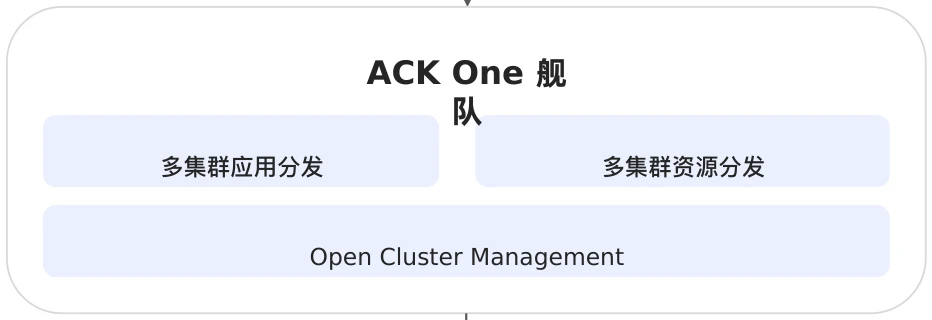
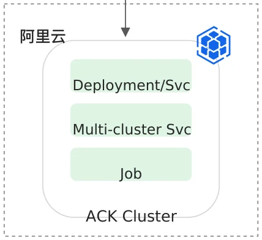
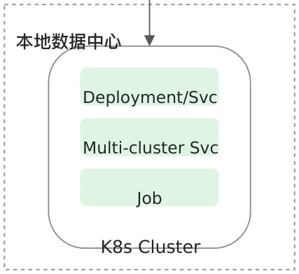
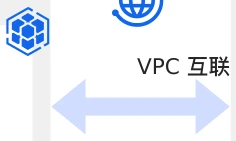

阿里云  
专有云  
容器服务Kubernetes版  
分布式云容器平台ACK One 用户  
指南  
产品版本：v3.18.6  
文档版本：20261022

**目录**

- [1.什么是分布式云容器平台 ACK One](#section-1)
- [2.登录分布式云容器平台 ACK One控制台](#section-2)
- [3.授权管理](#section-3)
    - [3.1. 授权概述](#section-3-1)
    - [3.2. 为RAM角色授予系统权限策略](#section-3-2)
    - [3.3. 为RAM角色授予RBAC权限](#section-3-3)
- [4.舰队列表](#section-4)
    - [4.1. 舰队管理](#section-4-1)
        - [4.1.1. 舰队管理概述](#section-4-1-1)
        - [4.1.2. 舰队管理网络规划](#section-4-1-2)
        - [4.1.3. 创建舰队](#section-4-1-3)
        - [4.1.4. 查看舰队详情](#section-4-1-4)
        - [4.1.5. 删除舰队](#section-4-1-5)
    - [4.2. 关联集群管理](#section-4-2)
        - [4.2.1. 添加关联集群](#section-4-2-1)
        - [4.2.2. 移除关联集群](#section-4-2-2)
    - [4.3. 命名空间管理](#section-4-3)
        - [4.3.1. 创建命名空间](#section-4-3-1)
        - [4.3.2. 修改命名空间标签](#section-4-3-2)
        - [4.3.3. 删除命名空间](#section-4-3-3)
    - [4.4. 多集群应用管理](#section-4-4)
        - [4.4.1. 创建多集群应用](#section-4-4-1)
        - [4.4.2. 查看多集群应用](#section-4-4-2)
        - [4.4.3. 修改多集群应用](#section-4-4-3)
        - [4.4.4. 删除多集群应用](#section-4-4-4)
    - [4.5. 多集群网关](#section-4-5)
        - [4.5.1. 配置ALB多集群网关](#section-4-5-1)

# 1.什么是分布式云容器平台 ACK One

分布式云容器平台 ACK One（Distributed Cloud Container Platform for Kubernetes）是阿里云面向混合云、多集群、分布式计算、容灾等场景推出的企业级云原生平台。ACK One可以连接并管理您任何地域、任何基础设施上的Kubernetes集群，并提供一致的管理和社区兼容的API，支持对计算、网络、存储、安全、监控、日志、作业、应用、流量等进行统一运维管控。

# 2.登录分布式云容器平台 ACK One控制台

您可按照以下的配置方法，登录到分布式云容器平台 ACK One控制台。

**前提条件**

- 登录Apsara Uni-manager运营控制台前，确认您已从部署人员处获取Apsara Uni-manager运营控制台的服务域名地址。

- 推荐使用Chrome浏览器。

**操作步骤**

1. 在浏览器地址栏中，输入Apsara Uni-manager运营控制台的服务域名地址，按回车键。

   

   > **说明**
   >
   > - 单击页面右上角的当前语言可以切换其它语言。
   >
   > - 授权登录是第三方认证中配置了全局IdP设置才会显示，且“授权登录”名称用户可按需自定义。
   >
   > - 由于浏览器证书过期或环境开启HTTPS认证等出现多次单击继续访问或无Apsara Uni-manager运营控制台地址入口等现象，此时需要安装证书才能正常访问。单击页面右上角的**浏览器证书安装**，可打开浏览器证书安装指南。

2. 输入正确的用户名及密码。

   > **说明**
   >
   > - 请向运营管理员获取登录控制台的用户名和密码。
   >
   > - 首次登录Apsara Uni-manager运营控制台时，需要修改登录用户名的密码，请按照提示完成密码修改。为提高安全性，密码长度必须为10~32位，且包含英文字母大小写、阿拉伯数字和特殊符号（感叹号（!）、at（@）、井号（#）、美元符号（$）、百分号（%）等）。

3. 单击**账号登录**。

4. 如果账号已激活MFA多因素认证，请根据以下两种情况进行操作：

   - **管理员强制开启MFA后的首次登录**

     <ol type="a">

     <li>

     在绑定虚拟MFA设备页面中，按页面提示步骤绑定MFA设备。

     </li>

     <li>

     按照步骤2重新输入账号和密码，单击**账号登录**。

     </li>

     </ol>

     <ol type="i" start="100">

     <li>

     输入6位MFA码后单击**认证**。

     </li>

     </ol>

   - **您已开启并绑定MFA**

     输入6位MFA码后单击**认证**。

     > **说明**
     >
     > 绑定并开启MFA的操作请参见《 Apsara Uni-manager运营控制台 用户指南》的**管理多因素认证**章节。

5. 在顶部菜单栏选择**产品 > 计算 > 容器服务 > 分布式云容器平台 ACK One**，进入**分布式云容器平台ACK One**控制台。

# 3.授权管理

## 3.1. 授权概述

您需要为服务账号授予RBAC的权限，才能正常使用分布式云容器平台 ACK One的功能。本文将为您介绍RBAC权限，以及如何为服务账号授予相应权限。

**权限说明**

RAM角色必须授权RBAC权限，舰队创建账号默认拥有RBAC权限，无需额外授权。授权后，RAM角色才能对ACK One集群内的K8s资源进行操作。

**RBAC权限**

RAM系统策略仅控制ACK One集群资源的操作权限，若RAM角色需要操作指定集群内的K8s资源（如创建并获取多集群应用），还需要获取指定ACK One集群及其命名空间的操作权限即RBAC权限。

ACK One提供以下预置角色：

**多集群舰队RBAC权限**

| RBAC权限 | 权限说明 |
| --- | --- |
| admin（管理员） | 具有集群范围和所有命名空间下资源的读写权限。 |
| dev（开发人员） | 具有所选命名空间下的资源读写权限。 |

RBAC权限所控制的具体资源列表以及授权操作，请参见为RAM角色授予RBAC权限。

## 3.2. 为RAM角色授予系统权限策略

若通过RAM角色使用ACK One，需要授予其操作权限（例如创建舰队集群、关联集群等），才能正常使用ACK One的功能。ACK One提供默认系统权限策略，用于指定全局资源的读写访问控制，本文介绍如何为RAM角色授予系统权限策略。

**注意事项**

您需要使用管理员账号为RAM角色授权，普通RAM用户无授权操作的权限。

**操作步骤**

1. 登录Apsara Uni-manager运营控制台。

2. 在顶部菜单栏，选择**企业**。

3. 在左侧导航栏，选择**权限管理** **> 角色授权**。

4. 在角色列表上方，单击<strong>创建自定义角色，</strong>进入**创建自定义角色**页面。

5. 设置**基础配置**，单击**下一步**。参数设置请参考<strong>《统一云管平台 用户指南》 > 管理自定义角色</strong>章节。

6. 设置**管理权限**，在权限列表勾选需要授权的管理权限点后，单击**下一步**。

7. 设置**应用权限**，在权限列表勾选需要授权的分布式云容器平台的**集群授权**权限后，单击**下一步**。

8. 设置**菜单权限**，在列表勾选需要授权的菜单入口后，单击**下一步**或**创建**。更多操作请参考<strong>《统一云管平台 用户指南》 > 管理自定义角色</strong>章节。

9. 返回**角色授权**页面，在刚创建的角色**操作**列单击**授权**，勾选需要授权的用户或用户组，然后单击**确定**。

## 3.3. 为RAM角色授予RBAC权限

RAM系统策略仅控制ACK One集群资源的操作权限（例如创建实例、查看实例列表等），若RAM角色需要操作指定集群内的K8s资源，还需要获取指定ACK One集群及其命名空间的操作权限即RBAC权限。本文为您介绍如何为RAM角色授予RBAC权限。

**注意事项**

您需要使用管理员账户或已具有**集群授权**权限的RAM用户，为指定的RAM角色授权。具体操作请参考为RAM角色授予系统权限策略。

**ACK One支持的RBAC权限**

**多集群舰队RBAC权限**

| RBAC角色 | RBAC权限 |
| --- | --- |
| admin（管理员） | 具有集群范围和所有命名空间下资源的读写权限。 |
| dev（开发人员） | 具有所选命名空间下的资源读写权限。 |

**展开查看集群及命名空间资源列表**

- 集群范围资源列表

  | Kind | apiVersion |
  | --- | --- |
  | Namespace | v1 |
  | Managedcluster | cluster.open-cluster-management.io |
  | MseIngressConfig | mse.alibabacloud.com/v1alpha1 |
  | IngressClass | networking.k8s.io/v1 |

- 命名空间下资源列表

  | Kind | apiVersion |
  | --- | --- |
  | Deployment | apps/v1 |
  | Service | v1 |
  | Ingress | networking.k8s.io/v1 |
  | ConfigMap | v1 |
  | Secret | v1 |
  | StatefulSet | apps/v1 |
  | PersistentVolumeClaim | v1 |
  | ServiceExport | multicluster.x-k8s.io/v1alpha1 |
  | ServiceImport | multicluster.x-k8s.io/v1alpha1 |
  | HorizontalPodAutoscaler | autoscaling/v1 |
  | Application ApplicationSet Appproject | argoproj.io |
  | Workflow | argoproj.io |
  | Application | core.oam.dev |

- argocd命名空间下应用资源

  | Kind | apiVersion |
  | --- | --- |
  | Application | argoproj.io |

**操作步骤**

1. 登录分布式云容器平台 ACK One控制台。

2. 在左侧导航栏，单击**授权管理**。

3. 在**授权管理**页面选择**舰队**。

4. 在RAM用户列表中找到要授权的RAM用户，然后在其**操作**列单击**管理授权**。

5. 在弹出的操作框中选择**授权角色**，然后单击**确定**。

   > **说明**
   >
   > - **授权角色**可选择**管理员**或**开发人员**。
   >
   > - 单击**操作**列的**撤销授权**可以删除授权。

# 4.舰队列表

## 4.1. 舰队管理

### 4.1.1. 舰队管理概述

随着Kubernetes集群的广泛应用，企业往往需要运行和管理多个Kubernetes集群，由此带来一系列的问题，例如多集群的管理、对外提供统一的入口、多集群资源的调度等问题。ACK One舰队管理的舰队实例是由ACK托管的，可以管理任意环境的Kubernetes集群，为企业提供一致的云原生应用管理体验。

**核心概念**

**舰队实例**：基于成熟的开源社区项目ArgoCD和Open Cluster Management构建，保证了产品的开放性。舰队为开发者提供多集群应用分发能力和一致性的Kubernetes API，通过舰队完成工作负载、应用、配置信息的调度分发，同时支持流量的治理功能。舰队实例由ACK托管，您可以省去大量的运维工作，从而专注应用开发。

**关联集群**：您可以选择将同账号下的ACK集群纳入舰队管理，成为关联集群，之后可以通过舰队Fleet实例向关联集群下发应用和工作负载。舰队可以跨地域管理关联集群。

**舰队管理员**：即舰队创建者，此用户角色可以为其他的开发用户账号创建命名空间，配置任务优先级，以及配置资源配额。

**开发用户**：此用户角色只能在特定授权的命名空间投递任务或发布应用。

**应用场景**

统一控制面

ACK One舰队管理适用于以下场景：

- 多集群舰队控制面基于K8s控制面构建，提供标准Kubernetes API。

- 多集群舰队可以接入多个K8s集群，非容器服务ACK集群，可以先通过注册集群接入。

- 多集群应用分发：托管开源ArgoCD，实现多集群应用分发。

### 4.1.2. 舰队管理网络规划

通过舰队管理可以实现跨地域管理多个关联集群。开启舰队管理功能需要配置舰队所在的地域、专有网络VPC和虚拟交换机信息。本文介绍舰队与关联集群的网络连接架构以及如何选择舰队所在的地域、专有网络VPC和虚拟交换机。

**网络架构**

ACK One舰队管理网络架构如下图所示。 其中ACK Cluster 1、ACK Cluster 2和ACK Cluster 3三个集群分布在两个地域和两个VPC下。系统管理员通过访问舰队的API Server端点，实现对多个集群的管理。

- 图中，“1”表示舰队所在VPC可以访问关联集群的API Server端点。

- 图中，“2”表示关联集群所在VPC可以访问舰队的API Server端点。

  系统管理员

Region 1

Region 2

VPC 1

VPC

API Server SLB

ACK One  Fleet 实例

1

API Server SLB

Applications

1

ACK Cluster 3

API Server SLB

API Server SLB

Applications

Applications

ACK Cluster 1

ACK Cluster 2

2

2

2

**如何选择地域**

舰队管理多个关联集群，提供统一管理入口。选择舰队可以根据关联集群数量及其所在地域就近选择。如上图所示，Region 1有两个关联集群，Region 2有一个关联集群，可以选择Region 1作为舰队的地域。

> **重要**
>
> - 舰队管理支持创建多个舰队，您可以根据业务类型、就近地域、测试环境、生成环境等因素创建多个舰队。
>
> - 一个关联集群，仅可纳入一个舰队进行管理。

**如何选择专有网络VPC**

为了实现舰队对关联集群的统一管理，需要建立网络连接，使它们可以互访API Server端点。

1. 舰队所在VPC可以访问关联集群的API Server端点，如上图中标注“1”的连接。

2. 关联集群所在VPC可以访问舰队的API Server端点，如上图中标注“2”的连接。

3. 如果舰队与关联集群属于不同的VPC，需要将两个VPC网络打通，保证API Server端点可以互相访问。

   > **重要**
   >
   > 舰队和关联集群的安全组均需要允许来自对方的网段连接。

选择VPC时，优先选择关联集群数量较多的VPC，这样舰队和关联集群的连接将自动采用VPC内网连接。例如，ACK Cluster 1和ACK Cluster 2在VPC 1，ACK Cluster 3在VPC 2，可以将舰队部署在VPC 1。

**如何选择虚拟交换机**

舰队对虚拟交换机无特殊需求，您可以根据网络规划自行选择。

### 4.1.3. 创建舰队

本文介绍如何创建舰队。

**前提条件**

操作用户默认为运营管理员用户和组织管理员用户，自定义角色用户需要授权**集群授权**权限。具体操作请参考为RAM角色授予系统权限策略。

**操作步骤**

1. 登录分布式云容器平台 ACK One控制台。

2. 在左侧导航栏，选择**舰队列表**。

3. 在**舰队列表**页面，单击**创建**。

4. 在**创建舰队**页面设置相关参数，然后单击**提交**。

   <table>
     <tr>
       <th width="184">参数</th>
       <th>说明</th>
     </tr>
     <tr>
       <td>舰队名称</td>
       <td>输入舰队的名称。 说明名称长度为1~63个字符，可包含数字、下划线（_）或中划线（-），需以英文大小写字母、中文或数字开头。</td>
     </tr>
     <tr>
       <td>组织</td>
       <td>选择集群归属的组织。</td>
     </tr>
     <tr>
       <td>资源集</td>
       <td>选择集群归属的资源集。</td>
     </tr>
     <tr>
       <td>地域</td>
       <td>选择集群所在的地域。</td>
     </tr>
     <tr>
       <td>专有网络</td>
       <td>选择舰队的VPC网络。</td>
     </tr>
     <tr>
       <td>虚拟交换机</td>
       <td>选择舰队的虚拟交换机。</td>
     </tr>
     <tr>
       <td>创建并绑定EIP</td>
       <td>是否开启公网访问能力，默认不选中状态。 重要选中时，将为内网SLB实例绑定EIP，获得公网访问API Server的能力。绑定后不可解绑，因为可能有集群已使用该舰队的公网链接。</td>
     </tr>
     <tr>
       <td>API Server负载均衡</td>
       <td>默认标准型I（slb.s2.small），不支持修改。</td>
     </tr>
   </table>

5. 单击**确定**。

   等待一段时间，集群状态为**运行中**，说明舰队创建成功。

### 4.1.4. 查看舰队详情

本文介绍如何查看舰队的详细信息。

**操作步骤**

舰队创建完成后，可查看舰队的基本信息、连接信息、日志和关联集群等。

1. 登录分布式云容器平台 ACK One控制台。

2. 在左侧导航栏，选择**舰队列表**。

3. （可选）在**舰队列表**页面，可通过输入**舰队ID**快速筛选舰队。

4. 在舰队列表中，单击目标舰队ID或**操作**列的**详情**。

   > **说明**
   >
   > 单击**舰队信息**页面右上角的操作按钮（**刷新**、**删除**）可以快速执行相关操作。

   - 单击**基本信息**页签，可查看舰队名称、ID、状态、地域、创建时间、API Server连接端点以及其他网络信息。

     > **说明**
     >
     > 您可打开或关闭舰队的删除保护。若您开启删除保护，则无法执行删除舰队操作。

   - 单击**连接舰队**页签，您可以获取公网和内网环境下KubeConfig文件的配置内容，用于配置通过kubectl客户端访问舰队。

   - 单击**舰队日志**页签，可查看当前舰队日志的相关信息。

     > **说明**
     >
     > 在**舰队列表**页面，单击**操作**列的**查看日志**，也可直接跳转到**舰队日志**页签。

   - 单击**关联集群**页签，可以为舰队添加关联集群，具体请参见关联集群管理。

### 4.1.5. 删除舰队

本文介绍如何删除舰队。

**前提条件**

删除舰队之前，请先移除该舰队关联的集群，再进行删除操作。具体操作请参见移除关联集群。

**操作步骤**

1. 登录分布式云容器平台 ACK One控制台。

2. 在左侧导航栏，选择**舰队列表**。

3. 在舰队列表中，单击目标舰队**操作**列的**删除**。

4. 在弹出的对话框中，单击**确定**。

## 4.2. 关联集群管理

### 4.2.1. 添加关联集群

创建舰队后，您可以为舰队添加关联集群，实现由舰队作为统一入口的应用与负载的分发。舰队可以跨地域管理关联集群。本文介绍如何添加关联集群。

**前提条件**

已创建舰队，且集群状态为**运行中**。具体操作请参见创建舰队。

**约束限制**

- 添加的关联集群和舰队在同一个VPC。如果两者不在同一个VPC，需要打通舰队和关联集群之间的网络。

- 单次允许添加和删除的关联集群不超过10个。

**操作步骤**

1. 登录分布式云容器平台 ACK One控制台。

2. 在左侧导航栏，选择**舰队列表**。

3. 在舰队列表中，单击目标舰队ID或**操作**列的**详情**。

4. 在**舰队信息**页面，单击**关联集群**页签。

5. 在**关联集群**页签，单击**关联集群**。

6. 在弹出的**关联集群**面板中，勾选需要关联的集群，然后单击**确定**。

   等待一段时间（5分钟以内）后，在**关联集群**页面，集群**关联状态**显示为**关联成功**，说明集群关联成功。单击**操作**列的**详情**，可跳转至集群**基本信息**页面查看集群详情。

   > **说明**
   >
   > 添加关联集群后，需手动刷新舰队管理页面，才能显示最新的关联集群列表。关联状态说明如下：
   >
   > - **处理中**：集群添加请求已提交。
   >
   > - **关联中**：舰队收到请求，集群关联中。
   >
   > - **关联成功**：集群关联成功。
   >
   > - **关联失败**：集群关联失败。

### 4.2.2. 移除关联集群

本文介绍如何移除舰队关联的集群。

**操作步骤**

1. 登录分布式云容器平台 ACK One控制台。

2. 在左侧导航栏，选择**舰队列表**。

3. 在舰队列表中，单击目标舰队ID或**操作**列的**详情**。

4. 在**舰队信息**页面，单击**关联集群**页签。

5. 解除关联。

   - 单个解除：在**关联集群**页签，找到对应的关联集群，单击其右侧**操作**列下的**移除关联**。

   - 批量解除：在**关联集群**页签，勾选多个关联集群，单击列表下方的**批量解除关联**。

6. 在弹出的对话框中，单击**确定**。

   > **说明**
   >
   > 等待一段时间后，刷新**关联集群**页签，关联集群列表中不显示已移除的集群，表示关联集群移除成功。

## 4.3. 命名空间管理

### 4.3.1. 创建命名空间

本文介绍如何创建命名空间。

**前提条件**

已创建舰队，具体请参考创建舰队。

**背景信息**

在 Kubernetes 集群中，您可使用Namespaces（命名空间）功能创建多个虚拟的空间，在集群用户数量较多时，多个命名空间可以有效划分工作区间，将集群资源划分为多个用途。

**操作步骤**

1. 登录分布式云容器平台 ACK One控制台。

2. 在左侧导航栏，选择**舰队列表**。

3. 在舰队列表中，单击目标舰队ID或**操作**列的**详情**。

4. 在左侧导航栏，单击**命名空间**。

5. 在**命名空间**页面，单击**创建命名空间**。

6. 在**创建命名空间**对话框中，输入命名空间的名称以及标签，然后单击**确定**。

   | 配置项 | 说明 |
   | --- | --- |
   | 名称 | 您需要设置命名空间的名称。长度为 1-63 个字符，只能包含数字、字母和“-”，且首尾只能是字母或数字。 |
   | 标签 | 您可为命名空间添加多个标签。标签用于标识该命名空间的特点，如标识该命名空间用于测试环境。您可输入变量名称和变量值，单击右侧的<strong>添加</strong>，为命名空间新增一个标签。 |

### 4.3.2. 修改命名空间标签

本文介绍如何修改命名空间的标签。

**操作步骤**

1. 登录分布式云容器平台 ACK One控制台。

2. 在左侧导航栏，选择**舰队列表**。

3. 在舰队列表中，单击目标舰队ID或**操作**列的**详情**。

4. 在左侧导航栏，单击**命名空间**。

5. 在**命名空间**页面，单击目标命名空间**操作**列的**编辑**。

6. 在弹出的对话框中修改、添加或删除标签，然后单击**确定**。

### 4.3.3. 删除命名空间

本文介绍如何删除命名空间。

**注意事项**

删除命名空间会导致其下所有的资源对象一起被删除，请慎重操作。

**操作步骤**

1. 登录分布式云容器平台 ACK One控制台。

2. 在左侧导航栏，选择**舰队列表**。

3. 在舰队列表中，单击目标舰队ID或**操作**列的**详情**。

4. 在左侧导航栏，单击**命名空间**。

5. 在**命名空间**页面，单击目标命名空间**操作**列的**删除**。

6. 在弹出的对话框中，单击**确定**。

## 4.4. 多集群应用管理

### 4.4.1. 创建多集群应用

本文介绍如何创建多集群应用。

**背景信息**

多集群应用可以简化多集群应用编排（ArgoCD ApplicationSet），通过单一应用编排并根据您的编排内容自动生成一个或多个应用。

**前提条件**

- 已创建舰队，具体请参考创建舰队。

- 已为舰队添加多个关联集群。具体操作，请参见添加关联集群。

- 已创建命名空间，具体请参考创建命名空间。

**操作步骤**

1. 登录分布式云容器平台 ACK One控制台。

2. 在左侧导航栏，选择**舰队列表**。

3. 在舰队列表中，单击目标舰队ID或**操作**列的**详情**。

4. 在左侧导航栏，单击**多集群应用**。

5. 在**多集群应用**页面，单击**创建多集群应用**。

6. 在**创建多集群应用**面板中，配置以下参数然后单击**确定**。

   <table>
     <tr>
       <th width="137">参数</th>
       <th>说明</th>
     </tr>
     <tr>
       <td>多集群应用名称</td>
       <td>应用程序的名称。</td>
     </tr>
     <tr>
       <td>chart名称</td>
       <td>Helm Chart 的名称，用于定义要部署的应用模板。</td>
     </tr>
     <tr>
       <td>chart地址</td>
       <td>Helm Chart Repository 地址（格式为HTTP/HTTPS 前缀的 URL）或者 OCI 镜像仓库地址（比如 ACR 高级版，格式为 镜像仓库地址/命名空间）。 目前仅支持公有仓库。</td>
     </tr>
     <tr>
       <td>版本</td>
       <td>指定使用的Chart版本号。</td>
     </tr>
     <tr>
       <td>目标集群</td>
       <td>应用程序部署的目标集群。</td>
     </tr>
     <tr>
       <td>命名空间</td>
       <td>应用部署集群内所在命名空间。</td>
     </tr>
   </table>

### 4.4.2. 查看多集群应用

本文介绍如何查看舰队下的多集群应用信息。

**操作步骤**

1. 登录分布式云容器平台 ACK One控制台。

2. 在左侧导航栏，选择**舰队列表**。

3. 在舰队列表中，单击目标舰队ID或**操作**列的**详情**。

4. 在左侧导航栏，单击**多集群应用**。

5. （可选）在**多集群应用**页面，可通过输入多集群应用名称快速筛选应用。

6. 在多集群应用列表中，可查看应用的**名称**、**类型**、**状态**、**Application**、**命名空间**、**创建时间**等。

   > **说明**
   >
   > - 单击**Application**列的数字，可查看多集群应用创建出来的Application概要信息。
   >
   > - 单击**操作**列的**查看Yaml**，可查看多集群应用（ArgoCD ApplicationSet 资源）的 YAML信息。

### 4.4.3. 修改多集群应用

本文介绍如何修改多集群应用的配置信息。

**操作步骤**

1. 登录分布式云容器平台 ACK One控制台。

2. 在左侧导航栏，选择**舰队列表**。

3. 在舰队列表中，单击目标舰队ID或**操作**列的**详情**。

4. 在左侧导航栏，单击**多集群应用**。

5. 在**多集群应用**页面，单击目标应用**操作**列的**编辑**。

6. 在**编辑多集群应用**页面，更新配置信息后，单击**确定**。

   > **说明**
   >
   > 多集群应用名称不支持修改。

### 4.4.4. 删除多集群应用

本文介绍如何删除多集群应用。

**注意事项**

删除多集群应用之后，关联集群中已下发的应用也会同步被删除。

**操作步骤**

1. 登录分布式云容器平台 ACK One控制台。

2. 在左侧导航栏，选择**舰队列表**。

3. 在舰队列表中，单击目标舰队ID或**操作**列的**详情**。

4. 在左侧导航栏，单击**多集群应用**。

5. 在**多集群应用**页面，单击目标应用**操作**列的**删除**。

6. 在弹出的对话框中单击**确定**。

## 4.5. 多集群网关

### 4.5.1. 配置ALB多集群网关

多集群网关以ALB实例作为舰队的统一流量入口，按照Ingress中配置的转发规则，将外部请求分发至舰队内多个关联集群的后端服务。本文介绍如何创建ALB网关、IngressClass和Ingress。

**背景信息**

多集群网关涉及以下概念：

- **网关**：即一个ALB实例，是流量的统一入口。网关按监听端口及协议接收请求，并部署到舰队内的一个或多个关联集群。

- **IngressClass**：绑定一个网关实例，是Ingress与网关之间的桥梁。

- **Ingress**：定义域名、路径与后端服务之间的转发规则，决定请求被转发到哪个服务。不同的Ingress可以复用同一个网关。

网关的一个监听端口可以同时服务多个Ingress，一个Ingress也可以使用多个监听端口。

**前提条件**

- 已创建舰队，且舰队状态为**运行中**。具体操作，请参见创建舰队。

- 已为舰队添加关联集群，且集群的**关联状态**为**关联成功**。具体操作，请参见添加关联集群。

- 已在需要承接流量的各关联集群中部署后端服务，且各集群中服务的名称相同。

- 如需创建HTTPS监听，需已在ALB证书服务中创建服务器证书。

**操作步骤**

1. 登录分布式云容器平台 ACK One控制台。

2. 在左侧导航栏，选择**舰队列表**。

3. 在舰队列表中，单击目标舰队ID或**操作**列的**详情**。

4. 在左侧导航栏，单击**多集群网关**。

**步骤一：创建ALB网关**

1. 在**ALB 网关管理**页签，单击**创建网关**。

   > **说明**
   >
   > 您也可以单击页面的**使用 YAML 创建**，通过YAML方式创建ALB网关。

2. 在**创建网关**面板中，配置以下参数，然后单击**确定**。

   <table>
     <tr>
       <th width="137">参数</th>
       <th>说明</th>
     </tr>
     <tr>
       <td>网关名称</td>
       <td>网关的名称。长度为1~63个字符，只能包含数字、小写字母和中划线（-），且首尾只能是字母或数字。网关名称创建后不可修改。</td>
     </tr>
     <tr>
       <td>网络类型</td>
       <td>网关的访问类型，默认为<strong>公网</strong>。创建后不可修改。 • <strong>公网</strong>：网关分配公网IP，可以从公网访问。 • <strong>私网</strong>：网关仅分配内网IP，只能在VPC内访问。</td>
     </tr>
     <tr>
       <td>虚拟交换机</td>
       <td>选择舰队VPC下的虚拟交换机。创建后不可修改。</td>
     </tr>
     <tr>
       <td>监听端口及协议</td>
       <td>网关接收请求的监听，可单击<strong>添加监听</strong>配置多个监听。每个监听包含以下参数： • <strong>协议</strong>：监听使用的协议，支持<strong>HTTP</strong>和<strong>HTTPS</strong>。 • <strong>端口</strong>：监听端口，取值范围为1~65535。<strong>协议</strong>为HTTP时默认为80，为HTTPS时默认为443。 • <strong>服务器证书</strong>：<strong>协议</strong>为<strong>HTTPS</strong>时需要配置。HTTPS监听需指定证书，证书需先在ALB证书服务中创建。 • <strong>TLS 安全策略</strong>：<strong>协议</strong>为<strong>HTTPS</strong>时可选，用于限制该监听允许的TLS协议版本和加密算法组合。候选项包括系统预置策略和您在ALB证书服务中创建的自定义策略。</td>
     </tr>
     <tr>
       <td>部署集群</td>
       <td>网关部署到的关联集群，可多选。仅可选择<strong>关联状态</strong>为<strong>关联成功</strong>的集群。</td>
     </tr>
   </table>

3. 网关创建完成后，在**ALB 网关管理**页签可以查看目标网关的**网关名称**、**状态**、**ALB 实例 ID**、**网络类型**、**公网 IP**、**内网 IP**、**监听端口及协议**和**部署集群**。当网关状态由**配置中**变为**已生效**时，表示网关已准备就绪。

   > **说明**
   >
   > **网络类型**为**公网**的网关同时具备公网IP和内网IP，**私网**网关仅具备内网IP。

**步骤二：创建IngressClass**

1. 单击**IngressClass**页签，然后单击**创建 IngressClass**。

2. 在**创建 IngressClass**面板中，配置以下参数，然后单击**确定**。

   <table>
     <tr>
       <th width="89">参数</th>
       <th>说明</th>
     </tr>
     <tr>
       <td>名称</td>
       <td>IngressClass的名称。长度为1~63个字符，只能包含数字、小写字母和中划线（-），且首尾只能是字母或数字。</td>
     </tr>
     <tr>
       <td>关联网关</td>
       <td>选择<strong>ALB 网关管理</strong>页签中已创建的网关。</td>
     </tr>
   </table>

3. IngressClass创建完成后，在**IngressClass**页签可以查看目标IngressClass的**关联网关**和**网关类型**。ALB网关对应的IngressClass，其**网关类型**为**ALB**。

**步骤三：创建Ingress**

1. 单击**Ingress**页签，然后单击**创建 Ingress**。

   > **说明**
   >
   > 您也可以单击页面的**使用 YAML 创建**，通过YAML方式创建Ingress。

2. 在**创建 Ingress**面板中，配置以下参数，然后单击**确定**。

   <table>
     <tr>
       <th width="140">参数</th>
       <th>说明</th>
     </tr>
     <tr>
       <td>名称</td>
       <td>Ingress的名称。长度为1~63个字符，只能包含数字、小写字母和中划线（-），且首尾只能是字母或数字。</td>
     </tr>
     <tr>
       <td>命名空间</td>
       <td>Ingress所在的命名空间。后端服务需位于该命名空间下。</td>
     </tr>
     <tr>
       <td>IngressClass</td>
       <td>选择网关对应的IngressClass，可在<strong>IngressClass</strong>页签中创建。</td>
     </tr>
     <tr>
       <td>网关监听端口</td>
       <td>为该Ingress提供服务的网关监听端口，可多选。</td>
     </tr>
     <tr>
       <td>转发规则</td>
       <td>请求与后端服务之间的转发规则，可单击<strong>添加规则</strong>配置多条规则。相同域名的规则会自动合并；域名留空表示匹配所有域名。每条规则包含以下参数： • <strong>域名</strong>：该规则匹配的域名，例如example.com。 • <strong>路径</strong>：该规则匹配的路径，例如/。 • <strong>匹配方式</strong>：路径的匹配方式，默认为<strong>前缀匹配（Prefix）</strong>。还支持<strong>完整匹配</strong><strong>（Exact）</strong>和<strong>默认（ImplementationSpecific）</strong>。 • <strong>后端服务</strong>：接收请求的服务名称。需要所有部署集群中都存在该服务。 • <strong>服务端口</strong>：接收请求的端口，支持填写端口号（例如80）和端口名称。</td>
     </tr>
     <tr>
       <td>注解</td>
       <td>为Ingress添加键值对形式的注解，可按需配置。</td>
     </tr>
   </table>

3. Ingress创建完成后，在**Ingress**页签可以查看目标Ingress的**状态**、**IngressClass**、**网关监听端口**和**转发规则**。当Ingress状态为**已生效**时，表示转发规则已在网关上生效。

**结果验证**

1. 在**ALB 网关管理**页签，获取目标网关的**公网 IP**或**内网 IP**。

2. 使用浏览器或客户端多次访问该IP，验证请求被分发至各关联集群中的后端服务。预期各关联集群中的后端服务均能接收到请求，且接收到的请求数量大致均等。

   > **说明**
   >
   > **网络类型**为**公网**的网关通过公网IP访问，**私网**网关需在VPC内通过内网IP访问。配置了HTTPS监听的网关，访问端口为对应的HTTPS监听端口。

3. 验证跨集群容灾：将其中一个关联集群中的后端服务实例数量调整为0，再次访问该IP，预期请求全部由其余集群中的后端服务承接。

**相关操作**

在**多集群网关**页面的各个页签中，您可以在目标资源的**操作**列执行以下操作。

- **编辑**：修改资源的配置。编辑网关时，**网关名称**、**网络类型**和**虚拟交换机**不可修改。

- **查看 YAML**：查看资源的YAML内容，并在YAML中修改配置。

- **删除**：删除不再需要的网关、IngressClass或Ingress。
