阿里云  
专有云  
容器服务Kubernetes版  
用户指南  
产品版本：v3.18.6  
文档版本：20261029

**目录**

- [1.产品公告](#section-1)
    - [1.1. ACK版本发布说明](#section-1-1)
        - [1.1.1. ACK集群生命周期说明](#section-1-1-1)
        - [1.1.2. 发布Kubernetes 1.36版本说明](#section-1-1-2)
        - [1.1.3. 发布Kubernetes 1.34版本说明](#section-1-1-3)
        - [1.1.4. 发布Kubernetes 1.32版本说明](#section-1-1-4)
        - [1.1.5. 发布Kubernetes 1.30版本说明](#section-1-1-5)
        - [1.1.6. 发布Kubernetes 1.28版本说明](#section-1-1-6)
        - [1.1.7. 发布Kubernetes 1.26版本说明](#section-1-1-7)
        - [1.1.8. 发布Kubernetes 1.24版本说明](#section-1-1-8)
        - [1.1.9. 发布Kubernetes 1.22版本说明](#section-1-1-9)
        - [1.1.10. 发布Kubernetes 1.20版本说明](#section-1-1-10)
        - [1.1.11. 发布Kubernetes 1.18版本说明](#section-1-1-11)
    - [1.2. ACK Edge版本发布说明](#section-1-2)
        - [1.2.1. ACK Edge发布Kubernetes 1.26版本说明](#section-1-2-1)
    - [1.3. 【CVE安全】漏洞修复公告](#section-1-3)
        - [1.3.1. 修复NVIDIA GPU驱动漏洞CVE-2021-1056公告](#section-1-3-1)
- [2.功能发布记录](#section-2)
- [3.什么是容器服务](#section-3)
- [4.规划和准备](#section-4)
- [5.使用限制](#section-5)
- [6.安全须知](#section-6)
- [7.Kubernetes集群](#section-7)
    - [7.1. 快速入门](#section-7-1)
        - [7.1.1. 使用流程](#section-7-1-1)
        - [7.1.2. 登录容器服务控制台](#section-7-1-2)
        - [7.1.3. 创建Kubernetes集群](#section-7-1-3)
        - [7.1.4. 创建无状态工作负载Deployment](#section-7-1-4)
        - [7.1.5. 飞天助理使用指南](#section-7-1-5)
    - [7.2. 授权管理](#section-7-2)
        - [7.2.1. 配置子账号或RAM角色的RBAC权限](#section-7-2-1)
        - [7.2.2. 为集群Worker节点绑定的RAM角色配置权限](#section-7-2-2)
        - [7.2.3. 通过RRSA配置ServiceAccount的RAM权限实现Pod权限隔离](#section-7-2-3)
        - [7.2.4. 角色登录说明](#section-7-2-4)
        - [7.2.5. 角色权限说明](#section-7-2-5)
    - [7.3. 集群](#section-7-3)
        - [7.3.1. 创建Kubernetes集群](#section-7-3-1)
        - [7.3.2. 使用自定义镜像创建Kubernetes集群](#section-7-3-2)
        - [7.3.3. 查看集群日志](#section-7-3-3)
        - [7.3.4. 查看集群信息](#section-7-3-4)
        - [7.3.5. 为容器集群加密](#section-7-3-5)
        - [7.3.6. 通过kubectl连接Kubernetes集群](#section-7-3-6)
        - [7.3.7. 通过SSH连接Master节点](#section-7-3-7)
        - [7.3.8. 管控节点运维](#section-7-3-8)
        - [7.3.9. 吊销集群的KubeConfig凭证](#section-7-3-9)
        - [7.3.10. 获取临时的KubeConfig凭证](#section-7-3-10)
        - [7.3.11. 升级集群](#section-7-3-11)
        - [7.3.12. 扩容集群](#section-7-3-12)
        - [7.3.13. 更新即将过期证书](#section-7-3-13)
        - [7.3.14. 轮转专有版集群ETCD证书](#section-7-3-14)
        - [7.3.15. 删除集群](#section-7-3-15)
        - [7.3.16. 查看集群概览](#section-7-3-16)
        - [7.3.17. 控制面配置](#section-7-3-17)
        - [7.3.18. 维护集群](#section-7-3-18)
    - [7.4. 调度配置](#section-7-4)
        - [7.4.1. Binpack](#section-7-4-1)
        - [7.4.2. 负载感知调度](#section-7-4-2)
        - [7.4.3. 重调度](#section-7-4-3)
        - [7.4.4. QoS感知调度配置](#section-7-4-4)
    - [7.5. 节点管理](#section-7-5)
        - [7.5.1. 节点池](#section-7-5-1)
            - [7.5.1.1. 创建节点池](#section-7-5-1-1)
            - [7.5.1.2. 查看节点池](#section-7-5-1-2)
            - [7.5.1.3. 编辑节点池](#section-7-5-1-3)
            - [7.5.1.4. 扩容节点池](#section-7-5-1-4)
            - [7.5.1.5. 删除节点池](#section-7-5-1-5)
            - [7.5.1.6. 调度应用至指定节点池](#section-7-5-1-6)
            - [7.5.1.7. 自定义节点池的kubelet参数配置](#section-7-5-1-7)
            - [7.5.1.8. 升级节点池](#section-7-5-1-8)
            - [7.5.1.9. 节点池部署集最佳实践](#section-7-5-1-9)
            - [7.5.1.10. 开启节点自愈](#section-7-5-1-10)
        - [7.5.2. 节点](#section-7-5-2)
            - [7.5.2.1. 添加已有节点](#section-7-5-2-1)
            - [7.5.2.2. 查看节点列表](#section-7-5-2-2)
            - [7.5.2.3. 节点标签管理](#section-7-5-2-3)
            - [7.5.2.4. 节点调度设置](#section-7-5-2-4)
            - [7.5.2.5. 节点排水](#section-7-5-2-5)
            - [7.5.2.6. 移除节点](#section-7-5-2-6)
            - [7.5.2.7. 查看节点资源请求量/使用量](#section-7-5-2-7)
        - [7.5.3. 混合云节点池](#section-7-5-3)
            - [7.5.3.1. 创建和管理混合云节点池](#section-7-5-3-1)
            - [7.5.3.2. 使用Terway Hybrid网络插件](#section-7-5-3-2)
            - [7.5.3.3. ACK集群纳管AIStack节点](#section-7-5-3-3)
    - [7.6. 存储](#section-7-6)
        - [7.6.1. 概述](#section-7-6-1)
        - [7.6.2. 使用阿里云云盘](#section-7-6-2)
        - [7.6.3. 使用NAS静态存储卷](#section-7-6-3)
        - [7.6.4. 使用NAS动态存储卷](#section-7-6-4)
        - [7.6.5. 使用OSS静态存储卷](#section-7-6-5)
        - [7.6.6. 使用OSS动态存储卷](#section-7-6-6)
        - [7.6.7. 创建持久化存储卷声明](#section-7-6-7)
        - [7.6.8. 使用持久化存储卷声明](#section-7-6-8)
        - [7.6.9. 使用云盘存储快照](#section-7-6-9)
        - [7.6.10. 使用块存储限速最佳实践](#section-7-6-10)
    - [7.7. 安全](#section-7-7)
        - [7.7.1. 容器安全策略规则库说明](#section-7-7-1)
        - [7.7.2. 通过控制台使用策略管理功能](#section-7-7-2)
        - [7.7.3. 通过API使用策略治理功能](#section-7-7-3)
        - [7.7.4. 使用配置巡检检查集群工作负载](#section-7-7-4)
        - [7.7.5. 使用集群审计功能](#section-7-7-5)
        - [7.7.6. ACK等保加固使用说明](#section-7-7-6)
    - [7.8. 网络管理](#section-7-8)
        - [7.8.1. 网络概述](#section-7-8-1)
        - [7.8.2. Kubernetes集群网络规划](#section-7-8-2)
        - [7.8.3. 容器访问策略](#section-7-8-3)
        - [7.8.4. 容器带宽限制](#section-7-8-4)
        - [7.8.5. 使用Terway网络插件](#section-7-8-5)
        - [7.8.6. 为Pod配置固定IP、独立虚拟交换机和安全组](#section-7-8-6)
        - [7.8.7. 为Pod配置固定IP地址段](#section-7-8-7)
        - [7.8.8. 修改Pod虚拟交换机](#section-7-8-8)
        - [7.8.9. 为Pod挂载独立公网EIP](#section-7-8-9)
        - [7.8.10. Service管理](#section-7-8-10)
            - [7.8.10.1. Service的负载均衡配置注意事项](#section-7-8-10-1)
            - [7.8.10.2. 通过Annotation配置负载均衡](#section-7-8-10-2)
            - [7.8.10.3. 通过CCM跨集群部署服务](#section-7-8-10-3)
        - [7.8.11. 使用NodeLocal DNSCache](#section-7-8-11)
        - [7.8.12. 使用Gateway API访问服务](#section-7-8-12)
        - [7.8.13. 网络策略](#section-7-8-13)
            - [7.8.13.1. 创建网络策略](#section-7-8-13-1)
            - [7.8.13.2. 管理网络策略](#section-7-8-13-2)
            - [7.8.13.3. 网络策略使用示例](#section-7-8-13-3)
    - [7.9. 命名空间](#section-7-9)
        - [7.9.1. 创建命名空间](#section-7-9-1)
        - [7.9.2. 设置资源配额和限制](#section-7-9-2)
        - [7.9.3. 编辑命名空间](#section-7-9-3)
        - [7.9.4. 删除命名空间](#section-7-9-4)
    - [7.10. 应用管理](#section-7-10)
        - [7.10.1. 工作负载](#section-7-10-1)
            - [7.10.1.1. 创建无状态工作负载Deployment](#section-7-10-1-1)
            - [7.10.1.2. 创建有状态工作负载StatefulSet](#section-7-10-1-2)
            - [7.10.1.3. 创建守护进程集工作负载DaemonSet](#section-7-10-1-3)
            - [7.10.1.4. 创建任务工作负载Job](#section-7-10-1-4)
            - [7.10.1.5. 创建定时任务工作负载CronJob](#section-7-10-1-5)
            - [7.10.1.6. 查看容器组](#section-7-10-1-6)
            - [7.10.1.7. 管理容器组（Pod）](#section-7-10-1-7)
            - [7.10.1.8. 管理自定义资源](#section-7-10-1-8)
        - [7.10.2. 创建服务](#section-7-10-2)
        - [7.10.3. 查看服务](#section-7-10-3)
        - [7.10.4. 更新服务](#section-7-10-4)
        - [7.10.5. 删除服务](#section-7-10-5)
        - [7.10.6. 使用应用触发器](#section-7-10-6)
        - [7.10.7. 使用kritis-validation-hook组件自动验证标准版容器镜像签名](#section-7-10-7)
        - [7.10.8. 使用kritis-validation-hook组件自动验证高级版容器镜像签名](#section-7-10-8)
        - [7.10.9. 指定节点调度](#section-7-10-9)
        - [7.10.10. 利用Helm简化应用部署](#section-7-10-10)
    - [7.11. Agent Sandbox](#section-7-11)
        - [7.11.1. Agent Sandbox 概述](#section-7-11-1)
        - [7.11.2. 快速开始](#section-7-11-2)
            - [7.11.2.1. 创建Agent Sandbox](#section-7-11-2-1)
        - [7.11.3. 生命周期管理](#section-7-11-3)
            - [7.11.3.1. 休眠和唤醒Agent Sandbox](#section-7-11-3-1)
            - [7.11.3.2. 使用Checkpoint功能克隆Agent Sandbox](#section-7-11-3-2)
        - [7.11.4. 网络配置](#section-7-11-4)
            - [7.11.4.1. 使用TrafficPolicy管理Agent网络访问](#section-7-11-4-1)
    - [7.12. 组件](#section-7-12)
        - [7.12.1. 组件概述](#section-7-12-1)
        - [7.12.2. 管理组件](#section-7-12-2)
        - [7.12.3. 组件介绍](#section-7-12-3)
            - [7.12.3.1. gatekeeper](#section-7-12-3-1)
            - [7.12.3.2. policy-template-controller](#section-7-12-3-2)
            - [7.12.3.3. logtail-ds](#section-7-12-3-3)
            - [7.12.3.4. security-inspector](#section-7-12-3-4)
            - [7.12.3.5. ack-koordinator](#section-7-12-3-5)
            - [7.12.3.6. Cloud Controller Manager](#section-7-12-3-6)
            - [7.12.3.7. ack-sysom-monitor](#section-7-12-3-7)
            - [7.12.3.8. aliyun-acr-acceleration-suite](#section-7-12-3-8)
            - [7.12.3.9. kritis-validation-hook](#section-7-12-3-9)
            - [7.12.3.10. ack-dragonfly](#section-7-12-3-10)
            - [7.12.3.11. ack-fluid](#section-7-12-3-11)
            - [7.12.3.12. RoleBasedGroup](#section-7-12-3-12)
            - [7.12.3.13. API Gateway Ingress Controller](#section-7-12-3-13)
                - [7.12.3.13.1. API Gateway Ingress Controller概述](#section-7-12-3-13-1)
                - [7.12.3.13.2. 管理API Gateway Ingress Controller组件](#section-7-12-3-13-2)
            - [7.12.3.14. Higress Ingress Controller](#section-7-12-3-14)
            - [7.12.3.15. Poseidon](#section-7-12-3-15)
            - [7.12.3.16. ack-kruise-agent-sandbox](#section-7-12-3-16)
            - [7.12.3.17. ahpa](#section-7-12-3-17)
            - [7.12.3.18. ai-profiling](#section-7-12-3-18)
            - [7.12.3.19. vpa](#section-7-12-3-19)
    - [7.13. 负载均衡及路由](#section-7-13)
        - [7.13.1. 概述](#section-7-13-1)
        - [7.13.2. ALB Ingress管理](#section-7-13-2)
            - [7.13.2.1. ALB Ingress概述](#section-7-13-2-1)
            - [7.13.2.2. 创建并使用ALB Ingress对外暴露服务](#section-7-13-2-2)
            - [7.13.2.3. 通过AlbConfig配置ALB实例](#section-7-13-2-3)
            - [7.13.2.4. 通过AlbConfig配置ALB监听](#section-7-13-2-4)
            - [7.13.2.5. 自定义ALB Ingress的转发规则](#section-7-13-2-5)
            - [7.13.2.6. ALB Ingress配置词典](#section-7-13-2-6)
            - [7.13.2.7. ALB Ingress服务高级用法](#section-7-13-2-7)
            - [7.13.2.8. 使用HTTPS与QUIC监听](#section-7-13-2-8)
                - [7.13.2.8.1. 配置HTTPS证书以实现加密通信](#section-7-13-2-8-1)
                - [7.13.2.8.2. 使用QUIC监听兼容HTTP/3协议](#section-7-13-2-8-2)
            - [7.13.2.9. 最佳实践](#section-7-13-2-9)
                - [7.13.2.9.1. 通过ALB Ingress实现灰度发布](#section-7-13-2-9-1)
        - [7.13.3. 通过负载均衡（Server Load Balancer）访问服务](#section-7-13-3)
        - [7.13.4. Nginx Ingress Controller 监控配置](#section-7-13-4)
        - [7.13.5. Ingress支持](#section-7-13-5)
        - [7.13.6. 在Ingress Controller上使用公网IPv6地址](#section-7-13-6)
        - [7.13.7. Nginx Ingress 注解在 Higress 中的兼容性说明](#section-7-13-7)
        - [7.13.8. Nginx迁移Higress迁移建议](#section-7-13-8)
        - [7.13.9. 开启Nginx ingress配置校验](#section-7-13-9)
        - [7.13.10. 路由配置说明](#section-7-13-10)
        - [7.13.11. 通过Web界面创建路由](#section-7-13-11)
        - [7.13.12. 变更路由](#section-7-13-12)
        - [7.13.13. 删除路由](#section-7-13-13)
    - [7.14. 配置项及保密字典](#section-7-14)
        - [7.14.1. 创建配置项](#section-7-14-1)
        - [7.14.2. 在Pod中使用配置项](#section-7-14-2)
        - [7.14.3. 修改配置项](#section-7-14-3)
        - [7.14.4. 删除配置项](#section-7-14-4)
        - [7.14.5. 创建保密字典](#section-7-14-5)
        - [7.14.6. 编辑保密字典](#section-7-14-6)
        - [7.14.7. 删除保密字典](#section-7-14-7)
    - [7.15. 日志管理](#section-7-15)
        - [7.15.1. 使用日志服务进行Kubernetes日志采集](#section-7-15-1)
        - [7.15.2. 为Kubernetes和日志服务配置Log4JAppender](#section-7-15-2)
    - [7.16. 监控管理](#section-7-16)
        - [7.16.1. ARMS Prometheus监控](#section-7-16-1)
    - [7.17. 报警配置](#section-7-17)
    - [7.18. 资源画像](#section-7-18)
        - [7.18.1. 开启资源画像](#section-7-18-1)
        - [7.18.2. 查看资源画像](#section-7-18-2)
        - [7.18.3. 资源变配](#section-7-18-3)
    - [7.19. AIOps套件](#section-7-19)
        - [7.19.1. AIOps套件概述](#section-7-19-1)
        - [7.19.2. 集群巡检](#section-7-19-2)
            - [7.19.2.1. 使用集群巡检](#section-7-19-2-1)
            - [7.19.2.2. 集群巡检项及解决方案](#section-7-19-2-2)
        - [7.19.3. 集群诊断](#section-7-19-3)
            - [7.19.3.1. 使用集群诊断](#section-7-19-3-1)
            - [7.19.3.2. 节点诊断](#section-7-19-3-2)
            - [7.19.3.3. Pod诊断](#section-7-19-3-3)
        - [7.19.4. 集群检查项及修复方案](#section-7-19-4)
    - [7.20. GPU](#section-7-20)
        - [7.20.1. 创建专有GPU集群](#section-7-20-1)
        - [7.20.2. 升级集群的GPU节点的NVIDIA驱动](#section-7-20-2)
        - [7.20.3. 开启共享GPU调度](#section-7-20-3)
        - [7.20.4. 使用共享GPU调度](#section-7-20-4)
        - [7.20.5. Kubernetes GPU集群支持GPU调度](#section-7-20-5)
        - [7.20.6. 基于GPU指标实现弹性伸缩](#section-7-20-6)
        - [7.20.7. 利用阿里云Kubernetes的GPU节点标签进行调度](#section-7-20-7)
        - [7.20.8. 如何在已有集群的GPU节点上手动升级Kernel](#section-7-20-8)
        - [7.20.9. ACK AI Installer角色配置](#section-7-20-9)
        - [7.20.10. 自定义GPU驱动版本](#section-7-20-10)
        - [7.20.11. 使用DRA调度GPU](#section-7-20-11)
    - [7.21. 调度](#section-7-21)
        - [7.21.1. CPU调度](#section-7-21-1)
            - [7.21.1.1. CPU Burst性能优化策略](#section-7-21-1-1)
        - [7.21.2. 精细化调度](#section-7-21-2)
            - [7.21.2.1. 弹性资源限制](#section-7-21-2-1)
            - [7.21.2.2. 容器CPU QoS](#section-7-21-2-2)
            - [7.21.2.3. 容器内存QoS](#section-7-21-2-3)
            - [7.21.2.4. 容器L3 Cache及内存带宽隔离](#section-7-21-2-4)
            - [7.21.2.5. 动态修改Pod资源参数](#section-7-21-2-5)
    - [7.22. AI套件](#section-7-22)
        - [7.22.1. 开启Gang（协同调度）能力](#section-7-22-1)
        - [7.22.2. 开启Capacity调度](#section-7-22-2)
        - [7.22.3. 使用Arena提交AI任务](#section-7-22-3)
        - [7.22.4. 使用kube-queue](#section-7-22-4)
        - [7.22.5. 配置ACK调度器](#section-7-22-5)
        - [7.22.6. 使用Ray Cluster](#section-7-22-6)
        - [7.22.7. 在Ray Cluster中提交Job](#section-7-22-7)
        - [7.22.8. 使用Horovod进行弹性训练](#section-7-22-8)
    - [7.23. KServe](#section-7-23)
        - [7.23.1. KServe概述](#section-7-23-1)
        - [7.23.2. 安装ack-kserve组件](#section-7-23-2)
        - [7.23.3. 部署vLLM推理服务](#section-7-23-3)
        - [7.23.4. 实现推理服务的灰度发布](#section-7-23-4)
        - [7.23.5. 基于KServe为服务配置弹性扩缩容策略](#section-7-23-5)
    - [7.24. 弹性伸缩](#section-7-24)
        - [7.24.1. 节点自动伸缩](#section-7-24-1)
        - [7.24.2. 容器水平伸缩（HPA）](#section-7-24-2)
        - [7.24.3. 基于阿里云Prometheus指标的容器水平伸缩](#section-7-24-3)
        - [7.24.4. 使用ack-autoscaling-placeholder实现容器秒级伸缩](#section-7-24-4)
    - [7.25. 备份中心](#section-7-25)
        - [7.25.1. 备份中心概述](#section-7-25-1)
        - [7.25.2. 集群内备份和恢复应用](#section-7-25-2)
        - [7.25.3. 同地域跨集群迁移应用](#section-7-25-3)
        - [7.25.4. 备份中心FAQ](#section-7-25-4)
    - [7.26. 市场](#section-7-26)
        - [7.26.1. 编排模板](#section-7-26-1)
            - [7.26.1.1. 创建编排模板](#section-7-26-1-1)
            - [7.26.1.2. 更新编排模板](#section-7-26-1-2)
            - [7.26.1.3. 另存编排模板](#section-7-26-1-3)
            - [7.26.1.4. 下载编排模板](#section-7-26-1-4)
            - [7.26.1.5. 删除编排模板](#section-7-26-1-5)
        - [7.26.2. 应用目录](#section-7-26-2)
    - [7.27. 发布](#section-7-27)
        - [7.27.1. 使用OpenKruise部署云原生应用](#section-7-27-1)
    - [7.28. 智能体沙箱](#section-7-28)
        - [7.28.1. 通过沙箱控制台管理预热池](#section-7-28-1)
        - [7.28.2. 通过沙箱控制台管理沙箱实例](#section-7-28-2)
        - [7.28.3. 管理沙箱审计日志](#section-7-28-3)
        - [7.28.4. 智能体沙箱镜像模板](#section-7-28-4)
        - [7.28.5. 沙箱动态挂载存储](#section-7-28-5)
        - [7.28.6. 配置沙箱系统调用拦截](#section-7-28-6)
        - [7.28.7. 安全沙箱暂停与恢复](#section-7-28-7)
        - [7.28.8. 配置安全沙箱报警](#section-7-28-8)
    - [7.29. 注册集群](#section-7-29)
        - [7.29.1. 注册集群概述](#section-7-29-1)
        - [7.29.2. 注册集群ack-cluster-agent组件RBAC权限说明](#section-7-29-2)
        - [7.29.3. 创建注册集群并接入本地数据中心集群](#section-7-29-3)
    - [7.30. 使用容器服务事件中心](#section-7-30)
    - [7.31. 什么是ACK@Edge边缘容器服务](#section-7-31)
    - [7.32. 边缘容器服务](#section-7-32)
        - [7.32.1. 创建边缘Kubernetes集群](#section-7-32-1)
        - [7.32.2. 边缘节点池](#section-7-32-2)
            - [7.32.2.1. 边缘节点池概述](#section-7-32-2-1)
            - [7.32.2.2. 创建边缘节点池](#section-7-32-2-2)
            - [7.32.2.3. 向边缘节点池添加节点](#section-7-32-2-3)
            - [7.32.2.4. 向边缘节点池添加BMS实例](#section-7-32-2-4)
        - [7.32.3. 边缘节点](#section-7-32-3)
            - [7.32.3.1. 设置节点自治](#section-7-32-3-1)
        - [7.32.4. 边缘单元化管理](#section-7-32-4)
            - [7.32.4.1. 使用单元化部署应用模型](#section-7-32-4-1)
            - [7.32.4.2. 配置Service流量拓扑](#section-7-32-4-2)
        - [7.32.5. 边缘运维通道](#section-7-32-5)

<a id="section-1"></a>

# 1.产品公告

<a id="section-1-1"></a>

## 1.1. ACK版本发布说明

<a id="section-1-1-1"></a>

### 1.1.1. ACK集群生命周期说明

ACK集群是阿里云提供的商用版，本文介绍ACK的Kubernetes版本支持机制，包括版本发布和支持情况、版本生命周期说明，以及版本支持策略等内容。

**ACK版集群生命周期说明**

- **ACK集群维护支持（Maintenance Mode）**：

  ACK集群进入维护支持后，将不再支持该集群版本的新建功能，仅提供该版本的漏洞修复、安全漏洞修复及工单服务。客户可以继续使用已经发布的补丁。

- **ACK集群EOL（停止服务）**：ACK集群在停止服务（EOL）后，将不再支持该集群版本的创建。不再提供技术支持，包括特性新增、漏洞及bug修复等。同时，也不再支持补丁升级及工单的问题解答。

| 版本 | ACK发布时间 | ACK进入维护支持时间Maintenance Mode | ACK 停止服务时间EOL |
| --- | --- | --- | --- |
| 1.36 | 2026年10月 | 2028年10月 | 2029年10月 |
| 1.34 | 2026年3月 | 2028年3月 | 2029年3月 |
| 1.32 | 2025年7月 | 2027年7月 | 2028年7月 |
| 1.30 | 2024年11月 | 2026年12月 | 2027年12月 |
| 1.28 | 2024年4月 | 2026年4月 | 2027年4月 |
| 1.26 | 2024年4月 | 2026年4月 | 2027年4月 |
| 1.24 | 2023年10月 | 2025年12月 | 2026年12月 |
| 1.22 | 2023年4月 | 2025年12月 | 2026年12月 |
| 1.20 | 2022年7月 | 2025年12月 | 2026年12月 |
| 1.18 | 2021年5月 | 2025年12月 | 2026年12月 |
| 1.18以及以前 | / | 2025年12月 | 2026年12月 |

**ACK版本策略**

- 集群发布

  - 随专有云企业版LTS版本发布最新偶数版Kubernetes版本。

  - 支持为每个发布的集群版本至少发布一个补丁版本，并提供社区发布的问题以及漏洞修复。

- 集群创建

  - 根据发布策略，ACK最多支持创建最近两个Kubernetes次要版本的集群。例如，截至2025年12月，最近的两个次要版本为1.30和1.32。

  - 当某个次要版本发布了新的补丁版本后，低版本的补丁版本将不再支持创建功能。例如，1.30.7版本发布后，1.30.1版本将不再支持新建。

- 集群升级

  - 版本升级功能目前仅支持逐级升级版本，不支持跨多个版本升级，且不支持回退版本。例如，如果您的ACK集群Kubernetes版本为1.28，期望升级至1.32，则需进行两次集群升级，即先升级到1.30，再升级到1.32。对于补丁版本，集群升级仅支持最新补丁版本的升级，不支持过期补丁版本的升级。

  - 为了保证您可以获得最新的产品功能以及规避已知的问题及安全风险，建议您定期升级集群版本，避免使用EOL的集群版本。

**版本号说明**

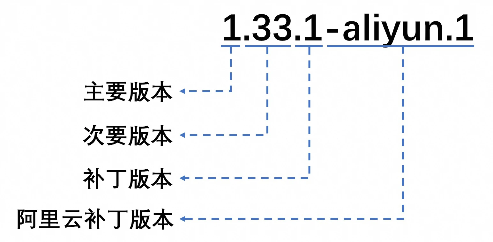

- 如上图所示，ACK Kubernetes版本的表达方式为 `x.y.z-aliyun.n` 。

- `x.y.z` 表示社区Kubernetes版本。其中， `x` 表示主要版本（Major version）， `y` 表示次要版本（Minor version）， `z` 表示补丁版本（Patch version）。

- `n` 表示阿里云补丁版本（ACK patch version）。

<a id="section-1-1-2"></a>

### 1.1.2. 发布Kubernetes 1.36版本说明

ACK 严格遵循 Kubernetes 社区一致性认证。本文介绍 ACK 的 Kubernetes 1.36 版本主要变更，包括升级注意事项、组件版本、重大变化、功能变更与弃用说明。

**组件版本说明**

下表为 ACK 集群核心组件版本的支持情况。

<table>
  <tr>
    <th>核心组件</th>
    <th>版本号</th>
  </tr>
  <tr>
    <td>Kubernetes</td>
    <td>1.36.2-aliyun.1</td>
  </tr>
  <tr>
    <td>etcd</td>
    <td>v3.6.10</td>
  </tr>
  <tr>
    <td>containerd</td>
    <td>2.1.6</td>
  </tr>
  <tr>
    <td>CoreDNS</td>
    <td>v1.12.1.3</td>
  </tr>
  <tr>
    <td>CSI</td>
    <td>升级至组件当前支持的最新版本。</td>
  </tr>
  <tr>
    <td rowspan="2">CNI</td>
    <td>Flannel v0.28.0.6</td>
  </tr>
  <tr>
    <td>Terway 和 TerwayControlplane v1.15.0 及以上</td>
  </tr>
</table>

**重大变化**

- 自 1.36 版本起，Service 的  `.spec.externalIPs`  字段被标记为弃用，并计划在 1.43 版本中完全移除。多年来，该字段一直是一个已知的安全隐患，会导致集群流量遭受中间人攻击，相关漏洞已记录在 修复漏洞CVE-2020-8554公告 中。如果目前正在使用该字段，请尽快迁移。

- 新建1.36版本集群中，Gateway API组件默认安装版本从1.3.0变更至1.5.1。由于Gateway API 在1.5.1版本中弃用了v1alpha2版本的TLSRoute API，会导致1.25及以下版本的服务网格ASM实例和1.29.2以下版本的Istio无法正常工作。

  已有集群升级到1.36版本时，Gateway API不会自动升级。请参见管理组件，手动升级组件版本。

**功能变更**

- VolumeGroupSnapshot 特性进入稳定阶段（GA），允许同时跨多个 PersistentVolumeClaims 创建一致性快照，减少因异步快照导致的数据不一致风险。

- Mutable CSINode allocatable 特性进入稳定阶段，CSI 驱动可动态更新节点可挂载卷数量，避免因卷挂载上限信息过时而导致调度不准或挂载失败。

- 动态资源分配（DRA）关键特性进入稳定版本，包括 DRA admin access 和 prioritized lists，为硬件资源的全局管理与一致、可预测的资源选择逻辑提供长期稳定的API 基础。此外，部分备受期待的功能已升级至 Beta 版，详见 Kubernetes 1.36 DRA Updates。

- MutatingAdmissionPolicies 进入稳定阶段，管理员可直接在 API Server 中使用 CEL 定义资源变更规则，为诸多场景提供替代传统 Admission Webhook 的原生方案，降低网络与运维开销，带来更可预测的集群行为。

- UserNamespacesSupport 特性进入稳定阶段，Pod 使用 Linux 用户命名空间增强安全性的能力默认启用。该能力不影响现有 Pod，可手动指定  `pod.spec.hostUsers`  来选择是否使用此特性。

- KubeletPSI 升级至 Beta，允许 kubelet 通过 Summary API 和 Prometheus 指标获取 Pressure Stall Information (PSI) 指标。

- 新增 Staleness mitigation for controllers 功能，该改进可减少控制器因本地缓存过期、基于旧集群状态执行调谐所导致的错误操作、冲突更新或数据损坏。

- StrictIPCIDRValidation 功能升级至 Beta，加强对 API 中 IP 和 CIDR 字段的校验，可更早发现格式错误的地址和网段配置，避免 Service、Pod、NetworkPolicy 等资源因无效 IP 或 CIDR 引发隐蔽配置问题或安全风险。

- MutablePodResourcesForSuspendedJobs 升级至 Beta 并默认启用，允许在 Job 被挂起（suspended）时，修改其容器的 CPU、内存、GPU 以及扩展资源的requests 和 limits。

- ConstrainedImpersonation 升级至 Beta，使用户身份模拟（impersonation）机制更符合最小权限原则。启用后，模拟者不仅需要具备"模拟某个身份"的权限，还必须同时具备"以该身份执行具体操作"的权限。

- ComponentStatusz 升级至 Beta 并默认启用，为核心 Kubernetes 组件提供  `/statusz`  端点，实时展示组件的构建和版本信息（启动时间、运行时长、Go 版本、二进制版本、兼容性版本等），便于运维和开发人员快速了解当前运行状态。

- ComponentFlagz 升级至 Beta 并默认启用，为核心 Kubernetes 组件统一提供  `/flagz`  端点，展示组件启动时实际生效的命令行参数，便于运维和开发人员排查配置问题或验证参数变更是否已在重启后生效。

**弃用说明**

- 自 1.36 版本起，Service 的  `.spec.externalIPs`  字段被标记为弃用，并计划在 1.43 版本中完全移除。如果目前正在使用该字段，请尽快迁移。

- 自 1.36 版本起，gitrepo volume 插件已永久禁用。建议使用 init 容器或外部 git-sync 工具等替代方案。

**参考链接**

- Kubernetes 1.36 的完整变更记录，请参见 CHANGELOG-1.36、Kubernetes v1.36: ハル (Haru)。

<a id="section-1-1-3"></a>

### 1.1.3. 发布Kubernetes 1.34版本说明

阿里云容器服务 Kubernetes 版严格遵循社区一致性认证。本文介绍ACK发布Kubernetes 1.34版本的主要变更说明，包括升级注意事项、重大变更、功能特性等。

**组件版本说明**

下表为ACK集群核心组件版本的支持情况：

<table>
  <tr>
    <th>核心组件</th>
    <th>版本号</th>
  </tr>
  <tr>
    <td>Kubernetes</td>
    <td>1.34.1-aliyun.1</td>
  </tr>
  <tr>
    <td>etcd</td>
    <td>v3.5.21</td>
  </tr>
  <tr>
    <td>containerd</td>
    <td>2.1.3</td>
  </tr>
  <tr>
    <td>CoreDNS</td>
    <td>v1.12.1.1-4035d7a99-aliyun</td>
  </tr>
  <tr>
    <td>CSI</td>
    <td>升级至组件当前支持的最新版本。</td>
  </tr>
  <tr>
    <td rowspan="2">CNI</td>
    <td>Flannel v0.15.1.23-33d25c1-aliyun</td>
  </tr>
  <tr>
    <td>Terway和TerwayControlplane为v1.15.0及以上。</td>
  </tr>
</table>

**重大变化**

- 自 1.34 版本起，创建集群时选择使用Terway网络插件且勾选DataPath V2（通过 eBPF 加速共享 ENI 模式的网络访问）时，Terway运行的节点上将不再运行kube-proxy容器。

  此变更仅对新建集群生效。

- 自 1.34 版本起，在ACK托管集群Pro版中创建和管理节点池时，默认启用  `serverTLSBootstrap`  参数及  `RotateKubeletServerCertificate`  特性门控。

  启用该配置后，节点池中各节点的 kubelet 服务端证书支持自动轮转，同时支持使用集群 CA 验证 kubelet 服务端证书，帮助提升集群节点安全能力。

- 自 1.34 版本起，kubelet 服务端将不再支持 `TLS_RSA_WITH_AES_256_GCM_SHA384` 和 `TLS_RSA_WITH_AES_128_GCM_SHA256` TLS加密套件。存量集群升级至1.34后，新建的节点将自动应用此变更。

- 从 1.34 版本起，不再支持在节点注册时将其标记为  `unschedulable` ，节点池配置设置为不可调度也不再生效。详情请参见kubelet: remove --register-schedulable flag #122384。

  建议使用节点污点 （Taints）作为替代方案，避免 Pod 调度到新注册的节点上。配置污点时，请勿使用 `node.kubernetes.io/unschedulable` 作为Key。

**功能变更**

- 动态资源分配Dynamic Resource Allocation（DRA）的核心功能进阶至GA，默认启用。基于DRA，工作负载可以通过指定所需的设备属性来请求资源。调度器负责完成实际的设备分配，并将 Pod 放置在可以访问所分配设备的节点上。随后，由设备驱动程序和 kubelet 负责完成设备配置以及 Pod 访问设备的权限授予。

  还有部分DRA相关特性进阶至Beta，默认启用。这包括：支持管理员使用有效权限访问他人已在使用的设备以进行监控和诊断；支持在请求时配置一个可选的、满足需求的设备分配方案列表；以及 kubelet 会监控并上报节点上 Pod 已分配的 DRA 资源情况。

- kubelet支持使用短期凭证向容器镜像仓库进行身份验证，避免使用长期凭证的潜在风险，提高安全性。详情请参见Service Account Token Integration for Image Pulls Graduates to Beta。

- Job 的 Pod 替换策略进阶至GA，旨在优化 Pod 的替换时机。默认情况下，替换 Pod 在旧 Pod 开始终止时便会立即创建，可能导致资源冲突。通过配置  `.spec.podReplacementPolicy`  字段，可以将替换行为延迟至旧 Pod 完全终止之后，从而避免因资源竞争或不必要的节点扩容而产生问题。

- `RecoverVolumeExpansionFailure` 进阶至GA。当因在 PVC 中请求的卷扩展容量过大而导致失败时，允许通过调小 PVC 的容量请求来实现恢复。

- Volume Attributes Classes进阶至GA，默认启用。允许将卷的通用参数定义在  `VolumeAttributesClass`  对象中。PVC 只需引用该对象即可应用这些参数。

- 当Static Pod 所引用的 Secret、ConfigMap、PVC 或 ServiceAccount 等 API 对象不存在时，kubelet 会拒绝启动其容器，防止 Pod 因缺少必要的依赖而进入不确定的运行状态。

- 优化kube-apiserver的稳定性和性能：

  - 从缓存完成读请求，减少透传etcd，降低kube-apiserver内存压力。1.31支持一致性读请求Consistent Reads from Cache，1.34支持快照缓存历史版本数据Snapshottable API server cache。

  - 针对  `LIST`  请求，支持以流式方式返回数据，使得服务端在处理请求时仅需占用恒定的较小内存，有效避免了因客户端拉取大量数据而导致的服务端内存激增问题。详情请参见Streaming Encoding for LIST Responses。

**功能特性**

- PodLevelResources进阶至Beta。与传统的容器级资源定义不同，该特性允许在 Pod 级别设置总的资源请求与限制，以确保 Pod 内所有容器的资源消耗不会超过 Pod自身限制。详情请参见Pod Level Resource Specifications。

  > **说明**
  >
  > 暂不支持 Windows 节点。

- kubectl 默认支持通过  `.kuberc`  文件定义用户偏好设置。与包含认证凭证的  `kubeconfig`  不同，该文件专门用于存放非敏感的客户端配置。详情请参见Introduce kuberc。

- `ExternalServiceAccountTokenSigner` 进阶至Beta。该特性引入一个外部签名的 `ExternalJWTSigner`  gRPC服务，通过外部密钥管理解决方案来为ServiceAccount令牌签名，从而代替本地静态密钥签名方式。

- `SchedulerAsyncAPICalls` 进阶至Beta，默认启用kube-scheduler异步调用API功能。

  此特性旨在解决 kube-scheduler 在调度周期中因阻塞式 API 调用而产生的性能瓶颈。通过将这些调用改为异步处理，可有效降低调度延迟，防止调度器线程因 API 响应缓慢而被阻塞，并为不可调度 Pod 提供更快的重试机会。详情请参见Asynchronous API calls during scheduling。

- `WindowsGracefulNodeShutdown` 进阶至Beta，支持Windows节点优雅关闭。

- PreferSameTrafficDistribution进阶至Beta。允许通过设置 Service 的  `.spec.trafficDistribution`  字段为  `PreferSameZone`  或  `PreferSameNode` ，来优先将流量路由至同一可用区或同一节点内的端点。相应的，原有的  `PreferClose`  选项已被废弃。详情请参见Traffic Distribution。

- kubeletPSI进阶至Beta，允许kubelet在Summary API 和 Prometheus 指标中使用Pressure Stall Information (PSI) 指标。详情请参见PSI Metrics for Kubernetes Graduates to Beta。

- CPU管理器的静态策略支持 `prefer-align-cpus-by-uncorecache` ，优化运行在具有分离的非核心缓存架构处理器上的工作负载性能。详情请参见Introducing CPU Manager Static Policy Option for Uncore Cache Alignment。

**参考链接**

关于Kubernetes 1.34完整的变更记录，请参见CHANGELOG-1.34、Kubernetes v1.34: Of Wind & Will (O' WaW)。

<a id="section-1-1-4"></a>

### 1.1.4. 发布Kubernetes 1.32版本说明

阿里云容器服务 Kubernetes 版严格遵循社区一致性认证。本文介绍ACK发布Kubernetes 1.32版本以及Kubernetes 1.31的主要变更说明，包括升级注意事项、重大变更、功能特性、弃用功能和API、特性门控等。

**Kubernetes 1.32版本说明**

**组件版本说明**

下表为ACK集群核心组件版本的支持情况。

<table>
  <tr>
    <th>核心组件</th>
    <th>版本号</th>
  </tr>
  <tr>
    <td>Kubernetes</td>
    <td>1.32.1-aliyun.1、1.32.7-aliyun.1</td>
  </tr>
  <tr>
    <td>etcd</td>
    <td>v3.5.15</td>
  </tr>
  <tr>
    <td>containerd</td>
    <td>1.6.36</td>
  </tr>
  <tr>
    <td>CoreDNS</td>
    <td>v1.11.3.2-f57ea7ed6-aliyun</td>
  </tr>
  <tr>
    <td>CSI</td>
    <td>升级至组件当前支持的最新版本。</td>
  </tr>
  <tr>
    <td rowspan="2">CNI</td>
    <td>Flannel v0.15.1.22-20a397e6-aliyun</td>
  </tr>
  <tr>
    <td>Terway和TerwayControlplane为v1.10.0及以上</td>
  </tr>
</table>

**功能变更**

- 自1.32版本起，通过OpenAPI接口CreateCluster创建ACK集群时，集群kube-proxy的Proxy Mode（服务转发模式）默认模式由iptables切换为IPVS。该变更只影响新建集群，存量集群升级至1.32后不会切换kube-proxy的Proxy Mode。

- 自1.32版本起，kube-apiserver将不再支持 `TLS_RSA_WITH_AES_256_GCM_SHA384` 和 `TLS_RSA_WITH_AES_128_GCM_SHA256` TLS加密套件。存量集群升级至1.32后将自动应用此变更。

- 自1.32版本起，启用RRSA特性时，将不再修改 kube-apiserver的 `--api-audiences` 参数配置，继续沿用启用前的配置值。该变更只影响未启用RRSA特性的集群，已启用RRSA特性的存量集群升级至1.32后不会应用此变更。

- 自1.32版本起，NVIDIA Device Plugin组件可通过控制台进行管理<strong>，</strong>部署方式将从Static Pod切换为DaemonSet。

- ServiceAccount的Annotation `kubernetes.io/enforce-mountable-secrets` 在1.32移除。建议使用独立的命名空间来隔离对Secret的访问。

- DRAControlPlaneController特性门控自1.26进阶至Alpha，默认关闭，在1.32移除。如果开启了此特性并使用了该功能，请在集群升级前删除相关资源，避免升级后工作负载出现异常。详细信息，请参见#128003。

- 在1.32.7-aliyun.1中修复了漏洞CVE-2025-5187、漏洞CVE-2025-4563。

**功能特性**

- WatchList特性门控进阶至Beta，默认启用。通常大量List操作会导致控制面资源消耗显著增加，启用WatchListClient特性后，client-go客户端可以使用流式请求代替全量List，降低控制面资源消耗。kube-controller-manager组件默认启用该功能。更多信息，请参见Enhancing Kubernetes API Server Efficiency with API Streaming。

- RelaxedEnvironmentVariableValidation特性门控进阶至Beta，默认开启。该特性放宽了对环境变量名称的验证规则，支持几乎所有的可打印ASCII字符（不包括=）作为环境变量名称。

- 优化Pod状态显示信息。当镜像拉取失败后，Pod的 `status.containerStatuses[*].state.waiting` 字段会记录镜像拉取失败的原因（ `ImagePullBackOff` ）和具体失败信息。

- CustomResourceFieldSelectors特性门控在1.32进入GA，默认启用。该特性支持在CustomResourceDefinition（CRD）中启用 `selectableFields` ，包括list、watch和deletecollection，以更加高效、更精确地过滤CRD资源。

- StatefulSetAutoDeletePVC特性门控在1.32进入GA，默认启用。该特性提供对StatefulSet中PVC删除的精细控制，允许在StatefulSet明确不需要PVC时自动清理PVC，降低孤立PVC对StatefulSet的影响。更新StatefulSet和节点维护过程中不对PVC产生影响，不触发自动清理。

- JobManagedBy特性门控进阶至Beta，默认启用。该特性允许通过配置 `spec.managedBy` 字段将Job交由外部控制器来接管Job的调谐（Reconciliation）工作，使得Job调度和管理更加灵活。

  `managedBy` 字段不可配置为 `kubernetes.io/job-controller` ，即Kubernetes内置的控制器保留值。

- 调度器的每个插件都集成QueueingHint回调函数，方便调度器获取Pod重新入队的建议，快速判断Pod是否需要重新入队，以减少不必要的调度重试，从而提升调度吞吐量。更多信息，请参见QueueingHint Brings a New Possibility to Optimize Pod Scheduling。

- RecoverVolumeExpansionFailure特性门控进阶至Beta，默认启用。PVC扩容失败时通常需要管理员介入手动恢复，恢复操作繁琐。该特性允许用户直接手动调小PVC的 `.spec.resources` ，有助于PVC快速恢复且数据不丢失。具体方式，请参见Recovering from Failure when Expanding Volumes。

- AuthorizeWithSelectors和AuthorizeNodeWithSelectors特性门控进阶至Beta，后者需要搭配前者使用。启用后，AuthorizeNodeWithSelectors允许节点鉴权器使用更细粒度的选择算符（例如 `fieldSelector` 和 `labelSelector` ）进行鉴权，提高了Kubernetes授权系统的灵活性。kubelet仅有最小权限，只能读取自己的节点对象和绑定到自己节点的Pod。更多信息，请参见Using Node Authorization。

- 客户端请求Pod日志的参数PodLogOptions添加 `Stream` 字段，允许流式请求容器日志。这意味着日志可以实时传输给客户端，无需等待整个日志文件下载完成。但需注意， `Stream` 和 `TailLines` 不可共用。

- 优化JobController，极大提升Job的更新和删除效率，尤其是在大量使用Job的场景下。更多信息，请参见#126567、#127228和#127378。

- 优化kube-proxy，Service更新时使用 `fieldSelector: clusterIP!=None` ，以避免监听Headless Service，减少不必要的带宽占用。更多信息，请参见#126769。

**弃用API**

- `flowcontrol.apiserver.k8s.io/v1beta3` 版本的FlowSchema和PriorityLevelConfiguration在1.32版本中废弃。推荐迁移至 `flowcontrol.apiserver.k8s.io/v1` API版本（自1.29起可用）。

  `flowcontrol.apiserver.k8s.io/v1` 版本中PriorityLevelConfiguration的 `spec.limited.nominalConcurrencyShares` 字段在未指定时默认为30（如显式配置为 `0` ，则不会被更改为 `30` ）。

**Kubernetes 1.31版本说明**

**组件版本说明**

下表为ACK集群核心组件版本的支持情况。

<table>
  <tr>
    <th>核心组件</th>
    <th>版本号</th>
  </tr>
  <tr>
    <td>Kubernetes</td>
    <td>1.31.9-aliyun.1、1.31.1-aliyun.1</td>
  </tr>
  <tr>
    <td>etcd</td>
    <td>v3.5.15</td>
  </tr>
  <tr>
    <td>containerd</td>
    <td>1.6.34</td>
  </tr>
  <tr>
    <td>CoreDNS</td>
    <td>v1.11.3.2-f57ea7ed6-aliyun</td>
  </tr>
  <tr>
    <td>CSI</td>
    <td>升级至组件当前支持的最新版本。</td>
  </tr>
  <tr>
    <td rowspan="2">CNI</td>
    <td>Flannel v0.15.1.22-20a397e6-aliyun</td>
  </tr>
  <tr>
    <td>Terway和TerwayControlplane为v1.10.0及以上<br>说明自此版本开始，在ACK托管集群中选择网络插件为Terway时，会默认<strong>开启集群的Trunk ENI功能</strong>。</td>
  </tr>
</table>

**功能特性**

- 在CustomResourceDefinition（CRD）中指定 `caBundle` 字段时，如果 `caBundle` 非空，但内容无效或不包含任何CA证书，那么该CRD将不会提供服务。CRD的 `caBundle` 设置为有效状态后，将不再允许通过更新操作将其变为无效或内容为空的状态，以避免中断CRD的正常服务。

- MatchLabelKeysInPodAffinity特性门控进阶至Beta，默认开启。 `podAffinity` 和 `podAntiAffinity` 默认支持更为精细的配置字段matchLabelKeys和mismatchLabelKeys，以解决调度器在Deployment滚动更新期间无法区分新老Pod，继而导致调度结果不符合亲和性和反亲和性预期的问题。

- JobSuccessPolicy进阶至Beta，默认启用，允许为Indexed Job配置成功策略。更多信息，请参见Job Success Policy。

- DisableNodeKubeProxyVersion进阶至Beta，默认启用，将不会在节点的  `status.nodeInfo.kubeProxyVersion` 字段中显示kube-proxy版本。该字段所显示的值并不准确，无法正确提供kube-proxy的实际版本信息。

- ServiceAccountTokenNodeBinding进阶至Beta，默认启用，允许创建一个直接绑定到节点的ServiceAccount Token。当Token过期或者关联的节点或ServiceAccount被删除时，Token将失效。

- RecursiveReadOnlyMounts进阶至Beta，默认启用，允许在Pod的卷挂载上设置递归的只读属性，即以此种方式挂载的卷及其内部的所有子目录和文件都将被设置为只读状态。更多信息，请参见Recursive read-only mounts。

- 当Pod  `spec` 发生改变，但不涉及 `image` 字段的改动时，kubelet将不会重启容器，避免因非功能性配置更新而引起的不必要的Pod重启。

- HonorPVReclaimPolicy进阶至Beta，默认启用，支持在PersistentVolume上添加Finalizer，以确保仅在删除对应的底层存储资源后才删除具有 `Delete` 回收策略的PersistentVolume。更多信息，请参见PersistentVolume deletion protection finalizer。

- `kubectl debug` 支持配置自定义模板（Profile）调试Pod的信息。更多信息，请参见Kubernetes 1.31: Custom Profiling in Kubectl Debug Graduates to Beta。

- Kubernetes客户端（例如  `kubectl` ）中用于 `kubectl cp` 、 `kubectl attach` 、 `kubectl exec`  和  `kubectl port-forward` 命令的流式传输协议更新为更现代、更灵活的WebSocket流式传输协议。

- API Server提供从缓存中实现一致性读的能力，减少将请求透传到etcd，提升了List请求的效率。更多信息，请参见Consistent Reads from Cache。

**功能变更**

- 内置的CephFS卷插件（ `kubernetes.io/cephfs` ）被移除，使用CephFS CSI驱动代替。

  如果您正在使用CephFS卷插件，请在集群升级到1.31改用新方案，并使用新的驱动重新部署应用。

- 内置CephRBD卷插件（ `kubernetes.io/rbd` ）被移除，使用RBD CSI驱动代替。

  如果您正在使用CephRBD卷插件，请在集群升级到1.31改用新方案，并使用新的驱动重新部署应用。

- CSIMigrationPortworx特性门控默认启用，支持将卷操作从旧的Portworx内嵌插件迁移到Portworx CSI插件。如果您正在使用Portworx作为存储解决方案，请在集群升级到1.31前在集群中安装并配置Portworx CSI插件。

- 在1.31.9-aliyun.1中修复了漏洞CVE-2025-0426和漏洞CVE-2024-9042。

**参考链接**

- 关于Kubernetes 1.32完整的变更记录，请参见CHANGELOG-1.32、Kubernetes v1.32: Penelope。

- 关于Kubernetes 1.31完整的变更记录，请参见CHANGELOG-1.31、Kubernetes v1.31: Elli。

<a id="section-1-1-5"></a>

### 1.1.5. 发布Kubernetes 1.30版本说明

阿里云容器服务 Kubernetes 版严格遵循社区一致性认证。本文介绍ACK发布Kubernetes 1.30版本的主要变更说明，包括升级注意事项、重大变更、功能特性、弃用功能和API、特性门控等。

**组件版本说明**

下表为ACK集群核心组件版本的支持情况。

<table>
  <tr>
    <th>核心组件</th>
    <th>版本号</th>
  </tr>
  <tr>
    <td>Kubernetes</td>
    <td>1.30.7-aliyun.1、1.30.1-aliyun.1</td>
  </tr>
  <tr>
    <td>etcd</td>
    <td>v3.5.9</td>
  </tr>
  <tr>
    <td>containerd</td>
    <td>1.6.28</td>
  </tr>
  <tr>
    <td>CoreDNS</td>
    <td>v1.11.3.2-f57ea7ed6-aliyun</td>
  </tr>
  <tr>
    <td>CSI</td>
    <td>升级至组件当前支持的最新版本。</td>
  </tr>
  <tr>
    <td rowspan="2">CNI</td>
    <td>Flannel v0.15.1.23-33d25c1-aliyun</td>
  </tr>
  <tr>
    <td>Terway和TerwayControlplane为v1.9.0及以上<br>说明自1.30起，新建集群并选择Terway NetworkPolicy时，NetworkPolicy的实现由eBPF提供。升级集群、升级组件均不会改变已有行为。</td>
  </tr>
</table>

**升级注意事项**

| 类别 | 注意事项 | 解决方案 |
| --- | --- | --- |
| 操作系统（OS） | 不再支持使用CentOS和Alibaba Cloud Linux 2作为节点池操作系统。 | 您可以通过升级节点池的方式更换节点池的操作系统。具体操作及相关注意事项，请参见升级节点池。推荐您使用阿里云官方操作系统ContainerOS以及Alibaba Cloud Linux 3。 |
| kube-proxy组件 | 在v1.29之后的版本中，kube-proxy更新了conntrack_max值的配置方式，会基于kube-proxy的配置和节点的CPU Core数量来计算和更新节点的conntrack_max值。在v1.23～1.28中，kube-proxy不会覆盖集群管理员手动设定的conntrack值。升级至v1.29后，kube-proxy可能会基于其新逻辑自动调低conntrack值。更多信息，请参见#120448。 | 如果曾自定义修改过conntrack值，请在升级前将<code> nf_conntrack_max </code>等配置设置到kube-proxy的ConfigMap中，以避免被覆盖。如果需要检查是否修改过sysctl值，可启用集群巡检功能进行检查。更多信息，请参见使用集群巡检。 |

**功能特性**

在1.30.7-aliyun.1版本修复了CVE-2024-10220漏洞。

**在Kubernetes 1.29版本**

- PreStop Hook新增一种休眠（Sleep）模式，允许在容器实际被终止前暂停一段指定的时间，以等待尚未完成的处理或者网络请求。更多信息，请参见KEP-3960: Introducing Sleep Action for PreStop Hook。

- SidecarContainers进入Beta，默认启用。此功能允许将init容器的 `restartPolicy` 设置为 `Always` ，使之成为一个Sidecar容器，支持独立启动、停止或重启，且不会影响主应用容器和其他Init容器。更多信息，请参见Sidecar Containers。

- 新增ServiceCIDR资源类型，允许动态配置集群中Service ClusterIP地址的分配范围。该特性处于Alpha阶段，默认禁用。关于允许动态扩展Service可用IP数量的更多信息，请参见KEP-1880: Multiple Service CIDRs。

- PVC (Persistent Volume Claim) 和Container的API使用相同的ResourceRequirements结构体来定义资源 `requests` 和 `limits` 。这导致当Container的 `resources` 结构发生变化时，例如新增了 `claims` 字段，会导致PVC的API也随之改变。因此，PVC改用独立的VolumeResourceRequirements结构体，其中仅包含 `requests` 和 `limits` ，不包含 `claims` 。更多信息，请参见Volume resource requirements。

- `PodReadyToStartContainers` 特性进入Beta，默认启用。此特性表示Pod的沙盒（Sandbox）环境已经成功创建（容器运行时环境已就绪），且网络配置已完成，便于kubelet了解Pod状态。更多信息，请参见Pod conditions。

- PodAffinity和PodAntiAffinity新增支持matchLabelKeys和mismatchLabelKeys，以解决调度器在Deployment滚动更新期间无法区分新老Pod，继而导致调度结果不符合亲和性和反亲和性预期的问题。配置PodAffinity的matchLabelKeys时，Deployment会为ReplicaSet添加 `pod-template-hash` 标签，让Deployment的每个Pod都带有相应的哈希字符串，来告知调度器仅对带有相同 `pod-template-hash` 值的Pod进行评估，便于区分同一批次更新的Pod。更多信息，请参见KEP-3633。

- 除核心Kubernetes API资源外，ValidatingAdmissionPolicy类型检查新增支持CRD和API Extension类型，有助于确保策略的可靠性和集群配置的正确性。更多信息，请参见type-checking。

- 新增UserNamespacesPodSecurityStandards特性门控，支持将用户命名空间（User Namespace）集成到Pod安全标准中。当此特性门控开启时，支持在Pod的安全上下文中以非root用户或指定用户身份运行容器。该特性门控当前为Alpha阶段，默认为false，未来可能会一直处于false状态。更多信息，请参见KEP-127: Update PSS based on feature gate。

- 针对节点对象，新增DisableNodeKubeProxyVersion特性门控，弃用 `status.nodeInfo.kubeProxyVersion` 字段，即在Kubernetes中禁用设置Node端的 `kubeProxyVersion` 字段。kubelet并不一定能够准确识别kube-proxy的版本，该字段不一定准确。此特性门控当前为Alpha阶段，默认为false。

- JobBackoffLimitPerIndex特性门控进入Beta，默认为true。此特性门控允许在索引作业（Indexed Job）中指定每个索引（Index）的最大重试次数。关于索引作业的更多信息，请参见使用索引作业完成静态工作分配下的并行处理。

**在Kubernetes 1.30版本**

- ImageMaximumGCAge允许kubelet配置对未使用镜像被垃圾回收前的最大存活时间，即在达到指定时间后若镜像仍然未被使用，那么镜像将可被垃圾收集机制清理。默认值为 `"0s"` ，即不设置时间限制。该特性门控在v1.29进入Alpha，v1.30进阶至Beta。

- kubelet新增监控指标 `image_pull_duration_seconds` ，用于跟踪镜像拉取时间。更多信息，请参见Alpha阶段的Kubernetes指标清单。

- LegacyServiceAccountTokenCleanUp特性门控进阶至GA，默认启用。如果ServiceAccount关联的自动生成的Secret在特定时间内（默认为一年）未被使用，且没有被任何Pod挂载，kube-controller-manager将向Secret添加 `kubernetes.io/legacy-token-invalid-since` 标签，值为当前日期，标记Secret为无效。如果Secret自标记为无效开始，在特定时间（默认为一年）依旧未被使用，将会被kube-controller-manager自动清理。对于被打上失效标签但未被自动移除的Secret，可以通过移除 `kubernetes.io/legacy-token-invalid-since` 标签使其重新生效。更多信息，请参见Auto-generated legacy ServiceAccount token clean up和Legacy ServiceAccount token cleaner。

- 在v1.30中，在kube-proxy的 `--nodeport-addresses` 未设置的情况下（默认未设置），NodePort类型的Service更新将仅更新节点的主要IP（Primary Node IP），而非节点的所有IP。更多信息，请参见#122724。

- 为了防止配置冲突和安全问题，OIDC Issuer URL不允许和API Server ServiceAccount Issuer URL配置相同的参数。更多信息，请参见#123561。

- LoadBalancerIPMode特性门控允许为类型为LoadBalancer的Service新增 `.status.loadBalancer.ingress.ipMode` 字段，用于指定负载均衡器IP的转发行为。该字段仅在指定了 `.status.loadBalancer.ingress.ip` 字段时才能被指定。LoadBalancerIPMode特性门控进入Beta。更多信息，请参见Specifying IPMode of load balancer status和Load Balancer IP Mode for Services。

- 基于ContainerResource指标的Pod水平自动扩缩容（HorizontalPodAutoscaler，HPA）在v1.30中升级为Stable。这一新行为允许HPA根据Pod中各个容器的资源使用情况来配置自动伸缩，而不仅是Pod的整体资源使用情况，便于为在Pod中最重要的容器配置扩缩容阈值。更多信息，请参见Container resource metrics。

- AdmissionWebhookMatchConditions特性门控进阶至GA，默认启用，不可禁用。此特性门控允许对准入Webhook支持根据特定的条件进行匹配，更细粒度地控制Webhook的触发条件。更多信息，请参见Dynamic Admission Control。

- 新增JobSuccessPolicy特性门控，允许基于一组成功的Pod来声明这组Pod所属的Job已经成功完成。成功策略中可以指定某些索引（例如索引Pod x、y、z），或索引数量（例如一组索引中的3个Pod），来声明Job是否成功完成。该特性门控处于Alpha阶段。更多信息，请参见Job success/completion policy。

- 新增RelaxedEnvironmentVariableValidation特性门控，允许在环境变量中使用绝大部分可打印的ASCII字符（范围为32至126的所有字符，除 `=` 外）。该特性门控处于Alpha阶段，默认禁用。更多信息，请参见#123385。

- 新增 `CustomResourceFieldSelectors` 特性门控，支持对CRD配置 `selectableFields` ，以便使用Field Selectors过滤List、Watch和DeleteCollection请求，更便于定位或管理符合特定条件的CRD资源。该特性门控处于Alpha阶段，默认禁用。更多信息，请参见Custom Resource Field Selectors。

- CRDValidationRatcheting特性门控带来了更新：当CRD添加新的验证时，即使因此导致存量资源在更新后无效，但只要未通过验证的部分并没有更新，API Server便不会拦截资源的更新，不影响现有的资源和用户。这有助于将CRD迁移使用OpenAPI v3 schemas时进行合法性检查，安全地更新新的验证规则。此特性门控进入Beta，默认启用。更多信息，请参见CRD Validation ratcheting。

- Downward API使用 `status.hostIPs` 字段支持双协议栈，即同时支持IPv4和IPv6。 `status.hostIPs` 的列表中的第一个IP地址始终与 `status.hostIP` 相同。更多信息，请参见Downward API。

- NodeLogQuery特性门控允许使用 `/logs` 端点查询节点服务的日志。该特性门控进阶至Beta，默认为false。更多信息，请参见日志查询。

**弃用功能**

**在Kubernetes 1.29版本**

- CronJob不支持在 `.spec.schedule` 配置 `CRON_TZ` 或者 `TZ` ，使用 `.spec.timeZone` 字段代替（该字段自v1.25可用）。更多信息，请参见CronJob的限制。

- 移除尚处于Alpha阶段且有争议的networking/v1alpha1 API ClusterCIDR。

**在Kubernetes 1.30版本**

- kubectl apply命令移除 `--prune-whitelist` 参数，建议使用 `--prune-allowlist` 代替。更多信息，请参见--prune。

- 准入插件SecurityContextDeny自v1.27开始弃用，在v1.30从代码中移除。建议使用PodSecurity准入插件代替，该插件自v1.25版本进入Stable，默认启用。更多信息，请参见PodSecurity。

**弃用API**

flowcontrol.apiserver.k8s.io/v1beta2 API版本的FlowSchema和PriorityLevelConfiguration在v1.29被废弃。建议使用flowcontrol.apiserver.k8s.io/v1 API版本（自v1.29开始可用），或 flowcontrol.apiserver.k8s.io/v1beta3 API版本（自v1.26起可用）。

- flowcontrol.apiserver.k8s.io/v1中的显著变更包括：

  PriorityLevelConfiguration的 `spec.limited.assuredConcurrencyShares` 字段已被重命名为  `spec.limited.nominalConcurrencyShares` ，仅在未指定时默认为30，并且显式值0不会更改为30。

- flowcontrol.apiserver.k8s.io/v1beta3中的显著变更包括：

  PriorityLevelConfiguration的 `spec.limited.assuredConcurrencyShares` 字段已被更名为  `spec.limited.nominalConcurrencyShares` 。

**特性门控**

关于Kubernetes支持的特性门控及特性门控的版本支持情况、功能介绍等，请参见Feature Gates。

特性门控一般有三个阶段：

- Alpha阶段：默认禁用。

- Beta阶段：通常默认启用。

- GA阶段：一直默认启用，且不能禁用，不再需要相应的特性门控。

<a id="section-1-1-6"></a>

### 1.1.6. 发布Kubernetes 1.28版本说明

阿里云容器服务 Kubernetes 版严格遵循社区一致性认证。本文介绍ACK发布Kubernetes 1.28版本的主要变更说明，包括升级注意事项、重大变更、功能特性、弃用功能和API、特性门控等。

**组件版本说明**

下表为ACK集群核心组件版本的支持情况。

<table>
  <tr>
    <th>核心组件</th>
    <th>版本号</th>
  </tr>
  <tr>
    <td>Kubernetes</td>
    <td>v1.28.3-aliyun.1</td>
  </tr>
  <tr>
    <td>etcd</td>
    <td>v3.5.9</td>
  </tr>
  <tr>
    <td>CoreDNS</td>
    <td>v1.9.3.10-7dfca203-aliyun</td>
  </tr>
  <tr>
    <td>CRI</td>
    <td>containerd 1.6.28</td>
  </tr>
  <tr>
    <td>CSI</td>
    <td>v1.28.2-52291d4-aliyun</td>
  </tr>
  <tr>
    <td rowspan="2">CNI</td>
    <td>Flannel v0.15.1.22-20a397e6-aliyun</td>
  </tr>
  <tr>
    <td>Terway和TerwayControlplane v1.6.2</td>
  </tr>
  <tr>
    <td>NVIDIA Container Runtime</td>
    <td>v3.13.0</td>
  </tr>
  <tr>
    <td>Ingress Controller</td>
    <td>v1.9.3-aliyun.2</td>
  </tr>
</table>

**升级注意事项**

| 组件 | 注意事项 |
| --- | --- |
| CephFS和Ceph RBD存储卷插件 | 如果集群使用了CephFS和RBD卷插件，需要检查是否已经不再依赖Kubernetes自身提供的插件驱动，改用树外驱动（Off-Tree Driver）并评估相关兼容性、稳定性或性能方面的风险。 |

**相关概念**

了解Kubernetes版本的功能变更和弃用资源前，您可能需要了解相关概念。

特性门控（Feature Gates）用于描述一个特性的多个阶段。一般有三个阶段：

- Alpha阶段：默认禁用。

- Beta阶段：通常默认启用。

- GA阶段：一直默认启用，且不能禁用，不再需要相应的特性门控。

**重大变更**

- 针对调度器，Kubernetes v1.28版本优化了调度逻辑，减少无效的重试，从而提高调度器的整体性能。

  如集群中使用了自定义调度器插件，建议对调度器插件进行改造和升级，以提升调度器性能。更多信息，请参见调度框架变化。

- 针对CSI迁移，Kubernetes社区一直推动将存储相关插件从源码中移除，改用实现了CSI标准接口的树外驱动，并已经于v1.25完成GA，于v1.27移除了API `storage.k8s.io/v1beta1` 和EBS存储插件，于v1.28移除了CephFS卷插件相关代码并废弃了 `kubernetes.io/rbd` ，转为使用CephFS CSI驱动。此外，v1.28不再支持将Ceph RBD卷迁移到树外CSI存储驱动插件。

**功能特性**

**在Kubernetes 1.27版本**

- 修正Pod终止状态，将处于Pending中被删除的Pod设置为Failed，将处于Running中被删除的Pod设置为Succeeded或者Failed（具体状态取决于容器退出状态）。此修正解决了当Pod配置了失败策略时删除Pod可能卡在Pending阶段的问题。

  但如果Pod配置了 `RestartPolicy=Always` ，Pod删除后可能会以Succeeded结束。您需要为此调整开发的控制器。更多信息，请参见给不需要重启的Pod设置终止状态。

- 持久卷的ReadWriteOncePod访问模式进入Beta，默认支持仅允许一个Pod写入存储卷。更多信息，请参见持久卷的单Pod访问模式升级到Beta。

- Pod拓扑分布约束控制Pod在集群内合理分布在多个可用区，有多个增强特性进入Beta，包括支持设定Pod最少分布在几个域（ `minDomains` ），支持调度时考虑污点（ `nodeTaintsPolicy` ）、亲和性（ `nodeAffinityPolicy` ），解决滚动更新时结果不符合约束（ `whenUnsatisfiable` ）的问题。更多信息，请参见更多精细粒度的Pod拓扑分布策略。

- 服务端字段校验对发送到API Server上的资源进行校验，功能进阶至GA。kubectl将跳过客户端校验，自动使用 `Strict` 模式下的服务端字段校验，并在验证失败时报错。更多信息，请参见服务器端字段校验和OpenAPI V3进阶至GAServer Side Field Validation and OpenAPI V3 move to GA。

- OpenAPI v3是OpenAPI的最新标准，Kubernetes在v1.23添加，在v1.27进入GA。更多信息，请参见服务器端字段校验和OpenAPI V3进阶至GAServer Side Field Validation and OpenAPI V3 move to GA。

- HPA允许给Pod里的容器配置ContainerResource，根据各个容器的资源使用量进行自动扩缩。该功能在v1.27进入Beta。与原有的Resource类型考虑Pod整体资源使用平均值相比，考虑每个容器使用量可以解决此问题：Pod存在多个容器时Sidecar容器使用率低而业务容器使用率高，平均计算后没有达到扩容阈值，最终无法扩容。

- StatefulSet多个特性进入Beta，包括支持Pod从非零数作为起始序号，支持指定删除和缩容时自动删除创建的PVC。

- 新增特性允许在不重启Pod和容器的情况下调整Pod容器中 `resources` 字段下的CPU和Memory。节点会基于 `requests` 为Pod分配资源，基于 `limits` 限制资源使用。Pod新增了部分字段支持该特性，请参见调整分配给容器的CPU和内存资源。该特性在v1.27处于Alpha阶段，默认关闭。

- kubelet支持修改 `serializeImagePulls` 为 `false` ，实现并发拉取镜像代替默认的串行拉取。v1.27新增maxParallelImagePulls字段，限制并发拉取的镜像数量，防止镜像拉取消耗过多的网络带宽或磁盘I/O。

- 针对持久卷快照能力，除了已经提供的Volume Snapshot API外，新增一致性快照Volume Group Snapshot能力，允许在同一时间点对多个卷生成快照，请参见介绍用于磁盘卷组快照的新API。

**在Kubernetes 1.28版本**

- 节点非体面关闭（Non-graceful node shutdown）进入GA。节点由于断电等故障导致非正常关闭时，有状态应用程序需要及时在正常运行的节点上重新启动，以免影响业务正常运行。

- NodeOutOfServiceVolumeDetach特性门控进入GA，允许异常节点上被终止的Pod立即进行卷分离操作，以支持Pod在其他节点上快速恢复。

- 可追溯的默认StorageClass赋值进入GA。此前，当未配置 `storageClassName` 的PVC先于默认StorageClass存在时，PVC将永远处于pending状态。更新后，默认的StorageClass出现后，未配置 `storageClassName` 的PVC会自动更新使用默认的StorageClass。

- 针对Job失效处理，引入2个新特性。

  - JobPodReplacementPolicy（Alpha特性门控）控制只有Pod达到Failed阶段 `status.phase: Failed` 才被替换，而不是有 `deletionTimestamp` 处于终止过程中，以避免出现2个Pod同时占用索引和节点资源。

  - JobBackoffLimitPerIndex （Alpha特性门控）通过配置 `.spec.backoffLimitPerIndex` 以限制Indexed Job一些索引的失败重试次数，避免单个索引持续失败达到 `.spec.backoffLimit` 限制而导致整体失败。

- Indexed Job如果设置超过10万完成数（ `completion` ）和超过1万并发度（ `parallelism` ），当大量Pod失败时，可能无法追踪Job的终止状态。因此，在创建Job时，如果参数设置过大，将提示警告信息。

- 在CRD校验规则中添加 `reason` 和 `fieldPath` 字段后，允许校验失败时返回指定原因和字段路径。更多信息，请参见CRD校验表达式语言。

- Webhook过滤请求新增支持CEL表达式，最多支持定义64个匹配条件。更多信息，请参见动态准入控制匹配条件。

- 新增SidecarContainers特性门控，支持Sidecar容器，优化容器启动顺序。例如，日志收集Sidecar容器可以在其他容器之前启动，以提高日志收集的可靠性。更多信息，请参加介绍原生Sidecar容器。该特性在v1.28处于Alpha阶段，默认关闭。

- PVC的 `.status.resizeStatus` 字段替换为 `.status.allocatedResourceStatus` Map结构字段，表示调整PVC大小时的状态。更多信息，请参见PersistentVolumeClaimStatus。

- Indexed Job类型和StatefulSet类型的Pod都在Label上添加了Pod索引（序号）。

- 验证准入策略（ValidatingAdmissionPolicy）（Beta阶段）提供声明式的方式验证资源请求，代替部署验证准入Webhook，并支持使用CEL表达式编写复杂的验证规则。API Server会验证资源请求是否符合CEL表达式，评估通过后才视为通过。

- Kube Controller Manager新增 `--concurrent-cron-job-syncs` 配置CronJob控制器的并发度，新增 `--concurrent-job-syncs` 配置Job控制器的并发度。更多信息，请参见--concurrent-cron-job-syncs、--concurrent-job-syncs。

- API Server优化包括：

  - 改进了在缓存上执行GetList时的内存消耗。更多信息，请参见GetList测试数据。

  - 修复仅剩一个API Server副本时Kubernetes Service的Endpoint没有摘除的问题，确保优雅终止时能够及时摘除Endpoint。

  - 将OpenAPI v2控制器设置为惰性聚合CRD信息，并且大幅减少OpenAPI v2规范。在没有客户端请求OpenAPI v2时，减少API Server的CPU和内存消耗，同时提升大量CRD安装时的性能（但客户端首次请求会变慢）。建议将客户端升级至支持使用OpenAPI v3。

  - 新增Consistent Reads from Cache特性门控，允许通过监视缓存（Watch cache）实现List一致性读取。

  - 丰富监控指标，支持通过访问metrics接口获取。

**弃用功能**

**在Kubernetes 1.27版本**

- 移除树内AWS EBS存储插件，转为外置的CSI插件。请参见cloud-provider-aws。

- 废弃Node `spec.externalID` 字段，字段更新请求将会收到警告信息。关于如何向客户端发送警告信息，请参见Helpful Warnings Ahead。

- Seccomp（安全计算模式）于v1.19进入GA，支持通过限制Pod或者单个容器可执行的系统调度来提高工作负载安全性。对Alpha阶段的 `seccomp.security.alpha.kubernetes.io/pod` 和 `container.seccomp.security.alpha.kubernetes.io` 注解自v1.19起被弃用，v1.27完全移除。

  建议使用Pod或容器 `securityContext.seccompProfile` 字段。

- KCM移除启动命令 `--pod-eviction-timeout` （删除失败节点的优雅期限）和 `--enable-taint-manager` （基于污点的驱逐能力，默认启用）。

- kubelet移除启动命令 `--container-runtime` 、 `--container-runtime-endpoint` 和 `--image-service-endpoint` 。其中， `--container-runtime` 在移除dockershim后，默认值保持为 `remote` ，自v1.24被弃用，在v1.27移除； `--container-runtime-endpoint` 和 `--image-service-endpoint` 不支持启动命令，改为使用配置文件代替启动命令的方式进行配置。

- 废弃SecurityContextDeny准入插件，并在未来版本中移除。

**在Kubernetes 1.28版本**

- CephFS卷插件代码已经从树内移除。

  建议使用CephFS CSI Driver代替。

- 废弃对Ceph RBD卷迁移到树外CSI存储驱动插件的支持，将在后续版本彻底移除。

  建议在移除树内代码前完成迁移。

- RBD卷插件（kubernetes.io/rbd）被废弃，将在后续版本移除。

  建议使用CephFS CSI驱动代替。

- KMSv1被废弃。如果还要兼容使用KMSv1，需设置 `--feature-gates=KMSv1=true` 。更多信息，请参见废弃KMSv1。

  建议使用KMSv2。

- KCM废弃启动命令 `--volume-host-cidr-denylist` 和 `--volume-host-allow-local-loopback` 。

- kubelet废弃 `--azure-container-registry-config` 。

  建议使用 `image-credential-provider-config` 和 `--image-credential-provider-bin-dir` 。

- 不再支持创建Windows节点池。

  您可以创建其他操作系统的节点池，例如Alibaba Cloud Linux 3、ContainerOS 3.1等。更多信息，请参见创建节点池。

**弃用API**

CSIStorageCapacity API可以暴露当前可用的存储容量，确保Pod调度到有足够存储容量的节点上。CSIStorageCapacity的 `storage.k8s.io/v1beta1` API版本在v1.24中被废弃，在v1.27中被移除。

建议使用 `storage.k8s.io/v1` ，该API自v1.24起可用。更多信息，请参见Storage Capacity Constraints for Pod Scheduling KEP。

**特性门控**

本小节仅列举部分主要变化，更多信息请参见Feature Gates。

**在Kubernetes 1.27版本**

- 新增 `NodeLogQuery` Alpha特性门控，kubelet配置 `enableSystemLogHandler` 和 `enableSystemLogQuery` 为 `true` 后可以使用kubectl查询节点日志。

- `StatefulSetStartOrdinal` 进入Beta。默认启用，允许设置StatefulSet的Pod序号从非零数开始。

- `StatefulSetAutoDeletePVC` 进入Beta。新的StatefulSet PVC保留策略用于控制是否以及何时删除从StatefulSet的 `volumeClaimTemplate` 创建的PVC。

- `IPv6DualStack` 自v1.23进入GA后默认启用，于v1.27彻底从各个组件代码中移除。

  如果集群中有手动配置，需删除该配置后才能升级集群。

- 新增 `ServiceNodePortStaticSubrange`  Alpha特性，降低NodePort端口分配冲突风险。该特性对端口范围进行划分，使得NodePort动态分配端口尽可能在数值较高的部分，并在冲突风险较低的端口段上使用静态分配。更多信息，请参见为NodePort Service分配端口时避免冲突。

- 新增 `InPlacePodVerticalScaling`  Alpha特性门控，允许调整Pod的CPU和内存资源时不发生Pod和容器重启。

- 允许扩展卷大小的特性已经GA，有三个相关特性门控将移除，并默认启用： `ExpandCSIVolumes` 启用CSI卷的扩展； `ExpandInUsePersistentVolumes` 启用扩展正使用的PV； `ExpandPersistentVolumes` 启用持久卷的扩展。

- `CSIMigration` 将树内存储插件移到树外CSI驱动程序，默认一直启用，移除该特性门控。

- `CSIInlineVolume` CSI内联卷在v1.25进入GA，默认一直启用，移除该特性门控。

- `EphemeralContainers` 临时容器在v1.25进入GA，默认一直启用，移除该特性门控。

- `LocalStorageCapacityIsolation` 支持 `emptyDir` 卷本地临时存储的容量隔离，可以硬限制Pod对本地存储资源消耗，超出限制的将被kubelet驱逐。该特性门控在v1.25进入GA，默认一直启用，移除该特性门控。

- `NetworkPolicyEndPort` 支持NetworkPolicy通过配置 `endPort` 字段指定一系列端口，代替此前仅支持配置一个端口。该特性在v1.25版本进入GA，默认一直启用，移除该特性门控。

- `StatefulSetMinReadySeconds` 支持StatefulSet配置 `minReadySeconds` ，在v1.25进入GA，默认一直启用，移除该特性门控。

- `DaemonSetUpdateSurge` 支持DaemonSet配置 `maxSurge` ，在v1.25进入GA，默认一直启用，移除该特性门控。

- `IdentifyPodOS` 支持为Pod指定操作系统，在v1.25进入GA，默认一直启用，移除该特性门控。

- `ReadWriteOncePod` 进入Beta，默认启用允许使用 `ReadWriteOncePod` 访问模式的PersistentVolume。

**在Kubernetes 1.28版本**

- `NodeOutOfServiceVolumeDetach` 使用 `node.kubernetes.io/out-of-service` 污点将节点标记为停止服务时，节点上不能容忍这个污点的Pod将被强制删除，并将立即进行卷分离操作。该特性门控在v1.28进入GA，默认一直启用。

- `AdmissionWebhookMatchCondition` 默认启用允许Webhook使用CEL表达式编写匹配条件。

- `UnknownVersionInteroperabilityProxy` 进入Alpha，支持在存在多个版本的API Server时将请求代理到正确的API Server。更多信息，请参见混合版本代理。

- `IPTablesOwnershipCleanup` 进入GA，不再创建KUBE-MARK-DROP和KUBE-MARK-MASQ iptables链。

- `ConsistentListFromCache` 进入Alpha，允许API Server通过监视缓存（Watch cache）实现List一致性读取。

- `ProbeTerminationGracePeriod` 进入GA，默认启用支持设置探针级别的terminationGracePeriodSeconds。

- 移除部分已经GA的特性门控，包括 `DelegateFSGroupToCSIDriver` 、 `DevicePlugins` 、 `KubeletCredentialProviders` 、 `MixedProtocolLBService` 、 `ServiceInternalTrafficPolicy` 、 `S`

<a id="section-1-1-7"></a>

### 1.1.7. 发布Kubernetes 1.26版本说明

**版本升级说明**

ACK针对Kubernetes 1.26版本提供组件的升级和优化。

**核心组件**

**版本号**

**升级注意事项**

- Kubernetes 1.26版本做了大量优化，升级前请仔细阅读版本解读。

- Kubernetes 1.25和Kubernetes 1.26版本弃用了大量Beta版本的API，在使用新版本集群之前，需要先检查与Beta版本API交互的控制器或应用是否已经改造升级成使用推荐版本API。关于废弃API信息，请参见废弃的API信息。

- Kubernetes 1.26版本，将不支持CRI v1alpha2，且容器运行时必须支持CRI v1，因此Kubernetes 1.26最低要求使用Containerd 1.6。升级集群时，需先将Containerd升级到

Kubernetes

1.26.3-aliyun.1

1.6.0及以上版本后，才能将节点升级到Kubernetes 1.26。

- Kubernetes在1.21版本中弃用PodSecurityPolicy，在Kubernetes 1.25版本中彻底移除。PodSecurityPolicy使用方式复杂，容易授权比预期更大的权限，存在严重的可用性问题。请参见版本解读使用新的方案代替PodSecurityPolicy。

- 1.26及以上版本的ACK集群不再默认开放kubelet容器监控只读端口（10255），统一使用鉴权安全端口（10250）。

无

etcd

v3.5.4

无

CoreDNS

1.9.3.10-7dfca203-aliyun

无

CSI

v1.28.2-52291d4-aliyun

无

Flannel v0.15.1.22-20a397e6-aliyun

CNI

Terway和TerwayControlplane v1.6.2

无

无

NVIDIA Container Runtime

v3.13.0

无

Ingress Controller

v1.9.3-aliyun.2

**版本解读**

**重大变化**

- Kubernetes 1.25和Kubernetes 1.26版本弃用了大量测试版本的API，在使用新版本集群之前，需要先检查与测试版本API交互的控制器或应用是否已经改造升级成使用正式版本API的控制器或应用。更多信息，请参见废弃的API信息。

- Kubernetes 1.26版本将不支持CRI v1alpha2，且要求容器运行时必须支持CRI v1，因此Kubernetes 1.26不支持Containerd 1.5及更早的版本，最低要求使用Containerd 1.6。升级集群时，需先将Containerd升级到1.6.0及以上版本后，才能将节点升级到Kubernetes 1.26。

- Kubernetes 1.21版本弃用了PodSecurityPolicy，在Kubernetes 1.25版本中彻底移除，是因为PodSecurityPolicy使用方式复杂，容易授权比预期更大的权限，存在严重的可用性问题。详细信息，请参见PodSecurityPolicy历史背景。

  对于已经在使用PodSecurityPolicy功能的集群，请使用以下任意一种方式执行限制，然后再将集群升级到更高版本。

  - 使用ACK提供的策略管理功能。ACK能够提供更多符合Kubernetes应用场景的策略规则，在规则配置上也更加灵活简单。

  - 使用内置的Pod Security Admission，使用方式上更友好，更多信息，请参见Pod Security Admission。关于如何从PodSecurityPolicy迁移到内置的PodSecurity准入控制器，请参见从PodSecurityPolicy迁移到内置的PodSecurity准入控制器。

  - 自行部署和配置使用第三方的准入插件。

**新增功能**

- 临时容器在Kubernetes 1.23中为测试版本，在Kubernetes 1.25版本成为稳定版本。当需要检查一个已经崩溃或者缺乏调试工具不能使用Kubectl Exec的容器时，支持在现有Pod中运行临时容器来检查其状态并运行任意命令。更多信息，请参见临时容器。

- 在Kubernetes 1.25版本，Kubernetes对cgroups v2的支持进入了Stable阶段，cgroups v2相较于cgroups v1做出了诸多改进。更多信息，请参见 cgroups v2文档。

- 在Kubernetes 1.25版本，继续优化Kubernetes对Windows系统的支持，例如，支持单元测试、一致性测试和 为Windows Operational Readiness创建新的仓库。

- 在Kubernetes 1.25版本，容器镜像仓库k8s.gcr.io迁移到registry.k8s.io，流量也将重定向到registry.k8s.io。更多信息，请参见K8s.gcr.io Redirect to registry.k8s.io。

- 在Kubernetes 1.25版本，网络策略中的EndPort字段处于GA阶段。如果网络策略提供程序支持EndPort字段，可以在编写NetworkPolicy时使用该字段指定一个端口范围；如果网络策略提供程序不支持EndPort，则只会创建出单端口的网络策略。更多信息，请参见网络策略。

- 在Kubernetes 1.25版本，本地临时容器存储容量隔离迎来GA（正式发布）版本, 它提供了对Pod之间本地临时存储容量隔离的支持，例如EmptyDir， 因此，如果一个Pod对本地临时存储容量的消耗超过该限制，就可以通过驱逐Pod来硬性限制其对共享资源的消耗。更多信息，请参见本地临时容器存储容量隔离。

- 在Kubernetes 1.25版本，CSI临时数据卷升级为稳定版本，在临时使用的情况下，CSI临时数据卷不允许通过PV/PVC在Pod里直接指定CSI数据卷。更多信息，请参见CSI临时数据卷。

- 在Kubernetes 1.25版本，引入KMS v2 alpha1 API以提升性能，实现轮替与可观察性改进。 此API使用AES-GCM替代了AES-CBC，通过DEK实现静态数据加密（Kubernetes Secrets），此过程中无需您额外操作，且支持通过AES-GCM和AES-CBC进行读取。 更多信息，请参考使用 KMS provider进行数据加密指南。

- 在Kubernetes 1.25版本，Kubernetes对使用对象存储制定了一个新的标准接口，即容器对象存储接口（COSI），旨在标准化对象存储的使用，目前尚处于alpha（内测）阶段。

- 在Kubernetes 1.25版本，如果在Pod的 `status` 字段中将PodHasNetwork状态设置为True，表示Pod运行时沙箱被成功初始化创建，并已配置了网络。因为PodHasNetwork设置为True后Kubelet才开始拉取镜像启动容器，所以这个字段可以用于反应Pod初始化延迟的指标（不包含拉取镜像快慢和应用负载等特征），利用PodHasNetwork可以准确生成服务水平指标（SLI）。由于PodHasNetwork尚处于内测阶段，如需使用需要在Kubelet上启动PodHasNetworkCondition特性门控。更多信息，请参见关于PodHasNetwork和Initialized区别。

- 在Kubernetes 1.25版本，StatefulSet的minReadySeconds进入稳定阶段，允许每个Pod等待一段预期时间来减缓StatefulSet的滚动上线。更多信息，请参见minReadySeconds。

- 在Kubernetes 1.25版本，DaemonSet的maxSurge进入稳定阶段，允许DaemonSet工作负载在滚动上线期间在一个节点上运行同一 Pod的多个实例，有助于将DaemonSet的停机时间降到最低。DaemonSet不允许maxSurge和hostPort同时使用，因为两个活跃的Pod无法共享同一节点的相同端口。更多信息，请参见DaemonSet工作负载滚动上线。

- 在Kubernetes 1.25版本， 对使用user namespace运行Pod提供alpha支持，将Pod内的root用户映射到容器外的非零ID，使得从容器角度看是root身份运行，而从主机角度看是常规的非特权用户。目前尚处于内测阶段，需要开启特性门控UserNamespacesStatelessPodsSupport， 且要求容器运行时必须能够支持此功能。更多信息，请参见对使用user namespace运行Pod提供alpha支持。

- 在Kubernetes 1.25版本，新增了一个特性门控RetroactiveDefaultStorageClass，用于更改默认StorageClass被分配到PersistentVolumeClaim的方式。原本需要先创建StorageClass再创建PVC才会分配默认StorageClass，否则PVC的StorageClass会一直为nil，启用此特性后，未分配StorageClass的PVC不需要删除重建就可以自动更新分配默认的StorageClass。该特性在1.26进入Beta阶段，默认开启此功能。

- 在Kubernetes 1.25版本，新增JobPodFailurePolicy特性，允许配置Job根据容器退出码和Pod状况来指定Pod失效的处理方法，该特性在1.26进入Beta阶段。在Job定义podFailurePolicy字段配置Pod失效策略，为了避免不必要的Pod重试和忽略Pod驱逐。更多信息，请参见Pod失效策略。

- 在Kubernetes 1.25版本，修复PodTopologySpread功能在滚动更新期间出现Pod分布不均，不符合约束的情况。minDomains字段处于Beta版本。

- 在Kubernetes 1.25版本，kube-proxy对于规模较大的集群提升了性能。例如集群有1000个Endpoints，不使用的Iptables规则会保留一段时间，保留的最长时间为Iptables规则的最大同步周期，因此不必每次同步都扫描旧的规则。对于较小规模的集群，不使用的Iptables规则仍然会立即删除。

- 在Kubernetes 1.26版本，新增动态资源分配功能，用于Pod之间和Pod内部容器之间请求和共享资源，支持用户提供参数初始化资源。该功能尚处于alpha阶段，需要启用DynamicResourceAllocation特性门控和resource.k8s.io/v1alpha1 API组，需要为要管理的特定资源安装驱动程序。更多信息，请参见Alpha API For Dynamic Resource Allocation。

- 在Kubernetes 1.26版本，节点非体面关闭进入Beta阶段。当节点故障时，故障节点上的Pod会一直处于Terminating（停止）状态，也无法删除VolumeAttachments。如果是StatefulSet类型的Pod，因为Pod不允许同名，所以也不会在新节点上启动Pod。相比Kubelet检测节点关闭事件对节点体面关闭，节点非体面关闭要求手动给Node添加 `out-of-service` 污点触发，将Pod移动到新的运行节点，待节点恢复后还须手动移除污点。

- 在Kubernetes 1.26版本，支持在挂载时将Pod fsGroup传递给CSI驱动程序，取代Kubelet去更改卷中文件和目录的权限，此功能对用户基本透明，如果您是CSI驱动程序开发者，请参见CSI 驱动程序fsGroup支持。

- 在Kubernetes 1.26版本，新增Pod调度门控功能，负责通知调度器何时可以开始调度Pod。当大量Pod因为外部事件阻塞导致长时间无法被调度的时候，会影响调度器的性能，调度门控允许声明新创建的Pod尚未准备好进行调度来解决这个问题。当Pod设置 `spec.schedulingGates` 时，调取程序会忽略该Pod，避免进行不必要的调度尝试。此功能需要一个外部的控制器负责确定Pod何时可以调度并清理门控。更多信息，请参见Pod调度门控。

- 在Kubernetes 1.26版本，CPU Manager达到GA状态，此功能早在Kubernetes v1.10就已经是Beta阶段，它属于Kubelet的一部分，负责实现给容器分配独占CPU。CPU Manager支持三个不同的策略选项。更多信息，请参见控制节点上的CPU管理策略。

- 在Kubernetes 1.26版本，对跨名字空间存储数据源的Alpha提供支持，允许在源数据属于不同的名字空间时，为PersistentVolumeClaim指定数据源。更多信息，请参见跨名字空间存储数据源。

- 在Kubernetes 1.26版本，允许PodDisruptionBudget配置不健康Pod的驱逐策略，通过设置 `.spec.unhealthyPodEvictionPolicy=AlwaysAllow` 来驱逐不健康Pod的行为不受PDB的干扰。目前处于Alpha阶段，使用该功能需要启用PDBUnhealthyPodEvictionPolicy特性门控。更多信息，请参见不健康Pod的驱逐策略。

- 在Kubernetes 1.26版本，容器preStop和postStart生命周期函数 `httpGet` 遵循 `scheme` 和 `headers` 字段配置，可以与探针行为保持一致，设定自定义的Headers和使用HTTPS。如果本应该使用HTTP而使用了HTTPS，会出现错误提示，并在与之前保持逻辑兼容的同时自动回退使用HTTP。可以通过Kubelet设定 `--feature-gates=ConsistentHTTPGetHandlers=false` 关闭该扩展功能。

- 在Kubernetes 1.26版本，APF（API Priority and Fairness）支持从其他优先级借用一些席位， `.spec.limited` 新增两个字段，其中 `lendablePercent` 标识可租借出去的百分比， `borrowingLimitPercent` 标识可以从其他优先级级别中借多少资源。

- 在Kubernetes 1.26版本，kube-controller-manager组件支持设置 `--concurrent-horizontal-pod-autoscaler-syncs` 来设定HPA（Horizontal Pod Autoscaler）控制器的Workers数。

- 在Kubernetes 1.26版本，为HPA增加一个标签选择器校验，当多个HPA指向同一个Pod集或者同一个部署，这些HPA将不起作用，并提示事件AmbiguousSelector。

- 在Kubernetes 1.26版本，当多个StorageClass被设置为默认值（通过 `storageclass.kubernetes.io/is-default-class`  Annotation设置），会选择出最新的一个StorageClass作为默认值而不是抛出异常。

**弃用功能**

- **存储驱动的弃用和移除**

  - 在Kubernetes 1.25版本，针对存储集成移除in-tree卷插件，CSI迁移是SIG Storage在之前多个版本中做出的持续努力，目标是将in-tree卷插件代码转移到out-of-tree的CSI （容器存储接口）驱动程序。 在Kubernetes 1.25版本，核心CSI迁移为稳定版。

  - 在Kubernetes 1.25版本，弃用GlusterFS 和Portworx in-tree卷插件，移除 Flocker、 Quobyte和StorageOS in-tree卷插件。In-tree vSphere卷驱动将不支持任何早于7.0u2的vSphere版本。

  - 在Kubernetes 1.26版本，移除GlusterFS in-tree驱动，移除已弃用的 OpenStack in-tree存储集成（Cinder卷类型）。

- **清理IPTables链的所有权**

  Kubernetes通常创建Iptables链来确保这些网络数据包到达， 这些Iptables链及其名称属于Kubernetes内部实现的细节，仅供内部使用场景，目前有些组件依赖于这些内部实现细节，Kubernetes总体上不希望支持某些工具依赖这些内部实现细节。详细信息，请参见Kubernetes的IPtables链不是API。

  在Kubernetes 1.25版本后，Kubelet通过IPTablesCleanup特性门控分阶段完成迁移，是为了不在NAT表中创建Iptables链，例如KUBE-MARK-DROP、KUBE-MARK-MASQ、KUBE-POSTROUTING。

  关于清理IPTables链所有权的信息，请参见清理IPTables链的所有权。

- **移除树内凭证管理代码**

  在Kubernetes Kubernetes 1.26版本后，原本内嵌的特定供应商Azure和Google Cloud身份验证代码将从client-go和kubectl中移除，可以选择使用身份验证插件机制替代。更多信息，请参见身份验证插件机制。

- **kube-proxy移除部分**

  - 在Kubernetes 1.26版本，Userspace代理模式已被移除，已弃用的Userspace代理模式不再受Linux或Windows支持。Linux用户应使用Iptables或IPVS，Windows用户应使用Kernelspace，现在使用 `--mode userspace` 会失败。

  - Windows winkernel kube-proxy不再支持Windows HNS v1 APIs。

- **Kubectl弃用** `--prune-whitelist` **标志**

  在Kubernetes 1.26版本，为了支持 Inclusive Naming Initiative， `--prune-whitelist` 标志将被弃用，并替换为 `--prune-allowlist` ，该标志在未来将彻底移除。

- **移除动态Kubelet配置**

  DynamicKubeletConfig特性门控移除，通过API动态更新节点上的Kubelet配置。在Kubernetes 1.24版本中从Kubelet移除相关代码，在Kubernetes 1.26版本从APIServer移除相关代码，移除该逻辑有助于简化代码提升可靠性，推荐方式是修改Kubelet配置文件然后重启Kubelet。更多信息，请参见在Kubernetes1.26版本从APIServer移除相关代码。

- **移除命令行参数**

  - 在Kubernetes 1.25版本， kubeadm UnversionedKubeletConfigMap已经GA，默认使用kube-system或kubelet-config代替kube-system或kubelet-config-x.yy。

  - 在Kubernetes 1.25版本，kubeadm不会再给controlplane节点打上 `node-role.kubernetes.io/master:NoSchedule` 标签，且使用kubeadm upgrade apply的时候还会移除这个标签。

  - 在Kubernetes 1.25版本，不再支持Seccomp annotations  `seccomp.security.alpha.kubernetes.io/pod` 和 `container.seccomp.security.alpha.kubernetes.io` ，建议使用SeccompProfile 代替。更多信息，请参见使用seccomp限制容器的系统调用。

  - 在Kubernetes 1.25和Kubernetes 1.26版本，kube-controller-manager废弃和移除部分启动参数。

    - 移除了deleting-pods-qps、deleting-pods-burst、register-retry-count。

    - 废弃了experimental-cluster-signing-duration和pod-eviction-timeout，使用cluster-signing-duration代。

    - 在Kubernetes 1.27版本，pod-eviction-timeout和enable-taint-manager将一起被移除。

  - 在Kubernetes 1.26版本，将移除一些与日志相关的命令行参数，这些参数在之前的版本已被弃用。

  - 在Kubernetes 1.26版本，正式标记弃用--master-service-namespace 命令行参数，它对APIServer没有任何效果。

  - 在Kubernetes 1.26版本，kubectl run未使用的几个子命令将被标记为弃用，并在未来某个版本移除，包括 `--cascade` 、 `--filename` 、 `--force` 、 `--grace-period` 、 `--kustomize` 、 `--recursive` 、 `--timeout` 、 `--wait` 等这些子命令。

**废弃的API信息**

在Kubernetes 1.25和Kubernetes 1.26版本废弃了部分API，如下所示。更多信息，请参见已废弃API。

- **CronJob**

  在Kubernetes 1.25版本后，开始不再提供batch/v1beta1 API版本的CronJob（定时任务），但可以使用batch/v1 API版本，此API从Kubernetes 1.21版本开始可用。

- **EndpointSlice**

  在Kubernetes 1.25版本后，开始不再提供discovery.k8s.io/v1beta1 API版本的EndpointSlice（端点切片），但可以使用discovery.k8s.io/v1 API版本，此API从Kubernetes 1.21版本开始可用。

  discovery.k8s.io/v1中值得注意的变更如下所示。

  - 使用每个Endpoint的NodeName字段，而不是已被弃用的topology["kubernetes.io/hostname"]字段。

  - 使用每个Endpoint的Zone字段，而不是已被弃用的topology["kubernetes.io/zone"]字段。

  - Topology字段被替换为deprecatedTopology字段，并且在API的v1版本中不可写入。

- **Event**在Kubernetes 1.25版本后，开始不再提供events.k8s.io/v1beta1 API版本的Event，但可以使用events.k8s.io/v1 API版本，此API从Kubernetes v1.19版本开始可用。

  events.k8s.io/v1中值得注意的变更如下所示。

  - type字段只能设置为Normal或Warning。

  - involvedObject字段被更名为regarding。

  - 在创建新的events.k8s.io/v1版本Event时，action、reason、reportingController和reportingInstance都是必需的字段。

  - 使用eventTime字段而不是已被弃用的firstTimestamp字段。firstTimestamp字段已被更名为deprecatedFirstTimestamp，且不允许出现在新的events.k8s.io/v1 Event对象中。

  - 使用series.lastObservedTime字段而不是已被弃用的lastTimestamp字段。lastTimestamp字段已被更名为deprecatedLastTimestamp，且不允许出现在新的events.k8s.io/v1 Event对象中。

  - 使用series.count字段而不是已被弃用的count字段。count字段已被更名为deprecatedCount，且不允许出现在新的events.k8s.io/v1 Event对象中。

  - 使用reportingController字段而不是已被弃用的source.component字段。 source.component字段已被更名为 deprecatedSource.component，且不允许出现在新的events.k8s.io/v1 Event对象中。

  - 使用reportingInstance字段而不是已被弃用的source.host字段。 source.host字段已被更名为deprecatedSource.host，且不允许出现在新的events.k8s.io/v1 Event对象中。

- **PodDisruptionBudget**

  在Kubernetes 1.25版本后，开始不再提供policy/v1beta1 API版本的PodDisruptionBudget（Pod中断预算），但可以使用policy/v1 API版本，此API从Kubernetes 1.21版本开始可用。

  policy/v1中值得注意的变更是：在policy/v1版本的PodDisruptionBudget中将spec.selector设置为空（{}）时，会选择名字空间中的所有 Pods，即在policy/v1beta1版本中，空的spec.selector不会选择任何Pods。如果spec.selector未设置，则在两个API版本下都不会选择任何 Pods。

- **PodSecurityPolicy**

  在Kubernetes 1.25版本后，开始不再提供policy/v1beta1 API版本中的PodSecurityPolicy（Pod安全策略），并且PodSecurityPolicy准入控制器也会被删除，请将PodSecurityPolicy迁移到Pod Security Admission或第三方准入Webhook。

  有关迁移指南的更多信息，请参见从PodSecurityPolicy迁移到内置PodSecurity准入控制器。 有关弃用的更多信息，请参见PodSecurityPolicy弃用：过去、现在和未来。

- **RuntimeClass**

  在Kubernetes 1.25版本后，开始不再提供node.k8s.io/v1beta1 API版本中的RuntimeClass（运行时类），但可以使用node.k8s.io/v1 API版本，此API从Kubernetes 1.20版本开始可用。

- **HorizontalPodAutoscaler**

  - 在Kubernetes 1.25版本后，开始不再提供autoscaling/v2beta1 API版本的HorizontalPodAutoscaler（Pod水平自动伸缩）。

  - 在Kubernetes 1.26版本后，开始不再提供autoscaling/v2beta2 API版本的HorizontalPodAutoscaler，但可以使用autoscaling/v2 API版本， 此API从Kubernetes 1.23版本开始可用。

- **Flow control resources**

  在Kubernetes 1.26版本后，开始不再提供flowcontrol.apiserver.k8s.io/v1beta1 API版本的FlowSchema和PriorityLevelConfiguration，但此API从Kubernetes 1.23版本开始，可以使用flowcontrol.apiserver.k8s.io/v1beta2；从Kubernetes 1.26版本开始，可以使用flowcontrol.apiserver.k8s.io/v1beta3。

**特性门控**

关于特性门控一般有三个阶段，Alpha阶段默认禁用、Beta阶段一般默认启用、GA阶段将一直默认启用，且不能禁用（会在后续版本中删除这个开关功能），以下列举部分主要变化。更多信息，请参见Feature Gates。

- 在Kubernetes 1.25版本，SeccompDefault升级为Beta状态。关于如何使用SeccompDefault，请参见使用seccomp限制容器的系统调用。

- 在Kubernetes 1.25版本，CRD验证表达式语言升级为Beta状态，CustomResourceValidationExpressions默认启用。使用通用表达式语言（CEL）验证自定义资源比使用Webhook更加方便高效。更多信息，请参见验证规则指导。

- 在Kubernetes 1.25版本，ServerSideFieldValidation特性门控已升级为Beta状态，默认开启ServerSideFieldValidation。APIServer支持对未知字段的验证，使得后续考虑移除Kubectl上的该功能。更多信息，请参见APIServer支持对未知字段的验证。

- 在Kubernetes 1.25版本，新增ContainerCheckpoint Alpha特效，启动Kubelet Checkpoint API。更多信息，请参见Kubelet Checkpoint API。

- 在Kubernetes 1.25版本，新增PodHasNetworkCondition Alpha特性，使得Kubelet能给对Pod标记PodHasNetwork的状况。更多信息，请参见PodHasNetwork。

- 在Kubernetes 1.25版本，新增UserNamespacesStatelessPodsSupport Alpha特性，为无状态的Pod启用用户名字空间的支持。

- 在Kubernetes 1.25版本，新增PodDisruptionConditions Alpha特性，启用支持Pod Status添加一个DisruptionTarget Condition，表明Pod因为发生干扰而被删除，包含的Reason字段可以进一步给出Pod终止原因。更多信息，请参见DisruptionTarget Condition。

- 在Kubernetes 1.25版本，新增JobPodFailurePolicy Alpha特性，允许配置Job根据容器退出码和Pod状况来指定Pod失效的处理方法，该特性在Kubernetes 1.26版本进入Beta阶段。

- 在Kubernetes 1.25版本，新增MultiCIDRRangeAllocator Alpha特性，启动NodeIPAM支持多个ClusterCIDRs，kube-controller-manager通过配置 `--cidr-allocator-type=MultiCIDRRangeAllocator` 来启动控制器支持。

- 在Kubernetes 1.25版本，StatefulSetMinReadySeconds变为GA状态，StatefulSet默认支持minReadySeconds字段，且不能禁用。

- 在Kubernetes 1.25版本，CronJobTimeZone进入Beta阶段，默认启用CronJob可使用TimeZone字段，且不能禁用。

- 在Kubernetes 1.25版本，DaemonSetUpdateSurge进入GA阶段，默认可使用DaemonSet MaxSurge字段，且不能禁用。

- 在Kubernetes 1.25版本，IdentifyPodOS进入GA阶段，默认启用spec.podOS字段，且不能禁用。

- 在Kubernetes 1.25版本，CSIInlineVolume进入GA阶段，默认启用支持CSI内联卷，且不能禁用。

- 在Kubernetes 1.25版本，EphemeralContainers进入GA阶段，默认启用支持临时容器，且不能禁用。

- 在Kubernetes 1.25版本，新增CSINodeExpandSecret特性，允许在添加节点时将Secret身份验证数据传递到CSI驱动以供后者使用。

- 在Kubernetes 1.25版本，CSIMigration进入GA阶段，默认启用该特性，不能禁用。

- 在Kubernetes 1.25版本，CSIMigrationPortworx进入Beta阶段。

- 在Kubernetes 1.25版本，ProbeTerminationGracePeriod仍处于Beta阶段， 但是默认值变为True。更多信息，请参见探针层面的terminationGracePeriodSeconds。

- 在Kubernetes 1.26版本，JobTrackingWithFinalizers处于GA阶段，默认启动Job完成情况追踪代替计算剩余Pod来判定Job完成情况。更多信息，请参见使用Finalizers追踪Job。

- 在Kubernetes 1.26版本，新增PDBUnhealthyPodEvictionPolicy Alpha特性，支持PodDisruptionBudget指定不健康Pod驱逐策略。

- 在Kubernetes 1.26版本，启动动态资源分配API支持，对具有自定义参数和独立于Pod生命周期的资源，提供管理和使用的支持。

- 在Kubernetes 1.26版本，新增StatefulSetStartOrdinal Alpha特性，支持配置StatefulSet启始序号。

- 在Kubernetes 1.26版本，ServiceInternalTrafficPolicy处于GA阶段，允许Service使用internalTrafficPolicy字段配置服务内部流量策略。默认启用该特性，不能禁用。更多信息，请参见服务内部流量策略。

- 在Kubernetes 1.26版本，新增ValidatingAdmissionPolicy Alpha特性，通过CEL表达式实现可扩展的准入控制器。

- 在Kubernetes 1.26版本，MixedProtocolLBService处于GA阶段，允许在同一LoadBalancer类型的Service实例中使用不同的协议。

- 在Kubernetes 1.26版本，EndpointSliceTerminatingCondition处于GA阶段，允许使用EndpointSlice的Terminating和Serving状况字段，不能禁用。

- 在Kubernetes 1.26版本，APIServerIdentity进入Beta阶段，默认启用在kube-system下，为每个活跃的APIServer创建Lease。

- 在Kubernetes 1.26版本，DelegateFSGroupToCSIDriver处于GA阶段，不能被禁用。

- 在Kubernetes 1.26版本，NodeOutOfServiceVolumeDetach进入Beta阶段，默认启用该特性。当使用 `node.kubernetes.io/out-of-service` 污点将节点标记为停止服务时，不能容忍该污点的Pod将被强制删除，并且该在节点上被终止的Pod将立即进行卷分离操作。

- 在Kubernetes 1.26版本，ServiceIPStaticSubrange处于GA阶段，启用服务ClusterIP分配策略，从而细分ClusterIP的范围。

- 在Kubernetes 1.26版本，CPUManager和DevicePlugins处于GA阶段，默认启用该特性，不能禁用。

- 在Kubernetes 1.26版本，新增ComponentSLIs Alpha特性，在kubelet、kube-scheduler、kube-proxy、kube-controller-manager、cloud-controller-manager等Kubernetes组件上启用 `/metrics/slis` 端点，从而允许抓取健康检查指标。

- 在Kubernetes 1.26版本，WindowsHostProcessContainers处于GA阶段，默认启用对Windows HostProcess容器的支持。

- 在Kubernetes 1.26版本，ExpandedDNSConfig进入Beta阶段，允许使用更多的DNS搜索域和搜索域列表，需要运行时支持。

- 在Kubernetes 1.26版本，LegacyServiceAccountTokenNoAutoGeneration处于GA阶段，停止基于Secret自动生成服务账号令牌。默认启用该特性，不能禁用。

- 在Kubernetes 1.26版本，ProxyTerminatingEndpoints进入Beta阶段，默认启用该特性，当ExternalTrafficPolicy=Local时， 允许kube-proxy来处理终止过程中的端点。

- 在Kubernetes 1.26版本，新增LegacyServiceAccountTokenTracking Alpha特性，默认关闭该特性，Secret serviceaccount token添加一个标签 `kubernetes.io/legacy-token-last-used` 显示到期时间。

**ACK对Kubernetes 1.26版本的增强**

**安全增强**

ACK进一步加固了节点上下列Kubernetes相关敏感文件的访问权限。

| 文件路径 | 加固后的访问权限 |
| --- | --- |
| /etc/kubernetes/admin.conf | 600 |
| /etc/kubernetes/kube.conf | 600 |
| /etc/kubernetes/controller-manager.conf | 600 |
| /etc/kubernetes/kubelet.conf | 600 |
| /etc/kubernetes/scheduler.conf | 600 |
| /etc/kubernetes/manifests/\*.yaml | 600 |
| /etc/kubernetes/pki/\*.key | 600 |
| /etc/kubernetes/pki/\*.crt | 600 |
| /etc/kubernetes/pki/dashboard/\*.crt | 600 |
| /etc/kubernetes/pki/etcd/\*.pem | 600 |
| /var/lib/etcd/cert/\*.pem | 600 |
| /var/lib/etcd/cert/\*.csr | 600 |
| /var/lib/kubelet/pki/\*.crt | 600 |
| /var/lib/kubelet/config.yaml | 600 |
| /usr/lib/systemd/system/etcd.service | 600 |
| /etc/systemd/system/kubelet.service | 600 |
| /etc/systemd/system/kubelet.service.d/10-kubeadm.conf | 600 |

<a id="section-1-1-8"></a>

### 1.1.8. 发布Kubernetes 1.24版本说明

阿里云容器服务ACK严格遵循社区一致性认证。本文介绍ACK发布Kubernetes 1.24版本所做的变更说明。

**版本升级说明**

ACK针对Kubernetes 1.24版本提供了组件的升级和优化。

<table>
  <tr>
    <th>核心组件</th>
    <th>版本号</th>
    <th>升级注意事项</th>
  </tr>
  <tr>
    <td>Kubernetes</td>
    <td>1.24.6-aliyun.1</td>
    <td>• 升级前请仔细阅读版本解读。<br>• Kubernetes 1.24通过Dockershim对Docker的支持现已移除，但是Docker构建的镜像可以继续使用。新建的节点请使用Containerd作为容器运行时。更多信息，请参见Dockershim Removal FAQ。<br>• Kubernetes 1.24基于安全方面的考虑（特性门控LegacyServiceAccountTokenNoAutoGeneration默认启用），Secret API将不会为ServiceAccount自动创建Secret对象存放Token信息，需要使用TokenRequest API来获取ServiceAccount的Token。该Token具备过期时间，更加安全。如果您需要创建一个永不过期的Token，请参见service-account-token-secrets。<br>• 新建Kubernetes 1.24专有版集群时，Kubeadm添加控制面节点不会添加<code> node-</code><code>role.kubernetes.io/master </code>标签，只添加<code> node-role.kubernetes.io/control-plane </code>标签，但是Taint里<code> node-role.kubernetes.io/master:NoSchedule </code>和<code> node-</code><code>role.kubernetes.io/control-plane:NoSchedule </code>会同时存在。1.25版本后将移除Taint里的<code> node-role.kubernetes.io/master:NoSchedule </code>。<br>• Kubernetes 1.24及以后的版本，去除了kube-proxy监听NodePort的逻辑。在NodePort与内核<code> net.ipv4.ip_local_port_range </code>范围有冲突的情况下，可能会导致偶发的TCP无法连接的情况，导致健康检查失败、业务异常等问题。升级前，请确保集群没有NodePort端口与任意节点<code> net.ipv4.ip_local_port_range </code>范围存在冲突。更多信息，请参见Kubernetes社区PR。<br>• Kubernetes社区披露了安全漏洞CVE-2022-3172，攻击者可以通过控制聚合（aggregated）API Server将客户端流量重定向到任何URL，导致通过客户端发起的提权攻击或集群内敏感信息的泄露。更多信息，请参见漏洞CVE-2022-3172公告漏洞CVE-2022-3172公告。</td>
  </tr>
  <tr>
    <td>etcd</td>
    <td>3.5.4</td>
    <td>无</td>
  </tr>
  <tr>
    <td>CoreDNS</td>
    <td>v1.9.3.6-32932850-aliyun</td>
    <td>此次升级不会对业务造成影响，支持的新特性如下。<br>• 优化CoreDNS调度亲和性配置，允许集群所有节点为弹性伸缩节点。<br>• 关闭ServError类型的解析结果缓存。<br>• 按Hostname反亲和调度由<code> preferred </code>改成<code> required </code>，即强制按节点反亲和调度。<br>• 增加自定义参数支持。<br>• 默认开启解析日志。</td>
  </tr>
  <tr>
    <td>CRI</td>
    <td>containerd 1.6.20</td>
    <td>无</td>
  </tr>
  <tr>
    <td>CSI</td>
    <td>v1.24.9-74f84906-aliyun</td>
    <td>无</td>
  </tr>
  <tr>
    <td rowspan="2">CNI</td>
    <td>Flannel v0.15.1.19-d460293f-aliyun</td>
    <td>• 增加用于安装Flannel CNI插件的初始化容器。<br>• 将默认的IP缓存路径移动至/var/run目录中，以避免重启机器导致的IP泄露问题。<br>• 修复CVE-2022-28391、CVE-2022-37434。</td>
  </tr>
  <tr>
    <td>Terway</td>
    <td>Terway版本需要大于v1.4.3。</td>
  </tr>
  <tr>
    <td>Ingress Controller</td>
    <td>v1.2.1-aliyun.1</td>
    <td>• Ingress Controller 0.44.0及以下版本使用了v1beta1版本的Ingress API（该资源版本在1.22版本阿里云集群中得到保留），无法在Kubernetes 1.24集群中正常运行。您需要先在1.22集群中升级Nginx Ingress Controller到1.2.0版本及以上，然后进行集群的升级。<br>• 组件升级可能会造成业务的瞬断和配置兼容性问题。请在组件升级过程中充分验证无误后，再进行集群的升级。</td>
  </tr>
</table>

**版本解读**

**重大变化**

在Kubernetes 1.24版本后，重大变化如下。

- 通过Dockershim对Docker的支持现已经移除，但是Docker构建的镜像可以继续使用。新建的节点请使用Containerd作为容器运行时。关于Dockershim移除对Docker支持的更多信息，请参见Dockershim Removal FAQ；关于移除Dockershim的影响及反馈，请参见GitHub issue。

- kube-apiserver 99%的调用延迟下降10倍，同时负载增加大约25%，这是因为Kubernetes 1.24版本基于Go 1.18编译，而Go 1.18的垃圾回收算法发生重大改变。如果无法接受kube-apiserver使用内存增长，可以通过修改GOGC环境变量来解决（GOGC=63大约可以和以前的内存消耗一样）。

- 基于安全方面的考虑（特性门控LegacyServiceAccountTokenNoAutoGeneration默认启用），Secret API将不会为ServiceAccount自动创建Secret对象存放Token信息，需要使用TokenRequest API来获取ServiceAccount的Token。该Token具备过期时间，更加安全。如果您需要创建一个永不过期的Token，请参见service-account-token-secrets。

- 新建专有版集群时Kubeadm添加控制面节点不会添加 `node-role.kubernetes.io/master` 标签，只添加 `node-role.kubernetes.io/control-plane` 标签，但是Taint里 `node-role.kubernetes.io/master:NoSchedule` 和 `node-role.kubernetes.io/control-plane:NoSchedule` 还会同时存在。1.25版本后将移除Taint里的 `node-role.kubernetes.io/master:NoSchedule` 。

**新增功能**

**Kubernetes起始版本**

**说明**

结构化日志（Structured Logging）进入Beta，许多组件（kube-scheduler、kubelet等）日志都改成使用结构化日志。结构化日志使用key="value"形式（例如 `GET /healthz: (57.126µs) 200` 变为 `verb="GET" URI="/healthz" latency="57.126µs" resp=200` ）便于解析日志，不需要再使用正则表达式去解析非结构化的日志。推荐使用结构化日志打印或者JSON格式打印。JSON格式的日志信息默认使用 `stderr` 输出代替 `stdout` 。更多信息，请参见introducing-structured-logs。

如果配置OS参数，Kubelet会拒绝Pod操作系统参数 `pod.Spec.OS` 与节点的OS标签不匹配的Pods。

StatefulSet默认支持Pod就绪的最小时间 `.spec.minReadySeconds` ，特性门控StatefulSetMinReadySeconds进入Beta。更多信息，请参见 Minimum Ready Seconds for StatefulSets。

CSI `CSIDriver.Spec.StorageCapacity` 字段支持修改。

开启JobReadyPods特性，可以在Job Status中显示Pods处于 `Ready` 状态的数量。

CRD新增CustomResourceValidationExpressions特性门控，基于x-kubernetes-validations拓展，可以使用通用表达式语言（CEL）来验证定制资源。

Go 1.17支持Windows ARM64，因此新增支持生成Windows ARM64的客户端二进制文件。

client-go为Workqueue新增一个 `Processing` 的状态，Shutdown Workqueue的时候会等待工作队列里所有正在进行的项目完成。

新增指标 `admission_webhook_request_total` ，包含标签：WebHook名字、Admission类型、请求动作、HTTP状态码、请求是否被拒绝、请求资源的Namespace。

1.23

APIServer的以下监控指标已经GA。同时，APIServer新增针对LIST请求的指标。

```text
 controller_admission_duration_seconds 
 step_admission_duration_seconds 
 webhook_admission_duration_seconds 
 apiserver_current_inflight_requests 
 apiserver_response_sizes 
```

部分Scheduler指标已经GA。

```text
 pending_pods 
 preemption_attempts_total 
 preemption_victims 
 schedule_attempts_total 
```

- `scheduling_attempt_duration_seconds` （原 `e2e_scheduling_duration_seconds` ）

  ```text
   pod_scheduling_duration_seconds 
   pod_scheduling_attempts 
   framework_extension_point_duration_seconds 
   plugin_execution_duration_seconds 
   queue_incoming_pods_total 
  ```

对kube-controller-manager的健康检查会包含每一个控制器的健康检查。

kubectl进行了功能优化，新增了一些指令，以提升可读性。同时，补全提示支持fish和powershell。

- `kubectl logs` 默认选取第一个容器。

- `kubectl describe ingress` 包含IngressClass。

1.23和1.24

- `kubectl version` 包含嵌入式Kustomize信息。

- `kubectl get` 命令支持资源名称提示，例如 `kubectl get pod pod1 <TAB>` 会自动提示Podname等。

CSIStorageCapacity API支持显示当前可用的存储大小，确保Pod调度到足够存储容量的节点上，减少Volumes创建和挂载失败导致的Pod调度延迟。更多信息，请参见Storage Capacity Constraints for Pod Scheduling。

gRPC探针进入Beta，默认可用特性门控参数GRPCContainerProbe。更多信息，请参见configure probes。

CSI进行了一些优化，例如Finalizer支持in-tree PV删除保护，内置存储插件支持迁移到CSI外部存储驱动。更多信息，请参见In-tree Storage Plugin to CSI Migration Design Doc。

为了能在Windows上运行kube-proxy，kube-proxy新增以下两个参数。

- `--forward-healthcheck-vip` ：支持将到Service VIP的健康检查流量转发到kube-proxy的健康检查服务。

- `--root-hnsendpoint-name` ：指定根网络命名空间的HNS端点的名称。

CronJob新增可选字段 `timeZone` 。开启特性CronJobTimeZone后，您可以在特定的时区运行CronJob。该特性将在Kubernetes 1.25版本进入Beta。

1.24

丰富了监控指标。

- 增加 `webhook_fail_open_count` 指标用于监控Webhooks失败。

- kube-proxy引入新的指标 `sync_proxy_rules_no_local_endpoints_total` 展示没有内部Endpoints的服务数量。

- kubelet新增一个指标 `kubelet_volume_stats_health_abnormal` 用于记录Volume健康状态。

- 使用 `evictions_total` 代替 `evictions_number` 指标。

StatefulSets支持可配置 `maxUnavailable` 参数，便于滚动更新时可以更快地停止Pods。

OpenAPI V3默认开启。

Kubernetes基于Go 1.18编译，默认不再支持SHA-1哈希算法验证证书签名。

kubelet会在Mangle表中添加一个名为KUBE-IPTABLES-HINT的iptables链，需要在主机网络命名空间里修改iptables规则的容器化组件。您可以使用它来更好地确认系统要使用 `iptables-legacy` 还是 `iptables-nft` 。

**废弃功能**

<table>
  <tr>
    <th>Kubernetes起始版本</th>
    <th>说明</th>
  </tr>
  <tr>
    <td rowspan="7">1.23</td>
    <td>FlexVolume被废弃，推荐使用Out-of-tree CSI驱动方式。更多信息，请参见Kubernetes Volume Plugin FAQ for Storage Vendors。</td>
  </tr>
  <tr>
    <td>klog废弃部分命令行参数，Kubernetes正在简化组件日志，更多信息，请参见System Logs。</td>
  </tr>
  <tr>
    <td>kubeadm在<code> init </code>、<code> join </code>和<code> upgrade </code>命令中废弃了<code> --experimental-patches </code>参数，<code> --patches </code>和<code> --config </code>不能混合使用。</td>
  </tr>
  <tr>
    <td>kube-log-runner包含在Release的TAR包里，代替被废弃的<code> --log-file </code>参数，详细信息请参见kube-log-runner。</td>
  </tr>
  <tr>
    <td>废弃指标<code> scheduler_volume_scheduling_duration_seconds </code>。</td>
  </tr>
  <tr>
    <td>使用<code> apiserver_longrunning_requests </code>指标代替废弃指标<code> apiserver_longrunning_gauge </code>。</td>
  </tr>
  <tr>
    <td><code> kubectl --dry-run </code>必须指定<code> --dry-run=(server&#124;client&#124;none) </code>。</td>
  </tr>
  <tr>
    <td rowspan="10">1.24</td>
    <td><code> Service.Spec.LoadBalancerIP </code>被弃用，因为它无法用于双栈协议。</td>
  </tr>
  <tr>
    <td>kube-apiserver移除参数<code> --address </code>、<code> --insecure-bind-address </code>、<code> --port </code>、<code> --insecure-port=0 </code>。</td>
  </tr>
  <tr>
    <td>kube-controller-manager和kube-scheduler移除启动参数<code> --port=0 </code>和<code> --address </code>。</td>
  </tr>
  <tr>
    <td>kube-apiserver <code> --audit-log-version </code>和<code> --audit-webhook-version </code>仅支持<code> audit.k8s.io/v1 </code>，Kubernetes 1.24移除<code> audit.k8s.io/v1[alpha&#124;beta]1 </code>，只能使用<code> audit.k8s.io/v1 </code>。</td>
  </tr>
  <tr>
    <td>kubelet移除启动参数<code> --network-plugin </code>，仅当容器运行环境设置为Docker时，此特定于Docker的参数才有效，并会随着Dockershim一起删除。</td>
  </tr>
  <tr>
    <td>动态日志清理功能已经被废弃，并在Kubernetes 1.24版本移除。该功能引入了一个日志过滤器，可以应用于所有Kubernetes系统组件的日志，以防止各种类型的敏感信息通过日志泄漏。此功能可能导致日志阻塞，所以废弃。更多信息，请参见Dynamic log sanitization和 KEP-1753。</td>
  </tr>
  <tr>
    <td>VolumeSnapshot v1beta1 CRD在Kubernetes 1.20版本中被废弃，在Kubernetes 1.24版本中移除，需改用v1版本。</td>
  </tr>
  <tr>
    <td>移除自1.11版本废弃的<code> service annotation tolerate-unready-endpoints </code>，使用<code> Service.spec.publishNotReadyAddresses </code>代替。</td>
  </tr>
  <tr>
    <td>废弃<code> metadata.clusterName </code>字段，并将在下一个版本中删除。</td>
  </tr>
  <tr>
    <td>去除了kube-proxy监听NodePort的逻辑，在NodePort与内核<code> net.ipv4.ip_local_port_range </code>范围有冲突的情况下，可能会导致偶发的TCP无法连接的情况，导致健康检查失败、业务异常等问题。升级前，请确保集群没有NodePort端口与任意节点<code> net.ipv4.ip_local_port_range </code>范围存在冲突。更多信息，请参见Kubernetes社区PR。</td>
  </tr>
</table>

**API变化**

<table>
  <tr>
    <th>Kubernetes起始版本</th>
    <th>说明</th>
  </tr>
  <tr>
    <td rowspan="4">1.23</td>
    <td>• 移除<code> rbac.authorization.k8s.io/v1alpha1 </code>，使用<code> rbac.authorization.k8s.io/v1 </code>。<br>• 移除<code> scheduling.k8s.io/v1alpha1 </code>，使用<code> scheduling.k8s.io/v1 </code>。</td>
  </tr>
  <tr>
    <td>HorizontalPodAutoscaler v2已经GA，autoscaling/v2beta2 API被废弃。</td>
  </tr>
  <tr>
    <td>在创建和更新双协议栈时，<code> Service.spec.ipFamilyPolicy </code>为必填项。使用双协议栈的Service必须指明ipFamilyPolicy为“PreferDualStack”或者“RequireDualStack”。</td>
  </tr>
  <tr>
    <td>组件使用LogFormatRegistry配置的，需要更新代码使用logr v1.0.0 API，JSON日志输出现在使用go-logr/zapr的格式，并修复了一些问题。</td>
  </tr>
  <tr>
    <td rowspan="4">1.24</td>
    <td><code> client.authentication.k8s.io/v1alpha1 </code>已经被移除，使用v1版本替换。</td>
  </tr>
  <tr>
    <td><code> node.k8s.io/v1alpha1 </code>已经移除，使用v1版本替换。</td>
  </tr>
  <tr>
    <td><code> CSIStorageCapacity.storage.k8s.io </code>改用v1版本，废弃v1beta1版本，在1.27彻底移除v1beta1。</td>
  </tr>
  <tr>
    <td>移除<code> networking.k8s.io/v1alpha1 </code>网络API。</td>
  </tr>
</table>

**特性门控**

关于特性门控一般有三个阶段：Alpha默认禁用、Beta一般默认启用、GA将一直默认启用，且不能禁用（会在后续版本中删除这个开关功能）。更多信息，请参见Feature Gates。下面列举部分主要变化：

**Kubernetes起始版**

**说明**

**本**

TTLAfterFinished特性门控已经GA，默认开启，资源执行完成后允许TTL控制器清理资源。

新增StatefulSetAutoDeletePVC允许自动删除StatefulSet Pods创建的PVCs。

PodSecurity进入Beta，默认开启。PodSecurity代替被废弃的PodSecurityPolicy准入控制器。

IPv4/IPv6 Dual-stack Networking已经GA，且移除IPv6DualStack特性门控。

NodeLease在1.17已经GA的特性开关被移除，默认一直启用。

CSIVolumeFSGroupPolicy已经GA，默认一直启用。

通用临时卷GenericEphemeralVolume默认启用。使用方式，请参见Ephemeral Volumes。通用临时内联卷支持所有普通卷的功能。通用临时内联卷可以由支持持久存储的第三方存储驱动提供，普通卷可以由第三方存储提供、存储容量跟踪、从快照还原等。

1.23

IngressClassNamespacedParams已经GA，允许IngressClass资源中使用命名空间范围的参数引用， `IngressClass.spec.parameters` 添加了两个字段 `- scope` 和 `namespace` 。

StorageObjectInUseProtection如果仍在使用PersistentVolume或PersistentVolumeClaim对象，则将其删除操作推迟。已经在1.11版本GA，即将在1.25版本移除。

ConfigurableFSGroupPolicy已经GA，并重命名指标 `volume_fsgroup_recursive_apply` 为 `volume_apply_access_control` 。在Pod中挂载卷时，ConfigurableFSGroupPolicy允许用户为fsGroup配置卷访问权限和属主变更策略。详细信息，请参见为Pod配置卷访问权限和属主变更策略。

KubeletPodResourcesGetAllocatable进入Beta，默认开启Pod的GetAllocatableResources功能，增强节点资源分配能力，详细信息请参见GetAllocatableResources gRPC endpoint。

WindowsHostProcessContainers进入Beta，默认启用对Windows HostProcess容器的支持。

Kubernetes 1.23、1.24版本已经GA的特性门控（不需要额外配置，默认一直启用，无法禁用）：ConfigurableFSGroupPolicy、ControllerManagerLeaderMigration、CSIMigrationAzureDisk、CSIMigrationOpenStack、CSIStorageCapacity、CSIVolumeFSGroupPolicy、CSRDuration、CronJobControllerV2、DefaultPodTopologySpread、EfficientWatchResumption、ExpandCSIVolumes、

1.23和1.24

ExpandInUsePersistentVolumes、ExpandPersistentVolumes、GenericEphemeralVolume、IPv6DualStack、IndexedJob、IngressClassNamespacedParams、NonPreemptingPriority、PodAffinityNamespaceSelector、PodOverhead、PreferNominatedNode、RemoveSelfLink、ServiceLBNodePortControl、ServiceLoadBalancerClass、SuspendJob、DynamicKubeletConfig、TTLAfterFinished。

NonPreemptingPriority支持Pod优先级抢占，已经GA。

废弃ValidateProxyRedirects和StreamingProxyRedirects。

JobReadyPods进入Beta，默认启用，允许跟踪记录 `Ready` 的Pod到Job对象的 `status` 字段中。

Indexed Jobs已经GA，无法禁用。

SuspendJob启用支持暂停和恢复作业，已经GA，且参数将在1.26版本移除。

RemoveSelfLink已经GA，将所有对象和集合的 `.metadata.selfLink` 字段设置为空字符串。该字段自Kubernetes 1.16版本以来已被弃用。启用此功能后， `.metadata.selfLink` 字段仍然是Kubernetes API的一部分。

1.24

PodAffinityNamespaceSelector已经GA，且参数将在1.26版本移除，该特性允许Pod的亲和性策略不再局限于同命名空间的标签选择，可以实现跨命名空间的标签选择，这将实现更完善的亲和性调度策略。

AnyVolumeDataSource进入Beta，允许使用任何自定义的资源来作为PVC中的DataSource。

CSRDuration已经GA，CertificateSigningRequest资源类型允许您使用它申请发放X.509证书，CSRDuration特性门控支持使用可选字段 `spec.expirationSeconds` 为颁发的证书设定一个特定的有效期，最小值为600。

服务器端字段验证ServerSideFieldValidation进入Beta，默认启用。验证资源模式在API服务器端而不是客户端执行（例如 `kubectl create` 或 `kubectl apply` 命令行）。

启动Kubelet的动态配置（DynamicKubeletConfig）功能在Kubernetes 1.22版本废弃，在1.24版本从kubelet featureGates中移除。

LegacyServiceAccountTokenNoAutoGeneration默认启用，将不会为ServiceAccount自动创建Secret。

移除在1.22版本中GA的SetHostnameAsFQDN、ImmutableEphemeralVolumes和NamespaceDefaultLabelName。

**参考链接**

- CHANGELOG-1.23

- CHANGELOG-1.24

- Kubernetes Removals and Deprecations In 1.24

- Updated: Dockershim Removal FAQ

<a id="section-1-1-9"></a>

### 1.1.9. 发布Kubernetes 1.22版本说明

阿里云容器服务ACK严格遵循社区一致性认证。本文介绍ACK发布Kubernetes 1.22版本所做的变更说明。

**版本升级说明**

ACK针对Kubernetes 1.22版本进行了组件的升级和优化。

<table>
  <tr>
    <th>核心组件</th>
    <th>版本号</th>
    <th>升级注意事项</th>
  </tr>
  <tr>
    <td>Kubernetes</td>
    <td>1.22.15-aliyun.1</td>
    <td>• Kubernetes 1.22版本弃用了大量测试（Beta）版本的API。在操作集群升级之前，有如下注意事项。<br>• 通过测试版本API创建的资源（集群内已经存在的资源），不受升级影响。升级后，可以使用稳定版本API进行交互。<br>• 与测试版本API交互的控制器或应用，需要在集群升级前完成调整，以免集群升级后控制器或应用无法正常工作。更多信息，请参见版本解读。<br>• Kubernetes 1.22版本进行了大量优化。更多信息，请参见版本解读。<br>• Dockershim从Kubernetes 1.20版本开始废弃，计划在Kubernetes 1.24版本移除，目前仍然可用。过渡建议如下：<br>• 推荐新建的节点使用Containerd作为容器运行时。<br>• 升级到1.24版本之前，请做好节点运行时的调整。更多信息，请参见版本解读。<br>• Kubernetes 1.22.10及以上版本，去除了kube-proxy监听NodePort的逻辑，在NodePort与内核<code> net.ipv4.ip_local_port_range </code>范围有冲突的情况下，可能会导致偶发的TCP无法连接的情况，导致健康检查失败、业务异常等问题。升级前，请确保集群NodePort端口与任意节点<code> net.ipv4.ip_local_port_range </code>范围不存在冲突。更多信息，请参见Kubernetes社区PR。<br>• 容器组安全策略（PodSecurityPolicy）从Kubernetes 1.21版本开始废弃，计划在Kubernetes 1.25版本移除，目前仍然可用。推荐使用容器组安全准入（PodSecurity）替代。更多信息，请参见版本解读。<br>• Kubernetes社区披露了安全漏洞CVE-2022-3172，攻击者可以通过控制聚合（Aggregated）API Server将客户端流量重定向到任何URL，导致通过客户端发起的提权攻击或集群内敏感信息的泄露。更多信息，请参见漏洞CVE-2022-3172公告漏洞CVE-2022-3172公告。</td>
  </tr>
  <tr>
    <td>etcd</td>
    <td>3.5.4</td>
    <td>无</td>
  </tr>
  <tr>
    <td>CoreDNS</td>
    <td>v1.9.3.6-32932850-aliyun</td>
    <td>此次升级不会对业务造成影响。支持的新特性如下：<br>• 支持EndpointSlices资源的监听。<br>• 支持以IPv6地址进行DNS查询。</td>
  </tr>
  <tr>
    <td rowspan="2">CRI</td>
    <td>Docker CE 19.03.15</td>
    <td>无</td>
  </tr>
  <tr>
    <td>Containerd 1.5.13</td>
    <td>无</td>
  </tr>
  <tr>
    <td>CSI</td>
    <td>v1.24.9-74f84906-aliyun</td>
    <td>无</td>
  </tr>
  <tr>
    <td rowspan="2">CNI</td>
    <td>Flannel v0.15.1.19-d460293f-aliyun</td>
    <td>此次升级不会对业务造成影响。支持的新特性如下：<br>• 更新Authorization等资源的APIVersion，支持Kubernetes 1.22版本。<br>• 支持以HostPort方式暴露服务。<br>• 支持开启Hairpin模式。</td>
  </tr>
  <tr>
    <td>Terway v1.4.3</td>
    <td>无</td>
  </tr>
  <tr>
    <td>Ingress Controller</td>
    <td>v1.2.1-aliyun.1</td>
    <td>组件升级可能会造成业务的瞬断和配置兼容性问题。请您在组件升级过程中充分验证无误后，再进行集群的升级。</td>
  </tr>
</table>

**版本解读**

**资源变更**

<table>
  <tr>
    <th>涉及变更的资源</th>
    <th>不再支持的API</th>
    <th>变更后的API</th>
    <th>影响说明</th>
  </tr>
  <tr>
    <td>• MutatingWebhookConfiguration<br>• ValidatingWebhookConfiguration</td>
    <td>admissionregistration.k8s.io/v1beta1</td>
    <td>admissionregistration.k8s.io/v1</td>
    <td>如果使用旧版本API创建准入或变换Webhook配置，会导致配置创建失败，进而影响Webhook服务的使用。</td>
  </tr>
  <tr>
    <td>CustomResourceDefinition</td>
    <td>apiextensions.k8s.io/v1beta1</td>
    <td>apiextensions.k8s.io/v1</td>
    <td>如果使用旧版本API创建自定义资源定义，会导致定义创建失败，进而影响调和（Reconcile）该自定义资源的控制器。</td>
  </tr>
  <tr>
    <td>APIService</td>
    <td>apiregistration.k8s.io/v1beta1</td>
    <td>apiregistration.k8s.io/v1</td>
    <td>如果使用旧版本API管理Kubernetes扩展API服务，会影响Kubernetes扩展API的服务。</td>
  </tr>
  <tr>
    <td>TokenReview</td>
    <td>authentication.k8s.io/v1beta1</td>
    <td>authentication.k8s.io/v1</td>
    <td>如果使用旧版本API进行授权的验证，会导致验证失败，进而影响应用的正常工作。</td>
  </tr>
  <tr>
    <td>SubjectAccessReview</td>
    <td>authorization.k8s.io/v1beta1</td>
    <td>authorization.k8s.io/v1</td>
    <td>如果使用旧版本API进行授权的验证，会导致验证失败，进而影响应用的正常工作。</td>
  </tr>
  <tr>
    <td>CertificateSigningRequest</td>
    <td>certificate.k8s.io/v1beta1</td>
    <td>certificate.k8s.io/v1</td>
    <td>如果使用旧版本API请求签发证书，会导致签发失败。</td>
  </tr>
  <tr>
    <td>Lease</td>
    <td>coordination.k8s.io/v1beta1</td>
    <td>coordination.k8s.io/v1</td>
    <td>如果使用旧版本API进行选主操作，会导致选主失败，进而影响应用的正常工作。</td>
  </tr>
  <tr>
    <td rowspan="2">• Ingress<br>• IngressClass</td>
    <td>networking.k8s.io/v1beta1</td>
    <td rowspan="2">networking.k8s.io/v1</td>
    <td rowspan="2">如果使用旧版本API管理Ingress，会影响应用对外暴露服务。</td>
  </tr>
  <tr>
    <td>extensions/v1beta1</td>
  </tr>
  <tr>
    <td>• ClusterRole<br>• ClusterRoleBinding<br>• Role<br>• RoleBinding</td>
    <td>rbac.authorization.k8s.io/v1beta1</td>
    <td>rbac.authorization.k8s.io/v1</td>
    <td>如果使用旧版本API管理RBAC资源，会影响应用的权限服务，甚至无法在集群内正常使用。</td>
  </tr>
  <tr>
    <td>• CSIDriver<br>• CSINode<br>• StorageClass<br>• VolumeAttachment</td>
    <td>storage.k8s.io/v1beta1</td>
    <td>storage.k8s.io/v1</td>
    <td>如果使用旧版本API管理CSI资源，会影响集群内的存储服务提供，导致集群内无法正常使用CSI。</td>
  </tr>
  <tr>
    <td>PriorityClass</td>
    <td>scheduling.k8s.io/v1beta1</td>
    <td>scheduling.k8s.io/v1</td>
    <td>如果使用旧版本API管理集群内的容器组优先类型，会导致操作失败。</td>
  </tr>
</table>

**特性增强**

<table>
  <tr>
    <th>Kubernetes起始版本</th>
    <th>默认开启特性</th>
    <th>特性说明</th>
    <th>相关文档</th>
  </tr>
  <tr>
    <td rowspan="17">1.21</td>
    <td>不可修改的ConfigMap和Secret（ImmutableEphemeralVolume s）</td>
    <td>通过标记ConfigMap和Secret为不可修改，可以显著地降低APIServer的压力。</td>
    <td>• Secret<br>• ConfigMap</td>
  </tr>
  <tr>
    <td>IPv4/IPv6双栈（IPv6DualStack)</td>
    <td>使用双栈特性时，您需要在创建集群时配置正确的IPv4和IPv6无类别域间路由，并在集群中安装支持双栈的CNI插件。</td>
    <td>IPv4/IPv6双协议栈</td>
  </tr>
  <tr>
    <td>节点优雅下线（GracefulNodeShutdown）</td>
    <td>该特性目前仅支持Linux节点。在Kubelet感知节点将要（主动进入）停止并且在特定的停止周期（Shutdown Period）内完成对Pod的下线。</td>
    <td>节点</td>
  </tr>
  <tr>
    <td>快速恢复监听缓存（EfficientWatchResumption）</td>
    <td>在APIServer发生重启后，将更高效地恢复监听型的缓存，更好地支持大规模的集群。</td>
    <td>KEP-1904</td>
  </tr>
  <tr>
    <td>CSI存储容量（CSIStorageCapacity）</td>
    <td>基于该特性，调度器（Kube Scheduler）可以比较卷（Volume）的大小和节点上的存储容量，更快地调度使用对应卷的容器组。</td>
    <td>存储容量</td>
  </tr>
  <tr>
    <td>可配置守护进程集的滚动更新峰值（DaemonSetUpdateSurge）</td>
    <td>对支持滚动更新的守护进程集进行滚动更新时，可以声明<code> .spec.strategy.rollingUpdate.maxSurge </code>来指定更新过程的最大更新峰值。</td>
    <td>Perform a Rolling Update on a DaemonSet</td>
  </tr>
  <tr>
    <td>并行任务支持索引（IndexedJob）</td>
    <td>在任务（Job）中声明<strong>.spec.completionMode</strong>为Indexed，即可在运行的容器组（Pod）中得到一个新注解（Annotation）<strong>batch.kubernetes.io/job-</strong><strong>completion-index</strong>，同时容器会被注入一个新的环境变量（Environment Variable）<strong>JOB_COMPLETION_INDEX</strong>。</td>
    <td>Indexed Jobs</td>
  </tr>
  <tr>
    <td>内存管理（MemoryManager）</td>
    <td>目前该特性仅适用于Linux节点，实现NUMA感知的内存管理。对于有内存使用质量保证要求的应用，能显著提升使用性能。ACK暂不配置任何和该特性相关的内存预留值。</td>
    <td>运行时的内存映射</td>
  </tr>
  <tr>
    <td>容器组亲和性配置命名空间选择器（PodAffinityNamespaceSelector）</td>
    <td>容器组的亲和性策略不再局限于同命名空间（Namespace）的标签选择。该特性支持跨命名空间的标签选择，实现更完善的亲和性调度策略。</td>
    <td>KEP-2249</td>
  </tr>
  <tr>
    <td>容器组删除开销（PodDeletionCost）</td>
    <td>容器组可以根据其利用率，调整对应的删除开销，使利用率越低的容器组将得到更低的删除开销。</td>
    <td>ReplicaSet</td>
  </tr>
  <tr>
    <td>可配置容器组调度抢占提名节点（PreferNominatedNode）</td>
    <td>调度器（Kube Scheduler）会优先尝试调度容器组到被提名（Nominated）的节点。只有被提名节点不符合被调度的要求时，调度器才会启动对剩余节点的评估流程。</td>
    <td>KEP-1923</td>
  </tr>
  <tr>
    <td>可配置探针级别的优雅终止期限（ProbeTerminationGracePeriod）</td>
    <td>该特性只能用在存活针中，配置探针级别（Pod-level）的<strong>teminationGracePeriodSeconds</strong>时长，缩短容器组失败后等待重启的时间。</td>
    <td>配置存活、就绪和启动探测器</td>
  </tr>
  <tr>
    <td>网络策略末端端口可配置（NetworkPolicyEndPort）</td>
    <td>基于该特性，可以配置网络策略（NetworkPolicy）来支持范围性的端口值。</td>
    <td>网络策略</td>
  </tr>
  <tr>
    <td>基于对数化比较增加副本缩容的随机性（LogarithmicScaleDown）</td>
    <td>基于该特性，可以增强容器组被缩容的随机性，缓解由于容器组拓扑分布约束带来的问题。</td>
    <td>• 在按比例缩小时应考虑Pod拓扑扩展约束<br>• KEP-2185</td>
  </tr>
  <tr>
    <td>支持任务挂起（SuspendJob）</td>
    <td>基于该特性，可以更好的控制任务的生命周期，例如一个正在运行的任务挂起，之后再恢复执行。</td>
    <td>Suspended Jobs</td>
  </tr>
  <tr>
    <td>配置服务内部流量策略（ServiceInternalTrafficPolicy）</td>
    <td>基于该特性，可以设置服务将内部流量路由到当前节点上就绪的端点（Local），或路由到集群范围（Cluster）的所有就绪端点。</td>
    <td>服务</td>
  </tr>
  <tr>
    <td>配置服务负载均衡类型（ServiceLoadBalancerClass）</td>
    <td>基于该特性，可以使用自定义的负载均衡实现。</td>
    <td>设置负载均衡器实现的类别</td>
  </tr>
  <tr>
    <td rowspan="4">1.22</td>
    <td>支持配置负载均衡类型的服务不分配节点端口（ServiceLBNodePortControl）</td>
    <td>该特性适用于直接将流量路由到容器组的场景。基于该特性，可以通过配置类型为负载均衡的<strong>.spec.allocateLoadBalancerNodePorts</strong>为false，从而禁用节点端口的分配。</td>
    <td>设置负载均衡器实现的类别</td>
  </tr>
  <tr>
    <td>可配置内存卷大小（SizeMemoryBackedVolumes）</td>
    <td>该特性目前仅支持Linux节点。基于该特性，可以显式地通过<strong>emptyDir.sizeLimit</strong>定义需要的目录大小，提高容器组调度的透明性。</td>
    <td>KEP-1967</td>
  </tr>
  <tr>
    <td>服务端应用（Server-side Apply）</td>
    <td>该特性可以帮助您快速了解一个资源中字段变更的来源、时间和操作等。</td>
    <td>服务器端申请</td>
  </tr>
  <tr>
    <td>请求签发更短时效证书（CSRDuration）</td>
    <td>基于该特性，当提交的证书签发请求（CertificateSigningReqeust，CSR）内声明<strong>.spec.expirationSeconds</strong>时，证书签发的时效由该声明数值和控制管理器的参数<code> --cluster-signing-duration </code>的较小值决定。ACK默认配置控制管理器为10年。</td>
    <td>签名者</td>
  </tr>
</table>

**特性引入**

<table>
  <tr>
    <th>Kubernetes起始版本</th>
    <th>引入特性</th>
    <th>特性说明</th>
    <th>相关文档</th>
  </tr>
  <tr>
    <td>1.21</td>
    <td>持久卷（PersistentVolume）健康度监控（Health Monitor）</td>
    <td>持久卷健康度监控可以帮助工作负载（Workload）感知持久卷的健康程度，从而保证数据不会从受损的持久卷中读出或者写入。ACK默认开启CSI卷健康探测特性。由于该特性需要CSI插件的支持，只有使用的CSI插件支持该特性，才能正常使用该功能。</td>
    <td>卷健康监测</td>
  </tr>
  <tr>
    <td rowspan="3">1.22</td>
    <td>基于Cgroups v2实现内存资源的服务质量（Quality of Service）保证</td>
    <td>当资源使用紧张时（例如突发性的大资源量申请），CPU资源可以通过分配限速来提高资源的可用性，但无法实现内存资源的分配限速。为了支持内存资源的分配限速，Linux内核社区在Cgroups v2中对相关接口进行了优化调整。ACK默认开启内存服务质量保证特性。由于该特性需要操作系统的内核支持，仅支持Linux节点，只有加入的节点支持该特性，才能正常使用该功能。</td>
    <td>2570-memory-qos</td>
  </tr>
  <tr>
    <td>工作负载（Workload）可使用节点交换内存（Swap Memory）</td>
    <td>仅支持Linux节点。该特性可以用于对交换内存使用诉求的场景，例如节点管理员希望通过交换内存获得节点性能的调整和减少由于内存竞争带来的稳定性问题、应用开发者开发的应用可以通过交互内存获得更好的性能等。ACK暂不开启交换内存的特性。</td>
    <td>• 交换内存管理<br>• KEP-2400</td>
  </tr>
  <tr>
    <td>为工作负载配置默认Seccomp配置</td>
    <td>仅支持Linux节点。开启该特性后，将使用RuntimeDefault策略作为默认的Seccomp配置。由于某些工作负载可能相比其他工作负载需要更少的系统调用限制，启用默认配置可能会导致运行失败。ACK暂不开启Seccomp默认配置的特性。</td>
    <td>启用RuntimeDefault作为所有工作负载的默认Seccomp配置文件</td>
  </tr>
</table>

**特性更替**

<table>
  <tr>
    <th>Kubernetes起始版本</th>
    <th>涉及特性</th>
    <th>变更说明</th>
    <th>相关文档</th>
  </tr>
  <tr>
    <td>1.20</td>
    <td>Dockershim</td>
    <td>Dockershim目前被标记为废弃，计划于1.24版本移除。在升级到1.24之前，请参考以下内容，做好节点运行时的调整。<br>• 根据容器组数量，规划好非Docker运行时的节点容量（规格、数目）。<br>• 选择业务低峰期，扩容相应容量的节点。<br>• 逐一对使用Docker作为运行时的节点做排水操作。每次排完一个节点，请确认业务容器组都恢复后，再继续操作下一节点的排水。<br>• 待所有Docker运行时的节点都结束排水，且无业务容器组运行，再进行最后的移除。</td>
    <td>• EP-2221<br>• cri-containerd</td>
  </tr>
  <tr>
    <td rowspan="2">1.21</td>
    <td>容器组安全策略PSP（PodSecurityPolicy）</td>
    <td>容器组安全策略进入废弃阶段，计划在1.25版本完全移除该资源定义。ACK默认开启容器组安全特性。您可以在1.22版本中逐步更换替代已有的PSP资源。</td>
    <td>• Pod安全准入<br>• PodSecurityPolicy弃用：过去、现在和未来</td>
  </tr>
  <tr>
    <td>服务流量拓扑感知（ServiceTopology）</td>
    <td>废弃通过在服务（Service）中描述拓扑关键字（topologyKeys）来实现的服务流量拓扑感知（ServiceTopology）特性，由拓扑感知提示特性替代。ACK默认不开启服务流量拓扑感知特性。如果已经开启该特性，可以在1.22版本中同时开启拓扑感知提示特性，并在该版本中逐步替换使用新的特性。</td>
    <td>• 使用拓扑键进行拓扑感知流量路由<br>• 拓扑感知提示</td>
  </tr>
  <tr>
    <td>1.22.10</td>
    <td>kube-proxy</td>
    <td>1.22.10及以上版本，去除了kube-proxy监听NodePort的逻辑。在NodePort与内核<code> net.ipv4.ip_local_port_range </code>范围有冲突的情况下，可能会导致偶发的TCP无法连接的情况，导致健康检查失败、业务异常等问题。升级前，请确保集群NodePort端口与任意节点<code> net.ipv4.ip_local_port_range </code>范围不存在冲突。</td>
    <td>Kubernetes社区PR</td>
  </tr>
</table>

**ACK对Kubernetes 1.22版本的增强**

<table>
  <tr>
    <th width="90">类型</th>
    <th>说明</th>
  </tr>
  <tr>
    <td>可观测性</td>
    <td>丰富了APIServer进行访问请求的指标信息，提高APIServer的可观测性。</td>
  </tr>
  <tr>
    <td>稳定性</td>
    <td>对于所有集群类型：<br>• 增加对存储层的保护，降低冷启动时对etcd的冲击。<br>• 可根据请求的来源、类型或路由的组合，开启APIServer的限流操作，降低冷启动时对APIServer的冲击。</td>
  </tr>
  <tr>
    <td>性能优化</td>
    <td>• Kubelet：在原地升级Kubelet时，最大程度保证不重启容器。更多信息，请参见kubelet计算容器是否发生变化会导致集群范围的中断。<br>• KubeProxy：兼容Aliyun Linux2（kernel-4.19.91-23）及以上版本。在开启IPVS模式时，设置<strong>conn_reuse_mode</strong>为非零。更多信息，请参见[ipvs]在Linux内核版本&gt;=v5.9上设置conn_reuse_mode=1。</td>
  </tr>
  <tr>
    <td>问题修复</td>
    <td>Kube Controller Manager：修复了特定场景下EndpointSlices资源泄露的问题。具体信息，请参见Fixing how EndpointSlice Mirroring handles Service selector transitions。</td>
  </tr>
</table>

**参考链接**

- CHANGELOG-1.21.md

- CHANGELOG-1.22.md

<a id="section-1-1-10"></a>

### 1.1.10. 发布Kubernetes 1.20版本说明

阿里云容器服务ACK严格遵循社区一致性认证。本文介绍ACK发布Kubernetes 1.20版本所做的变更说明。

**版本升级说明**

ACK针对Kubernetes 1.20版本提供了全链路的组件优化和升级。

| 核心组件 | 版本号 | 升级注意事项 |
| --- | --- | --- |
| Kubernetes | 1.20.11 | • 当您的ACK集群升级到1.20及以上Kubernetes版本前，请确保集群内部署的Admission Webhook组件自签发的服务端证书已经包含必要的SAN字段。更多信息，请参见Helm Chart配置示例。<br>• 删除<strong>selfLink</strong>字段，不再支持。更多信息，请参见Stop setting SelfLink in kube-apiserver。<br>• 对于专有版的Master节点标签，ACK默认使用<code> node-role.kubernetes.io/control-plane </code>，同时在后续版本（不包含1.20）废弃使用<code> node-role.kubernetes.io/master </code>。 |
| Docker Runtime | 19.03.15 | 无 |
| etcd | 3.4.3 | 无 |
| CoreDNS | 1.7.0 | 更新指标（Metrics）名称。如果您的监控系统依赖于CoreDNS指标，请注意修改。更多信息，请参见Metric Changes。 |

**版本解读**

**资源变更与弃用**

- 【弃用】对于专有版的Master节点标签，ACK默认使用 `node-role.kubernetes.io/control-plane` ，同时在后续版本（不包含1.20）废弃使用 `node-role.kubernetes.io/master` 。

- 【弃用】删除**selfLink**字段，不再支持。更多信息，请参见Stop setting SelfLink in kube-apiserver。

- 【弃用】Ingress和IngressClass资源的 `extensions/v1beta1`  API和 `networking.k8s.io/v1beta1`  API已经废弃，并且会在1.22版本之后被移除。请使用 `networking.k8s.io/v1` 替代。

  > **说明**
  >
  > 由于ACK中默认使用的Nginx Ingress Controller组件的限制，ACK中Ingress和IngressClass资源的networking.k8s.io/v1beta1 API可以正常被使用。

- 【变更】集群内部署的Admission Webhook组件自签发的服务端证书需包含必要的SAN字段。当您的ACK集群升级到1.20及以上Kubernetes版本前，请确保集群内部署的Admission Webhook组件自签发的服务端证书已经包含必要的SAN字段。更多信息，请参见Helm Chart配置示例。

**功能增强**

- kubelet修复探测超时时间对EXEC探测方式不准的问题。修复之后默认的EXEC探测方式的探测超时时间默认为1秒（超时时间较短）。如果您未对EXEC探测方式的探测超时时间设置特定值，建议您加上此配置。

- API优先级和公平性（ APF ）是Kubernetes默认开启的测试版（Beta）特性。您可以通过此特性对不同的请求进行限制和优先级划分。更多信息，请参见API Priority and Fairness。

- 端点切片（Endpoint Slices）特性默认启动。从1.19开始，kube-proxy默认启用Endpoint Slices，支持更大规模的集群。更多信息，请参见endpoint-slices。

- 不可修改ConfigMap和Secret。不可修改ConfigMap和Secret特性进入测试版（Beta）。如果设置ConfigMap或Secret为不可变，将不再允许修改，以降低kube-apiserver压力。更多信息，请参见Immutable ConfigMaps。

**ACK对Kubernetes 1.20版本的增强**

**管控面增强**

- 观测性：对Request、Watch等机制增加了诸多指标（Metrics），增加了Master组件的可观测性。

- 稳定性：增加对存储层（etcd）的保护，避免了集群启动时，过多请求直接穿透到etcd，增强了系统的稳定性。

- 性能优化：通过增加索引，加速了List请求，减少kube-apiserver CPU消耗。

**参考链接**

- CHANGELOG-1.20.md

- CHANGELOG-1.19.md

<a id="section-1-1-11"></a>

### 1.1.11. 发布Kubernetes 1.18版本说明

阿里云容器服务ACK严格遵循社区一致性认证。本文介绍ACK发布Kubernetes 1.18版本所做的变更说明。

**版本升级说明**

ACK针对Kubernetes 1.18.8版本提供了全链路的组件优化和升级。

| 核心组件 | 版本号 | 升级注意事项 |
| --- | --- | --- |
| Kubernetes | 1.18.8 | Kubernetes 1.18版本弃用部分常用的APIVersion。建议您在升级集群前对本文中所列举的弃用APIVersion进行相应升级。 |
| Docker | 19.03.5（containerd 1.2.10） | 无 |
| etcd | 3.4.3 | 无 |
| CoreDNS | 1.6.7 | 无 |

**版本解读**

- **资源变更与弃用**

  Kubernetes 1.18版本中API相关弃用如下：

  - 所有资源的API **apps/v1beta1**和**apps/v1beta2**都将弃用，请使用**apps/v1**代替。

  - Daemonsets/Deployments/Replicasets资源的API **extensions/v1beta1**将被弃用，请使用**apps/v1**代替。

  - Networkpolicies资源的API **extensions/v1beta1**将被弃用，请使用**networking.k8s.io/v1**代替。

  - Podsecuritypolicies资源的API **extensions/v1beta1**将被弃用，请使用**policy/v1beta1**代替。

  标识节点地域和区域信息的Label更新至<strong>"topology.kubernetes.io/zone"</strong>和<strong>"topology.kubernetes.io/region"</strong>。建议您更新业务负载中对应的配置。

- **功能增强**

  - Server-side Apply引入Beta 2版本。您在资源的**metadata.managedFields**字段中可以看到资源中各个配置项的所属关系。

  - 正式发布的NodeLocal DNSCache功能可以帮助您提高集群DNS的可用性和性能。

  - Volume Snapshot进入Beta阶段，支持数据卷备份、恢复、定时备份等操作。

**对Kubernetes 1.18.8版本的增强**

针对Kubernetes 1.18.8版本，ACK在kubelet中进行了适配：使用RAW格式数据卷的用户可以对集群进行平滑升级，而无需排空节点。

<a id="section-1-2"></a>

## 1.2. ACK Edge版本发布说明

<a id="section-1-2-1"></a>

### 1.2.1. ACK Edge发布Kubernetes 1.26版本说明

阿里云边缘容器服务ACK@Edge是基于容器服务ACK，针对边缘场景推出的云边一体化托管方案。本文介绍ACK@Edge发布1.26所做的变更说明。

**Kubernetes Core**

- 该版本Kubernetes的版本名称不再带“edge”，版本名称与ACK版本名称保持一致。

- 增加 `Node Admission` ，禁止通过更新Node Label给Node变换节点池，同时给Node添加主机网络模式节点池相关标签。

- 增加 `Pod Admission` 为Pod增加Affinity，用于保证 `hostNetwork` 属性为 `false` 的Pod不被调度到主机网络节点池。

**边缘节点自治**

- 边缘节点上metadata缓存路径中增加 `group.version` 信息，由 `/etc/kubernetes/cache/{component}/{resource}/{ns}/{name}` 调整为 `/etc/kubernetes/cache/{component}/{group.version.resource}/{ns}/{name}` 。

- 支持系统组件镜像仓库可配置。

**云边运维通道**

- 发布全新跨地域运维通信组件Raven，负责云边运维通道、主机指标监控、容器指标监控。

- 代理模式支持云上云下网关高可用、弹性伸缩、动态配置等能力。

- 隧道模式支持云边容器指标监控通道。

- 支持云端网关公网SLB暴露，新增ACL实现公网访问安全控制。

**单元化管理组件**

发布多地域工作负载管理组件YurtAppSet，统一管理分布在多个地域的相同Deployment负载，支持统一发布、删除、更新、回滚，以及按地域灰度、扩缩容等能力。

<a id="section-1-3"></a>

## 1.3. 【CVE安全】漏洞修复公告

<a id="section-1-3-1"></a>

### 1.3.1. 修复NVIDIA GPU驱动漏洞CVE-2021-1056公告

NVIDIA公布了关于NVIDIA驱动的一个漏洞CVE-2021-1056，该漏洞是NVIDIA GPU驱动程序与设备隔离相关的安全漏洞。Kubernetes集群中如果存在阿里云GPU（EGS）的节点，都有可能存在该漏洞。本文介绍该漏洞的背景信息、影响范围和解决方案。

**背景信息**

漏洞CVE-2021-1056是NVIDIA GPU驱动程序与设备隔离相关的安全漏洞。当容器以非特权模式启动，攻击者利用这个漏洞，在容器中创建特殊的字符设备文件后，能够获取宿主机上所有GPU设备的访问权限。

关于漏洞的详细信息，请参见CVE-2021-1056。

**影响范围**

按照NVIDIA官方给出的漏洞说明信息，目前受影响的NVIDIA GPU驱动版本如下图所示。更多信息，请参见NVIDIA官网。

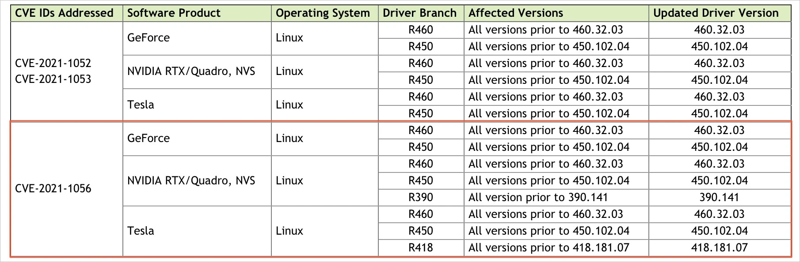

- 如果您选择自定义安装或更新GPU驱动，请参考上图确认您安装的GPU驱动是否受该漏洞影响。

- 如果您选择由阿里云容器服务Kubernetes版集群默认安装NVIDIA GPU驱动。依据NVIDIA官方信息，目前已验证受影响的容器服务Kubernetes集群版本包括：

  - ACK 1.16.9-aliyun.1（默认安装GPU驱动版本为418.87.01版本）

  - ACK 1.18.8-aliyun.1（默认安装GPU驱动版本为418.87.01版本）

> 其他版本的ACK集群，GPU节点默认安装的NVIDIA GPU驱动，尚未出现在NVIDIA官方信息中。如果将来有新的官方信息变化，阿里云容器服务团队将及时
>
> **说明**
>
> 跟进帮助您升级修复。

**确认GPU节点NVIDIA驱动版本**

登录到GPU节点，执行以下命令，查看驱动版本。

> 关于如何登录到GPU节点，请参见<strong>《云服务器ECS用户指南》</strong>的<strong>《使用登录VNC功能连接实例》</strong>章节。
>
> **说明**

```text
nvidia-smi
```

预期输出：

```text
Fri Apr 16 10:58:19 2021
+-----------------------------------------------------------------------------+
| NVIDIA-SMI 418.87.01    Driver Version: 418.87.01    CUDA Version: 10.1     |
|-------------------------------+----------------------+----------------------+
| GPU  Name        Persistence-M| Bus-Id        Disp.A | Volatile Uncorr. ECC |
| Fan  Temp  Perf  Pwr:Usage/Cap|         Memory-Usage | GPU-Util  Compute M. |
|===============================+======================+======================|
|   0  Tesla V100-SXM2...  On   | 00000000:00:07.0 Off |                    0 |
| N/A   34C    P0    37W / 300W |      0MiB / 16130MiB |      0%      Default |
+-------------------------------+----------------------+----------------------+

+-----------------------------------------------------------------------------+
| Processes:                                                       GPU Memory |
|  GPU       PID   Type   Process name                             Usage      |
|=============================================================================|
|  No running processes found                                                 |
+-----------------------------------------------------------------------------+
```

从上述输出的信息，可以知道该节点的GPU驱动版本为418.87.01。

**解决方案**

> 升级节点GPU驱动的过程需要重启节点，节点上的业务将受到影响。
>
> **重要**

请您根据上图的NVIDIA官方信息，将节点升级到对应驱动版本进行漏洞修复：

> 关于升级驱动的具体操作，请参见升级集群的GPU节点的NVIDIA驱动。
>
> **说明**

- R390系列：请升级至390.141版本。

- R418系列：请升级至418.181.07版本。

- R450系列：请升级至450.102.04版本。

- R460系列：请升级至460.32.03版本。

<a id="section-2"></a>

# 2.功能发布记录

本文介绍容器服务Kubernetes版相关内容的最新动态。

**3.18.6_sp2610**

**分类**

**功能**

**相关文档**

集群管理

多可用区场景下，创建集群时支持指定API server私网SLB实例以及Ingress负载均

- 创建Kubernetes集群

衡实例所在的可用区和集群。

- Higress Ingress Controller

- 通过负载均衡（Server Load Balancer）访问服务

创建集群时，支持自定义设置Pod网络CIDR、Service CIDR的网段范围。

1.36版本的ACK集群，公共镜像仅提供支持cgroup v2的容器优化镜像。

创建Kubernetes集群

Nginx Ingress Controller不再作为创建集群时的默认组件提供，存量集群可在组件管理页面安装并使用Nginx Ingress Controller。

创建集群时，Ingress支持SLB多集群选择。

ACK支持获取临时的KubeConfig凭证。

获取临时的KubeConfig凭证

支持1.36 Kubernetes版本的集群。

发布Kubernetes 1.36版本说明

新增ALB Ingress组件。

ALB Ingress管理

新增vpa组件。

vpa

组件管理

ACK支持DRA调度GPU（NV）。

使用DRA调度GPU

新增ack-advanced-audit组件。

组件概述

ACK支持对接AIStack软件，支持被企业版ACK K8s集群统一纳管和调度。

ACK集群纳管AIStack节点

节点管理

ACK节点池支持自动创建CMEK数据盘。

创建节点池

存储

存储声明、存储卷、存储类页面支持使用YAML创建资源。

- 使用NAS静态存储卷

- 使用NAS动态存储卷

- 使用OSS静态存储卷

- 使用OSS动态存储卷

- 创建持久化存储卷声明

- 使用阿里云云盘

- 使用OSS静态存储卷

OSS存储卷支持使用RAM角色授权。

- 使用OSS动态存储卷

网络管理

创建网络策略时，支持在确认步骤直接编辑YAML，即通过YAML创建网络策略。

创建网络策略

授权管理

新增审计人员访问权限。

配置子账号或RAM角色的RBAC权限

- 通过沙箱控制台管理预热池

ACK提供智能体沙箱，支持通过沙箱控制台管理预热池和沙箱实例。

- 通过沙箱控制台管理沙箱实例

- 通过沙箱控制台管理预热池

创建预热池时，支持按需动态挂载存储。

- 沙箱动态挂载存储

支持沙箱审计日志能力。

管理沙箱审计日志。

智能体沙箱

支持沙箱实例及管控组件的告警。

配置安全沙箱报警

支持自定义系统调用黑白名单，彻底防范沙箱逃逸、提权风险，满足生产级安全标

配置沙箱系统调用拦截

准。

支持通过YAML创建沙箱模板。

智能体沙箱镜像模板

**3.18.6_sp2607**

<table>
  <tr>
    <th>分类</th>
    <th>功能</th>
    <th>相关文档</th>
  </tr>
  <tr>
    <td rowspan="4">集群管理</td>
    <td>重调度支持dryRun调度预览。</td>
    <td>重调度</td>
  </tr>
  <tr>
    <td>创建集群支持ecs-user用户登录节点。</td>
    <td>创建Kubernetes集群</td>
  </tr>
  <tr>
    <td>ACK集群支持在企业版间备份恢复。</td>
    <td>备份中心</td>
  </tr>
  <tr>
    <td>支持对集群进行临时维护，维护中的集群拒绝用户操作。</td>
    <td>维护集群</td>
  </tr>
  <tr>
    <td rowspan="4">节点管理</td>
    <td>容器服务Kubernetes版支持将BMS裸金属服务器作为Worker节点。</td>
    <td>创建和管理混合云节点池</td>
  </tr>
  <tr>
    <td>节点池升级支持自定义镜像变更与升级功能。</td>
    <td>升级节点池</td>
  </tr>
  <tr>
    <td>创建节点池支持ecs-user用户登录节点。</td>
    <td>创建节点池</td>
  </tr>
  <tr>
    <td>BMCP集群支持对裸机GPU节点编辑标签功能。</td>
    <td>编辑节点池</td>
  </tr>
  <tr>
    <td rowspan="2">路由管理</td>
    <td>Higress Ingress支持服务权重与灰度发布配置适配。</td>
    <td>通过Web界面创建路由</td>
  </tr>
  <tr>
    <td>Nginx Ingress增加配置语法检测功能，防止因语法错误导致控制器崩溃。</td>
    <td>开启Nginx ingress配置校验</td>
  </tr>
  <tr>
    <td>应用管理</td>
    <td>ACK的Helm列表支持同步ACR Helm Chart。</td>
    <td>利用Helm简化应用部署</td>
  </tr>
  <tr>
    <td rowspan="4">组件</td>
    <td>容器服务Kubernetes版在SandBox套件中引入并适配Posidon组件，支持集群和节点池创建时安装。</td>
    <td>Poseidon</td>
  </tr>
  <tr>
    <td>OpenKruise Sandbox组件支持Sandbox/SandboxSet等工作负载及gVisor对接。</td>
    <td>Agent Sandbox</td>
  </tr>
  <tr>
    <td>ACK新增ahpa组件，可基于历史指标的智能弹性预测与提前扩容。</td>
    <td>ahpa</td>
  </tr>
  <tr>
    <td>ACK新增AI Profiling组件，实现AI应用程序全生命周期性能观测、诊断与优化。</td>
    <td>ai-profiling</td>
  </tr>
  <tr>
    <td>存储</td>
    <td>容器服务Kubernetes支持EFS-NAS CSI插件，透出EFS-NAS并具备与NAS一致的能力。</td>
    <td>使用NAS动态存储卷</td>
  </tr>
  <tr>
    <td rowspan="2">安全管理</td>
    <td>容器服务Kubernetes版前端优化风险阻断策略，限制创建/编辑/删除并引导至安骑士容器安全产品。</td>
    <td>• 容器安全策略规则库说明<br>• 通过控制台使用策略管理功能</td>
  </tr>
  <tr>
    <td>新增ACKBlockClusterDeletion策略，支持集群删除拦截，禁止直接删除含用户资源的集群。</td>
    <td>容器安全策略规则库说明</td>
  </tr>
  <tr>
    <td>运维管理</td>
    <td>资源画像新增热点节点展示功能。</td>
    <td>查看资源画像</td>
  </tr>
  <tr>
    <td>命名空间</td>
    <td>支持GPU配额设置和调整。</td>
    <td>设置资源配额和限制</td>
  </tr>
</table>

**3.18.6_sp2605**

**分类**

**功能**

**相关文档**

集群管理

支持1.34 Kubernetes版本的集群。

发布Kubernetes 1.34版本说明

支持安全沙箱，提供安全隔离运行环境。

创建Kubernetes集群

支持混合节点池，管理云外的服务器节点算力接入。

创建和管理混合云节点池

控制面参数配置：API Server、Kube Controller Manager参数配置。

控制面配置

<table>
  <tr>
    <td rowspan="4">集群管理</td>
    <td>创建集群时支持系统盘加密。</td>
    <td>创建Kubernetes集群</td>
  </tr>
  <tr>
    <td>支持Alibaba Cloud Linux 4开源版及其容器优化镜像，并兼容商业版V4操作系统。</td>
    <td>创建Kubernetes集群</td>
  </tr>
  <tr>
    <td>支持集群维度的调度策略，包括Binpack、负载感知调度和重调度。</td>
    <td>• Binpack<br>• 负载感知调度<br>• 重调度</td>
  </tr>
  <tr>
    <td>支持展示节点ECS规格族名称。</td>
    <td>无。</td>
  </tr>
  <tr>
    <td rowspan="4"></td>
    <td>支持节点维度的QoS感知调度策略：离在线混部、CPU burst、动态资源超卖、CPU拓扑</td>
    <td>QoS感知调度配置</td>
  </tr>
  <tr>
    <td>专有版集群支持开启节点自愈。</td>
    <td>开启节点自愈</td>
  </tr>
  <tr>
    <td>创建节点池时支持系统盘加密。</td>
    <td>创建节点池</td>
  </tr>
  <tr>
    <td>创建节点池支持选择安全沙箱。</td>
    <td>创建节点池</td>
  </tr>
  <tr>
    <td rowspan="2">应用管理</td>
    <td>创建SLB VIP时支持通过su_name参数指定SLB集群以实现多集群选择。</td>
    <td>创建服务</td>
  </tr>
  <tr>
    <td>支持多实例版ACR，支持按照实例选择部署镜像。</td>
    <td>• 创建有状态工作负载StatefulSet<br>• 创建无状态工作负载Deployment</td>
  </tr>
  <tr>
    <td rowspan="2">组件</td>
    <td>支持安装 terway-hybrid 组件。</td>
    <td>使用Terway Hybrid网络插件</td>
  </tr>
  <tr>
    <td>新增API Gateway Ingress Controller、Higress Ingress Controller组件。</td>
    <td>• API Gateway Ingress Controller<br>• Higress Ingress Controller</td>
  </tr>
  <tr>
    <td>命名空间</td>
    <td>命名空间的资源配额和限制支持CPU和内存需求设置。</td>
    <td>设置资源配额和限制</td>
  </tr>
  <tr>
    <td rowspan="2">运维能力</td>
    <td>支持节点使用率的资源观测与资源画像功能：集群资源使用率、空闲率、Pod规格优化建议。</td>
    <td>资源画像</td>
  </tr>
  <tr>
    <td>支持ACK集群升级检查时识别并提示弃用API。</td>
    <td>升级集群</td>
  </tr>
</table>

**3.18.6_sp2512**

<table>
  <tr>
    <th>分类</th>
    <th>功能</th>
    <th>相关文档</th>
  </tr>
  <tr>
    <td rowspan="4">集群管理</td>
    <td>已有集群提供了Secret落盘加密选项，用户可通过KMS自定义加密密钥。</td>
    <td>为容器集群加密</td>
  </tr>
  <tr>
    <td>创建页面支持APIserver的规格选择。</td>
    <td rowspan="3">创建Kubernetes集群</td>
  </tr>
  <tr>
    <td>新建集群支持master节点和worker节点数据盘自定义挂载路径。</td>
  </tr>
  <tr>
    <td>创建集群时支持飞天助理提供集群配置建议。</td>
  </tr>
  <tr>
    <td rowspan="2">节点管理</td>
    <td>节点在驱逐Pod时支持白屏化设置超时时间。</td>
    <td>节点排水</td>
  </tr>
  <tr>
    <td>节点池弹性伸缩增加节点池优先级、弹性灵敏度参数配置。</td>
    <td>节点自动伸缩</td>
  </tr>
  <tr>
    <td rowspan="2">容器组</td>
    <td>支持导出容器组列表。</td>
    <td>管理容器组（Pod）</td>
  </tr>
  <tr>
    <td>容器组pod为pending状态时，飞天助理提供智能诊断能力。</td>
    <td>查看容器组</td>
  </tr>
  <tr>
    <td>组件</td>
    <td>专有云ACK提供RoleBaseGroup的统一分布式推理框架。</td>
    <td>RoleBasedGroup</td>
  </tr>
  <tr>
    <td>工作负载</td>
    <td>飞天助理支持智能生成YAML模板，并提供YAML语句智能分析。</td>
    <td>创建无状态工作负载Deployment</td>
  </tr>
</table>

**3.18.6_sp2510**

<table>
  <tr>
    <th>分类</th>
    <th>功能</th>
    <th>相关文档</th>
  </tr>
  <tr>
    <td>集群版本</td>
    <td>专有版支持1.32.7 Kubernetes版本的集群。</td>
    <td>发布Kubernetes 1.32版本说明</td>
  </tr>
  <tr>
    <td rowspan="2">集群管理</td>
    <td>集群巡检新增支持以下巡检项：集群ETCD存储使用率过高、集群CPU使用率过高、集群Memory使用率过高、集群Master节点CPU使用率过高、集群Master节点Memory使用率过高。</td>
    <td>集群巡检项及解决方案</td>
  </tr>
  <tr>
    <td>创建注册集群支持选择专有网络和虚拟交换机。</td>
    <td>创建注册集群并接入本地数据中心集群</td>
  </tr>
  <tr>
    <td rowspan="3">基础能力</td>
    <td>专有版集群的Master节点支持设置单实例。该功能默认不开放，如需使用请联系阿里云技术支持。</td>
    <td>• 创建专有版集群<br>• 创建专有GPU集群</td>
  </tr>
  <tr>
    <td>ACK集群Master节点支持挂载数据盘。</td>
    <td>• 创建专有版集群<br>• 创建专有GPU集群<br>• 创建边缘Kubernetes集群</td>
  </tr>
  <tr>
    <td>选用flannel插件创建集群时，可直接指定节点Pod数量，无需展开高级选项进行节点IP数量配置。</td>
    <td>• 创建专有版集群<br>• 创建专有GPU集群</td>
  </tr>
  <tr>
    <td>存储</td>
    <td>支持手动输入指定的Bucket名称及Bucket Endpoint。</td>
    <td>使用OSS静态存储卷</td>
  </tr>
  <tr>
    <td rowspan="3">网络</td>
    <td>Terway网络场景支持通过可视化控制台扩容Pod虚拟交换机。</td>
    <td>修改Pod虚拟交换机</td>
  </tr>
  <tr>
    <td>支持通过ack-extend-network-controller组件将EIP直接关联到特定的Pod上，从而使得该Pod拥有独立的公网出口。</td>
    <td>为Pod挂载独立公网EIP</td>
  </tr>
  <tr>
    <td>容器服务支持通过可视化控制台配置IP Pool和PodNetworking，为不同工作负载的Pod分配指定网段内的固定IP地址，实现更精细的网络隔离与安全管理。</td>
    <td>为Pod配置固定IP地址段</td>
  </tr>
  <tr>
    <td>运维能力</td>
    <td>专有版集群支持报警配置，配置后，可提供ACK的集群异常事件、异常指标的报警通知能力。</td>
    <td>• 报警配置<br>• 创建专有版集群<br>• 创建专有GPU集群</td>
  </tr>
  <tr>
    <td>易用性</td>
    <td>通过ACK-Koordinator组件的自定义参数配置能力，可实现精细的资源调度与优化，为不同负载提供更高的弹性与资源利用效率。</td>
    <td>• 组件概述<br>• ack-koordinator</td>
  </tr>
</table>

**3.18.6_sp2507**

**分类**

**功能**

**相关文档**

集群版本

发布1.32 Kubernetes版本、发布1.30.7 Kubernetes版本。

发布Kubernetes 1.32版本说明

安全

ACR支持镜像加签验签（依赖安骑士容器安全），支持白屏化操作。

- 使用kritis-validation-hook组件自动验证高级版容器镜像签名

支持恶意镜像阻断策略 （依赖安骑士容器安全）支持白屏化操作。

- kritis-validation-hook

镜像上传下载操作接入审计日志。

ACK支持cgroup V2。

- 创建Kubernetes集群

- 创建节点池

体验优化

未安装产品无法选择，如未部署Prometheus时，无法选择该产品在ack透出的相关

无

功能。

存储类支持白屏化创建，支持云盘、NAS存储卷。

- 使用NAS动态存储卷

- 使用OSS动态存储卷

创建集群支持Master节点的自定义命名。

- 创建Kubernetes集群

- 创建节点池

组件安装权限检查及一键授权优化。

管理组件

组件

集群默认安装Gateway API并支持组件管理。

使用Gateway API访问服务

支持kubeRay。

- 使用Ray Cluster

- 在Ray Cluster中提交Job

支持Alibaba Cloud Linux3 等保2.0三级镜像。

- 创建Kubernetes集群

OS

- 创建节点池

硬件兼容

支持海光4号。

无

**3.18.6**

<table>
  <tr>
    <th>功能模块</th>
    <th>功能描述</th>
    <th>相关文档</th>
  </tr>
  <tr>
    <td>集群版本</td>
    <td>专有版支持Kubernetes 1.30.1、Kubernetes 1.30.7版本的集群。</td>
    <td>发布Kubernetes 1.30版本说明</td>
  </tr>
  <tr>
    <td rowspan="5">运维能力</td>
    <td>Master节点扩容、节点操作系统轮转、Master节点故障恢复。</td>
    <td>管控节点运维</td>
  </tr>
  <tr>
    <td>etcd备份。</td>
    <td>《容器服务Kubernetes版》&gt;《运维指南》&gt; 《etcd备份记录》</td>
  </tr>
  <tr>
    <td>支持1.30版本集群升级。</td>
    <td>升级集群</td>
  </tr>
  <tr>
    <td>支持Pod级GPU监控指标。</td>
    <td>基于GPU指标实现弹性伸缩</td>
  </tr>
  <tr>
    <td>弹性伸缩扩缩容Min、Max实例数配置。</td>
    <td>基于KServe为服务配置弹性扩缩容策略</td>
  </tr>
  <tr>
    <td rowspan="2">组件</td>
    <td>kube-queue组件支持任务优先级。</td>
    <td>使用kube-queue</td>
  </tr>
  <tr>
    <td>支持Kserve。</td>
    <td>• KServe概述<br>• 安装ack-kserve组件<br>• 部署vLLM推理服务<br>• 实现推理服务的灰度发布<br>• 基于KServe为服务配置弹性扩缩容策略</td>
  </tr>
  <tr>
    <td rowspan="5">易用性</td>
    <td><strong>配额优化</strong>：组织资源集维度集群内节点数量配额。</td>
    <td>无</td>
  </tr>
  <tr>
    <td>节点支持Workbench管理。</td>
    <td>无</td>
  </tr>
  <tr>
    <td>AI套件提供一键安装。</td>
    <td>无</td>
  </tr>
  <tr>
    <td>支持自定义节点池的Kubelet参数配置。</td>
    <td>自定义节点池的kubelet参数配置</td>
  </tr>
  <tr>
    <td>Worker节点挂载数据盘容量最大支持2000 GB的数据盘。</td>
    <td>创建Kubernetes集群</td>
  </tr>
  <tr>
    <td rowspan="3">运营能力</td>
    <td><strong>ACK接入计量</strong>：支持ACK集群接入计量、计量数据展示关联资源信息关联资源信息。</td>
    <td>无</td>
  </tr>
  <tr>
    <td><strong>运营产品数据分析</strong>：支持按组织维度等分析字段，查看ACK集群、节点、Pod数量分布。</td>
    <td>无</td>
  </tr>
  <tr>
    <td><strong>报表下载</strong>：支持集群CPU总量、内存总量、磁盘总量以及使用率等信息。</td>
    <td>无</td>
  </tr>
  <tr>
    <td rowspan="3">运维控制台二期优化</td>
    <td><strong>大盘</strong>：支持ACR运维总容量和列表数据 、支持GPU数据。</td>
    <td>无</td>
  </tr>
  <tr>
    <td><strong>组件</strong>：优化组件列表关联集群信息。</td>
    <td>组件列表</td>
  </tr>
  <tr>
    <td><strong>配置</strong>：优化配置编辑和展示组件、troopers配置白名单定义。</td>
    <td>troopers配置</td>
  </tr>
  <tr>
    <td>操作系统</td>
    <td>支持麒麟V10 SP3版本镜像。</td>
    <td>创建Kubernetes集群</td>
  </tr>
  <tr>
    <td>硬件</td>
    <td>• 沐曦C550<br>• 昆仑芯P800</td>
    <td>无</td>
  </tr>
</table>

**3.18.3-SP01**

<table>
  <tr>
    <th>功能模块</th>
    <th>功能描述</th>
    <th>相关文档</th>
  </tr>
  <tr>
    <td rowspan="3">基础能力</td>
    <td>专有版支持Kubernetes 1.30.1版本的集群。</td>
    <td>发布Kubernetes 1.30版本说明</td>
  </tr>
  <tr>
    <td>兼容支持商业版阿里云服务器操作系统v3（510内核）。</td>
    <td>创建Kubernetes集群创建节点池</td>
  </tr>
  <tr>
    <td>新增悬浮球快捷跳转。</td>
    <td>使用流程</td>
  </tr>
  <tr>
    <td>集群管理</td>
    <td>创建集群时支持系统盘加密。</td>
    <td>创建Kubernetes集群</td>
  </tr>
  <tr>
    <td>网络管理</td>
    <td>支持白屏化创建网络策略。</td>
    <td>创建网络策略</td>
  </tr>
  <tr>
    <td rowspan="4">组件</td>
    <td>新增ack-fluid组件。</td>
    <td>ack-fluid</td>
  </tr>
  <tr>
    <td>新增ack-sysom-monitor组件。</td>
    <td>ack-sysom-monitor</td>
  </tr>
  <tr>
    <td>新增ack-dragonfly组件。</td>
    <td>ack-dragonfly</td>
  </tr>
  <tr>
    <td>新增aliyun-acr-acceleration-suite组件。</td>
    <td>aliyun-acr-acceleration-suite</td>
  </tr>
  <tr>
    <td rowspan="2">AI套件</td>
    <td>使用Horovod进行弹性训练。</td>
    <td>使用Horovod进行弹性训练</td>
  </tr>
  <tr>
    <td>ack-kube-queue支持ElasticQouta排队。</td>
    <td>使用kube-queue</td>
  </tr>
</table>

**3.18.3**

无。

**3.18.2**

| 功能模块 | 功能描述 | 相关文档 |
| --- | --- | --- |
| 基础能力 | 专有版支持创建K8s 1.28.3版本的集群。<br>• 专有版支持创建K8s 1.28.3版本的集群。<br>• 边缘专有版支持创建K8s 1.26.3版本的集群。 | • 发布Kubernetes 1.28版本说明<br>• ACK Edge发布Kubernetes 1.26版本说明<br>• 发布Kubernetes 1.26版本说明 |
| 集群管理 | • 支持集群智能巡检功能。<br>• 支持集群升级检查功能。<br>• 专有版集群Master节点支持部署集。<br>• 集群创建支持密钥功能。<br>• 集群创建支持等保加固功能。 | • 使用集群巡检<br>• 集群检查项及修复方案<br>• 登录方式<br>• 部署集<br>• 等保加固 |
| 节点池 | • 支持节点池升级。<br>• 节点池创建支持密钥功能。<br>• 节点池创建支持等保加固功能。 | • 升级节点池<br>• 创建节点池 |
| 组件 | 新增Koordinator组件。 | ack-koordinator |

**3.18.1**

| 功能模块 | 功能描述 | 相关文档 |
| --- | --- | --- |
| 基础能力 | 支持创建K8s 1.24.6版本的集群。 | 创建Kubernetes集群 |
| 网络 | Terway集群支持Trunking ENI功能。 | 为Pod配置固定IP、独立虚拟交换机和安全组 |
| 集群管理 | • 支持集群智能诊断功能。<br>• 支持注册集群纳管线下集群。 | • 集群诊断：<br>• AIOps套件概述<br>• 使用集群诊断<br>• 节点诊断<br>• Pod诊断<br>• 注册集群：<br>• 注册集群概述<br>• 注册集群ack-cluster-agent组件RBAC权限说明<br>• 创建注册集群并接入本地数据中心集群 |
| 安全 | 专有版集群支持ETCD证书轮转。 | 轮转专有版集群ETCD证书 |
| 组件 | 新增组件如下：<br>• ack-alibaba-cloud-metrics-adapter<br>• ack-autoscaling-placeholder | • 基于阿里云Prometheus指标的容器水平伸缩<br>• 使用ack-autoscaling-placeholder实现容器秒级伸缩 |

**3.18**

**功能模块**

**功能描述**

**相关文档**

- 支持创建K8s 1.22.10版本的集群。

  - 创建Kubernetes集群

- 支持Containerd 1.5.13版本。

基础能力

- 创建节点池

- 支持Alibaba Linux 3 2104版本和龙蜥8.6 ANCK版本的操作系统。

  - 节点池部署集最佳实践

- 节点池支持部署集。

  - 创建Kubernetes集群

- Terway集群支持IPv4/IPv6双栈能力。

  - 在Ingress Controller上使用公网IPv6地

网络

址

- 支持DNS缓存（localdnscache组件）。

  - 使用NodeLocal DNSCache

- 边缘节点：

  - 支持BMS裸机纳管。

  - 支持麒麟v10和龙蜥8.6版本的操作系统的节点接入。

边缘专有版集群

创建边缘Kubernetes集群

- 在网络打通情况下，支持内网接入。

- 创建集群时，支持Alibaba Cloud Linux3 2104版本。

- 在云边网络打通场景下，支持NAS和OSS CSI。

- 支持边缘专有版集群。

  - Kubernetes GPU集群支持GPU调度

AI套件

- 支持V100的GPU机型。

  - 开启共享GPU调度

- 支持Alibaba Cloud Linux3 2104版本和龙蜥8.6 ANCK版本的操作系统。

  - 使用共享GPU调度

  - 容器安全策略规则库说明

  - 通过API使用策略治理功能

安全

支持安全策略管理和默认安全策略模板。

- gatekeeper

- policy-template-controller

新增组件的名称及版本号如下：

- 使用NodeLocal DNSCache

- localdnscache 1.5.3

  - gatekeeper

- gatekeeper v3.8.1.113-geb7947ef-aliyun

  - policy-template-controller

- policy-template-controller v0.3.0.0-g0943d7d-aliyun

组件

支持在组件管理对组件进行升级操作。最新版本的组件如下：

- ccm v2.4.1.2-51057da58-aliyun

- NPD 1.2.12

- ack-arms-prometheus 0.1.6

- logtail-ds v1.0.34.1-6e4381b-aliyun

- metrics-server v0.3.9.3-628a248-aliyun

- csi-plugin v1.24.9-74f84906-aliyun

  管理组件

- CoreDNS v1.9.3.6-32932850-aliyun

- Flannel v0.15.1.19-d460293f-aliyun

- Terway v1.4.3

- Nginx Ingress Controller v1.2.1-aliyun.1

- aliyun-acr-credential-helper v22.03.25.2-512148a-aliyun

- kritis-validation-hook v0.7.0.2-gfe4e4ee9-aliyun

- sandboxed-container-controller v1.2.0-0c6b9ba-aliyun

**3.17**

| 功能模块 | 功能描述 | 相关文档 |
| --- | --- | --- |
| 基础能力 | • 支持创建5个Master节点。<br>• x86/ARM集群支持统信UOS（操作系统）。<br>• 新建集群时，镜像不支持选择CentOS 7.9，仅支持自定义镜像。 | 创建Kubernetes集群 |
| 网络 | • Terway集群支持ipvlan+ebpf模式。<br>• 创建SLB支持删除保护。 | • 创建Kubernetes集群<br>• 通过Annotation配置负载均衡 |
| 存储 | PV/PVC支持存储卷快照和还原。 | 使用云盘存储快照 |
| 边缘专有版集群 | 支持创建1.20版本的集群。 | 创建边缘Kubernetes集群 |
| 安全 | 支持ASCM STS角色登录。 | 角色登录说明 |
| AI大数据 | AI套件支持（使用x86机型）：<br>• Gang scheduling<br>• Capacity scheduling<br>• GPU Share<br>• 应用目录支持Queue和Arena组件。 | • 开启Gang（协同调度）能力<br>• 开启Capacity调度<br>• 使用Arena提交AI任务<br>• 使用kube-queue |
| 组件 | 组件版本升级。最新版本的组件如下：<br>• terway v1.2.5<br>• csi-plugin v1.22.14-bd66d6f-aliyun<br>• ccm v2.4.0.0-98c276a2e-aliyun<br>• nginx ingress v1.2.1-aliyun.1 | 管理组件 |

**3.16.2**

| 功能模块 | 功能说明 | 相关文档 |
| --- | --- | --- |
| 基础能力 | • x86/ARM专有版集群支持银河麒麟V10操作系统。<br>• x86机型默认推荐镜像从CentOS变更为Alibaba Cloud Linux 2。 | 创建Kubernetes集群 |
| 边缘专有版集群 | • x86/ARM边缘专有版集群支持银河麒麟V10操作系统。<br>• 边缘专有版集群支持ACR企业版镜像。 | 创建边缘Kubernetes集群 |

**3.16.1**

| 功能模块 | 功能说明 | 相关文档 |
| --- | --- | --- |
| 基础能力 | 在节点池中，以自定义镜像的方式支持Redhat 7.9。 | 创建节点池 |
| 安全 | • 支持镜像验签。<br>• 组件管理新增验签组件kritis-validation-hook。 | • 使用kritis-validation-hook组件自动验证标准版容器镜像签名<br>• 管理组件 |

**3.16**

| 功能模块 | 功能说明 | 相关文档 |
| --- | --- | --- |
| 基础能力 | • 支持创建1.20版本的集群。<br>• 创建集群时，支持选择资源集、IPVS模式。<br>• 创建节点池时，支持选择已有安全组、数据盘加密。<br>• 支持组件管理。 | • 创建Kubernetes集群<br>• 创建节点池<br>• 管理组件 |
| 组件 | 组件版本升级。最新版本的组件如下：<br>• flannel v0.13.0.2-466064b-aliyun<br>• terway v1.0.10.461-g4c2e7c9-aliyun<br>• csi-plugin v1.20.7-5608aef-aliyun<br>• metrics-server v0.3.8.5-e432edc-aliyun<br>• cloud-controller-manager v1.9.3.280-g306118e23-aliyun<br>• coredns v1.7.0.0-f59c03d-aliyun<br>• logtail-ds v1.0.25.0-eca7ef7-aliyun<br>• nginx ingress controller v0.44.0.11-f0ef3db95-aliyun<br>• acr-credential-helper v22.01.05.0-4783e7e-aliyun | 管理组件 |
| 弹性伸缩 | 应用目录支持定时伸缩组件CronHPA。 | 容器水平伸缩（HPA） |
| 运维、可观测性 | • 支持集群审计大盘和Ingress大盘。<br>• 集群创建和组件管理支持arms-prometheus。<br>• 应用目录支持arms-pilot和velero组件。 | • ARMS Prometheus监控<br>• 应用性能监控<br>• 创建Kubernetes集群<br>• 管理组件 |
| 安全 | 组件管理支持免密拉取镜像组件aliyun-acr-credential-helper。 | 管理组件 |
| 边缘专有版集群 | 支持从K8s1.16.9升级到1.18.8版本。 | 升级集群 |

<a id="section-3"></a>

# 3.什么是容器服务

容器服务（Container Service）是一种高性能可伸缩的容器管理服务，支持企业级Kubernetes容器化应用的生命周期管理。

容器服务简化集群的搭建和扩容等运维工作，整合阿里云虚拟化、存储、网络和安全能力，打造云端最佳的 Kubernetes 容器化应用运行环境。容器服务是Kubernetes认证服务供应商，全球首批通过Kubernetes一致性认证的平台服务，为您提供专业的支持和服务。

<a id="section-4"></a>

# 4.规划和准备

使用容器服务之前，您需要根据集群和应用的配置需求，创建VPC网络，虚拟交换机、云盘、OSS等资源。

在创建Kubernetes集群之前，您需要做如下准备：

- （可选）**创建VPC网络**：

  若您选择使用已有VPC网络创建集群，则需要预先创建VPC网络，并创建虚拟交换机。

- （可选）**创建存储卷**：

  若您想使用网络存储创建数据卷，用于构建有状态应用，请预先创建云盘或OSS。

<a id="section-5"></a>

# 5.使用限制

<table>
  <tr>
    <th width="90">限制项</th>
    <th>限制说明</th>
  </tr>
  <tr>
    <td>集群</td>
    <td>• 专有云下所有的Kubernetes集群节点总核数，不得超过License购买的总核数。若使用量超额，需要重新购买License。<br>• 多Region部署场景中，中心Region升级完成后，如果单元Region不升级，将无法在单元Region创建或扩容老版本集群。<br>• 集群创建后，不支持执行以下操作：<br>• 变更集群的VPC。<br>• 变更Kubernetes集群类型，如将Kubernetes专有版集群更换为Kubernetes边缘专有版集群。<br>• 变更容器网络插件。<br>• 变更集群Service和Pod网络的CIDR。<br>• 变更存储插件。<br>• 应用在不同命名空间下迁移。</td>
  </tr>
  <tr>
    <td>ECS实例</td>
    <td>• 由于ECS等底层依赖产品配额License限制，创建集群、扩容集群或者自动弹性扩容时，可能只有部分节点创建成功。<br>• 创建集群时，要求ECS规格必须CPU≥2 vCPU且内存≥4 GiB。</td>
  </tr>
</table>

<a id="section-6"></a>

# 6.安全须知

为了保证集群系统组件（存储、网络、监控、日志等默认组件）的正常运行，容器服务在创建集群时，会在集群所有Master和Worker节点对应的RAM角色上绑定集群默认系统组件所需的最小权限策略。绑定权限策略后，在集群Pod内运行的应用可以通过访问ECS实例元数据的方式，获取对应节点绑定的RAM角色权限。关于权限策略的说明，请参见角色权限说明。

为了防止攻击者进入Pod后，通过访问ECS实例元数据直接获取整个组织的RAM资源访问权限，导致严重的越权访问。请参考以下方式，限制Pod内应用访问ECS元数据服务器的权限。

- 避免应用部署在权限更大的Master节点上。

- 在构建应用镜像时，通过添加Iptables规则等方式限制容器内应用对ECS元数据服务器（100.100.100.200/32）的访问。

<a id="section-7"></a>

# 7.Kubernetes集群

<a id="section-7-1"></a>

## 7.1. 快速入门

<a id="section-7-1-1"></a>

### 7.1.1. 使用流程

您可根据以下的使用流程，来使用容器服务。

容器服务的使用流程如下图所示。

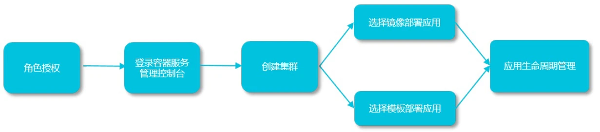

**步骤1：角色授权**

容器服务正常运行依赖默认角色中的授权权限，您需要对选择登录的部门进行授权。

**步骤 2：登录容器服务控制台。**

您需要先登录容器服务管理控制台，参见登录容器服务控制台。

**步骤 3：创建集群。**

您可以选择集群的网络环境，设置集群的节点个数和配置信息。

**步骤 4：通过镜像或编排模板部署应用。**

您可以使用已有的镜像或编排模板，或者新建镜像或者编排模板。

如果您的应用由多个镜像承载的服务组成，可以选择通过编排模板创建应用。

**步骤 5：应用生命周期管理。**

**步骤 6：悬浮球快捷操作。**

- 点击悬浮球上的切换账号图标可便捷切换当前登录账号。

- 点击悬浮球上的购物车图标可直接跳转至购物车界面。

- 点击悬浮球上的箭头可展开或收起浮层菜单。

> **说明**
>
> 悬浮球默认位于页面右下角，用户可将其拖动至所需位置。

<a id="section-7-1-2"></a>

### 7.1.2. 登录容器服务控制台

您可按照以下的配置方法，登录到容器服务管理控制台。

**前提条件**

- 登录Apsara Uni-manager运营控制台前，确认您已从部署人员处获取Apsara Uni-manager运营控制台的服务域名地址。

- 推荐使用Chrome浏览器。

**操作步骤**

1. 在浏览器地址栏中，输入Apsara Uni-manager运营控制台的服务域名地址，按回车键。

2. 输入正确的用户名及密码。

   请向运营管理员获取登录控制台的用户名和密码。

   > **说明**
   >
   > 首次登录Apsara Uni-manager运营控制台时，需要修改登录用户名的密码，请按照提示完成密码修改。为提高安全性，密码长度必须为8~20位，且至少包含以下两种类型：
   >
   > - 英文大写或小写字母（A~Z、a~z）
   >
   > - 阿拉伯数字（0~9）
   >
   > - 特殊符号（感叹号（！）、at（@）、井号（#）、美元符号（$）、百分号（%）等）

3. 单击**账号登录**。

4. 在页面顶部的菜单栏中，选择**产品 > 计算 > 容器服务Kubernetes版**。

5. 在**容器服务**页面的选择组织和地域，然后单击**角色授权访问**或**管理员权限访问**，跳转到容器服务控制台。

<a id="section-7-1-3"></a>

### 7.1.3. 创建Kubernetes集群

本文介绍如何通过容器服务控制台创建专有版集群、边缘专有版集群。

**创建专有版集群**

1. 登录容器服务控制台。

2. 在控制台左侧导航栏，单击**集群**，然后选择**创建集群 > 专有版**。

3. 在**集群配置**步骤中，配置以下参数，然后单击**下一步**。

   **基础配置**

   <table>
     <tr>
       <th width="168">配置项</th>
       <th>说明</th>
     </tr>
     <tr>
       <td>集群名称</td>
       <td>创建的集群的名称。包1~63个字符，包括数字、中文字符、英文字符和短划线（-）。<br>说明集群名称在同一个用户下必须唯一。</td>
     </tr>
     <tr>
       <td>资源集</td>
       <td>选择资源集。资源集是资源存放的容器，所有资源都需要创建在对应的资源集下。例如选择不同的资源集，会过滤出该资源集内的专有网络及对应的虚拟交换机。</td>
     </tr>
     <tr>
       <td>地域</td>
       <td>所创建集群将要部署到的地域。</td>
     </tr>
     <tr>
       <td>可用区</td>
       <td>可选择多个可用区。仅展示所选可用区内的虚拟交换机、API server、Ingress的SLB可用区。</td>
     </tr>
     <tr>
       <td>Kubernetes 版本</td>
       <td>选择Kubernetes版本。<br>说明若未购买商业操作系统授权，ARM版本则无法选用1.36版本的Kubernetes。</td>
     </tr>
     <tr>
       <td>容器运行时</td>
       <td>当前仅支持选择<strong>containerd</strong>。需要您部署神龙裸金属服务器，选择控制台提供的最新版本。</td>
     </tr>
   </table>

   **网络配置**

   <table>
     <tr>
       <th width="190">配置项</th>
       <th>说明</th>
     </tr>
     <tr>
       <td>IPv6双栈</td>
       <td>支持开启IPv6双栈。</td>
     </tr>
     <tr>
       <td>专有网络</td>
       <td>您可以在已有VPC列表中选择所需的VPC。</td>
     </tr>
     <tr>
       <td>为专有网络配置 SNAT</td>
       <td>开启后，会为所选择的VPC进行NAT网关配置。<br>• 如果您所选VPC中当前已有NAT网关：<br>• 不存在VPC粒度的SNAT规则：自动配置交换机粒度的SNAT规则（为集群使用的所有交换机配置）。<br>• 存在VPC粒度的SNAT规则：不执行任何操作。<br>• 如果所选VPC中没有NAT网关，则自动创建NAT网关并配置交换机粒度的SNAT规则（为集群使用的所有交换机配置）。<br>说明若选择不自动创建NAT网关，您需要手动配置NAT网关实现VPC安全访问公网环境，或者手动配置SNAT。</td>
     </tr>
     <tr>
       <td>虚拟交换机</td>
       <td>设置虚拟交换机。您可以在已有虚拟交换机列表中，根据<strong>可用区</strong>选择1~3个交换机。</td>
     </tr>
     <tr>
       <td>API server访问</td>
       <td>• <strong>负载均衡规格</strong>：默认将为API server创建一个私网SLB实例，用户可修改SLB实例规格。若删除该实例会导致API server无法访问。<br>• <strong>负载均衡可用区</strong>：多可用区场景下，您可以指定为API server创建的私网SLB实例所在的可用区。<br>• <strong>负载均衡集群</strong>：您可以指定为API server创建的私网SLB实例所在的集群。设置是否开启<strong>使用 EIP 暴露 API Server</strong>：API Server提供了各类资源对象（Pod，Service等）的增删改查及watch等HTTP Rest接口。<br>• 如果开启，会创建一个EIP，并挂载到内网SLB上。此时，Master节点的6443端口（对应API Server）暴露出来，用户可以在外网通过KubeConfig连接并操作集群。<br>• 如果不开启，则不会创建EIP，您只能在VPC内部用KubeConfig连接并操作集群。</td>
     </tr>
     <tr>
       <td>SSH登录</td>
       <td>您需要开启<strong>使用 EIP 暴露 API Server</strong>，才能设置公网SSH登录。<br>• 勾选<strong>开放公网SSH登录</strong>，您可以通过SSH访问集群。<br>• 不勾选<strong>开放公网SSH登录</strong>，将无法通过SSH访问集群，也无法通过kubectl连接集群。如果您需要通过SSH访问集群实例，可以手动为ECS实例绑定EIP，并配置安全组规则，开放SSH（22）端口。</td>
     </tr>
     <tr>
       <td>安全组</td>
       <td>支持选择<strong>自动创建普通安全组</strong>、<strong>自动创建企业级安全组</strong>、<strong>选择已有安全组</strong>。更多信息，请参见<strong>《云服务器ECS用户指南》&gt;《创建安全组》</strong>章节。</td>
     </tr>
     <tr>
       <td>网络插件</td>
       <td>支持<strong>Flannel</strong>和<strong>Terway</strong>，默认启用<strong>Terway</strong>。<br>• 当选中<strong>Flannel</strong>时，您需要配置<strong>节点Pod数量</strong>、<strong>启用Flannel VXLAN 模式</strong>、<strong>Pod 网络 CIDR</strong>和<strong>Service CIDR</strong>。<br>• <strong>节点Pod数量</strong>：定义单个节点上可容纳的最大Pod数量。<br>• <strong>启用Flannel VXLAN 模式</strong>：选中后，可以通过VXLAN隧道实现跨节点容器网络通信。<br>• <strong>Pod 网络 CIDR</strong>：配置Pod网络CIDR。Pod网络CIDR指定Flannel网络插件需要配置Pod网络CIDR，网段不能和VPC及VPC已有Kubernetes集群使用的网段重复，创建成功后不能修改。而且Service地址段不能和Pod地址段重复。默认仅支持10.0.0.0/8、72.16-21.0.0/16、172.23-31.0.0/16、192.168.0.0/16及其子网，如需使用上述范围之外的网段，请联系管理员配置允许的网段范围。<br>• <strong>Service CIDR</strong>：指定Service CIDR，且网段不能与VPC及VPC内已有Kubernetes集群使用的网段重复、Service地址段不能和Pod地址段重复。创建成功后不能修改。默认可选范围为10.0.0.0/8、192.168.0.0/16、172.16-21.0.0/16、172.23-31.0.0/16，如需使用上述范围之外的网段，请联系管理员配置允许的网段范围。<br>• 当选中<strong>Terway</strong>时，您可以选择是否使用<strong>DataPath V2</strong>、<strong>NetworkPolicy支持</strong>、<strong>Terway ENI 支持</strong>。<br>• <strong>Pod虚拟交换机</strong>：您需要为每一个节点虚拟交换机指定至少一个相同可用区的Pod虚拟交换机。<br>• <strong>Service CIDR</strong>：指定Service CIDR，且网段不能与VPC及VPC内已有Kubernetes集群使用的网段重复、Service地址段不能和Pod地址段重复。创建成功后不能修改。默认可选范围为10.0.0.0/8、192.168.0.0/16、172.16-21.0.0/16、172.23-31.0.0/16，如需使用上述范围之外的网段，请联系管理员配置允许的网段范围。更多信息，请参见<strong>《专有网络VPC 用户指南》&gt;《网络规划》</strong>章节。<br>说明开启IPv6双栈后，<strong>网络插件</strong>仅支持<strong>Terway</strong>。</td>
     </tr>
     <tr>
       <td>IPv6 Service CIDR</td>
       <td>开启IPv6双栈后，您需要为Service CIDR配置IPv6地址段。配置网段时，请注意：<br>• 必须使用ULA地址，地址段范围在fc00::/7内，且地址前缀长度在112~120之间。<br>• 推荐和Service CIDR保持相同的可用地址数量。</td>
     </tr>
   </table>

   **高级选项**

   <table>
     <tr>
       <th width="197">配置项</th>
       <th>说明</th>
     </tr>
     <tr>
       <td>集群删除保护</td>
       <td>防止通过控制台或API误删除集群。</td>
     </tr>
     <tr>
       <td>禁止跨可用区绑定 SLB</td>
       <td>开启后，新建SLB只能绑定到集群已选择的可用区。</td>
     </tr>
     <tr>
       <td>标签</td>
       <td>为集群绑定标签。标签由区分大小写的键值对组成，您最多可以设置4个标签。标签键不可以重复，最长为64个字符；标签值可以为空，最长为128个字符。标签键和标签值都不能以“aliyun”、“acs”、“https://”或“http://”开头。标签将被同时添加到ACK集群、ECS实例和Kubernetes节点。</td>
     </tr>
     <tr>
       <td>集群本地域名</td>
       <td>默认域名为<strong>cluster.local</strong>，可自定义域名。域名由小数点（.）分隔的一个或多个部分构成，每个部分最长为63个字符，可以使用小写字母、数字和中划线（-），且首尾必须为小写字母或数字。</td>
     </tr>
     <tr>
       <td>kube-proxy 代理模式</td>
       <td>支持<strong>iptables</strong>和<strong>IPVS</strong>两种模式。<br>• <strong>iptables</strong>：成熟稳定的kube-proxy代理模式，Kubernetes Service的服务发现和负载均衡使用iptables规则配置，但性能一般，受规模影响较大，适用于集群存在少量的Service。<br>• <strong>IPVS</strong>：高性能的kube-proxy代理模式，Kubernetes Service的服务发现和负载均衡使用Linux IPVS模块进行配置，适用于集群存在大量的Service，对负载均衡有高性能要求的场景。</td>
     </tr>
     <tr>
       <td>节点服务端口范围</td>
       <td>设置<strong>节点服务端口范围</strong>。NodePort Service可使用的端口范围，需在30000-65535之间且最小值小于最大值。</td>
     </tr>
   </table>

4. 在**Master 配置**步骤中，配置以下参数，然后单击**下一步**。

   **Master 实例与存储**

   <table>
     <tr>
       <th width="126">配置项</th>
       <th>说明</th>
     </tr>
     <tr>
       <td>Master 数量</td>
       <td>设置您所需的Master节点数量。目前支持创建3个或5个Master节点。<br>说明Master节点支持设置单实例，该功能默认不开放，如需使用请联系阿里云技术支持。</td>
     </tr>
     <tr>
       <td>实例规格</td>
       <td>支持选择多种实例规格，包括基于海光、鲲鹏、飞腾等国产芯片的实例规格。更多信息，请参见<strong>《云服务器ECS》&gt;《实例规格族&amp;实例规格简</strong><strong>介》</strong>章节。<br>说明最多可选择10个实例规格作为备选。每个节点创建时，将从第一个规格开始尝试购买，直到创建成功。最终购买的实例规格可能随库存变化而不同。</td>
     </tr>
   </table>

   | 系统盘 | 支持<strong>高效云盘</strong>、<strong>高性能云盘</strong>、<strong>SSD 云盘</strong>和<strong>普通性能云盘</strong>。<br>说明<br>• 支持勾选<strong>是否加密</strong>对云盘进行加密。设置云盘加密时，需要设置以下参数：<br>• 加密方式：支持<strong>AES256</strong>和<strong>SM4</strong>。<br>• 加密key：可选择<strong>密钥管理服务</strong>中创建的密钥。 |
   | --- | --- |
   | 数据盘 | 支持<strong>高效云盘</strong>、<strong>高性能云盘</strong>、<strong>SSD 云盘</strong>和<strong>普通性能云盘</strong>。<br>说明支持勾选<strong>是否加密</strong>对数据盘进行加密。设置数据盘加密时，需要设置以下参数：<br>• 加密key：可选择<strong>密钥管理服务</strong>中创建的密钥。<br>• 对于1.32以下版本的Kubernetes集群，在创建集群或扩容节点时，当添加两块或者更多数据盘时，将自动格式化最后一块数据盘，并将<code> /var/lib/container </code>挂载到该数据盘，将<code> /var/lib/kubelet </code>、<code> /var/lib/containerd </code>挂载到<code> /var/lib/container </code>。<br>• 对于1.32及以上版本的Kubernetes集群支持数据盘初始化设置。您可以对数据盘进行以下设置：<br>• <strong>不格式化</strong>：保留磁盘原有数据，不进行格式化操作。<br>• <strong>格式化，且作为容器运行时占用目录</strong>：将磁盘格式化，并将其用作容器运行时的占用目录<strong>。</strong><br>• <strong>格式化，且配置自定义挂载目录</strong>：将磁盘格式化后，挂载到用户自定义的路径下。具体请参见节点池中的数据盘如何自定义目录挂载？。<br>重要<br>• 如果有一块以上的盘被格式化，必须有且只允许有一个盘作为容器运行时占用目录。<br>• 每个节点必须有一块盘作为容器运行时的占用目录，如果用户不指定，系统会默认最后一块盘作为容器运行时的占用目录。然后自动格式化最后一块数据盘，并将<code> /var/lib/container </code>挂载到该数据盘，将<code> /var/lib/kubelet </code>、<code> /var/lib/containerd </code>挂载到<code> /var/lib/container </code>。 |

   **操作系统与登录**

   <table>
     <tr>
       <th width="89">配置项</th>
       <th>说明</th>
     </tr>
     <tr>
       <td>操作系统</td>
       <td>选择节点运行的操作系统镜像。支持选择<strong>公共镜像</strong>和<strong>自定义镜像</strong>。<br>说明当阿里云服务器操作系统V3/V4镜像授权耗尽时，镜像将自动隐藏。您可参考<strong>《专有云运维平台 操作指南》 &gt; 授权使用详情</strong>检查授权状态。如需继续使用，请联系SA进行扩容。<br>说明当<strong>Kubernetes 版本</strong>为1.36时，<strong>公共镜像</strong>仅提供支持cgroup v2的容器优化镜像，例如Alibaba Cloud Linux 4 Container-Optimized。cgroup v1镜像无法在1.36版本集群中使用。</td>
     </tr>
     <tr>
       <td>登录名</td>
       <td>• <strong>root</strong>：使用root超级用户登录，拥有最高权限。<br>• <strong>ecs-user</strong>：使用普通用户ecs-user登录，安全性更高，需sudo提权。</td>
     </tr>
     <tr>
       <td>登录方式</td>
       <td>密钥对<br>• <strong>密钥对</strong>：在下拉列表中选择目标密钥对。如果您还未创建密钥对，您可以前往ECS控制台新建密钥对。密码<br>• <strong>密码</strong>：设置节点的登录密码。<br>• <strong>确认密码</strong>：确认设置的节点登录密码。<br>说明密码为8~30个字符，且必须同时包含三项（大写字母、小写字母、数字和特殊符号），其中特殊字符不包括下划线（_）。</td>
     </tr>
   </table>

   **高级选项**

   | 配置项 | 说明 |
   | --- | --- |
   | 部署集 | 您需要先通过ECS控制台创建部署集，然后通过ACK控制台为控制面节点指定部署集。<br>重要部署集一旦指定将不能修改。 |

5. 在**节点池配置**步骤中，配置以下参数，然后单击**下一步**。

   **实例配置**

   <table>
     <tr>
       <th width="121">配置项</th>
       <th>说明</th>
     </tr>
     <tr>
       <td>实例规格</td>
       <td>支持选择多种实例规格，包括基于海光、鲲鹏、飞腾等国产芯片的实例规格。更多信息，请参见<strong>《云服务器ECS》&gt;《实例规格族&amp;实例规格简</strong><strong>介》</strong>章节。<br>说明最多可选择10个实例规格作为备选。每个节点创建时，将从第一个规格开始尝试购买，直到创建成功。最终购买的实例规格可能随库存变化而不同。</td>
     </tr>
     <tr>
       <td>数量</td>
       <td>选择节点的数量。</td>
     </tr>
     <tr>
       <td>容器镜像加速</td>
       <td>勾选该项后，新添加的节点将支持容器镜像按需加载功能。</td>
     </tr>
     <tr>
       <td>安全沙箱</td>
       <td>选择是否开启安全沙箱。Agent Sandbox是一款面向生产级AI 智能体的沙箱运行时，提供不可信应用的隔离运行环境。该版本仅适用于ECS类型实例节点。<br>说明开启安全沙箱后：<br>• 不支持选择<strong>专有宿主机组</strong>。<br>• 系统自动部署runsc运行时及相关组件。<br>• ECS规格仅提供沙箱支持的规格（Intel/海光）。<br>• <strong>操作系统</strong>仅支持选择阿里云服务器操作系统V3系列（含等保镜像）。<br>开启安全沙箱后，系统将默认<strong>安装AgentSandbox套件</strong>（包含ack-kruise-agent-sandbox、ack-fluid、Poseidon 组件）。您也可根据实际业务需求，手动取消或确认该安装选项。</td>
     </tr>
   </table>

   **存储**

   请参考Master 实例与存储。

   > **重要**
   >
   > - 开启安全沙箱后，请确保挂载不小于200 GiB的数据盘并将挂载目录设置为 `/fluid` ，以保障checkpoint恢复功能正常使用。
   >
   > - 针对安全容器Worker节点，数据盘必须配置，且大小至少200GiB。

   **操作系统与登录**

   请参考操作系统与登录。

   **高级选项**

   <table>
     <tr>
       <th width="152">配置项</th>
       <th>说明</th>
     </tr>
     <tr>
       <td>部署集（节点池）</td>
       <td>您需要先通过ECS控制台创建部署集，然后通过ACK控制台为控制面节点指定部署集。<br>重要部署集一旦指定将不能修改。</td>
     </tr>
     <tr>
       <td>污点 （Taints）</td>
       <td>为集群内所有Worker节点添加污点。</td>
     </tr>
     <tr>
       <td>自定义节点名称</td>
       <td>是否开启自定义节点名称。节点名称由前缀、节点IP地址子串及后缀三部分组成：<br>• 前缀和后缀均可由英文半角句号（.）分隔的一个或多个部分构成，每个部分可以使用小写字母、数字和短划线（-），且首尾必须为小写字母和数字。<br>• IP地址段长度指截取节点IP地址末尾的位数，取值范围5~12。例如：节点IP地址为192.1XX.X.XX，指定前缀为aliyun.com，IP地址段长度为5，后缀为test，则节点名称为aliyun.com00055test。</td>
     </tr>
     <tr>
       <td>集群 CA</td>
       <td>设置是否开启集群CA，开启后输入自定义CA证书内容。</td>
     </tr>
     <tr>
       <td>实例自定义数据</td>
       <td>自定义实例启动行为及传入数据。主要有以下两种用途。<br>• 作为实例自定义脚本，在启动实例时执行。<br>• 作为普通数据，将一定的信息传入实例中，您可以在实例中引用这些数据。</td>
     </tr>
   </table>

6. 在**组件配置**步骤中，配置以下参数，然后单击**创建集群**。

   <table>
     <tr>
       <th width="172">配置项</th>
       <th>说明</th>
     </tr>
     <tr>
       <td>Ingress</td>
       <td>支持选择<strong>不安装</strong>、<strong>APIG Ingress</strong>、<strong>ALB Ingress</strong>、<strong>Higress Ingress</strong>。<br>说明如果需要对外暴露服务，则推荐安装Ingress组件。<br>• <strong>APIG Ingress</strong>：仅当前云部署了APIGateway时，支持选择此选项；未部署APIGateway时，此选项显示但置灰，不可选择。安装APIGateway Ingress 组件后，系统将自动创建一个规格为2核4G的API Gateway实例，并会自动授予API Gateway产品的必要权限。<br>说明<br>• APIG Ingress提供全托管、高可用SLA保障及专业技术支持，是生产环境的最佳选择。<br>• 安装API Gateway Ingress Controller前需完成API网关产品RAM服务角色授权，若您未授权，请单击<strong>前往授权</strong>先完成授权后再安装。<br><strong>网络类型</strong>：选择Ingress所绑定的SLB的网络暴露方式。支持选择<strong>公网</strong>和<strong>内网</strong>。<br>• <strong>ALB Ingress</strong>：将流量交由阿里云应用型负载均衡ALB处理，具备丰富的路由策略，与WAF等云产品深度集成，支持弹性伸缩，适用于大规模、高流量生产业务或有企业级可靠性需求的场景。当用户选择<strong>ALB Ingress</strong>时，需配置以下参数：<strong>ALB 应用型负载均衡实例</strong>可选择<strong>新建</strong>、<strong>使用已有</strong>和<strong>暂不创建</strong>。<br>• <strong>新建</strong>：自动创建ALB实例。还需配置<strong>网络类型</strong>、<strong>虚拟交换机</strong>。如需后续启用，请参见创建并使用ALB Ingress对外暴露服务。<br>• <strong>使用已有</strong>：使用一个已有的ALB实例，并自动创建AlbConfig和IngressClass。该ALB实例的功能版本需为标准版或WAF增强版，网络类型需为与集群同VPC的公网/私网类型，且未被其他集群关联。如需后续启用，请参见创建并使用ALB Ingress对外暴露服务。<br>• <strong>暂不创建</strong>：仅安装ALB Ingress Controller组件，后续需手动创建AlbConfig和IngressClass，适用于需要自定义ALB实例配置的场景。<br>• <strong>Higress Ingress</strong>：当用户选择<strong>Higress Ingress</strong>时，还需配置<strong>网络类型</strong>、<strong>负载均衡规格</strong>、<strong>负载均衡可用区</strong>和<strong>负载均衡集群</strong>。<br>• <strong>网络类型</strong>：选择Ingress所绑定的SLB的网络暴露方式。支持选择<strong>公网</strong>和<strong>内网</strong>。<br>• <strong>负载均衡规格</strong>：指定Ingress SLB的性能规格。<br>• <strong>负载均衡可用区</strong>：多可用区场景下，您可以指定Ingress关联的SLB实例所在的可用区。<br>• <strong>负载均衡集群</strong>：您可以指定Ingress关联的SLB实例所在的集群。</td>
     </tr>
     <tr>
       <td>日志服务</td>
       <td>您可以使用已有Project或新建一个Project。<br>• 开启<strong>日志服务</strong>，会在集群中自动配置日志服务插件。<br>• 选中<strong>创建 新Project</strong>，将自动创建名称为<code> k8s-log-{ClusterID} </code>的Project。<br>• 选中<strong>安装 node-problem-detector 并创建事件中心</strong>，事件中心会提供对Kubernetes事件的存储、查询、告警等能力，默认可免费存储90天内的事件。</td>
     </tr>
     <tr>
       <td>Prometheus 监控</td>
       <td>开启后提供集群基础监控和报警。<br>说明Prometheus副本数默认为1，您可以在<strong>组件管理</strong>页面，找到ack-arms-prometheus组件，单击<strong>配置</strong>来更新Prometheus的副本数，更新完成后立即生效。</td>
     </tr>
     <tr>
       <td>报警配置</td>
       <td>开启后会创建默认报警规则。创建集群后，可在容器服务集群页面，<strong>运维管理 &gt; 报警配置</strong>菜单中配置管理。更多信息请参见报警配置。<br>说明开启报警配置功能，需要同时开通日志服务事件中心功能、Prometheus监控服务功能。</td>
     </tr>
     <tr>
       <td>RRSA OIDC</td>
       <td>为集群开启适用于服务账户的RAM角色（RAM Roles for Service Accounts，简称RRSA）功能，在集群内实现Pod维度的OpenAPI权限隔离，从而实现云资源访问权限的细粒度隔离。</td>
     </tr>
     <tr>
       <td>AI套件</td>
       <td>选择需要一同部署的AI套件，可选择：<br>• <strong>部署训推组件</strong>：以默认参数部署组件ack-arena、kea、cert-manager、ack-kserve。<br>• <strong>部署任务调度组件</strong>：部署组件kube-queue 实现任务调度能力。<br>• <strong>开启数据加速</strong>：部署组件fluid 获得OSS数据访问加速能力。<br>• <strong>开启镜像加速</strong>：部署镜像加速组件aliyun-acr-acceleration-suite、ack-dragonfly。</td>
     </tr>
   </table>

7. 集群创建成功后，您可以在**集群列表**页面，查看所创建的集群。

**创建边缘专有版集群**

1. 登录容器服务控制台。

2. 在控制台左侧导航栏，单击**集群**，然后选择**创建集群 > 边缘专有云**。

3. 在**集群配置**步骤中，配置以下参数，然后单击**下一步**。

   **基础配置**

   <table>
     <tr>
       <th width="168">配置项</th>
       <th>说明</th>
     </tr>
     <tr>
       <td>集群名称</td>
       <td>创建的集群的名称。包含1~63个字符，包括数字、中文字符、英文字符和短划线（-）。<br>说明集群名称在同一个用户下必须唯一。</td>
     </tr>
     <tr>
       <td>资源集</td>
       <td>选择资源集。资源集是资源存放的容器，所有资源都需要创建在对应的资源集下。例如选择不同的资源集，会过滤出该资源集内的专有网络及对应的虚拟交换机。</td>
     </tr>
     <tr>
       <td>地域</td>
       <td>所创建集群将要部署到的地域。</td>
     </tr>
     <tr>
       <td>Kubernetes 版本</td>
       <td>选择Kubernetes版本。</td>
     </tr>
     <tr>
       <td>容器运行时</td>
       <td>当前仅支持选择<strong>containerd</strong>。需要您部署神龙裸金属服务器，选择控制台提供的最新版本。</td>
     </tr>
   </table>

   **网络配置**

   <table>
     <tr>
       <th width="190">配置项</th>
       <th>说明</th>
     </tr>
     <tr>
       <td>专有网络</td>
       <td>您可以在已有VPC列表中选择所需的VPC。</td>
     </tr>
     <tr>
       <td>为专有网络配置 SNAT</td>
       <td>开启后，会为所选择的VPC进行NAT网关配置。<br>• 如果您所选VPC中当前已有NAT网关：<br>• 不存在VPC粒度的SNAT规则：自动配置交换机粒度的SNAT规则（为集群使用的所有交换机配置）。<br>• 存在VPC粒度的SNAT规则：不执行任何操作。<br>• 如果所选VPC中没有NAT网关，则自动创建NAT网关并配置交换机粒度的SNAT规则（为集群使用的所有交换机配置）。<br>说明若选择不自动创建NAT网关，您需要手动配置NAT网关实现VPC安全访问公网环境，或者手动配置SNAT。</td>
     </tr>
     <tr>
       <td>虚拟交换机</td>
       <td>设置虚拟交换机。您可以在已有虚拟交换机列表中，根据<strong>可用区</strong>选择1~3个交换机。</td>
     </tr>
     <tr>
       <td>Pod 网络 CIDR</td>
       <td>配置Pod网络CIDR。Pod网络CIDR指定Flannel网络插件需要配置Pod网络CIDR，网段不能和VPC及VPC已有Kubernetes集群使用的网段重复，创建成功后不能修改。而且Service地址段不能和Pod地址段重复。默认仅支持10.0.0.0/8，172.16-31.0.0/12-16，192.168.0.0/16及其子网，如需使用上述范围之外的网段，请联系管理员配置允许的网段范围。</td>
     </tr>
     <tr>
       <td>Service CIDR</td>
       <td>指定Service CIDR，且网段不能与VPC及VPC内已有Kubernetes集群使用的网段重复、Service地址段不能和Pod地址段重复。创建成功后不能修改。默认可选范围为10.0.0.0/16-24，172.16-31.0.0/16-24，192.168.0.0/16-24，如需使用上述范围之外的网段，请联系管理员配置允许的网段范围。</td>
     </tr>
   </table>

   **高级选项**

   <table>
     <tr>
       <th width="197">配置项</th>
       <th>说明</th>
     </tr>
     <tr>
       <td>集群删除保护</td>
       <td>防止通过控制台或API误删除集群。</td>
     </tr>
     <tr>
       <td>kube-proxy 代理模式</td>
       <td>支持<strong>iptables</strong>和<strong>IPVS</strong>两种模式。<br>• <strong>iptables</strong>：成熟稳定的kube-proxy代理模式，Kubernetes Service的服务发现和负载均衡使用iptables规则配置，但性能一般，受规模影响较大，适用于集群存在少量的Service。<br>• <strong>IPVS</strong>：高性能的kube-proxy代理模式，Kubernetes Service的服务发现和负载均衡使用Linux IPVS模块进行配置，适用于集群存在大量的Service，对负载均衡有高性能要求的场景。</td>
     </tr>
     <tr>
       <td>集群本地域名</td>
       <td>默认域名为<strong>cluster.local</strong>，可自定义域名。域名由小数点（.）分隔的一个或多个部分构成，每个部分最长为63个字符，可以使用小写字母、数字和中划线（-），且首尾必须为小写字母或数字。</td>
     </tr>
     <tr>
       <td>节点服务端口范围</td>
       <td>设置<strong>节点服务端口范围</strong>。NodePort Service可使用的端口范围，需在30000-65535之间且最小值小于最大值。</td>
     </tr>
     <tr>
       <td>节点 Pod 数量</td>
       <td>定义单个节点上可容纳的最大Pod数量。</td>
     </tr>
     <tr>
       <td>安全组</td>
       <td>支持选择<strong>自动创建普通安全组</strong>、<strong>自动创建企业级安全组</strong>、<strong>选择已有安全组</strong>。更多信息，请参见<strong>《云服务器ECS用户指南》&gt;《创建安全组》</strong>章节。</td>
     </tr>
   </table>

4. 在**Master 配置**步骤中，配置以下参数，然后单击**下一步**。

   **Master 实例与存储**

   <table>
     <tr>
       <th width="126">配置项</th>
       <th>说明</th>
     </tr>
     <tr>
       <td>Master 数量</td>
       <td>设置您所需的Master节点数量。目前支持创建3个或5个Master节点。<br>说明Master节点支持设置单实例，该功能默认不开放，如需使用请联系阿里云技术支持。</td>
     </tr>
     <tr>
       <td>实例规格</td>
       <td>支持选择多种实例规格，包括基于海光、鲲鹏、飞腾等国产芯片的实例规格。更多信息，请参见<strong>《云服务器ECS》&gt;《实例规格族&amp;实例规格简</strong><strong>介》</strong>章节。<br>说明最多可选择10个实例规格作为备选。每个节点创建时，将从第一个规格开始尝试购买，直到创建成功。最终购买的实例规格可能随库存变化而不同。</td>
     </tr>
     <tr>
       <td>系统盘</td>
       <td>支持<strong>高效云盘</strong>、<strong>高性能云盘</strong>、<strong>SSD 云盘</strong>和<strong>普通性能云盘</strong>。<br>说明<br>• 支持勾选<strong>是否加密</strong>对云盘进行加密。设置云盘加密时，需要设置以下参数：<br>• 加密方式：支持<strong>AES256</strong>和<strong>SM4</strong>。<br>• 加密key：可选择<strong>密钥管理服务</strong>中创建的密钥。</td>
     </tr>
     <tr>
       <td>数据盘</td>
       <td>支持<strong>高效云盘</strong>、<strong>高性能云盘</strong>、<strong>SSD 云盘</strong>和<strong>普通性能云盘</strong>。<br>说明支持勾选<strong>是否加密</strong>对数据盘进行加密。设置数据盘加密时，需要设置以下参数：<br>• 加密key：可选择<strong>密钥管理服务</strong>中创建的密钥。<br>创建集群或扩容节点时，当添加两块或者更多数据盘时，将自动格式化最后一块数据盘，并将<code> /var/lib/container </code>挂载到该数据盘，将<code> /var/lib/kubelet </code>、<code> /var/lib/containerd </code>挂载到<code> /var/lib/container </code>。</td>
     </tr>
   </table>

   **操作系统与登录**

   <table>
     <tr>
       <th width="89">配置项</th>
       <th>说明</th>
     </tr>
     <tr>
       <td>操作系统</td>
       <td>选择节点运行的操作系统镜像。支持选择<strong>公共镜像</strong>和<strong>自定义镜像</strong>。<br>说明当阿里云服务器操作系统V3/V4镜像授权耗尽时，镜像将自动隐藏。您可参考<strong>《专有云运维平台 操作指南》 &gt; 授权使用详情</strong>检查授权状态。如需继续使用，请联系SA进行扩容。<br>说明当<strong>Kubernetes 版本</strong>为1.36时，<strong>公共镜像</strong>仅提供支持cgroup v2的容器优化镜像，例如Alibaba Cloud Linux 4 Container-Optimized。cgroup v1镜像无法在1.36版本集群中使用。</td>
     </tr>
     <tr>
       <td>登录方式</td>
       <td>密钥对<br>• <strong>密钥对</strong>：在下拉列表中选择目标密钥对。如果您还未创建密钥对，您可以前往ECS控制台新建密钥对。密码<br>• <strong>密码</strong>：设置节点的登录密码。<br>• <strong>确认密码</strong>：确认设置的节点登录密码。<br>说明密码为8~30个字符，且必须同时包含三项（大写字母、小写字母、数字和特殊符号），其中特殊字符不包括下划线（_）。</td>
     </tr>
   </table>

5. 在**节点池配置**步骤中，配置以下参数，然后单击**下一步**。

   **实例配置**

   | 配置项 | 说明 |
   | --- | --- |
   | 数量 | 选择节点的数量。 |

6. 在**组件配置**步骤中，配置以下参数，然后单击**创建集群**。

   <table>
     <tr>
       <th width="172">配置项</th>
       <th>说明</th>
     </tr>
     <tr>
       <td>日志服务</td>
       <td>您可以使用已有Project或新建一个Project。<br>• 开启<strong>日志服务</strong>，会在集群中自动配置日志服务插件。<br>• 选中<strong>创建 新Project</strong>，将自动创建名称为<code> k8s-log-{ClusterID} </code>的Project。<br>• 选中<strong>安装 node-problem-detector 并创建事件中心</strong>，事件中心会提供对Kubernetes事件的存储、查询、告警等能力，默认可免费存储90天内的事件。</td>
     </tr>
     <tr>
       <td>Prometheus 监控</td>
       <td>开启后提供集群基础监控和报警。<br>说明Prometheus副本数默认为1，您可以在<strong>组件管理</strong>页面，找到ack-arms-prometheus组件，单击<strong>配置</strong>来更新Prometheus的副本数，更新完成后立即生效。</td>
     </tr>
   </table>

7. 集群创建成功后，您可以在**集群列表**页面，查看所创建的集群。

**常见问题**

**节点池中的数据盘如何自定义目录挂载？**

通过节点池数据盘的自定义目录挂载功能，您可以将节点池中添加的数据盘格式化并挂载到操作系统中的指定目录上。但挂载目录存在以下限制：

- 请勿挂载到以下操作系统重要目录上：

  - /

  - /etc

  - /var/run

  - /run

  - /boot

- 请勿挂载到以下系统及容器运行时所使用的目录及其子目录：

  - /usr

  - /bin

  - /sbin

  - /lib

  - /lib64

  - /ostree

  - /sysroot

  - /proc

  - /sys

  - /dev

  - /var/lib/kubelet

  - /var/lib/docker

  - /var/lib/containerd

  - /var/lib/container

- 不同数据盘的挂载目录不可重复。

- 挂载目录必须是以 `/` 开头的绝对路径。

- 挂载目录中不能包含回车和换行字符（C语言转义字符 `\r` 和 `\n` ），不能以反斜杠字符 `\` 结尾。

<a id="section-7-1-4"></a>

### 7.1.4. 创建无状态工作负载Deployment

您可以通过镜像、编排模板及命令创建一个无状态应用。本文以Nginx为例说明如何通过镜像、编排模板及命令来创建无状态应用。

**前提条件**

- 已创建Kubernetes集群。具体操作，请参见创建Kubernetes集群。

- 已通过kubectl连接Kubernetes集群。具体操作，请参见通过kubectl连接Kubernetes集群。

- 已构建私有镜像仓库，并将镜像上传到该仓库中。

**使用镜像创建无状态Deployment应用**

**步骤一：配置应用基本信息**

1. 登录容器服务控制台。

2. 在控制台左侧导航栏单击**集群**。

3. 在**集群列表**页面中，单击目标集群名称或者目标集群右侧**操作**列下的**详情**。

4. 在集群管理页左侧导航栏中，选择**工作负载 > 无状态**。

5. 在**无状态**页面顶部选择命名空间，单击**使用镜像创建**。

6. 在**应用基本信息**配置向导页面中，设置应用的基本信息。

   在配置Deployment负载前，您需在页面上方设置应用所在的命名空间。本例设置命名空间为**default**。

   <table>
     <tr>
       <th width="89">参数</th>
       <th>描述</th>
     </tr>
     <tr>
       <td>名称</td>
       <td>设置应用的名称。</td>
     </tr>
     <tr>
       <td>副本数</td>
       <td>即应用包含的Pod数量，默认数量为2。</td>
     </tr>
     <tr>
       <td>类型</td>
       <td>定义资源对象的类型，可选择：<br>• 无状态 (Deployment)<br>• 有状态 (StatefulSet)<br>• 守护进程集 (DaemonSet)<br>• 任务 (Job)<br>• 定时任务 (CronJob)</td>
     </tr>
     <tr>
       <td>标签</td>
       <td>为该应用添加一个标签，标识该应用。</td>
     </tr>
     <tr>
       <td>注解</td>
       <td>为该应用添加一个注解（Annotation）。</td>
     </tr>
     <tr>
       <td>时区同步</td>
       <td>容器与节点是否使用相同的时区。</td>
     </tr>
   </table>

   > **说明**
   >
   > 本例中选择<strong>无状态 (Deployment)</strong>类型。

7. 单击**下一步**。

   进入**容器配置**配置向导页面。

**步骤二：配置容器**

在**容器配置**配置向导页面中，配置容器的镜像与资源、端口、环境变量、健康检查、生命周期、数据卷和日志。

> **说明**
>
> 在**容器配置**配置向导页面下方，单击**添加容器**为应用的Pod设置多个容器。

1. 在**基础配置**区域，完成容器的基本配置。

   <table>
     <tr>
       <th width="151">参数</th>
       <th>描述</th>
     </tr>
     <tr>
       <td>镜像</td>
       <td>您可以单击<strong>选择镜像</strong>，在弹出的对话框的<strong>镜像仓库类型</strong>中选择从<strong>标准版</strong>、<strong>高级版</strong>或<strong>多实例版</strong>中拉取镜像，然后配置<strong>命名空间</strong>、<strong>镜像仓库</strong>以及<strong>镜像Tag</strong>并单击<strong>确定</strong>，本例中为nginx。<br>说明<br>• <strong>标准版</strong>：表示从容器镜像服务标准版实例中拉取镜像。<br>• <strong>高级版</strong>：表示从容器镜像服务高级版实例中拉取镜像。<br>• <strong>多实例版</strong>：表示从容器镜像服务多实例版实例中拉取镜像。</td>
     </tr>
     <tr>
       <td>拉取策略</td>
       <td>• ACK支持以下三种镜像拉取策略（imagePullPolicy）：<br>• <strong>IfNotPresent — 优先使用本地镜像</strong>：如果本地有该镜像（之前拉取过该镜像至宿主机中），则使用本地镜像，本地不存在时拉取镜像。<br>• <strong>Always — 总是拉取</strong>：表示每次部署或扩容都会从容器镜像服务重新拉取镜像，而不会从本地拉取镜像。<br>• <strong>Never — 仅使用本地镜像</strong>：仅使用本地镜像。</td>
     </tr>
     <tr>
       <td>资源限制</td>
       <td>可指定该应用所能使用的资源上限，包括CPU、内存和Ephemeral-Storage三种资源，防止占用过多资源。</td>
     </tr>
     <tr>
       <td>所需资源</td>
       <td>即为该应用预留资源额度，包括CPU、内存和Ephemeral-Storage三种资源，即容器独占该资源，防止因资源不足而被其他服务或进程争夺资源，导致应用不可用。</td>
     </tr>
     <tr>
       <td>容器启动项</td>
       <td>• <strong>stdin</strong>：表示为该容器开启标准输入。<br>• <strong>tty</strong>：表示为该容器分配一个虚拟终端，以便于向容器发送信号。通常这两个选项是一起使用的，表示将终端（<strong>tty</strong>）绑定到容器的标准输入（<strong>stdin</strong>）上。例如，一个交互式的程序从用户获取标准输入，并显示到终端中。</td>
     </tr>
     <tr>
       <td>特权容器</td>
       <td>• 选中该项，表示privileged=true，开启特权模式。<br>• 不选中该项，表示privileged=false，关闭特权模式。</td>
     </tr>
     <tr>
       <td>Init Container</td>
       <td>选中该项，表示创建一个Init Container。Init Container包含一些实用的工具。具体操作，请参见Init Containers。</td>
     </tr>
   </table>

2. <strong>可选：</strong>在**端口设置**区域，单击**新增端口**设置容器的端口。

   | 参数 | 描述 |
   | --- | --- |
   | 名称 | 设置容器端口名称。 |
   | 容器端口 | 设置暴露的容器访问端口号，取值范围为1~65535。 |
   | 协议 | 支持TCP和UDP。 |

3. <strong>可选：</strong>在**环境变量**区域，单击**新增环境变量**设置环境变量。

   支持通过键值对的形式为Pod配置环境变量。用于给Pod添加环境标志或传递配置等，具体操作，请参见Pod variable。

   <table>
     <tr>
       <th width="79">参数</th>
       <th>描述</th>
     </tr>
     <tr>
       <td>类型</td>
       <td>设置环境变量的类型，支持：<br>• 自定义<br>• ConfigMap<br>• Secret<br>• FieldRef<br>• ResourceField</td>
     </tr>
     <tr>
       <td>变量名</td>
       <td>设置环境变量名称。</td>
     </tr>
     <tr>
       <td>值/引用</td>
       <td>设置变量引用的值。</td>
     </tr>
   </table>

4. <strong>可选：</strong>在**健康检查**区域，根据需要开启**存活检查 Liveness**和**就绪检查 Readiness**和**启动探针 Startup**。

   更多信息，请参见配置存活、就绪和启动探测器。

   <table>
     <tr>
       <th>参数</th>
       <th>请求类型</th>
       <th>配置说明</th>
     </tr>
     <tr>
       <td rowspan="3">• <strong>存活检查 Liveness</strong>：用于检测何时重启容器。<br>• <strong>就绪检查 Readiness</strong>：确定容器是否已经就绪，且可以接受流量。<br>• <strong>启动探针 Startup</strong>：用于判断容器内的应用程序是否已经启动完成。</td>
       <td>HTTP请求</td>
       <td>即向容器发送一个HTTP Get请求，支持的参数包括：<br>• Scheme：HTTP/HTTPS。<br>• Path：访问HTTP Server的路径。<br>• 端口：容器暴露的访问端口或端口名，端口号必须介于1~65535。<br>• 延迟检查 (s)：即<strong>initialDelaySeconds</strong>，容器启动后第一次执行探测时需要等待多少秒，默认为3秒。<br>• 检查间隔 (s)：即<strong>periodSeconds</strong>，指执行探测的时间间隔，默认为10秒，最小为1秒。<br>• 超时 (s)：即<strong>timeoutSeconds</strong>，探测超时时间。默认1秒，最小1秒。<br>• 健康阈值：探测失败后，最少连续探测成功多少次才被认定为成功。默认是1，最小值是1。对于存活检查（liveness）必须是1。<br>• 失败阈值：探测成功后，最少连续探测失败多少次才被认定为失败。默认是3，最小值是1。</td>
     </tr>
     <tr>
       <td>TCP连接</td>
       <td>即向容器发送一个TCP Socket，Kubelet将尝试在指定端口上打开容器的套接字。如果可以建立连接，容器被认为是健康的，如果不能就认为是失败的。支持的参数包括：<br>• 端口：容器暴露的访问端口或端口名，端口号必须介于1~65535。<br>• 延迟检查 (s)：即<strong>initialDelaySeconds</strong>，容器启动后第一次执行探测时需要等待多少秒，默认为15秒。<br>• 检查间隔 (s)：即<strong>periodSeconds</strong>，指执行探测的时间间隔，默认为10秒，最小为1秒。<br>• 超时 (s)：即<strong>timeoutSeconds</strong>，探测超时时间。默认1秒，最小1秒。<br>• 健康阈值：探测失败后，最少连续探测成功多少次才被认定为成功。默认是1，最小值是1。对于存活检查（liveness）必须是1。<br>• 失败阈值：探测成功后，最少连续探测失败多少次才被认定为失败。默认是3，最小值是1。</td>
     </tr>
     <tr>
       <td>执行命令</td>
       <td>通过在容器中执行探针检测命令，来检测容器的健康情况。支持的参数包括：<br>• 执行命令：用于检测容器健康情况的探测命令。<br>• 延迟检查 (s)：即<strong>initialDelaySeconds</strong>，容器启动后第一次执行探测时需要等待多少秒，默认为5秒。<br>• 检查间隔 (s)：即<strong>periodSeconds</strong>，指执行探测的时间间隔，默认为10秒，最小为1秒。<br>• 超时 (s)：即<strong>timeoutSeconds</strong>，探测超时时间。默认1秒，最小1秒。<br>• 健康阈值：探测失败后，最少连续探测成功多少次才被认定为成功。默认是1，最小值是1。对于存活检查（liveness）必须是1。<br>• 失败阈值：探测成功后，最少连续探测失败多少次才被认定为失败。默认是3，最小值是1。</td>
     </tr>
   </table>

5. <strong>可选：</strong>在**生命周期**区域，设置容器的生命周期。

   您可以为容器的生命周期配置启动执行、启动后处理和停止前处理。具体操作，请参见配置生命周期。

   | 参数 | 描述 |
   | --- | --- |
   | 启动命令 | 为容器设置预启动命令。 |
   | 启动参数 | 为容器设置预启动参数。 |
   | PostStart | 为容器设置启动后的命令。 |
   | PreStop | 为容器设置预结束命令。 |

6. <strong>可选：</strong>在**数据卷**区域，增加本地存储或云存储声明PVC（Persistent Volume Claim）。

   | 参数 | 描述 |
   | --- | --- |
   | 增加本地存储 | 本地存储：支持主机目录（HostPath）、配置项（ConfigMap）、保密字典（Secret）和临时目录，将对应的挂载源挂载到容器路径中。更多信息，请参见volumes。 |
   | 增加云存储声<strong>明</strong>（PersistentVolumeClaim） | 支持通过PVC挂载云存储卷。在选择目标挂载源前，您需要创建云存储声明。具体操作，请参见创建持久化存储卷声明。 |

7. <strong>可选：</strong>在**日志配置**区域，进行采集配置和自定义Tag设置。

   > **重要**
   >
   > 请确保已部署Kubernetes集群，并且在此集群上已安装日志插件。

   <table>
     <tr>
       <th width="137">配置项</th>
       <th>描述</th>
     </tr>
     <tr>
       <td>日志库</td>
       <td>即在日志服务中生成一个对应的Logstore，用于存储采集到的日志。</td>
     </tr>
     <tr>
       <td>容器内日志路径</td>
       <td>支持Stdout和文本日志。<br>• Stdout：表示采集容器的标准输出日志。<br>• 文本日志：表示收集容器内指定路径的日志，本例中表示收集/var/log/nginx下所有的文本日志，也支持通配符的方式。</td>
     </tr>
   </table>

8. 单击**下一步**。

   进入**高级配置**配置向导页面。

**步骤三：完成高级配置**

在**高级配置**配置向导页面中设置访问、伸缩、调度和标签注解。

1. 在**访问设置**区域，设置暴露后端Pod的方式。

   > **说明**
   >
   > 针对应用的通信需求，您可灵活进行访问设置：
   >
   > - 内部应用：对于只在集群内部工作的应用，您可以在创建服务时，根据需要选择**虚拟集群IP**或**节点端口**类型的服务，来进行内部通信。
   >
   > - 外部应用：对于需要暴露到公网的应用，您可以采用两种方式进行访问设置。
   >
   >   - 创建负载均衡类型的服务：您可以在创建服务时，选择**负载均衡**类型的服务。通过阿里云提供的负载均衡服务SLB（Server Load Balancer），使得该服务提供公网访问能力。
   >
   >   - 创建路由（Ingress）：通过创建路由（Ingress）提供公网访问能力。更多信息，请参见Ingress。

   您可以设置暴露后端Pod的方式。本例中选择虚拟集群IP和路由（Ingress），构建一个公网可访问的Nginx应用。

   - 配置服务（Service）：在<strong>服务（Service）</strong>右侧，单击**创建**设置创建服务配置项。

     | 配置项 | 描述 |
     | --- | --- |
     | 名称 | 输入服务的名称。 |

     <table>
       <tr>
         <td>类型</td>
         <td>选择服务类型，即服务访问的方式。<br>• <strong>ClusterIP（集群内访问）</strong>：指通过集群的内部IP暴露服务，选择该值，服务只能在集群内部访问，这也是默认的ServiceType。<br>说明您的服务类型为<strong>ClusterIP（集群内访问）</strong>时，才能设置<strong>实例间发现服务（Headless Service）</strong>。<br>• <strong>NodePort（节点端口）</strong>：通过每个Node上的IP和静态端口（NodePort）暴露服务。NodePort服务会路由到ClusterIP服务，该ClusterIP服务会自动创建。通过请求<code> &lt;NodeIP&gt;:&lt;NodePort&gt; </code>，可以从集群的外部访问一个NodePort服务。<br>• <strong>LoadBalancer (负载均衡)</strong>：指阿里云提供的负载均衡服务（SLB），可选择公网访问或私网访问。阿里云负载均衡服务可以路由到NodePort服务和ClusterIP服务。<br>• 新建SLB：系统根据选择新建SLB规格。<br>• 使用已有SLB：您可以在已有的列表中选择SLB规格。<br>说明负载均衡类型支持新建SLB和使用已有SLB，且多个Kubernetes Service可以复用同一个SLB，但是存在以下限制：<br>• 使用已有的负载均衡实例会强制覆盖已有监听。<br>• Kubernetes通过Service创建的SLB不能复用（会导致SLB被意外删除）。只能复用您手动在控制台（或调用OpenAPI）创建的SLB。<br>• 复用同一个SLB的多个Service不能有相同的前端监听端口，否则会造成端口冲突。<br>• 复用SLB时，监听的名字以及虚拟服务器组的名字被Kubernetes作为唯一标识符。请勿修改监听和虚拟服务器组的名字。<br>• 不支持跨集群复用SLB。</td>
       </tr>
       <tr>
         <td>端口映射</td>
         <td>添加服务端口和容器端口。容器端口需要与后端的Pod中暴露的容器端口一致。</td>
       </tr>
       <tr>
         <td>外部流量策略</td>
         <td>• Local：流量只发给本机的Pod。<br>• Cluster：流量可以转发到其他节点上的Pod。<br>说明您的服务类型为<strong>NodePort（节点端口）</strong>或<strong>LoadBalancer (负载均衡)</strong>时，才能设置<strong>外部流量策略</strong>。</td>
       </tr>
       <tr>
         <td>注解</td>
         <td>为该服务添加一个注解（Annotation），配置负载均衡的参数。例如设置<code> service.beta.kubernetes.io/alicloud-</code><code>loadbalancer-bandwidth:20 </code>表示将该服务的带宽峰值设置为20Mbit/s，从而控制服务的流量。</td>
       </tr>
       <tr>
         <td>标签</td>
         <td>为该服务添加一个标签，标识该服务。</td>
       </tr>
     </table>

   - 配置路由（Ingress）：在<strong>路由（Ingress）</strong>右侧，单击**创建**设置后端Pod的路由规则。

     关于路由配置信息，请参见路由配置说明。

     > **重要**
     >
     > 通过镜像创建应用时，您仅能为一个服务创建路由（Ingress）。本例中使用一个虚拟主机名称作为测试域名，您需要在hosts文件中添加一条域名映射（*Ingress外部端点*+*Ingress域名*）。在实际工作场景中，请使用备案域名。
     >
     > ```text
     > 101.37.XX.XX   foo.bar.com    #即Ingress的IP。
     > ```

   在**访问设置**区域，您可以看到创建完毕的服务和路由，您可单击**变更**和**删除**进行二次配置。

2. <strong>可选：</strong>在**伸缩配置**区域，配置是否开启**指标伸缩**，从而满足应用在不同负载下的需求。

   容器服务支持容器组的指标伸缩，即根据容器CPU和内存资源占用情况自动调整容器组数量。

   > **说明**
   >
   > 若要启用自动伸缩，您必须为容器设置所需资源，否则容器自动伸缩无法生效。

   | 参数 | 描述 |
   | --- | --- |
   | 伸缩指标 | 支持CPU和内存，需要和设置的所需资源类型相同。 |
   | 目标利用率 (%) | 资源使用率的百分比，超过该使用量，容器开始扩容。 |
   | 最大副本数 | 该负载类型可扩容的容器数量上限。 |
   | 最小副本数 | 该负载类型可缩容的容器数量下限。 |

3. <strong>可选：</strong>在**调度设置**区域，设置**节点亲和性**、**应用亲和性**、**应用非亲和性**和**调度容忍**，更多信息，请参见Affinity and anti-affinity。

   > **说明**
   >
   > 亲和性调度依赖节点标签和Pod标签。您可使用内置的标签进行调度；也可预先为节点、Pod配置相关的标签。

   <table>
     <tr>
       <th width="121">配置项</th>
       <th>描述</th>
     </tr>
     <tr>
       <td>节点亲和性</td>
       <td>设置<strong>节点亲和性</strong>，通过Worker节点的Label标签进行设置。节点调度支持硬约束和软约束（Required/Preferred），以及丰富的匹配表达式（In、NotIn、Exists、DoesNotExist、Gt和Lt）：<br>• <strong>必需规则 (Required)</strong>，即硬约束，一定要满足，对应<strong>requiredDuringSchedulingIgnoredDuringExecution</strong>，效果与<code> NodeSelector </code>相同。本例中Pod只能调度到具有对应标签的Worker节点。您可以定义多条硬约束规则，但只需满足其中一条。<br>• <strong>偏好规则 (Preferred)</strong>，即软约束，不一定满足，对应<strong>preferredDuringSchedulingIgnoredDuringExecution</strong>。调度会尽量调度Pod到具有对应标签的Node节点。您还可为软约束规则设定权重，具体调度时，若存在多个符合条件的节点，权重最大的节点会被优先调度。您可定义多条软约束规则，但必须满足全部约束，才会进行调度。</td>
     </tr>
     <tr>
       <td>应用亲和性</td>
       <td>决定应用的Pod可以和哪些Pod部署在同一拓扑域。例如，对于相互通信的服务，可通过应用亲和性调度，将其部署到同一拓扑域（如同一个主机）中，减少它们之间的网络延迟。根据节点上运行的Pod的标签（Label）来进行调度，支持硬约束和软约束，匹配的表达式有：<code> In, NotIn, Exists, </code> <code>DoesNotExist </code>。<br>• <strong>必需规则 (Required)</strong>，即硬约束，一定要满足，对应<strong>requiredDuringSchedulingIgnoredDuringExecution</strong>，Pod的亲和性调度必须要满足后续定义的约束条件。<br>• <strong>命名空间</strong>：该策略是依据Pod的Label进行调度，所以会受到命名空间的约束。<br>• <strong>拓扑域</strong>：即topologyKey，指定调度时的作用域，这是通过Node节点的标签来实现的，例如指定为<code> kubernetes.io/hostname </code>，那就是以Node节点为区分范围；如果指定为<code> beta.kubernetes.io/os </code>，则以Node节点的操作系统类型来区分。<br>• <strong>选择器</strong>：单击选择器右侧的加号图标，您可添加多条硬约束规则，设置已有应用的标签、操作符和标签值。本例中，表示将待创建的应用调度到该主机上，该主机运行的已有应用具有<code> app:nginx </code>标签。<br>• <strong>查看应用列表</strong>：单击<strong>查看应用列表</strong>，弹出对话框，您可在此查看各命名空间下的应用，并可将应用的标签导入到亲和性配置页面。<br>• <strong>偏好规则 (Preferred)</strong>，即软约束，不一定满足，对应<strong>preferredDuringSchedulingIgnoredDuringExecution</strong>。Pod的亲和性调度会尽量满足后续定义的约束条件。对于软约束规则，您可配置每条规则的权重，其他配置规则与硬约束规则相同。<br>说明<strong>权重</strong>：设置一条软约束规则的权重，介于1~100，通过算法计算满足软约束规则的节点的权重，将Pod调度到权重最大的节点上。</td>
     </tr>
     <tr>
       <td>应用非亲和性</td>
       <td>决定应用的Pod不与哪些Pod部署在同一拓扑域。应用非亲和性调度的场景包括：<br>• 将一个服务的Pod分散部署到不同的拓扑域（如不同主机）中，提高服务本身的稳定性。<br>• 给予Pod一个节点的独占访问权限来保证资源隔离，保证不会有其他Pod来分享节点资源。<br>• 把可能会相互影响的服务的Pod分散在不同的主机上。<br>说明应用非亲和性调度的设置方式与亲和性调度相同，但是相同的调度规则代表的意思不同，请根据使用场景进行选择。</td>
     </tr>
     <tr>
       <td>调度容忍</td>
       <td>容忍被应用于Pod，允许这个Pod被调度到相对应的污点上。</td>
     </tr>
   </table>

4. <strong>可选：</strong>在**Pod 标签与注解**区域，单击**新增条目**设置容器组的标签和注释。

   | 参数 | 描述 |
   | --- | --- |
   | Pod标签 | 为该Pod添加一个标签，标识该应用。 |
   | Pod注解 | 为该Pod添加一个注解（Annotation）。 |

5. 单击**创建无状态**。

**步骤四：查看应用**

1. 在集群管理页面左侧导航栏选择**工作负载 > 无状态**，在无状态页面可以看到创建的应用。

2. 在集群管理页面左侧导航栏选择**网络 > 路由**，可以看到路由列表下出现一条规则。

3. 在浏览器中访问路由测试域名，您可访问Nginx欢迎页。

   

**相关操作**

**查看无状态工作负载详情**

在左侧导航栏单击**集群**，单击目标集群名称或目标集群**操作**列下的**详情**，选择**工作负载 > 无状态**，在**无状态**页面单击目标应用名称或目标应用**操作**列下的**详情**。

在应用详情页面您可以编辑、伸缩、查看YAML、重新部署、及刷新应用。

| 操作项 | 描述 |
| --- | --- |
| 编辑 | 在应用详情页面单击<strong>编辑</strong>，您可以修改应用信息。 |
| 伸缩 | 在应用详情页面单击<strong>伸缩</strong>，您可以修改所需容器组数量。 |
| 查看/编辑YAML | 在应用详情页面单击<strong>更多</strong>，选择<strong>查看/编辑YAML</strong>，您可以<strong>更新</strong>、<strong>下载</strong>、<strong>另存为</strong>YAML文件。 |
| 重新部署 | 在应用详情页面单击<strong>重新部署</strong>，您可以重新部署应用。 |
| 刷新 | 在应用详情页面单击<strong>刷新</strong>，您可以刷新应用。 |

在应用详情页面您可以查看容器组、容器事件、历史版本、容器日志，设置访问方式和触发器。

<table>
  <tr>
    <th width="89">操作项</th>
    <th>描述</th>
  </tr>
  <tr>
    <td>容器组</td>
    <td>在应用详情页面单击<strong>容器组</strong>页签，您可以查看应用的容器信息。</td>
  </tr>
  <tr>
    <td>访问方式</td>
    <td>在应用详情页面单击<strong>访问方式</strong>页签，您可以查看应用的服务和路由信息。您还可以进行以下操作：<br>• 单击<strong>关联 Service</strong>右侧的<strong>创建</strong>，您还可以创建服务。关于服务的参数说明，请参见创建服务。<br>• 单击<strong>关联 Ingress创建</strong>右侧的<strong>创建</strong>，您还可以创建路由。关于路由的参数说明，请参见路由配置说明。</td>
  </tr>
  <tr>
    <td>事件</td>
    <td>在应用详情页面单击<strong>事件</strong>页签，您可以查看应用事件。</td>
  </tr>
  <tr>
    <td>容器伸缩</td>
    <td>在应用详情页面单击<strong>容器伸缩</strong>页签，您可以设置容器组的指标伸缩，即根据容器CPU和内存资源占用情况自动调整容器组数量。单击<strong>指标伸缩（HPA）</strong>右侧的<strong>创建</strong>，创建指标伸缩。关于指标伸缩的参数说明，请参见指标伸缩。</td>
  </tr>
  <tr>
    <td>历史版本</td>
    <td>在应用详情页面单击<strong>历史版本</strong>页签，您可以查看应用的历史版本。</td>
  </tr>
  <tr>
    <td>日志</td>
    <td>在应用详情页面单击<strong>日志</strong>页签，您可以查看应用的日志信息。</td>
  </tr>
  <tr>
    <td>触发器</td>
    <td>在应用详情页面单击<strong>触发器</strong>页签，您可以创建触发器。关于触发器的更多信息，请参见使用应用触发器。</td>
  </tr>
</table>

**设置已创建的无状态工作负载**

在**无状态**页面的目标应用**操作**列下，单击  后，您可以进行以下操作：

<table>
  <tr>
    <th width="140">操作项</th>
    <th>描述</th>
  </tr>
  <tr>
    <td>查看/编辑Yaml</td>
    <td>查看应用的YAML内容，也可更新、下载、另存为YAML文件。</td>
  </tr>
  <tr>
    <td>重新部署</td>
    <td>重新部署应用。</td>
  </tr>
  <tr>
    <td>编辑标签</td>
    <td>为应用设置标签。</td>
  </tr>
  <tr>
    <td>编辑注解</td>
    <td>为应用设置注解。</td>
  </tr>
  <tr>
    <td>节点亲和性</td>
    <td>为应用设置节点亲和性。更多信息，请参见调度配置。</td>
  </tr>
  <tr>
    <td>弹性伸缩</td>
    <td>为应用设置弹性伸缩。更多信息，请参见容器水平伸缩（HPA）。</td>
  </tr>
  <tr>
    <td>调度容忍</td>
    <td>设置应用的容忍策略。更多信息，请参见调度配置。</td>
  </tr>
  <tr>
    <td>滚动升级</td>
    <td>设置应用升级的策略：<br>• <strong>RollingUpdate (滚动更新)</strong>：分批次逐步替换应用Pod实例。<br>• <strong>Recreate (重新创建)</strong>：先暂停老版应用Pod，用新版Pod替换。</td>
  </tr>
  <tr>
    <td>复制创建</td>
    <td>复制应用相同的容器设置。</td>
  </tr>
  <tr>
    <td>回滚</td>
    <td>回滚至应用之前发布的版本。</td>
  </tr>
  <tr>
    <td>日志</td>
    <td>查看应用的日志信息。</td>
  </tr>
  <tr>
    <td>删除</td>
    <td>删除应用。</td>
  </tr>
</table>

**通过编排模板创建Linux应用**

在容器服务Kubernetes模板编排中，您需要自己定义一个应用运行所需的资源对象，通过标签选择器等机制，将资源对象组合成一个完整的应用。

本例演示如何通过一个编排模板创建Nginx应用，包含一个Deployment和Service，后端Deployment会创建Pod资源对象，Service会绑定到后端Pod上，形成一个完整的Nginx应用。

1. 登录容器服务控制台。

2. 在控制台左侧导航栏单击**集群**。

3. 在**集群列表**页面中，单击目标集群名称或者目标集群右侧**操作**列下的**详情**。

4. 在集群管理页左侧导航栏中，选择**工作负载 > 无状态**。

5. 在**无状态**页面顶部选择命名空间，单击**使用YAML创建**。

6. 对模板进行相关配置，完成配置后单击**确定**。

   - **示例模板**：阿里云容器服务提供了多种资源类型的Kubernetes YAML示例模板，让您快速部署资源对象。您可以根据Kubernetes YAML编排的格式要求自主编写，来描述您想定义的资源类型。

   下面是一个Nginx应用的示例编排，基于容器服务内置的编排模板。通过该编排模板，即可快速创建一个属于Nginx应用的Deployment。

   > **说明**
   >
   > - 容器服务支持Kubernetes YAML编排，支持通过 `---` 符号将资源对象分隔，从而通过一个模板创建多个资源对象。
   >
   > - <strong>可选：</strong>在应用中通过Volume方式挂载存储卷时，默认情况下挂载目录下的文件在挂载后将会被覆盖。若要不影响挂载目录下的其他文件，您可以配置 `subPath` 参数。

   ```yaml
   apiVersion: apps/v1 # for versions before 1.8.0 use apps/v1beta1
   kind: Deployment
   metadata:
       name: nginx-deployment
       labels:
         app: nginx
   spec:
       replicas: 2
       selector:
         matchLabels:
           app: nginx
       template:
         metadata:
           labels:
             app: nginx
         spec:
           containers:
           - name: nginx
             image: nginx:1.7.9 # replace it with your exactly <image_name:tags>
             ports:
             - containerPort: 80

   ---

   apiVersion: v1     # for versions before 1.8.0 use apps/v1beta1
   kind: Service
   metadata:
      name: my-service1        #TODO: to specify your service name
      labels:
        app: nginx
   spec:
      selector:
        app: nginx             #TODO: change label selector to match your backend pod
      ports:
      - protocol: TCP
        name: http
        port: 30080            #TODO: choose an unique port on each node to avoid port conflict
        targetPort: 80
      type: LoadBalancer        ##本例中将type从Nodeport修改为LoadBalancer
   ```

7. 单击**确定**后。会提示部署状态信息。

**通过命令管理应用**

您可以通过命令创建应用或者查看应用的容器。

**通过命令创建应用**

1. 执行以下命令启动容器（本示例中为Nginx Web服务器）。

   ```bash
    kubectl run -it nginx --image=registry.aliyuncs.com/spacexnice/netdia:latest
   ```

2. 执行以下命令，为该容器创建一个服务入口，指定 `--type=LoadBalancer` 将会为您创建一个阿里云负载均衡路由到该Nginx容器。

   ```bash
   kubectl expose deployment nginx --port=80 --target-port=80 --type=LoadBalancer
   ```

**通过命令查看容器**

运行 `kubectl get pods` 命令，列出所有default命名空间里正在运行的容器。

```text
NAME                                   READY     STATUS    RESTARTS   AGE
nginx-2721357637-d****                 1/1       Running   1          9h
```

<a id="section-7-1-5"></a>

### 7.1.5. 飞天助理使用指南

本文档主要介绍容器服务中飞天助理的核心功能与操作方法，帮助用户利用 AI 能力提升集群管理、应用部署及故障排查的效率。

> **重要**
>
> - 飞天助理生成的结果不能作为最终的技术支持结论或业务决策依据。对于根据飞天助理输出采取行动所导致的任何直接或间接损失，阿里云不承担法律责任。
>
> - 飞天助理的查询信息由AI自动生成，无法保证完全准确，仅供参考使用，建议您结合实际情况验证其准确性。

**前提条件**

运营管理员已在**配置 > 飞天助理 > 个性化配置**中开启智能助手的显示。

**飞天助理辅助创建专有版集群**

创建专有版集群时，飞天助理会为您提供集群配置的优化和建议。

**使用方法**

1. 登录容器服务控制台。

2. 在控制台左侧导航栏，单击**集群**，然后单击**创建集群**。

3. 在**创建集群**页面的**专有版**页签，配置集群基本选项核高级选项后，单击**创建集群**。

4. 在**当前配置确认**页面，单击**集群配置建议**展开**飞天助理**对话框，获取集群配置的优化和建议。

   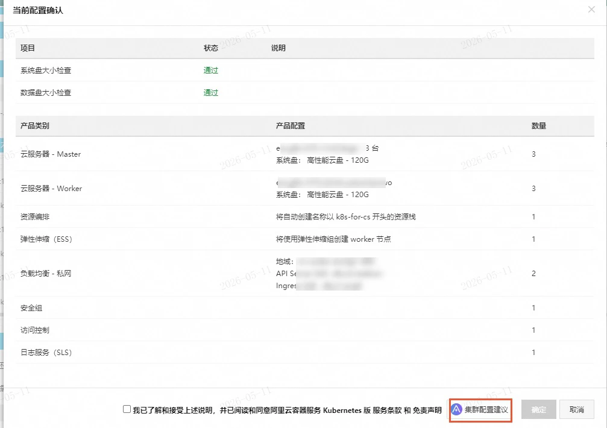

**飞天助理辅助诊断异常容器组**

飞天助理支持容器组诊断功能，主要包括：

- 针对异常容器组的问题进行智能诊断，分析可能的原因。

- 提供问题排查步骤和修复建议。

**使用方法**

1. 登录容器服务控制台。

2. 在左侧导航栏，单击**集群**。

3. 在**集群列表**页面，单击目标集群名称或者目标集群右侧**操作**列的**详情**。

4. 在集群管理页的左侧导航栏，选择**工作负载 > 容器组**。

5. 在**容器组**页面，若当前容器组状态异常，您可单击**智能诊断**展开**飞天助理**对话框，针对当前异常状态进行智能分析以及问题排查。

   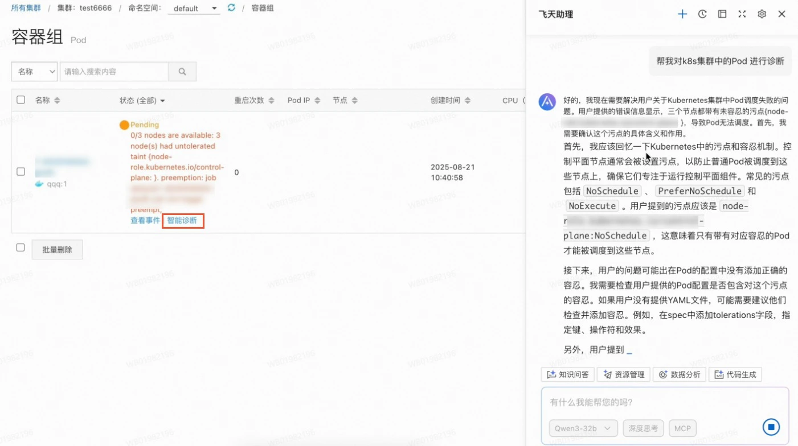

**飞天助理辅助创建应用**

飞天助理可快速辅助您创建应用，核心内容聚焦于两大智能能力：

- 智能生成模板：一键自动生成标准化的 YAML 配置示例，免去手动编写的繁琐。

- YAML 语句智能分析：自动检测配置文件的格式规范与语法正确性，有效规避部署错误。

**使用方法**

1. 登录容器服务控制台。

2. 在左侧导航栏，单击**集群**。

3. 在**集群列表**页面，单击目标集群名称或者目标集群右侧**操作**列的**详情**。

4. 在集群管理页左侧导航栏中，选择**工作负载 > 无状态**。

5. 在**无状态**页面顶部选择命名空间，单击**使用模板创建**。

6. 单击**智能生成模板**，通过飞天助理快速生成一个YAML示例。

   > **说明**
   >
   > 您可以单击**YAML 语句智能分析**，通过飞天助理自动检测YAML格式与语法是否正确。

   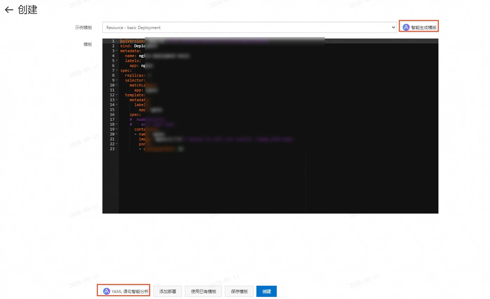

**划词释义**

对界面中的专业术语、参数、选项等进行划词解释。

**前提条件**

单击飞天助理对话框上方的  ，可选择开启划词。

**使用方法**

1. 选中需要了解的术语或参数，并单击悬浮的**咨询飞天助理**。

2. 飞天助理自动触发对所选内容的问答能力。

<a id="section-7-2"></a>

## 7.2. 授权管理

<a id="section-7-2-1"></a>

### 7.2.1. 配置子账号或RAM角色的RBAC权限

本文主要介绍如何配置子账号或RAM角色对应的Kubernetes集群内RBAC权限。从Kubernetes 1.6版本起，系统默认启用RBAC策略。 RBAC策略对于正确管理群集至关重要，因为它们使您可以根据用户及其在组织中的角色来指定允许的操作类型。

**操作步骤**

1. 登录容器服务控制台。

2. 在控制台左侧导航栏中，单击**授权管理**。

3. 在**授权管理**页面配置管理权限。

   - 单击**子账号**页签，选择需要授权的子账号，单击**管理权限**为子账号授权。

   - 单击**RAM 角色**页签，选择需要授权的RAM角色，单击**管理权限**为RAM角色授权。

   > **说明**
   >
   > 如果您使用子账号授权，请先确保该子账号已被授予集群内RBAC管理员权限或cluster-admin角色。

4. 在**添加权限**区域，单击**添加权限**，选择集群和命名空间，并选择相应的预置角色，完成后单击**提交授权**。

   > **说明**
   >
   > 当前针对子账号的授权，支持在一个目标集群或命名空间上授予一个预置角色和多个自定义角色。

   集群和命名空间的预置角色定义可查看以下角色权限说明。

   表 1. 角色权限说明

   <table>
     <tr>
       <th width="90">角色</th>
       <th>集群内 RBAC 权限</th>
     </tr>
     <tr>
       <td>管理员</td>
       <td>对集群所有命名空间下 Kubernetes 资源的 RBAC 读写权限，对集群节点、存储卷、命名空间、配额的读写权限。</td>
     </tr>
     <tr>
       <td>审计人员</td>
       <td>对集群所有命名空间下 Kubernetes 资源的 RBAC 只读权限，对集群节点、存储卷、命名空间、配额的只读权限。</td>
     </tr>
     <tr>
       <td>运维人员</td>
       <td>对集群所有命名空间下控制台可见 Kubernetes 资源的 RBAC 读写权限，对集群节点、存储卷、命名空间、配额的只读权限。</td>
     </tr>
     <tr>
       <td>开发人员</td>
       <td>对所有命名空间或所选命名空间下资源的读写权限。</td>
     </tr>
     <tr>
       <td>受限用户</td>
       <td>对所有命名空间或所选命名空间下资源的只读权限。</td>
     </tr>
     <tr>
       <td>自定义</td>
       <td>权限由您所选择的ClusterRole决定，请在确定所选ClusterRole对各类资源的操作权限后再进行授权，以免子账号获得不符合预期的权限。</td>
     </tr>
   </table>

   配置完成后，您可以使用目标子账号登录容器服务控制台，并进行相关操作。

**自定义权限说明**

阿里云容器服务预置了管理员、审计人员、运维人员、开发人员和受限用户5种标准的访问权限，可满足大部分用户在容器服务控制台上的使用需求。如果您想自由定义集群的访问权限，可使用自定义权限功能。

阿里云容器服务内置了一些自定义权限。

> **说明**
>
> 其中cluster-admin权限属于集群超级管理员权限，对所有资源都默认拥有权限。

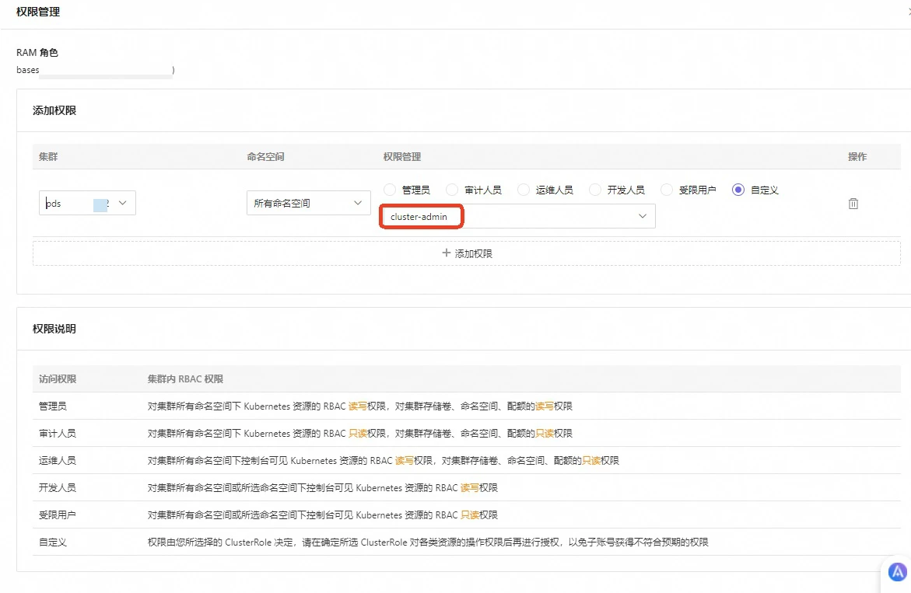

您可登录到集群Master节点，执行以下命令，查看自定义权限的详情。

```bash
 # kubectl get clusterrole 
```

```bash
# kubectl get clusterrole
NAME                                                                   AGE
admin                                                                  13d
alibaba-log-controller                                                 13d
alicloud-disk-controller-runner                                        13d
cluster-admin                                                          13d
cs:admin                                                               13d
edit                                                                   13d
flannel                                                                13d
kube-state-metrics                                                     22h
node-exporter                                                          22h
prometheus-k8s                                                         22h
prometheus-operator                                                    22h
system:aggregate-to-admin                                              13d
....  
system:volume-scheduler                                                13d
view                                                                   13d
            
```

以超级管理员cluster-admin为例，执行以下命令，查看其权限详情。

```bash
 # kubectl get clusterrole cluster-admin -o yaml 
```

> **重要**
>
> 子账号被授予该集群角色后，在该集群内，可视为与主账号有相同权限的超级账号，拥有操作集群内所有资源的任意权限，建议谨慎授予。

```bash
# kubectl get clusterrole cluster-admin  -o yaml
apiVersion: rbac.authorization.k8s.io/v1
kind: ClusterRole
metadata:
  annotations:
    rbac.authorization.kubernetes.io/autoupdate: "true"
  creationTimestamp: 2018-10-12T08:31:15Z
  labels:
    kubernetes.io/bootstrapping: rbac-defaults
  name: cluster-admin
  resourceVersion: "57"
  selfLink: /apis/rbac.authorization.k8s.io/v1/clusterroles/cluster-admin
  uid: 2f29f9c5-cdf9-11e8-84bf-00163e0b2f97
rules:
- apiGroups:
  - '*'
  resources:
  - '*'
  verbs:
  - '*'
- nonResourceURLs:
  - '*'
  verbs:
  - '*'
```

<a id="section-7-2-2"></a>

### 7.2.2. 为集群Worker节点绑定的RAM角色配置权限

本文介绍如何通过容器服务控制台为集群Worker节点绑定的RAM角色配置权限。

**步骤一：获取集群对应RAM角色**

1. 登录容器服务控制台，在左侧导航栏中单击**集群**。

2. 在**集群列表**页面的**操作**列，单击目标集群对应的**详情**。

3. 在**集群信息**页面，单击**集群资源**页签，获取集群所使用的**Worker RAM 角色**。

**步骤二：获取集群所在组织的AK和SK**

1. 登录Apsara Uni-manager运营控制台，在顶部菜单栏单击**企业**。

2. 在左侧导航栏，单击**资源管理 > 组织管理**。

3. 在**组织管理**页面左侧，选择集群所在的组织，然后在右侧单击**管理Accesskey**。

4. 在弹出的**管理Accesskey**对话框，获取**AccessKey ID**和**AccessKey Secret**。

**步骤三：创建RAM Policy**

1. 登录Apsara Uni-manager运营控制台，在顶部菜单栏中，选择**产品 > 开发工具 > 开发者门户**。

2. 在**开发者门户**页面顶部，选择**API集成** > **统一云管平台** > **API调试**。

3. 在左侧导航栏，**版本**选择当前可获得的最新版本，然后在文本框搜索并单击**CreatePolicy**。

4. 在**CreatePolicy**页面的**参数名**页签，配置相关参数。

   部分参数说明如下：

   <table>
     <tr>
       <th>参数</th>
       <th>说明</th>
     </tr>
     <tr>
       <td>AccessKeyId</td>
       <td rowspan="2">由步骤二获取。</td>
     </tr>
     <tr>
       <td>AccessKeySecret</td>
     </tr>
     <tr>
       <td>PolicyName</td>
       <td>请根据需求命名。</td>
     </tr>
     <tr>
       <td>PolicyDocument</td>
       <td>在<code> Action </code>字段中填入所需的权限，配置示例如下：<br><code>{</code><br><code>"Version": "1",</code><br><code>"Statement": [</code><br><code>{</code><br><code>"Effect": "Allow",</code><br><code>"Action": [</code><br><code>"ecs:DescribeImages",</code><br><code>"ecs:DescribeInstance"</code><br><code>],</code><br><code>"Resource": "*"</code><br><code>}</code><br><code>]</code><br><code>}</code></td>
     </tr>
   </table>

5. 配置完成后，在**参数名**页签下方，单击**发起调用**。

   若**调用结果**页签显示**200**，表示调用接口成功，已创建所需Policy。

**步骤四：为RAM角色绑定Policy**

1. 登录Apsara Uni-manager运营控制台，在顶部菜单栏中，选择**产品 > 开发工具 > 开发者门户**。

2. 在**开发者门户**页面顶部，选择**API集成** > **统一云管平台** > **API调试**。

3. 在左侧导航栏，**版本**选择当前可获得的最新版本，然后在文本框搜索并单击**AttachPolicyToRole**。

4. 在**AttachPolicyToRole**页面的**参数名**页签，配置相关参数。

   部分参数说明如下：

   <table>
     <tr>
       <th>参数</th>
       <th>说明</th>
     </tr>
     <tr>
       <td><code>AccessKeyId</code></td>
       <td rowspan="2">由步骤二获取。</td>
     </tr>
     <tr>
       <td><code>AccessKeySecret</code></td>
     </tr>
     <tr>
       <td><code>PolicyType</code></td>
       <td>配置为<code> Custom </code>。</td>
     </tr>
     <tr>
       <td><code>PolicyName</code></td>
       <td>配置为步骤三.5命名的<code> PolicyName </code>。</td>
     </tr>
     <tr>
       <td><code>RoleName</code></td>
       <td>配置为步骤一获取到的集群所使用的Worker RAM角色。</td>
     </tr>
   </table>

5. 配置完成后，在**参数名**页签下方，单击**发起调用**。

   若**调用结果**页签显示**200**，表示调用接口成功，集群所使用的Worker RAM角色已新增所配置的权限。

<a id="section-7-2-3"></a>

### 7.2.3. 通过RRSA配置ServiceAccount的RAM权限实现Pod权限隔离

基于适用于服务账户的RAM角色（RAM Roles for Service Accounts，简称RRSA）功能，您可以在集群内实现Pod维度的OpenAPI权限隔离，从而实现云资源访问权限的细粒度隔离，降低安全风险。本文介绍如何在集群中使用RRSA。

**背景信息**

ECS实例元数据包含了在阿里云系统中关于ECS实例（ECI实例基于ECS实例实现）的详细信息。您可以在运行中的实例内部访问这些元数据，从而配置或管理实例。通过实例元数据，Kubernetes集群内应用可以获取实例RAM角色策略生成的STS临时凭证，并通过这些临时凭证访问云资源OpenAPI。

1、访问 ECS 实例元数据获取 STS 临时凭证

（应用共享的实例元数据）

用户应用

ECS 实例

2、使用临时凭证访问云资源

STS

云资源

出于安全考虑，当您需要限制集群内不同应用的RAM权限时，应禁止这些应用通过ECS或ECI实例元数据获取您的实例关联角色对应的临时凭证，或者不为实例关联角色分配任何RAM权限策略。然而，这些应用仍然需要一种安全的途径去获取访问云资源的临时凭证。因此，阿里云容器服务ACK联合RAM访问控制服务推出了RRSA功能。

基于RRSA功能，您可以在集群内实现Pod级别隔离的应用关联RAM角色功能。各个应用可以扮演独立的RAM角色并使用获取的临时凭证访问云资源，从而实现应用RAM权限最小化以及无AccessKey访问阿里云OpenAPI避免AccessKey泄露的需求。

1、使用 OIDC Token 扮演 RAM 角色获取 STS 临时凭证

（服务账户绑定的 OIDC Token）

用户应用

STS

2、基于 OIDC 协

3、使用临时凭证访问云资源

OIDC

RAM

云资源

从用户侧视角来看，RRSA功能的工作流程如下。

1. 用户提交使用了服务账户令牌卷投影功能的应用Pod。

2. 集群将为该应用Pod创建和挂载相应的服务账户OIDC Token文件。

3. Pod内程序使用挂载的OIDC Token文件访问STS服务的AssumeRoleWithOIDC接口，获取扮演指定RAM角色的临时凭证。

   > **说明**
   >
   > - 请提前修改RAM角色配置，允许Pod使用的服务账户扮演该RAM角色。
   >
   > - 从文件中读取的OIDC Token是一个临时Token，建议应用程序每次在使用时都从文件中读取最新的Token，集群会在Token过期前更新替换文件内已有的Token。

4. Pod内程序使用获取到的临时凭证访问云资源OpenAPI。

**使用限制**

仅支持1.22及以上版本的Kuberntes集群。

> **说明**
>
> RRSA依赖ServiceAccount Token卷投影功能，该功能在1.22及以上版本的集群默认启用。与普通Token静态挂载到Pod内部不同，Token卷投影中的Token由kubelet管理，该方式管理更加灵活，同时减少了Pod被攻击导致Token泄露的风险。

**启用RRSA功能**

若未创建集群，您可以在创建集群时开启，若已创建集群，可在集群的**基本信息**页面的集群信息区域开启。

**创建集群时开启**

您可以在创建专有版集群的如下配置中选中开启RRSA功能。


**在已有集群中开启**

1. 登录容器服务控制台，在左侧导航栏中单击**集群**。

2. 在集群列表页面，单击目标集群名称。

3. 在**基本信息**页签的**集群信息**区域，单击**RRSA OIDC**右侧的**启用RRSA**。

4. 在弹出的启用RRSA对话框中，单击**确定**。

5. 在**基本信息**区域，当集群状态由**更新中**变为**运行中**后，表明该集群的RRSA特性已变更完成。

**获取集群中OIDC提供商的URL和ARN信息**

集群中RRSA功能开启后，在**基本信息**页签的**集群信息**区域中，可查看提供商的URL链接和ARN信息。


集群开启RRSA功能后，ACK将在后台执行如下操作。

- 自动创建一个集群专用的OIDC Issuer服务。该服务由ACK托管，无需您运维。

- 修改当前集群的服务账户令牌卷投影功能的配置，使用本次创建的OIDC Issuer配置合并集群已有的service-account-issuer参数的值。

- 在您的账号下创建一个使用该OIDC Issuer的OIDC身份提供商，名称为ack-rrsa-&lt;cluster_id>，其中 <em>&lt;cluster_id></em>为您的集群ID。

**使用示例**

本文以通过RRSA鉴权方式挂载OSS静态存储卷为例介绍如何在ACK专有版集群中使用RRSA。

**通过RRSA挂载OSS静态存储卷的相关配置**

- 命名空间：需设置为ack-csi-fuse。

- ServiceAccount：需设置为csi-fuse-ossfs。

- RAM角色：test-role-1022，可自定义。

**步骤一：安装ack-pod-identity-webhook组件**

ack-pod-identity-webhook组件会在Pod创建时注入环境变量  `ALIBABA_CLOUD_OIDC_PROVIDER_ARN` 、 `ALIBABA_CLOUD_OIDC_TOKEN_FILE` 、 `ALIBABA_CLOUD_ROLE_ARN` 。

1. 登录容器服务控制台。

2. 在控制台左侧导航栏单击**集群**。

3. 在**集群列表**页面单击目标集群右侧**操作**列的**详情**。

4. 在集群管理页面选择**组件管理**，定位`ack-pod-identity-webhook`组件，单击**安装**，根据界面提示依次完成组件安装操作。

**步骤二：创建角色并授权**

1. 登录Apsara Uni-manager运营控制台，在顶部菜单栏单击**企业**。

2. 在左侧导航栏选择**权限管理 > 角色授权**，然后单击**创建自定义角色。**

3. 在**角色授权**页面，单击**高级创建**页签，然后单击**创建RAM角色授权**，输入角色名称（以test-role-1022为例），默认共享范围为全局共享。

   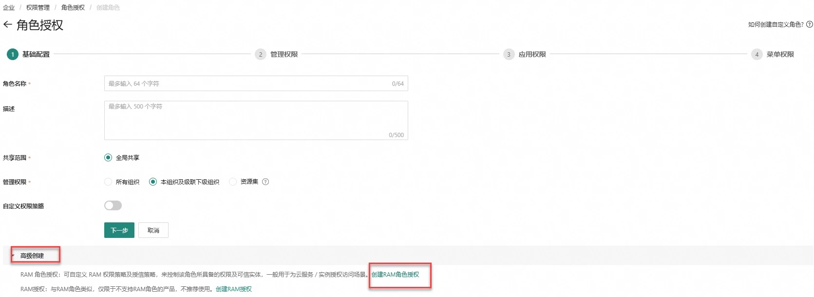

4. 单击**下一步**进入自定义权限策略配置页面，单击**创建权限策略**，在策略内容区域配置如下OSS访问策略。替换以下 `mybucket` 为您实际创建的Bucket名称，本文以test-bucket为例介绍。

   ```json
   {
     "Statement": [
       {
         "Action": "oss:*",
         "Effect": "Allow",
         "Resource": [
           "acs:oss:*:*:mybucket",  # mybuket替换为您实际的Bucket名称。
           "acs:oss:*:*:mybucket/*"  # mybuket替换为您实际的Bucket名称。
         ]
       }
     ],
     "Version": "1"
   }
   ```

   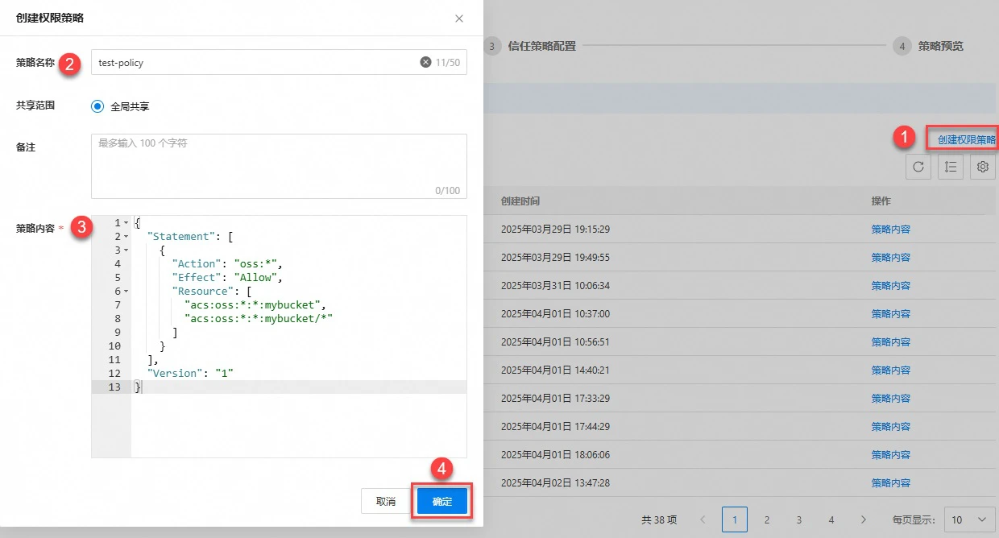

5. 搜索并选中上一步创建的权限策略，然后单击**下一步**。

   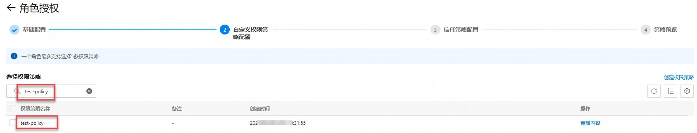

6. 配置授信提供者信息，单击**下一步**，然后单击**创建**。

   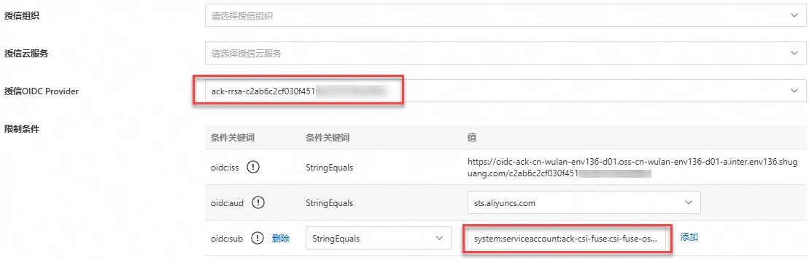

   <table>
     <tr>
       <th width="185">配置项</th>
       <th>说明</th>
     </tr>
     <tr>
       <td>授信OIDC Provider</td>
       <td>ack-rrsa-&lt;cluster_id&gt;，其中，&lt;cluster_id&gt;为您的集群ID。</td>
     </tr>
     <tr>
       <td>限制条件</td>
       <td>• <strong>oidc:iss</strong>：保持默认。<br>• <strong>oidc:aud</strong>：选择<strong>sts.aliyuncs.com</strong>，为默认信息。<br>• <strong>oidc:sub</strong>：条件判定方式选择<strong>StringEquals</strong>，值的格式为 <code> system:serviceaccount:&lt;namespace&gt;:</code> <code>&lt;serviceAccountName&gt; </code>，根据本示例RRSA配置信息，此处须填写为<code> system:serviceaccount:ack-csi-fuse:csi-fuse-</code><code>ossfs </code>。</td>
     </tr>
   </table>

**步骤三：通过RRSA挂载OSS静态存储卷**

1. 创建PV。

   <ol type="i">

   <li>

   使用以下内容示例，创建test-pv-oss.yaml文件。

   ```yaml
   apiVersion: v1
   kind: PersistentVolume
   metadata:
     name: test-pv-oss
     labels:    
       alicloud-pvname: test-pv-oss
   spec:
     capacity:
       storage: 5Gi
     accessModes:
       - ReadWriteMany
     persistentVolumeReclaimPolicy: Retain
     csi:
       driver: ossplugin.csi.alibabacloud.com
       volumeHandle: test-pv-oss # 需要和PV名字⼀致。
       volumeAttributes:
         bucket: "test-bucket"
         url: "http://oss-cn-wulan-env38-d01-a.inter.env38.shuguang.com"
         otherOpts: "-o umask=022 -o max_stat_cache_size=0 -o allow_other -o curldbg"
         authType: "rrsa"
         roleName: "test-role-1022"
   ```

   <table>
     <tr>
       <th width="132">参数</th>
       <th>说明</th>
     </tr>
     <tr>
       <td>accessModes</td>
       <td>配置访问模式，支持ReadOnlyMany和ReadWriteMany。</td>
     </tr>
     <tr>
       <td>OSS url</td>
       <td>挂载OSS的Endpoint，专有云场景中OSS不支持使用HTTPS协议访问，需要显式设置为HTTP协议。</td>
     </tr>
     <tr>
       <td>roleName</td>
       <td>设置为以上步骤二：创建角色并授权中创建的角色名称。</td>
     </tr>
     <tr>
       <td>otherOpts</td>
       <td>您可以为OSS存储卷输入定制化参数，格式为<code> -o *** -o *** </code>。例如加上 <code> -o curldbg </code>，可以进行调试。</td>
     </tr>
   </table>

   </li>

   <li>

   执行以下命令，创建存储卷PV。

   ```bash
   kubectl apply -f test-pv-oss.yaml
   ```

   </li>

   </ol>

2. 创建PVC。

   <ol type="i">

   <li>

   使用以下内容示例，创建test-pvc-oss.yaml文件。

   ```yaml
   apiVersion: v1
   kind: PersistentVolumeClaim
   metadata:
     name: test-pvc-oss
   spec:
     accessModes:
       - ReadWriteMany
     resources:
       requests:
         storage: 5Gi
     selector:
       matchLabels:
         alicloud-pvname: test-pv-oss
   ```

   </li>

   <li>

   执行以下命令，创建存储声明PVC。

   ```bash
   kubectl apply -f test-pv-oss.yaml
   ```

   </li>

   </ol>

3. 创建应用。

   <ol type="i">

   <li>

   使用以下内容示例，创建oss-static.yaml文件。

   ```yaml
   apiVersion: apps/v1
   kind: Deployment
   metadata:
     name: oss-static
     labels:
       app: nginx
   spec:
     replicas: 2
     selector:
       matchLabels:
         app: nginx
     template:
       metadata:
         labels:
           app: nginx
       spec:
         containers:
         - name: nginx
           image: <YOUR-IMAGE>
           ports:
           - containerPort: 80
           volumeMounts:
             - name: pvc-oss
               mountPath: "/data"
             - name: pvc-oss
               mountPath: "/data1"
           livenessProbe:
             exec:
               command:
               - sh
               - -c
               - cd /data
             initialDelaySeconds: 30
             periodSeconds: 30
         volumes:
           - name: pvc-oss
             persistentVolumeClaim:
               claimName: test-pvc-oss
   ```

   </li>

   <li>

   执行以下命令，部署应用。

   ```bash
   kubectl apply -f oss-static.yaml
   ```

   </li>

   </ol>

**步骤四：验证结果**

1. 执行以下命令，在一个Pod的 `/data` 路径下创建tmpfile文件。

   ```bash
   kubectl exec oss-static-744dc7c5b-crcxr -- touch /data/tmpfile
   ```

2. 执行以下命令，查看另一个Pod 的 `/data` 路径。

   ```bash
   kubectl exec oss-static-744dc7c5b-lshmf -- ls /data
   ```

   预期输出：

   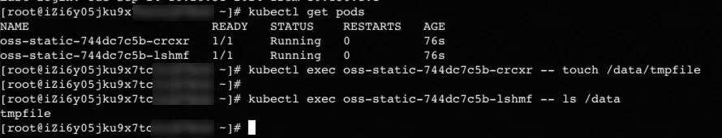

   表明两个Pod可以共享tmpfile文件。

3. 登录OSS控制台，查看tmpfile文件已存在。

   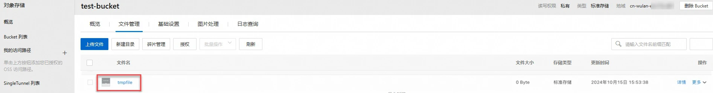

<a id="section-7-2-4"></a>

### 7.2.4. 角色登录说明

本文介绍使用角色授权访问登录和对指定角色进行RBAC授权的相关说明。

**使用角色授权访问登录**

使用角色授权访问的方式登录容器服务控制台可以获得更好的安全审计和管控接口的细粒度授权能力，使用角色授权访问登录的具体步骤如下：

1. 创建自定义角色。具体操作，请参见<strong>《Apsara Uni-manager运营控制台 用户指南》</strong>>**《企业中心》**>**《角色管理》**。

   您也可以使用Apsara Uni-manager运营控制台提供的系统角色进行登录。

2. 为角色授权。

   如果使用自定义角色访问登录，请参考<strong>《Apsara Uni-manager运营控制台 用户指南》</strong>>**《RAM管理》**>**《RAM角色授权》**，对已创建的自定义角色授予应用产品的权限，请遵循权限最小化原则分配权限。

3. 为用户授权。

   <ol type="i">

   <li>

   登录Apsara Uni-manager运营控制台，在顶部菜单栏单击**企业**。

   </li>

   <li>

   在左侧导航栏单击**人员管理 > 用户管理**。

   </li>

   <li>

   在目标用户右侧的**操作**列下，单击

   **> 角色授权**。

   

   </li>

   <li>

   在弹出的**修改授权信息**对话框中，在**角色**下拉列表中选择步骤1中创建的自定义角色或指定的系统角色完成授权。

   更多信息，请参见<strong>《Apsara Uni-manager运营控制台 用户指南》</strong>>**《企业中心》**>**《用户管理》**。

   </li>

   </ol>

4. 角色授权访问。

   <ol type="i">

   <li>

   使用指定用户账号登录Apsara Uni-manager运营控制台。

   </li>

   <li>

   在顶部菜单栏单击**产品**，在**计算**区域单击**容器服务Kubernetes版**。

   </li>

   <li>

   在**容器服务**页面单击**角色授权访问**。

   关于角色授权访问和高安全模式的更多信息，请参见<strong>《Apsara Uni-manager运营控制台 用户指南》</strong>><strong>《企业中心》</strong>章节下的<strong>《角色管理》</strong>和<strong>《访问控制管理》</strong>、**《配置中心》**>**《鉴权信任模式》**。

   </li>

   </ol>

**对指定角色进行RBAC授权**

**前提条件**

进行容器服务RBAC授权的权限管理员需要具备以下权限条件：

- 在应用权限中具有容器服务Kubernetes的读写权限。

- 在管理权限中具有查看用户和查看角色权限用于列举指定组织下的账号或角色列表。

- 具有容器服务RBAC授权权限，下列条件满足其一即可：

  - 指定的权限管理员用户或角色在目标集群或命名空间上被授予预置的管理员角色或自定义中的cluster-admin角色。

  - 如果权限管理员通过角色授权访问登录，需在企业控制台的**权限管理 > 角色授权**页面授予容器服务Kubernetes下的分配RBAC管理员权限。

**操作步骤**

1. 在Apsara Uni-manager运营控制台顶部菜单栏单击**产品**，在**计算**区域单击**容器服务Kubernetes版**。

2. 单击**角色授权访问**或**管理员权限访问**进入容器服务控制台。

3. 在左侧导航栏单击**授权管理**，然后单击**RAM角色**页签。

   在**RAM角色**页签，可以查看当前登录用户可见的角色信息、对权限进行增加或删除操作。

   授权的相关操作说明如下：

   <table>
     <tr>
       <th width="89">操作</th>
       <th>说明</th>
     </tr>
     <tr>
       <td>授权</td>
       <td>授权有以下两种方式：<br>• 方式一：在目标角色右侧单击<strong>管理权限</strong>进入<strong>管理权限</strong>页面，可以看到该角色当前已授权的RBAC权限，可以在此基础上添加或删除已有授权，进行对指定角色的RBAC全量授权。<br>• 方式二：选中目标角色，单击页面下方的<strong>添加权限</strong>进入<strong>添加权限</strong>页面，该页面不会显示选择目标的当前授权状态，只能进行相应的增量授权。</td>
     </tr>
     <tr>
       <td>增加授权</td>
       <td>在<strong>管理权限</strong>或<strong>添加权限</strong>页面，单击<strong>添加权限</strong>，选择目标集群、命名空间以及对应的RBAC预置角色。<br>说明<br>• 方式二不支持自定义授权。<br>• 如果您有定制化的RBAC授权需求，可以根据自定义需求在集群中创建Clusterrole实例，使用方式一，在<strong>管理权限</strong>页面的自定义下拉列表中会显示对应添加的Clusterrole实例名称，选择该名称的角色即可。</td>
     </tr>
     <tr>
       <td>删除授权</td>
       <td>在<strong>管理权限</strong>或<strong>添加权限</strong>页面，在目标权限左侧单击图标。</td>
     </tr>
   </table>

   授权配置完成后，在页面下方单击**下一步**，在**授权提交**配置向导显示**授权成功**，表示授权配置成功。

<a id="section-7-2-5"></a>

### 7.2.5. 角色权限说明

本文介绍Master节点和Worker节点绑定的角色权限及相关说明。

**Master节点绑定的角色权限**

**CCM组件**

```json
{
    "Version": "1",
    "Statement": [
        {
            "Action": [
                "ecs:Describe*",
                "ecs:CreateRouteEntry",
                "ecs:DeleteRouteEntry",
                "ecs:CreateNetworkInterface",
                "ecs:DeleteNetworkInterface",
                "ecs:CreateNetworkInterfacePermission",
                "ecs:DeleteNetworkInterfacePermission",
                "ecs:ModifyInstanceAttribute",
                "ecs:AttachKeyPair",
                "ecs:StopInstance",
                "ecs:StartInstance",
                "ecs:ReplaceSystemDisk"
            ],
            "Resource": [
                "*"
            ],
            "Effect": "Allow"
        },
        {
            "Action": [
                "slb:Describe*",
                "slb:CreateLoadBalancer",
                "slb:DeleteLoadBalancer",
                "slb:ModifyLoadBalancerInternetSpec",
                "slb:RemoveBackendServers",
                "slb:AddBackendServers",
                "slb:RemoveTags",
                "slb:AddTags",
                "slb:StopLoadBalancerListener",
                "slb:StartLoadBalancerListener",
                "slb:SetLoadBalancerHTTPListenerAttribute",
                "slb:SetLoadBalancerHTTPSListenerAttribute",
                "slb:SetLoadBalancerTCPListenerAttribute",
                "slb:SetLoadBalancerUDPListenerAttribute",
                "slb:CreateLoadBalancerHTTPSListener",
                "slb:CreateLoadBalancerHTTPListener",
                "slb:CreateLoadBalancerTCPListener",
                "slb:CreateLoadBalancerUDPListener",
                "slb:DeleteLoadBalancerListener",
                "slb:CreateVServerGroup",
                "slb:DescribeVServerGroups",
                "slb:DeleteVServerGroup",
                "slb:SetVServerGroupAttribute",
                "slb:DescribeVServerGroupAttribute",
                "slb:ModifyVServerGroupBackendServers",
                "slb:AddVServerGroupBackendServers",
                "slb:ModifyLoadBalancerInstanceSpec",
                "slb:ModifyLoadBalancerInternetSpec",
                "slb:SetLoadBalancerModificationProtection",
                "slb:SetLoadBalancerDeleteProtection",
                "slb:SetLoadBalancerName",
                "slb:ModifyLoadBalancerInstanceChargeType",
                "slb:RemoveVServerGroupBackendServers"
            ],
            "Resource": [
                "*"
            ],
            "Effect": "Allow"
        },
        {
            "Action": [
                "vpc:Describe*",
                "vpc:DeleteRouteEntry",
                "vpc:CreateRouteEntry"
            ],
            "Resource": [
                "*"
            ],
            "Effect": "Allow"
        }
    ]
}
```

**权限类型**

**权限名称（Action）**

**说明**

调用ECS服务只读接口权限。

ecs:Describe\*

在VPC路由器或边界路由器（VBR）上创建自定义路由条目。

ecs:CreateRouteEntry

删除自定义路由条目。

ecs:DeleteRouteEntry

调用CreateNetworkInterface创建一个弹性网卡（ENI）。

ecs:CreateNetworkInterface

调用DeleteNetworkInterface删除一个弹性网卡（ENI）。

ecs:DeleteNetworkInterface

调用CreateNetworkInterfacePermission为阿里云合作伙伴（认证ISV）或者个人用户授权弹性网卡权

ecs:CreateNetworkInterfacePermission

限。

ECS相关

删除弹性网卡（ENI）权限。

ecs:DeleteNetworkInterfacePermission

包括密码、名称、描述、主机名、所属安全组和自定义数据等。若为突发性能实例，支持切换性能突发模

ecs:ModifyInstanceAttribute

式。

调用AttachKeyPair绑定一个SSH密钥对到一台或多台Linux实例。

ecs:AttachKeyPair

实例从停止中（Stopping）变成已停止（Stopped）状态。

ecs:StopInstance

调用StartInstance启动一台ECS实例，接口调用成功后实例进入启动中状态。

ecs:StartInstance

更换一台ECS实例的操作系统。系统盘的云盘ID会发生变化，原云盘会被释放。

ecs:ReplaceSystemDisk

SLB只读权限。

slb:Describe\*

创建负载均衡实例。

slb:CreateLoadBalancer

调用DeleteLoadBalancer删除后付费的负载均衡实例。

slb:DeleteLoadBalancer

调用ModifyLoadBalancerInternetSpec修改公网负载均衡实例的计费方式。

slb:ModifyLoadBalancerInternetSpec

调用RemoveBackendServers移除后端服务器。

slb:RemoveBackendServers

调用AddBackendServers添加后端服务器。

slb:AddBackendServers

调用RemoveTags解绑指定负载均衡实例下的标签。

slb:RemoveTags

调用AddTags为指定的负载均衡实例添加标签。

slb:AddTags

调用StopLoadBalancerListener停止监听。

slb:StopLoadBalancerListener

调用StartLoadBalancerListener启动监听。

slb:StartLoadBalancerListener

调用SetLoadBalancerHTTPListenerAttribute修改HTTP监听的配置。

slb:SetLoadBalancerHTTPListenerAttribute

调用SetLoadBalancerHTTPSListenerAttribute修改HTTPS监听的配置。

slb:SetLoadBalancerHTTPSListenerAttribute

调用SetLoadBalancerTCPListenerAttribute接口修改TCP监听的配置。

slb:SetLoadBalancerTCPListenerAttribute

调用SetLoadBalancerUDPListenerAttribute修改UDP协议监听的配置。

slb:SetLoadBalancerUDPListenerAttribute

调用CreateLoadBalancerHTTPSListener创建HTTPS监听。

slb:CreateLoadBalancerHTTPSListener

调用CreateLoadBalancerHTTPListener创建HTTP监听。

slb:CreateLoadBalancerHTTPListener

SLB相关

调用CreateLoadBalancerTCPListener创建TCP监听。

slb:CreateLoadBalancerTCPListener

调用CreateLoadBalancerUDPListener创建UDP监听。

slb:CreateLoadBalancerUDPListener

调用DeleteLoadBalancerListener删除监听。

slb:DeleteLoadBalancerListener

添加后端服务器组并向指定的后端服务器组中添加后端服务器。

slb:CreateVServerGroup

调用DescribeVServerGroups查询服务器组列表。

slb:DescribeVServerGroups

调用DeleteVServerGroup删除服务器组。

slb:DeleteVServerGroup

调用SetVServerGroupAttribute修改虚拟服务器组的配置。

slb:SetVServerGroupAttribute

调用DescribeVServerGroupAttribute查询服务器组的详细信息。

slb:DescribeVServerGroupAttribute

调用ModifyVServerGroupBackendServers替换服务器组中的后端服务器。

slb:ModifyVServerGroupBackendServers

调用AddVServerGroupBackendServers向指定的后端服务器组中添加后端服务器。

slb:AddVServerGroupBackendServers

调用ModifyLoadBalancerInstanceSpec修改负载均衡的实例规格。

slb:ModifyLoadBalancerInstanceSpec

调用ModifyLoadBalancerInternetSpec修改公网负载均衡实例的计费方式。

slb:ModifyLoadBalancerInternetSpec

设置负载均衡实例修改保护状态。

slb:SetLoadBalancerModificationProtection

调用SetLoadBalancerDeleteProtection设置实例删除保护状态。

slb:SetLoadBalancerDeleteProtection

调用SetLoadBalancerName修改负载均衡实例的名称。

slb:SetLoadBalancerName

调用ModifyLoadBalancerInstanceChargeType接口变更按量付费CLB实例的实例计费方式。

slb:ModifyLoadBalancerInstanceChargeType

调用RemoveVServerGroupBackendServers从指定的后端服务器组中移除后端服务器。

slb:RemoveVServerGroupBackendServers

VPC只读权限。

vpc:Describe\*

VPC相关

删除VPC路由器或边界路由器的路由表中的路由条目。

vpc:DeleteRouteEntry

在VPC路由器或边界路由器（VBR）上创建自定义路由条目。

vpc:CreateRouteEntry

**CSI存储组件**

```json
{
    "Version": "1",
    "Statement": [
        {
            "Action": [
                "ecs:DescribeDisks",
                "ecs:DescribeInstances",
                "ecs:DescribeAvailableResource",
                "ecs:DescribeInstanceTypes",
                "nas:DescribeFileSystems",
                "ecs:AttachDisk",
                "ecs:CreateDisk",
                "ecs:CreateSnapshot",
                "ecs:DeleteDisk",
                "ecs:DeleteSnapshot",
                "ecs:DetachDisk"
            ],
            "Resource": [
                "*"
            ],
            "Effect": "Allow"
        }
    ]
}
```

<table>
  <tr>
    <th>权限类型</th>
    <th>权限名称（Action）</th>
    <th>说明</th>
  </tr>
  <tr>
    <td rowspan="10">ECS相关</td>
    <td>ecs:DescribeDisks</td>
    <td>查询一块或多块已经创建的块存储（包括云盘和本地盘）。</td>
  </tr>
  <tr>
    <td>ecs:DescribeInstances</td>
    <td>查询一台或多台ECS实例的详细信息。</td>
  </tr>
  <tr>
    <td>ecs:DescribeAvailableResource</td>
    <td>在某一可用区创建实例或修改实例规格时查询该可用区的资源列表。</td>
  </tr>
  <tr>
    <td>ecs:DescribeInstanceTypes</td>
    <td>查询云服务器ECS提供的所有实例规格的信息，也可以查询指定实例规格的信息。</td>
  </tr>
  <tr>
    <td>ecs:AttachDisk</td>
    <td>为一台ECS实例挂载一块按量付费数据盘，或者挂载一块系统盘。重要实例和云盘必须在同一个可用区。</td>
  </tr>
  <tr>
    <td>ecs:CreateDisk</td>
    <td>调用CreateDisk创建一块按量付费或包年包月数据盘。</td>
  </tr>
  <tr>
    <td>ecs:CreateSnapshot</td>
    <td>调用CreateSnapshot为一块云盘创建一份快照。</td>
  </tr>
  <tr>
    <td>ecs:DeleteDisk</td>
    <td>调用DeleteDisk释放一块按量付费数据盘。磁盘类型包括普通云盘、高效云盘、SSD云盘和ESSD云盘。</td>
  </tr>
  <tr>
    <td>ecs:DeleteSnapshot</td>
    <td>调用DeleteSnapshot删除指定的快照。如果需要取消正在创建的快照，也可以调用该接口删除快照，即取消创建快照任务。</td>
  </tr>
  <tr>
    <td>ecs:DetachDisk</td>
    <td>从一台ECS实例上卸载一块按量付费数据盘，或者卸载一块系统盘。</td>
  </tr>
  <tr>
    <td>NAS相关</td>
    <td>nas:DescribeFileSystems</td>
    <td>调用DescribeFileSystems查询文件系统信息。</td>
  </tr>
</table>

**网络组件**

```json
{
    "Version": "1",
    "Statement": [
        {
            "Action": [
                "ecs:CreateNetworkInterface",
                "ecs:DescribeNetworkInterfaces",
                "ecs:AttachNetworkInterface",
                "ecs:DetachNetworkInterface",
                "ecs:DeleteNetworkInterface",
                "ecs:DescribeInstanceAttribute",
                "ecs:DescribeInstanceTypes",
                "ecs:AssignPrivateIpAddresses",
                "ecs:UnassignPrivateIpAddresses",
                "ecs:DescribeInstances",
                "ecs:ModifyNetworkInterfaceAttribute"
            ],
            "Resource": [
                "*"
            ],
            "Effect": "Allow"
        },
        {
            "Action": [
                "vpc:DescribeVSwitches"
            ],
            "Resource": [
                "*"
            ],
            "Effect": "Allow"
        }
    ]
}
```

<table>
  <tr>
    <th>权限类型</th>
    <th>权限名称（Action）</th>
    <th>说明</th>
  </tr>
  <tr>
    <td rowspan="11">ECS相关</td>
    <td>ecs:CreateNetworkInterface</td>
    <td>调用CreateNetworkInterface创建一个弹性网卡（ENI）。</td>
  </tr>
  <tr>
    <td>ecs:DescribeNetworkInterfaces</td>
    <td>调用DescribeNetworkInterfaces查询一个或多个弹性网卡（ENI）的详细信息。</td>
  </tr>
  <tr>
    <td>ecs:AttachNetworkInterface</td>
    <td>调用AttachNetworkInterface附加一个弹性网卡（ENI）到一台专有网络VPC类型ECS实例上。</td>
  </tr>
  <tr>
    <td>ecs:DetachNetworkInterface</td>
    <td>从一台ECS实例上分离一个弹性网卡（ENI）。</td>
  </tr>
  <tr>
    <td>ecs:DeleteNetworkInterface</td>
    <td>调用DeleteNetworkInterface删除一个弹性网卡（ENI）。</td>
  </tr>
  <tr>
    <td>ecs:DescribeInstanceAttribute</td>
    <td>实例ID、实例的备注信息。</td>
  </tr>
  <tr>
    <td>ecs:DescribeInstanceTypes</td>
    <td>查询云服务器ECS提供的所有实例规格的信息，也可以查询指定实例规格的信息。</td>
  </tr>
  <tr>
    <td>ecs:AssignPrivateIpAddresses</td>
    <td>调用AssignPrivateIpAddresses为一块弹性网卡分配一个或多个辅助私网IP地址。可以为网卡指定在所属交换机（vSwitch）的空闲私网IP地址，或者通过指定私网地址数量自动分配私网IP地址。</td>
  </tr>
  <tr>
    <td>ecs:UnassignPrivateIpAddresses</td>
    <td>从一块弹性网卡删除一个或多个辅助私有IP地址。</td>
  </tr>
  <tr>
    <td>ecs:DescribeInstances</td>
    <td>查询一台或多台ECS实例的详细信息。</td>
  </tr>
  <tr>
    <td>ecs:ModifyNetworkInterfaceAttribute</td>
    <td>修改一个弹性网卡（ENI）的名称、描述以及所属安全组等。</td>
  </tr>
  <tr>
    <td>VPC相关</td>
    <td>vpc:DescribeVSwitches</td>
    <td>查询可组网的信息，内网按vSwitch进行组网。</td>
  </tr>
</table>

**日志组件**

```json
{
    "Version": "1",
    "Statement": [
        {
            "Action": [
                "log:CreateProject",
                "log:GetProject",
                "log:DeleteProject",
                "log:CreateLogStore",
                "log:GetLogStore",
                "log:UpdateLogStore",
                "log:DeleteLogStore",
                "log:CreateConfig",
                "log:UpdateConfig",
                "log:GetConfig",
                "log:DeleteConfig",
                "log:CreateMachineGroup",
                "log:UpdateMachineGroup",
                "log:GetMachineGroup",
                "log:DeleteMachineGroup",
                "log:ApplyConfigToGroup",
                "log:GetAppliedMachineGroups",
                "log:GetAppliedConfigs",
                "log:RemoveConfigFromMachineGroup",
                "log:CreateIndex",
                "log:GetIndex",
                "log:UpdateIndex",
                "log:DeleteIndex",
                "log:CreateSavedSearch",
                "log:GetSavedSearch",
                "log:UpdateSavedSearch",
                "log:DeleteSavedSearch",
                "log:CreateDashboard",
                "log:GetDashboard",
                "log:UpdateDashboard",
                "log:DeleteDashboard",
                "log:CreateJob",
                "log:GetJob",
                "log:DeleteJob",
                "log:UpdateJob",
                "log:PostLogStoreLogs",
                "log:CreateSortedSubStore",
                "log:GetSortedSubStore",
                "log:ListSortedSubStore",
                "log:UpdateSortedSubStore",
                "log:DeleteSortedSubStore",
                "log:CreateApp",
                "log:UpdateApp",
                "log:GetApp",
                "log:DeleteApp",
                "log:GetLogStoreLogs",
                "log:TagResources",
                "log:ListJobs",
                "log:ListTagResources",
                "log:UntagResources",
                "log:CreateResourceRecord",
                "log:UpdateResourceRecord",
                "log:UpsertResourceRecord",
                "log:GetResourceRecord",
                "log:DeleteResourceRecord",
                "log:ListResourceRecords",
                "log:ListResources",
                "log:GetResource",
                "cs:UpdateContactGroup",
                "cs:DescribeTemplates",
                "cs:DescribeTemplateAttribute",
                "eventbridge:PutEvents"
            ],
            "Resource": [
                "*"
            ],
            "Effect": "Allow"
        }
    ]
}
```

**权限类型**

**权限名称（Action）**

**说明**

创建一个Project。

log:CreateProject

查询目标Project的详细信息。

log:GetProject

删除一个指定的Project。

log:DeleteProject

创建Logstore。

log:CreateLogStore

查看Logstore的详细信息。

log:GetLogStore

更新Logstore的属性信息。

log:UpdateLogStore

删除指定Logstore，包括所有Shard数据和索引。

log:DeleteLogStore

调用CreateConfig创建Logtail配置。

log:CreateConfig

调用UpdateConfig接口更新Logtail配置。

log:UpdateConfig

调用GetConfig接口获取Logtail配置的详细信息。

log:GetConfig

调用DeleteConfig接口删除指定的Logtail配置。

log:DeleteConfig

创建一个机器组。

log:CreateMachineGroup

修改机器组配置信息。

log:UpdateMachineGroup

查看目标机器组的具体信息。

log:GetMachineGroup

删除机器组。如果机器组已应用Logtail采集配置，则删除机器组后，会解绑对应的Logtail配置。

log:DeleteMachineGroup

应用配置到组。

log:ApplyConfigToGroup

调用GetAppliedMachineGroups接口获取已绑定指定Logtail配置的机器组列表。

log:GetAppliedMachineGroups

获取目标机器组上已经被应用的Logtail配置列表。

log:GetAppliedConfigs

从机器组中移除Logtail配置。

log:RemoveConfigFromMachineGroup

为指定Logstore创建索引。

log:CreateIndex

查询指定Logstore的索引信息。

log:GetIndex

更新Logstore的索引信息。

log:UpdateIndex

删除指定Logstore的索引。

log:DeleteIndex

创建一个快速查询。

log:CreateSavedSearch

调用GetSavedSearch接口获取指定的快速查询。

log:GetSavedSearch

调用UpdateSavedSearch接口更新快速查询。

log:UpdateSavedSearch

调用DeleteSavedSearch接口删除一个快速查询。

log:DeleteSavedSearch

调用CreateDashboard接口创建仪表盘。

log:CreateDashboard

调用GetDashboard接口获取指定仪表盘。

log:GetDashboard

Log相关

调用UpdateDashboard接口更新仪表盘。

log:UpdateDashboard

调用DeleteDashboard接口删除指定仪表盘。

log:DeleteDashboard

创建一个Job。

log:CreateJob

获取Job。

log:GetJob

删除Job。

log:DeleteJob

更新Job。

log:UpdateJob

向指定的Logstore中写入日志数据。

log:PostLogStoreLogs

创建排序子存储。

log:CreateSortedSubStore

获取排序子存储。

log:GetSortedSubStore

列举排序子存储。

log:ListSortedSubStore

更新排序子存储。

log:UpdateSortedSubStore

删除排序子存储。

log:DeleteSortedSubStore

日志服务APP（成本管家、日志审计）的创建权限。

log:CreateApp

日志服务APP（成本管家、日志审计）的更新权限。

log:UpdateApp

日志服务APP（成本管家、日志审计）的查看权限。

log:GetApp

日志服务APP（成本管家、日志审计）的删除权限。

log:DeleteApp

查看Logstore日志。

log:GetLogStoreLogs

为指定的资源创建与绑定标签，仅支持为日志项目绑定标签，可一次绑定多个标签。

log:TagResources

列举Job。

log:ListJobs

列出所查询资源的标签列表，可以一次查询多个同类型的资源，也可以按标签键值过滤查询。

log:ListTagResources

为指定的资源解绑标签，现仅支持日志项目的标签，可以一次性为单个日志项目解绑多个或者全部标签。

log:UntagResources

创建日志资源记录。

log:CreateResourceRecord

更新日志资源记录。

log:UpdateResourceRecord

更新日志资源记录。

log:UpsertResourceRecord

获取日志资源记录。

log:GetResourceRecord

删除日志资源记录。

log:DeleteResourceRecord

列举日志资源记录。

log:ListResourceRecords

列举日志资源。

log:ListResources

获取日志资源。

log:GetResource

更新联系组。

cs:UpdateContactGroup

CS相关

查询已创建的所有编排模板详情。

cs:DescribeTemplates

根据编排模板ID，查询该编排模板的详情。

cs:DescribeTemplateAttribute

EventBridge相关

发布一个或多个事件。

eventbridge:PutEvents

**Worker节点绑定的角色权限**

**CSI存储组件**

```json
{
    "Version": "1",
    "Statement": [
        {
            "Action": [
                "ecs:DescribeDisks",
                "ecs:DescribeInstances",
                "ecs:DescribeAvailableResource",
                "ecs:DescribeInstanceTypes",
                "nas:DescribeFileSystems",
                "ecs:AttachDisk",
                "ecs:CreateDisk",
                "ecs:CreateSnapshot",
                "ecs:DeleteSnapshot",
                "ecs:DetachDisk"
            ],
            "Resource": [
                "*"
            ],
            "Effect": "Allow"
        }
    ]
}
```

<table>
  <tr>
    <th>权限类型</th>
    <th>权限名称（Action）</th>
    <th>说明</th>
  </tr>
  <tr>
    <td rowspan="9">ECS相关</td>
    <td>ecs:DescribeDisks</td>
    <td>查询一块或多块已经创建的块存储（包括云盘和本地盘）。</td>
  </tr>
  <tr>
    <td>ecs:DescribeInstances</td>
    <td>查询一台或多台ECS实例的详细信息。</td>
  </tr>
  <tr>
    <td>ecs:DescribeAvailableResource</td>
    <td>在某一可用区创建实例或者修改实例规格时查询该可用区的资源列表。</td>
  </tr>
  <tr>
    <td>ecs:DescribeInstanceTypes</td>
    <td>查询云服务器ECS提供的所有实例规格的信息，也可以查询指定实例规格的信息。</td>
  </tr>
  <tr>
    <td>ecs:AttachDisk</td>
    <td>为一台ECS实例挂载一块按量付费数据盘，或者挂载一块系统盘。重要实例和云盘必须在同一个可用区。</td>
  </tr>
  <tr>
    <td>ecs:CreateDisk</td>
    <td>调用CreateDisk创建一块按量付费或包年包月数据盘。</td>
  </tr>
  <tr>
    <td>ecs:CreateSnapshot</td>
    <td>调用CreateSnapshot为一块云盘创建一份快照。</td>
  </tr>
  <tr>
    <td>ecs:DeleteSnapshot</td>
    <td>调用DeleteSnapshot删除指定的快照。如果需要取消正在创建的快照，也可以调用该接口删除快照，即取消创建快照任务。</td>
  </tr>
  <tr>
    <td>ecs:DetachDisk</td>
    <td>从一台ECS实例上卸载一块按量付费数据盘，或者卸载一块系统盘。</td>
  </tr>
  <tr>
    <td>NAS相关</td>
    <td>nas:DescribeFileSystems</td>
    <td>调用DescribeFileSystems查询文件系统信息。</td>
  </tr>
</table>

**网络组件**

```json
{
    "Version": "1",
    "Statement": [
        {
            "Action": [
                "ecs:CreateNetworkInterface",
                "ecs:DescribeNetworkInterfaces",
                "ecs:AttachNetworkInterface",
                "ecs:DetachNetworkInterface",
                "ecs:DeleteNetworkInterface",
                "ecs:DescribeInstanceAttribute",
                "ecs:DescribeInstanceTypes",
                "ecs:AssignPrivateIpAddresses",
                "ecs:UnassignPrivateIpAddresses",
                "ecs:DescribeInstances",
                "ecs:ModifyNetworkInterfaceAttribute"
            ],
            "Resource": [
                "*"
            ],
            "Effect": "Allow"
        },
        {
            "Action": [
                "vpc:DescribeVSwitches"
            ],
            "Resource": [
                "*"
            ],
            "Effect": "Allow"
        }
    ]
}
```

<table>
  <tr>
    <th>权限类型</th>
    <th>权限名称（Action）</th>
    <th>说明</th>
  </tr>
  <tr>
    <td rowspan="11">ECS相关</td>
    <td>ecs:CreateNetworkInterface</td>
    <td>调用CreateNetworkInterface创建一个弹性网卡（ENI）。</td>
  </tr>
  <tr>
    <td>ecs:DescribeNetworkInterfaces</td>
    <td>调用DescribeNetworkInterfaces查询一个或多个弹性网卡（ENI）的详细信息。</td>
  </tr>
  <tr>
    <td>ecs:AttachNetworkInterface</td>
    <td>调用AttachNetworkInterface附加一个弹性网卡（ENI）到一台专有网络VPC类型ECS实例上。</td>
  </tr>
  <tr>
    <td>ecs:DetachNetworkInterface</td>
    <td>从一台ECS实例上分离一个弹性网卡（ENI）。</td>
  </tr>
  <tr>
    <td>ecs:DeleteNetworkInterface</td>
    <td>调用DeleteNetworkInterface删除一个弹性网卡（ENI）。</td>
  </tr>
  <tr>
    <td>ecs:DescribeInstanceAttribute</td>
    <td>实例ID、实例的备注信息。</td>
  </tr>
  <tr>
    <td>ecs:DescribeInstanceTypes</td>
    <td>查询云服务器ECS提供的所有实例规格的信息，也可以查询指定实例规格的信息。</td>
  </tr>
  <tr>
    <td>ecs:AssignPrivateIpAddresses</td>
    <td>调用AssignPrivateIpAddresses为一块弹性网卡分配一个或多个辅助私网IP地址。可以为网卡指定在所属交换机（vSwitch）的空闲私网IP地址，或者通过指定私网地址数量自动分配私网IP地址。</td>
  </tr>
  <tr>
    <td>ecs:UnassignPrivateIpAddresses</td>
    <td>从一块弹性网卡删除一个或多个辅助私有IP地址。</td>
  </tr>
  <tr>
    <td>ecs:DescribeInstances</td>
    <td>查询一台或多台ECS实例的详细信息。</td>
  </tr>
  <tr>
    <td>ecs:ModifyNetworkInterfaceAttribute</td>
    <td>修改一个弹性网卡（ENI）的名称、描述以及所属安全组等。</td>
  </tr>
  <tr>
    <td>VPC相关</td>
    <td>vpc:DescribeVSwitches</td>
    <td>查询可组网的信息，内网按vSwitch进行组网。</td>
  </tr>
</table>

**日志组件**

```json
{
    "Version": "1",
    "Statement": [
        {
            "Action": [
                "log:CreateProject",
                "log:GetProject",
                "log:DeleteProject",
                "log:CreateLogStore",
                "log:GetLogStore",
                "log:UpdateLogStore",
                "log:DeleteLogStore",
                "log:CreateConfig",
                "log:UpdateConfig",
                "log:GetConfig",
                "log:DeleteConfig",
                "log:CreateMachineGroup",
                "log:UpdateMachineGroup",
                "log:GetMachineGroup",
                "log:DeleteMachineGroup",
                "log:ApplyConfigToGroup",
                "log:GetAppliedMachineGroups",
                "log:GetAppliedConfigs",
                "log:RemoveConfigFromMachineGroup",
                "log:CreateIndex",
                "log:GetIndex",
                "log:UpdateIndex",
                "log:DeleteIndex",
                "log:CreateSavedSearch",
                "log:GetSavedSearch",
                "log:UpdateSavedSearch",
                "log:DeleteSavedSearch",
                "log:CreateDashboard",
                "log:GetDashboard",
                "log:UpdateDashboard",
                "log:DeleteDashboard",
                "log:CreateJob",
                "log:GetJob",
                "log:DeleteJob",
                "log:UpdateJob",
                "log:PostLogStoreLogs",
                "log:CreateSortedSubStore",
                "log:GetSortedSubStore",
                "log:ListSortedSubStore",
                "log:UpdateSortedSubStore",
                "log:DeleteSortedSubStore",
                "log:CreateApp",
                "log:UpdateApp",
                "log:GetApp",
                "log:DeleteApp",
                "log:GetLogStoreLogs",
                "log:TagResources",
                "log:ListJobs",
                "log:ListTagResources",
                "log:UntagResources",
                "log:CreateResourceRecord",
                "log:UpdateResourceRecord",
                "log:UpsertResourceRecord",
                "log:GetResourceRecord",
                "log:DeleteResourceRecord",
                "log:ListResourceRecords",
                "log:ListResources",
                "log:GetResource",
                "cs:UpdateContactGroup",
                "cs:DescribeTemplates",
                "cs:DescribeTemplateAttribute",
                "eventbridge:PutEvents"
            ],
            "Resource": [
                "*"
            ],
            "Effect": "Allow"
        }
    ]
}
```

**权限类型**

**权限名称（Action）**

**说明**

创建一个Project。

log:CreateProject

查询目标Project的详细信息。

log:GetProject

删除一个指定的Project。

log:DeleteProject

创建Logstore。

log:CreateLogStore

查看Logstore的详细信息。

log:GetLogStore

更新Logstore的属性信息。

log:UpdateLogStore

删除指定Logstore，包括所有Shard数据和索引。

log:DeleteLogStore

调用CreateConfig创建Logtail配置。

log:CreateConfig

调用UpdateConfig接口更新Logtail配置。

log:UpdateConfig

调用GetConfig接口获取Logtail配置的详细信息。

log:GetConfig

调用DeleteConfig接口删除指定的Logtail配置。

log:DeleteConfig

创建一个机器组。

log:CreateMachineGroup

修改机器组配置信息。

log:UpdateMachineGroup

查看目标机器组的具体信息。

log:GetMachineGroup

删除机器组。如果机器组已应用Logtail采集配置，则删除机器组后，会解绑对应的Logtail配置。

log:DeleteMachineGroup

将配置应用到机器组。

log:ApplyConfigToGroup

调用GetAppliedMachineGroups接口获取已绑定指定Logtail配置的机器组列表。

log:GetAppliedMachineGroups

获取目标机器组上已经被应用的Logtail配置列表。

log:GetAppliedConfigs

从机器组中移除Logtail配置。

log:RemoveConfigFromMachineGroup

为指定Logstore创建索引。

log:CreateIndex

查询指定Logstore的索引信息。

log:GetIndex

更新Logstore的索引信息。

log:UpdateIndex

删除指定Logstore的索引。

log:DeleteIndex

创建一个快速查询。

log:CreateSavedSearch

调用GetSavedSearch接口获取指定的快速查询。

log:GetSavedSearch

调用UpdateSavedSearch接口更新快速查询。

log:UpdateSavedSearch

调用DeleteSavedSearch接口删除一个快速查询。

log:DeleteSavedSearch

调用CreateDashboard接口创建仪表盘。

log:CreateDashboard

调用GetDashboard接口获取指定仪表盘。

log:GetDashboard

Log相关

调用UpdateDashboard接口更新仪表盘。

log:UpdateDashboard

调用DeleteDashboard接口删除指定仪表盘。

log:DeleteDashboard

创建一个Job。

log:CreateJob

获取Job。

log:GetJob

删除Job。

log:DeleteJob

更新Job。

log:UpdateJob

向指定的Logstore中写入日志数据。

log:PostLogStoreLogs

创建排序子存储。

log:CreateSortedSubStore

获取排序子存储。

log:GetSortedSubStore

列举排序子存储。

log:ListSortedSubStore

更新排序子存储。

log:UpdateSortedSubStore

删除排序子存储。

log:DeleteSortedSubStore

日志服务APP（成本管家、日志审计）的创建权限。

log:CreateApp

日志服务APP（成本管家、日志审计）的更新权限。

log:UpdateApp

日志服务APP（成本管家、日志审计）的查看权限。

log:GetApp

日志服务APP（成本管家、日志审计）的删除权限。

log:DeleteApp

查看Logstore日志。

log:GetLogStoreLogs

为指定的资源创建与绑定标签，现仅支持为日志项目绑定标签，可一次绑定多个标签。

log:TagResources

列举Job。

log:ListJobs

列出所查询资源的标签列表，可以一次查询多个同类型的资源，也可以按标签键值过滤查询。

log:ListTagResources

为指定的资源解绑标签，现仅支持日志项目的标签，可以一次性为单个日志项目解绑多个或者全部标签。

log:UntagResources

创建日志资源记录。

log:CreateResourceRecord

更新日志资源记录。

log:UpdateResourceRecord

更新日志资源记录。

log:UpsertResourceRecord

获取日志资源记录。

log:GetResourceRecord

删除日志资源记录。

log:DeleteResourceRecord

列举日志资源记录。

log:ListResourceRecords

列举日志资源。

log:ListResources

获取日志资源。

log:GetResource

更新联系组。

cs:UpdateContactGroup

CS相关

查询已创建的所有编排模板详情。

cs:DescribeTemplates

根据编排模板ID，查询该编排模板的详情。

cs:DescribeTemplateAttribute

EventBridge相关

发布一个或多个事件。

eventbridge:PutEvents

<a id="section-7-3"></a>

## 7.3. 集群

<a id="section-7-3-1"></a>

### 7.3.1. 创建Kubernetes集群

本文介绍如何通过容器服务控制台创建专有版集群、边缘专有版集群。

**创建专有版集群**

1. 登录容器服务控制台。

2. 在控制台左侧导航栏，单击**集群**，然后选择**创建集群 > 专有版**。

3. 在**集群配置**步骤中，配置以下参数，然后单击**下一步**。

   **基础配置**

   <table>
     <tr>
       <th width="168">配置项</th>
       <th>说明</th>
     </tr>
     <tr>
       <td>集群名称</td>
       <td>创建的集群的名称。包1~63个字符，包括数字、中文字符、英文字符和短划线（-）。<br>说明集群名称在同一个用户下必须唯一。</td>
     </tr>
     <tr>
       <td>资源集</td>
       <td>选择资源集。资源集是资源存放的容器，所有资源都需要创建在对应的资源集下。例如选择不同的资源集，会过滤出该资源集内的专有网络及对应的虚拟交换机。</td>
     </tr>
     <tr>
       <td>地域</td>
       <td>所创建集群将要部署到的地域。</td>
     </tr>
     <tr>
       <td>可用区</td>
       <td>可选择多个可用区。仅展示所选可用区内的虚拟交换机、API server、Ingress的SLB可用区。</td>
     </tr>
     <tr>
       <td>Kubernetes 版本</td>
       <td>选择Kubernetes版本。<br>说明若未购买商业操作系统授权，ARM版本则无法选用1.36版本的Kubernetes。</td>
     </tr>
     <tr>
       <td>容器运行时</td>
       <td>当前仅支持选择<strong>containerd</strong>。需要您部署神龙裸金属服务器，选择控制台提供的最新版本。</td>
     </tr>
   </table>

   **网络配置**

   <table>
     <tr>
       <th width="190">配置项</th>
       <th>说明</th>
     </tr>
     <tr>
       <td>IPv6双栈</td>
       <td>支持开启IPv6双栈。</td>
     </tr>
     <tr>
       <td>专有网络</td>
       <td>您可以在已有VPC列表中选择所需的VPC。</td>
     </tr>
     <tr>
       <td>为专有网络配置 SNAT</td>
       <td>开启后，会为所选择的VPC进行NAT网关配置。<br>• 如果您所选VPC中当前已有NAT网关：<br>• 不存在VPC粒度的SNAT规则：自动配置交换机粒度的SNAT规则（为集群使用的所有交换机配置）。<br>• 存在VPC粒度的SNAT规则：不执行任何操作。<br>• 如果所选VPC中没有NAT网关，则自动创建NAT网关并配置交换机粒度的SNAT规则（为集群使用的所有交换机配置）。<br>说明若选择不自动创建NAT网关，您需要手动配置NAT网关实现VPC安全访问公网环境，或者手动配置SNAT。</td>
     </tr>
     <tr>
       <td>虚拟交换机</td>
       <td>设置虚拟交换机。您可以在已有虚拟交换机列表中，根据<strong>可用区</strong>选择1~3个交换机。</td>
     </tr>
     <tr>
       <td>API server访问</td>
       <td>• <strong>负载均衡规格</strong>：默认将为API server创建一个私网SLB实例，用户可修改SLB实例规格。若删除该实例会导致API server无法访问。<br>• <strong>负载均衡可用区</strong>：多可用区场景下，您可以指定为API server创建的私网SLB实例所在的可用区。<br>• <strong>负载均衡集群</strong>：您可以指定为API server创建的私网SLB实例所在的集群。设置是否开启<strong>使用 EIP 暴露 API Server</strong>：API Server提供了各类资源对象（Pod，Service等）的增删改查及watch等HTTP Rest接口。<br>• 如果开启，会创建一个EIP，并挂载到内网SLB上。此时，Master节点的6443端口（对应API Server）暴露出来，用户可以在外网通过KubeConfig连接并操作集群。<br>• 如果不开启，则不会创建EIP，您只能在VPC内部用KubeConfig连接并操作集群。</td>
     </tr>
     <tr>
       <td>SSH登录</td>
       <td>您需要开启<strong>使用 EIP 暴露 API Server</strong>，才能设置公网SSH登录。<br>• 勾选<strong>开放公网SSH登录</strong>，您可以通过SSH访问集群。<br>• 不勾选<strong>开放公网SSH登录</strong>，将无法通过SSH访问集群，也无法通过kubectl连接集群。如果您需要通过SSH访问集群实例，可以手动为ECS实例绑定EIP，并配置安全组规则，开放SSH（22）端口。</td>
     </tr>
     <tr>
       <td>安全组</td>
       <td>支持选择<strong>自动创建普通安全组</strong>、<strong>自动创建企业级安全组</strong>、<strong>选择已有安全组</strong>。更多信息，请参见<strong>《云服务器ECS用户指南》&gt;《创建安全组》</strong>章节。</td>
     </tr>
     <tr>
       <td>网络插件</td>
       <td>支持<strong>Flannel</strong>和<strong>Terway</strong>，默认启用<strong>Terway</strong>。<br>• 当选中<strong>Flannel</strong>时，您需要配置<strong>节点Pod数量</strong>、<strong>启用Flannel VXLAN 模式</strong>、<strong>Pod 网络 CIDR</strong>和<strong>Service CIDR</strong>。<br>• <strong>节点Pod数量</strong>：定义单个节点上可容纳的最大Pod数量。<br>• <strong>启用Flannel VXLAN 模式</strong>：选中后，可以通过VXLAN隧道实现跨节点容器网络通信。<br>• <strong>Pod 网络 CIDR</strong>：配置Pod网络CIDR。Pod网络CIDR指定Flannel网络插件需要配置Pod网络CIDR，网段不能和VPC及VPC已有Kubernetes集群使用的网段重复，创建成功后不能修改。而且Service地址段不能和Pod地址段重复。默认仅支持10.0.0.0/8、72.16-21.0.0/16、172.23-31.0.0/16、192.168.0.0/16及其子网，如需使用上述范围之外的网段，请联系管理员配置允许的网段范围。<br>• <strong>Service CIDR</strong>：指定Service CIDR，且网段不能与VPC及VPC内已有Kubernetes集群使用的网段重复、Service地址段不能和Pod地址段重复。创建成功后不能修改。默认可选范围为10.0.0.0/8、192.168.0.0/16、172.16-21.0.0/16、172.23-31.0.0/16，如需使用上述范围之外的网段，请联系管理员配置允许的网段范围。<br>• 当选中<strong>Terway</strong>时，您可以选择是否使用<strong>DataPath V2</strong>、<strong>NetworkPolicy支持</strong>、<strong>Terway ENI 支持</strong>。<br>• <strong>Pod虚拟交换机</strong>：您需要为每一个节点虚拟交换机指定至少一个相同可用区的Pod虚拟交换机。<br>• <strong>Service CIDR</strong>：指定Service CIDR，且网段不能与VPC及VPC内已有Kubernetes集群使用的网段重复、Service地址段不能和Pod地址段重复。创建成功后不能修改。默认可选范围为10.0.0.0/8、192.168.0.0/16、172.16-21.0.0/16、172.23-31.0.0/16，如需使用上述范围之外的网段，请联系管理员配置允许的网段范围。更多信息，请参见<strong>《专有网络VPC 用户指南》&gt;《网络规划》</strong>章节。<br>说明开启IPv6双栈后，<strong>网络插件</strong>仅支持<strong>Terway</strong>。</td>
     </tr>
     <tr>
       <td>IPv6 Service CIDR</td>
       <td>开启IPv6双栈后，您需要为Service CIDR配置IPv6地址段。配置网段时，请注意：<br>• 必须使用ULA地址，地址段范围在fc00::/7内，且地址前缀长度在112~120之间。<br>• 推荐和Service CIDR保持相同的可用地址数量。</td>
     </tr>
   </table>

   **高级选项**

   <table>
     <tr>
       <th width="197">配置项</th>
       <th>说明</th>
     </tr>
     <tr>
       <td>集群删除保护</td>
       <td>防止通过控制台或API误删除集群。</td>
     </tr>
     <tr>
       <td>禁止跨可用区绑定 SLB</td>
       <td>开启后，新建SLB只能绑定到集群已选择的可用区。</td>
     </tr>
     <tr>
       <td>标签</td>
       <td>为集群绑定标签。标签由区分大小写的键值对组成，您最多可以设置4个标签。标签键不可以重复，最长为64个字符；标签值可以为空，最长为128个字符。标签键和标签值都不能以“aliyun”、“acs”、“https://”或“http://”开头。标签将被同时添加到ACK集群、ECS实例和Kubernetes节点。</td>
     </tr>
     <tr>
       <td>集群本地域名</td>
       <td>默认域名为<strong>cluster.local</strong>，可自定义域名。域名由小数点（.）分隔的一个或多个部分构成，每个部分最长为63个字符，可以使用小写字母、数字和中划线（-），且首尾必须为小写字母或数字。</td>
     </tr>
     <tr>
       <td>kube-proxy 代理模式</td>
       <td>支持<strong>iptables</strong>和<strong>IPVS</strong>两种模式。<br>• <strong>iptables</strong>：成熟稳定的kube-proxy代理模式，Kubernetes Service的服务发现和负载均衡使用iptables规则配置，但性能一般，受规模影响较大，适用于集群存在少量的Service。<br>• <strong>IPVS</strong>：高性能的kube-proxy代理模式，Kubernetes Service的服务发现和负载均衡使用Linux IPVS模块进行配置，适用于集群存在大量的Service，对负载均衡有高性能要求的场景。</td>
     </tr>
     <tr>
       <td>节点服务端口范围</td>
       <td>设置<strong>节点服务端口范围</strong>。NodePort Service可使用的端口范围，需在30000-65535之间且最小值小于最大值。</td>
     </tr>
   </table>

4. 在**Master 配置**步骤中，配置以下参数，然后单击**下一步**。

   **Master 实例与存储**

   <table>
     <tr>
       <th width="126">配置项</th>
       <th>说明</th>
     </tr>
     <tr>
       <td>Master 数量</td>
       <td>设置您所需的Master节点数量。目前支持创建3个或5个Master节点。<br>说明Master节点支持设置单实例，该功能默认不开放，如需使用请联系阿里云技术支持。</td>
     </tr>
     <tr>
       <td>实例规格</td>
       <td>支持选择多种实例规格，包括基于海光、鲲鹏、飞腾等国产芯片的实例规格。更多信息，请参见<strong>《云服务器ECS》&gt;《实例规格族&amp;实例规格简</strong><strong>介》</strong>章节。<br>说明最多可选择10个实例规格作为备选。每个节点创建时，将从第一个规格开始尝试购买，直到创建成功。最终购买的实例规格可能随库存变化而不同。</td>
     </tr>
     <tr>
       <td>系统盘</td>
       <td>支持<strong>高效云盘</strong>、<strong>高性能云盘</strong>、<strong>SSD 云盘</strong>和<strong>普通性能云盘</strong>。<br>说明<br>• 支持勾选<strong>是否加密</strong>对云盘进行加密。设置云盘加密时，需要设置以下参数：<br>• 加密方式：支持<strong>AES256</strong>和<strong>SM4</strong>。<br>• 加密key：可选择<strong>密钥管理服务</strong>中创建的密钥。</td>
     </tr>
     <tr>
       <td>数据盘</td>
       <td>支持<strong>高效云盘</strong>、<strong>高性能云盘</strong>、<strong>SSD 云盘</strong>和<strong>普通性能云盘</strong>。<br>说明支持勾选<strong>是否加密</strong>对数据盘进行加密。设置数据盘加密时，需要设置以下参数：<br>• 加密key：可选择<strong>密钥管理服务</strong>中创建的密钥。<br>• 对于1.32以下版本的Kubernetes集群，在创建集群或扩容节点时，当添加两块或者更多数据盘时，将自动格式化最后一块数据盘，并将<code> /var/lib/container </code>挂载到该数据盘，将<code> /var/lib/kubelet </code>、<code> /var/lib/containerd </code>挂载到<code> /var/lib/container </code>。<br>• 对于1.32及以上版本的Kubernetes集群支持数据盘初始化设置。您可以对数据盘进行以下设置：<br>• <strong>不格式化</strong>：保留磁盘原有数据，不进行格式化操作。<br>• <strong>格式化，且作为容器运行时占用目录</strong>：将磁盘格式化，并将其用作容器运行时的占用目录<strong>。</strong><br>• <strong>格式化，且配置自定义挂载目录</strong>：将磁盘格式化后，挂载到用户自定义的路径下。具体请参见节点池中的数据盘如何自定义目录挂载？。<br>重要<br>• 如果有一块以上的盘被格式化，必须有且只允许有一个盘作为容器运行时占用目录。<br>• 每个节点必须有一块盘作为容器运行时的占用目录，如果用户不指定，系统会默认最后一块盘作为容器运行时的占用目录。然后自动格式化最后一块数据盘，并将<code> /var/lib/container </code>挂载到该数据盘，将<code> /var/lib/kubelet </code>、<code> /var/lib/containerd </code>挂载到<code> /var/lib/container </code>。</td>
     </tr>
   </table>

   **操作系统与登录**

   <table>
     <tr>
       <th width="89">配置项</th>
       <th>说明</th>
     </tr>
     <tr>
       <td>操作系统</td>
       <td>选择节点运行的操作系统镜像。支持选择<strong>公共镜像</strong>和<strong>自定义镜像</strong>。<br>说明当阿里云服务器操作系统V3/V4镜像授权耗尽时，镜像将自动隐藏。您可参考<strong>《专有云运维平台 操作指南》 &gt; 授权使用详情</strong>检查授权状态。如需继续使用，请联系SA进行扩容。<br>说明当<strong>Kubernetes 版本</strong>为1.36时，<strong>公共镜像</strong>仅提供支持cgroup v2的容器优化镜像，例如Alibaba Cloud Linux 4 Container-Optimized。cgroup v1镜像无法在1.36版本集群中使用。</td>
     </tr>
     <tr>
       <td>登录名</td>
       <td>• <strong>root</strong>：使用root超级用户登录，拥有最高权限。<br>• <strong>ecs-user</strong>：使用普通用户ecs-user登录，安全性更高，需sudo提权。</td>
     </tr>
     <tr>
       <td>登录方式</td>
       <td>密钥对<br>• <strong>密钥对</strong>：在下拉列表中选择目标密钥对。如果您还未创建密钥对，您可以前往ECS控制台新建密钥对。密码<br>• <strong>密码</strong>：设置节点的登录密码。<br>• <strong>确认密码</strong>：确认设置的节点登录密码。<br>说明密码为8~30个字符，且必须同时包含三项（大写字母、小写字母、数字和特殊符号），其中特殊字符不包括下划线（_）。</td>
     </tr>
   </table>

   **高级选项**

   | 配置项 | 说明 |
   | --- | --- |
   | 部署集 | 您需要先通过ECS控制台创建部署集，然后通过ACK控制台为控制面节点指定部署集。<br>重要部署集一旦指定将不能修改。 |

5. 在**节点池配置**步骤中，配置以下参数，然后单击**下一步**。

   **实例配置**

   <table>
     <tr>
       <th width="121">配置项</th>
       <th>说明</th>
     </tr>
     <tr>
       <td>实例规格</td>
       <td>支持选择多种实例规格，包括基于海光、鲲鹏、飞腾等国产芯片的实例规格。更多信息，请参见<strong>《云服务器ECS》&gt;《实例规格族&amp;实例规格简</strong><strong>介》</strong>章节。<br>说明最多可选择10个实例规格作为备选。每个节点创建时，将从第一个规格开始尝试购买，直到创建成功。最终购买的实例规格可能随库存变化而不同。</td>
     </tr>
     <tr>
       <td>数量</td>
       <td>选择节点的数量。</td>
     </tr>
     <tr>
       <td>容器镜像加速</td>
       <td>勾选该项后，新添加的节点将支持容器镜像按需加载功能。</td>
     </tr>
     <tr>
       <td>安全沙箱</td>
       <td>选择是否开启安全沙箱。Agent Sandbox是一款面向生产级AI 智能体的沙箱运行时，提供不可信应用的隔离运行环境。该版本仅适用于ECS类型实例节点。<br>说明开启安全沙箱后：<br>• 不支持选择<strong>专有宿主机组</strong>。<br>• 系统自动部署runsc运行时及相关组件。<br>• ECS规格仅提供沙箱支持的规格（Intel/海光）。<br>• <strong>操作系统</strong>仅支持选择阿里云服务器操作系统V3系列（含等保镜像）。<br>开启安全沙箱后，系统将默认<strong>安装AgentSandbox套件</strong>（包含ack-kruise-agent-sandbox、ack-fluid、Poseidon 组件）。您也可根据实际业务需求，手动取消或确认该安装选项。</td>
     </tr>
   </table>

   **存储**

   请参考Master 实例与存储。

   > **重要**
   >
   > - 开启安全沙箱后，请确保挂载不小于200 GiB的数据盘并将挂载目录设置为 `/fluid` ，以保障checkpoint恢复功能正常使用。
   >
   > - 针对安全容器Worker节点，数据盘必须配置，且大小至少200GiB。

   **操作系统与登录**

   请参考操作系统与登录。

   **高级选项**

   <table>
     <tr>
       <th width="152">配置项</th>
       <th>说明</th>
     </tr>
     <tr>
       <td>部署集（节点池）</td>
       <td>您需要先通过ECS控制台创建部署集，然后通过ACK控制台为控制面节点指定部署集。<br>重要部署集一旦指定将不能修改。</td>
     </tr>
     <tr>
       <td>污点 （Taints）</td>
       <td>为集群内所有Worker节点添加污点。</td>
     </tr>
     <tr>
       <td>自定义节点名称</td>
       <td>是否开启自定义节点名称。节点名称由前缀、节点IP地址子串及后缀三部分组成：<br>• 前缀和后缀均可由英文半角句号（.）分隔的一个或多个部分构成，每个部分可以使用小写字母、数字和短划线（-），且首尾必须为小写字母和数字。<br>• IP地址段长度指截取节点IP地址末尾的位数，取值范围5~12。例如：节点IP地址为192.1XX.X.XX，指定前缀为aliyun.com，IP地址段长度为5，后缀为test，则节点名称为aliyun.com00055test。</td>
     </tr>
     <tr>
       <td>集群 CA</td>
       <td>设置是否开启集群CA，开启后输入自定义CA证书内容。</td>
     </tr>
     <tr>
       <td>实例自定义数据</td>
       <td>自定义实例启动行为及传入数据。主要有以下两种用途。<br>• 作为实例自定义脚本，在启动实例时执行。<br>• 作为普通数据，将一定的信息传入实例中，您可以在实例中引用这些数据。</td>
     </tr>
   </table>

6. 在**组件配置**步骤中，配置以下参数，然后单击**创建集群**。

   <table>
     <tr>
       <th width="172">配置项</th>
       <th>说明</th>
     </tr>
     <tr>
       <td>Ingress</td>
       <td>支持选择<strong>不安装</strong>、<strong>APIG Ingress</strong>、<strong>ALB Ingress</strong>、<strong>Higress Ingress</strong>。<br>说明如果需要对外暴露服务，则推荐安装Ingress组件。<br>• <strong>APIG Ingress</strong>：仅当前云部署了APIGateway时，支持选择此选项；未部署APIGateway时，此选项显示但置灰，不可选择。安装APIGateway Ingress 组件后，系统将自动创建一个规格为2核4G的API Gateway实例，并会自动授予API Gateway产品的必要权限。<br>说明<br>• APIG Ingress提供全托管、高可用SLA保障及专业技术支持，是生产环境的最佳选择。<br>• 安装API Gateway Ingress Controller前需完成API网关产品RAM服务角色授权，若您未授权，请单击<strong>前往授权</strong>先完成授权后再安装。<br><strong>网络类型</strong>：选择Ingress所绑定的SLB的网络暴露方式。支持选择<strong>公网</strong>和<strong>内网</strong>。<br>• <strong>ALB Ingress</strong>：将流量交由阿里云应用型负载均衡ALB处理，具备丰富的路由策略，与WAF等云产品深度集成，支持弹性伸缩，适用于大规模、高流量生产业务或有企业级可靠性需求的场景。当用户选择<strong>ALB Ingress</strong>时，需配置以下参数：<strong>ALB 应用型负载均衡实例</strong>可选择<strong>新建</strong>、<strong>使用已有</strong>和<strong>暂不创建</strong>。<br>• <strong>新建</strong>：自动创建ALB实例。还需配置<strong>网络类型</strong>、<strong>虚拟交换机</strong>。如需后续启用，请参见创建并使用ALB Ingress对外暴露服务。<br>• <strong>使用已有</strong>：使用一个已有的ALB实例，并自动创建AlbConfig和IngressClass。该ALB实例的功能版本需为标准版或WAF增强版，网络类型需为与集群同VPC的公网/私网类型，且未被其他集群关联。如需后续启用，请参见创建并使用ALB Ingress对外暴露服务。<br>• <strong>暂不创建</strong>：仅安装ALB Ingress Controller组件，后续需手动创建AlbConfig和IngressClass，适用于需要自定义ALB实例配置的场景。<br>• <strong>Higress Ingress</strong>：当用户选择<strong>Higress Ingress</strong>时，还需配置<strong>网络类型</strong>、<strong>负载均衡规格</strong>、<strong>负载均衡可用区</strong>和<strong>负载均衡集群</strong>。<br>• <strong>网络类型</strong>：选择Ingress所绑定的SLB的网络暴露方式。支持选择<strong>公网</strong>和<strong>内网</strong>。<br>• <strong>负载均衡规格</strong>：指定Ingress SLB的性能规格。<br>• <strong>负载均衡可用区</strong>：多可用区场景下，您可以指定Ingress关联的SLB实例所在的可用区。<br>• <strong>负载均衡集群</strong>：您可以指定Ingress关联的SLB实例所在的集群。</td>
     </tr>
     <tr>
       <td>日志服务</td>
       <td>您可以使用已有Project或新建一个Project。<br>• 开启<strong>日志服务</strong>，会在集群中自动配置日志服务插件。<br>• 选中<strong>创建 新Project</strong>，将自动创建名称为<code> k8s-log-{ClusterID} </code>的Project。<br>• 选中<strong>安装 node-problem-detector 并创建事件中心</strong>，事件中心会提供对Kubernetes事件的存储、查询、告警等能力，默认可免费存储90天内的事件。</td>
     </tr>
     <tr>
       <td>Prometheus 监控</td>
       <td>开启后提供集群基础监控和报警。<br>说明Prometheus副本数默认为1，您可以在<strong>组件管理</strong>页面，找到ack-arms-prometheus组件，单击<strong>配置</strong>来更新Prometheus的副本数，更新完成后立即生效。</td>
     </tr>
     <tr>
       <td>报警配置</td>
       <td>开启后会创建默认报警规则。创建集群后，可在容器服务集群页面，<strong>运维管理 &gt; 报警配置</strong>菜单中配置管理。更多信息请参见报警配置。<br>说明开启报警配置功能，需要同时开通日志服务事件中心功能、Prometheus监控服务功能。</td>
     </tr>
     <tr>
       <td>RRSA OIDC</td>
       <td>为集群开启适用于服务账户的RAM角色（RAM Roles for Service Accounts，简称RRSA）功能，在集群内实现Pod维度的OpenAPI权限隔离，从而实现云资源访问权限的细粒度隔离。</td>
     </tr>
     <tr>
       <td>AI套件</td>
       <td>选择需要一同部署的AI套件，可选择：<br>• <strong>部署训推组件</strong>：以默认参数部署组件ack-arena、kea、cert-manager、ack-kserve。<br>• <strong>部署任务调度组件</strong>：部署组件kube-queue 实现任务调度能力。<br>• <strong>开启数据加速</strong>：部署组件fluid 获得OSS数据访问加速能力。<br>• <strong>开启镜像加速</strong>：部署镜像加速组件aliyun-acr-acceleration-suite、ack-dragonfly。</td>
     </tr>
   </table>

7. 集群创建成功后，您可以在**集群列表**页面，查看所创建的集群。

**创建边缘专有版集群**

1. 登录容器服务控制台。

2. 在控制台左侧导航栏，单击**集群**，然后选择**创建集群 > 边缘专有云**。

3. 在**集群配置**步骤中，配置以下参数，然后单击**下一步**。

   **基础配置**

   <table>
     <tr>
       <th width="168">配置项</th>
       <th>说明</th>
     </tr>
     <tr>
       <td>集群名称</td>
       <td>创建的集群的名称。包含1~63个字符，包括数字、中文字符、英文字符和短划线（-）。<br>说明集群名称在同一个用户下必须唯一。</td>
     </tr>
     <tr>
       <td>资源集</td>
       <td>选择资源集。资源集是资源存放的容器，所有资源都需要创建在对应的资源集下。例如选择不同的资源集，会过滤出该资源集内的专有网络及对应的虚拟交换机。</td>
     </tr>
     <tr>
       <td>地域</td>
       <td>所创建集群将要部署到的地域。</td>
     </tr>
     <tr>
       <td>Kubernetes 版本</td>
       <td>选择Kubernetes版本。</td>
     </tr>
     <tr>
       <td>容器运行时</td>
       <td>当前仅支持选择<strong>containerd</strong>。需要您部署神龙裸金属服务器，选择控制台提供的最新版本。</td>
     </tr>
   </table>

   **网络配置**

   <table>
     <tr>
       <th width="190">配置项</th>
       <th>说明</th>
     </tr>
     <tr>
       <td>专有网络</td>
       <td>您可以在已有VPC列表中选择所需的VPC。</td>
     </tr>
     <tr>
       <td>为专有网络配置 SNAT</td>
       <td>开启后，会为所选择的VPC进行NAT网关配置。<br>• 如果您所选VPC中当前已有NAT网关：<br>• 不存在VPC粒度的SNAT规则：自动配置交换机粒度的SNAT规则（为集群使用的所有交换机配置）。<br>• 存在VPC粒度的SNAT规则：不执行任何操作。<br>• 如果所选VPC中没有NAT网关，则自动创建NAT网关并配置交换机粒度的SNAT规则（为集群使用的所有交换机配置）。<br>说明若选择不自动创建NAT网关，您需要手动配置NAT网关实现VPC安全访问公网环境，或者手动配置SNAT。</td>
     </tr>
     <tr>
       <td>虚拟交换机</td>
       <td>设置虚拟交换机。您可以在已有虚拟交换机列表中，根据<strong>可用区</strong>选择1~3个交换机。</td>
     </tr>
     <tr>
       <td>Pod 网络 CIDR</td>
       <td>配置Pod网络CIDR。Pod网络CIDR指定Flannel网络插件需要配置Pod网络CIDR，网段不能和VPC及VPC已有Kubernetes集群使用的网段重复，创建成功后不能修改。而且Service地址段不能和Pod地址段重复。默认仅支持10.0.0.0/8，172.16-31.0.0/12-16，192.168.0.0/16及其子网，如需使用上述范围之外的网段，请联系管理员配置允许的网段范围。</td>
     </tr>
     <tr>
       <td>Service CIDR</td>
       <td>指定Service CIDR，且网段不能与VPC及VPC内已有Kubernetes集群使用的网段重复、Service地址段不能和Pod地址段重复。创建成功后不能修改。默认可选范围为10.0.0.0/16-24，172.16-31.0.0/16-24，192.168.0.0/16-24，如需使用上述范围之外的网段，请联系管理员配置允许的网段范围。</td>
     </tr>
   </table>

   **高级选项**

   <table>
     <tr>
       <th width="197">配置项</th>
       <th>说明</th>
     </tr>
     <tr>
       <td>集群删除保护</td>
       <td>防止通过控制台或API误删除集群。</td>
     </tr>
     <tr>
       <td>kube-proxy 代理模式</td>
       <td>支持<strong>iptables</strong>和<strong>IPVS</strong>两种模式。<br>• <strong>iptables</strong>：成熟稳定的kube-proxy代理模式，Kubernetes Service的服务发现和负载均衡使用iptables规则配置，但性能一般，受规模影响较大，适用于集群存在少量的Service。<br>• <strong>IPVS</strong>：高性能的kube-proxy代理模式，Kubernetes Service的服务发现和负载均衡使用Linux IPVS模块进行配置，适用于集群存在大量的Service，对负载均衡有高性能要求的场景。</td>
     </tr>
     <tr>
       <td>集群本地域名</td>
       <td>默认域名为<strong>cluster.local</strong>，可自定义域名。域名由小数点（.）分隔的一个或多个部分构成，每个部分最长为63个字符，可以使用小写字母、数字和中划线（-），且首尾必须为小写字母或数字。</td>
     </tr>
     <tr>
       <td>节点服务端口范围</td>
       <td>设置<strong>节点服务端口范围</strong>。NodePort Service可使用的端口范围，需在30000-65535之间且最小值小于最大值。</td>
     </tr>
     <tr>
       <td>节点 Pod 数量</td>
       <td>定义单个节点上可容纳的最大Pod数量。</td>
     </tr>
     <tr>
       <td>安全组</td>
       <td>支持选择<strong>自动创建普通安全组</strong>、<strong>自动创建企业级安全组</strong>、<strong>选择已有安全组</strong>。更多信息，请参见<strong>《云服务器ECS用户指南》&gt;《创建安全组》</strong>章节。</td>
     </tr>
   </table>

4. 在**Master 配置**步骤中，配置以下参数，然后单击**下一步**。

   **Master 实例与存储**

   <table>
     <tr>
       <th width="126">配置项</th>
       <th>说明</th>
     </tr>
     <tr>
       <td>Master 数量</td>
       <td>设置您所需的Master节点数量。目前支持创建3个或5个Master节点。<br>说明Master节点支持设置单实例，该功能默认不开放，如需使用请联系阿里云技术支持。</td>
     </tr>
     <tr>
       <td>实例规格</td>
       <td>支持选择多种实例规格，包括基于海光、鲲鹏、飞腾等国产芯片的实例规格。更多信息，请参见<strong>《云服务器ECS》&gt;《实例规格族&amp;实例规格简</strong><strong>介》</strong>章节。<br>说明最多可选择10个实例规格作为备选。每个节点创建时，将从第一个规格开始尝试购买，直到创建成功。最终购买的实例规格可能随库存变化而不同。</td>
     </tr>
     <tr>
       <td>系统盘</td>
       <td>支持<strong>高效云盘</strong>、<strong>高性能云盘</strong>、<strong>SSD 云盘</strong>和<strong>普通性能云盘</strong>。<br>说明<br>• 支持勾选<strong>是否加密</strong>对云盘进行加密。设置云盘加密时，需要设置以下参数：<br>• 加密方式：支持<strong>AES256</strong>和<strong>SM4</strong>。<br>• 加密key：可选择<strong>密钥管理服务</strong>中创建的密钥。</td>
     </tr>
     <tr>
       <td>数据盘</td>
       <td>支持<strong>高效云盘</strong>、<strong>高性能云盘</strong>、<strong>SSD 云盘</strong>和<strong>普通性能云盘</strong>。<br>说明支持勾选<strong>是否加密</strong>对数据盘进行加密。设置数据盘加密时，需要设置以下参数：<br>• 加密key：可选择<strong>密钥管理服务</strong>中创建的密钥。<br>创建集群或扩容节点时，当添加两块或者更多数据盘时，将自动格式化最后一块数据盘，并将<code> /var/lib/container </code>挂载到该数据盘，将<code> /var/lib/kubelet </code>、<code> /var/lib/containerd </code>挂载到<code> /var/lib/container </code>。</td>
     </tr>
   </table>

   **操作系统与登录**

   <table>
     <tr>
       <th width="89">配置项</th>
       <th>说明</th>
     </tr>
     <tr>
       <td>操作系统</td>
       <td>选择节点运行的操作系统镜像。支持选择<strong>公共镜像</strong>和<strong>自定义镜像</strong>。<br>说明当阿里云服务器操作系统V3/V4镜像授权耗尽时，镜像将自动隐藏。您可参考<strong>《专有云运维平台 操作指南》 &gt; 授权使用详情</strong>检查授权状态。如需继续使用，请联系SA进行扩容。<br>说明当<strong>Kubernetes 版本</strong>为1.36时，<strong>公共镜像</strong>仅提供支持cgroup v2的容器优化镜像，例如Alibaba Cloud Linux 4 Container-Optimized。cgroup v1镜像无法在1.36版本集群中使用。</td>
     </tr>
     <tr>
       <td>登录方式</td>
       <td>密钥对<br>• <strong>密钥对</strong>：在下拉列表中选择目标密钥对。如果您还未创建密钥对，您可以前往ECS控制台新建密钥对。密码<br>• <strong>密码</strong>：设置节点的登录密码。<br>• <strong>确认密码</strong>：确认设置的节点登录密码。<br>说明密码为8~30个字符，且必须同时包含三项（大写字母、小写字母、数字和特殊符号），其中特殊字符不包括下划线（_）。</td>
     </tr>
   </table>

5. 在**节点池配置**步骤中，配置以下参数，然后单击**下一步**。

   **实例配置**

   | 配置项 | 说明 |
   | --- | --- |
   | 数量 | 选择节点的数量。 |

6. 在**组件配置**步骤中，配置以下参数，然后单击**创建集群**。

   <table>
     <tr>
       <th width="172">配置项</th>
       <th>说明</th>
     </tr>
     <tr>
       <td>日志服务</td>
       <td>您可以使用已有Project或新建一个Project。<br>• 开启<strong>日志服务</strong>，会在集群中自动配置日志服务插件。<br>• 选中<strong>创建 新Project</strong>，将自动创建名称为<code> k8s-log-{ClusterID} </code>的Project。<br>• 选中<strong>安装 node-problem-detector 并创建事件中心</strong>，事件中心会提供对Kubernetes事件的存储、查询、告警等能力，默认可免费存储90天内的事件。</td>
     </tr>
     <tr>
       <td>Prometheus 监控</td>
       <td>开启后提供集群基础监控和报警。<br>说明Prometheus副本数默认为1，您可以在<strong>组件管理</strong>页面，找到ack-arms-prometheus组件，单击<strong>配置</strong>来更新Prometheus的副本数，更新完成后立即生效。</td>
     </tr>
   </table>

7. 集群创建成功后，您可以在**集群列表**页面，查看所创建的集群。

**常见问题**

**节点池中的数据盘如何自定义目录挂载？**

通过节点池数据盘的自定义目录挂载功能，您可以将节点池中添加的数据盘格式化并挂载到操作系统中的指定目录上。但挂载目录存在以下限制：

- 请勿挂载到以下操作系统重要目录上：

  - /

  - /etc

  - /var/run

  - /run

  - /boot

- 请勿挂载到以下系统及容器运行时所使用的目录及其子目录：

  - /usr

  - /bin

  - /sbin

  - /lib

  - /lib64

  - /ostree

  - /sysroot

  - /proc

  - /sys

  - /dev

  - /var/lib/kubelet

  - /var/lib/docker

  - /var/lib/containerd

  - /var/lib/container

- 不同数据盘的挂载目录不可重复。

- 挂载目录必须是以 `/` 开头的绝对路径。

- 挂载目录中不能包含回车和换行字符（C语言转义字符 `\r` 和 `\n` ），不能以反斜杠字符 `\` 结尾。

<a id="section-7-3-2"></a>

### 7.3.2. 使用自定义镜像创建Kubernetes集群

随着云原生时代的到来，应用、业务上云的需求也越来越多，不同的业务场景对容器平台的需求也不尽相同，越来越多的业务需要使用自定义镜像创建Kubernetes集群。本文主要为您介绍如何使用自定义镜像创建Kubernetes集群。

**前提条件**

确定要使用自定义镜像前，您需要了解容器服务对于自定义镜像的一些要求：

基础镜像推荐使用容器服务的最新的基础镜像，因为该镜像不仅可以满足部署Kubernetes集群的需求，同时也是经过容器服务团队严格测试的镜像。自定义镜像需要满足以下要求：

- 满足阿里云cloud-init的要求。更多信息，请参见<strong>《云服务器ECS》</strong>用户指南中的<strong>《导入自定义镜像》</strong>章节。

- ACK专有版集群需要开启SSHD Server，且使用默认端口22，以供节点拉起时的文件传输使用。具体操作，请参见通过SSH连接Master节点。

- 使用阿里云NTP Server进行NTP时间同步。

**操作步骤**

1. 登录容器服务控制台。

2. 在控制台左侧导航栏单击**集群**，单击右上角的**创建集群**。

3. 在**创建集群**页面**专有版**页签下，单击**显示高级选项**展开高级选项设置，单击**自定义镜像**右侧的**选择**，在**选择自定义镜像**对话框单击目标镜像右侧的**使用**，其他参数配置，请参见创建Kubernetes集群。

4. 在集群设置页面的右上角，最后单击**创建集群**。

5. 在**当前配置确认**页面，所有项目检查通过后，选中服务条款和免责声明，单击**确定**，启动部署。

   集群创建成功后，您可以在容器服务管理控制台的**集群列表**页面查看所创建的集群。

<a id="section-7-3-3"></a>

### 7.3.3. 查看集群日志

您可以通过容器服务控制台查看集群的操作日志。

**操作步骤**

1. 登录容器服务控制台。

2. 单击控制台左侧导航栏中的**集群**。

3. 在集群列表页面，单击目标集群右侧**操作**列下的**查看日志**。

<a id="section-7-3-4"></a>

### 7.3.4. 查看集群信息

容器服务 Kubernetes 版集群提供集群信息页面，展示集群概览、基本信息、连接信息、集群资源和集群日志等。本文介绍如何查看集群信息以及集群信息项。

**操作步骤**

1. 登录容器服务控制台。

2. 在左侧导航栏，单击**集群**。

3. 在集群列表页面，单击目标集群名称或右侧操作列的**详情**。然后单击不同页签，可查看不同维度信息。

   <table>
     <tr>
       <th width="89">页签</th>
       <th>说明</th>
     </tr>
     <tr>
       <td>概览</td>
       <td>选择所需的命名空间，查看应用状态、组件状态和资源监控图表等内容。<br>• <strong>应用状态</strong>：显示当前运行的部署、容器组、有状态副本集等应用状态的示意图，绿色图标代表正常，黄色图标代表异常。<br>• <strong>节点状态</strong>：显示当前集群的节点状态。<br>• <strong>事件</strong>：显示集群的事件信息，例如警告和错误事件等。<br>• <strong>资源监控</strong>：提供CPU和内存的监控图表。CPU统计单位为Cores（核），可显示小数点后3位，最小统计单位是millicores，即一个核的1/1000；内存的统计单位是Gi，可显示小数点后3位。更多相关信息，请参见Meaning of CPU和Meaning of memory。</td>
     </tr>
     <tr>
       <td>基本信息</td>
       <td>• 基本信息：集群ID、地域、是否开启删除保护、是否设置Secret 落盘加密等。设置Secret 落盘加密具体请参考为容器集群加密。<br>• 集群信息：API Server内网连接端点、Pod 网络 CIDR、Service CIDR、RRSA OIDC、kube-proxy 代理模式、节点 IP 数量、网络插件等。<br>• Master节点：当前环境中Master节点列表，您可以单击右侧<strong>扩容节点</strong>对Master节点进行扩容。</td>
     </tr>
     <tr>
       <td>连接信息</td>
       <td>获取公网和内网环境下KubeConfig文件的配置内容，用于通过kubectl客户端访问集群。您也可以获取设置了有效期的临时KubeConfig，该凭证到期后自动失效，可降低凭证长期有效带来的安全风险。</td>
     </tr>
     <tr>
       <td>集群资源</td>
       <td>集群所使用的相关云资源，包括资源编排ROS、专有网络VPC、安全组、Master RAM角色、Worker RAM角色、日志服务、Pod 虚拟交换机、负载均衡等。<br>重要这些资源由阿里云容器服务进行管理，请勿随意删除或自行修改，以免导致集群异常，影响集群内应用的正常运行。</td>
     </tr>
     <tr>
       <td>集群日志</td>
       <td>集群的运行日志。</td>
     </tr>
   </table>

<a id="section-7-3-5"></a>

### 7.3.5. 为容器集群加密

本文将介绍如何为集群配置KMS密钥以实现加密。

**前提条件**

已创建KMS密钥，具体请参考<strong>《密钥管理服务 用户指南》 > 创建密钥</strong>章节。

**操作步骤**

1. 登录容器服务控制台。

2. 在左侧导航栏，单击**集群**。

3. 在**集群列表**页面，单击目标集群名称或者目标集群右侧**操作**列的**详情**。

4. 在**基本信息**页签，开启**Secret 落盘加密**右侧的开关。

5. 在**Secret 落盘加密**对话框中，选择已有的KMS密钥，然后单击**确定**。

   > **重要**
   >
   > - 此操作会重启集群 API server ，仅拥有集群内运维人员或管理员权限的账号可以进行变更，请您选择非业务高峰期谨慎操作。
   >
   > - 请不要在开启落盘加密功能的同时禁用、删除或计划删除集群 Secret 加解密选择的密钥，否则会使集群 API server 不可用。

6. 在弹出的**授权**对话框中，单击**确认授权**。

**后续操作**

您可关闭**Secret 落盘加密**右侧的开关，解除集群加密。

> **重要**
>
> 此操作会重启集群 APIServer，仅拥有集群内运维人员或管理员权限的账号可以进行变更，请您选择非业务高峰期谨慎操作。

<a id="section-7-3-6"></a>

### 7.3.6. 通过kubectl连接Kubernetes集群

如果您需要从客户端计算机连接到Kubernetes集群，请使用Kubernetes命令行客户端 kubectl。

**操作步骤**

1. 从Kubernetes 版本页面下载最新的kubectl客户端。

2. 安装和设置kubectl客户端。

   有关详细信息，参见 安装和设置 kubectl。

3. 配置集群凭据。

   您可以使用 `scp` 命令安全地将主节点的配置从Kubernetes集群主VM中的 `/etc/kubernetes/kube.conf` 复制到本地计算机的 `$HOME/.kube/config` （ `kubectl` 预期凭据所在的位置）。

   ```bash
   mkdir $HOME/.kube
   scp root@<master-public-ip>:/etc/kubernetes/kube.conf $HOME/.kube/config
   ```

   您可以在集群信息页面查看集群的 `master-public-ip` 。

   <ol type="i">

   <li>

   登录容器服务控制台，在控制台左侧导航栏中的**集群**。

   </li>

   <li>

   在**集群列表**页面，单击目标集群名称进入集群信息页面。

   </li>

   <li>

   单击**连接信息**，然后单击**SSH**页签，查看集群的连接信息。

   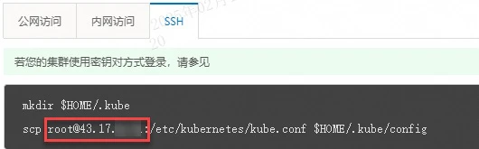

   </li>

   </ol>

<a id="section-7-3-7"></a>

### 7.3.7. 通过SSH连接Master节点

您可通过集群的SSH连接地址访问集群的Master节点。

**前提条件**

- 您已成功创建一个Kubernetes集群，并勾选**开放公网SSH登录**，参见创建Kubernetes集群。

- 连接的环境需要和Kubernetes集群网络互通。

**操作步骤**

1. 登录容器服务控制台。

2. 单击左侧导航栏**集群**，在集群列表页面，单击目标集群名称或右侧操作列的**详情**，进入**集群信息**页面。

3. 在集群**基本信息**页签中的**集群信息**区域，查看**Master节点SSH连接地址**。

   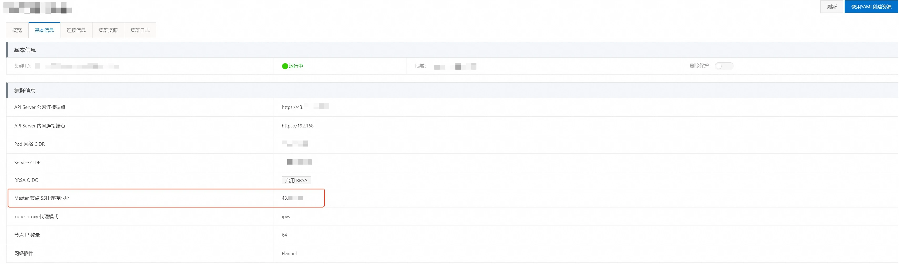

4. 在与Kubernetes集群网络互通的环境中，进行SSH远程连接。

   - 如果您已配置专线网络，公网环境直连Kubernetes集群网络，您可利用如putty的工具，从公网访问SSH连接地址。

   - 若您拥有相关机器，如ECS云服务器，与集群VPC网络互通，您可执行以下命令进行SSH连接。

     ```bash
     ssh    root@ssh_ip                      #ssh_ip即是Master节点SSH连接地址
     ```

<a id="section-7-3-8"></a>

### 7.3.8. 管控节点运维

您可以通过控制台对Master节点进行扩容及移除操作。

**集群要求**

仅支持1.28版本以上的集群进行Master节点的扩容和移除（缩容）操作。

**扩容Master节点**

> **重要**
>
> - 一次最多支持扩容 2 个 Master 节点，可多次扩容。
>
> - 扩容后需要您关注Master节点数量，数量为奇数时，可以保证Master节点的高可用性，请避免长期使用偶数个Master数量。

1. 登录容器服务控制台，在左侧导航栏中单击**集群**。

2. 在集群列表页面，单击目标集群名称。

3. 在**基本信息**页签的Master节点区域，单击右侧的**扩容节点**。

4. 在弹出的**管控面节点扩容**对话框中，修改扩容数量，然后单击**提交**。

   - 您也可以在弹出对话框中，单击**修改节点高级配置**，以修改管控节点的操作系统等配置，然后再单击**提交**。

   - 单击Master节点名称可以快速跳转到对应Master实例的ECS控制台。

   - 集群版本为1.36时，管控节点的操作系统仅提供支持cgroup v2的容器优化镜像，例如Alibaba Cloud Linux 4 Container-Optimized。

**移除Master节点**

> **重要**
>
> - **仅当Master节点大于3个时，才支持移除Master节点。**
>
> - 移除节点后，请关注集群的Master节点的数量，当为奇数时，才能获得较高的可用性，如果为偶数量节点，建议您及时扩容或缩容.

1. 登录容器服务控制台，在左侧导航栏中单击**集群**。

2. 在集群列表页面，单击目标集群名称，然后在左侧导航栏选择**节点管理** **>** **节点**。

3. 在节点列表页面，单击目标节点右侧**操作**列中的**更多** **>** **移除**。

<a id="section-7-3-9"></a>

### 7.3.9. 吊销集群的KubeConfig凭证

在常见的多租场景下，容器服务会为不同角色的用户签发带有其身份信息的KubeConfig凭证用于连接集群。当企业内部员工离职或是某签发KubeConfig遭到疑似泄露等情况发生时，吊销该集群的KubeConfig可有效保障集群的安全。本文主要介绍在容器服务中如何吊销自身的KubeConfig凭证。

**操作步骤**

> 吊销KubeConfig后，您将无法使用原KuberConfig连接集群，请谨慎操作。
>
> **重要**

1. 登录容器服务控制台。

2. 在控制台左侧导航单击**集群**。

3. 在**集群列表**页面中，单击目标集群名称或者目标集群右侧**操作**列下的**详情**。

4. 在**集群信息**页面，单击**连接信息**页签，单击**吊销KubeConfig**。

   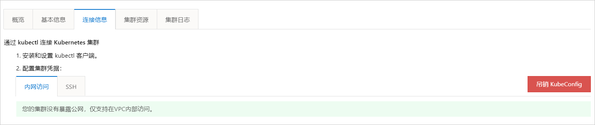

5. 在弹出的对话框中单击**确定**。吊销当前账号下该集群的KubeConfig凭证。此时，系统会自动为您分配新的KubeConfig凭证。

<a id="section-7-3-10"></a>

### 7.3.10. 获取临时的KubeConfig凭证

KubeConfig凭证的身份独立于RAM用户，删除RAM用户不会使已签发的KubeConfig失效。当您需要限制凭证的可使用时长时（例如外部人员协作、临时运维），可以获取设置了有效期的临时KubeConfig。

**操作步骤**

> **重要**
>
> 临时KubeConfig拥有独立的有效期，到期后自动失效，无法继续用于访问集群。建议仅允许特定公网白名单IP访问集群，并根据实际需要选择尽可能短的有效期。

1. 登录容器服务控制台。

2. 在控制台左侧导航单击**集群**。

3. 在**集群列表**页面中，单击目标集群名称或者目标集群右侧**操作**列下的**详情**。

4. 在**集群信息**页面，单击**连接信息**页签。

5. 单击**获取临时 KubeConfig**。

6. 在**获取临时 KubeConfig**对话框中，设置**有效期**，单击**复制**，保存KubeConfig内容。

   - **有效期**的可选值为**30分钟**、**1小时**、**3小时**、**6小时**、**12小时**、**1天**、**2天**和**3天**，默认为**1天**。

   - 对话框中展示**集群凭证过期时间**，即当前页签所展示KubeConfig的失效时间。

   - 如需更换凭证，请重新选择**有效期**或切换访问方式页签，然后单击**重新生成**。**重新生成**仅在有效期发生变化后可单击。

   - 在**内网访问**页签获取用于专有网络VPC内访问集群的KubeConfig，在**公网访问**页签获取用于公网访问集群的KubeConfig。使用**公网访问**页签前，集群需已完成公网访问配置。

（可选）您可以执行以下命令，查看已获取KubeConfig中客户端证书的失效时间（ `<temp-kubeconfig>` 需替换为实际的KubeConfig文件路径）。

```bash
kubectl --kubeconfig=<temp-kubeconfig> config view --raw -o jsonpath='{.users[0].user.client-certificate-data}' | openssl base64 -d -A | 
openssl x509 -noout -enddate
```

<a id="section-7-3-11"></a>

### 7.3.11. 升级集群

为避免过期版本集群存在的安全和稳定性风险，同时保证您业务的连贯性，容器服务ACK采用原地升级的方式升级ACK集群版本。您可以通过控制台升级集群的Kubernetes版本，也可以独立升级控制面和节点池，灵活控制升级节奏。本文介绍集群升级前后的注意事项、升级流程、操作步骤等。

**注意事项（重要）**

**版本说明**

ACK集群的Kubernetes版本只能按照支持的版本依次升级。例如，Kubernetes版本为v1.24的ACK集群升级到v1.28时，需进行两次集群升级，即先升级到v1.26版本，再升级到v1.28版本。

您可以登录容器服务控制台，在**集群**页面的**版本**列查看集群的Kubernetes版本。确定待升级版本后，参见下方链接了解待升级版本的版本解读、废弃资源API等，避免因高版本的功能变更导致业务功能不兼容，继而影响集群正常运行。

- 发布Kubernetes 1.36版本说明

- 发布Kubernetes 1.34版本说明

- 发布Kubernetes 1.32版本说明

- 发布Kubernetes 1.30版本说明

- 发布Kubernetes 1.28版本说明

- 发布Kubernetes 1.26版本说明

- 发布Kubernetes 1.24版本说明

- 发布Kubernetes 1.22版本说明

- 发布Kubernetes 1.20版本说明

- 发布Kubernetes 1.18版本说明

> **说明**
>
> 如果您的HELM Chart YAML文件中使用了废弃资源，请及时修改。更多信息，请参见上方版本说明和废弃API说明。

**相关功能及自定义配置说明**

如果您的集群中使用了如下相关功能，请仔细阅读以下说明及解决方案。

| 配置项 | 注意事项 | 推荐解决方案 |
| --- | --- | --- |
| 节点自动伸缩 | • 如果您的集群使用了节点自动伸缩功能，为保证自动伸缩功能不受影响，集群在升级成功后会自动更新Cluster Autoscaler组件至最新版本。<br>• 集群升级期间，受弹性伸缩极速弹出模式管理的节点可能会因节点关机而无法完成升级。 | • 确认Cluster Autoscaler组件版本是否正常。更多信息，请参见节点自动伸缩。<br>• 如果升级结束后排查有节点因极速弹出模式未被升级，建议手动移除该节点。 |
| 节点资源预留 | 升级至Kubernetes v1.18后，ACK会默认配置节点资源预留。如果集群未配置资源预留且节点水位较高，升级后存在Pod驱逐后无法被快速调度的风险。 | 为节点预留部分资源，推荐CPU使用率不超过50%，内存使用率不超过70%。 |
| Loadbalancer配置 | 集群外部访问集群时，需要通过SLB来访问。但当SLB设置<code> externalTrafficPolicy: Local </code>后，只有部署了相应后端Pod的节点才能访问到对应的SLB地址。如果集群节点或者Pod所在的节点上没有相应的后端服务Pod，可能导致网络不通， | 检查是否完成对应配置，避免LoadBalancer暴露的SLB地址访问不通的风险。 |
| API Server | 集群升级过程中，ACK竭力保障控制面的平滑升级，集群上的应用不会中断，但升级过程中可能会出现短暂的API Server中断。如果您的应用强依赖于API Server，例如需要对资源进行List-Watch，API Server重启会导致Watch 中断，需要您自行保证在中断时自动重试。 | 如果您的应用不访问API Server，将不会受到升级影响；如果需要访问API Server，则需要具备失败重试的能力。 |
| 启动探针（Startup Probe） | 如果集群中的Pod配置了启动探针，Pod会在kubelet重启后出现短暂的NotReady现象。 | 建议Pod采用多副本模式，将Pod分散到不同的节点上，以确保在某个节点重启期间仍有足够的可用Pod。 |
| kubectl | 集群升级后，请同步升级您本地的kubectl版本。如果未及时升级，在使用本地kubectl的过程中可能会因为与集群API Server版本不同，发生类似<code> invalid object doesn't have additional </code> <code>properties </code>的报错。 | 安装或升级kubectl。具体操作，请参见安装kubectl。 |

如果您对集群曾有自定义配置，请仔细阅读以下说明。

<table>
  <tr>
    <th width="122">配置项</th>
    <th>说明</th>
  </tr>
  <tr>
    <td>操作系统镜像</td>
    <td>自定义操作系统镜像非容器服务官方严格验证。ACK无法完全保证升级成功。</td>
  </tr>
  <tr>
    <td>其他</td>
    <td>如果您对集群有过配置更改，例如打开了SWAP分区、曾通过黑屏操作修改kubelet配置等，集群升级过程有可能失败，或自定义配置有可能丢失。</td>
  </tr>
</table>

**升级流程、方式及所需时间**

**升级流程**

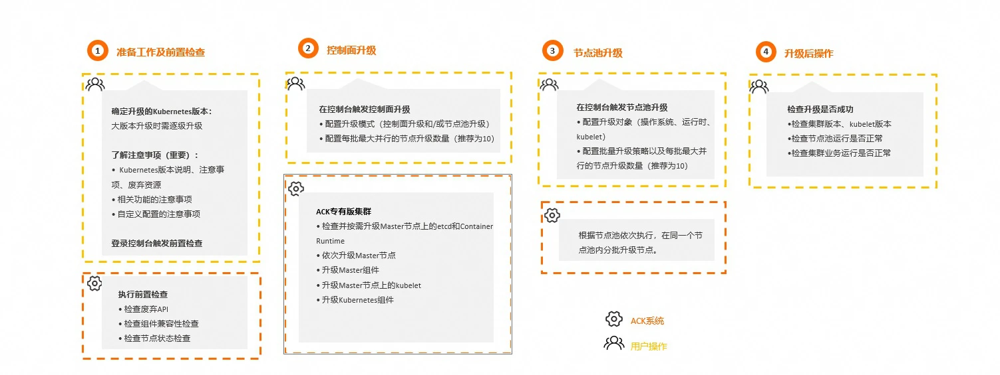

- **准备工作及前置检查**：

  - **注意事项**：确定您待升级集群的Kubernetes版本后，仔细阅读待升级目标版本的版本升级注意事项，避免升级时潜在的功能不兼容问题。更多信息，请参见上文的版本说明。

  - **前置检查**：执行前置检查，排查暴露影响升级的风险项。如有检查异常项，请按控制台提示或参见集群巡检项及解决方案修复风险项。

- **集群升级**：前置检查通过后，可开始集群升级，包括控制面和节点池的升级。有关升级流程的更多信息，请参见参考信息：控制面及节点池升级流程。ACK提供以下两种升级模式。

  - 同时升级：一起完成控制面和节点池升级。

  - 独立升级：先独立升级控制面，再独立升级节点池。

  控制面升级包括对核心组件kube-apiserver的升级，节点池升级包括对kubelet及其依赖组件的升级。为保证集群稳定性和可靠性，需保证kube-apiserver不低于kubelet两个版本，故需先完成控制面独立升级，再在业务低峰期完成节点池升级。

- **集群升级后**：核验集群、kubelet等版本，检查节点池运行是否正常，以及检查集群业务是否运行正常。

**升级方式**

- 控制面：控制面升级将升级控制面组件，包括kube-apiserver、kube-controller-manager、cloud-controller-manager、kube-scheduler等。ACK专有版集群采用原地升级的方式，以更大程度地保证您业务的连贯性，减少数据迁移和配置调整的风险。

- 节点池：节点池升级包括kubelet、OS镜像和容器运行时的升级。如您需要更换操作系统，或运行时需从Docker升级为containerd，系统会通过替换系统盘（替盘升级）的方式完成升级，即更换磁盘的同时进行操作系统或应用程序的升级。请提前做好系统盘的备份工作。其他情况下，保持使用原地升级方式。更多信息，请参见升级节点池。

**升级所需时间**

ACK专有版集群的Master节点需逐个、串行升级，每个Master节点升级时间约为8分钟。节点池升级时内部节点分批升级，每批升级时间约为5分钟。

**操作步骤**

**同时升级控制面与节点池**

1. 登录容器服务控制台，在左侧导航栏选择**集群**。

2. 在**集群列表**页面，选择目标集群，并在目标集群右侧**操作**列，选择**更多 > 集群升级**。

3. 在**集群升级**页面的**操作对象**区域，选择可升级的集群版本，选择**升级模式**为**控制面和所有节点池**，并在**批量升级策略**区域，设置**每批次的最大并行数**，然后单击**前置检查**。

   检查完成后，单击**查看详情**，查看检查报告。

   - **检查结果**为**正常**时，您可以继续进行集群升级操作。

   - **检查结果**为**异常**时，请单击**待处理**页签按照页面提示进行修复。详细信息，请参见集群巡检项及解决方案。

     > **说明**
     >
     > Kubernetes 1.20及以后版本的集群升级前检查时，会检查当前版本是否使用了废弃API，检查结果不会影响升级流程，仅作为提示信息。

4. 前置检查通过后，单击**开始升级**。

   升级过程中，请勿添加或删除节点（如需操作，请先取消升级）。您可以在**集群升级**页面下方的**事件轮转**区域查看升级进程，还可按需进行以下操作。

   - 暂停与继续升级：升级过程中，如需在某个阶段暂停升级，可单击**暂停**。如需继续集群升级进程，单击**继续**。

     集群暂停状态为集群升级的中间状态，请尽快完成升级，并在此期间请勿对集群进行任何操作。处于暂停状态的集群将7日后关闭升级过程，同时清理升级相关的事件和日志信息。

   - 取消升级：如需取消集群升级，可在暂停升级后单击**取消**，然后在弹出的对话框单击**确定**。取消升级后，当前批次已经开始升级的节点将完成升级且无法回滚，未开始升级的节点不会升级。

     > **说明**
     >
     > - 如果集群升级过程中发生错误，系统将暂停集群升级进程。具体失败原因会展示在页面下方详情中，您可根据提示进行修复。
     >
     > - 集群升级过程中，除非发生错误，否则请勿修改kube-upgrade命名空间下的相关资源。

   升级完成后，您可以在集群列表查看集群版本，确认管控组件升级是否成功，并在集群信息页面的左侧导航栏单击**节点管理** > **节点**，查看kubelet版本，确认节点升级是否成功。

**仅升级控制面**

**使用限制**

仅v1.18及以上版本的集群支持升级ACK集群时仅升级控制面。

**操作步骤**

节点池升级前，您应先完成控制面升级。

1. 登录容器服务控制台，在左侧导航栏选择**集群**。

2. 在**集群列表**页面，选择目标集群，并在目标集群右侧**操作**列，选择**更多 > 集群升级**。

3. 在**集群升级**页面的**操作对象**区域，选择可升级的集群版本，选择**升级模式**为**仅控制面**，然后单击**前置检查**。

   检查完成后，单击**查看详情**，查看检查报告。

   - 当检查报告中**检查结果**为**正常**时，表示升级检查成功，您可以进行集群升级操作。

   - 当检查报告中**检查结果**为**异常**时，不影响当前集群的运行及集群状态。请单击**待处理**页签按照页面提示进行修复。典型修复方案，请参见集群检查项及修复方案。

     > **说明**
     >
     > Kubernetes 1.20及以后版本的集群升级前检查时，会检查当前版本是否使用了废弃API，检查结果不会影响升级流程，仅作为提示信息。

4. 前置检查通过后，单击**开始升级**。

   升级过程中，您可以在**集群升级**页面下方查看升级进程。升级完成后，您可以在集群列表查看集群版本，确认管控组件升级是否成功。

**后续操作：升级节点池**

控制面升级完成后，新扩容节点的版本遵循控制面的版本。建议您在业务低峰期尽快完成存量节点的升级，并在升级完成后查看kubelet版本，确认升级是否成功。具体操作，请参见升级节点池。

**集群升级常见问题**

**如何处理专有版集群Master节点升级超时？**

**问题原因**

Admission Webhook组件自签发的服务端证书未包含必要的SAN字段，导致Master组件启动失败。

**解决方案**

通过以下命令查看Webhook使用的自签发证书是否具备SAN字段。下述命令需要在已配置kubectl的集群节点中执行。

1. 执行如下命令，查看集群中所有的Admission Webhook。

   ```bash
   kubectl get mutatingwebhookconfigurations
   ```

   预期输出：

   ```text
   NAME                                      WEBHOOKS   AGE
   ack-node-local-dns-admission-controller   1          27h
   ```

2. 执行如下命令，查看对应Webhook配置的Service。

   ```bash
   kubectl get mutatingwebhookconfigurations ack-node-local-dns-admission-controller -oyaml | grep service -A 5
       service:
         name: ack-node-local-dns-admission-controller
         namespace: kube-system
         path: /inject
         port: 443
     failurePolicy: Ignore
   ```

3. 执行如下命令，查找Service的ClusterIP。

   ```bash
   kubectl -n kube-system get service ack-node-local-dns-admission-controller
   ```

   预期输出：

   ```text
   NAME                                      TYPE        CLUSTER-IP        EXTERNAL-IP   PORT(S)   AGE
   ack-node-local-dns-admission-controller   ClusterIP   192.168.XX.XX   <none>        443/TCP   27h
   ```

4. 执行如下命令，通过ClusterIP访问Webhook获取证书，确保存在Subject Alternative Name字段。

   ```bash
   openssl s_client -connect 192.168.XX.XX:443 -showcerts </dev/null 2>/dev/null|openssl x509 -noout -text
   ```

**如何处理节点PLEG not healthy？**

容器或者容器运行时无响应。请重启节点后重新执行升级。

**参考信息：控制面及节点池升级流程**

**控制面升级流程**

ACK将按照以下流程升级您集群的控制面。具体策略如下：

1. 当ACK检测到您的集群需要进一步升级etcd和Container Runtime时，将依次升级Master节点上的etcd和Container Runtime。

2. 依次选择Master节点，一次只升级一个Master节点，并展示当前正在升级的Master节点的编号。

3. 升级Master组件，包括kube-apiserver、 kube-controller-manager和kube-scheduler。

4. 升级Master节点上的kubelet。

5. 在所有Master节点升级完成后，升级Kubernetes组件，例如kube-proxy等。

**节点池升级流程**

ACK将集群中的节点按照分批策略执行分批升级。具体策略如下：

- 根据节点池依次执行，同一时间只有一个节点池进行升级。

- 在同一个节点池内进行分批升级。第一批升级的节点数为1，后续的批次以2的幂数进行增长。如果暂停后重新恢复升级，依然遵循该分批策略。您可以在节点池升级页面配置每批升级节点的最大数量，推荐设置为10。具体操作，请参见升级节点池。

<a id="section-7-3-12"></a>

### 7.3.12. 扩容集群

通过容器服务管理控制台，您可以根据实际业务需要对Kubernetes集群的Worker节点进行扩容。

**操作步骤**

1. 登录容器服务控制台。

2. 在左侧导航栏，单击**集群**。

3. 在**集群列表**页面，选择目标集群，并选择目标集群右侧**操作**列下**更多 > 集群扩容**。

4. 在**节点池**页面单击目标节点池**操作**列的**扩容**。

5. 进入集群扩容页面，填写扩容基本信息。

   本示例进行集群扩容，实现将集群的Worker节点数由3个扩容到5个。配置描述如下表。

   <table>
     <tr>
       <th width="121">配置项</th>
       <th>描述</th>
     </tr>
     <tr>
       <td>扩容数量</td>
       <td>设置需要扩容的节点数量。</td>
     </tr>
     <tr>
       <td>地域</td>
       <td>默认显示集群所在的地域。</td>
     </tr>
     <tr>
       <td>容器运行时</td>
       <td>默认显示集群的容器运行时。</td>
     </tr>
     <tr>
       <td>专有网络</td>
       <td>默认显示集群的专有网格。</td>
     </tr>
     <tr>
       <td>虚拟交换机</td>
       <td>设置虚拟交换机。您可以在已有虚拟交换机列表中，根据<strong>可用区</strong>选择1~3个交换机。</td>
     </tr>
     <tr>
       <td>自动伸缩</td>
       <td>选择是否开启自动弹性伸缩。</td>
     </tr>
     <tr>
       <td>专有宿主机组</td>
       <td>选择专有宿主机组。</td>
     </tr>
   </table>

   <table>
     <tr>
       <th width="137">实例规格</th>
       <th>支持选择多个实例规格。更多信息，请参见 <strong>《云服务器ECS用户指南》 &gt; 《实例规格》</strong>章节。</th>
     </tr>
     <tr>
       <td>已选规格</td>
       <td>显示已选的实例规格。</td>
     </tr>
     <tr>
       <td>系统盘</td>
       <td>支持SSD云盘、高效云盘和ESSD云盘。</td>
     </tr>
     <tr>
       <td>挂载数据盘</td>
       <td>支持<strong>高效云盘</strong>、<strong>高性能云盘</strong>、<strong>SSD 云盘</strong>和<strong>普通性能云盘</strong>。<br>• 对于1.32以下版本的Kubernetes集群，在创建集群或扩容节点时，当添加两块或者更多数据盘时，将自动格式化最后一块数据盘，并将<code> /var/lib/container </code>挂载到该数据盘，将<code> /var/lib/kubelet </code>、<code> /var/lib/containerd </code>挂载到<code> /var/lib/container </code>。<br>• 对于1.32及以上版本的Kubernetes集群支持数据盘初始化设置。您可以对数据盘进行以下设置：<br>• <strong>不格式化</strong>：保留磁盘原有数据，不进行格式化操作。<br>• <strong>格式化，且作为容器运行时占用目录</strong>：将磁盘格式化，并将其用作容器运行时的占用目录<strong>。</strong><br>• <strong>格式化，且配置自定义挂载目录</strong>：将磁盘格式化后，挂载到用户自定义的路径下。具体请参见节点池中的数据盘如何自定义目录挂载？。<br>重要<br>• 如果有一块以上的盘被格式化，必须有且只允许有一个盘作为容器运行时占用目录。<br>• 每个节点必须有一块盘作为容器运行时的占用目录，如果用户不指定，系统会默认最后一块盘作为容器运行时的占用目录。然后自动格式化最后一块数据盘，并将<code> /var/lib/container </code>挂载到该数据盘，将<code> /var/lib/kubelet </code>、<code> /var/lib/containerd </code>挂载到<code> /var/lib/container </code>。</td>
     </tr>
     <tr>
       <td>操作系统</td>
       <td>显示集群的操作系统。</td>
     </tr>
     <tr>
       <td>登录方式</td>
       <td>设置密钥<br>• <strong>密钥对</strong>：在下拉列表中选择目标密钥对。如果您还未创建密钥对，您可以前往ECS控制台新建密钥对。设置密码<br>• <strong>登录密码</strong>：设置节点的登录密码。<br>• <strong>确认密码</strong>：确认设置的节点登录密码。<br>说明密码为8~30个字符，且必须同时包含三项（大写字母、小写字母、数字和特殊符号），其中特殊字符不包括下划线（_）。</td>
     </tr>
     <tr>
       <td>公网IP</td>
       <td>选中公网IP后，节点自动具备公网IPv4地址。您可以通过这个IP直接访问该节点。<br>• 宽带计费方式：支持使用流量或按固定宽带两种方式。<br>• 宽带峰值：默认为5 Mbps。</td>
     </tr>
     <tr>
       <td>ECS标签</td>
       <td>为ECS实例添加标签。</td>
     </tr>
     <tr>
       <td>节点标签</td>
       <td>为集群节点绑定标签。</td>
     </tr>
     <tr>
       <td>污点</td>
       <td>为集群内所有Worker节点添加污点。</td>
     </tr>
     <tr>
       <td>自定义镜像</td>
       <td>您可以自定义ECS镜像，集群所有节点将基于此镜像进行部署。</td>
     </tr>
     <tr>
       <td>自定义节点名称</td>
       <td>是否开启自定义节点名称。节点名称由前缀、节点IP地址子串及后缀三部分组成：<br>• 前缀和后缀均可由英文半角句号（.）分隔的一个或多个部分构成，每个部分可以使用小写字母、数字和短划线（-），且首尾必须为小写字母和数字。<br>• IP地址段长度指截取节点IP地址末尾的位数，取值范围5~12。例如：节点IP地址为192.1XX.X.XX，指定前缀为aliyun.com，IP地址段长度为5，后缀为test，则节点名称为aliyun.com00055test。</td>
     </tr>
     <tr>
       <td>实例自定义数据</td>
       <td>自定义实例启动行为及传入数据。主要有以下两种用途。<br>• 作为实例自定义脚本，在启动实例时执行。<br>• 作为普通数据，将一定的信息传入实例中，您可以在实例中引用这些数据。</td>
     </tr>
   </table>

6. 单击**提交**。

**后续步骤**

扩容完成后，在集群管理页左侧导航栏选择**节点管理 > 节点**，查看节点列表页面，您可以看到扩容后的Worker节点数量。

<a id="section-7-3-13"></a>

### 7.3.13. 更新即将过期证书

本文介绍如何通过控制台更新Kubernetes集群即将过期的证书。

**前提条件**

您已经成功创建一个Kubernetes集群，且集群证书即将过期。

**操作步骤**

1. 登录容器服务控制台。

2. 在控制台左侧导航栏单击**集群**。

3. 单击证书即将过期集群右侧的**更新证书**，进入**更新证书**页面。

   > 如果集群证书即将在两个月左右过期，会出现**更新证书**。
   >
   > **说明**

4. 单击**更新证书**，进入**提示**页面。

5. 单击**确定**。

**执行结果**

- **更新证书**页面，显示**更新成功**。

- **集群列表**页面，目标集群无**更新证书**提示。

<a id="section-7-3-14"></a>

### 7.3.14. 轮转专有版集群ETCD证书

本文介绍如何轮转专有版集群ETCD证书。

**前提条件**

已创建专有版集群。具体操作，请参见创建Kubernetes集群。

**注意事项**

- 轮转流程预计在30分钟内结束。

- 轮转流程中会逐个节点（one by one）重启集群Master节点apiserver、ETCD、kcm和kubelet等控制平面组件，其间对apiserver的长连接请求会发生断连，请在业务低峰期操作。

- ACK容器服务会在ETCD证书过期前两个月发送站内和短信过期提醒，并在**集群列表**页面显示。

- 如果您使用手工方式完成轮转，控制台仍显示**更新ETCD证书**的过期提示，请您联系技术支持通过后台配置取消更新提示。

- 轮转流程中如遇任何问题导致轮转失败，请您及时联系技术支持。

**场景一：ETCD证书未过期时轮转方案**

当ETCD证书即将过期，提示需要更新时，您可以通过控制台或手动的方式进行ETCD证书轮转。

**方式一：通过控制台自动化方式轮转ETCD证书**

1. 登录容器服务控制台，在控制台左侧导航栏单击**集群**。

2. 在**集群列表**页面，单击ETCD证书即将过期集群右侧的**更新ETCD证书**。

   

3. 在**更新证书**对话框，单击**更新证书**，然后在**提示**对话框，单击**确定**。

   证书更新成功后，在**更新证书**对话框，会显示**更新成功**；在**集群列表**页面，目标集群右侧无**更新ETCD证书**提示。

**方式二：通过手工方式轮转ETCD证书**

当出现以下场景时，集群管理员可以登录任意Master节点，手工轮转ETCD证书。

- 专有版集群ETCD证书即将过期。

- 无法通过模板部署的方式自动化轮转ETCD证书。

- 无法通过控制台操作更新ETCD证书。

  1. 确认集群Master节点之间配置了root用户的免密登录。在Master上通过SSH方式登录其他任意Master节点，如果提示输入密码，请按如下方式配置Master节点之间的免密登录。

     ```text
     1. ssh-keygen -t rsa  # ⽣成密钥。
     2. ssh-copy-id -i ~/.ssh/id_rsa.pub $(internal-ip)     # 使⽤ssh-copy-id⼯具传输公钥到其他所有Master节点，$（internal-ip）为其他Master节点的内⽹IP。
     ```

     > **说明**
     >
     > 如果您未执行免密登录相关操作，在运行脚本时，则需要输入root用户密码。

  2. 获取Cert组件的域名。

     <ol type="i">

     <li>

     登录专有云运维平台，在顶部导航栏选择**平台运维 > 飞天基础运维平台 > 运维工具**。

     </li>

     <li>

     在左侧导航栏的**运维工具**区域，单击**服务注册变量大盘**。

     </li>

     <li>

     在**服务注册变量大盘**页面，选择**Service Registration**，搜索**acs**。

     </li>

     <li>

     在**Service Registration**列，单击**acs-acs_control**的  图标，单击显示内容，在**注册变量**对话框，搜索**cert.domain**，获取**cert.domain**的值。

     **cert.domain**的值即为Cert组件的域名。

     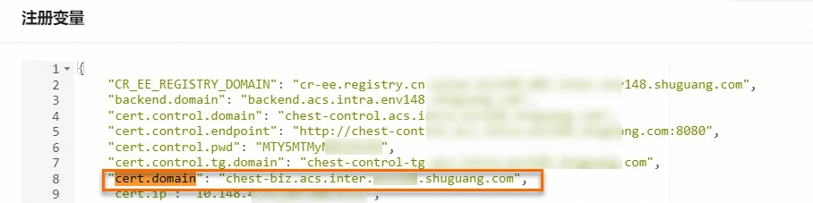

     </li>

     </ol>

  3. 在任意Master节点上执行如下脚本。

     ```bash
     # xxxxx为上⼀步获取的域名。
     file_server=xxxxx
     curl -k  -sSL https://$file_server:8080/static/k8s/private/pkg/run/restart-apiserver.sh -o restart-apiserver.sh
     curl -k  -sSL https://$file_server:8080/static/k8s/private/pkg/run/rotate-etcd.sh -o rotate-etcd.sh
     bash rotate-etcd.sh
     ```

  4. 在任意Master节点上运行 `bash rotate-etcd.sh` 。

     当看到命令行输出 `etcd CA and certs have succesfully rotated!` 时，表示所有Master节点上的证书和K8s证书已经轮转完成。

     > **说明**
     >
     > 脚本执行过程中，会将ETCD相关的服务端和客户端证书备份在如下目录中：
     >
     > - /var/lib/etcd/cert_$时间戳后缀
     >
     > - /etc/kubernetes/pki/etcd_$时间戳后缀

**场景二：ETCD证书已过期时轮转方案**

当出现以下场景时，请参考方式二：通过手工方式轮转ETCD证书。

- ETCD证书已过期。

- APIServer无法访问时轮转ETCD证书。

- 无法通过模板部署的方式自动化轮转ETCD证书。

- 无法通过控制台操作更新ETCD证书。

<a id="section-7-3-15"></a>

### 7.3.15. 删除集群

您可以通过容器服务管理控制台删除不再使用的集群。

**操作步骤**

1. 登录容器服务控制台。

2. 在控制台左侧导航栏单击**集群**。

3. 在**集群列表**页面，选择目标集群**操作**列下的**更多 > 删除**。

4. 在**删除集群**对话框选择需要保留的集群资源，并选中**我已知晓以上信息并确认删除集群**，然后单击**确定**。

   > **说明**
   >
   > 若当前集群配置了 ACKBlockClusterDeletion 策略且满足策略条件，则禁止删除集群。

**后续步骤**

如果您在资源编排（ROS）创建的资源下手动添加了一些资源，ROS 是没有权限删除这些资源的。例如在 ROS 创建的 VPC 下手动添加了一个 VSwitch，这样会导致 ROS删除时无法处理该 VPC，导致删除集群失败。

容器服务提供了强制删除集群的功能。通过强制删除功能，您可以在集群删除失败后，强制删除集群和 ROS 资源栈。但是，强制删除操作不会自动释放您手动创建的这些资源，您需要手动进行释放。

集群删除失败时，会显示删除失败的信息。

单击删除失败的集群操作列的**更多 > 删除**，在弹出的对话框里，您可以看到删除失败的资源，勾选**强制删除** 并单击**确定**，即可删除集群和 ROS 资源栈。

<a id="section-7-3-16"></a>

### 7.3.16. 查看集群概览

阿里云容器服务 Kubernetes 集群提供集群概览功能，提供应用状态、组件状态和资源监控等功能，方便您快速了解集群的健康状态信息。

**操作步骤**

1. 登录容器服务控制台。

2. 单击左侧导航栏中的**概览**，进入 Kubernetes 集群概览页面。

3. 选择所需的集群和命名空间，您可查看应用状态、组件状态和资源监控图表。

   - **应用状态**：显示当前运行的部署、容器组和副本集的状态示意图，绿色图标代表正常，黄色图标代表异常。

   - **节点状态**：显示当前集群中的节点状态示意图。

   - **事件**：显示集群的事件信息，例如警告和错误事件等，若集群正常，显示为空。

   - **资源监控**：提供 CPU 和 Memory 的监控图表。CPU 统计单位为 Cores（核），可显示小数点后 3 位，最小统计单位是 millicores，即一个核的 1/1000；Memory的统计单位是 Gi，显示小数点后 3 位。更多相关信息，请参见 Meaning of CPU和 Meaning of memory。

     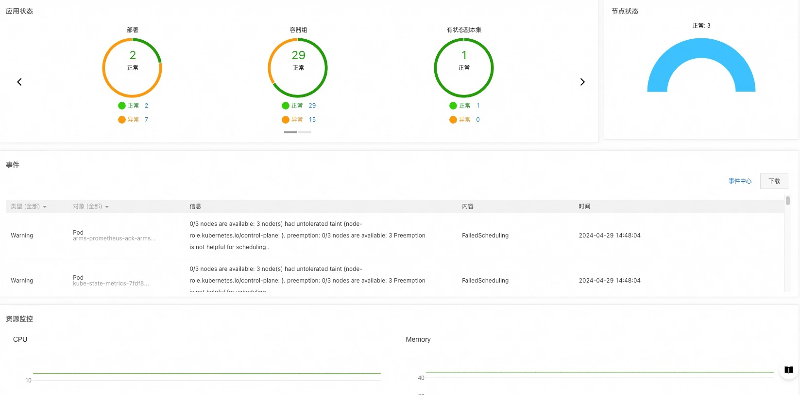

<a id="section-7-3-17"></a>

### 7.3.17. 控制面配置

在**控制面配置**页面您可以自定义 Kubernetes 控制平面核心组件（API Server、Controller Manager）的运行参数，以优化集群性能、稳定性与安全性。

**前提条件**

已创建Kubernetes集群，且集群版本为1.32以上可开启该功能。

**API Server参数配置**

> **重要**
>
> - 修改控制面参数后，Master 节点将逐台重启，请在业务低峰期操作。
>
> - 自定义参数会覆盖集群默认值，请确认参数适用于当前 Kubernetes 版本。

1. 登录容器服务控制台，然后在控制台左侧导航栏，单击**集群**。

2. 在**集群列表**页面，单击目标专有版集群，然后在集群管理页左侧导航栏选择**集群配置 > 控制面配置**。

3. 在**控制面配置**页面，单击**API Server**页签，页面以表格形式展示各参数的**参数**、**说明**和**参数值**。

4. 在**API Server**页签，单击**配置**。

5. 在**配置 API Server**面板中按需修改参数取值，完成后单击**确定**。

   | 参数 | 说明 | 示例值 |
   | --- | --- | --- |
   | <strong>准入控制插件</strong>（<code> enableAdmissionPlugins </code> ） | 除了默认启用的插件之外要启用的插件，指定在集群修改对象之前调用的（以逗号分隔的）准入控制插件顺序列表。 | <code>NamespaceLifecycle,LimitRanger</code> |
   | NodePort 服务端口范<strong>围</strong>（<code> serviceNodePortRange </code> ） | 保留给具有 <code> NodePort </code> 可见性的服务的端口范围。修改时仅支持增大 <code> serviceNodePortRange </code>，减少 <code> NodePortRange </code> 可能会导致已创建的 Service NodePort 不合法。请输入正确的参数格式，如 30000-32767，最大值10000-65535。 | 30000-32767 |
   | <strong>API Server 请求超时时间</strong>（<code> requestTimeout </code>） | 处理程序在超时之前必须保持打开请求的持续时间。请输入正确的参数格式，如 200s、2m10s。 | 200s |
   | 节点 NotReady 默认容忍时<strong>间</strong>（<code> defaultNotReadyTolerationSeconds </code>） | 对污点 <code> NotReady </code>:NoExecute 的容忍时长（以秒计）。请输入正确的参数值，取值范围 1-3000。 | 300 |
   | 节点 Unreachable 默认容忍时<strong>间</strong>（<code> defaultUnreachableTolerationSeconds </code>） | 对污点 <code> Unreachable </code>:NoExecute 的容忍时长（以秒计）。请输入正确的参数值，取值范围 1-3000。 | 300 |
   | 最大并发变更请求<strong>数</strong>（<code> maxMutatingRequestsInflight </code> ） | API Server 最大的并发写请求。该参数过大可能影响 API Server 管控稳定性，请根据实际需要修改为合理的值。 | 300 |
   | <strong>最大并发只读请求数</strong>（<code> maxRequestsInflight </code>） | API Server 最大的并发读请求。该参数过大可能影响 API Server 管控稳定性，请根据实际需要修改为合理的值。 | 1000 |
   | <strong>kube-system 审计</strong>（<code> kube-system-audit </code>） | 集群审计。开启或关闭 kube-system 审计能力。 | 开启 |

**Controller Manager参数配置**

> **重要**
>
> - 修改控制面参数后，Master 节点将逐台重启，请在业务低峰期操作。
>
> - 自定义参数会覆盖集群默认值，请确认参数适用于当前 Kubernetes 版本。

1. 登录容器服务控制台，然后在控制台左侧导航栏，单击**集群**。

2. 在**集群列表**页面，单击目标专有版集群，然后在集群管理页左侧导航栏选择**集群配置 > 控制面配置**。

3. 在**控制面配置**页面，单击**Controller Manager**页签，页面以表格形式展示各参数的**参数**、**说明**和**参数值**。

4. 在**Controller Manager**页签，单击**配置**。

5. 在**配置 Controller Manager**面板中按需修改参数取值，完成后单击**确定**。

   | 参数 | 说明 | 默认值 |
   | --- | --- | --- |
   | HPA 同步周<strong>期</strong>（<code> horizontalPodAutoscalerSyncPeriod </code>） | 集群弹性计算的周期。请输入合理的参数值，如 30s 等。 | 15s |
   | HPA 容<strong>差</strong>（<code> horizontalPodAutoscalerTolerance </code>） | HPA 考虑扩缩时期望指标与实际指标的容差率，小于此容差率 HPA 不会进行扩缩。请输入合理的参数值，如 0.5，范围为 0-100 的正浮点数。 | 0.1 |
   | TTLAfterFinished 并发同步<strong>数</strong>（<code> concurrentTTLAfterFinishedSyncs </code>） | 可以并发同步的 TTL-after-finished 控制器线程个数。请输入合理的参数值，如 10、100 等。 | 2 |
   | HPA 并发同步<strong>数</strong>（<code> concurrentHorizontalPodAutoscalerSyncs</code><code> </code>） | HPA 并发处理数。正整数。该参数过大可能增加控制面负载，过小可能导致HPA 响应延迟。 | 20 |
   | 大规模集群节点阈<strong>值</strong>（<code> largeClusterSizeThreshold </code>） | 节点控制器在执行 Pod 驱逐操作逻辑时，基于此标志所设置的节点个数阈值来判断所在集群是否为大规模集群。请输入合理的参数值，如 10、100 等。 | 50 |
   | <strong>不健康可用区阈值</strong>（<code> unhealthyZoneThreshold </code>） | 判断 Zone 是否 unhealthy 的阈值。请输入合理的参数值。 | 0.55 |
   | 次级节点驱逐速<strong>率</strong>（<code> secondaryNodeEvictionRate </code>） | 当区域不健康，节点失效时，每秒钟从此标志所给的节点个数上删除 Pods。请输入合理的参数值，如 0.01、0.2 等。 | 0.01 |
   | <strong>节点驱逐速率</strong>（<code> nodeEvictionRate </code>） | 当某区域健康时，在节点故障的情况下每秒删除 Pods 的节点数。请输入合理的参数值，如 0.01、0.2 等。 | 0.1 |
   | 已终止 Pod GC 阈<strong>值</strong>（<code> terminatedPodGCThreshold </code>） | 终止状态 Pod 触发回收的数量阈值。正整数。 | 12500 |
   | <strong>访问 API Server 的 QPS</strong>（<code> kubeAPIQPS </code>） | 与 API Server 通信时每秒请求数（QPS）限制。请输入合理的参数值，如 500，范围为 1-1000。该参数过大可能加重 API Server 负载，过小可能限制控制面响应速度。 | 100 |
   | <strong>访问 API Server 的突发请求数</strong>（<code> kubeAPIBurst </code>） | 与 API Server 通信时突发峰值请求个数上限。请输入合理的参数值，如 500，范围为 1-1000。该参数过大可能加重 API Server 负载，过小可能限制控制面响应速度。 | 200 |

<a id="section-7-3-18"></a>

### 7.3.18. 维护集群

本文介绍如何维护集群。

> **重要**
>
> 处于**维护中**的集群，以下功能暂不可用：
>
> - 升级、修改集群。
>
> - 扩缩容节点池。
>
> - 安装、升级、卸载组件。

**操作步骤**

1. 登录容器服务控制台。

2. 在左侧导航栏，单击**集群**。

3. 在**集群列表**页面，选择目标集群，单击  并选择**开始维护**。

4. 在弹出的对话框中仔细阅读提示信息，然后单击**确定**。

   > **说明**
   >
   > 此时集群状态变更为**维护中**。

**后续步骤**

将处于**维护中**状态的集群恢复至**运行中**状态，恢复正常的所有管理与调度能力。

1. 在**集群列表**页面，选择目标集群，单击  并选择**终止维护**。

2. 在弹出的对话框中仔细阅读提示信息，然后单击**确定**。

   > **说明**
   >
   > 此时集群状态变更为**运行中**。

<a id="section-7-4"></a>

## 7.4. 调度配置

在Kubernetes集群中，调度（Scheduling）指调度器组件（kube-scheduler）根据资源规划将Pod分配到最合适的节点上，以实现应用高可用、提高集群资源利用率等。ACK针对不同工作负载提供了更灵活、更丰富的调度策略，包括Binpack、负载感知调度、重调度、QoS感知调度等功能。

不同角色的调度配置权限限制如下：

| 角色 | 权限 |
| --- | --- |
| 集群管理员 | 读写 |
| 集群运维人员 | 读写 |
| 集群开发/受限人员 | 只读 |

<a id="section-7-4-1"></a>

### 7.4.1. Binpack

Binpack调度策略是一种优化集群资源利用率的智能调度机制。开启后，Kubernetes 调度器会优先将 Pod 调度到已使用资源较多的节点上，从而“填满”现有节点，减少空闲碎片，提升整体资源密度。本文介绍如何开启、关闭Binpack调度。

**使用场景**

针对大小作业混合部署的场景，需实施差异化调度策略：优先利用小作业填充节点资源碎片，将连续的大块空闲资源预留给大作业，从而消除资源碎片化导致的大作业调度饥饿问题。

**前提条件**

已创建Kubernetes集群，且集群版本为1.32以上可开启该功能。

**开启/修改Binpack调度**

新建集群默认关闭Binpack调度。开启Binpack后，会优先将Pod调度到资源消耗较多的节点上，减少节点上的资源碎片，提升资源利用率。

1. 登录容器服务控制台，然后在控制台左侧导航栏，单击**集群**。

2. 在**集群列表**页面，单击目标专有版集群，然后在集群管理页左侧导航栏选择**集群配置 > 调度配置**。

3. 在**调度配置**页面，单击**Binpack**页签。

4. 在**Binpack**页签，单击**配置**。

5. 在**集群调度 Binpack配置**页面配置相关参数，最后单击**确定**。|

   <table>
     <tr>
       <th>配置项</th>
       <th>说明</th>
       <th>示例值</th>
     </tr>
     <tr>
       <td>调度策略权重binpackPluginWeight</td>
       <td>集中放置策略相比其他策略的权重（其他策略的权重默认在5以下）。权重越大，Pod 调度时越可能优先调度到同一节点上，默认为100 （Pod 调度启用 Binpack 时生效）。</td>
       <td>100</td>
     </tr>
     <tr>
       <td rowspan="3">调度策略资源权重binpackResourceWeight</td>
       <td>单击<strong>添加自定义资源</strong>，添加<strong>资源类型</strong>和<strong>权重</strong>。<br>说明自定义资源不能与已有资源配置冲突，即已经配置CPU 资源以及权重，不允许再自定义资源类型为CPU。</td>
       <td>nvidia.com/gpu 50</td>
     </tr>
     <tr>
       <td>CPU<br>说明权重越大，优先提高该集群CPU利用率。</td>
       <td>100</td>
     </tr>
     <tr>
       <td>内存<br>说明权重越大，优先提高该集群内存利用率。</td>
       <td>70</td>
     </tr>
   </table>

   例如，针对自定义的 GPU 资源，建议采用以下权重比例：

   - **GPU**：10

   - **CPU**：1

   - **内存**：1

6. 提交成功后，**集群状态**将变为**更新中**，同时**集群日志**将新增一条记录。预计耗时约 3 分钟，请耐心等待操作完成。

**关闭Binpack调度**

> **说明**
>
> 关闭Binpack调度后将恢复默认调度策略，即 Pod 调度时启用优先集中放置策略。

1. 在**Binpack**页签，单击**禁用**。

2. 仔细阅读弹框中的提示信息，然后单击**确**定。

<a id="section-7-4-2"></a>

### 7.4.2. 负载感知调度

负载感知调度结合资源画像与Prometheus 指标，基于节点实际负载（由 Koordinator 采集）进行动态排序，并自动对超阈节点实施停调保护。该策略摒弃了传统的‘按申请量调度’模式，转而依据真实使用率决策，优先将 Pod 调度至低负载节点，实现更精准的负载均衡。本文介绍如何开启、关闭负载感知调度。

**前提条件**

- 已创建Kubernetes集群，且集群版本为1.32以上可开启该功能。

- 当前环境已安装Prometheus 2.0。

**开启负载感知调度**

负载感知调度开启后，可以支持按资源采集和节点实时使用情况进行调度，使得调度策略更加符合当前节点使用情况，pod会被优先调度到负载更低的节点上。

1. 登录容器服务控制台，然后在控制台左侧导航栏，单击**集群**。

2. 在**集群列表**页面，单击目标专有版集群，然后在集群管理页左侧导航栏选择**集群配置 > 调度配置**。

3. 在**调度配置**页面，单击**负载感知调度**页签。

4. （可选）在**负载感知调度**页签，安装组件步骤，单击**开始安装**。

   > **说明**
   >
   > 如果已经安装组件，可以跳过此步骤。

5. 在**负载感知调度配置**区域，单击**配置**，配置相关参数，最后单击**确定**。|

   **配置项**

   **说明**

   **示例值**

   **CPU**：权重范围 1-100，正整数，权重越大越优先根据该

   1

   资源利用率进行打分。

   **节点打分（资源权重）**

   **内存**：权重范围 1-100，正整数，权重越大越优先根据该资

   1

   源利用率进行打分。

   - 开启

     开启

   - 关闭

   **CPU**：水位范围 1-100，正整数，单位百分比%，节点实际负载水位阈值。当节点资源利用率低于该水位时才参与调

   80

   度，如果超过该阈值，调度器会拒绝将Pod调度到该节点

   **节点筛选（水位）**

   上。

   **内存**：水位范围 1-100，正整数，单位百分比%，节点实际负载水位阈值。当节点资源利用率低于该水位时才参与调

   80

   度，如果超过该阈值，调度器会拒绝将Pod调度到该节点上。

6. 提交成功后，**集群状态**将变为**更新中**，此时不支持集群的其他操作。

**关闭负载感知调度**

1. 在**负载感知调度配置**页签，单击**禁用**。

2. 仔细阅读弹框中的提示信息，然后单击**确定**。

<a id="section-7-4-3"></a>

### 7.4.3. 重调度

重调度通常是指将部署在某个节点上调度不合理的Pod重新调度到另一个节点，适用于集群资源利用不均衡、节点负载过高或有新的调度策略需求等场景。启用重调度功能可以优化集群资源使用和应用服务质量。

**背景信息**

在 K8s 集群治理中，CPU 或内存的高负载易引发节点热点，不仅威胁 Pod 运行稳定性，更显著增加节点故障风险。为解决负载不均问题，需基于监控指标构建全局资源视图，实施动态负载均衡策略：当实时监测到节点资源过载、发生故障或 Pod 密度过高时，系统自动触发干预机制，将高负载节点上的 Pod 平滑迁移至低负载节点，确保持续的资源均衡与集群健康。

**前提条件**

- 已创建Kubernetes集群，且集群版本为1.32以上可开启该功能。

- 已开启负载感知调度。

**开启重调度**

> **重要**
>
> 重调度热点打散功能需要同时开启集群负载感知调度功能，按照节点节点使用率进行打散。
>
> 风险说明：热点打散开启后会驱逐热点上的 Pod。为了避免 Pod 驱逐后重新被调度到这个节点上，建议设置负载热点水位 与负载均衡节点筛选水位 同样的值，拒绝Pod 再次被调度到过热节点。
>
> 重调度器会持续对利用率监控一段时间，并对监控数据做平滑均值处理，因此只有节点持续超过阈值才会触发重调度，默认为 10 分钟。

1. 登录容器服务控制台，然后在控制台左侧导航栏，单击**集群**。

2. 在**集群列表**页面，单击目标专有版集群，然后在集群管理页左侧导航栏选择**集群配置 > 调度配置**。

3. 在**调度配置**页面，单击**重调度**页签。

4. 在**重调度热点打散配置**区域，单击**开启**。

5. 开启重调度后，系统将自动生成默认配置并展示在当前配置区域。单击**配置**，即可修改调度配置，目前支持以下两种配置方式：

   - **快速创建**

     在**热点打散重调度**面板，单击**快速创建**页签，配置相关参数，然后单击**确定**。|

     <table>
       <tr>
         <th>配置项</th>
         <th>说明</th>
         <th>示例值</th>
       </tr>
       <tr>
         <td rowspan="2">负载热点水位</td>
         <td><strong>CPU</strong>：水位范围 1-100，正整数，单位百分比%。超过该水位后会进行热点打散，建议与负载均衡的节点筛选阈值设置一致，防止再次被调度回热节点。</td>
         <td>50</td>
       </tr>
       <tr>
         <td><strong>内存</strong>：水位范围 1-100，正整数，单位百分比%。超过该水位后会进行热点打散，建议与负载均衡的节点筛选阈值设置一致，防止再次被调度回热节点。</td>
         <td>60</td>
       </tr>
       <tr>
         <td rowspan="2">负载空闲水位</td>
         <td><strong>CPU</strong>：水位范围 1-100，正整数，单位百分比%。当节点资源利用率低于该水位时才参与调度，如果超过该阈值，调度器会拒绝将Pod调度到该节点上。</td>
         <td>20</td>
       </tr>
       <tr>
         <td><strong>内存</strong>：水位范围 1-100，正整数，单位百分比%。当节点资源利用率低于该水位时才参与调度，如果超过该阈值，调度器会拒绝将Pod调度到该节点上。</td>
         <td>20</td>
       </tr>
       <tr>
         <td rowspan="3">生效范围<br>说明若同时设置了节点池、命名空间和 Pod selector，则三者取交集，仅匹配符合条件的 Pod 才会被考虑迁移。</td>
         <td><strong>节点池</strong>：指定参与重调度的节点池。不选则默认为所有节点。支持全选、多选 。</td>
         <td>default-nodepool</td>
       </tr>
       <tr>
         <td><strong>命名空间</strong>：限定只对指定命名空间内的 Pod 进行重调度。不选则作用于全部命名空间。支持全选、多选 。</td>
         <td>default</td>
       </tr>
       <tr>
         <td><strong>Pod selector</strong>：进一步过滤特定标签的 Pod。单击<strong>添</strong><strong>加</strong>可追加多个条件。</td>
         <td>test/foo</td>
       </tr>
       <tr>
         <td>重调度执行周期</td>
         <td>单位秒，每间隔该周期执行一次重调度策略。</td>
         <td>60</td>
       </tr>
       <tr>
         <td>调度预览</td>
         <td>• 勾选后，系统会模拟执行重调度策略，展示预计会被驱逐的 Pod 列表及迁移目标，但不会真正执行驱逐操作。<br>• 不勾选，开启真实重调度模式，Pod 被驱逐并重新调度，且能在事件中心看到重调度相关事件。</td>
         <td>勾选</td>
       </tr>
     </table>

   - **YAML创建**

     在**热点打散重调度**面板，单击**YAML创建**页签，配置相关参数，然后单击**确定**。|

6. 提交成功后，**集群状态**将变为**更新中**，此时不支持集群的其他操作。

**关闭重调度**

1. 在**重调度**页签的**重调度热点打散配置**区域，单击**禁用**。

2. 仔细阅读弹框中的提示信息，然后单击**确定**。

<a id="section-7-4-4"></a>

### 7.4.4. QoS感知调度配置

本文介绍如何配置QoS感知调度，包括：CPU Burst、离线混部、动态超卖和拓扑感知等。

**背景信息**

基于服务质量（QoS）等级的调度与资源管理能力，旨在提升集群资源利用率的同时，优先保障高优先级应用（如延迟敏感型 LS 应用）的性能和稳定；主要包括：CPU Burst、离线混部、动态超卖和CPU拓扑感知等。

**前提条件**

已创建Kubernetes集群，且集群版本为1.32以上可开启该功能。

**约束限制**

已开启安全沙箱的节点池，不支持调度。

**操作步骤**

1. 登录容器服务控制台。

2. 在**集群列表**页面，单击目标集群名称或者目标集群右侧**操作**列的**详情**。

3. 在集群管理页的左侧导航栏，选择**节点管理 > 节点池**。

4. 在**节点池**页面，找到目标节点池，单击**操作**列的**调度**。

5. （可选）在**QoS感知调度配置**页面，单击**开始安装**。

   > **说明**
   >
   > 若已安装 ack-koordinator 组件，可跳过此步骤。

6. 在**QoS感知调度配置**页面，单击**配置**。

7. 目前支持以下两种配置方式：

   - **快速创建**

     在**QoS调度**面板，单击**快速创建**页签，配置相关参数，然后单击**确定**。|

     **配置项**

     **说明**

     **示例值**

     - 开启

       开启

     **开启CPU Burst**

     - 关闭

     开启CPU Burst 后，在出现突发负载时，CPU Burst可以为容器临时提供额外的

     **CPU Burst**

     CPU资源，缓解CPU限制带来的性能瓶颈。

     单位为百分比，内核级别的CPU Burst单

     **CPU Burst放大百分比**

     1000

     性，表示相较于CPU Limit， CPU Burst放大的百分比。

     输入值范围：1-99999。

     开启容器CPU QoS功能，在离线混部场景会将高优先级的LS应用和低优先级的BE应

     开启

     **在离线混部**

     **开启容器CPU QoS**

     用部署在同一个节点，可以优先保障LS应用的CPU资源使用。

     开启CPU拓扑感知调度，可将应用进程独占绑定到指定CPU核心（即CPU绑核），减少

     开启

     **开启动态资源超卖**

     因核心切换和跨NUMA访存带来的性能不确定性。

     当节点 CPU 使用率 ≤ 此值时，才允许新Pod 超卖 CPU 资源。

     **CPU超卖水位线**

     65

     默认值为 `65` ，单位为百分比。

     当节点内存使用率 ≤ 此值时，才允许新

     **动态资源超卖**

     Pod 超卖内存资源。

     **内存超卖水位线**

     65

     默认值为 `65` ，单位为百分比。

     内存回收策略基于<strong>实际使用量（usage）</strong>或<strong>申请使用（request）</strong>计

     实际使用量（usage）

     **内存超卖依据**

     算。

     <table>
       <tr>
         <td>CPU拓扑感知</td>
         <td>当前节点池kubelet的cpuManagerPolicy配置为static，节点池没有开启拓扑感知，请在kubelet中配置为none即开启拓扑感知。</td>
         <td>-</td>
       </tr>
     </table>

   - **YAML创建**

     在**QoS调度**面板，单击**YAML创建**页签，配置相关参数，然后单击**确定**。|

     <ol type="i" start="6">

     <li>

     提交成功后，**集群状态**将变为**更新中**，此时不支持集群的其他操作。

     </li>

     </ol>

<a id="section-7-5"></a>

## 7.5. 节点管理

<a id="section-7-5-1"></a>

### 7.5.1. 节点池

<a id="section-7-5-1-1"></a>

#### 7.5.1.1. 创建节点池

您可以通过节点池管理集群中的一组节点资源，例如在节点池中统一管理节点的标签和污点。本文介绍如何创建节点池。

**前提条件**

已创建Kubernetes集群，且集群版本为1.9以上。

> **说明**
>
> 默认情况下，每个集群中最多可包含100个节点。

**操作步骤**

1. 登录容器服务控制台，然后在控制台左侧导航栏，单击**集群**。

2. 在**集群列表**页面，单击目标专有版集群，然后在集群管理页左侧导航栏选择**节点管理 > 节点池**。

3. 在**节点池**页面，单击**创建节点池**。

4. 在**创建节点池**页面配置相关参数，然后单击**高级选项**，进行相关配置，最后单击**确定**。

   关于配置项的更多说明，请参见创建Kubernetes集群。

   <table>
     <tr>
       <th width="168">配置项</th>
       <th>说明</th>
     </tr>
     <tr>
       <td>节点池名称</td>
       <td>自定义节点池名称。</td>
     </tr>
     <tr>
       <td>地域</td>
       <td>节点池将要部署的地域。</td>
     </tr>
     <tr>
       <td>容器运行时</td>
       <td>仅支持<strong>containerd</strong>，运行时受集群版本影响。</td>
     </tr>
     <tr>
       <td>专有网络</td>
       <td>在已有VPC列表中选择所需的VPC。</td>
     </tr>
     <tr>
       <td>虚拟交换机</td>
       <td>设置虚拟交换机。您可以在已有虚拟交换机列表中，根据可用区选择交换机。</td>
     </tr>
     <tr>
       <td>容器镜像加速</td>
       <td>选中<strong>开启容器镜像加速</strong>后，新添加的节点将支持容器镜像按需加载功能。</td>
     </tr>
     <tr>
       <td>安全沙箱</td>
       <td>选择是否开启安全沙箱。Agent Sandbox 是一款面向生产级 AI 智能体的沙箱运行时，提供不可信应用的隔离运行环境。该版本仅适用于 ECS 类型实例节点。<br>说明开启安全沙箱后：<br>• 不支持选择<strong>专有宿主机组</strong>。<br>• 系统自动部署 runsc 运行时及相关组件。<br>• ECS规格仅提供沙箱支持的规格（Intel/海光）。<br>• <strong>操作系统</strong>仅支持选择阿里云服务器操作系统V3系列（含等保镜像）。<br>开启安全沙箱后，系统将默认<strong>安装AgentSandbox套件</strong>（包含ack-kruise-agent-sandbox、ack-fluid、Poseidon 组件）。您也可根据实际业务需求，手动取消或确认该安装选项。</td>
     </tr>
     <tr>
       <td>节点自愈</td>
       <td>默认情况下，节点自愈功能处于关闭状态。启用节点自愈功能后，当检测到节点故障时，将根据所选配置自动执行添加污点、排水、重启及维修等修复操作。修复过程中可能会导致节点上运行的业务中断。具体操作请参见开启节点自愈。</td>
     </tr>
     <tr>
       <td>自动伸缩</td>
       <td>选择是否<strong>开启自动弹性伸缩</strong>。</td>
     </tr>
     <tr>
       <td>专有宿主机组</td>
       <td>支持选择专有宿主机组。<br>说明开启安全沙箱后，不显示此参数。</td>
     </tr>
     <tr>
       <td>实例规格</td>
       <td>支持选择多个实例规格。</td>
     </tr>
     <tr>
       <td>已选规格</td>
       <td>显示已选中的规格。</td>
     </tr>
     <tr>
       <td>系统盘</td>
       <td>支持<strong>高效云盘</strong>、<strong>高性能云盘</strong>、<strong>SSD 云盘</strong>和<strong>普通性能云盘</strong>。可勾选<strong>是否加密</strong>对选中的系统盘加密。设置系统盘加密时，需要设置以下参数：<br>• 加密方式：支持<strong>AES256</strong>和<strong>SM4</strong>。<br>• 加密key：可选择<strong>密钥管理服务</strong>中创建的密钥。</td>
     </tr>
     <tr>
       <td>数据盘</td>
       <td>支持<strong>高效云盘</strong>、<strong>高性能云盘</strong>、<strong>SSD 云盘</strong>和<strong>普通性能云盘</strong>。支持选中<strong>加密</strong>对数据盘进行加密。创建过程中，当添加两块或者更多数据盘时，将自动格式化最后一块数据盘，并将<code> /var/lib/container </code>挂载到该数据盘，将<code> /var/lib/kubelet </code>、<code> /var/lib/containerd </code>挂载到<code> /var/lib/container </code>。对于其他数据盘，您可以自定义挂载目录，请参见节点池中的数据盘如何自定义目录挂载？</td>
     </tr>
     <tr>
       <td><strong>数量</strong>/<strong>实例数量</strong></td>
       <td>设置节点池初始节点数量。如不需要创建节点，可以填写为<code>0</code>。<strong>开启自动弹性伸缩</strong>后，允许设置的<strong>最小实例数</strong>和<strong>最大实例数</strong>。</td>
     </tr>
     <tr>
       <td>操作系统</td>
       <td>支持多种操作系统，包括：Alibaba Cloud Linux 3、龙蜥、统信 UOS、银河麒麟 V10、阿里云服务器操作系统V3 Linux 64位 等保2.0三级版、Alibaba Cloud Linux 4等<br>说明当集群版本为 1.36 时，仅提供支持 cgroup v2 的容器优化镜像，例如 Alibaba Cloud Linux 4 Container-Optimized。cgroup v1镜像无法在1.36版本集群中使用。</td>
     </tr>
     <tr>
       <td>安全加固</td>
       <td>• <strong>不开启</strong>：表示对ECS实例不进行安全加固。<br>• <strong>等保加固</strong>：仅当系统镜像选择Alibaba Cloud Linux 2或Alibaba Cloud Linux 3时，可为节点开启等保加固。阿里云为Alibaba Cloud Linux 2和Alibaba Cloud Linux 3等保2.0三级版镜像提供等保合规的基线检查标准和扫描程序。更多信息，请参见ACK等保加固使用说明。<br>重要等保加固在保障原生镜像兼容性和性能的基础上进行了等保合规适配，使其满足国家信息安全部发布的《GB/T22239-2019信息安全技术网络安全等级保护基本要求》。等保加固会禁止Root用户通过SSH远程登录。您可通过ECS控制台使用VNC方式登录系统创建可使用SSH的普通用户。</td>
     </tr>
     <tr>
       <td>登录名</td>
       <td></td>
     </tr>
     <tr>
       <td>登录方式</td>
       <td>设置密钥<br>• <strong>密钥对</strong>：如您已经创建密钥对，在下拉列表中选择目标密钥对。<br>• <strong>新建密钥对</strong>：此项用于您还未创建密钥对。创建密钥对，密钥对创建完毕后，设置该密钥对作为登录集群的凭据。设置密码<br>• <strong>登录密码</strong>：设置节点的登录密码。<br>• <strong>确认密码</strong>：确认设置的节点登录密码。<br>说明密码为8~30个字符，且必须同时包含三项（大写字母、小写字母、数字和特殊符号），其中特殊字符不包括下划线（_）。</td>
     </tr>
     <tr>
       <td>公网 IP</td>
       <td>选中公网IP后，节点自动具备公网IPv4地址。您可以通过这个IP直接访问该节点。<br>• 宽带计费方式：支持使用流量或按固定宽带两种方式。<br>• 宽带峰值：默认为5 Mbps。</td>
     </tr>
     <tr>
       <td>ECS 标签</td>
       <td>为ECS实例添加标签。</td>
     </tr>
     <tr>
       <td>节点标签</td>
       <td>为集群节点添加标签。</td>
     </tr>
     <tr>
       <td>污点 （Taints）</td>
       <td>为集群内所有Worker节点添加污点。您还可以选中<strong>节点设置为不可调度</strong>，为新添加的节点注册到集群时默认设置为不可调度。</td>
     </tr>
     <tr>
       <td>伸缩模式</td>
       <td>支持标准模式和极速模式。仅当完成集群自动弹性伸缩配置后，支持该配置。<br>• <strong>标准模式</strong>：根据资源申请值的使用量，通过创建、释放ECS实例的方式进行伸缩。<br>• <strong>极速模式</strong>：通过创建、停机、再启动ECS实例的方式进行伸缩，以便在需要再次伸缩时，直接重新启动处于停机状态的实例，提高伸缩速度。</td>
     </tr>
     <tr>
       <td>多可用区扩缩容策略</td>
       <td>配置节点池在节点扩缩容时如何选择实例。仅当配置了多个可用区的虚拟交换机时，支持该配置。<br>• <strong>优先级策略</strong>：根据集群配置的虚拟交换机优先级（虚拟交换机顺序由上到下优先级递减）扩缩容。优先级较高的虚拟交换机所在可用区无法创建ECS实例时，自动使用下一优先级的虚拟交换机创建ECS实例。<br>• <strong>均衡分布策略</strong>：在且仅在多可用区场景下将ECS实例均匀分配至多可用区。如果由于库存不足等原因造成可用区分布不平衡，可再次进行均衡操作。</td>
     </tr>
     <tr>
       <td>部署集</td>
       <td>部署集默认支持节点上限为20 × 可用区数量，请确保部署集内配额充足，避免节点弹出失败。<br>重要部署集一旦指定将不能修改。<br>您需要先通过ECS控制台创建部署集，然后通过ACK控制台为节点池节点指定部署集。</td>
     </tr>
     <tr>
       <td>CPU Policy</td>
       <td>指定节点的CPU管理策略。<br>• <strong>None</strong>：默认策略，表示启用现有的默认CPU亲和方案。<br>• <strong>Static</strong>：允许为节点上具有某些资源特征的Pod赋予增强的CPU亲和性和独占性。</td>
     </tr>
     <tr>
       <td>自定义安全组</td>
       <td>单击<strong>请选择安全组</strong>，可以选择已有安全组。关于安全组的更多说明，请参见 <strong>《云服务器ECS用户指南》</strong>中的 <strong>《创建安全组》</strong>章节。</td>
     </tr>
     <tr>
       <td>自定义镜像</td>
       <td>自定义ECS镜像，集群所有节点将基于此镜像进行部署。<br>说明当<strong>容器运行时</strong>选择containerd时，可配置此项。</td>
     </tr>
     <tr>
       <td>自定义节点名称</td>
       <td>是否开启自定义节点名称。节点名称由前缀、节点IP地址子串及后缀三部分组成：<br>• 前缀和后缀均可由英文半角句号（.）分隔的一个或多个部分构成，每个部分可以使用小写字母、数字和短划线（-），且首尾必须为小写字母和数字。<br>• IP地址段长度指截取节点IP地址末尾的位数，取值范围5~12。例如：节点IP地址为192.1XX.X.XX，指定前缀为aliyun.com，IP地址段长度为5，后缀为test，则节点名称为aliyun.com00055test。</td>
     </tr>
     <tr>
       <td>实例自定义数据</td>
       <td>自定义实例启动行为及传入数据。主要有以下两种用途。<br>• 作为实例自定义脚本，在启动实例时执行。<br>• 作为普通数据，将一定的信息传入实例中，您可以在实例中引用这些数据。</td>
     </tr>
   </table>

5. 在**创建节点池**对话框，确认所选配置正确且通过依赖检查，然后单击**确认配置**。

6. 在**节点池**页面，查看节点池的**状态**。

   - **状态**为**初始化中**，表示节点池正在创建中。

   - **状态**为**已激活**，表示节点池创建完成。

**相关操作**

节点池激活完成后，您可以在节点池列表区域进行以下操作。

| 界面词 | 说明 | 相关文档 |
| --- | --- | --- |
| 同步节点池 | 节点信息异常时，同步节点池的数据信息。 | 无 |
| 集群自动弹性伸缩配置 | 配置集群的弹性伸缩指标，可在创建节点池时<strong>开启自动弹性伸缩</strong>以应用弹性伸缩指标配置。 | 节点自动伸缩 |
| 详情 | 节点池配置详情。查看节点池的详细信息。 | 无 |
| 编辑 | 调整节点池的配置，例如节点池所在的虚拟交换机、托管节点池配置、付费类型、实例规格、启用或停用弹性伸缩等。 | 编辑节点池 |
| 扩容 | 自动化调整节点池的期望节点数，实现节点池扩缩容，将节点数目维持在期望数量，节省业务成本。 | 扩容节点池 |
| 删除 | 删除不再使用的节点池，以减少不必要的资源浪费。 | 删除节点池 |
| 添加已有节点 | 通过自动添加节点和手动添加节点两种方式将已有的ECS实例添加到已创建的Kubernetes集群中。 | 添加已有节点 |
| 克隆 | 基于现有节点池配置，克隆期望数量的节点池。 | 无 |
| 升级 | 对kubelet、操作系统和容器运行时按需组合升级。 | 升级节点池 |
| Kubelet配置 | 在节点池维度自定义节点的kubelet参数配置，调整节点行为。 | 自定义节点池的kubelet参数配置 |

<a id="section-7-5-1-2"></a>

#### 7.5.1.2. 查看节点池

通过容器服务管理控制台，您可以查看节点池详情，包含节点池的基本信息、节点池中的全部节点信息和节点伸缩活动的记录。

**前提条件**

- 已创建Kubernetes集群。具体操作，请参见创建Kubernetes集群。

- 已在Kubernetes集群中创建节点池。具体操作，请参见创建节点池。

**操作步骤**

1. 登录容器服务控制台，然后在控制台左侧导航栏，单击**集群**。

2. 在**集群列表**页面，单击目标专有版集群，然后在集群管理页左侧导航栏选择**节点管理 > 节点池**。

3. 单击目标节点池名称，查看以下信息。

   - 查看集群信息、节点池信息、节点配置信息。如果集群已开启自动弹性伸缩，还可以查看自动弹性伸缩配置信息。

     > **说明**
     >
     > 您可以通过单击蓝色字体，跳转到相关页面修改配置项。

   - 查看节点管理信息中可查看节点池中的全部节点。在节点列表中，勾选目标节点，可单击**移除**进行单个或批量节点的移除操作。

   - 单击**伸缩活动**页签，查看最近节点实例伸缩活动的变更记录。

<a id="section-7-5-1-3"></a>

#### 7.5.1.3. 编辑节点池

ACK支持通过控制台调整节点池的配置，例如节点池所在的虚拟交换机、实例规格、系统盘及启用或停用弹性伸缩等。本文介绍如何编辑节点池。

**前提条件**

- 已创建Kubernetes集群。具体操作，请参见创建Kubernetes集群。

- 已在Kubernetes集群中创建节点池。具体操作，请参见创建节点池。

**注意事项**

- 编辑节点池时，除特殊说明场景外（如同步更新存量节点标签及污点），不会修改节点池已有节点的配置，仅作用于新增节点。节点池的运维操作，例如节点池升级、节点池节点恢复会修改已有节点的配置。

- 编辑节点池不会影响节点池内已有节点和业务的运行。

**约束限制**

**BMCP**类型的节点池，仅支持编辑**节点标签**、<strong>污点 （Taints）</strong>和**容器运行时**。

**操作步骤**

1. 登录容器服务控制台，然后在控制台左侧导航栏，单击**集群**。

2. 在**集群列表**页面，单击目标专有版集群，然后在集群管理页左侧导航栏选择**节点管理 > 节点池**。

3. 在节点池列表页面，单击目标节点池名称右侧的  按钮，修改节点池名称，然后单击**确定**。

4. 更多节点池配置项修改，需单击目标节点池所在行右侧**操作**列的**编辑**。在编辑节点池页面，编辑节点池的配置项。

   | 配置项 | 是否支持修改 | 描述 |
   | --- | --- | --- |
   | 地域 |  | 集群所在的地域。 |
   | 容器运行时 |  | 创建节点池时所选的容器运行时。 |
   | 专有网络 |  | 专有网络VPC默认选择集群VPC。 |
   | 虚拟交换机 |  | 您可以在已有虚拟交换机列表中，根据<strong>可用区</strong>选择交换机。如果没有您需要的交换机，可以通过单击<strong>创建虚拟交换机</strong>进行创建，请参见创建和管理交换机。节点池后续的扩缩容将根据<strong>高级选项</strong>中的<strong>多可用区扩缩容策略</strong>，在选择的虚拟交换机可用区下弹出节点。 |
   | 容器镜像加速 |  | 选中<strong>开启容器镜像加速</strong>后，新添加的节点将支持容器镜像按需加载功能。<br>说明开启后仅对新扩容的节点生效。 |
   | 安全沙箱 |  | Agent Sandbox 是一款面向生产级 AI 智能体的沙箱运行时，提供不可信应用的隔离运行环境。该版本仅适用于 ECS 类型实例节点。未开启安全沙箱的节点池支持开启安全沙箱；已开启安全沙箱的节点池不支持关闭安全沙箱。<br>说明该修改仅对该节点池中新增的节点生效。 |
   | 节点自愈 |  | 启用节点自愈功能后，当检测到节点故障时，将根据所选配置自动执行添加污点、排水、重启及维修等修复操作。修复过程中可能会导致节点上运行的业务中断。具体操作请参见开启节点自愈。 |
   | 自动伸缩 |  | 是否<strong>开启自动弹性伸缩</strong>。 |
   | 专有宿主机组 |  | 选择专有宿主机组。 |
   | 实例规格 |  | 支持选择多个<strong>实例规格</strong>。可通过<strong>vCPU</strong>、<strong>内存</strong>筛选<strong>实例规格</strong>。<br>说明选择<strong>实例规格</strong>后，在<strong>已选规格</strong>区域依次展示实例规格详情。<br>节点池扩容时，将从选中的<strong>实例规格</strong>中扩容。具体扩容到的实例规格取决于节点池扩缩容策略。选择的实例规格越多，节点池成功弹出节点的概率越大。由于实例规格不可用或库存不足，导致节点池弹出节点失败时，可以尝试添加更多实例规格。<br>说明修改节点池的实例规格不会改变节点池内已有节点的实例规格，只会对扩容的新节点生效。如果您期望修改节点池中已有节点的实例规格，请按照如下指引操作。<br>• 如果希望升配，请登录ECS控制台修改。具体操作，请参见<strong>《云服务器ECS》</strong>中的<strong>《升降配实例规格》</strong>。<br>• 如果您需要更改规格，请将实例移出集群。修改节点池实例规格后，重新弹出节点。关于如何将实例移出集群，请参见移除节点。 |
   | 已选规格 |  | 呈现选中的规格。 |
   | 系统盘 |  | 支持<strong>高效云盘</strong>、<strong>高性能云盘</strong>、<strong>SSD云盘</strong>和<strong>普通性能云盘</strong>。系统盘可选的类型与选择的实例规格相关。如果云盘类型下拉列表没有显示的云盘类型，代表不支持该云盘类型。<br>说明挂载高性能云盘、普通性能云盘类型的系统盘时，支持加密。 |
   | 挂载数据盘 |  | 支持<strong>高效云盘</strong>、<strong>高性能云盘</strong>、<strong>SSD云盘</strong>和<strong>普通性能云盘</strong>。挂载数据盘时，数据盘可选的类型与选择的实例规格相关。如果云盘类型下拉列表没有显示的云盘类型，代表不支持该云盘类型。<br>说明<br>• 挂载数据盘时，所有云盘类型均支持<strong>加密</strong>。<br>• 最大可挂载的数据盘数量与选择的实例规格相关，当前已挂载的数据盘数量和剩余可挂载的数据盘数量请在<strong>挂载数据盘</strong>后面查看。<br>• 当添加两块或者更多数据盘时，将自动格式化最后一块数据盘，并将<code> /var/lib/container </code>挂载到该数据盘，将<code> /var/lib/kubelet </code>、<code> /var/lib/containerd </code>挂载到<code> /var/lib/container </code>。对于其他数据盘，您可以自定义挂载目录，请参见节点池中的数据盘如何自定义目录挂载？ |
   | 实例数量 |  | <strong>开启自动弹性伸缩</strong>后，允许设置的<strong>最小实例数</strong>和<strong>最大实例数</strong>。 |
   | 操作系统 |  | 支持多种操作系统，包括：Alibaba Cloud Linux 3、龙蜥、统信 UOS、银河麒麟 V10、阿里云服务器操作系统V3 Linux 64位 等保2.0三级版、Alibaba Cloud Linux 4等<br>说明当集群版本为1.36时，仅提供支持cgroup v2的容器优化镜像，例如 Alibaba Cloud Linux 4 Container-Optimized。cgroup v1镜像无法在1.36版本集群中使用。 |
   | 登录名 |  | • <strong>root</strong>：使用 root 超级用户登录，拥有最高权限。<br>• <strong>ecs-user</strong>：使用普通用户 ecs-user 登录，安全性更高，需 sudo 提权。 |
   | 登录方式 |  | 目前支持<strong>设置密钥</strong>和<strong>设置密码</strong>。<br>说明当<strong>安全加固</strong>类型选择<strong>等保加固</strong>时，仅支持设置密码。<br>• <strong>设置密钥</strong>：阿里云SSH密钥对是一种安全便捷的登录认证方式，由公钥和私钥组成，仅支持Linux实例。<br>• <strong>设置密码</strong>：密码限制为8～30个字符，且同时包含大写字母、小写字母、数字和特殊符号。 |
   | 公网 IP |  | 是否为节点分配IPV4地址。如果未选中，不会配公网IP地址，当选择公网IP后，还需配置<strong>带宽计费方式</strong>和<strong>带宽峰值</strong>。<br>说明该选项仅对节点池新增节点生效，对节点池已有节点无效。已有节点如需访问公网，请配置并绑定弹性公网IP地址。 |

5. 单击**高级选项**，配置高级选项。

   | 配置项 | 是否支持修改 | 说明 |
   | --- | --- | --- |
   | ECS 标签 |  | 为弹出的ECS添加标签，标签键不可重复。最大长度为128个字符，标签键和标签值不能以<code> aliyun </code>、<code> acs: </code>开头，不能包含<code> https:// </code>、<code> http:// </code>。<br>说明修改ECS标签不会对节点池已有节点生效，仅对节点池新增节点生效。已有节点如需修改ECS标签，请通过ECS控制台操作。 |
   | 节点标签 |  | 为Kubernetes集群节点添加标签，标签是键值对。有效标签键包含前缀（可选）和名称，如果有前缀，前缀和名称之间用正斜线（/）分隔。标签有以下限制：<br>• 标签键的名称长度为1~63个字符，必须以字母数字字符<code> [a-z0-9A-Z] </code>开头和结尾，中间可包含字母、数字、短划线（-）、下划线（_）、英文半角句号（.）。如果指定前缀，必须是DNS子域。即一系列由英文半角句号（.）分隔的DNS标签，不超过253个字符，以正斜线（/）结尾。标签键中以下前缀由K8s核心组件保留，不支持指定。<br><code>• kubernetes.io/</code><br><code>• k8s.io/</code><br>• 以<code> kubernetes.io/ </code>和<code> k8s.io/ </code>结尾的前缀。例如<code> test.kubernetes.io/ </code>。以下除外：<br><code>• kubelet.kubernetes.io/</code><br><code>• node.kubernetes.io</code><br>• 以<code> kubelet.kubernetes.io/ </code>结尾的前缀。<br>• 以<code> node.kubernetes.io </code>结尾的前缀。<br>• 标签值可以为空，不超过63个字符，必须以字母数字字符<code> [a-z0-9A-Z] </code>开头和结尾，可包含字母、数字、短划线（-）、下划线（_）和英文半角句号（.）。<br>• 选中<strong>设置为不可调度</strong>后，新添加的节点注册到集群时默认设置为不可调度。如果想打开存量节点的调度选项，可在集群节点列表中开启。 |

   <table>
     <tr>
       <td>污点 （Taints）</td>
       <td></td>
       <td>为Kubernetes集群节点添加污点，<strong>污点（Taints）</strong>包含<strong>键</strong>、<strong>值</strong>和<strong>Effect</strong>（效果）。有效污点键包含前缀（可选）和名称。如果有前缀，用正斜线（/）分隔。更多信息。污点有以下限制：<br>• <strong>键</strong>：污点键的名称长度为1~63个字符，必须以字母、数字或字符<code> [a-z0-9A-Z] </code>开头和结尾，中间可包含字母、数字、短划线（-）、下划线（_）、英文半角句号（.）。如果指定前缀，必须是DNS子域。即一系列由英文半角句号（.）分隔的DNS标签，不超过253个字符，并以正斜线（/）结尾。<br>• <strong>值</strong>：污点值可以为空，不超过63个字符，必须以字母、数字或字符<code> [a-z0-9A-Z] </code>开头和结尾，可包含字母、数字、短划线（-）、下划线（_）、英文半角句号（.）。<br>• <strong>Effect</strong>：可选择<strong>NoSchedule</strong>、<strong>NoExecute</strong>、<strong>PreferNoSchedule</strong>三种。<br>• <strong>NoSchedule</strong>：如果污点中存在至少一个<strong>Effect</strong>值为<strong>NoSchedule</strong>的污点，则系统不会将Pod分配到该节点。<br>• <strong>NoExecute</strong>：任何不能忍受这个污点的Pod都会被驱逐，任何可以忍受这个污点的Pod都不会被驱逐。<br>• <strong>PreferNoSchedule</strong>：系统会尽量避免将Pod调度到存在其不能容忍污点的节点上，但不会强制执行。<br>说明修改污点不会对节点池已有节点生效，仅对节点池新增节点生效。已有节点如需修改污点，可以通过勾选下方<strong>节点标签</strong>中的<strong>同步更新节点标签及污点</strong>实现，或者单击节点页面右上方的<strong>标签与污点管理</strong>，手动管理节点污点。</td>
     </tr>
     <tr>
       <td>伸缩模式</td>
       <td></td>
       <td>支持标准模式和极速模式。<br>• <strong>标准模式</strong>：根据资源申请值的使用量，通过创建、释放ECS实例的方式进行伸缩。<br>• <strong>极速模式</strong>：通过创建、停机、再启动ECS实例的方式进行伸缩，以便在需要再次伸缩时，直接重新启动处于停机状态的实例，提高伸缩速度。</td>
     </tr>
     <tr>
       <td>多可用区扩缩容策略</td>
       <td></td>
       <td>节点池在节点扩缩容时如何选择实例。<br>• <strong>优先级策略</strong>：根据集群配置的虚拟交换机优先级（虚拟交换机顺序由上到下优先级递减）扩缩容。优先级较高的虚拟交换机所在可用区无法创建ECS实例时，自动使用下一优先级的虚拟交换机创建ECS实例。<br>• <strong>均衡分布策略</strong>：在且仅在多可用区场景下将ECS实例均匀分配至多可用区。如果由于库存不足等原因造成可用区分布不平衡，可再次进行均衡操作。</td>
     </tr>
     <tr>
       <td>自定义镜像</td>
       <td></td>
       <td>配置<strong>自定义镜像</strong>后，自定义镜像将取代默认系统镜像。</td>
     </tr>
     <tr>
       <td>实例自定义数据</td>
       <td></td>
       <td>节点加入集群后，将运行您指定的实例自定义数据脚本。例如，指定实例自定义数据为<code> echo "hello world" </code>，则节点实际运行脚本如下。<br><code>#!/bin/bash</code> <code>[</code>节点初始化脚本<code>]</code> <code>echo "hello world"</code><br>说明创建集群或扩容节点成功不代表实例自定义脚本执行成功，可登录节点执行<code> grep cloud-init </code><code>/var/log/messages </code>查看执行日志。</td>
     </tr>
   </table>

6. 单击**确定**。在节点池页面，如果节点池**状态**显示**更新中**，则说明节点池正在变更中。变更完成后，**状态**显示为**已激活**。

<a id="section-7-5-1-4"></a>

#### 7.5.1.4. 扩容节点池

您可以通过节点池管理集群中的一组节点资源，例如在节点池中统一管理节点的标签和污点。本文介绍如何基于容器服务Kubernetes版（ACK）集群中的节点池功能扩容节点。

**前提条件**

已创建节点池，请参见创建节点池。

**操作步骤**

1. 登录容器服务控制台，然后在控制台左侧导航栏，单击**集群**。

2. 在**集群列表**页面，单击目标专有版集群，然后在集群管理页左侧导航栏选择**节点管理 > 节点池**。

3. 在**节点池**页面，选择目标节点池右侧**操作**列下的**更多 > 扩容**。

4. 在扩容对话框设置**扩容数量**后提交。

5. <strong>可选：</strong>在扩容对话框将**是否修改节点配置**设置为**是**，可以修改节点池的配置。

   有关配置项的详细说明，请参见创建Kubernetes集群。以下为部分配置项说明：

   - 公网IP：选中公网IP后，节点自动具备公网IPv4地址。您可以通过这个IP直接访问该节点。

   - ECS标签：为ECS实例添加标签。

   - 节点标签：为集群节点添加标签。

   - 污点：为集群内所有Worker节点添加污点。

6. 单击**确定**。

   在**节点池**页面，如果节点池**状态**显示**伸缩中**，则说明节点池正在扩容中。扩容完成后，**状态**显示为**已激活**。

**后续步骤**

单击目标节点池中的**详情**，在**节点管理**页签下，查看节点池中的扩容节点。

<a id="section-7-5-1-5"></a>

#### 7.5.1.5. 删除节点池

本文介绍如何在容器服务ACK中删除不再使用的节点池，以减少不必要的资源浪费。

**操作步骤**

1. 登录容器服务控制台，然后在控制台左侧导航栏，单击**集群**。

2. 在**集群列表**页面，单击目标专有版集群，然后在集群管理页左侧导航栏选择**节点管理 > 节点池**。

3. 在节点池列表页面中，单击目标节点池所在行**操作**列的**删除**。

4. 阅读弹出信息，确认无误后，单击**确定**。

<a id="section-7-5-1-6"></a>

#### 7.5.1.6. 调度应用至指定节点池

标签（labels）是Kubernetes中一个重要的概念。Service、Deployment和Pod都是通过**labels**实现关联。而在节点上，您也可以通过设置标签相关的策略使得Pod管理到对应标签的节点上。本文介绍如何调度应用到指定的节点池。

**操作步骤**

1. 给节点池设置节点标签。

   您可以在ACK中通过节点池管理集群中的一组节点资源。例如在节点池中统一管理节点的标签和污点。有关创建节点池的具体步骤，请参见创建节点池。

   <ol type="i">

   <li>

   登录容器服务控制台

   </li>

   <li>

   在控制台左侧导航栏单击**集群**。

   </li>

   <li>

   在**集群列表**页面单击目标集群右侧**操作**列的**详情**。

   </li>

   <li>

   在集群管理页面选择**节点管理 > 节点池**。

   </li>

   <li>

   在**节点池**页面，单击**创建节点池**。

   </li>

   <li>

   在创建节点池配置页，单击**高级选项**，然后单击**节点标签**右侧的**添加条目**给节点设置**节点标签**。

   本文示例中添加的节点标签为pod: nginx。

   </li>

   </ol>

   您也可以在目标节点池右侧单击**操作**列下的**更多 > 扩容**为节点更新或者添加标签。对于已开启自动伸缩的节点池，单击目标节点池右侧的**编辑**为节点更新或者添加标签。

2. 为应用设置调度策略。

   上述步骤已经为节点池中的节点设置了pod:nginx的标签。您可以利用**nodeSelector**或者**nodeAffinity**保证您的应用限定在指定节点池上运行。具体操作步骤如下。

   - 设置**nodeSelector**。

     **nodeSelector**是Pod**spec**中一个字段。您只需要将上述的pod: nginx标签填充到**nodeSelector**中。示例如下。

     ```yaml
     apiVersion: apps/v1 
     kind: Deployment
     metadata:
       name: nginx-deployment-basic
       labels:
         app: nginx
     spec:
       replicas: 2
       selector:
         matchLabels:
           app: nginx
       template:
         metadata:
           labels:
             app: nginx
         spec:
           nodeSelector:
             pod: nginx      #节点池中的标签添加到这⾥以保证您的应⽤只可以运⾏在节点池的节点上。
           containers:
           - name: nginx
             image: nginx:1.7.9
             ports:
             - containerPort: 80
     ```

   - 设置**nodeAffinity**。

     您还可以使用**nodeAffinity**实现应用的调度需求。**nodeAffinity**包含以下四种调度策略：

     ```text
     - requiredDuringSchedulingIgnoredDuringExecution
     ```

     表示Pod必须部署到满足条件的节点上。如果没有满足条件的节点，调度操作就不停重试。其中**IgnoreDuringExecution**表示Pod部署之后运行时，如果节点标签发生了变化，不再满足Pod指定的条件，Pod也会继续运行。

     ```text
     - requiredDuringSchedulingRequiredDuringExecution
     ```

     表示Pod必须部署到满足条件的节点上，如果没有满足条件的节点，调度操作就不停重试。其中**RequiredDuringExecution**表示Pod部署之后运行时，如果节点标签发生了变化，不再满足Pod指定的条件，则重新选择符合要求的节点。

     ```text
     - preferredDuringSchedulingIgnoredDuringExecution
     ```

     表示优先部署到满足条件的节点上，如果没有满足条件的节点，就忽略这些条件，按照正常逻辑部署。

     ```text
     - preferredDuringSchedulingRequiredDuringExecution
     ```

     表示优先部署到满足条件的节点上，如果没有满足条件的节点，就忽略这些条件，按照正常逻辑部署。其中**RequiredDuringExecution**表示如果后面节点标签发生了变化，满足了条件，则重新调度到满足条件的节点。

     本文示例使用requiredDuringSchedulingIgnoredDuringExecution策略保证应用一直运行在指定的节点池上。

     ```yaml
     apiVersion: apps/v1
     kind: Deployment
     metadata:
       name: nginx-with-affinity
       labels:
         app: nginx-with-affinity
     spec:
       replicas: 2
       selector:
         matchLabels:
           app: nginx-with-affinity
       template:
         metadata:
           labels:
             app: nginx-with-affinity
         spec:
           affinity:
             nodeAffinity:
               requiredDuringSchedulingIgnoredDuringExecution:
                 nodeSelectorTerms:
                 - matchExpressions:
                   - key: pod
                     operator: In      # 这⾥就相当于应⽤将运⾏在标了pod:nginx的节点上。
                     values:
                     - nginx
           containers:
           - name: nginx-with-affinity
             image: nginx:1.7.9
             ports:
             - containerPort: 80
     ```

**执行结果**

上述部署的应用全部被调度到了xxx.xxx.0.74的节点上，这个节点正是本文示例中在节点池中打了标签（pod: nignx）的节点。

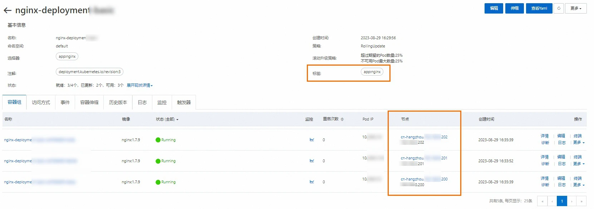

<a id="section-7-5-1-7"></a>

#### 7.5.1.7. 自定义节点池的kubelet参数配置

当kubelet参数默认配置无法满足业务需求、您希望对集群节点进行个性化调整时，您可以在节点池维度自定义节点的kubelet参数配置，调整节点行为。例如，您可以调整集群资源预留以调配资源用量、自定义节点压力驱逐阈值以缓解集群资源不足、调整拓扑管理器策略以提高系统性能等。

**注意事项**

- 自定义kubelet参数按批次变更节点配置，节点池中已有节点将即时生效，新增节点也会使用新配置。生效时，kubelet进程将重启，可能会对节点运行和工作负载运行产生一定影响。请在业务低峰期操作。

- 如果未配置evictionHard、kubeReserved或systemReserved，系统则会使用默认值配置资源预留。

- 资源预留配置的改变，可能会造成节点的可分配资源变少。对于资源水位较高的节点，可能会触发节点驱逐。

- 强烈不建议您通过黑屏操作自行定义控制台不支持的kubelet参数。黑屏操作存在很大的稳定性风险，需要您自行保证Userdata文件内容的正确性和兼容性，避免因配置错误或者配置被新版本弃用时导致节点不可用。

**支持通过控制台自定义的kubelet参数**

| 字段 | 说明 | 默认值 | 建议取值范围 |
| --- | --- | --- | --- |
| allowedUnsafeSysctls | 设置允许使用的非安全的sysctl或sysctl通配符（以<code> * </code>结尾的通配符模式）。此参数是使用英文半角逗号（,）分隔的字符串序列。<br>重要使用此参数前，请仔细评估相关风险并自行保证可用性。 | 不涉及 | 支持下述前缀的 sysctl 配置：<br>• kernel.shm<br>• kernel.msg<br>• kernel.sem<br>• fs.mqueue.<br>• net. |
| containerLogMaxFiles | 容器的日志文件个数上限。此值必须大于等于2，且容器运行时需为containerd。 | 10 | \[2, 10\]。 |
| containerLogMaxSize | 容器日志文件轮换生成新文件的最大阈值。容器运行时需为containerd。 | 100Mi | 不涉及。 |
| cpuCFSQuota | 允许为设置了CPU限制的容器实施CPU CFS配额约束。 | true | 可选值：<br>• true<br>• false |
| cpuCFSQuotaPeriod | 设置CPU CFS配额周期值。需确保CustomCPUCFSQuotaPeriod特性门控已被启用。 | 100ms | 介于1毫秒和1秒之间，包含1毫秒和1秒。 |
| cpuManagerPolicy | CPU管理器策略。 | none | 可选值：<br>• none<br>• static |
| eventBurst | 事件记录的个数的突发峰值上限。 | 10 | \[1, 100\]，且取值必须大于等于<code> eventRecordQPS </code>的值。 |
| eventRecordQPS | 每秒可生成的事件数量。 | 5 | \[1, 50\]。 |
| evictionHard | 触发Pod驱逐操作的一组硬性门限。 | imagefs.available&lt;15%,memory.a vailable&lt;300Mi,nodefs.available&lt;1 0%,nodefs.inodesFree&lt;5% | 无。 |
| evictionSoft | 设置一组驱逐阈值。 | 无 | 无。 |
| evictionSoftGracePerio d | 设置一组驱逐宽限期。<br>说明需已设置evictionSoft。 | 无 | 无。 |
| featureGates | 实验性特性的特性开关组。每个开关以<code> key=value </code>的形式表示。更多信息，请参见Feature Gates。<br><br>重要<br>• 使用此参数前，请仔细评估相关风险并自行保证可用性。<br>• 已移除的特性门控无法生效，请及时更新处理。详细信息，请参见Feature Gates (removed)。 | 不涉及 | 不涉及。 |
| imageGCHighThreshold Percent | 配置镜像的磁盘用量百分比阈值，一旦镜像用量超过此阈值，镜像垃圾收集会一直运行。配置时，此值需大于imageGCLowThresholdPercent取值。 | 85 | \[60, 95\]。 |
| imageGCLowThreshold Percent | 配置镜像的磁盘用量百分比阈值，镜像用量低于此阈值时不会执行镜像垃圾收集操作。配置时，此值需小于imageGCHighThresholdPercent取值。 | 80 | \[30, 90\]。 |
| kubeAPIBurst | 每秒发送到APIServer的突发请求数量上限。 | 10 | \[1, 100\]，且取值必须大于等于<code> kubeAPIQPS </code>的值 |
| kubeAPIQPS | 与APIServer通信的每秒查询个数。 | 5 | \[1, 50\]。 |
| kubeReserved | Kubernetes系统预留的资源配置。 | 默认自动计算。 | 不涉及。 |
| maxPods | Node能运行的Pod最大数量。 | 不涉及。取决于机器规格和容器网络规划等物理资源配置。 | 不涉及。 |
| memoryManagerPolicy | 内存管理器需要使用的策略。 | None | 可选值：<br>• None<br>• Static使用此策略时，需已完成以下操作：<br>• MemoryManager特性门控已被启用。<br>• 已手动管理内存资源预留（systemReserved、kubeReserved、evictionHard、reservedMemory）并确保配置正确，即<code> kube-reserved + system-reserved </code> <code>+ eviction-hard = sum(reserved-</code><code>memory) </code>，以避免节点不可用。您可以参见下图示例。<br>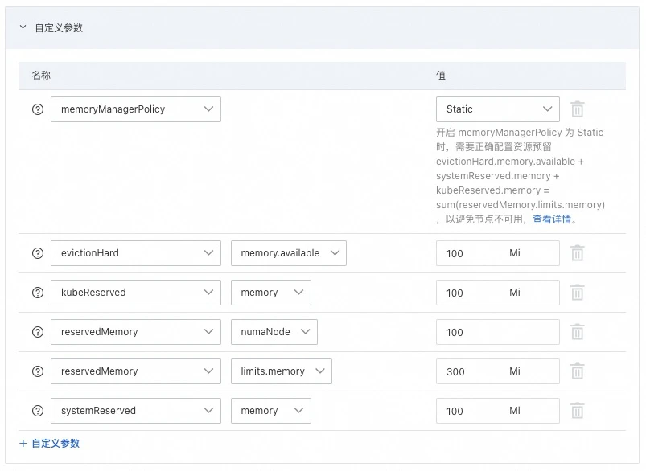<br>更多信息，请参见预留内存标志。 |
| podPidsLimit | 每个Pod中可使用的PID个数上限。 | 16384 | 无。 |
| readOnlyPort | kubelet无鉴权只读端口。 | • 集群版本为1.26及以上时，默认值为0。<br>• 集群版本为1.26以下时，默认值为10255。 | 0 |
| registryBurst | 突发性镜像拉取的个数上限。 | 10 | \[1, 100\]，且取值必须大于等于<code> registryPullQPS </code>的值。 |
| registryPullQPS | 镜像仓库的QPS上限。 | 5 | \[1, 50\]。 |
| reservedMemory | NUMA节点内存预留列表。 | 无。 | 无。 |
| serializeImagePulls | 串行拉取镜像。 | False | 可选值：<br>• False：建议值，以支持并行拉取镜像，提高Pod启动速度。<br>• True：支持串行拉取镜像。 |
| systemReserved | 系统预留的资源配置。 | 默认自动计算。 | 不涉及。 |
| topologyManagerPolicy | 拓扑管理器策略。借助NUMA架构，数据可以被分配到相同的NUMA节点，以减少跨节点访问，提高系统性能。拓扑管理器可以做出与拓扑结构相对应的资源分配决定。更多信息，请参见控制节点上的拓扑管理策略。 | none | • none（默认）：不执行拓扑管理策略。<br>• restricted：当同一NUMA节点的Pod无法满足资源请求时，kubelet不允许跨Pod实现资源请求。<br>• best-effort：当同一NUMA节点的Pod无法满足资源请求时，kubelet允许跨Pod实现资源请求。<br>• single-numa-node：kubelet仅允许在同一NUMA节点的Pod上分配CPU和设备资源。 |
| ContainerLogMonitorInt erval | 集群版本需为1.30及以上。白名单功能，请联系技术支持申请。检测容器日志执行轮转操作的间隔时间。 | 10s | \[3s,60s\] |
| ContainerLogMaxWorke rs | 集群版本需为1.30及以上。白名单功能，请联系技术支持申请。执行日志轮换操作的并发工作程序的最大数量。 | 1 | \[1,20\] |

**通过控制台自定义节点池kubelet参数**

自定义kubelet参数生效时会重启kubelet进程，可能会对业务产生一定影响。请在业务低峰期进行操作。

1. 登录容器服务控制台，然后在控制台左侧导航栏，单击**集群**。

2. 在**集群列表**页面，单击目标集群名称，然后在左侧导航栏，选择**节点管理 > 节点池**。

3. 在节点池列表页面，单击目标节点池**操作**列下的**更多 > Kubelet 配置**。

4. 仔细阅读当前页面上的注意事项，单击**自定义参数**选择需要配置的参数，设置**每批次的最大并行数**，然后单击**提交**，按照页面指引完成操作。

   配置**每批次的最大并行数**后（推荐设置为10），kubelet配置将按批次对节点生效。执行需要一定时间，您可以在事件列表区域查看执行进度，并控制执行过程，例如暂停、继续、取消等。

   您可以使用暂停功能对已升级的节点进行验证。执行暂停操作时，正在配置中的节点会继续完成执行；尚未执行的节点在任务继续前不会被执行自定义配置。

   > **说明**
   >
   > 建议尽快完成自定义配置任务。处于暂停状态的任务将在7天后自动取消，相关事件和日志信息也会被清理。

**常见问题**

**自定义配置会被弃用吗？**

随着Kubernetes版本的演进，可能会有部分参数或FeatureGate被标记弃用或者从代码移除。如果管理的自定义参数在新的版本不再适用，相关配置会在集群升级期间被移除弃用。

**如何启用配置文件的方式管理kubelet？**

容器服务 Kubernetes 版会根据社区的最佳实践调整kubelet配置的管理方式。在1.20版本之后，逐步将已经被标记弃用的kubelet启动命令（Command-Line Flags）改为配置文件。更多信息，请参见Kubelet Configuration (v1beta1)。

新增节点（新创建的节点和新添加的节点）会同时保留配置文件和原有的配置方式；存量节点不受影响。如需将节点统一为配置文件管理的方式，您可以参见自定义节点池kubelet配置触发自定义配置，以统一节点池内全量节点的配置。

**如何自定义控制台不支持的参数？**

强烈不建议您通过黑屏操作自行定义控制台不支持的kubelet参数。如需执行此操作，请在充分评估变更风险后，执行以下命令，修改节点池的Userdata。Userdata修改完成后，新扩容的节点将会带有您自行定义的配置。

```bash
echo 'KUBELET_CUSTOMIZED_ARGS=""' > /etc/kubernetes/kubelet-customized-args.conf
systemctl daemon-reload
systemctl restart kubelet
```

此外，请避免通过黑屏修改Userdata的方式来自行定义，避免配置冲突，继而导致节点池运维过程中产生非预期结果。

> **重要**
>
> 黑屏操作存在很大的稳定性风险，需要您自行保证Userdata文件内容的正确性和兼容性，避免因配置错误或者配置被新版本弃用时导致节点不可用。

<a id="section-7-5-1-8"></a>

#### 7.5.1.8. 升级节点池

本文介绍如何在不影响数据盘的情况下进行节点池升级，您可以根据需要对kubelet、操作系统和容器运行时进行组合升级。

**使用须知**

- 节点池升级功能仅支持有节点的节点池。

- 替盘升级时会对节点进行排水，排水时干扰预算机制PDB（Pod Disruption Budgets）和终止宽限期为30分钟。届时即使节点上运行的Pod无法调度到新的节点上，节点依然会启动升级。关于干扰预算机制，请参见干扰预算机制。

**功能说明**

节点池升级功能支持升级以下三个组件，可以按需组合选择。

| 组件名称 | 升级说明 | 升级操作 | 注意事项 |
| --- | --- | --- | --- |
| kubelet | 如果kubelet发布了新的版本，您可以将该节点池内节点的kubelet升级到与控制平面相同的版本。可用的升级版本以当前集群的管控版本为准。 | 仅选中<strong>Kubelet 升级</strong>：采取原地升级的方式升级kubelet组件。 | 升级kubelet版本的注意事项，请参见升级集群。 |
| OS镜像升级 | 操作系统升级场景包括：<br>• 操作系统版本升级<br>• 更换操作系统类型<br>说明当前操作系统可更换的类型以控制台给出的<strong>可升级版本</strong>为准。 | 在<strong>OS镜像升级</strong>最右侧下拉栏，选中目标系统镜像，采取替盘重置节点的方式升级节点池节点。支持选中<strong>升级前为节点建立快照</strong>选项，为节点创建快照。 | 操作系统版本升级或更换操作系统会通过替换节点系统盘的方式分批次升级节点，请不要在系统盘中保存重要数据或者提前做好备份工作，数据盘在升级过程中则不受影响。 |
| 容器运行时 | 如果容器运行时发布了新的版本，您可以升级节点池内节点到新版本的容器运行时。 | 支持选中<strong>升级前为节点建立快照</strong>选项，为节点创建快照。 | • 以替换节点系统盘的方式执行节点运行时升级时，请勿在系统盘中保存重要数据或者提前做好备份工作，数据盘在升级过程中则不受影响。<br>• 运行时升级过程中可能造成Pod Prober、Lifecycle Hook失败，也可能导致POD重启。 |

> **说明**
>
> 替盘升级时会使用节点池的配置渲染节点组件参数，使节点组件配置与节点池配置保持一致。

**操作步骤**

1. 登录容器服务控制台，在左侧导航栏选择**集群**。

2. 在**集群列表**页面，单击目标集群名称，然后在左侧导航栏，选择**节点管理 > 节点池**。

3. 在**节点池**页面，单击目标节点池右侧**操作**列的**更多 > 升级**。

4. 在**节点池升级**页面，选择需要升级的操作对象，单击**开始升级**。您可以通过设置**批量升级策略**的参数定义每批次最大并行升级的节点数。

   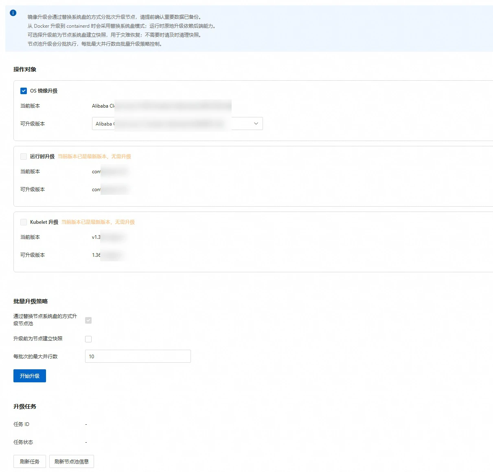

**相关操作**

升级时，在**事件轮转**区域，您可以进行如下操作：

- 暂停或继续：在升级到某个阶段您需要暂停或继续升级时，您可以单击**暂停**或**继续**。

  - 集群暂停状态为节点池升级的中间状态，建议您不要在此时对集群进行操作，并尽快完成升级过程。处于中间状态的集群会在7日之后关闭升级过程，同时清理一切升级相关的事件和日志信息。

  - 单击**暂停**后，已完成升级的节点的kubelet和容器运行时在版本升级后不支持版本回退。对于操作系统，只要原镜像仍旧为创建节点池所支持，操作系统在升级后就支持版本回退，可以替换为原镜像。

- 取消：在升级到某个阶段您需要取消升级时，您可以单击**取消**。

  单击**取消**后，已完成升级的节点的kubelet和容器运行时在版本升级后不支持版本回退。对于操作系统，只要原镜像仍旧为创建节点池所支持，操作系统在升级后就支持版本回退，可以替换为原镜像。

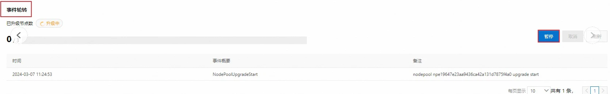

**参考信息：原地升级和替盘升级**

**原地升级和替盘升级流程**

原地升级和替盘升级的流程如下。节点池升级过程会根据设置的最大并行数，依次对节点进行升级，最大并行数推荐设置为10。每个批次的升级节点数为：1、2、4、8……直至达到最大并行数，达到最大并行数后，每个批次都按最大并行数的节点进行升级。例如最大并行数设置为4，那么第一批升级的节点个数为1，第二批升级的节点个数为2，第三批升级的节点个数为4，以后每批的升级节点个数均为4。

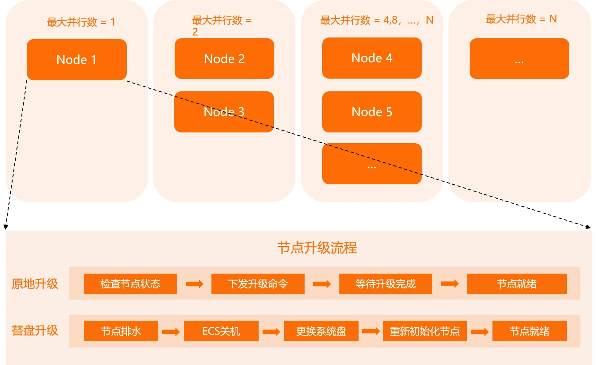

**替盘升级单个节点内部的升级逻辑**

1. 执行节点排水（并设置节点为不可调度）。

2. ECS关机，即停止节点。

3. 更换系统盘，系统盘ID会变更，但是云盘类型、实例IP地址以及弹性网卡MAC地址保持不变。

4. 重新初始化节点。

5. 重启节点，节点就绪（设置节点为可调度）。

**常见问题**

**如何基于快照还原数据？**

节点池升级时支持为节点创建快照，该快照会默认保持30天，您也可以手动提前清理快照。在极端场景下，例如发现升级后数据丢失，您可以通过以下方式对数据进行还原。

- 如果是原地升级，比如只升级了kubelet的版本，您可以通过直接回滚快照的方式还原数据，请参见<strong>《云服务器ECS 用户指南》>《磁盘》>《回滚磁盘》</strong>。

- 如果是替盘升级，比如升级了操作系统或容器运行时，您可以通过快照创建云盘的方式还原数据。

**每个批次升级大概需要多长时间？**

原地升级：5min内

替盘升级：如果不涉及快照，一般是8min内。如果在升级时选中快照，升级会在快照结束后执行，执行时间取决于快照时间。节点池升级容忍快照40min，如果40min内快照还未结束会判定节点超时失败，失败的节点此时还未开始执行升级操作。如果没有在系统盘中保存业务数据，可以不选中快照，避免升级用时过久。

**升级过程中业务是否受影响？**

原地升级：Pod不会重启，不会影响业务。

替盘升级：替盘升级时会对节点排水，如果Pod实现了优雅退出逻辑（Graceful shutdown and zero downtime deployments in Kubernetes），并且多副本部署在多个Node上，对业务没有影响。为了避免同一个应用的多个副本都在一个批次内进行升级，可以手动调整并行数小于Pod副本数。

**节点池升级后支持版本回退吗？**

目前，kubelet和容器运行时在版本升级后不支持版本回退。操作系统在升级后支持版本回退，前提只要原镜像仍旧为创建节点池所支持，就可以替换为原镜像。

**节点升级过程中节点数据会丢失吗？**

以替换节点系统盘的方式执行节点运行时升级时，请不要在系统盘中保存重要数据或者提前做好备份工作，数据盘在升级过程中则不受影响。

**节点替换系统盘后，节点的IP地址会变吗？**

替换系统盘， 系统盘ID会变更，但是云盘类型、实例IP地址以及弹性网卡MAC地址保持不变。

**节点运行时由Docker切换为containerd后，Docker目录未被清理占用磁盘空间怎么办？**

除Kubernetes集群可管理的容器、镜像、日志等文件外，Docker目录中也包含您自行创建的文件路径。如无需使用，请在运行时切换后手动删除数据盘中的Docker目录。

<a id="section-7-5-1-9"></a>

#### 7.5.1.9. 节点池部署集最佳实践

部署集是控制ECS实例分布的策略。该策略将ECS实例分散部署在不同的物理服务器上，以提升业务的高可用性和底层容灾能力。本文介绍如何为节点池指定部署集以及典型的使用场景。

**前提条件**

- 已创建部署集。具体操作，请参见<strong>《云服务器 ECS》</strong>>**《用户指南》**>**《部署集》**>**《创建部署集》**。

- 已确保部署集内ECS实例配额充足（默认为20台），所需机型库存充足。

**使用限制**

- 每个节点池仅支持绑定一个部署集。

- 专有宿主机上的ECS不支持绑定部署集。

- 部署集不支持手动添加或移除节点。您可以通过扩缩容节点池，调整部署集中的节点数。具体操作，请参见扩容节点池。

- 部署集功能开启后，一个可用区内最多支持创建20台ECS实例，一个阿里云地域下能创建的ECS实例数量为**20×可用区数量**（可用区数量由节点池选择的交换机决定）。

**功能介绍**

在同可用区下，通常会选择跨主机部署服务以保证高可用性。当一台物理服务器出问题时，会影响到应用的所有副本。为了解决这个问题，ECS提供了部署集功能。

为节点池指定部署集后，节点池弹出的ECS实例将部署在不同的物理服务器上。通过亲和性配置，使应用对底层的节点拓扑进行感知，均匀地分布在不同节点上，保证应用的容灾能力和高可用性。

关于部署集的更多信息，请参见<strong>《云服务器 ECS》</strong>>**《用户指南》**>**《部署集》**；关于部署集支持的实例规格族，请参见<strong>《云服务器 ECS》</strong>>**《开发指南》**>**《API参考》**>**《部署集》**>**《DescribeDeploymentSetSupportedInstanceTypeFamily》**。

**通过控制台为节点池指定部署集**

> **重要**
>
> - 选择部署集后，节点池内最大节点数会受限，请谨慎选择。
>
> - 部署集默认支持节点上限为**20×可用区数量**，请确保部署集内配额充足，避免节点弹出失败。

1. 登录容器服务控制台，在控制台左侧导航栏，单击**集群**。

2. 在**集群列表**页面，单击目标集群名称，然后在左侧导航栏，选择**节点管理 > 节点池**。

3. 在**节点池**页面右上角，单击**创建节点池**。

4. 在**创建节点池**对话框，单击**高级选项**展开高级选项设置，选择**部署集**，进行相关配置，然后单击**确定**。

   关于其他配置项的说明，请参见创建节点池。

**场景一：服务在同一个节点池中，同一个应用的Pod之间反亲和，一个节点只能调度一个Pod**

1. 创建节点池并指定部署集。

   <ol type="i">

   <li>

   创建包含三个节点的节点池，并为节点池指定部署集ID。具体操作，请参见通过控制台为节点池指定部署集。

   </li>

   <li>

   在**节点池**页面，单击目标节点。在节点池详情页的**节点管理**页签，查看节点信息。

   若显示创建的三个目标节点，表明节点池创建成功。

   </li>

   <li>

   登录云服务器ECS控制台，在左侧导航栏选择**部署集与弹性 > 部署集**，查看部署集信息。

   若节点池中的三个节点均属于所选的部署集，表明节点池指定部署集成功。更多信息，请参见<strong>《云服务器 ECS》</strong>>**《用户指南》**>**《部署集》**。

   </li>

   </ol>

2. 部署应用。

   <ol type="i">

   <li>

   使用以下YAML，创建nginx.yaml。

   基于反亲和性配置三个应用的Pod，将不同的Pod调度到节点池不同的节点。

   ```yaml
   apiVersion: apps/v1
   kind: Deployment
   metadata:
     name: nginx
     labels:
       app: nginx
   spec:
     replicas: 3
     selector:
       matchLabels:
         app: nginx
     template:
       metadata:
         name: nginx
         labels:
           app: nginx
       spec:
         affinity:
           podAntiAffinity:
             requiredDuringSchedulingIgnoredDuringExecution:  # 设置调度策略。
             - labelSelector:
                 matchExpressions:
                 - key: app
                   operator: In
                   values:
                   - nginx
               topologyKey: kubernetes.io/hostname
         nodeSelector:
             alibabacloud.com/nodepool-id: <nodepool-id>  # 指定节点池ID。
         containers:
         - name: nginx
           image: nginx
           resources:
             limits:
               cpu: 1
             requests:
               cpu: 1
   ```

   </li>

   <li>

   执行以下命令，部署应用。

   ```bash
   kubectl apply -f nginx.yaml
   ```

   </li>

   </ol>

3. 查看Pod的调度信息。

   <ol type="i">

   <li>

   登录容器服务控制台，在左侧导航栏，单击**集群**。

   </li>

   <li>

   在**集群列表**页面，单击目标集群名称，然后在左侧导航栏，选择**工作负载 > 无状态**。

   </li>

   <li>

   在**无状态**页面，单击目标工作负载名称，在工作负载详情页的**容器组**页签，查看Pod信息。

   若三个不同的Pod调度到节点池的不同节点，表明Pod调度成功。

   </li>

   </ol>

**场景二：服务在同一个节点池中，同一个应用的Pod按照可用区和节点均匀调度打散**

1. 创建节点池并指定部署集。

   <ol type="i">

   <li>

   创建包含四个节点的节点池，为节点池指定部署集ID，并选择多可用区的vSwitch。具体操作，请参见通过控制台为节点池指定部署集。

   </li>

   <li>

   在左侧导航栏，选择**节点管理 > 节点**，查看节点信息。

   若创建的四个目标节点分布在四个可用区，表明节点池创建成功。根据ESS的均匀分布策略，弹出的ECS实例将分布在不同的四个可用区，且均加入了部署集。

   </li>

   <li>

   登录云服务器ECS控制台，在左侧导航栏选择**部署集与弹性 > 部署集**，查看部署集信息。

   若节点池中的四个节点均属于所选的部署集，表明节点池指定部署集成功。更多信息，请参见<strong>《云服务器 ECS》</strong>>**《用户指南》**>**《部署集》**。

   </li>

   </ol>

2. 部署应用。

   <ol type="i">

   <li>

   使用以下YAML，创建nginx.yaml。

   通过Pod拓扑分布约束，将同一个应用的Pod按照可用区和节点均匀调度打散。

   ```yaml
   apiVersion: apps/v1
   kind: Deployment
   metadata:
     name: nginx
     labels:
       app: nginx
   spec:
     replicas: 4
     selector:
       matchLabels:
         app: nginx
     template:
       metadata:
         name: nginx
         labels:
           app: nginx
       spec:
         topologySpreadConstraints:
           - maxSkew: 1
             topologyKey: kubernetes.io/hostname
             whenUnsatisfiable: DoNotSchedule
             labelSelector:
                 matchLabels:
                   app: nginx
           - maxSkew: 1
             topologyKey: topology.kubernetes.io/zone
             whenUnsatisfiable: DoNotSchedule
             labelSelector:
                 matchLabels:
                   app: nginx
         nodeSelector:
             alibabacloud.com/nodepool-id: <nodepool-id>  # 指定节点池ID。
         containers:
         - name: nginx
           image: nginx
           resources:
             limits:
               cpu: 1
             requests:
               cpu: 1
   ```

   </li>

   <li>

   执行以下命令，部署应用。

   ```bash
   kubectl apply -f nginx.yaml
   ```

   </li>

   </ol>

3. 查看Pod的调度信息。

   <ol type="i">

   <li>

   登录容器服务控制台，然后在左侧导航栏，单击**集群**。

   </li>

   <li>

   在**集群列表**页面，单击目标集群名称，然后在左侧导航栏，选择**工作负载 > 无状态**。

   </li>

   <li>

   在**无状态**页面，单击目标工作负载名称，在工作负载详情页的**容器组**页签，查看Pod信息。

   若同一个应用的四个Pod已按照可用区和节点均匀调度打散，表明Pod调度成功。

   </li>

   </ol>

<a id="section-7-5-1-10"></a>

#### 7.5.1.10. 开启节点自愈

节点池支持启用节点自愈功能，即由ACK自动监控节点状态，并在节点发生异常时自动执行自愈任务，以简化节点运维工作。但由于故障的复杂性，自愈任务无法修复所有的故障场景，部分复杂故障可能仍需人工修复。

**操作步骤**

1. 登录容器服务控制台。

2. 在**集群列表**页面，单击目标集群名称或者目标集群右侧**操作**列的**详情**。

3. 在集群管理页的左侧导航栏，选择**节点管理 > 节点池**。

4. 您可以在新增或存量节点池中开启节点自愈功能：

   - **创建节点池时开启**：在**节点池**页面，单击**创建节点池**。

   - **存量节点池中开启**：在**节点池**页面，单击**编辑节点池**。

5. 在**创建节点池**或编辑节点池页面，开启**节点自愈**，进行相关配置，最后单击**确定**。

   | 参数 | 说明 |
   | --- | --- |
   | 允许重启节点 | 系统与 K8s 组件发生异常时，ACK 将自动执行修复动作，例如重启组件。若您允许重启节点，在修复措施无效的情况下，ACK 将会把节点设置为不可调度状态、进行排水操作，并尝试通过重启节点进行修复。您也可以选择不允许 ACK 通过重启节点来进行修复。 |
   | 维护窗口 | 用于限定自愈操作的执行时间范围。<br>• 若关闭维护窗口，系统将在检测到节点故障时自动执行自愈操作。<br>• 若开启维护窗口，系统将根据设置的维护周期，自动执行自愈操作。您可以单击<strong>配置维护</strong><strong>窗口</strong>设置维护周期。<br>• <strong>每周</strong>：设置<strong>每周维护日</strong>、<strong>维护开始时间</strong>、<strong>维护时长</strong>以及<strong>时区</strong>。<br>• <strong>自定义 Recurrence</strong>：自定义<strong>Recurrence</strong>、<strong>维护开始时间</strong>、<strong>维护时长</strong>以及<strong>时区</strong>。<br>说明<br>• 字段说明：<br>• <code> FREQ </code>：时间频率，目前只支持按周（WEEKLY）和月（MONTHLY）。<br>• <code> BYDAY </code>：星期，取值范围为 \[MO,TU,WE,TH,FR,SA,SU\]。<br>• <code> INTERVAL </code>：周期间隔，必须大于 0。<br>• 示例：含义：每隔两周的周四。自定义规则：<code> FREQ=WEEKLY;BYDAY=TH;INTERVAL=2 </code>。 |
   |  |  |

   > **说明**
   >
   > 关于配置项的完整说明，请参见创建节点池和编辑节点池。

**系统与K8s组件异常**

**自愈流程**

ACK会根据节点的运行状态 `condition` 等信息判断是否发起自愈任务。您可以执行 `kubectl describe node` 命令，在 `condition` 字段查看节点的运行状态。

检测到系统与K8s组件异常时，且异常持续时间超过阈值时间（即故障发生多长时间后会触发节点自愈）时，ACK将自动执行自愈任务。系统与K8s组件异常场景下，一个完整的节点自愈流程如下：

1. ACK对异常系统和K8s组件进行修复，例如重启kubelet、重启运行时等。

2. 如果**允许**重启节点，当修复动作无效时，ACK继续执行以下操作：

   <ol type="i">

   <li>

   ACK自动将故障节点设置为不可调度。

   </li>

   <li>

   ACK针对需要重启的故障节点执行排水。排水超时时间为30分钟。

   ACK执行节点排水操作时，会在遵循Pod Disruption Budget（PDB）的前提下将节点上的Pod驱逐至其他可用节点。为确保服务高可用性，建议您采用多副本部署策略，将工作负载分散在多个节点上，同时为关键业务配置PDB，控制同时中断的Pod数量。

   如排水失败，ACK仍会执行后续操作。

   </li>

   <li>

   ACK重启节点。

   </li>

   <li>

   检测节点状态恢复正常时，ACK将故障节点恢复为可调度。

   如果某节点在执行节点自愈前已被设置为不可调度，那么在自愈任务完成后，该节点不会自动恢复为可调度。

   </li>

   </ol>

**触发自愈的Node Condition**

| Node Condition | 描述 | 风险等级 | 阈值时间 | 自愈行为 |
| --- | --- | --- | --- | --- |
| KubeletNotReady(Kubelet Hung) | kubelet意外停止工作，导致节点NotReady。 | 高 | 180s | 1. 重启kubelet。<br>2. 如果<strong>允许</strong>重启节点，则重启ECS实例。 |
| KubeletNotReady(PLEG) | PLEG健康检查失败，导致节点NotReady。 | 中 | 180s | 1. 重启containerd或Docker。<br>2. 重启kubelet。<br>3. 如果<strong>允许</strong>重启节点，则重启ECS实例。 |
| RuntimeOffline | containerd停止工作，节点不可用。 | 高 | 90s | 1. 重启containerd。<br>2. 如果<strong>允许</strong>重启节点，则重启ECS实例。 |
| NTPProblem | 时间同步服务（ntpd或chronyd）异常。 | 高 | 10s | 重启ntpd或chronyd。 |
| SystemdOffline | Systemd状态异常，无法启动、销毁容器。 | 高 | 90s | 如果<strong>允许</strong>重启节点，则重启ECS实例。 |
| ReadonlyFilesystem | 节点文件系统变为只读。 | 高 | 90s | 如果<strong>允许</strong>重启节点，则重启ECS实例。 |

**自愈过程中的节点状态**

- 自愈任务执行中，节点状态为修复中。

- 自愈任务完成后，故障状态解除，节点恢复正常状态。

- 自愈任务完成后，故障状态依然存在，节点会被置为恢复失败状态。

  节点处于自愈失败状态时，不会再次触发自愈操作。相应的故障解除后，该节点才能再次进行自愈操作。

<a id="section-7-5-2"></a>

### 7.5.2. 节点

<a id="section-7-5-2-1"></a>

#### 7.5.2.1. 添加已有节点

您可以通过ACK控制台将已有的ECS实例添加到已创建的Kubernetes集群中，目前仅支持添加Worker节点。本文介绍自动添加节点和手动添加节点两种方式。

**前提条件**

- 您已成功创建一个Kubernetes集群，参见创建Kubernetes集群。

- 您需要将待添加的ECS实例添加到Kubernetes集群自动创建的节点安全组中。具体操作，请参见<strong>《云服务器ECS用户指南》>《安全组》>《ECS实例加入安全组》</strong>。

**使用限制**

- 请确保您的集群可添加足够的节点数。

- 添加的云服务器必须与集群在同一地域、同一VPC下。

- ACK仅支持添加同一账号下云服务器。

**添加实例限制**

**安全组数量限制**

当添加已有实例到节点池时，会将实例加入到节点池安全组中，对于实例已经加入的安全组不会重复加入。由于ECS实例能够加入的安全组有一定的限制，因此需要保证实例加入节点池后所加入的安全组数量小于其限制。关于云服务器ECS的使用限制，请参见<strong>《云服务器ECS产品简介》>《使用限制》</strong>。

**安全组规则限制**

安全组是一种虚拟防火墙，用于控制安全组内ECS实例的入流量和出流量，从而提高ECS实例的安全性。

安全组分为普通安全组、企业安全组和托管安全组，其中托管安全组由云产品创建，且只有创建托管安全组的云产品才有对其规则更改的权限，因此创建节点池时应避免选择托管安全组，否则会造成创建节点池失败。普通安全组和企业安全组的详情和区别如下表所示：

| 功能 | 普通安全组 | 企业安全组 |
| --- | --- | --- |
| 未添加任何规则时的访问策略 | • 入方向：拒绝所有访问请求<br>• 出方向：允许所有访问请求 | • 入方向：拒绝所有访问请求<br>• 出方向：拒绝所有访问请求 |
| 能容纳的私网IP地址数量 | 2000 | 65536 |
| 同一个安全组内实例之间的网络连通策略 | 默认内网互通 | 默认内网隔离，需要您手动添加安全组规则 |
| 授权给其他安全组 | 支持 | 不支持 |

创建节点池时，会为节点池安全组默认添加规则，用于集群内的通信。关于如何配置安全组的集群访问规则，请参见<strong>《云服务器ECS用户指南》>《安全组》>《添加安全组规则》</strong>。

添加实例到安全组时，需要注意实例已有的安全组规则不应与以下安全组规则冲突，否则将导致Pod之间无法通信：

- Pod网络CIDR

- VPC的附加IPv4网段

**自动添加节点**

自动添加节点方式会列出当前账号下可用的ECS云服务器，在Web界面进行安装部署，并自动添加到集群。

1. 登录容器服务控制台。

2. 在控制台左侧导航栏单击**集群**。

3. 在**集群列表**页面单击目标集群右侧**操作**列的**详情**。

4. 在集群管理页面选择**节点管理 > 节点池**。

5. 在**节点池**页面，单击目标节点池右侧**操作**列的**更多 > 添加已有节点**。

6. 在**选择已有云服务器实例**配置项页面，选择自动添加已有云服务器实例。

   选择**添加方式**为**自动添加**，在已有云服务器的列表中，选择所需的ECS云服务器。

7. 单击**下一步**，完成**填写实例信息**。

   <table>
     <tr>
       <th width="114">配置项</th>
       <th>说明</th>
     </tr>
     <tr>
       <td>集群ID/名称</td>
       <td>当前要添加的集群信息，已默认配置。</td>
     </tr>
     <tr>
       <td>数据盘挂载</td>
       <td>设置是否将容器和镜像存储在数据盘。<br>• 如果ECS已挂载数据盘，且最后一块数据盘的文件系统未初始化，系统会自动将该数据盘格式化为ext4，用来存放内容/var/lib/docker、/var/lib/kubelet。<br>说明数据盘内原有数据将丢失，请注意备份数据。<br>• 如果ECS未挂载数据盘，则不会挂载新的数据盘。</td>
     </tr>
     <tr>
       <td>登录方式</td>
       <td>默认选择<strong>设置密码</strong>。</td>
     </tr>
   </table>

   <table>
     <tr>
       <th width="121">密码</th>
       <th>输入实例的<strong>密码</strong>。</th>
     </tr>
     <tr>
       <td>确认密码</td>
       <td>请再次输入实例密码以确认。</td>
     </tr>
     <tr>
       <td>保留实例名称</td>
       <td>添加节点时，默认开启<strong>保留实例名称</strong>。如果您不需要保留实例名称，您可以关闭<strong>保留实例名称</strong>，此时会按照自定义节点名称指定的规则来重命名节点。</td>
     </tr>
     <tr>
       <td>实例信息</td>
       <td>添加的云服务器实例的实例ID及实例名称。</td>
     </tr>
   </table>

8. 单击**下一步**，在**添加已有实例到集群**对话框中单击**确定**。

**手动添加节点**

> **重要**
>
> 手动添加到ACK集群的ECS节点不会随集群删除而被释放。

手动添加节点方式要求您获取安装命令，登录到对应ECS云服务器上进行安装，每次只能添加一个ECS云服务器。

1. 登录容器服务控制台。

2. 在控制台左侧导航栏单击**集群**。

3. 在**集群列表**页面单击目标集群右侧**操作**列的**详情**。

4. 在集群管理页面选择**节点管理 > 节点池**。

5. 在**节点池**页面，单击目标节点池右侧**操作**列的**更多 > 添加已有节点**。

6. 在**选择已有云服务器实例**配置项页面，选择手动添加已有云服务器实例。

   选择**添加方式**为**手动添加**，在已有云服务器的列表中，选择所需的ECS云服务器。

7. 单击**下一步**，完成**填写实例信息**。

   <table>
     <tr>
       <th width="121">配置项</th>
       <th>说明</th>
     </tr>
     <tr>
       <td>集群ID/名称</td>
       <td>当前要添加的集群信息，已默认配置。</td>
     </tr>
     <tr>
       <td>数据盘挂载</td>
       <td>设置是否将容器和镜像存储在数据盘。<br>• 如果ECS已挂载数据盘，且最后一块数据盘的文件系统未初始化，系统会自动将该数据盘格式化为ext4，用来存放内容/var/lib/docker、/var/lib/kubelet。<br>说明数据盘内原有数据将丢失，请注意备份数据。<br>• 如果ECS未挂载数据盘，则不会挂载新的数据盘。</td>
     </tr>
     <tr>
       <td>保留实例名称</td>
       <td>添加节点时，默认开启<strong>保留实例名称</strong>。如果您不需要保留实例名称，您可以关闭<strong>保留实例名称</strong>，此时会按照自定义节点名称指定的规则来重命名节点。</td>
     </tr>
     <tr>
       <td>实例信息</td>
       <td>添加的云服务器实例的实例ID及实例名称。</td>
     </tr>
   </table>

8. 单击**下一步**，进入**添加完成**页面。在**添加完成**页面复制执行命令，单击**完成**。

9. 登录ECS控制台。具体操作，请参见<strong>《云服务器用户指南》>《快速入门》>《登录云服务器ECS控制台》</strong>。

10. 单击左侧导航栏中的**实例与镜像 > 实例**，选择集群所在的地域，选择需要添加的ECS实例。

11. 单击ECS实例右侧的**远程连接**，使用VNC远程连接ECS实例。具体操作，请参见<strong>《云服务器ECS用户指南》>《快速入门》>《连接实例》>《使用VNC连接实例》</strong>。

12. 在ECS实例远程连接界面，根据页面指导，输入步骤8保存的命令，单击**执行**开始执行脚本。

    等待脚本执行成功，该云服务器添加成功。

**执行结果**

1. 在集群管理页左侧导航栏中，选择**节点管理 > 节点池**。

2. 在**节点池**页面，单击目标节点池右侧**操作**列的**详情**。

3. 在目标节点池页面，单击**节点管理**页签。

   可查看刚才添加的节点信息。

<a id="section-7-5-2-2"></a>

#### 7.5.2.2. 查看节点列表

您可以通过命令、容器服务管理控制台的节点列表页面查看Kubernetes集群的节点列表。

**通过命令查看**

> **说明**
>
> 使用命令查看Kubernetes集群的节点列表页面之前，您需要先设置通过kubectl连接Kubernetes集群。

通过kubectl连接到Kubernetes集群后，运行以下命令查看集群中的节点。

```bash
kubectl get nodes
```

**输出示例：**

```bash
$ kubectl get nodes
    NAME                      STATUS    AGE       VERSION
    iz2ze2n6ep53tch701yh9zz   Ready     19m       v1.6.1-2+ed9e3d33a07093
    iz2zeafr762wibijx39e5az   Ready     7m        v1.6.1-2+ed9e3d33a07093
    iz2zeafr762wibijx39e5bz   Ready     7m        v1.6.1-2+ed9e3d33a07093
    iz2zef4dnn9nos8elyr32kz   Ready     14m       v1.6.1-2+ed9e3d33a07093
    iz2zeitvvo8enoreufstkmz   Ready     11m       v1.6.1-2+ed9e3d33a07093
```

**通过容器服务管理控制台查看**

1. 登录容器服务控制台。

2. 在左侧导航栏，单击**集群**。

3. 在**集群列表**页面，单击目标集群名称或者目标集群右侧**操作**列的**详情**。

4. 在集群管理页面选择**节点管理 > 节点**，查看集群下的节点列表。

5. （可选）在**节点**页面，您可以通过设置节点的**名称**、**IP**、**节点池**、**角色**、**实例规格**、**Kubelet**、**标签**等条件过滤查看目标节点。单击**高级筛选**，可同时设置多个过滤条件。

6. 查看节点信息。

   - 查看节点名称、IP地址、实例ID、所属节点池、角色 / 状态、配置、容器组(已分配量/总额度)、CPU 请求/限制/使用量、内存请求/限制/使用量、Kubelet / Runtime /OS 版本、更新时间等。

   - 单击**操作**列的**详情**，查看节点的**使用量**、**基本信息**、**系统信息**、**资源分配量**、**Pods**、**现状详情**、**事件**等。

     单击**操作**列的**Workbench 远程连接**，通过 Workbench 远程连接目标节点。

     在节点详情页面右上角，您可以单击**节点上线**/**设置不可调度**调整节点的调度状态，或单击**查看/编辑 YAML**查看并编辑该节点的YAML。

<a id="section-7-5-2-3"></a>

#### 7.5.2.3. 节点标签管理

您可以通过容器服务 Web 界面对节点进行标签管理，包括批量添加节点标签、通过标签筛选节点和快速删除节点标签。

关于如何使用节点标签实现节点调度，请参见节点调度设置。

**前提条件**

您已经成功创建一个 Kubernetes 集群，参见创建Kubernetes集群。

**批量添加节点标签**

1. 登录容器服务控制台。

2. 在控制台左侧导航栏单击**集群**。

3. 在**集群列表**页面单击目标集群右侧**操作**列的**详情**。

4. 在集群管理页面选择**节点管理 > 节点**。

5. 在**节点**页面单击**标签与污点管理**。

6. 在节点列表中，批量选择节点，然后单击**添加标签**。

7. 在弹出的添加标签对话框中，输入标签的键和值，然后单击**确定**。

   您可以在标签页签下，看到批量节点具有相同的标签。

**删除节点标签**

1. 登录容器服务控制台。

2. 在控制台左侧导航栏单击**集群**。

3. 在**集群列表**页面单击目标集群右侧**操作**列的**详情**。

4. 在集群管理页面选择**节点管理 > 节点**。

5. 在**节点**页面单击**标签与污点管理**。

6. 选择某个节点，单击目标标签的  图标。在弹出的对话框单击**确定**。

   您可以看到该节点右侧的标签消失，节点标签被删除。

<a id="section-7-5-2-4"></a>

#### 7.5.2.4. 节点调度设置

您可以设置节点调度，从而合理分配各节点的负载。本文介绍如何设置节点调度。

**操作步骤**

1. 登录容器服务控制台。

2. 在控制台左侧导航栏单击**集群**。

3. 在**集群列表**页面单击目标集群右侧**操作**列的**详情**。

4. 在集群管理页面选择**节点管理 > 节点**。

5. 选中所需的节点，单击页面下方**调度配置**。

   > **说明**
   >
   > 您也可以选择目标节点右侧**操作**列下的 **更多 > 调度配置**进行调度设置。

6. 在弹出的对话框中，进行调度设置。

   - 选择**不可调度**，在后续进行应用部署时，Pod不会再调度到该节点。

   - 选择**可调度**，允许Kubernetes调度器将新创建的Pod分配到此节点。

7. 单击**确定**。

   可以看到节点的调度状态发生变化。

**后续步骤**

您在后续进行应用部署时，会发现Pod不会再调度到该节点。

<a id="section-7-5-2-5"></a>

#### 7.5.2.5. 节点排水

节点排水可以将一个节点上的所有可迁移的Pod安全地驱逐，并阻止新的Pod被调度到该节点上。本文介绍如何设置节点排水。

**约束限制**

- 边缘节点或worker节点个数只有一个的集群不支持执行排水操作。

- 节点上由DaemonSet控制的Pod不会被排空。

**操作步骤**

1. 登录容器服务控制台。

2. 在左侧导航栏，单击**集群**。

3. 在**集群列表**页面，单击目标集群名称或者目标集群右侧**操作**列的**详情**。

4. 在集群管理页的左侧导航栏，选择**节点管理 > 节点**。

5. 您可以对单个节点及多个节点进行排水设置。

   - 单个节点

     选择目标节点**操作**列**更多 > 节点排水**。

   - 多个节点

     勾选目标节点，单击节点列表下方的**批量排水**。

6. 在弹出的**节点排水**对话框中，设置**超时时间**，并仔细阅读注意事项。勾选**我已经理解上述说明，确认执行选定的操作。**，然后单击**确认排空**。

   > **说明**
   >
   > **超时时间**：超过设定的时间后排水任务会自动失败，0表示不设置超时时间。

   > **重要**
   >
   > 此操作可能会对业务产生影响，建议在业务低峰期进行。设置为不可调度后，选中的节点将被标记为SchedulingDisabled。选中的节点上已有的Pod可以继续提供服务，但新创建的Pod将不再调度到该节点。
   >
   > 排空节点后，选中的节点上已有的Pod将被排空，但由DaemonSet控制的Pod不会被排空，选中的节点将被标记为SchedulingDisabled。新创建的Pod将不再调度到该节点。

<a id="section-7-5-2-6"></a>

#### 7.5.2.6. 移除节点

对集群中的ECS实例进行重启或释放时，需要先从集群移除该ECS节点，本文为您介绍如何移除节点。

**前提条件**

- 您已成功创建一个Kubernetes集群，参见创建Kubernetes集群。

- 您可以通过kubectl连接到Kubernetes集群，参见通过kubectl连接Kubernetes集群。

**背景信息**

- 移除节点会涉及Pod迁移，可能会影响业务，请在业务低峰期操作。

- 操作过程中可能存在非预期风险，请提前做好相关的数据备份。

- 操作过程中，后台会把当前节点设置为不可调度状态。

- 移除节点仅移除Worker节点，不会移除Master节点。

**操作步骤**

1. 执行以下命令，把待移除节点上的Pod转移到其他节点。

   > **说明**
   >
   > 请确保集群其他节点的资源充足。

   ```bash
   kubectl drain node-name
   ```

   > **说明**
   >
   > *node-name*格式为*your-region-name*.*node-id*。
   >
   > - *your-region-name*为您集群所在的地域名称。
   >
   > - *node-id*为待移除节点所在的ECS实例ID。例如cn-hanghzou.i-xxx。

2. 登录容器服务控制台。

3. 在控制台左侧导航栏单击**集群**。

4. 在**集群列表**页面单击目标集群右侧**操作**列的**详情**。

5. 在集群管理页面选择**节点管理 > 节点**。

6. 选择目标节点**操作**列**更多 > 移除**。

   > **说明**
   >
   > 若要同时移除多个节点，可在**节点**页面同时选中要移除的节点，然后单击**批量移除**。

7. <strong>可选：</strong>在移除节点对话框设置参数。

   - 开启**排水**，开启后会先驱逐可迁移的Pod；请确认业务具备足够副本。

   - 开启**同时释放实例**，该节点所在的ECS实例将会被永久释放。

   > **说明**
   >
   > - 释放ECS实例仅释放按量付费的ECS实例。
   >
   > - 对于预付费ECS实例，计费周期到期后，ECS实例会自动释放。
   >
   > - 若不选择**同时释放实例**，该节点所在的ECS实例会继续计费。

8. 在对话框单击**确定**。

<a id="section-7-5-2-7"></a>

#### 7.5.2.7. 查看节点资源请求量/使用量

通过容器服务控制台，您可查看Kubernetes集群各节点资源占用情况。

**前提条件**

您已成功创建一个Kubernetes集群，参见创建Kubernetes集群。

**操作步骤**

1. 登录容器服务控制台。

2. 在控制台左侧导航栏单击**集群**。

3. 在**集群列表**页面单击目标集群右侧**操作**列的**详情**。

4. 在集群管理页面选择**节点管理 > 节点**。

5. 在节点管理页面选择目标节点**操作**列下的**详情**。

   您可查看各个节点CPU和内存的资源使用情况，即请求量和使用量，其计算方式如下：

   - CPU请求量 = sum(当前节点所有Pod的CPU request值) / 当前节点CPU总量。

   - CPU使用量 = sum(当前节点所有Pod的CPU实际使用量) / 当前节点CPU总量。

   - 内存请求量 = sum(当前节点所有Pod的内存request值) / 当前节点内存总量。

   - 内存使用量 = sum(当前节点所有Pod的内存实际使用量) / 当前节点内存总量。

   > **说明**
   >
   > - 您可根据节点的资源占用情况，规划节点的工作负载，参见节点调度设置。
   >
   > - 请求量或使用量为100%的节点时，不会调度新的Pod到该节点上。

<a id="section-7-5-3"></a>

### 7.5.3. 混合云节点池

<a id="section-7-5-3-1"></a>

#### 7.5.3.1. 创建和管理混合云节点池

当企业需要将本地服务器资源纳入ACK集群统一管理时，为实现云上云下资源的弹性调度与成本优化，可通过ACK集群创建混合云节点池，将已有的混合云节点加入集群，从而在保持统一编排的同时充分利用现有IT资产。

**前提条件**

创建混合云节点池时，需满足以下条件：

- 已创建Kubernetes集群，且集群版本为1.32或以上。

- 使用混合云节点池时，同时保有ECS节点，用于部署部分ACK管控组件（建议使用3个及以上ECS节点以保证高可用）。

- 已安装terway hybrid和terway-hybrid-controlplane组件。

- 需要升级的组件：

  - ube-flannel-ds：版本 >= v0.15.1.23-33d25c1-aliyun

  - csi-plugin 和 csi-provisioner：版本 >= v1.34.1

  - terway-eniip：版本 >= v1.13.9.1

  - flannel（vxlan）：版本 >= v0.15.1.23-20a397e6-aliyun

**影响评估**

为了避免对ACK集群中已有业务的影响，节点默认会有以下标签和污点。

```yaml
apiVersion: v1
kind: Node
metadata:
  labels:
    alibabacloud.com/nodepool-type: hybridcloud
...
spec:
  taints:
  - effect: NoSchedule
    key: nodepool-type
    value: "hybridcloud"
...
```

如果Pod所在节点需要调度到混合云节点，可添加对此Taint的容忍。如果应用部署不需要区分云上云下节点，也可以删除Taint。但请勿删除默认标签 `alibabacloud.com/nodepool-type: hybridcloud` ，否则影响产品功能。

**创建混合云节点池**

您可以在控制台完成节点池的配置，包括基本配置、网络配置等。部分配置项（尤其是节点池可用性相关和网络相关的配置）在创建后不支持调整。创建节点池的过程中不会影响其他已有节点池内节点和业务的运行。

1. 登录容器服务控制台，然后在控制台左侧导航栏，单击**集群**。

2. 在**集群列表**页面，单击目标专有版集群，然后在集群管理页左侧导航栏选择**节点管理 > 节点池**。

3. 在**节点池**页面，单击**创建混合云节点池**。

4. 在**创建混合云节点池**页面配置相关参数，然后单击**提交**。

   <table>
     <tr>
       <th width="105">参数</th>
       <th>说明</th>
     </tr>
     <tr>
       <td>节点池名称</td>
       <td>自定义节点池名称。</td>
     </tr>
     <tr>
       <td>地域</td>
       <td>节点池将要部署的地域。</td>
     </tr>
     <tr>
       <td>可用区</td>
       <td>您可以选择已有可用区或自定义可用区。<strong>手动输入</strong>：自定义一个逻辑上的可用区名称，例如 idc-zone-1。此名称在集群内必须唯一。</td>
     </tr>
     <tr>
       <td>容器运行时</td>
       <td>仅支持<strong>containerd</strong>，运行时受集群版本影响。</td>
     </tr>
     <tr>
       <td>网络插件</td>
       <td>当前仅支持<strong>Terway-Hybrid</strong>。专为混合云节点池设计，确保集群内Pod（处于IDC或云端）之间的网络互通。</td>
     </tr>
     <tr>
       <td>网络类型</td>
       <td>当前仅支持<strong>Overlay</strong>。配置简单，对底层网络无特殊要求，部署灵活。</td>
     </tr>
     <tr>
       <td>节点标签</td>
       <td>为集群节点添加标签。</td>
     </tr>
     <tr>
       <td>污点</td>
       <td>为集群内所有Worker节点添加污点。</td>
     </tr>
   </table>

   > **说明**
   >
   > 节点池创建完成以后，您可进行以下操作：
   >
   > - 修改节点池：单击**操作**列的**编辑**，修改配置项。
   >
   > - 查看节点池详情：单击**操作**列的**详情**，可查看节点池的详细信息。
   >
   > - 删除节点池：单击**操作**列的**删除**，可删除节点池。

**添加混合云节点**

如果需要将自有的混合云节点添加到ACK集群中作为Worker节点，可以在容器服务管理控制台，将自有节点添加到ACK集群中进行统一管理。

- **普通自有混合云节点**

  <ol type="i">

  <li>

  在**节点池**页面，单击目标节点池右侧**操作**列下的**添加已有节点**。

  </li>

  <li>

  单击脚本右上角的**复制**，在目标节点上执行该脚本，即可将节点添加到集群中。

  </li>

  </ol>

- **BMS实例作为Worker节点**

  <ol type="i">

  <li>

  在**节点池**页面，单击目标节点池右侧**操作**列下的**添加已有节点**。

  </li>

  <li>

  单击脚本右上角的**复制**，在脚本后面补充instance-id，其中 `i-xxxxx` 需替换为实际的BMS实例ID。

  ```text
  ...... --instance-id i-xxxxx
  ```

  </li>

  <li>

  登录 BMS 实例，在目标节点上执行该脚本，即可将节点添加到集群中。

  </li>

  </ol>

**移除混合云节点**

1. 在**节点池**页面，单击目标节点池右侧**操作**列下的**移除节点**。

2. 在弹出的对话框中，仔细阅读提示信息，选择是否**自动排空节点**，然后单击**确定**。

<a id="section-7-5-3-2"></a>

#### 7.5.3.2. 使用Terway Hybrid网络插件

混合云节点池接入本地IDC，其复杂的网络拓扑和跨域路由需求超出了常规容器网络插件的能力范围。Terway Hybrid网络插件专为混合云节点池设计，它能确保集群内Pod（处于IDC或云端）之间的网络互通。

**工作原理**

ACK混合云节点池的整体网络架构如下，整体分为两个网络域：阿里云中心云VPC和本地IDC（如果存在多个IDC或者三方云和中心云互联，则有多个网络域）。两个网络域之间通过专线实现三层内网互通。其中中心VPC的ACK集群可采用Flannel/Terway网络插件，本地IDC采用Terway Hybrid网络插件。

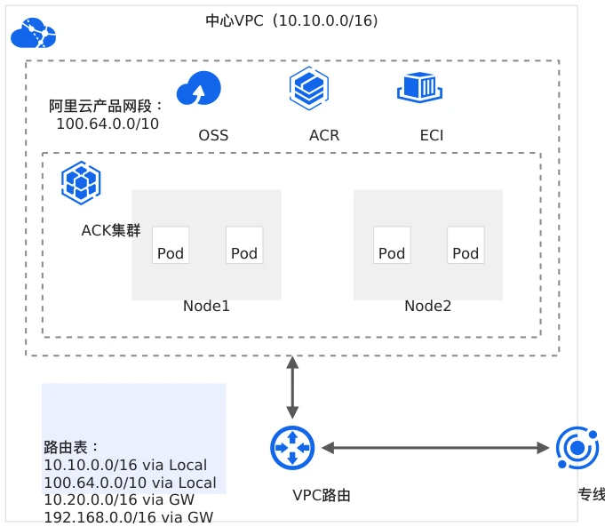

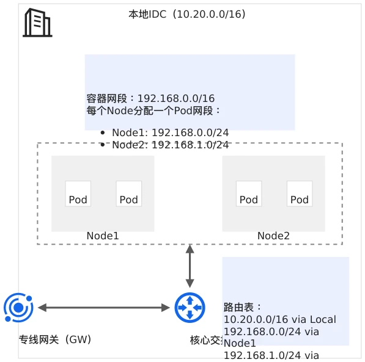

专线网关（GW）

**Terway Hybrid模式介绍**

Terway Hybrid在节点池级别提供了Overlay模式，请在创建和管理混合云节点池时进行配置。

**Overlay模式**

<strong>优势：</strong>配置简单，对底层网络无特殊要求，部署灵活。

**网络要求**：节点之间仅需三层内网互通。

**容器网络路径**：器网络数据包通过虚拟网卡进行VXLAN封包，借助主机网络8472端口进行UDP传输。

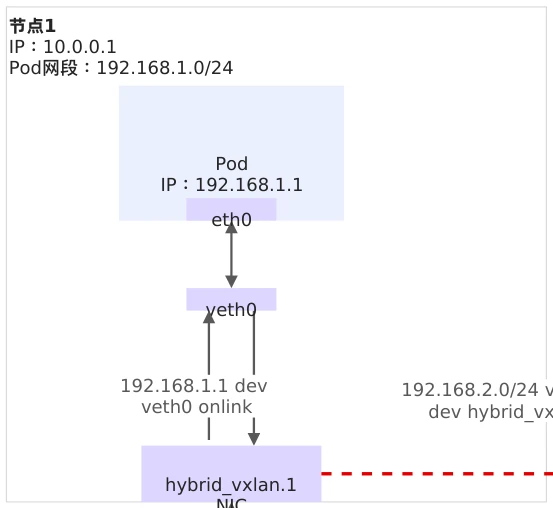

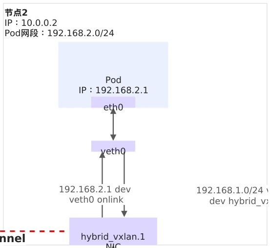

192.168.2.0/24 via 192.168.2.1

192.168.1.0/24 v

dev hybrid_vxlan.1 onlink

dev hybrid_vx

**VXLAN Tunnel**

NIC

NIC

交换机

**前提条件**

- 已创建Kubernetes集群，且集群版本为1.32或以上。

- 使用混合云节点池时，同时保有ECS节点，用于部署部分ACK管控组件（建议使用3个及以上ECS节点以保证高可用）。

- 已安装terway hybrid和terway-hybrid-controlplane组件。

- 需要升级的组件：

  - ube-flannel-ds：版本 >= v0.15.1.23-33d25c1-aliyun

  - csi-plugin 和 csi-provisioner：版本 >= v1.34.1

  - terway-eniip：版本 >= v1.13.9.1

  - flannel（vxlan）：版本 >= v0.15.1.23-20a397e6-aliyun

**操作步骤**

1. 登录容器服务控制台。

2. 在左侧导航栏选择**集群**。

3. 在**集群列表**页面，单击目标集群名称，然后在左侧导航栏，单击**组件管理**。

4. 在**组件管理**页面，找到**terway-hybrid-controlplane**组件并单击**安装**。

5. 配置以下参数后，单击**确定**。

   | 配置项 | 说明 |
   | --- | --- |
   | RemoteContainerCIDR | 混合云节点池 IPv4 容器网段，用于为每个混合云节点分配容器子网。容器网段不能与现有Service网段、Pod网段、VPC网段重合。CIDR格式，如 <code> 192.168.0.1/16 </code>。<br>重要创建后不可修改，请谨慎规划。 |
   | RemoteContainerCIDRMaskSize | 每个混合云节点分配的IPv4子网掩码大小，取值范围：24–28。<br>重要创建后不可修改，请谨慎规划。 |
   | 是否开启源地址转换 | 混合云节点的Pod访问集群外部地址时，是否将其源IP地址转换为节点IP地址。 |

6. 在**组件管理**页面，找到**terway-hybrid**组件并单击**安装**。

   安装数据面组件**terway-hybrid**，无需配置参数。后续添加的混合云节点将自动安装Terway Hybrid插件。

<a id="section-7-5-3-3"></a>

#### 7.5.3.3. ACK集群纳管AIStack节点

ACK支持对接AIStack软件，支持被ACK K8s集群统一纳管和调度。

**前提条件**

- 请确保ACK集群版本>=1.32。

- AIStack软件已部署且节点可访问。

- 具备kubectl和节点SSH访问权限。

**操作步骤**

1. 创建混合云节点池。

2. 在混合云节点池**操作**列，单击**更多 > 接入混合云节点池**，获取添加已有节点的脚本。

3. 在脚本后面加上参数： `--is-aistack true` 。

4. 在节点上创建 `attach.sh` 文件，将脚本内容保存到文件中。

5. 在AIStack节点上，执行 `bash attach.sh > attach.log 2>&1` 命令。

6. 在AIStack节点上，执行 `grep 'reuse aistack containerd service and restart it' attach.log` 命令。

**预期结果**

添加节点成功，且出现对应日志。

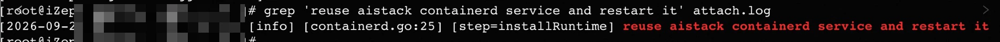

<a id="section-7-6"></a>

## 7.6. 存储

<a id="section-7-6-1"></a>

### 7.6.1. 概述

容器服务管理控制台支持创建其他云产品的存储卷，支持阿里云云盘和OSS，来实现持久化存储，用于构建有状态应用。

目前，支持静态存储卷和动态存储卷。每种数据卷的支持情况如下：

| 阿里云存储 | 静态存储卷 | 动态存储卷 |
| --- | --- | --- |
| 阿里云云盘 | 支持通过PV/PVC的方式使用云盘静态存储卷。 | 支持 |
| 阿里云NAS | 支持通过PV/PVC的方式使用NAS静态存储卷。 | 支持 |
| 阿里云OSS | 支持通过PV/PVC的方式使用OSS静态存储卷。 | 支持 |

<a id="section-7-6-2"></a>

### 7.6.2. 使用阿里云云盘

您可使用阿里云云盘创建存储卷。

您可以在阿里云容器服务 Kubernetes 集群中使用阿里云云盘存储卷。

目前，阿里云云盘提供两种 Kubernetes 挂载方式：

- 静态存储卷

  您可以通过以下两种方式使用云盘静态存储卷：

  - 通过 PV/PVC 使用

- 动态存储卷

**使用说明**

- 云盘为非共享存储，只能同时被一个 pod 挂载。

- 使用云盘存储卷前需要先申请一个云盘，并获得磁盘 ID。

  对创建的云盘容量有如下要求：

  - 普通云盘：最小5Gi

  - 高效云盘：最小20Gi

  - SSD云盘：最小20Gi

- volumeId： 表示所挂载云盘的磁盘 ID；volumeName、PV Name要与之相同。

- 集群中只有与云盘在同一个可用区（Zone）的节点才可以挂载云盘。

- 待挂载的云盘类型必须是按量付费，包年包月的云盘无法被挂载。当您把集群中的ECS实例从按量付费转换成包年包月时，不可以把云盘一起变成包年包月，否则云盘将不能被挂载使用。

**静态存储卷**

您可以直接通过 volume 使用阿里云云盘存储卷或者通过 PV/PVC 使用阿里云云盘存储卷。

**前提条件**

使用云盘存储卷之前，您需要先在 ECS 管理控制台上创建云盘。

- **直接通过 volume 使用**

  使用disk-deploy.yaml文件创建 Pod。

  ```yaml
  apiVersion: extensions/v1beta1
  kind: Deployment
  metadata:
    name: nginx-disk-deploy
  spec:
    replicas: 1
    template:
      metadata:
        labels:
          app: nginx
      spec:
        containers:
        - name: nginx-flexvolume-disk
          image: nginx
          volumeMounts:
            - name: "d-bp1j17ifxfasvts3tf40"
              mountPath: "/data"
        volumes:
          - name: "d-bp1j17ifxfasvts3tf40"
            flexVolume:
              driver: "alicloud/disk"
              fsType: "ext4"
              options:
                volumeId: "d-bp1j17ifxfasvts3tf40"
  ```

- **通过 PV/PVC 使用**

  <ol type="i">

  <li>

  **创建云盘类型的 PV**

  您可以使用 yaml 文件或者控制台界面创建云盘类型的 PV。

  - **通过 yaml 文件创建 PV**

    使用  `disk-pv.yaml`  文件创建 PV。

    > **说明**
    >
    > pv name 要与阿里云盘 ID 相同。

    ```yaml
    apiVersion: v1
    kind: PersistentVolume
    metadata:
      name: d-bp1j17ifxfasvts3tf40
      labels:
        failure-domain.beta.kubernetes.io/zone: cn-hangzhou-b
        failure-domain.beta.kubernetes.io/region: cn-hangzhou
    spec:
      capacity:
        storage: 20Gi
      storageClassName: disk
      accessModes:
        - ReadWriteOnce
      flexVolume:
        driver: "alicloud/disk"
        fsType: "ext4"
        options:
          volumeId: "d-bp1j17ifxfasvts3tf40"
    ```

  - **通过控制台界面创建云盘存储卷**

    <ol type="a">

    <li>

    登录容器服务控制台。

    </li>

    <li>

    在控制台左侧导航栏单击**集群**。

    </li>

    </ol>

    <ol type="i" start="100">

    <li>

    在**集群列表**页面单击目标集群右侧**操作**列的**详情**。

    </li>

    <li value="500">

    在集群管理页面选择**存储 > 存储卷**。

    </li>

    </ol>

    <ol type="a" start="5">

    <li>

    在**存储卷**页面单击**创建存储卷**。

    > **说明**
    >
    > 您也可以单击页面的**使用 YAML 创建**，通过YAML方式创建存储卷。

    </li>

    <li>

    在创建存储卷对话框中，配置存储卷的相关参数。

    Table 1. 云盘存储卷配置

    <table>
      <tr>
        <th width="121">配置项</th>
        <th>说明</th>
      </tr>
      <tr>
        <td>存储卷类型</td>
        <td>本示例中为<strong>云盘</strong>。</td>
      </tr>
      <tr>
        <td>存储驱动</td>
        <td>显示支持的存储驱动。</td>
      </tr>
      <tr>
        <td>访问模式</td>
        <td>默认为 ReadWriteOnce。</td>
      </tr>
      <tr>
        <td>云盘 ID</td>
        <td>您可以选择与集群属于相同地域和可用区下处于待挂载状态的云盘。</td>
      </tr>
      <tr>
        <td>文件系统类型</td>
        <td>您可以选择以什么数据类型将数据存储到云盘上，支持的类型包括 ext4、ext3、xfs、vfat。默认为 ext4。</td>
      </tr>
      <tr>
        <td>标签</td>
        <td>为该存储卷添加标签。</td>
      </tr>
    </table>

    </li>

    <li>

    完成配置后，单击**确定**。

    </li>

    </ol>

  </li>

  <li>

  **创建 PVC**

  使用  `disk-pvc.yaml`  文件创建 PVC。

  ```yaml
  kind: PersistentVolumeClaim
  apiVersion: v1
  metadata:
    name: pvc-disk
  spec:
    accessModes:
      - ReadWriteOnce
    storageClassName: disk
    resources:
      requests:
        storage: 20Gi
  ```

  </li>

  <li>

  **创建 Pod**

  使用disk-pod.yaml文件创建 pod。

  ```yaml
  apiVersion: v1
  kind: Pod
  metadata:
    name: "flexvolume-alicloud-example"
  spec:
    containers:
      - name: "nginx"
        image: "nginx"
        volumeMounts:
          - name: pvc-disk
            mountPath: "/data"
    volumes:
    - name: pvc-disk
      persistentVolumeClaim:
        claimName: pvc-disk
  ```

  </li>

  </ol>

**动态存储卷**

动态存储卷需要您手动创建 StorageClass，并在PVC中通过 storageClassName 来指定期望的云盘类型。

1. **创建 StorageClass**

   ```yaml
   kind: StorageClass
   apiVersion: storage.k8s.io/v1beta1
   metadata:
     name: alicloud-disk-common-hangzhou-b
   provisioner: alicloud/disk
   parameters:
     type: cloud_ssd
     regionid: cn-hangzhou
     zoneid: cn-hangzhou-b
   ```

   参数说明：

   - provisioner：配置为 alicloud/disk，标识使用阿里云云盘 Provsioner 插件创建。

   - type：标识云盘类型，支持 cloud、cloud_efficiency、cloud_ssd、available 四种类型；其中 available 会对高效、SSD、普通云盘依次尝试创建，直到创建成功。

   - regionid：期望创建云盘的区域。

   - zoneid：期望创建云盘的可用区。

2. **创建服务**

   ```yaml
   kind: PersistentVolumeClaim
   apiVersion: v1
   metadata:
     name: disk-common
   spec:
     accessModes:
       - ReadWriteOnce
     storageClassName: alicloud-disk-common-hangzhou-b
     resources:
       requests:
         storage: 20Gi
   ---
   kind: Pod
   apiVersion: v1
   metadata:
     name: disk-pod-common
   spec:
     containers:
     - name: disk-pod
       image: nginx
       volumeMounts:
         - name: disk-pvc
           mountPath: "/mnt"
     restartPolicy: "Never"
     volumes:
       - name: disk-pvc
         persistentVolumeClaim:
           claimName: disk-common
   ```

   **默认选项**

   集群默认提供了下面几种 StorageClass，可以在集群中使用。

   - alicloud-disk-common：普通云盘。

   - alicloud-disk-efficiency：高效云盘。

   - alicloud-disk-ssd：SSD云盘。

   - alicloud-disk-available：提供高可用选项，先试图创建高效云盘；如果相应AZ的高效云盘资源售尽，再试图创建SSD盘；如果SSD售尽，则试图创建普通云盘。

3. **使用云盘创建多实例StatefulSet**

   使用 volumeClaimTemplates 的方式来创建，这样会动态创建多个 PVC 和 PV 并绑定。

   ```yaml
   apiVersion: v1
   kind: Service
   metadata:
     name: nginx
     labels:
       app: nginx
   spec:
     ports:
     - port: 80
       name: web
     clusterIP: None
     selector:
       app: nginx
   ---
   apiVersion: apps/v1beta2
   kind: StatefulSet
   metadata:
     name: web
   spec:
     selector:
       matchLabels:
         app: nginx
     serviceName: "nginx"
     replicas: 2
     template:
       metadata:
         labels:
           app: nginx
       spec:
         containers:
         - name: nginx
           image: nginx
           ports:
           - containerPort: 80
             name: web
           volumeMounts:
           - name: disk-common
             mountPath: /data
     volumeClaimTemplates:
     - metadata:
         name: disk-common
       spec:
         accessModes: [ "ReadWriteOnce" ]
         storageClassName: "alicloud-disk-common"
         resources:
           requests:
             storage: 10Gi
   ```

<a id="section-7-6-3"></a>

### 7.6.3. 使用NAS静态存储卷

NAS存储卷是一种可共享访问、弹性扩展、高可靠以及高性能的分布式文件系统。本文介绍如何使用阿里云NAS静态存储卷，以及如何实现持久化存储与共享存储。

**前提条件**

使用NAS存储卷之前，您需要先在NAS管理控制台上创建文件系统，并在文件系统中添加Kubernetes集群的挂载点。创建的NAS文件系统需要和您的集群位于同一VPC。更多信息，请参见<strong>《文件存储NAS 用户指南》</strong>。

**使用场景**

- 对磁盘I/O要求较高的应用。

- 读写性能相对于对象存储OSS高。

- 可实现跨主机文件共享，例如可作为文件服务器。

**注意事项**

- NAS支持同时被多个Pod挂载，此时多个Pod可能同时修改相同数据，需要应用自行实现数据的同步。

  > **说明**
  >
  > NAS存储的根目录不支持修改权限、属主和属组。

- NAS静态存储卷不支持扩容。

- 若您在应用模板中配置了**securityContext.fsgroup**参数，kubelet在存储卷挂载完成后会执行 `chmod` 或 `chown` 操作，导致挂载时间延长，您可以通过移除该参数减少挂载时间。

**通过控制台的方式使用NAS静态存储卷**

1. 创建PV。

   <ol type="i">

   <li>

   登录容器服务控制台，在控制台左侧导航栏中，单击**集群**。

   </li>

   <li>

   在**集群列表**页面中，单击目标集群名称或者目标集群右侧**操作**列下的**详情**。

   </li>

   <li>

   在集群管理页左侧导航栏中，选择**存储 > 存储卷**。

   </li>

   <li>

   在**存储卷**页面右上角，单击**创建存储卷**。

   > **说明**
   >
   > 您也可以单击页面的**使用 YAML 创建**，通过 YAML 方式创建存储卷。

   </li>

   <li>

   在**创建存储卷**对话框中，配置相关参数，然后单击**确定**。

   <table>
     <tr>
       <th width="121">参数</th>
       <th>说明</th>
     </tr>
     <tr>
       <td>存储卷类型</td>
       <td>支持云盘、NAS和OSS三种云存储类型。本文中选择为<strong>NAS</strong>。</td>
     </tr>
     <tr>
       <td>名称</td>
       <td>创建的数据卷的名称，数据卷名在集群内必须唯一。本文配置为<code>pv-nas</code>。</td>
     </tr>
     <tr>
       <td>存储驱动</td>
       <td>仅支持<strong>CSI</strong>。</td>
     </tr>
     <tr>
       <td>总量</td>
       <td>所创建存储卷的容量。<br>说明NAS文件系统本身不限制使用量。此处不是NAS文件系统的使用限额，只是所创建存储卷的容量声明。</td>
     </tr>
     <tr>
       <td>访问模式</td>
       <td>支持ReadWriteMany和ReadWriteOnce。默认为<strong>ReadWriteMany</strong>。</td>
     </tr>
     <tr>
       <td>挂载点域名</td>
       <td>您可以通过选择挂载点或者自定义的方式定义集群在NAS文件系统中挂载点的挂载地址。</td>
     </tr>
     <tr>
       <td>显示高级选项</td>
       <td>• <strong>子目录</strong>：NAS路径下的子目录，以/为根目录，设定后数据卷将挂载到指定的子目录。<br>• 如果NAS根目录下没有此子目录，会默认创建后再挂载。<br>• 您可以不填此项，默认挂载到NAS根目录。<br>• 极速NAS需要以/share为父目录。<br>• <strong>版本</strong>：所创建存储卷的版本。</td>
     </tr>
     <tr>
       <td>标签</td>
       <td>为该存储卷添加标签。</td>
     </tr>
   </table>

   </li>

   </ol>

2. 创建PVC。

   <ol type="i">

   <li>

   在集群管理页左侧导航栏中，选择**存储 > 存储声明**。

   </li>

   <li>

   在**存储声明**页面，单击**创建存储声明**。

   > **说明**
   >
   > 您也可以单击页面的**使用 YAML 创建**，通过 YAML 方式创建存储声明。

   </li>

   <li>

   在**创建存储声明**对话框中，配置相关参数。

   <table>
     <tr>
       <th width="121">参数</th>
       <th>说明</th>
     </tr>
     <tr>
       <td>存储声明类型</td>
       <td>支持云盘、NAS、OSS三种云存储类型。本文选择<strong>NAS</strong>。</td>
     </tr>
     <tr>
       <td>名称</td>
       <td>创建的存储声明名称在集群内必须唯一。</td>
     </tr>
     <tr>
       <td>分配模式</td>
       <td>选择<strong>已有存储卷</strong>。<br>说明若未创建存储卷，您可以设置<strong>分配模式</strong>为<strong>创建存储卷</strong>，并配置相关参数。更多信息，请参见创建PV。</td>
     </tr>
     <tr>
       <td>已有存储卷</td>
       <td>单击<strong>选择已有存储卷</strong>，在目标存储卷右侧操作列单击<strong>选择</strong>。</td>
     </tr>
     <tr>
       <td>总量</td>
       <td>所创建存储卷的容量。<br>说明所创建存储卷声明的容量不能超过待挂载的存储卷容量。</td>
     </tr>
   </table>

   </li>

   <li>

   参数配置完成后，单击**确定**。

   创建成功后可以在列表中看到创建的存储声明，并且已绑定相应的存储卷。

   </li>

   </ol>

3. 创建应用。具体操作，请参见创建无状态工作负载Deployment。

   在**容器配置**配置向导，数据卷配置说明如下。本文以数据卷为云存储为例，配置**存储卷类型**为**云存储类型**，**挂载源**为**csi-nas-pvc**，**容器路径**为`/tmp`。

   <table>
     <tr>
       <th width="90">数据卷</th>
       <th>说明</th>
     </tr>
     <tr>
       <td>本地存储</td>
       <td>单击<strong>增加本地存储</strong>，配置<strong>存储卷类型</strong>、<strong>挂载源</strong>、<strong>容器路径</strong>和<strong>子路径</strong>（选填，默认为空），将对应的挂载源挂载到容器路径中。存储卷类型支持主机目录、配置项、保密字典和临时目录。更多信息，请参见Volumes。</td>
     </tr>
     <tr>
       <td>云存储</td>
       <td>单击<strong>增加云存储声明</strong>，配置<strong>存储卷类型</strong>、<strong>挂载源</strong>、<strong>容器路径</strong>和<strong>子路径</strong>（选填，默认为空），将对应的挂载源挂载到容器路径中。存储卷类型仅支持云存储类型。</td>
     </tr>
   </table>

**通过kubectl命令行方式使用NAS静态存储卷**

1. 创建静态PV。

   <ol type="i">

   <li>

   使用以下内容，创建pv-nas.yaml。

   ```yaml
   apiVersion: v1
   kind: PersistentVolume
   metadata:
     name: pv-nas
     labels:
       alicloud-pvname: pv-nas
   spec:
     capacity:
       storage: 5Gi
     accessModes:
       - ReadWriteMany
     csi:
       driver: nasplugin.csi.alibabacloud.com
       volumeHandle: pv-nas
       volumeAttributes:
         server: "2564f4****-ysu87.cn-shenzhen.nas.aliyuncs.com"
         path: "/csi"
     mountOptions:
     - nolock,tcp,noresvport
     - vers=3
   ```

   参数说明如下：

   <table>
     <tr>
       <th width="156">参数</th>
       <th>说明</th>
     </tr>
     <tr>
       <td>name</td>
       <td>PV的名称。</td>
     </tr>
     <tr>
       <td>labels</td>
       <td>设置PV的标签。</td>
     </tr>
     <tr>
       <td>storage</td>
       <td>NAS的可使用量。</td>
     </tr>
     <tr>
       <td>accessModes</td>
       <td>配置访问模式。</td>
     </tr>
     <tr>
       <td>driver</td>
       <td>驱动类型。本例中取值为<code>nasplugin.csi.alibabacloud.com</code>，表示使用阿里云NAS CSI插件。</td>
     </tr>
     <tr>
       <td>volumeHandle</td>
       <td>配置PV的唯一标识符。若需要同时使用多个PV，则各个PV中该值必须不一致。</td>
     </tr>
     <tr>
       <td>server</td>
       <td>NAS挂载点。</td>
     </tr>
     <tr>
       <td>path</td>
       <td>挂载子目录，极速NAS需要以/share为父目录。</td>
     </tr>
     <tr>
       <td>vers</td>
       <td>挂载NAS数据卷的NFS协议版本号，推荐使用v3，极速类型NAS只支持v3。</td>
     </tr>
   </table>

   </li>

   <li>

   执行以下命令，创建静态PV。

   ```bash
   kubectl create -f pv-nas.yaml
   ```

   </li>

   </ol>

2. 创建静态PVC。

   <ol type="i">

   <li>

   使用以下内容，创建pvc-nas.yaml。

   创建NAS存储声明PVC，使用 `selector` 筛选PV，精确配置PVC和PV的绑定关系。

   ```yaml
   kind: PersistentVolumeClaim
   apiVersion: v1
   metadata:
     name: pvc-nas
   spec:
     accessModes:
       - ReadWriteMany
     resources:
       requests:
         storage: 5Gi
     selector:
       matchLabels:
         alicloud-pvname: pv-nas
   ```

   部分参数说明如下：

   | 参数 | 说明 |
   | --- | --- |
   | name | PVC的名称。 |
   | accessModes | 配置访问模式。 |
   | storage | 声明应用使用量，不能大于存储卷的总量。 |
   | matchLabels | 输入PV的标签，用于关联PV。 |

   </li>

   <li>

   执行以下命令创建静态PVC。

   ```bash
   kubectl create -f pvc-nas.yaml
   ```

   </li>

   </ol>

3. 创建应用并挂载PVC。

   <ol type="i">

   <li>

   使用以下内容，创建nas-static应用的nas.yaml示例文件。

   ```yaml
   apiVersion: apps/v1
   kind: Deployment
   metadata:
     name: nas-static
     labels:
       app: nginx
   spec:
     replicas: 2
     selector:
       matchLabels:
         app: nginx
     template:
       metadata:
         labels:
           app: nginx
       spec:
         containers:
         - name: nginx
           image: nginx
           ports:
           - containerPort: 80
           volumeMounts:
             - name: pvc-nas
               mountPath: "/data"
         volumes:
           - name: pvc-nas
             persistentVolumeClaim:
               claimName: pvc-nas
   ```

   部分参数说明如下：

   | 参数 | 说明 |
   | --- | --- |
   | image | 部署Pod的镜像地址，请按照实际情况进行替换。 |
   | mountPath | NAS在容器中挂载的位置。 |
   | claimName | PVC的名称，用于绑定PVC。 |

   </li>

   <li>

   执行以下命令，创建nas-static应用，并挂载PVC。

   ```bash
   kubectl create -f nas.yaml
   ```

   </li>

   </ol>

4. 执行以下命令，查看Pod信息。

   ```bash
   kubectl get pod
   ```

   预期输出：

   ```text
   NAME                          READY   STATUS    RESTARTS   AGE
   nas-static-5b5cdb85f6-n****   1/1     Running   0          32s
   nas-static-c5bb4746c-4****    1/1     Running   0          32s
   ```

**验证NAS的持久化存储**

1. 查看部署应用和NAS文件。

   <ol type="i">

   <li>

   执行以下命令，查看部署的应用名称。

   ```bash
   kubectl get pod 
   ```

   预期输出：

   ```text
   NAME                          READY   STATUS    RESTARTS   AGE
   nas-static-5b5cdb85f6-n****   1/1     Running   0          32s
   nas-static-c5bb4746c-4****    1/1     Running   0          32s
   ```

   </li>

   <li>

   执行以下命令，查看任意一个应用的/data路径下的文件。

   本文以名为nas-static-5b5cdb85f6-n\*\*\*\*的Pod为例。

   ```bash
   kubectl exec nas-static-5b5cdb85f6-n**** ls /data
   ```

   无返回结果，说明/data路径下无文件。

   </li>

   </ol>

2. 执行以下命令，在名为nas-static-5b5cdb85f6-n\*\*\*\*的Pod的/data路径下创建文件nas。

   ```bash
   kubectl exec nas-static-5b5cdb85f6-n**** touch /data/nas
   ```

3. 执行以下命令，查看名为nas-static-5b5cdb85f6-n\*\*\*\*的Pod的/data路径下的文件。

   ```bash
   kubectl exec nas-static-5b5cdb85f6-n**** ls /data
   ```

   预期输出：

   ```text
   nas
   ```

4. 执行以下命令，删除Pod。

   ```bash
   kubectl delete pod nas-static-5b5cdb85f6-n****
   ```

5. 同时在另一个窗口中，执行以下命令，查看Pod删除及Kubernetes重建Pod的过程。

   ```bash
   kubectl get pod -w -l app=nginx
   ```

6. 验证删除Pod后，NAS里创建的文件是否存在。

   <ol type="i">

   <li>

   执行以下命令，查看Kubernetes重建的Pod名称。

   ```bash
   kubectl get pod
   ```

   预期输出：

   ```text
   NAME                          READY   STATUS    RESTARTS   AGE
   nas-static-5b5cdb85f6-n****   1/1     Running   0          32s
   nas-static-c5bb4746c-4****    1/1     Running   0          32s
   ```

   </li>

   <li>

   执行以下命令，查看名为nas-static-5b5cdb85f6-n\*\*\*\*的Pod的/data路径下的文件。

   ```bash
   kubectl exec nas-static-5b5cdb85f6-n**** ls /data
   ```

   预期输出：

   ```text
   nas
   ```

   nas文件仍然存在，说明NAS的数据可持久化保存。

   </li>

   </ol>

**验证NAS的共享存储**

1. 查看部署的应用所在的Pod和NAS文件。

   <ol type="i">

   <li>

   执行以下命令，查看应用所在Pod的名称。

   ```bash
   kubectl get pod 
   ```

   预期输出：

   ```text
   NAME                          READY   STATUS    RESTARTS   AGE
   nas-static-5b5cdb85f6-n****   1/1     Running   0          32s
   nas-static-c5bb4746c-4****    1/1     Running   0          32s
   ```

   </li>

   <li>

   执行以下命令，查看2个Pod的/data路径下的文件。

   ```bash
   kubectl exec nas-static-5b5cdb85f6-n**** ls /data
   kubectl exec nas-static-c5bb4746c-4**** ls /data
   ```

   </li>

   </ol>

2. 执行以下命令，在任意一个Pod的/data路径下创建文件nas。

   ```bash
    kubectl exec nas-static-5b5cdb85f6-n**** touch /data/nas
   ```

3. 执行以下命令，查看2个Pod /data路径下的文件。

   <ol type="i">

   <li>

   执行以下命令，查看名为nas-static-5b5cdb85f6-n\*\*\*\*的Pod /data路径下的文件。

   ```bash
   kubectl exec nas-static-5b5cdb85f6-n**** ls /data
   ```

   预期输出：

   ```text
   nas
   ```

   </li>

   <li>

   执行以下命令，查看名为nas-static-c5bb4746c-4\*\*\*\*的Pod /data路径下的文件。

   ```bash
   kubectl exec nas-static-c5bb4746c-4**** ls /data
   ```

   预期输出：

   ```text
   nas
   ```

   如果在任意一个Pod的/data下创建的文件，两个Pod下的/data路径下均存在此文件，则说明两个Pod共享一个NAS。

   </li>

   </ol>

<a id="section-7-6-4"></a>

### 7.6.4. 使用NAS动态存储卷

NAS存储卷适用于大数据分析、共享数据、Web应用以及保存日志等场景。除使用静态存储卷外，您也可以创建PVC并配置StorageClass来实现存储资源的动态分配，让系统为您自动预留持久化存储卷，无需预先手动创建和配置存储资源。您可以通过subpath方式和filesystem方式挂载NAS动态存储卷。

**前提条件**

- 已创建Kubernetes集群。

- 已创建NAS文件系统。请参见<strong>《文件系统 NAS用户指南》>《快速入门》>《创建文件系统》</strong>章节。

  若需要加密NAS存储卷中的数据，创建NAS文件系统时请配置加密类型。

- 已创建NAS挂载点。请参见<strong>《文件系统 NAS用户指南》>《快速入门》>《添加挂载点》</strong>章节。

  NAS挂载点需要和集群节点在同一个VPC内。

**使用场景**

- 对磁盘I/O要求较高的应用。

- 读写性能相对于对象存储OSS高。

- 可实现跨主机文件共享，例如可作为文件服务器。

**注意事项**

- 在使用极速NAS文件系统时，配置动态存储卷StorageClass中的 `path` 需要以/share为父目录。例如， `0cd8b4a576-g****.cn-hangzhou.nas.aliyuncs.com:/share/subpath` 表示Pod挂载的NAS文件系统子目录为 `/share/subpath` 。

- NAS支持同时被多个Pod挂载，此时多个Pod可能同时修改相同数据，需要应用自行实现数据的同步。

  > **说明**
  >
  > NAS存储的/目录不支持修改权限、属主和属组。

- 若您在应用模板中配置了**securityContext.fsgroup**参数，kubelet在存储卷挂载完成后会执行 `chmod` 或 `chown` 操作，导致挂载时间延长。

**通过控制台的方式使用NAS动态存储卷**

通过控制台的方式只能创建subpath类型的NAS动态存储卷，若您需要使用filesystem类型的NAS动态存储卷，请使用kubectl命令行方式。

**步骤一：创建StorageClass**

1. 登录容器服务控制台，然后在控制台左侧导航栏，单击**集群**。

2. 在**集群列表**页面，单击目标专有版集群，然后在集群管理页左侧导航栏选择**存储 > 存储类**。

3. 在**存储类**页面，单击**创建存储类**。

   > **说明**
   >
   > 您也可以单击页面的**使用 YAML 创建**，通过 YAML 方式创建存储类。

4. 在对话框中，配置StorageClass的相关参数。

   部分参数的说明如下所示：

   <table>
     <tr>
       <th width="105">参数</th>
       <th>说明</th>
     </tr>
     <tr>
       <td>名称</td>
       <td>StorageClass的名称。名称必须以小写字母开头，只能包含小写字母、数字、小数点（.）和短划线（-）。</td>
     </tr>
     <tr>
       <td>存储卷类型</td>
       <td>可选择<strong>云盘</strong>、<strong>NAS</strong>、<strong>OSS</strong>。本示例选择<strong>NAS</strong>。</td>
     </tr>
     <tr>
       <td>存储驱动</td>
       <td>选择<strong>CSI</strong>。</td>
     </tr>
     <tr>
       <td>回收策略</td>
       <td>回收策略，默认为<strong>Delete</strong>，支持<strong>Retain</strong>。<br>• Delete模式：需配合<strong>archiveOnDelete</strong>一起使用。<br>• 当<strong>archiveOnDelete</strong>为<strong>true</strong>，删除PVC时，PV和NAS文件只是被重命名，不会被删除。<br>• 当<strong>archiveOnDelete</strong>为<strong>false</strong>，删除PVC时，PV和NAS文件会被真正删除。<br>• Retain模式：删除PVC的时候，PV和NAS文件系统不会被删除，需要您手动删除。如果数据安全性要求高，推荐使用Retain方式以免误删数据。</td>
     </tr>
     <tr>
       <td>挂载点</td>
       <td>NAS和EFS-NAS文件系统的挂载点地址。若无可选的挂载点地址，请先创建NAS和EFS-NAS文件系统.。</td>
     </tr>
     <tr>
       <td>路径</td>
       <td>NAS和EFS-NAS文件系统中的挂载路径。</td>
     </tr>
     <tr>
       <td>挂载选项</td>
       <td>挂载NAS和EFS-NAS的可选参数，包括NFS和EFS-NAS协议版本等参数。</td>
     </tr>
   </table>

5. 参数配置完成后，单击**确定**。

   创建成功后在**存储类**列表中可看到刚创建的StorageClass。

**步骤二：创建PVC**

1. 在集群管理页左侧导航栏选择**存储 > 存储声明**。

2. 在**存储声明**页面，单击**创建存储声明**。

   > **说明**
   >
   > 您也可以单击页面的**使用 YAML 创建**，通过 YAML 方式创建存储声明。

3. 在弹出的**创建存储声明**页面中，填写界面参数。

   | 参数 | 说明 |
   | --- | --- |
   | 存储声明类型 | 支持云盘、NAS、OSS三种云存储类型。 本文中选择<strong>NAS</strong>。 |
   | 名称 | 创建的存储声明名称在集群内必须唯一。 |
   | 分配模式 | 本文中选择<strong>使用存储类动态创建</strong>。 |
   | 已有存储类 | 单击<strong>选择存储类</strong>，在<strong>选择存储类</strong>对话框目标存储类右侧<strong>操作</strong>列单击<strong>选择</strong>。 |
   | 总量 | 所创建存储卷的容量。 |
   | 访问模式 | 默认为<strong>ReadWriteMany</strong>，也可选择<strong>ReadWriteOnce</strong>。 |

4. 单击**确定**。

   创建成功后可在列表中看到创建的存储声明，并且已绑定相应的存储卷。

**步骤三：创建应用**

1. 在集群管理页左侧导航栏，选择**工作负载 > 无状态**。

2. 在**无状态**页面，单击**使用镜像创建**。

3. 配置创建应用的参数信息，配置完成后，单击**创建无状态**。

   主要参数如下，其他参数保持默认即可。更多信息，请参见创建无状态工作负载Deployment。

   <table>
     <tr>
       <th>配置项</th>
       <th>参数</th>
       <th>说明</th>
       <th>示例</th>
     </tr>
     <tr>
       <td rowspan="2">应用基本信息</td>
       <td>应用名称</td>
       <td>Deployment名称，自定义输入。格式要求请参考界面提示。</td>
       <td>nas-test</td>
     </tr>
     <tr>
       <td>副本数量</td>
       <td>Deployment的副本数量。</td>
       <td>2</td>
     </tr>
     <tr>
       <td rowspan="3">容器配置</td>
       <td>镜像名称</td>
       <td>用于部署应用的镜像地址。</td>
       <td>anolis-registry.cn-zhangjiakou.cr.aliyuncs.com/openanolis/nginx: 1.14.1-8.6</td>
     </tr>
     <tr>
       <td>所需资源</td>
       <td>所需的vCPU和内存资源。</td>
       <td>0.25 Core，512 MiB</td>
     </tr>
     <tr>
       <td>数据卷</td>
       <td>单击<strong>增加云存储声明</strong>，然后完成参数配置。<br>• <strong>挂载源</strong>：选择之前创建的PVC。<br>• <strong>容器路径</strong>：输入NAS文件系统要挂载到的容器路径。</td>
       <td>• 挂载源：pvc-nas<br>• 容器路径：/data</td>
     </tr>
   </table>

4. 查看应用部署状态。

   <ol type="i">

   <li>

   在**无状态**页面，单击应用名称。

   </li>

   <li>

   在**容器组**页签下，确认Pod已正常运行（状态为**Running**）。

   </li>

   </ol>

**通过kubectl方式使用NAS动态存储卷**

**使用subpath类型的NAS动态存储卷**

当您的多个Kubernetes应用或者Pod需要挂载相同的NAS存储卷共享数据时，或不同的Pod挂载相同NAS文件系统的不同子目录时， 可以使用subpath类型的NAS动态存储卷方式。

NAS动态存储卷的挂载方式为subpath类型时，您需要手动创建NAS文件系统和挂载点。

1. 创建NAS文件系统和挂载点。相关操作，请参见<strong>《文件系统 NAS用户指南》>《快速入门》>《创建文件系统》</strong>和<strong>《添加挂载点》</strong>章节。

2. 创建StorageClass。

   <ol type="i">

   <li>

   创建并复制以下内容到alicloud-nas-subpath.yaml文件中。

   ```yaml
   apiVersion: storage.k8s.io/v1
   kind: StorageClass
   metadata:
     name: alicloud-nas-subpath
   mountOptions:
   - nolock,tcp,noresvport
   - vers=3
   parameters:
     volumeAs: subpath
     server: "0cd8b4a576-g****.cn-hangzhou.nas.aliyuncs.com:/k8s/"
   provisioner: nasplugin.csi.alibabacloud.com
   reclaimPolicy: Retain
   ```

   <table>
     <tr>
       <th width="177">参数</th>
       <th>描述</th>
     </tr>
     <tr>
       <td>mountOptions</td>
       <td>挂载NAS的<strong>options</strong>参数在<strong>mountOptions</strong>中配置，包括NFS协议版本。</td>
     </tr>
     <tr>
       <td>volumeAs</td>
       <td>可选<strong>subpath</strong>、<strong>filesystem</strong>，分别表示创建子目录类型的PV和文件系统类型PV。</td>
     </tr>
     <tr>
       <td>server</td>
       <td>表示创建子目录类型的PV时，NAS文件系统的挂载点地址。</td>
     </tr>
     <tr>
       <td>provisioner</td>
       <td>驱动类型。本例中取值为<code> nasplugin.csi.alibabacloud.com </code>，表示使用阿里云NAS CSI插件。</td>
     </tr>
     <tr>
       <td>reclaimPolicy</td>
       <td>PV的回收策略，默认为<strong>Delete</strong>，支持<strong>Retain</strong>。<br>• Delete模式：需配合<strong>archiveOnDelete</strong>一起使用。<br>• 当<strong>archiveOnDelete</strong>为<strong>true</strong>，删除PVC时，PV和NAS文件只是被重命名，不会被删除。<br>• 当<strong>archiveOnDelete</strong>为<strong>false</strong>，删除PVC时，PV和NAS文件会被真正删除。<br>• Retain模式：删除PVC的时候，PV和NAS文件系统不会被删除，需要您手动删除。如果数据安全性要求高，推荐使用<strong>Retain</strong>方式以免误删数据。</td>
     </tr>
     <tr>
       <td>archiveOnDelete</td>
       <td>表示在<strong>reclaimPolicy</strong>为<strong>Delete</strong>时，是否删除后端存储。因为NAS为共享存储，添加此选项进行双重确认。在参数<strong>parameters</strong>下配置。默认为<strong>true</strong>，表示不会真正删除目录或文件，而是将其Rename，格式为：<code> archived-{pvName}.{timestamp} </code>；如果是配置为<strong>false</strong>，表示会真正删除后端对应的存储资源。</td>
     </tr>
   </table>

   </li>

   <li>

   执行以下命令创建StorageClass。

   ```bash
   kubectl create -f alicloud-nas-subpath.yaml
   ```

   </li>

   </ol>

3. 执行以下命令创建PVC。

   <ol type="i">

   <li>

   创建并复制以下内容到pvc.yaml文件中。

   ```yaml
   kind: PersistentVolumeClaim
   apiVersion: v1
   metadata: 
     name: nas-csi-pvc
   spec:
     accessModes:
     - ReadWriteMany 
     storageClassName: alicloud-nas-subpath
     resources: 
       requests:
         storage: 20Gi
   ```

   <table>
     <tr>
       <th width="194">参数</th>
       <th>说明</th>
     </tr>
     <tr>
       <td>name</td>
       <td>PVC的名称。</td>
     </tr>
     <tr>
       <td>accessModes</td>
       <td>配置访问模式。</td>
     </tr>
     <tr>
       <td>storageClassName</td>
       <td>StorageClass的名称，用于绑定StorageClass。</td>
     </tr>
     <tr>
       <td>storage</td>
       <td>声明应用存储使用量。<br>说明此处设置的容量值不会限制应用实际可以使用的容量，且不会自动扩容。仅当使用通用型NAS，且StorageClass的<code> allowVolumeExpasion </code>为true时，才会为NAS目录设置配额。</td>
     </tr>
   </table>

   </li>

   <li>

   执行以下命令创建PVC。

   ```bash
   kubectl create -f pvc.yaml
   ```

   </li>

   </ol>

4. 执行以下命令创建应用。

   创建应用**nginx-1**和**nginx-2**共享NAS存储卷的同一个子目录。

   <ol type="i">

   <li>

   创建并复制以下内容到nginx-1.yaml文件中。

   ```yaml
   apiVersion: apps/v1
   kind: Deployment
   metadata:
     name: deployment-nas-1
     labels:
       app: nginx-1
   spec:
     selector:
       matchLabels:
         app: nginx-1
     template:
       metadata:
         labels:
           app: nginx-1
       spec:
         containers:
         - name: nginx
           image: anolis-registry.cn-zhangjiakou.cr.aliyuncs.com/openanolis/nginx:1.14.1-8.6
           ports:
           - containerPort: 80
           volumeMounts:
             - name: nas-pvc
               mountPath: "/data"
         volumes:
           - name: nas-pvc
             persistentVolumeClaim:
               claimName: nas-csi-pvc
   ```

   - `mountPath` ：NAS在容器中挂载的位置。

   - `claimName` ：PVC的名称，用于绑定PVC。本例中为**nas-csi-pvc**。

   </li>

   <li>

   创建并复制以下内容到nginx-2.yaml文件中。

   ```yaml
   apiVersion: apps/v1
   kind: Deployment
   metadata:
     name: deployment-nas-2
     labels:
       app: nginx-2
   spec:
     selector:
       matchLabels:
         app: nginx-2
     template:
       metadata:
         labels:
           app: nginx-2
       spec:
         containers:
         - name: nginx
           image: anolis-registry.cn-zhangjiakou.cr.aliyuncs.com/openanolis/nginx:1.14.1-8.6
           ports:
           - containerPort: 80
           volumeMounts:
             - name: nas-pvc
               mountPath: "/data"
         volumes:
           - name: nas-pvc
             persistentVolumeClaim:
               claimName: nas-csi-pvc
   ```

   - `mountPath` ：NAS在容器中挂载的位置。本例为/data。

   - `claimName` ：输入与**nginx-1**应用相同的PVC名称，本例为**nas-csi-pvc**。

   </li>

   <li>

   执行以下命令创建应用**nginx-1**和**nginx-2**。

   ```bash
   kubectl create -f nginx-1.yaml -f nginx-2.yaml
   ```

   </li>

   </ol>

5. 执行以下命令查看Pod信息。

   ```bash
   kubectl get pod
   ```

   预期输出：

   ```text
   NAME                                READY   STATUS    RESTARTS   AGE
   deployment-nas-1-5b5cdb85f6-n****   1/1     Running   0          32s
   deployment-nas-2-c5bb4746c-4****    1/1     Running   0          32s
   ```

   > **说明**
   >
   > 为不同的Pod挂载同一个NAS文件系统的同一个子目录 `/data` ，即挂载点为 `0cd8b4a576-g****.cn-hangzhou.nas.aliyuncs.com:/k8s/nas-79438493-f3e0-11e9-bbe5-00163e09****` 的NAS存储卷已同时挂载到应用 `deployment-nas-1-5b5cdb85f6-a****` 和 `deployment-nas-2-c5bb4746c-b****` 的/data目录下。其中：
   >
   > - `/k8s` 为StorageClass中指定的subpath。
   >
   > - `nas-79438493-f3e0-11e9-bbe5-00163e09****` 为自动创建的NAS存储卷PV的名称。
   >
   > 如果您需要为不同的Pod挂载同一个NAS文件系统的不同子目录， 则需要分别创建**pvc-1**和**nginx-1**以及**pvc-2**和**nginx-2**。

**通过kubectl使用filesystem类型的NAS动态存储卷**

> **重要**
>
> filesystem类型的NAS动态卷在删除时默认保留文件系统和挂载点，如需在释放PV资源的同时释放NAS文件系统和挂载点，则需要同时设置StorageClass中的 `reclaimPolicy` 为 `Delete` 且 `deleteVolume` 的值为 `true` 。

使用filesystem类型NAS存储卷的Pod只能创建一个文件系统和一个挂载点。

1. <strong>可选：</strong>RAM Policy设置和授予。

   filesystem类型的NAS存储卷涉及NAS文件系统和挂载点的动态创建与删除，需要授予csi-provisioner相应的权限，RAM Policy的最小集合如下。

   ```json
   {
       "Action": [
           "nas:DescribeMountTargets",
           "nas:CreateMountTarget",
           "nas:DeleteFileSystem",
           "nas:DeleteMountTarget",
           "nas:CreateFileSystem"
       ],
       "Resource": [
           "*"
       ],
           "Effect": "Allow"
   }
   ```

   您可以通过以下任意一种方式进行授权：

   - 编辑的Master RAM角色中的自定义策略内容，添加以上NAS相关的权限设置。

     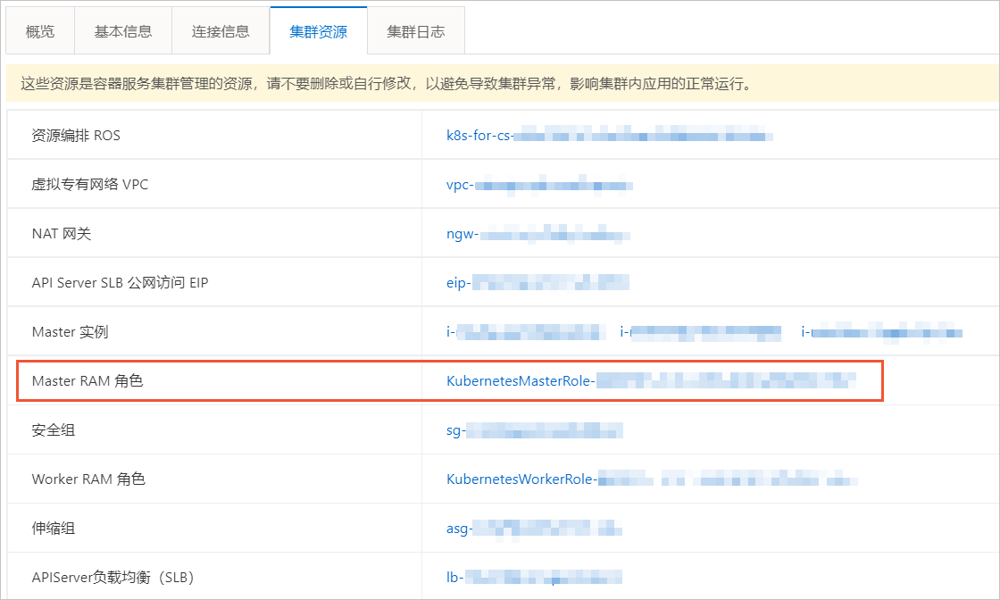

   - 创建RAM用户并授权以上RAM Policy并生成AccessKey，配置到csi-provisioner的 `env` 变量中。

     ```text
     env:
     - name: CSI_ENDPOINT
       value: unix://socketDir/csi.sock
     - name: ACCESS_KEY_ID
       value: ""
     - name: ACCESS_KEY_SECRET
       value: ""
     ```

2. 创建StorageClass。

   <ol type="i">

   <li>

   创建并复制以下内容到alicloud-nas-fs.yaml文件中。

   ```yaml
   apiVersion: storage.k8s.io/v1
   kind: StorageClass
   metadata:
     name: alicloud-nas-fs
   mountOptions:
   - nolock,tcp,noresvport
   - vers=3
   parameters:
     volumeAs: filesystem
     fileSystemType: standard
     storageType: Performance
     regionId: cn-beijing
     zoneId: cn-beijing-e
     vpcId: "vpc-2ze2fxn6popm8c2mzm****"
     vSwitchId: "vsw-2zwdg25a2b4y5juy****"
     accessGroupName: DEFAULT_VPC_GROUP_NAME
     deleteVolume: "false"
   provisioner: nasplugin.csi.alibabacloud.com
   reclaimPolicy: Retain
   ```

   <table>
     <tr>
       <th width="176">参数</th>
       <th>描述</th>
     </tr>
     <tr>
       <td>volumeAs</td>
       <td>定义创建数据的类型，可选filesystem和subpath两种类型：<br>• filesystem表示Provisioner自动创建NAS文件系统，一个PV对应一个NAS文件系统。<br>• subpath类型表示一个PV对应一个NAS文件系统的子目录，Provisioner自动创建NAS文件系统的子目录。</td>
     </tr>
     <tr>
       <td>fileSystemType</td>
       <td>定义创建NAS文件系统的类型。可选standard和extreme两种类型：<br>• standard：通用型NAS。<br>• extreme：极速型NAS。默认为通用型NAS。</td>
     </tr>
     <tr>
       <td>storageType</td>
       <td>定义创建NAS文件系统的存储规格类型。<br>• 当fileSystemType=standard时，可选Performance（性能型）和Capacity（容量型）两种类型，默认为性能型。<br>• 当fileSystemType=extreme时，可选standard（标准型）和advanced（高级型）两种类型，默认为标准型。</td>
     </tr>
     <tr>
       <td>regionId</td>
       <td>定义创建NAS文件系统所在地域。</td>
     </tr>
     <tr>
       <td>zoneId</td>
       <td>定义创建NAS文件系统所在可用区。</td>
     </tr>
     <tr>
       <td>vpcId</td>
       <td>定义创建NAS文件系统对应挂载点所在VPC。</td>
     </tr>
     <tr>
       <td>vSwitchId</td>
       <td>定义创建NAS文件系统对应挂载点所在vSwitch ID。</td>
     </tr>
     <tr>
       <td>accessGroupName</td>
       <td>定义创建NAS文件系统对应挂载点所用的AccessGroup。默认为<strong>DEFAULT_VPC_GROUP_NAME</strong>。</td>
     </tr>
     <tr>
       <td>deleteVolume</td>
       <td>定义数据卷删除时处理NAS文件系统策略，由于NAS为共享文件系统，安全起见需要同时配置。</td>
     </tr>
     <tr>
       <td>provisioner</td>
       <td>驱动类型。本例中取值为<code> nasplugin.csi.alibabacloud.com </code>，表示使用阿里云NAS CSI插件。</td>
     </tr>
     <tr>
       <td>reclaimPolicy</td>
       <td>PV的回收策略。当值为<strong>Delete</strong>且<strong>deleteVolume</strong>为<strong>true</strong>时，才会在删除PVC的时候将NAS文件系统删除。</td>
     </tr>
   </table>

   </li>

   <li>

   执行以下命令创建StorageClass。

   ```bash
   kubectl create -f alicloud-nas-fs.yaml
   ```

   </li>

   </ol>

3. 创建PVC和Pod挂载NAS存储卷。

   <ol type="i">

   <li>

   创建并复制以下内容到pvc.yaml文件中。

   ```yaml
   kind: PersistentVolumeClaim
   apiVersion: v1
   metadata:
     name: nas-csi-pvc-fs
   spec:
     accessModes:
       - ReadWriteMany
     storageClassName: alicloud-nas-fs
     resources:
       requests:
         storage: 20Gi
   ```

   </li>

   <li>

   创建并复制以下内容到nginx.yaml文件中。

   ```yaml
   apiVersion: apps/v1
   kind: Deployment
   metadata:
     name: deployment-nas-fs
     labels:
       app: nginx
   spec:
     selector:
       matchLabels:
         app: nginx
     template:
       metadata:
         labels:
           app: nginx
       spec:
         containers:
         - name: nginx
           image: anolis-registry.cn-zhangjiakou.cr.aliyuncs.com/openanolis/nginx:1.14.1-8.6
           ports:
           - containerPort: 80
           volumeMounts:
             - name: nas-pvc
               mountPath: "/data"
         volumes:
           - name: nas-pvc
             persistentVolumeClaim:
               claimName: nas-csi-pvc-fs
   ```

   </li>

   <li>

   执行以下命令创建PVC和Pod。

   ```bash
   kubectl create -f pvc.yaml -f nginx.yaml
   ```

   </li>

   </ol>

这种场景下，CSI会在PVC创建时动态新建NAS文件系统和挂载点，PVC删除时动态删除挂载点和文件系统。

**验证NAS的持久化存储**

NAS提供了持久化存储服务，当某个Pod被删除时，重新部署的Pod将自动同步之前Pod的所有数据。根据以下示例验证NAS的持久化存储特性：

1. 查看部署应用的Pod和NAS文件。

   <ol type="i">

   <li>

   执行以下命令，查看部署的应用所在Pod的名称。

   ```bash
   kubectl get pod 
   ```

   预期输出：

   ```text
   NAME                                READY   STATUS    RESTARTS   AGE
   deployment-nas-1-5b5cdb85f6-n****   1/1     Running   0          32s
   deployment-nas-2-c5bb4746c-4****    1/1     Running   0          32s
   ```

   </li>

   <li>

   执行以下命令，查看任意一个Pod/data路径下的文件，本文以名为 `deployment-nas-1-5b5cdb85f6-n****` 的Pod为例。

   ```bash
   kubectl exec deployment-nas-1-5b5cdb85f6-n**** -- ls /data
   ```

   无返回结果，表明/data路径下无文件。

   </li>

   </ol>

2. 执行以下命令，在名为 `deployment-nas-1-5b5cdb85f6-n****` 的Pod/data路径下创建文件nas。

   ```bash
   kubectl exec deployment-nas-1-5b5cdb85f6-n**** -- touch /data/nas
   ```

3. 执行以下命令，查看名为 `deployment-nas-1-5b5cdb85f6-n****` 的Pod/data路径下的文件。

   ```bash
   kubectl exec deployment-nas-1-5b5cdb85f6-n**** -- ls /data
   ```

   预期输出：

   ```text
   nas
   ```

4. 执行以下命令，删除Pod。

   ```bash
   kubectl delete pod deployment-nas-1-5b5cdb85f6-n****
   ```

5. 同时在另一个窗口中，执行以下命令，查看Pod删除及Kubernetes重建Pod的过程。

   ```bash
   kubectl get pod -w -l app=nginx
   ```

6. 验证删除Pod后，NAS里创建的文件是否还存在。

   <ol type="i">

   <li>

   执行以下命令，查看Kubernetes重建的Pod名称。

   ```bash
   kubectl get pod
   ```

   预期输出：

   ```text
   NAME                                READY   STATUS    RESTARTS   AGE
   deployment-nas-1-5b5cdm2g5-m****    1/1     Running   0          32s
   deployment-nas-2-c5bb4746c-4****    1/1     Running   0          32s
   ```

   </li>

   <li>

   执行以下命令，查看名为 `deployment-nas-1-5b5cdm2g5-m****` 的Pod/data路径下的文件。

   ```bash
   kubectl exec deployment-nas-1-5b5cdm2g5-m**** -- ls /data
   ```

   预期输出：

   ```text
   nas
   ```

   `nas` 文件仍然存在，说明NAS的数据可持久化保存。

   </li>

   </ol>

**验证NAS的共享存储**

NAS存储卷支持同时被多个Pod挂载，当某个Pod修改数据时，其余Pod将自行实现数据的同步，根据以下示例验证NAS存储卷的共享存储特性：

1. 查看部署的应用所在的Pod和NAS文件。

   <ol type="i">

   <li>

   执行以下命令，查看应用所在的Pod名称。

   ```bash
   kubectl get pod 
   ```

   预期输出：

   ```text
   NAME                                READY   STATUS    RESTARTS   AGE
   deployment-nas-1-5b5cdb85f6-n****   1/1     Running   0          32s
   deployment-nas-2-c5bb4746c-4****    1/1     Running   0          32s
   ```

   </li>

   <li>

   执行以下命令，查看2个Pod/data路径下的文件。

   ```bash
   kubectl exec deployment-nas-1-5b5cdb85f6-n**** -- ls /data
   kubectl exec deployment-nas-2-c5bb4746c-4**** -- ls /data
   ```

   </li>

   </ol>

2. 执行以下命令，在任意一个Pod的/data路径下创建文件nas。

   ```bash
    kubectl exec deployment-nas-1-5b5cdb85f6-n**** -- touch /data/nas
   ```

3. 执行以下命令，查看2个Pod/data路径下的文件。

   <ol type="i">

   <li>

   执行以下命令，查看名为 `deployment-nas-1-5b5cdb85f6-n****` 的Pod/data路径下的文件。

   ```bash
   kubectl exec deployment-nas-1-5b5cdb85f6-n**** -- ls /data
   ```

   预期输出：

   ```text
   nas
   ```

   </li>

   <li>

   执行以下命令，查看名为 `deployment-nas-2-c5bb4746c-4****` 的Pod /data路径下的文件。

   ```bash
   kubectl exec deployment-nas-2-c5bb4746c-4**** -- ls /data
   ```

   预期输出：

   ```text
   nas
   ```

   在任意一个Pod的/data下创建的文件，两个Pod下的/data路径下均存在此文件，说明两个Pod共享一个NAS。

   </li>

   </ol>

<a id="section-7-6-5"></a>

### 7.6.5. 使用OSS静态存储卷

OSS存储卷支持同时被多个Pod挂载，适用于读文件且对磁盘I/O要求不高的场景，例如读配置文件、视频、图片文件等。您可以通过RRSA鉴权或者RAM用户AccessKey鉴权进行权限配置，并挂载使用OSS静态存储卷。

**前提条件**

- 集群为1.26及以上版本，且CSI组件需为v1.31.4-9819c8b-aliyun及以上版本。

  > **说明**
  >
  > 1.26及以上的集群支持通过RRSA鉴权方式挂载，其他集群仅支持通过RAM用户RAM用户AccessKey鉴权方式挂载。

- 已创建OSS Bucket，且Bucket与集群属于同一阿里云账号。相关操作，请参见<strong>《对象存储OSS用户指南》> 《存储空间》>《创建存储空间》</strong>章节。

**通过RRSA鉴权方式挂载**

基于适用于服务账户的RAM角色（RAM Roles for Service Accounts，简称RRSA）功能，您可以在集群内实现PV维度的OpenAPI权限隔离，从而实现云资源访问权限的细粒度隔离，降低安全风险。

1. 启用RRSA功能。请参见启用RRSA功能。

2. 为OSS存储卷RRSA鉴权新建RAM角色，即使用RRSA功能扮演的指定角色。具体操作请参见步骤二：创建角色并授权。

3. 通过RRSA挂载OSS静态存储卷。具体操作请参见步骤三：通过RRSA挂载OSS静态存储卷。

**通过AccessKey鉴权方式挂载**

> **重要**
>
> - 使用该方式挂载时，如果OSS存储卷引用的AccessKey被撤销或取消授权，已经挂载了存储卷的应用将无权访问OSS并报权限错误。您需要修改Secret中的AccessKey信息并重新挂载，此操作将导致应用重启。
>
> - 如果有定期轮转AccessKey的需求<strong>，</strong>建议您通过上述通过RRSA鉴权方式挂载。

**步骤一：确认权限**

1. 访问OSS所需的AccessKey，您可在Apsara Uni-manager运营控制台的**企业 > 资源管理 > 组织管理**中，选中要添加的上级组织，然后在**基本信息**区域，单击**管理AccessKey**，查看保存并使用。

2. 使其拥有OSS Bucket的操作权限。

- OSS读写权限策略

  ```json
  {
      "Statement": [
          {
              "Action": "oss:*",
              "Effect": "Allow",
              "Resource": [
                  "acs:oss:*:*:mybucket",
                  "acs:oss:*:*:mybucket/*"
              ]
          }
      ],
      "Version": "1"
  }
  ```

- OSS只读权限策略

  ```json
  {
      "Statement": [
          {
              "Action": [
                  "oss:Get*",
                  "oss:List*"
              ],
              "Effect": "Allow",
              "Resource": [
                  "acs:oss:*:*:mybucket",
                  "acs:oss:*:*:mybucket/*"
              ]
          }
      ],
      "Version": "1"
  }
  ```

- （可选）若您使用KMS托管的指定CMK ID加密OSS Object，还需要为该RAM用户配置KMS权限。

**步骤二：创建存储卷PV和PVC并挂载**

**控制台方式**

1. 创建存储卷。

   <ol type="i">

   <li>

   登录容器服务控制台，然后在控制台左侧导航栏，单击**集群**。

   </li>

   <li>

   在**集群列表**页面，单击目标专有版集群，然后在集群管理页左侧导航栏选择**存储 > 存储卷**。

   </li>

   <li>

   在**存储卷**页面，单击**创建存储卷**。

   > **说明**
   >
   > 您也可以单击页面的**使用 YAML 创建**，通过YAML方式创建存储卷。

   </li>

   <li>

   在弹出的对话框中配置参数，配置完成后，单击**确定**。

   | 配置项 | 说明 | 示例值 |
   | --- | --- | --- |
   | 名称 | 创建存储卷的名称，在集群内必须唯一。 | pv-oss |
   | 类型 | 选择<strong>对象存储（OSS）</strong>。 | 对象存储（OSS） |
   | 认证方式 | 选择访问OSS所需的权限认证方式。<br>• <strong>访问密钥（AccessKey）</strong>：使用RAM用户的AccessKey进行鉴权，需配置下方的<strong>AccessKey ID</strong>和<strong>AccessKey</strong> <strong>Secret</strong>。<br>• <strong>RRSA</strong>：使用适用于服务账户的RAM角色进行鉴权，需配置下方的<strong>角色名称</strong>，无需提供AccessKey。 | RRSA |
   | AccessKey <strong>ID</strong>和<strong>AccessKey Secret</strong> | 认证方式选择<strong>AccessKey</strong>时，需配置该参数。访问OSS所需的AccessKey，您可在Apsara Uni-manager运营控制台的<strong>企</strong><strong>业 &gt; 资源管理 &gt; 组织管理</strong>中，选中要添加的上级组织，然后在<strong>基本信息</strong>区域，单击<strong>管理 AccessKey</strong>，查看保存并使用。 | \*\*\*\* |
   | 角色名称 | 认证方式选择<strong>RRSA</strong>时，输入使用RRSA功能扮演的RAM角色名称。集群需启用RRSA，并为要使用的角色赋予相应的OSS权限。启用RRSA功能、创建角色并授权，请参见启用RRSA功能、步骤二：创建角色并授权。 | test-role-1022 |
   | 选择Bucket | 输入您要使用的OSS Bucket的名称。 | acktest |
   | OSS Endpoint | Bucket的外网Endpoint。 | oss-cn-hangzhou.aliyu ncs.com |
   | OSS 路径 | 表示挂载时相对Bucket根文件的目录结构，默认为/（v1.14.8.32-c77e277b-aliyun及之后版本的CSI组件支持）。 | / |
   | 挂载参数 | 传递给ossfs或CSI驱动的额外挂载选项，例如<code> -o allow_other </code>。 | <code>-o</code><br><code>allow_other</code> |
   | 容量 | 所创建存储卷的容量。 | 20GiB |
   | 访问模式 | 默认为<strong>ReadWriteMany</strong>。ReadOnlyMany仅在kubectl方式中支持。如需使用ReadOnlyMany，请参见kubectl方式。 | ReadOnlyMany |
   | 回收策略 | • <strong>Retain</strong>：删除PVC后保留后端OSS数据。<br>• <strong>Delete</strong>：删除PVC时自动清除对应的OSS路径下的数据。 | Retain |
   | 标签 | 为该存储卷添加标签。 | pv-oss |

   </li>

   </ol>

2. 创建存储声明。

   <ol type="i">

   <li>

   在集群管理页左侧导航栏选择**存储 > 存储声明**。

   > **说明**
   >
   > 您也可以单击页面的**使用 YAML 创建**，通过 YAML 方式创建存储声明。

   </li>

   <li>

   在**存储声明**页面，单击**创建存储声明**。

   </li>

   <li>

   在弹出的对话框中配置参数，配置完成后，单击**确定**。

   | 配置项 | 说明 | 示例值 |
   | --- | --- | --- |
   | 存储声明类型 | 选择<strong>OSS</strong>。 | OSS |
   | 名称 | 存储声明PVC的名称。 | pvc-oss |
   | 分配模式 | 选择<strong>已有存储卷</strong>。 | 已有存储卷 |
   | 已有存储卷 | 单击<strong>选择已有存储卷</strong>，在目标存储卷右侧<strong>操作</strong>列，单击<strong>选择</strong>，选择存储卷。 | 选择存储卷 |
   | 总量 | 声明应用的使用量，此处设置的大小不会限制应用可使用的最大容量。 | 20Gi |

   </li>

   </ol>

3. 创建应用。

   <ol type="i">

   <li>

   在集群管理页左侧导航栏选择**工作负载 > 无状态**。

   </li>

   <li>

   在**无状态**页面，单击**使用镜像创建**。

   </li>

   <li>

   配置创建应用的参数信息，配置完成后，单击**创建无状态**。

   主要参数如下，其他参数保持默认即可。更多信息，请参见创建无状态工作负载Deployment。

   <table>
     <tr>
       <th>配置页</th>
       <th>参数</th>
       <th>说明</th>
       <th>示例</th>
     </tr>
     <tr>
       <td rowspan="2">应用基本信息</td>
       <td>应用名称</td>
       <td>Deployment名称，自定义输入。格式要求请参考界面提示。</td>
       <td>test-oss</td>
     </tr>
     <tr>
       <td>副本数量</td>
       <td>Deployment的副本数量。</td>
       <td>2</td>
     </tr>
     <tr>
       <td rowspan="3">容器配置</td>
       <td>镜像名称</td>
       <td>用于部署应用的镜像地址。</td>
       <td>anolis-registry.cn-zhangjiakou.cr.aliyuncs.com/openanolis/ngin x:1.14.1-8.6</td>
     </tr>
     <tr>
       <td>所需资源</td>
       <td>所需的vCPU和内存资源。</td>
       <td>0.25 vCPU，0.5 GiB</td>
     </tr>
     <tr>
       <td>数据卷</td>
       <td>单击<strong>增加云存储声明</strong>，然后完成参数配置。<br>• <strong>挂载源</strong>：选择之前创建的PVC。<br>• <strong>容器路径</strong>：输入OSS要挂载到的容器路径。</td>
       <td>• 挂载源：pvc-oss<br>• 容器路径：/data<br>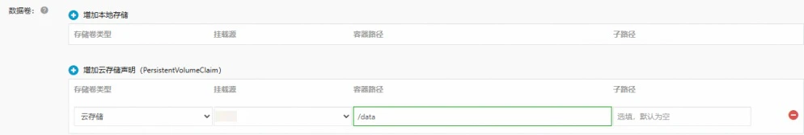</td>
     </tr>
   </table>

   </li>

   <li>

   查看应用部署状态。

   <ol type="a">

   <li>

   在**无状态**页面，单击应用名称。

   </li>

   <li>

   在**容器组**页签下，确认Pod已正常运行（状态为**Running**）。

   </li>

   </ol>

   </li>

   </ol>

**kubectl方式**

1. 创建存储卷PV。

   <ol type="i">

   <li>

   创建Secret，该Secret选择的Namespace需要和应用所在的Namespace一致。

   替换以下 `akId` 和 `akSecret` 为用户的AccessKey ID和AccessKey Secret。

   ```bash
   kubectl create secret generic oss-secret --from-literal='akId=<yourAccessKey ID>' --from-literal='akSecret=<yourAccessKey Secret>'
   ```

   </li>

   <li>

   创建静态卷PV。

   ```bash
   kubectl create -f pv-oss.yaml
   ```

   将以下示例保存为pv-oss.yaml文件，创建PV。

   ```yaml
   apiVersion: v1
   kind: PersistentVolume
   metadata:
     name: pv-oss
     labels:
       alicloud-pvname: pv-oss
   spec:
     capacity:
       storage: 5Gi
     accessModes:
       - ReadOnlyMany
     persistentVolumeReclaimPolicy: Retain
     csi:
       driver: ossplugin.csi.alibabacloud.com
       volumeHandle: pv-oss # 需要和PV名字⼀致。
       nodePublishSecretRef:
         name: oss-secret
         namespace: default
       volumeAttributes:
         bucket: "oss" #替换为实际Bucket名称。
         url: "oss-cn-hangzhou.aliyuncs.com"
         otherOpts: "-o umask=022 -o max_stat_cache_size=0 -o allow_other"
         path: "/"
   ```

   | 参数 | 描述 |
   | --- | --- |
   | name | PV的名称。 |
   | labels | 配置PV的标签。 |
   | storage | OSS的可使用量。 |
   | accessModes | 配置访问模式，支持ReadOnlyMany和ReadWriteMany。选择ReadOnlyMany时，ossfs将以只读模式挂载OSS Bucket。 |
   | persistentVolumeReclaimPolicy | PV回收策略，当前OSS存储卷仅支持<code> Retain </code>，即删除PVC时，PV和OSS Bucket中的数据不会被删除。 |
   | driver | 定义驱动类型。取值为ossplugin.csi.alibabacloud.com，表示使用阿里云OSS CSI插件。 |
   | nodePublishSecretRef | 定义挂载PV时通过Secret对象来获取AccessKey信息。 |
   | volumeHandle | 配置PV的名称。 |
   | bucket | 需要挂载的OSS Bucket。 |
   | url | 挂载OSS的Endpoint，Endpoint以OSS控制台Bucket概览页为准。不同访问端口的常见填写格式如下：公网格式：<code> http://oss-{{regionName}}.aliyuncs.com </code>或<code> https://oss-</code><code>{{regionName}}.aliyuncs.com </code>。 |
   | otherOpts | 您可以为OSS存储卷输入定制化参数，格式为<code> -o *** -o *** </code>，例如<code> -o umask=022 -o max_stat_cache_size=0 </code> <code>-o allow_other </code>。<strong>umask</strong>：用于更改ossfs读文件的权限。例如，设置umask=022后，ossfs文件的权限都会变更为755。通过SDK、OSS控制台等其他方式上传的文件在ossfs中默认权限均为640。因此，建议您在读写分离场景中配置umask权限。<strong>max_stat_cache_size</strong>：用于指定文件元数据的缓存空间，可缓存多少个文件的元数据。元数据缓存可加快ls操作速度。但若通过OSS、SDK、控制台、ossutil等方式修改文件，可能会导致元数据未被及时更新。<strong>allow_other</strong>：赋予计算机上其他用户访问挂载目录的权限，但不包含目录内的文件。 |
   | path | 表示挂载时相对Bucket根文件的目录结构，默认为/（v1.14.8.32-c77e277b-aliyun及之后版本的CSI组件支持）。 |
   | sigVersion | 请求OSS服务端的请求签名版本，支持的值为：<br>• "v1"：默认，使用OSS签名版本1。<br>• "v4"：使用OSS前面版本4。 |

   </li>

   <li>

   创建存储声明PVC。

   ```bash
   kubectl create -f pvc-oss.yaml
   ```

   将以下示例保存为pv-oss.yaml文件，创建PVC。

   ```yaml
   apiVersion: v1
   kind: PersistentVolume
   metadata:
     name: pv-oss
     labels:
       alicloud-pvname: pv-oss
   spec:
     capacity:
       storage: 5Gi
     accessModes:
       - ReadOnlyMany
     persistentVolumeReclaimPolicy: Retain
     csi:
       driver: ossplugin.csi.alibabacloud.com
       volumeHandle: pv-oss # 需要和PV名字⼀致。
       nodePublishSecretRef:
         name: oss-secret
         namespace: default
       volumeAttributes:
         bucket: "oss" #替换为实际Bucket名称。
         url: "oss-cn-hangzhou.aliyuncs.com"
         otherOpts: "-o umask=022 -o max_stat_cache_size=0 -o allow_other"
         path: "/"
   ```

   <table>
     <tr>
       <th width="175">参数</th>
       <th>说明</th>
     </tr>
     <tr>
       <td>name</td>
       <td>PVC的名称。</td>
     </tr>
     <tr>
       <td>accessModes</td>
       <td>配置访问模式，支持ReadOnlyMany和ReadWriteMany。选择ReadOnlyMany时，ossfs将以只读模式挂载OSS Bucket。</td>
     </tr>
     <tr>
       <td>storage</td>
       <td>声明应用使用量，不能大于存储卷的总量。</td>
     </tr>
     <tr>
       <td>alicloud-pvname</td>
       <td>通过标签关联PV，与PV标签保持一致。</td>
     </tr>
   </table>

   </li>

   <li>

   创建一个名为oss-static的应用并挂载PVC。

   ```bash
   kubectl create -f oss-static.yaml
   ```

   oss-static.yaml示例如下：

   ```yaml
   apiVersion: apps/v1
   kind: Deployment
   metadata:
     name: oss-static
     labels:
       app: nginx
   spec:
     replicas: 2
     selector:
       matchLabels:
         app: nginx
     template:
       metadata:
         labels:
           app: nginx
       spec:
         containers:
         - name: nginx
           image: anolis-registry.cn-zhangjiakou.cr.aliyuncs.com/openanolis/nginx:1.14.1-8.6
           ports:
           - containerPort: 80
           volumeMounts:
             - name: pvc-oss
               mountPath: "/data"
             - name: pvc-oss
               mountPath: "/data1"
           livenessProbe:
             exec:
               command:
               - sh
               - -c
               - cd /data
             initialDelaySeconds: 30
             periodSeconds: 30
         volumes:
           - name: pvc-oss
             persistentVolumeClaim:
               claimName: pvc-oss
   ```

   - `livenessProbe` ：配置健康检查。

   - `mountPath` ：OSS在容器中挂载的位置。

   - `claimName` ：PVC的名称，用于绑定PVC。

   </li>

   </ol>

<a id="section-7-6-6"></a>

### 7.6.6. 使用OSS动态存储卷

OSS存储卷支持同时被多个Pod挂载，适用于读文件且对磁盘I/O要求不高的场景，例如读配置文件、视频、图片文件等。除使用静态存储卷外，您也可以创建PVC并配置StorageClass来实现存储资源的动态分配，让系统为您自动预留持久化存储卷，无需预先手动创建和配置存储资源。您可以通过RRSA鉴权或者RAM用户AccessKey鉴权的任一方式进行权限配置并挂载使用OSS动态存储卷。

**前提条件**

- 集群为1.26及以上版本，且CSI组件需为v1.31.4-9819c8b-aliyun及以上版本。

  > **说明**
  >
  > 1.26及以上的集群支持通过RRSA鉴权方式挂载，其他集群仅支持通过RAM用户RAM用户AccessKey鉴权方式挂载。

- 已创建OSS Bucket，且Bucket与集群属于同一阿里云账号。相关操作，请参见<strong>《对象存储OSS用户指南》> 《存储空间》>《创建存储空间》</strong>章节。

**通过AccessKey鉴权方式挂载**

> **重要**
>
> - 使用该方式挂载时，如果OSS存储卷引用的AccessKey被撤销或取消授权，已经挂载了存储卷的应用将无权访问OSS并报权限错误。您需要修改Secret中的AccessKey信息并重新挂载，此操作将导致应用重启。
>
> - 如果有定期轮转AccessKey的需求<strong>，</strong>建议您通过上述使用OSS动态存储卷。

**步骤一：确认权限**

1. 访问OSS所需的AccessKey，您可在Apsara Uni-manager运营控制台的**企业 > 资源管理 > 组织管理**中，选中要添加的上级组织，然后在**基本信息**区域，单击**管理AccessKey**，查看保存并使用。

2. 使其拥有OSS Bucket的操作权限。

- OSS读写权限策略

  ```json
  {
      "Statement": [
          {
              "Action": "oss:*",
              "Effect": "Allow",
              "Resource": [
                  "acs:oss:*:*:mybucket",
                  "acs:oss:*:*:mybucket/*"
              ]
          }
      ],
      "Version": "1"
  }
  ```

- OSS只读权限策略

  ```json
  {
      "Statement": [
          {
              "Action": [
                  "oss:Get*",
                  "oss:List*"
              ],
              "Effect": "Allow",
              "Resource": [
                  "acs:oss:*:*:mybucket",
                  "acs:oss:*:*:mybucket/*"
              ]
          }
      ],
      "Version": "1"
  }
  ```

- （可选）若您使用KMS托管的指定CMK ID加密OSS Object，还需要为该RAM用户配置KMS权限。

**步骤二：创建存储类StorageClass和PVC并挂载**

**控制台方式**

1. 创建存储类。

   <ol type="i">

   <li>

   登录容器服务控制台，然后在控制台左侧导航栏，单击**集群**。

   </li>

   <li>

   在**集群列表**页面，单击目标专有版集群，然后在集群管理页左侧导航栏选择**存储 > 存储类**。

   </li>

   <li>

   在**存储类**页面，单击**创建存储类**。

   > **说明**
   >
   > 您也可以单击页面的**使用 YAML 创建**，通过 YAML 方式创建存储类。

   </li>

   <li>

   在弹出的对话框中配置参数，配置完成后，单击**确定**。

   | 配置项 | 说明 | 示例值 |
   | --- | --- | --- |
   | 名称 | 存储类的名称。 | sc-oss |
   | 存储卷类型 | 选择OSS。 | OSS |
   | 认证方式 | 选择访问OSS所需的权限认证方式。<br>• <strong>选择已有保密字典</strong>：选择<strong>命名空间</strong>和<strong>保密字典</strong>。保密字典中保存上一步获取的AccessKey ID和AccessKey Secret。<br>• <strong>新建保密字典</strong>：配置<strong>命名空间</strong>、<strong>名称</strong>、<strong>AccessKey ID</strong>及<strong>AccessKey Secret</strong>。<br>• <strong>RRSA</strong>：使用适用于服务账户的RAM角色进行鉴权，需配置下方的<strong>角色名称</strong>，无需配置保密字典。 | 选择已有保密字典 |
   | 角色名称 | 认证方式选择<strong>RRSA</strong>时，输入使用RRSA功能扮演的RAM角色名称。集群需启用RRSA，并为要使用的角色赋予相应的OSS权限。启用RRSA功能、创建角色并授权，请参见启用RRSA功能、步骤二：创建角色并授权。 | test-role-1022 |
   | Bucket ID | 您要使用的OSS Bucket的名称。单击<strong>选择Bucket</strong>，在弹出的对话框中选择所需的Bucket并单击<strong>选</strong><strong>择</strong>。<br>说明认证方式选择<strong>AccessKey</strong>时，此处显示为已配置的<strong>AccessKey</strong>可获取到的Bucket列表。 | 选择Bucket |
   | OSS Path | 表示挂载时相对Bucket根文件的目录结构，默认为/（v1.14.8.32-c77e277b-aliyun及之后版本的CSI组件支持）。 | / |
   | 存储卷模式 | 存储卷访问模式。默认为<strong>共享目录</strong>模式。取值：<br>• <strong>共享目录</strong>：即Sharepath方式挂载，所有存储卷共享挂载路径，即数据将存储于<code> &lt;bucket&gt;:</code> <code>&lt;path&gt;/ </code>下。<br>• <strong>子目录</strong>：即Subpath方式挂载，创建存储卷时在挂载路径下自动新建子目录，即数据将存储于<code> &lt;bucket&gt;:&lt;path&gt;/&lt;pv-name&gt;/ </code>下。<br>说明<strong>子目录</strong>模式仅在CSI组件为1.31.3及以上版本时生效，否则均为<strong>共享目录</strong>模式。 | 共享目录 |
   | 访问域名 | 您可以参考以下情况选择需要的访问域名。<br>• 如果Bucket和ECS实例位于不同地域（Region），请选择<strong>公网域名</strong>。<br>• 如果Bucket和ECS实例位于相同地域，请选择<strong>私网域名</strong>。<br>说明通过私网访问时，默认使用HTTP协议。若您需要指定网络传输协议为HTTPS，可使用kubectl命令行方式创建静态PV。 | 私网域名 |
   | 回收策略 | 动态创建的PV的回收策略。当前OSS存储卷仅支持<code> Retain </code>，即删除PVC时，PV和OSS Bucket中的数据不会被删除。 | Retain |
   | 可选参数 | 您可以为OSS存储卷输入定制化参数，格式为<code> -o *** -o *** </code>，例如<code> -o umask=022 -o </code> <code>max_stat_cache_size=0 -o allow_other </code>。<strong>umask</strong>：用于更改ossfs读文件的权限。例如，设置umask=022后，ossfs文件的权限都会变更为755。通过SDK、OSS控制台等其他方式上传的文件在ossfs中默认权限均为640。因此，建议您在读写分离场景中配置umask权限。<strong>max_stat_cache_size</strong>：用于指定文件元数据的缓存空间，可缓存多少个文件的元数据。元数据缓存可加快ls操作速度。但若通过OSS、SDK、控制台、ossutil等方式修改文件，可能会导致元数据未被及时更新。<strong>allow_other</strong>：赋予计算机上其他用户访问挂载目录的权限，但不包含目录内的文件。 | <code>-o umask=022 -o</code><br><code>max_stat_cache_size=0 -o</code><br><code>allow_other</code> |

   </li>

   </ol>

2. 创建存储声明。

   <ol type="i">

   <li>

   在集群管理页左侧导航栏选择**存储 > 存储声明**。

   </li>

   <li>

   在**存储声明**页面，单击**创建存储声明**。

   > **说明**
   >
   > 您也可以单击页面的**使用 YAML 创建**，通过 YAML 方式创建存储声明。

   </li>

   <li>

   在弹出的对话框中配置参数，配置完成后，单击**确定**。

   | 配置项 | 说明 | 示例值 |
   | --- | --- | --- |
   | 存储声明类型 | 选择OSS。 | OSS |
   | 名称 | 存储声明PVC的名称。 | pvc-oss |
   | 分配模式 | 选择<strong>使用存储类动态创建</strong>。 | 使用存储类动态创建 |
   | 已有存储类 | 单击<strong>选择存储类</strong>，在目标存储卷右侧<strong>操作</strong>列，单击<strong>选择</strong>，选择存储类。 | 选择存储类 |
   | 总量 | 声明应用的使用量，此处设置的大小不会限制应用可使用的最大容量。 | 20Gi |
   | 访问模式 | 配置访问模式，支持ReadOnlyMany和ReadWriteMany。选择ReadOnlyMany时，ossfs将以只读模式挂载OSS Bucket。 | ReadOnlyMany |

   </li>

   </ol>

3. 创建应用。

   <ol type="i">

   <li>

   在集群管理页左侧导航栏选择**工作负载 > 无状态**。

   </li>

   <li>

   在**无状态**页面，单击**使用镜像创建**。

   </li>

   <li>

   配置创建应用的参数信息，配置完成后，单击**创建无状态**。

   主要参数如下，其他参数保持默认即可。更多信息，请参见创建无状态工作负载Deployment。

   <table>
     <tr>
       <th>配置页</th>
       <th>参数</th>
       <th>说明</th>
       <th>示例</th>
     </tr>
     <tr>
       <td rowspan="2">应用基本信息</td>
       <td>应用名称</td>
       <td>Deployment名称，自定义输入。格式要求请参考界面提示。</td>
       <td>test-oss</td>
     </tr>
     <tr>
       <td>副本数量</td>
       <td>Deployment的副本数量。</td>
       <td>2</td>
     </tr>
     <tr>
       <td rowspan="3">容器配置</td>
       <td>镜像名称</td>
       <td>用于部署应用的镜像地址。</td>
       <td>anolis-registry.cn-zhangjiakou.cr.aliyuncs.com/openanolis/ngin x:1.14.1-8.6</td>
     </tr>
     <tr>
       <td>所需资源</td>
       <td>所需的vCPU和内存资源。</td>
       <td>0.25 vCPU，0.5 GiB</td>
     </tr>
     <tr>
       <td>数据卷</td>
       <td>单击<strong>增加云存储声明</strong>，然后完成参数配置。<br>• <strong>挂载源</strong>：选择之前创建的PVC。<br>• <strong>容器路径</strong>：输入OSS要挂载到的容器路径。</td>
       <td>• 挂载源：pvc-oss<br>• 容器路径：/data<br>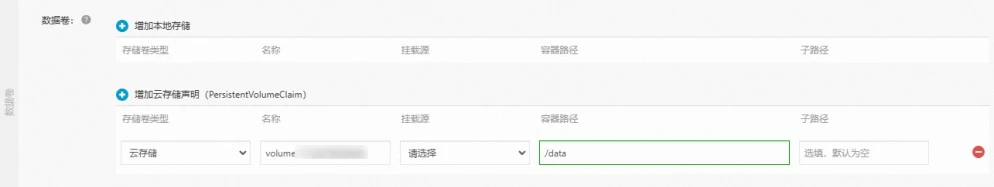</td>
     </tr>
   </table>

   </li>

   <li>

   查看应用部署状态。

   <ol type="a">

   <li>

   在**无状态**页面，单击应用名称。

   </li>

   <li>

   在**容器组**页签下，确认Pod已正常运行（状态为**Running**）。

   </li>

   </ol>

   </li>

   </ol>

**kubectl方式**

1. 创建StorageClass。

   <ol type="i">

   <li>

   创建Secret，该Secret选择的Namespace需要和应用所在的Namespace一致。

   替换以下 `akId` 和 `akSecret` 为用户的AccessKey ID和AccessKey Secret。

   ```bash
   kubectl create secret generic oss-secret --from-literal='akId=<yourAccessKey ID>' --from-literal='akSecret=<yourAccessKey Secret>'
   ```

   </li>

   <li>

   将以下示例保存为sc-oss.yaml文件，创建存储类。

   ```yaml
   apiVersion: storage.k8s.io/v1
   kind: StorageClass
   metadata:
     name: sc-oss
   parameters:
     bucket: bucket
     path: /ack
     url: oss-cn-beijing.aliyuncs.com
     csi.storage.k8s.io/node-publish-secret-name: oss-secret
     csi.storage.k8s.io/node-publish-secret-namespace: default
     otherOpts: '-o allow_other'
   provisioner: ossplugin.csi.alibabacloud.com
   reclaimPolicy: Retain
   volumeBindingMode: Immediate
   ```

   | 参数 | 说明 |
   | --- | --- |
   | name | 存储类名称。 |
   | bucket | 需要挂载的OSS Bucket。 |
   | path | 表示挂载时相对Bucket根文件的目录结构，默认为/（v1.14.8.32-c77e277b-aliyun及之后版本的CSI组件支持）。 |
   | url | 挂载OSS的Endpoint，Endpoint以OSS控制台Bucket概览页为准。<br>• 挂载节点和Bucket相同地域，或已打通VPC网络时，请使用内网地址。<br>• 挂载节点和Bucket不同地域时，请使用外网地址。不同访问端口的常见填写格式如下：公网格式：<code> http://oss-{{regionName}}.aliyuncs.com </code>或<code> https://oss-{{regionName}}.aliyuncs.com </code>。 |
   | csi.storage.k8s.io/node-publish-secret-name | 存储AccessKey信息的Secret名称。 |
   | csi.storage.k8s.io/node-publish-secret-namespace | 存储AccessKey信息的Secret所在的命名空间。 |
   | otherOpts | 您可以为OSS存储卷输入定制化参数，格式为<code> -o *** -o *** </code>，例如<code> -o umask=022 -o max_stat_cache_size=0 -o </code> <code>allow_other </code>。<strong>umask</strong>：用于更改ossfs读文件的权限。例如，设置umask=022后，ossfs文件的权限都会变更为755。通过SDK、OSS控制台等其他方式上传的文件在ossfs中默认权限均为640。因此，建议您在读写分离场景中配置umask权限。<strong>max_stat_cache_size</strong>：用于指定文件元数据的缓存空间，可缓存多少个文件的元数据。元数据缓存可加快ls操作速度。但若通过OSS、SDK、控制台、ossutil等方式修改文件，可能会导致元数据未被及时更新。<strong>allow_other</strong>：赋予计算机上其他用户访问挂载目录的权限，但不包含目录内的文件。 |
   | provisioner | 定义驱动类型。取值为ossplugin.csi.alibabacloud.com，表示使用阿里云OSS CSI插件。 |
   | reclaimPolicy | 动态创建的PV的回收策略。当前OSS存储卷仅支持<code> Retain </code>，即删除PVC时，PV和OSS Bucket中的数据不会被删除。 |
   | volumeBindingMode | 绑定模式。OSS存储卷无需考虑可用区间节点亲和，使用默认值<code> Immediate </code>即可。 |
   | volumeAs | 存储卷访问模式。默认为<code> sharepath </code>模式。取值：<br>• <code> sharepath </code>：即共享方式挂载，所有存储卷共享挂载路径，即数据将存储于<code> &lt;bucket&gt;:&lt;path&gt;/ </code>下。<br>• <code> subpath </code>：即子目录方式挂载，创建存储卷时在挂载路径下自动新建子目录，即数据将存储于<code> &lt;bucket&gt;:&lt;path&gt;/&lt;pv-</code><code>name&gt;/ </code>下。<br>说明<code> subpath </code>模式仅在CSI组件为1.31.3及以上版本时生效，否则均为<code> sharepath </code>模式。 |
   | sigVersion | 请求OSS服务端的请求签名版本，支持的值为：<br>• "v1"：默认，使用OSS签名版本1。<br>• "v4"：使用OSS前面版本4。 |

   </li>

   <li>

   创建存储声明。

   <ol type="a">

   <li>

   将以下示例保存为pvc-oss.yaml，创建存储声明。

   ```yaml
   apiVersion: v1
   kind: PersistentVolumeClaim
   metadata:
     name: pvc-oss
   spec:
     accessModes:
     - ReadOnlyMany
     volumeMode: Filesystem
     resources:
       requests:
         storage: 20Gi
     storageClassName: sc-oss
   ```

   <table>
     <tr>
       <th width="176">参数</th>
       <th>说明</th>
     </tr>
     <tr>
       <td>name</td>
       <td>PVC的名称。</td>
     </tr>
     <tr>
       <td>accessModes</td>
       <td>配置访问模式，支持ReadOnlyMany和ReadWriteMany。选择ReadOnlyMany时，ossfs将以只读模式挂载OSS Bucket。</td>
     </tr>
     <tr>
       <td>storage</td>
       <td>声明应用的使用量，此处设置的大小不会限制应用可使用的最大容量。</td>
     </tr>
     <tr>
       <td>storageClassName</td>
       <td>使用的存储类名称。</td>
     </tr>
   </table>

   </li>

   <li>

   执行以下命令，创建存储声明。

   ```bash
   kubectl apply -f pvc-oss.yaml
   ```

   </li>

   </ol>

   <ol type="i" start="100">

   <li>

   执行以下命令，确认PVC已创建且进入绑定状态。

   ```bash
   kubectl get pvc pvc-oss
   ```

   预期输出：

   ```text
   NAME           STATUS   VOLUME                                     CAPACITY   ACCESS MODES   STORAGECLASS         
   VOLUMEATTRIBUTESCLASS   AGE
   pvc-oss        Bound    oss-251d111d-3b0b-4879-81a0-eb5a19xxxxxx   20Gi       ROX            oss-rrsa             <unset>            
   4d20h
   ```

   </li>

   </ol>

   </li>

   <li>

   将以下示例保存为oss-dynamic.yaml文件，创建应用并挂载存储声明。

   ```yaml
   apiVersion: apps/v1
   kind: Deployment
   metadata:
     name: oss-dynamic
     labels:
       app: nginx
   spec:
     replicas: 2
     selector:
       matchLabels:
         app: nginx
     template:
       metadata:
         labels:
           app: nginx
       spec:
         containers:
         - name: nginx
           image: anolis-registry.cn-zhangjiakou.cr.aliyuncs.com/openanolis/nginx:1.14.1-8.6
           ports:
           - containerPort: 80
           volumeMounts:
             - name: pvc-oss
               mountPath: "/data"
             - name: pvc-oss
               mountPath: "/data1"
           livenessProbe:
             exec:
               command:
               - sh
               - -c
               - cd /data
             initialDelaySeconds: 30
             periodSeconds: 30
         volumes:
           - name: pvc-oss
             persistentVolumeClaim:
               claimName: pvc-oss
   ```

   </li>

   <li>

   部署应用。

   ```bash
   kubectl apply -f oss-dynamic.yaml
   ```

   </li>

   <li>

   查询应用副本的运行状态。

   ```bash
   kubectl get pod -lapp=nginx -w
   ```

   预期一段时间后，Pod进入Running状态。

   </li>

   </ol>

<a id="section-7-6-7"></a>

### 7.6.7. 创建持久化存储卷声明

本文介绍如何创建持久化存储声明。

**前提条件**

- 您已创建一个Kubernetes集群，请参见创建Kubernetes集群。

- 您已创建一个存储卷，本例中使用云盘创建一个云盘存储卷，请参见使用阿里云云盘。

  默认根据标签**alicloud-pvname**将存储声明和存储卷绑定，通过容器服务控制台创建数据卷时，会默认给存储卷打上该标签。如果存储卷上没有该标签，您需要添加标签后才可以选择关联这个存储卷。

**操作步骤**

1. 登录容器服务控制台。

2. 在控制台左侧导航栏单击**集群**。

3. 在**集群列表**页面单击目标集群右侧**操作**列的**详情**。

4. 在集群管理页左侧导航栏选择**存储 > 存储声明**。

5. 在**存储声明**页面单击**创建存储声明**。

   > **说明**
   >
   > 您也可以单击页面的**使用 YAML 创建**，通过 YAML 方式创建存储声明。

6. 在**创建存储声明**对话框中配置参数，然后单击**确定**。

   <table>
     <tr>
       <th width="121">配置项</th>
       <th>说明</th>
     </tr>
     <tr>
       <td>存储声明类型</td>
       <td>支持云盘、NAS、OSS。</td>
     </tr>
     <tr>
       <td>名称</td>
       <td>存储卷声明名称。</td>
     </tr>
     <tr>
       <td>分配模式</td>
       <td>支持<strong>使用存储类动态创建</strong>、<strong>已有存储卷</strong>和<strong>创建存储卷</strong>。本例选择<strong>使用存储类动态创建</strong>或<strong>已有存储卷</strong>。</td>
     </tr>
     <tr>
       <td>已有存储类</td>
       <td>单击<strong>选择存储类</strong>，在目标存储类右侧操作列单击<strong>选择</strong>，选择存储类。仅分配模式选择<strong>使用存储类动态创建</strong>，才需设置该参数。</td>
     </tr>
     <tr>
       <td>已有存储卷</td>
       <td>单击<strong>选择已有存储卷</strong>，在目标存储卷右侧操作列单击<strong>选择</strong>，选择存储卷。仅分配模式选择<strong>已有存储卷</strong>，才需设置该参数。<br>说明若您的集群中已有存储卷，且未被使用，但在<strong>选择已有存储卷</strong>无法找到，则可能是未定义<strong>alicloud-pvname</strong>标签。</td>
     </tr>
     <tr>
       <td>总量</td>
       <td>声明使用量，不能大于存储卷的总量。</td>
     </tr>
     <tr>
       <td>访问模式</td>
       <td>默认为ReadWriteOnce。仅分配模式选择<strong>使用存储类动态创建</strong>，才需设置该参数。</td>
     </tr>
   </table>

   若无法找到可用的存储卷，您可在左侧导航栏中单击**存储卷**，找到所需存储卷，单击右侧的**标签管理**，添加对应标签，其中名称为**alicloud-pvname**，值为存储卷的名称，云盘存储卷默认以云盘ID作为存储卷的名称。

   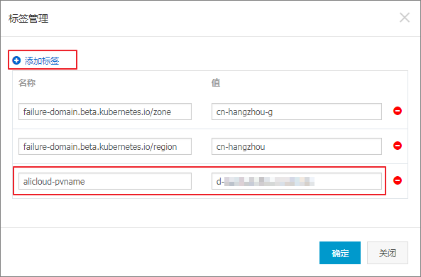

7. 返回存储声明列表，您可看到新建的存储声明出现在列表中。

<a id="section-7-6-8"></a>

### 7.6.8. 使用持久化存储卷声明

您可在应用中使用存储卷声明（PVC）。

**前提条件**

- 您已创建一个Kubernetes集群，参见创建Kubernetes集群。

- 您已创建一个存储卷声明，本例中使用云盘创建一个云盘存储卷声明pvc-disk，参见使用持久化存储卷声明。

**操作步骤**

1. 登录容器服务控制台。

2. 在控制台左侧导航栏单击**集群**。

3. 在**集群列表**页面单击目标集群右侧**操作**列的**详情**。

4. 在集群管理页左侧导航栏选择**工作负载 > 无状态**。

5. 在**无状态**页面单击右上角的**使用镜像创建**。

6. 在**应用基本信息**配置向导页面，设置应用名称、副本数量、类型、标签、注解和时区同步，然后单击**下一步**。

7. 在**容器配置**页面，选择镜像，然后配置云存储类型的数据卷，支持云盘/NAS/OSS 三种类型。本例中使用准备好的云盘存储卷声明，然后单击**下一步**。

8. 在**高级配置**页面配置test-nginx应用的服务，最后单击**创建**。

9. 在**创建完成**页面，单击查看应用详情查看应用任务。默认进入新建的test-nginx的详情页面。

10. 在**容器组**页签，找到该应用所属容器组，单击**详情**。

11. 在容器组详情页面，单击**存储**，您可看到该容器组正确绑定了pvc-disk。

    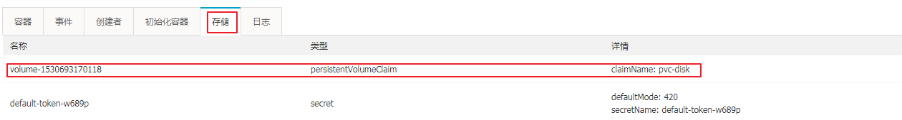

<a id="section-7-6-9"></a>

### 7.6.9. 使用云盘存储快照

容器服务ACK的云盘存储快照特性可以帮助您实现应用数据的备份和恢复。本文介绍ACK的存储快照的基本概念、使用流程以及如何动态、静态创建快照。

**前提条件**

- Kubernetes集群版本≥1.18。关于创建集群的具体操作，请参见创建Kubernetes集群。

- 访问指定地域的ECS控制台已开启云盘快照服务。

**背景信息**

在阿里云ACK集群中部署有状态服务通常使用云盘数据卷存储数据，虽然云盘本身提供了数据的备份（快照）恢复机制，但是如何将这种机制和Kubernetes服务集成并灵活地提供给应用使用？为了解决这个问题，Kubernetes使用以下两个特性来实现备份恢复能力：

- 通过VolumeSnapshot资源实现云盘的备份（快照功能）。

- 通过PVC的DataSource功能实现数据的恢复。

**使用说明**

为了实现快照相关功能，ACK通过CRD定义了以下3个相关的资源类型。

| 资源类型名称 | 描述 |
| --- | --- |
| VolumeSnapshotContent | 存储后端的快照实例，由系统管理员创建维护，无Namespace（类似PV概念）。 |
| VolumeSnapshot | 声明一个快照实例，由用户创建维护，属于特定Namespace（类似PVC概念）。 |
| VolumeSnapshotClass | 定义一个快照类，描述创建快照使用的参数、Controller（类似StorageClass概念）。 |

存储快照资源的绑定规则如下：

- 在使用Snapshot资源类型时，和PV、PVC一样，首先您需绑定VolumeSnapshot与VolumeSnapshotContent。

- 集群会自动为正确配置了VolumeSnapshotClassName字段的VolumeSnapshot资源，创建VolumeSnapshotContent资源。 如果您没有配置或者配置错误的话则无法自动创建VolumeSnapshotContent，您需要手动创建VolumeSnapshotContent，并绑定VolumeSnapshot。

- VolumeSnapshotContent与VolumeSnapshot绑定是一对一的关系。

> 删除VolumeSnapshotContent同时，后端的快照也会被删除。
>
> **重要**

**动态创建快照**

下图为在ACK使用的云盘上动态创建快照的使用流程图。

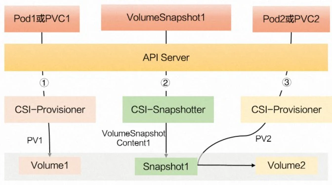

使用流程说明如下。

<table>
  <tr>
    <th width="89">流程步骤</th>
    <th>描述</th>
  </tr>
  <tr>
    <td>①</td>
    <td>创建原始应用，创建云盘卷保存数据。</td>
  </tr>
  <tr>
    <td>②</td>
    <td>创建VolumeSnapshot，此时集群会自动创建VolumeSnapshotContent和存储端的快照实例。</td>
  </tr>
  <tr>
    <td>③</td>
    <td>创建新的应用，并配置PVC引用步骤②中创建的快照对象。</td>
  </tr>
</table>

上述的三个步骤实现：

- 备份：图中的Volume1的数据被备份到Snapshot1。

- 恢复：Snapshot1的数据（即Volume1的数据）被恢复成Volume2。

本文示例将通过创建Nginx应用并恢复应用的数据，说明如何使用存储快照功能。操作步骤如下：

1. 创建VolumeSnapshotClass快照类。

   <ol type="i">

   <li>

   使用以下YAML内容，创建volumesnapshotclass.yaml文件。

   ```yaml
   apiVersion:snapshot.storage.k8s.io/v1beta1
   kind:VolumeSnapshotClass
   metadata:
    name:default-snapclass
   driver:diskplugin.csi.alibabacloud.com
   parameters:
    snapshotType: "xxx"
   deletionPolicy:Delete
   ```

   部分参数说明如下：

   | 参数 | 描述 |
   | --- | --- |
   | <code>deletionPolicy</code> | 取值如下：<br>• <code> Delete </code>：删除VolumeSnapshot时，VolumeSnapshotContent以及关联的快照也会被一起删除。<br>• <code> Retain </code>：删除VolumeSnapshot时，VolumeSnapshotContent以及关联的快照不会被删除。 |
   | <code>parameters.snapshotType</code> | 默认值为<code> normal </code>，表示创建普通快照。 |
   | <code>parameters.forceDelete</code> | 默认值为<code> true </code>，取值如下：<br>• <code> true </code>：强制删除用户创建的所有已使用和未使用的快照。<br>• <code> false </code>：只能删除未使用的快照。<br>说明已经使用过的快照，不能使用普通删除。 |

   </li>

   <li>

   执行以下命令，创建VolumeSnapshotClass快照类。

   ```bash
   kubectl apply -f volumesnapshotclass.yaml
   ```

   </li>

   </ol>

2. 创建原始应用并写入数据。

   <ol type="i">

   <li>

   使用以下YAML内容，创建nginx.yaml文件。

   ```yaml
   apiVersion: apps/v1
   kind: StatefulSet
   metadata:
     name: web
   spec:
     selector:
       matchLabels:
         app: nginx
     serviceName: "nginx"
     replicas: 1
     template:
       metadata:
         labels:
           app: nginx
       spec:
         containers:
         - name: nginx
           image: nginx
           volumeMounts:
           - name: disk-ssd
             mountPath: /data
     volumeClaimTemplates:
     - metadata:
         name: disk-ssd
       spec:
         accessModes: [ "ReadWriteOnce" ]
         storageClassName: "alicloud-disk-ssd"
         resources:
           requests:
             storage: 20Gi
   ```

   </li>

   <li>

   执行以下命令，创建应用Nginx。

   ```bash
   kubectl apply -f nginx.yaml
   ```

   </li>

   <li>

   执行以下命令，向Pod（web-0）中写入数据。

   ```bash
   kubectl exec -it web-0 touch /data/test
   kubectl exec -it web-0 ls /data
   ```

   预期输出：

   ```text
   lost+found test
   ```

   </li>

   </ol>

3. 创建VolumeSnapshot。

   <ol type="i">

   <li>

   使用以下YAML内容，创建snapshot.yaml文件。

   ```yaml
   apiVersion: snapshot.storage.k8s.io/v1beta1
   kind: VolumeSnapshot
   metadata:
     name: new-snapshot-demo
     namespace: default
   spec:
     volumeSnapshotClassName: default-snapclass
     source:
       persistentVolumeClaimName: disk-ssd-web-0
   ```

   </li>

   <li>

   执行以下命令，创建VolumeSnapshot。

   ```bash
   kubectl apply -f snapshot.yaml
   ```

   </li>

   <li>

   查看是否创建VolumeSnapshot和VolumeSnapshotContent。

   本文以通过kubectl查看快照实例为例，您也可以登录ECS控制台进行查看。

   <ol type="a">

   <li>

   执行以下命令，查看VolumeSnapshot状态。

   ```bash
   kubectl get volumesnapshots.snapshot.storage.k8s.io
   ```

   预期输出：

   ```text
   NAME                      AGE
   new-snapshot-demo                   36m
   ```

   </li>

   <li>

   执行以下命令，查看VolumeSnapshotContent状态。

   ```bash
   kubectl get VolumeSnapshotContent
   ```

   预期输出：

   ```text
   NAME                      AGE
   snapshotcontent-222222                 36m
   ```

   </li>

   </ol>

   </li>

   </ol>

4. 恢复数据。

   <ol type="i">

   <li>

   使用以下YAML内容，创建nginx-restore文件。

   ```yaml
   apiVersion: v1
   kind: Service
   metadata:
     name: nginx
     labels:
       app: nginx
   spec:
     ports:
     - port: 80
       name: web
     clusterIP: None
     selector:
       app: nginx
   ---
   apiVersion: apps/v1
   kind: StatefulSet
   metadata:
     name: web-restore
   spec:
     selector:
       matchLabels:
         app: nginx
     serviceName: "nginx"
     replicas: 1
     template:
       metadata:
         labels:
           app: nginx
       spec:
         hostNetwork: true
         containers:
         - name: nginx
           image: nginx
           command: ["sh", "-c"]
           args: ["sleep 10000"]
           volumeMounts:
           - name: disk-ssd
             mountPath: /data
     volumeClaimTemplates:
     - metadata:
         name: disk-ssd
       spec:
         accessModes: [ "ReadWriteOnce" ]
         storageClassName: alicloud-disk-ssd
         resources:
           requests:
             storage: 20Gi
         dataSource:
           name: new-snapshot-demo
           kind: VolumeSnapshot
           apiGroup: snapshot.storage.k8s.io
   ```

   > 在 `volumeClaimTemplates` 中，需设置 `dataSource` 的类型为 `VolumeSnapshot` ，且 `VolumeSnapshot` 的名字为步骤3中创建的 `new-`
   >
   > **说明**
   >
   > `snapshot-demo` 。

   </li>

   <li>

   执行以下命令，恢复数据。

   ```bash
   kubectl apply -f nginx-restore.yaml
   ```

   </li>

   </ol>

5. 执行以下命令，查看Pod（web-restore-0）数据。

   ```bash
   kubectl exec -it web-restore-0 ls /data
   ```

   预期输出：

   ```text
   lost+found test
   ```

   由预期输出得到，在不同的Pod中返回相同数据，实现了数据的恢复。

**静态创建快照（使用ECS上已有快照）**

将已有ECS快照导入至ACK集群中的操作步骤如下。

1. 使用以下YAML内容，创建VolumeSnapshotContent。

   ```yaml
   apiVersion: snapshot.storage.k8s.io/v1
   kind: VolumeSnapshotContent
   metadata:
     name: new-snapshot-content-test
   spec:
     deletionPolicy: Retain
     driver: diskplugin.csi.alibabacloud.com
     source:
       snapshotHandle: <your-snapshotid>
     volumeSnapshotRef:
       name: new-snapshot-demo
       namespace: default
   ```

   <table>
     <tr>
       <th width="209">参数</th>
       <th>描述</th>
     </tr>
     <tr>
       <td><code>snapshotHandle</code></td>
       <td>填写在ECS页面上的已生成的快照ID。</td>
     </tr>
     <tr>
       <td><code>volumeSnapshotRef</code></td>
       <td>填写要创建的VolumeSnapshot的信息：<br>• <code> name </code>：将要创建的VolumeSnapshot的名称。<br>• <code> namespace </code>：将要创建的VolumeSnapshot所在的命名空间。</td>
     </tr>
   </table>

2. 使用以下YAML内容，创建VolumeSnapshot。

   ```yaml
   apiVersion: snapshot.storage.k8s.io/v1
   kind: VolumeSnapshot
   metadata:
     name: new-snapshot-demo
     namespace: default
   spec:
     source:
       volumeSnapshotContentName: new-snapshot-content-test
   ```

   | 参数 | 描述 |
   | --- | --- |
   | <code>metadata.name</code> | VolumeSnapshot的名称，需要和上述VolumeSnapshotContent中指定的相同。 |
   | <code>spec.source.volumeSnapshotConten</code><br><code>tName</code> | 当前VolumeSnapshot绑定的VolumeSnapshotContent的名称，需与上述创建的VolumeSnapshotContent的名称一致。 |

3. 恢复数据。

   <ol type="i">

   <li>

   使用以下YAML内容，创建nginx-restore文件。

   ```yaml
   apiVersion: v1
   kind: Service
   metadata:
     name: nginx
     labels:
       app: nginx
   spec:
     ports:
     - port: 80
       name: web
     clusterIP: None
     selector:
       app: nginx
   ---
   apiVersion: apps/v1
   kind: StatefulSet
   metadata:
     name: web-restore
   spec:
     selector:
       matchLabels:
         app: nginx
     serviceName: "nginx"
     replicas: 1
     template:
       metadata:
         labels:
           app: nginx
       spec:
         hostNetwork: true
         containers:
         - name: nginx
           image: nginx
           command: ["sh", "-c"]
           args: ["sleep 10000"]
           volumeMounts:
           - name: disk-ssd
             mountPath: /data
     volumeClaimTemplates:
     - metadata:
         name: disk-ssd
       spec:
         accessModes: [ "ReadWriteOnce" ]
         storageClassName: alicloud-disk-ssd
         resources:
           requests:
             storage: 20Gi
         dataSource:
           name: new-snapshot-demo
           kind: VolumeSnapshot
           apiGroup: snapshot.storage.k8s.io
   ```

   > 在 `volumeClaimTemplates` 中，需设置 `dataSource` 的类型为 `VolumeSnapshot` ，且 `VolumeSnapshot` 的名字为步骤2中创建的 `new-`
   >
   > **说明**
   >
   > `snapshot-demo` 。

   </li>

   <li>

   执行以下命令，恢复数据。

   ```bash
   kubectl apply -f nginx-restore.yaml
   ```

   </li>

   </ol>

4. 执行以下命令，查看Pod（web-restore-0）数据。

   ```bash
   kubectl exec -it web-restore-0 ls /data
   ```

   预期输出：

   ```text
   lost+found test
   ```

   由预期输出得到，在不同的Pod中返回相同数据，实现了数据的恢复。

<a id="section-7-6-10"></a>

### 7.6.10. 使用块存储限速最佳实践

Kubernetes本身不支持对存储介质进行限速，您可以通过容器服务ACK实现对某个Pod进行某个块设备（云盘或LVM本地盘）的限速，有效地管理和分配存储资源，确保系统的性能和稳定性，同时减少不必要的成本。本文以云盘为例介绍如何对块存储进行限速。

**使用限制**

- 宿主机操作系统必须为Alibaba Cloud Linux 2及以上版本。

- ACK集群版本不低于1.20。

- CSI存储组件版本不低于1.22。

**参数说明**

- **readIOPS**：限制当前Pod对指定块存储每秒读IO的次数。

- **writeIOPS**：限制当前Pod对指定块存储每秒写IO的次数。

- **readBPS**：限制当前Pod对指定块存储每秒读取的数据量，单位 (KB，MB，GB)。

- **writeBPS**：限制当前Pod对指定块存储每秒写入的数据量，单位（KB，MB，GB）。

**使用方式**

本文以云盘为例说明如何对块存储进行限速。您可以通过动态创建云盘或静态创建云盘的方式使用。

> **说明**
>
> 块存储限速设置后，已创建的云盘限速参数无法变更。通过调整StorageClass的限速配置，仅对之后新创建的云盘生效，已有云盘不受影响。

**通过动态创建云盘的方式使用**

1. 使用以下内容，创建alicloud-disk-topology-essd.yaml文件。

   ```yaml
   apiVersion: storage.k8s.io/v1
   kind: StorageClass
   metadata:
     name: alicloud-disk-topology-essd
   parameters:
     type: cloud_essd
     readIOPS: "100"
     writeIOPS: "10"
     readBPS: "100k"
     writeBPS: "100m"
   provisioner: diskplugin.csi.alibabacloud.com
   reclaimPolicy: Delete
   volumeBindingMode: WaitForFirstConsumer
   ```

2. 执行以下命令，创建StorageClass。

   ```bash
   kubectl apply -f alicloud-disk-topology-essd.yaml
   ```

3. 使用以下内容，创建nginx.yaml文件。

   该应用引用已创建的StorageClass，即可使用限速云盘。

   ```yaml
   apiVersion: apps/v1
   kind: StatefulSet
   metadata:
     name: web-csi-encrypt
   spec:
     selector:
       matchLabels:
         app: nginx
     serviceName: "nginx"
     podManagementPolicy: "Parallel"
     replicas: 1
     template:
       metadata:
         labels:
           app: nginx
       spec:
         hostNetwork: true
         containers:
         - name: nginx
           command:
           - sleep
           - "999999999"
           image: anolis-registry.cn-zhangjiakou.cr.aliyuncs.com/openanolis/nginx:1.14.1-8.6
           volumeMounts:
           - name: disk-csi
             mountPath: /data
     volumeClaimTemplates:
     - metadata:
         name: disk-csi
       spec:
         accessModes: [ "ReadWriteOnce" ]
         storageClassName: alicloud-disk-topology-essd
         resources:
           requests:
             storage: 80Gi
   ```

4. 执行以下命令，创建应用。

   ```bash
   kubectl apply -f nginx.yaml
   ```

5. 根据不同的cgroup版本查看容器的块设备限制值。

   <ol type="i">

   <li>

   执行以下命令，确认cgroup版本。

   ```text
   stat -fc %T /sys/fs/cgroup
   ```

   输出 `cgroup2fs` 时为cgroup V2，否则为cgroup V1。

   </li>

   <li>

   根据cgroup版本情况查看容器的块设备限制值。您需要登录宿主机，根据PodUID来进行路径拼接，通过以下命令，查看值是否被正确设置上。

   - cgroup V2

     ```text
     /sys/fs/cgroup/kubepods.slice/kubepods-besteffort.slice/kubepods-besteffort-pod<UID>.slice/io.max
     ```

   - cgroup V1

     readIOPS：

     ```text
     /sys/fs/cgroup/blkio/kubepods.slice/kubepods-besteffort.slice/kubepods-besteffort-pod{pod_uid}.slice/blkio.throttle.read_iops_device
     ```

     writeIOPS：

     ```text
     /sys/fs/cgroup/blkio/kubepods.slice/kubepods-besteffort.slice/kubepods-besteffort-pod{pod_uid}.slice/blkio.throttle.write_iops_device
     ```

     readBPS：

     ```text
     /sys/fs/cgroup/blkio/kubepods.slice/kubepods-besteffort.slice/kubepods-besteffort-pod{pod_uid}.slice/blkio.throttle.read_bps_device
     ```

     writeBPS：

     ```text
     /sys/fs/cgroup/blkio/kubepods.slice/kubepods-besteffort.slice/kubepods-besteffort-pod{pod_uid}.slice/blkio.throttle.write_bps_device
     ```

   </li>

   </ol>

**通过静态创建云盘的方式使用**

1. 使用以下内容，创建pv-static.yaml。

   ```yaml
   apiVersion: v1
   kind: PersistentVolume
   metadata:
     name: d-****
   spec:
     accessModes:
     - ReadWriteMany
     capacity:
       storage: 80Gi
     csi:
       driver: diskplugin.csi.alibabacloud.com
       fsType: ext4
       volumeAttributes:
         app: nginx
         type: cloud_ssd
         readBPS: 100K
         readIOPS: "100"
       volumeHandle: d-****
     persistentVolumeReclaimPolicy: Retain
     volumeMode: Filesystem
   ```

2. 执行以下命令，创建PV。

   ```bash
   kubectl apply -f pv-static.yaml
   ```

3. 使用以下内容，创建pvc-static.yaml。

   ```yaml
   apiVersion: v1
   kind: PersistentVolumeClaim
   metadata:
     labels:
       app: nginx
     name: disk-pvc
     namespace: default
   spec:
     accessModes:
     - ReadWriteMany
     resources:
       requests:
         storage: 80Gi
     volumeMode: Filesystem
     volumeName: d-****
   ```

4. 执行以下命令，创建PVC。

   ```bash
   kubectl apply -f pvc-static.yaml
   ```

5. 使用以下内容，创建nginx.yaml文件。

   该应用引用已创建的PVC，即可使用限速云盘。

   ```yaml
   apiVersion: apps/v1
   kind: Deployment
   metadata:
     name: deploy-disk
     labels:
       app: nginx
   spec:
     selector:
       matchLabels:
         app: nginx
     template:
       metadata:
         labels:
           app: nginx
       spec:
         containers:
         - name: nginx
           image: anolis-registry.cn-zhangjiakou.cr.aliyuncs.com/openanolis/nginx:1.14.1-8.6
           ports:
           - containerPort: 80
           volumeMounts:
           - name: disk-pvc2
             mountPath: /data
         volumes:
           - name: disk-pvc2
             persistentVolumeClaim:
               claimName: disk-pvc
   ```

6. 执行以下命令，创建应用。

   ```bash
   kubectl apply -f nginx.yaml
   ```

7. 根据不同的cgroup版本查看容器的块设备限制值。

   <ol type="i">

   <li>

   执行以下命令，确认cgroup版本。

   ```text
   stat -fc %T /sys/fs/cgroup
   ```

   输出 `cgroup2fs` 时为cgroup V2，否则为cgroup V1。

   </li>

   <li>

   根据cgroup版本情况查看容器的块设备限制值。您需要登录宿主机，根据PodUID来进行路径拼接，通过以下命令，查看值是否被正确设置上。

   - cgroup V2

     ```text
     /sys/fs/cgroup/kubepods.slice/kubepods-besteffort.slice/kubepods-besteffort-pod<UID>.slice/io.max
     ```

   - cgroup V1

     readIOPS：

     ```text
     /sys/fs/cgroup/blkio/kubepods.slice/kubepods-besteffort.slice/kubepods-besteffort-pod{pod_uid}.slice/blkio.throttle.read_iops_device
     ```

     writeIOPS：

     ```text
     /sys/fs/cgroup/blkio/kubepods.slice/kubepods-besteffort.slice/kubepods-besteffort-pod{pod_uid}.slice/blkio.throttle.write_iops_device
     ```

     readBPS：

     ```text
     /sys/fs/cgroup/blkio/kubepods.slice/kubepods-besteffort.slice/kubepods-besteffort-pod{pod_uid}.slice/blkio.throttle.read_bps_device
     ```

     writeBPS：

     ```text
     /sys/fs/cgroup/blkio/kubepods.slice/kubepods-besteffort.slice/kubepods-besteffort-pod{pod_uid}.slice/blkio.throttle.write_bps_device
     ```

   </li>

   </ol>

<a id="section-7-7"></a>

## 7.7. 安全

<a id="section-7-7-1"></a>

### 7.7.1. 容器安全策略规则库说明

容器服务策略管理功能提供了种类丰富的内置规则库。本文介绍容器安全策略规则库的规则模板。

**规则模板说明**

容器安全策略规则库支持cis-k8s、Infra、K8s-general和PSP四类规则模板。

<table>
  <tr>
    <th width="122">模板</th>
    <th>说明</th>
  </tr>
  <tr>
    <td>cis-k8s</td>
    <td>基于阿里云K8s加固等合规规范定制化的安全规则。</td>
  </tr>
  <tr>
    <td>Infra</td>
    <td>用于增强和保护云基础设施层资源安全。</td>
  </tr>
  <tr>
    <td>K8s-general</td>
    <td>用于约束和规范K8s集群内敏感资源配置，增强K8s集群内应用安全。</td>
  </tr>
  <tr>
    <td>PSP</td>
    <td>用于替换K8s PSP的相关策略。使用该类策略可以实现等同于原ACK策略管理中PSP提供的安全约束能力。</td>
  </tr>
</table>

**策略规则库说明**

**模板**

**策略**

**说明**

**重要等级**

限制Secret以secretKeyRef的形式挂载到应用Pod环境变量中。

中

ACKNoEnvVarSecrets

限制Pod中所有容器必须配置**securitycontext**字段。

低

ACKPodsRequireSecurityContext

限制资源部署在集群指定的命名空间中。

低

ACKRestrictNamespaces

cis-k8s

限制指定命名空间下的**rolebinding**使用指定范围内的Role或

高

ACKRestrictRoleBindings

Clusterrole。

指定namespaces下存在 pod 时禁止删除集群。

高

ACKBlockClusterDeletion

限制在集群指定范围部署的应用中使用**shareProcessNamespace**。

高

ACKBlockProcessNamespaceSharing

要求**emptyDir**类型的Volume必须指定**sizelimit**。

低

ACKEmptyDirHasSizeLimit

限制部署在集群指定范围内的Pod必须具有  `"cluster-autoscaler.kubernetes.io/safe-to-evict": "true"` 注释标

ACKLocalStorageRequireSafeToEvict

低

签。默认情况下**autoscaler**在集群自动伸缩时不会驱逐使用HostPath或EmptyDir卷的Pod。为了允许驱逐这些Pod，必须在Pod上添加该注释标签。

Infra

限制指定Namespaces下的部署只能使用指定Region中的阿里云OSS存储

低

ACKOSSStorageLocationConstraint

卷。

限制在集群指定范围内部署有风险的镜像，配置请访问**安全 > 主机安全 >**

高

SASMaliciousImage

**容器安全 > 运行时防护 > 容器主动防御** 。

限制在集群指定范围部署的应用Pod中拉取白名单列表外的镜像。

高

ACKAllowedRepos

要求在应用中配置 `enableServiceLinks: false` ，避免在Pod环境变

低

ACKBlockAutoinjectServiceEnv

量中透出服务IP。

要求在应用中设置 `automountServiceAccountToken: false` 字段

高

ACKBlockAutomountToken

防止自动挂载**serviceaccount**。

限制在集群指定范围的应用Pod中启动临时容器。

中

ACKBlockEphemeralContainer

限制在集群指定范围内部署LoadBalancer类型的Service。

高

ACKBlockLoadBalancer

限制在集群指定范围内使用NodePort类型的Service。

高

ACKBlockNodePort

要求集群指定范围的应用Pod配置资源**limits**。

低

ACKContainerLimits

K8s-general

限制在集群指定范围内的Services实例使用白名单范围之外

高

ACKExternalIPs

的**externalIPs**。

限制在集群指定范围内部署不符合Digest格式的镜像。

低

ACKImageDigests

限制在集群指定范围内部署没有指定范式Label标签的应用。

低

ACKRequiredLabels

限制在集群指定范围内部署的Pod配置指定类型

中

ACKRequiredProbes

的**readinessProbe**和**livenessProbe**。

限制在Ingress实例的 `spec.rules[].http.paths[].path` 字段中使用危险配置。

高

ACKCheckNginxPath

Ingress-nginx 1.2.1以下版本建议开启该策略。

限制在Ingress实例的 `metadata.annotations` 字段中使用危险配置。

高

ACKCheckNginxAnnotation

Ingress-nginx 1.2.1以下版本建议开启该策略。

限制在集群指定范围内部署的Pod配置**allowPrivilegeEscalation**参数。

中

ACKPSPAllowPrivilegeEscalationContainer

限制在集群指定范围内部署的Pod中的启

中

ACKPSPAllowedUsers

动**user**、**group**、**supplementalGroups**以及**fsGroup**。

限制在集群指定范围内部署的Pod配置AppArmor。

低

ACKPSPAppArmor

限制在集群指定范围内部署的Pod配置Linux Capabilities能力。

高

ACKPSPCapabilities

限制在集群指定范围内部署的Pod配置fsGroup。

中

ACKPSPFSGroup

限制在集群指定范围内部署Pod的FlexVolume驱动配置。

中

ACKPSPFlexVolumes

限制在集群指定范围内部署Pod的禁止的Sysctl范围。

高

ACKPSPForbiddenSysctls

限制在集群指定范围内部署的Pod允许挂载的主机Host目录范围。

高

ACKPSPHostFilesystem

限制在集群指定范围内部署的Pod是否允许共享主机Host命名空间。

高

PSP

ACKPSPHostNamespace

限制在集群指定范围内部署的Pod使用主机网络和指定端口。

高

ACKPSPHostNetworkingPorts

限制在集群指定范围内部署的Pod中启动特权容器。

高

ACKPSPPrivilegedContainer

限制在集群指定范围内部署的Pod允许挂载的Proc类型。

低

ACKPSPProcMount

限制在集群指定范围内部署的Pod使用只读的根文件系统。

中

ACKPSPReadOnlyRootFilesystem

限制在集群指定范围内部署的Pod必须使用AllowedSELinuxOptions参数中

低

ACKPSPSELinuxV2

规定的Selinux配置。

限制在集群指定范围内部署的Pod使用指定的Seccomp配置文件。

低

ACKPSPSeccomp

限制在集群指定范围内部署的Pod使用指定的Volume挂载类型。

中

ACKPSPVolumeTypes

**cis-k8s示例**

**ACKNoEnvVarSecrets**

**Constraint**

```yaml
apiVersion: constraints.gatekeeper.sh/v1beta1
kind: ACKNoEnvVarSecrets
metadata:
  name: no-env-var-secrets
spec:
  match:
    kinds:
      - apiGroups: [""]
        kinds: ["Pod"]
    namespaces: ["test-gatekeeper"]
```

**Allowed**

```yaml
apiVersion: v1
kind: Pod
metadata:
  name: mypod
  namespace: test-gatekeeper
spec:
  containers:
  - name: mypod
    image: redis
    volumeMounts:
    - name: foo
      mountPath: "/etc/foo"
  volumes:
  - name: foo
    secret:
      secretName: mysecret
      items:
      - key: username
        path: my-group/my-username
```

**Disallowed**

```yaml
apiVersion: v1
kind: Pod
metadata:
  name: bad
  namespace: test-gatekeeper
spec:
  containers:
  - name: mycontainer
    image: redis
    env:
      - name: SECRET_USERNAME
        valueFrom:
          secretKeyRef:
            name: mysecret
            key: username
      - name: SECRET_PASSWORD
        valueFrom:
          secretKeyRef:
            name: mysecret
            key: password
  restartPolicy: Never
```

**ACKPodsRequireSecurityContext**

**Constraint**

```yaml
apiVersion: constraints.gatekeeper.sh/v1beta1
kind: ACKPodsRequireSecurityContext
metadata:
  name: pods-require-security-context
  annotations:
    description: "Requires that Pods must have a `securityContext` defined."
spec:
  match:
    kinds:
      - apiGroups: [""]
        kinds: ["Pod"]
    namespaces: ["test-gatekeeper"]
```

**Allowed**

```yaml
apiVersion: v1
kind: Pod
metadata:
  creationTimestamp: null
  labels:
    run: test
  name: test
  namespace: test-gatekeeper
spec:
  securityContext:
    runAsNonRoot: false
  containers:
  - image: test
    name: test
    resources: {}
  dnsPolicy: ClusterFirst
  restartPolicy: Never
status: {}
```

**Disallowed**

```yaml
apiVersion: v1
kind: Pod
metadata:
  creationTimestamp: null
  labels:
    run: test
  name: bad
  namespace: non-test-gatekeeper
spec:
  containers:
  - image: test
    name: test2
  - image: test
    name: test
    resources: {}
    securityContext:
      runAsNonRoot: false
```

**ACKRestrictNamespaces**

**参数说明**

| 名称 | 类型 | 说明 |
| --- | --- | --- |
| restrictedNamespaces | array | 禁止资源部署在该参数声明的列表中。 |

**Constraint**

```yaml
apiVersion: constraints.gatekeeper.sh/v1beta1
kind: ACKRestrictNamespaces
metadata:
  name: restrict-default-namespace
  annotations:
    description: "Restricts resources from using the restricted namespace."
spec:
  match:
    kinds:
      - apiGroups: ['']
        kinds: ['Pod']
  parameters:
    restrictedNamespaces:
      - "test-gatekeeper"
```

**Allowed**

```yaml
apiVersion: v1
kind: Pod
metadata:
  creationTimestamp: null
  labels:
    run: test
  name: test
  namespace: non-test-gatekeeper
spec:
  containers:
  - image: test
    name: test
    resources: {}
  dnsPolicy: ClusterFirst
  restartPolicy: Never
status: {}
```

**Disallowed**

```yaml
apiVersion: v1
kind: Pod
metadata:
  name: bad
  namespace: test-gatekeeper
spec:
  containers:
  - name: mycontainer
    image: redis
  restartPolicy: Never
```

**ACKRestrictRoleBindings**

**参数说明**

| 名称 | 类型 | 说明 |
| --- | --- | --- |
| restrictedRole | object | 限制使用的Clusterrole或Role。 |
| allowedSubjects | array | 允许挂载的Subjects白名单列表。 |

**Constraint**

```yaml
apiVersion: constraints.gatekeeper.sh/v1beta1
kind: ACKRestrictRoleBindings
metadata:
  name: restrict-clusteradmin-rolebindings
  annotations:
    description: "Restricts use of sensitive role in specific rolebinding."
spec:
  match:
    kinds:
      - apiGroups: ["rbac.authorization.k8s.io"]
        kinds: ["RoleBinding"]
  parameters:
    restrictedRole:
      apiGroup: "rbac.authorization.k8s.io"
      kind: "ClusterRole"
      name: "cluster-admin"
    allowedSubjects:
      - apiGroup: "rbac.authorization.k8s.io"
        kind: "Group"
        name: "system:masters"
```

**Allowed**

```yaml
kind: RoleBinding
apiVersion: rbac.authorization.k8s.io/v1
metadata:
  name: good-2
  namespace: test-gatekeeper
subjects:
  - kind: Group
    name: 'system:masters'
roleRef:
  kind: ClusterRole
  name: cluster-admin
  apiGroup: rbac.authorization.k8s.io
```

**Disallowed**

```yaml
kind: RoleBinding
apiVersion: rbac.authorization.k8s.io/v1
metadata:
  name: bad-1
  namespace: test-gatekeeper
subjects:
  - kind: ServiceAccount
    name: policy-template-controller
roleRef:
  kind: ClusterRole
  name: cluster-admin
  apiGroup: rbac.authorization.k8s.io
```

**Infra基础设施示例**

**ACKBlockProcessNamespaceSharing**

**Constraint**

```yaml
apiVersion: constraints.gatekeeper.sh/v1beta1
kind: ACKBlockProcessNamespaceSharing
ACKCheckNginxPathmetadata:
  name: block-share-process-namespace
spec:
  match:
    kinds:
      - apiGroups: [""]
        kinds: ["Pod"]
    namespaces: ["test-gatekeeper"]
```

**Allowed**

```yaml
apiVersion: v1
kind: Pod
metadata:
  creationTimestamp: null
  labels:
    run: test
  name: test-3
  namespace: test-gatekeeper
spec:
  containers:
  - image: test
    name: test
    resources: {}
  dnsPolicy: ClusterFirst
  restartPolicy: Never
status: {}
```

**Disallowed**

```yaml
apiVersion: v1
kind: Pod
metadata:
  creationTimestamp: null
  labels:
    run: test
  name: bad
  namespace: test-gatekeeper
spec:
  shareProcessNamespace: true
  containers:
  - image: test
    name: test
    resources: {}
  dnsPolicy: ClusterFirst
  restartPolicy: Never
status: {}
```

**ACKEmptyDirHasSizeLimit**

**Constraint**

```yaml
apiVersion: constraints.gatekeeper.sh/v1beta1
kind: ACKEmptyDirHasSizeLimit
metadata:
  name: empty-dir-has-sizelimit
spec:
  match:
    kinds:
      - apiGroups: [""]
        kinds: ["Pod"]
    namespaces: ["test-gatekeeper"]
```

**Allowed**

```yaml
apiVersion: v1
kind: Pod
metadata:
  name: bad
  namespace: test-gatekeeper
spec:
  containers:
  - image: k8s.gcr.io/test-webserver
    name: test-container
    volumeMounts:
    - mountPath: /cache
      name: cache-volume
  volumes:
  - name: cache-volume
    emptyDir: {}
```

**Disallowed**

```yaml
apiVersion: v1
kind: Pod
metadata:
  name: test-1
  namespace: test-gatekeeper
spec:
  containers:
  - image: k8s.gcr.io/test-webserver
    name: test-container
    volumeMounts:
    - mountPath: /cache
      name: cache-volume
  volumes:
  - name: cache-volume
    emptyDir:
      sizeLimit: "10Mi"
```

**ACKLocalStorageRequireSafeToEvict**

**Constraint**

```yaml
apiVersion: constraints.gatekeeper.sh/v1beta1
kind: ACKLocalStorageRequireSafeToEvict
metadata:
  name: local-storage-require-safe-to-evict
spec:
  match:
    kinds:
      - apiGroups: [""]
        kinds: ["Pod"]
    namespaces: ["test-gatekeeper"]
```

**Allowed**

```yaml
apiVersion: v1
kind: Pod
metadata:
  name: test-1
  namespace: test-gatekeeper
  annotations:
    'cluster-autoscaler.kubernetes.io/safe-to-evict': 'true'
spec:
  containers:
  - image: k8s.gcr.io/test-webserver
    name: test-container
    volumeMounts:
    - mountPath: /test-pd
      name: test-volume
  volumes:
  - name: test-volume
    hostPath:
      # directory location on host
      path: /data
      # this field is optional
      type: Directory
```

**Disallowed**

```yaml
apiVersion: v1
kind: Pod
metadata:
  name: bad
  namespace: test-gatekeeper
spec:
  containers:
  - image: k8s.gcr.io/test-webserver
    name: test-container
    volumeMounts:
    - mountPath: /cache
      name: cache-volume
  volumes:
  - name: cache-volume
    emptyDir: {}
```

**ACKOSSStorageLocationConstraint**

**参数说明**

| 名称 | 类型 | 说明 |
| --- | --- | --- |
| mode | string | 是否采用白名单模式，默认值<code> allowlist </code>为白名单模式，其他值为黑名单模式。 |
| regions | array | 指定的阿里云Region ID列表。 |

**Constraint**

```yaml
apiVersion: constraints.gatekeeper.sh/v1beta1
kind: ACKOSSStorageLocationConstraint
metadata:
  name: restrict-oss-location
  annotations:
    description: "Restricts location of oss storage in cluster."
spec:
  match:
    kinds:
      - apiGroups: [""]
        kinds: ["PersistentVolume", "Pod"]
    namespaces:
      - "test-gatekeeper"
  parameters:
    mode: "allowlist"
    regions:
      - "cn-beijing"
```

**Allowed**

```yaml
apiVersion: v1
kind: Pod
metadata:
  name: pod-oss-csi-good
  namespace: test-gatekeeper
spec:
  containers:
    - name: test
      image: test
  volumes:
    - name: test
      csi:
        driver: ossplugin.csi.alibabacloud.com
        volumeAttributes:
          bucket: "oss"
          url: "oss-cn-beijing.aliyuncs.com"
          otherOpts: "-o max_stat_cache_size=0 -o allow_other"
          path: "/"
```

**Disallowed**

```yaml
apiVersion: v1
kind: Pod
metadata:
  name: pod-oss-csi
  namespace: test-gatekeeper
spec:
  containers:
    - name: test
      image: test
  volumes:
    - name: test
      csi:
        driver: ossplugin.csi.alibabacloud.com
        volumeHandle: pv-oss
        nodePublishSecretRef:
          name: oss-secret
          namespace: default
        volumeAttributes:
          bucket: "oss"
          url: "oss-cn-hangzhou.aliyuncs.com"
          otherOpts: "-o max_stat_cache_size=0 -o allow_other"
          path: "/"
```

**K8s-general示例**

**ACKAllowedRepos**

**参数说明**

| 名称 | 类型 | 说明 |
| --- | --- | --- |
| repos | array | 合法的镜像仓库白名单。 |

**Constraint**

```yaml
apiVersion: constraints.gatekeeper.sh/v1beta1
kind: ACKAllowedRepos
metadata:
  name: allowed-repos
spec:
  match:
    kinds:
      - apiGroups: [""]
        kinds: ["Pod"]
    namespaces:
      - "test-gatekeeper"
  parameters:
    repos:
      - "registry-vpc.cn-hangzhou.aliyuncs.com/acs/"
      - "registry.cn-hangzhou.aliyuncs.com/acs/"
```

**Allowed**

```yaml
apiVersion: v1
kind: Pod
metadata:
  name: pod-01
  namespace: test-gatekeeper
spec:
  containers:
  - image: registry.cn-hangzhou.aliyuncs.com/acs/test-webserver
    name: test-container-1
  initContainers:
  - image: registry.cn-hangzhou.aliyuncs.com/acs/test-webserver
    name: test-container
```

**Disallowed**

```yaml
apiVersion: v1
kind: Pod
metadata:
  name: bad-1
  namespace: test-gatekeeper
spec:
  containers:
  - image: k8s.gcr.io/test-webserver
    name: test-container
  initContainers:
  - image: k8s.gcr.io/test-webserver
    name: test-container-3
```

**ACKBlockAutoinjectServiceEnv**

**Constraint**

```yaml
apiVersion: constraints.gatekeeper.sh/v1beta1
kind: ACKBlockAutoinjectServiceEnv
metadata:
  name: block-auto-inject-service-env
spec:
  match:
    kinds:
      - apiGroups: [""]
        kinds: ["Pod"]
    namespaces:
      - "test-gatekeeper"
```

**Allowed**

```yaml
apiVersion: v1
kind: Pod
metadata:
  name: pod-0
  namespace: test-gatekeeper
spec:
  enableServiceLinks: false
  containers:
  - image: openpolicyagent/test-webserver:1.0
    name: test-container
```

**Disallowed**

```yaml
apiVersion: v1
kind: Pod
metadata:
  name: bad-1
  namespace: test-gatekeeper
spec:
  containers:
  - image: k8s.gcr.io/test-webserver
    name: test-container
```

**ACKBlockAutomountToken**

**Constraint**

```yaml
apiVersion: constraints.gatekeeper.sh/v1beta1
kind: ACKBlockAutomountToken
metadata:
  name: block-auto-mount-service-account-token
spec:
  match:
    kinds:
      - apiGroups: [""]
        kinds: ["Pod"]
    namespaces:
      - "test-gatekeeper"
```

**Allowed**

```yaml
apiVersion: v1
kind: Pod
metadata:
  name: pod-0
  namespace: test-gatekeeper
spec:
  automountServiceAccountToken: false
  containers:
  - image: openpolicyagent/test-webserver:v1.0
    name: test-container
```

**Disallowed**

```yaml
apiVersion: v1
kind: Pod
metadata:
  name: bad-1
  namespace: test-gatekeeper
spec:
  containers:
  - image: k8s.gcr.io/test-webserver
    name: test-container
```

**ACKBlockEphemeralContainer**

**Constraint**

```yaml
apiVersion: constraints.gatekeeper.sh/v1beta1
kind: ACKBlockEphemeralContainer
metadata:
  name: block-ephemeral-container
spec:
  enforcementAction: deny
  match:
    kinds:
      - apiGroups: [""]
        kinds: ["Pod"]
    namespaces:
      - "test-gatekeeper"
```

**Allowed**

```yaml
apiVersion: v1
kind: Pod
metadata:
  name: good-1
  namespace: test-gatekeeper
spec:
  containers:
  - name: mycontainer
    image: redis
```

**Disallowed**

```yaml
apiVersion: v1
kind: Pod
metadata:
  name: bad-1
  namespace: non-test-gatekeeper
spec:
  containers:
  - name: mycontainer
    image: redis
  ephemeralContainers:
    - name: test
      image: test
```

**ACKBlockLoadBalancer**

**参数说明**

| 名称 | 类型 | 说明 |
| --- | --- | --- |
| restrictedNamespaces | array | 禁止资源部署在该参数声明的列表中。 |

**Constraint**

```yaml
apiVersion: constraints.gatekeeper.sh/v1beta1
kind: ACKBlockLoadBalancer
metadata:
  name: block-load-balancer
spec:
  match:
    kinds:
      - apiGroups: [""]
        kinds: ["Service"]
    namespaces:
      - "test-gatekeeper"
```

**Allowed**

```yaml
apiVersion: v1
kind: Service
metadata:
  name: my-service-1
  namespace: test-gatekeeper
spec:
  selector:
    app: MyApp
  ports:
    - name: http
      protocol: TCP
      port: 80
      targetPort: 9376
```

**Disallowed**

```yaml
apiVersion: v1
kind: Service
metadata:
  name: my-service
  namespace: test-gatekeeper
spec:
  type: LoadBalancer
  selector:
    app: MyApp
  ports:
    - name: http
      protocol: TCP
      port: 80
      targetPort: 9376
```

**ACKBlockNodePort**

**Constraint**

```yaml
apiVersion: constraints.gatekeeper.sh/v1beta1
kind: ACKBlockNodePort
metadata:
  name: block-node-port
spec:
  match:
    kinds:
      - apiGroups: [""]
        kinds: ["Service"]
    namespaces:
      - "test-gatekeeper"
```

**Allowed**

```yaml
apiVersion: v1
kind: Service
metadata:
  name: my-service-1
  namespace: test-gatekeeper
spec:
  selector:
    app: MyApp
  ports:
    - name: http
      protocol: TCP
      port: 80
      targetPort: 9376
```

**Disallowed**

```yaml
apiVersion: v1
kind: Service
metadata:
  name: my-service
  namespace: test-gatekeeper
spec:
  type: NodePort
  selector:
    app: MyApp
  ports:
    - name: http
      protocol: TCP
      port: 80
      targetPort: 9376
```

**ACKContainerLimits**

**Constraint**

```yaml
apiVersion: constraints.gatekeeper.sh/v1beta1
kind: ACKContainerLimits
metadata:
  name: container-must-have-limits
spec:
  match:
    kinds:
      - apiGroups: [""]
        kinds: ["Pod"]
    namespaces:
      - "test-gatekeeper"
  parameters:
    cpu: "1000m"
    memory: "1Gi"
```

**Allowed**

```yaml
apiVersion: v1
kind: Pod
metadata:
  name: pod-1
  namespace: test-gatekeeper
spec:
  containers:
  - image: openpolicyagent/test-webserver
    name: test-container
    resources:
      limits:
        memory: "100Mi"
        cpu: "500m"
```

**Disallowed**

```yaml
apiVersion: v1
kind: Pod
metadata:
  name: pod-2
  namespace: non-test-gatekeeper
spec:
  containers:
  - image: openpolicyagent/test-webserver
    name: test-container
    resources:
      limits:
        memory: "100Gi"
        cpu: "2000m"
```

**ACKExternalIPs**

**参数说明**

| 名称 | 类型 | 说明 |
| --- | --- | --- |
| allowedIPs | array | <strong>externalIPs</strong>白名单列表。 |

**Constraint**

```yaml
apiVersion: constraints.gatekeeper.sh/v1beta1
kind: ACKExternalIPs
metadata:
  name: external-ips
spec:
  match:
    kinds:
      - apiGroups: [""]
        kinds: ["Service"]
    namespaces:
      - "test-gatekeeper"
  parameters:
    allowedIPs:
      - "192.168.0.5"
```

**Allowed**

```yaml
apiVersion: v1
kind: Service
metadata:
  name: my-service-3
  namespace: test-gatekeeper
spec:
  selector:
    app: MyApp
  ports:
    - name: http
      protocol: TCP
      port: 80
      targetPort: 9376
```

**Disallowed**

```yaml
apiVersion: v1
kind: Service
metadata:
  name: my-service
  namespace: test-gatekeeper
spec:
  selector:
    app: MyApp
  ports:
    - name: http
      protocol: TCP
      port: 80
      targetPort: 9376
  externalIPs:
    - 80.11.XX.XX
```

**ACKImageDigests**

**Constraint**

```yaml
apiVersion: constraints.gatekeeper.sh/v1beta1
kind: ACKImageDigests
metadata:
  name: container-image-must-have-digest
spec:
  match:
    kinds:
      - apiGroups: [""]
        kinds: ["Pod"]
    namespaces:
      - "test-gatekeeper"
```

**Allowed**

```yaml
apiVersion: v1
kind: Pod
metadata:
  name: pod-0
  namespace: test-gatekeeper
spec:
  containers:
  - image: openpolicyagent/test-webserver@sha256:12e469267d21d66ac9dcae33a4d3d202ccb2591869270b95d0aad7516c7d****
    name: test-container
```

**Disallowed**

```yaml
apiVersion: v1
kind: Pod
metadata:
  name: bad-1
  namespace: test-gatekeeper
spec:
  containers:
  - image: k8s.gcr.io/test-webserver
    name: test-container
  initContainers:
  - image: k8s.gcr.io/test-webserver
    name: test-container2
```

**ACKRequiredLabels**

**参数说明**

| 名称 | 类型 | 说明 |
| --- | --- | --- |
| allowedRegex | string | Label白名单的正则表达式。 |

**Constraint**

```yaml
apiVersion: constraints.gatekeeper.sh/v1beta1
kind: ACKRequiredLabels
metadata:
  name: must-have-label-test
spec:
  match:
    kinds:
      - apiGroups: [""]
        kinds: ["Pod"]
    namespaces:
      - "test-gatekeeper"
  parameters:
#            message: ''
    labels:
      - key: test
        # value
        allowedRegex: "^test.*$"
```

**Allowed**

```yaml
apiVersion: v1
kind: Pod
metadata:
  creationTimestamp: null
  name: test
  namespace: test-gatekeeper
  labels:
    'test': 'test_233'
spec:
  containers:
  - name: mycontainer
    image: redis
```

**Disallowed**

```yaml
apiVersion: v1
kind: Pod
metadata:
  creationTimestamp: null
  name: bad2
  namespace: test-gatekeeper
  labels:
    'test': '233'
spec:
  containers:
  - name: mycontainer
    image: redis
```

**ACKRequiredProbes**

**参数说明**

| 名称 | 类型 | 说明 |
| --- | --- | --- |
| probes | array | Pod中需要配置的Probe，例如<strong>readinessProbe</strong>和<strong>livenessProbe</strong>。 |
| probeTypes | array | Pod中需要配置的Probe类型，例如<strong>tcpSocket</strong>、<strong>httpGet</strong>和<strong>exec</strong>类型。 |

**Constraint**

```yaml
apiVersion: constraints.gatekeeper.sh/v1beta1
kind: ACKRequiredProbes
metadata:
  name: must-have-probes
spec:
  match:
    kinds:
      - apiGroups: [""]
        kinds: ["Pod"]
    namespaces:
      - "test-gatekeeper"
  parameters:
    probes: ["readinessProbe", "livenessProbe"]
    probeTypes: ["tcpSocket", "httpGet", "exec"]
```

**Allowed**

```yaml
apiVersion: v1
kind: Pod
metadata:
  name: p4
  namespace: test-gatekeeper
spec:
  containers:
  - name: liveness
    image: k8s.gcr.io/busybox
    readinessProbe:
      exec:
        command:
          - cat
          - /tmp/healthy
      initialDelaySeconds: 5
      periodSeconds: 5
    livenessProbe:
      exec:
        command:
          - cat
          - /tmp/healthy
      initialDelaySeconds: 5
      periodSeconds: 5
```

**Disallowed**

```yaml
apiVersion: v1
kind: Pod
metadata:
  name: p1
  namespace: test-gatekeeper
spec:
  containers:
  - name: liveness
    image: k8s.gcr.io/busybox
```

**ACKCheckNginxPath**

**Constraint**

```yaml
apiVersion: constraints.gatekeeper.sh/v1beta1
kind: ACKCheckNginxPath
metadata:
  name: block-nginx-path
spec:
  enforcementAction: deny
  match:
    kinds:
      - apiGroups: ["extensions", "networking.k8s.io"]
        kinds: ["Ingress"]
    namespaces:
      - "test-gatekeeper"
```

**Allowed**

```yaml
apiVersion: networking.k8s.io/v1
kind: Ingress
metadata:
  name: good-paths
  namespace: test-gatekeeper
spec:
  rules:
    - host: cafe.example.com
      http:
        paths:
          - path: /tea
            pathType: Prefix
            backend:
              service:
                name: tea-svc
                port:
                  number: 80
          - path: /coffee
            pathType: Prefix
            backend:
              service:
                name: coffee-svc
                port:
                  number: 80
```

**Disallowed**

```yaml
apiVersion: networking.k8s.io/v1
kind: Ingress
metadata:
  name: bad-path-secrets
  namespace: test-gatekeeper
spec:
  rules:
    - host: cafe.example.com
      http:
        paths:
          - path: /var/run/secrets
            pathType: Prefix
            backend:
              service:
                name: tea-svc
                port:
                  number: 80
```

**ACKCheckNginxAnnotation**

**Constraint**

```yaml
apiVersion: constraints.gatekeeper.sh/v1beta1
kind: ACKCheckNginxAnnotation
metadata:
  name: block-nginx-annotation
spec:
  match:
    kinds:
      - apiGroups: ["extensions", "networking.k8s.io"]
        kinds: ["Ingress"]
    namespaces:
      - "test-gatekeeper"
```

**Allowed**

```yaml
apiVersion: networking.k8s.io/v1
kind: Ingress
metadata:
  name: good-annotations
  namespace: test-gatekeeper
  annotations:
    nginx.org/good: "value"
spec:
  rules:
    - host: cafe.example.com
      http:
        paths:
          - path: /tea
            pathType: Prefix
            backend:
              service:
                name: tea-svc
                port:
                  number: 80
          - path: /coffee
            pathType: Prefix
            backend:
              service:
                name: coffee-svc
                port:
                  number: 80
```

**Disallowed**

```yaml
apiVersion: networking.k8s.io/v1
kind: Ingress
metadata:
  name: var-run-secrets
  namespace: test-gatekeeper
  annotations:
    nginx.org/bad: "/var/run/secrets"
spec:
  rules:
    - host: cafe.example.com
      http:
        paths:
          - path: /tea
            pathType: Prefix
            backend:
              service:
                name: tea-svc
                port:
                  number: 80
          - path: /coffee
            pathType: Prefix
            backend:
              service:
                name: coffee-svc
                port:
                  number: 80
```

**PSP示例**

**ACKPSPAllowedUsers**

**参数说明**

| 名称 | 类型 | 说明 |
| --- | --- | --- |
| runAsUser | object | 支持规则类型和UID最大值、最小值的配置。关于该参数的具体说明，请参见原PSP规则中对User的配置。更多信息，请参见Users and groups。 |
| runAsGroup | object | 支持规则类型和UID最大值、最小值的配置。关于该参数的具体说明，请参见原PSP规则中对Group的配置。更多信息，请参见Users and groups。 |
| supplementalGroups | object | 支持规则类型和UID最大值、最小值的配置。关于该参数的具体说明，请参见原PSP规则中对SupplementalGroups的配置。更多信息，请参见Users and groups。 |
| fsGroup | object | 支持规则类型和UID最大值、最小值的配置。关于该参数的具体说明，请参见原PSP规则中对fsGroup的配置。更多信息，请参见Users and groups。 |

**Constraint**

```yaml
apiVersion: constraints.gatekeeper.sh/v1beta1
kind: ACKPSPAllowedUsers
metadata:
  name: psp-pods-allowed-user-ranges
spec:
  match:
    kinds:
      - apiGroups: [""]
        kinds: ["Pod"]
    namespaces:
      - "test-gatekeeper"
  parameters:
    runAsUser:
      rule: MustRunAs # MustRunAsNonRoot # RunAsAny
      ranges:
        - min: 100
          max: 200
    runAsGroup:
      rule: MustRunAs # MayRunAs # RunAsAny
      ranges:
        - min: 100
          max: 200
    supplementalGroups:
      rule: MustRunAs # MayRunAs # RunAsAny
      ranges:
        - min: 100
          max: 200
    fsGroup:
      rule: MustRunAs # MayRunAs # RunAsAny
      ranges:
        - min: 100
          max: 200
```

**Allowed**

```yaml
apiVersion: v1
kind: Pod
metadata:
  creationTimestamp: null
  labels:
    run: test
  name: good2
  namespace: test-gatekeeper
spec:
  securityContext:
    fsGroup: 150
    supplementalGroups:
      - 150
  containers:
  - image: test
    name: test
    securityContext:
      runAsUser: 150
      runAsGroup: 150
```

**Disallowed**

```yaml
apiVersion: v1
kind: Pod
metadata:
  creationTimestamp: null
  labels:
    run: test
  name: bad
  namespace: test-gatekeeper
spec:
  containers:
  - image: test
    name: test
```

**ACKPSPAllowPrivilegeEscalationContainer**

**Constraint**

```yaml
apiVersion: constraints.gatekeeper.sh/v1beta1
kind: ACKPSPAllowPrivilegeEscalationContainer
metadata:
  name: psp-allow-privilege-escalation-container
spec:
  match:
    kinds:
      - apiGroups: [""]
        kinds: ["Pod"]
    namespaces:
      - "test-gatekeeper"
```

**Allowed**

```yaml
apiVersion: v1
kind: Pod
metadata:
  creationTimestamp: null
  labels:
    run: test
  name: good
  namespace: test-gatekeeper
spec:
  containers:
  - image: test
    name: test
    securityContext:
      allowPrivilegeEscalation: false
  initContainers:
    - image: test
      name: test2
      securityContext:
        allowPrivilegeEscalation: false
```

**Disallowed**

```yaml
apiVersion: v1
kind: Pod
metadata:
  creationTimestamp: null
  labels:
    run: test
  name: bad
  namespace: test-gatekeeper
spec:
  containers:
  - image: test
    name: test
```

**ACKPSPAppArmor**

**参数说明**

| 名称 | 类型 | 说明 |
| --- | --- | --- |
| probes | array | Pod中需要配置的Probe，例如<strong>readinessProbe</strong>和<strong>livenessProbe</strong>。 |
| probeTypes | array | Pod中需要配置的Probe类型，例如<strong>tcpSocket</strong>、<strong>httpGet</strong>和<strong>exec</strong>类型。 |

**Constraint**

```yaml
apiVersion: constraints.gatekeeper.sh/v1beta1
kind: ACKPSPAppArmor
metadata:
  name: psp-apparmor
spec:
  match:
    kinds:
      - apiGroups: [""]
        kinds: ["Pod"]
    namespaces:
      - "test-gatekeeper"
  parameters:
    allowedProfiles:
      - runtime/default
```

**Allowed**

```yaml
apiVersion: v1
kind: Pod
metadata:
  creationTimestamp: null
  labels:
    run: test
  name: good
  namespace: test-gatekeeper
  annotations:
    'container.apparmor.security.beta.kubernetes.io/test': 'runtime/default'
    'container.apparmor.security.beta.kubernetes.io/test2': 'runtime/default'
spec:
  containers:
  - image: test
    name: test
  initContainers:
  - image: test
    name: test2
```

**Disallowed**

```yaml
apiVersion: v1
kind: Pod
metadata:
  creationTimestamp: null
  labels:
    run: test
  name: bad
  namespace: test-gatekeeper
spec:
  containers:
  - image: test
    name: test
```

**ACKPSPCapabilities**

**参数说明**

| 名称 | 类型 | 说明 |
| --- | --- | --- |
| allowedCapabilities | array | 允许的<strong>capabilities</strong>白名单。 |
| requiredDropCapabilities | array | 需要强制Drop的<strong>capabilities</strong>。 |

**Constraint**

```yaml
apiVersion: constraints.gatekeeper.sh/v1beta1
kind: ACKPSPCapabilities
metadata:
  name: psp-capabilities
spec:
  match:
    kinds:
      - apiGroups: [""]
        kinds: ["Pod"]
    namespaces:
      - "test-gatekeeper"
  parameters:
    allowedCapabilities: ["CHOWN"]
    requiredDropCapabilities: ["NET_ADMIN", "SYS_ADMIN", "NET_RAW"]
```

**Allowed**

```yaml
apiVersion: v1
kind: Pod
metadata:
  creationTimestamp: null
  labels:
    run: test
  name: good-4
  namespace: test-gatekeeper
spec:
  containers:
  - image: test
    name: test
    securityContext:
      capabilities:
        add:
          - CHOWN
        drop:
         - "NET_ADMIN"
         - "SYS_ADMIN"
         - "NET_RAW"
```

**Disallowed**

```yaml
apiVersion: v1
kind: Pod
metadata:
  creationTimestamp: null
  labels:
    run: test
  name: bad-1
  namespace: test-gatekeeper
spec:
  containers:
  - image: test
    name: test
```

**ACKPSPFlexVolumes**

**参数说明**

| 名称 | 类型 | 说明 |
| --- | --- | --- |
| allowedFlexVolumes | array | 允许配置的FlexVolume驱动列表。 |

**Constraint**

```yaml
apiVersion: constraints.gatekeeper.sh/v1beta1
kind: ACKPSPFlexVolumes
metadata:
  name: psp-flexvolume-drivers
spec:
  match:
    kinds:
      - apiGroups: [""]
        kinds: ["Pod", "PersistentVolume"]
    namespaces:
      - "test-gatekeeper"
  parameters:
    allowedFlexVolumes: #[]
      - driver: "alicloud/disk"
      - driver: "alicloud/nas"
      - driver: "alicloud/oss"
      - driver: "alicloud/cpfs"
```

**Allowed**

```yaml
apiVersion: v1
kind: Pod
metadata:
  name: pv-nas
  namespace: test-gatekeeper
spec:
  containers:
    - name: test
      image: test
  volumes:
    - name: test
      flexVolume:
        driver: "alicloud/nas"
```

**Disallowed**

```yaml
apiVersion: v1
kind: Pod
metadata:
  name: pv-oss-flexvolume
  namespace: test-gatekeeper
spec:
  containers:
    - name: test
      image: test
  volumes:
    - name: test
      flexVolume:
        driver: "alicloud/ossxx"
```

**ACKPSPForbiddenSysctls**

**参数说明**

| 名称 | 类型 | 说明 |
| --- | --- | --- |
| forbiddenSysctls | array | Pod中禁止的Sysctl列表。 |

**Constraint**

```yaml
apiVersion: constraints.gatekeeper.sh/v1beta1
kind: ACKPSPForbiddenSysctls
metadata:
  name: psp-forbidden-sysctls
spec:
  match:
    kinds:
      - apiGroups: [""]
        kinds: ["Pod"]
    namespaces:
      - "test-gatekeeper"
  parameters:
    forbiddenSysctls:
      # - "*" # * may be used to forbid all sysctls
      - "kernel.*"
```

**Allowed**

```yaml
apiVersion: v1
kind: Pod
metadata:
  creationTimestamp: null
  labels:
    run: test
  name: good-2
  namespace: test-gatekeeper
spec:
  securityContext:
    sysctls:
      - name: 'net.ipv4.tcp_syncookies'
        value: "65536"
  containers:
  - image: test
    name: test
```

**Disallowed**

```yaml
apiVersion: v1
kind: Pod
metadata:
  creationTimestamp: null
  labels:
    run: test
  name: bad-1
  namespace: test-gatekeeper
spec:
  securityContext:
    sysctls:
      - name: 'kernel.shm_rmid_forced'
        value: '1024'
  containers:
  - image: test
    name: test
```

**ACKPSPFSGroup**

**参数说明**

| 名称 | 类型 | 说明 |
| --- | --- | --- |
| rule | string | 支持<strong>MustRunAs</strong>、<strong>MayRunAs</strong>、<strong>RunAsAny</strong>。关于该参数的具体说明，请参见原PSP规则中对fsGroup的配置。更多信息，请参见Volumes and file systems。 |
| ranges | object | 取值说明如下。<br>• min：fsGroup ID的最小值。<br>• max：fsGroup ID的最大值。 |

**Constraint**

```yaml
apiVersion: constraints.gatekeeper.sh/v1beta1
kind: ACKPSPFSGroup
metadata:
  name: psp-fsgroup
spec:
  match:
    kinds:
      - apiGroups: [""]
        kinds: ["Pod"]
    namespaces:
      - "test-gatekeeper"
  parameters:
    rule: "MayRunAs" #"MustRunAs" #"MayRunAs", "RunAsAny"
    ranges:
      - min: 1
        max: 1000
```

**Allowed**

```yaml
apiVersion: v1
kind: Pod
metadata:
  creationTimestamp: null
  labels:
    run: test
  name: good
  namespace: test-gatekeeper
spec:
  securityContext:
    fsGroup: 100
  containers:
  - image: test
    name: test
```

**Disallowed**

```yaml
apiVersion: v1
kind: Pod
metadata:
  creationTimestamp: null
  labels:
    run: test
  name: bad-1
  namespace: non-test-gatekeeper
spec:
  securityContext:
    fsGroup: 0
  shareProcessNamespace: true
  containers:
  - image: test
    name: test
```

**ACKPSPHostFilesystem**

**参数说明**

| 名称 | 类型 | 说明 |
| --- | --- | --- |
| allowedHostPaths | object | 主机路径白名单配置。 |
| readOnly | boolean | 是否只读。 |
| pathPrefix | string | 路径前缀。 |

**Constraint**

```yaml
apiVersion: constraints.gatekeeper.sh/v1beta1
kind: ACKPSPHostFilesystem
metadata:
  name: psp-host-filesystem
spec:
  match:
    kinds:
      - apiGroups: [""]
        kinds: ["Pod"]
    namespaces:
      - "test-gatekeeper"
  parameters:
    allowedHostPaths:
      - readOnly: true
        pathPrefix: "/foo"
```

**Allowed**

```yaml
apiVersion: v1
kind: Pod
metadata:
  creationTimestamp: null
  labels:
    run: test
  name: good1
  namespace: test-gatekeeper
spec:
  containers:
  - image: test
    name: test
    volumeMounts:
      - name: test-volume
        mountPath: "/projected-volume"
        readOnly: true
  volumes:
  - name: test-volume
    hostPath:
      path: /foo
```

**Disallowed**

```yaml
apiVersion: v1
kind: Pod
metadata:
  creationTimestamp: null
  labels:
    run: test
  name: bad
  namespace: test-gatekeeper
spec:
  containers:
  - image: test
    name: test
  volumes:
  - name: test-volume
    hostPath:
      path: /data
      type: File
```

**ACKPSPHostNamespace**

**Constraint**

```yaml
apiVersion: constraints.gatekeeper.sh/v1beta1
kind: ACKPSPHostNamespace
metadata:
  name: psp-host-namespace
spec:
  match:
    kinds:
      - apiGroups: [""]
        kinds: ["Pod"]
    namespaces:
      - "test-gatekeeper"
```

**Allowed**

```yaml
apiVersion: v1
kind: Pod
metadata:
  creationTimestamp: null
  labels:
    run: test
  name: good
  namespace: test-gatekeeper
spec:
  containers:
  - image: test
    name: test
    resources: {}
  dnsPolicy: ClusterFirst
  restartPolicy: Never
status: {}
```

**Disallowed**

```yaml
apiVersion: v1
kind: Pod
metadata:
  creationTimestamp: null
  labels:
    run: test
  name: bad
  namespace: test-gatekeeper
spec:
  hostPID: true
  containers:
  - image: test
    name: test
    resources: {}
  dnsPolicy: ClusterFirst
  restartPolicy: Never
status: {}
```

**ACKPSPHostNetworkingPorts**

**参数说明**

| 名称 | 类型 | 说明 |
| --- | --- | --- |
| hostNetwork | boolean | 是否允许Pod共享使用主机网络。 |
| min | int | 最小使用的hostPort值。 |
| max | int | 最大使用的hostPort值。 |

**Constraint**

```yaml
apiVersion: constraints.gatekeeper.sh/v1beta1
kind: ACKPSPHostNetworkingPorts
metadata:
  name: psp-host-network-ports
spec:
  match:
    kinds:
      - apiGroups: [""]
        kinds: ["Pod"]
    namespaces:
      - "test-gatekeeper"
  parameters:
    hostNetwork: true
    min: 80
    max: 9000
```

**Allowed**

```yaml
apiVersion: v1
kind: Pod
metadata:
  name: good-2
  namespace: test-gatekeeper
spec:
  hostNetwork: true
  containers:
  - image: k8s.gcr.io/test-webserver
    name: test-container
    ports:
      - hostPort: 80
        containerPort: 80
  initContainers:
    - image: k8s.gcr.io/test-webserver
      name: test-container2
      ports:
        - hostPort: 8080
          containerPort: 8080
```

**Disallowed**

```yaml
apiVersion: v1
kind: Pod
metadata:
  name: bad-1
  namespace: non-test-gatekeeper
spec:
  hostNetwork: true
  containers:
  - image: k8s.gcr.io/test-webserver
    name: test-container
    ports:
      - hostPort: 22
        containerPort: 22
```

**ACKPSPPrivilegedContainer**

**Constraint**

```yaml
apiVersion: constraints.gatekeeper.sh/v1beta1
kind: ACKPSPPrivilegedContainer
metadata:
  name: psp-privileged-container
spec:
  match:
    kinds:
      - apiGroups: [""]
        kinds: ["Pod"]
    namespaces:
      - "test-gatekeeper"
```

**Allowed**

```yaml
apiVersion: v1
kind: Pod
metadata:
  creationTimestamp: null
  labels:
    run: test
  name: good1
  namespace: test-gatekeeper
spec:
  containers:
  - image: test
    name: test
```

**Disallowed**

```yaml
apiVersion: v1
kind: Pod
metadata:
  creationTimestamp: null
  labels:
    run: test
  name: bad
  namespace: test-gatekeeper
spec:
  containers:
  - image: test
    name: test
    securityContext:
      privileged: true
  dnsPolicy: ClusterFirst
  restartPolicy: Never
```

**ACKPSPProcMount**

**参数说明**

| 名称 | 类型 | 说明 |
| --- | --- | --- |
| procMount | string | Proc挂载类型，允许配置如下类型：<br>• Default：默认屏蔽挂载/proc目录。<br>• Unmasked：不屏蔽挂载/proc。关于参数配置的具体说明，请参见AllowedProcMountTypes。 |

**Constraint**

```yaml
apiVersion: constraints.gatekeeper.sh/v1beta1
kind: ACKPSPProcMount
metadata:
  name: psp-proc-mount
spec:
  match:
    kinds:
      - apiGroups: [""]
        kinds: ["Pod"]
    namespaces:
      - "test-gatekeeper"
  parameters:
    procMount: Default  # Default or Unmasked
```

**Allowed**

```yaml
apiVersion: v1
kind: Pod
metadata:
  creationTimestamp: null
  labels:
    run: test
  name: good1
  namespace: test-gatekeeper
spec:
  containers:
  - image: test
    name: test
    securityContext:
      procMount: "Default"
```

**Disallowed**

```yaml
apiVersion: v1
kind: Pod
metadata:
  creationTimestamp: null
  labels:
    run: test
  name: bad3
  namespace: test-gatekeeper
spec:
  containers:
  - image: test
    name: test
    securityContext:
      procMount: "Unmasked"
  initContainers:
  - image: test
    name: test2
```

**ACKPSPReadOnlyRootFilesystem**

**Constraint**

```yaml
apiVersion: constraints.gatekeeper.sh/v1beta1
kind: ACKPSPReadOnlyRootFilesystem
metadata:
  name: psp-readonlyrootfilesystem
spec:
  match:
    kinds:
      - apiGroups: [""]
        kinds: ["Pod"]
    namespaces:
      - "test-gatekeeper"
```

**Allowed**

```yaml
apiVersion: v1
kind: Pod
metadata:
  creationTimestamp: null
  labels:
    run: test
  name: good1
  namespace: test-gatekeeper
spec:
  containers:
  - image: test
    name: test
    securityContext:
      readOnlyRootFilesystem: true
```

**Disallowed**

```yaml
apiVersion: v1
kind: Pod
metadata:
  creationTimestamp: null
  labels:
    run: test
  name: bad2
  namespace: non-test-gatekeeper
spec:
  containers:
  - image: test
    name: test
    securityContext:
      readOnlyRootFilesystem: false
  initContainers:
  - image: test
    name: test2
```

**ACKPSPSeccomp**

**参数说明**

| 名称 | 类型 | 说明 |
| --- | --- | --- |
| allowedProfileTypes | array | 允许的Seccomp Profile类型白名单。 |
| allowedProfiles | array | 允许的Seccomp Profile。 |

**Constraint**

```yaml
apiVersion: constraints.gatekeeper.sh/v1beta1
kind: ACKPSPSeccomp
metadata:
  name: psp-seccomp
spec:
  match:
    kinds:
      - apiGroups: [""]
        kinds: ["Pod"]
    namespaces:
      - "test-gatekeeper"
  parameters:
    allowedProfileTypes:
      # - Unconfined
      - RuntimeDefault
      - Localhost
    allowedProfiles:
      - runtime/default
      - docker/default
      - localhost/profiles/audit.json
```

**Allowed**

```yaml
apiVersion: v1
kind: Pod
metadata:
  creationTimestamp: null
  labels:
    run: test
  name: good
  namespace: test-gatekeeper
spec:
  containers:
  - image: test
    name: test
    securityContext:
      seccompProfile:
        type: Localhost
        localhostProfile: profiles/audit.json
  initContainers:
  - image: test
    name: test2
    securityContext:
      seccompProfile:
        type: Localhost
        localhostProfile: profiles/audit.json
```

**Disallowed**

```yaml
apiVersion: v1
kind: Pod
metadata:
  creationTimestamp: null
  labels:
    run: test
    echo-k8s-webhook-enabled: 'true'
  name: bad
  namespace: test-gatekeeper
spec:
  containers:
  - image: test
    name: test
```

**ACKPSPSELinuxV2**

**参数说明**

| 名称 | 类型 | 说明 |
| --- | --- | --- |
| allowedSELinuxOptions | object | 允许的SELinux配置白名单。 |

**Constraint**

```yaml
apiVersion: constraints.gatekeeper.sh/v1beta1
kind: ACKPSPSELinuxV2
metadata:
  name: psp-selinux-v2
spec:
  match:
    kinds:
      - apiGroups: [""]
        kinds: ["Pod"]
    namespaces:
      - "test-gatekeeper"
  parameters:
    allowedSELinuxOptions:
      - level: s0:c123,c456
        role: object_r
        type: svirt_sandbox_file_t
        user: system_u
```

**Allowed**

```yaml
apiVersion: v1
kind: Pod
metadata:
  creationTimestamp: null
  labels:
    run: test
  name: good
  namespace: test-gatekeeper
spec:
  securityContext:
    seLinuxOptions:
      level: "s0:c123,c456"
  containers:
  - image: test
    name: test
```

**Disallowed**

```yaml
apiVersion: v1
kind: Pod
metadata:
  creationTimestamp: null
  labels:
    run: test
  name: bad
  namespace: test-gatekeeper
spec:
  containers:
  - image: test
    name: test
    securityContext:
      seLinuxOptions:
        level: "s0:c123,c455"
```

**ACKPSPVolumeTypes**

**参数说明**

| 名称 | 类型 | 说明 |
| --- | --- | --- |
| volumes | object | 允许的挂载卷类型。 |

**Constraint**

```yaml
apiVersion: constraints.gatekeeper.sh/v1beta1
kind: ACKPSPVolumeTypes
metadata:
  name: psp-volume-types
spec:
  match:
    kinds:
      - apiGroups: [""]
        kinds: ["Pod"]
    namespaces:
      - "test-gatekeeper"
  parameters:
    volumes:
      # - "*" # * may be used to allow all volume types
      - configMap
      # - emptyDir
      - projected
      - secret
      - downwardAPI
      - persistentVolumeClaim
      # - hostPath #required for allowedHostPaths
      - flexVolume #required for allowedFlexVolumes
```

**Allowed**

```yaml
apiVersion: v1
kind: Pod
metadata:
  name: pv-oss
  namespace: test-gatekeeper
spec:
  containers:
    - name: test
      image: test
  volumes:
    - name: test
      flexVolume:
        driver: "alicloud/oss"
```

**Disallowed**

```yaml
apiVersion: v1
kind: Pod
metadata:
  creationTimestamp: null
  labels:
    run: test
  name: bad-1
  namespace: non-test-gatekeeper
spec:
  containers:
  - image: test
    name: test
  volumes:
  - name: test-volume
    hostPath:
      path: /data
```

<a id="section-7-7-2"></a>

### 7.7.2. 通过控制台使用策略管理功能

为了满足集群合规性要求、提升集群安全性，推荐您启用策略管理功能。容器服务策略治理功能，内置了种类丰富的策略规则库，您可以在控制台为容器应用开启或自定义安全策略，验证Pod的部署和更新是否安全可控。

**前提条件**

- 已创建专有版集群，且版本为1.18.8及以上。具体操作，请参见创建Kubernetes集群。

- 如果您使用RAM账号进行策略治理相关操作，RAM账号需完成以下授权。具体操作，请参见<strong>《统一云管平台》</strong>>**《Apsara Uni-manager运营控制台 用户指南》**>**《RAM管理》**>**《RAM授权》**>**《为RAM授权添加权限策略》**。

  - cs:DescribePolicies：列举策略治理规则库列表。

  - cs:DescribePoliceDetails：获取策略规则模板详情。

  - cs:DescribePolicyGovernanceInCluster：获取集群策略治理详情。

  - cs:DescribePolicyInstances：获取集群中当前部署的策略实例列表。

  - cs:DescribePolicyInstancesStatus：获取集群当前不同策略类型对应的实例部署状态。

  - cs:DeployPolicyInstance：在指定集群中部署策略规则实例。

  - cs:DeletePolicyInstance：在指定集群中删除策略规则实例。

  - cs:ModifyPolicyInstance：在指定集群中修改策略规则实例。

**使用限制**

- 仅支持1.18.8及以上版本的专有版集群，不支持边缘专有版集群。

- 仅适用于Linux节点。

- 不支持自定义策略规则。安全策略功能中所有规则均来自于阿里云容器服务内置的规则库。更多信息，请参见容器安全策略规则库说明。

- 仅支持通过容器服务控制台的**组件管理**页面安装gatekeeper组件。

  如果集群已通过其他方式安装gatekeeper组件，请卸载后重新在**组件管理**页面安装gatekeeper组件。关于安装组件的具体操作，请参见管理组件；关于gatekeeper组件的相关信息，请参见gatekeeper。

**步骤一：安装或升级安全策略管理组件**

您需要安装gatekeeper、logtail-ds和policy-template-controller组件，并确保安装的组件已升级到最新版本，才能使用策略管理功能。具体操作，请参见管理组件。

1. 登录容器服务控制台，然后在左侧导航栏，单击**集群**。

2. 在**集群列表**页面，单击目标集群名称，然后在左侧导航栏单击**安全管理 > 策略管理**。

3. 在**策略管理**页面，根据页面提示安装或升级组件。

   启用安全策略管理功能时，需安装以下组件。以下组件本身不收取费用，但会占用您的Pod资源。

   | 组件 | 说明 |
   | --- | --- |
   | gatekeeper | 基于OPA策略引擎的K8s策略准入控制器，帮助您更加方便地管理和应用集群内的OPA策略，实现对命名空间的标签管理等功能。 |
   | policy-template-controller | 基于阿里云策略模板开发的K8s控制器，帮助您更好地管理基于不同策略模板部署的策略实例和集群整体的治理状态。 |
   | logtail-ds | 用于收集和检索不符合策略约束的拦截或告警事件。 |

**步骤二：使用安全策略管理功能**

**查看集群当前安全策略执行状态**

在**策略管理**页面，单击**策略实施总览**页签，查看集群当前的策略治理状态。

- 策略开启总览，包括高危和中危防护策略的总数和已开启数展示，以及建议开启的策略列表等。

- 近7天拦截和告警结果统计。

- 近7天策略实施记录，当前页面表格中会默认展示7天内最近100条的拦截或告警日志。

**创建并管理安全策略实例**

> **说明**
>
> SASMaliciousImage策略不支持在 ACK 控制台修改，您可通过**安全 > 主机安全 > 容器安全**页面配置SASMaliciousImage策略。

1. 在**策略管理**页面，单击**我的策略**页签。

2. 单击**创建策略**，在**创建策略**对话框配置相关参数，然后单击**创建**。

   <table>
     <tr>
       <th width="89">配置项</th>
       <th>说明</th>
     </tr>
     <tr>
       <td>策略类型</td>
       <td>首先选择策略类型，包括如下大类：<br>• infra：基础设施层资源相关的策略类型。<br>• cis-k8s：基于阿里云K8s加固等Kubernetes合规规范定制的策略类型。<br>• psp：替代Pod Security Policy（PSP）能力的策略类型。<br>• k8s-general：基于最佳安全实践对Kubernetes资源配置进行安全加固约束的通用策略类型。更多信息，请参见容器安全策略规则库说明。</td>
     </tr>
     <tr>
       <td>策略名称</td>
       <td>根据选择的策略类型，在策略名称下拉列表中选择需要部署的策略模板名称。</td>
     </tr>
     <tr>
       <td>实施动作</td>
       <td>• 拦截：违反策略规则约束的指定资源部署会被拦截。<br>• 警告：违反策略规则约束的指定资源仍旧可以部署，只会产生对应违规审计的告警日志。</td>
     </tr>
     <tr>
       <td>作用范围</td>
       <td>选择策略实施在集群中哪些指定的命名空间。</td>
     </tr>
     <tr>
       <td>参数配置</td>
       <td>• 如果参数配置输入框中默认为空，说明规则不需要进行参数配置。<br>• 如果输入框中包含需要配置的参数模板，则请参考策略参数说明按照指定格式配置参数。</td>
     </tr>
   </table>

**查看安全策略列表和集群中已部署的安全策略实例**

在**策略管理**页面，单击**我的策略**页签，查看集群所有可部署的策略名称。

您可以在列表右上角筛选显示的策略。已开启的策略名称会优先展示。策略实例数会显示对应策略在集群中已部署的实例个数。

如果策略实例数为空，表明该策略还未在集群中部署，可在**操作**列单击**开启**配置参数并部署对应的策略实例。

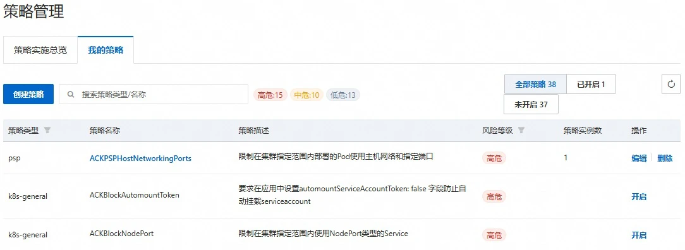

- 单击**操作**列中的**编辑**可以修改策略实例的配置。

  当策略在集群中已部署超过1个实例时，可单击**操作**列的**查看策略实例**，然后单击**编辑**修改相关配置。

- 单击**操作**列中的**删除**，可以删除该策略在集群中部署的所有实例。

关于策略说明和模板示例的更多信息，请参见容器安全策略规则库说明。

**相关文档**

配置巡检功能可以扫描集群中工作负载配置的安全隐患。更多信息，请参见使用配置巡检检查集群工作负载。

<a id="section-7-7-3"></a>

### 7.7.3. 通过API使用策略治理功能

您可以通过阿里云官方SDK调用指定集群策略治理相关的API，执行集群策略治理相关操作。例如，对指定策略类型实例进行部署、更新和删除，对策略规则库策略列表、指定集群策略治理状态进行查询等。本文介绍如何通过API使用策略治理功能。

**前提条件**

- 已创建专有版集群，且版本为1.18.8及以上。具体操作，请参见创建Kubernetes集群。

- 如果您使用RAM账号进行策略治理相关操作，RAM账号需完成以下授权。具体操作，请参见<strong>《统一云管平台》</strong>>**《Apsara Uni-manager运营控制台 用户指南》**>**《RAM管理》**>**《RAM授权》**>**《为RAM授权添加权限策略》**。

  - cs:DescribePolicies：列举策略治理规则库列表。

  - cs:DescribePoliceDetails：获取策略规则模板详情。

  - cs:DescribePolicyGovernanceInCluster：获取集群策略治理详情。

  - cs:DescribePolicyInstances：获取集群中当前部署的策略实例列表。

  - cs:DescribePolicyInstancesStatus：获取集群当前不同策略类型对应的实例部署状态。

  - cs:DeployPolicyInstance：在指定集群中部署策略规则实例。

  - cs:DeletePolicyInstance：在指定集群中删除策略规则实例。

  - cs:ModifyPolicyInstance：在指定集群中修改策略规则实例。

**使用限制**

- 仅支持1.18.8及以上版本的专有版集群，不支持边缘专有版集群。

- 仅适用于Linux节点。

- 不支持自定义策略规则。安全策略功能中所有规则均来自于阿里云容器服务内置的规则库。更多信息，请参见容器安全策略规则库说明。

- 仅支持通过容器服务控制台的**组件管理**页面安装gatekeeper组件。

  如果集群已通过其他方式安装gatekeeper组件，请卸载后重新在**组件管理**页面安装gatekeeper组件。关于安装组件的具体操作，请参见管理组件；关于gatekeeper组件的相关信息，请参见gatekeeper。

**步骤一：安装策略治理组件**

您需要安装gatekeeper、logtail-ds和policy-template-controller组件，才能使用策略管理功能。具体操作，请参见管理组件。

| 组件 | 说明 |
| --- | --- |
| gatekeeper | 基于OPA策略引擎的K8s策略准入控制器，帮助您更加方便地管理和应用集群内的OPA策略，实现对命名空间的标签管理等功能。 |
| policy-template-controller | 基于阿里云策略模板开发的K8s控制器，帮助您更好地管理基于不同策略模板部署的策略实例和集群整体的治理状态。 |
| logtail-ds | 用于收集和检索不符合策略约束的拦截或告警事件。 |

**步骤二：通过API进行集群策略治理**

策略治理相关接口的名称和功能如下。关于集群策略API的使用指导，请参见<strong>《容器服务Kubernetes版》</strong>>**《开发指南》**>**《集群 API 列表》**>**《策略治理》**。

| API名称 | 功能 |
| --- | --- |
| DescribePolicies | 列举策略治理规则库列表。 |
| DescribePolicyDetails | 获取策略治理规则模板详情。 |
| DeployPolicyInstance | 在指定集群中部署策略规则实例。 |
| ModifyPolicyInstance | 在指定集群中更新策略规则实例。 |
| DeletePolicyInstance | 在指定集群中删除策略规则实例。 |
| DescribePolicyInstances | 获取集群中当前部署的策略实例。 |
| DescribePolicyInstancesStatus | 获取集群中策略规则实例详情。 |
| DescribePolicyGovernanceInCluster | 获取集群策略治理详情。 |

<a id="section-7-7-4"></a>

### 7.7.4. 使用配置巡检检查集群工作负载

ACK集群提供配置巡检功能，帮助您扫描集群中工作负载配置的安全隐患。执行巡检任务后，ACK会生成巡检报告，您可以根据报告结果查看并处理集群风险项，实时了解集群健康状态。

**前提条件**

- 已创建专有版集群，且版本为1.16.9及以上。具体操作，请参见创建Kubernetes集群。

- 如果您当前使用的是RAM用户，请确保已参见下方内容完成RAM授权和RBAC授权。

  - **RAM授权**

    请完成ACK容器服务配置巡检页面的RAM授权操作，确保当前RAM用户拥有操作当前集群配置巡检页面的权限，否则会出现权限不足无法操作配置巡检页面功能的问题。具体操作，请参见为集群Worker节点绑定的RAM角色配置权限。 配置巡检授权代码示例如下：

    ```json
    {
      "Statement": [
        {
          "Action": [
            "cs:DescribePolarisConfig",
            "cs:DescribePolarisJob",
            "cs:DescribePolarisCronJob",
            "cs:UpdatePolarisJob",
            "cs:UpdatePolarisCronJob"
          ],
          "Effect": "Allow",
          "Resource": [
            "acs:cs:*:*:cluster/<yourclusterID>"
          ]
        }
      ],
      "Version": "1"
    }
    ```

    如果您还需要使用巡检报告功能，请完成日志服务指定 `logproject` （当前集群logtail-ds组件所使用的 `logproject` ）的RAM授权，确保当前RAM用户拥有日志服务指定 `logproject` 的数据读取权限，否则会出现权限不足无法查看巡检报告的问题。具体操作，请参见为集群Worker节点绑定的RAM角色配置权限。 日志服务日志读取授权代码示例如下：

    ```json
    {
        "Version": "1",
        "Statement": [
            {
                "Action": [
                    "log:Get*",
                    "log:List*"
                ],
                "Resource": "acs:log:*:*:project/<指定的Project名称>/*",
                "Effect": "Allow"
            }
        ]
    }
    ```

  - **RBAC授权**

    请完成ACK容器服务配置巡检页面涉及资源的RBAC授权，授予RAM用户指定集群的管理员权限，以确保RAM用户拥有操作配置巡检页面中涉及的Kubernetes资源的权限。具体操作，请参见配置子账号或RAM角色的RBAC权限。

**启用集群Workload配置巡检功能**

1. 登录容器服务控制台，在左侧导航栏选择**集群**。

2. 在**集群列表**页面，单击目标集群名称，然后在左侧导航栏，选择**安全管理 > 配置巡检**。

3. <strong>可选：</strong>安装并升级巡检组件。

   如果您首次使用未安装巡检组件，请按照页面提示安装security-inspector组件。若巡检组件不是最新版本，请按照页面提示将组件升级至最新版本。组件安装完成后，您也可以在**集群信息**页面的**概览**页签，单击**安全巡检**进入**配置巡检**页面。

   关于security-inspector组件的介绍和变更记录，请参见security-inspector。

4. 在**配置巡检**页面右上方，单击**立即执行巡检**，在**执行配置巡检**对话框，单击**确定**。

   > **重要**
   >
   > 请在业务低峰期执行巡检操作。

   等待巡检完成后，在**巡检详情**页签的**操作**列，单击**详情**查看巡检详情。

5. <strong>可选：</strong>在**配置巡检**页面右上方，单击**巡检配置**，开启或禁用定期自动执行配置巡检的功能以及配置巡检时执行的检查项。

**巡检详情**

**巡检详情**页面通过表格化的方式展示不同工作负载的详细巡检结果，主要包括以下功能：

- 支持按照**是否有风险**、**命名空间**、**工作负载类别**等条件对结果进行过滤展示工作负载的巡检**通过项**和**风险项**数量。

- 展示巡检结果的各个检查项的详细信息，包括Pod和Container维度的检查状态（已通过、未通过）、检查项详细说明以及加固建议。如有未通过的检查项无需处理，您可以将其加入白名单。

- 查看工作负载的YAML文件。

**巡检报告**

巡检报告中主要展示最近执行的巡检扫描结果，主要包括以下几类信息：

- 扫描结果概览，包括总的检查条目数、检查各个资源项数目及百分比、整体的健康度。

- 各大类扫描结果统计，包括报告健康检查、镜像、网络、资源、安全等大类的结果。

- 各个Workload配置的详细扫描结果，包括资源类别、资源名称、命名空间、检查类型、检查项、检查结果等内容。

**检查项**

配置巡检功能会扫描并展示以下检查项的扫描结果。

| 检查项名称 | 检查的内容及安全风险 | 修复建议 |
| --- | --- | --- |
| hostNetworkSet | 通过检查Workload的Pod Spec中是否配置了<code> hostNetwork: </code> <code>true </code>，检查是否配置了共享使用主机的网络namespace。如果配置了，存在Pod中容器攻击主机网络、嗅探主机网络数据的风险。 | 修改Pod Spec，删除<code> hostNetwork </code>字段。示例：<br>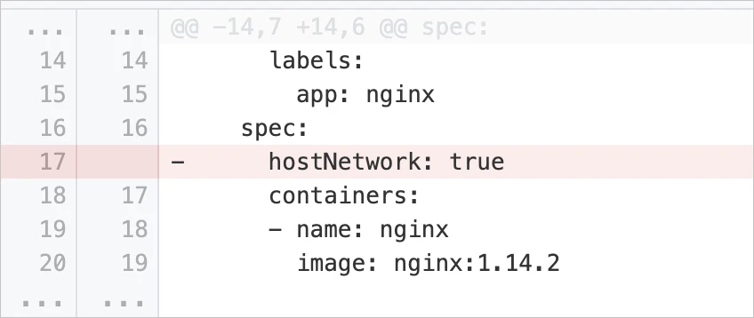 |
| hostIPCSet | 通过检查Workload的Pod Spec中是否配置了<code> hostIPC: true </code>，检查是否配置了共享使用主机的IPC namespace。如果配置了，存在Pod中容器攻击主机上进程、嗅探主机上进程数据的风险。 | 修改Pod Spec，删除<code> hostIPC </code>字段。示例：<br>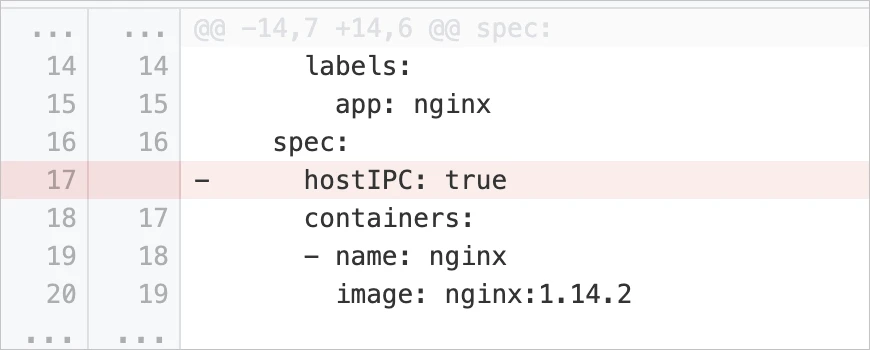 |
| hostPIDSet | 通过检查Workload的Pod Spec中是否配置了<code> hostPID: true </code>，检查是否配置了共享使用主机的PID namespace。如果配置了，存在Pod中容器攻击主机上进程、采集主机上进程数据的风险。 | 修改Pod Spec，删除<code> hostPID </code>字段。示例：<br>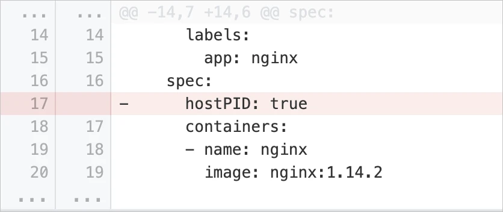 |
| hostPortSet | 通过检查Workload的Pod Spec中是否配置了<code> hostPort </code>，检查是否配置了把容器中监听的端口映射到主机指定端口上。如果配置了，存在挤占主机可用端口以及被非预期的请求方请求容器端口的风险。 | 修改Pod Spec，删除<code> hostPort </code>字段。示例：<br>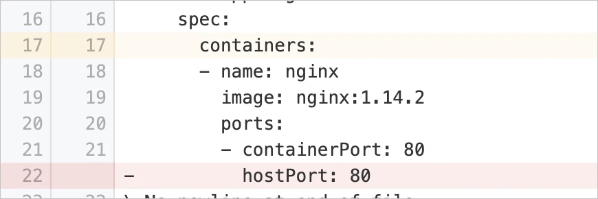 |
| runAsRootAllowed | 通过检查Workload的Pod Spec中是否未配置<code> runAsNonRoot: </code> <code>true </code>，检查是否未配置使用非root用户运行容器。如果未配置，存在被容器中的恶意进程入侵用户应用、入侵主机甚至入侵整个集群的风险。 | 修改Pod Spec，增加<code> runAsNonRoot: true </code>。示例：<br>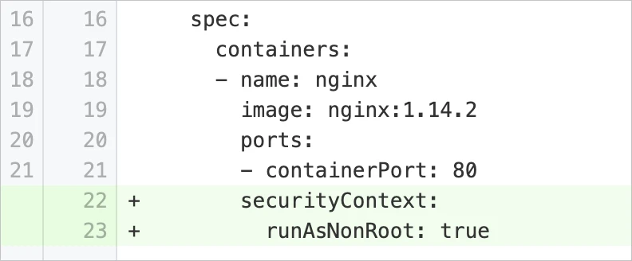 |
| runAsPrivileged | 通过检查Workload的Pod Spec中是否配置了<code> privileged: true </code>，检查是否配置了允许以特权模式运行容器。如果配置了，存在被容器中的恶意进程入侵用户应用、入侵主机甚至入侵集群的风险。 | 修改Pod Spec，删除<code> privileged </code>字段。示例：<br>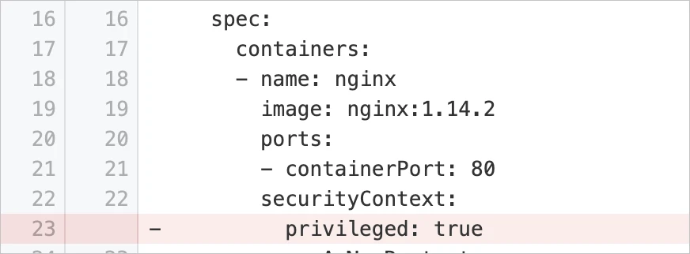 |
| privilegeEscalationAllowed | 通过检查Workload的Pod Spec中是否未配置<code> allowPrivilegeEscalation: false </code>，检查是否未配置禁止容器中的子进程拥有比父进程更高的权限。如果未配置，存在被容器中的恶意进程实现越权操作的风险。 | 修改Pod Spec，增加<code> allowPrivilegeEscalation</code>：<code>false </code>字段。示例：<br>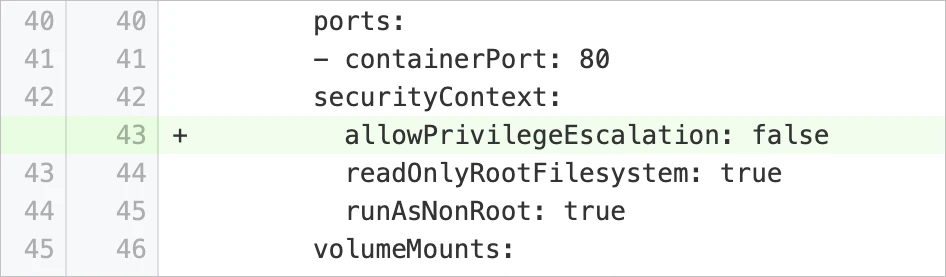 |

<table>
  <tr>
    <td>capabilitiesAdded</td>
    <td>通过检查Workload的Pod Spec中的<code> capabilities </code>字段，检查是否配置了允许容器中的进程拥有SYS_ADMIN、NET_ADMIN、ALL等特权Linux Capabilities。如果配置了，存在被容器中的恶意进程通过这些特权入侵用户应用、入侵或破坏组件/集群的风险。</td>
    <td>修改Pod Spec，根据实际需求只添加必需的Linux Capabilities，删除不需要的Linux Capabilities。不依赖额外Linux Capabilities，删除所有不需要的Linux Capabilities。示例：<br>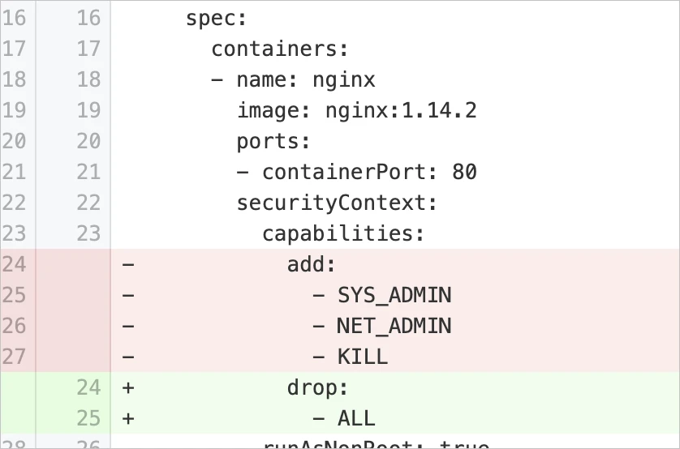<br>只添加必需的Linux Capabilities，删除所有不需要的Linux Capabilities。示例：<br>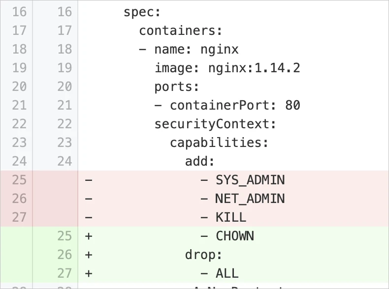</td>
  </tr>
  <tr>
    <td>notReadOnlyRootFileSystem</td>
    <td>通过检查Workload的Pod Spec中是否未配置<code> readOnlyRootFilesystem: true </code>，检查是否未配置容器中的文件系统是不可修改的。如果未配置的话，存在被容器中的恶意进程恶意修改系统文件的风险。</td>
    <td>修改Pod Spec，增加<code> readOnlyRootFilesystem: true </code>，如果有需要修改某个目录下文件的需求，可以通过volumeMounts实现。示例：<br>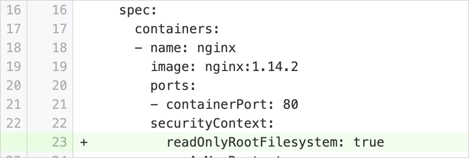<br>如果需要修改某个目录下的文件，通过<code> volumeMounts </code>字段实现。示例：<br>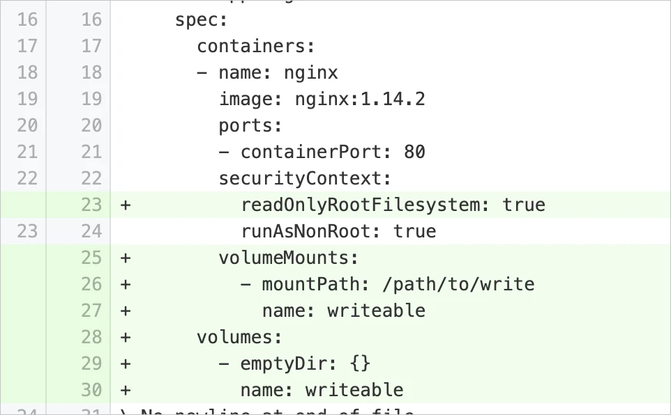</td>
  </tr>
  <tr>
    <td>cpuRequestsMissing</td>
    <td>通过检查Workload的Pod Spec中是否未配置<code> resources.requests.cpu </code>字段，可以检查是否未配置运行容器所需的最少CPU资源。如果未配置的话，Pod有被调度到资源紧张的节点上的风险，可能会出现容器内进程运行缓慢的情况。</td>
    <td>修改Pod Spec，增加<code> resources.requests.cpu </code>字段。示例：<br>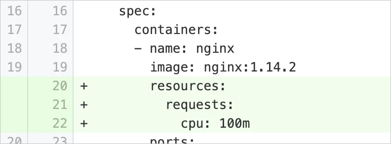</td>
  </tr>
  <tr>
    <td>cpuLimitsMissing</td>
    <td>通过检查Workload的Pod Spec中是否未配置<code> resources.limits.cpu </code>字段，检查是否未配置运行容器所需的最大CPU资源。如果未配置的话，存在被容器内的异常进程消耗大量节点资源，甚至把整个节点或集群的资源销耗殆尽的风险。</td>
    <td>修改Pod Spec，增加<code> resources.limits.cpu </code>字段。示例：<br>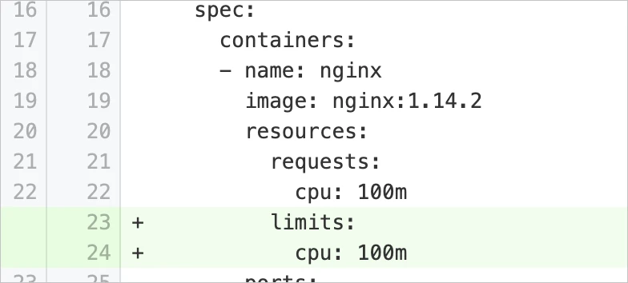</td>
  </tr>
  <tr>
    <td>memoryRequestsMissing</td>
    <td>通过检查Workload的Pod Spec中是否未配置<code> resources.requests.memory </code>字段，检查是否未配置运行容器所需的最少内存资源。如果未配置，Pod有被调度到资源紧张的节点上的风险，可能会出现容器内进程OOM的风险。</td>
    <td>修改Pod Spec，增加<code> resources.requests.memory </code>字段。示例：<br>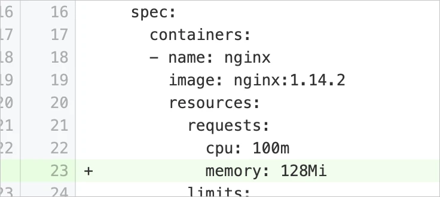</td>
  </tr>
  <tr>
    <td>memoryLimitsMissing</td>
    <td>通过检查Workload的Pod Spec中是否未配置<code> resources.limits.memory </code>字段，检查是否未配置运行容器所需的最大内存资源。如果未配置的话，存在被容器内的异常进程消耗大量节点资源，甚至把整个节点或集群的资源消耗殆尽的风险。</td>
    <td>修改Pod Spec，增加<code> resources.limits.memory </code>字段。示例：<br></td>
  </tr>
  <tr>
    <td>readinessProbeMissing</td>
    <td>通过检查Workload的Pod Spec中是否未配置<code> readinessProbe </code>字段，检查是否未配置检测容器内应用能否正常处理请求的探针。如果未配置的话，存在容器内应用异常无法处理请求时仍旧有请求发送，继而导致业务异常的风险。</td>
    <td>修改Pod Spec，增加<code> readinessProbe </code>字段。示例：<br></td>
  </tr>
  <tr>
    <td>livenessProbeMissing</td>
    <td>通过检查Workload的Pod Spec中是否未配置<code> livenessProbe </code>，检查是否未配置检测容器内应用是否出现异常需要重启容器的探针。如果未配置，存在容器内应用异常需要重启容器才能恢复时未及时重启导致业务异常的风险。</td>
    <td>修改Pod Spec，增加<code> livenessProbe </code>字段。示例：<br></td>
  </tr>
  <tr>
    <td>tagNotSpecified</td>
    <td>通过检查Workload的Pod Spec中的<code> image </code>字段的值是否未包含镜像Tag或者使用了latest作为镜像Tag，检查是否未配置运行容器时使用指定Tag的容器镜像。如果未配置，存在运行容器时运行了非预期的容器镜像版本导致业务异常的风险。</td>
    <td>修改Pod Spec，修改<code> image </code>字段，使用指定的镜像Tag，并且不要使用latest作为镜像Tag。示例：<br></td>
  </tr>
  <tr>
    <td>anonymousUserRBACBinding</td>
    <td>通过检查集群内的RBAC（Role-based access control）绑定找出配置了匿名用户访问权限的配置项。如果配置了允许匿名用户访问集群资源的配置项，则存在被恶意匿名用户窃取集群敏感信息、攻击和入侵集群的风险。</td>
    <td>修改扫描出来的RBAC绑定，根据实际情况删除允许匿名用户访问集群资源的权限配置项。示例：<br></td>
  </tr>
</table>

**事件**

| 事件类型 | 事件名称 | 事件内容示例 | 事件说明 | 处理措施 |
| --- | --- | --- | --- | --- |
| Normal | SecurityInspectorConfigAudi tStart | Start to running config audit | 开始执行巡检任务。 | 无需处理。 |
| Normal | SecurityInspectorConfigAudi tFinished | Finished running once config audit | 巡检任务执行完成。 | 无需处理。 |
| Warning | SecurityInspectorConfigAudi tHighRiskFound | 2 high risks have been found after running config audit | 巡检执行完之后，发现部分工作负载存在未修复的高风险检查项。 | 1. 在集群的<strong>配置巡检</strong>页面，查看详细的巡检结果。<br>2. 通过过滤选项中的<strong>有风险</strong>、<strong>所有命名空间</strong>以及显示所有工作负载，过滤查看有风险的工作负载。然后，单击<strong>详情</strong>，查看该工作负载中每个检查项的检查结果和修复建议。<br>• 对于确认无需修复的检查项，单击<strong>加白名单</strong>，将该检查项加入白名单。<br>• 对于确认需要修复的检查项，请参考修复建议进行修复。 |

**相关文档**

- 关于security-inspector组件的介绍和变更记录，请参见security-inspector。

- Configure a Security Context for a Pod or Container

- Configure Liveness, Readiness and Startup Probes

<a id="section-7-7-5"></a>

### 7.7.5. 使用集群审计功能

审计（Auditing）产生于API Server内部，用于记录对Kubernetes API的请求以及请求结果。ACK集群提供API Server的审计日志，帮助集群管理人员排查“什么人在什么时间对什么资源做了什么操作”，可用于追溯集群操作历史、排查集群故障等，降低集群安全运维压力。

**步骤一：启用集群API Server审计功能**

创建Kubernetes集群时会默认选中**使用日志服务**，开启集群API Server审计功能。若您未开通，请参见下方步骤开通。

1. 登录容器服务控制台，在左侧导航栏选择**集群**。

2. 在**集群列表**页面，单击目标集群名称，然后在左侧导航栏，选择**安全管理 > 集群审计**。

若您未开通集群日志或集群审计功能，请按照页面提示手动选择SLS Project并开启功能。

**步骤二：查看审计报表**

ACK集群内置了3个审计日志报表，包括审计中心概览、资源操作概览、资源操作详细列表。您可以在**集群审计**页面选择审计事件的筛选维度（例如命名空间、RAM用户等），并通过报表获取以下内容。

您也可以在获取结果后，单击目标区域右上角的图标  ，进行更多操作，例如查看指定区域全屏图、预览置顶区域对应的查询语句等。

**审计中心概览**

审计中心概览展示ACK集群中的事件整体概览以及重要事件（例如RAM用户操作、公网访问、命令执行、删除资源、访问保密字典等）的详细信息。

**资源操作概览**

资源操作概览展示Kubernetes集群中常见的计算资源、网络资源以及存储资源的操作统计信息。操作包括创建、更新、删除、访问。其中：

- 计算资源：Deployment、StatefulSet、CronJob、DaemonSet、Job、Pod。

- 网络资源：Service、Ingress。

- 存储资源：ConfigMap、Secret、PersistentVolumeClaim。

- 访问控制资源：Role、ClusterRole、RoleBinding、ClusterRoleBinding


**资源操作详细列表**

该报表用于展示Kubernetes集群中某类资源的详细操作列表。您需要选择或输入指定的资源类型进行实时查询。该报表会显示：资源操作各类事件的总数、Namespace分布、成功率、时序趋势以及详细操作列表等。


> **说明**
>
> 若您需要查看Kubernetes中注册的CRD（CustomResourceDefinition）资源或列表中没有列举的其他资源，可以手动输入资源名的复数形式。例如CRD资源为AliyunLogConfig，则输入 `AliyunLogConfigs` 。

**相关操作**

**关闭集群API Server审计功能**

1. 登录容器服务控制台，在左侧导航栏选择**集群**。

2. 在**集群列表**页面，单击目标集群名称，然后在左侧导航栏，选择**安全管理 > 集群审计**。

3. 在**集群审计**页面右上角，单击**关闭集群审计**，关闭当前集群的审计功能。

**在集群中使用第三方日志解决方案**

ACK推荐您使用阿里云日志服务SLS记录集群审计日志。但如果您需要使用第三方日志服务，您可以在部署集群时不使用阿里云SLS，根据需要对接其他的日志解决方案，完成相关审计日志的采集和检索。集群Master各节点的审计日志的源文件（文件为标准的JSON格式）可在 `/var/log/kubernetes/kubernetes.audit` 路径下获取。

**参考信息：集群API Server审计配置介绍**

集群配置集群组件时，控制台会默认选中**使用日志服务**，开启API Server审计功能，按审计策略采集事件数据，并将事件数据写入到后端。

**审计策略**

审计策略定义了审计功能的配置和请求的采集规则。不同审计级别（Audit Level）的事件日志采集规则不同。Audit Level包括以下几种。

| Audit Level | 日志采集规则 |
| --- | --- |
| None | 符合规则的事件不予采集。 |
| Metadata | 采集请求的Metadata，例如用户信息、时间戳等，但不采集请求体或返回体。 |
| Request | 采集请求的Metadata和请求体，但不采集返回体。不适用于非资源请求（Non-Resource Request）。 |
| RequestResponse | 采集请求的Metadata、请求体和返回体。不适用于非资源请求（Non-Resource Request）。 |

您可以使用 `--audit-policy-file` 命令行标志（flag）将以下YAML示例文件保存为API Server的启动参数。登录Master节点后，您可以查看审计配置策略文件的目录，即 `/etc/kubernetes/audit-policy.yml` 。一个审计日志配置策略文件的YAML示例如下。

```yaml
apiVersion: audit.k8s.io/v1 # 必填。v1.24及以上集群为audit.k8s.io/v1，v1.24以下集群为audit.k8s.io/v1beta1
kind: Policy
# RequestReceived阶段（Stage）的请求无须⽣成审计事件。
omitStages:
  - "RequestReceived"
rules:
  # 以下类型的请求⼗分频繁且潜在⻛险较低，建议设置为None，不做审计。
  - level: None
    users: ["system:kube-proxy"]
    verbs: ["watch"]
    resources:
      - group: "" # core
        resources: ["endpoints", "services"]
  - level: None
    users: ["system:unsecured"]
    namespaces: ["kube-system"]
    verbs: ["get"]
    resources:
      - group: "" # core
        resources: ["configmaps"]
  - level: None
    users: ["kubelet"] # legacy kubelet identity
    verbs: ["get"]
    resources:
      - group: "" # core
        resources: ["nodes"]
  - level: None
    userGroups: ["system:nodes"]
    verbs: ["get"]
    resources:
      - group: "" # core
        resources: ["nodes"]
  - level: None
    users:
      - system:kube-controller-manager
      - system:kube-scheduler
      - system:serviceaccount:kube-system:endpoint-controller
    verbs: ["get", "update"]
    namespaces: ["kube-system"]
    resources:
      - group: "" # core
        resources: ["endpoints"]
  - level: None
    users: ["system:apiserver"]
    verbs: ["get"]
    resources:
      - group: "" # core
        resources: ["namespaces"]
  # 对只读URL，例如/healthz*，/version*及/swagger*，设置为None，不做审计。
  - level: None
    nonResourceURLs:
      - /healthz*
      - /version
      - /swagger*
  # Event事件设置为None，不做审计。
  - level: None
    resources: 
      - group: "" # core
        resources: ["events"]
  # 对于可能包含敏感信息或⼆进制⽂件的Secrets，ConfigMaps，TokenReview接⼝，设置为Metadata。
  - level: Metadata
    resources:
      - group: "" # core
        resources: ["secrets", "configmaps"]
      - group: authentication.k8s.io
        resources: ["tokenreviews"]
  # 请求可能会返回⼤量数据，设置为Request，不采集返回体。
  - level: Request
    verbs: ["get", "list", "watch"]
    resources:
      - group: "" # core
      - group: "admissionregistration.k8s.io"
      - group: "apps"
      - group: "authentication.k8s.io"
      - group: "authorization.k8s.io"
      - group: "autoscaling"
      - group: "batch"
      - group: "certificates.k8s.io"
      - group: "extensions"
      - group: "networking.k8s.io"
      - group: "policy"
      - group: "rbac.authorization.k8s.io"
      - group: "settings.k8s.io"
      - group: "storage.k8s.io"
  # 已知的Kunernetes API默认设置为RequestResponse，返回请求体和响应体。
  - level: RequestResponse
    resources:
      - group: "" # core
      - group: "admissionregistration.k8s.io"
      - group: "apps"
      - group: "authentication.k8s.io"
      - group: "authorization.k8s.io"
      - group: "autoscaling"
      - group: "batch"
      - group: "certificates.k8s.io"
      - group: "extensions"
      - group: "networking.k8s.io"
      - group: "policy"
      - group: "rbac.authorization.k8s.io"
      - group: "settings.k8s.io"
      - group: "storage.k8s.io"
  # 其余请求都默认设置为Metadata。
  - level: Metadata
```

> **说明**
>
> 在收到请求后，日志不立即开始记录，等待返回体Header发送后才开始记录。
>
> 对于大量冗余的kube-proxy watch请求、kubelet和 `system:nodes` 对节点的Get请求、kube组件在kube-system下对于endpoint的操作、以及API Server对Namespaces的Get请求等，系统不进行审计。
>
> 对于 `authentication` 、 `rbac` 、 `certificates` 、 `autoscaling` 、 `storage` 等敏感接口，系统根据读写记录相应的请求体和返回体。

**审计后端**

审计事件采集后，会被存储到Log后端日志文件系统，日志文件为标准的JSON格式。您可以配置并使用如下flag作为API Server的启动参数。

> **说明**
>
> 登录到Master节点后，可通过 `/etc/kubernetes/manifests/kube-apiserver.yaml` 查看API Server的配置文件。

| 配置参数 | 说明 |
| --- | --- |
| <code>--audit-log-maxbackup</code> | 指定审计日志可分片存储的最大文件数量，为10个。 |
| <code>--audit-log-maxsize</code> | 指定单个审计日志的最大内存容量，为100 MB。 |
| <code>--audit-log-path</code> | 指定审计日志的输出路径，为<code> /var/log/kubernetes/kubernetes.audit </code>。 |
| <code>--audit-log-maxage</code> | 指定审计日志最长的保存周期，为7天。 |
| <code>--audit-policy-file</code> | 配置审计日志策略的文件路径，为<code> /etc/kubernetes/audit-policy.yml </code>。 |

<a id="section-7-7-6"></a>

### 7.7.6. ACK等保加固使用说明

本文介绍ACK如何基于Alibaba Cloud Linux实现等保2.0三级版以及如何配置等保合规的基线检查，以及如何为ACK集群开启等保加固、配置基线检查策略。

**等保加固满足的保合规要求**

阿里云根据国家信息安全部发布的《GB/T22239-2019信息安全技术网络安全等级保护基本要求》中对操作系统提出的一些等级保护要求，ACK基于云原生操作系统Alibaba Cloud Linux实现等保2.0三级版。您可以使用ACK的等保加固配置满足以下等保合规要求：

- 身份鉴别

- 访问控制

- 安全审计

- 入侵防范

- 恶意代码防范

**Alibaba Cloud Linux等保2.0三级版镜像检查规则说明**

Alibaba Cloud Linux等保2.0三级版镜像按照《GB/T22239-2019信息安全技术网络安全等级保护基本要求》进行等级保护加固，满足对应的检查项。详细信息如下表所示。

**检查项类型**

**检查项名称**

**检查内容**

- 检查是否存在空密码账户。

- 身份标识（UID）具有唯一性。

- 设置密码复杂度要求。

应对登录的用户进行身份标识和鉴别，身份标识具有唯一性，身

- 定期更换密码。

份鉴别信息具有复杂度要求并定期更换。

- 设置密码最短修改时间，防止非法用户短期内多次更改。

- 限制密码重用。

- 确保root是唯一的UID为0的账户。

身份鉴别

- 检查SSHD是否强制使用V2安全协议。

当对服务器进行远程管理时，应采取必要措施，防止鉴别信息在网络传输过程中被窃听。

- 禁止Telnet等不安全的远程连接服务。

应具有登录失败处理功能，应配置并启用结束会话、限制非法登

检测是否配置登录失败锁定策略，是否设置空闲会话断开时间，以及启用登录时间

录次数和当登录连接超时自动退出等相关措施。

过期后断开与客户端的连接设置。

- 除系统管理用户之外，应该分配普通用户、审计员、安全员账户。

应对登录的用户分配账户和权限。

- 确保用户umask为027或更严格。

- 确保每个用户的home目录权限设置为750或者更严格。

- Linux下root账号不应删除，检查是否禁止SSH直接登录即可。

应重命名或删除默认账户，修改默认账户的默认口令。

- root之外的系统默认账户、数据库账户禁止登录（non-login）。

- 确保无弱密码存在，对应的弱密码基线检测通过。

访问控制的粒度应达到主体为用户级或进程级，客体为文件、数

检查重要文件，如访问控制配置文件和用户权限配置文件的权限，是否达到用户级

据库表级。

别的粒度。

访问控制

- root之外的系统默认账户、数据库账户禁止登录（non-login）。

应及时删除或停用多余的、过期的账户，避免共享账户的存在。

- 锁定或删除shutdown、halt账户。

- 确保su命令的访问受限制。

应授予管理用户所需的最小权限，实现管理用户的权限分离。

- 检查/etc/sudoers配置sudo权限的用户，根据需要给root以外用户配置sudo权限，但除管理员外不能所有用户都配置（ALL）权限。

- 确保用户home目录权限设置为750或者更严格。

- 无主文件或文件夹的所有权，根据需要重置为系统上的某个活动用户。

应由授权主体配置访问控制策略，访问控制策略规定主体对客体的访问规则。

- 设置SSH主机公钥文件的权限和所有权。

- 设置SSH主机私钥文件的权限和所有权。

应对审计记录进行保护，定期备份，避免受到未预期的删除、修

检查auditd文件大小、日志拆分配置或者备份至日志服务器。若自动修复失败，

改或覆盖等。

请先修复启用安全审计功能检查项。

审计记录应包括事件的日期和时间、用户、事件类型、事件是否

满足启用安全审计功能检查项，即满足此项。

成功及其他与审计相关的信息。

- 启用auditd服务。

安全审计

- 启用rsyslog或syslog-ng服务。

应启用安全审计功能，审计覆盖到每个用户，对重要的用户行为

- 确保收集用户的文件删除事件。

和重要安全事件进行审计。

- 确保收集对系统管理范围（sudoers）的更改。

- 确保收集修改用户或用户组信息的事件。如使用了第三方日志收集服务，可自行举证并忽略此项。

auditd是审计进程audit的守护进程，syslogd是日志进程syslog的守护进程，查

应保护审计进程，避免受到未预期的中断。

看系统进程是否启动。

应能发现可能存在的已知漏洞，并在经过充分测试评估后，及时

云安全中心的漏洞检测和修复功能可以满足。如果有其他方式，可自行举证并忽略

修补漏洞。

此项。

- Alibaba Cloud Linux 3：应卸载avahi-daemon、Bluetooth、firstboot、Kdump、wdaemon、wpa_supplicant、ypbind等软件。

应遵循最小安装的原则，仅安装需要的组件和应用程序。

- Alibaba Cloud Linux 2：应卸载NetworkManager、avahi-daemon、Bluetooth、firstboot、Kdump、wdaemon、wpa_supplicant、ypbind等软件。

- 应关闭不需要的系统服务、文件共享服务。

应关闭不需要的系统服务、默认共享和高危端口。

- 关闭21 、23、25、111、427、631等高危端口。

- 如果有特殊需求必须严格配置访问控制策略，需自行举证并忽略此项。

应能够检测到对重要节点进行入侵的行为，并在发生严重入侵事

云安全中心入侵检测和告警功能可以满足。如果已有其他检测与告警方式，可自行

件时提供报警。

举证并忽略此项。

入侵防范

- Alibaba Cloud Linux 3：

  <ol type="i">

  <li>

  根据实际配置登录服务器的终端，编辑 /etc/ssh/sshd_config文件。

  </li>

  <li>

  根据实际情况设置参数 `AllowUsers <user>@<host>` 。

  > **说明**
  >
  > `<user>` 表示需要登录的服务器用户名， `<host>` 表示服务器的IP地址，请根据实际情况进行替换。

  

  </li>

  </ol>

应通过设定终端接入方式或网络地址范围对通过网络进行管理的

<ol type="i" start="3">

<li>

修改完成后按`Esc`键，并输入 `:wq` 后按下回车键，保存并退出。

</li>

</ol>

管理终端进行限制。

<ol type="i" start="4">

<li>

执行 `sudo systemctl restart sshd` 命令重启sshd服务。

</li>

</ol>

- Alibaba Cloud Linux 2：

  - /etc/hosts.allow文件指定允许连接到主机的IP地址，不应配置为 `ALL:ALL` 。

  - /etc/hosts.deny文件指定禁止连接到主机的IP地址，应该配置为 `ALL:ALL` ，默认禁止所有连接。

  两者需要配合使用，且必须先配置 `/etc/hosts.allow` 规则。若是已通过其他方式实现，例如网络安全组、防火墙等，可自行举证并忽略此项。

- Alibaba Cloud Linux 3：应采用免受恶意代码攻击的技术措施或主动免疫可信验证机制及时识别入侵和病毒行为，并将其

  检测是否安装使用云安全中心，如安装了其他防恶意代码软件，可自行举证并忽略

  有效阻断。

恶意代码防范

此项。

- Alibaba Cloud Linux 2：应安装防恶意代码软件，并及时更新防恶意代码软件版本和恶意代码库。

**使用Alibaba Cloud Linux等保2.0三级版**

在创建ACK集群时，您可以启用**等保加固**。ACK会为集群自动配置对应的等保加固项，使其满足国家信息安全部发布的《GB/T22239-2019信息安全技术网络安全等级保护基本要求》中对操作系统的等级保护要求。具体操作，请参见创建Kubernetes集群。

等保加固配置图：


> **重要**
>
> - 为了满足等保2.0三级版的标准要求，ACK会在等保加固的Alibaba Cloud Linux操作系统中默认创建ack_admin、ack_audit、ack_security三个普通用户。
>
> - 为了满足等保2.0三级版的标准要求，等保加固的Alibaba Cloud Linux禁止使用root用户通过SSH登录。您可以通过云服务器ECS控制台使用VNC方式，登录系统创建可使用SSH的普通用户。具体操作，请参见<strong>《云服务器ECS 用户指南》>《实例》>《连接实例》>《使用登录VNC功能连接实例》</strong>。

**为Alibaba Cloud Linux等保2.0三级版镜像基线检查策略配置**

阿里云已为Alibaba Cloud Linux 2和Alibaba Cloud Linux 3等保2.0三级版镜像提供了等保合规的基线检查标准和扫描程序。本文以Alibaba Cloud Linux 3为例为您介绍如何配置等保合规的基线检查策略，以实现对ECS实例进行等保合规基线检查。

**前提条件**

已购买支持基线检查的云安全中心。

- 云安全中心的不同版本对基线检查的支持情况不同。

- 确认已从部署人员处获取Apsara Uni-manager运营控制台的服务域名地址。具体操作，请参见<strong>《云安全中心》>《安骑士用户指南》>《快速入门》>《登录Apsara Uni-manager运营控制台》</strong>。

**操作步骤**

1. 登录Apsara Uni-manager运营控制台。

2. 在顶部菜单栏，单击**安全**，在**主机安全**区域，单击**安骑士**。

3. 在左侧导航栏，选择**安全预防 > 基线检查**。

4. 单击控制台界面右上角**策略管理**，然后在**策略管理**面板，单击**添加标准策略**。

   主要配置项说明如下：

   - **策略名称**：输入用于识别该策略的名称，例如 `Alibaba Cloud Linux 3`等保合规检查 。

   - **基线名称**：选择**等保合规 > 等保三级-Alibaba Cloud Linux 3合规基线检查**。

   - **生效服务器**：选择需要应用该策略的资产分组。新购买的服务器默认归属在**未分组**中，如需对新购资产应用该策略，请选择**未分组**。

5. 在**策略管理**面板，单击**确认**。

6. 在**基线检查**页面，单击**全部策略**，选择目标基线名称，然后单击**立即检查**。

   

7. 检查完毕后，在**基线检查**页面的列表，单击基线名称，然后查看检查结果。

<a id="section-7-8"></a>

## 7.8. 网络管理

<a id="section-7-8-1"></a>

### 7.8.1. 网络概述

容器服务ACK集成Kubernetes网络、阿里云VPC、阿里云SLB，提供稳定高性能的容器网络。本文介绍ACK集群网络及阿里云网络底层基础设施的重要概念，如容器网络CNI、Service、Ingress、提供服务发现能力的DNS等。您可以通过了解这些概念，更合理地设计应用部署模型和网络访问的方式。

**容器网络CNI**

容器化应用会在同一个节点上部署多个业务，而每个业务都需要自己的网络空间。为避免与其他业务网络冲突，需要Pod有自己独立的网络空间，而Pod中应用需要和其他网络进行通信，就需要Pod能够跟不同的网络互相访问。


容器网络特点如下：

- 每个Pod都拥有自己独立的网络空间和IP地址。不同Pod的应用可以监听同样的端口而不冲突。

- Pod可以通过各自的IP地址互相访问。集群中Pod可以通过它独立的IP地址与其他应用互通：

  - 同一个集群中，Pod之间相互访问。

  - Pod直接访问同一个VPC下的ECS。

  - 同一个VPC下的ECS直接访问Pod。

  > Pod能直接访问同一个VPC下的ECS和同一个VPC下的ECS能直接访问Pod的前提是您需要正确设置安全组规则。
  >
  > **说明**

在ACK中，您可以通过Flannel网络模式和Terway网络模式实现上述容器网络的能力，详情如下：

> 集群创建完成后，不支持Flannel与Terway之间的变更切换。
>
> **重要**

<table>
  <tr>
    <th width="89">网络模式</th>
    <th>说明</th>
  </tr>
  <tr>
    <td>Terway</td>
    <td>Terway网络模式采用云原生的网络方案，直接基于阿里云的虚拟化网络中的弹性网卡资源来构建的容器网络。Pod会通过弹性网卡资源直接分配VPC中的IP地址，而不需要额外指定虚拟Pod网段。Terway网络模式的特点：<br>• 容器和虚拟机在同一层网络，便于业务云原生化迁移。<br>• 不依赖封包或者路由表，分配给容器的网络设备本身可以用来通信。<br>• 集群节点规模不受路由表或者封包的FDB转发表等配额限制。<br>• 不需要额外为容器规划Overlay的网段，多个集群容器之间只要设置安全组开放端口就可以互相通信。<br>• 可以直接把容器挂到SLB后端，无需在节点上使用NodePort进行转发。<br>• NAT网关可以对容器做SNAT，无需节点上对容器网段做SNAT：容器访问VPC内资源，所带的源IP都是容器IP，便于审计；容器访问外部网络不依赖conntrack SNAT，降低失败率。<br>• Terway网络模式支持通过网络策略（NetworkPolicy）配置Pod间网络访问的规则。网络策略（NetworkPolicy）是一种关于Pod间及Pod与其他网络端点间所允许的通信规则的规范。NetworkPolicy资源使用标签选择Pod，并定义选定Pod所允许的通信规则。<br>• 在使用Alibaba Cloud Linux系统作为节点的操作系统时，Terway网络模式支持使用更高效的IPvlan+eBPF链路，加速容器网络性能。</td>
  </tr>
  <tr>
    <td>Flannel</td>
    <td>Flannel网络模式中Pod的网段独立于VPC的网段。Pod网段会按照掩码均匀划分给每个集群中的节点，每个节点上的Pod会从节点上划分的网段中分配IP地址。Flannel网络基于阿里云VPC的自定义路由能力，来实现跨节点的Pod直接与VPC的互相访问。Flannel网络模式的特点：<br>• 基于阿里云VPC的Flannel网络无封包，相对默认的Flannel VXLAN性能提升20%。<br>• Pod网段是独立于VPC的虚拟网段。<br>• 每个节点需要对应一个VPC的路由表条目，一个VPC下面Kubernetes节点数受限于VPC路由表的配额。</td>
  </tr>
</table>

**Service**

由于云原生的应用通常需要敏捷的迭代和快速的弹性，且单一容器和其相关的网络资源的生命非常短暂，所以需要固定的访问地址，以及自动负载均衡实现快速的业务弹性。

ACK采用Service方式为一组容器提供固定的访问入口，并对这一组容器做负载均衡。实现原理如下：

- 创建Service对象时，ACK会分配一个相对固定的Service IP地址。

- 通过字段 `selector` 选择一组容器，以将这个Service IP地址和端口负载均衡到这一组容器IP和端口上。

Service网络支持以下多种模式分别对接不同来源和类型的客户端的访问：

<table>
  <tr>
    <th width="163">类型</th>
    <th>说明</th>
  </tr>
  <tr>
    <td>ClusterIP</td>
    <td>ClusterIP类型的Service用于集群内部的应用间访问，如果您的应用需要暴露到集群内部提供服务，需使用ClusterIP类型的Service暴露。说明创建Service时默认的Service类型为ClusterIP。</td>
  </tr>
  <tr>
    <td>NodePort</td>
    <td>NodePort类型的Service将集群中部署的应用向外暴露，通过集群节点上的一个固定端口暴露出去，这样在集群外部就可以通过节点IP和这个固定端口来访问。</td>
  </tr>
  <tr>
    <td>LoadBalancer</td>
    <td>LoadBalancer类型的Service通过阿里云的负载均衡将集群内部部署的应用向外暴露，相对于NodePort方式，有更高的可用性和性能。</td>
  </tr>
  <tr>
    <td>Headless Service</td>
    <td>Headless Service类型的Service是在Service属性中指定<code> clusterIP </code>字段为<code> None </code>类型。采用Headless Service类型后，Service将没有固定的虚拟IP地址，客户端访问Service的域名时会通过DNS返回所有的后端Pod实例的IP地址，客户端需要采用DNS负载均衡来实现对后端的负载均衡。</td>
  </tr>
  <tr>
    <td>ExternalName</td>
    <td>ExternalName类型的Service将集群外部的域名映射到集群内部的Service上，例如将外部的数据库域名映射到集群内部的Service，在集群内部通过Service名直接访问。</td>
  </tr>
</table>

**Ingress**

在ACK集群中，与Service的4层负载均衡不同，Ingress是集群内Service对外暴露7层的访问接入点。您可以通过Ingress资源来配置不同的7层的转发规则，例如通过域名或者访问路径来路由到不同的Service上，从而达到7层的负载均衡作用。


常见的前后端分离的架构方式中，前后端的访问地址分别使用不同的访问路径。对应这种场景，可以采用Ingress，根据7层的访问路径负载到不同的应用实例上。


**服务发现DNS**

ACK使用DNS来实现应用的服务发现能力，例如客户端应用可以通过Service的服务名解析出它的ClusterIP访问、通过StatefulSet的Pod名解析出Pod的IP地址。采用DNS服务发现的能力让集群中应用间的调用与IP地址和部署环境相解耦。

集群的CoreDNS会将Service名自动转换成对应的Service的IP地址，来实现不同部署环境中同样的访问入口。


**网络底层基础设施**

**VPC**

阿里云专有网络VPC（Virtual Private Cloud）是基于阿里云创建的自定义私有网络，不同的专有网络之间彻底逻辑隔离。您可以在专有网络内创建和管理云产品实例，例如云服务器、云数据库RDS版和负载均衡等。每个VPC都由一个路由器、至少一个私网网段和至少一个交换机组成。


- 私网网段：在创建专有网络和交换机时，您需要以CIDR地址块的形式指定专有网络使用的私网网段。您可以使用下表中标准的私网网段及其子网作为VPC的私网网段，也可以使用自定义地址段作为VPC的私网网段。

  <table>
    <tr>
      <th width="149">网段</th>
      <th>说明</th>
    </tr>
    <tr>
      <td>192.168.0.0/16</td>
      <td>可用私网IP数量（不包括系统保留地址）：65,532。</td>
    </tr>
    <tr>
      <td>172.16.0.0/12</td>
      <td>可用私网IP数量（不包括系统保留地址）：1,048,572。</td>
    </tr>
    <tr>
      <td>10.0.0.0/8</td>
      <td>可用私网IP数量（不包括系统保留地址）：16,777,212。</td>
    </tr>
    <tr>
      <td>自定义地址段</td>
      <td>除100.64.0.0/10、224.0.0.0/4、127.0.0.0/8、169.254.0.0/16及其子网外的自定义地址段。</td>
    </tr>
  </table>

- 路由器（vRouter）：专有网络的枢纽。作为专有网络中重要的功能组件，它可以连接专有网络内的各个交换机，同时也是连接专有网络和其他网络的网关设备。每个专有网络创建成功后，系统会自动创建一个路由器。每个路由器关联一张路由表。

- 交换机（vSwitch）：组成专有网络的基础网络设备，用来连接不同的云资源。创建专有网络后，您可以通过创建交换机为专有网络划分一个或多个子网。同一专有网络内的不同交换机之间内网互通。您可以将应用部署在不同可用区的交换机内，提高应用的可用性。

**SLB**

阿里云负载均衡SLB（Server Load Balancer）通过设置虚拟服务地址，将添加的ECS实例虚拟成一个高性能、高可用的应用服务池，并根据转发规则，将来自客户端的请求分发给云服务器池中的ECS实例。负载均衡默认检查云服务器池中的ECS实例的健康状态，自动隔离异常状态的ECS实例，消除了单台ECS实例的单点故障，提高了应用的整体服务能力。此外，负载均衡还具备抗DDoS攻击的能力，增强了应用服务的防护能力。负载均衡由以下三个部分组成：

- 负载均衡实例：一个负载均衡实例是一个运行的负载均衡服务，用来接收流量并将其分配给后端服务器。要使用负载均衡服务，您必须创建一个负载均衡实例，并至少添加一个监听和两台ECS实例。

- 监听：用来检查客户端请求并将请求转发给后端服务器。监听也会对后端服务器进行健康检查。

- 后端服务器：一组接收前端请求的ECS实例。您可以单独添加ECS实例到服务器池，也可以通过虚拟服务器组或主备服务器组来批量添加和管理。

<a id="section-7-8-2"></a>

### 7.8.2. Kubernetes集群网络规划

在创建ACK Kubernetes集群时，您需要指定专有网络VPC、虚拟交换机、Pod网络CIDR（地址段）和Service CIDR（地址段）。因此建议您提前规划ECS地址、Kubernetes Pod地址和Service地址。本文将介绍阿里云专有网络VPC环境下Kubernetes集群里各种地址的作用，以及地址段该如何规划。

**专有网络VPC网段和Kubernetes网段关系**

专有网络VPC（下文简称为VPC或专有网络）的网段规划包含VPC自身网段和虚拟交换机网段，Kubernetes网段规划包含Pod地址段和Service地址段。ACK网络支持Terway和Flannel两种网络模式。

**Terway网络模式**

配置Terway模式网络时，需要设置的参数及参数网段配置的注意事项如下：

- 专有网络

  您在创建VPC时需要选择网段，只能从10.0.0.0/8、172.16.0.0/12、192.168.0.0/16三者当中选择一个。

- 虚拟交换机ECS使用的交换机，用于节点间网络通信。在VPC里创建交换机时指定的网段，必须是当前VPC网段的子集（可以和VPC网段一样，但不能超过）。配置网段时，请注意：

  - 虚拟交换机是VPC交换机。

  - 交换机下ECS所分配到的地址，就是从这个交换机网段内获取的。

  - 一个VPC下，可以创建多个交换机，但交换机网段不能重叠。

  - 虚拟交换机和Pod虚拟交换机需要在一个可用区下。

- Pod虚拟交换机Pod地址从该交换机分配，用于Pod网络通信。Pod是Kubernetes内的概念，每个Pod具有一个IP地址。在VPC里创建交换机时指定的网段，必须是当前VPC网段的子集。配置网段时，请注意：

  - Pod虚拟交换机是VPC交换机。

  - Terway网络模式下，Pod分配的Pod IP就是从这个交换机网段内获取的。

  - 该地址段不能和虚拟交换机网段重叠。

  - 该地址段不能和Service CIDR网段重叠。

  - 虚拟交换机和Pod虚拟交换机需要在一个可用区下。

- Service CIDR Service地址段。Service是Kubernetes内的概念，对应的是Service类型为ClusterIP时Service使用的地址，每个Service有自己的地址。配置网段时，请注意：

  - Service地址只在Kubernetes集群内使用，不能在集群外使用。

  - Service地址段不能和虚拟交换机地址段重叠。

  - Service地址段不能和Pod虚拟交换机地址段重叠。

**Flannel网络模式**

配置Flannel模式网络时，需要设置的参数及参数网段配置的注意事项如下：

- 专有网络

  您在创建VPC时需要选择网段，只能从10.0.0.0/8、172.16.0.0/12、192.168.0.0/16三者当中选择一个。

- 虚拟交换机ECS使用的交换机，用于节点间网络通信。在VPC里创建交换机时指定的网段，必须是当前VPC网段的子集（可以和VPC网段一样，但不能超过）。配置网段时，请注意：

  - 虚拟交换机是VPC交换机。

  - 交换机下ECS所分配到的地址，就是从这个交换机网段内获取的。

  - 一个VPC下，可以创建多个交换机，但交换机网段不能重叠。

- Pod网络CIDR Pod网络CIDR，Pod地址从该地址段分配，用于Pod网络通信。Pod是Kubernetes内的概念，每个Pod具有一个IP地址。配置网段时，请注意：

  - 非VPC交换机，为虚拟网段。

  - 该地址段不能和虚拟交换机网段重叠。

  - 该地址段不能和Service CIDR网段重叠。

  例如，VPC网段用的是172.16.0.0/12，Kubernetes的Pod地址段就不能使用172.16.0.0/16、172.17.0.0/16等，因为这些地址都包含在172.16.0.0/12里。

- Service CIDR Service地址段。Service是Kubernetes内的概念，对应的是Service类型为ClusterIP时Service使用的地址，每个Service有自己的地址。配置网段时，请注意：

  - Service地址只在Kubernetes集群内使用，不能在集群外使用。

  - Service地址段不能和虚拟交换机地址段重叠。

  - Service地址段不能和Pod虚拟交换机地址段重叠。

**网络规划**

在阿里云环境下使用ACK支持的Kubernetes集群，首先需要根据业务场景、集群规模进行网络规划。您可以按下表规格进行规划（未包含场景，请根据实际需要自行调整）：

- VPC网络规划

  | 集群节点规模 | 目的 | VPC规划 | 可用区 |
  | --- | --- | --- | --- |
  | 小于100个节点 | 一般性业务 | 单VPC | 1个 |
  | 任意 | 需要多可用区 | 单VPC | 2个及以上 |
  | 任意 | 对可靠性有极致要求、需要多地域 | 多VPC | 2个及以上 |

- 容器网络规划本文针对Flannel和Terway网络场景，规划容器网络。

  - **Flannel配置示例**

    | 专有网络网段 | 虚拟交换机网段 | Pod网络CIDR网段 | Service CIDR网段 | 最大可分配Pod地址数 |
    | --- | --- | --- | --- | --- |
    | 192.168.0.0/16 | 192.168.0.0/24 | 172.20.0.0/16 | 172.21.0.0/20 | 65536 |

  - **Terway配置示例**

    - 表 1. Terway模式

      | 专有网络网段 | 虚拟交换机网段 | Pod虚拟交换机网段 | Service CIDR网段 | 最大可分配Pod地址数 |
      | --- | --- | --- | --- | --- |
      | 192.168.0.0/16 | 192.168.0.0/19 | 192.168.32.0/19 | 172.21.0.0/20 | 8192 |

    - 表 2. **Terway多可用区配置**

      <table>
        <tr>
          <th>专有网络网段</th>
          <th>虚拟交换机网段</th>
          <th>Pod虚拟交换机网段</th>
          <th>Service CIDR网段</th>
          <th>最大可分配Pod地址数</th>
        </tr>
        <tr>
          <td rowspan="2">192.168.0.0/16</td>
          <td>可用区I 192.168.0.0/19</td>
          <td>192.168.32.0/19</td>
          <td rowspan="2">172.21.0.0/20</td>
          <td>8192</td>
        </tr>
        <tr>
          <td>可用区J 192.168.64.0/19</td>
          <td>192.168.96.0/19</td>
          <td>8192</td>
        </tr>
      </table>

**如何选择地址段？**

- **场景1：单VPC+单Kubernetes集群**

  这是最简单的情形。VPC地址在创建VPC的时候就已经确定，创建Kubernetes集群时，选择的Pod及Service地址网段和当前VPC不一样的地址段即可。

- **场景2：单VPC+多Kubernetes集群**一个VPC下创建多个Kubernetes集群。

  - VPC地址是在创建VPC时已经确定。创建Kubernetes集群时，每个集群内的VPC地址段、Service地址段和Pod地址段彼此间不能重叠。

  - 所有Kubernetes集群之间的Pod地址段不能重叠，但Service地址段可以重叠。

  - 在默认的网络模式下（Flannel），Pod的报文需要通过VPC路由转发，容器服务会自动在VPC路由上配置到每个Pod地址段的路由表。

  > 这种情况下Kubernetes集群部分互通，一个集群的Pod可以直接访问另外一个集群的Pod和ECS，但不能访问另外一个集群的Service。
  >
  > **说明**

- **场景3：VPC互联**两个VPC网络互联的情况下，可以通过路由表配置哪些报文要发送到对端VPC里。如下表所示，VPC 1使用地址段192.168.0.0/16，VPC 2使用地址段172.16.0.0/12，您可以通过路由表，指定在VPC 1里把目的地址为172.16.0.0/12的报文都发送到VPC 2。

  

  表 3. VPC互联场景

  | 类别 | 地址段 | 目的端 | 转发到 |
  | --- | --- | --- | --- |
  | VPC 1 | 192.168.0.0/16 | 172.16.0.0/12 | VPC 2 |
  | VPC 2 | 172.16.0.0/12 | 192.168.0.0/16 | VPC 1 |

  在这种情况下，VPC 1和VPC 2里创建的Kubernetes集群有以下限制：

  - 不能和VPC 1的地址段重叠

  - 不能和VPC 2的地址段重叠

  - 不能和其他集群的地址段重叠

  - 不能和Pod的地址段重叠

  - 不能和Service的地址段重叠

  此例子中，Kubernetes集群Pod地址段可以选择10.0.0.0/8下的某个子段。

  > 您需特别关注转发到VPC 2的地址段，可以把这部分地址理解成已经占用的地址，Kubernetes集群不能和已经占用的地址重叠。
  >
  > **说明**

  如果VPC 2里要访问VPC 1的Kubernetes Pod，则需要在VPC 2里配置到VPC 1 Kubernetes集群Pod地址的路由。

- **场景4：VPC网络到IDC**

  和VPC互联场景类似，同样存在VPC里部分地址段路由到IDC，Kubernetes集群的Pod地址就不能和这部分地址重叠。IDC里如果需要访问Kubernetes里的Pod地址，同样需要在IDC端配置到专线VBR的路由表。

<a id="section-7-8-3"></a>

### 7.8.3. 容器访问策略

本文主要为您介绍如何通过Pod间网络策略来控制Pod间的网络访问。

**前提条件**

创建一个 Kubernetes 集群，并且该集群的**网络插件**为**Terway**，参见创建Kubernetes集群。

**背景信息**

通过Kubernetes的NetworkPolicy声明来控制容器服务Pod间的网络访问，避免应用之间相互影响。

**操作步骤**

标准的Kubernetes的NetworkPolicy使用方法请参见网络策略。

1. 通过容器服务控制台创建带有 `label run=nginx` 的服务端Pod。示例YAML文件如下：

   ```yaml
   apiVersion: v1
   kind: Pod
   metadata:
     name: server
     labels:
       run: nginx
   spec:
     containers:
       - name: nginx
         image: registry.acs.intranet.env22.com/nginx:1.8
   ```

2. 创建网络策略。示例YAML文件如下：

   ```yaml
   kind: NetworkPolicy
   apiVersion: networking.k8s.io/v1
   metadata:
     name: access-nginx
   spec:
     podSelector:
       matchLabels:
         run: nginx # 选择对run=nginx的label的pod⽣效
     ingress:
     - from:
       - podSelector:
           matchLabels:
             access: "true" # 只有带有access=true的label的pod才能访问
   ```

3. 使用client.yaml和client-label文件，创建客户端的Pod。执行以下操作，分别创建带有Label和不带Label的客户端的Pod。

   <ol type="i">

   <li>

   创建并复制以下内容到client.yaml和client-label中。

   ```yaml
   # 不带label
   apiVersion: v1
   kind: Pod
   metadata:
     name: client
   spec:
     containers:
       - name: busybox
         image: registry.acs.intranet.env22.com/acs/busybox
         command: ["sh", "-c", "sleep 200000"]                                
   ```

   ```yaml
   # 带label
   apiVersion: v1
   kind: Pod
   metadata:
     name: client-label
     labels:
       access: "true"
   spec:
     containers:
       - name: busybox
         image: registry.acs.intranet.env22.com/acs/busybox
         command: ["sh", "-c", "sleep 200000"]
   ```

   </li>

   <li>

   执行如下命令，创建客户端的Pod。

   ```bash
   kubectl apply -f client.yaml
   kubectl apply -f client-label.yaml
   ```

   </li>

   </ol>

   此时可以看到带Label的Pod可以访问Server服务，不带Label的无法访问。

<a id="section-7-8-4"></a>

### 7.8.4. 容器带宽限制

本文主要为您介绍如何对Pod的出入流量进行控制。

**前提条件**

创建一个Kubernetes集群，并且该集群的**网络插件**为**Terway**，参见创建Kubernetes集群。

**背景信息**

通过对Pod的流量的控制，避免某个应用Pod占用过多资源导致影响宿主机或者其他业务。

**使用方法**

在Pod的annotation中分别通过 `k8s.aliyun.com/ingress-bandwidth` 和 `k8s.aliyun.com/egress-bandwidth` 来限制容器的出入带宽。

- `k8s.aliyun.com/ingress-bandwidth` ：用来限制容器的入带宽。

- `k8s.aliyun.com/egress-bandwidth` ：用来限制容器的出带宽。

- 限速的单位可以使用m、k，分别代表MB/s、KB/s。

**操作步骤**

1. 通过容器服务控制台创建服务端的Pod。示例Yaml文件如下：

   ```yaml
   apiVersion: v1
   kind: Pod
   metadata:
     name: server
     annotations:
       k8s.aliyun.com/ingress-bandwidth: 10m #带宽限制是10MB/s。
       k8s.aliyun.com/egress-bandwidth: 10m
   spec:
     containers:
       - name: nginx
         image: registry.acs.intranet.env22.com/nginx:1.8
   ```

2. 通过kubectl exec进入到服务端的Pod中，并执行如下命令，在服务端（假设从步骤1获取的Pod的IP地址为172.16.XX.XX）创建文件，用于测试大的带宽会被限制。

   ```bash
   cd /usr/share/nginx/html
   dd if=/dev/zero of=bigfile bs=1M count=1000
   ```

3. 使用client-deploy.yaml文件创建客户端的Pod。

   <ol type="i">

   <li>

   创建并复制以下内容到client-deploy.yaml中。

   ```yaml
   apiVersion: v1
   kind: Pod
   metadata:
     name: client
     annotations:
        k8s.aliyun.com/ingress-bandwidth: 10m #带宽限制是10MB/s。
        k8s.aliyun.com/egress-bandwidth: 10m    
   spec:
     containers:
       - name: busybox
         image: registry.acs.intranet.env22.com/acs/netdia
         command: ["sh", "-c", "sleep 200000"]
   ```

   </li>

   <li>

   执行如下命令，创建客户端的Pod。

   ```bash
   kubectl apply -f client-deploy.yaml
   ```

   </li>

   </ol>

4. 执行如下命令，观测访问的速度是否受到限制。

   ```bash
   kubectl exec -it client sh
   ```

   

<a id="section-7-8-5"></a>

### 7.8.5. 使用Terway网络插件

Terway是阿里云开源的基于专有网络VPC的容器网络接口CNI（Container Network Interface）插件，支持基于Kubernetes标准的网络策略来定义容器间的访问策略。您可以通过使用Terway网络插件实现Kubernetes集群内部的网络互通。本文介绍如何使用Terway网络插件。

**背景信息**

Terway网络插件是阿里云容器服务自研的网络插件，将原生的弹性网卡分配给Pod实现Pod网络，支持基于Kubernetes标准的网络策略（Network Policy）来定义容器间的访问策略，并兼容Calico的网络策略。

在Terway网络插件中，每个Pod都拥有自己网络栈和IP地址。同一台ECS内的Pod之间通信，直接通过机器内部的转发，跨ECS的Pod通信、报文通过VPC的弹性网卡直接转发。由于不需要使用VxLAN等的隧道技术封装报文，因此Terway模式网络具有较高的通信性能。

图 1. Terway网络模式图


**Flannel与Terway对比**

在创建集群时，阿里云容器服务提供Terway和Flannel两种网络插件：

- Terway：是阿里云容器服务自研的网络插件。Terway将阿里云的弹性网卡分配给容器，支持基于Kubernetes标准的网络策略来定义容器间的访问策略，支持对单个容器做带宽的限流。Terway拥有更为灵活的IPAM（容器地址分配）策略，避免地址浪费。如果您不需要使用网络策略（Network Policy），可以选择Flannel，其他情况建议选择Terway。

- Flannel：使用的是简单稳定的社区Flannel CNI插件。配合阿里云的VPC的高速网络，为集群提供高性能和稳定的容器网络体验。Flannel功能偏简单，支持的特性少。例如，不支持基于Kubernetes标准的网络策略（Network Policy）。更多信息，请参见Flannel。

| 对比项 | Terway | Flannel |
| --- | --- | --- |
| 性能 | Pod地址即为VPC中地址，无NAT损耗支持独占ENI模式，几乎无损。 | 配合阿里云VPC路由，Pod地址为虚拟地址，存在NAT转换损耗。 |
| 安全 | 支持使用网络策略Network Policy。 | 不支持使用网络策略Network Policy。 |
| 地址管理 | 无需按节点分配地址段，随用随分配，地址无浪费。 | 节点维度划分地址段，大规模集群下地址浪费多。 |
| SLB | SLB后端直接对接Pod，支持业务无中断升级。 | SLB后端不能直接对接Pod，需要通过NodePort转发。 |

**注意事项**

- 如果要使用Terway插件，建议您选择较高规格和较新类型的ECS机型，即5代或者6代的8核以上机型。更多信息，请参见<strong>《云服务器 ECS》>《实例规格族&实例规格简介》</strong>。

- 单节点所支持的最大Pod数取决于该节点的弹性网卡（ENI）数。

  - 共享ENI支持的最大Pod数=（ECS支持的ENI数-1）×单个ENI支持的私有IP数

  - 独占ENI支持的最大Pod数=ECS支持的ENI数－1

**节点所支持的容器网络Pod数量**

节点允许创建Pod数量依赖ECS实例规格所提供的弹性网卡数量，建议您选择较高规格和较新类型的ECS机型。ECS弹性网卡数量必须满足规格限制才能加入集群。更多信息，请参见<strong>《云服务器 ECS用户指南》>《实例规格族&实例规格简介》</strong>。关于API计算方式，请参见<strong>《云服务器 ECS开发指南》>《API参考》>《ECS API参考》>《实例》>《DescribeInstanceTypes》</strong>。不同场景下组件支持配置的Pod数量计算方式如下。

> **说明**
>
> 节点最大容器网络Pod数量≥Pod维度网络支持配置的Pod数量。

| 组件 | 节点最大容器网络Pod数量 | Pod维度网络（固定IP、虚拟交换机、安全组）支持配置的Pod数量 | 规格限制 |
| --- | --- | --- | --- |
| terway-eniip<br>说明默认为terway-eniip，无需进行其他选择。 | （ECS支持的弹性网卡数-1）×单个ENI支持的私有IP数（EniQuantity-1）× EniPrivateIpAddressQuantity | 0 | 节点最大容器网络Pod数量&gt;11 |
| terway-eniip+terway-controlplane<br>说明您需要在创建集群时选择<strong>Trunk ENI</strong>。 | （ECS支持的弹性网卡数-1）×单个ENI支持的私有IP数（EniQuantity-1）× EniPrivateIpAddressQuantity | ECS支持的总网卡数-ECS支持的弹性网卡数EniTotalQuantity-EniQuantity | 节点最大容器网络Pod数量&gt;11 |

**步骤一：规划和准备集群网络**

在创建Kubernetes集群时，您需要指定专有网络VPC、虚拟交换机、 Pod网络CIDR（地址段）和Service CIDR（地址段）。如果使用Terway网络插件，您需要先创建一个专有网络VPC，然后在VPC下创建两个虚拟交换机。这两个虚拟交换机需要在同一个可用区内。

您可以使用以下网段配置，快速搭建Terway网络：

- 专有网络网段：192.168.0.0/16

- 虚拟交换机：192.168.0.0/19

- Pod虚拟交换机：192.168.32.0/19

- Service CIDR：172.21.0.0/20

> **说明**
>
> - 虚拟交换机网段，对应节点所使用的网段。
>
> - Pod虚拟交换机网段，对应Pod所使用的网段。

本文使用上述推荐网段，说明如何创建一个专有网络和两个虚拟交换机。

1. 登录专有网络管理控制台。

   > **说明**
   >
   > 登录专有云网络管理控制台的具体操作，请参见<strong>《专有网络VPC用户指南》>《登录专有网络管理控制台》</strong>章节。

2. 创建专有网络。

   <ol type="i">

   <li>

   在顶部菜单栏处，选择专有网络的地域。

   </li>

   <li>

   在**专有网络**页面，单击**创建专有网络**。

   </li>

   <li>

   在**创建专有网络VPC**页面，根据以下信息配置专有网络，然后单击**提交**。

   <table>
     <tr>
       <th width="121">配置</th>
       <th>说明</th>
     </tr>
     <tr>
       <td>组织</td>
       <td>选择专有网络所属的组织。</td>
     </tr>
     <tr>
       <td>资源集</td>
       <td>选择专有网络所属的资源集。</td>
     </tr>
     <tr>
       <td>地域</td>
       <td>选择专有网络所属的地域。</td>
     </tr>
     <tr>
       <td>共享范围</td>
       <td>选择VPC的共享范围。<br>• <strong>本资源集</strong>：本资源集的管理员可以使用共享VPC创建资源。<br>• <strong>本组织及下级组织</strong>：本组织及下级组织的管理员可以使用共享VPC创建资源。<br>• <strong>本组织</strong>：本组织的管理员可以使用共享VPC创建资源。</td>
     </tr>
     <tr>
       <td>专有网络名称</td>
       <td>输入专有网络的名称，本例设置为vpc_192_168_0_0_16。名称长度在2~128个字符之间，必须以英文字母和中文字符开头，可包含数字、下划线（_）、短划线（-），但不能以<code> http:// </code>或<code> https:// </code>开头。</td>
     </tr>
     <tr>
       <td>IPv4网段</td>
       <td>选择IPv4网段， 本例设置为192.168.0.0/16。<br>说明VPC创建后，不能再修改IPv4网段。</td>
     </tr>
     <tr>
       <td>IPv6网段</td>
       <td>选择是否分配IPv6网段。<br>• <strong>不分配</strong>：系统不分配IPv6网段。<br>• <strong>分配</strong>：系统自动分配IPv6网段。如果您选择分配IPv6网段，系统将为您的VPC自动创建一个免费版的IPv6网关，并分配掩码为/56的IPv6网段，例如2xx1:db8::/56。默认IPv6地址只具备私网通信能力。如果您需要通过该IPv6地址访问互联网或被互联网中的IPv6客户端访问，您需要开通IPv6公网带宽。具体操作，请参见<strong>《IPv6网关 用户指</strong><strong>南》&gt;《管理IPv6公网带宽》&gt;《开通IPv6公网带宽》</strong>。</td>
     </tr>
     <tr>
       <td>描述</td>
       <td>输入专有网络的描述信息。描述长度在2~256个字符之间，必须以英文字母和中文字符开头，可包含数字、下划线（_）、短划线（-）、英文点号（.）、冒号（:）和逗号（,），但不能以<code> http:// </code>或<code> https:// </code>开头。</td>
     </tr>
   </table>

   </li>

   </ol>

3. 创建虚拟交换机。

   <ol type="i">

   <li>

   在左侧导航栏，单击**交换机**。

   </li>

   <li>

   选择要创建交换机的VPC所属的地域。

   </li>

   <li>

   在**交换机**页面，单击**创建交换机**。

   </li>

   <li>

   在**虚拟交换机**页面，根据以下信息配置交换机，然后单击**提交**。

   > **说明**
   >
   > 请确保2个交换机在同一个可用区。

   <table>
     <tr>
       <th width="137">配置</th>
       <th>说明</th>
     </tr>
     <tr>
       <td>组织</td>
       <td>选择交换机所属的组织。</td>
     </tr>
     <tr>
       <td>资源集</td>
       <td>选择交换机所属的资源集。</td>
     </tr>
     <tr>
       <td>地域</td>
       <td>选择交换机所属的地域。</td>
     </tr>
     <tr>
       <td>可用区</td>
       <td>选择交换机所属的可用区。在一个专有网络中，每个交换机只能位于一个可用区内，不能跨多个可用区。您可以通过将云资源部署在不同可用区的交换机内，实现跨可用区容灾。<br>说明一个云资源实例只能添加到一个交换机中。</td>
     </tr>
     <tr>
       <td>共享范围</td>
       <td>选择交换机的共享范围。<br>• <strong>本资源集</strong>：本资源集的管理员可以使用共享交换机创建资源。<br>• <strong>本组织及下级组织</strong>：本组织及下级组织的管理员可以使用共享交换机创建资源。<br>• <strong>本组织</strong>：本组织的管理员可以使用共享交换机创建资源。</td>
     </tr>
     <tr>
       <td>VPC</td>
       <td>选择要创建交换机的专有网络。</td>
     </tr>
     <tr>
       <td>IPv4网段</td>
       <td>选择交换机的网段，本例为192.168.0.0/19。</td>
     </tr>
     <tr>
       <td>IPv6网段</td>
       <td>交换机的IPv6网段。<br>• 如果要创建的交换机所属的VPC未开通IPv6，则不能为交换机分配IPv6网段。<br>• 如果要创建的交换机所属的VPC已开通IPv6，则您可以输入十进制数字0~255，来自定义交换机IPv6网段的最后8比特位。例如VPC的IPv6网段为2xx1:db8::/64，在交换机的IPv6网段输入十进制数字255（对应十六进制为ff），则交换机的IPv6网段将为2xx1:db8:ff::/64。</td>
     </tr>
     <tr>
       <td>裸机专用</td>
       <td>指定要创建的交换机是否为裸机专用。关于裸机，请参见<strong>《裸机管理服务BMS用户指南》&gt;《专有网络裸机特性说明》</strong>章节。</td>
     </tr>
     <tr>
       <td>虚拟交换机名称</td>
       <td>输入交换机的名称，本例为node_switch_192_168_0_0_19名称长度在2~128个字符之间，必须以英文字母和中文字符开头，可包含数字、下划线（_）、短划线（-）、点号（.）、冒号（:）和逗号（,），但不能以<code> http:// </code>或<code> https:// </code>开头。</td>
     </tr>
     <tr>
       <td>IPv4网段</td>
       <td>输入交换机的网段，本例为192.168.0.0/19。</td>
     </tr>
     <tr>
       <td>描述</td>
       <td>输入该交换机的描述信息。描述长度在2~256个字符之间，必须以英文字母和中文字符开头，可包含数字、下划线（_）、短划线（-）、点号（.）、冒号（:）和逗号（,），但不能以<code> http:// </code>或<code> https:// </code>开头。</td>
     </tr>
   </table>

   </li>

   </ol>

4. 重复执行步骤3，创建Pod虚拟交换机。其中设置Pod虚拟交换机名称为**pod_switch_192_168_32_0_19**，IPv4网段为**192.168.32.0/19**。

**步骤二：配置Terway网络**

为Terway网络插件配置集群网络的关键参数配置说明如下：

> **说明**
>
> 本文以创建Kubernetes集群为例，介绍为Terway网络插件配置集群网络涉及的参数。关于创建集群的具体步骤，请参见创建Kubernetes集群。

- **专有网络**：选择步骤一：规划和准备集群网络中创建的专有网络。

- **虚拟交换机**：选择步骤一：规划和准备集群网络中创建的虚拟交换机。

- **网络插件**：选择**Terway**。

- **Pod虚拟交换机**：选择步骤一：规划和准备集群网络中创建的Pod虚拟交换机。

- **Service CIDR**：保留默认值。

<a id="section-7-8-6"></a>

### 7.8.6. 为Pod配置固定IP、独立虚拟交换机和安全组

Terway Trunk ENI支持为每个Pod配置固定IP、独立的虚拟交换机、安全组，能提供精细化流量管理、流量隔离、网络策略配置和IP管理能力。本文介绍如何在Terway网络中为Pod配置固定IP、独立虚拟交换机和安全组。

**背景信息**

弹性网卡中继（Trunk ENI）是一种新的虚拟网卡。除了提供原有弹性网卡（ENI）相同的功能外，还支持将额外的ENI挂载到Trunk ENI上使用。这部分额外的ENI将以独占的方式分配给Pod。

在为集群启用Trunk ENI功能后，可以让一部分Pod使用自定义配置，另外的Pod则使用共享配置。Pod自定义配置是可选功能，默认情况下创建的Pod，使用的是共享ENI上的IP地址。只有当您主动声明为指定Pod开启自定义配置后，相应的Pod才能使用自定义配置。

启用Pod自定义配置后，集群内将部署terway-controlplane组件， 其工作模式如下图所示。


**使用限制**

- 仅支持专有版集群。

- 使用Terway插件Trunk功能，您需要选择支持Trunk功能，且响应参数为 `EniTrunkSupported=true` 的实例。关于实例支持情况，请参见<strong>《云服务器 ECS开发指南》>《API参考》>《ECS API参考》>《实例》>《DescribeInstanceTypes》</strong>。

- 单节点所支持Pod有数量限制。关于节点所支持容器网络Pod数量的详细描述，请参见节点所支持的容器网络Pod数量。

- Pod安全组规则不会应用到同节点Pod间流量及同节点上节点与Pod间流量。如果您需要限制，可以通过NetworkPolicy进行配置。具体操作，请参见创建网络策略。

- 固定IP、独立虚拟交换机、安全组开启后不可关闭。

**步骤一：为集群启用Trunk ENI功能**

请根据您的业务场景为集群启用Trunk ENI功能<strong>。</strong>

**场景一：为新建集群启用Trunk ENI功能**

创建专有版集群时，**网络插件**选择**Terway**，然后选中**Trunk ENI 支持**。具体操作，请参见创建Kubernetes集群。

**场景二：为已有集群启用Trunk ENI功能**

**前提条件**

专有版集群的网络插件类型为terway-eniip。

**步骤一：将terway-eniip升级到最新版本**

1. 登录容器服务控制台，在左侧导航栏选择**集群**。

2. 在**集群列表**页面，单击目标集群名称，然后在左侧导航栏，选择**组件管理**。

3. 在**组件管理**页面，单击**网络**页签，在**terway-eniip**卡片，单击**升级**，在弹出的对话框，单击**确定**。

   如果卡片上没有**升级**字样，说明当前组件已是最新版本，请跳过此步骤。

4. 开启terway-eniip。

   <ol type="i">

   <li>

   执行以下命令，编辑eni-config。

   ```bash
   kubectl edit cm -nkube-system eni-config
   ```

   </li>

   <li>

   编辑YMAL文件的**eni-config**参数，且**eni-config**必须为合法的JSON格式。

   ```yaml
   apiVersion: v1
   data:
     10-terway.conf: |
       {
         "cniVersion": "0.3.1",
         "name": "terway",
         "eniip_virtual_type": "IPVlan",
         "type": "terway"
       }
     disable_network_policy: "false"
     eni_conf: |
       {
         "min_pool_size": 0,
         "enable_eni_trunking": true, # 启⽤Trunk。
         ...
       }
   kind: ConfigMap
   ```

   </li>

   <li>

   执行以下命令，重启Terway Pods，使配置生效。

   ```bash
   kubectl delete pod -n kube-system -l app=terway-eniip
   ```

   </li>

   <li>

   安装terway-controlplane组件。

   <ol type="a">

   <li>

   登录容器服务控制台，在左侧导航栏选择**集群**。

   </li>

   <li>

   在**集群列表**页面，单击目标集群名称，然后在左侧导航栏，选择**组件管理**。

   </li>

   </ol>

   <ol type="i" start="100">

   <li>

   在**组件管理**页面的**网络**页签，单击**terway-controlplane**卡片的**安装**，在**安装组件 terway-controlplane**对话框，单击**确定**。

   **terway-controlplane**卡片显示**已安装**，表示安装成功。

   </li>

   </ol>

   </li>

   </ol>

**步骤二：创建网络定义**

Terway增加一种名为PodNetworking的自定义资源来描述网络配置。您可以创建多个PodNetworking，来规划不同网络平面。在使用前您需要创建至少一个PodNetworking来描述网络配置。创建PodNetworking的示例如下：

```yaml
apiVersion: network.alibabacloud.com/v1beta1
kind: PodNetworking
metadata:
  name: example
spec:
  allocationType:
    type: Elastic/Fixed
    releaseStrategy: TTL
    releaseAfter: "1h"
  selector:
    podSelector:
      matchLabels:
        foo: bar
    namespaceSelector:
      matchLabels:
        foo: bar
  securityGroupIDs:
  - sg-bpxxxx
  vSwitchOptions:
  - vsw-bpxxxx
status:
  status: Ready
                
```

<table>
  <tr>
    <th colspan="2">参数</th>
    <th>说明</th>
  </tr>
  <tr>
    <td rowspan="3">allocationType（描述Pod IP分配的策略）</td>
    <td>type</td>
    <td>取值范围：<br>• <strong>Elastic</strong>：弹性IP策略。Pod删除后，IP资源被释放。<br>• <strong>Fixed</strong>：固定IP策略。<br>• 启用后该PodNetworking只对有状态（StatefulSet）的Pod生效。关于StatefulSet的更多信息，请参见StatefulSet。<br>• 如果您使用了固定IP策略，Pod重建后的可用区将被添加约束，来确保和第一次调度的可用区匹配。</td>
  </tr>
  <tr>
    <td>releaseStrategy</td>
    <td>IP释放策略，只有将<strong>type</strong>配置为<strong>Fixed</strong>时，该参数才有效。参数取值范围如下。<br>• <strong>TTL</strong>：延迟释放IP策略。当Pod被删除一段时间后，才会释放IP，最小值为5 min。<br>• <strong>Never</strong>：不释放IP策略。当您无需使用IP时，需要自行删除PodENI资源。</td>
  </tr>
  <tr>
    <td>releaseAfter</td>
    <td>延迟回收时间。仅在<strong>releaseStrategy</strong>为<strong>TTL</strong>模式下生效，支持时间格式为Go time type，例如<code> 2h45m </code>、<code> 5m0s </code>。关于Go time type，请参见Go time type。</td>
  </tr>
  <tr>
    <td rowspan="2">selector（用于配置标签选择器，被选中的Pod将使用该网络配置）</td>
    <td>podSelector</td>
    <td>• 用来匹配Pod的Labels，匹配的Pod在创建时将使用这个网络配置。<br>• 如果同时配置<strong>podSelector</strong>与<strong>namespaceSelector</strong>，符合全部匹配规则的Pod在创建时将使用这个网络配置。<br>• 您在配置Pod标签与PodNetworking中的<strong>seclector</strong>时，请确保有唯一匹配关系，如果Pod被多个PodNetworking配置匹配，将使用任意匹配的PodNetworking配置。</td>
  </tr>
  <tr>
    <td>namespaceSelector</td>
    <td>• 用来匹配Namespace的Labels，匹配的Pod在创建时将使用这个网络配置。<br>• 如果同时配置<strong>podSelector</strong>与<strong>namespaceSelector</strong>，符合全部匹配规则的Pod在创建时将使用这个网络配置。<br>• 您在配置Pod标签与PodNetworking中的<strong>selector</strong>时，请确保有唯一匹配关系，如果Pod被多个PodNetworking配置匹配，将使用任意匹配的PodNetworking配置。</td>
  </tr>
  <tr>
    <td colspan="2">vSwitchOptions</td>
    <td>• 用于配置Pod使用的vSwitch，多个vSwitchID之间为<strong>或</strong>关系。Pod仅能使用一个vSwitch，Terway将选择一个符合条件的vSwitch。<br>• 您的Pod所在可调度可用区将被添加约束，来确保这些可用区和您配置的vSwitchOptions列表内资源所处的可用区一致。<br>• 请确保vSwitchOptions中的vSwitch所在可用区，和您指定调度的节点可用区一致，并且拥有足够的剩余IP资源，否则Pod将创建失败。</td>
  </tr>
  <tr>
    <td colspan="2">securityGroupIDs</td>
    <td>可配置多个安全组ID，配置多个安全组时将同时生效，安全组数量小于等于5个。</td>
  </tr>
</table>

创建PodNetworking资源后，Terway将同步网络配置信息，只有在**status**变为**Ready**后，该网络资源才能对Pod生效。

- Elastic类型的网络配置示例

  ```yaml
  apiVersion: network.alibabacloud.com/v1beta1
  kind: PodNetworking
  metadata:
    name: example
  spec:
    allocationType:
      type: Elastic
    selector:
      podSelector:
        matchLabels:
          foo: bar
    securityGroupIDs:
    - sg-bpxxxx
    vSwitchOptions:
    - vsw-bpxxxx
  status:
    status: Ready
  ```

- Fixed类型的网络配置示例

  ```yaml
  apiVersion: network.alibabacloud.com/v1beta1
  kind: PodNetworking
  metadata:
    name: example
  spec:
    allocationType:
      type: Fixed
      releaseStrategy: TTL
      releaseAfter: "1h"
    selector:
      podSelector:
        matchLabels:
          foo: bar
    securityGroupIDs:
    - sg-bpxxxx
    vSwitchOptions:
    - vsw-bpxxxx
  status:
    status: Ready
  ```

**步骤三：创建Pod**

创建Pod时，Pod将通过标签去匹配PodNetworking。如果Pod没有匹配到任何PodNetworking，则Pod将使用默认的共享ENI上的IP。如果Pod有匹配到PodNetworking，则将使用PodNetworking中定义的配置分配ENI。关于Pod标签的相关内容，请参见标签。

Terway会为这类Pod创建相应的名为PodENI的自定义资源，用于跟踪Pod所使用的资源，该资源由Terway管理，您不可修改该资源。

**常见问题**

**如何判断Pod是否使用了PodNetworking的网络配置？**

1. Pod创建后，在 `annotations` 中将以 `k8s.aliyun.com/pod-networking` 作为键值记录创建该Pod时是否使用了PodNetworking资源。

   ```yaml
   apiVersion: v1
   kind: Pod
   metadata:
     annotations:
       k8s.aliyun.com/pod-eni: "true"
       k8s.aliyun.com/pod-networking: podnetworking
     labels:
       app: example
       pod-ip: elastic
   ```

2. Terway将创建Pod同名、同命名空间的PodENI资源，用于记录所使用的网络配置信息。您可以通过以下方式查询。

   执行以下命令，查看网络配置信息。

   ```bash
   kubectl get podenis.network.alibabacloud.com your-pod-name -n default -oyaml
   ```

   示例输出：

   ```yaml
   apiVersion: network.alibabacloud.com/v1beta1
   kind: PodENI
   metadata:
     finalizers:
     - pod-eni
     generation: 1
     name: your-pod-name
     namespace: default
   spec:
     allocations:
     - allocationType:
         type: Elastic
       eni:
         id: eni-bp1xxxx
         mac: 00:16:xx:xx:xx:xx
         securityGroupIDs:
         - sg-bp1xxxx
         vSwitchID: vsw-bp1xxxx
         zone: cn-hangzhou-h
       ipv4: 192.168.x.x
       ipv4CIDR: 192.168.x.x/19
       ipv6: 2408:x:x:x:x:x:x:x
       ipv6CIDR: 2408:x:x:x::/64
     zone: cn-hangzhou-h
   status:
     eniInfos:
       eni-bp1xxxx:
         id: eni-bp1xxxx
         status: Bind
         vid: 1001
     instanceID: i-bp1xxxx
     phase: Bind
     podLastSeen: "2021-xx-xxT00:00:00Z"
     trunkENIID: eni-bp1xxxx
   ```

**Pod创建后为什么没有使用PodNetworking中的网络配置？**

1. 请确保PodNetworking资源状态为 `Ready` 。

2. 请确保Pod标签和PodNetworking中的标签可以唯一匹配。

3. 如果您使用固定IP策略，则非StatefulSet控制器创建的Pod将不能被匹配。

<a id="section-7-8-7"></a>

### 7.8.7. 为Pod配置固定IP地址段

您可以通过IP Pool和PodNetworking，为不同工作负载的Pod分配指定网段内的固定IP地址，实现更精细的网络隔离与安全管理。

**背景信息**

在企业级容器化场景中，出于安全性、访问控制或网络策略管理的需求，用户通常需要对不同业务应用的Pod使用不同的IP地址段。例如：

- 某些关键应用需接入特定防火墙规则。

- 多租户环境下按业务划分独立IP段。

- 与传统IDC网络打通时避免IP冲突。

阿里云容器服务ACK基于Terway网络插件提供了IP Pool和PodNetworking的能力，在启用Trunk ENI后，可为Pod精确指定可用的IP地址范围，实现按需分配、范围可控的高级网络管理功能。

- **IP Pool**：定义一个位于指定vSwitch中的子网段，作为某类Pod的专属IP资源池。

- **PodNetworking**：可将匹配标签的Pod绑定到对应的IP Pool，从而保证Pod从该IP Pool中分配IP地址并使用对应的vSwitch、安全组等网络资源。

**使用限制**

- 仅支持专有版集群。

- 使用Terway插件Trunk功能，您需要选择支持Trunk功能，且响应参数为 `EniTrunkSupported=true` 的实例。关于实例支持情况，请参见<strong>《云服务器 ECS开发指南》>《API参考》>《ECS API参考》>《实例》>《DescribeInstanceTypes》</strong>。

- 单节点所支持Pod有数量限制。关于节点所支持容器网络Pod数量的详细描述，请参见节点所支持的容器网络Pod数量。

- Pod安全组规则不会应用到同节点Pod间流量及同节点上节点与Pod间流量。如果您需要限制，可以通过NetworkPolicy进行配置。具体操作，请参见创建网络策略。

- IP Pool中指定的交换机需要单独创建，不能与集群或默认的Pod虚拟交换机冲突，否则可能导致IP Pool地址冲突从而无法创建Pod。

**步骤一：配置授权**

1. 配置RAM权限策略。

   为RAM用户或角色授予集群PodNetworking相关访问权限。具体操作，请参见<strong>《统一云管平台 用户指南》 > 《企业中心》 > 《权限管理》 > 《角色授权》 > 《创建角色》</strong>。

   其中，自定义权限策略内容如下：

   ```json
   {
     "Version": "1",
     "Statement": [
       {
         "Action": [
           "network.alibabacloud.com:CreatePodNetworking",   # 创建 PodNetworking 的权限
           "network.alibabacloud.com:GetPodNetworking"      # 查看 PodNetworking 的权限
         ],
         "Resource": "*",   # 适⽤于所有资源
         "Effect": "Allow"   # 表示允许操作
       }
     ]
   }
   ```

2. 配置RBAC权限。

   完成RAM授权后，还需要为RAM用户或RAM角色授予对应集群的RBAC权限。

   <ol type="i">

   <li>

   创建自定义RBAC权限

   <ol type="a">

   <li>

   登录容器服务控制台，在左侧导航栏选择**集群**。

   </li>

   <li>

   在**集群列表**页面，单击目标集群名称，然后在左侧导航栏，选择**安全管理 > 角色**。

   </li>

   </ol>

   <ol type="i" start="100">

   <li>

   在**角色**页面，单击**Cluster Role**页签。然后单击**创建**。

   </li>

   <li value="500">

   在**创建YAML**面板输入自定义策略的YAML内容，单击**确定**即可创建ClusterRole。

   本文YAML示例如下：

   ```yaml
   apiVersion: rbac.authorization.k8s.io/v1
   kind: ClusterRole
   metadata:
   # namespace: default                     
     name: PodNetworking-access
   rules:                                 # 权限规则的列表
     - apiGroups: ["network.alibabacloud.com"]                    # 资源所属的API组
       resources: ["PodNetworking"]                # 定义PodNetworking资源类型
       verbs: ["get", "list","watch","create","update","delete"]             # 授予的操作：查看、创建、修改、删除等
   ```

   创建完成后，可在**Cluster Role**页签查看自定义权限**PodNetworking-access**。

   </li>

   </ol>

   </li>

   <li>

   使用自定义RBAC权限进行授权

   <ol type="a">

   <li>

   在集群的**安全管理 > 授权**页面，选择**子账号**或**RAM角色**页签，定位到需要授权的子账号或RAM角色，单击**管理权限**为子账号授权。

   </li>

   <li>

   在**集群RBAC配置**配置向导页面，单击**添加权限**，选择集群和命名空间级别的权限配置，并选择**自定义**角色及相应自定义权限**PodNetworking-access**，然后单击**下一步**完成授权。

   </li>

   </ol>

   </li>

   </ol>

**步骤二：为集群启用Trunk ENI功能**

请根据您的业务场景为集群启用Trunk ENI功能<strong>。</strong>

**场景一：为新建集群启用Trunk ENI功能**

创建专有版集群时，**网络插件**选择**Terway**，然后选中**Trunk ENI 支持**。具体操作，请参见创建Kubernetes集群。

**场景二：为已有集群启用Trunk ENI功能**

**前提条件**

专有版集群的网络插件类型为terway-eniip。

**步骤一：将terway-eniip升级到最新版本**

1. 登录容器服务控制台，在左侧导航栏选择**集群**。

2. 在**集群列表**页面，单击目标集群名称，然后在左侧导航栏，选择**组件管理**。

3. 在**组件管理**页面，单击**网络**页签，在**terway-eniip**卡片，单击**升级**，在弹出的对话框，单击**确定**。

   如果卡片上没有**升级**字样，说明当前组件已是最新版本，请跳过此步骤。

4. 开启terway-eniip。

   <ol type="i">

   <li>

   执行以下命令，编辑eni-config。

   ```bash
   kubectl edit cm -nkube-system eni-config
   ```

   </li>

   <li>

   编辑YMAL文件的**eni-config**参数，且**eni-config**必须为合法的JSON格式。

   ```yaml
   apiVersion: v1
   data:
     10-terway.conf: |
       {
         "cniVersion": "0.3.1",
         "name": "terway",
         "eniip_virtual_type": "IPVlan",
         "type": "terway"
       }
     disable_network_policy: "false"
     eni_conf: |
       {
         "min_pool_size": 0,
         "enable_eni_trunking": true, # 启⽤Trunk。
         ...
       }
   kind: ConfigMap
   ```

   </li>

   <li>

   执行以下命令，重启Terway Pods，使配置生效。

   ```bash
   kubectl delete pod -n kube-system -l app=terway-eniip
   ```

   </li>

   <li>

   安装terway-controlplane组件。

   <ol type="a">

   <li>

   登录容器服务控制台，在左侧导航栏选择**集群**。

   </li>

   <li>

   在**集群列表**页面，单击目标集群名称，然后在左侧导航栏，选择**组件管理**。

   </li>

   </ol>

   <ol type="i" start="100">

   <li>

   在**组件管理**页面的**网络**页签，单击**terway-controlplane**卡片的**安装**，在**安装组件 terway-controlplane**对话框，单击**确定**。

   **terway-controlplane**卡片显示**已安装**，表示安装成功。

   </li>

   </ol>

   </li>

   </ol>

**步骤三：创建IP Pool**

1. 登录容器服务控制台，在左侧导航栏选择**集群**。

2. 在**集群列表**页面，单击目标集群名称，然后在左侧导航栏，选择**网络 > IP Pool**。

3. 在**IP Pool**页面单击**创建IP Pool**，在**创建IP Pool**对话框，配置以下信息，然后单击**确认**。

   <table>
     <tr>
       <th width="152">配置项</th>
       <th>说明</th>
     </tr>
     <tr>
       <td>IP Pool名称</td>
       <td>自定义IP Pool名称。长度为1~63个字符，支持数字、小写英文字母和短划线（-），不能以短划线（-）开头或结尾。</td>
     </tr>
     <tr>
       <td>专有网络 VPC</td>
       <td>默认为集群所使用的VPC。</td>
     </tr>
     <tr>
       <td>交换机 VSwitch</td>
       <td>选择IP Pool的交换机。</td>
     </tr>
     <tr>
       <td>IP Pool CIDR</td>
       <td>支持选择手动输入和系统分配两种方式。<br>• <strong>手动输入 IP Pool CIDR</strong>：手动输入IP Pool网段或地址。输入网段或地址需属于所选交换机网段内，且不能与集群默认Pod虚拟交换机网段以及已有IP Pool冲突。<br>• <strong>系统分配 IP Pool CIDR</strong>：可输入期望的IP地址数量，系统会自动计算并列出可用的CIDR供您选择。</td>
     </tr>
   </table>

**步骤四：创建网络自定义资源PodNetworking**

1. 登录容器服务控制台，在左侧导航栏选择**集群**。

2. 在**集群列表**页面，单击目标集群名称，然后在左侧导航栏，选择**网络 > PodNetworking**。

3. 在**PodNetworking**页面，单击**创建**，在**创建 PodNetworking**对话框，配置以下信息，然后单击**确认**。

   <table>
     <tr>
       <th width="210">配置项</th>
       <th>说明</th>
     </tr>
     <tr>
       <td>Podnetworking名称</td>
       <td>自定义Podnetworking名称。长度为1~63个字符，支持数字、小写英文字母和短划线（-），不能以短划线（-）开头或结尾。</td>
     </tr>
     <tr>
       <td>Pod Selector</td>
       <td>输入Pod标签的Key和Value，单击<strong>添加</strong>。用以匹配具有特定标签的Pod，匹配成功的Pod会使用该PodNetworking中定义的配置。可添加多个Pod标签，多个Pod标签间的关系为“与”，即需要同时匹配所有Pod标签，才可匹配成功。</td>
     </tr>
     <tr>
       <td>Namespace Selector</td>
       <td>输入命名空间的标签Key和Value，单击<strong>添加</strong>。用来匹配特定命名空间中的Pod，可与<strong>Pod Selector</strong>联合使用，进一步精确匹配目标Pod。可添加多个命名空间的标签，多个命名空间标签间的关系为“与”，即需要同时匹配所有标签，才可匹配成功。如果同时配置了<strong>Pod Selector</strong>和<strong>Namespace Selector</strong>，那么Pod需要同时匹配<strong>Pod Selector</strong>和<strong>Namespace Selector</strong>所定义的标签。</td>
     </tr>
     <tr>
       <td>IP Pool/交换机</td>
       <td>选择PodNetworking使用的网络资源来源：<br>• <strong>IP Pool</strong>：选择已创建的IP Pool，可多选。<br>• <strong>交换机</strong>：选择交换机，可多选。</td>
     </tr>
     <tr>
       <td>是否开启固定IP</td>
       <td>仅支持StatefulSet类型的工作负载开启。开启后，Pod每次启动时都会分配相同的IP。</td>
     </tr>
     <tr>
       <td>IP释放</td>
       <td>定义Pod停止运行后，其分配的IP地址的释放策略：<br>• <strong>延时释放</strong>：需输入<strong>IP释放延时时间</strong>，默认5分钟，Pod删除后，IP地址延迟一段时间释放，避免频繁释放和分配。<br>• <strong>不延时释放</strong>：Pod删除后，IP地址立即归还到IP Pool。</td>
     </tr>
     <tr>
       <td>安全组</td>
       <td>为PodNetworking应用访问控制策略，用于管理网络流量的安全性。最多可选择5个安全组，配置多个安全组时将同时生效。</td>
     </tr>
   </table>

**后续步骤**

1. <strong>为命名空间添加匹配标签：</strong>在部署PodNetworking自定义资源后，如果通过Namespace标签将命名空间与PodNetworking的规则相匹配，需要为指定命名空间增加相同的标签。具体操作，请参考创建命名空间。

2. **创建应用Pod**：当创建Pod时，Pod将根据标签与PodNetworking资源进行匹配。如果Pod没有匹配到任何PodNetworking资源，它将默认使用ENI提供的IP。如果有匹配的PodNetworking，Pod将按照该资源定义的配置来分配ENI。

   对于这类Pod，Terway将创建一个名为PodENI的CRD来跟踪Pod所占用的网络资源。这个资源由Terway管理。有关Pod标签的更多信息，请参见标签。

**更多操作**

**管理IP Pool**

您可以在IP Pool列表页面，定位到目标IP Pool，在其**操作**列执行以下操作：

- 单击**编辑**，可修改**IP Pool CIDR**，以进行网段扩容或缩容。

  扩容网段时不能与集群默认Pod虚拟交换机网段以及已有IP Pool冲突；缩容时，Pod已使用的IP地址不能属于缩容范围内。

- 单击**删除**，在弹出的对话框单击**确定**，可删除IP Pool。

  当 IP Pool被PodNetworking关联时，<strong>不允许删除。</strong>如需删除，请先解除PodNetworking关联。

- 单击**YAML编辑**，修改YAML后，单击**确定**。

**管理PodNetworking**

您可以在PodNetworking列表页面，定位到目标PodNetworking，在其**操作**列执行以下操作：

- 单击**编辑**，可修改**Pod Selector**、**Namespace Selector**、**IP Pool/交换机**等配置信息，配置要求请参见步骤四：创建网络自定义资源PodNetworking。

- 单击**删除**，在弹出的对话框单击**确定**，可删除PodNetworking。

  当PodNetworking指定的Pod Selector、Namespace Selector存在匹配的Pod时，删除PodNetworking后，相关网络策略无法继续使用。

- 单击**YAML编辑**，修改YAML后，单击**确定**。

**常见问题**

**如何判断Pod是否使用了IP Pool中的IP地址？**

查看Pod对应的PodENI资源，使用了IP Pool的PodENI，label中将会包含key为“k8s.aliyun.com/ip-pool”，value为IP Pool名称的标签，如下所示。

```yaml
apiVersion: network.alibabacloud.com/v1beta1
kind: PodENI
metadata:
  annotations:
    k8s.aliyun.com/pod-uid: f9xxxxxx-01bc-4952-a88d-bxxxxxxxxxx
  creationTimestamp: "2025-06-26T07:28:02Z"
  finalizers:
  - network.alibabacloud.com/pod-eni
  generation: 1
  labels:
    k8s.aliyun.com/ip-pool: my.ippool-1
    k8s.aliyun.com/node: cn-wulan-xx.192.168.xx.xx
  name: nginx-deployment-basic-788758b79d-rsmmf
  namespace: kube-system
  resourceVersion: "10843686"
  uid: b372xxxx-8bee-42fd-829e-dxxxxxxxxxxx
spec:
  allocations:
  - allocationType:
      type: Elastic
    eni:
      attachmentOptions: {}
      id: eni-xxxx
      mac: 00:16:3e:xx:xx:xx
      securityGroupIDs:
      - sg-xxxx
      vSwitchID: vsw-xxxx
      zone: cn-wulan-xxxx-amxxxx
    extraConfig:
      k8s.aliyun.com/ip-pool: my.ippool-1
    interface: eth0
    ipv4: 192.168.3.1
    ipv4CIDR: 192.168.3.0/24
  zone: cn-wulan-xxxx-amxxxx
status:
  eniInfos:
    eni-xxxx:
      id: eni-xxxx
      status: Bind
      type: Member
      vid: 1037
  instanceID: i-xxxx
  phase: Bind
  trunkENIID: eni-xxxx
```

**Pod为什么没有使用IP Pool？**

1. 确保IP Pool和PodNetworking的资源状态均为 `Ready` 。

2. 确保Pod标签和PodNetworking中的标签可以唯一匹配。

**Pod指定了IP Pool，但创建时因为IP冲突分配IP失败，导致Pod创建失败，如何解决？**

在一个ACK集群中，会通过一系列校验来保证IP Pool的CIDR不会冲突。但如果用户从其他途径使用了vSwitch的IP地址，或因为某些原因产生了逃逸的IP（即某个Pod使用的IP地址在IP Pool内，但没有被IP Pool管理），就会出现此问题。可以通过如下方式解决：

1. 释放冲突的IP。

2. 调整IP Pool的CIDR，避开已被占用的IP。

<a id="section-7-8-8"></a>

### 7.8.8. 修改Pod虚拟交换机

Terway网络场景下，当虚拟交换机（vSwitch）IP资源不足时，或者您需要添加新的vSwitch（Pod 网段）时，您需要对vSwitch扩容。本文介绍如何新增虚拟交换机以增加新的IP地址资源供ACK集群使用。

**使用限制**

- 请确保您添加的vSwitch包含节点的可用区，如果节点的可用区不在vSwitch列表中，则将使用主网卡对应的vSwitch。

- 对已经创建的弹性网卡（ENI），您无法修改vSwitch配置，建议您在调整Pod虚拟交换机后新增节点使用。

**虚拟交换机vSwitch的IP资源不足特征**

Terway网络场景下，vSwitch IP资源不足的特征如下：

- 如果您发现Pod创建不成功，且状态显示为 `ContainerCreating` ，执行以下命令查看Pod所在节点的Terway的日志。

  ```bash
  kubectl logs --tail=100 -f terway-eniip-***** -n kube-system -c terway
  ```

  若系统输出类似以下错误信息，说明该节点的Terway所使用的vSwitch没有空余的IP地址，Pod会因为没有IP资源而一直处于 `ContainerCreating` 状态。

  ```text
  time="20**-03-17T07:03:40Z" level=warning msg="Assign private ip address failed: Aliyun API Error: RequestId: 2095E971-E473-4BA0-853F-
  0C41CF52651D Status Code: 403 Code: InvalidVSwitchId.IpNotEnough Message: The specified VSwitch \"vsw-***\" has not enough IpAddress., retrying"
  ```

- 登录专有网络VPC管理控制台，在控制台左侧导航栏中，单击**交换机**查看该vSwitch的**可用IP数**为0。

**新增虚拟交换机vSwitch**

使用控制台方式新增vSwitch较为简便，因此建议您将Terway组件升级到最新版本后在控制台上配置Pod虚拟交换机。

- Terway v1.9.6及以上版本支持使用控制台和kubectl两种方式配置Pod虚拟交换机。

- Terway v1.9.6以下版本仅支持kubectl方式配置Pod虚拟交换机。

**控制台方式**

1. 在专有网络管理控制台创建新的vSwitch，该vSwitch必须与IP资源不足的vSwitch在同一个区域。具体关于如何创建vSwitch，请参见<strong>《专有网络VPC用户指南》 >《交换机》 > 《创建和管理交换机》</strong>。

   > **说明**
   >
   > 因Pod密度越来越大，为了满足Pod对IP地址日益增长的需求，建议您创建给Pod使用的vSwitch的网络位小于等于19，即网段中至少包含8192个IP地址。

2. 登录容器服务控制台，在左侧导航栏单击**集群**。

3. 在**集群列表**页面，单击目标集群名称。

4. 在集群管理页的左侧导航栏，选择**组件管理**。

5. 在**组件管理**页面，单击**网络**页签，选择需要升级的目标Terway组件，单击**升级**，将组件升级至最新版本后，单击**配置**。

   若无**升级**按钮，说明Terway组件已升级至最新版本。

   > **说明**
   >
   > 除此配置方式之外，通过其他方式对已部署组件所做的修改，将在组件重新部署后被覆盖。

   

6. 在**terway-eniip 参数配置**页面的**PodVswitchId**区域，选择您所需的vSwitch，其他参数选择默认即可。

   请确保Pod虚拟交换机可用区包含节点所在可用区。

7. 参数配置完成后，单击**确定**。

   配置成功后，您可以在**集群信息**页面的**集群资源**页签中，查看到**Pod 虚拟交换机**中已包含新添加的vSwitch。

**kubectl方式**

1. 在专有网络管理控制台创建新的vSwitch，该vSwitch必须与IP资源不足的vSwitch在同一个区域。具体关于如何创建vSwitch，请参见<strong>《专有网络VPC用户指南》 >《交换机》 > 《创建和管理交换机》</strong>。

   > **说明**
   >
   > 因Pod密度越来越大，为了满足Pod对IP地址日益增长的需求，建议您创建给Pod使用的vSwitch的网络位小于等于19，即网段中至少包含8192个IP地址。

2. 执行以下命令，添加vSwitch到Terway的ConfigMap配置中。

   ```bash
   kubectl edit cm eni-config -n kube-system
   ```

   添加vSwitch具体样例如下：

   ```text
   eni_conf: |
     {
       "version": "1",
       "max_pool_size": 25,
       "min_pool_size": 10,
       "vswitches": {"cn-shanghai-f":["vsw-AAA", "vsw-BBB"]},
       "service_cidr": "172.21.0.0/20",
       "security_group": "sg-CCC"
     }
   ```

   样例中添加 `vsw-BBB` 到 `vSwitches` 部分，其中 `vsw-AAA` 是已经存在的且IP资源不足的vSwitch。

3. 执行以下命令删除全部Terway Pod后，系统将自动重建全部Terway Pod。

   - 针对ENI多IP场景，执行以下命令删除全部Terway Pod：

     ```bash
     kubectl delete -n kube-system pod -l app=terway-eniip
     ```

   - 针对ENI单IP场景，执行以下命令删除全部Terway Pod：

     ```bash
     kubectl delete -n kube-system pod -l app=terway-eni
     ```

4. 执行以下命令检查全部是否成功创建Terway Pod。

   ```bash
   kubectl get pod -n kube-system  | grep terway
   ```

5. 创建Pod，验证新创建的Pod是否可以从新添加的vSwitch成功分配获得IP地址。

   > **说明**
   >
   > 修改虚拟交换机配置后，新配置仅对新建的ENI生效，已创建的ENI将使用原有配置。您可以通过轮转节点的方式使配置生效。

**常见问题**

**Terway网络下，增加虚拟交换机（vSwitch）后，为何不能正常访问公网？**

**问题现象**：在Terway网络下，因Pod没有IP资源而手动增加虚拟交换机，在增加虚拟交换机后，发现集群不能正常访问公网。

**问题原因**：Pod IP所属的虚拟交换机不具备公网访问的能力。

**解决方法**：您可以通过NAT网关的SNAT功能，为Pod IP所属的虚拟交换机配置公网SNAT规则。

**Pod分配的IP不在虚拟交换机网段中怎么办？**

**问题现象**：在Terway网络下，创建的Pod IP不在配置的虚拟交换机网段内。

**问题原因**：Pod IP来源于VPC地址，并且通过ENI分配给容器使用。只有在新建ENI时，才可以配置虚拟交换机。如果ENI已经创建，则Pod IP将继续从该ENI对应的虚拟交换机中分配。通常以下两个使用场景会遇到该问题：

- 纳管一个节点到集群内，但这个节点之前在其他集群使用，且删除节点时没有排空节点Pod。这种情况下节点上可能残留之前集群使用的ENI资源。

- 手动增加、修改Terway使用的虚拟交换机配置，由于节点上可能还存在原有配置的ENI，则新建的Pod将可能继续使用原有ENI上的IP。

**解决方法**：您可以通过新建节点、轮转老节点的方式来确保配置文件在新节点上生效。

<a id="section-7-8-9"></a>

### 7.8.9. 为Pod挂载独立公网EIP

在Kubernetes集群中，Pod的IP地址一般是私网的IP地址。但在某些场景下，Pod可能需要一个独立的公网IP地址，使得Pod可以独立地与外部网络通信，不受其他Pod流量的干扰。您可以使用阿里云的ack-extend-network-controller组件将弹性公网IP（Elastic IP Address，简称EIP）直接关联到特定的Pod上，从而使得该Pod拥有独立的公网出口。

**前提条件**

已创建Kubernetes集群，并且该集群的**网络插件**为**Terway**，参见创建Kubernetes集群。关于Terway网络模式的更多信息，请参见使用Terway网络插件。

**使用限制**

- 在使用EIP之前，请了解EIP的相关信息，请参见<strong>《专有网络VPC 用户指南》 > 《弹性公网IP》</strong>。

- 仅支持ECS节点使用。

**背景信息**

一般情况下，Terway网络模式中的Pod访问公网的流量基于主机SNAT（Source Network Address Translation）或者外部SNAT通过EIP来实现，对于Pod的公网入口流量一般通过LoadBalancer类型的Service流入。但在某些场景中，Pod可能需要独立的公网地址，例如：

- Pod的对外映射端口是随机的，一般常见于UDP（User Datagram Protocol）的游戏服务器或电话会议等。例如RTSP协议，对不同的客户端使用不同的端口。

- Pod访问公网流量存在争抢，Pod需要独立的公网出口。

**步骤一：为集群安装或升级ack-extend-network-controller插件**

ack-extend-network-controller支持为Pod分配固定的独立EIP。

Pod IP分配后，控制器将为Pod分配、绑定EIP地址。请在集群的**组件管理**中安装ack-extend-network-controller插件。

1. 登录容器服务控制台，然后在控制台左侧导航栏，单击**集群**。

2. 在**集群列表**页面，单击目标专有版集群。

3. 在集群管理页的左侧导航栏，选择**组件管理**。

4. 在**组件管理**页面，单击**网络**页签，然后在 `ack-extend-network-controller` 组件卡片中单击**安装**。

5. 在**安装组件 ACK Extend Network Controller**对话框，确认授权策略详情后，单击**确定**。

   授权策略详情如下：

   ```json
   {
     "Statement": [
       {
         "Effect": "Allow",
         "Action": [
           "vpc:DescribeVSwitches",
           "vpc:AllocateEipAddress",
           "vpc:AllocateEipAddressPro",
           "vpc:DescribeEipAddresses",
           "vpc:AssociateEipAddress",
           "vpc:UnassociateEipAddress",
           "vpc:ReleaseEipAddress",
           "vpc:AddCommonBandwidthPackageIp",
           "vpc:RemoveCommonBandwidthPackageIp",
           "vpc:TagResources",
           "ecs:DescribeNetworkInterfaces"
         ],
         "Resource": "*"
       }
     ],
     "Version": "1"
   }
   ```

如需更新ack-extend-network-controller插件的版本和参数，请在组件卡片中单击**升级**。

**步骤二：启用EIP功能**

**启用EIP的Annotation介绍**

ACK支持使用Annotation的方式启用EIP功能，可按需选择自动分配EIP或为Pod设置固定EIP。

**自动分配EIP**

> **重要**
>
> 使用自动分配EIP功能时，可能会在Pod重建、CNI执行失败等情况下出现反复申请、释放EIP资源的情况。如果想避免这种情况，可以选择指定EIP实例的方式。

| Pod Annotations | value |
| --- | --- |
| k8s.aliyun.com/pod-with-eip | 是否自动创建并绑定EIP。取值：<br>• true：自动创建并绑定EIP。<br>• false：不自动创建并绑定EIP。 |
| k8s.aliyun.com/eip-bandwidth | <em>仅在创建EIP时支持。</em><br>EIP峰值带宽。单位：Mbps。 |
| k8s.aliyun.com/eip-internet-charge-type | <em>仅在创建EIP时支持。</em><br>EIP的计量方式。取值请参见<strong>《专有网络VPC API文档》 &gt; 开发指南 &gt; 《AllocateEipAddress》</strong>。 |
| k8s.aliyun.com/eip-instance-charge-type | <em>仅在创建EIP时支持。</em><br>EIP的计费方式。取值请参见<strong>《专有网络VPC API文档》 &gt; 开发指南 &gt; 《AllocateEipAddress》</strong>。 |
| k8s.aliyun.com/eip-isp | <em>仅在创建EIP时支持。</em><br>EIP的线路类型。取值请参见<strong>《专有网络VPC API文档》 &gt; 开发指南 &gt; 《AllocateEipAddress》</strong>。 |
| k8s.aliyun.com/eip-resource-group-id | <em>仅在创建EIP时支持。</em><br>EIP资源组。取值请参见<strong>《专有网络VPC API文档》 &gt; 开发指南 &gt; 《AllocateEipAddress》</strong>。 |
| k8s.aliyun.com/eip-name | <em>仅在创建EIP时支持。</em><br>EIP名称。 |
| k8s.aliyun.com/eip-description | <em>仅在创建EIP时支持。</em><br>EIP描述。 |
| k8s.aliyun.com/eip-tags | <em>仅在创建EIP时支持。</em><br>EIP标签配置。取值需要为合法JSON格式。例如： <code> k8s.aliyun.com/eip-tags: "{\"foo\":\"bar\"}" </code>。 |

**指定EIP实例**

可通过指定EIP实例ID的方式绑定已有的EIP。Pod Annotation不会对EIP实例配置进行修改，仅将EIP绑定到指定的Pod。

> **重要**
>
> 此功能不适用于多副本类型的控制器，请确保EIP实例只有一个Pod引用。建议仅在有状态应用StatefulSet中使用。

| Pod Annotations | value |
| --- | --- |
| k8s.aliyun.com/pod-eip-instanceid | 使用指定的EIP，请填写EIP实例ID，例如：eip-bp14qxxxxxxx。<br>重要请避免将相同EIP实例分配到不同名称的Pod上。EIP控制器会在Pod退出后处理EIP解绑，在此期间，不能在新容器内使用相同的EIP实例。可通过检查和Pod同名的Pod EIP资源是否存在，来判断Pod和EIP解绑是否完成。 |

**设置EIP回收策略的Annotation介绍**

固定EIP可以保证Pod重建后依然使用之前的EIP地址。该策略可与自动分配EIP能力结合，用于有状态应用的固定EIP。

> **重要**
>
> - 此能力仅在ack-extend-network-controller中支持，且仅适用于有状态类型的副本控制器，无法为无状态类型的控制器使用。
>
> - 指定EIP实例ID，不会释放EIP实例。

| Pod Annotation | value |
| --- | --- |
| k8s.aliyun.com/pod-eip-release-strategy | Pod EIP的回收策略。取值：<br>• Follow（默认）：跟随Pod生命周期。<br>• Never：不删除Pod EIP。当不需要时需要手动删除这个Pod EIP。可直接配置过期时间。支持Go类型时间表达式。例如，<code> 5m30s </code>表示Pod删除5.5分钟后删除EIP。 |

**在ack-extend-network-controller中启用EIP**

> **说明**
>
> ack-extend-network-controller需要访问阿里云OpenAPI来创建资源，需要在RAM中配置相应的权限。然后再在应用市场中安装ack-extend-network-controller，并通过Annotation为指定Pod创建和关联EIP。

**通过Annotation为指定Pod创建和关联EIP**

通过指定Pod中的Annotation可以创建或关联EIP到此Pod中。关于Annotation的详细信息，请参见下文常见问题。

1. 创建应用，并为指定Pod创建和关联EIP。

   - **Deployment**

     使用如下示例创建一个Deployment控制器，为每个Pod自动分配一个EIP实例，实例带宽为5 Mbps。

     ```yaml
     apiVersion: apps/v1
     kind: Deployment
     metadata:
       name: example
       labels:
         app: example
     spec:
       replicas: 1
       selector:
         matchLabels:
           app: example
       template:
         metadata:
           labels:
             app: example
           annotations:
             k8s.aliyun.com/pod-with-eip: "true"
             k8s.aliyun.com/eip-bandwidth: "5"
         spec:
           readinessGates:
           - conditionType: "k8s.aliyun.com/eip"
           containers:
           - name: example
             image: nginx
     ```

     Pod创建成功后，访问Pod同名的资源 `podeips.alibabacloud.com` ，跟踪分配的EIP信息。

     ```bash
     kubectl get podeip -n <namespace> <podname>  -o yaml
     ```

     预期输出：

     ```yaml
     apiVersion: alibabacloud.com/v1beta1
     kind: PodEIP
     metadata:
       creationTimestamp: "2023-12-15T04:25:37Z"
       finalizers:
       - podeip-controller.alibabacloud.com/finalizer
       generation: 1
       name: example-xxx
       namespace: default
       resourceVersion: "222800"
       uid: 43xxx-f1xx-4xxx-b3xx-969faxxx
     spec:
       allocationID: eip-2ze2qe8zsxxx
       allocationType:
         releaseStrategy: Follow
         type: Auto
     status:
       eipAddress: 39.102.XX.XX
       internetChargeType: PayByTraffic
       isp: BGP
       networkInterfaceID: eni-2zeagv8f3xxxx
       podLastSeen: "2023-12-15T05:18:47Z"
       privateIPAddress: 192.168.XX.XX
       resourceGroupID: rg-acfmwxxxxxsq
       status: InUse
     ```

   - **Statefulset**

     使用如下示例创建一个StatefulSet资源，创建两个Pod，并为每个Pod自动分配一个EIP实例，并设置回收策略为Pod删除10分钟后删除PodEIP。

     ```yaml
     apiVersion: apps/v1
     kind: StatefulSet
     metadata:
       name: example
       labels:
         app: example
     spec:
       serviceName: "example"
       replicas: 2
       selector:
         matchLabels:
           app: example
       template:
         metadata:
           labels:
             app: example
           annotations:
             k8s.aliyun.com/pod-with-eip: "true"
             k8s.aliyun.com/pod-eip-release-strategy: "10m"
         spec:
           containers:
           - name: example
             image: nginx
     ```

     Pod创建成功后，访问Pod同名的资源 `podeips.alibabacloud.com` ，跟踪分配的EIP信息。

     ```bash
     kubectl get podeip -n <namespace> -o yaml
     ```

     预期输出：

     ```yaml
     apiVersion: v1
     items:
     - apiVersion: alibabacloud.com/v1beta1
       kind: PodEIP
       metadata:
         creationTimestamp: "2023-12-15T03:28:01Z"
         finalizers
         - podeip-controller.alibabacloud.com/finalizer
         generation: 1
         name: example-0
         namespace: default
         resourceVersion: "227221"
         uid: 79954xx-17xx-4dxx-b7xx-15b84xxx
       spec:
         allocationID: eip-2ze08metxxx
         allocationType:
           releaseAfter: 10m
           releaseStrategy: TTL
           type: Auto
       status:
         eipAddress: 39.105.XX.XX
         internetChargeType: PayByTraffic
         isp: BGP
         networkInterfaceID: eni-2ze4tkg4xxx
         podLastSeen: "2023-12-15T05:31:34Z"
         privateIPAddress: 192.168.XX.XX
         resourceGroupID: rg-acfmwxxx
         status: InUse
     - apiVersion: alibabacloud.com/v1beta1
       kind: PodEIP
       metadata:
         creationTimestamp: "2023-12-15T03:28:03Z"
         finalizers:
         - podeip-controller.alibabacloud.com/finalizer
         generation: 1
         name: example-1
         namespace: default
         resourceVersion: "227222"
         uid: 1339xxxe7-97xx-46xx-9bxx-537690xxx
       spec:
         allocationID: eip-2zetwhffqxxx
         allocationType:
           releaseAfter: 10m
           releaseStrategy: TTL
           type: Auto
       status:
         eipAddress: 39.105.XX.XX
         internetChargeType: PayByTraffic
         isp: BGP
         networkInterfaceID: eni-2zeagv8f3wxxx
         podLastSeen: "2023-12-15T05:31:34Z"
         privateIPAddress: 192.168.XX.XX
         resourceGroupID: rg-acfmwqnwxxx
         status: InUse
     - apiVersion: alibabacloud.com/v1beta1
       kind: PodEIP
       metadata:
         creationTimestamp: "2023-12-15T04:25:37Z"
         finalizers:
         - podeip-controller.alibabacloud.com/finalizer
         generation: 1
         name: example-5bxxx-9xx
         namespace: default
         resourceVersion: "227220"
         uid: 43cdfxxx-f1xx-42xx-b3xx-969fxxx
       spec:
         allocationID: eip-2ze2qe8zsmnxxx
         allocationType:
           releaseStrategy: Follow
           type: Auto
       status:
         eipAddress: 39.102.XX.XX
         internetChargeType: PayByTraffic
         isp: BGP
         networkInterfaceID: eni-2zeagv8f3wxxx
         podLastSeen: "2023-12-15T05:31:34Z"
         privateIPAddress: 192.168.XX.XX
         publicIpAddressPoolID: pippool-2ze498cxxx
         resourceGroupID: rg-acfmwqnxxx
         status: InUse
     kind: List
     metadata:
       resourceVersion: ""
     ```

     此有状态应用的Pod删除后，PodEIP CR会保留10分钟后再删除，在此期间创建的同名称Pod，将继续使用相应的EIP。

2. 验证配置。

   当Pod变成Running状态之后，可以观察部署后的Pod中Annotation **k8s.aliyun.com/allocated-eipAddress**的值来查看它分配到的关联EIP地址，通过该EIP即可访问到Pod。

   

**常见问题**

**为什么Pod会变为Ready状态？**

控制器会在Pod IP分配后，为Pod配置EIP地址，Pod Ready状态可能早于EIP绑定成功时间。可使用下面的方式来控制Pod Ready状态。

**为Pod配置Readiness gates**

> **说明**
>
> 为Pod配置Readiness gates仅在ack-extend-network-controller中支持。

当在Pod中配置完readinessGates，并且绑定EIP成功后，控制器会设置Pod conditions。在EIP未绑定前，Pod不会处于Ready状态。

```yaml
kind: Pod
...
spec:
  readinessGates:
  - conditionType: "k8s.aliyun.com/eip"
status:
  conditions:
  - lastProbeTime: "2022-12-12T03:45:48Z"
    lastTransitionTime: "2022-12-12T03:45:48Z"
    reason: Associate eip succeed
    status: "True"
    type: k8s.aliyun.com/eip
...
```

**为Pod配置init Container**

为Pod配置init Container，在init Container中检查EIP是否已经成功分配。可参考以下示例配置init Container。

```yaml
apiVersion: v1
kind: Pod
metadata:
  name: example
  annotations:
    k8s.aliyun.com/pod-with-eip: "true"
spec:
  containers:
  - name: example
    image: busybox:1.28
    command: ['sh', '-c', 'echo The app is running! && sleep 3600']
  initContainers:
  - name: init
    image: busybox:1.28
    command: ['timeout', '-t' ,'60', 'sh','-c', "until grep -E '^k8s.aliyun.com\\/allocated-eipAddress=\\S?[0-9]+\\S?' 
/etc/podinfo/annotations; do echo waiting for annotations; sleep 2; done"]
    volumeMounts:
      - name: podinfo
        mountPath: /etc/podinfo
  volumes:
    - name: podinfo
      downwardAPI:
        items:
          - path: "labels"
            fieldRef:
              fieldPath: metadata.labels
          - path: "annotations"
            fieldRef:
              fieldPath: metadata.annotations
```

**为什么通过EIP无法访问Pod**

这种情况通常是由访问控制规则导致的，可查看以下访问控制策略：

- 云防火墙：EIP受到云防火墙访问控制规则的约束，请在云防火墙中对Pod使用的EIP及业务端口在入方向与出方向放行。具体操作，请参见<strong>《云防火墙 用户指南》 > 《云防火墙》 > 《访问控制》 > 《配置互联网边界防火墙》</strong>。

- 节点安全组：Pod挂载EIP后，通过EIP的流量仍然受到所在节点的安全组策略约束，请在节点安全组中确保客户端的IP在入方向与出方向已被放行，且Pod业务端口已开放。具体操作，请参见<strong>《云服务器ECS用户指南》 > 《安全组》 > 《添加安全组规则》</strong>。

<a id="section-7-8-10"></a>

### 7.8.10. Service管理

<a id="section-7-8-10-1"></a>

#### 7.8.10.1. Service的负载均衡配置注意事项

当Service的类型设置为 `Type=LoadBalancer` 时，容器服务ACK的CCM（Cloud Controller Manager）组件会为该Service创建或配置阿里云负载均衡SLB（Server Load Balancer），包括含SLB、监听、后端服务器组等资源。本文介绍配置Service负载均衡的注意事项以及CCM的资源更新策略。

**SLB更新策略**

ACK支持为Service指定一个已有的SLB，或使用CCM自动创建新的SLB。两种方式在SLB的资源更新策略方面的差异如下：

<table>
  <tr>
    <th>资源对象</th>
    <th>指定已有SLB</th>
    <th>CCM管理SLB</th>
  </tr>
  <tr>
    <td>SLB</td>
    <td>设置Annotation：<code> service.beta.kubernetes.io/alibaba-cloud-</code><code>loadbalancer-id </code>。<br>• CCM会使用该SLB作为Service的负载均衡，并根据其他Annotation配置SLB，自动为SLB创建多个虚拟服务器组。<br>• 当Service删除时，CCM不会删除您通过ID指定的已有SLB。</td>
    <td>• CCM会根据Service的配置，自动创建和配置SLB、监听、虚拟服务器组等资源，所有资源由CCM管理。<br>• 当Service删除时，CCM会删除自动创建的SLB。</td>
  </tr>
  <tr>
    <td>监听</td>
    <td>设置Annotation：<code> service.beta.kubernetes.io/alibaba-cloud-</code><code>loadbalancer-force-override-listeners </code>。<br>• 如果设置为<code> false </code>，CCM不会为SLB管理任何监听配置。<br>• 如果设置为<code> true </code>，CCM会根据Service配置管理监听。如果监听已经存在，则CCM会覆盖已有监听。</td>
    <td>CCM会根据Service的配置，自动创建和配置监听策略。</td>
  </tr>
  <tr>
    <td>后端服务器组</td>
    <td colspan="2">当Service对应的后端Endpoint或者集群节点发生变化时，CCM会自动更新SLB的后端虚拟服务器组。<br>• 根据Service模式的不同，后端服务器组的更新策略也有所不同。<br>• Cluster模式（<code> spec.externalTrafficPolicy = Cluster </code>）：CCM默认会将所有节点挂载到SLB的后端（使用BackendLabel标签配置后端的除外）。<br>重要SLB存在配额限制，限制了每个ECS能够使用的SLB个数，这种方式会快速消耗该配额。当配额耗尽后，会造成Service Reconcile失败。您可以通过使用Local模式的Service来避免上述问题。<br>• Local模式（<code> spec.externalTrafficPolicy = Local </code>）：CCM默认只会将Service对应的Pod所在节点加入到SLB后端。这样可以降低SLB配额的消耗速度，同时支持四层源IP保留。<br>• 任何情况下CCM都不会将Master节点作为SLB的后端。<br>• CCM默认不会从SLB后端移除被驱逐（<code> kubectl drain </code>）或停止调度（<code> kubectl cordon </code>）的节点。如需移除节点，请设置<code> service.beta.kubernetes.io/alibaba-cloud-loadbalancer-remove-unscheduled-backend </code>为<code> on </code>。</td>
  </tr>
</table>

**指定已有SLB的注意事项**

**复用SLB**

- 仅支持复用通过SLB控制台创建的SLB，不支持复用CCM自动创建的SLB。

- 如果您需要在Kubernetes集群中复用私网类型的SLB，则该SLB需要和Kubernetes集群处于同一VPC下。

- 专有云集群版本为v3.17及以上版本。

**CCM管理SLB**

- CCM只为 `Type=LoadBalancer` 类型的Service配置SLB，对于非LoadBalancer类型的Service则不会为其配置负载均衡。

  > **重要**
  >
  > 当 `Type=LoadBalancer` 的Service变更为 `Type!=LoadBalancer` 时，CCM会删除为该SLB添加的配置，从而造成无法通过该SLB访问Service。

- CCM使用声明式API，会在一定条件下自动根据Service的配置刷新SLB配置。当 `service.beta.kubernetes.io/alibaba-cloud-loadbalancer-force-override-listeners` 设置为 `true` 时，您在SLB控制台上自行修改的配置均存在被覆盖的风险。

  > **重要**
  >
  > 请勿在SLB控制台上手动修改Kubernetes创建并维护的SLB的任何配置，否则有配置丢失的风险，造成Service不可访问。

<a id="section-7-8-10-2"></a>

#### 7.8.10.2. 通过Annotation配置负载均衡

通过Service YAML文件中的注解（Annotation），可以实现丰富的负载均衡功能。本文从SLB、监听和后端服务器组三种资源维度介绍通过注解可以对SLB进行的常见配置操作。

**SLB的典型操作**

> **说明**
>
> 注解的内容区分大小写。

- 创建一个公网类型的负载均衡

  ```yaml
  apiVersion: v1
  kind: Service
  metadata:
    name: nginx
    namespace: default
  spec:
    ports:
    - port: 80
      protocol: TCP
      targetPort: 80
    selector:
      run: nginx
    type: LoadBalancer
  ```

- 创建一个私网类型的负载均衡

  ```yaml
  apiVersion: v1
  kind: Service
  metadata:
    annotations:
      service.beta.kubernetes.io/alibaba-cloud-loadbalancer-address-type: "intranet"
    name: nginx
    namespace: default
  spec:
    ports:
    - port: 80
      protocol: TCP
      targetPort: 80
    selector:
      run: nginx
    type: LoadBalancer
  ```

- 指定负载均衡规格

  > **重要**
  >
  > 如果您通过SLB控制台修改SLB规格（仅支持修改按规格计费的负载均衡实例），可能会被CCM修改回原规格，请谨慎操作。

  ```yaml
  apiVersion: v1
  kind: Service
  metadata:
    annotations:
      service.beta.kubernetes.io/alibaba-cloud-loadbalancer-spec: "slb.s1.small"
    name: nginx
    namespace: default
  spec:
    ports:
    - port: 443
      protocol: TCP
      targetPort: 443
    selector:
      run: nginx
    type: LoadBalancer
  ```

- 使用已有的负载均衡

  默认情况下，使用已有的负载均衡实例，不会覆盖监听，如要强制覆盖已有监听，请配置 `service.beta.kubernetes.io/alibaba-cloud-loadbalancer-force-override-listeners` 为 `true` 。

  > **说明**
  >
  > 复用已有的负载均衡默认不覆盖已有监听，主要原因如下：
  >
  > - 如果已有负载均衡的监听上绑定了业务，强制覆盖可能会引发业务中断。
  >
  > - 由于CCM目前支持的后端配置有限，无法处理一些复杂配置。如果有复杂的后端配置需求，可以在不覆盖监听的情况下，通过控制台自行配置监听。
  >
  > 如存在以上两种情况不建议强制覆盖监听，如果已有负载均衡的监听端口不再使用，则可以强制覆盖。

  ```yaml
  apiVersion: v1
  kind: Service
  metadata:
    annotations:
      service.beta.kubernetes.io/alibaba-cloud-loadbalancer-id: "${YOUR_LOADBALANCER_ID}"
    name: nginx
    namespace: default
  spec:
    ports:
    - port: 443
      protocol: TCP
      targetPort: 443
    selector:
      run: nginx
    type: LoadBalancer
  ```

- 使用已有的负载均衡，并强制覆盖已有监听

  强制覆盖已有监听，如果监听端口冲突，则会删除已有监听。

  > **重要**
  >
  > 复用已有SLB且设置 `forceoverride` 为 `true` 时，请勿多个Service复用同一个SLB的同一个监听，否则会导致监听配置冲突。

  ```yaml
  apiVersion: v1
  kind: Service
  metadata:
    annotations:
      service.beta.kubernetes.io/alibaba-cloud-loadbalancer-id: "${YOUR_LOADBALANCER_ID}"
      service.beta.kubernetes.io/alibaba-cloud-loadbalancer-force-override-listeners: "true"
    name: nginx
    namespace: default
  spec:
    ports:
    - port: 443
      protocol: TCP
      targetPort: 443
    selector:
      run: nginx
    type: LoadBalancer
  ```

- 创建负载均衡时，指定主备可用区

  - 某些地域的负载均衡不支持主备可用区，例如ap-southeast-5。

  - 一旦创建，主备可用区不支持修改。

  ```yaml
  apiVersion: v1
  kind: Service
  metadata:
    annotations:
      service.beta.kubernetes.io/alibaba-cloud-loadbalancer-master-zoneid: "ap-southeast-5a"
      service.beta.kubernetes.io/alibaba-cloud-loadbalancer-slave-zoneid: "ap-southeast-5a"
    name: nginx
    namespace: default
  spec:
    ports:
    - port: 80
      protocol: TCP
      targetPort: 80
    selector:
      run: nginx
    type: LoadBalancer
  ```

- 创建负载均衡时，指定SLB集群

  - 您可以通过**service.beta.kubernetes.io/alibaba-cloud-loadbalancer-master-zoneid**和**service.beta.kubernetes.io/alibaba-cloud-loadbalancer-cluster**分别指定新建的负载均衡实例所在的可用区和集群。

    此处提供的是示例值，请根据实际业务需要自行设置。

  ```yaml
  apiVersion: v1
  kind: Service
  metadata:
    annotations:
      service.beta.kubernetes.io/alibaba-cloud-loadbalancer-master-zoneid: "cn-hangzhou-b"
      service.beta.kubernetes.io/alibaba-cloud-loadbalancer-cluster: "su_0"
    name: nginx
    namespace: default
  spec:
    ports:
    - port: 80
      protocol: TCP
      targetPort: 80
    selector:
      run: nginx
    type: LoadBalancer
  ```

- 创建按带宽付费的负载均衡

  - 仅支持公网类型的负载均衡实例。

  - 以下两项 `annotations` 必选。

    此处提供的是示例值，请根据实际业务需要自行设置。

  ```yaml
  apiVersion: v1
  kind: Service
  metadata:
    annotations:
      service.beta.kubernetes.io/alibaba-cloud-loadbalancer-charge-type: "paybybandwidth"
      service.beta.kubernetes.io/alibaba-cloud-loadbalancer-bandwidth: "2"
    name: nginx
    namespace: default
  spec:
    ports:
    - port: 443
      protocol: TCP
      targetPort: 443
    selector:
      run: nginx
    type: LoadBalancer
  ```

  > **说明**
  >
  > `service.beta.kubernetes.io/alibaba-cloud-loadbalancer-bandwidth` 为带宽峰值。

- 为负载均衡指定虚拟交换机

  - 通过阿里云专有网络控制台查询交换机ID，然后使用如下的 `annotations` 为负载均衡实例指定虚拟交换机。

  - 虚拟交换机必须与Kubernetes集群属于同一个VPC。

  - 为负载均衡指定虚拟交换机，以下两项 `annotations` 必选。

  ```yaml
  apiVersion: v1
  kind: Service
  metadata:
    annotations:
     service.beta.kubernetes.io/alibaba-cloud-loadbalancer-address-type: "intranet"
     service.beta.kubernetes.io/alibaba-cloud-loadbalancer-vswitch-id: "${YOUR_VSWITCH_ID}"
    name: nginx
    namespace: default
  spec:
    ports:
    - port: 443
      protocol: TCP
      targetPort: 443
    selector:
      run: nginx
    type: LoadBalancer
  ```

- 创建IPv6类型的负载均衡

  - 集群的kube-proxy代理模式需要为IPVS。

  - 生成的IPv6地址仅可在支持IPv6的环境中访问。

  - 创建后IP类型不可更改。

  ```yaml
  apiVersion: v1
  kind: Service
  metadata:
    annotations:
      service.beta.kubernetes.io/alibaba-cloud-loadbalancer-ip-version: "ipv6"
    name: nginx
  spec:
    ports:
    - port: 80
      protocol: TCP
      targetPort: 80
    selector:
      app: nginx
    type: LoadBalancer
  ```

- 为负载均衡开启删除保护

  默认开启删除保护。

  > **重要**
  >
  > 对于LoadBalancer类型的Service创建的负载均衡，如果手动在SLB控制台开启了删除保护，仍可通过 `kubectl delete svc {your-svc-name}` 的方式删除Service关联的负载均衡。

  ```yaml
  apiVersion: v1
  kind: Service
  metadata:
    annotations:
      service.beta.kubernetes.io/alibaba-cloud-loadbalancer-delete-protection: "on"
    name: nginx
  spec:
    externalTrafficPolicy: Local
    ports:
    - port: 80
      protocol: TCP
      targetPort: 80
    selector:
      app: nginx
    type: LoadBalancer
  ```

- 指定负载均衡名称

  ```yaml
  apiVersion: v1
  kind: Service
  metadata:
    annotations:
      service.beta.kubernetes.io/alibaba-cloud-loadbalancer-name: "your-svc-name"
    name: nginx
  spec:
    externalTrafficPolicy: Local
    ports:
    - port: 80
      protocol: TCP
      targetPort: 80
    selector:
      app: nginx
    type: LoadBalancer
  ```

- 指定负载均衡所属的资源组

  在阿里云资源管理平台查询资源组ID，然后使用以下 `annotations` 为负载均衡实例指定资源组。

  > **说明**
  >
  > 资源组ID创建后不可被修改。

  ```yaml
  apiVersion: v1
  kind: Service
  metadata:
    annotations:
      service.beta.kubernetes.io/alibaba-cloud-loadbalancer-resource-group-id: "rg-xxxx"
    name: nginx
  spec:
    externalTrafficPolicy: Local
    ports:
    - port: 80
      protocol: TCP
      targetPort: 80
    selector:
      app: nginx
    type: LoadBalancer
  ```

- 为Service设置Hostname

  - `your_service_name` 需要符合域名命名规则。

  - 添加该 `annotations` 后：

    - Service的EXTERNAL-IP将会从默认的SLB IP更改为 `your_service_name` 。在集群中访问SLB IP时，流量将会绕行SLB再转发至集群中。

    - 如果监听协议为TCP或UDP，集群内访问SLB IP时将会存在回环访问问题。

    - 不会自动绑定SLB与域名。如需进行绑定，请至域名服务页面购买域名并自行绑定SLB。

  ```yaml
  apiVersion: v1
  kind: Service
  metadata:
    annotations:
      service.beta.kubernetes.io/alibaba-cloud-loadbalancer-protocol-port: "http:80"
      service.beta.kubernetes.io/alibaba-cloud-loadbalancer-hostname: "${your_service_hostname}"
    name: nginx-svc
    namespace: default
  spec:
    ports:
    - name: http
      port: 80
      protocol: TCP
      targetPort: 80
    selector:
      app: nginx
    type: LoadBalancer
  ```

  预期输出：

  ```text
  NAME         TYPE           CLUSTER-IP       EXTERNAL-IP            PORT(S)                      AGE
  nginx-svc    loadBalancer   47.100.XX.XX     www.example.com        80:30248/TCP,443:32670/TCP   10s
  ```

**监听的典型操作**

- 为TCP类型的负载均衡配置会话保持时间

  - 参数 `service.beta.kubernetes.io/alibaba-cloud-loadbalancer-persistence-timeout` 仅对TCP协议的监听生效。

  - 如果负载均衡实例配置了多个TCP协议的监听端口，则默认将该配置应用到所有TCP协议的监听端口。

  ```yaml
  apiVersion: v1
  kind: Service
  metadata:
    annotations:
      service.beta.kubernetes.io/alibaba-cloud-loadbalancer-persistence-timeout: "1800"
    name: nginx
    namespace: default
  spec:
    ports:
    - port: 443
      protocol: TCP
      targetPort: 443
    selector:
      run: nginx
    type: LoadBalancer
  ```

- 为HTTP和HTTPS协议的监听配置会话保持（ `insert cookie` ）

  - 仅支持HTTP及HTTPS协议的负载均衡实例。

  - 如果配置了多个HTTP或者HTTPS的监听端口，该会话保持默认应用到所有HTTP和HTTPS监听端口。

  - 配置 `insert cookie` ，以下四项 `annotations` 必选。

  ```yaml
  apiVersion: v1
  kind: Service
  metadata:
    annotations:
      service.beta.kubernetes.io/alibaba-cloud-loadbalancer-sticky-session: "on"
      service.beta.kubernetes.io/alibaba-cloud-loadbalancer-sticky-session-type: "insert"
      service.beta.kubernetes.io/alibaba-cloud-loadbalancer-cookie-timeout: "1800"
      service.beta.kubernetes.io/alibaba-cloud-loadbalancer-protocol-port: "http:80"
    name: nginx
    namespace: default
  spec:
    ports:
    - port: 80
      protocol: TCP
      targetPort: 80
    selector:
      run: nginx
    type: LoadBalancer
  ```

- 为负载均衡配置访问控制策略组

  - 需要先在阿里云负载均衡控制台上创建一个负载均衡访问控制策略组，然后记录该访问控制策略组ID（acl-id），然后使用如下 `annotations` 创建一个带有访问控制的负载均衡实例。

  - 白名单适合只允许特定IP访问的场景，black黑名单适用于只限制某些特定IP访问的场景。

  - 创建带有访问控制的负载均衡，以下三项 `annotations` 必选。

  ```yaml
  apiVersion: v1
  kind: Service
  metadata:
    annotations:
      service.beta.kubernetes.io/alibaba-cloud-loadbalancer-acl-status: "on"
      service.beta.kubernetes.io/alibaba-cloud-loadbalancer-acl-id: "${YOUR_ACL_ID}"
      service.beta.kubernetes.io/alibaba-cloud-loadbalancer-acl-type: "white"
    name: nginx
    namespace: default
  spec:
    ports:
    - port: 443
      protocol: TCP
      targetPort: 443
    selector:
      run: nginx
    type: LoadBalancer
  ```

- 为负载均衡指定转发端口

  - 端口转发是指将HTTP端口的请求转发到HTTPS端口上。

  - 设置端口转发需要先在阿里云控制台上创建一个证书并记录cert-id。

  - 如需设置端口转发，以下三项 `annotations` 必选。

  ```yaml
  apiVersion: v1
  kind: Service
  metadata:
    annotations:
      service.beta.kubernetes.io/alibaba-cloud-loadbalancer-protocol-port: "https:443,http:80"
      service.beta.kubernetes.io/alibaba-cloud-loadbalancer-cert-id: "${YOUR_CERT_ID}"
      service.beta.kubernetes.io/alibaba-cloud-loadbalancer-forward-port: "80:443"
    name: nginx
    namespace: default
  spec:
    ports:
    - name: https
      port: 443
      protocol: TCP
      targetPort: 80
    - name: http
      port: 80
      protocol: TCP
      targetPort: 80
    selector:
      run: nginx
    type: LoadBalancer
  ```

- 为负载均衡设置调度算法

  - `rr` （默认值）：轮询，按照访问顺序依次将外部请求依序分发到后端服务器。

  - `wrr` ：加权轮询，权重值越高的后端服务器，被轮询到的次数（概率）也越高。

  ```yaml
  apiVersion: v1
  kind: Service
  metadata:
    annotations:
      service.beta.kubernetes.io/alibaba-cloud-loadbalancer-scheduler: "wrr"
    name: nginx
    namespace: default
  spec:
    ports:
    - port: 443
      protocol: TCP
      targetPort: 443
    selector:
      run: nginx
    type: LoadBalancer
  ```

- 创建UDP类型的监听

  ```yaml
  apiVersion: v1
  kind: Service
  metadata:
    annotations:
      service.beta.kubernetes.io/alibaba-cloud-loadbalancer-protocol-port: "udp:80"
    name: nginx
    namespace: default
  spec:
    ports:
    - port: 80
      protocol: TCP
      targetPort: 80
    selector:
      run: nginx
    type: LoadBalancer
  ```

- 创建HTTP类型的监听

  ```yaml
  apiVersion: v1
  kind: Service
  metadata:
    annotations:
      service.beta.kubernetes.io/alibaba-cloud-loadbalancer-protocol-port: "http:80"
    name: nginx
    namespace: default
  spec:
    ports:
    - port: 80
      protocol: TCP
      targetPort: 80
    selector:
      run: nginx
    type: LoadBalancer
  ```

- 创建HTTPS类型的监听

  需要先在阿里云控制台上创建一个证书并记录cert-id，然后使用如下 `annotations` 创建一个HTTPS类型的SLB。

  > **说明**
  >
  > HTTPS请求会在SLB层解密，然后以HTTP请求的形式发送给后端的Pod。

  ```yaml
  apiVersion: v1
  kind: Service
  metadata:
    annotations:
      service.beta.kubernetes.io/alibaba-cloud-loadbalancer-protocol-port: "https:443"
      service.beta.kubernetes.io/alibaba-cloud-loadbalancer-cert-id: "${YOUR_CERT_ID}"
    name: nginx
    namespace: default
  spec:
    ports:
    - port: 443
      protocol: TCP
      targetPort: 80
    selector:
      run: nginx
    type: LoadBalancer
  ```

- 创建带健康检查的监听

  - 设置TCP类型的健康检查

    - TCP端口默认开启健康检查，且不支持修改，即 `service.beta.kubernetes.io/alibaba-cloud-loadbalancer-health-check-flag` 注解无效。

    - 设置TCP类型的健康检查，以下所有 `annotations` 必选。

    ```yaml
    apiVersion: v1
    kind: Service
    metadata:
      annotations:
        service.beta.kubernetes.io/alibaba-cloud-loadbalancer-health-check-type: "tcp"
        service.beta.kubernetes.io/alibaba-cloud-loadbalancer-health-check-connect-timeout: "8"
        service.beta.kubernetes.io/alibaba-cloud-loadbalancer-healthy-threshold: "4"
        service.beta.kubernetes.io/alibaba-cloud-loadbalancer-unhealthy-threshold: "4"
        service.beta.kubernetes.io/alibaba-cloud-loadbalancer-health-check-interval: "3"
      name: nginx
      namespace: default
    spec:
      ports:
      - port: 80
        protocol: TCP
        targetPort: 80
      selector:
        run: nginx
      type: LoadBalancer
    ```

  - 设置UDP类型的健康检查

    - UDP端口默认开启健康检查，且不支持修改，即 `service.beta.kubernetes.io/alibaba-cloud-loadbalancer-health-check-flag` 注解无效。

    - 设置UDP类型的健康检查，以下所有 `annotations` 必选。

    ```yaml
    apiVersion: v1
    kind: Service
    metadata:
      annotations:
        service.beta.kubernetes.io/alibaba-cloud-loadbalancer-protocol-port: "udp:80"
        service.beta.kubernetes.io/alibaba-cloud-loadbalancer-health-check-interval: "5"
        service.beta.kubernetes.io/alibaba-cloud-loadbalancer-health-check-connect-timeout: "10"
        service.beta.kubernetes.io/alibaba-cloud-loadbalancer-healthy-threshold: "3"
        service.beta.kubernetes.io/alibaba-cloud-loadbalancer-unhealthy-threshold: "3"
      name: nginx
      namespace: default
    spec:
      ports:
      - port: 80
        protocol: TCP
        targetPort: 80
      selector:
        run: nginx
      type: LoadBalancer
    ```

  - 设置HTTP类型的健康检查

    ```yaml
    apiVersion: v1
    kind: Service
    metadata:
      annotations:
        service.beta.kubernetes.io/alibaba-cloud-loadbalancer-health-check-flag: "on"
        service.beta.kubernetes.io/alibaba-cloud-loadbalancer-health-check-type: "http"
        service.beta.kubernetes.io/alibaba-cloud-loadbalancer-health-check-uri: "/test/index.html"
        service.beta.kubernetes.io/alibaba-cloud-loadbalancer-healthy-threshold: "4"
        service.beta.kubernetes.io/alibaba-cloud-loadbalancer-unhealthy-threshold: "4"
        service.beta.kubernetes.io/alibaba-cloud-loadbalancer-health-check-timeout: "10"
        service.beta.kubernetes.io/alibaba-cloud-loadbalancer-health-check-interval: "3"
        service.beta.kubernetes.io/alibaba-cloud-loadbalancer-protocol-port: "http:80"
        # 设置健康检查⽅法，该注解可选。
        service.beta.kubernetes.io/alibaba-cloud-loadbalancer-health-check-method: "head"
      name: nginx
      namespace: default
    spec:
      ports:
      - port: 80
        protocol: TCP
        targetPort: 80
      selector:
        run: nginx
      type: LoadBalancer
    ```

- 为监听设置连接优雅中断。

  仅支持TCP和UDP协议。如需设置连接优雅中断，以下两项 `annotations` 必选。

  ```yaml
  apiVersion: v1
  kind: Service
  metadata:
    annotations:
      service.beta.kubernetes.io/alibaba-cloud-loadbalancer-connection-drain: "on"
      service.beta.kubernetes.io/alibaba-cloud-loadbalancer-connection-drain-timeout: "30"
    name: nginx
    namespace: default
  spec:
    ports:
    - port: 80
      protocol: TCP
      targetPort: 80
    selector:
      run: nginx
    type: LoadBalancer
  ```

- 为监听配置通过X-Forwarded-Proto头字段获取SLB的监听协议

  仅支持HTTP和HTTPS协议。

  ```yaml
  apiVersion: v1
  kind: Service
  metadata:
    annotations:
      service.beta.kubernetes.io/alibaba-cloud-loadbalancer-protocol-port: "http:80"
      service.beta.kubernetes.io/alibaba-cloud-loadbalancer-xforwardedfor-proto: "on"
    name: nginx
    namespace: default
  spec:
    ports:
    - port: 80
      protocol: TCP
      targetPort: 80
    selector:
      run: nginx
    type: LoadBalancer
  ```

- 为监听设置连接空闲超时时间

  仅支持HTTP和HTTPS协议。

  ```yaml
  apiVersion: v1
  kind: Service
  metadata:
    annotations:
      service.beta.kubernetes.io/alibaba-cloud-loadbalancer-protocol-port: "http:80"
      service.beta.kubernetes.io/alibaba-cloud-loadbalancer-idle-timeout: "30"
    name: nginx
    namespace: default
  spec:
    ports:
    - port: 80
      protocol: TCP
      targetPort: 80
    selector:
      run: nginx
    type: LoadBalancer
  ```

- 关闭监听的HTTP2特性

  仅支持HTTPS协议。

  ```yaml
  apiVersion: v1
  kind: Service
  metadata:
    annotations:
      service.beta.kubernetes.io/alibaba-cloud-loadbalancer-protocol-port: "https:443"
      service.beta.kubernetes.io/alibaba-cloud-loadbalancer-cert-id: "${YOUR_CERT_ID}"
      service.beta.kubernetes.io/alibaba-cloud-loadbalancer-http2-enabled: "off"
    name: nginx
    namespace: default
  spec:
    ports:
    - port: 443
      protocol: TCP
      targetPort: 80
    selector:
      run: nginx
    type: LoadBalancer
  ```

- 为监听配置指定请求超时时间

  仅支持HTTP和HTTPS协议。

  ```yaml
  apiVersion: v1
  kind: Service
  metadata:
    annotations:
      service.beta.kubernetes.io/alibaba-cloud-loadbalancer-protocol-port: "http:80"
      service.beta.kubernetes.io/alibaba-cloud-loadbalancer-request-timeout: "60"
    name: nginx
    namespace: default
  spec:
    ports:
    - port: 80
      protocol: TCP
      targetPort: 80
    selector:
      run: nginx
    type: LoadBalancer
  ```

- 为监听指定链接超时时间

  仅支持TCP协议。

  ```yaml
  apiVersion: v1
  kind: Service
  metadata:
    annotations:
      service.beta.kubernetes.io/alibaba-cloud-loadbalancer-established-timeout: "60"
    name: nginx
    namespace: default
  spec:
    ports:
    - port: 80
      protocol: TCP
      targetPort: 80
    selector:
      run: nginx
    type: LoadBalancer
  ```

- 为监听配置安全策略

  安全策略包含HTTPS可选的TLS协议版本和配套的加密算法套件，仅支持HTTPS协议。

  ```yaml
  apiVersion: v1
  kind: Service
  metadata:
    annotations:
      service.beta.kubernetes.io/alibaba-cloud-loadbalancer-protocol-port: "https:443,http:80"
      service.beta.kubernetes.io/alibaba-cloud-loadbalancer-cert-id: "${YOUR_CERT_ID}"
      service.beta.kubernetes.io/alibaba-cloud-loadbalancer-tls-cipher-policy: "tls_cipher_policy_1_2"
    name: nginx
    namespace: default
  spec:
    ports:
    - name: https
      port: 443
      protocol: TCP
      targetPort: 443
    - name: http
      port: 80
      protocol: TCP
      targetPort: 80
    selector:
      run: nginx
    type: LoadBalancer
  ```

**后端服务器组的典型操作**

- 使用指定Label的Worker节点作为后端服务器

  多个Label以半角逗号（,）分隔且为 `And` 关系。例如 `"k1=v1,k2=v2"` 。

  ```yaml
  apiVersion: v1
  kind: Service
  metadata:
    annotations:
      service.beta.kubernetes.io/alibaba-cloud-loadbalancer-backend-label: "failure-domain.beta.kubernetes.io/zone=ap-southeast-5a"
    name: nginx
    namespace: default
  spec:
    ports:
    - port: 443
      protocol: TCP
      targetPort: 443
    selector:
      run: nginx
    type: LoadBalancer
  ```

- 使用Pod所在的节点作为后端服务器

  - 默认 `externalTrafficPolicy` 为Cluster模式，会将集群中所有节点挂载到后端服务器。Local模式仅将Pod所在节点作为后端服务器。

  - Local模式需要设置调度策略为加权轮询 `wrr` 。

    > **说明**
    >
    > 在v1.9.3.164-g2105d2e-aliyun及之后的版本，外部流量策略设置为Local模式的服务会自动根据Node上的Pod数量为Node设置权重。

  ```yaml
  apiVersion: v1
  kind: Service
  metadata:
    annotations:
      service.beta.kubernetes.io/alibaba-cloud-loadbalancer-scheduler: "wrr"
    name: nginx
    namespace: default
  spec:
    externalTrafficPolicy: Local
    ports:
    - port: 80
      protocol: TCP
      targetPort: 80
    selector:
      run: nginx
    type: LoadBalancer
  ```

- 移除SLB后端 `unschedulable` 状态的节点

  - `kubectl cordon` 与 `kubectl drain` 命令会将节点置为 `unschedulable` 状态，默认 `service.beta.kubernetes.io/alibaba-cloud-loadbalancer-remove-unscheduled-backend` 的取值为 `off` ，此时不会将处于 `unschedulable` 状态的节点从SLB的后端服务器组移除。

  - 若需要从SLB的后端服务器组移除 `unschedulable` 状态的节点，请将 `service.beta.kubernetes.io/alibaba-cloud-loadbalancer-remove-unscheduled-backend`的 的取值设置为 `on` 。

  ```yaml
  apiVersion: v1
  kind: Service
  metadata:
    annotations:
      service.beta.kubernetes.io/alibaba-cloud-loadbalancer-remove-unscheduled-backend: "on"
    name: nginx
  spec:
    externalTrafficPolicy: Local
    ports:
    - name: http
      port: 30080
      protocol: TCP
      targetPort: 80
    selector:
      app: nginx
    type: LoadBalancer
  ```

- 直接将Pod ENI挂载到SLB后端

  支持在Terway网络模式下，通过 `annotations: service.beta.kubernetes.io/backend-type`：`"eni"` 将Pod直接挂载到SLB后端，提升网络转发性能。

  ```yaml
    apiVersion: v1
    kind: Service
    metadata:
      annotations:
        service.beta.kubernetes.io/backend-type: "eni"
      name: nginx
    spec:
      ports:
      - name: http
        port: 30080
        protocol: TCP
        targetPort: 80
      selector:
        app: nginx
      type: LoadBalancer
  ```

  > **说明**
  >
  > 您也可以手动将 `service.beta.kubernetes.io/backend-type`：`"eni"` 中的 `eni` 设置为 `ecs` 将ECS挂载到SLB后端。

- 复用已有虚拟服务器组

  支持通过 `annotation` ： `service.beta.kubernetes.io/alibaba-cloud-loadbalancer-vgroup-port` 复用已有虚拟服务器组。该 `annotation` 仅在复用已有SLB场景下生效。

- 设置Service接收流量的权重。

  在多个Service复用同一个SLB的场景下，支持通过 `annotations: service.beta.kubernetes.io/alibaba-cloud-loadbalancer-weight` ：设置当前Service接收流量的权重。该 `annotations` 仅在复用已有虚拟服务器组场景下生效。

**常用注解**

**SLB常用注解**

| 注解 | 类型 | 描述 | 默认值 | 支持的CCM版本 |
| --- | --- | --- | --- | --- |
| service.beta.kubernetes.io/alibaba-cloud-loadbalancer-address-type | string | 取值：<br>• <strong>internet</strong>：服务通过公网访问，此为默认值。对应SLB的地址类型必须为公网。<br>• <strong>intranet</strong>：服务通过私网访问。对应SLB的地址类型必须为私网。 | internet | v1.9.3及以上版本 |
| service.beta.kubernetes.io/alibaba-cloud-loadbalancer-charge-type | string | 取值：<strong>paybytraffic</strong>或者<strong>paybybandwidth</strong>。 | paybytraffic | v1.9.3及以上版本 |
| service.beta.kubernetes.io/alibaba-cloud-loadbalancer-id | string | 负载均衡实例的ID。通过<strong>service.beta.kubernetes.io/alibaba-</strong><strong>cloud-loadbalancer-id</strong>指定您已有的SLB，默认情况下，使用已有的负载均衡实例，不会覆盖监听，如要强制覆盖已有监听，请配置<strong>service.beta.kubernetes.io/alibaba-</strong>cloud-loadbalancer-force-override-<strong>listeners</strong>为<strong>true</strong>。 | 无 | v1.9.3.81-gca19cd4-aliyun及以上版本 |
| service.beta.kubernetes.io/alibaba-cloud-loadbalancer-spec | string | 负载均衡实例的规格。 | slb.s1.small | v1.9.3及以上版本 |
| service.beta.kubernetes.io/alibaba-cloud-loadbalancer-master-zoneid | string | 主后端服务器的可用区ID。 | 无 | v1.9.3.10-gfb99107-aliyun及以上版本 |
| service.beta.kubernetes.io/alibaba-cloud-loadbalancer-slave-zoneid | string | 备后端服务器的可用区ID。 | 无 | v1.9.3.10-gfb99107-aliyun及以上版本 |
| service.beta.kubernetes.io/alibaba-cloud-loadbalancer-force-override-listeners | string | 绑定已有负载均衡时，是否强制覆盖该SLB的监听。取值：<br>• <strong>true</strong>：覆盖。<br>• <strong>false</strong>：不覆盖。 | false | v1.9.3.81-gca19cd4-aliyun及以上版本 |
| service.beta.kubernetes.io/alibaba-cloud-loadbalancer-bandwidth | string | 负载均衡的带宽，仅适用于公网类型的负载均衡。 | 50 | v1.9.3.10-gfb99107-aliyun及以上版本 |
| service.beta.kubernetes.io/alibaba-cloud-loadbalancer-vswitch-id | string | 负载均衡实例所属的VSwitch ID。设置该参数时需同时设置<strong>addresstype</strong>为<strong>intranet</strong>。 | 无 | v1.9.3及以上版本 |
| service.beta.kubernetes.io/alibaba-cloud-loadbalancer-ip-version | string | 负载均衡实例的IP版本，取值：<strong>ipv4</strong>或<strong>ipv6</strong>。 | ipv4 | v1.9.3.220-g24b1885-aliyun及以上版本 |
| service.beta.kubernetes.io/alibaba-cloud-loadbalancer-delete-protection | string | 负载均衡删除保护，取值：<strong>on</strong>或<strong>off</strong>。 | on | v1.9.3.313-g748f81e-aliyun及以上版本 |
| service.beta.kubernetes.io/alibaba-cloud-loadbalancer-resource-group-id | string | 负载均衡所属资源组ID。 | 无 | v1.9.3.313-g748f81e-aliyun及以上版本 |
| service.beta.kubernetes.io/alibaba-cloud-loadbalancer-name | string | 负载均衡实例名称。 | 无 | v1.9.3.313-g748f81e-aliyun及以上版本 |
| service.beta.kubernetes.io/alibaba-cloud-loadbalancer-hostname | string | 为Service设置Hostname。Hostname需要符合DNS命名规则。 | 无 | v2.3.0及以上版本 |

**监听的常用注解**

| 注解 | 类型 | 描述 | 默认值 | 支持的CCM版本 |
| --- | --- | --- | --- | --- |
| service.beta.kubernetes.io/alibaba-cloud-loadbalancer-scheduler | string | 调度算法。取值：<br>• <strong>wrr</strong>：权重值越高的后端服务器，被轮询到的次数（概率）也越高。<br>• <strong>rr</strong>：默认取值，按照访问顺序依次将外部请求依序分发到后端服务器。 | rr | v1.9.3及以上版本 |
| service.beta.kubernetes.io/alibaba-cloud-loadbalancer-protocol-port | string | 多个值之间由半角逗号（,）分隔，例如：<code> https:443,http:80 </code>。 | 无 | v1.9.3及以上版本 |
| service.beta.kubernetes.io/alibaba-cloud-loadbalancer-persistence-timeout | string | 会话保持时间。仅针对TCP协议的监听，取值：0~3600（秒）。取值为<strong>0</strong>，表示会话保持关闭。 | 0 | v1.9.3及以上版本 |
| service.beta.kubernetes.io/alibaba-cloud-loadbalancer-sticky-session | string | 是否开启会话保持。取值：<strong>on</strong>或<strong>off</strong>。<br>说明仅对HTTP和HTTPS协议的监听生效。 | off | v1.9.3及以上版本 |
| service.beta.kubernetes.io/alibaba-cloud-loadbalancer-sticky-session-type | string | cookie的处理方式。取值：<br>• <strong>insert</strong>：植入Cookie。<br>• <strong>server</strong>：重写Cookie。<br>说明<br>• 仅对HTTP和HTTPS协议的监听生效。<br>• 当<strong>service.beta.kubernetes.io/ali</strong> baba-cloud-loadbalancer-sticky-<strong>session</strong>取值为<strong>on</strong>时，该参数必选。 | 无 | v1.9.3及以上版本 |
| service.beta.kubernetes.io/alibaba-cloud-loadbalancer-cookie-timeout | string | Cookie超时时间。取值：1s~86400s。<br>说明当<strong>service.beta.kubernetes.io/alibaba-</strong>cloud-loadbalancer-sticky-<strong>session</strong>为<strong>on</strong>且<strong>service.beta.kubernetes.i</strong> o/alibaba-cloud-loadbalancer-sticky-<strong>session-type</strong>为<strong>insert</strong>时，该参数必选。 | 无 | v1.9.3及以上版本 |
| service.beta.kubernetes.io/alibaba-cloud-loadbalancer-cookie | string | 服务器上配置的Cookie名称。长度为1~200个字符，只能包含ASCII英文字母和数字字符，不能包含半角逗号（,）、半角分号（;）或空格，也不能以美元符号（$）开头。<br>说明当<strong>service.beta.kubernetes.io/alibaba-</strong>cloud-loadbalancer-sticky-<strong>session</strong>为on且<strong>service.beta.kubernetes.i</strong> o/alibaba-cloud-loadbalancer-sticky-<strong>session-type</strong>为server时，该参数必选。 | 无 | v1.9.3及以上版本 |
| service.beta.kubernetes.io/alibaba-cloud-loadbalancer-cert-id | string | 阿里云上的证书ID。您需要在SLB控制台先上传证书。 | 无 | v1.9.3.164-g2105d2e-aliyun及以上版本 |
| service.beta.kubernetes.io/alibaba-cloud-loadbalancer-health-check-flag | string | 取值：<strong>on</strong>或<strong>off</strong>。<br>• TCP监听默认为<strong>on</strong>且不可更改。<br>• HTTP监听默认为<strong>off</strong>。 | off<br>说明TCP不需要改参数。因为TCP默认打开健康检查，用户不可设置。 | v1.9.3及以上版本 |
| service.beta.kubernetes.io/alibaba-cloud-loadbalancer-health-check-type | string | 健康检查类型，取值：<strong>tcp</strong>或<strong>http</strong>。 | tcp | v1.9.3及以上版本 |
| service.beta.kubernetes.io/alibaba-cloud-loadbalancer-health-check-uri | string | 用于健康检查的URI。<br>说明当健康检查类型为TCP模式时，无需配置该参数。 | 无 | v1.9.3及以上版本 |
| service.beta.kubernetes.io/alibaba-cloud-loadbalancer-health-check-connect-port | string | 健康检查使用的端口。取值：1~65535。 | 无 | v1.9.3及以上版本 |
| service.beta.kubernetes.io/alibaba-cloud-loadbalancer-healthy-threshold | string | 健康检查连续成功多少次后，将后端服务器的健康检查状态由Fail判定为Success。取值：2~10。 | 3 | v1.9.3及以上版本 |
| service.beta.kubernetes.io/alibaba-cloud-loadbalancer-unhealthy-threshold | string | 健康检查连续失败多少次后，将后端服务器的健康检查状态由Success判定为Fail。取值：2~10。 | 3 | v1.9.3及以上版本 |
| service.beta.kubernetes.io/alibaba-cloud-loadbalancer-health-check-interval | string | 健康检查的时间间隔。取值：1s~50s。 | 2 | v1.9.3及以上版本 |
| service.beta.kubernetes.io/alibaba-cloud-loadbalancer-health-check-connect-timeout | string | 接收来自运行状况检查的响应需要等待的时间，适用于TCP模式。如果后端ECS在指定的时间内没有正确响应，则判定为健康检查失败。取值：1s~300s。<br>说明如果<strong>service.beta.kubernetes.io/alibaba-</strong>cloud-loadbalancer-health-check-<strong>connect-timeout</strong>的值小于<strong>service.beta.kubernetes.io/alibaba-</strong>cloud-loadbalancer-health-check-<strong>interval</strong>的值，则<strong>service.beta.kubernetes.io/alibaba-</strong>cloud-loadbalancer-health-check-<strong>connect-timeout</strong>无效，超时时间为<strong>service.beta.kubernetes.io/alibaba-</strong>cloud-loadbalancer-health-check-<strong>interval</strong>的值。 | 5 | v1.9.3及以上版本 |
| service.beta.kubernetes.io/alibaba-cloud-loadbalancer-health-check-timeout | string | 接收来自运行状况检查的响应需要等待的时间，适用于HTTP模式。如果后端ECS在指定的时间内没有正确响应，则判定为健康检查失败。取值：1s~300s。<br>说明如果<strong>service.beta.kubernetes.io/alibaba-</strong>cloud-loadbalancer-health-check-<strong>timeout</strong>的值小于<strong>service.beta.kubernetes.io/alibaba-</strong>cloud-loadbalancer-health-check-<strong>interval</strong>的值，则<strong>service.beta.kubernetes.io/alibaba-</strong>cloud-loadbalancer-health-check-<strong>timeout</strong>无效，超时时间为<strong>service.beta.kubernetes.io/alibaba-</strong>cloud-loadbalancer-health-check-<strong>interval</strong>的值。 | 5 | v1.9.3及以上版本 |
| service.beta.kubernetes.io/alibaba-cloud-loadbalancer-health-check-domain | string | 用于健康检查的域名。<br>• <strong>$_ip</strong>：后端服务器的私网IP。当指定了IP或该参数未指定时，负载均衡会使用各后端服务器的私网IP当做健康检查使用的域名。<br>• <strong>domain</strong>：域名长度为1~80，只能包含字母、数字、半角句号（.）和短划线（-）。 | 无 | v1.9.3及以上版本 |
| service.beta.kubernetes.io/alibaba-cloud-loadbalancer-health-check-httpcode | string | 健康检查正常的HTTP状态码，多个状态码用半角逗号（,）分割。取值：<br>• http_2xx<br>• http_3xx<br>• http_4xx<br>• http_5xx | http_2xx | v1.9.3及以上版本 |
| service.beta.kubernetes.io/alibaba-cloud-loadbalancer-acl-status | string | 是否开启访问控制功能。取值：<strong>on</strong>或<strong>off</strong>。 | off | v1.9.3.164-g2105d2e-aliyun及以上版本 |
| service.beta.kubernetes.io/alibaba-cloud-loadbalancer-acl-id | string | 监听绑定的访问策略组ID。当<strong>AclStatus</strong>参数的值为<strong>on</strong>时，该参数必选。 | 无 | v1.9.3.164-g2105d2e-aliyun及以上版本 |
| service.beta.kubernetes.io/alibaba-cloud-loadbalancer-acl-type | string | 访问控制类型，取值：<br>• <strong>white</strong>：仅转发来自所选访问控制策略组中设置的IP地址或地址段的请求，白名单适用于应用只允许特定IP访问的场景。设置白名单存在一定业务风险。一旦设名单，就只有白名单中的IP可以访问负载均衡监听。如果开启了白名单访问，但访问策略组中没有添加任何IP，则负载均衡监听会转发全部请求。<br>• <strong>black</strong>： 来自所选访问控制策略组中设置的IP地址或地址段的所有请求都不会转发，黑名单适用于应用只限制某些特定IP访问的场景。如果开启了黑名单访问，但访问策略组中没有添加任何IP，则负载均衡监听会转发全部请求。当<strong>AclStatus</strong>参数的值为<strong>on</strong>时，该参数必选。 | 无 | v1.9.3.164-g2105d2e-aliyun及以上版本 |
| service.beta.kubernetes.io/alibaba-cloud-loadbalancer-forward-port | string | 将HTTP请求转发至HTTPS指定端口，例如：<code> 80:443 </code>。 | 无 | v1.9.3.164-g2105d2e-aliyun及以上版本 |
| service.beta.kubernetes.io/alibaba-cloud-loadbalancer-connection-drain | string | 是否开启连接优雅中断，取值：<strong>on</strong>或<strong>off</strong>。 | 无 | v2.0.1及以上版本 |
| service.beta.kubernetes.io/alibaba-cloud-loadbalancer-connection-drain-timeout | string | 设置连接优雅中断超时时间。单位：秒。取值：10~900。 | 无 | v2.0.1及以上版本 |
| service.beta.kubernetes.io/alibaba-cloud-loadbalancer-xforwardedfor-proto | string | 配置是否通过X-Forwarded-Proto头字段获取SLB的监听协议。取值：<strong>on</strong>或<strong>off</strong>。 | off | v2.1.0及以上版本 |
| service.beta.kubernetes.io/alibaba-cloud-loadbalancer-idle-timeout | string | 为监听设置连接空闲超时时间。单位：秒。取值范围：1~60。 | 15 | v2.1.0及以上版本 |
| service.beta.kubernetes.io/alibaba-cloud-loadbalancer-http2-enabled | string | 是否开启HTTP2特性。取值为<strong>on</strong>或<strong>off</strong>。 | on | v2.1.0及以上版本 |
| service.beta.kubernetes.io/alibaba-cloud-loadbalancer-established-timeout | string | 连接超时时间。仅支持TCP协议。单位：秒。取值：10~900。 | 无 | v2.3.0及以上版本 |
| service.beta.kubernetes.io/alibaba-cloud-loadbalancer-request-timeout | string | 指定请求超时时间。支持HTTP和HTTPS协议。单位：秒。取值：1~180。在超时时间内后端服务器一直没有响应，负载均衡将放弃等待，给客户端返回HTTP 504错误码。 | 60 | v2.3.0及以上版本 |
| service.beta.kubernetes.io/alibaba-cloud-loadbalancer-health-check-method | string | 监听HTTP类型健康检查的健康检查方法。取值：<strong>head</strong>或<strong>get</strong>。 | 无 | v2.3.0及以上版本 |
| service.beta.kubernetes.io/alibaba-cloud-loadbalancer-tls-cipher-policy | string | 安全策略包含HTTPS可选的TLS协议版本和配套的加密算法套件。取值：<br>• tls_cipher_policy_1_0<br>• tls_cipher_policy_1_1<br>• tls_cipher_policy_1_2<br>• tls_cipher_policy_1_2_strict<br>• tls_cipher_policy_1_2_strict_with_1_3 | tls_cipher_policy_1_0 | v2.4.0及以上版本 |

**后端服务器组的常用注解**

| 注解 | 类型 | 描述 | 默认值 | 支持的CCM版本 |
| --- | --- | --- | --- | --- |
| service.beta.kubernetes.io/alibaba-cloud-loadbalancer-backend-label | string | 通过Label指定SLB后端挂载哪些Worker节点。 | 无 | v1.9.3及以上版本 |
| externalTrafficPolicy | string | 哪些节点可以作为后端服务器，取值：<br>• Cluster：使用所有后端节点作为后端服务器。<br>• Local：使用Pod所在节点作为后端服务器。 | Cluster | v1.9.3及以上版本 |
| service.beta.kubernetes.io/alibaba-cloud-loadbalancer-remove-unscheduled-backend | string | 从SLB后端移除SchedulingDisabled Node。取值：<strong>on</strong>或<strong>off</strong>。 | off | v1.9.3.164-g2105d2e-aliyun及以上版本 |
| service.beta.kubernetes.io/backend-type | string | SLB后端服务器类型。取值：<br>• <strong>eni</strong>：将Pod挂载到SLB后端，仅Terway网络模式下生效，可以提高网络转发性能。<br>• <strong>ecs</strong>：将ECS挂载到SLB后端。 | • Flannel网络模式：默认值为<strong>ecs</strong>。<br>• Terway网络模式：<br>• 2020年8月10日之前创建的Terway集群默认值为<strong>ecs</strong>。<br>• 2020年8月10日之后创建的Terway集群默认值为<strong>eni</strong>。 | v1.9.3.164-g2105d2e-aliyun及以上版本 |
| service.beta.kubernetes.io/alibaba-cloud-loadbalancer-vgroup-port | string | 复用已有虚拟服务器组，仅在复用已有SLB场景下生效。如果有多个端口及虚拟服务器组的组合，可以通过半角逗号（,）分隔。 | 无 | v2.0.1及以上版本 |
| service.beta.kubernetes.io/alibaba-cloud-loadbalancer-weight | string | 在多个Service复用同一个SLB的场景下，设置当前Service接收流量的权重。该注解仅在复用已有虚拟服务器组场景下生效。 | 无 | v2.0.1及以上版本 |

<a id="section-7-8-10-3"></a>

#### 7.8.10.3. 通过CCM跨集群部署服务

CCM（Cloud Controller Manager）是ACK的一个系统核心组件，支持在同一个SLB后端挂载集群内节点和集群外ECS，可以解决迁移过程中流量中断的难题。同时CCM还支持将业务流量转发至多个Kubernetes集群内，支撑备份、容灾等需求，保障业务高可用。本文通过三个典型场景介绍如何通过CCM跨集群部署服务。

**前提条件**

- 已创建SLB实例，并且该实例与Kubernetes集群处于同一地域。具体操作，请参见<strong>《负载均衡 用户指南》>《快速入门》>《创建负载均衡实例》</strong>。

- CCM需为2.0.1及以上版本。

**背景信息**

CCM提供Kubernetes与阿里云基础产品的对接能力。例如SLB、VPC等。目前CCM的功能包括管理负载均衡、跨节点通信等。

- 当Service的类型设置为 `Type=LoadBalancer` 时，CCM会为该Service创建或配置阿里云负载均衡，包括SLB、监听、后端服务器组等资源。

- 当Service对应的后端Endpoint或者集群节点发生变化时，CCM会自动更新SLB的后端虚拟服务器组。

更多关于CCM的组件介绍和版本发布记录信息，请参见Cloud Controller Manager。

**场景一：将流量转发至集群内节点和集群外ECS**

CCM支持在同一个SLB后端挂载集群内节点和集群外ECS，将流量分别转发至集群内部和外部。


1. 使用以下示例服务的YAML内容，创建名为my-nginx-svc.yaml的文件。

   ```yaml
   apiVersion: v1
   kind: Service
   metadata:
     annotations:
       service.beta.kubernetes.io/alibaba-cloud-loadbalancer-id: ${YOUR_LB_ID}             //${YOUR_LB_ID}替换为您通过负载均衡管理控制台创建的SLB实例
   ID。
       service.beta.kubernetes.io/alibaba-cloud-loadbalancer-force-override-listeners: "false"  //设置为false，CCM不会为SLB管理任何监听配置。
     labels:
       app: nginx
     name: my-nginx-svc
     namespace: default
   spec:
     ports:
     - port: 80
       protocol: TCP
       targetPort: 80
     selector:   //将selector修改为my-nginx.yaml示例应⽤⽂件中matchLabels的值（即：app: nginx），从⽽将该服务关联⾄后端应⽤。
       app: nginx      
     type: LoadBalancer
   ```

   > **说明**
   >
   > - CCM会使用该SLB作为Service的负载均衡，并根据其他注解配置SLB，自动为SLB创建多个虚拟服务器组。
   >
   > - CCM还提供了许多阿里云注解，支持丰富的负载均衡能力。更多信息，请参见通过Annotation配置负载均衡。

2. 执行以下命令创建名为my-nginx-svc服务。

   ```bash
   kubectl apply -f my-nginx-svc.yaml
   ```

3. 登录负载均衡控制台，为SLB实例创建监听并关联CCM自动创建的虚拟服务器组。具体操作，请参见<strong>《负载均衡 用户指南》>《监听》</strong>。

   > **重要**
   >
   > SLB的监听端口需要与Service Port一致。

4. 登录负载均衡控制台，在CCM自动创建的虚拟服务器组中添加集群外ECS并设置权重。具体操作，请参见<strong>《负载均衡 用户指南》>《后端服务器》>《虚拟服务器组》</strong>。

   配置完成后，在负载均衡控制台的**编辑虚拟服务器组**页面，既可以看到集群内的节点，也可以看到集群外的ECS。集群内应用进行扩缩容时，集群外的ECS节点不受影响。

**场景二：支持为集群内部及外部ECS设置权重**


**注意事项**

- 不能跨SLB复用虚拟服务器组。

- 一个虚拟服务器组只能与一个端口关联。

- 集群内节点权重由CCM组件设置，集群外ECS权重需要用户手动设置。

**操作步骤**

1. 登录负载均衡控制台，创建服务器为空的虚拟服务器组，记录虚拟服务器组的分组ID。具体操作，请参见<strong>《负载均衡 用户指南》>《后端服务器》>《虚拟服务器组》</strong>。

2. 为SLB实例创建监听并关联上一步创建的虚拟服务器组，记录实例的ID。具体操作，请参见<strong>《负载均衡 用户指南》>《监听》</strong>。

   > **重要**
   >
   > SLB的监听端口需要与Service Port一致。

3. 在创建的虚拟服务器组中添加集群外ECS并设置权重。具体操作，请参见<strong>《负载均衡 用户指南》>《后端服务器》>《虚拟服务器组》</strong>。

4. 使用以下示例应用的YAML内容，创建名为service.yaml的文件。

   ```yaml
   apiVersion: v1
   kind: Service
   metadata:
     annotations:
       service.beta.kubernetes.io/alibaba-cloud-loadbalancer-id: "lb-xxxxx"  //lb-xxxxx替换为您通过负载均衡管理控制台创建的SLB实例ID。
       service.beta.kubernetes.io/alibaba-cloud-loadbalancer-vgroup-port: "${YOUR_VGROUP_ID}:80"   //${YOUR_VGROUP_ID}替换为虚拟服务器组ID。    
       service.beta.kubernetes.io/alibaba-cloud-loadbalancer-weight: "60"   //设置Service流量权重，该参数可选。
     name: nginx-svc
     namespace: default
   spec:
     ports:
     - name: http
       port: 80
       protocol: TCP
       targetPort: 80
     selector:
       app: nginx
     sessionAffinity: None
     type: LoadBalancer
   ```

5. 执行以下命令创建名为service服务。

   ```bash
   kubectl apply -f service.yaml
   ```

   配置完成后，在负载均衡控制台的**编辑虚拟服务器组**页面，既可以看到集群内的节点，也可以看到集群外的ECS。集群内应用进行扩缩容时，集群外的ECS节点不受影响。

**场景三：将流量转发至多个Kubernetes集群内**

通常企业会采取多种措施以保障应用的高可用性，例如创建多个集群进行备份容灾。这要求业务流量可以通过一个SLB接入多个Kubernetes集群，并且为Kubernetes集群设置不同的权重，示意图如下。


> **重要**
>
> - 不能跨SLB复用虚拟服务器组。
>
> - 一个虚拟服务器组只能与一个端口关联。
>
> - 集群的命名空间+Service的组合名称不能相同。
>
> - 多个Kubernetes集群需要在同一个VPC下。

1. 登录负载均衡控制台，创建服务器为空的虚拟服务器组。具体操作，请参见<strong>《负载均衡 用户指南》>《后端服务器》>《虚拟服务器组》</strong>。

2. 登录负载均衡控制台，为SLB实例创建监听并关联上一步创建的虚拟服务器组。具体操作，请参见<strong>《负载均衡 用户指南》>《监听》</strong>。

   > **重要**
   >
   > SLB的监听端口需要与Service Port一致。

3. 使用以下示例应用的YAML内容，在集群A中创建名为service-a.yaml的文件。

   ```yaml
   apiVersion: v1
   kind: Service
   metadata:
     annotations:
       service.beta.kubernetes.io/alibaba-cloud-loadbalancer-id: "${YOUR_LB_ID}"                   //${YOUR_LB_ID}替换为您通过负载均衡管理控制台创建
   的SLB实例ID。
       service.beta.kubernetes.io/alibaba-cloud-loadbalancer-vgroup-port: "${YOUR_VGROUP_ID}:80"   //${YOUR_VGROUP_ID}替换为虚拟服务器组ID。
       service.beta.kubernetes.io/alibaba-cloud-loadbalancer-weight: "20"                          //设置Service流量权重，该参数可选。
     name: service-a     //service-a⽂件。
     namespace: default
   spec:
     ports:
     - name: http
       port: 80
       protocol: TCP
       targetPort: 80
     selector:
       app: nginx
     sessionAffinity: None
     type: LoadBalancer
   ```

   > **说明**
   >
   > 如果 `service.beta.kubernetes.io/alibaba-cloud-loadbalancer-vgroup-port` 有多个端口及虚拟服务器组的组合，可以通过英文半角逗号（,）分隔，例如 `"${YOUR_VGROUP_ID_1}:80, ${YOUR_VGROUP_ID_2}:443"` 。

4. 执行以下命令创建名为service-a服务。

   ```bash
   kubectl apply -f service-a.yaml
   ```

5. 使用以下示例应用的YAML内容，在集群B中创建名为service-b.yaml的文件。

   ```yaml
   apiVersion: v1
   kind: Service
   metadata:
     annotations:
       service.beta.kubernetes.io/alibaba-cloud-loadbalancer-id: "${YOUR_LB_ID}"                  //${YOUR_LB_ID}替换为您通过负载均衡管理控制台创建的
   SLB实例ID。
       service.beta.kubernetes.io/alibaba-cloud-loadbalancer-vgroup-port: "${YOUR_VGROUP_ID}:80"  //${YOUR_VGROUP_ID}替换为虚拟服务器组ID。
       service.beta.kubernetes.io/alibaba-cloud-loadbalancer-weight: "80"                         //设置Service流量权重，该参数可选。
     name: service-b      //service-b⽂件。
     namespace: default
   spec:
     ports:
     - name: http
       port: 80
       protocol: TCP
       targetPort: 80
     selector:
       app: nginx
     sessionAffinity: None
     type: LoadBalancer
   ```

   > **说明**
   >
   > 如果 `service.beta.kubernetes.io/alibaba-cloud-loadbalancer-vgroup-port` 有多个端口及虚拟服务器组的组合，可以通过英文半角逗号（,）分隔，例如 `"${YOUR_VGROUP_ID_1}:80, ${YOUR_VGROUP_ID_2}:443"` 。

6. 执行以下命令创建名为service-b服务。

   ```bash
   kubectl apply -f service-b.yaml
   ```

   配置完成后，在负载均衡控制台的**编辑虚拟服务器组**页面，既可以看到集群A的节点，也可以看到集群B的节点。集群节点的权重按照注解 `service.beta.kubernetes.io/alibaba-cloud-loadbalancer-weight` 自动设置。集群内应用进行扩缩容时，SLB后端虚拟服务器组会自动更新。

<a id="section-7-8-11"></a>

### 7.8.11. 使用NodeLocal DNSCache

在集群中部署NodeLocal DNSCache，可以提升服务发现的稳定性和性能。在集群节点上，NodeLocal DNSCache可以作为DaemonSet运行DNS缓存代理，提高集群DNS性能。本文介绍如何安装及使用NodeLocal DNSCache。

**前提条件**

- 已创建专有版集群。

- 已通过kubectl连接Kubernetes集群。

**注意事项**

- NodeLocal DNSCache仅支持专有版集群，不支持边缘专有版集群。

- 如果集群网络类型为Terway，请更新terway-eniip组件至v1.0.10.301及以上版本。如果网络为基于IPVLAN的Terway多IP模式，需要修改Terway的相关配置，再安装NodeLocal DNSCache。关于升级组件的具体操作，请参见管理组件；关于修改Terway配置的具体操作，请参见修改Terway配置。

- NodeLocal DNSCache不提供Hosts、Rewrite等插件能力，仅作为CoreDNS的透明缓存代理。如果您需要使用其他插件能力，可以修改CoreDNS相关配置。具体操作，请参见CoreDNS配置说明CoreDNS配置说明。

- 使用NodeLocal DNSCache前，您需要对CoreDNS配置进行修改，避免集群外部域名解析异常。具体操作，请参见配置Forward插件与上游VPC DNS服务器的默认协议。

**NodeLocal DNSCache简介**

ACK NodeLocal DNSCache（ack-node-local-dns）是基于社区开源项目NodeLocal DNSCache的一套DNS本地缓存解决方案。该方案主要由DNS本地缓存DaemonSet和DNSConfig动态注入控制器Deployment组成。关于NodeLocal DNSCache缓存策略的相关信息，请参见DNS解析及缓存策略说明DNS解析及缓存策略说明。

| 模块名称 | 模块功能 |
| --- | --- |
| DNS本地缓存DaemonSet | 支持在每个节点上创建一个虚拟网络接口（默认监听IP为169.254.20.10，如需修改请联系技术支持），配合Pod的DNSConfig和节点上的网络配置，Pod内产生的DNS请求会被该DaemonSet服务代理。<br>重要DaemonSet服务基于CoreDNS提供服务，仅具有代理和缓存的功能，请勿启用额外的插件能力（例如Hosts、Rewrite等），避免出现非预期现象且无法定位问题原因。 |
| DNSConfig动态注入控制器Deployment | 基于Admission Webhook机制拦截Pod创建的请求，自动注入使用DNS缓存的Pod DNSConfig信息。<br>说明若您不启用DNSConfig动态注入控制器Deployment，则需要手动注入DNS域名相关配置至Pod配置。具体操作，请参见方式二：手动指定DNSConfig。 |

**NodeLocal DNSCache工作原理**


表 1. 序号说明

| 序号 | 说明 |
| --- | --- |
| ① | 已注入DNS本地缓存的Pod，默认通过节点上的IP（169.254.20.10）解析域名，该IP为NodeLocal DNSCache监听于节点上的IP。 |
| ② | NodeLocal DNSCache本地若无缓存应答解析请求，则会通过kube-dns服务请求CoreDNS进行解析。 |
| ③ | 对于非集群内的域名，CoreDNS通过VPC DNS服务器进行解析。 |
| ④ | 已注入DNS本地缓存的Pod，当无法连通NodeLocal DNSCache时，会通过kube-dns服务连接到CoreDNS进行解析。此链路为备用链路。 |
| ⑤ | 未注入DNS本地缓存的Pod，会通过标准的kube-dns服务链路连接到CoreDNS进行解析。 |

表 2. IP说明

| IP | 说明 |
| --- | --- |
| 169.254.20.10 | DNS本地缓存DaemonSet模块监听在每个节点上的固定IP。 |
| 100.100.2.136/100.100.2.138 | 专有云VPC环境中默认的DNS服务器地址，一般为内网IP，实际IP由专有云的网段规划决定。 |

**步骤一：安装NodeLocal DNSCache**

1. 登录容器服务控制台，在左侧导航栏选择**集群**，然后单击目标集群名称。

2. 在集群管理页的左侧导航栏，选择**组件管理**。

3. 在**组件管理**页面，单击**网络**页签，然后在**ACK NodeLocal DNSCache**卡片，单击**安装**。

4. 在**安装组件 ACK NodeLocal DNSCache**对话框，单击**确定**。

   安装成功后，在**ACK NodeLocal DNSCache**卡片会显示已安装。

**步骤二：在应用中使用NodeLocal DNSCache**

为了使应用原本请求CoreDNS的流量改为由DNS缓存DaemonSet代理，您需要将Pod内部的**nameservers**配置为169.254.20.10和kube-dns对应的IP地址。

- 方式一：创建Pod时，借助DNSConfig动态注入控制器，配置DNSConfig自动注入。推荐使用此方式。

- 方式二：创建Pod时，手动指定DNSConfig。

**方式一：配置DNSConfig自动注入**

DNSConfig动态注入控制器可以自动注入DNSConfig至新建的Pod中，无需您手动配置Pod YAML进行注入。NodeLocal DNSCache默认会监听包含 `node-local-dns-injection=enabled` 标签的命名空间中新建Pod的请求。您可以执行以下命令，为命名空间配置Label标签。

```bash
kubectl label namespace default node-local-dns-injection=enabled
```

命令说明如下：

- 上述命令表示仅开启default命名空间的自动注入。如需对其它命名空间开启自动注入，请替换 `default` 为目标命名空间名称。

- 在命名空间DNSConfig自动注入开启的情况下，如需对部分Pod进行豁免（不进行注入），可以调整其Pod Template中Labels标签字段，加上 `node-local-dns-injection=disabled` 标签。

- ECI不支持NodeLocal DNSCache。当Deployment动态弹性扩容至ECI节点时，ECI上Pod会因无法连通NodeLocal DNSCache导致域名解析超时。此时必须对整个Deployment进行注入豁免，可以调整其Pod Template中的Labels标签字段，加上 `node-local-dns-injection=disabled` 标签。

开启自动注入后，您创建的Pod会被增加以下字段。为了最大程度保证业务DNS请求的高可用，**nameservers**中会额外增加kube-dns的ClusterIP地址作为备份的DNS服务器。

```text
dnsConfig:
    nameservers:
    - 169.254.20.10
    - 172.21.0.10
    options:
    - name: ndots
      value: "3"
    - name: attempts
      value: "2"
    - name: timeout
      value: "1"
    searches:
    - default.svc.cluster.local
    - svc.cluster.local
    - cluster.local
  dnsPolicy: None
```

若自动注入失败，您可以参照以下内容进行排查。

- 新建Pod不位于kube-system和kube-public命名空间。

- 新建Pod所在命名空间的Labels标签包含 `node-local-dns-injection=enabled` 。

- 新建Pod所在命名空间的Labels不包含ECI Pod相关标签，例如 `virtual-node-affinity-injection` 、 `eci` 、 `alibabacloud.com/eci` 等。

- 新建Pod没有配置 `eci` 、 `alibabacloud.com/eci` 等ECI相关标签，或配置禁用DNS注入 `node-local-dns-injection=disabled` 标签。

- 新建Pod的网络为 `hostNetwork` 且DNSPolicy为 `ClusterFirstWithHostNet` ，或Pod为非 `hostNetwork` 且DNSPolicy为 `ClusterFirst` 。

**方式二：手动指定DNSConfig**

如果不适用Admission Webhook Deployment自动注入，您可以通过修改Pod手动指定DNSConfig。YAML示例如下。

```yaml
apiVersion: v1
kind: Pod
metadata:
  name: alpine
  namespace: default
spec:
  containers:
  - image: alpine
    command:
      - sleep
      - "10000"
    imagePullPolicy: Always
    name: alpine
  dnsPolicy: None
  dnsConfig:
    nameservers: ["169.254.20.10","172.21.0.10"]
    searches:
    - default.svc.cluster.local
    - svc.cluster.local
    - cluster.local
    options:
    - name: ndots
      value: "3"
    - name: attempts
      value: "2"
    - name: timeout 
      value: "1"
```

<table>
  <tr>
    <th width="143">参数</th>
    <th>说明</th>
  </tr>
  <tr>
    <td>dnsPolicy</td>
    <td>DNS策略。必须为<code> None </code>。</td>
  </tr>
  <tr>
    <td>nameservers</td>
    <td>DNS服务器列表。配置为169.254.20.10和kube-dns的ClusterIP对应的IP地址。</td>
  </tr>
  <tr>
    <td>searches</td>
    <td>DNS搜索域。配置搜索域，可以保证集群内部域名被正常解析。</td>
  </tr>
  <tr>
    <td>ndots</td>
    <td>默认为5。您可以适当降低<strong>ndots</strong>以提升解析效率。关于<strong>ndots</strong>的相关信息，请参见resolv.conf。</td>
  </tr>
</table>

**NodeLocal DNSCache使用示例**

下文以方式一为例，在default命名空间下部署Deployment类型的应用，然后在应用中使用NodeLocal DNSCache。

1. 安装NodeLocal DNSCache。

2. 执行以下命令，为接入NodeLocal DNSCache的应用所在的default命名空间设置标签。

   ```bash
   kubectl label namespace default node-local-dns-injection=enabled
   ```

   > **重要**
   >
   > Admission Controller会忽略kube-system和kube-public命名空间下的应用，请勿在这两个命名空间下进行自动注入 `dnsConfig` 操作。

3. 在集群的default命名空间下部署示例应用。

   <ol type="i">

   <li>

   使用以下YAML，创建ubuntu-deployment.yaml文件。

   ```yaml
   apiVersion: apps/v1
   kind: Deployment
   metadata:
     name: ubuntu
     labels:
       app: ubuntu
   spec:
     replicas: 2
     selector:
       matchLabels:
         app: ubuntu
     template:
       metadata:
         labels:
           app: ubuntu
       spec:
         containers:
         - name: ubuntu
           image: ubuntu
           command: ["sh", "-c"]
           args: ["sleep 100000"]
   ```

   </li>

   <li>

   执行以下命令，部署示例应用。

   ```bash
   kubectl apply -f ubuntu-deployment.yaml
   ```

   预期输出：

   ```text
   deployment.apps/ubuntu created
   ```

   </li>

   <li>

   执行以下命令，查看应用信息。

   ```bash
   kubectl get deployment ubuntu
   ```

   预期输出：

   ```text
   NAME     READY   UP-TO-DATE   AVAILABLE   AGE
   ubuntu   2/2     2            2           7s
   ```

   </li>

   </ol>

4. 查看注入 `dnsConfig` 是否成功。

   <ol type="i">

   <li>

   执行以下命令，查看Pod信息。

   ```bash
   kubectl get pods
   ```

   预期输出：

   ```text
   NAME                      READY   STATUS    RESTARTS   AGE
   ubuntu-766448f68c-m****   1/1     Running   0          4m39s
   ubuntu-766448f68c-w****   1/1     Running   0          4m39s
   ```

   </li>

   <li>

   执行以下命令，查看Pod的 `dnsConfig` 是否接入NodeLocal DNSCache。

   ```bash
   kubectl get pod ubuntu-766448f68c-m**** -o=jsonpath='{.spec.dnsConfig}'
   ```

   预期输出：

   ```text
   map[nameservers:[169.254.20.10 172.21.0.10] options:[map[name:ndots value:5]] searches:[default.svc.cluster.local svc.cluster.local cluster.local]]
   ```

   预期输出表明，应用已成功接入NodeLocal DNSCache。

   开启自动注入后，您创建的Pod会被增加以下字段。为了最大程度保证业务DNS请求高可用，**nameservers**中会额外加入kube-dns服务的ClusterIP地址（ `172.21.0.10` ）作为备份的DNS服务器。

   ```text
     dnsConfig:
       nameservers:
       - 169.254.20.10
       - 172.21.0.10
       options:
       - name: ndots
         value: "3"
       - name: attempts
         value: "2"
       - name: timeout
         value: "1"
       searches:
       - default.svc.cluster.local
       - svc.cluster.local
       - cluster.local
     dnsPolicy: None
   ```

   </li>

   </ol>

**相关操作**

**升级NodeLocal DNSCache**

1. 登录容器服务控制台，在左侧导航栏选择**集群**，然后单击目标集群名称。

2. 在集群管理页的左侧导航栏，选择**组件管理**。

3. 在**组件管理**页面，单击**网络**页签，然后在**ACK NodeLocal DNSCache**卡片，单击**升级**。

   若**ACK NodeLocal DNSCache**卡片未显示**升级**按钮，表明组件为最新版本，无需进行升级操作。

**卸载NodeLocal DNSCache**

> **重要**
>
> 卸载NodeLocal DNSCache后，所有解析流量会请求至CoreDNS。因此，您需要提前对CoreDNS副本数进行扩容。

1. 登录容器服务控制台，在左侧导航栏选择**集群**，然后单击目标集群名称。

2. 在集群管理页的左侧导航栏，选择**组件管理**。

3. 在**组件管理**页面，单击**网络**页签，然后在**ACK NodeLocal DNSCache**卡片，单击**卸载**。

4. 在**cos.k8s.addon.operator.uninstall**对话框，单击**确定**。

**修改Terway配置**

如果网络为基于IPVLAN的Terway多IP模式，您需要修改Terway的相关配置，然后安装NodeLocal DNSCache。

1. 执行以下命令，查看Terway配置文件。

   ```bash
   kubectl -n kube-system edit cm eni-config -o yaml
   ```

2. 检查Terway配置文件。

   <ol type="i">

   <li>

   检查**eniip_virtual_type**字段是否开启IPVLAN模式。

   - 如果不存在该字段或者字段值不是IPVLAN，请执行安装NodeLocal DNSCache操作。具体操作，请参见步骤一：安装NodeLocal DNSCache。

   - 如果该字段值为IPVLAN，请执行下一步。

   </li>

   <li>

   检查是否配置**host_stack_cidrs**字段。

   - 如果已配置**host_stack_cidrs**字段，请执行安装NodeLocal DNSCache操作。具体操作，请参见步骤一：安装NodeLocal DNSCache。

   - 如果未配置**host_stack_cidrs**字段，请在Terway配置文件中增加**host_stack_cidrs**字段，配置为`["169.254.20.10/32"]`，保存并退出配置文件，然后执行下一步。

     配置示例如下。

     ```text
      10-terway.conf: |
       {
         "cniVersion": "0.3.0",
         "name": "terway",
         "eniip_virtual_type": "IPVlan",
         "host_stack_cidrs": ["169.254.20.10/32"], 
         "type": "terway"
       }
     ```

   </li>

   </ol>

3. 执行以下命令，查看当前Terway的所有DaemonSet容器组。

   ```bash
   kubectl -n kube-system get pod | grep terway-eniip
   ```

   预期输出：

   ```text
   terway-eniip-7****         2/2     Running   0          30m
   terway-eniip-s****         2/2     Running   0          30m
   ```

4. 执行以下命令，触发Terway容器组重建。

   ```bash
    kubectl -n kube-system delete pod terway-eniip-7**** terway-eniip-s****
   ```

5. 登录任意集群节点，执行以下命令，查看Terway配置文件。

   ```bash
   cat /etc/cni/net.d/*
   ```

   预期输出：

   ```json
    {
      "cniVersion": "0.3.0",
      "name": "terway-chainer",
      "plugins": [
        {
          "eniip_virtual_type": "IPVlan",
          "host_stack_cidrs": [ 
            "169.254.20.10/32",
          ],
          "type": "terway"
        },
        {
          "type": "cilium-cni"
        }
      ]
    }
   ```

   预期输出中包含添加的网段 `169.254.20.10/32` ，表明Terway配置成功。所有Terway Pod重建并正常后，您可以执行安装NodeLocal DNSCache操作。具体操作，请参见步骤一：安装NodeLocal DNSCache。

**配置Forward插件与上游VPC DNS服务器的默认协议**

NodeLocal DNSCache采用TCP协议与CoreDNS进行通信。CoreDNS会根据请求来源使用的协议与上游DNS服务器进行通信。默认情况下，来自业务容器的集群外部域名解析请求会依次经过NodeLocal DNSCache、CoreDNS，最终以TCP协议请求VPC内DNS服务器。

VPC内DNS服务器对TCP协议支持有限。若您使用了NodeLocal DNSCache，则需要修改CoreDNS配置，使其一直优先采用UDP协议与上游DNS服务器进行通信，避免解析异常。

建议您使用以下方式修改CoreDNS配置文件，即修改命名空间kube-system下名为coredns的ConfigMap。在 `forward` 插件中指定请求上游的协议为 `perfer_udp` ，修改之后CoreDNS会优先使用UDP协议与上游通信。关于修改ConfigMap的具体操作，请参见修改配置项。

```text
# 修改前示例。
forward . /etc/resolv.conf
# 修改后示例。
forward . /etc/resolv.conf {
  prefer_udp
}
```

<a id="section-7-8-12"></a>

### 7.8.12. 使用Gateway API访问服务

Gateway API是Kubernetes中用于对服务网络流量进行建模的一系列资源。它的目标是建立一套表现力强、易扩展、面向角色的服务网络模型。本文介绍如何使用Gateway API访问服务。

**前提条件**

确保集群为1.24及以上版本，1.24及以上版本的集群已默认安装Gateway API组件。

**使用流程**

ACK 1.24及以上版本集群默认安装Gateway API组件相关的CRD资源。您可以通过安装支持Gateway API的网关来使用Gateway API的相关特性。


**准备工作**

1. 创建测试应用go-httpbin。

   <ol type="i">

   <li>

   使用以下内容，创建httpbin.yaml。

   ```yaml
   apiVersion: apps/v1
   kind: Deployment
   metadata:
     name: go-httpbin
     namespace: default
   spec:
     replicas: 1
     selector:
       matchLabels:
         app: go-httpbin
     template:
       metadata:
         labels:
           app: go-httpbin
           version: v1
       spec:
         containers:
           - image: specialyang/go-httpbin:v3
             args:
               - "--port=8090"
               - "--version=v1"
             imagePullPolicy: Always
             name: go-httpbin
             ports:
               - containerPort: 8090
   ---
   apiVersion: v1
   kind: Service
   metadata:
     name: go-httpbin
     namespace: default
   spec:
     ports:
       - port: 80
         targetPort: 8090
         protocol: TCP
     selector:
       app: go-httpbin
   ```

   </li>

   <li>

   执行以下命令，创建go-httpbin应用。

   ```bash
   kubectl apply -f httpbin.yaml
   ```

   </li>

   </ol>

2. 安装Kong Kubernetes Ingress Controller。

   ACK中未提供支持Gateway API的网关组件，本文以kubernetes-ingress-controller网关为例。

   <ol type="i">

   <li>

   执行以下命令，安装Kong Kubernetes Ingress Controller。

   ```bash
   kubectl create -f https://raw.githubusercontent.com/Kong/kubernetes-ingress-controller/v2.8.0/deploy/single/all-in-one-dbless.yaml
   ```

   创建完成的资源将会放置在kong命名空间下。

   </li>

   <li>

   验证Kong Kubernetes Ingress Controller是否安装成功。

   <ol type="a">

   <li>

   执行以下命令，查看Service的LoadBalancer IP。

   ```bash
   kubectl get svc -n kong kong-proxy
   ```

   预期输出：

   ```text
   NAME         TYPE           CLUSTER-IP      EXTERNAL-IP    PORT(S)                      AGE
   kong-proxy   LoadBalancer   172.16.19.238   47.14.**.**  80:31611/TCP,443:30936/TCP     10s
   ```

   在返回结果中获取 `EXTERNAL IP` 。

   </li>

   <li>

   执行以下命令，访问Kong Kubernetes Ingress Controller。

   ```bash
   curl http://<EXTERNAL-IP>
   ```

   预期输出：

   ```json
   {"message":"no Route matched with those values"}
   ```

   </li>

   </ol>

   访问Kong Kubernetes Ingress Controller时，返回 `{"message":"no Route matched with those values"}` ，表明安装Kong Kubernetes Ingress Controller成功。

   </li>

   </ol>

3. 创建GatewayClass和Gateway。

   <ol type="i">

   <li>

   使用以下内容，创建gateway.yaml。

   ```yaml
   apiVersion: gateway.networking.k8s.io/v1beta1
   kind: GatewayClass
   metadata:
     name: kong
     annotations:
       konghq.com/gatewayclass-unmanaged: 'true'
   spec:
     controllerName: konghq.com/kic-gateway-controller
   ---
   apiVersion: gateway.networking.k8s.io/v1beta1
   kind: Gateway
   metadata:
     name: kong
   spec:
     gatewayClassName: kong
     listeners:
     - name: proxy
       port: 80
       protocol: HTTP
     - name: proxy-ssl
       port: 443
       protocol: HTTPS
   ```

   </li>

   <li>

   执行以下命令，创建GatewayClass和Gateway。

   ```bash
   kubectl apply -f gateway.yaml
   ```

   </li>

   <li>

   执行以下命令，查看Gateway外部端点。

   ```bash
   kubectl get gateway kong
   ```

   预期输出：

   ```text
   NAME   CLASS   ADDRESS        PROGRAMMED   AGE
   kong   kong    47.14.**.**              68s
   ```

   返回以上结果，表明创建GatewayClass和Gateway成功。

   </li>

   </ol>

**使用HTTPRoute**

您可以通过以下三种方式使用HTTPRoute。

**功能一：创建前缀匹配路由**

使用HTTPRoute的前缀匹配路由能力，使仅前缀正确的请求路由到应用。

1. 使用以下内容，创建demo-route.yaml。

   ```yaml
   apiVersion: gateway.networking.k8s.io/v1beta1
   kind: HTTPRoute
   metadata:
     name: demo-route
   spec:
     parentRefs: # 引⽤Gateway资源。
       - group: gateway.networking.k8s.io
         kind: Gateway
         name: kong
     hostnames:
       - example.com # host设置为example.com
     rules:
       - matches: # 匹配规则为前缀匹配路径。
           - path:
               type: PathPrefix
               value: /
         backendRefs: # 后端为类型为Service，名称go-httpbin，端⼝80。
           - kind: Service
             name: go-httpbin
             port: 80
   ```

2. 执行以下命令，创建HTTPRoute资源。

   ```bash
   kubectl apply -f demo-route.yaml
   ```

3. 执行以下命令，访问go-httpbin应用。

   ```bash
   curl http://example.com/version --resolve example.com:80:<EXTERNAL-IP>
   ```

   预期输出：

   ```text
   version:v1
   ```

   返回以上结果，表明访问go-httpbin应用成功，创建前缀匹配路由成功。

**功能二：创建权重路由**

使用HTTPRoute的权重路由能力，使流量按照权重比例路由到应用。

1. 创建测试应用new-nginx和old-nginx。

   <ol type="i">

   <li>

   使用以下内容，创建nginx.yaml。

   ```yaml
   apiVersion: apps/v1
   kind: Deployment
   metadata:
     name: old-nginx
   spec:
     replicas: 1
     selector:
       matchLabels:
         run: old-nginx
     template:
       metadata:
         labels:
           run: old-nginx
       spec:
         containers:
         - image: registry.cn-hangzhou.aliyuncs.com/acs-sample/old-nginx
           imagePullPolicy: Always
           name: old-nginx
           ports:
           - containerPort: 80
             protocol: TCP
         restartPolicy: Always
   ---
   apiVersion: v1
   kind: Service
   metadata:
     name: old-nginx
   spec:
     ports:
     - port: 80
       protocol: TCP
       targetPort: 80
     selector:
       run: old-nginx
     sessionAffinity: None
     type: NodePort
   ---
   apiVersion: apps/v1
   kind: Deployment
   metadata:
     name: new-nginx
   spec:
     replicas: 1
     selector:
       matchLabels:
         run: new-nginx
     template:
       metadata:
         labels:
           run: new-nginx
       spec:
         containers:
         - image: registry.cn-hangzhou.aliyuncs.com/acs-sample/new-nginx
           imagePullPolicy: Always
           name: new-nginx
           ports:
           - containerPort: 80
             protocol: TCP
         restartPolicy: Always
   ---
   apiVersion: v1
   kind: Service
   metadata:
     name: new-nginx
   spec:
     ports:
     - port: 80
       protocol: TCP
       targetPort: 80
     selector:
       run: new-nginx
     sessionAffinity: None
     type: NodePort
   ```

   </li>

   <li>

   执行以下命令，创建new-nginx和old-nginx。

   ```bash
   kubectl apply -f nginx.yaml
   ```

   </li>

   </ol>

2. 创建HTTPRoute资源。

   <ol type="i">

   <li>

   执行以下命令，创建demo-weight.yaml。

   ```yaml
   apiVersion: gateway.networking.k8s.io/v1beta1
   kind: HTTPRoute
   metadata:
     name: demo-weight
   spec:
     parentRefs: # 引⽤Gateway资源。
       - group: gateway.networking.k8s.io
         kind: Gateway
         name: kong
     hostnames:
       - weight.example.com # host设置为weight.example.com
     rules:
       - matches: # 匹配规则为前缀匹配路径。
           - path:
               type: PathPrefix
               value: /
         backendRefs:
           # 设置后端以及对应权重，权重不为百分比形式，无需等于100。
           - kind: Service
             name: old-nginx
             port: 80
             weight: 1 # 设置old-nginx的权重为1。
           - kind: Service
             name: new-nginx
             port: 80
             weight: 1 # 设置new-nginx的权重为1。
   ```

   **weight**：权重比例，例如本文设置old-nginx的**weight**为1，new-nginx的**weight**为1，表明流量按照1∶1的比例路由到old-nginx和new-nginx。

   </li>

   <li>

   执行以下命令，创建HTTPRoute资源。

   ```bash
   kubectl apply -f demo-weight.yaml
   ```

   </li>

   </ol>

3. 多次执行以下命令，访问new-nginx和old-nginx应用。

   ```bash
   curl http://weight.example.com/ --resolve weight.example.com:80:<EXTERNAL-IP>
   ```

   预期输出：

   ```text
   old
   new
   old
   new
   old
   new
   ```

   可以看到流量按照1∶1的比例路由到new-nginx和old-nginx两个应用中，表明创建权重路由成功。

**功能三：修改请求头**

使用HTTPRoute的filter能力，可以在请求或者回复阶段对请求头进行额外处理。本文以给发送到后端的请求添加请求头为例。关于filter能力的更多介绍，请参见HTTPRoute。

1. 创建HTTPRoute资源。

   <ol type="i">

   <li>

   执行以下命令，创建demo-filter.yaml。

   ```yaml
   apiVersion: gateway.networking.k8s.io/v1beta1
   kind: HTTPRoute
   metadata:
     name: demo-filter
   spec:
     parentRefs: # 引⽤Gateway资源。
       - group: gateway.networking.k8s.io
         kind: Gateway
         name: kong
     hostnames:
       - filter.example.com # host设置为filter.example.com。
     rules:
       - matches: # 匹配规则为前缀匹配路径。
           - path:
               type: PathPrefix
               value: /
         filters:
           - type: RequestHeaderModifier # 添加请求头my-header: foo。
             requestHeaderModifier:
               add:
                 - name: my-header
                   value: foo
         backendRefs: # 后端为类型为Service，名称go-httpbin，端⼝80。
           - kind: Service
             name: go-httpbin
             port: 80
   ```

   </li>

   <li>

   执行以下命令，创建HTTPRoute资源。

   ```bash
   kubectl apply -f demo-filter.yaml
   ```

   </li>

   </ol>

2. 执行以下命令，访问go-httpbin应用。

   ```bash
   curl http://filter.example.com/ --resolve filter.example.com:80:<EXTERNAL-IP>
   ```

   预期输出：

   ```text
   headers: {
       // ...
       "My-Header": [
         "foo"
       ],
       // ...
   }
   ```

   可以看到访问go-httpbin应用时，返回结果中包含 `My-Header:foo` 请求头，表明修改请求头成功。

**配置TLS证书**

1. 执行以下命令，通过OpenSSL创建自签名证书。

   ```bash
   openssl req -subj '/CN=example.com' -new -newkey rsa:2048 -sha256 \
     -days 365 -nodes -x509 -keyout server.key -out server.crt \
     -addext "subjectAltName = DNS:example.com" \
     -addext "keyUsage = digitalSignature" \
     -addext "extendedKeyUsage = serverAuth" 2> /dev/null;
     openssl x509 -in server.crt -subject -noout
   ```

   生成的证书和私钥位于当前目录的server.crt和server.key文件中。

2. 执行以下命令，使用server.crt和server.key文件创建TLS Secret。

   ```bash
   kubectl create secret tls example.com --key server.key --cert server.crt
   ```

   预期输出：

   ```text
   secret/example.com created
   ```

3. 将证书配置到Gateway。

   <ol type="i">

   <li>

   执行以下命令，创建gateway1.yaml。

   ```yaml
   apiVersion: gateway.networking.k8s.io/v1beta1
   kind: Gateway
   metadata:
     name: kong
   spec:
     gatewayClassName: kong
     listeners:
     - name: proxy
       port: 80
       protocol: HTTP
     - name: proxy-ssl
       port: 443
       protocol: HTTPS
       tls: # 配置TLS。
         mode: Terminate
         certificateRefs: # 引⽤所创建的secret。
           - kind: Secret
             name: example.com
   ```

   </li>

   <li>

   执行以下命令，将证书配置到Gateway。

   ```bash
   kubectl apply -f gateway1.yaml
   ```

   </li>

   </ol>

4. 执行以下命令，验证配置TLS证书是否成功。

   ```bash
   openssl s_client -servername example.com -connect <EXTERNAL-IP>:443
   ```

   返回结果中包含 `CN = example.com` ，表明配置TLS证书成功。

<a id="section-7-8-13"></a>

### 7.8.13. 网络策略

网络策略Network Policy提供基于策略的网络控制。如果您希望在IP地址或者端口层面控制网络流量，您可以为集群中特定应用使用网络策略。

<a id="section-7-8-13-1"></a>

#### 7.8.13.1. 创建网络策略

本文介绍如何通过容器服务控制台创建集群的网络策略。

**前提条件**

在创建**专有版**集群时，**网络插件**选择**Terway**，并勾选**NetworkPolicy支持**。具体操作，请参见创建Kubernetes集群。

**创建网络策略**

1. 登录容器服务控制台。

2. 在**集群列表**页面，单击目标集群名称，然后在左侧导航栏，单击**网络 > 网络策略**。

3. 在**网络策略**页面，单击**创建**按钮。在**创建**页签，配置网络策略信息。

   | 配置项 | 说明 | 示例值 |
   | --- | --- | --- |
   | 名称 | 自定义网络策略的名称。 | access-nginx |
   | Pod选择器 | 单击<strong>选择工作负载添加标签</strong>，设置使用网络策略的Pod。<br>说明如果Pod选择器设置为空，则对命名空间下所有Pod生效。 | 本文示例设置如下：<br>• 设置<strong>类型</strong>为：无状态<br>• 设置<strong>工作负载</strong>为：nginx<br>• 设置<strong>标签</strong>为：app=nginx |
   | 来源 | 每个网络策略可包含一个来源（ingress规则）的白名单列表。 每个规则都允许同时匹配来源规则和特定端口部分的流量。<br>• <strong>规则</strong>：<br>• podSelector：此选择器将在与网络策略同命名空间中选择特定的Pod，并将其允许作为入站流量来源。<br>• namespaceSelector：此选择器将选择特定的命名空间，并将所有Pod用作其入站流量来源。<br>• ipBlock：此选择器将选择特定的IP CIDR范围以用作入站流量来源。<br>• <strong>端口</strong>：支持TCP和UDP协议。<br>说明<br>• 如果不添加任何规则，表示不允许任何Pod与选择的Pod进行访问。<br>• 如果集群启用<strong>DataPath V2</strong>或<strong>IPvlan</strong>，您无法通过ipBlock来限制Pod网段流量，您需要使用podSelector。 | 本示例不添加任何来源规则。 |
   | 去向 | 每个网络策略可包含一个egress规则的白名单列表。每个规则都允许匹配去向规则和特定端口部分的流量。<br>• <strong>规则</strong>：<br>• podSelector：此选择器将在与网络策略同命名空间中选择特定的Pod，并将其允许作为出站流量目的地。<br>• namespaceSelector：此选择器将选择特定的命名空间，并将所有Pod用作其出站流量目的地。<br>• ipBlock：此选择器将选择特定的IP CIDR范围作为出站流量目的地。<br>• <strong>端口</strong>：支持TCP和UDP协议。<br>说明如果集群启用<strong>DataPath V2</strong>或<strong>IPvlan</strong>，您无法通过ipBlock来限制Pod网段流量，您需要使用podSelector。 | 本示例不添加任何去向规则。 |

4. 单击**下一步**，然后单击**确定**。

   > **说明**
   >
   > 单击**下一步**后，**确认**步骤会以YAML形式展示该网络策略，您可以直接编辑 YAML 内容，再单击**确定**完成创建。

<a id="section-7-8-13-2"></a>

#### 7.8.13.2. 管理网络策略

本文介绍如何通过容器服务控制台管理集群的网络策略，包括查看网络策略详情、编辑网络策略、YAML编辑网络策略、删除网络策略。

**前提条件**

已创建网络策略。具体操作，请参见创建网络策略。

**查看网络策略信息**

**操作步骤**

1. 登录容器服务控制台，然后在控制台左侧导航栏，单击**集群**。

2. 在**集群列表**页面，单击目标专有版集群，然后在集群管理页左侧导航栏选择**网络 > 网络策略**。

3. 单击目标网络策略名称，查看以下信息。

   - 查看网络策略的**元数据**，包括**命名空间**、**创建时间**、**标签**、**注解**。

   - 查看网络策略的**规则**。

   - 查看网络策略的**关联容器组**。

4. 单击目标网络策略所在行的规则列，查看已配置的入方向和出方向规则。

**编辑网络策略**

**操作步骤**

1. 登录容器服务控制台，然后在控制台左侧导航栏，单击**集群**。

2. 在**集群列表**页面，单击目标专有版集群，然后在集群管理页左侧导航栏选择**网络 > 网络策略**。

3. 在网络策略列表页面中，单击目标网络策略所在行的**操作**列的**编辑**。

4. 在编辑网络策略页面，对网络策略的配置项进行编辑。支持对**Pod选择器**、**来源**、**去向**进行修改，各项参数的具体含义请参见创建网络策略。

5. 单击**下一步**，单击**确定**。

**YAML编辑网络策略**

**操作步骤**

1. 登录容器服务控制台，然后在控制台左侧导航栏，单击**集群**。

2. 在**集群列表**页面，单击目标专有版集群，然后在集群管理页左侧导航栏选择**网络 > 网络策略**。

3. 在网络策略列表页面中，单击目标网络策略所在行的**操作**列的**YAML编辑**。

4. 修改YAML后，单击**确定**。

**删除网络策略**

**操作步骤**

1. 登录容器服务控制台，然后在控制台左侧导航栏，单击**集群**。

2. 在**集群列表**页面，单击目标专有版集群，然后在集群管理页左侧导航栏选择**网络 > 网络策略**。

3. 在网络策略列表页面中，单击目标网络策略所在行的**操作**列的**删除**。

4. 阅读弹出的信息，确认无误后 ，单击**确定**。

<a id="section-7-8-13-3"></a>

#### 7.8.13.3. 网络策略使用示例

本文介绍网络策略的使用示例。

**前提条件**

集群为专有版集群。

集群网络插件为Terway且开启NetworkPolicy。

**网络策略使用示例**

1. 登录容器服务控制台，在左侧导航栏选择**集群**。

2. 在**集群列表**页面，单击目标集群名称，然后在左侧导航栏，选择**工作负载 > 无状态**。

3. 在**无状态**页面，单击**使用镜像创建**。在**创建**配置向导页面中，创建一个名称为nginx的应用，并通过Service将其公开。配置完成后，单击**创建**。

   本示例的nginx应用仅需配置以下配置项，其他配置项选择默认配置。

   <table>
     <tr>
       <th colspan="2">配置项</th>
       <th>说明</th>
       <th>示例值</th>
     </tr>
     <tr>
       <td rowspan="2">应用基本信息</td>
       <td>应用名称</td>
       <td>自定义名称。</td>
       <td>nginx</td>
     </tr>
     <tr>
       <td>副本数量</td>
       <td>按需选择。</td>
       <td>1</td>
     </tr>
     <tr>
       <td>容器配置</td>
       <td>镜像名称</td>
       <td>启动容器的镜像名称。</td>
       <td>nginx:latest</td>
     </tr>
     <tr>
       <td rowspan="3">高级配置</td>
       <td rowspan="3">服务（Service）</td>
       <td rowspan="3">在<strong>服务（Service）</strong>右侧，单击<strong>创建</strong>设置服务配置项。</td>
       <td>名称：nginx</td>
     </tr>
     <tr>
       <td>类型：<br>• 负载均衡<br>• 公网访问<br>• 新建SLB</td>
     </tr>
     <tr>
       <td>端口映射：<br>• 名称：nginx<br>• 服务端口：80<br>• 容器端口：80<br>• 协议：TCP</td>
     </tr>
   </table>

4. 再次在无状态页面，单击使用镜像创建。在创建配置向导页面中，创建用于测试访问名称为busybox的客户端应用，用于测试访问上一步中创建的名为nginx的Service。本示例的busybox客户端应用仅需配置以下配置项，其他配置项选择默认配置。

   <table>
     <tr>
       <th colspan="2">配置项</th>
       <th>说明</th>
       <th>示例值</th>
     </tr>
     <tr>
       <td rowspan="2">应用基本信息</td>
       <td>应用名称</td>
       <td>自定义名称。</td>
       <td>busybox</td>
     </tr>
     <tr>
       <td>副本数量</td>
       <td>按需取值。</td>
       <td>1</td>
     </tr>
     <tr>
       <td rowspan="3">容器配置</td>
       <td>镜像名称</td>
       <td>启动容器的镜像名称。</td>
       <td>busybox:latest</td>
     </tr>
     <tr>
       <td>容器启动项</td>
       <td>无</td>
       <td>选中<strong>stdin</strong>和<strong>tty</strong></td>
     </tr>
     <tr>
       <td>启动执行</td>
       <td>为容器设置预启动命令和参数。</td>
       <td>sleep 3600</td>
     </tr>
   </table>

5. 在**集群列表**页面，单击目标集群名称，然后在左侧导航栏，选择**网络 > 网络策略**。

6. 在**网络策略**界面使用示例配置创建一条网络策略。示例配置如下：

   <table>
     <tr>
       <th width="104">配置项</th>
       <th>示例值</th>
     </tr>
     <tr>
       <td>名称</td>
       <td>deny-public-net</td>
     </tr>
     <tr>
       <td>Pod选择器</td>
       <td>设置类型为全部。</td>
     </tr>
     <tr>
       <td>来源</td>
       <td>添加以下两条规则：<br>• 设置namespaceSelector的全部允许的规则。<br>• 设置ipBlock的全部允许的规则。<br></td>
     </tr>
     <tr>
       <td>去向</td>
       <td>添加只允许访问内网的规则：<br>• 设置<strong>namespaceSelector</strong>的<strong>全部</strong>允许的规则，允许Pod访问内网的所有Pod。<br>• 设置<strong>ipBlock</strong>的三条内网网段的规则，包括以下三个内网网段：<br>• 10.0.0.0/8<br>• 172.16.0.0/12<br>• 192.168.0.0/16<br>说明不可同时在一条ipBlock规则中同时添加多个网段。<br></td>
     </tr>
   </table>

7. 单击**下一步**，然后单击**确定**。

8. 获取内网IP和端口。

   <ol type="i">

   <li>

   在**集群列表**页面，单击目标集群。

   </li>

   <li>

   在**基本信息 > 集群信息**处查看**API Server内网连接端点**行的信息，记录下内网的IP地址和端口信息。

   </li>

   </ol>

9. 在busybox终端执行以下命令，分别测试Pod的公网访问权限和内网访问权限。

   ```text
   nc -vz -w 1 www.aliyunc.com 443
   ```

   ```text
   nc -vz -w 1 10.xx.xx.xx:<IP端⼝> # 此处的IP地址为您的内⽹地址。
   ```

   预期结果：

   Pod只能访问内网的地址而无法访问公网的地址。

   

<a id="section-7-9"></a>

## 7.9. 命名空间

<a id="section-7-9-1"></a>

### 7.9.1. 创建命名空间

您可通过容器服务Web界面创建命名空间。

**前提条件**

您已成功创建一个Kubernetes集群。

**背景信息**

在 Kubernetes 集群中，您可使用Namespaces（命名空间）功能创建多个虚拟的空间，在集群用户数量较多时，多个命名空间可以有效划分工作区间，将集群资源划分为多个用途，并通过 resource-quotas 对命名空间的资源进行分配。

**操作步骤**

1. 登录容器服务控制台。

2. 在控制台左侧导航栏单击**集群**。

3. 在**集群列表**页面单击目标集群右侧**操作**列的**详情**。

4. 在集群管理页左侧导航栏单击**命名空间与配额**。

5. 在**命名空间**页面单击右上角的**创建命名空间**。

6. 在**创建命名空间**对话框中，配置命名空间。

   表 1. 创建命名空间

   | 配置项 | 说明 |
   | --- | --- |
   | 名称 | 您需要设置命名空间的名称，本例中为 test 。长度为 1-63 个字符，只能包含数字、字母和“-”，且首尾只能是字母或数字。 |
   | 标签 | 您可为命名空间添加多个标签。标签用于标识该命名空间的特点，如标识该命名空间用于测试环境。您可输入变量名称和变量值，单击右侧的<strong>添加条目</strong>，为命名空间新增一个标签。 |

7. 单击**确定**。

   返回命名空间列表，您可看到创建的命名空间。

<a id="section-7-9-2"></a>

### 7.9.2. 设置资源配额和限制

您可通过容器服务控制台，设置命名空间的资源配额和限制。

**前提条件**

- 您已成功创建一个Kubernetes集群，请参见创建Kubernetes集群。

- 您已成功创建一个示例命名空间**test**，请参见创建命名空间。

- 您已成功连接到集群的Master节点地址，请参见通过kubectl连接Kubernetes集群。

**背景信息**

在默认的情况下，运行中的Pod可以无限制地使用Node上的CPU和内存，这意味着任意一个Pod都可以无节制地使用集群的计算资源，某个命名空间的Pod可能会耗尽集群的资源。

命名空间的一个重要的作用是充当一个虚拟的集群，用于多种工作用途，满足多用户的使用需求，因此，为命名空间配置资源额度是一种最佳实践。

您可为命名空间配置包括CPU、内存、Pod数量等资源的额度。更多信息，请参见 Resource Quotas。

**操作步骤**

1. 登录容器服务控制台。

2. 在控制台左侧导航栏单击**集群**。

3. 在**集群列表**页面单击目标集群右侧**操作**列的**详情**。

4. 在集群管理页左侧导航栏单击**命名空间与配额**。

5. 单击目标命名空间右侧**操作**列下的**资源配额与限制**。

6. 在**资源配额与限制**对话框中，您可快速设置资源配额和默认资源限制。

   > **说明**
   >
   > 对命名空间设置CPU/内存配额（ResourceQuota）后，创建容器组时，必须指定CPU/内存资源限制，或为命名空间配置默认资源限制（LimitRange）。更多信息，请参见Resource Quotas。

   <ol type="i">

   <li>

   您可为命名空间配置资源限额（ResourceQuota）。

   

   </li>

   <li>

   您可为该命名空间下的容器设置资源限制和资源申请（defaultRequest），从而控制容器的开销。详情参见https://kubernetes.io//memory-default-namespace/。

   

   </li>

   </ol>

7. 您已为该命名空间创建资源配额和限制，连接到Master节点连接地址，执行以下命令，查看该命名空间的资源情况。

   ```bash
   # kubectl get limitrange,ResourceQuota -n test
   NAME AGE
   limitrange/limits 8m

   NAME AGE
   resourcequota/quota 8m


   # kubectl describe limitrange/limits resourcequota/quota -n test
   Name: limits
   Namespace: test
   Type Resource Min Max Default Request Default Limit Max Limit/Request Ratio
   ---- -------- --- --- --------------- ------------- -----------------------
   Container cpu - - 100m 500m -
   Container memory - - 256Mi 512Mi -

   Name: quota
   Namespace: test
   Resource Used Hard
   -------- ---- ----
   configmaps 0 100
   limits.cpu 0 2
   limits.memory 0 4Gi
   persistentvolumeclaims 0 50
   pods 0 50
   requests.storage 0 1Ti
   secrets 1 10
   services 0 20
   services.loadbalancers 0 5
   ```

<a id="section-7-9-3"></a>

### 7.9.3. 编辑命名空间

您可对现有命名空间进行编辑。

**前提条件**

- 您已成功创建一个 Kubernetes 集群，参见创建Kubernetes集群。

- 您已成功创建一个示例的命名空间**test**，参见创建命名空间。

**背景信息**

您可对命名空间进行编辑，对命名空间的标签进行增、删、改等操作。

**操作步骤**

1. 登录容器服务控制台。

2. 在控制台左侧导航栏单击**集群**。

3. 在**集群列表**页面单击目标集群右侧**操作**列下的**详情**。

4. 在集群管理页左侧导航栏单击**命名空间与配额**。

5. 单击目标命名空间右侧**操作**列下的**编辑**。

6. 在**编辑命名空间**对话框中，单击目标标签右侧的**编辑**，对命名空间的标签进行修改，如将标签修改为 `env:test-V2` ，然后单击**保存**。

7. 单击**确定**。返回命名空间列表，可以看到该命名空间的标签发生变化

<a id="section-7-9-4"></a>

### 7.9.4. 删除命名空间

您可删除不再使用的命名空间

**前提条件**

- 您已成功创建一个 Kubernetes 集群，参见创建Kubernetes集群。

- 您已成功创建一个示例的命名空间**test**，参见创建命名空间。

**背景信息**

> 删除命名空间会导致其下所有的资源对象一起被删除，请慎重操作。
>
> **说明**

**操作步骤**

1. 登录容器服务控制台。

2. 在控制台左侧导航栏单击**集群**。

3. 在**集群列表**页面单击目标集群右侧**操作**列下的**详情**。

4. 在集群管理页左侧导航栏单击**命名空间与配额**。

5. 单击目标命名空间右侧**操作**列下的**删除**。

6. 在弹出的对话框中，单击**确定**。返回命名空间列表，您可看到该命名空间已被删除，其下的资源对象也会被删除。

<a id="section-7-10"></a>

## 7.10. 应用管理

<a id="section-7-10-1"></a>

### 7.10.1. 工作负载

<a id="section-7-10-1-1"></a>

#### 7.10.1.1. 创建无状态工作负载Deployment

您可以通过镜像、编排模板及命令创建一个无状态应用。本文以Nginx为例说明如何通过镜像、编排模板及命令来创建无状态应用。

**前提条件**

- 已创建Kubernetes集群。具体操作，请参见创建Kubernetes集群。

- 已通过kubectl连接Kubernetes集群。具体操作，请参见通过kubectl连接Kubernetes集群。

- 已构建私有镜像仓库，并将镜像上传到该仓库中。

**使用镜像创建无状态Deployment应用**

**步骤一：配置应用基本信息**

1. 登录容器服务控制台。

2. 在控制台左侧导航栏单击**集群**。

3. 在**集群列表**页面中，单击目标集群名称或者目标集群右侧**操作**列下的**详情**。

4. 在集群管理页左侧导航栏中，选择**工作负载 > 无状态**。

5. 在**无状态**页面顶部选择命名空间，单击**使用镜像创建**。

6. 在**应用基本信息**配置向导页面中，设置应用的基本信息。

   在配置Deployment负载前，您需在页面上方设置应用所在的命名空间。本例设置命名空间为**default**。

   <table>
     <tr>
       <th width="89">参数</th>
       <th>描述</th>
     </tr>
     <tr>
       <td>名称</td>
       <td>设置应用的名称。</td>
     </tr>
     <tr>
       <td>副本数</td>
       <td>即应用包含的Pod数量，默认数量为2。</td>
     </tr>
     <tr>
       <td>类型</td>
       <td>定义资源对象的类型，可选择：<br>• 无状态 (Deployment)<br>• 有状态 (StatefulSet)<br>• 守护进程集 (DaemonSet)<br>• 任务 (Job)<br>• 定时任务 (CronJob)</td>
     </tr>
     <tr>
       <td>标签</td>
       <td>为该应用添加一个标签，标识该应用。</td>
     </tr>
     <tr>
       <td>注解</td>
       <td>为该应用添加一个注解（Annotation）。</td>
     </tr>
     <tr>
       <td>时区同步</td>
       <td>容器与节点是否使用相同的时区。</td>
     </tr>
   </table>

   > **说明**
   >
   > 本例中选择<strong>无状态 (Deployment)</strong>类型。

7. 单击**下一步**。

   进入**容器配置**配置向导页面。

**步骤二：配置容器**

在**容器配置**配置向导页面中，配置容器的镜像与资源、端口、环境变量、健康检查、生命周期、数据卷和日志。

> **说明**
>
> 在**容器配置**配置向导页面下方，单击**添加容器**为应用的Pod设置多个容器。

1. 在**基础配置**区域，完成容器的基本配置。

   <table>
     <tr>
       <th width="151">参数</th>
       <th>描述</th>
     </tr>
     <tr>
       <td>镜像</td>
       <td>您可以单击<strong>选择镜像</strong>，在弹出的对话框的<strong>镜像仓库类型</strong>中选择从<strong>标准版</strong>、<strong>高级版</strong>或<strong>多实例版</strong>中拉取镜像，然后配置<strong>命名空间</strong>、<strong>镜像仓库</strong>以及<strong>镜像Tag</strong>并单击<strong>确定</strong>，本例中为nginx。<br>说明<br>• <strong>标准版</strong>：表示从容器镜像服务标准版实例中拉取镜像。<br>• <strong>高级版</strong>：表示从容器镜像服务高级版实例中拉取镜像。<br>• <strong>多实例版</strong>：表示从容器镜像服务多实例版实例中拉取镜像。</td>
     </tr>
     <tr>
       <td>拉取策略</td>
       <td>• ACK支持以下三种镜像拉取策略（imagePullPolicy）：<br>• <strong>IfNotPresent — 优先使用本地镜像</strong>：如果本地有该镜像（之前拉取过该镜像至宿主机中），则使用本地镜像，本地不存在时拉取镜像。<br>• <strong>Always — 总是拉取</strong>：表示每次部署或扩容都会从容器镜像服务重新拉取镜像，而不会从本地拉取镜像。<br>• <strong>Never — 仅使用本地镜像</strong>：仅使用本地镜像。</td>
     </tr>
     <tr>
       <td>资源限制</td>
       <td>可指定该应用所能使用的资源上限，包括CPU、内存和Ephemeral-Storage三种资源，防止占用过多资源。</td>
     </tr>
     <tr>
       <td>所需资源</td>
       <td>即为该应用预留资源额度，包括CPU、内存和Ephemeral-Storage三种资源，即容器独占该资源，防止因资源不足而被其他服务或进程争夺资源，导致应用不可用。</td>
     </tr>
     <tr>
       <td>容器启动项</td>
       <td>• <strong>stdin</strong>：表示为该容器开启标准输入。<br>• <strong>tty</strong>：表示为该容器分配一个虚拟终端，以便于向容器发送信号。通常这两个选项是一起使用的，表示将终端（<strong>tty</strong>）绑定到容器的标准输入（<strong>stdin</strong>）上。例如，一个交互式的程序从用户获取标准输入，并显示到终端中。</td>
     </tr>
     <tr>
       <td>特权容器</td>
       <td>• 选中该项，表示privileged=true，开启特权模式。<br>• 不选中该项，表示privileged=false，关闭特权模式。</td>
     </tr>
     <tr>
       <td>Init Container</td>
       <td>选中该项，表示创建一个Init Container。Init Container包含一些实用的工具。具体操作，请参见Init Containers。</td>
     </tr>
   </table>

2. <strong>可选：</strong>在**端口设置**区域，单击**新增端口**设置容器的端口。

   | 参数 | 描述 |
   | --- | --- |
   | 名称 | 设置容器端口名称。 |
   | 容器端口 | 设置暴露的容器访问端口号，取值范围为1~65535。 |
   | 协议 | 支持TCP和UDP。 |

3. <strong>可选：</strong>在**环境变量**区域，单击**新增环境变量**设置环境变量。

   支持通过键值对的形式为Pod配置环境变量。用于给Pod添加环境标志或传递配置等，具体操作，请参见Pod variable。

   <table>
     <tr>
       <th width="79">参数</th>
       <th>描述</th>
     </tr>
     <tr>
       <td>类型</td>
       <td>设置环境变量的类型，支持：<br>• 自定义<br>• ConfigMap<br>• Secret<br>• FieldRef<br>• ResourceField</td>
     </tr>
     <tr>
       <td>变量名</td>
       <td>设置环境变量名称。</td>
     </tr>
     <tr>
       <td>值/引用</td>
       <td>设置变量引用的值。</td>
     </tr>
   </table>

4. <strong>可选：</strong>在**健康检查**区域，根据需要开启**存活检查 Liveness**和**就绪检查 Readiness**和**启动探针 Startup**。

   更多信息，请参见配置存活、就绪和启动探测器。

   **参数**

   **请求类型**

   **配置说明**

   即向容器发送一个HTTP Get请求，支持的参数包括：

   - Scheme：HTTP/HTTPS。

   - Path：访问HTTP Server的路径。

   - 端口：容器暴露的访问端口或端口名，端口号必须介于1~65535。

   - 延迟检查 (s)：即**initialDelaySeconds**，容器启动后第一次执行探测时需要等待多少秒，默认

   HTTP请求

   为3秒。

   - 检查间隔 (s)：即**periodSeconds**，指执行探测的时间间隔，默认为10秒，最小为1秒。

   - 超时 (s)：即**timeoutSeconds**，探测超时时间。默认1秒，最小1秒。

   - 健康阈值：探测失败后，最少连续探测成功多少次才被认定为成功。默认是1，最小值是1。对于存活检查（liveness）必须是1。

   - 失败阈值：探测成功后，最少连续探测失败多少次才被认定为失败。默认是3，最小值是1。

   - **存活检查 Liveness**：用于检测何时重启容器。

   - **就绪检查 Readiness**：确定容器是否已经就绪，且可以接受流量。

   - **启动探针 Startup**：用于判断容器内的应用程序是否已经启动完成。

     即向容器发送一个TCP Socket，Kubelet将尝试在指定端口上打开容器的套接字。如果可以建立连接，容器被认为是健康的，如果不能就认为是失败的。支持的参数包括：

     - 端口：容器暴露的访问端口或端口名，端口号必须介于1~65535。

     - 延迟检查 (s)：即**initialDelaySeconds**，容器启动后第一次执行探测时需要等待多少秒，默认为15秒。

     TCP连接

     - 检查间隔 (s)：即**periodSeconds**，指执行探测的时间间隔，默认为10秒，最小为1秒。

     - 超时 (s)：即**timeoutSeconds**，探测超时时间。默认1秒，最小1秒。

     - 健康阈值：探测失败后，最少连续探测成功多少次才被认定为成功。默认是1，最小值是1。对于存活检查（liveness）必须是1。

     - 失败阈值：探测成功后，最少连续探测失败多少次才被认定为失败。默认是3，最小值是1。

     通过在容器中执行探针检测命令，来检测容器的健康情况。支持的参数包括：

     - 执行命令：用于检测容器健康情况的探测命令。

     - 延迟检查 (s)：即**initialDelaySeconds**，容器启动后第一次执行探测时需要等待多少秒，默认为5秒。

     执行命令

     - 检查间隔 (s)：即**periodSeconds**，指执行探测的时间间隔，默认为10秒，最小为1秒。

     - 超时 (s)：即**timeoutSeconds**，探测超时时间。默认1秒，最小1秒。

     - 健康阈值：探测失败后，最少连续探测成功多少次才被认定为成功。默认是1，最小值是1。对于存活检查（liveness）必须是1。

     - 失败阈值：探测成功后，最少连续探测失败多少次才被认定为失败。默认是3，最小值是1。

5. <strong>可选：</strong>在**生命周期**区域，设置容器的生命周期。

   您可以为容器的生命周期配置启动执行、启动后处理和停止前处理。具体操作，请参见配置生命周期。

   | 参数 | 描述 |
   | --- | --- |
   | 启动命令 | 为容器设置预启动命令。 |
   | 启动参数 | 为容器设置预启动参数。 |
   | PostStart | 为容器设置启动后的命令。 |
   | PreStop | 为容器设置预结束命令。 |

6. <strong>可选：</strong>在**数据卷**区域，增加本地存储或云存储声明PVC（Persistent Volume Claim）。

   | 参数 | 描述 |
   | --- | --- |
   | 增加本地存储 | 本地存储：支持主机目录（HostPath）、配置项（ConfigMap）、保密字典（Secret）和临时目录，将对应的挂载源挂载到容器路径中。更多信息，请参见volumes。 |
   | 增加云存储声<strong>明</strong>（PersistentVolumeClaim） | 支持通过PVC挂载云存储卷。在选择目标挂载源前，您需要创建云存储声明。具体操作，请参见创建持久化存储卷声明。 |

7. <strong>可选：</strong>在**日志配置**区域，进行采集配置和自定义Tag设置。

   > **重要**
   >
   > 请确保已部署Kubernetes集群，并且在此集群上已安装日志插件。

   <table>
     <tr>
       <th width="137">配置项</th>
       <th>描述</th>
     </tr>
     <tr>
       <td>日志库</td>
       <td>即在日志服务中生成一个对应的Logstore，用于存储采集到的日志。</td>
     </tr>
     <tr>
       <td>容器内日志路径</td>
       <td>支持Stdout和文本日志。<br>• Stdout：表示采集容器的标准输出日志。<br>• 文本日志：表示收集容器内指定路径的日志，本例中表示收集/var/log/nginx下所有的文本日志，也支持通配符的方式。</td>
     </tr>
   </table>

8. 单击**下一步**。

   进入**高级配置**配置向导页面。

**步骤三：完成高级配置**

在**高级配置**配置向导页面中设置访问、伸缩、调度和标签注解。

1. 在**访问设置**区域，设置暴露后端Pod的方式。

   > **说明**
   >
   > 针对应用的通信需求，您可灵活进行访问设置：
   >
   > - 内部应用：对于只在集群内部工作的应用，您可以在创建服务时，根据需要选择**虚拟集群IP**或**节点端口**类型的服务，来进行内部通信。
   >
   > - 外部应用：对于需要暴露到公网的应用，您可以采用两种方式进行访问设置。
   >
   >   - 创建负载均衡类型的服务：您可以在创建服务时，选择**负载均衡**类型的服务。通过阿里云提供的负载均衡服务SLB（Server Load Balancer），使得该服务提供公网访问能力。
   >
   >   - 创建路由（Ingress）：通过创建路由（Ingress）提供公网访问能力。更多信息，请参见Ingress。

   您可以设置暴露后端Pod的方式。本例中选择虚拟集群IP和路由（Ingress），构建一个公网可访问的Nginx应用。

   - 配置服务（Service）：在<strong>服务（Service）</strong>右侧，单击**创建**设置创建服务配置项。

     <table>
       <tr>
         <th width="121">配置项</th>
         <th>描述</th>
       </tr>
       <tr>
         <td>名称</td>
         <td>输入服务的名称。</td>
       </tr>
       <tr>
         <td>类型</td>
         <td>选择服务类型，即服务访问的方式。<br>• <strong>ClusterIP（集群内访问）</strong>：指通过集群的内部IP暴露服务，选择该值，服务只能在集群内部访问，这也是默认的ServiceType。<br>说明您的服务类型为<strong>ClusterIP（集群内访问）</strong>时，才能设置<strong>实例间发现服务（Headless Service）</strong>。<br>• <strong>NodePort（节点端口）</strong>：通过每个Node上的IP和静态端口（NodePort）暴露服务。NodePort服务会路由到ClusterIP服务，该ClusterIP服务会自动创建。通过请求<code> &lt;NodeIP&gt;:&lt;NodePort&gt; </code>，可以从集群的外部访问一个NodePort服务。<br>• <strong>LoadBalancer (负载均衡)</strong>：指阿里云提供的负载均衡服务（SLB），可选择公网访问或私网访问。阿里云负载均衡服务可以路由到NodePort服务和ClusterIP服务。<br>• 新建SLB：系统根据选择新建SLB规格。<br>• 使用已有SLB：您可以在已有的列表中选择SLB规格。<br>说明负载均衡类型支持新建SLB和使用已有SLB，且多个Kubernetes Service可以复用同一个SLB，但是存在以下限制：<br>• 使用已有的负载均衡实例会强制覆盖已有监听。<br>• Kubernetes通过Service创建的SLB不能复用（会导致SLB被意外删除）。只能复用您手动在控制台（或调用OpenAPI）创建的SLB。<br>• 复用同一个SLB的多个Service不能有相同的前端监听端口，否则会造成端口冲突。<br>• 复用SLB时，监听的名字以及虚拟服务器组的名字被Kubernetes作为唯一标识符。请勿修改监听和虚拟服务器组的名字。<br>• 不支持跨集群复用SLB。</td>
       </tr>
       <tr>
         <td>端口映射</td>
         <td>添加服务端口和容器端口。容器端口需要与后端的Pod中暴露的容器端口一致。</td>
       </tr>
       <tr>
         <td>外部流量策略</td>
         <td>• Local：流量只发给本机的Pod。<br>• Cluster：流量可以转发到其他节点上的Pod。<br>说明您的服务类型为<strong>NodePort（节点端口）</strong>或<strong>LoadBalancer (负载均衡)</strong>时，才能设置<strong>外部流量策略</strong>。</td>
       </tr>
       <tr>
         <td>注解</td>
         <td>为该服务添加一个注解（Annotation），配置负载均衡的参数。例如设置<code> service.beta.kubernetes.io/alicloud-</code><code>loadbalancer-bandwidth:20 </code>表示将该服务的带宽峰值设置为20Mbit/s，从而控制服务的流量。</td>
       </tr>
       <tr>
         <td>标签</td>
         <td>为该服务添加一个标签，标识该服务。</td>
       </tr>
     </table>

   - 配置路由（Ingress）：在<strong>路由（Ingress）</strong>右侧，单击**创建**设置后端Pod的路由规则。

     关于路由配置信息，请参见路由配置说明。

     > **重要**
     >
     > 通过镜像创建应用时，您仅能为一个服务创建路由（Ingress）。本例中使用一个虚拟主机名称作为测试域名，您需要在hosts文件中添加一条域名映射（*Ingress外部端点*+*Ingress域名*）。在实际工作场景中，请使用备案域名。
     >
     > ```text
     > 101.37.XX.XX   foo.bar.com    #即Ingress的IP。
     > ```

   在**访问设置**区域，您可以看到创建完毕的服务和路由，您可单击**变更**和**删除**进行二次配置。

2. <strong>可选：</strong>在**伸缩配置**区域，配置是否开启**指标伸缩**，从而满足应用在不同负载下的需求。

   容器服务支持容器组的指标伸缩，即根据容器CPU和内存资源占用情况自动调整容器组数量。

   > **说明**
   >
   > 若要启用自动伸缩，您必须为容器设置所需资源，否则容器自动伸缩无法生效。

   | 参数 | 描述 |
   | --- | --- |
   | 伸缩指标 | 支持CPU和内存，需要和设置的所需资源类型相同。 |
   | 目标利用率 (%) | 资源使用率的百分比，超过该使用量，容器开始扩容。 |
   | 最大副本数 | 该负载类型可扩容的容器数量上限。 |
   | 最小副本数 | 该负载类型可缩容的容器数量下限。 |

3. <strong>可选：</strong>在**调度设置**区域，设置**节点亲和性**、**应用亲和性**、**应用非亲和性**和**调度容忍**，更多信息，请参见Affinity and anti-affinity。

   > **说明**
   >
   > 亲和性调度依赖节点标签和Pod标签。您可使用内置的标签进行调度；也可预先为节点、Pod配置相关的标签。

   <table>
     <tr>
       <th width="121">配置项</th>
       <th>描述</th>
     </tr>
     <tr>
       <td>节点亲和性</td>
       <td>设置<strong>节点亲和性</strong>，通过Worker节点的Label标签进行设置。节点调度支持硬约束和软约束（Required/Preferred），以及丰富的匹配表达式（In、NotIn、Exists、DoesNotExist、Gt和Lt）：<br>• <strong>必需规则 (Required)</strong>，即硬约束，一定要满足，对应<strong>requiredDuringSchedulingIgnoredDuringExecution</strong>，效果与<code> NodeSelector </code>相同。本例中Pod只能调度到具有对应标签的Worker节点。您可以定义多条硬约束规则，但只需满足其中一条。<br>• <strong>偏好规则 (Preferred)</strong>，即软约束，不一定满足，对应<strong>preferredDuringSchedulingIgnoredDuringExecution</strong>。调度会尽量调度Pod到具有对应标签的Node节点。您还可为软约束规则设定权重，具体调度时，若存在多个符合条件的节点，权重最大的节点会被优先调度。您可定义多条软约束规则，但必须满足全部约束，才会进行调度。</td>
     </tr>
     <tr>
       <td>应用亲和性</td>
       <td>决定应用的Pod可以和哪些Pod部署在同一拓扑域。例如，对于相互通信的服务，可通过应用亲和性调度，将其部署到同一拓扑域（如同一个主机）中，减少它们之间的网络延迟。根据节点上运行的Pod的标签（Label）来进行调度，支持硬约束和软约束，匹配的表达式有：<code> In, NotIn, Exists, </code> <code>DoesNotExist </code>。<br>• <strong>必需规则 (Required)</strong>，即硬约束，一定要满足，对应<strong>requiredDuringSchedulingIgnoredDuringExecution</strong>，Pod的亲和性调度必须要满足后续定义的约束条件。<br>• <strong>命名空间</strong>：该策略是依据Pod的Label进行调度，所以会受到命名空间的约束。<br>• <strong>拓扑域</strong>：即topologyKey，指定调度时的作用域，这是通过Node节点的标签来实现的，例如指定为<code> kubernetes.io/hostname </code>，那就是以Node节点为区分范围；如果指定为<code> beta.kubernetes.io/os </code>，则以Node节点的操作系统类型来区分。<br>• <strong>选择器</strong>：单击选择器右侧的加号图标，您可添加多条硬约束规则，设置已有应用的标签、操作符和标签值。本例中，表示将待创建的应用调度到该主机上，该主机运行的已有应用具有<code> app:nginx </code>标签。<br>• <strong>查看应用列表</strong>：单击<strong>查看应用列表</strong>，弹出对话框，您可在此查看各命名空间下的应用，并可将应用的标签导入到亲和性配置页面。<br>• <strong>偏好规则 (Preferred)</strong>，即软约束，不一定满足，对应<strong>preferredDuringSchedulingIgnoredDuringExecution</strong>。Pod的亲和性调度会尽量满足后续定义的约束条件。对于软约束规则，您可配置每条规则的权重，其他配置规则与硬约束规则相同。<br>说明<strong>权重</strong>：设置一条软约束规则的权重，介于1~100，通过算法计算满足软约束规则的节点的权重，将Pod调度到权重最大的节点上。</td>
     </tr>
     <tr>
       <td>应用非亲和性</td>
       <td>决定应用的Pod不与哪些Pod部署在同一拓扑域。应用非亲和性调度的场景包括：<br>• 将一个服务的Pod分散部署到不同的拓扑域（如不同主机）中，提高服务本身的稳定性。<br>• 给予Pod一个节点的独占访问权限来保证资源隔离，保证不会有其他Pod来分享节点资源。<br>• 把可能会相互影响的服务的Pod分散在不同的主机上。<br>说明应用非亲和性调度的设置方式与亲和性调度相同，但是相同的调度规则代表的意思不同，请根据使用场景进行选择。</td>
     </tr>
     <tr>
       <td>调度容忍</td>
       <td>容忍被应用于Pod，允许这个Pod被调度到相对应的污点上。</td>
     </tr>
   </table>

4. <strong>可选：</strong>在**Pod 标签与注解**区域，单击**新增条目**设置容器组的标签和注释。

   | 参数 | 描述 |
   | --- | --- |
   | Pod标签 | 为该Pod添加一个标签，标识该应用。 |
   | Pod注解 | 为该Pod添加一个注解（Annotation）。 |

5. 单击**创建无状态**。

**步骤四：查看应用**

1. 在集群管理页面左侧导航栏选择**工作负载 > 无状态**，在无状态页面可以看到创建的应用。

2. 在集群管理页面左侧导航栏选择**网络 > 路由**，可以看到路由列表下出现一条规则。

3. 在浏览器中访问路由测试域名，您可访问Nginx欢迎页。

   

**相关操作**

**查看无状态工作负载详情**

在左侧导航栏单击**集群**，单击目标集群名称或目标集群**操作**列下的**详情**，选择**工作负载 > 无状态**，在**无状态**页面单击目标应用名称或目标应用**操作**列下的**详情**。

在应用详情页面您可以编辑、伸缩、查看YAML、重新部署、及刷新应用。

| 操作项 | 描述 |
| --- | --- |
| 编辑 | 在应用详情页面单击<strong>编辑</strong>，您可以修改应用信息。 |
| 伸缩 | 在应用详情页面单击<strong>伸缩</strong>，您可以修改所需容器组数量。 |
| 查看/编辑YAML | 在应用详情页面单击<strong>更多</strong>，选择<strong>查看/编辑YAML</strong>，您可以<strong>更新</strong>、<strong>下载</strong>、<strong>另存为</strong>YAML文件。 |
| 重新部署 | 在应用详情页面单击<strong>重新部署</strong>，您可以重新部署应用。 |
| 刷新 | 在应用详情页面单击<strong>刷新</strong>，您可以刷新应用。 |

在应用详情页面您可以查看容器组、容器事件、历史版本、容器日志，设置访问方式和触发器。

<table>
  <tr>
    <th width="89">操作项</th>
    <th>描述</th>
  </tr>
  <tr>
    <td>容器组</td>
    <td>在应用详情页面单击<strong>容器组</strong>页签，您可以查看应用的容器信息。</td>
  </tr>
  <tr>
    <td>访问方式</td>
    <td>在应用详情页面单击<strong>访问方式</strong>页签，您可以查看应用的服务和路由信息。您还可以进行以下操作：<br>• 单击<strong>关联 Service</strong>右侧的<strong>创建</strong>，您还可以创建服务。关于服务的参数说明，请参见创建服务。<br>• 单击<strong>关联 Ingress创建</strong>右侧的<strong>创建</strong>，您还可以创建路由。关于路由的参数说明，请参见路由配置说明。</td>
  </tr>
  <tr>
    <td>事件</td>
    <td>在应用详情页面单击<strong>事件</strong>页签，您可以查看应用事件。</td>
  </tr>
  <tr>
    <td>容器伸缩</td>
    <td>在应用详情页面单击<strong>容器伸缩</strong>页签，您可以设置容器组的指标伸缩，即根据容器CPU和内存资源占用情况自动调整容器组数量。单击<strong>指标伸缩（HPA）</strong>右侧的<strong>创建</strong>，创建指标伸缩。关于指标伸缩的参数说明，请参见指标伸缩。</td>
  </tr>
  <tr>
    <td>历史版本</td>
    <td>在应用详情页面单击<strong>历史版本</strong>页签，您可以查看应用的历史版本。</td>
  </tr>
  <tr>
    <td>日志</td>
    <td>在应用详情页面单击<strong>日志</strong>页签，您可以查看应用的日志信息。</td>
  </tr>
  <tr>
    <td>触发器</td>
    <td>在应用详情页面单击<strong>触发器</strong>页签，您可以创建触发器。关于触发器的更多信息，请参见使用应用触发器。</td>
  </tr>
</table>

**设置已创建的无状态工作负载**

在**无状态**页面的目标应用**操作**列下，单击  后，您可以进行以下操作：

<table>
  <tr>
    <th width="140">操作项</th>
    <th>描述</th>
  </tr>
  <tr>
    <td>查看/编辑Yaml</td>
    <td>查看应用的YAML内容，也可更新、下载、另存为YAML文件。</td>
  </tr>
  <tr>
    <td>重新部署</td>
    <td>重新部署应用。</td>
  </tr>
  <tr>
    <td>编辑标签</td>
    <td>为应用设置标签。</td>
  </tr>
  <tr>
    <td>编辑注解</td>
    <td>为应用设置注解。</td>
  </tr>
  <tr>
    <td>节点亲和性</td>
    <td>为应用设置节点亲和性。更多信息，请参见调度配置。</td>
  </tr>
  <tr>
    <td>弹性伸缩</td>
    <td>为应用设置弹性伸缩。更多信息，请参见容器水平伸缩（HPA）。</td>
  </tr>
  <tr>
    <td>调度容忍</td>
    <td>设置应用的容忍策略。更多信息，请参见调度配置。</td>
  </tr>
  <tr>
    <td>滚动升级</td>
    <td>设置应用升级的策略：<br>• <strong>RollingUpdate (滚动更新)</strong>：分批次逐步替换应用Pod实例。<br>• <strong>Recreate (重新创建)</strong>：先暂停老版应用Pod，用新版Pod替换。</td>
  </tr>
  <tr>
    <td>复制创建</td>
    <td>复制应用相同的容器设置。</td>
  </tr>
  <tr>
    <td>回滚</td>
    <td>回滚至应用之前发布的版本。</td>
  </tr>
  <tr>
    <td>日志</td>
    <td>查看应用的日志信息。</td>
  </tr>
  <tr>
    <td>删除</td>
    <td>删除应用。</td>
  </tr>
</table>

**通过编排模板创建Linux应用**

在容器服务Kubernetes模板编排中，您需要自己定义一个应用运行所需的资源对象，通过标签选择器等机制，将资源对象组合成一个完整的应用。

本例演示如何通过一个编排模板创建Nginx应用，包含一个Deployment和Service，后端Deployment会创建Pod资源对象，Service会绑定到后端Pod上，形成一个完整的Nginx应用。

1. 登录容器服务控制台。

2. 在控制台左侧导航栏单击**集群**。

3. 在**集群列表**页面中，单击目标集群名称或者目标集群右侧**操作**列下的**详情**。

4. 在集群管理页左侧导航栏中，选择**工作负载 > 无状态**。

5. 在**无状态**页面顶部选择命名空间，单击**使用YAML创建**。

6. 对模板进行相关配置，完成配置后单击**确定**。

   - **示例模板**：阿里云容器服务提供了多种资源类型的Kubernetes YAML示例模板，让您快速部署资源对象。您可以根据Kubernetes YAML编排的格式要求自主编写，来描述您想定义的资源类型。

   下面是一个Nginx应用的示例编排，基于容器服务内置的编排模板。通过该编排模板，即可快速创建一个属于Nginx应用的Deployment。

   > **说明**
   >
   > - 容器服务支持Kubernetes YAML编排，支持通过 `---` 符号将资源对象分隔，从而通过一个模板创建多个资源对象。
   >
   > - <strong>可选：</strong>在应用中通过Volume方式挂载存储卷时，默认情况下挂载目录下的文件在挂载后将会被覆盖。若要不影响挂载目录下的其他文件，您可以配置 `subPath` 参数。

   ```yaml
   apiVersion: apps/v1 # for versions before 1.8.0 use apps/v1beta1
   kind: Deployment
   metadata:
       name: nginx-deployment
       labels:
         app: nginx
   spec:
       replicas: 2
       selector:
         matchLabels:
           app: nginx
       template:
         metadata:
           labels:
             app: nginx
         spec:
           containers:
           - name: nginx
             image: nginx:1.7.9 # replace it with your exactly <image_name:tags>
             ports:
             - containerPort: 80

   ---

   apiVersion: v1     # for versions before 1.8.0 use apps/v1beta1
   kind: Service
   metadata:
      name: my-service1        #TODO: to specify your service name
      labels:
        app: nginx
   spec:
      selector:
        app: nginx             #TODO: change label selector to match your backend pod
      ports:
      - protocol: TCP
        name: http
        port: 30080            #TODO: choose an unique port on each node to avoid port conflict
        targetPort: 80
      type: LoadBalancer        ##本例中将type从Nodeport修改为LoadBalancer
   ```

7. 单击**确定**后。会提示部署状态信息。

**通过命令管理应用**

您可以通过命令创建应用或者查看应用的容器。

**通过命令创建应用**

1. 执行以下命令启动容器（本示例中为Nginx Web服务器）。

   ```bash
    kubectl run -it nginx --image=registry.aliyuncs.com/spacexnice/netdia:latest
   ```

2. 执行以下命令，为该容器创建一个服务入口，指定 `--type=LoadBalancer` 将会为您创建一个阿里云负载均衡路由到该Nginx容器。

   ```bash
   kubectl expose deployment nginx --port=80 --target-port=80 --type=LoadBalancer
   ```

**通过命令查看容器**

运行 `kubectl get pods` 命令，列出所有default命名空间里正在运行的容器。

```text
NAME                                   READY     STATUS    RESTARTS   AGE
nginx-2721357637-d****                 1/1       Running   1          9h
```

<a id="section-7-10-1-2"></a>

#### 7.10.1.2. 创建有状态工作负载StatefulSet

容器服务Kubernetes集群支持通过界面创建StatefulSet类型的应用，满足您快速创建有状态应用的需求。本例中将创建一个Nginx的有状态应用，并演示StatefulSet应用的特性。

**前提条件**

- 已创建Kubernetes集群。具体操作，请参见创建Kubernetes集群。

- 已通过kubectl连接kubernetes集群。具体操作，请参见通过kubectl连接Kubernetes集群。

- 已创建持久化存储卷声明。具体操作，请参见创建持久化存储卷声明。

**背景信息**

StatefulSet包括以下特性：

<table>
  <tr>
    <th width="154">场景</th>
    <th>说明</th>
  </tr>
  <tr>
    <td>Pod一致性</td>
    <td>包含次序（启动、停止次序）、网络一致性。此一致性与Pod相关，与被调度到哪个Node节点无关。</td>
  </tr>
  <tr>
    <td>稳定的持久化存储</td>
    <td>通过VolumeClaimTemplate为每个Pod创建一个PV。删除、减少副本，不会删除相关的卷。</td>
  </tr>
  <tr>
    <td>稳定的网络标志</td>
    <td>Pod的<code> hostname </code>模式为：<code> </code>（<code>statefulset</code>名称）<code>−</code>（序号）<code> </code>。</td>
  </tr>
  <tr>
    <td>稳定的次序</td>
    <td>对于N个副本的StatefulSet，每个Pod都在 [0，N）的范围内分配一个数字序号，且是唯一的。</td>
  </tr>
</table>

**操作步骤**

1. 登录容器服务控制台。

2. 在控制台左侧导航栏单击**集群**。

3. 在**集群列表**页面中，单击目标集群名称或者目标集群右侧**操作**列下的**详情**。

4. 在集群管理页左侧导航栏中，选择**工作负载 > 有状态**。

5. 在**有状态**页面顶部选择命名空间，单击**使用镜像创建**。

   > **说明**
   >
   > 您也可以单击**使用模板创建**有状态应用，相关操作，请参见通过编排模板创建Linux应用。

6. 在**应用基本信息**页签中，设置应用的基本信息。

   本例中选择**有状态**类型，创建StatefulSet类型的应用。

   <table>
     <tr>
       <th width="90">配置项</th>
       <th>描述</th>
     </tr>
     <tr>
       <td>应用名称</td>
       <td>设置应用的名称。</td>
     </tr>
     <tr>
       <td>副本数量</td>
       <td>应用包含的Pod数量。</td>
     </tr>
     <tr>
       <td>类型</td>
       <td>定义资源对象的类型，可选择<strong>无状态</strong>、<strong>有状态</strong>、<strong>任务</strong>、<strong>定时任务</strong>、<strong>守护进程集</strong>。本文选择<strong>有状态</strong>。</td>
     </tr>
     <tr>
       <td>标签</td>
       <td>为该应用添加一个标签，标识该应用。</td>
     </tr>
     <tr>
       <td>注解</td>
       <td>为该应用添加一个注解（Annotation）。</td>
     </tr>
     <tr>
       <td>时区同步</td>
       <td>容器与节点是否使用相同的时区。</td>
     </tr>
   </table>

7. 单击**下一步**进入**容器配置**页签。

8. 设置容器相关的配置。

   > **说明**
   >
   > 在**容器配置**页签上方，单击**添加容器**为应用的Pod设置多个容器。

   容器配置的配置项及描述如下。

   - 在**基本配置**区域，完成容器的基本配置。

     <table>
       <tr>
         <th width="151">参数</th>
         <th>描述</th>
       </tr>
       <tr>
         <td>镜像</td>
         <td>您可以单击<strong>选择镜像</strong>，在弹出的对话框的<strong>镜像仓库类型</strong>中选择从<strong>标准版</strong>、<strong>高级版</strong>或<strong>多实例版</strong>中拉取镜像，然后配置<strong>命名空间</strong>、<strong>镜像仓库</strong>以及<strong>镜像Tag</strong>并单击<strong>确定</strong>，本例中为nginx。<br>说明<br>• <strong>标准版</strong>：表示从容器镜像服务标准版实例中拉取镜像。<br>• <strong>高级版</strong>：表示从容器镜像服务高级版实例中拉取镜像。<br>• <strong>多实例版</strong>：表示从容器镜像服务多实例版实例中拉取镜像。</td>
       </tr>
       <tr>
         <td>拉取策略</td>
         <td>• ACK支持以下三种镜像拉取策略（imagePullPolicy）：<br>• <strong>IfNotPresent — 优先使用本地镜像</strong>：如果本地有该镜像（之前拉取过该镜像至宿主机中），则使用本地镜像，本地不存在时拉取镜像。<br>• <strong>Always — 总是拉取</strong>：表示每次部署或扩容都会从容器镜像服务重新拉取镜像，而不会从本地拉取镜像。<br>• <strong>Never — 仅使用本地镜像</strong>：仅使用本地镜像。</td>
       </tr>
       <tr>
         <td>资源限制</td>
         <td>可指定该应用所能使用的资源上限，包括CPU、内存和Ephemeral-Storage三种资源，防止占用过多资源。</td>
       </tr>
       <tr>
         <td>所需资源</td>
         <td>即为该应用预留资源额度，包括CPU、内存和Ephemeral-Storage三种资源，即容器独占该资源，防止因资源不足而被其他服务或进程争夺资源，导致应用不可用。</td>
       </tr>
       <tr>
         <td>容器启动项</td>
         <td>• <strong>stdin</strong>：表示为该容器开启标准输入。<br>• <strong>tty</strong>：表示为该容器分配一个虚拟终端，以便于向容器发送信号。通常这两个选项是一起使用的，表示将终端（<strong>tty</strong>）绑定到容器的标准输入（<strong>stdin</strong>）上。例如，一个交互式的程序从用户获取标准输入，并显示到终端中。</td>
       </tr>
       <tr>
         <td>特权容器</td>
         <td>• 选中该项，表示privileged=true，开启特权模式。<br>• 不选中该项，表示privileged=false，关闭特权模式。</td>
       </tr>
       <tr>
         <td>Init Container</td>
         <td>选中该项，表示创建一个Init Container。Init Container包含一些实用的工具。具体操作，请参见Init Containers。</td>
       </tr>
     </table>

   - <strong>可选：</strong>在**端口设置**区域，单击**新增**设置容器的端口。

     | 参数 | 描述 |
     | --- | --- |
     | 名称 | 设置容器端口名称。 |
     | 容器端口 | 设置暴露的容器访问端口或端口名，端口号必须介于1~65535。 |
     | 协议 | 支持TCP和UDP。 |

   - <strong>可选：</strong>在**环境变量**区域，单击**新增**设置环境变量。

     支持通过键值对的形式为Pod配置环境变量。用于给Pod添加环境标志或传递配置等，具体请参见Pod variable。

     <table>
       <tr>
         <th width="79">参数</th>
         <th>描述</th>
       </tr>
       <tr>
         <td>类型</td>
         <td>设置环境变量的类型，支持：<br>• 自定义<br>• ConfigMap<br>• Secret<br>• FieldRef<br>• ResourceField</td>
       </tr>
       <tr>
         <td>变量名</td>
         <td>设置环境变量名称。</td>
       </tr>
       <tr>
         <td>值/引用</td>
         <td>设置变量引用的值。</td>
       </tr>
     </table>

   - <strong>可选：</strong>在**健康检查**区域，根据需要开启**存活检查**和**就绪检查**。

     **参数**

     **请求类型**

     **配置说明**

     即向容器发送一个HTTP Get请求，支持的参数包括：

     - 协议：HTTP/HTTPS。

     - 路径：访问HTTP Server的路径。

     - 端口：容器暴露的访问端口或端口名，端口号必须介于1~65535。

     - HTTP头：即HTTP Headers，HTTP请求中自定义的请求头，HTTP允许重复的Header。支持键值对的配置方式。

     - 延迟探测时间（秒）：即**initialDelaySeconds**，容器启动后第一次执行探测时需要等待多少

     HTTP请求

     秒，默认为3秒。

     - 执行探测频率（秒）：即**periodSeconds**，指执行探测的时间间隔，默认为10秒，最小为1秒。

     - 超时时间（秒）：即**timeoutSeconds**，探测超时时间。默认1秒，最小1秒。

     - 健康阈值：探测失败后，最少连续探测成功多少次才被认定为成功。默认是1，最小值是1。对于存活检查（liveness）必须是1。

     - 不健康阈值：探测成功后，最少连续探测失败多少次才被认定为失败。默认是3，最小值是1。

     即向容器发送一个TCP Socket，Kubelet将尝试在指定端口上打开容器的套接字。 如果可以建立连接，容器被认为是健康的，如果不能就认为是失败的。支持的参数包括：

     - 端口：容器暴露的访问端口或端口名，端口号必须介于1~65535。

     - 延迟探测时间（秒）：即**initialDelaySeconds**，容器启动后第一次执行探测时需要等待多少秒，默认为15秒。

     - 执行探测频率（秒）：即**periodSeconds**，指执行探测的时间间隔，默认为10秒，最小为1

     TCP连接

     秒。

     - 超时时间（秒）：即**timeoutSeconds**，探测超时时间。默认1秒，最小1秒。

     - 存活检查（Liveness）：用于检测何时重启

       - 健康阈值：探测失败后，最少连续探测成功多少次才被认定为成功。默认是1，最小值是1。对于

       容器。

       存活检查（liveness）必须是1。

     - 就绪检查（Readiness）：确定容器是否已

       - 不健康阈值：探测成功后，最少连续探测失败多少次才被认定为失败。默认是3，最小值是1。

       经就绪，且可以接受流量。

       通过在容器中执行探针检测命令，来检测容器的健康情况。支持的参数包括：

       - 命令行：用于检测容器健康情况的探测命令。

       - 延迟探测时间（秒）：即**initialDelaySeconds**，容器启动后第一次执行探测时需要等待多少秒，默认为5秒。

       - 执行探测频率（秒）：即**periodSeconds**，指执行探测的时间间隔，默认为10秒，最小为1

       命令行

       秒。

       - 超时时间（秒）：即**timeoutSeconds**，探测超时时间。默认1秒，最小1秒。

       - 健康阈值：探测失败后，最少连续探测成功多少次才被认定为成功。默认是1，最小值是1。对于存活检查（liveness）必须是1。

       - 不健康阈值：探测成功后，最少连续探测失败多少次才被认定为失败。默认是3，最小值是1。

   - 在**生命周期**区域，设置容器的生命周期。

     您可以为容器的生命周期配置启动执行、启动后处理和停止前处理。具体参见配置生命周期。

     | 参数 | 描述 |
     | --- | --- |
     | 启动执行 | 为容器设置预启动命令和参数。 |
     | 启动后处理 | 为容器设置启动后的命令。 |
     | 停止前处理 | 为容器设置预结束命令。 |

   - <strong>可选：</strong>在**数据卷**区域，增加本地存储或云存储声明PVC（Persistent Volume Claim）。

     | 参数 | 描述 |
     | --- | --- |
     | 增加本地存储 | 本地存储：支持主机目录（HostPath）、配置项（ConfigMap）、保密字典（Secret）和临时目录，将对应的挂载源挂载到容器路径中。更多信息，请参见volumes。 |
     | 增加云存储声明（PersistentVolumeClaim） | 支持通过PVC挂载云存储卷。在选择目标挂载源前，您需要创建云存储声明。具体操作，请参见创建持久化存储卷声明。 |

   - <strong>可选：</strong>在**日志配置**区域，进行采集配置和自定义Tag设置。

     > **重要**
     >
     > 请确保已部署Kubernetes集群，并且在此集群上已安装日志插件。

     <table>
       <tr>
         <th>配置项</th>
         <th>描述</th>
       </tr>
       <tr>
         <td rowspan="2">采集配置</td>
         <td>日志库：即在日志服务中生成一个对应的Logstore，用于存储采集到的日志。</td>
       </tr>
       <tr>
         <td>容器内日志路径：支持Stdout和文本日志。<br>• Stdout：表示采集容器的标准输出日志。<br>• 文本日志：表示收集容器内指定路径的日志，本例中表示收集/var/log/nginx下所有的文本日志，也支持通配符的方式。</td>
       </tr>
       <tr>
         <td>自定义Tag</td>
         <td>您还可以设置自定义Tag，设置Tag后，会将该Tag一起采集到容器的日志输出中。自定义Tag可帮助您给容器日志打上Tag，方便进行日志统计和过滤等分析操作。</td>
       </tr>
     </table>

9. 完成容器配置后，单击**下一步**。

10. <strong>可选：</strong>进行高级配置。

    - 在**访问设置**区域，设置暴露后端Pod的方式。

      > **说明**
      >
      > 针对应用的通信需求，您可灵活进行访问设置：
      >
      > - 内部应用：对于只在集群内部工作的应用，您可根据需要创建ClusterIP或NodePort类型的服务，来进行内部通信。
      >
      > - 外部应用：对于需要暴露到公网的应用，您可以采用两种方式进行访问设置。
      >
      >   - 创建LoadBalancer类型的服务：使用阿里云提供的负载均衡服务SLB（Server Load Balancer），该服务提供公网访问能力。
      >
      >   - 创建路由（Ingress）：通过路由（Ingress）提供公网访问能力，详情请参见Ingress。

      您可以设置暴露后端Pod的方式。本例中选择ClusterIP服务和路由（Ingress），构建一个公网可访问的Nginx应用。

      <table>
        <tr>
          <th width="149">配置项</th>
          <th>描述</th>
        </tr>
        <tr>
          <td>服务（Service）</td>
          <td>在<strong>服务（Service）</strong>右侧，单击<strong>创建</strong>设置<strong>创建服务</strong>的配置项。配置项的详情，请参见创建服务。本例中服务类型选择<strong>ClusterIP</strong>。</td>
        </tr>
        <tr>
          <td>路由（Ingress）</td>
          <td>在<strong>路由（Ingress）</strong>右侧，单击<strong>创建</strong>。在弹出的对话框中，为后端Pod配置路由规则。详细的路由配置信息，请参见通过Web界面创建路由。<br>说明通过镜像创建应用时，您仅能为一个服务创建路由（Ingress）。本例中使用一个虚拟主机名称作为测试域名，您需要在Hosts中添加一条记录。在实际工作场景中，请使用备案域名。<br><code>101.37.XX.XX   foo.bar.com    #</code>即<code>ingress</code>的<code>IP</code></td>
        </tr>
      </table>

      在**访问设置**区域中，您可看到创建完毕的服务和路由，您可单击**变更**和**删除**进行二次配置。

    - 在**伸缩配置**区域，配置是否开启**指标伸缩**，从而满足应用在不同负载下的需求。

      容器服务支持容器组的指标伸缩，即根据容器CPU和内存资源占用情况自动调整容器组数量。

      > **说明**
      >
      > 若要启用自动伸缩，您必须为容器设置所需资源，否则容器自动伸缩无法生效。

      | 配置项 | 描述 |
      | --- | --- |
      | 指标 | 支持CPU和内存，需要和设置的所需资源类型相同。 |
      | 触发条件 | 资源使用率的百分比，超过该使用量，容器开始扩容。 |
      | 最大副本数量 | 该应用可扩容的容器数量上限。 |
      | 最小副本数量 | 该应用可缩容的容器数量下限。 |

    - 在**调度设置**区域，设置**升级方式**、**节点亲和性**、**应用亲和性**、**应用非亲和性**和**调度容忍**，更多信息，请参见Affinity and anti-affinity。

      > **说明**
      >
      > 亲和性调度依赖节点标签和Pod标签。您可使用内置的标签进行调度；也可预先为节点、Pod配置相关的标签。

      <table>
        <tr>
          <th width="121">配置项</th>
          <th>描述</th>
        </tr>
        <tr>
          <td>节点亲和性</td>
          <td>设置<strong>节点亲和性</strong>，通过Worker节点的Label标签进行设置。节点调度支持硬约束和软约束（Required/Preferred），以及丰富的匹配表达式（In、NotIn、Exists、DoesNotExist、Gt和Lt）：<br>• <strong>必需规则 (Required)</strong>，即硬约束，一定要满足，对应<strong>requiredDuringSchedulingIgnoredDuringExecution</strong>，效果与<code> NodeSelector </code>相同。本例中Pod只能调度到具有对应标签的Worker节点。您可以定义多条硬约束规则，但只需满足其中一条。<br>• <strong>偏好规则 (Preferred)</strong>，即软约束，不一定满足，对应<strong>preferredDuringSchedulingIgnoredDuringExecution</strong>。调度会尽量调度Pod到具有对应标签的Node节点。您还可为软约束规则设定权重，具体调度时，若存在多个符合条件的节点，权重最大的节点会被优先调度。您可定义多条软约束规则，但必须满足全部约束，才会进行调度。</td>
        </tr>
        <tr>
          <td>应用亲和性</td>
          <td>决定应用的Pod可以和哪些Pod部署在同一拓扑域。例如，对于相互通信的服务，可通过应用亲和性调度，将其部署到同一拓扑域（如同一个主机）中，减少它们之间的网络延迟。根据节点上运行的Pod的标签（Label）来进行调度，支持硬约束和软约束，匹配的表达式有：<code> In, NotIn, Exists, </code> <code>DoesNotExist </code>。<br>• <strong>必需规则 (Required)</strong>，即硬约束，一定要满足，对应<strong>requiredDuringSchedulingIgnoredDuringExecution</strong>，Pod的亲和性调度必须要满足后续定义的约束条件。<br>• <strong>命名空间</strong>：该策略是依据Pod的Label进行调度，所以会受到命名空间的约束。<br>• <strong>拓扑域</strong>：即topologyKey，指定调度时的作用域，这是通过Node节点的标签来实现的，例如指定为<code> kubernetes.io/hostname </code>，那就是以Node节点为区分范围；如果指定为<code> beta.kubernetes.io/os </code>，则以Node节点的操作系统类型来区分。<br>• <strong>选择器</strong>：单击选择器右侧的加号图标，您可添加多条硬约束规则，设置已有应用的标签、操作符和标签值。本例中，表示将待创建的应用调度到该主机上，该主机运行的已有应用具有<code> app:nginx </code>标签。<br>• <strong>查看应用列表</strong>：单击<strong>查看应用列表</strong>，弹出对话框，您可在此查看各命名空间下的应用，并可将应用的标签导入到亲和性配置页面。<br>• <strong>偏好规则 (Preferred)</strong>，即软约束，不一定满足，对应<strong>preferredDuringSchedulingIgnoredDuringExecution</strong>。Pod的亲和性调度会尽量满足后续定义的约束条件。对于软约束规则，您可配置每条规则的权重，其他配置规则与硬约束规则相同。<br>说明<strong>权重</strong>：设置一条软约束规则的权重，介于1~100，通过算法计算满足软约束规则的节点的权重，将Pod调度到权重最大的节点上。</td>
        </tr>
        <tr>
          <td>应用非亲和性</td>
          <td>决定应用的Pod不与哪些Pod部署在同一拓扑域。应用非亲和性调度的场景包括：<br>• 将一个服务的Pod分散部署到不同的拓扑域（如不同主机）中，提高服务本身的稳定性。<br>• 给予Pod一个节点的独占访问权限来保证资源隔离，保证不会有其他Pod来分享节点资源。<br>• 把可能会相互影响的服务的Pod分散在不同的主机上。<br>说明应用非亲和性调度的设置方式与亲和性调度相同，但是相同的调度规则代表的意思不同，请根据使用场景进行选择。</td>
        </tr>
        <tr>
          <td>调度容忍</td>
          <td>容忍被应用于Pod，允许这个Pod被调度到相对应的污点上。</td>
        </tr>
      </table>

    - 在**标签和注释**区域，单击**添加**设置容器组的标签和注释。

      | 参数 | 描述 |
      | --- | --- |
      | Pod标签 | 为该Pod添加一个标签，标识该应用。 |
      | Pod注解 | 为该Pod添加一个注解（Annotation）。 |

11. 单击**创建**。

    在集群管理页面选择**工作负载 > 有状态**，查看创建的StatefulSet应用。

12. <strong>可选：</strong>在**有状态**页面选择所需的Nginx应用，单击右侧**伸缩**，验证服务伸缩性。

    <ol type="i">

    <li>

    在弹出的对话框中，将容器组数量设置为3。

    在Nginx应用右侧，单击**操作**列下的**详情**，然后选择**容器组**页签，您可发现扩容时，扩容容器组的排序依次递增；反之，进行缩容时，先按Pod次序从高到低进行缩容。这体现StatefulSet中Pod的次序稳定性。

    

    </li>

    <li>

    单击左侧导航栏中的**存储 > 存储声明**，您可发现，随着应用扩容，会随着Pod创建新的云存储卷。缩容后，已创建的PV和PVC不会删除。

    </li>

    </ol>

**相关操作**

在左侧导航栏单击**集群**，单击目标集群名称或目标集群**操作**列下的**应用管理**，在集群管理页左侧导航栏中选择**工作负载 > 有状态**，在**有状态**页面单击目标应用名称或目标应用**操作**列下的**详情**。

> **说明**
>
> - 在有状态列表中单击**标签**字段，输入对应应用标签的**key**与 `value` ，单击**确定**后可过滤列表中的应用。
>
> - 在**无状态**页面，您可以同时选中多个待删除的应用进行批量删除。

在应用详情页面您可以**编辑**、**伸缩**、**查看YAML**、**重新部署**、**刷新**应用。

- 编辑：在应用详情页面单击**编辑**，您可以修改应用信息。

- 伸缩：在应用详情页面单击**伸缩**，您可以修改所需容器组数量。

- 查看YAML：在应用详情页面单击**查看YAML**，您可以**更新**、**下载**、**另存为**YAML文件。

- 重新部署：在应用详情页面单击**重新部署**，您可以重新部署应用。

- 刷新：在应用详情页面单击**刷新**，您可以刷新应用。

**后续步骤**

连接到Master节点，执行以下命令，验证持久化存储特性。

1. 执行以下命令在云盘中创建临时文件。

   ```bash
   kubectl exec nginx-1 ls /tmp            #列出该⽬录下的⽂件lost+found。
   kubectl exec nginx-1 touch /tmp/statefulset         #增加⼀个临时⽂件statefulset。
   kubectl exec nginx-1 ls /tmp
   ```

   预期输出：

   ```text
   lost+found
   statefulset
   ```

2. 执行以下命令删除Pod，验证数据持久性。

   ```bash
   kubectl delete pod nginx-1
   ```

   预期输出：

   ```text
   pod"nginx-1" deleted
   ```

3. 过一段时间，待Pod自动重启后，验证数据持久性，证明StatefulSet应用的高可用性。

   ```bash
   kubectl exec nginx-1 ls /tmp   #数据持久化存储lost+found。
   ```

   预期输出：

   ```text
   statefulset
   ```

<a id="section-7-10-1-3"></a>

#### 7.10.1.3. 创建守护进程集工作负载DaemonSet

DaemonSet保证在每个节点上都运行一个容器副本，常用来部署一些集群的日志、监控或者其他系统管理应用。本文介绍如何在ACK中创建守护进程集工作负载DaemonSet。

**通过控制台创建DaemonSet**

**使用镜像创建DaemonSet**

1. 登录容器服务控制台。

2. 在控制台左侧导航栏单击**集群**。

3. 在**集群列表**页面中，单击目标集群名称或者目标集群右侧**操作**列下的**详情**。

4. 在集群管理页左侧导航栏中，选择**工作负载 > 守护进程集**。

5. 在**守护进程集**页面右上角，单击**使用镜像创建**。

6. 设置创建DaemonSet的参数。

   <ol type="i">

   <li>

   在**应用基本信息**配置向导页面设置应用基本信息。关于参数的详细描述，请参见创建无状态工作负载Deployment。

   </li>

   <li>

   在**容器配置**配置向导页面设置容器信息。关于参数的详细描述，请参见创建无状态工作负载Deployment。

   </li>

   <li>

   在**高级配置**配置向导页面完成DaemonSet的高级参数的设置。

   DaemonSet会忽略节点的不可调度状态，您可以通过设置节点亲和性、应用亲和性、调度容忍来指定Pod只运行在指定的节点上。关于参数的详细描述，请参见创建无状态工作负载Deployment。

   </li>

   </ol>

7. 单击**创建**。

   成功创建守护进程集后，在守护进程集列表中可以查看新创建的守护进程集。

**使用模板创建DaemonSet**

1. 在**守护进程集**页面右上角，单击**使用模板创建**。

2. 在**创建**页面，在**模板**区域编辑模板信息。

3. 在**模板**区域下方，单击**创建**。

   成功创建守护进程集后，在守护进程集列表中可以查看新创建的守护进程集。

**通过kubectl命令行创建DaemonSet**

在使用kubectl创建DaemonSet前，您需要下载kubectl并使用kubectl命令连接集群。具体操作，请参见通过kubectl连接Kubernetes集群。

DaemonSet会忽略节点的无法调度状态，您可以设置以下参数指定Pod运行在指定的节点上：

| 参数 | 描述 |
| --- | --- |
| nodeSelector | 只调度到匹配指定标签的节点上。 |
| nodeAffinity | 设置节点亲和性。根据节点标签将Pod调度到指定节点上，但支持更丰富的节点匹配策略。 |
| podAffinity | 设置Pod亲和性。根据Pod的标签来选择节点，仅调度到满足条件的Pod所在节点。 |

本文以创建一个名为fluentd-elasticsearch的DaemonSet为例，说明如何使用Kubectl创建DaemonSet。

1. 保存以下YAML内容至daemonset.yaml文件中。

   ```yaml
   apiVersion: apps/v1
   kind: DaemonSet
   metadata:
     name: fluentd-elasticsearch
     namespace: kube-system
     labels:
       k8s-app: fluentd-logging
   spec:
     selector:
       matchLabels:
         name: fluentd-elasticsearch
     template:
       metadata:
         labels:
           name: fluentd-elasticsearch
       spec:
         tolerations:
         # this toleration is to have the daemonset runnable on master nodes
         # remove it if your masters can't run pods
         - key: node-role.kubernetes.io/master
           effect: NoSchedule
         containers:
         - name: fluentd-elasticsearch
           image: quay.io/fluentd_elasticsearch/fluentd:v2.5.2
           resources:
             limits:
               memory: 200Mi
             requests:
               cpu: 100m
               memory: 200Mi
           volumeMounts:
           - name: varlog
             mountPath: /var/log
           - name: varlibdockercontainers
             mountPath: /var/lib/docker/containers
             readOnly: true
         terminationGracePeriodSeconds: 30
         volumes:
         - name: varlog
           hostPath:
             path: /var/log
         - name: varlibdockercontainers
           hostPath:
             path: /var/lib/docker/containers
   ```

2. 执行以下命令创建DaemonSet。

   ```bash
   kubectl create -f daemonset.yaml
   ```

   当输出 `daemonset.apps/fluentd-elasticsearch created` 时，则说明成功创建守护进程集DaemonSet。

**相关操作**

创建完守护进程集后，您可以进行以下操作：

- 在守护进程集名称右侧的**操作**列中，单击**详情**查看守护进程集的基本信息，包括容器组、访问方式、事件、日志等。

- 在守护进程集名称右侧的**操作**列中，选择**更多 > 查看Yaml**，查看守护进程集的YAML信息。

- 在守护进程集名称右侧的**操作**列中，选择**更多 > 删除**，删除守护进程集。

<a id="section-7-10-1-4"></a>

#### 7.10.1.4. 创建任务工作负载Job

容器服务Kubernetes集群支持通过界面创建Job类型的应用。本例中将创建一个Job类型的busybox应用，并演示任务（Job）应用的特性。

**前提条件**

您已成功创建一个Kubernetes集群。具体操作，请参见创建Kubernetes集群。

**背景信息**

Job负责批量处理短暂的一次性任务（short lived one-off tasks），即仅执行一次的任务，它保证批处理任务的一个或多个Pod成功结束。

Kubernetes支持以下几种Job：

- 非并行Job：通常创建一个Pod直至其成功结束。

- 固定结束次数的Job：设置 `.spec.completions` ，创建多个Pod，直到 `.spec.completions` 个Pod成功结束。

- 带有工作队列的并行Job：设置 `.spec.Parallelism` 但不设置 `.spec.completions` ，当所有Pod结束并且至少一个成功时，Job就认为是成功。

- 固定结束次数的并行Job：同时设置 `.spec.completions` 和 `.spec.Parallelism` ，多个Pod同时处理工作队列。

根据 `.spec.completions` 和 `.spec.Parallelism` 的设置，可以将Job划分为以下几种模式：

> **说明**
>
> 本例中创建的任务属于固定结束次数的并行Job。

| Job类型 | 使用示例 | 行为 | completions | Parallelism |
| --- | --- | --- | --- | --- |
| 一次性Job | 数据库迁移。 | 创建一个Pod直至其成功结束。 | 1 | 1 |
| 固定结束次数的Job | 处理工作队列的Pod。 | 依次创建一个Pod运行直至Completions个成功结束。 | 2+ | 1 |
| 固定结束次数的并行Job | 多个Pod同时处理工作队列。 | 依次创建多个Pod运行直至Completions个成功结束。 | 2+ | 2+ |
| 并行Job | 多个Pod同时处理工作队列。 | 创建一个或多个Pod直至有一个成功结束。 | 1 | 2+ |

**操作步骤**

1. 登录容器服务控制台。

2. 在控制台左侧导航栏单击**集群**。

3. 在**集群列表**页面中，单击目标集群名称或者目标集群右侧**操作**列下的**详情**。

4. 在集群管理页左侧导航栏中，选择**工作负载 > 任务**。

5. 在**任务**页面，单击**使用镜像创建**。

6. 在**应用基本信息**配置向导页面设置应用基本信息。关于参数的详细描述，请参见创建无状态工作负载Deployment。然后单击**下一步**。

7. 在**容器配置**配置向导页面设置容器信息。关于参数的详细描述，请参见创建无状态工作负载Deployment。然后单击**下一步**。

8. 在**高级配置**配置向导页面设置任务、标签和注解。

   - 在**任务设置**区域设置任务。

     <table>
       <tr>
         <th width="155">参数</th>
         <th>说明</th>
       </tr>
       <tr>
         <td>成功运行的Pod数</td>
         <td>即completions，指定job需要成功运行Pods的数量。默认值为1。</td>
       </tr>
       <tr>
         <td>并行运行的Pod数</td>
         <td>即parallelism，指定job在任一时刻应该并发运行Pod的数量。默认值为1。</td>
       </tr>
       <tr>
         <td>超时时间</td>
         <td>即activeDeadlineSeconds，指定job可运行的时间期限，超过时间还未结束，系统将会尝试进行终止。</td>
       </tr>
       <tr>
         <td>重试次数</td>
         <td>即backoffLimit，指定job失败后进行重试的次数。默认是6次，每次失败后重试会有延迟时间，该时间是指数级增长，最长时间是6min。</td>
       </tr>
       <tr>
         <td>重启策略</td>
         <td>仅支持不重启（Never）和失败时（OnFailure）。</td>
       </tr>
     </table>

   - 在**标签和注释**区域，单击**添加**设置容器组的标签和注释。

     | 参数 | 描述 |
     | --- | --- |
     | Pod标签 | 为该Pod添加一个标签，标识该应用。 |
     | Pod注解 | 为该Pod添加一个注解（Annotation）。 |

9. 单击**创建**。

   在集群管理页面选择**工作负载 > 任务**，在**任务**页面可以看到创建的任务。在目标任务**状态**列查看容器组的创建情况。本例中按照任务定义，一次性并行创建2个Pod。

   > **说明**
   >
   > 任务创建完毕，您可以在**任务**页面查看任务完成时间。若任务未创建完毕，任务不会显示完成时间。

**相关操作**

在左侧导航栏单击**集群**，单击目标集群名称或目标集群**操作**列下的**详情**，选择**工作负载 > 任务**，单击目标任务名称或目标任务**操作**列下的**详情**，在任务详情页面您可以**伸缩**、**查看Yaml**、**刷新**应用。

- 伸缩：在任务详情页面单击**伸缩**，您可以修改所需容器组数量。

- 查看Yaml：在任务详情页面单击**查看Yaml**，您可以**更新**、**下载**、**另存为**Yaml文件。

- 刷新：在任务详情页面单击**刷新**，您可以刷新任务。

<a id="section-7-10-1-5"></a>

#### 7.10.1.5. 创建定时任务工作负载CronJob

定时任务CronJob用于创建周期性以及重复性的任务，例如执行备份操作或者发送邮件。Job负责批量处理短暂的一次性任务，即仅执行一次的任务，而CronJob则是在Job上增加了时间调度。本文介绍如何创建定时任务CronJob。

**通过控制台创建CronJob**

**使用镜像创建CronJob**

1. 登录容器服务控制台。

2. 在控制台左侧导航栏单击**集群**。

3. 在**集群列表**页面中，单击目标集群名称或者目标集群右侧**操作**列下的**详情**。

4. 在集群管理页左侧导航栏中，选择**工作负载 > 定时任务**。

5. 在**定时任务**页面右上角，单击**使用镜像创建**。

   > **说明**
   >
   > 您也可以单击**使用模板创建**定时任务，相关操作，请参见通过编排模板创建Linux应用。

6. 设置创建CronJob的参数。

   <ol type="i">

   <li>

   在**应用基本信息**配置向导页面设置应用基本信息。关于参数的详细描述，请参见创建无状态工作负载Deployment。

   </li>

   <li>

   在**容器配置**配置向导页面设置容器信息。关于参数的详细描述，请参见创建无状态工作负载Deployment。

   </li>

   <li>

   在**高级配置**配置向导页面完成CronJob的高级参数的设置。

   <table>
     <tr>
       <th>分类</th>
       <th>参数</th>
       <th>描述</th>
     </tr>
     <tr>
       <td rowspan="3">定时任务</td>
       <td>定时规则</td>
       <td>您可以按天、按星期、按月，或者使用Cron表达式设置定时规则。Cron表达式是一个字符串，字符串以5或6个空格隔开，分为6或7个域，每一个域代表一个含义，Cron有以下两种语法格式：<br>秒（<code>Seconds</code>）<code> </code>分（<code>Minutes</code>）<code> </code>小时（<code>Hours</code>）<code> </code>日期（<code>DayofMonth</code>）<code> </code>月份（<code>Month</code>）<code> </code>星期（<code>DayofWeek</code>）<code> </code>年（<code>Year</code>）<br>秒（<code>Seconds</code>）<code> </code>分（<code>Minutes</code>）<code> </code>小时（<code>Hours</code>）<code> </code>日期（<code>DayofMonth</code>）<code> </code>月份（<code>Month</code>）<code> </code>星期（<code>DayofWeek</code>）<br>关于更多Cron表达式说明，请参见Cron Expressions。</td>
     </tr>
     <tr>
       <td>并发策略</td>
       <td>您可以设置以下三种并发策略：<br>• Allow：允许并发运行任务，会抢占集群资源。<br>• Forbid：禁止并发运行，如果前一个还没有完成，则直接跳过下一个任务。<br>• Replace：已到新任务创建时间点，但前一个任务还未完成，新的任务会取代前一个任务。</td>
     </tr>
     <tr>
       <td>任务记录</td>
       <td>可以设置保留执行成功或执行失败的任务个数，设置为0表示不保留。</td>
     </tr>
     <tr>
       <td rowspan="5">任务设置</td>
       <td>成功运行的Pod数</td>
       <td rowspan="5">关于任务设置的参数描述，请参见任务配置。</td>
     </tr>
     <tr>
       <td>并行运行的Pod数</td>
     </tr>
     <tr>
       <td>超时时间</td>
     </tr>
     <tr>
       <td>重试次数</td>
     </tr>
     <tr>
       <td>重启策略</td>
     </tr>
     <tr>
       <td rowspan="2">标签和注解</td>
       <td>Pod标签</td>
       <td>为Pod设置标签的名称和值。<br>说明标签名称长度为1~253字符，只能包含大小写字母、数字、短划线（-）、下划线（_）和半角句号（.）。</td>
     </tr>
     <tr>
       <td>Pod注解</td>
       <td>为Pod设置注解的名称和值。<br>说明注解名称长度为1~253字符，只能包含大小写字母、数字、短划线（-）、下划线（_）和半角句号（.）。</td>
     </tr>
   </table>

   </li>

   </ol>

7. 单击**创建**。

   成功创建定时任务后，在定时任务列表中可以查看新创建的定时任务。

**使用YAML创建CrobJob**

1. 在**定时任务**页面顶部选择**命名空间**，右上角单击**使用模板创建**。

2. 在**创建**页面，选择相应的模板，然后在**模板**区域编辑模板信息。

3. 单击**创建**。

**通过kubectl命令行创建CronJob**

在使用kubectl创建CronJob前，您需要下载kubectl并使用kubectl命令连接集群。具体操作，请参见通过kubectl连接Kubernetes集群。

创建CronJob涉及的主要参数如下：

| 参数 | 描述 |
| --- | --- |
| .spec.schedule | 指定任务运行周期，格式同Cron schedule。 |
| .spec.jobTemplate | 指定需要运行的任务，格式同Job patterns。 |
| .spec.startingDeadlineSeconds | 指定任务开始的截止期限。 |
| .spec.concurrencyPolicy | 指定任务的并发策略，支持Allow、Forbid和Replace三个选项：<br>• Allow：允许并发运行任务，会抢占集群资源。<br>• Forbid：禁止并发运行，如果前一个还没有完成，则直接跳过下一个任务。<br>• Replace：已到新任务创建时间点，但前一个任务还未完成，新的任务会取代前一个任务。 |

本文以创建一个名为hello的CronJob为例，说明如何使用Kubectl创建CronJob。

1. 保存以下YAML内容至cronjob.yaml文件中。

   ```yaml
   apiVersion: batch/v1beta1
   kind: CronJob
   metadata:
     name: hello
   spec:
     schedule: "*/1 * * * *"
     jobTemplate:
       spec:
         template:
           spec:
             containers:
             - name: hello
               image: busybox
               args:
               - /bin/sh
               - -c
               - date; echo Hello from the Kubernetes cluster
             restartPolicy: OnFailure
   ```

2. 执行以下命令创建CronJob。

   ```bash
   kubectl create -f cronjob.yaml
   ```

   当输出 `cronjob.batch/hello created` 时，则说明成功创建定时任务CronJob。

**相关操作**

创建完定时任务后，您可以进行以下操作：

> **说明**
>
> 在**定时任务**页面，您可以同时选中多个待删除的定时任务进行批量删除。

- 在定时任务名称右侧的**操作**列中，单击**详情**查看定时任务的基本信息，包括任务列表、事件、日志。

- 在定时任务名称右侧的**操作**列中，选择**更多 > 查看YAML**、**更多 > 停止**、**更多 > 删除**，查看定时任务的YAML信息、停止任务、删除任务。

<a id="section-7-10-1-6"></a>

#### 7.10.1.6. 查看容器组

您可通过控制台界面查看容器组（Pod）。

**操作步骤**

1. 登录容器服务控制台。

2. 在左侧导航栏，单击**集群**。

3. 在**集群列表**页面，单击目标集群名称或者目标集群右侧**操作**列的**详情**。

4. 在集群管理页的左侧导航栏，选择**工作负载 > 容器组**。

5. 在**容器组**页面，若当前容器组状态异常，您可单击**智能诊断**展开**飞天助理**对话框，针对当前异常状态进行智能分析以及问题排查。

6. 在**容器组**页面顶部选择命名空间，选择所需的容器组，单击右侧的**详情**。

   > **说明**
   >
   > 您可对容器组进行更新和删除操作，对于通过部署Deployment创建的容器组，建议您通过Deployment进行管理。

   进入容器组的详情页，您可查看该容器组的详情信息。

   

<a id="section-7-10-1-7"></a>

#### 7.10.1.7. 管理容器组（Pod）

容器组（Pod）是Kubernetes中最小的可部署单元。容器组代表了Kubernetes中一个独立的应用程序运行实例，该实例可能由单个容器或者几个紧耦合在一起的容器组成。您可以通过ACK控制台修改、查看、访问、删除、导出容器组（Pod），手动伸缩容器应用。

**查看容器组（Pod）**

**查看容器组详细信息**

1. 登录容器服务控制台。

2. 在左侧导航栏，单击**集群**。

3. 在**集群列表**页面，单击目标集群名称或者目标集群右侧**操作**列的**详情**。

4. 在集群管理页的左侧导航栏，选择**工作负载 > 容器组**。

5. 单击目标容器组右侧的**详情**，查看容器组的详细信息。

   > **说明**
   >
   > 如果您需要修改容器组配置信息，可以单击详情页面右上角的**编辑**，更新容器组对应的YAML文件。

   您还可以通过以下两种方式查看容器组信息：

   - 方式一：在集群管理页左侧导航栏中，选择**工作负载 > 无状态**，选择所需应用及单击应用名称，然后在**容器组**页签，单击容器组名称查看容器组信息。

   - 方式二：在集群管理页左侧导航栏中，选择**网络 > 服务**，单击目标服务名称，单击目标应用名称，然后在**容器组**页签，单击容器组名称查看容器组信息。

   > **说明**
   >
   > 在容器组列表页面，您可对容器组进行编辑和删除操作。对于通过部署（例如Deployment）创建的容器组，建议您通过Deployment进行管理。

**查看容器组日志**

您可以在工作负载的应用列表中或者容器组列表中查看容器的日志。

在容器组列表中，选择目标容器组，然后单击其右侧的**日志**，查看容器的日志信息

**变更容器组配置**

1. 登录容器服务控制台。

2. 在左侧导航栏，单击**集群**。

3. 在**集群列表**页面，单击目标集群名称或者目标集群右侧**操作**列的**详情**。

4. 在集群管理页的左侧导航栏，选择**工作负载 > 容器组**。

5. 在**容器组**页面，选择所需的容器组，单击右侧的**编辑**。

6. 在**编辑YAML**对话框更新容器组的配置并单击**更新**。

   

**手动伸缩容器组**

应用创建后，您可以根据自己的需求来进行服务扩容或缩容。

1. 登录容器服务控制台。

2. 在左侧导航栏，单击**集群**。

3. 在**集群列表**页面，单击目标集群名称或者目标集群右侧**操作**列的**详情**。

4. 在集群管理页的左侧导航栏，选择**工作负载 > 无状态**

5. 在**无状态**页面顶部选择**命名空间**，单击目标应用右侧**操作**列的**伸缩**。

6. 在弹出的对话框中，设置所需容器组的数量，将其调整为4，然后单击**确定**。

   > **说明**
   >
   > Kubernetes的Deployment资源默认的更新方式就是rollingUpdate，所以在更新过程中，会保证最小可服务的容器个数，该个数也可以在模板里面调整。

**使用终端访问容器组**

1. 登录容器服务控制台。

2. 在左侧导航栏，单击**集群**。

3. 在**集群列表**页面，单击目标集群名称或者目标集群右侧**操作**列的**详情**。

4. 在集群管理页的左侧导航栏，选择**工作负载 > 容器组**。

5. 在**容器组**页面顶部选择**命名空间**，单击目标容器组下右侧**操作**列的**终端**，然后单击容器组名称。

   您可以在终端上执行命令访问容器组。

**删除容器组**

1. 登录容器服务控制台。

2. 在左侧导航栏，单击**集群**。

3. 在**集群列表**页面，单击目标集群名称或者目标集群右侧**操作**列的**详情**。

4. 在集群管理页的左侧导航栏，选择**工作负载 > 容器组**。

5. 在**容器组**页面顶部选择**命名空间**，单击目标容器组下右侧**操作**列的**删除**，然后单击**确定**。

   > **说明**
   >
   > 在**容器组**页面，您可以同时选中多个待删除的容器组进行批量删除。

**导出容器组**

1. 登录容器服务控制台。

2. 在左侧导航栏，单击**集群**。

3. 在**集群列表**页面，单击目标集群名称或者目标集群右侧**操作**列的**详情**。

4. 在集群管理页的左侧导航栏，选择**工作负载 > 容器组**。

5. 在**容器组**页面顶部选择**命名空间**，单击页面右上角的**导出**。

6. 在**新建下载**对话框中，确认下载路径和文件名称，单击**下载**，导出成Excel文件。

   > **说明**
   >
   > 下载完成后，您可以在本地查看下载记录。

<a id="section-7-10-1-8"></a>

#### 7.10.1.8. 管理自定义资源

Kubernetes集群支持通过自定义资源定义CRD（Custom Resource Definition）扩展Kubernetes API，添加自定义资源（Custom Resources）。用户可以查看集群中的所有API组和其包含的资源类型，对相关资源进行管理。本文介绍如何创建、查看、编辑和删除自定义资源。

**前提条件**

已创建Kubernetes集群或边缘Kubernetes集群。

**创建自定义资源**

创建CRD时，Kubernetes API服务器会为用户所指定的每个版本生成一个新的RESTful资源路径。 在自定义资源CRD中，用户可以通过**spec.scope**字段，指定该配置作用于命名空间或集群。关于CRD的更多信息，请参见使用CRD扩展Kubernetes API。

1. 登录容器服务控制台，在左侧导航栏选择**集群**，然后单击目标集群名称。

2. 在左侧导航栏，选择**工作负载 > 自定义资源**。

3. 在**自定义资源**页面，单击**使用YAML创建资源**。

4. 在**创建**页面，**示例模板**选择**自定义**，在**模板**文本框配置YAML，然后单击**创建**。关于YAML的配置说明，请参见创建CRD。

**查看自定义资源**

1. 在**自定义资源**页面，单击<strong>资源定义（CustomResourceDefinition）</strong>页签，单击目标资源的**名称**。

2. 在**资源对象浏览器**页签，查看API组及相关资源。

   <table>
     <tr>
       <th width="211">操作</th>
       <th>说明</th>
     </tr>
     <tr>
       <td>查看API组和资源类型列表</td>
       <td>页面左侧为集群支持的全部API组。用户可以单击API组的名称，展开查看组内包含的资源类型，也可以通过上方的搜索框，使用关键词搜索资源类型进行查看。</td>
     </tr>
     <tr>
       <td>查看资源对象</td>
       <td>在页面左侧API列表选择一个资源类型，查看对应的资源对象。</td>
     </tr>
   </table>

**编辑自定义资源**

<table>
  <tr>
    <th width="90">编辑对象</th>
    <th>操作步骤</th>
  </tr>
  <tr>
    <td>资源定义</td>
    <td>1. 在<strong>自定义资源</strong>页面，单击<strong>资源定义（CustomResourceDefinition）</strong>页签，在<strong>操作</strong>列，单击目标资源对应的<strong>YAML 编辑</strong>。<br>2. 在<strong>查看YAML</strong>面板，按需修改相关字段，然后单击<strong>确定</strong>。</td>
  </tr>
  <tr>
    <td>资源对象</td>
    <td>1. 在<strong>自定义资源</strong>页面，单击<strong>资源对象浏览器</strong>页签。<br>2. 在<strong>资源对象浏览器</strong>页签左侧，单击API组的名称，然后单击目标资源对象。<br>3. 在<strong>资源对象浏览器</strong>页签的<strong>操作</strong>列，单击目标资源对象对应的<strong>YAML 编辑</strong>。<br>4. 在<strong>查看YAML</strong>面板，按需修改相关字段，然后单击<strong>确定</strong>。</td>
  </tr>
</table>

**删除自定义资源**

<table>
  <tr>
    <th width="90">删除对象</th>
    <th>操作步骤</th>
  </tr>
  <tr>
    <td>资源定义</td>
    <td>1. 在<strong>自定义资源</strong>页面，单击<strong>资源定义（CustomResourceDefinition）</strong>页签，然后在<strong>操作</strong>列，单击目标资源对应的<strong>删除</strong>。<br>2. 在<strong>确认删除</strong>对话框，单击<strong>确定</strong>。</td>
  </tr>
  <tr>
    <td>资源对象</td>
    <td>1. 在<strong>自定义资源</strong>页面，单击<strong>资源对象浏览器</strong>页签。<br>2. 在<strong>资源对象浏览器</strong>页签左侧，单击API组的名称，然后单击目标资源对象。<br>3. 在<strong>资源对象浏览器</strong>页签的<strong>操作</strong>列，单击目标资源对象对应的<strong>删除</strong>。<br>4. 在<strong>确认删除</strong>对话框，单击<strong>确定</strong>。</td>
  </tr>
</table>

<a id="section-7-10-2"></a>

### 7.10.2. 创建服务

您可通过容器服务控制台Web界面为应用创建服务，从而使应用可以访问。

Kubernetes Service定义了这样一种抽象：一个Pod的逻辑分组，一种可以访问它们的策略，通常称为微服务。这一组Pod能够被Service访问到，通常是通过Label Selector来实现的。

在Kubernetes中，pod虽然拥有独立的IP， 但pod会快速地创建和删除，因此，通过pod直接对外界提供服务不符合高可用的设计准则。通过service这个抽象，Service能够解耦frontend（前端）和backend（后端） 的关联，frontend不用关心backend的具体实现，从而实现松耦合的微服务设计。

更多详细的原理，请参见Kubernetes service。

**前提条件**

您已经成功创建一个Kubernetes集群，参见创建Kubernetes集群。

**步骤一：创建deployment**

1. 登录容器服务控制台。

2. 在控制台左侧导航栏单击**集群**。

3. 在**集群列表**页面单击目标集群右侧**操作**列的**详情**。

4. 在集群管理页左侧导航栏选择**工作负载 > 无状态**。

5. 在**无状态**页面顶部选择命名空间，然后单击右上角的**使用模板创建**。

6. 选择样例模板或自定义，然后单击**创建**。

   本例中，示例模板是一个nginx的deployment。

   ```yaml
   apiVersion: apps/v1 # for versions before 1.8.0 use apps/v1beta1 kind: Deployment metadata: name: nginx-deployment-basic labels: app: nginx
   spec: replicas: 2 selector: matchLabels: app: nginx template: metadata: labels: app: nginx spec: # nodeSelector: # env: test-team container
   s: - name: nginx image: nginx:1.7.9 # replace it with your exactly <image_name:tags> ports: - containerPort: 80
   ```

   查看该Deployment的运行状态。

**步骤二：创建服务**

1. 登录容器服务控制台。

2. 在控制台左侧导航栏单击**集群**。

3. 在**集群列表**页面单击目标集群右侧**操作**列的**详情**。

4. 在集群管理页左侧导航栏选择**网络 > 服务**。

5. 在服务页面顶部选择**命名空间**，然后单击右上角的**创建**。

   > **说明**
   >
   > 您也可以单击页面右上角的**使用YAML创建资源**，使用已有的YAML模板创建，并将其部署到应用中，您也可以将该资源设置为模板，便于后续基于模板快速创建服务资源。

6. 在弹出的创建服务对话框中配置参数。

   - **名称**：输入服务的名称，本例中为nginx-svc。

   - **类型**：选择服务类型，即服务访问的方式，包括：

     - 虚拟集群IP : 即ClusterIP，指通过集群的内部IP暴露服务，选择该值，服务只能够在集群内部可以访问，这也是默认的ServiceType。

     - 节点端口：即NodePort，通过每个Node上的IP和静态端口（NodePort）暴露服务。NodePort服务会路由到ClusterIP服务，这个ClusterIP服务会自动创建。通过请求 `<NodeIP>:<NodePort>` ，可以从集群的外部访问一个NodePort服务。

     - 负载均衡：即LoadBalancer，指阿里云提供的负载均衡服务（SLB），可选择公网访问或内网访问。阿里云负载均衡服务可以路由到NodePort服务和ClusterIP服务。

   - **关联**：选择服务要绑定的后端对象，本例中是前面创建的nginx-deployment-basic。若不进行关联部署，则不会创建相关的Endpoints对象，您可自己进行绑定，参见services-without-selectors。

   - **端口映射**：添加服务端口和容器端口，容器端口需要与后端的pod中暴露的容器端口一致。

   - **注解**：为该服务添加一个注解（annotation），配置负载均衡的参数，例如，添加名称为 `service.beta.kubernetes.io` ，对应的值为 `20` ，表示将该服务的带宽峰值设置为20Mbit/s，从而控制服务的流量。更多参数请参见通过负载均衡（Server Load Balancer）访问服务。

   - **标签**：您可为该服务添加一个标签，用于标识该服务。

   - **SLB高级选项**：当类型选择**负载均衡**并且**新建SLB**时显现。

     - **公网访问**：如果**类型**选择**公网访问**，在**SLB高级选项**区域，可以选择**可用区**和**集群**。

     - **私网访问**：如果**类型**选择**私网访问**，在**SLB高级选项**区域，可以选择**可用区**、**集群**和**虚拟机交换机**。

7. 单击**创建**，nginx-svc服务出现在服务列表中。

   您可在**服务**页面查看服务的基本信息，在浏览器中访问nginx-svc的外部端点。

**相关操作**

服务创建完成后，您可以在服务列表的**操作**列，按需进行以下操作。

- 单击**详情**，可查看该服务的基本信息，以及相关的应用信息。

- 单击**更新**，可更新该服务的配置信息。

- 单击**查看YAML**，可以编辑该服务的YAML文件，以更新服务配置。

- 单击**删除**，可删除不再使用的服务。

  > **说明**
  >
  > 在**服务**页面，您可以同时选中多个待删除的服务进行批量删除。

<a id="section-7-10-3"></a>

### 7.10.3. 查看服务

您可通过容器服务控制台Web界面查看服务详情。

**背景信息**

在Kubernetes中，Pod虽然拥有独立的IP，但Pod会被快速地创建和删除，因此不能通过Pod直接对外提供服务。通过服务（Service）能够解耦前端和后端的关联，从而实现松耦合的微服务设计。

**操作步骤**

1. 登录容器服务控制台。

2. 在控制台左侧导航栏单击**集群**。

3. 在**集群列表**页面单击目标集群右侧**操作**列的**详情**。

4. 在集群管理页左侧导航栏选择**网络 > 服务**。

5. 在**服务**页面顶部选择命名空间，单击目标服务右侧的**详情**。您可以在服务详情页面查看服务的详细信息。

<a id="section-7-10-4"></a>

### 7.10.4. 更新服务

您可通过容器服务控制台Web界面更新服务。本文介绍如何更新服务。

**操作步骤**

1. 登录容器服务控制台。

2. 在控制台左侧导航栏单击**集群**。

3. 在**集群列表**页面单击目标集群右侧**操作**列的**详情**。

4. 在集群管理页左侧导航栏选择**网络 > 服务**。

5. 在**服务**页面顶部选择命名空间，然后单击目标服务右侧的**更新**。

6. 在**更新服务**对话框中，进行配置修改，然后单击**确定**。在服务列表中，找到所需的服务，单击右侧的**详情**，查看服务变化的情况。本例中，对服务的标签进行修改。

   

<a id="section-7-10-5"></a>

### 7.10.5. 删除服务

本文介绍如何删除服务。

**前提条件**

- 您已成功创建一个 Kubernetes 集群，参见创建Kubernetes集群。

- 您已创建一个服务，参见创建服务。

**操作步骤**

1. 登录容器服务控制台。

2. 在控制台左侧导航栏单击**集群**。

3. 在**集群列表**页面单击目标集群右侧**操作**列的**详情**。

4. 在集群管理页左侧导航栏选择**网络 > 服务**。

5. 在服务页面顶部选择命名空间，然后单击目标服务右侧的**删除**。

6. 在弹出的窗口中，单击**确定**。

   > **说明**
   >
   > 在**服务**页面，您也可以同时选中多个待删除的服务进行批量删除。

<a id="section-7-10-6"></a>

### 7.10.6. 使用应用触发器

您可以使用应用触发器功能重新部署应用。本文介绍如何使用应用触发器。

**前提条件**

- 您已成功创建一个Kubernetes集群，参见创建Kubernetes集群。

- 您已成功创建一个应用，用于创建应用触发器，并测试触发器的作用。本例中创建一个nginx应用。

**操作步骤**

1. 登录容器服务控制台。

2. 单击控制台左侧导航栏中的**集群**。

3. 在**集群列表**页面单击目标集群右侧**操作**列下的**详情**。

4. 在**无状态**页面单击目标应用操作列下的**详情**。

5. 在应用详情页面单击**触发器**页签，然后单击**创建触发器**。

6. 在弹出的对话框中，选择**重新部署**触发器，然后单击**确定**。

   > 目前仅支持重新部署触发器。
   >
   > **说明**

   

   触发器创建完毕后，您可在**部署 nginx** 页面看到触发器栏中出现一条触发器链接。

   

7. 复制该触发器，在浏览器中访问。在该页面，会返回一条消息，其中包含请求ID等信息。

   

8. 返回**部署 nginx** 页面，您可在**容器组**标签中看到出现一个新的Pod。

   

   等待一段时间，重新部署完毕后，nginx应用将会删除旧Pod，只保留新的Pod。

**后续步骤**

您也可通过三方集成系统进行触发，使用 GET 或者 POST 都可以进行触发，例如使用 **curl** 命令触发。

调用重新部署触发器，如下所示：

```bash
 curl https://cs.console.aliyun.com/hook/trigger?token=xxxxxxx 
```

<a id="section-7-10-7"></a>

### 7.10.7. 使用kritis-validation-hook组件自动验证标准版容器镜像签名

本文介绍如何使用kritis-validation-hook组件实现自动验证容器镜像签名，确保只部署可信授权方签名的容器镜像，降低在您环境中发生意外或恶意代码的风险。

**前提条件**

已为镜像进行加签。具体操作，请参见<strong>《容器镜像服务用户指南》</strong>的<strong>《容器镜像服务标准版》</strong>下的<strong>《使用容器镜像加签》</strong>章节。

**操作步骤**

1. 安装验签组件。

   <ol type="i">

   <li>

   登录容器服务控制台。

   </li>

   <li>

   在控制台左侧导航栏中，单击**集群**。

   </li>

   <li>

   在**集群列表**页面，单击目标集群名称或者目标集群右侧**操作**列下的**详情**。

   </li>

   <li>

   在集群管理页的左侧导航栏，选择**组件管理**。

   </li>

   <li>

   在**组件管理**页面的**安全**区域，找到kritis-validation-hook并单击**安装**。

   </li>

   <li>

   在**安装组件**弹框中，单击**确定**。安装并为组件授予相应权限。

   </li>

   </ol>

2. 配置验签策略。

   <ol type="i">

   <li>

   在本地命令行终端中设置以下加签相关的信息，配置验签策略时需要用到下面的信息。

   ```bash
   export namespace=替换为实际的Namespace的值
   export noteName=替换为实际的noteName的值
   export publicKeyData=替换为实际的publicKeyData的值
   ```

   - namespace：加签时使用的ACR命名空间信息。

   - noteName：加签时使用的noteName信息。

   - publicKeyData：经过base64编码后的gpg公钥信息。

   </li>

   <li>

   通过kubectl连接Kubernetes集群。

   </li>

   <li>

   执行以下命令，配置证明者（AttestationAuthority）信息。

   > **说明**
   >
   > 以下命令演示为default命名空间配置证明者信息。

   ```bash
   cat <<EOF > aa.yaml
   apiVersion: kritis.grafeas.io/v1beta1
   kind: AttestationAuthority
   metadata:
     name: ${noteName}
   spec:
     noteReference: namespaces/${namespace}
     publicKeyData: ${publicKeyData}
   EOF
   ```

   ```bash
   kubectl -n default apply -f aa.yaml
   ```

   </li>

   <li>

   执行以下命令，配置验签策略（GenericAttestationPolicy）。

   > **说明**
   >
   > 以下命令演示为default命名空间配置验签信息。

   ```bash
   cat <<EOF > gap.yaml
   apiVersion: kritis.grafeas.io/v1beta1
   kind: GenericAttestationPolicy
   metadata:
     name: my-gap
   spec:
     attestationAuthorityNames:
     - ${noteName}
   EOF
   ```

   ```bash
   kubectl -n default apply -f gap.yaml
   ```

   </li>

   </ol>

3. 验证验签功能。

   假定<strong>registry.acs.example.com/kritis-test/signed@sha256:2f122941b5850006dbb7adda78d2ea5b382841ca6569fd174bd24c14bfff\*\*\*\*</strong>是一个已加签的image，<strong>registry.acs.example/kritis-test/not-sign@sha256:efc961b2b3499c25753d3c9f29977f494f49125cf1191071057aa68bffa7\*\*\*\*</strong>是一个未加签的image ，预期在已配置验签策略的命名空间（示例中是default命名空间）中应该放行已加签的image但是拒绝未加签的image。创建应用时若使用了未加签的image会导致应用部署失败，报错信息为 `admission webhook "kritis-validation-hook-deployments.grafeas.io" denied the request` 。操作示例如下。

   ```bash
   # 使⽤已加签的image创建Deployment，创建成功。
   kubectl -n default run test-signed --image=registry.acs.example.com/kritis-
   test/signed@sha256:2f122941b5850006dbb7adda78d2ea5b382841ca6569fd174bd24c14bff****
   deployment.apps/test-signed created

   # 使⽤未加签的image创建Deployment，创建失败。
   kubectl -n default run test-not-signed --image=registry.acs.example/kritis-test/not-
   sign@sha256:efc961b2b3499c25753d3c9f29977f494f49125cf1191071057aa68bffa7****
   Error from server: admission webhook "kritis-validation-hook-deployments.grafeas.io" denied the request: image 
   registry.acs.example/kritis-test/not-sign@sha256:efc961b2b3499c25753d3c9f29977f494f49125cf1191071057aa68bffa7**** is not attested
   ```

   > **重要**
   >
   > 启用验签功能后，创建资源时所使用的image的值必须是digest格式（@sha256:&lt;hash> 格式）。

<a id="section-7-10-8"></a>

### 7.10.8. 使用kritis-validation-hook组件自动验证高级版容器镜像签名

本文介绍如何使用容器镜像服务ACR（Container Registry）、密钥管理服务KMS（Key Management Service）、云安全中心（Security Center）和kritis-validation-hook组件实现自动验证容器镜像签名，确保只部署可信授权方签名的容器镜像，降低在您环境中发生意外或恶意代码的风险。

**步骤一：安装kritis-validation-hook组件**

1. 登录容器服务控制台。

2. 在控制台左侧导航栏中，单击**集群**。

3. 在**集群列表**页面，单击目标集群名称或者目标集群右侧**操作**列下的**详情**。

4. 在集群管理页的左侧导航栏，选择**组件管理**。

5. 在**组件管理**页面的**安全**区域，找到kritis-validation-hook并单击**安装**。

6. 在**安装组件**弹框中，单击**确定**。安装并为组件授予相应权限。

**步骤二：创建用于容器镜像签名的KMS密钥**

1. 登录Apsara Uni-manager运营控制台。

2. 在页面顶部导航栏，选择**产品 > 安全 > 密钥管理服务**。

3. 在**用户主密钥**页面，单击**创建密钥**。

4. 在**创建密钥**页面，选择**组织**，系统默认填写**资源集**和**地域**信息。

5. 在**基本配置**区域，设置以下参数。

   > **说明**
   >
   > 容器签名功能需要非对称密钥算法的支持，创建KMS密钥时，密钥类型需选择EC或RSA，密钥用途需选择SIGN/VERIFY。其他参数根据业务配置。

   | 参数 | 说明 | 示例值 |
   | --- | --- | --- |
   | 密钥类型 | • 对称密钥的类型：<br>• Aliyun_AES_256<br>• Aliyun_SM4<br>• 非对称密钥的类型：<br>• RSA_2048<br>• EC_P256<br>• EC_P256K<br>• EC_SM2 | 非对称密钥的类型：<br>• RSA_2048<br>• EC_P256<br>• EC_P256K<br>• EC_SM2 |
   | 密钥用途 | • ENCRYPT/DECRYPT：数据加密和解密。<br>• SIGN/VERIFY：产生和验证数字签名。 | SIGN/VERIFY |

6. 单击**提交**。

**步骤三：在云安全中心配置使用KMS密钥的证明者**

1. 登录Apsara Uni-manager运营控制台。

2. 在页面顶部的菜单栏中，选择**安全 > 主机安全 > 容器安全**。

3. 在左侧导航栏选择**运行时防护 > 容器签名**，创建证明者并关联相应的KMS密钥，用于容器镜像加签。

**步骤四：在ACR中开启容器镜像自动加签功能**

1. 登录容器镜像服务控制台。

2. 在顶部菜单栏，选择所需地域。

3. 在左侧导航栏，选择**实例列表**。

4. 在**实例列表**页面单击目标企业版实例。

5. 在企业版实例管理页面左侧导航栏选择**安全可信 > 镜像加签**。然后单击**添加加签规则**。

6. 在**密钥配置**的配置向导中选择在安全中心创建的证明者关联KMS Key。然后单击**下一步**。

7. 在**加签配置**的配置向导中设置参数，然后单击**创建加签规则**。

   > **说明**
   >
   > 设置加签规则仅对该命名空间下所有新上传的镜像进行加签操作，存量的镜像不做加签操作。

   - **加签算法**：提供两种可选加签算法**RSA_PSS_SHA_256**或者**RSA_PKCS1_SHA_256**。

   - **加签范围**：目前支持命名空间级别自动加签，选择需要自动加签的命名空间。

   - **加签类型**：

     - 默认：加签范围有镜像Digest和镜像版本信息，默认模式适用于当前实例下镜像数据的验签。

     - 极简：加签范围仅有镜像Digest部分，不依赖镜像版本的信息。极简模式适用于跨实例镜像同步场景，镜像版本会变更对应镜像数据的验签。

   - 触发方式：默认支持自动触发，每次推送镜像后，会自动触发加签。

**步骤五：在云安全中心启用容器镜像验签功能**

通过在云安全中心添加和启用策略的方式来为Kubernetes集群中某个命名空间启用容器镜像验签功能。

1. 登录Apsara Uni-manager运营控制台。

2. 在页面顶部的菜单栏中，选择**安全 > 主机安全 > 容器安全**。

3. 在左侧导航栏，选择**运行时防护 > 容器签名**。

4. 在**安全策略**页签，单击**添加策略**。策略配置完成后，单击**确定**。

   <table>
     <tr>
       <th width="121">配置项</th>
       <th>说明</th>
     </tr>
     <tr>
       <td>策略名称</td>
       <td>配置签名安全策略时需要选择证明者，用于对您的目标集群进行可信授权。建议输入便于识别的名称。</td>
     </tr>
     <tr>
       <td>应用集群</td>
       <td>单击需要进行容器签名的集群分组后，选中目标<strong>集群命名空间</strong>。</td>
     </tr>
     <tr>
       <td>证明者</td>
       <td>在证明者列表中选择您已创建的证明者。</td>
     </tr>
     <tr>
       <td>策略开启状态</td>
       <td>单击开关，创建策略后策略会立即启用。<br>说明默认不开启策略。策略如果未开启将不会生效。</td>
     </tr>
     <tr>
       <td>备注</td>
       <td>输入安全策略的备注信息。</td>
     </tr>
   </table>

**步骤六：验证容器镜像自动验签功能**

> **说明**
>
> 如果未启用镜像版本不可变，必须配置使用digest格式的镜像地址。关于镜像版本不可变的详细介绍，请参见开启镜像版本不可变 。

执行以下命令，验证容器镜像自动验签功能。

- 已开启验签功能的Default命名空间将拒绝部署使用未加签的容器镜像服务。

  使用Tag格式镜像的命令如下：

  ```bash
  kubectl -n default create deployment not-sign --image=alpine:3.11 -- sleep 10
  ```

  ```text
  Error from server: admission webhook "kritis-validation-hook-deployments.grafeas.io" denied the request: image alpine:3.11 is not attested
  ```

  使用Digest格式镜像的命令如下：

  ```bash
  kubectl -n default create deployment not-sign --image=alpine@sha256:ddba4d27a7ffc3f86dd6c2f92041af252a1f23a8e742c90e6e1297bfa1bc0c45 -- 
  sleep 10
  ```

  ```text
  Error from server: admission webhook "kritis-validation-hook-deployments.grafeas.io" denied the request: image 
  alpine@sha256:ddba4d27a7ffc3f86dd6c2f92041af252a1f23a8e742c90e6e1297bfa1bc0c45 is not attested
  ```

- 向已开启自动加签功能的容器镜像服务命名空间中推送一个镜像，然后验证可以使用这个加签的容器镜像部署服务。

  ```bash
  docker push kritis-demo***.cn-hongkong.cr.aliyuncs.com/kritis-demo***/alpine:3.11
  ```

  ```text
  The push refers to repository [kritis-demo***.cn-hongkong.cr.aliyuncs.com/kritis-demo***/alpine]
  5216338b40a7: Pushed
  3.11: digest: sha256:ddba4d27a7ffc3f86dd6c2f92041af252a1f23a8e742c90e6e1297bfa1bc0c45 size: 528
  ```

  放行已自动加签容器镜像的命令如下：

  ```bash
  kubectl -n default create deployment is-signed --image=kritis-demo***.cn-hongkong.cr.aliyuncs.com/kritis-
  demo***/alpine@sha256:ddba4d27a7ffc3f86dd6c2f92041af252a1f23a8e742c90e6e1297bfa1bc0c45 -- sleep 10
  ```

  ```text
  deployment.apps/is-signed created
  ```

<a id="section-7-10-9"></a>

### 7.10.9. 指定节点调度

您可通过为节点设置节点标签，将 pod 调度到指定的 Node 节点上。本文介绍如何指定节点调度。

您可通过为节点设置节点标签，然后通过配置  `nodeSelector`  对 pod 调度进行强制约束，将 pod 调度到指定的 Node 节点上。关于 nodeSelector 的详细实现原理，请参见 nodeselector。

出于业务场景需要，如您需要将管控服务部署到 Master 节点；或者将某些服务部署到具有 SSD 盘的机器上。您可以采用这种方式实现指定节点调度。

**前提条件**

您已经成功部署一个 Kubernetes 集群，参见创建Kubernetes集群。

**步骤1 为节点添加标签**

1. 登录容器服务控制台。

2. 在控制台左侧导航栏单击**集群**。

3. 在**集群列表**页面单击目标集群右侧**操作**列的**详情**。

4. 在集群管理页面左侧导航栏选择**节点管理 > 节点** 。

5. 在**节点**页面右上角单击**标签与污点管理**。

6. 在节点列表中，选择所需节点，然后单击**添加标签**。本例中选择一个 worker 节点。

7. 在弹出的添加标签对话框中，输入标签的名称和值，然后单击**确定**。

   

   您可以在标签管理页面，看到该节点具有  `group:worker` 标签。

您也可以通过命令  `kubectl label nodes <node-name> <label-key>=<label-value>`  为节点添加标签。

**步骤2 将 pod 部署到指定节点**

1. 登录容器服务控制台。

2. 在控制台左侧导航栏单击**集群**。

3. 在**集群列表**页面单击目标集群右侧**操作**列的**详情**。

4. 在集群管理页面左侧导航栏选择**工作负载 > 无状态** 。

5. 在**无状态**页面顶部选择命名空间，然后单击右上角的**使用模板创建**。

6. 在**创建**页面选择示例模板，本示例选择自定义模板。将以下内容复制到文本框中，然后单击**创建**。

   本示例的编排模板如下。

   ```yaml
    apiVersion: v1
    kind: Pod
    metadata:
      labels:
        name: hello-pod
      name: hello-pod
    spec:
      containers:
        - image: nginx
          imagePullPolicy: IfNotPresent
          name: hello-pod
          ports:
            - containerPort: 8080
              protocol: TCP
          resources: {}
          securityContext:
            capabilities: {}
            privileged: false
          terminationMessagePath: /dev/termination-log
      dnsPolicy: ClusterFirst
      restartPolicy: Always
      nodeSelector:                    
        group: worker                           ##注意与前⾯配置的节点标签⼀致
    status: {}
   ```

<a id="section-7-10-10"></a>

### 7.10.10. 利用Helm简化应用部署

本文档介绍Helm的基本概念和使用方式，演示在阿里云的Kubernetes集群上利用Helm来部署示例应用WordPress和Spark。

**前提条件**

- 通过Helm部署应用之前，利用阿里云容器服务来创建Kubernetes集群。请参见创建Kubernetes集群。

  在Kubernetes集群创建的同时，Tiller将会被自动部署到集群之中，并且在所有的Master节点上自动安装Helm CLI以及配置指向阿里云的Chart存储库。

- 查看您集群中Kubernetes的版本。

  仅支持Kubernetes版本1.8.4及以上的集群。对于1.8.1版本的集群，您可以在集群列表中进行**集群升级**操作。

- 若需要同步ACR Helm Chart，请确保已创建Helm Chart仓库并上传Chart文件。具体操作请参考<strong>《容器镜像服务 ACR 用户指南》</strong>的**创建Chart仓库**和**管理Chart仓库**。

**背景信息**

在Kubernetes中，应用管理是需求最多、挑战最大的领域。Helm项目提供了一个统一软件打包方式，支持版本控制，简化Kubernetes应用分发与部署中的复杂性。阿里云容器服务在应用目录管理功能中集成了Helm工具，并进行了功能扩展，支持官方Repository，让您快速部署应用。您可以通过命令行或容器服务控制台界面两种方式进行部署。

本文档介绍Helm的基本概念和使用方式，演示在阿里云的Kubernetes集群上利用Helm来部署示例应用WordPress和Spark。

**Helm基本概念**

Helm是由Deis发起的一个开源工具，有助于简化部署和管理Kubernetes应用。

Helm可以理解为Kubernetes的包管理工具，可以方便地发现、共享和使用Kubernetes构建的应用，它包含以下几个基本概念。

- Chart：一个Helm包，其中包含了运行一个应用所需要的镜像、依赖和资源定义等，还可能包含Kubernetes集群中的服务定义，类似Homebrew中的formula、APT的dpkg或者Yum的rpm文件。

- Release：在Kubernetes集群上运行的Chart的一个实例。在同一个集群上，一个Chart可以安装很多次。每次安装都会创建一个新的release。例如一个MySQL Chart，如果想在服务器上运行两个数据库，就可以把这个Chart安装两次。每次安装都会生成自己的Release，会有自己的Release名称。

- Repository：用于发布和存储Chart的存储库。

**Helm组件**

Helm采用客户端/服务器架构，由如下组件组成：

- Helm CLI是Helm客户端，可以在Kubernetes集群的Master节点或者本地执行。

- Tiller是服务器端组件，在Kubernetes集群上运行，并管理Kubernetes应用程序的生命周期。

- Repository是Chart存储库，Helm客户端通过HTTP协议来访问存储库中Chart的索引文件和压缩包。

**通过控制台界面部署应用入口**

1. 登录容器服务控制台，在左侧导航栏，单击**集群**。

2. 在**集群列表**页面，单击目标集群名称，在左侧导航栏，选择**应用 > Helm**。

3. 在**Helm**页面，单击**创建**，依次填写基本信息，在Chart区域，搜索并选中待安装的Chart。

   <table>
     <tr>
       <th width="89">参数</th>
       <th>说明</th>
     </tr>
     <tr>
       <td>应用名</td>
       <td>自定义应用名称。</td>
     </tr>
     <tr>
       <td>命名空间</td>
       <td>选择应用将要部署到的命名空间。</td>
     </tr>
     <tr>
       <td>来源</td>
       <td>指定 Helm Chart 包的获取渠道。<br>• <strong>应用市场</strong>：阿里云官方提供的公共 Chart 仓库。<strong>Chart</strong>：您可根据应用场景、支持架构和名称搜索Chart，然后单击Chart卡片。<br>• <strong>容器镜像服务高级版（ACR EE）</strong>：从阿里云容器镜像服务企业版实例中拉取私有Chart。<br>说明当前支持容器镜像服务高级版 Chart 仓库中 Chart 的展示及控制台部署，您 OCI仓库中的 Chart 可以通过客户端直接部署。<br><strong>实例</strong>：选择<strong>地域</strong>、<strong>实例</strong>以及<strong>仓库</strong>，然后单击Chart卡片。</td>
     </tr>
   </table>

4. 单击**下一步**，选择最新Chart版本，确认Chart参数信息无误后，单击**确定**。

**使用第三方的Chart存储库**

您除了可以使用预置的阿里云的Chart存储库，也可以使用第三方的Chart存储库（前提是网络是可达的）。使用如下命令格式添加第三方Chart存储库。

```bash
helm repo add <REPO_NAME> <REPO_URL>  # 添加Chart存储库，REPO_NAME替换为Chart存储库的名称，REPO_URL替换为存储库的地址。
helm repo update
```

关于Helm相关命令的说明，您可以参见Helm文档。

**参考信息**

Helm催生了社区的发展壮大，越来越多的软件提供商，如Bitnami等公司，开始提供高质量的Charts。您可以在 `https://kubeapps.com/` 中寻找和发现已有的Charts。

<a id="section-7-11"></a>

## 7.11. Agent Sandbox

<a id="section-7-11-1"></a>

### 7.11.1. Agent Sandbox 概述

ACK Agent Sandbox 是面向生产级 AI 智能体的沙箱算力，全面融合 Kubernetes 原生生态，为 AI Agent 提供安全隔离的运行环境，支持大规模弹性调度与状态保持能力。

**产品定位**

ACK Agent Sandbox 基于自研沙箱技术，实现内核隔离运行环境，并提供休眠唤醒、Checkpoint 克隆等状态管理能力。最高支持每分钟数万Sandbox 的大规模弹性扩展，全面兼容 Kubernetes 原生生态，无缝对接 E2B SDK、AgentScope 等主流 AI Agent 框架和工具。

**核心特性**

**强安全隔离**

基于自研沙箱隔离运行环境，为单个 Sandbox 提供独立安全执行空间。具备计算、网络、存储端到端隔离能力，支持沙箱级日志记录与监控，便于审计与问题追踪。

网络隔离支持多层策略：

- **L4 层**：通过 TrafficPolicy CRD 实现 CIDR、Service、FQDN 粒度的访问控制，支持优先级规则和集群级全局策略。

- **L7 层**：通过 SecurityProfile CRD 实现域名、路径、方法、Header 等维度的精细化出口流量管控，支持 HTTPS TLS 终止和审计 Webhook。

**大规模低延迟弹性**

- **镜像缓存加速**：支持镜像缓存加速，实现秒级镜像就绪，典型场景拉取耗时缩短 90% 以上。

- **预热池（Warm Pool）**：基于 SandboxSet 预热池优化，支持百毫秒级沙箱快速创建，高并发场景下创建效率可达数万 Sandbox/分钟。

- **预调度优化**：支持基于负载特征的预调度优化，提升高并发场景下的创建效率，加速 AgentRL 训练迭代。

**状态保持**

- **休眠唤醒**：支持运行中 Sandbox 按需休眠，内存状态完整保持，快速唤醒响应。支持基于超时时间自动休眠和手动休眠两种模式。典型场景下可在 1s~10s 内实现内存状态快速唤醒。休眠期间不收取 CPU 与内存费用。

- **Checkpoint 克隆**：支持对 Sandbox 的文件系统状态进行 Checkpoint 快照，从快照克隆创建新 Sandbox。实现 AI Agent 状态可存、可迁移，加速分支并行探索场景。

**灵活的接入方式**

- **Sandbox CR（声明式）**：通过 Kubernetes 自定义资源对象（SandboxSet / SandboxClaim）管理 Sandbox 模板、运行参数和生命周期，适合平台化场景。

**Kubernetes 原生生态**

全面兼容 Kubernetes 原生能力体系：

- **存储**：支持 CSI 挂载共享存储（OSS/NAS），Sidecar 自动注入存储驱动。

- **网络**：提供TrafficPolicy 用于控制集群中 Agent 类应用的网络访问，TrafficPolicy可以基于优先级实现多级网络策略，支持 CIDR、Service、FQDN 等多种匹配方式，精细管理 Pod 出入方向流量。

**应用场景**

**AgentRL 训练场景**

面向强化学习训练、轨迹采样、环境交互与多路径探索等场景。支持大规模沙箱并发创建、快速销毁与 Checkpoint 状态复用，提升训练吞吐和资源利用率。

**AgentServing 在线服务场景**

面向深度研究、工具调用、多轮会话、智能编程助手等在线智能体服务场景。提供强隔离的执行环境、百毫秒级预热池拉起与休眠唤醒能力，兼顾响应体验与运行成本。

**个人助理与数字员工场景**

面向个人助理/数字员工类应用的快速搭建与上线。支持代码执行、浏览器操作、桌面自动化等多类型工具环境，便于从原型验证平滑演进到生产部署。

**使用限制**

- 需要 ACK 集群版本 ≥ 1.32，且已安装 ack-agent-sandbox-controller 和 ack-sandbox-manager 组件。

- 基于快照创建沙箱时，需确保制作快照时使用的镜像与 Sandbox YAML 中指定的镜像保持一致。

- 单集群 Sandbox 并发数受节点资源池规模限制，建议根据业务峰值规划预热池容量。

<a id="section-7-11-2"></a>

### 7.11.2. 快速开始

<a id="section-7-11-2-1"></a>

#### 7.11.2.1. 创建Agent Sandbox

本文介绍如何在ACK集群中创建 Agent Sandbox（沙箱），完成预热池创建、Agent Sandbox的获取和删除。

**准备工作**

- 创建Kubernetes集群，并勾选**开启安全沙箱**和**安装Agent Sandbox套件**。

- 如已有集群，还需创建节点池，并勾选**开启安全沙箱**和**安装Agent Sandbox套件**。

**操作步骤**

**步骤一：通过 SandboxSet 创建预热池**

> **说明**
>
> 预热池是一组预先创建的 Sandbox 副本，由 SandboxSet CR 管理。应用从预热池中直接获取已就绪的 Sandbox，可显著提高交付效率。

1. 登录容器服务控制台。

2. 在控制台左侧导航栏单击**集群**。

3. 在**集群列表**页面单击目标集群右侧**操作**列的**详情**。

4. 在集群管理页左侧导航栏选择**工作负载 > 自定义资源**。

5. 在**自定义资源**页面，单击右上角的**使用 YAML 创建**。

6. 使用以下 YAML 创建 SandboxSet 资源。ack-sandbox-manager 会自动监听并识别该资源，同步初始化名为 code-interpreter 的沙箱模板配置。

   ```yaml
   apiVersion: agents.kruise.io/v1alpha1
   kind: SandboxSet
   metadata:
     name: code-interpreter
     namespace: default
   spec:
     replicas: 4
     template:
       metadata:
         labels:
           sandbox-name: "code-interpreter"
       spec:
         runtimeClassName: runsc
         containers:
         - image: registry-cn-test-vpc.ack.aliyuncs.com/acs/code-interpreter:v1.6 # 请替换成实际集群所在的地域
           imagePullPolicy: IfNotPresent
           name: sandbox
           resources:
             limits:
               cpu: "1"
               memory: 1Gi
             requests:
               cpu: "1"
               memory: 1Gi
               ephemeral-storage: 30Gi
         terminationGracePeriodSeconds: 30
   ```

7. 单击左侧导航栏**容器组**，选择对应的命名空间，查看已创建的 `code-interpreter`  Sandbox。

   > **说明**
   >
   > 可通过 `kubectl get sbs` 命令查看 SandboxSet 资源，其中 `AVAILABLE` 表示已就绪的 Sandbox 数量。

当一个 Sandbox 被分配后，SandboxSet 会自动触发补充流程，以维持预热池实例数量。

**步骤二：获取Agent Sandbox**

预热池分配Sandbox后，将立即启动自动补足逻辑，快速回填预热实例。

1. 在集群管理页左侧导航栏选择**工作负载 > 自定义资源**。

2. 在**自定义资源**页面，单击右上角的**使用 YAML 创建**。

3. 使用以下YAML创建 SandboxClaim 资源获取Sandbox。

   ```yaml
   apiVersion: agents.kruise.io/v1alpha1
   kind: SandboxClaim
   metadata:
     name: code-interpreter              # SandboxSet 的名字
     namespace: default                  # SandboxSet 的命名空间
   spec:  
     templateName: code-interpreter      # 指定 SandboxSet 的名字
     replicas: 1                         # 期望从 SandboxSet 中获取的沙箱数量
     claimTimeout: 5m                    # 指定 SandboxClaim 的超时时间 
     ttlAfterCompleted: 15m              # 指定 SandboxClaim 完成后的 TTL 时间。任务完成后，经过 TTL 时间，SandboxClaim 资源会被删除（获取到的沙箱不会被删
   除）。
   ```

4. 单击左侧导航栏**容器组**，选择 `default` 命名空间，查看新获取的名为 `code-interpreter-xxxxx` 的 Sandbox。

   > **说明**
   >
   > 可通过 `kubectl get sbx -l agents.kruise.io/claim-name=code-interpreter` 命令获取 Sandbox状态。

**删除Agent Sandbox**

如需彻底移除实例，可通过以下方式删除沙箱。

```bash
# 执⾏前请将 <NAMESPACE> 替换为资源对应的命名空间，<RESOURCE_NAME>替换为实际的CR名称
kubectl -n <NAMESPACE> delete sandbox <RESOURCE_NAME>
```

<a id="section-7-11-3"></a>

### 7.11.3. 生命周期管理

<a id="section-7-11-3-1"></a>

#### 7.11.3.1. 休眠和唤醒Agent Sandbox

在大规模运行 AI Agent 任务期间，为降低闲置计算资源产生的额外成本，可利用 kubectl 修改Sandbox 自定义资源（Custom Resource，CR）的 spec 字段，实现沙箱实例的按需挂起与上下文无损恢复，从而提升集群资源利用率。

**适用范围**

仅支持由 ack-kruise-agent-sandbox 组件创建的沙箱实例，详情见创建Agent Sandbox。

> **说明**
>
> 您可执行 `kubectl get sandbox <RESOURCE_NAME> -o yaml`  查看 `metadata.creationTimestamp` 字段确认；若实例不满足上述任一条件，请重新创建Sandbox。

**休眠Sandbox**

对沙箱进行休眠处理，可释放闲置资源以优化运行成本。

修改Sandbox实例配置 `spec.paused` 为 `true` 。

```bash
# 执⾏前请将 <RESOURCE_NAME> 替换为资源名称，将 <NAMESPACE> 替换为资源对应的命名空间。
kubectl patch sandbox <RESOURCE_NAME> -n <NAMESPACE> --type='merge' -p '{"spec":{"paused":true}}'
```

> **说明**
>
> 休眠状态的 Sandbox CR 默认不会被系统自动删除。如需设置自动删除时间，可修改 Sandbox 资源中的 shutdownTime 字段为预期的删除时间。

执行沙箱休眠后，可在集群详情页，选择**工作负载 > 自定义资源**，并筛选查看沙箱休眠状态。

**唤醒Sandbox**

修改Sandbox实例配置 `spec.paused` 为 `false` 。

```bash
# 执⾏前请将 <RESOURCE_NAME> 替换为资源名称，将 <NAMESPACE> 替换为资源对应的命名空间。
kubectl patch sandbox <RESOURCE_NAME> -n <NAMESPACE> --type='merge' -p '{"spec":{"paused":false}}'
```

执行沙箱唤醒后，可在集群详情页，选择**工作负载 > 容器组**，并筛选查看沙箱运行状态。

> **说明**
>
> 可通过观察容器日志标准输出，验证内存状态恢复后的业务连续性。

**观测Sandbox状态**

处于休眠状态的Pod不占用集群CPU资源。

```bash
kubectl -n <NAMESPACE> top pod 
```

**删除休眠的Sandbox**

如需彻底移除休眠的实例，可以通过以下方式删除沙箱。

```bash
# 执⾏前请将 <NAMESPACE> 替换为资源对应的命名空间，<RESOURCE_NAME>替换为实际的CR名称
kubectl -n <NAMESPACE> delete sandbox <RESOURCE_NAME>
```

**使用限制**

**请求中断与长连接丢失**：执行休眠后系统将立即冻结实例 CPU，正在处理的请求会因冻结而超时失败；唤醒后 WebSocket、SSE、gRPC 等长连接不会自动恢复，需客户端主动重连。建议确认无活跃请求与长连接后再触发休眠。

**相关文档**

Custom Resources

<a id="section-7-11-3-2"></a>

#### 7.11.3.2. 使用Checkpoint功能克隆Agent Sandbox

在开发复杂 AI Agent 需要保存运行状态时，为实现沙箱环境的快速复用，可通过E2B SDK或Checkpoint自定义资源（CR，Custom Resource）方式，对运行中的容器创建快照，确保文件系统的一致性，降低环境初始化成本。

**准备工作**

集群中已安装组件ack-kruise-agent-sandbox 和 ack-fluid。

**使用限制**

- Pod状态为 Running 且 Ready 之后才可提交 Checkpoint。

- 同一个Pod只能同时存在一个运行中的 Checkpoint。Checkpoint 达到终态（成功或失败）后，可再次提交Checkpoint。

- Checkpoint 任务进入 Running 状态后，无法通过删除 Checkpoint 资源来中断任务。

**前置条件**

Checkpoint 功能使用 Fluid 作为数据面加速，通过 OSS 存储 checkpoint 文件。需要：

1. 集群已部署 Fluid 并且 Dataset 处于 Bound 状态。

2. containerd 和 containerd-shim-runsc-v1 已替换为支持 checkpoint/restore 的版本。

3. 在  `sandbox-system`  命名空间中创建 OSS 访问密钥 Secret：

```bash
kubectl -n sandbox-system create secret generic oss \
  --from-literal=accessKeyId=<您的AK> \
  --from-literal=accessKeySecret=<您的SK>
```

**操作步骤**

**步骤一：创建一个 Sandbox**

```bash
cat <<'EOF' | kubectl apply -f -
apiVersion: agents.kruise.io/v1alpha1
kind: Sandbox
metadata:
  name: demo-checkpoint
  namespace: sandbox-system
spec:
  template:
    spec:
      runtimeClassName: runsc
      containers:
        - name: app
          image: nginx:1.17
          command: ["sh", "-c", "echo CHECKPOINT_STATE_TEST > /tmp/testfile; i=0; while true; do echo $i > /tmp/counter; i=$((i+1)); sleep 1; d
one"]
EOF

kubectl -n sandbox-system get sandbox demo-checkpoint -w
```

**步骤二：创建 Checkpoint（保持沙箱运行）**

```bash
cat <<'EOF' | kubectl apply -f -
apiVersion: agents.kruise.io/v1alpha1
kind: Checkpoint
metadata:
  name: demo-cp
  namespace: sandbox-system
spec:
  sandboxName: demo-checkpoint
  keepRunning: true
  repository:
    type: "oss"
    repository: "checkpoint-test-1"
    distributed: true
    ossAuth:
      endpoint: "<OSS-ENDPOINT>"
      accessKeySecret:
        name: "oss"
EOF

kubectl -n sandbox-system get checkpoint demo-cp -w
```

预期：STATUS 经过  `Preparing`  →  `InProgress`  →  `Succeeded` 。checkpoint 文件已持久化到 OSS。源沙箱继续运行（ `keepRunning: true` ）。

```text
NAME      STATUS      AGE
demo-cp   Succeeded   50s
```

**步骤三：从 Checkpoint 恢复一个新 Sandbox**

> **重要**
>
> Restore 时容器 spec（command、image 等）必须与 Checkpoint 时一致，runsc 会做严格校验。

```bash
cat <<'EOF' | kubectl apply -f -
apiVersion: agents.kruise.io/v1alpha1
kind: Sandbox
metadata:
  name: demo-restored
  namespace: sandbox-system
spec:
  restoreFrom:
    checkpointName: demo-cp
  template:
    spec:
      runtimeClassName: runsc
      containers:
        - name: app
          image: nginx:1.17
          command: ["sh", "-c", "echo CHECKPOINT_STATE_TEST > /tmp/testfile; i=0; while true; do echo $i > /tmp/counter; i=$((i+1)); sleep 1; d
one"]
EOF

kubectl -n sandbox-system get sandbox demo-restored -w
```

预期：恢复的 Sandbox 进入  `Running`  状态，进程从 Checkpoint 时刻的内存状态恢复执行。

```text
NAME            STATUS    AGE
demo-restored   Running   1s
```

**步骤四：验证状态恢复**

```bash
kubectl -n sandbox-system exec demo-restored -c app -- sh -c '
echo "testfile: $(cat /tmp/testfile)"
echo "counter: $(cat /tmp/counter)"'
```

预期： `/tmp/testfile`  内容保留，counter 从 Checkpoint 时刻继续递增（不是从 0 开始）。

```text
testfile: CHECKPOINT_STATE_TEST
counter: 221
```

**相关文档**

Custom Resources

<a id="section-7-11-4"></a>

### 7.11.4. 网络配置

<a id="section-7-11-4-1"></a>

#### 7.11.4.1. 使用TrafficPolicy管理Agent网络访问

TrafficPolicy 用于控制ACK集群中 Agent 类应用的网络访问。TrafficPolicy可以基于优先级实现多级网络策略，支持 CIDR、Service、FQDN 等多种匹配方式，精细管理Pod 出入方向流量。

**工作原理**

**TrafficPolicy 与 GlobalTrafficPolicy**

ACK集群提供两种网络策略资源：

| 资源类型 | 作用范围 | 适用场景 |
| --- | --- | --- |
| TrafficPolicy | 命名空间级别，作用于指定命名空间中具有特定标签的 Pod。 | 为特定应用配置精细化网络规则。 |
| GlobalTrafficPolicy | 集群级别，作用于全集群中具有指定标签的Pod。 | 实现全集群安全基线，如禁止访问元数据服务。 |

**策略执行规则**

TrafficPolicy 的规则匹配遵循以下原则：

1. **按优先级排序**：优先级范围为 1-1000，数值越小优先级越高。高优先级策略先执行。

2. **同优先级内按顺序匹配**：同一策略内的规则按定义顺序从上到下依次匹配。

3. **命中即止**：匹配到第一条规则后立即终止，不再继续匹配后续规则。

4. **默认拒绝**：当 Pod 被任一策略选中后，未被显式允许的流量将被拒绝。

> **重要**
>
> 规则顺序直接影响匹配结果。必须将具体的允许或拒绝规则放在最前，兜底规则放在最后。

**支持的匹配条件**

> **重要**
>
> 基于 Service / Workload 等 Selector 的策略需动态解析 Pod IP 并下发至 Agent，相比静态 IP/CIDR 规则存在生效延迟，不适用于对实时性要求严格的场景。

<table>
  <tr>
    <th>方向</th>
    <th>匹配条件</th>
    <th>说明</th>
  </tr>
  <tr>
    <td rowspan="4">Ingress（入方向）</td>
    <td><code>cidr</code></td>
    <td>基于源 IP 网段匹配。</td>
  </tr>
  <tr>
    <td><code>service</code></td>
    <td>基于来源 Service 匹配。</td>
  </tr>
  <tr>
    <td><code>ports</code></td>
    <td>基于目标端口和协议匹配（L4）。</td>
  </tr>
  <tr>
    <td><code>workload</code></td>
    <td>基于目标 Pod 匹配。</td>
  </tr>
  <tr>
    <td rowspan="5">Egress（出方向）</td>
    <td><code>cidr</code></td>
    <td>基于目标 IP 网段匹配。</td>
  </tr>
  <tr>
    <td><code>service</code></td>
    <td>基于目标 Service 匹配。</td>
  </tr>
  <tr>
    <td><code>fqdn</code></td>
    <td>基于目标域名匹配。</td>
  </tr>
  <tr>
    <td><code>ports</code></td>
    <td>基于目标端口和协议匹配（L4）。</td>
  </tr>
  <tr>
    <td><code>workload</code></td>
    <td>基于目标 Pod 匹配。</td>
  </tr>
</table>

> **说明**
>
> Ingress 规则不支持 FQDN 匹配。FQDN 规则约束如下：
>
> 1. **动态解析机制**：控制器通过实时解析 DNS 记录获取 IP 地址，并同步更新至节点。由于 DNS 记录可能随时变更，FQDN 对应的 IP 地址具有动态性。不支持泛域名。
>
> 2. **方向控制限制**：若多个不同域名解析至同一 IP 地址，系统将无法基于域名区分流量的允许和拒绝规则，系统只按优先级执行。
>
> 3. **最佳实践建议**：鉴于上述限制，建议仅在对内部服务进行访问控制时使用 FQDN 规则，以确保策略的准确性和稳定性。

**与 Kubernetes NetworkPolicy 的对比**

相比原生 Kubernetes NetworkPolicy，TrafficPolicy与GlobalTrafficPolicy具有以下优势：

| 能力 | Kubernetes NetworkPolicy | TrafficPolicy与GlobalTrafficPolicy |
| --- | --- | --- |
| 优先级控制 | 不支持 | 支持 1-1000 多级优先级 |
| 显式Deny | 不支持 | 支持 |
| FQDN约束 | 不支持 | 支持 |
| 支持的集群规模 | 集群节点数量不超过5000 | 集群Pod数量不超过50,000 |
| Agent 快速扩缩容场景 | 管理复杂度高 | 专为此场景优化 |

**适用范围**

- 集群版本为1.24或更高。仅支持 IPv4 规则，不支持IPv6规则。

- 仅适用于虚拟节点上的ACS或ECI Pod。

- 已安装Poseidon组件，组件版本为v0.7.0或更高，已开启TrafficPolicy功能。

  **安装组件或查看版本**

  <ol type="i">

  <li>

  登录容器服务控制台。

  </li>

  <li>

  在左侧导航栏选择**集群**。

  </li>

  <li>

  在**集群列表**页面，单击目标集群名称，然后在左侧导航栏，单击**组件管理**。

  </li>

  <li>

  在**组件管理**页面查看Poseidon组件版本，确认已开启TrafficPolicy功能。

  </li>

  </ol>

- L4 端口功能组件版本需要 >= v0.7.3，且ACS Pod 不支持热更新，仅对新建实例生效。

- Workload 选择功能组件版本需要 >= v0.7.6，且ACS Pod 不支持热更新，仅对新建实例生效。

**配置示例**

**快速开始**

以下示例展示如何为 Agent 应用配置基础网络策略，允许访问 DNS 服务和公网。

**步骤一：在Agent Pod中启用TrafficPolicy**

将下方示例保存到 `agent-pod.yaml` ，然后执行 `kubectl apply -f agent-pod.yaml` 部署示例Pod。

> **说明**
>
> Pod 需要配置 spec.tolerations 以调度到ACS虚拟节点。

- `network.alibabacloud.com/enable-network-policy-agent: "true"` ：启用网络策略 Agent。

- `network.alibabacloud.com/network-policy-mode: "traffic-policy"` ：指定使用 TrafficPolicy 模式。

```yaml
apiVersion: v1
kind: Pod
metadata:
  name: agent-pod
  annotations:
    network.alibabacloud.com/enable-network-policy-agent: "true"
    network.alibabacloud.com/network-policy-mode: "traffic-policy"
  labels:
    app: agent
    alibabacloud.com/acs: "true"
spec:
  tolerations:
  - key: "virtual-kubelet.io/provider"
    operator: "Equal"
    value: "alibabacloud"
    effect: "NoSchedule"
  containers:
  - name: agent
    image: registry.aliyuncs.com/acs/ubuntu:latest
    command: ["sleep", "infinity"]
```

**步骤二：创建 TrafficPolicy**

创建以下 YAML 文件  `agent-basic-policy.yaml` ，允许 Agent 访问 DNS 服务和公网。

```yaml
apiVersion: network.alibabacloud.com/v1alpha1
kind: TrafficPolicy
metadata:
  name: agent-basic-policy
  namespace: default
spec:
  priority: 100
  selector:
    matchLabels:
      app: agent

  egress:
    rules:
      # 允许访问 DNS 服务
      - action: allow
        to:
          - service:
              namespace: kube-system
              name: kube-dns

      # 允许访问公⽹
      - action: allow
        to:
          - cidr: 0.0.0.0/0
```

**步骤三：应用并验证**

1. 应用策略。

   ```bash
   kubectl apply -f agent-basic-policy.yaml
   ```

2. 查看策略状态。

   ```bash
   kubectl get trafficpolicy -n default
   ```

   预期输出：

   ```text
   NAME                 PRIORITY   AGE
   agent-basic-policy   100        10s
   ```

3. 验证网络连通性。

   ```bash
   # 进入 Pod
   kubectl exec -it agent-pod -n default -- /bin/bash

   # 安装⽹络⼯具
   apt-get update && apt-get install -y curl dnsutils

   # 测试公⽹访问（应成功）
   curl -I https://www.aliyun.com

   # 测试 DNS 解析（应成功）
   nslookup www.aliyun.com
   ```

**仅允许Pod访问指定服务和域名**

以下策略允许 Agent 访问 DNS 服务、指定域名和指定网段，同时禁止访问云产品元数据服务和其他所有地址。

> **说明**
>
> 请将  `rds-xxx.aliyuncs.com`  替换为实际的 RDS 实例域名。

```yaml
apiVersion: network.alibabacloud.com/v1alpha1
kind: TrafficPolicy
metadata:
  name: agent-egress-policy
  namespace: default
spec:
  priority: 100
  selector:
    matchLabels:
      app: agent

  egress:
    rules:
      # 禁⽌访问云产品元数据服务
      - action: deny
        to:
          - cidr: 100.100.100.200/32

      # 允许访问指定⽹段
      - action: allow
        to:
          - cidr: 100.96.0.0/10

      # 允许访问指定域名
      - action: allow
        to:
          - fqdn: rds-xxx.aliyuncs.com

      # 允许访问 DNS 服务
      - action: allow
        to:
          - service:
              namespace: kube-system
              name: kube-dns

      # 兜底规则：禁⽌访问其他所有地址
      - action: deny
        to:
          - cidr: 0.0.0.0/0
```

**禁止Pod访问私有网络**

在允许公网访问的同时，显式禁止访问私有网络网段。

```yaml
apiVersion: network.alibabacloud.com/v1alpha1
kind: TrafficPolicy
metadata:
  name: agent-internet-only-policy
  namespace: default
spec:
  priority: 100
  selector:
    matchLabels:
      app: agent
      
  egress:
    rules:
      # 允许 DNS
      - action: allow
        to:
          - service:
              namespace: kube-system
              name: kube-dns
  
      # 禁⽌访问私有⽹络
      - action: deny
        to:
          - cidr: 10.0.0.0/8
      - action: deny
        to:
          - cidr: 172.16.0.0/12
      - action: deny
        to:
          - cidr: 192.168.0.0/16
  
      # 允许公⽹
      - action: allow
        to:
          - cidr: 0.0.0.0/0
```

**仅允许指定 Service 访问Pod**

以下策略限制 Agent 仅接受来自 Gateway 服务的访问请求。

```yaml
apiVersion: network.alibabacloud.com/v1alpha1
kind: TrafficPolicy
metadata:
  name: agent-ingress-policy
  namespace: default
spec:
  priority: 100
  selector:
    matchLabels:
      app: agent

  ingress:
    rules:
      # 允许来⾃ Gateway 的访问
      - action: allow
        from:
          - service:
              name: sandbox-gateway
              namespace: sandbox-system

      # 兜底规则：禁⽌其他所有来源
      - action: deny
        from:
          - cidr: 0.0.0.0/0
```

**配置 L4 端口与协议过滤**

| 字段 | 类型 | 说明 |
| --- | --- | --- |
| <code>protocol</code> | string | 协议类型，可选值：<code> TCP </code>、<code> UDP </code>。留空表示匹配任意协议，端口规则会同时下发到 TCP/UDP。 |
| <code>port</code> | integer | 端口号；与 <code> endPort </code> 配合可表示端口区间。留空表示不限制端口。 |
| <code>endPort</code> | integer | 端口区间结束端口，需 ≥ <code> port </code>。仅指定 <code> port </code> 时表示单端口。 |

**使用规则**

- `ports`  列表内多个端口为 **或** 关系，命中任一即匹配。

- 同一条规则的  `ports`  与对端（ `from` / `to` ）为 **与** 关系，必须同时满足。

- 未声明  `ports`  时，规则仅基于对端匹配，不限制端口（等价于 L3 规则）。

**示例：仅放行指定 TCP 端口**

以下策略仅允许 Agent 通过 TCP 80 访问目标服务器，其他端口因隐式拒绝而被阻断。

```yaml
apiVersion: network.alibabacloud.com/v1alpha1
kind: TrafficPolicy
metadata:
  name: agent-l4-tcp-policy
  namespace: default
spec:
  priority: 100
  selector:
    matchLabels:
      app: agent

  egress:
    rules:
      - action: allow
        to:
          - cidr: 10.0.0.10/32
        ports:
          - protocol: TCP
            port: 80
```

**示例：放行 DNS 所需的 UDP/TCP 53**

DNS 查询主要走 UDP，部分大响应会回退到 TCP，因此一并放行：

```yaml
apiVersion: network.alibabacloud.com/v1alpha1
kind: TrafficPolicy
metadata:
  name: agent-dns-l4-policy
  namespace: default
spec:
  priority: 50
  selector:
    matchLabels:
      app: agent

  egress:
    rules:
      - action: allow
        to:
          - service:
              namespace: kube-system
              name: kube-dns
        ports:
          - protocol: UDP
            port: 53
          - protocol: TCP
            port: 53
```

**示例：放行 TCP 端口区间**

通过  `port`  +  `endPort`  描述连续端口区间，常见于业务高位端口段。

```yaml
apiVersion: network.alibabacloud.com/v1alpha1
kind: TrafficPolicy
metadata:
  name: agent-port-range-policy
  namespace: default
spec:
  priority: 100
  selector:
    matchLabels:
      app: agent

  egress:
    rules:
      - action: allow
        to:
          - cidr: 10.0.0.0/8
        ports:
          - protocol: TCP
            port: 8080
            endPort: 8090
```

**示例：仅允许 Ingress 在指定端口被访问**

只允许其他 Pod 通过 TCP 80 访问当前 Pod，其余端口的入方向流量被隐式拒绝。

```yaml
apiVersion: network.alibabacloud.com/v1alpha1
kind: TrafficPolicy
metadata:
  name: agent-ingress-l4-policy
  namespace: default
spec:
  priority: 100
  selector:
    matchLabels:
      app: agent

  ingress:
    rules:
      - action: allow
        from:
          - cidr: 0.0.0.0/0
        ports:
          - protocol: TCP
            port: 80
```

**全集群维度的访问控制**

以下全局策略禁止特定网段访问集群内 Pod，同时允许其他所有流量。

```yaml
apiVersion: network.alibabacloud.com/v1alpha1
kind: GlobalTrafficPolicy
metadata:
  name: global-security-baseline
spec:
  priority: 1000    # 低优先级，作为兜底策略
  selector: {}      # 作⽤于全集群 Pod

  ingress:
    rules:
      # 禁⽌ Sandbox ⽹段访问
      - action: deny
        from:
          - cidr: 10.8.0.0/16

      # 允许其他所有来源
      - action: allow
        from:
          - cidr: 0.0.0.0/0

  egress:
    rules:
      - action: allow
        to:
          - cidr: 0.0.0.0/0
```

> **说明**
>
> GlobalTrafficPolicy 的 selector 设置为空 {}，表示作用于全集群所有匹配的 Pod。

**组合多级安全策略**

多个 TrafficPolicy 可以组合使用，通过不同优先级实现分层控制。以下是推荐的优先级分层方案及配置示例。

| 优先级范围 | 用途 | 示例场景 |
| --- | --- | --- |
| 1-49（高优先级） | 基础设施服务 | DNS、监控、日志收集。 |
| 50-499（中优先级） | 业务服务 | 数据库、缓存、消息队列。 |
| 500-1000（低优先级） | 兜底策略 | 全局安全基线、公网访问控制。 |

**基础设施服务（高优先级）**

```yaml
apiVersion: network.alibabacloud.com/v1alpha1
kind: TrafficPolicy
metadata:
  name: infra-policy
  namespace: default
spec:
  priority: 10
  selector:
    matchLabels:
      app: agent
  egress:
    rules:
      - action: allow
        to:
          - service:
              namespace: kube-system
              name: kube-dns
      - action: allow
        to:
          - service:
              namespace: monitoring
              name: prometheus
```

**业务服务（中优先级）**

```yaml
apiVersion: network.alibabacloud.com/v1alpha1
kind: TrafficPolicy
metadata:
  name: business-policy
  namespace: default
spec:
  priority: 100
  selector:
    matchLabels:
      app: agent
  egress:
    rules:
      - action: allow
        to:
          - service:
              namespace: default
              name: redis
      - action: allow
        to:
          - service:
              namespace: default
              name: mysql
```

**公网访问控制（低优先级）**

```yaml
apiVersion: network.alibabacloud.com/v1alpha1
kind: TrafficPolicy
metadata:
  name: internet-policy
  namespace: default
spec:
  priority: 500
  selector:
    matchLabels:
      app: agent
  egress:
    rules:
      - action: allow
        to:
          - cidr: 0.0.0.0/0
```

**为OpenClaw配置完整网络策略**

以下是 OpenClaw 应用的完整网络隔离策略，同时包含 Ingress 和 Egress 规则。

> **重要**
>
> 基于 Service / Workload 等 Selector 的策略需动态解析 Pod IP 并下发至 Agent，相比静态 IP/CIDR 规则存在生效延迟，不适用于对实时性要求严格的场景。

```yaml
apiVersion: network.alibabacloud.com/v1alpha1
kind: TrafficPolicy
metadata:
  name: openclaw-policy
  namespace: default
spec:
  priority: 100
  selector:
    matchLabels:
      app: openclaw

  ingress:
    rules:
      # 允许来⾃管控组件交换机的访问
      - action: allow
        from:
          - cidr: 172.16.10.0/24
      # 允许来⾃ Gateway 和 Sandbox Manager 的访问 (如果部署⽹段同上⾯管控组件交换机，可以省略)
      - action: allow
        from:
          - service:
              name: sandbox-gateway
              namespace: sandbox-system
         - service:
             name: sandbox-manager
             namespace: sandbox-system
         - service:
             name: sandbox-controller-manager-webhook-service
             namespace: sandbox-system
      # 禁⽌其他所有来源
      - action: deny
        from:
          - cidr: 0.0.0.0/0

  egress:
    rules:
      # 禁⽌访问云产品元数据服务
      - action: deny
        to:
          - cidr: 100.100.100.200/32

      # 允许 DNS 服务
      - action: allow
        to:
          - service:
              namespace: kube-system
              name: kube-dns

      # 允许访问 LLM 代理服务
      - action: allow
        to:
          - service:
              namespace: llm-proxy
              name: llm-proxy

      # 禁⽌访问私有⽹络
      - action: deny
        to:
          - cidr: 10.0.0.0/8
          - cidr: 172.16.0.0/12
          - cidr: 192.168.0.0/16

    # 禁⽌Sandbox Manager
    - action: deny
      to:
        - service:
            name: sandbox-gateway
            namespace: sandbox-system
       - service:
           name: sandbox-manager
           namespace: sandbox-system

      # 允许访问公⽹
      - action: allow
        to:
          - cidr: 0.0.0.0/0
```

**最佳实践**

**遵循最小权限原则**

只授予 Pod 必要的网络访问权限。显式列出允许访问的服务和地址，默认拒绝其余流量。

```text
egress:
  rules:
    # 明确允许的服务
    - action: allow
      to:
        - service:
            namespace: kube-system
            name: kube-dns
    - action: allow
      to:
        - fqdn: api.aliyun.com

    # 禁⽌私有⽹络
    - action: deny
      to:
        - cidr: 10.0.0.0/8
        - cidr: 172.16.0.0/12
        - cidr: 192.168.0.0/16

    # 禁⽌Sandbox Manager
    - action: deny
      to:
        - service:
            name: sandbox-gateway
            namespace: sandbox-system
       - service:
           name: sandbox-manager
           namespace: sandbox-system

    # 按需允许公⽹
    - action: allow
      to:
        - cidr: 0.0.0.0/0

ingress:
  rules:
      # 允许来⾃ Gateway 和 Sandbox Manager 的访问 (如果部署⽹段同上⾯管控组件交换机，可以省略)
      - action: allow
        from:
          - service:
              name: sandbox-gateway
              namespace: sandbox-system
         - service:
             name: sandbox-manager
             namespace: sandbox-system
         - service:
             name: sandbox-controller-manager-webhook-service
             namespace: sandbox-system
```

**设计精确的标签选择器**

使用多维度标签精确匹配目标 Pod，避免策略误伤。

```text
# 推荐：多维度标签
selector:
  matchLabels:
    app: agent
    environment: production
    team: ai-platform

# 避免：过于宽泛的标签
selector:
  matchLabels:
    app: agent
```

**标签设计建议**：

- `app` ：标识应用类型

- `environment` ：区分环境（production、staging、development）

- `team` ：标识所属团队

**结合 GlobalTrafficPolicy 使用**

将 GlobalTrafficPolicy 作为全集群安全基线，TrafficPolicy 实现应用级精细控制：

| 策略层 | 类型 | 优先级 | 职责 |
| --- | --- | --- | --- |
| 应用层 | TrafficPolicy | 50-200 | 特定应用的精细网络规则。 |
| 全局层 | GlobalTrafficPolicy | 1000 | 集群安全基线（如禁止 Sandbox 网段）。 |

**定期审计策略**

建立定期的策略审计机制：

- 检查 TrafficPolicy 是否符合最新安全要求。

- 审查被拒绝的连接日志，发现潜在问题。

- 清理不再使用的策略。

- 根据业务变化调整策略。

- 验证优先级设置是否合理。

审计脚本示例：

```bash
#!/bin/bash

echo "=== 所有 TrafficPolicy ==="
kubectl get trafficpolicy --all-namespaces -o wide

echo -e "\n=== 所有 GlobalTrafficPolicy ==="
kubectl get globaltrafficpolicy -o wide

echo -e "\n=== Agent Pod 列表 ==="
kubectl get pods -l app=agent --all-namespaces
```

**使用版本控制管理策略**

将 TrafficPolicy 配置纳入 Git 管理，按用途组织目录。

```text
traffic-policies/
├── base/                          # 基础策略
│   ├── global-security-baseline.yaml
│   └── dns-access.yaml
├── applications/                  # 应⽤策略
│   ├── openclaw-policy.yaml
│   └── agent-policy.yaml
└── environments/                  # 环境差异
    ├── production/
    │   └── overrides.yaml
    └── staging/
        └── overrides.yaml
```

**常见问题**

**策略不生效**

**现象**：TrafficPolicy 已创建，但网络访问未被限制。

**排查步骤**：

1. 检查 Poseidon 组件状态：确认已安装、组件版本为v0.7.0或更高、且开启了 TrafficPolicy 功能。

2. 检查 Pod Annotations：确认 Pod 已配置必需的 Annotations。

3. 检查 Pod 标签：确认 Pod 标签与策略的  `selector.matchLabels`  完全匹配。

   ```bash
   kubectl get pod <pod-name> --show-labels
   ```

4. 检查规则顺序：确认具体规则在前，兜底规则在后。

   ```bash
   kubectl get trafficpolicy <policy-name> -o yaml
   ```

**策略冲突**

**现象**：多个策略作用于同一 Pod，网络行为不符合预期。

**排查步骤**：

1. 列出所有策略及其优先级：

   ```bash
   kubectl get trafficpolicy,globaltrafficpolicy -A -o wide
   ```

2. 检查是否有相同优先级的策略作用于同一 Pod。

3. 调整优先级数值，确保高优先级策略使用更小的数值。

4. 合并冲突的策略以避免重复定义。

**网络连接超时**

**现象**：Pod 无法访问预期的地址或服务。

**排查步骤**：

1. 确认是否有策略遗漏了必要的允许规则（如 DNS 服务）。

2. 检查兜底规则是否过于严格，阻止了必要的网络访问。

3. 在策略中添加必要的允许规则：

   ```text
   egress:
     rules:
       - action: allow
         to:
           - service:
               namespace: <namespace>
               name: <service-name>
   ```

4. 确保允许规则的优先级高于拒绝规则，或在同一策略中将允许规则放在拒绝规则之前。

**Pod 无法被访问**

**现象**：其他服务无法访问目标 Pod。

**排查步骤**：

1. 检查 Ingress 规则是否允许了必要的来源服务。

2. 添加来源服务的允许规则：

   ```text
   ingress:
     rules:
       - action: allow
         from:
           - service:
               name: <source-service>
               namespace: <source-namespace>
   ```

**TrafficPolicy API 参考**

**资源概览**

<table>
  <tr>
    <th width="122">属性</th>
    <th>值</th>
  </tr>
  <tr>
    <td>API Group</td>
    <td><code>network.alibabacloud.com</code></td>
  </tr>
  <tr>
    <td>API Version</td>
    <td><code>v1alpha1</code></td>
  </tr>
  <tr>
    <td>资源类型</td>
    <td><code> TrafficPolicy </code>（命名空间级）/ <code> GlobalTrafficPolicy </code>（集群级）</td>
  </tr>
  <tr>
    <td>简称</td>
    <td><code> tp </code> / <code> gtp </code></td>
  </tr>
  <tr>
    <td>最低组件版本</td>
    <td>v0.7.0</td>
  </tr>
</table>

TrafficPolicy 和 GlobalTrafficPolicy 共享相同的 Spec 结构，区别仅在于作用范围：

| 资源 | 作用范围 | 简称 | 典型场景 |
| --- | --- | --- | --- |
| TrafficPolicy | 命名空间级，仅选择同一命名空间内的Pod。 | <code>tp</code> | 应用级精细化网络规则。 |
| GlobalTrafficPolicy | 集群级，选择全集群所有命名空间的 Pod。 | <code>gtp</code> | 全集群安全基线。 |

**版本要求速查**

| 功能 | 最低版本 | 说明 |
| --- | --- | --- |
| TrafficPolicy / GlobalTrafficPolicy | v0.7.0 | 基本功能：CIDR、Service、FQDN peer，allow/deny action。 |
| L4 端口过滤（<code> ports </code> 字段） | v0.7.3 | 支持 protocol、port、endPort。 |
| Workload 选择器（<code> workload </code> peer） | v0.7.6 | 按 namespace + label selector 匹配 Pod。 |
| Reject 动作（<code> action: reject </code>） | v0.8.0 | 返回 TCP RST 或 ICMP port unreachable。 |

**CRD 参考**

**TrafficPolicy 字段说明**

```yaml
apiVersion: network.alibabacloud.com/v1alpha1
kind: TrafficPolicy
metadata:
  name: <policy-name>              # 策略名称，同⼀命名空间内唯⼀
  namespace: <namespace>           # 策略所在命名空间
spec:
  priority: <1-1000>               # 优先级，默认 1000，数值越⼩优先级越⾼
  selector:                        # Pod 选择器，决定哪些 Pod ⽣效
    matchLabels:
      <label-key>: <label-value>
    matchExpressions:              # 可选，⽀持更复杂的选择逻辑
      - key: <label-key>
        operator: In|NotIn|Exists|DoesNotExist
        values: [<value1>, <value2>]

  ingress:                         # 入⽅向规则（可选）
    rules:
      - action: allow|deny|reject         # 匹配后执⾏的动作
        from:                      # 来源匹配条件，多个为或关系
          - cidr: <cidr>           # 源 IP ⽹段（如 10.0.0.0/8）
          - service:               # 来源 Service
              name: <name>
              namespace: <namespace>   # 可选，省略时与策略同命名空间
          - workload:              # 来源 Workload（按标签选择 Pod）
              namespace: <namespace>
              selector:
                <label-key>: <label-value>
        ports:                     # 端⼝过滤（可选），与 from 为与关系
          - protocol: TCP|UDP  # 可选，留空匹配 TCP+UDP
            port: <1-65535>        # 可选，留空不限制端⼝
            endPort: <1-65535>     # 可选，与 port 组合表示端⼝区间

  egress:                          # 出⽅向规则（可选）
    rules:
      - action: allow|deny         # 匹配后执⾏的动作
        to:                        # ⽬标匹配条件，多个为或关系
          - cidr: <cidr>           # ⽬标 IP ⽹段
          - service:               # ⽬标 Service
              name: <name>
              namespace: <namespace>   # 可选，省略时与策略同命名空间
          - fqdn: <domain>         # ⽬标域名（仅 Egress ⽀持，不⽀持泛域名）
          - workload:              # ⽬标 Workload（按标签选择 Pod）
              namespace: <namespace>
              selector:
                <label-key>: <label-value>
        ports:                     # 端⼝过滤（可选），与 to 为与关系         
```

**GlobalTrafficPolicy 字段说明**

```yaml
apiVersion: network.alibabacloud.com/v1alpha1
kind: GlobalTrafficPolicy
metadata:
  name: <policy-name>              # 策略名称，集群内唯⼀
spec:
  priority: <1-1000>               # 优先级，默认 1000，数值越⼩优先级越⾼
  selector:                        # Pod 选择器（空 {} 表示匹配全集群所有 Pod）
    matchLabels:
      <label-key>: <label-value>

  ingress:                         # 入⽅向规则（可选），结构同 TrafficPolicy
    rules:
      - action: allow|deny|reject
        from:
          - cidr: <cidr>
          - service:
              name: <name>
              namespace: <namespace>
          - workload:
              namespace: <namespace>
              selector:
                <label-key>: <label-value>
        ports:
          - protocol: TCP|UDP
            port: <1-65535>
            endPort: <1-65535>

  egress:                          # 出⽅向规则（可选），结构同 TrafficPolicy
    rules:
      - action: allow|deny|reject
        to:
          - cidr: <cidr>
          - service:
              name: <name>
              namespace: <namespace>
          - fqdn: <domain>
          - workload:
              namespace: <namespace>
              selector:
                <label-key>: <label-value>
        ports:
          - protocol: TCP|UDP
            port: <1-65535>
            endPort: <1-65535>
```

**匹配条件参考**

**Ingress 规则**

| 字段 | 类型 | 说明 | 示例 |
| --- | --- | --- | --- |
| <code>cidr</code> | string | 源 IP 网段。 | <code>10.0.0.0/8</code> |
| <code>service</code> | object | 来源 Service（包含 <code> name </code> 和<code> namespace </code>）。 | <code>{"name": "gateway",</code><br><code>"namespace": "default"}</code> |
| <code>namespace</code> | string | 来源命名空间。 | <code>kube-system</code> |

**Egress 规则**

| 字段 | 类型 | 说明 | 示例 |
| --- | --- | --- | --- |
| <code>cidr</code> | string | 目标 IP 网段。 | <code>192.168.0.0/16</code> |
| <code>service</code> | object | 目标 Service（包含 <code> name </code> 和<code> namespace </code>）。 | <code>{"name": "redis", "namespace":</code><br><code>"default"}</code> |
| <code>fqdn</code> | string | 目标域名。 | <code>api.aliyun.com</code> |

**Go Type 参考**

**TrafficPolicy/GlobalTrafficPolicy**

```go
package v1alpha1

import (
 metav1 "k8s.io/apimachinery/pkg/apis/meta/v1"
 "k8s.io/apimachinery/pkg/runtime/schema"
)

type EgressRuleType string

const (
 EgressRuleTypeCIDR     EgressRuleType = "cidr"
 EgressRuleTypeService  EgressRuleType = "service"
 EgressRuleTypeFQDN     EgressRuleType = "fqdn"
 EgressRuleTypeWorkload EgressRuleType = "workload"
)

type EgressRuleAction string

const (
 EgressRuleActionAllow EgressRuleAction = "allow"
 EgressRuleActionDeny  EgressRuleAction = "deny"
 EgressRuleActionReject EgressRuleAction = "reject"
)

type TrafficPolicyServiceRef struct {
 Name string `json:"name"`
 // +optional
 Namespace string `json:"namespace,omitempty"`
}

// TrafficPolicyWorkloadRef selects pods by namespace and label selector.
// The IP addresses of all matching pods are collected into the IPSet.
type TrafficPolicyWorkloadRef struct {
 // Namespace of the target pods.
 Namespace string `json:"namespace"`
 // Selector is a label selector that matches the target pods.
 Selector map[string]string `json:"selector"`
}

type TrafficPolicyPeer struct {
 // +optional
 CIDR string `json:"cidr,omitempty"`
 // +optional
 FQDN string `json:"fqdn,omitempty"`
 // +optional
 Service *TrafficPolicyServiceRef `json:"service,omitempty"`
 // +optional
 Workload *TrafficPolicyWorkloadRef `json:"workload,omitempty"`
}

// TrafficPolicyPort restricts a rule to specific protocol/port combinations.
// If Protocol is empty, matches any protocol:
// with Port nil, there is no L4 match (same as IP-only for that port entry).
// If Protocol is non-empty and Port is nil, matches all ports of that protocol.
type TrafficPolicyPort struct {
 // +optional
 // +kubebuilder:validation:Enum=TCP;UDP
 Protocol string `json:"protocol,omitempty"`
 // +optional
 // +kubebuilder:validation:Minimum=1
 // +kubebuilder:validation:Maximum=65535
 Port *int32 `json:"port,omitempty"`
 // +optional
 // +kubebuilder:validation:Minimum=1
 // +kubebuilder:validation:Maximum=65535
 EndPort *int32 `json:"endPort,omitempty"`
}

type TrafficPolicyRule struct {
 // +kubebuilder:validation:Enum=allow;deny
 Action EgressRuleAction `json:"action"`
 // +optional
 From []TrafficPolicyPeer `json:"from,omitempty"`
 // +optional
 To []TrafficPolicyPeer `json:"to,omitempty"`
 // +optional
 Ports []TrafficPolicyPort `json:"ports,omitempty"`
}

type TrafficPolicyDirection struct {
 // +optional
 Rules []TrafficPolicyRule `json:"rules,omitempty"`
}

// TrafficPolicySpec defines bidirectional policy state on selected pods.
type TrafficPolicySpec struct {
 // +optional
 // +kubebuilder:default:=1000
 // +kubebuilder:validation:Minimum=0
 Priority int32 `json:"priority,omitempty"`

 Selector metav1.LabelSelector json:selector`

 // +optional
 Ingress *TrafficPolicyDirection `json:"ingress,omitempty"`
 // +optional
 Egress *TrafficPolicyDirection `json:"egress,omitempty"`
}

// IPSetBinding records one SelectorIPSet referenced by a rule in this policy,
// along with the direction, action, rule index, and optional port restrictions.
type IPSetBinding struct {
 // Name of the SelectorIPSet object (e.g. "ipset-a1b2c3d4e5f6").
 IPSetName string `json:"ipsetName"`
 // Content hash (same as SelectorIPSet.Spec.IPSetID).
 IPSetID string `json:"ipsetID"`
 // "egress" or "ingress"
 Direction string `json:"direction"`
 // "allow" or "deny"
 Action EgressRuleAction `json:"action"`
 // Index of the rule within spec.egress.rules or spec.ingress.rules.
 RuleIndex int32 `json:"ruleIndex"`
 // +optional
 Ports []TrafficPolicyPort `json:"ports,omitempty"`
}

// TrafficPolicyStatus defines the observed state of TrafficPolicy.
type TrafficPolicyStatus struct {
 // IPSetBindings lists all SelectorIPSet objects referenced by this policy's rules.
 // +optional
 IPSetBindings []IPSetBinding `json:"ipsetBindings,omitempty"`
 // +optional
 Conditions []metav1.Condition `json:"conditions,omitempty"`
}

// +kubebuilder:object:root=true
// +kubebuilder:subresource:status
// +kubebuilder:resource:scope=Namespaced,shortName=ep

// TrafficPolicy defines bidirectional traffic rules for selected pods.
type TrafficPolicy struct {
 metav1.TypeMeta `json:",inline"`
 // +optional
 metav1.ObjectMeta `json:"metadata,omitempty"`

 // +optional
 Spec TrafficPolicySpec `json:"spec,omitempty"`
 // +optional
 Status TrafficPolicyStatus `json:"status,omitempty"`
}

// +kubebuilder:object:root=true

// TrafficPolicyList contains a list of TrafficPolicy.
type TrafficPolicyList struct {
 metav1.TypeMeta `json:",inline"`
 // +optional
 metav1.ListMeta `json:"metadata,omitempty"`
 Items           []TrafficPolicy `json:"items"`
}

// +kubebuilder:object:root=true
// +kubebuilder:subresource:status
// +kubebuilder:resource:scope=Cluster,shortName=gtp
//
// GlobalTrafficPolicy defines bidirectional traffic rules cluster-wide.
type GlobalTrafficPolicy struct {
 metav1.TypeMeta `json:",inline"`
 // +optional
 metav1.ObjectMeta `json:"metadata,omitempty"`

 // +optional
 Spec TrafficPolicySpec `json:"spec,omitempty"`
 // +optional
 Status TrafficPolicyStatus `json:"status,omitempty"`
}

// +kubebuilder:object:root=true
//
// GlobalTrafficPolicyList contains a list of GlobalTrafficPolicy.
type GlobalTrafficPolicyList struct {
 metav1.TypeMeta `json:",inline"`
 // +optional
 metav1.ListMeta `json:"metadata,omitempty"`
 Items           []GlobalTrafficPolicy `json:"items"`
}

var (
 // GroupVersion is group version used to register these objects.
 GroupVersion = schema.GroupVersion{Group: "network.alibabacloud.com", Version: "v1alpha1"}
)
```

<a id="section-7-12"></a>

## 7.12. 组件

<a id="section-7-12-1"></a>

### 7.12.1. 组件概述

容器服务ACK提供多种类型的组件，您可以根据业务需求部署、升级、卸载组件。本文从功能维度介绍专有版和边缘专有版集群管理的集群组件。

**组件类型**

容器服务ACK管理的集群组件类型包括系统组件和可选组件：

- 系统组件：创建ACK集群时，默认安装的组件。

- 可选组件：创建ACK集群时，可选择性安装的组件，用于扩展集群功能。

**专有版集群**

**系统组件**

| 组件名称 | 描述 |
| --- | --- |
| aliyun-acr-credential-helper | 使用aliyun-acr-credential-helper进行镜像拉取。 |
| Cloud Controller Manager | 为K8s应用创建负载均衡，管理节点路由条目。 |
| coredns | ACK集群中默认采用的DNS服务发现插件，遵循Kubernetes DNS-Based Service Discovery规范。 |
| metrics-server | 为集群的自动伸缩机制提供应用容器的资源监控指标。 |
| Nginx Ingress Controller | 用于解析Ingress的转发规则。Ingress Controller收到请求，匹配Ingress转发规则转发到后端Service。 |

**可选组件**

| 组件名称 | 描述 |
| --- | --- |
| ack-node-problem-detector | ACK基于社区开源项目进行改造和增强的集群节点异常事件监控组件，以及对接第三方监控平台功能的组件。 |
| ack-arms-prometheus | 使用ARMS Prometheus实现容器服务集群监控。 |
| csi-plugin | 存储卷生命周期管理。 |
| csi-provisioner | 创建和删除存储卷。 |
| kritis-validation-hook | 部署可信容器环节中进行容器镜像签名验证的关键组件。 |
| kube-flannel-ds | 一种容器网络接口CNI（Container Network Interface）插件，在阿里云上使用的Flannel网络模式采用阿里云VPC模式。 |
| logtail-ds | 使用日志服务采集专有版集群日志。 |
| terway-eniip | 通过使用Terway网络组件实现Kubernetes集群内部的网络互通。 |
| ack-sysom-monitor | 阿里云容器服务操作系统层监控。 |
| aliyun-acr-acceleration-suite | 通过仅下载和解压容器启动所必需的部分，显著提高了应用部署速度，并增强了弹性体验。 |
| ack-dragonfly | ack-dragonfly是一种基于P2P技术的文件分发与图像加速组件。 |
| ack-fluid | ack-fluid是Kubernetes环境下的分布式数据集编排和数据访问加速组件。 |
| gatekeeper | 帮助您方便地管理和应用集群内的Open Policy Agent（OPA）策略，实现命名空间标签管理等功能。 |
| ack-node-problem-detector | 节点故障检测以及上报至事件中心的插件。 |
| alicloud-monitor-controller | 监控应用容器的生命周期和状态变化。 |
| ack-extend-network-controller | 为Pod进行细粒度的网络配置。 |
| ack-koordinator | 提供资源调度优化能力和重调度能力，全面提升应用的服务质量和资源使用效率。 |
| rbgs | RoleBasedGroup用于编排多角色协作分布式工作负载服务的API，专注于解决AI/ML推理工作负载的常见部署模式。 |
| API Gateway Ingress Controller | 基于开源网关Higress的企业版产品，兼容Nginx Ingress，适用于API管理及微服务场景。 |
| Higress Ingress Controller | 阿里云基于 Envoy 和 Istio 技术栈打造的云原生 API 网关。 |
| terway-hybrid | Terway Hybrid网络插件专为混合云节点池设计，它能确保集群内Pod（处于IDC或云端）之间的网络互通。 |
| Poseidon | ACK自研的容器NetworkPolicy插件。支持Kubernetes标准的NetworkPolicy功能。 |
| ack-kruise-agent-sandbox | ACK Sandbox agent 套件。 |
| ahpa | AHPA基于应用历史指标预测未来Pod实例数量，帮助您解决弹性滞后的问题。AHPA通过主动预测和被动预测相结合，实时调整资源实例数，并且增加了兜底保护策略，通过设置时间区间的实例数上下界值，实现弹性兜底。 |
| ai-profiling | AI Profiling 套件，提供 AI 模型性能分析能力。 |
| ack-advanced-audit | 实现容器内操作审计，当前只支持Runsc沙箱审计。 |
| ALB Ingress Controller | 基于阿里云应用型负载均衡ALB（Application Load Balancer） ，提供更为强大的Ingress流量管理方式，兼容Nginx Ingress，具备处理复杂业务路由的能力，支持HTTP、HTTPS和QUIC协议，满足在云原生应用场景下对超强弹性和大规模七层流量处理能力的需求。 |
| vpa | VPA组件能够监控Pod的资源消耗模式，灵活推 CPU和内存资源配置，并在适当的情况下自动进行调整，而不调整Pod。 |
| ack-nvidia-device-plugin | ACK上的NVIDIA设备管理插件。 |

**边缘专有版集群**

**系统组件**

| 组件名称 | 描述 |
| --- | --- |
| Cloud Controller Manager | 为K8s应用创建负载均衡，管理节点路由条目。 |
| edge-controller-manager | 提供边缘节点生命周期管理、IPAM、增强型网络控制器等功能。 |
| edge-tunnel | edge-tunnel组件本质是一个反向通道，是解决跨网络通信的一种常见方式。 |
| kube-flannel-ds | 一种容器网络接口CNI（Container Network Interface）插件，在阿里云上使用的Flannel网络模式采用阿里云VPC模式。 |
| logtail-ds | 使用日志服务采集边缘专有版集群日志。 |
| metrics-server | 为集群的自动伸缩机制提供应用容器的资源监控指标。 |
| yurt-app-manager | 提供边缘单元化管理的功能组件。 |

<a id="section-7-12-2"></a>

### 7.12.2. 管理组件

本文介绍如何对组件进行安装、升级、卸载等操作。

**前提条件**

已创建Kubernetes集群或边缘Kubernetes集群。

**操作步骤**

1. 登录容器服务控制台，然后在左侧导航栏，单击**集群**。

2. 在**集群列表**页面，单击目标集群名称。

3. 在集群管理页的左侧导航栏，选择**组件管理**。

4. 在**组件管理**页面，进行相关操作。

   > **重要**
   >
   > 安装aliyun-acr-credential-helper组件、autoscaler组件、csi-provisoner组件、kritis-validation-hook组件、network-topology-controller组件时，您需要确认已有的组件权限策略才能继续安装操作。

   <table>
     <tr>
       <th width="134">操作</th>
       <th>说明</th>
     </tr>
     <tr>
       <td>安装组件</td>
       <td>在目标组件卡片，单击<strong>安装</strong>，然后在弹出的对话框，单击<strong>确定</strong>。目标组件卡片显示已安装，表明组件安装成功。</td>
     </tr>
     <tr>
       <td>升级组件</td>
       <td>重要<br>• 请务必通过<strong>组件管理</strong>页面升级集群组件，避免采用其他升级方式导致不可预知的问题。<br>• 升级组件前，请确保集群内的所有节点都处于<strong>运行中</strong>状态，避免组件升级失败。<br>在目标组件卡片，单击<strong>升级</strong>，然后在弹出的对话框，单击<strong>确定</strong>。目标组件卡片未显示<strong>升级</strong>按钮，表明组件为最新版本。</td>
     </tr>
     <tr>
       <td>卸载组件</td>
       <td>在目标组件卡片，单击<strong>卸载</strong>，然后在弹出的对话框，单击<strong>确定</strong>。目标组件卡片显示<strong>安装</strong>按钮，表明组件卸载成功。</td>
     </tr>
     <tr>
       <td>查看组件YAML</td>
       <td>在目标组件卡片，选择<strong> &gt; 查看YAML</strong>，然后在<strong>查看YAML</strong>对话框，查看相关字段信息，单击<strong>关闭</strong>。<br></td>
     </tr>
   </table>

<a id="section-7-12-3"></a>

### 7.12.3. 组件介绍

<a id="section-7-12-3-1"></a>

#### 7.12.3.1. gatekeeper

gatekeeper组件可以帮助您更方便地管理和应用集群内的Open Policy Agent（OPA）策略，实现命名空间标签管理等功能。本文介绍gatekeeper组件的功能和使用说明。

**组件介绍**

Open Policy Agent（OPA）是一个开源的、通用的策略引擎，可以在整个堆栈中实现统一、上下文感知的策略实施。gatekeeper组件可以管理和应用集群内的OPA策略，实现命名空间标签管理等功能。关于OPA的更多信息，请参见Open Policy Agent；关于如何安装gatekeeper组件，请参见管理组件。

gatekeeper组件架构如下图所示。


**使用说明**

下文通过gatekeeper创建一个策略模板的约束，限制在指定命名空间下新建的Pod必须包含一个名为gatekeeper-test-label的标签，才能创建成功。关于gatekeeper的更多用法，请参见使用gatekeeper。

1. 执行以下命令，创建一个命名空间 `test-gatekeeper` ，并为命名空间增加一个 `name=test-gatekeeper` 标签。

   ```bash
   kubectl create ns test-gatekeeper
   kubectl label ns test-gatekeeper name=test-gatekeeper
   ```

2. 执行以下命令，创建一个检查标签的策略模板。等待10秒左右，gatekeeper完成策略模板初始化。

   ```bash
   kubectl apply -f - <<EOF
   apiVersion: templates.gatekeeper.sh/v1beta1
   kind: ConstraintTemplate
   metadata:
     name: k8srequiredlabels
   spec:
     crd:
       spec:
         names:
           kind: K8sRequiredLabels
         validation:
           openAPIV3Schema:
             properties:
               labels:
                 type: array
                 items:
                   type: string
     targets:
       - target: admission.k8s.gatekeeper.sh
         rego: |
           package k8srequiredlabels
           violation[{"msg": msg, "details": {"missing_labels": missing}}] {
             provided := {label | input.review.object.metadata.labels[label]}
             required := {label | label := input.parameters.labels[_]}
             missing := required - provided
             count(missing) > 0
             msg := sprintf("you must provide labels: %v", [missing])
           }
   EOF
   ```

3. 执行以下命令，创建一个策略模板的约束。该约束将限制在包含 `name=test-gatekeeper` 标签的命名空间新建Pod时，必须包含 `gatekeeper-test-label` 标签，才能创建成功。

   等待10秒左右，gatekeeper完成约束的初始化。

   ```bash
   kubectl apply -f - <<EOF
   apiVersion: constraints.gatekeeper.sh/v1beta1
   kind: K8sRequiredLabels
   metadata:
     name: pod-must-have-gatekeeper-test-label
   spec:
     match:
       kinds:
         - apiGroups: [""]
           kinds: ["Pod"]
       namespaceSelector:
         matchExpressions:
         - key: name
           operator: In
           values: ["test-gatekeeper"]
     parameters:
       labels: ["gatekeeper-test-label"]

   EOF
   ```

4. 验证命名空间的约束效果。

   <ol type="i">

   <li>

   执行以下命令，在包含标签 `name=test-gatekeeper` 的命名空间 `test-gatekeeper` 下，创建一个不包含 `gatekeeper-test-label` 标签的Pod。

   ```bash
   kubectl -n test-gatekeeper run test-deny --image=nginx --restart=Never
   ```

   预期输出：

   ```text
   Error from server ([denied by pod-must-have-gatekeeper-test-label] you must provide labels: {"gatekeeper-test-label"}): admission webhook "validation.gatekeeper.sh" denied the request: [denied by pod-must-have-gatekeeper-test-label] you must provide labels: {"gatekeeper-test-label"}
   ```

   预期输出表明在包含标签 `name=test-gatekeeper` 的命名空间 `test-gatekeeper` 下，创建一个不包含 `gatekeeper-test-label` 标签的Pod失败。

   </li>

   <li>

   执行以下命令，在包含标签 `name=test-gatekeeper` 的命名空间test-gatekeeper下，创建一个包含 `gatekeeper-test-label` 标签的Pod。

   ```bash
   kubectl -n test-gatekeeper run test-pass -l gatekeeper-test-label=pass --image=nginx --restart=Never
   ```

   预期输出：

   ```text
   pod/test-pass created
   ```

   预期输出表明在包含标签 `name=test-gatekeeper` 的命名空间test-gatekeeper下，创建一个包含 `gatekeeper-test-label` 标签的Pod成功。

   </li>

   <li>

   执行以下命令，在其他未配置约束的命名空间下，创建一个不包含 `name=test-gatekeeper` 标签的Pod。

   ```bash
   kubectl -n default run test-deny --image=nginx --restart=Never
   ```

   预期输出：

   ```text
   pod/test-deny created
   ```

   预期输出表明在其他未配置约束的命名空间下，创建一个不包含 `name=test-gatekeeper` 标签的Pod成功。

   </li>

   </ol>

   以上结果表明通过gatekeeper可以实现对命名空间的约束。

<a id="section-7-12-3-2"></a>

#### 7.12.3.2. policy-template-controller

policy-template-controller是实现策略管理功能的关键组件。本文介绍policy-template-controller组件的功能和使用说明。

**组件介绍**

policy-template-controller组件是为实现新版容器安全策略管理功能而开发的K8s控制器，能帮助您更好地管理基于模板部署的策略实例和集群的整体治理状态。

**使用说明**

关于policy-template-controller组件的使用说明，请参见通过API使用策略治理功能。

<a id="section-7-12-3-3"></a>

#### 7.12.3.3. logtail-ds

阿里云日志服务提供logtail-ds组件，用于采集Kubernetes容器日志。本文介绍logtail-ds组件的功能和使用说明。

**组件介绍**

logtail-ds组件提供高性能、低资源消耗的日志采集功能，默认安装在kube-system命名空间。安装logtail-ds组件时，将自动进行以下操作。

- 创建AliyunLogConfigs CRD（Custom Resource Definition），用于向K8s系统注册CRD。

- 部署alibaba-log-controller的Deployment，用于管理CRD。

- 以DaemonSet模式安装Logtail，用于采集数据。

logtail-ds支持的功能如下。关于日志采集的更多信息，请参见<strong>《日志服务 用户指南》</strong>>**《数据采集》**>**《Logtail采集》**。

- 动态过滤目标容器日志信息。

- 多种日志采集方式，例如标准输出、文件、Syslog等。

- 多种日志解析方式和配置方式。

**使用说明**

关于日志服务logtail-ds组件的使用说明，请参见使用日志服务进行Kubernetes日志采集。

<a id="section-7-12-3-4"></a>

#### 7.12.3.4. security-inspector

security-inspector组件是实现安全巡检功能的关键组件。本文介绍security-inspector组件的功能和使用说明。

**组件介绍**

security-inspector组件支持对Workload配置进行多维度扫描，帮助您实时了解当前状态下应用是否有安全隐患。security-inspector组件的架构如下所示。


**使用说明**

security-inspector组件支持配置巡检功能。

- security-inspector组件通过支持使用Polaris进行配置巡检，让您可以实时扫描集群中的Workload配置是否存在安全隐患。

  > **说明**
  >
  > Polaris是一款用于扫描集群中Workload配置是否有安全隐患的开源软件。更多信息，请参见Polaris。

- security-inspector组件可以对Workload配置进行多维度扫描，并可以在巡检报告中查看巡检扫描结果，包括健康检查、镜像、网络、资源、安全等扫描信息，让您实时了解当前状态下运行应用的配置是否有安全隐患，并提供相应的安全修复建议，方便进行相应的加固。具体操作，请参见使用配置巡检检查集群工作负载。

<a id="section-7-12-3-5"></a>

#### 7.12.3.5. ack-koordinator

ack-koordinator（ack-slo-manager）是ACK支持差异化SLO（Service Level Objectives）能力的核心应用，在保证应用服务质量的同时，充分提升资源使用效率。本文介绍ack-koordinator的使用限制、组件介绍和使用说明。

**使用限制**

- 仅支持1.18.0以上版本的专有版集群。

- 仅支持3.0及以上版本的Helm。

**组件介绍**

**发展历程**

ack-koordinator与开源项目Koordinator紧密相关。Koordinator是一个基于QoS的Kubernetes混合工作负载调度系统，源自阿里巴巴在差异化SLO调度领域多年累积的经验，旨在提高对延迟敏感的工作负载和批处理作业的运行时效率和可靠性，简化与资源相关的配置调整的复杂性，并增加Pod部署密度以提高资源利用率。

ack-koordinator组件的前身是ack-slo-manager，一方面ack-slo-manager为Koordinator开源社区的孵化提供了宝贵的经验，另一方面随着Koordinator逐渐成熟稳定，技术上对ack-slo-manager实现了反哺。因此，ack-koordinator提供两类功能，一是Koordinator开源版本已经支持的功能，二是原ack-slo-manager提供的一系列差异化SLO能力。

**组件架构**

ack-koordinator由中心侧组件和单机侧组件两大部分组成，各模块功能描述如下。

- Koordinator Manager：以Deployment的形式部署的中心组件，用于管理各节点的差异化SLO策略，由主备两个实例组成，以保证组件的高可用。

- Koordlet：以DaemonSet的形式部署的单机组件，用于支持单机精细化调度和容器QoS保证等。

  K8s APIServer

  

  Koordinator

  Manager

  （CRD, extend-res）

  

  Pod

  Pod

  Pod

  Pod

**版本管理**

ack-koordinator自v1.1.1-ack.1版本起，版本号格式变更为**x.y.z-ackn**。

- `x.y.z` ：对应Koordinator开源版本，表示ack-koordinator已支持对应开源版本的所有功能。

- `ackn` ：记录ack-koordinator在此开源版本基础上的功能增强和优化。

**功能简介**

ack-koordinator组件的各模块涵盖对应Koordinator开源版本支持的功能。在安装配置中，仅默认开启常用功能的feature-gate。Koordinator开源版本的其他功能，需要在开启ack-koordinator对应模块的feature-gate后使用。关于Koordinator开源版本的其他功能，请参见Koordinator官网文档。

<table>
  <tr>
    <th>类型</th>
    <th>功能文档</th>
    <th>与Koordinator开源版本一致</th>
  </tr>
  <tr>
    <td>CPU调度</td>
    <td>CPU Burst性能优化策略</td>
    <td>是</td>
  </tr>
  <tr>
    <td rowspan="5">精细化调度</td>
    <td>弹性资源限制</td>
    <td>是</td>
  </tr>
  <tr>
    <td>容器CPU QoS</td>
    <td>是</td>
  </tr>
  <tr>
    <td>容器内存QoS</td>
    <td>是</td>
  </tr>
  <tr>
    <td>容器L3 Cache及内存带宽隔离</td>
    <td>是</td>
  </tr>
  <tr>
    <td>动态修改Pod资源参数</td>
    <td>否</td>
  </tr>
</table>

**组件管理**

您可以在**组件管理**页面对ack-koordinator进行安装、升级、卸载等操作。

**安装ack-koordinator**

1. 登录容器服务控制台，在左侧导航栏单击**集群**。

2. 在**集群列表**页面，单击目标集群名称。

3. 在集群管理页的左侧导航栏，选择**组件管理**。

4. 在**组件管理**页面，单击**其他**页签，然后在<strong>ack-koordinator(ack-slo-manager)</strong>卡片中单击**安装**。

5. 在弹出的对话框，单击**确定**。

6. 在左侧导航栏，选择**应用 > Helm**，查看ack-koordinator（ack-slo-manager）的部署状态。

   当ack-koordinator（ack-slo-manager）的**状态**为**已部署**，说明部署成功。

**修改ack-koordinator**

1. 在**组件管理**页面的**ack-koordinator**卡片中，单击**配置**。

2. 在弹出的对话框，按需修改配置参数，然后单击**确定**。

   系统会按新配置自动重新部署ack-koordinator。

**升级ack-koordinator**

1. 在**组件管理**页面的**ack-koordinator**卡片中，单击**升级**。

2. 在弹出的对话框，按需修改配置参数，然后单击**确定**。

   > **重要**
   >
   > - 当已安装的组件版本不是最新版本时，才会显示升级操作。
   >
   > - 通过其他方式对ack-koordinator已部署模块（Deployment、DaemonSet）所做的修改，在组件升级后将被覆盖。

**卸载ack-koordinator**

CPU拓扑感知调度功能为每个ACK节点在kube-system命名空间下创建拓扑信息ConfigMap。从0.5.1版本开始，ack-koordinator会自动清理已下线节点的ConfigMap，但卸载ack-koordinator后，未下线节点的ConfigMap仍会保留。这些未清理的ConfigMap不会影响您其他功能的正常使用，但会占用数据空间，建议您及时清理。

1. 在**组件管理**页面的**ack-koordinator**卡片中，单击**卸载**，然后在弹出的对话框，单击**确定**。

2. 删除拓扑信息ConfigMap。

   <ol type="i">

   <li>

   在左侧导航栏中，选择**配置管理 > 配置项**，然后在页面顶部，选择**kube-system**命名空间。

   </li>

   <li>

   在名称文本框中搜索`-numa-info`，然后在下方列表中，选择符合 `${NODENAME}-numa-info` 命名格式的ConfigMap，单击目标ConfigMap右侧**操作**列下的**删除**。

   </li>

   <li>

   在**确认删除**对话框中，单击**确定**。

   </li>

   </ol>

**FAQ**

**组件安装时报错：no matches for kind "ServiceMonitor" in version "monitoring.coreos.com/v1" ensure CRDs are installed first**

集群中未安装Prometheus，请参照ARMS Prometheus监控安装Prometheus组件。

**组件安装时报错：task install-addons-xxx timeout, error install addons map[ack-slo-manager:Can't install release with errors: ... function "lookup" not defined**

请升级Helm到3.0或以上版本。

<a id="section-7-12-3-6"></a>

#### 7.12.3.6. Cloud Controller Manager

CCM（Cloud Controller Manager）组件在Kubernetes集群中提供管理负载均衡实现跨节点通信的功能。本文介绍CCM的组件信息和使用说明。

**组件介绍**

Cloud Controller Manager提供Kubernetes与阿里云基础产品的对接能力，例如SLB、VPC等。CCM主要提供以下功能：

- 管理负载均衡

  当Service的类型设置为 `Type=LoadBalancer` 时，CCM组件会为该Service创建或配置阿里云负载均衡，包括SLB、监听、后端服务器组等资源。当Service对应的后端Endpoint或者集群节点发生变化时，CCM会自动更新SLB的后端虚拟服务器组。

- 实现跨节点通信

  当集群网络组件为Flannel时，CCM组件负责打通容器与节点间网络，实现容器跨节点通信。CCM会将节点的Pod网段信息写入VPC的路由表中，从而实现跨节点的容器通信。该功能无需配置，安装即可使用。

**使用说明**

- CCM组件会为Service创建或配置阿里云负载均衡，包括SLB、监听、后端服务器组等资源。更多信息，请参见Service的负载均衡配置注意事项。

- CCM组件提供了许多注解（Annotation），支持丰富的云上负载均衡能力。详细的使用方式，请参见通过Annotation配置负载均衡。

<a id="section-7-12-3-7"></a>

#### 7.12.3.7. ack-sysom-monitor

ack-sysom-monitor是容器服务 Kubernetes 版提供的ACK集群操作系统内核层的容器监控组件。本文介绍ack-sysom-monitor组件的功能和使用说明。

**组件介绍**

ack-sysom-monitor通过eBPF技术深度采集节点和容器指标，在内核层面进行指标采集和增强。监控指标除了提供基础的系统指标，还提供多种深度增强指标，提供节点维度、Pod维度的操作系统内核级监控，能够覆盖常见的系统抖动、延时、资源泄露、Pod内存异常等问题场景。

**使用说明**

安装**ack-sysom-monitor**后，在**运维管理**列表，单击 **Promethus监控**，跳转到对应集群**指标**页面，可看到sysom关键字的指标，说明该组件正常工作。

**安装ack-sysom-monitor**

1. 登录容器服务控制台，在左侧导航栏单击**集群**。

2. 在**集群列表**页面，单击目标集群名称。

3. 在集群管理页的左侧导航栏，选择**组件管理**。

4. 在**组件管理**页面，单击**日志与监控**页签，然后在**ack-sysom-monitor**卡片中单击**安装**。

5. 在弹出的对话框，单击**确定**。

**卸载ack-sysom-monitor**

1. 登录容器服务控制台，在左侧导航栏单击**集群**。

2. 在**集群列表**页面，单击目标集群名称。

3. 在集群管理页的左侧导航栏，选择**组件管理**。

4. 在**组件管理**页面，单击**日志与监控**页签，然后在**ack-sysom-monitor**卡片中单击**卸载**。

5. 在弹出的对话框，单击**确定**。

<a id="section-7-12-3-8"></a>

#### 7.12.3.8. aliyun-acr-acceleration-suite

使用aliyun-acr-acceleration-suite组件实现镜像加速。

**组件介绍**

传统容器的运行需要在下载全量镜像数据后进行解包，这导致容器启动时间较长。aliyun-acr-acceleration-suite提供镜像加速功能，通过仅下载和解压容器启动所需的部分，而非整个镜像，从而显著提高应用部署速度，并增强弹性体验。

**使用说明**

**安装镜像加速组件**

为了启动加速容器，需要在Worker节点安装镜像加速的组件。

1. 为节点添加镜像加速标签。

   在创建Worker节点时，您可以为节点添加镜像加速标签alibabacloud.com/image-accelerate-enabled:true，以便在节点初始化时开启镜像加速能力。设置镜像加速标签后，在节点初始化过程中会自动安装镜像存储插件。

   - 集群创建时添加镜像加速标签。

     您可以在创建集群时，设置**标签**为alibabacloud.com/image-accelerate-enabled: true。更多信息，请参见创建Kubernetes集群。

   - 扩容节点时添加镜像加速标签。

     您可以设置节点池新扩容的节点的**标签**为alibabacloud.com/image-accelerate-enabled: true。更多信息，请参见创建节点池。

     > **说明**
     >
     > 您可以创建单独的节点池以便统一管理具备镜像加速能力的节点。

   - 添加已有节点时添加镜像加速标签。

     您可以在添加已有节点时，设置**标签**为alibabacloud.com/image-accelerate-enabled: true。更多信息，请参见添加已有节点。

2. 安装镜像加速组件

   <ol type="i">

   <li>

   登录容器服务控制台，在左侧导航栏单击**集群**。

   </li>

   <li>

   在**集群列表**页面，单击目标集群名称。

   </li>

   <li>

   在集群管理页的左侧导航栏，选择**组件管理**。

   </li>

   <li>

   在**组件管理**页面，单击**其他**页签，然后在**aliyun-acr-acceleration-suite**卡片中单击**安装**。

   </li>

   <li>

   在弹出的对话框，单击**确定**。

   </li>

   </ol>

**卸载镜像加速组件**

> **重要**
>
> 卸载前请确保无正在运行的加速容器。

1. 登录容器服务控制台，在左侧导航栏单击**集群**。

2. 在**集群列表**页面，单击目标集群名称。

3. 在集群管理页的左侧导航栏，选择**组件管理**。

4. 在**组件管理**页面，单击**其他**页签，然后在**aliyun-acr-acceleration-suite**卡片中单击**卸载**。

5. 在弹出的对话框，单击**确定**。

**启用加速镜像**

1. 设置镜像仓库访问凭证。

   > **说明**
   >
   > 如果目标镜像为公开镜像，例如BMCP镜像中心的公开基础镜像，则可以省略此步骤。
   >
   > 如果目标镜像为私有镜像，则需配置镜像拉取密钥，以确保加速组件能够正常工作。以下方式中，选择一种即可。

   - 镜像免密插件方式。

     - 若已使用免密插件，且企业版实例的免密配置正确，无需其他操作。

     - 若未使用免密插件，您可使用免密插件，更多信息，请参见使用免密组件拉取容器镜像。

   - 指定镜像拉取凭证Secret的名称前缀方式。

     > **警告**
     >
     > 请确保您的镜像拉取密钥权限按最小权限原则配置，仅包含拉取本集群所需业务镜像的权限。

     创建名称以acr-credential-开头的、类型为kubernetes.io/dockerconfigjson的Secret。

     ```bash
     kubectl create secret docker-registry acr-credential-test --docker-server=<RegistryVpcDomain> --docker-username=<UserName> --docker-
     password=<Password>
     ```

   - 指定镜像拉取凭证Secret的标签方式。

     > **说明**
     >
     > 仅镜像加速组件的版本不小于0.2.6支持该方式。

     创建kubernetes.io/dockerconfigjson的Secret，并为其打上images.alibabacloud.com/accelerated: true的标签。

     ```bash
     kubectl create secret docker-registry <SecretName> --docker-server=<RegistryVpcDomain> --docker-username=<UserName> --docker-password=<Password>
     ```

     ```bash
     kubectl label secrets <SecretName>  images.alibabacloud.com/accelerated="true"
     ```

2. 添加镜像加速标签。

   您可以为应用负载添加镜像加速标签，例如Pod、Deployment等。也可以为集群的命名空间设置标签，该命名空间内的所有符合加速条件的应用负载会启用镜像加速，无需再修改所有符合加速条件的应用负载的YAML文件。根据实际情况选择任一方式添加镜像加速标签。

   > **说明**
   >
   > 标签的名称为 `k8s.aliyun.com/image-accelerate-mode` ，值为 `on-demand` 。

   - 为应用负载添加镜像加速标签。

     以下以Pod为例设置标签。执行以下命令，为Deployment管理的Pod设置标签。

     ```bash
     kubectl edit deployment <Deployment名称> -n  <Deployment命名空间> 
     ```

     在Deployment的YAML描述文件中添加标签 `k8s.aliyun.com/image-accelerate-mode: on-demand` 。

     ```yaml
     apiVersion: apps/v1
     kind: Deployment
     metadata:
       name: nginx-deployment
       labels:
         app: nginx
     spec:
       replicas: 1
       selector:
         matchLabels:
           app: nginx
       template:
         metadata:
           labels:
             app: nginx
             # enable on-demand mode
             k8s.aliyun.com/image-accelerate-mode: on-demand
         spec:
           containers:
            # your ACR instacne image
            - image: test-registry-vpc.cn-hangzhou.cr.aliyuncs.com/test/nginx:latest
              name: test
              command: ["sleep", "3600"]
     ```

   - 为命名空间添加加速镜像标签。

     - 通过控制台添加镜像加速标签。

       <ol type="a">

       <li>

       登录登录容器服务控制台

       </li>

       <li>

       在控制台左侧导航栏中，单击**集群**。

       </li>

       </ol>

       <ol type="i" start="100">

       <li>

       在**集群列表**页面中，单击目标集群名称或者目标集群右侧**操作**列下的**详情**。

       </li>

       <li value="500">

       在集群管理页左侧导航栏单击**命名空间与配额**。

       </li>

       </ol>

       <ol type="a" start="5">

       <li>

       在**命名空间**页面单击目标命名空间**操作**列的**编辑**。

       </li>

       <li>

       在**编辑命名空间**对话框中设置**标签**的**变量名称**为 `k8s.aliyun.com/image-accelerate-mode` ，**标签**的**变量值**为 `on-demand` ，然后单击**确定**。

       </li>

       </ol>

<a id="section-7-12-3-9"></a>

#### 7.12.3.9. kritis-validation-hook

kritis-validation-hook组件是部署可信容器环节中进行容器镜像签名验证的关键组件。在部署前对容器镜像进行签名验证，以确保集群中仅部署经过可信授权方进行过签名的容器镜像，降低在您的环境中运行意外或恶意代码的风险。本文通过示例介绍kritis-validation-hook组件的工作效果。

**背景信息**

kritis-validation-hook组件在开源的kritis软件的基础上增加了对阿里云容器镜像服务ACR的深度集成，支持验证通过阿里云密钥管理服务KMS签名的容器镜像。kritis-validation-hook组件通过与云安全中心、KMS和ACR的深度合作，实现了全自动化的对容器镜像进行加签和验签，协助您构建更安全的集群运行环境。

**操作步骤**

1. 登录容器服务控制台。

2. 在控制台左侧导航栏中，单击**集群**。

3. 在**集群列表**页面，单击目标集群名称或者目标集群右侧**操作**列下的**详情**。

4. 在集群管理页的左侧导航栏，选择**组件管理**。

5. 在**组件管理**页面的**安全**区域，找到kritis-validation-hook并单击**安装**。

6. 在**安装组件**弹窗中，单击**确定**。为组件授予对应权限并安装。

**相关链接**

实现自动验证容器镜像签名的最佳实践，请参见使用kritis-validation-hook组件自动验证高级版容器镜像签名。

<a id="section-7-12-3-10"></a>

#### 7.12.3.10. ack-dragonfly

ack-dragonfly是一种基于P2P技术的文件分发与图像加速组件，旨在提升大规模数据分发的效率，并提高对端空闲带宽的利用率。

**组件说明**

ack-dragonfly与开源项目Dragonfly密切相关，使用P2P技术进行文件传输，它能够最大限度地利用每个peer节点的带宽资源，从而提高文件传输效率。

**使用限制**

目前仅支持Alinux3系列操作系统，部分其他国产操作系统可能出现适配问题。

**使用说明**

1. 配置默认storageclass。

   > **说明**
   >
   > 自3.18.3版本起，已新增内置的storageclass，可以跳过此步骤。

   ```bash
    kubectl patch sc alicloud-disk-cloud-sperf -p '{"metadata": {"annotations":{"storageclass.kubernetes.io/is-default-class":"true"}}}'
   ```

2. 在BMCP节点进行以下操作，以镜像仓库example.com为例，请根据实际镜像仓库进行替换。

   > **重要**
   >
   > 请务必替换所有的example.com。

   <ol type="i">

   <li>

   修改 `/etc/containerd/config.toml` 。

   <ol type="a">

   <li>

   添加 `config_path = "/etc/containerd/certs.d"` ，如果已添加，此步骤请忽略。

   > **说明**
   >
   > `/etc/containerd/certs.d` 为containerd 社区的默认路径，您可自行调整至合适路径。

   </li>

   <li>

   配置加速镜像仓库。

   ```text
   [plugins."io.containerd.grpc.v1.cri".registry]

     #如需使⽤镜像加速功能，请⼿动添加config_path，并注释[plugins."io.containerd.grpc.v1.cri".registry]中其他配置。
     config_path = "/etc/containerd/certs.d"  
     
     #[plugins."io.containerd.grpc.v1.cri".registry.auths]
       # 配置加速镜像仓库 
       #[plugins."io.containerd.grpc.v1.cri".registry.configs."example.com"]   
   ```

   </li>

   </ol>

   </li>

   <li>

   配置hosts.toml文件。

   > **说明**
   >
   > 如存在多个镜像仓库，请对每个镜像仓库执行此步骤。

   <ol type="a">

   <li>

   创建加速镜像仓库目录。

   ```bash
   mkdir -p /etc/containerd/certs.d/example.com
   ```

   </li>

   <li>

   在该目录下，创建文件 `hosts.toml` ，并按照以下代码进行配置。

   ```text
   server = "https://example.com"

   [host]

     [host."http://127.0.0.1:65001"]
       capabilites = ["pull", "resolve"]
       skip_verify = true

       [host."http://127.0.0.1:65001".header]
         X-Dragonfly-Registry = ["https://example.com"]

     [host."https://example.com"]
       capabilites = ["pull", "resolve"]
       skip_verify = true
   ```

   </li>

   </ol>

   </li>

   <li>

   执行以下代码，重启containerd。

   ```bash
   systemctl restart containerd
   ```

   </li>

   </ol>

3. 安装ack-dragonfly组件。

   <ol type="i">

   <li>

   登录容器服务控制台，在左侧导航栏单击**集群**。

   </li>

   <li>

   在**集群列表**页面，单击目标集群名称。

   </li>

   <li>

   在集群管理页的左侧导航栏，选择**组件管理**。

   </li>

   <li>

   在**组件管理**页面，单击**其他**页签，然后在**ack-dragonfly**卡片中单击**安装**。

   </li>

   <li>

   在弹出的对话框，单击**确定**。

   </li>

   </ol>

4. 如不使用该组件，请卸载。

   <ol type="i">

   <li>

   登录容器服务控制台，在左侧导航栏单击**集群**。

   </li>

   <li>

   在**集群列表**页面，单击目标集群名称。

   </li>

   <li>

   在集群管理页的左侧导航栏，选择**组件管理**。

   </li>

   <li>

   在**组件管理**页面，单击**其他**页签，然后在**ack-dragonfly**卡片中单击**卸载**。

   </li>

   <li>

   在弹出的对话框，单击**确定**。

   </li>

   </ol>

**（可选）修改MySQL和Redis的limit参数**

为避免资源浪费，您可以在ack-dragonfly组件安装后，根据实际需求设置MySQL和Redis的limit参数。

1. 登录容器服务控制台，在左侧导航栏单击**集群**。

2. 在**集群列表**页面，单击目标集群名称，在左侧导航栏，选择**应用 > Helm**。

3. 在Helm页面，找到ack-dragonfly后，单击右侧操作列下的**更新**。

4. 在参数页面，分别搜索MySQL找到其对应项的 `primary. resources` 、 `secondary. resources` 和Redis对应的 `master. resources` 、 `replica. resources` 后进行配置，配置完成后，单击**确定**。

   - **MySQL limit参数修改示例**

     ```text
     ...  

     primary:
       ...
       resources:
         limit:
           cpu: "2"
           memory: "4Gi"
           ...
     secondary:
       ...
       resources:
         limit:
           cpu: "2"
           memory: "4Gi"
           ...
     ```

   - **Redis limit参数修改示例**

     ```text
     ...  
     master:
       resources:
         limits:
           cpu: "2"
           memory: "4Gi"
           ...
     replica:
       resources:
         limits:
           cpu: "2"
           memory: "4Gi"
           ...
     ```

<a id="section-7-12-3-11"></a>

#### 7.12.3.11. ack-fluid

ack-fluid是Kubernetes环境下的分布式数据集编排和数据访问加速组件。

**Fluid功能介绍**

Fluid通过定义数据集（Dataset）和数据运行时引擎（Runtime）资源，实现如下图所示的功能。


Scheduling Plu

OSS

NAS

Ceph

HDFS

...

- 数据集抽象原生支持：将数据密集型应用所需基础支撑能力功能化，实现数据高效访问并降低多维管理成本。

- 可扩展的数据引擎插件：提供统一的访问接口，方便接入第三方存储，通过不同的Runtime实现数据操作。

- 自动化的数据操作：提供多种操作模式，与自动化运维体系相结合。

- 数据弹性与调度：将数据缓存技术和弹性扩缩容、数据亲和性调度能力相结合，提高数据访问性能。

- 运行时平台无关：支持原生、边缘、Serverless Kubernetes集群、Kubernetes多集群等多样化环境，适用于混合云场景。

**Fluid重要概念**

- Dataset：数据集是逻辑上相关的一组数据的集合，会被运算引擎使用。例如，大数据的Spark和AI场景的TensorFlow。而这些数据智能的应用会创造工业界的核心价值。Dataset的管理实际上也有多个维度，例如安全性、版本管理和数据加速。

- Runtime：实现数据集安全性、版本管理和数据加速等能力的执行引擎，定义了一系列生命周期的接口。可以通过实现这些接口，支持数据集的管理和加速。

- AlluxioRuntime：来源于Alluxio社区，是支撑Dataset数据管理和缓存的执行引擎实现，支持PVC，Ceph，CPFS加速，有效支持混合云场景。

- JuiceFSRuntime: 基于JuiceFS的分布式缓存加速引擎，支持场景化的数据缓存和加速能力。关于JuiceFS的更多信息，请参见JuiceFS简介。

- DadiRuntime：来源于阿里云存储团队的缓存技术 DADI Cache，是基于 C++ 和自研 photon 协程库实现的缓存管理与加速的执行引擎，可支持OSS、Pangu、HDFS、Registry等后端的数据访问加速。

- EFCRuntime：来源于阿里云文件存储团队开发的EFC弹性加速客户端，可支持NAS和CPFS文件存储的数据访问加速，拥有热升级和数据访问容错能力。

- ThinRuntime：可扩展的通用存储系统实现，允许用户以低代码方式接入各类存储系统，复用Fluid提供的数据编排管理、运行时平台访问接入核心能力。

> **重要**
>
> 通过ack-fluid使用的分布式缓存加速引擎AlluxioRuntime、JuiceFSRuntime均为第三方开源社区/商业公司提供的免费开源组件。您可以按需选用并安装相应的服务端组件和客户端组件，以此获得分布式缓存服务。
>
> 但阿里云不承担第三方组件相关的稳定性、服务限制与安全合规等责任。您应及时关注对应第三方开源社区或商业公司的官网、代码托管平台的版本更新动态并仔细阅读及遵守相应的开源协议，自行承担因第三方组件导致的应用侧程序开发、维护、故障与安全等潜在风险。

| 特性 | Alluxio | JuiceFS | Dadi | EFC |
| --- | --- | --- | --- | --- |
| 底层存储类型 | PVC、Ceph、HDFS、CPFS、NFS和OSS等 | JuiceFS | OSS、Pangu、HDFS、Registry | NAS、CPFS |
| 支持方式 | 开源社区 | 开源社区 | 阿里云产品 | 阿里云产品 |

**安装ack-fluid**

1. 登录容器服务控制台，在左侧导航栏单击**集群**。

2. 在**集群列表**页面，单击目标集群名称。

3. 在集群管理页的左侧导航栏，选择**组件管理**。

4. 在**组件管理**页面，单击**其他**页签，然后在**ack-fluid**卡片中单击**安装**。

5. 在弹出的对话框，单击**确定**。

**卸载ack-fluid**

1. 登录容器服务控制台，在左侧导航栏单击**集群**。

2. 在**集群列表**页面，单击目标集群名称。

3. 在集群管理页的左侧导航栏，选择**组件管理**。

4. 在**组件管理**页面，单击**其他**页签，然后在**ack-fluid**卡片中单击**卸载**。

5. 在弹出的对话框，单击**确定**。

**使用说明**

安装**ack-fluid**组件后可使用数据加速访问功能。以Dadi加速OSS文件访问为例：

**步骤一：准备OSS Bucket的数据**

1. 执行以下命令，下载测试数据到ECS实例中。

   ```bash
   wget https://archive.apache.org/dist/spark/spark-3.0.1/spark-3.0.1-bin-hadoop2.7.tgz
   ```

2. 将下载的测试数据上传到阿里云OSS对应的名为 `examplebucket` 的Bucket中。具体操作，请参见上传文件。

   > **重要**
   >
   > 上传到OSS的步骤以Alibaba Cloud Linux 3.2104 LTS 64位的ECS实例为例。

**步骤二：创建Dataset和DadiRuntime**

1. 在创建Dataset之前，在ECS实例中的根目录中创建一个 `mySecret.yaml` 文件。

   ```yaml
   apiVersion: v1
   kind: Secret
   metadata:
     name: mysecret
   stringData:
     accessKeyId: xxx
     accessKeySecret: xxx
   ```

   其中， `accessKeyId` 和 `accessKeySecret` 是步骤一中用来访问OSS的 `AccessKey ID` 和 `AccessKey Secret` 。

2. 执行以下命令，生成Secret。K8s会对已创建的Secret使用加密编码，避免将其明文暴露。

   ```bash
   kubectl create -f mySecret.yaml
   ```

3. 使用以下YAML文件样例创建Dataset和DadiRuntime：

   - 创建一个Dataset，名称为 `dataset.yaml` ，描述远端存储数据集和UFS的信息。

     ```yaml
     apiVersion: data.fluid.io/v1alpha1
     kind: Dataset
     metadata:
       name: hadoop
     spec:
       mounts:
       - mountPoint: oss://examplebucket #填写要挂载的bucket
         name: hadoop
         path: /
         options:
           endpoint: oss-cn-xxxx.aliyuncs.com #填写正确的endpoint，如oss-cn-xxxx.aliyuncs.com
         encryptOptions:
           - name: accessKeyId
             valueFrom:
                 secretKeyRef:
                     name: mysecret
                     key: accessKeyId
           - name: accessKeySecret
             valueFrom:
                 secretKeyRef:
                     name: mysecret
                     key: accessKeySecret
       accessModes:
         - ReadWriteMany
     ```

   - 创建一个DadiRuntime，名称为 `runtime.yaml` ，用于提供缓存服务。

     ```yaml
     apiVersion: data.fluid.io/v1alpha1
     kind: DadiRuntime
     metadata:
       name: hadoop
     spec:
       replicas: 1 #cache节点数
       tieredstore:
         levels: #可仅使⽤MEM或SSD，也可同时使⽤构成分层缓存
           - mediumtype: MEM
             path: /dev/shm
             quota: 2  #单位为GB
       worker:
         options:
           auto_compatible: "true"
           mapping_io_read_thread: "0"
           prefetch_parallel: "30"   #顺序读⾃动prefetch优化
           prefetch_unit: "8388608"
       fuse:
         cleanPolicy: OnDemand
         options:
          #debug_mode: "true"
           read_ahead: "8388608"
     #      split_size: "512"
       DadiVersion:
         imagePullPolicy: Always
     ```

4. 执行以下命令，创建Dataset。

   ```bash
   kubectl create -f dataset.yaml
   ```

5. 执行以下命令，创建DadiRuntime。

   ```bash
   kubectl create -f runtime.yaml
   ```

**步骤三：创建应用容器体验加速效果**

您可以通过创建应用容器来使用Dadi加速服务，或者提交机器学习作业来体验相关功能。本文以创建一个应用容器多次访问同一数据，并通过比较访问时间来展示DadiRuntime的加速效果。

1. 使用以下YAML文件样例，创建名为app.yaml 的文件。

   ```yaml
   apiVersion: v1
   kind: Pod
   metadata:
     name: demo-app
   spec:
     containers:
       - name: demo
         image: anolis-registry.cn-****.cr.aliyuncs.com/openanolis/nginx:1.14.1-8.6
         volumeMounts:
           - mountPath: /data
             name: hadoop
     volumes:
       - name: hadoop
         persistentVolumeClaim:
           claimName: hadoop
   ```

2. 执行以下命令，创建应用容器。

   ```bash
   kubectl create -f app.yaml
   ```

3. 执行以下命令，查看文件大小。

   ```bash
   kubectl exec -it demo-app -- bash
   du -sh /data/spark-3.0.1-bin-hadoop2.7.tgz
   ```

   预期输出：

   ```text
   210M    /data/spark-3.0.1-bin-hadoop2.7.tgz
   ```

4. 执行如下命令，查看文件的拷贝时间。

   ```text
   time cp /data/spark-3.0.1-bin-hadoop2.7.tgz /dev/null
   ```

   预期输出：

   ```text
   real    0m18.386s
   user    0m0.002s
   sys     0m0.105s
   ```

   从上述输出信息，可以知道文件拷贝时间消耗了18s。

5. 执行以下命令，查看此时Dataset的缓存情况。

   ```bash
   kubectl get dataset hadoop
   ```

   预期输出：

   ```text
   NAME     UFS TOTAL SIZE   CACHED   CACHE CAPACITY   CACHED PERCENTAGE   PHASE   AGE
   hadoop   210.00MiB       210.00MiB    2.00GiB        10.25%             Bound   1h
   ```

   从上述输出信息，可以知道210 MiB的数据已经都缓存到了本地。

6. 执行以下命令，删除之前的应用容器，新建相同的应用容器。

   > **说明**
   >
   > 这样做的目的是为了避免其他因素（例如：Page Cache）对结果造成影响。

   ```bash
   kubectl delete -f app.yaml && kubectl create -f app.yaml
   ```

7. 执行如下命令，查看文件拷贝时间。

   ```bash
   kubectl exec -it demo-app -- bash
   time cp /data/spark-3.0.1-bin-hadoop2.7.tgz /dev/null
   ```

   预期输出：

   ```text
   real    0m0.048s
   user    0m0.001s
   sys     0m0.046s
   ```

   从上述输出信息，可以知道进行文件的cp拷贝观察时间消耗48 ms，整个拷贝的时间缩短了300多倍。

   > **说明**
   >
   > 由于文件已经被Dadi缓存，第二次访问所需时间远小于第一次。

**环境清理**

当您不再使用该数据加速功能时，需要清理环境。

执行以下命令，删除应用容器。

```bash
kubectl delete pod demo-app
```

执行以下命令，删除Dataset和DadiRuntime。

```bash
kubectl delete dataset hadoop
```

<a id="section-7-12-3-12"></a>

#### 7.12.3.12. RoleBasedGroup

RoleBasedGroup用于编排多角色协作分布式工作负载服务的API，专注于解决AI/ML推理工作负载的常见部署模式。本文介绍rbgs组件的功能和使用说明。

**组件介绍**

RoleBasedGroup（RBG）是阿里云容器服务团队设计的一种新的工作负载，为了解决PD分离架构在Kubernetes集群中大规模部署及运维的难题。该项目已开源，更多信息请查看RBG Github。

RBG API设计如下图所示，它由一组Role构成一个Group整体，每个Role可以基于StatefulSet/Deployment/LWS构建。其核心特性如下：

- 灵活的多角色定义：RBG支持定义任意数量、任意名称的Role；支持定义Role间的依赖关系，可以按指定顺序启动Role；可以按照Role维度弹性扩缩容。

- Runtime：具备Group内部的自动服务发现能力；支持多种重启策略；支持滚动更新；支持Gang调度。


**使用说明**

本节以部署 Dynamo + vLLM 推理服务为例，详细介绍如何使用 rbgs 组件。

**前提条件**

- Kubernetes 集群版本：推荐 1.30.7 及以上。

- 集群中需包含 NVIDIA GPU 节点，且 GPU 节点资源配置充足，总计需要相当于两个 8 核 CPU、32GB 内存的节点。

**步骤一：部署rbgs组件**

请确保您的集群已安装rbgs组件。具体操作请参考管理组件。

**步骤二：部署依赖服务（etcd/nats）**

该推理服务依赖于 etcd 和 NATS 作为其内部通信和状态存储的基础设施。首先，需要在集群中部署这两个服务。

执行以下命令，创建 etcd 和 NATS 的 Deployment 及其对应的 Service：

```yaml
apiVersion: apps/v1
kind: Deployment
metadata:
  labels:
    app: dynamo-etcd
  name: dynamo-etcd
  namespace: default
spec:
  replicas: 1
  selector:
    matchLabels:
      app: dynamo-etcd
  template:
    metadata:
      labels:
        app: dynamo-etcd
    spec:
      containers:
        - command:
            - sh
            - -c
            - etcd --listen-client-urls http://0.0.0.0:2379 --advertise-client-urls http://0.0.0.0:2379 --data-dir /tmp/etcd
          image: <Your-Registry>/etcd:v3.5.21
          imagePullPolicy: IfNotPresent
          name: dynamo-etcd
          resources:
            limits:
              cpu: '2'
              memory: 4Gi
            requests:
              cpu: '2'
              memory: 4Gi
      tolerations:
        - operator: Exists
---
apiVersion: apps/v1
kind: Deployment
metadata:
  labels:
    app: dynamo-nats
  name: dynamo-nats
  namespace: default
spec:
  replicas: 1
  selector:
    matchLabels:
      app: dynamo-nats
  template:
    metadata:
      labels:
        app: dynamo-nats
    spec:
      containers:
        - command:
            - sh
            - -c
            - nats-server -js
          image: <Your-Registry>/nats:v2.10.28
          imagePullPolicy: IfNotPresent
          name: dynamo-nats
          resources:
            limits:
              cpu: '2'
              memory: 4Gi
            requests:
              cpu: '2'
              memory: 4Gi
      tolerations:
        - operator: Exists
---
apiVersion: v1
kind: Service
metadata:
  name: dynamo-etcd-svc
  namespace: default
spec:
  internalTrafficPolicy: Cluster
  ipFamilies:
  - IPv4
  ipFamilyPolicy: SingleStack
  ports:
  - name: etcd
    port: 2379
    protocol: TCP
    targetPort: 2379
  selector:
    app: dynamo-etcd
  sessionAffinity: None
  type: ClusterIP
---
apiVersion: v1
kind: Service
metadata:
  name: dynamo-nats-svc
  namespace: default
spec:
  internalTrafficPolicy: Cluster
  ipFamilies:
  - IPv4
  ipFamilyPolicy: SingleStack
  ports:
  - name: nats
    port: 4222
    protocol: TCP
    targetPort: 4222
  selector:
    app: dynamo-nats
  sessionAffinity: None
  type: ClusterIP
```

> **说明**
>
> 请将 &lt;Your-Registry> 替换为您实际的镜像仓库地址，并上传对应版本的镜像文件。

**步骤三：配置模型存储（PVC/PV）**

为了使推理服务能够访问模型文件，需要创建一个持久卷（PV）和持久卷声明（PVC），将模型数据挂载到容器中。这里以已上传至 OSS 中的 Qwen3-8B 模型为例进行配置：

```yaml
apiVersion: v1
kind: PersistentVolumeClaim
metadata:
  name: llm-model
spec:
  accessModes:
  - ReadWriteMany
  resources:
    requests:
      storage: 50Gi
  selector:
    matchLabels:
      alicloud-pvname: llm-model
  storageClassName: oss
  volumeMode: Filesystem
  volumeName: llm-model
---
apiVersion: v1
kind: PersistentVolume
metadata:
  name: llm-model
spec:
  accessModes:
  - ReadWriteMany
  capacity:
    storage: 50Gi
  csi:
    driver: ossplugin.csi.alibabacloud.com
    volumeAttributes:
      akId: <Your-AK-ID>
      akSecret: <Your-AK-Secret>
      bucket: <Your-OSS-Bucket>
      otherOpts: ""
      path: /Qwen3-8B/
      url: <Your-OSS-Endpoint>
    volumeHandle: pv
  persistentVolumeReclaimPolicy: Retain
  storageClassName: oss
  volumeMode: Filesystem
```

> **说明**
>
> 请将 &lt;Your-AK-ID>、&lt;Your-AK-Secret>、&lt;Your-OSS-Bucket>和 &lt;Your-OSS-Endpoint> 替换为您实际的阿里云 AccessKey ID、AccessKey Secret、OSS Bucket 名称和 Endpoint。

**步骤四：使用 rbgs 组件部署 Dynamo + vLLM 分布式推理服务**

现在，我们可以定义一个 RoleBasedGroup 资源来部署完整的推理服务。该服务包含三个角色：frontend（前端网关）、prefill（预填充节点）和 decoder（解码节点）。

```yaml
apiVersion: workloads.x-k8s.io/v1alpha1
kind: RoleBasedGroup
metadata:
  name: dynamo-vllm-v1
  namespace: default
spec:
  roles:
    - name: frontend
      replicas: 1
      template:
        spec:
          containers:
            - command:
                - sh
                - -c
                - cd /workspace/components/backends/vllm; python3 -m dynamo.frontend --http-port 8000 --router-mode kv
              env:
                - name: DYNAMO_NAMESPACE
                  value: default
                - name: ETCD_ENDPOINTS
                  value: http://dynamo-etcd-svc:2379
                - name: NATS_SERVER
                  value: nats://dynamo-nats-svc:4222
                - name: DYN_LOG
                  value: debug
                - name: DYNAMO_RP_TIMEOUT
                  value: "60"
              image: <Your-Registy>/dynamo-runtime:0.4.1-vllm-023864b8
              name: frontend
              ports:
                - containerPort: 8000
                  name: health
                  protocol: TCP
                - containerPort: 9345
                  name: request
                  protocol: TCP
                - containerPort: 443
                  name: api
                  protocol: TCP
                - containerPort: 9347
                  name: metrics
                  protocol: TCP
              readinessProbe:
                initialDelaySeconds: 30
                periodSeconds: 30
                tcpSocket:
                  port: 8000
              resources:
                limits:
                  cpu: "4"
                  memory: 4Gi
                requests:
                  cpu: "4"
                  memory: 4Gi
          tolerations:
            - operator: Exists
          volumes:
          - name: volume-llm-model
            persistentVolumeClaim:
              claimName: llm-model
    - name: decoder
      replicas: 1
      template:
        spec:
          containers:
            - command:
                - sh
                - -c
                - export TORCH_CUDA_ARCH_LIST=$(sh /workspace/components/env/cuda_archs.sh); cd /workspace/components/backends/vllm; python3 -m
dynamo.vllm --model /modelscope/hub/models/Qwen/Qwen3-8B 2>&1 | tee /tmp/vllm.log
              env:
                - name: DYNAMO_NAMESPACE
                  value: default
                - name: ETCD_ENDPOINTS
                  value: http://dynamo-etcd-svc:2379
                - name: NATS_SERVER
                  value: nats://dynamo-nats-svc:4222
                - name: DYN_SYSTEM_ENABLED
                  value: "true"
                - name: DYN_LOG
                  value: debug
                - name: DYN_SYSTEM_USE_ENDPOINT_HEALTH_STATUS
                  value: "[\"generate\"]"
              image: <Your-Registry>/dynamo-runtime:0.4.1-vllm-023864b8
              name: vllm-decoder
              resources:
                limits:
                  cpu: "8"
                  memory: 32Gi
                  nvidia.com/gpu: "1"
                requests:
                  cpu: "8"
                  memory: 32Gi
                  nvidia.com/gpu: "1"
              volumeMounts:
                - mountPath: /modelscope/hub/models/Qwen/Qwen3-8B
                  name: volume-llm-model
                - mountPath: /dev/shm
                  name: shared-memory
          tolerations:
            - operator: Exists
          volumes:
          - name: volume-llm-model
            persistentVolumeClaim:
              claimName: llm-model
          - emptyDir:
              medium: Memory
              sizeLimit: 32Gi
            name: shared-memory
    - name: prefill
      replicas: 1
      template:
        spec:
          containers:
            - command:
                - sh
                - -c
                - export TORCH_CUDA_ARCH_LIST=$(sh /workspace/components/env/cuda_archs.sh); cd /workspace/components/backends/vllm; python3 -m
dynamo.vllm --model /modelscope/hub/models/Qwen/Qwen3-8B --is-prefill-worker 2>&1 | tee /tmp/vllm.log
              env:
                - name: DYNAMO_NAMESPACE
                  value: default
                - name: ETCD_ENDPOINTS
                  value: http://dynamo-etcd-svc:2379
                - name: NATS_SERVER
                  value: nats://dynamo-nats-svc:4222
                - name: DYN_SYSTEM_ENABLED
                  value: "true"
                - name: DYN_LOG
                  value: debug
                - name: DYN_SYSTEM_USE_ENDPOINT_HEALTH_STATUS
                  value: "[\"generate\"]"
                - name: DYN_SYSTEM_PORT
                  value: "9090"
              image: <Your-Registry>/dynamo-runtime:0.4.1-vllm-023864b8
              name: vllm-prefill
              resources:
                limits:
                  cpu: "8"
                  memory: 32Gi
                  nvidia.com/gpu: "1"
                requests:
                  cpu: "8"
                  memory: 32Gi
                  nvidia.com/gpu: "1"
              volumeMounts:
                - mountPath: /modelscope/hub/models/Qwen/Qwen3-8B
                  name: volume-llm-model
                - mountPath: /dev/shm
                  name: shared-memory
          tolerations:
            - operator: Exists
          volumes:
          - name: volume-llm-model
            persistentVolumeClaim:
              claimName: llm-model
          - emptyDir:
              medium: Memory
              sizeLimit: 32Gi
            name: shared-memory
---
apiVersion: v1
kind: Service
metadata:
  name: dynamo-service
spec:
  type: ClusterIP
  ports:
    - port: 8000
      protocol: TCP
      targetPort: 8000
  selector:
    rolebasedgroup.workloads.x-k8s.io/name: dynamo-vllm-v1
    rolebasedgroup.workloads.x-k8s.io/role: frontend
```

**步骤五：验证服务**

部署完成后，请按以下步骤验证服务是否正常运行：

- 检查 Pod 状态：确认所有由 RBGS 创建的 Pod（dynamo-vllm-v1-frontend-0, dynamo-vllm-v1-prefill-0, dynamo-vllm-v1-decoder-0）都处于 Running 状态。

- 测试推理 API：进入 frontend Pod 内部，直接调用其 HTTP 接口进行测试。

```text
    # 进入 frontend pod
    kubectl exec -it dynamo-vllm-v1-frontend-0 -- /bin/sh

    # 测试 completions 接⼝
    curl localhost:8000/v1/completions \
      -H "Content-Type: application/json" \
      -d '{
        "model": "Qwen3-8B",
        "prompt": "hello, what is your name? 请⽤中⽂回答",
        "stream": false,
        "max_tokens": 3000
      }'

    # 测试 chat/completions 接⼝
    curl localhost:8000/v1/chat/completions \
      -H "Content-Type: application/json" \
      -d '{
        "model": "Qwen3-8B",
        "messages": [
        {
            "role": "user",
            "content": "在艾尔多⾥亚的腹地，这⽚充满无尽魔法与神秘⽣物的古老⼤陆上，沉睡着⼀座被世⼈遗忘已久的城市——艾洛⾥亚。它曾是智慧与⼒量的象征，却在岁⽉的⻛沙中
湮没，数百年来无⼈知晓。⽽你，是⼀位以无畏探索精神著称的冒险者，凭借过⼈的求知欲与胆识，偶然发现了⼀张古老的地图。地图暗示：艾洛⾥亚深藏⼀个极为深远的秘密，其⼒量⾜以颠覆
现实的根基。你的旅途将穿越凶险的荒漠、魔⼒弥漫的森林，翻越危机四伏的群⼭。你的任务：⾓⾊背景设定：请为你的⾓⾊撰写⼀段详细的背景故事。描述他们为何要寻找艾洛⾥亚——是出于对
知识的渴求？寻找失散亲⼈的线索？还是试图解开⼀段尘封的历史？请说明他们的专⻓与缺陷，以及他们是否与这座古城或其传说有任何个⼈关联。他们是受使命驱使？还是仅仅被传说中那能重
塑世界的⼒量所吸引？那唯⼀的线索，或许就藏在他们⼼底最深处的记忆⾥。"
        }
        ],
        "stream": false,
        "max_tokens": 30000
      }'
```

<a id="section-7-12-3-13"></a>

#### 7.12.3.13. API Gateway Ingress Controller

<a id="section-7-12-3-13-1"></a>

##### 7.12.3.13.1. API Gateway Ingress Controller概述

API Gateway Ingress Controller是基于开源网关Higress的企业版产品，兼容Nginx Ingress，适用于API管理及微服务场景。

**Ingress基本概念**

在Kubernetes集群中，Ingress作为集群内服务对外暴露的访问接入点，提供七层负载均衡能力，几乎承载着集群内服务访问的所有流量。Ingress是Kubernetes中的一个资源对象，用于管理集群外部访问集群内部服务的方式。通过配置Ingress资源，可实现不同的转发规则，从而根据不同的规则设置访问集群内不同的Service所对应的后端Pod。标准的Ingress资源仅支持配置HTTP流量的规则，无法配置一些高级特性，例如负载均衡的算法、Session Affinity等。这些高级特性都需要由Ingress实现者（Nginx Ingress、APIG Ingress）提供支持。

**API Gateway Ingress Controller使用说明**

API Gateway Ingress Controller是在云原生网关之上提供更为强大的Ingress流量管理方式，兼容Nginx Ingress以及50多个Nginx Ingress的Annotation，覆盖90%以上的Nginx Ingress业务场景，支持多服务版本同时灰度发布、灵活的服务治理能力以及全方位的安全防护保障，能够满足大规模云原生分布式应用的流量治理诉求。API Gateway Ingress Controller在兼容Nginx Ingress注解的同时，推出了额外的注解来增强流量治理和安全防护能力。

集群中部署API Gateway Ingress Controller后，该组件会监听ApigConfig资源，动态管理云原生API网关实例的生命周期、全局参数配置以及Ingress资源的监听选项。由云原生API网关负责监听和转换K8s集群中的Ingress资源为自身所需的流量治理配置，完成内部服务对外暴露。

**API Gateway Ingress Controller工作原理**

**组成部分**

- API Gateway Ingress Controller：

  - API Gateway Ingress Controller本身不是网络数据平面，它是管理云原生网关实例以及配置的控制平面。即API Gateway Ingress Controller不处理任何业务请求流量，它位于流量旁路，管理着处理业务流量的云原生网关实例。

  - 在集群中管理API Gateway Ingress Controller组件，通过使用该组件提供的ApigConfig的CRD资源以声明式配置的方式来管理云原生API网关实例，以及设置网关对Ingress资源的监听选项。

- 云原生网关：

  云原生网关由API Gateway Ingress Controller根据用户配置的ApigConfig资源创建，包含控制面（Control Plane）和数据面（Data Plane）。

  - 控制面（Control Plane）：控制面监听已关联的容器服务集群中的Ingress、IngressClass、Service等资源，经内部解析之后实时下发给网关数据面。

  - 数据面（Data Plane）： 数据面是流量治理配置的实施者，按照控制面下发的治理规则处理外部请求，并转发到后端目标服务。

**工作原理**

API Gateway Ingress Controller负责监听集群中创建的ApigConfig资源，实时动态维护该资源对应的云原生网关实例的生命周期以及该网关与容器服务集群的关联性。

云原生网关的控制面通过关联的容器服务集群的API Server获取Ingress资源的变化，然后动态更新云原生网关的路由规则。当云原生网关收到请求时，匹配Ingress转发规则并将请求转发到后端Service所对应的Pod。

Kubernetes中Service、Ingress、IngressClass、ApigConfig和APIG Controller存在以下关系：

- Service：是后端真实服务的抽象，一个Service可以代表多个相同的后端服务。

- Ingress：是反向代理规则，用来规定HTTP和HTTPS请求应该被转发到哪个Service上。例如，根据请求中不同的Host和URL路径，使请求转发到不同的Service上。

- IngressClass：是Ingress处理器的描述，用于在K8s集群中声明一个Ingress处理器实现，关联该IngressClass的Ingress资源会被该Ingress处理器解析。此外，需要通过IngressClass的**Parameter**字段关联一个ApigConfig（云原生网关），用于实施被解析的Ingress资源描述的流量管理规则。

- ApigConfig：是由API Gateway Ingress Controller提供的CRD，用于描述云原生网关实例的基本信息。

- APIG Controller：本身不是网络数据平面，它是管理云原生网关实例以及配置的控制平面。API Gateway Ingress Controller负责监听集群中的ApigConfig资源，协调云原生网关实例用于实施Ingress资源描述的流量管理规则。

下图是API Gateway Ingress Controller工作示意图：


云原生网关

<a id="section-7-12-3-13-2"></a>

##### 7.12.3.13.2. 管理API Gateway Ingress Controller组件

使用API Gateway Ingress Controller前，请先通过控制台安装组件，后续可通过控制台执行升级、卸载操作。

**安装API Gateway Ingress Controller组件**

**在已有集群中安装**

1. 登录容器服务控制台。

2. 在左侧导航栏选择**集群**。

3. 在**集群列表**页面，单击目标集群名称，然后在左侧导航栏，单击**组件管理**。

4. 在**组件管理**页面的搜索框中输入 `apig` 搜索，然后在API Gateway Ingress Controller组件卡片中单击**安装**。

5. 在**安装组件**对话框中，您可选择是否勾选**Create public network service**，然后单击**确定**。

   > **说明**
   >
   > 系统将自动创建一个规格为2核4G的API Gateway实例，并会自动授予API Gateway产品的必要权限。

   > **重要**
   >
   > 安装API Gateway Ingress Controller 前需完成API网关产品RAM服务角色授权，若您未授权，请单击**前往授权**先完成授权后再安装。

**在创建集群时安装**

创建集群时，在组件配置阶段的Ingress参数配置区域，选择安装API Gateway Ingress Controller。创建集群的详细操作流程，请参见创建Kubernetes集群。

> **说明**
>
> 组件安装完成后，在API网关控制台的**云原生网关 > 实例列表**页面，可以看到名称为 `cloud-native-gateway-{clusterid}` 的云原生网关实例。更多内容请参考<strong>《云原生网关 用户指南》。</strong>

**卸载API Gateway Ingress Controller组件**

1. 登录容器服务控制台。

2. 在左侧导航栏选择**集群**。

3. 在**集群列表**页面，单击目标集群名称，然后在左侧导航栏，单击**组件管理**。

4. 在**组件管理**页面的搜索框中输入 `apig` 搜索，然后在API Gateway Ingress Controller组件卡片中单击**卸载**。

5. 在**卸载组件**弹框中，单击**确定**。

**升级API Gateway Ingress Controller组件**

> **说明**
>
> 目标组件卡片未显示**升级**按钮，表明组件为最新版本。

1. 登录容器服务控制台。

2. 在左侧导航栏选择**集群**。

3. 在**集群列表**页面，单击目标集群名称，然后在左侧导航栏，单击**组件管理**。

4. 在**组件管理**页面的搜索框中输入 `apig` 搜索，然后在API Gateway Ingress Controller组件卡片中单击**升级**。

5. 在**升级组件**弹框中，单击**确定**。

<a id="section-7-12-3-14"></a>

#### 7.12.3.14. Higress Ingress Controller

本文介绍Higress Ingress Controller组件的功能和使用说明。

**组件介绍**

Higress 是一款云原生 API 网关，内核基于 Istio 和 Envoy，可以用 Go/Rust/JS 等编写 Wasm 插件，提供了数十个现成的通用插件，以及开箱即用的控制台。

Higress 在阿里内部为解决 Tengine reload 对长连接业务有损，以及 gRPC/Dubbo 负载均衡能力不足而诞生。阿里云基于 Higress 构建了云原生 API 网关产品，为大量企业客户提供 99.99% 的网关高可用保障服务能力。Higress 基于 AI 网关能力，支撑了通义千问 APP、百炼大模型 API、机器学习 PAI 平台等 AI 业务。

该项目已开源，更多信息请查看Higress。

**使用说明**

**安装Higress Ingress Controller组件**

**在已有集群中安装**

1. 登录容器服务控制台。

2. 在左侧导航栏选择**集群**。

3. 在**集群列表**页面，单击目标集群名称，然后在左侧导航栏，单击**组件管理**。

4. 在**组件管理**页面，找到Higress Ingress Controller组件并单击**安装**。

5. 在**安装组件**对话框中，您可选择是否勾选**Create public network service**，选择**负载均衡规格**，然后单击**确定**。

   > **说明**
   >
   > 若勾选**Create public network service**，将额外建立一个公网类型的服务（higress-gateway-internet），私网类型的服务（higress-gateway-intranet）会默认建立。
   >
   > 您可以在该组件的**参数配置**中，通过**IngressSlbMasterZoneId**指定 Ingress 关联的 SLB 实例所在的可用区，通过**IngressSlbClusterId**指定该 SLB 实例所在的集群。

**在创建集群时安装**

创建集群时，在组件配置阶段的Ingress参数配置区域，选择安装Higress Ingress Controller。创建集群的详细操作流程，请参见创建Kubernetes集群。

**创建示例应用**

1. 在**集群列表**页面，单击目标集群名称，然后在左侧导航栏，选择**工作负载 > 无状态**。

2. 在**无状态**页面，单击**使用YAML创建**。例如，使用如下YAML示例创建一个Nginx服务：

   ```yaml
   apiVersion: v1
   kind: ConfigMap
   metadata:
     name: nginx-html
   data:
     index.html: |
       <!DOCTYPE html>
       <html>
       <head><title>Hello World</title></head>
       <body>
       <h1>Hello World from Nginx!</h1>
       </body>
       </html>
   ---
   apiVersion: v1
   kind: Service
   metadata:
     name: backend
     labels:
       app: backend
       service: backend
   spec:
     ports:
       - name: http
         port: 80
         targetPort: 80
     selector:
       app: backend
   ---
   apiVersion: apps/v1
   kind: Deployment
   metadata:
     name: backend
   spec:
     replicas: 1
     selector:
       matchLabels:
         app: backend
         version: v1
     template:
       metadata:
         labels:
           app: backend
           version: v1
       spec:
         containers:
           - image: <Your-Registry>/nginx:1.17
             imagePullPolicy: IfNotPresent
             name: backend
             ports:
               - containerPort: 80
             volumeMounts:
               - name: html
                 mountPath: /usr/share/nginx/html
         volumes:
           - name: html
             configMap:
               name: nginx-html
   ```

   > **说明**
   >
   > 请将 &lt;Your-Registry> 替换为您实际的镜像仓库地址，并上传对应版本的镜像文件。

**创建路由**

1. 在**网络 > 路由**页面，单击**创建**。

2. 在弹出的对话框中，选择**Ingress 类型**为**Higress Ingress**，**路径**为 `/` ，转发请求到服务 `backend` ，然后单击**确定**。

**验证结果**

1. 在**网络 > 服务**页面，将命名空间切换为 `kube-system` ，然后获取higress-controller、higress-gateway、higress-gateway-intranet、higress-gateway-internet和higress-plugin-server服务的外部端点。

2. 依次执行以下命令，向上述服务的外部端点发起请求。

   ```bash
   curl -H "Host: hello.example.com" http://<外部端点>
   ```

   > **说明**
   >
   > 请将<外部端点>依次替换为上述服务的外部端点。

<a id="section-7-12-3-15"></a>

#### 7.12.3.15. Poseidon

Poseidon是ACK自研的容器NetworkPolicy插件。支持Kubernetes标准的NetworkPolicy功能。本文介绍Poseidon组件的基本信息和使用说明

**组件介绍**

Poseidon是ACK自研的容器NetworkPolicy插件。支持Kubernetes标准的NetworkPolicy功能。

**使用说明**

**安装Poseidon组件**

**在已有集群中安装**

1. 登录容器服务控制台。

2. 在左侧导航栏选择**集群**。

3. 在**集群列表**页面，单击目标集群名称，然后在左侧导航栏，单击**组件管理**。

4. 在**组件管理**页面，找到Poseidon组件并单击**安装**。

5. 在**安装组件**对话框中，配置以下参数，然后单击**确定**。

   | 参数 | 说明 |
   | --- | --- |
   | cos.k8s.addon.config.poseidon.description.networkPolicy | 是否启用基础 NetworkPolicy 支持。 |
   | cos.k8s.addon.config.poseidon.description.acknetworkPolicy | 是否启用 ACK 增强型网络策略支持。 |
   | cos.k8s.addon.config.poseidon.description.trafficPolicy | 是否启用流量策略支持。 |
   | kubeClientQPS | Poseidon 客户端向 Kubernetes API Server 发起请求的每秒查询率上限。 |
   | kubeClientBurst | 允许短时间内突发超过 QPS 限制的请求数量。 |
   | fqdnDNSServers | 指定一个或多个 DNS 服务器 IP 地址，供 Poseidon 在解析 FQDN 时使用。<br>说明<br>• 单击<strong>添加</strong>可增加多个 DNS 服务器。<br>• 单击<strong>删除</strong>可移除当前条目。 |
   | fqdnDNSProtocol | 指定 Poseidon 与 DNS 服务器通信所采用的协议类型。<br>• udp<br>• tcp |
   | fqdnDNSTimeout | 单次 DNS 查询的最大等待时间（超时阈值）。 |

**在创建集群时安装**

创建集群时，勾选**开启安全沙箱**，系统同时会勾选**安装AgentSandbox套件**，之后将自动安装Poseidon组件。创建集群的详细操作流程，请参见创建Kubernetes集群。

**使用限制**

- NetworkPolicy功能仅支持在ACK Serverless集群、ACK集群的ECI、ACS CPU 实例中使用，仅支持IPv4，不支持IPv6地址。

- TrafficPolicy功能仅支持在ACK集群的ACS实例、ACS集群中使用，仅支持IPv4，不支持IPv6地址。

- ACK GlobalNetworkPolicy功能仅在ACK集群ECS实例中使用，集群网络插件需为Terway，并且开启NetworkPolicy功能。

**组件配置**

| 参数 | 类型 | 默认值 | 说明 |
| --- | --- | --- | --- |
| <code>NetworkPolicy</code> | boolean | false | 启用网络策略。 |
| <code>ACKNetworkPolicy</code> | boolean | false | 启用 ACK 网络策略。 |
| <code>TrafficPolicy</code> | boolean | true | 启用TrafficPolicy。 |
| <code>kubeClientQPS</code> | integer | 500 | kube 客户端 QPS，范围 1-99999。 |
| <code>kubeClientBurst</code> | integer | 600 | kube 客户端 Burst，范围 1-99999。 |
| <code>fqdnDNSServers</code> | array&lt;string&gt; | 默认不设置 | FQDN DNS 服务器列表，格式：ip 或ip:port。 |
| <code>fqdnDNSProtocol</code> | string | <code>"udp"</code> | FQDN DNS 协议，支持枚举值：<code> "" </code>、<code> tcp </code>、<code> udp </code>。空值默认为 <code> udp </code>。 |
| <code>fqdnDNSTimeout</code> | integer | 5 | 单次 DNS 查询超时时间（秒），范围 1-9。 |

**Terraform 示例**

```terraform
resource "alicloud_cs_kubernetes_addon" "poseidon" {
    cluster_id = alicloud_cs_managed_kubernetes.default.id
    name       = "poseidon"
    version    = "v0.7.6"
    config = jsonencode({
      NetworkPolicy    = true
      ACKNetworkPolicy = true
      TrafficPolicy    = true
      kubeClientQPS    = 500
      kubeClientBurst  = 600
      fqdnDNSServers   = ["100.100.2.136", "100.100.2.138"]
      fqdnDNSProtocol  = "udp"
      fqdnDNSTimeout   = 5
    })
  }
```

开启部分功能示例，比如只启用 NetworkPolicy 和 TrafficPolicy：

```terraform
resource "alicloud_cs_kubernetes_addon" "poseidon" {
    cluster_id = alicloud_cs_managed_kubernetes.default.id
    name       = "poseidon"
    version    = "v0.7.6"
    config = jsonencode({
      NetworkPolicy = true
      TrafficPolicy = true
    })
}
```

<a id="section-7-12-3-16"></a>

#### 7.12.3.16. ack-kruise-agent-sandbox

本文介绍ack-kruise-agent-sandbox组件的功能和使用说明。

**组件介绍**

ack-kruise-agent-sandbox 是 OpenKruise 项目在 ACK 环境下的专用代理（Agent），专门用于管理和调度基于安全沙箱运行时的容器负载。

**核心特性**

- 通过资源池化和动态调整实现快速且经济的资源供给。

- 支持涵盖内存、读写层数据及 GPU 内存的沙箱休眠与检查点能力。

- 用户身份与会话管理，配合高效的流量路由，最大程度降低对 Kubernetes Service 的依赖。

**使用说明**

**安装ack-kruise-agent-sandbox组件**

**在已有集群中安装**

1. 登录容器服务控制台。

2. 在左侧导航栏选择**集群**。

3. 在**集群列表**页面，单击目标集群名称，然后在左侧导航栏，单击**组件管理**。

4. 在**组件管理**页面，找到ack-kruise-agent-sandbox组件并单击**安装**。

5. 在**安装组件**对话框中，配置以下参数，然后单击**确定**。

   | 参数 | 说明 |
   | --- | --- |
   | InstanceID | 指定要操作的容器镜像服务（ACR）实例 ID。 |
   | NamespaceName | 指定 ACR 实例中的命名空间名称。 |
   | RepositoryName | 指定具体的镜像仓库名称。 |

**在创建集群时安装**

创建集群时，勾选**开启安全沙箱**，系统同时会勾选**安装AgentSandbox套件**，之后将自动安装ack-kruise-agent-sandbox组件。创建集群的详细操作流程，请参见创建Kubernetes集群。

<a id="section-7-12-3-17"></a>

#### 7.12.3.17. ahpa

容器服务ACK支持AHPA的弹性能力，满足在应用具备周期性的情况下，通过弹性预测进行资源预热，解决您在服务使用中遇到的弹性滞后问题。您可以通过安装AHPA使用AHPA弹性预测能力。本文介绍AHPA的组件信息和使用说明。

**组件介绍**

AHPA基于应用历史指标预测未来Pod实例数量，帮助您解决弹性滞后的问题。AHPA通过主动预测和被动预测相结合，实时调整资源实例数，并且增加了兜底保护策略，通过设置时间区间的实例数上下界值，实现弹性兜底。

**工作原理**

弹性伸缩可以帮助用户节省成本，提高业务的整体稳定性、免运维能力和核心竞争力。AHPA架构设计的基本原则如下：

- 稳定性：在用户服务稳定的情况下进行弹性伸缩。

- 免运维：不增加额外的运维负担。Autoscaler的配置语义比HPA更清晰。

AHPA的架构如下图所示：

资源指标

自定义指标

外部指标

CPU/Memory

QPS/RT

MQ

Length

更智能的算法实现

伸缩指标伸缩方式

Knative/HPA/Deployment

Pod

Pod

Pod

Pod

Pod

Pod

- 丰富的数据指标：支持CPU、Memory、QPS、RT和外部指标等。

- 稳定性保障：AHPA的弹性逻辑基于主动预热、被动兜底的策略，并结合降级保护，保障资源的稳定。

  - 主动预测：基于历史指标通过达摩院机器学习算法提前预测出未来24小时应用的实例数量，适用于周期性的应用。

  - 被动预测：基于应用实时指标数据计算Pod数，便于应对突发的流量。

  - 降级保护：支持配置多个时间区间范围最大和最小实例。

- 多种伸缩方式：AHPA支持伸缩方式包括Knative、HPA和Deployment。

  - Knative：解决Serverless应用场景下，基于并发数、QPS、RT的弹性冷启动问题。

  - HPA：简化HPA弹性策略配置，降低用户使用弹性的门槛，解决使用HPA面临的冷启动问题。

  - Deployment：直接使用Deployment，自动扩缩容。

<a id="section-7-12-3-18"></a>

#### 7.12.3.18. ai-profiling

AI Profiling是一种用于实现AI应用程序全生命周期性能观测、诊断与优化的高级分析工具。通过深入追踪AI模型在训练及推理阶段的跨层软件栈调用轨迹（涵盖Python栈、Torch层、显存、CudaRuntime、GPU核函数），结合细粒度的算子级性能指标（如FLOPs、计算/通信/显存/空闲时间占比等）及资源消耗数据，为开发者和运维团队提供端到端的解决方案。

**功能优势**

- **零侵入**：采用无侵入式Profiling技术，您无需对容器做任何变更。

- **丰富性**：支持按需采集Python调用栈、CPU信息、GPU算子、Torch、显存及FLOPs等指标。同时，RDMA、GPU和CPU监控指标也支持按需采集。

- **中心端分析**：对采集的原始数据自动在中心端进行统计分析，多维度展示作业真实情况。

- **稳定性**：已在千卡集群中完成部署验证，对AI作业零影响。

- **多维度采集**：支持按时间采集和按迭代采集两种采集维度。同时支持自定义迭代入口以及跳过前n迭代等高级配置。

- **低开销**：采集数据的丰富度可根据需求进行配置，启动采集时系统开销范围为5%～40%。

- **多进程支持**：支持多进程同时采集。

**应用场景**

本文列举了部分常见的场景，您可以利用该功能进行诊断分析，并根据建议采取相应措施以解决问题。

- 在您完成AI场景的部署后发生故障。

- AI的处理速度不如预期。

- 检查当前服务器的瓶颈，以确定是否存在某个算子耗时较长。

<a id="section-7-12-3-19"></a>

#### 7.12.3.19. vpa

如果您希望根据Pod实际的资源使用情况，动态调整和优化资源配置，以确保Pod能够调度到资源充足的节点上，建议您为业务容器开启垂直伸缩VPA（Vertical Pod Autoscaler）功能。VPA能够监控Pod的资源消耗模式，灵活推荐CPU和内存资源分配的配置，并在适当的情况下自动进行调整，而不调整Pod的副本数量。这种能力更适用于需要稳定资源配置的有状态应用的扩容等场景。

**阅读前提示**

为了帮助您更好地使用VPA功能，建议您在阅读本文前参见Kubernetes社区VPA介绍了解VPA的基本信息、使用流程、已知限制等。

**ack-vertical-pod-autoscaler组件介绍**

VPA基于ack-vertical-pod-autoscaler组件实现，以根据实际资源需求推荐并自动调整Pod中容器的CPU及内存的Request和Limit参数。同时，VPA也会遵循容器初始配置中定义的资源Request和Limit占比。ack-vertical-pod-autoscaler组件有以下组成部分：

- Admission Controller组件：为新建Pod设置正确的资源请求值Requests。

- Recommender组件：监控容器目前和过去的资源使用情况，并基于检测数据推荐资源配置，以更准确地匹配资源使用需求。

- Updater组件：检查VPA管理的Pod资源量配置是否正确，并根据 `updateMode` 更新Pod。使用 `Recreate` 或 `Auto` 模式时，Updater会驱逐Pod，由工作负载控制器重建Pod。

**注意事项**

> **重要**
>
> VPA功能的性能暂未在大型集群中充分测试，请谨慎使用。

- ACK VPA 0.13.0及以上版本要求ACK 1.33及以上集群。

- ACK VPA 0.13.0起不再提供autoscaling.k8s.io/v1beta2 API。存量VPA对象不受影响，仍可通过autoscaling.k8s.io/v1 API正常访问；如仍在使用v1beta2 API，请及时迁移至autoscaling.k8s.io/v1 API。

- 在ACK VPA 0.13.0及以上版本，Auto模式仅为历史兼容保留，行为等同于Recreate。新建VPA对象时不建议继续使用Auto，请根据业务需求显式选择Off、Initial、Recreate。

- 更新正在运行的Pod资源配置可能导致Pod重建、重启，且有可能会被调度到其他节点上。建议为生产工作负载配置PodDisruptionBudget（PDB），避免同时影响过多副本。

- VPA不会驱逐没有在副本控制器（Replication Controller）管理下的Pod。在VPA中，此类Pod的Auto模式等同于Initial模式，即VPA会为新的Pod设置资源请求和限制，但不会自动删除和重新创建那些资源分配不当的运行中的Pod。

- 不推荐您为同一个工作负载部署多个VPA。多个VPA同时匹配同一个Pod时，可能会造成不可预测的行为。

- VPA对Pod资源Request的修改值可能超过实际的资源上限，例如节点资源上限、空闲资源或资源配额，从而造成Pod处于Pending状态无法被调度。此时，使用节点自动伸缩可能可以解决这个问题：当Pod的资源使用率超出扩容阈值后，Pod将扩容，但此时节点资源不足，导致Pod调度失败并处于Pending状态，继而触发节点扩容。

- 目前，VPA和HPA的Controller无法完全兼容。如果您同时使用VPA和HPA来监控CPU和内存使用情况，这可能会产生冲突。如果您的HPA仅监控其他定制化的或者外部的资源使用情况，可以避免此冲突。

- VPA使用Admission Webhook作为其准入控制器。请确保集群中存在的其他Admission Webhook不会与VPA发生冲突。

  **说明**

  准入控制器的执行顺序定义可在API Server的配置参数中查找。

- VPA会处理出现的绝大多数OOM（Out Of Memory）的事件，但无法保证所有的场景下都有效。

关于VPA更多的已知限制，请参见VPA已知限制。

**使用说明**

1. 安装vpa。

   <ol type="i">

   <li>

   登录容器服务控制台。

   </li>

   <li>

   在左侧导航栏选择**集群**。

   </li>

   <li>

   在**集群列表**页面，单击目标集群名称，然后在左侧导航栏，单击**组件管理**。

   </li>

   <li>

   在**组件管理**页面，找到vpa组件并单击**安装**。

   </li>

   <li>

   在**安装组件**对话框中，单击**确认**。

   </li>

   </ol>

2. 确认部署。

   <ol type="i">

   <li>

   在左侧导航栏，单击**工作负载 > 无状态**。

   </li>

   <li>

   在**无状态**页面，将命名空间切换为**kube-system**，查看deployment，确认部署成功。

   

   </li>

   </ol>

3. 在**无状态**页面，单击**使用YAML创建**。

4. 部署一个Nginx服务。

   ```yaml
   apiVersion: apps/v1
   kind: Deployment
   metadata:
     name: nginx-deployment-basic
     namespace: default
     labels:
       app: nginx
   spec:
     replicas: 2
     selector:
       matchLabels:
         app: nginx
     template:
       metadata:
         labels:
           app: nginx
       spec:
         containers:
         - name: nginx
           image: <镜像仓库路径>/acs/nginx:1.17
           ports:
           - containerPort: 80
   ```

5. 在左侧导航栏，单击**工作负载 > 自定义资源**。

6. 在**自定义资源**页面，单击**使用YAML创建**，创建对应的VPA资源。

   ```yaml
   apiVersion: autoscaling.k8s.io/v1
   kind: VerticalPodAutoscaler
   metadata:
     name: nginx-deployment-basic-vpa
     namespace: default
   spec:
     targetRef:
       apiVersion: "apps/v1"
       kind:       Deployment
       name:       nginx-deployment-basic
     updatePolicy:
       updateMode: "Off" # 设置为off表示不调整，只观察
   ```

7. 等待一到两分钟，单击**资源对象**页签，展示**autoscaling.k8s.io > v1 > VerticalPodAutoscaler**目录，单击**查看/编辑YAML**，观察VPA CR的status。

8. 编辑VPA CR， 修改`spec.updatePolicy.updateMode`  字段为 `Auto` 模式。

9. 返回**无状态**页面，找到刚创建Nginx服务，单击**操作**列的  ，选择**查看/编辑YAML**，可以看到Pod被重建并注入对应的资源。

   

<a id="section-7-13"></a>

## 7.13. 负载均衡及路由

<a id="section-7-13-1"></a>

### 7.13.1. 概述

容器服务Kubernetes集群支持灵活的负载均衡管理，允许您自由定义负载均衡策略。Kubernetes 集群提供了多种访问容器应用的方式，Kubernetes集群支持通过阿里云的负载均衡服务（Server Load Balancer）或者 Ingress 方式来访问内部服务和实现负载均衡。

<a id="section-7-13-2"></a>

### 7.13.2. ALB Ingress管理

<a id="section-7-13-2-1"></a>

#### 7.13.2.1. ALB Ingress概述

ALB Ingress基于阿里云应用型负载均衡 ALB（Application Load Balancer）服务，为集群中的Service提供统一的入口。与Nginx Ingress相比，ALB Ingress的特点是全托管服务，您无需进行维护操作。它能自动检测Kubernetes集群中Ingress资源的变化，并根据预设规则将流量分配至后端服务。此外，ALB Ingress设计有较强的弹性伸缩机制，能够自动适应流量的动态变化，确保系统稳定运行。

**ALB Ingress工作原理**

ALB Ingress涉及到以下基本概念：

- ALB Ingress Controller：负责管理Ingress资源的组件。它通过API Server动态地获取Ingress资源和AlbConfig资源的变化，然后更新ALB实例。与Nginx Ingress Controller不同，ALB Ingress Controller 是 ALB 实例的控制面，负责管理 ALB 实例，但不直接处理用户流量。用户流量的转发由 ALB 实例来实现。ALB Ingress Controller会通过集群API Server动态地获取Ingress资源的变化，并依照Ingress所描述的转发规则动态地更新ALB实例。

- AlbConfig（集群级 CRD）：AlbConfig是由ALB Ingress Controller创建的一种集群级 CRD (Custom Resource Definition) 。AlbConfig中的参数决定了ALB实例的配置。一个AlbConfig对应一个ALB实例。ALB实例是用户请求流量的入口，负责将用户请求转发到后端Service中。它由应用型负载均衡ALB完全托管。相比于Nginx Ingress Controller，ALB Ingress免于运维，并且拥有更强大的弹性。

- IngressClass：IngressClass定义了某一个Ingress与某一个AlbConfig的关联。

- Ingress：Ingress是Kubernetes中用于定义外部流量路由规则和访问规则的资源对象，ALB Ingress Controller通过监测Ingress资源的变化并更新ALB实例以实现流量转发。

- Service：在Kubernetes中，Pod被认为是临时资源，是不稳定而多变的。Service为具有相同功能的Pod提供了一个稳定、统一的入口。其他应用程序或服务可以通过访问Service的虚拟IP和端口来与后端Pod进行通信，而无需关注Pod可能发生的变化。

> **重要**
>
> 通过负载均衡控制台手动修改ALB实例配置均可能被ALB Ingress自动同步机制覆盖，导致配置丢失甚至实例不可用。请勿在未遵循官方指导的情况下，通过负载均衡控制台直接修改由ACK管理的ALB实例配置。

您可参照下图，理解ALB实例与ALB Ingress之间的逻辑关系：

**应用型负载均衡ALB**

转发规则

服务器

用户流量

ALB实例

虚拟服务器组

80%


**ACK集群**

由ALBI

监

C

t

ll

**ALB Ingress使用流程**

ALB Ingress与云原生服务做了深度集成，在具备丰富功能的同时也保证了易用性。使用ALB Ingress的操作流程如下：


否

安装ALB Ingress

部署Service、

- （可选）创建AlbConfig

  创建Ingress

Controller组件

Deployment等后端服务

和IngressClass

是

为专有集群授予访问权限

您可以参见创建并使用ALB Ingress对外暴露服务，完成以上流程。

**ALB Ingress的优势**

ALB Ingress为全托管模式，提供更强大的Ingress流量管理能力。Nginx Ingress需要用户自行维护，适用于对网关定制有强烈需求的场景。

在以下场景中，ALB Ingress相比Nginx Ingress具有明显优势：

- 使用长连接的场景

  长连接适用于交互频繁的业务场景，如物联网IoT、互联网金融和在线游戏等。当用户进行配置变更时，Nginx Ingress由于需要Reload Nginx进程，会导致长连接闪断，ALB Ingress配置变更支持热更新，保持长连接稳定，有效避免此问题。

- 高并发连接场景

  物联网业务由于终端设备数量大，往往具有高并发连接的特点。ALB Ingress依托洛神云网络平台，能高效管理会话（session），单个ALB实例即支持千万级连接数。Nginx Ingress支持的会话数有限，同时需要用户自行运维。Nginx Ingress扩容时需要消耗集群内的资源，并且还需要用户手动操作，扩容成本较高。

- 高QPS场景

  互联网业务往往具有高QPS的特点，比如预期内的大促活动和突发的热点事件。ALB Ingress支持自动弹性，高QPS时会自动弹出更多VIP，通过一个ALB实例即可支持百万QPS，因此ALB Ingress拥有比Nginx Ingress更低的延迟。同时Nginx Ingress依赖集群内的资源，在高QPS场景中更可能会遭遇性能瓶颈。

- 业务存在流量峰谷的场景

  对于有波峰波谷的业务，比如电商和游戏，ALB Ingress拥有费用优势。ALB Ingress按量计费，流量波谷期间消耗较少的LCU，产生的费用更低，且因为自动弹性，用户无需关注和应对自身业务流量模型。而使用Nginx Ingress时则需要预留一部分集群资源，在波谷时会产生闲置成本，并且还需要手动设置与预留资源。

- 同城多活、异地多活容灾场景

  对于业务连续性和可靠性有极高要求的行业和应用场景，比如社交网络平台和视频流媒体服务。

**ALB Ingress在大规模集群中的使用建议**

ALB Ingress通过阿里云OpenAPI驱动配置变更。在集群规模较大、ALB实例数量多、Ingress规则数量多的场景下，执行大批量操作（例如批量创建/删除 Ingress、大规模Pod滚动升级或高频Endpoints更新）时，转发规则更新和后端服务器组同步等操作可能出现延迟。配置生效时间与ALB OpenAPI响应时间相关，且可配置的资源数量受限于ALB配额限制。

如果因业务需要而进行大规模变更前，请提前完成容量评估与压力测试，合理规划变更节奏，避免因处理延迟或配额超限导致业务中断或访问异常。

**ALB Ingress使用限制**

使用Flannel时，ALB Ingress仅支持将请求转发到NodePort与LoadBalancer类型的Service，不支持ClusterIP类型。

<a id="section-7-13-2-2"></a>

#### 7.13.2.2. 创建并使用ALB Ingress对外暴露服务

ACK集群中的服务默认与外部网络隔离。ALB Ingress通过使用具备域名路由、安全防护和高可用能力的应用型负载均衡 ALB作为外部流量入口，以满足将集群内部服务暴露给用户访问的需求。

**工作原理**

- **资源关联**

  AlbConfig资源对象定义了ALB实例的具体配置（如功能版本、监听等），与ALB实例为一对一的关联关系。Ingress中定义的路径映射和关联的Service，将自动转化为ALB实例的路由规则和服务器组配置。

- **动态同步**

  ALB Ingress Controller通过API Server动态地获取Ingress和AlbConfig资源的变化，然后动态更新ALB实例。

- **流量转发**

  与Nginx Ingress Controller不同，ALB Ingress Controller不直接处理用户请求流量，用户流量的转发由ALB实例来处理，并最终转发到Service所代理的后端Pod上。

  

  

  负载均衡ALB

  3. 用户流量转发

     ACK 集群

     步

     流量转发路径

     逻辑对应关系

**约束限制**

- ALB实例：每个AlbConfig资源对象会创建一个对应的ALB实例。

- AlbConfig、Ingress、Service和Namespace的资源名称不能以 `aliyun` 开头。

- 当使用flannel网络插件时，ALB Ingress后端Service仅支持 `NodePort` 和 `LoadBalancer` 类型。

**安装ALB Ingress Controller组件**

**创建集群时安装**

1. 登录容器服务控制台。

2. 在**集群列表**页面，单击**创建集群**，选择**专有版**。

3. 在**Ingress**配置区域，选择**ALB Ingress**。其他参数配置说明请参考创建Kubernetes集群。

   <table>
     <tr>
       <th width="89">参数</th>
       <th>说明</th>
     </tr>
     <tr>
       <td>新建</td>
       <td>自动创建ALB实例。<br>• <strong>网络类型</strong>：选择<strong>公网</strong>或<strong>内网</strong>。<br>• <strong>专有网络</strong>：当前集群所属的 VPC ID，不支持修改。<br>• <strong>虚拟交换机</strong>：选择 ALB 实例部署的具体子网。</td>
     </tr>
     <tr>
       <td>使用已有</td>
       <td>使用一个已有的ALB实例，并自动创建AlbConfig和IngressClass。该ALB实例网络类型需为与集群同VPC的公网/私网类型，且未被其他集群关联。</td>
     </tr>
     <tr>
       <td>暂不创建</td>
       <td>仅安装ALB Ingress Controller组件，后续需如何手动创建AlbConfig和IngressClass，适用于需要自定义ALB实例配置的场景。</td>
     </tr>
   </table>

**为已有集群安装**

1. 登录容器服务控制台。

2. 在**集群列表**页面，单击目标集群名称，然后在左侧导航栏，单击**组件管理**。

3. 在**组件管理**页面，通过搜索栏或者**网络**页签找到组件，在**ALB Ingress Controller**组件卡片的右下角，单击**安装**。

4. 配置以下参数，然后单击**确定**。

   <table>
     <tr>
       <th width="89">参数</th>
       <th>说明</th>
     </tr>
     <tr>
       <td>新建</td>
       <td>自动创建ALB实例。<br>• <strong>网络类型</strong>：选择<strong>公网</strong>或<strong>内网</strong>。<br>• <strong>专有网络</strong>：当前集群所属的 VPC ID，不支持修改。<br>• <strong>虚拟交换机</strong>：选择 ALB 实例部署的具体子网。仅展示此专有网络下ALB已支持的虚拟交换机。</td>
     </tr>
     <tr>
       <td>使用已有</td>
       <td>使用一个已有的ALB实例，并自动创建AlbConfig和IngressClass。该ALB实例网络类型需为与集群同VPC的公网/私网类型，且未被其他集群关联。</td>
     </tr>
     <tr>
       <td>暂不创建</td>
       <td>仅安装ALB Ingress Controller组件，后续需如何手动创建AlbConfig和IngressClass，适用于需要自定义ALB实例配置的场景。</td>
     </tr>
   </table>

**创建示例应用**

示例应用将部署一个名称为 `coffee` 的无状态工作负载（Deployment）以及对应的 `coffee-svc` 服务（Service）。

**控制台**

1. 在**集群列表**页面，单击目标集群名称，然后在左侧导航栏，选择**工作负载 > 无状态**。

2. 单击**使用YAML创建**，**示例模板**选择**自定义**。然后将以下内容复制到模板区域，单击**确定**。

   **示例应用YAML**

   ```yaml
   apiVersion: apps/v1
   kind: Deployment
   metadata:
     name: coffee
     namespace: default
   spec:
     replicas: 2
     selector:
       matchLabels:
         app: coffee
     template:
       metadata:
         labels:
           app: coffee
       spec:
         containers:
         - name: coffee
           image: registry.cn-hangzhou.aliyuncs.com/acs-sample/nginxdemos:latest
           ports:
           - containerPort: 80
   ---
   apiVersion: v1
   kind: Service
   metadata:
     name: coffee-svc
     namespace: default
   spec:
     ports:
     - port: 80
       targetPort: 80
       protocol: TCP
     selector:
       app: coffee
     type: ClusterIP  # 当使⽤flannel⽹络插件时，ALB Ingress后端Service仅⽀持NodePort和LoadBalancer类型
   ```

3. 在弹窗提示中单击**查看**，确认Pod状态为 `Running` 。

**kubectl**

1. 通过kubectl连接Kubernetes集群。

2. 使用以下内容创建 `coffee-deployment-service.yaml` 文件。

   **示例应用YAML**

   ```yaml
   apiVersion: apps/v1
   kind: Deployment
   metadata:
     name: coffee
     namespace: default
   spec:
     replicas: 2
     selector:
       matchLabels:
         app: coffee
     template:
       metadata:
         labels:
           app: coffee
       spec:
         containers:
         - name: coffee
           image: registry.cn-hangzhou.aliyuncs.com/acs-sample/nginxdemos:latest
           ports:
           - containerPort: 80
   ---
   apiVersion: v1
   kind: Service
   metadata:
     name: coffee-svc
     namespace: default
   spec:
     ports:
     - port: 80
       targetPort: 80
       protocol: TCP
     selector:
       app: coffee
     type: ClusterIP  # 当使⽤flannel⽹络插件时，ALB Ingress后端Service仅⽀持NodePort和LoadBalancer类型
   ```

3. 创建示例应用的Deployment和Service。

   ```bash
   kubectl apply -f coffee-deployment-service.yaml
   ```

4. 确认Pod状态为 `Running` 。

   ```bash
    kubectl get pod -l app=coffee
   ```

   预期输出：

   ```text
   NAME                      READY   STATUS    RESTARTS   AGE
   coffee-84bd6*****-*****   1/1     Running   0          4m22s
   coffee-84bd6*****-*****   1/1     Running   0          4m22s
   ```

**创建ALB Ingress**

通过配置ALB Ingress的域名和路径映射，实现访问 `ingress-demo.com/coffee` 域名即可路由至集群内部 `coffee-svc` 服务的功能。

**控制台**

1. 在左侧导航栏，选择**网络 > 路由**。选择 `default` 命名空间，单击**创建**。

2. 在创建页面配置以下参数后，单击**确定**。

   <table>
     <tr>
       <th width="146">参数</th>
       <th>说明</th>
     </tr>
     <tr>
       <td>名称</td>
       <td>设置路由名称。例如，<code> coffee-ingress </code>。</td>
     </tr>
     <tr>
       <td>Ingress 类型</td>
       <td>选择<strong>ALB Ingress</strong>。</td>
     </tr>
     <tr>
       <td>Ingress Class</td>
       <td>选择<strong>alb</strong>。</td>
     </tr>
     <tr>
       <td>规则</td>
       <td>设置<strong>域名</strong>、<strong>路径</strong>、<strong>服务名称</strong>和<strong>端口</strong>。例如：<br>• <strong>域名</strong>：<code> ingress-demo.com </code><br>• <strong>路径</strong>：<code> /coffee </code><br>• <strong>服务名称</strong>：<code> coffee-svc </code><br>• <strong>端口</strong>：<code> 80 </code></td>
     </tr>
   </table>

3. 获取**端点**地址。

   

4. 测试访问域名和端点地址，若HTTP状态码为 `200` 即表示ALB Ingress已创建成功。

   ```bash
   curl -H "Host:ingress-demo.com" http://<端点地址>/coffee -s -o /dev/null -w "%{http_code}\n"
   ```

**kubectl**

1. 创建ALB Ingress。将以下YAML内容保存为 `coffee-ingress.yaml` 文件，然后执行 `kubectl apply -f coffee-ingress.yaml` 命令。

   ```yaml
   apiVersion: networking.k8s.io/v1
   kind: Ingress
   metadata:
     name: coffee-ingress
     namespace: default
   spec:
     ingressClassName: alb
     rules:
     - host: ingress-demo.com
       http:
         paths:
         - path: /coffee
           backend:
             service: 
               name: coffee-svc
               port:
                 number: 80
           pathType: Prefix
   ```

   | 匹配规则（pathType） | 说明 |
   | --- | --- |
   | 前缀匹配（Prefix） | 匹配请求URL路径的前缀部分。例如，可匹配<code> /coffee/1 </code>或<code> /coffee/buy/1 </code>路径，但不能匹配<code> /cof </code>或<code> /coffeebuy/1 </code>。 |
   | 完整匹配（Exact） | 完全匹配请求URL路径。仅<code> /coffee </code>路径可匹配。 |
   | 默认（ImplementationSpecific） | 由Ingress Controller实现的具体逻辑决定。在ALB Ingress Controller中为完整匹配（Exact）。 |

2. 查看Ingress并获取 `ADDRESS` 字段中的端点地址。

   ```bash
   kubectl get ingress coffee-ingress -o jsonpath='{.status.loadBalancer.ingress[0].hostname}'
   ```

   预期输出：

   ```text
   alb-******************.cn-wulanchabu.alb.aliyuncsslb.com
   ```

3. 测试访问域名和端点地址，若HTTP状态码为 `200` 即表示ALB Ingress已创建成功。

   ```bash
   curl -H "Host:ingress-demo.com" http://<端点地址>/coffee -s -o /dev/null -w "%{http_code}\n"
   ```

**常见问题**

**为什么访问Ingress域名返回了503、502、404等HTTP错误码？**

**问题原因**

- 503（Service Temporarily Unavailable）错误

  - 路由规则未匹配：请求路径与Ingress实际配置的路由规则不符。

  - 后端无存活Pod：Service关联的Pod全部未就绪或不存在，导致Endpoints对象为空。

- 502（Bad Gateway）错误

  HTTP或HTTPS监听接收到客户端连接请求后，ALB由于无法正常将请求转发至Pod或无法从Pod收到响应，则会向客户端发送HTTP 502 Bad Gateway状态码。

- 404（Not Found）错误

  通常原因为已匹配Ingress中定义的路由规则，但与Pod中应用实际提供服务的URL不匹配。

- 400（Bad Request）错误

  如HTTP请求发送至HTTPS监听等原因。

**解决方案**

1. 检查Ingress状态：执行 `kubectl describe ingress <ingress-name> -n <namespace>` 命令，查看Events部分是否有错误信息。如出现类似 `listener is not exist in alb` 的事件，请在AlbConfig中创建Ingress资源所需的监听。

   ```text
   ...
   Events:
     Type     Reason                  Age     From     Message
     ----     ------                  ----    ----     -------
     Warning  FailedBuildModel        ****    ingress  listener is not exist in alb, port: 443, protocol: HTTPS
     Warning  FailedBuildModel        ****    ingress  listener not found for (443/HTTPS), with ingresses 1
   ...
   ```

2. 检查后端Endpoints：执行 `kubectl get endpoints <service-name> -n <namespace>` 命令，确认 `ENDPOINTS` 字段下有至少一个健康的Pod IP和端口。若为空，则排查Service的 `selector` 是否与Pod的 `labels` 匹配，以及Pod是否处于 `Running` 状态。

3. 检查Pod状态与日志：先执行 `kubectl get pod -l <app=your-app> -n <namespace>` 命令，查看Pod运行状态。获取Pod名称之后执行 `kubectl logs <pod-name> -n <namespace>` 命令，查看应用日志是否有启动失败或处理请求的错误信息。

4. 网络连通性测试：在Pod内或节点上尝试 `curl` 后端Service的ClusterIP或Pod IP，验证集群内部服务是否可达。

**配置Ingress TLS后，为什么HTTPS还是无法访问？**

**问题原因**

- ALB实例未监听443端口：只配置了Ingress的TLS安全加密，但没有创建对应的 `HTTPS:443` 监听。

- 证书配置错误：Secret类型不是 `kubernetes.io/tls` 或 `IngressTLS` ，或者 `data` 中的 `tls.crt` 和 `tls.key` 内容不正确或不匹配。

**解决方案**

1. 检查监听端口：执行 `kubectl describe albconfig <alb-name> -n <namespace>` 命令，检查是否缺少 `spec.listeners.port: 443` 和 `spec.listeners.protocol: HTTPS` 配置。

2. 检查Ingress配置：检查Ingress的配置中是否缺少注解 `alb.ingress.kubernetes.io/listen-ports: [{"HTTP": 80}, {"HTTPS": 443}]` ，该注解将Ingress关联到HTTP和HTTPS监听上。

3. 检查Secret配置：检查Ingress的配置中 `spec.tls` 的 `secretName` 字段，确认引用了正确的Secret。执行 `kubectl get secret <secret-name> -n <namespace> -o yaml` 命令，确认Secret类型和数据完整性。

**如何为Ingress配置HTTPS安全加密？**

1. 创建证书，具体请参考（可选）步骤二：生成自签名证书。

2. 创建Secret存储证书文件。

   <ol type="i">

   <li>

   在**集群列表**页面，单击目标集群名称，然后在左侧导航栏，选择**配置管理 > 保密字典**。

   </li>

   <li>

   在**保密字典**页面，选择 `default` 命名空间，单击左侧**创建**。添加以下配置，单击**确定**。

   - **名称**： `ingress-tls` 。

   - **类型**：**TLS证书**。

   - **Cert**：已下载并解压的证书文件（.pem）中的完整内容。

   - **Key**：已下载并解压的证书私钥文件（.key）中的完整内容。

   </li>

   </ol>

3. 更新AlbConfig，为ALB实例新增 `HTTPS:443` 监听。

   <ol type="i">

   <li>

   在左侧导航栏，选择**工作负载 > 自定义资源**。在**资源对象**页签中，搜索AlbConfig，然后单击搜索结果。

   </li>

   <li>

   在AlbConfig资源对象列表中，找到目标资源 `alb` ，单击其右侧**操作**列下的**查看/编辑YAML**。

   </li>

   <li>

   新增 `spec.listeners.port: 443` 和 `spec.listeners.protocol: HTTPS` 字段，然后单击**更新**。

   ```yaml
   apiVersion: alibabacloud.com/v1
   kind: AlbConfig
   metadata:
     name: #...
   spec:
     config:
       #...
     listeners:
       - port: 443
         protocol: HTTPS
   ```

   </li>

   </ol>

4. 更新Ingress，添加TLS配置并关联 `HTTPS:443` 监听。

   <ol type="i">

   <li>

   在左侧导航栏，选择**网络 > 路由**。在目标路由右侧**操作**栏中，单击**变更**。

   </li>

   <li>

   添加以下配置，单击**确定**。

   - **开启TLS**：开启。

   - **证书类型**：选择**已有Secret**。

   - **TLS Secret**：选择 `ingress-tls` 。

   - **域名**：输入 `ingress-demo.com` 。

   - **注解**： `alb.ingress.kubernetes.io/listen-ports: [{"HTTP": 80}, {"HTTPS": 443}]` 。

   </li>

   </ol>

5. 在浏览器中访问 `https://ingress-demo.com/coffee` ，验证HTTPS加密访问。

   

   > **说明**
   >
   > 请替换为实际注册域名进行验证。

HTTPS证书的配置方式，请参见配置HTTPS证书以实现加密通信。

**如何手动创建AlbConfig和IngressClass？**

**创建AlbConfig**

1. 登录专有网络VPC控制台，记录集群所在VPC中至少两个处于不同可用区的虚拟交换机ID。

2. 将下方代码中 `zoneMappings.vSwitchId` 替换为上一步中得到的交换机ID。创建并保存名为albconfig.yaml的文件，执行 `kubectl apply -f albconfig.yaml` 创建AlbConfig。

   更详细的操作步骤，请参见创建AlbConfig。

   ```yaml
   apiVersion: alibabacloud.com/v1
   kind: AlbConfig
   metadata:
     name: alb # 请勿创建同名的AlbConfig资源
   spec:
     config:
       name: alb-test
       addressType: Internet
       zoneMappings:
       - vSwitchId: vsw-****cg2a9g71hx8go**** # 替换为实际虚拟交换机ID
     listeners:
       - port: 80
         protocol: HTTP
   ```

**创建IngressClass**

IngressClass关联了AlbConfig和Ingress资源，在Ingress中填入 `ingressClassName: alb` 即可通过名为alb的IngressClass使用AlbConfig。

创建并保存名为IngressClass.yaml的文件，然后执行 `kubectl apply -f IngressClass.yaml` 创建IngressClass。

`spec.parameters.name` 中需填入AlbConfig的名称。安装组件时默认创建的AlbConfig名称为 `alb` 。更详细的操作说明，请参见使用IngressClass关联AlbConfig与Ingress。

```yaml
apiVersion: networking.k8s.io/v1
kind: IngressClass
metadata:
  name: alb
spec:
  controller: ingress.k8s.alibabacloud/alb
  parameters:
    apiGroup: alibabacloud.com
    kind: AlbConfig
    name: alb # 与AlbConfig的名称对应
```

<a id="section-7-13-2-3"></a>

#### 7.13.2.3. 通过AlbConfig配置ALB实例

AlbConfig是由ALB Ingress Controller提供的CRD资源，ALB Ingress Controller使用AlbConfig配置ALB实例和监听。本文介绍如何创建、修改、更新AlbConfig以及开启日志服务等操作。

**前提条件**

已安装ALB Ingress Controller组件。

**注意事项**

- 推荐优先使用 `kubectl edit` 命令直接修改、更新资源的配置。如果必须使用 `kubectl apply` 命令来修改、更新资源，请在执行 `kubectl apply` 命令之前先执行 `kubectl diff` 命令预览变更点，确保变更符合预期，然后再执行 `kubectl apply` 命令将变更应用到Kubernetes集群。

- 如果您使用的是Flannel网络插件，则ALB Ingress后端Service服务仅支持NodePort和LoadBalancer类型。

**创建AlbConfig**

一个AlbConfig对应一个ALB实例，如果您需要使用多个ALB实例，可以通过创建多个AlbConfig实现。创建AlbConfig操作如下。

> **重要**
>
> 如果您在安装ALB Ingress Controller组件时，为**ALB应用负载均衡实例**选择了**新建**或**使用已有**选项，Controller会自动创建一个名为“alb”的AlbConfig和名为“alb”的IngressClass资源。

1. 创建并拷贝以下内容到alb.yaml文件中，用于创建AlbConfig。

   ```yaml
   apiVersion: alibabacloud.com/v1
   kind: AlbConfig
   metadata:
     name: alb
   spec:
     config:
       name: alb
       addressType: Internet
       zoneMappings:        
       - vSwitchId: vsw-uf6ccg2a9g71hx8go****  # 替换为集群所在VPC中的虚拟交换机ID。
         allocationId: eip-asdfas****          # 替换为您的EIP ID，默认选项为⾃动分配公⽹IP。
     listeners:
       - port: 80
         protocol: HTTP
   ```

   | 参数 | 说明 |
   | --- | --- |
   | <code>spec.config.name</code> | 表示ALB实例的名称。 |
   | <code>spec.config.addressType</code> | 表示负载均衡的地址类型。取值如下：<br>• <code> Internet </code>（默认值）：ALB实例会拥有公网IP地址，DNS域名被解析到公网IP，因此可以在公网环境下访问。<br>• <code> Intranet </code>：ALB实例将只拥有私网IP地址，DNS域名被解析到私网IP，因此只能在其所在的VPC内被访问。<br>重要<code> addressType </code>参数仅在创建ALB实例时被解析，后续更新ALB实例不产生效果。 |
   | <code>spec.config.zoneMappings</code> | • <code> vSwitchId </code>：用于设置ALB Ingress使用的虚拟交换机ID。指定一个与集群处于同一VPC的交换机。<br>• <code> allocationId </code>：可以在zoneMappings中指定创建ALB公网实例所依赖的EIP ID。<br>• 不指定EIP ID：保持默认选项自动分配公网IP，系统将帮您自动创建EIP，并绑定至ALB实例。<br>• 指定已有的EIP ID：可以指定已创建的EIP并绑定至新购的ALB实例上。<br>重要<br>• 同一个ALB实例不同可用区分配的EIP类型需保持一致。 |

   为集群安装ALB Ingress Controller组件时，可以选择创建默认的AlbConfig。AlbConfig的配置参数除 `vSwitchID` 外，其他参数将会按照以下的默认配置创建。

   **展开查看AlbConfig的默认配置**

   ```yaml
   apiVersion: alibabacloud.com/v1
   kind: AlbConfig
   metadata:
     name: alb # AlbConfig名称。
   spec:
     config:
       accessLogConfig:
         logProject: ""
         logStore: ""
       addressAllocatedMode: Fixed
       addressType: Internet 
       deletionProtectionEnabled: true
       forceOverride: false
       zoneMappings:
       - vSwitchId: #...
   status:
     loadBalancer:
       dnsname: alb-s2em8fr9debkg5****.cn-shenzhen.alb.aliyuncs.com
       id: alb-s2em8fr9debkg5****
   ```

2. 执行以下命令，创建AlbConfig。

   ```bash
   kubectl apply -f alb.yaml
   ```

   预期输出：

   ```text
   AlbConfig.alibabacloud.com/alb created
   ```

3. 执行以下命令，查看AlbConfig资源。

   ```bash
   kubectl get AlbConfig
   ```

   预期输出：

   ```text
   NAME   ALBID        DNSNAME                                  PORT&PROTOCOL   CERTID   AGE
   alb    alb-******   alb-******.<regionID>.alb.aliyuncs.com                            28m
   ```

**复用已有ALB实例**

如果您希望复用已有ALB实例，需要在创建AlbConfig时指定ALB实例ID，且已有的ALB实例必须是通过应用型负载均衡ALB控制台创建的标准版或WAF增强版实例。不支持复用基础版ALB实例。同一实例仅支持被一个集群复用，不支持多个集群复用同一ALB实例。

```yaml
apiVersion: alibabacloud.com/v1
kind: AlbConfig
metadata:
  name: reuse-alb
spec:
  config:
    id: "****" # 通过ALB控制台创建的标准版或WAF增强版ALB实例ID。
    forceOverride: false
    listenerForceOverride: false
```

参数说明如下：

| 参数 | 说明 |
| --- | --- |
| <code>id</code> | • 若没有<code> id </code>字段或<code> id </code>字段为空，表示ALB实例为非复用场景。此时，<code> forceOverride </code>字段与<code> listenerForceOverride </code>字段均不生效。<br>• 若<code> id </code>字段为有效值时，表示ALB实例为复用场景。<br>• 若<code> forceOverride </code>字段为<code> true </code>，将强制覆盖ALB实例属性及监听属性。使用本次提交的AlbConfig配置完全替换ALB实例和监听配置。<br>• 若<code> forceOverride </code>字段为<code> false </code>，则不会强制覆盖ALB实例属性，且根据<code> listenerForceOverride </code>字段决定是否强制覆盖监听属性。<br>• <code> listenerForceOverride </code>字段为<code> false </code>：表示不覆盖。ALB Ingress Controller 只管理由集群内 AlbConfig 配置自动创建的监听，这些监听的默认命名格式为 <code> ingress-auto-listener-{port} </code>，且监听具体配置以AlbConfig配置为准。对于其他自建监听，其是否存在与具体配置不由AlbConfig管理。<br>• <code> listenerForceOverride </code>字段为<code> true </code>：ALB Ingress Controller会管理ALB实例的所有监听。其监听是否存在与具体配置将以AlbConfig配置为准。<br>重要在复用场景下，不建议您手动修改监听名称，以免错误地将监听置于或脱离ACK的控制。由AlbConfig创建或更新的监听由ACK管理，且监听名称的默认格式为<code> ingress-auto-listener-{port} </code>；其他格式的监听名称由ALB控制台管理。 |
| <code>forceOverride</code> | 表示复用模式下是否强制覆盖ALB实例属性。<br>• <code> true </code>表示强制覆盖。<br>• <code> false </code>表示不覆盖。不覆盖场景下编辑AlbConfig将不改变ALB实例属性。 |
| <code>listenerForceOverride</code> | 表示复用模式下是否强制覆盖监听属性。<br>• <code> true </code>表示强制覆盖。<br>• <code> false </code>表示不覆盖。 |


**更新AlbConfig**

对于已经通过AlbConfig创建的ALB实例，更改实例配置时推荐使用 `kubectl edit` 命令进行更新。更新AlbConfig操作如下。

1. 执行以下命令，查看AlbConfig名称。

   ```bash
   kubectl get AlbConfig
   ```

   预期输出：

   ```text
   NAME       ALBID        DNSNAME                                  PORT&PROTOCOL   CERTID   AGE
   alb        alb-******   alb-******.<regionID>.alb.aliyuncs.com                            28m
   ```

2. 执行以下命令编辑AlbConfig。

   在AlbConfig配置文件中，更新AlbConfig的相关内容。例如，修改 `spec.config.name` 字段的参数，将ALB实例的名称修改为 `new_alb` 。

   ```bash
   kubectl edit albconfig <ALBCONFIG_NAME> # <ALBCONFIG_NAME>替换AlbConfig的名称
   ```

   ```text
   ...
    spec:
      config:
        name: new_alb # 更新后的名称。
   ...
   ```

**使用IngressClass关联AlbConfig与Ingress**

ALB Ingress使用Kubernetes原生的IngressClass资源确定AlbConfig与Ingress的关联。通过在 IngressClass 资源中设置指定参数来实现的。

1. 创建并拷贝以下内容到ingress_class.yaml文件中，用于创建IngressClass。

   **1.19及之后版本集群**

   ```yaml
   apiVersion: networking.k8s.io/v1
   kind: IngressClass
   metadata:
     name: alb
   spec:
     controller: ingress.k8s.alibabacloud/alb
     parameters:
       apiGroup: alibabacloud.com
       kind: AlbConfig
       name: alb # IngressClass关联的AlbConfig的名称
   ```

   **1.19版本之前集群**

   ```yaml
   apiVersion: networking.k8s.io/v1beta1
   kind: IngressClass
   metadata:
     name: alb
   spec:
     controller: ingress.k8s.alibabacloud/alb
     parameters:
       apiGroup: alibabacloud.com
       kind: AlbConfig
       name: alb
   ```

2. 执行以下命令，创建IngressClass。

   ```bash
   kubectl apply -f ingress_class.yaml
   ```

   预期输出：

   ```text
   ingressclass.networking.k8s.io/alb created
   ```

3. 创建并拷贝以下内容到ingress.yaml文件中。通过 `ingressClassName` 参数指定名称为alb的IngressClass关联AlbConfig。

   **1.19及之后版本集群**

   ```yaml
   apiVersion: networking.k8s.io/v1
   kind: Ingress
   metadata:
     name: cafe-ingress 
   spec:
     ingressClassName: alb # Ingress关联的IngressClass的名称
     rules:
     - http:
         paths:
         # 配置Context Path。
         - path: /tea
           pathType: ImplementationSpecific
           backend:
             service:
               name: tea-svc
               port:
                 number: 80
         # 配置Context Path。
         - path: /coffee
           pathType: ImplementationSpecific
           backend:
             service:
               name: coffee-svc
               port: 
                 number: 80
   ```

   **1.19版本之前集群**

   ```yaml
   apiVersion: networking.k8s.io/v1beta1
   kind: Ingress
   metadata:
     name: cafe-ingress
   spec:
     ingressClassName: alb
     rules:
     - http:
         paths:
         # 配置Context Path。
         - path: /tea
           backend:
             serviceName: tea-svc
             servicePort: 80
         # 配置Context Path。
         - path: /coffee
           backend:
             serviceName: coffee-svc
             servicePort: 80
   ```

4. 执行以下命令，创建Ingress。

   ```bash
   kubectl apply -f ingress.yaml
   ```

   预期输出：

   ```text
   ingress.networking.k8s.io/cafe-ingress created
   ```

完成上述步骤，就可以使用IngressClass关联AlbConfig与Ingress。

**创建并使用多个ALB实例**

如果您希望同时使用多个ALB实例，在Ingress资源中通过 `spec.ingressClassName` 指定不同的IngressClass，即可将Ingress关联到不同的ALB实例。

1. 创建并拷贝以下内容到alb-2.yaml文件中，用于创建AlbConfig。

   ```yaml
   apiVersion: alibabacloud.com/v1
   kind: AlbConfig
   metadata:
     name: alb-2
   spec:
     config:
       name: alb-2        # ALB实例名称。
       addressType: Internet  # 负载均衡具有公⽹IP地址。
       zoneMappings:
       - vSwitchId: vsw-uf6ccg2a9g71hx8go**** # 虚拟交换机的ID
   ```

2. 执行以下命令，创建AlbConfig。

   ```bash
   kubectl apply -f alb-2.yaml
   ```

   预期输出：

   ```text
   AlbConfig.alibabacloud.com/alb-2 created
   ```

3. 创建并拷贝以下内容到ingress_class2.yaml文件中，用于创建IngressClass。

   **1.19及之后版本集群**

   ```yaml
   apiVersion: networking.k8s.io/v1
   kind: IngressClass
   metadata:
     name: alb-2
   spec:
     controller: ingress.k8s.alibabacloud/alb
     parameters:
       apiGroup: alibabacloud.com
       kind: AlbConfig
       name: alb-2 # IngressClass关联的AlbConfig的名称
   ```

   **1.19版本之前集群**

   ```yaml
   apiVersion: networking.k8s.io/v1beta1
   kind: IngressClass
   metadata:
     name: alb-2
   spec:
     controller: ingress.k8s.alibabacloud/alb
     parameters:
       apiGroup: alibabacloud.com
       kind: AlbConfig
       name: alb-2 # IngressClass关联的AlbConfig的名称
   ```

4. 执行以下命令，创建IngressClass。

   ```bash
   kubectl apply -f ingress_class2.yaml
   ```

   预期输出：

   ```text
   ingressclass.networking.k8s.io/alb-2 created
   ```

5. 创建并拷贝以下内容到ingress2.yaml文件中。通过 `ingressClassName` 参数指定不同的ALB实例。下方的示例中，就通过在 `ingressClassName` 字段中填入 `alb-2` ，将Ingress关联到了名为alb-2的IngressClass，以及这个IngressClass所关联的，名为alb-2的ALB实例。

   **1.19及之后版本集群**

   ```yaml
   apiVersion: networking.k8s.io/v1
   kind: Ingress
   metadata:
     name: cafe-ingress2
   spec:
     ingressClassName: alb-2
     rules:
     - http:
         paths:
         # 配置Context Path。
         - path: /tea
           pathType: ImplementationSpecific
           backend:
             service:
               name: tea-svc
               port:
                 number: 80
         # 配置Context Path。
         - path: /coffee
           pathType: ImplementationSpecific
           backend:
             service:
               name: coffee-svc
               port: 
                 number: 80
   ```

   **1.19版本之前集群**

   ```yaml
   apiVersion: networking.k8s.io/v1beta1
   kind: Ingress
   metadata:
     name: cafe-ingress2
   spec:
     ingressClassName: alb-2
     rules:
     - http:
         paths:
         # 配置Context Path。
         - path: /tea
           backend:
             serviceName: tea-svc
             servicePort: 80
         # 配置Context Path。
         - path: /coffee
           backend:
             serviceName: coffee-svc
             servicePort: 80
   ```

6. 执行以下命令，创建Ingress。

   ```bash
   kubectl apply -f ingress2.yaml
   ```

   预期输出：

   ```text
   ingress.networking.k8s.io/cafe-ingress2 created
   ```

**使用IPv6地址**

在创建ALB实例时，通过在 `addressIpVersion` 字段中填入 `DualStack` 即可开启双栈，同时支持IPv4与IPv6。

> **重要**
>
> `addressIpVersion` 参数仅在创建AlbConfig时被解析，后续更新AlbConfig不产生效果。

```yaml
apiVersion: alibabacloud.com/v1
kind: AlbConfig
metadata:
  name: alb
spec:
  config:
    addressIpVersion: DualStack # 开启双栈
    ...
```

**开启日志服务访问日志**

如果您希望ALB Ingress能够收集访问日志Access Log，可以在AlbConfig中指定 `logProject` 和 `logStore` 。

> **说明**
>
> - 创建集群时，您选择了自动创建或使用已有日志服务Project。您可以登录容器服务控制台，在**集群列表**页面，单击目标集群名称，然后在左侧导航栏，选择**集群信息**。然后，在**基本信息**页签，查看集群关联的**日志服务 Project**。
>
> - `logStore` 命名需要以 `alb_` 开头，若指定 `logStore` 不存在，则会自动创建。
>
> - 复用已有的ALB实例时，通过AlbConfig启用日志服务，需要将 `forceOverride` 字段设为 `true` ，以强制覆盖ALB实例属性。详情请参见复用已有ALB实例。

```yaml
apiVersion: alibabacloud.com/v1
kind: AlbConfig
metadata:
  name: alb
spec:
  config:
    accessLogConfig:
      logProject: "k8s-log-xz92lvykqj1siwvif****"
      logStore: "alb_****"
    #...
```

您可以在**基本信息**页签单击**日志服务 Project**右侧的名称，查看收集的访问日志。

**删除AlbConfig**

一个AlbConfig对应一个ALB实例， 因此，如果ALB实例使用AlbConfig创建，则可以通过删除AlbConfig实现删除ALB实例。

> **重要**
>
> 删除AlbConfig前，请删除其关联的所有Ingress资源。

执行以下命令，删除AlbConfig。

```bash
kubectl delete AlbConfig <AlbConfig_NAME> # <AlbConfig_NAME>替换AlbConfig的名称
```

**删除复用ALB实例的AlbConfig**

在创建AlbConfig时如果选择复用已有ALB实例，因为实例并非通过AlbConfig创建，删除AlbConfig并不会删除ALB实例。如果您希望删除复用ALB实例的AlbConfig，请参考以下操作步骤。

1. 使用 `kubectl edit` 命令修改AlbConfig，删除此AlbConfig的所有监听，即删除 `spec.listeners` 字段下的所有条目。

   > **重要**
   >
   > 若您集群中安装的ALB Ingress Controller组件版本为v2.10.0-aliyun.1及以前版本，请执行该操作。否则，请跳过该步骤。

2. 执行以下命令，删除AlbConfig。

   > **重要**
   >
   > 删除AlbConfig前，请删除其关联的所有Ingress资源。

   ```bash
   kubectl delete AlbConfig <AlbConfig_NAME> # <AlbConfig_NAME>替换AlbConfig的名称
   ```

**更新Listeners字段**

**名词解释**

- <strong>对象配置文件：</strong>用于定义和描述Kubernetes对象的文件，其中包含了对象的规范和配置信息。

- <strong>现有对象配置文件：</strong>已经应用到Kubernetes集群中的对象配置文件。

- <strong>last-applied-configuration字段：</strong>Kubernetes对象中的注解字段，用于记录对象最后一次的配置信息。它不会随着对象配置的变化而实时更新。

**Listeners字段更新方式**

Listeners字段属于数组类型的配置，一般采用替换方式进行配置更新。当您更新Listeners字段时，新的配置内容会完全替换现有的配置内容。详情见下表：

<table>
  <tr>
    <th rowspan="2">序号</th>
    <th colspan="3">条件</th>
    <th rowspan="2">结果</th>
  </tr>
  <tr>
    <td>对象是否在对象配置文件中</td>
    <td>对象是否在现有对象配置文件中</td>
    <td>对象是否在last-applied-configuration字段中</td>
  </tr>
  <tr>
    <td>①</td>
    <td>是</td>
    <td>是</td>
    <td>-（无需关注）</td>
    <td>将对象配置文件中的值应用于现有配置文件，来更新现有对象的特定字段。</td>
  </tr>
  <tr>
    <td>②</td>
    <td>是</td>
    <td>否</td>
    <td>-（无需关注）</td>
    <td>使用对象配置文件中的值来创建一个新的对象，而不是更新现有对象的配置。</td>
  </tr>
  <tr>
    <td>③</td>
    <td>否</td>
    <td>-（无需关注）</td>
    <td>是</td>
    <td>从现有对象配置文件中移除某个字段。这意味着该字段将从现有对象配置中删除，实际上该字段可能会被重置为默认值。</td>
  </tr>
  <tr>
    <td>④</td>
    <td>否</td>
    <td>是</td>
    <td>否</td>
    <td>表示从现有对象配置文件中移除某个字段。</td>
  </tr>
</table>

**示例说明**

当对象配置文件、现有对象配置文件和 `last-applied-configuration` 字段的Listeners示例代码分别为如下配置：

```text
# 对象配置⽂件给出了如下期望的配置值。
  listeners:
  - port: 8001
    protocol: HTTP
  - port: 8003
    protocol: HTTP
  - port: 8005 # 添加8005
    protocol: HTTP

# 现有对象配置⽂件展示了实际存在对象的配置。
  listeners:
  - port: 8001
    protocol: HTTP
  - port: 8002  # 删除8002
    protocol: HTTP
  - port: 8003
    protocol: HTTP
  - port: 8004  # 删除8004
    protocol: HTTP
    
# last-applied-configuration记录了对象的最后⼀次应⽤配置。
  listeners:
  - port: 8001 
    protocol: HTTP
  - port: 8002  # 删除8002
    protocol: HTTP
  - port: 8003
    protocol: HTTP
```

最终AlbConfig的Listeners字段将更新为如下结果：

```text
# Listeners配置⽂件的结果
  listeners:
  - port: 8001
    protocol: HTTP
  - port: 8003
    protocol: HTTP
  - port: 8005
    protocol: HTTP
```

- 8001和8003符合条件①，执行保留。

- 8005符合条件②，执行添加。

- 8002符合条件③，执行删除。

- 8004符合条件④，执行删除。

**创建HTTPS监听**

监听（Listeners）是ALB实例用来处理实际流量的顶层入口。只有创建了监听，ALB实例才能对外开放端口，接收客户端的请求。

在AlbConfig中设置 `port` 和 `protocol` 即可创建对应的监听。一旦修改了 `port` 、 `protocol` 以及其他监听的属性，系统将会把原有的监听删除，然后创建一个新的监听来替代它。

监听可以使用三种应用层协议：HTTP、HTTPS、QUIC。

> **重要**
>
> 不同协议的多个监听可以同时使用，但需要在Ingress资源中配置Annotation以保证Ingress同时适用于多个监听。具体操作，请参见配置自定义监听端口。

**创建HTTP监听**

```yaml
apiVersion: alibabacloud.com/v1
kind: AlbConfig
metadata:
  name: alb
spec:
  config:
  ...
  listeners:
    - port: 80
      protocol: HTTP # protocol的可选项为HTTP、HTTPS、QUIC。
  ...
```

> **说明**
>
> HTTP协议自动兼容WebSocket，不需要特殊设置即可。

**创建HTTPS监听**

```yaml
apiVersion: alibabacloud.com/v1
kind: AlbConfig
metadata:
  name: alb
spec:
  config:
  ...
  listeners:
    - port: 443
      protocol: HTTPS
  ...
```

> **重要**
>
> 使用HTTPS监听时，需要配置证书。具体操作，请参见配置HTTPS证书以实现加密通信。

**创建QUIC监听**

```yaml
apiVersion: alibabacloud.com/v1
kind: AlbConfig
metadata:
  name: alb
spec:
  config:
  ...
  listeners:
    - port: 443
      protocol: QUIC
  ...
```

> **重要**
>
> 使用QUIC监听可以兼容客户端使用HTTP/3协议进行访问。使用QUIC监听的更多细节，请参见使用QUIC监听兼容HTTP/3协议。

**设置监听连接请求超时时间**

在AlbConfig中可以指定监听，设置连接请求超时时间（单位为秒，取值范围为[1,600]）。若在超时时间内后端服务器一直没有响应，ALB实例将放弃等待，给客户端返回HTTP 504错误码。如果不指定连接请求超时时间，则默认为60秒。YAML示例如下。

```yaml
apiVersion: alibabacloud.com/v1
kind: AlbConfig
metadata:
  name: alb
spec:
  config:
    ...
  listeners:
  - port: 80
    protocol: HTTP
    requestTimeout: 40 # 若不填入值，默认超时时间为60秒
  ...
```

**使用数据压缩功能**

开启该功能后，ALB实例会对某些特定文件类型进行压缩。 `gzipEnabled` 取值如下：

- `true` ：对特定文件类型进行压缩。

- `false` ：不会对任何文件类型进行压缩。

> **说明**
>
> - 压缩类型：当客户端同时支持Brotli和Gzip压缩算法时，ALB会优先采用更高效的Brotli算法。目前Brotli压缩算法支持压缩所有类型，Gzip压缩算法支持压缩的类型包括text/xml、text/plain、text/css、application/javascript、application/x-javascript、application/rss + xml、application/atom + xml、application/xml和application/json。
>
> - 压缩条件：响应头  `Content-Length`  超过 1024 字节，且客户端请求头  `Accept-Encoding`  包含相应算法。

开启数据压缩的YAML示例如下：

```yaml
apiVersion: alibabacloud.com/v1
kind: AlbConfig
metadata:
  name: alb
spec:
  config:
    ...
  listeners:
  - port: 80
    protocol: HTTP
    gzipEnabled: true
  ...
```

**获取来访者客户端IP**

ALB实例在转发请求到后端服务时，在HTTP请求头中添加客户端真实IP的字段。

> **重要**
>
> - 仅HTTP和HTTPS监听支持配置此参数。
>
> - XForwardedForEnabled默认开启，暂不支持关闭。

```yaml
apiVersion: alibabacloud.com/v1
kind: AlbConfig
metadata:
  name: default
spec:
  config:
  ...
  listeners:
  - port: 80
    protocol: HTTP
    xForwardedForConfig:
      XForwardedForEnabled: true
  ...
```

**获取客户端的端口**

开启此功能后，ALB实例在转发请求到后端服务时，在HTTP请求头中添加客户端端口字段。 `XForwardedForClientSrcPortEnabled` 取值如下：

- `true` ：获取负载均衡实例客户端的端口。

- `false` ：不获取负载均衡实例客户端的端口。

> **重要**
>
> 仅HTTP和HTTPS监听支持配置此参数。

```yaml
apiVersion: alibabacloud.com/v1
kind: AlbConfig
metadata:
  name: alb
spec:
  config:
    ...
  listeners:
  - port: 80
    protocol: HTTP
    xForwardedForConfig:
      XForwardedForClientSrcPortEnabled: true
  ...
```

**获取ALB实例的监听协议**

开启此功能后，ALB实例在转发请求到后端服务时，在HTTP请求头中添加ALB实例使用的监听协议字段。 `XForwardedForProtoEnabled` 取值如下：

- `true` ：获取实例的监听协议。

- `false` ：不获取实例的监听协议。

```yaml
apiVersion: alibabacloud.com/v1
kind: AlbConfig
metadata:
  name: alb
spec:
  config:
    ...
  listeners:
  - port: 80
    protocol: HTTP
    xForwardedForConfig:
      XForwardedForProtoEnabled: true
  ...
```

**获取ALB实例的ID**

开启此功能后，ALB实例在转发请求到后端服务时，在HTTP请求头中添加ALB实例的ID字段。 `XForwardedForSLBIdEnabled` 取值如下：

- `true` ：获取负载均衡实例的ID。

- `false` ：不获取负载均衡实例的ID。

```yaml
apiVersion: alibabacloud.com/v1
kind: AlbConfig
metadata:
  name: alb
spec:
  config:
    ...
  listeners:
  - port: 80
    protocol: HTTP
    xForwardedForConfig:
      XForwardedForSLBIdEnabled: true
  ...
```

**获取ALB实例的监听端口**

开启此功能后，ALB实例在转发请求到后端服务时，在HTTP请求头中添加实例的监听端口字段。 `XForwardedForSLBPortEnabled` 取值如下：

- `true` ：获取实例的监听端口。

- `false` ：不获取实例的监听端口。

```yaml
apiVersion: alibabacloud.com/v1
kind: AlbConfig
metadata:
  name: alb
spec:
  config:
    ...
  listeners:
  - port: 80
    protocol: HTTP
    xForwardedForConfig:
      XForwardedForSLBPortEnabled: true
  ...
```

**指定可信代理服务器的IP**

在AlbConfig中通过 `XForwardedForClientSourceIpsEnabled` 配置项允许ALB实例从 `X-Forwarded-For` 头部字段中获取真实客户端IP。通过 `XForwardedForClientSourceIpsTrusted` 配置项，可以指定一组可信代理服务器的IP。ALB实例将从 `X-Forwarded-For` 字段中的IP列表末尾开始向前遍历，选择第一个不在可信IP列表的IP作为客户端的实际IP。

例如， `X-Forwarded-For` 中的值为 `<`客户端真实`IP`，代理`IP-1`，代理`IP-2>` ，您可以在 `XForwardedForClientSourceIpsTrusted` 中填入 代理`IP-1` 与 代理`IP-2` ，以此获取真实的客户端IP。

> **重要**
>
> 仅HTTP和HTTPS监听支持配置此参数。

```yaml
apiVersion: alibabacloud.com/v1
kind: AlbConfig
metadata: 
  name: alb
spec:
  config:
    ...
  listeners:
  - port: 80
    protocol: HTTP
    xForwardedForConfig:
      XForwardedForClientSourceIpsEnabled: true # true表示允许ALB从X-Forwarded-For头字段中查找真实客户端IP，此时必须配置
XForwardedForClientSourceIpsTrusted写入格式正确的内容；false表示不允许ALB从X-Forwarded-For头字段中查找真实客户端IP。
      XForwardedForClientSourceIpsTrusted: 192.168.x.x;192.168.x.x/16  # 请输入正确格式的IP或⽹段，并以 ; 分隔，IP或⽹段之间无需添加空格。仅在XForwardedForClientSourceIpsEnabled为true时⽣效。
  ...
```

**设置ACL访问控制**

通过AlbConfig可以为ALB监听启用访问控制功能，通过设置入方向的允许或拒绝规则，对客户端请求精确控制，管理请求转发。关于ACL的更多信息，请参见配置ACL实现访问控制。

```yaml
apiVersion: alibabacloud.com/v1
kind: AlbConfig
metadata:
  name: alb
spec:
  config:
   #...
  listeners:
  - port: 80
    protocol: HTTP
    aclConfig:
      aclEntries:
      - 127.0.0.1/32
      aclType: White
  #...
```

字段说明如下：

- `aclType` ：用于设置监听的ACL为黑名单或白名单。取值为 `Black` 和 `White` ，分别表示黑名单和白名单。

- `aclEntries` ：用于设置访问控制条目IP地址段，例如127.0.0.1/32。

**删除监听**

一个实例可能对应多个监听。执行命令 `kubectl edit albconfig <Albconfig_Name>` ，在AlbConfig中将想要删除的监听从 `albconfig.spec.listeners` 字段中删除即可。

> **重要**
>
> 删除监听之前必须移除监听下的全部Ingress，否则无法成功移除监听，并会产生相关报错。

```text
# 删除监听前的配置。
  listeners:
  - port: 8001
    protocol: HTTP
  - port: 8002  # 删除8002监听。
    protocol: HTTP

# 删除监听后的配置。
  listeners:
  - port: 8001
    protocol: HTTP
```

**常见问题**

**保存AlbConfig YAML文件报错** **`alb: listener port number must between [1:65535], or you should set listen port explicitly in listener`**

```text
config. 
```

**问题原因**

AlbConfig YAML文件 `spec.listener` 部分中的 `-` 符号的含义是单一监听配置的开始。如下左侧错误示例中配置了三个 `-` ，即表示配置了三个监听。由于最后一个 `-` 对应的 `certificates` 缺少 `port` 配置导致了报错。

**解决方案**

按照一个监听一个 `-` 作为开始进行配置。如下右侧为修正后的正确示例，删除了 `certificates` 前面的 `-` ，使证书配置包含在 `HTTPS: 443` 监听中<strong>。</strong>

<table>
  <tr>
    <td>导致报错的错误示例：<br><code>apiVersion: alibabacloud.com/v1</code><br><code>kind: AlbConfig</code><br><code>metadata:</code><br><code>name: alb-demo</code><br><code>spec:</code><br><code>config:</code><br><code>...</code><br><code>listeners:</code><br><code>- port: 80</code><br><code>protocol: HTTP</code><br><code>- port: 443</code><br><code>protocol: HTTPS</code><br><code>  - certificates:  # </code>错误示例：前面多配置了<code>“-”</code><br><code>- CertificateId: 756****-cn-hangzhou</code><br><code>IsDefault: true</code><br><code>...</code></td>
    <td>修正后的正确示例：<br><code>apiVersion: alibabacloud.com/v1</code><br><code>kind: AlbConfig</code><br><code>metadata:</code><br><code>name: alb-demo</code><br><code>spec:</code><br><code>config:</code><br><code>...</code><br><code>listeners:</code><br><code>- port: 80</code><br><code>protocol: HTTP</code><br><code>- port: 443</code><br><code>protocol: HTTPS</code> <code>    certificates:  # </code>已删除前面多余的<code>“-”</code>，使证书配置包含在<code>HTTPS: 443</code>监听中<br><code>- CertificateId: 756****-cn-hangzhou</code><br><code>IsDefault: true</code><br><code>...</code></td>
  </tr>
</table>

**为什么通过AlbConfig YAML修改ALB实例的网络类型（addressType）或交换机（zoneMappings.vSwitchId）不生效？**

**问题原因**

通过AlbConfig创建的ALB实例，无法通过修改YAML中的 `addressType` 或 `zoneMappings.vSwitchId` 来修改ALB实例的网络类型或交换机配置。


**解决方案**

需要在ALB控制台先关闭实例的配置修改保护，再手动修改ALB实例的网络类型或交换机配置。建议修改完配置后，重新开启配置修改保护。

1. 登录应用型负载均衡ALB控制台。

2. 在左侧导航栏，单击**实例管理**。

3. 在**实例管理**页面，单击与AlbConfig中 `status.loadBalancer.id` 对应的ALB实例ID。

4. 在**实例详情**页签的**基本信息**区域，关闭**配置修改保护**并确认。

5. 通过单击**变更网络类型**修改ALB实例的网络类型或交换机配置。

6. 修改完成后，建议重新开启**配置修改保护**。

<a id="section-7-13-2-4"></a>

#### 7.13.2.4. 通过AlbConfig配置ALB监听

AlbConfig的Listeners字段用于配置ALB的监听。本文介绍Listeners字段说明以及如何通过AlbConfig来创建、修改和更新监听。

**前提条件**

- 已安装ALB Ingress Controller组件。

- 已创建AlbConfig资源。具体操作，请参见创建AlbConfig。

**Listeners字段说明**

**名词解释**

- <strong>对象配置文件：</strong>用于定义和描述Kubernetes对象的文件，其中包含了对象的规范和配置信息。

- <strong>现有对象配置文件：</strong>已经应用到Kubernetes集群中的对象配置文件。

- <strong>last-applied-configuration字段：</strong>Kubernetes对象中的注解字段，用于记录对象最后一次的配置信息。它不会随着对象配置的变化而实时更新。

**Listeners字段更新方式**

Listeners字段属于数组类型的配置，一般采用替换方式进行配置更新。当您更新Listeners字段时，新的配置内容会完全替换现有的配置内容。详情见下表：

<table>
  <tr>
    <th rowspan="2">序号</th>
    <th colspan="3">条件</th>
    <th rowspan="2">结果</th>
  </tr>
  <tr>
    <td>对象是否在对象配置文件中</td>
    <td>对象是否在现有对象配置文件中</td>
    <td>对象是否在last-applied-configuration字段中</td>
  </tr>
  <tr>
    <td>①</td>
    <td>是</td>
    <td>是</td>
    <td>-（无需关注）</td>
    <td>将对象配置文件中的值应用于现有配置文件，来更新现有对象的特定字段。</td>
  </tr>
  <tr>
    <td>②</td>
    <td>是</td>
    <td>否</td>
    <td>-（无需关注）</td>
    <td>使用对象配置文件中的值来创建一个新的对象，而不是更新现有对象的配置。</td>
  </tr>
  <tr>
    <td>③</td>
    <td>否</td>
    <td>-（无需关注）</td>
    <td>是</td>
    <td>从现有对象配置文件中移除某个字段。这意味着该字段将从现有对象配置中删除，实际上该字段可能会被重置为默认值。</td>
  </tr>
  <tr>
    <td>④</td>
    <td>否</td>
    <td>是</td>
    <td>否</td>
    <td>表示从现有对象配置文件中移除某个字段。</td>
  </tr>
</table>

**示例说明**

当对象配置文件、现有对象配置文件和 `last-applied-configuration` 字段的Listeners示例代码分别为如下配置：

```text
# 对象配置⽂件给出了如下期望的配置值。
  listeners:
  - port: 8001
    protocol: HTTP
  - port: 8003
    protocol: HTTP
  - port: 8005 # 添加8005
    protocol: HTTP

# 现有对象配置⽂件展示了实际存在对象的配置。
  listeners:
  - port: 8001
    protocol: HTTP
  - port: 8002  # 删除8002
    protocol: HTTP
  - port: 8003
    protocol: HTTP
  - port: 8004  # 删除8004
    protocol: HTTP
    
# last-applied-configuration记录了对象的最后⼀次应⽤配置。
  listeners:
  - port: 8001 
    protocol: HTTP
  - port: 8002  # 删除8002
    protocol: HTTP
  - port: 8003
    protocol: HTTP
```

最终AlbConfig的Listeners字段将更新为如下结果：

```text
# Listeners配置⽂件的结果
  listeners:
  - port: 8001
    protocol: HTTP
  - port: 8003
    protocol: HTTP
  - port: 8005
    protocol: HTTP
```

- 8001和8003符合条件①，执行保留。

- 8005符合条件②，执行添加。

- 8002符合条件③，执行删除。

- 8004符合条件④，执行删除。

**创建监听**

监听是ALB实例用来处理实际流量的顶层入口，使得ALB实例能够根据应用层信息智能地分发流量。

**控制台**

在AlbConfig中设置 `port` 和 `protocol` 即可创建对应的监听， `port` 和 `protocol` 是监听的唯一属性。一旦修改了 `port` 、 `protocol` 以及其他监听的属性，系统将会把原有的监听删除，然后创建一个新的监听来替代它。

> **说明**
>
> HTTP协议自动兼容WebSocket，不需要特殊设置即可。

1. 登录容器服务控制台。

2. 在**集群列表**页面，单击目标集群名称，然后在左侧导航栏，选择**工作负载 > 自定义资源**。

3. 在**资源对象**页签的搜索框中，搜索AlbConfig，然后单击搜索结果**AlbConfig**。

4. 在**AlbConfig**面板中，找到目标AlbConfig资源（默认为alb），单击其右侧**操作**列下的**查看/编辑YAML**。

5. 在右侧展开的面板中，新增 `spec.listeners.port` 和 `spec.listeners.protocol` 字段。然后单击**更新**。

   ```yaml
   apiVersion: alibabacloud.com/v1
   kind: AlbConfig
   metadata:
     name: #...
   spec:
     config:
       #...
     listeners:
       - port: xx          #监听端⼝号
         protocol: HTTP    #protocol的可选项为HTTP、HTTPS、QUIC
   ```

**kubectl**

在AlbConfig中设置 `port` 和 `protocol` 即可创建对应的监听， `port` 和 `protocol` 是监听的唯一属性。一旦修改了 `port` 、 `protocol` 以及其他监听的属性，系统将会把原有的监听删除，然后创建一个新的监听来替代它。

1. 执行命令 `kubectl edit albconfig <Albconfig_Name>` 。

   > **说明**
   >
   > HTTP协议自动兼容WebSocket，不需要特殊设置即可。

   ```yaml
   apiVersion: alibabacloud.com/v1
   kind: AlbConfig
   metadata:
     name: alb-demo
   spec:
     config:
     ...
     listeners:
       - port: 80
         protocol: HTTP # protocol的可选项为HTTP、HTTPS、QUIC。
     ...
   ```

**设置监听请求超时时间**

执行命令 `kubectl edit albconfig <Albconfig_Name>` ，在AlbConfig中通过 `requestTimeout` 参数指定监听的连接请求超时时间，以避免客户端长时间等待没有响应的请求。

连接请求超时时间是指在客户端发出请求后，如果在指定的时间内后端服务器一直没有给出响应，负载均衡将放弃等待并向客户端返回一个HTTP 504错误码。

- 请求超时时间的单位为秒，取值范围为[1,600]。

- 未指定连接请求超时时间时，默认超时时间为60秒。

```yaml
apiVersion: alibabacloud.com/v1
kind: AlbConfig
metadata:
  name: default
spec:
  config:
    ...
  listeners:
  - port: 80
    protocol: HTTP
    requestTimeout: 60 # 指定监听的连接请求超时时间，取值范围为[1,600]。未指定连接请求超时时间，则将使⽤默认超时时间60秒。
  ...
```

**设置监听标签**

执行命令 `kubectl edit albconfig <Albconfig_Name>` ，并在AlbConfig中使用 `tags` 参数为指定的监听器添加标签。以下是配置示例。

```yaml
apiVersion: alibabacloud.com/v1
kind: AlbConfig
metadata:
  name: default1
spec:
  config:
    name: alb-test1
    addressType: Internet
    zoneMappings:
    - vSwitchId: vsw-rj9qsvwfjcmt******
  listeners:
  - port: 80
    protocol: HTTP
    tags:
    - key: "key"
      value: "value1"
```

**使用数据压缩功能**

数据压缩是一种优化技术，可以减少传输的数据量，提高网络传输效率和性能。执行命令 `kubectl edit albconfig <Albconfig_Name>` ，在AlbConfig中设置参数 `gzipEnabled` ，指定相关监听是否开启数据压缩。目前，Brotli和Gzip两种数据压缩算法被广泛使用。

- Brotli支持压缩所有类型。

- Gzip支持压缩的类型包括text/plain、text/css、application/javascript、application/x-javascript、application/rss+xml、application/atom+xml、application/xml和application/json。

- 仅当响应内容的  `Content-Length`  值超过1024字节时，才会触发数据压缩。

以下YAML代码示例为关闭数据压缩。

```yaml
apiVersion: alibabacloud.com/v1
kind: AlbConfig
metadata:
  name: default
spec:
  config:
    ...
  listeners:
  - port: 80
    protocol: HTTP
    gzipEnabled: false # true表示对特定⽂件类型进⾏压缩，false表示不会对任何⽂件类型进⾏压缩。
  ...
```

**获取来访者客户端IP**

ALB实例在转发请求到后端服务时，在HTTP请求头中添加客户端真实IP的字段。

> **重要**
>
> - 仅HTTP和HTTPS监听支持配置此参数。
>
> - XForwardedForEnabled默认开启，暂不支持关闭。

```yaml
apiVersion: alibabacloud.com/v1
kind: AlbConfig
metadata:
  name: default
spec:
  config:
  ...
  listeners:
  - port: 80
    protocol: HTTP
    xForwardedForConfig:
      XForwardedForEnabled: true
  ...
```

**获取ALB实例的监听协议**

开启此功能后，ALB实例在转发请求到后端服务时，在HTTP请求头中添加ALB实例使用的监听协议字段。 `XForwardedForProtoEnabled` 取值如下：

- `true` ：获取实例的监听协议。

- `false` ：不获取实例的监听协议。

```yaml
apiVersion: alibabacloud.com/v1
kind: AlbConfig
metadata:
  name: alb
spec:
  config:
    ...
  listeners:
  - port: 80
    protocol: HTTP
    xForwardedForConfig:
      XForwardedForProtoEnabled: true
  ...
```

**获取监听负载均衡实例ID**

执行命令 `kubectl edit albconfig <Albconfig_Name>` ，在AlbConfig中通过 `XForwardedForSLBIdEnabled` 头字段获取负载均衡实例的ID。

> **重要**
>
> 仅HTTP和HTTPS监听支持配置此参数。

```yaml
apiVersion: alibabacloud.com/v1
kind: AlbConfig
metadata:
  name: default
spec:
  config:
    ...
  listeners:
  - port: 80
    protocol: HTTP
    xForwardedForConfig:
      XForwardedForSLBIdEnabled: true # true表示获取负载均衡实例的ID，false表示不获取负载均衡实例的ID。
  ...
```

**获取监听的端口**

执行命令 `kubectl edit albconfig <Albconfig_Name>` ，在AlbConfig中通过 `XForwardedForSLBPortEnabled` 头字段获取实例的监听端口。

> **重要**
>
> 仅HTTP和HTTPS监听支持配置此参数。

```yaml
apiVersion: alibabacloud.com/v1
kind: AlbConfig
metadata:
  name: default
spec:
  config:
    ...
  listeners:
  - port: 80
    protocol: HTTP
    xForwardedForConfig:
      XForwardedForSLBPortEnabled: true # true表示获取负载均衡实例客户端的端⼝，false表示不获取负载均衡实例客户端的端⼝。
  ...
```

**指定可信的代理IP**

执行命令 `kubectl edit albconfig <Albconfig_Name>` ，在AlbConfig中通过 `XForwardedForClientSourceIpsEnabled` 配置项允许应用型负载均衡ALB从 `X-Forwarded-For` 头部字段中获取真实客户端IP。通过 `XForwardedForClientSourceIpsTrusted` 配置项，可以指定一组可信的代理IP。应用型负载均衡ALB将从 `X-Forwarded-For` 字段中的IP列表末尾开始向前遍历，选择第一个不在可信IP列表的IP作为客户端的实际IP，该IP会被用于源IP限速等场景。

> **重要**
>
> 仅HTTP和HTTPS监听支持配置此参数。

```yaml
apiVersion: alibabacloud.com/v1
kind: AlbConfig
metadata:
  name: default
spec:
  config:
    ...
  listeners:
  - port: 80
    protocol: HTTP
    xForwardedForConfig:
      XForwardedForClientSourceIpsEnabled: true # true表示允许ALB从X-Forwarded-For头字段中查找真实客户端IP，此时必须配置
XForwardedForClientSourceIpsTrusted写入格式正确的内容；false表示不允许ALB从X-Forwarded-For头字段中查找真实客户端IP。
      XForwardedForClientSourceIpsTrusted: 192.168.x.x;192.168.x.x/16  # 请输入正确格式的IP或⽹段，并以 ; 分隔，IP或⽹段之间无需添加空格。仅在XForwardedForClientSourceIpsEnabled为true时⽣效。
  ...
```

**设置访问控制**

执行命令 `kubectl edit albconfig <Albconfig_Name>` ，在AlbConfig中通过 `aclConfig` 参数可以为ALB监听启用访问控制功能，以实现对客户端请求的精确控制并管理请求转发。您可以通过设置入方向的允许或拒绝规则来限制特定IP地址。更多访问控制配置，请参见配置ACL实现访问控制。

```yaml
apiVersion: alibabacloud.com/v1
kind: AlbConfig
metadata:
  name: default
spec:
  config:
  ...
  listeners:
  - port: 80
    protocol: HTTP
    aclConfig: # 为ALB监听启⽤访问控制功能。
      aclEntries:
      - 127.0.0.1/32 # ⽤于设置访问控制条⽬IP地址段，且IP地址段必须是完整的CIDR地址
      aclType: White # ⽤于设置监听的ACL为⿊名单或⽩名单。取值为Black或White。
  ...
```

**删除监听**

一个实例可能对应多个监听。执行命令 `kubectl edit albconfig <Albconfig_Name>` ，在AlbConfig中将想要删除的监听从 `albconfig.spec.listeners` 字段中删除即可。

> **重要**
>
> 删除监听之前必须移除监听下的全部Ingress，否则无法成功移除监听，并会产生相关报错。

```text
# 删除监听前的配置。
  listeners:
  - port: 8001
    protocol: HTTP
  - port: 8002  # 删除8002监听。
    protocol: HTTP

# 删除监听后的配置。
  listeners:
  - port: 8001
    protocol: HTTP
```

<a id="section-7-13-2-5"></a>

#### 7.13.2.5. 自定义ALB Ingress的转发规则

ALB Ingress支持自定义转发规则。转发规则包含转发条件和转发动作。您可以自定义转发条件，指定请求的域名、路径、请求头、查询字符串、请求方法、Cookie、源IP等。您也可以自定义转发动作，配置固定响应、重定向、插入请求头、删除请求头、流量镜像、转发至后端多服务器组和重写。您可通过控制台或在Ingress资源中通过配置Annotations字段来配置自定义转发规则。

**工作原理**

ALB自定义转发规则分为转发条件和转发动作配置：

- 转发条件：

  通过 `alb.ingress.kubernetes.io/conditions.<service_name>`  Annotation配置转发条件，该转发条件通过名称关联Service，会作用于Ingress中转发向该Service的所有path。转发请求时，与转发条件匹配的请求才会被转发到后端。转发条件支持在响应方向进行匹配。

- 转发动作：

  通过 `alb.ingress.kubernetes.io/actions.<service_name>`  Annotation配置转发动作，设置ALB实例向后端Service转发请求或向客户端返回响应时的动作。

转发条件和转发动作可以同时使用。在同一个方向同时配置时（例如在请求方向同时配置），符合转发条件的请求才会被执行转发动作。

使用 `alb.ingress.kubernetes.io/rule-direction.<service-name>` 控制转发规则的作用方向（请求或响应）。该注解适用于当前Ingress内的所有 `conditions` 和 `actions` 配置，因此请将不同方向的转发规则配置在不同的Ingress资源中。

**准备工作**

**安装组件**

安装ALB Ingress Controller组件，或确保已安装的组件为v2.5.0及以上版本。

**创建示例服务**

创建并将下方示例复制到echoserver.yaml，执行 `kubectl apply -f echoserver.yaml` 创建示例Deployment和Service。该示例使用了echoserver镜像，会自动返回收到的请求内容，可以用于验证ALB自定义转发规则的效果。

```yaml
apiVersion: apps/v1
kind: Deployment
metadata:
  name: echoserver
  labels:
    app: echoserver
spec:
  replicas: 2
  selector:
    matchLabels:
      app: echoserver
  template:
    metadata:
      labels:
        app: echoserver
    spec:
      containers:
      - name: echoserver
        image: openkruise-registry.cn-shanghai.cr.aliyuncs.com/openkruise/demo:1.10.2
        imagePullPolicy: IfNotPresent
        ports:
        - containerPort: 8080
---
apiVersion: v1
kind: Service
metadata:
  name: echoserver
  labels:
    app: echoserver
spec:
  type: ClusterIP
  ports:
  - port: 80
    targetPort: 8080
    protocol: TCP
    name: http
  selector:
    app: echoserver
```

**配置转发条件**

**场景一：基于SourceIP和Header的转发**

> **重要**
>
> 同一条转发规则的自定义条件设置的SourceIp数量限制为5个。

下方示例中，当请求的客户端IP、Header和路径符合配置时，才会被转发到后端Service。

创建并将下方示例复制到sourceip-header.yaml，执行 `kubectl apply -f sourceip-header.yaml` 创建Ingress。

- 客户端IP：匹配 `192.168.0.0/16` 或 `10.0.0.0/8` 。

- Header：包含 `headername:headervalue1` 或 `headername:headervalue2` 。

- 路径：使用 `/echo` 。

```yaml
apiVersion: networking.k8s.io/v1
kind: Ingress
metadata:
  annotations:
   alb.ingress.kubernetes.io/conditions.echoserver: | # echoserver需与spec.rules中配置的后端Service名称对应⼀致。
     [{
       "type": "Header",
       "headerConfig": {
         "key": "headername",
         "values": [
           "headervalue1",
           "headervalue2"
         ]
       }
     },
     {
      "type": "SourceIp",
      "sourceIpConfig": {
        "values": [
          "192.168.0.0/16",
          "10.0.0.0/8"
         ]
       }
     }]
  name: sourceip-header-ingress
spec:
  ingressClassName: alb
  rules:
   - http:
      paths:
      - path: /echo
        pathType: ImplementationSpecific
        backend:
          service:
            name: echoserver
            port:
              number: 80
```

**效果验证**

将下方命令中的ALB_ENDPOINT替换为ALB实例端点后执行，请求中手动添加了Header：

> **说明**
>
> 请确保发送请求的客户端IP处于SourceIp列表中。

```bash
curl -H "headername:headervalue1" -s <ALB_ENDPOINT>/echo | grep -A 16 "Request Information"
```

预期输出：

```text
Request Information:
 client_address=::ffff:10.0.2.93
 method=GET
 real path=/echo # 匹配转发条件的path
 query=
 request_version=1.1
 request_scheme=http
 request_uri=http://alb-jyoefh22rkje******.******-**.alb.aliyuncsslbintl.com:8080/echo

Request Headers:
 accept=*/*
 headername=headervalue2 # 匹配转发条件的Header
 host=alb-jyoefh22rkje******.******-**.alb.aliyuncsslbintl.com
 remoteip=140.205.***.***
 user-agent=curl/8.4.0
 x-forwarded-for=140.205.***.*** # 匹配转发条件的客户端IP
```

**场景二：基于域名、请求方法和Cookie的转发**

下方示例中，当请求使用的域名、请求方法、Cookie和路径符合配置时，才会被转发到后端Service。

创建并将下方示例复制到host-method.yaml，执行 `kubectl apply -f host-method.yaml` 创建Ingress。

- 域名：使用 `demo.alb.ingress.top` ，在 `spec.rules` 中配置。

- 请求方法：使用 `PUT` 或 `HEAD` 。

- Cookie：包含 `cookiekey1=cookievalue1` 。

- 路径：使用 `/echo` 。

> **说明**
>
> 域名转发条件支持泛域名（例如\*.com）匹配。

```yaml
apiVersion: networking.k8s.io/v1
kind: Ingress
metadata:
  annotations:
   alb.ingress.kubernetes.io/conditions.echoserver: | # echoserver需与spec.rules中配置的后端Service名称对应⼀致。
     [{
       "type": "Cookie",
       "cookieConfig": {
         "values": [
           {
             "key":"cookiekey1",
             "value":"cookievalue1"
           }
        ]
       }
      },
      {
       "type": "Method",
       "methodConfig": {
         "values": [
           "PUT",
           "HEAD"
         ]
       }
      }]
  name: host-method-ingress
spec:
  ingressClassName: alb
  rules:
   - host: demo.alb.ingress.top
     http:
      paths:
      - path: /echo
        pathType: ImplementationSpecific
        backend:
          service:
            name: echoserver
            port:
              number: 80
```

**效果验证**

将下方命令中的ALB_ENDPOINT替换为ALB实例端点后执行，请求中手动添加了域名、请求方法和Cookie：

```bash
curl -H "headername:headervalue1" -s <ALB_ENDPOINT>/echo | grep -A 16 "Request Information"
```

预期输出：

```text
Request Information:
 client_address=::ffff:10.0.3.249
 method=PUT # 匹配转发条件的请求⽅法
 real path=/echo # 匹配转发条件的path
 query=
 request_version=1.1
 request_scheme=http
 request_uri=http://demo.alb.ingress.top:8080/echo

Request Headers:
 accept=*/*
 cookie=cookiekey1=cookievalue1 # 匹配转发条件的Cookie值
 host=demo.alb.ingress.top # 匹配转发条件的域名
 remoteip=140.205.***.***
 user-agent=curl/8.4.0
 x-forwarded-for=140.205.***.***
```

**场景三：基于查询字符串、多个Header的转发**

下方示例中，当请求查询字符串、Header和路径符合配置时，才会被转发到后端Service。

创建并将下方示例复制到querystring.yaml，执行 `kubectl apply -f querystring.yaml` 创建Ingress。

- 查询字符串：使用 `querystringkey1=querystringvalue2` 。

- Header：包含 `headerkey1:headervalue1` 或 `headerkey1:headervalue2` ，同时包含 `headerkey2:headervalue3` 或 `headerkey2:headervalue4` 。

- 路径：使用 `/echo` 。

```yaml
apiVersion: networking.k8s.io/v1
kind: Ingress
metadata:
  annotations:
   alb.ingress.kubernetes.io/conditions.echoserver: | # echoserver需与spec.rules中配置的后端Service名称对应⼀致。
    [{
      "type": "QueryString",
      "queryStringConfig": {
        "values": [
          {
            "key":"querystringkey1",
            "value":"querystringvalue2"
          }
        ]
      }
    },
    {
      "type": "Header",
      "headerConfig": {
        "key":"headerkey1",
        "values": [
          "headervalue1",
          "headervalue2"
        ]
      }
    },
    {
      "type": "Header",
      "headerConfig": {
        "key":"headerkey2",
        "values": [
          "headervalue3",
          "headervalue4"
        ]
      }
    }]
  name: querystring-ingress
spec:
  ingressClassName: alb
  rules:
   - http:
      paths:
      - path: /echo
        pathType: ImplementationSpecific
        backend:
          service:
            name: echoserver
            port:
              number: 80
```

**效果验证**

将下方命令中的ALB_ENDPOINT替换为ALB实例端点后执行，请求中手动添加了查询字符串、Header：

```bash
curl -H "Host:demo.alb.ingress.top" -X PUT -b "cookiekey1=cookievalue1" -s <ALB_ENDPOINT>/echo | grep -
A 16 "Request Information"
```

预期输出：

```text
Request Information:
 client_address=::ffff:10.0.3.249
 method=GET
 real path=/echo?querystringkey1=querystringvalue2 # 匹配转发条件的path
 query=querystringkey1=querystringvalue2 # 匹配转发条件的查询字符串
 request_version=1.1
 request_scheme=http
 request_uri=http://alb-jyoefh22rkje******.******-**.alb.aliyuncsslbintl.com/echo?querystringkey1=querystringvalue2

Request Headers:
 accept=*/*
 headerkey1=headervalue1 # 匹配转发条件的Header
 headerkey2=headervalue4 # 匹配转发条件的Header
 host=alb-jyoefh22rkje******.******-**.alb.aliyuncsslbintl.com
 remoteip=140.205.***.***
 user-agent=curl/8.4.0
 x-forwarded-for=140.205.***.***
```

**转发条件配置说明**

> **重要**
>
> 多个转发条件共用时的生效逻辑，请参见多个同类型的转发条件会同时生效吗。

<table>
  <tr>
    <th width="196">转发条件</th>
    <th>描述</th>
  </tr>
  <tr>
    <td>域名</td>
    <td>匹配请求域名，使用了该域名的请求才会被转发到后端Service。<br>说明域名转发条件支持泛域名（例如*.com）匹配。<br><code>alb.ingress.kubernetes.io/conditions.service-name: &#124; # service-name</code>需与<code>spec.rules</code>中配置的后端<code>Service</code>名称对应一致。<code>[{</code><br><code>"type": "Host",</code><br><code>"hostConfig": {</code><br><code>"values": [</code><br><code>"anno.example.com"</code><br><code>]</code><br><code>}</code><br><code>}]</code><br>• <code> type </code>：转发条件的匹配类型。<code> Host </code>表示匹配域名。<br>• <code> HostConfig </code>：匹配的具体域名。如果设置了多个域名，则域名之间是或的关系。<br>重要与Ingress原生配置<code> spec.rules.host </code>效果相同，同时配置时，两个域名之间是或的关系。请勿配置相同内容，否则会导致The param is duplicated问题。</td>
  </tr>
  <tr>
    <td>路径</td>
    <td>匹配请求路径，使用了该路径的请求才会被转发到后端Service。<br><code>alb.ingress.kubernetes.io/conditions.service-name: &#124; # service-name</code>需与<code>spec.rules</code>中配置的后端<code>Service</code>名称对应一致。<code>[{</code><br><code>"type": "Path",</code><br><code>"pathConfig": {</code><br><code>"values": [</code><br><code>"/pathvalue1",</code><br><code>"/pathvalue2"</code><br><code>]</code><br><code>}</code><br><code>}]</code><br>• <code> type </code>：转发条件的匹配类型。<code> Path </code>表示匹配请求路径。<br>• <code> pathConfig </code>：匹配的具体路径。如果设置了多个路径，则路径之间是或的关系。<br>重要与Ingress原生配置<code> spec.rules.http.paths.path </code>效果相同，同时配置时，两个路径之间是或的关系。请勿配置相同内容，否则会导致The param is duplicated问题。</td>
  </tr>
  <tr>
    <td>Header</td>
    <td>匹配请求Header，在Header中包含特定内容的请求才会被转发到后端Service。<br><code>alb.ingress.kubernetes.io/conditions.service-name: &#124; # service-name</code>需与<code>spec.rules</code>中配置的后端<code>Service</code>名称对应一致。<code>[{</code><br><code>"type": "Header",</code><br><code>"headerConfig": {</code><br><code>"key": "headername",</code><br><code>"values": [</code><br><code>"headervalue1",</code><br><code>"headervalue2"</code><br><code>]</code><br><code>}</code><br><code>}]</code><br>• <code> type </code>：转发条件的匹配类型。<code> Header </code>表示匹配请求头中的Header。<br>• <code> headerConfig </code>：Header中需要包含的键值对。如果设置了多个Header值，则Header之间是或的关系。使用场景与示例请参见场景一：基于SourceIP和Header的转发。</td>
  </tr>
  <tr>
    <td>查询字符串</td>
    <td>匹配查询字符串， 只有使用特定查询字符串的请求才会被转发到后端Service。<br><code>alb.ingress.kubernetes.io/conditions.service-name: &#124; # service-name</code>需与<code>spec.rules</code>中配置的后端<code>Service</code>名称对应一致。<code>[{</code><br><code>"type": "QueryString",</code><br><code>"queryStringConfig": {</code><br><code>"values": [</code><br><code>{</code><br><code>"key":"querystringkey1",</code><br><code>"value":"querystringvalue2"</code><br><code>}</code><br><code>]</code><br><code>}</code><br><code>}]</code><br>• <code> type </code>：转发条件的匹配类型。<code> QueryString </code>表示匹配请求的查询字符串。<br>• <code> queryStringConfig </code>：查询字符串的键值对。如果设置了多个查询字符串，则查询字符串之间是或的关系。<br>说明键字符长度取值为[1,100]，值字符长度取值为1～128个字符，支持小写字母、可见字符和通配符星号（*）和英文半角问号（?），不支持空格和#[] {}\|&lt;&gt;&amp;。<br>使用场景与示例请参见场景三：基于查询字符串、多个Header的转发。</td>
  </tr>
  <tr>
    <td>请求方法</td>
    <td>匹配请求方法，只有使用特定方法的请求才会被转发到后端Service。<br><code>alb.ingress.kubernetes.io/conditions.service-name: &#124; # service-name</code>需与<code>spec.rules</code>中配置的后端<code>Service</code>名称对应一致。<code>[{</code><br><code>"type": "Method",</code><br><code>"methodConfig": {</code><br><code>"values": [</code><br><code>"GET",</code><br><code>"HEAD"</code><br><code>]</code><br><code>}</code><br><code>}]</code><br>• <code> type </code>：转发条件的匹配类型。<code> Method </code>表示匹配请求方法。<br>• <code> methodConfig </code>：具体的请求方法，支持GET、POST、PUT、DELETE、HEAD、OPTIONS和PATCH。如果设置了多个请求方法，则请求方法之间是或的关系。使用场景与示例请参见场景二：基于域名、请求方法和Cookie的转发。</td>
  </tr>
  <tr>
    <td>Cookie</td>
    <td>匹配Cookie，只有包含正确的Cookie的请求才会被转发到后端Service。<br><code>alb.ingress.kubernetes.io/conditions.service-name: &#124; # service-name</code>需与<code>spec.rules</code>中配置的后端<code>Service</code>名称对应一致。<code>[{</code><br><code>"type": "Cookie",</code><br><code>"cookieConfig": {</code><br><code>"values": [</code><br><code>{</code><br><code>"key":"cookiekey1",</code><br><code>"value":"cookievalue2"</code><br><code>}</code><br><code>]</code><br><code>}</code><br><code>}]</code><br>• <code> type </code>：转发条件的匹配类型。<code> Cookie </code>表示匹配Cookie。<br>• <code> cookieConfig </code>：Cookie的键值对。如果设置了多个Cookie，则Cookie之间是或的关系。<br>说明键字符长度取值为[1,100]，值字符长度取值为[1,100]，支持小写字母、可见字符和通配符星号（*）和英文半角问号（?），不支持空格和#[]{}\| &lt;&gt;&amp;。<br>使用场景与示例请参见场景二：基于域名、请求方法和Cookie的转发。</td>
  </tr>
  <tr>
    <td>SourceIP</td>
    <td>匹配请求源IP，只有客户端源IP在列表中的请求才会被转发到后端Service。<br><code>alb.ingress.kubernetes.io/conditions.service-name: &#124; # service-name</code>需与<code>spec.rules</code>中配置的后端<code>Service</code>名称对应一致。<code>[{</code><br><code>"type": "SourceIp",</code><br><code>"sourceIpConfig": {</code><br><code>"values": [</code><br><code>"192.168.0.0/16",</code><br><code>"172.16.0.0/16"</code><br><code>]</code><br><code>}</code><br><code>}]</code><br>• <code> type </code>：转发条件的匹配类型。<code> SourceIP </code>表示匹配请求的源IP。<br>• <code> sourceIpConfig </code>：请求的IP地址。如果设置了多个请求IP，则请求IP之间是或的关系。使用场景与示例请参见场景一：基于SourceIP和Header的转发。<br>重要单个转发条件内的SourceIp数量限制为5个。</td>
  </tr>
  <tr>
    <td>ResponseHeader</td>
    <td>匹配响应Header，只对携带正确的Header的响应执行转发动作。请注意与响应方向转发动作及响应方向转发规则注解<code> alb.ingress.kubernetes.io/rule-direction.&lt;service-name&gt;: Response </code>配合使用。<br><code>alb.ingress.kubernetes.io/conditions.service-name: &#124; # service-name</code>需与<code>spec.rules</code>中配置的后端<code>Service</code>名称对应一致。<code>[{</code><br><code>"type": "ResponseHeader",</code><br><code>"headerConfig": {</code><br><code>"key": "responseHeaderConfig",</code><br><code>"values": [</code><br><code>"headervalue1",</code><br><code>"headervalue2"</code><br><code>]</code><br><code>}</code><br><code>}]</code><br>• <code> type </code>：转发条件的匹配类型。<code> ResponseHeader </code>表示匹配响应头中的Header。<br>• <code> headerConfig </code>：Header的键值对。如果设置了多个Header值，则Header之间是或的关系。使用场景与示例请参见场景七：基于ResponseHeader对响应方向的请求头进行修改。</td>
  </tr>
  <tr>
    <td>ResponseStatusCode</td>
    <td>匹配响应状态码，只有返回正确的状态码才能访问服务。请注意与响应方向转发动作及响应方向转发规则注解<code> alb.ingress.kubernetes.io/rule-</code><code>direction.&lt;service-name&gt;: Response </code>配合使用。<br><code>alb.ingress.kubernetes.io/conditions.service-name: &#124; # service-name</code>需与<code>spec.rules</code>中配置的后端<code>Service</code>名称对应一致。<code>[{</code><br><code>"type": "ResponseStatusCode",</code><br><code>"responseStatusCodeConfig": {</code><br><code>"values": [</code><br><code>"statuscode1",</code><br><code>"statuscode2"</code><br><code>]</code><br><code>}</code><br><code>}]</code><br>• <code> type </code>：转发条件的匹配类型。<code> ResponseStatusCode </code>表示匹配响应状态码。<br>• <code> responseStatusCodeConfig </code>：具体的响应状态码。如果设置了多个响应状态码，则响应状态码之间是或的关系。使用场景与示例请参见场景八：基于响应状态码对响应方向的请求头进行修改。</td>
  </tr>
</table>

**配置转发动作**

**场景一：设置固定响应503状态码和内容**

下方示例中的Ingress会在接收到请求时，返回HTTP 503状态码和 `503 error text` 。

创建并将下方示例复制到fixed-response.yaml，执行 `kubectl apply -f fixed-response.yaml` 创建Ingress。

```yaml
apiVersion: networking.k8s.io/v1
kind: Ingress
metadata:
  namespace: default
  name: fixed-ingress
  annotations:
    alb.ingress.kubernetes.io/actions.echoserver: | # echoserver需与spec.rules中配置的后端Service名称对应⼀致。
      [{
          "type": "FixedResponse",
          "FixedResponseConfig": {
              "contentType": "text/plain",
              "httpCode": "503",
              "content": "503 error text"
          }
      }]
spec:
  ingressClassName: alb
  rules:
    - http:
        paths:
          - path: /echo
            pathType: Prefix
            backend:
              service:
                name: echoserver
                port:
                  name: use-annotation # servicePort的名称必须为use-annotation。
```

**效果验证**

将下方命令中的ALB_ENDPOINT替换为ALB实例端点后执行：

```bash
curl -si <ALB_ENDPOINT>/echo | grep "HTTP/"
```

预期输出：

```text
503 error text
```

**场景二：使用301重定向到HTTPS端口**

**重定向**

下方示例中的Ingress会在接收到请求时，通过HTTP 301将请求重定向到新域名的443端口。

> **说明**
>
> 如果重定向后的域名会被解析到ALB实例端点，可使用此方法将ALB Ingress的HTTP端口重定向到HTTPS端口。

创建并将下方示例复制到redirect.yaml，执行 `kubectl apply -f redirect.yaml` 创建Ingress。

```yaml
apiVersion: networking.k8s.io/v1
kind: Ingress
metadata:
  namespace: default
  name: redirect-ingress
  annotations:
    alb.ingress.kubernetes.io/actions.echoserver: | # echoserver需与spec.rules中配置的后端Service名称对应⼀致。
      [{
          "type": "Redirect",
          "RedirectConfig": {
              "host": "www.alibabacloud.com",
              "path": "/en",
              "port": "443",
              "protocol": "https",
              "query": "_p_lc=1",
              "httpCode": "301"
          }
      }]
spec:
  ingressClassName: alb
  rules:
    - http:
        paths:
          - path: /echo
            pathType: Prefix
            backend:
              service:
                name: echoserver
                port:
                  name: use-annotation # servicePort的名称必须为use-annotation。
```

**效果验证**

将下方命令中的ALB_ENDPOINT替换为ALB实例端点后执行：

```bash
curl -LIs <ALB_ENDPOINT>/echo | grep "HTTP"
```

预期输出如下，请求被重定向到新的域名。

```text
HTTP/1.1 301 Moved Permanently
Via: HTTP/1.1 SLB.208
HTTP/2 200 
```

**多Service重定向**

下方示例中的Ingress同时对多个Service进行重定向。

1. 参见创建示例服务新建一个名为echoserver2的Service。

2. 创建并将下方示例复制到multi-redirect.yaml，执行 `kubectl apply -f multi-redirect.yaml` 创建Ingress。

```yaml
apiVersion: networking.k8s.io/v1
kind: Ingress
metadata:
  namespace: default
  name: multi-redirect-ingress
  annotations:
    alb.ingress.kubernetes.io/actions.echoserver: | # echoserver需与spec.rules中配置的后端Service名称对应⼀致。
      [{
          "type": "Redirect",
          "RedirectConfig": {
              "host": "www.alibabacloud.com",
              "path": "/en",
              "port": "443",
              "protocol": "https",
              "query": "_p_lc=1",
              "httpCode": "301"
          }
      }]
    alb.ingress.kubernetes.io/actions.echoserver2: | # echoserver2需与spec.rules中配置的后端Service名称对应⼀致。
      [{
          "type": "Redirect",
          "RedirectConfig": {
              "host": "www.alibabacloud.com",
              "path": "/en",
              "port": "443",
              "protocol": "https",
              "query": "_p_lc=1",
              "httpCode": "301"
          }
      }]
spec:
  ingressClassName: alb
  rules:
    - http:
        paths:
          - path: /echo
            pathType: Prefix
            backend:
              service:
                name: echoserver
                port:
                  name: use-annotation # servicePort的名称必须为use-annotation。
          - path: /echo2
            pathType: Prefix
            backend:
              service:
                name: echoserver2
                port:
                  name: use-annotation # servicePort的名称必须为use-annotation。
```

**效果验证**

将下方命令中的ALB_ENDPOINT替换为ALB实例端点后执行：

```bash
curl -LIs ALB_ENDPOINT/echo | grep "HTTP" ;
curl -LIs ALB_ENDPOINT/echo2 | grep "HTTP"
```

预期输出如下，向两个Service的请求都被重定向到新的域名。

```text
HTTP/1.1 301 Moved Permanently
Via: HTTP/1.1 SLB.208
HTTP/2 200
HTTP/1.1 301 Moved Permanently
Via: HTTP/1.1 SLB.208
HTTP/2 200
```

**场景三：插入自定义请求头**

下方示例中的Ingress会在接收到请求时，在请求头中插入 `source:alibaba` 。

创建并将下方示例复制到insert-header.yaml，执行 `kubectl apply -f insert-header.yaml` 创建Ingress。

```yaml
apiVersion: networking.k8s.io/v1
kind: Ingress
metadata:
  namespace: default
  name: insert-header-ingress
  annotations:
    alb.ingress.kubernetes.io/actions.echoserver: | # echoserver需与spec.rules中配置的后端Service名称对应⼀致
      [{
          "type": "InsertHeader",
          "InsertHeaderConfig": {
              "key": "source",
              "value": "alibaba",
              "valueType": "UserDefined"
          }
      }]
spec:
  ingressClassName: alb
  rules:
    - http:
        paths:
          - path: /echo
            pathType: Prefix
            backend:
              service:
                name: echoserver
                port:
                  number: 80
```

**效果验证**

将下方命令中的ALB_ENDPOINT替换为ALB实例端点后执行：

```bash
curl -LIs <ALB_ENDPOINT>/echo | grep "HTTP" ;
curl -LIs <ALB_ENDPOINT>/echo2 | grep "HTTP"
```

预期输出：

```text
Request Headers:
 accept=*/*
 host=alb-jyoefh22rkjeerxmcg.us-west-1.alb.aliyuncsslbintl.com
 remoteip=140.205.***.***
 source=alibaba # ⾃定义Header
 user-agent=curl/8.4.0
 x-forwarded-for=140.205.***.***
```

**场景四：流量镜像至服务器组**

配置流量镜像，使ALB Ingress在接收请求时，同时将请求复制发送到另一个服务器组。

1. 登录应用型负载均衡ALB控制台，在左侧导航栏选择**应用型负载均衡 ALB > 服务器组**，在**服务器组**页面获取服务器组ID。

   

2. 创建并将下方示例复制到traffic-mirror.yaml，执行 `kubectl apply -f traffic-mirror.yaml` 创建Ingress。

   > **说明**
   >
   > 下方示例中的Ingress会在接收到请求时，同时将请求发送到sgp-2auud2fxj1r46\*\*\*\*\*服务器组。

   ```yaml
   apiVersion: networking.k8s.io/v1
   kind: Ingress
   metadata:
     name: traffic-mirror-ingress
     annotations:
      alb.ingress.kubernetes.io/actions.echoserver: | # echoserver需与spec.rules中配置的后端Service名称对应⼀致
          [{
              "type": "TrafficMirror",
              "TrafficMirrorConfig": {
                 "TargetType" : "ForwardGroupMirror",
                 "MirrorGroupConfig": {
                     "ServerGroupTuples" : [{
                         "ServerGroupID": "sgp-2auud2fxj1r46*****"
                     }]
                 }
              }
          }]
   spec:
     ingressClassName: alb
     rules:
      - host: demo.domain.ingress.top
        http:
         paths:
         - path: /echo
           pathType: Prefix
           backend:
             service:
               name: echoserver
               port:
                 number: 80
   ```

**场景五：挂载多个后端服务**

接收到请求时，按自定义权重将请求转发到多个后端Service。

1. 参见创建示例服务新建一个名为echoserver2的Service。

2. 创建Ingress资源。

   创建并将下方示例复制到forward.yaml，执行 `kubectl apply -f forward.yaml` 创建Ingress。

   > **说明**
   >
   > 下方示例中的Ingress会在接收到请求时，按80:20的权重转发到echoserver和echoserver2。

   ```yaml
   apiVersion: networking.k8s.io/v1
   kind: Ingress
   metadata:
     name: forward-ingress
     annotations:
       alb.ingress.kubernetes.io/actions.echoserver: | # echoserver需与spec.rules中配置的后端Service名称对应⼀致
          [{
              "type": "ForwardGroup",
              "ForwardConfig": {
                "ServerGroups" : [{
                  "ServiceName": "echoserver",
                  "Weight": 80,
                  "ServicePort": 80
                },
                {
                  "ServiceName": "echoserver2",
                  "Weight": 20,
                  "ServicePort": 80
                }]
              }
          }]
   spec:
     ingressClassName: alb
     rules:
      - host: demo.domain.ingress.top
        http:
         paths:
         - path: /echo
           pathType: Prefix
           backend:
             service:
               name: echoserver
               port:
                 name: use-annotation # 必须使⽤use-annotation。
   ```

**场景六：重写请求配置信息**

ALB Ingress支持通过自定义转发规则修改请求的域名、路径和查询参数，弥补了使用Rewrite重写无法修改域名的局限，适用于URL简化、对客户端无感的重定向、隐藏后端技术实现等场景。

创建并将下方示例复制到rewrite.yaml，执行 `kubectl apply -f insert-header.yaml` 创建Ingress。

> **说明**
>
> 下方示例中，客户端使用的URL `https://example.com/api/echo` 被重写为 `https://example.org/echo` 。

```yaml
apiVersion: networking.k8s.io/v1
kind: Ingress
metadata:
  namespace: default
  name: rewrite-ingress
  annotations:
    alb.ingress.kubernetes.io/actions.echoserver: | # echoserver需与spec.rules中配置的后端Service名称对应⼀致
       [{
           "type": "Rewrite",
           "RewriteConfig": {
               "Host": "example.org", 
               "Path": "/echo", 
               "Query": "${query}"
           }
       }]
spec:
  ingressClassName: alb
  rules:
    - host: example.com
      http:
        paths:
          - path: /api/echo
            pathType: ImplementationSpecific
            backend:
              service:
                name: echoserver
                port: 
                  number: 80
```

**效果验证**

将下方命令中的ALB_ENDPOINT替换为ALB实例端点后执行：

```bash
curl -H "Host:example.com" -s "<ALB_ENDPOINT>/api/echo?querystring=request" | grep -A 7 "Request Inform
aiton"
```

预期输出：

```text
Request Information:
 client_address=::ffff:10.0.2.93
 method=GET
 real path=/echo?querystring=request
 query=querystring=request
 request_version=1.1
 request_scheme=http
 request_uri=http://example.org:8080/echo?querystring=request # 域名和路径都被重写
```

**场景七：基于ResponseHeader对响应方向的请求头进行修改**

下方示例中的Ingress对响应方向的请求头进行了修改。当响应的Header中包含 `Content-Type`：`text/plain` ，在Header中插入新的请求头 `source: alibaba` 。

创建并将下方示例复制到response-header.yaml，执行 `kubectl apply -f response-header.yaml` 创建Ingress。

> **重要**
>
> - 创建响应方向的转发规则时，需要将注解项  `alb.ingress.kubernetes.io/rule-direction.<service-name>`  配置为Response（该注解项默认配置为Request）。
>
> - 单独配置响应方向的转发规则无法完成请求方向的转发，下方示例中同时配置了一个请求方向的Ingress。

```yaml
apiVersion: networking.k8s.io/v1
kind: Ingress
metadata:
  name: response-header-ingress
  annotations:
   alb.ingress.kubernetes.io/rule-direction.echoserver: Response # 响应⽅向的转发规则需配合response-header: Response⼀起使⽤。
   alb.ingress.kubernetes.io/conditions.echoserver: | # 配合响应⽅向的转发条件⼀起使⽤，只有符合转发条件的响应才会被插入⾃定义Header。
     [{
         "type": "ResponseHeader",
         "responseHeaderConfig": {
            "key": "Content-Type",
            "values": [
               "text/plain"
            ]
         }
     }]
   alb.ingress.kubernetes.io/actions.echoserver: | # 插入⾃定义Header
     [{
         "type": "InsertHeader",
         "InsertHeaderConfig": {
             "key": "source",
             "value": "alibaba",
             "valueType": "UserDefined"
         }
     }]
spec:
  ingressClassName: alb
  rules:
   - http:
      paths:
      - path: /echo
        pathType: ImplementationSpecific
        backend:
          service:
            name: echoserver
            port:
              name: use-annotation # 必须配置为use-annotation。

---
# 请求⽅向的Ingress
apiVersion: networking.k8s.io/v1
kind: Ingress
metadata:
  name: request-ingress
spec:
  ingressClassName: alb
  rules:
   - http:
      paths:
      - path: /echo
        pathType: ImplementationSpecific
        backend:
          service:
            name: echoserver
            port:
              number: 80
```

**效果验证**

将下方命令中的ALB_ENDPOINT替换为ALB实例端点后执行：

```bash
curl -sI <ALB_ENDPOINT>/echo | grep "source"
```

预期输出：

```text
source: alibaba
```

**场景八：基于响应状态码对响应方向的请求头进行修改**

下方示例中的Ingress对响应方向的请求头进行了修改。当响应的状态码为200或300时，在请求头中移除Header  `Content-Type` 。

创建并将下方示例复制到response-code.yaml，执行 `kubectl apply -f response-code.yaml` 创建Ingress。

> **重要**
>
> - 创建响应方向的转发规则时，需要将注解项  `alb.ingress.kubernetes.io/rule-direction.<service-name>`  配置为Response（该注解项默认配置为Request）。
>
> - 单独配置响应方向的转发规则无法完成请求方向的转发，下方示例中同时配置了一个请求方向的Ingress。

```yaml
apiVersion: networking.k8s.io/v1
kind: Ingress
metadata:
  annotations:
   alb.ingress.kubernetes.io/rule-direction.echoserver: Response # 响应⽅向的转发规则需配合response-header: Response⼀起使⽤
   alb.ingress.kubernetes.io/conditions.echoserver: | # 配合响应⽅向的转发条件⼀起使⽤，只有符合转发条件的响应才会被移除Header。
     [{
       "type": "ResponseStatusCode",
       "responseStatusCodeConfig": {
         "values": [
             "200",
             "300"
         ]
       }
     }]
   alb.ingress.kubernetes.io/actions.echoserver: | # 移除⾃定义Header
     [{
         "type": "RemoveHeader",
         "RemoveHeaderConfig": {
             "key": "Content-Type"
         }
     }]
  name: response-code-ingress
spec:
  ingressClassName: alb
  rules:
   - http:
      paths:
      - path: /echo
        pathType: ImplementationSpecific
        backend:
          service:
            name: echo
            port:
              name: use-annotation # 必须配置为use-annotation。
              
---
# 请求⽅向的Ingress
apiVersion: networking.k8s.io/v1
kind: Ingress
metadata:
  name: request-ingress
spec:
  ingressClassName: alb
  rules:
   - http:
      paths:
      - path: /echo
        pathType: ImplementationSpecific
        backend:
          service:
            name: echoserver
            port:
              number: 80
```

**效果验证**

将下方命令中的ALB_ENDPOINT替换为ALB实例端点后执行：

```bash
curl -sI <ALB_ENDPOINT>/echo
```

预期输出：

```text
HTTP/1.1 200 OK
Date: Thu, 29 Jan 2026 09:46:20 GMT
Connection: keep-alive
Vary: Accept-Encoding
# Content-Type: text/plain header被移除
```

**转发动作配置说明**

**请求方向**

<table>
  <tr>
    <th width="90">转发动作</th>
    <th>描述</th>
  </tr>
  <tr>
    <td>固定响应</td>
    <td>向客户端返回固定内容的响应。<br><code>alb.ingress.kubernetes.io/actions.service-name: &#124; # service-name</code>必须与<code>spec.rules</code>中配置的后端<code>Service</code>名称对应一致。<code>[{</code><br><code>"type": "FixedResponse",</code><br><code>"FixedResponseConfig": {</code><br><code>"contentType": "text/plain",</code><br><code>"httpCode": "503",</code><br><code>"content": "503 error text"</code><br><code>}</code><br><code>}]</code><br>• <code> type </code>：转发动作类型，<code> FixedResponse </code>表示配置固定响应。<br>• <code> contentType </code>：响应正文类型。<br>• <code> httpCode </code>：响应状态码，仅支持<code> 2XX </code>、<code> 4XX </code>、<code> 5XX </code>数字型字符串。<br>• <code> content </code>：响应正文。<br>重要<code> backend.service.port.name </code>必须设置为<code> use-annotation </code>。<br>固定响应的场景示例，请参见场景一：设置固定响应503状态码和内容。</td>
  </tr>
  <tr>
    <td>重定向</td>
    <td>通过HTTP 3xx状态码重定向到其他地址访问服务。<br><code>alb.ingress.kubernetes.io/actions.service-name: &#124; # service-name</code>必须与<code>spec.rules</code>中配置的后端<code>Service</code>名称对应一致。<code>[{</code><br><code>"type": "Redirect",</code><br><code>"RedirectConfig": {</code><br><code>"host": "${host}",</code><br><code>"path": "/test",</code><br><code>"port": "443",</code><br><code>"protocol": "https",</code><br><code>"query": "querystring",</code><br><code>"httpCode": "301"</code><br><code>}</code><br><code>}]</code><br>• <code> type </code>：转发动作类型，<code> Redirect </code>表示配置重定向。<br>• <code> host </code>：跳转的域名。<br>• <code> path </code>：跳转的路径。<br>• <code> port </code>：跳转的端口。<br>• <code> protocol </code>：跳转的协议。<br>• <code> query </code>：跳转的查询字符串。<br>• <code> httpCode </code>：跳转后的状态码，取值：<code> 301 </code>、<code> 302 </code>、<code> 303 </code>、<code> 307 </code>或<code> 308 </code>。<br>重要<br>• <code> host </code>、<code> path </code>、<code> port </code>、<code> protocol </code>、<code> query </code>是特殊参数，可配置为使用原请求中的默认值，但需至少有一项配置为非默认值。以<code> host </code>为例，设置为<code> ${host} </code>、空置（<code> "host": "" </code>）、不填写此项时，都表明使用原请求中的值。<br>• <code> backend.service.port.name </code>必须设置为<code> use-annotation </code>。<br>重定向的场景示例，请参见场景二：使用301重定向到HTTPS端口。</td>
  </tr>
</table>

<table>
  <tr>
    <td>流量镜像</td>
    <td>设置流量镜像转发服务器组ID，将复制请求转发至流量镜像服务器组。<br><code>alb.ingress.kubernetes.io/actions.service-name: &#124; # service-name</code>必须与<code>spec.rules</code>中配置的后端<code>Service</code>名称对应一致。<code>[{</code><br><code>"type": "TrafficMirror",</code><br><code>"TrafficMirrorConfig": {</code><br><code>"TargetType" : "ForwardGroupMirror",</code><br><code>"MirrorGroupConfig": {</code><br><code>"ServerGroupTuples" : [{</code><br><code>"ServerGroupID": "sgp-2auud2fxj1r46*****"</code><br><code>}]</code><br><code>}</code><br><code>}</code><br><code>}]</code><br>• <code> type </code>：转发动作类型，<code> TrafficMirror </code>表示配置流量镜像功能。<br>• <code> TargetType </code>：镜像的目标类型，当前只支持ForwardGroupMirror类型，即镜像请求至服务器组。<br>• <code> ServerGroupID </code>：流量镜像服务器组ID。<br>重要<br>• 流量镜像转发动作只能和转发、写入Header、删除Header、流量限速共存，不能和重写、固定响应、重定向共存。<br>• 流量镜像服务器组只支持通过<code> ServerGroupID </code>挂载。<br>流量镜像的场景示例，请参见场景四：流量镜像至服务器组。</td>
  </tr>
  <tr>
    <td>转发至后端多服务器组</td>
    <td>在ALB后端挂载多个服务器组，通过设置各服务器组间的权重来控制流量分发比例。支持通过<code> ServerGroupID </code>指定后端挂载的服务器组，或通过<code> ServiceName+ServicePort </code>创建并挂载服务器组。<br><code>alb.ingress.kubernetes.io/actions.service-name: &#124; # service-name</code>必须与<code>spec.rules</code>中配置的后端<code>Service</code>名称对应一致。<code>[{</code><br><code>"type": "ForwardGroup",</code><br><code>"ForwardConfig": {</code><br><code>"ServerGroups" : [{</code><br><code>"ServiceName": "tea-svc",</code><br><code>"Weight": 30,</code><br><code>"ServicePort": 80</code><br><code>},</code><br><code>{</code><br><code>"ServiceName": "coffee-svc",</code><br><code>"Weight": 20,</code><br><code>"ServicePort": 80</code><br><code>},</code><br><code>{</code><br><code>"ServerGroupID": "sgp-71aexb9y93ypo*****",</code><br><code>"Weight": 20</code><br><code>},</code><br><code>{</code><br><code>"ServerGroupID": "sgp-slygpbvm2cydo*****",</code><br><code>"Weight": 30</code><br><code>}],</code><br><code>"ServerGroupStickySession": {</code><br><code>"Enabled": true,</code><br><code>"Timeout": 80</code><br><code>}</code><br><code>}</code><br><code>}]</code><br>• <code> type </code>：转发动作类型，<code> ForwardGroup </code>表示配置转发至后端多服务器组。<br>• <code> ForwardConfig </code>：后端转发服务器组具体参数。如果设置了多个服务器组，请求按照权重转发至各服务器组。<br>• <code> ServerGroupID </code>：服务器组ID。<br>• <code> ServiceName </code>：服务的名称。<br>• <code> ServicePort </code>：服务的端口。<br>• <code> Weight </code>：请求转发至各服务器组权重，取值范围：[1, 100]。<br>• <code> Enabled </code>：是否开启服务器组间会话保持。<br>• <code> Timeout </code>：服务器组间会话保持超时时间，单位：秒。取值范围：[1, 86400]。<br>重要<br>• 标准版ALB实例最多挂载5个服务器组或Service。<br>• 如果同时通过<code> ServerGroupID </code>与<code> ServiceName+ServicePort </code>挂载服务器组，<code> ServerGroupID </code>优先级更高。<br>• 开启服务器组间会话保持后，ALB Ingress会将属于同一会话的请求转发到同一后端。<br>• <code> backend.service.port.name </code>必须设置为<code> use-annotation </code>。<br>• 支持开启服务器组间会话保持功能（需确保所有添加的服务器组开启了会话保持功能）。<br>转发至多服务器组的场景示例，请参见场景五：挂载多个后端服务。</td>
  </tr>
  <tr>
    <td>重写</td>
    <td>在接到客户端请求后，修改请求的域名、路径和查询字符串等配置后再转发到后端Service。<br><code>alb.ingress.kubernetes.io/actions.service-name: &#124; # service-name</code>必须与<code>spec.rules</code>中配置的后端<code>Service</code>名称对应一致。<code>[{</code><br><code>"type": "Rewrite",</code><br><code>"RewriteConfig": {</code><br><code>"Host": "demo.domain.ingress.top",</code><br><code>"Path": "/test",</code><br><code>"Query": "querystring"</code><br><code>}</code><br><code>}]</code><br>• <code> type </code>：转发动作类型，设置为<code> Rewrite </code>使用重写。<br>• <code> host </code>：重写后请求使用的域名。<br>• <code> path </code>：重写后请求使用的路径。<br>• <code> query </code>：重写后请求的查询字符串。<br>重要<br>• 重写转发动作与注解项<code> rewrite-target </code>冲突，不可以重复。<br>• 重写目前不可与固定响应和重定向转发动作共用。<br>• <code> host </code>、<code> path </code>、<code> query </code>是特殊参数，可配置为使用原请求中的默认值，但需至少有一项配置为非默认值。以<code> host </code>为例，设置为<code> ${host} </code>、空置（<code> "host": "" </code>）、不填写此项时，都表明使用原请求中的值。<br>重写的场景示例，请参见场景六：重写请求配置信息。</td>
  </tr>
  <tr>
    <td>插入请求头</td>
    <td>设置头字段名称和头字段内容，覆盖请求中的配置。<br><code>alb.ingress.kubernetes.io/actions.service-name: &#124; # service-name</code>必须与<code>spec.rules</code>中配置的后端<code>Service</code>名称对应一致。<code>[{</code><br><code>"type": "InsertHeader",</code><br><code>"InsertHeaderConfig": {</code><br><code>"key": "key",</code><br><code>"value": "value",</code><br><code>"valueType": "UserDefined"</code><br><code>}</code><br><code>}]</code><br>• <code> type </code>：转发动作类型，<code> InsertHeader </code>表示配置插入请求头。<br>• <code> key </code>：插入的头字段名称。<br>• <code> value </code>：插入的头字段内容。<br>• <code> valueType </code>：头字段内容类型。插入请求头的场景示例，请参见场景三：插入自定义请求头。</td>
  </tr>
  <tr>
    <td>删除请求头</td>
    <td>删除请求头内容。<br><code>alb.ingress.kubernetes.io/actions.service-name: &#124; # service-name</code>必须与<code>spec.rules</code>中配置的后端<code>Service</code>名称对应一致。<code>[{</code><br><code>"type": "RemoveHeader",</code><br><code>"RemoveHeaderConfig": {</code><br><code>"key": "key"</code><br><code>}</code><br><code>}]</code><br>• <code> type </code>：转发动作类型，设置为<code> RemoveHeader </code>，表示配置删除请求头。<br>• <code> key </code>：去除的头字段名称。</td>
  </tr>
</table>

<table>
  <tr>
    <td>QPS限速</td>
    <td>配置总请求速率限制和基于客户端源IP的请求速率限制。<br><code>annotations:</code> <code>alb.ingress.kubernetes.io/actions.service-name: &#124; # service-name</code>必须与<code>spec.rules</code>中配置的后端<code>Service</code>名称对应一致。<code>[{</code><br><code>"type": "TrafficLimit",</code><br><code>"TrafficLimitConfig": {</code><br><code>"QPS": "1000",</code><br><code>"QPSPerIp": "100"</code><br><code>}</code><br><code>}]</code><br>• <code> type </code>：转发动作的类型，<code> TrafficLimit </code>表示QPS限速配置。<br>• <code> QPS </code>：总体请求速率限制，即每秒可以处理的请求次数，取值范围是[1,1000000]。当请求速率超出设置的规格后，超出部分的新建连接请求将被拒绝，并且客户端将收到HTTP状态码503。<br>• <code> QPSPerIp </code>：表示基于每个客户端源IP的请求速率限制，取值范围是[1,1000000]。当同时设置了<code> QPS </code>（总体限速）和<code> QPSPerIp </code>（基于客户端源IP的限速）时，后者的值必须小于前者。当请求速率超出了设置的规格后，超出部分的请求将被拒绝，并且客户端将收到HTTP状态码503。<br>重要<br>• QPS限速转发动作需要和转发至服务器组同时使用。<br>• 当X-Forwarded-For请求标头中包含多个IP地址时，例如X-Forwarded-For: &lt;client-ip-address&gt;, &lt;proxy1&gt;, &lt;proxy2&gt;, …，最左边的地址是真实客户端IP，如果您需要使用基于客户端源IP限速功能，您需要在监听打开查找真实客户端源IP开关，以便ALB从X-Forwarded-For头字段中查找真实客户端源IP。更多信息，请参见XForwardedForConfig。</td>
  </tr>
</table>

**响应方向**

<table>
  <tr>
    <th width="106">转发动作</th>
    <th>描述</th>
  </tr>
  <tr>
    <td>插入响应头</td>
    <td>设置头字段名称和头字段内容，覆盖响应中的配置。<br><code>alb.ingress.kubernetes.io/rule-direction.response-header: Response # </code>响应方向的转发规则需配合<code>response-header: Response</code>一起使用。<code>alb.ingress.kubernetes.io/actions.service-name: &#124; # service-name</code>必须与<code>spec.rules</code>中配置的后端<code>Service</code>名称对应一致。<code>[{</code><br><code>"type": "InsertHeader",</code><br><code>"InsertHeaderConfig": {</code><br><code>"key": "key",</code><br><code>"value": "value",</code><br><code>"valueType": "UserDefined"</code><br><code>}</code><br><code>}]</code><br>• <code> type </code>：转发动作类型，<code> InsertHeader </code>表示配置插入请求头。<br>• <code> key </code>：插入的头字段名称。<br>• <code> value </code>：插入的头字段内容。<br>• <code> valueType </code>：头字段内容类型。在响应方向修改请求头的场景示例，请参见场景七：基于ResponseHeader对响应方向的请求头进行修改、场景八：基于响应状态码对响应方向的请求头进行修改。</td>
  </tr>
  <tr>
    <td>删除请求头</td>
    <td>删除请求头内容。<br><code>alb.ingress.kubernetes.io/rule-direction.response-header: Response # </code>响应方向的转发规则需配合<code>response-header: Response</code>一起使用。<code>alb.ingress.kubernetes.io/actions.service-name: &#124; # service-name</code>必须与<code>spec.rules</code>中配置的后端<code>Service</code>名称对应一致。<code>[{</code><br><code>"type": "RemoveHeader",</code><br><code>"RemoveHeaderConfig": {</code><br><code>"key": "key"</code><br><code>}</code><br><code>}]</code><br><code> type </code>：转发动作类型，设置为<code> RemoveHeader </code>，表示配置删除请求头。<code> key </code>：去除的头字段名称。</td>
  </tr>
</table>

**配额与限制**

- 对单个Service的转发规则中，转发条件上限为10个，包含通过spec.rules指定的域名和Path。

- 在同一条转发规则中，未使用限速时，只能使用重定向、固定响应、转发至多服务器组等其中一种终结类型的转发动作。使用限速时，可使用限速+转发至+固定响应/重定向。

- 配置重定向、固定响应、转发至多服务器组时， `backend.service.port.name` 必须设置为 `use-annotation` 。

**常见问题**

**多个同类型的转发条件会同时生效吗？**

不同的路由规则块之间是与（AND）的关系，同一个路由规则块中的值是或（OR）的关系。以Header类型的转发条件为例：

- 两个不同的Header规则块之间是与的关系，请求头需同时匹配 `headervalue1` 与 `headervalue2` 才会被转发。

  ```text
  alb.ingress.kubernetes.io/conditions.service-name: |
    [{
      "type": "Header",
      "headerConfig": {
        "key": "headername",
        "values": [
          "headervalue1"
        ]
       }
    },
    {
      "type": "Header",
      "headerConfig": {
        "key": "headername",
        "values": [
          "headervalue2"
        ]
       }
    }]
  ```

- 同一个Header规则块中设置的值是或的关系，请求头只需匹配 `headervalue1` 或 `headervalue2` 其中之一。

  ```text
  alb.ingress.kubernetes.io/conditions.service-name: |
    [{
      "type": "Header",
      "headerConfig": {
        "key": "headername",
        "values": [
          "headervalue1",
          "headervalue2"
        ]
       }
    }]
  ```

**为什么会提示** **`The param of Rules.1.RuleConditions.2.HostConfig.Values.2 is duplicated`** **？**

如果在转发条件中配置了Host条件，同时在 `spec.rules` 的path中指定了域名时，会导致Ingress配置失败，请选择其中之一配置域名。

<a id="section-7-13-2-6"></a>

#### 7.13.2.6. ALB Ingress配置词典

您可通过配置AlbConfig资源以自定义ALB实例的配置。本文列举了ALB Ingress支持的Annotation（注解）以及AlbConfig字段的具体内容和用法。

**索引**

**Annotation字段**

| 功能分类 | Ingress注解配置 |
| --- | --- |
| Annotation YAML | Annotation YAML示例 |
| ALB Ingress配置 | 健康检查 |
| 监听/协议配置 | • 监听<br>• 后端服务使用的协议 |
| 转发策略配置 | • 重定向<br>• 灰度<br>• 跨域<br>• 自定义转发 |
| 高级配置 | • 慢启动<br>• 优先级<br>• 会话保持<br>• 连接优雅中断<br>• 负载均衡<br>• 服务器组支持IPV6挂载 |
| 其他 | 其他 |

**AlbConfig字段**

<table>
  <tr>
    <th width="197">字段分类</th>
    <th>字段链接</th>
  </tr>
  <tr>
    <td>AlbConfig YAML</td>
    <td>全量AlbConfig YAML</td>
  </tr>
  <tr>
    <td>AlbConfig</td>
    <td>• Albconfig<br>• AlbConfigSpec</td>
  </tr>
  <tr>
    <td>ALB实例</td>
    <td>LoadBalancerSpec</td>
  </tr>
  <tr>
    <td>监听配置</td>
    <td>ListenerSpec[]</td>
  </tr>
  <tr>
    <td>虚拟交换机</td>
    <td>ZoneMapping</td>
  </tr>
  <tr>
    <td>日志服务</td>
    <td>AccessLogConfig</td>
  </tr>
  <tr>
    <td>QUIC监听</td>
    <td>QuicConfig</td>
  </tr>
  <tr>
    <td>配置证书</td>
    <td>Certificate</td>
  </tr>
  <tr>
    <td>访问控制</td>
    <td>AclConfig</td>
  </tr>
  <tr>
    <td>链路追踪</td>
    <td>AccessLogTracingConfig</td>
  </tr>
  <tr>
    <td>X-Forwarded-配置</td>
    <td>XForwardedForConfig</td>
  </tr>
  <tr>
    <td>日志使用自定义Header</td>
    <td>LogConfig</td>
  </tr>
  <tr>
    <td>保留字段</td>
    <td>• ModificationProtectionConfig<br>• AlbConfigStatus<br>• LoadBalancerStatus<br>• ListenerStatus</td>
  </tr>
</table>

**Annotation YAML示例**

以下是在Ingress中使用Annotation注解配置ALB的示例。关于注解的详细描述，请参见下文。

**展开查看Ingress支持的Annotation YAML示例**

```yaml
apiVersion: networking.k8s.io/v1
kind: Ingress
metadata:
  name: cafe-ingress
  annotations:
    alb.ingress.kubernetes.io/healthcheck-enabled: "true"
    alb.ingress.kubernetes.io/healthcheck-path: "/"
    alb.ingress.kubernetes.io/healthcheck-protocol: "HTTP"
    alb.ingress.kubernetes.io/healthcheck-httpversion: "HTTP1.1"
    alb.ingress.kubernetes.io/healthcheck-method: "HEAD"
    alb.ingress.kubernetes.io/healthcheck-code: "http_2xx"
    alb.ingress.kubernetes.io/healthcheck-timeout-seconds: "5"
    alb.ingress.kubernetes.io/healthcheck-interval-seconds: "2"
    alb.ingress.kubernetes.io/healthy-threshold-count: "3"
    alb.ingress.kubernetes.io/unhealthy-threshold-count: "3"
    alb.ingress.kubernetes.io/conditions.service-a: | # 该注解中的服务为集群中已存在的服务，且服务名称必须和rule字段backend下的服务名称保持⼀致。
     [{
       "type": "Path",
       "pathConfig": {
           "values": [
              "~*^/pathvalue1", # 正则表达式前需要添加~*作为正则标志，~*后的内容为实际⽣效的正则表达式。
              "/pathvalue2" # 精确匹配前无需添加~*。
           ]
       }
      }]
    alb.ingress.kubernetes.io/order: "1"
    alb.ingress.kubernetes.io/canary: "true"
    alb.ingress.kubernetes.io/canary-by-header: "location"
    alb.ingress.kubernetes.io/canary-by-header-value: "hz"
    ... ...
spec:
  ingressClassName: alb
  rules:
  - http:
      paths:
      # 配置Context Path
      - path: /tea
        pathType: Prefix
        backend:
          service:
            name: tea-svc
            port:
              number: 80
      # 配置Context Path
      - path: /coffee
        pathType: Prefix
        backend:
          service:
            name: coffee-svc
            port:
              number: 80
```

**Ingress支持的Annotation**

在使用ALB Ingress时，请根据需求将Annotation添加到Ingress类型资源中。

**健康检查**

| Annotation | 说明 |
| --- | --- |
| alb.ingress.kubernetes.io/healthcheck-enabled | 是否开启后端服务器组的健康检查。健康检查的配置示例，请参见配置健康检查。<br>• <code> true </code>：开启<br>• <code> false </code>：不开启默认值：<code> false </code>。 |
| alb.ingress.kubernetes.io/healthcheck-path | 健康检查路径。默认值：<code> / </code>。 |
| alb.ingress.kubernetes.io/healthcheck-protocol | 健康检查使用的协议。<br>• <code> HTTP </code>：使用HTTP协议，通过发送HEAD或GET请求模拟浏览器的访问行为检查服务器应用是否健康。<br>• <code> HTTPS </code>：使用HTTPS协议，通过发送HEAD或GET请求模拟浏览器的访问行为检查服务器应用是否健康。<br>• <code> TCP </code>：使用TCP协议，通过发送SYN握手报文检测服务器端口是否存活。<br>• <code> GRPC </code>：使用gRPC协议，通过发送POST或GET请求检查服务器应用是否健康。默认值：<code> HTTP </code>。 |
| alb.ingress.kubernetes.io/healthcheck-httpversion | HTTP协议版本，<code> healthcheck-protocol </code>为<code> HTTP </code>或<code> HTTPS </code>时生效。<br><code>• HTTP1.0</code><br><code>• HTTP1.1</code>默认值：<code> HTTP1.1 </code>。 |
| alb.ingress.kubernetes.io/healthcheck-method | 健康检查的方法。<br><code>• HEAD</code><br><code>• POST</code><br><code>• GET</code>默认值：<code> HEAD </code>。<br>重要<code> healthcheck-protocol </code>为<code> GRPC </code>时，需要选择<code> POST </code>或<code> GET </code>。 |
| alb.ingress.kubernetes.io/healthcheck-httpcode | 健康检查状态码。仅当探测请求成功且返回指定状态码时，才认为该后端服务器状态正常。可以填入以下选项中的任意一个或多个组合，多个状态码用英文半角逗号（,）分隔：<br><code>• http_2xx</code><br><code>• http_3xx</code><br><code>• http_4xx</code><br><code>• http_5xx</code>默认值：<code> http_2xx </code>。 |
| alb.ingress.kubernetes.io/healthcheck-code | 健康检查状态码，仅当探测请求成功且返回指定状态码时，才认为该后端服务器状态正常。与<code> healthcheck-httpcode </code>同时使用时，以此字段为准。可选参数依赖于<code> healthcheck-protocol </code>中填入的值：<br>• <code> HTTP</code>或<code>HTTPS </code>：可以填入以下选项中的任意一个或多个组合，多个状态码用英文半角逗号（,）分隔：<br><code>• http_2xx</code><br><code>• http_3xx</code><br><code>• http_4xx</code><br><code>• http_5xx</code><br>默认值：<code> http_2xx </code>。<br>• <code> GRPC </code>：取值范围：\[0, 99\]。默认值：<code> 0 </code>。支持范围输入，最多填入20个范围值，多个范围值使用英文半角逗号（,）分隔。 |
| alb.ingress.kubernetes.io/healthcheck-timeout-seconds | 健康检查超时时间，单位秒（s）。取值范围：\[1, 300\]。默认值：<code> 5 </code>。 |
| alb.ingress.kubernetes.io/healthcheck-interval-seconds | 健康检查间隔周期，单位秒（s）。取值范围：\[1, 50\]。默认值：<code> 2 </code>。 |
| alb.ingress.kubernetes.io/healthy-threshold-count | 健康检查成功多少次判定为成功。取值范围：\[2, 10\]。默认值：<code> 3 </code>。 |
| alb.ingress.kubernetes.io/unhealthy-threshold-count | 健康检查失败多少次判定为失败。取值范围：\[2, 10\]。默认值：<code> 3 </code>。 |
| alb.ingress.kubernetes.io/healthcheck-connect-port | 健康检查使用的端口。默认值：<code> 0 </code>。<br>说明<code> 0 </code>表示使用后端服务器的端口进行健康检查。 |

**重定向**

| Annotation | 说明 |
| --- | --- |
| alb.ingress.kubernetes.io/ssl-redirect | 是否对HTTP请求返回308状态码，重定向到HTTPS监听（443端口）。重定向的配置示例，请参见配置HTTP重定向至HTTPS。<br>• <code> true </code>：重定向到HTTPS。<br>• <code> false </code>：不重定向到HTTPS。默认值：<code> false </code>。 |

**后端服务使用的协议**

| Annotation | 说明 |
| --- | --- |
| alb.ingress.kubernetes.io/backend-protocol | 后端服务器组所使用的协议。配置示例请参见支持后端HTTPS和gRPC协议。<br>• <code> http </code>：使用HTTP协议。<br>• <code> https </code>：使用HTTPS协议。<br>• <code> grpc </code>：使用gRPC协议。默认值：<code> http </code>。<br>说明各种监听所支持的后端服务器组协议如下：<br>• HTTP监听支持HTTP、HTTPS。<br>• HTTPS监听支持HTTP、HTTPS、gRPC。<br>• QUIC监听支持HTTP。 |

**重写**

| Annotation | 说明 |
| --- | --- |
| alb.ingress.kubernetes.io/rewrite-target | 路径重写的地址。使用重写的配置示例，请参见配置重写。 |

**监听**

| Annotation | 说明 |
| --- | --- |
| alb.ingress.kubernetes.io/listen-ports | Ingress资源关联的监听端口与协议。配置示例请参见配置自定义监听端口。可以填写希望Ingress规则配置的监听协议及监听端口（下方为示例）：<br>• <code> '[{"HTTP": 80}]' </code>：关联80端口的HTTP监听。<br>• <code> '[{"HTTPS": 443}]' </code>：关联443端口的HTTPS监听。<br>• <code> '[{"QUIC": 443}]' </code>：关联443端口的QUIC监听。<br>• <code> '[{"HTTP": 80}, {"HTTPS": 443}]' </code>：同时关联80端口的HTTP监听与443端口的HTTPS监听。<br>• <code> '[{"HTTPS": 443}, {"QUIC": 443}]' </code>：同时关联443端口的HTTPS监听与QUIC监听。 |

**慢启动**

| Annotation | 说明 |
| --- | --- |
| alb.ingress.kubernetes.io/slow-start-enabled | 是否启用慢启动功能。启用慢启动后，ALB Ingress在新增Pod被添加到Service后端时，会逐步将流量分配到新增Pod中，以避免造成Pod启动后瞬时CPU与内存高压造成的异常。慢启动的配置示例请参见后端慢启动。<br>• <code> true </code>：启用<br>• <code> false </code>：不启用默认不开启。 |
| alb.ingress.kubernetes.io/slow-start-duration | 慢启动完成后，流量逐步增加所花费的时间越长，流量增加的速度越慢，单位秒（s）。取值范围：\[30, 900\]。默认值：<code> 30 </code>。 |

**优先级**

| Annotation | 说明 |
| --- | --- |
| alb.ingress.kubernetes.io/order | 转发规则的相对优先级，数值越小优先级越高。优先级的配置示例，请参见配置转发规则优先级。取值范围：\[1, 1000\]。默认值：<code> 10 </code>。 |

**灰度**

| Annotation | 说明 |
| --- | --- |
| alb.ingress.kubernetes.io/canary | 是否启用Canary灰度。使用Canary进行灰度发布的具体操作，请参见通过ALB Ingress实现灰度发布。<br>• <code> true </code>：启用<br>• <code> false </code>：不启用默认值：<code> false </code>。 |
| alb.ingress.kubernetes.io/canary-by-header | 启用灰度时所命中的请求标头。 |
| alb.ingress.kubernetes.io/canary-by-header-value | 启用灰度时命中的请求标头对应的标头值。 |
| alb.ingress.kubernetes.io/canary-by-cookie | 启用灰度时的Cookie标记。 |
| alb.ingress.kubernetes.io/canary-weight | 设置请求到指定服务的百分比（值为0~100的整数）。具体操作请参见灰度权重。 |

**会话保持**

| Annotation | 说明 |
| --- | --- |
| alb.ingress.kubernetes.io/sticky-session | 是否开启后端服务器组会话保持。会话保持的配置示例，请参见通过注解实现会话保持。<br>• <code> true </code>：开启会话保持。<br>• <code> false </code>：不开启会话保持。默认值：<code> false </code>。 |
| alb.ingress.kubernetes.io/sticky-session-type | 开启会话保持的类型。<br>• <code> Insert </code>：植入Cookie模式。客户端第一次访问时，ALB实例会在返回请求中植入Cookie。<br>• <code> Server </code>：重写Cookie模式。当ALB实例发现用户自定义了Cookie，将会对原来的Cookie进行重写。默认值：<code> Insert </code>。 |
| alb.ingress.kubernetes.io/cookie-timeout | 会话保持超时时间，单位秒（s）。取值范围：\[1, 86400\]。默认值：<code> 1000 </code>。 |
| alb.ingress.kubernetes.io/cookie | 自定义Cookie值。类型：字符串；默认值：<code> "" </code> |

**连接优雅中断**

| Annotation | 说明 |
| --- | --- |
| alb.ingress.kubernetes.io/connection-drain-enabled | 是否开启连接优雅中断。开启优雅中断后，ALB Ingress在后端Pod进入Terminating状态或健康检查报告异常时保持一定时间的正常传输，在到达超时时间后再中断连接，可以防止后端突然移除对业务的影响。优雅中断的具体工作原理请参见连接优雅中断。<br>• <code> true </code>：开启优雅中断。<br>• <code> false </code>：不开启优雅中断。默认不开启。 |
| alb.ingress.kubernetes.io/connection-drain-timeout | 优雅中断超时时间，单位秒（s）。取值范围：\[0, 900\]。默认值：<code> 300 </code>。 |

**负载均衡**

| Annotation | 说明 |
| --- | --- |
| alb.ingress.kubernetes.io/backend-scheduler | 后端服务器组负载均衡算法。负载均衡算法的配置示例，请参见指定服务器组负载均衡算法。<br>• <code> wrr </code>：加权轮询。权重值越高的后端服务器，被轮询到的概率越高。<br>• <code> wlc </code>：加权最小连接数。当权重值相同时，当前连接数越小的后端服务器被轮询到的概率越高。<br>• <code> sch </code>：源IP哈希。相同的源IP地址会调度到相同的后端服务器。<br>• <code> uch </code>：URL哈希。相同的URL参数会调度到相同的后端服务器。默认值：<code> wrr </code>。 |
| alb.ingress.kubernetes.io/backend-scheduler-uch-value | 负载均衡算法为“uch”时，使用的URL哈希参数。 |

**跨域**

| Annotation | 说明 |
| --- | --- |
| alb.ingress.kubernetes.io/enable-cors | 是否启用跨域配置。配置示例，请参见跨域配置。<br>• <code> true </code>：启用跨域配置。<br>• <code> false </code>：不启用跨域配置。默认值：<code> false </code>。 |
| alb.ingress.kubernetes.io/cors-allow-origin | 允许跨域的源。默认值：<code> * </code>。 |
| alb.ingress.kubernetes.io/cors-expose-headers | 允许暴露的Header列表。 |
| alb.ingress.kubernetes.io/cors-allow-methods | 允许跨域的请求方法。可以填入以下选项中的任意一个或多个组合：<br><code>• GET</code><br><code>• POST</code><br><code>• PUT</code><br><code>• DELETE</code><br><code>• HEAD</code><br><code>• OPTIONS</code><br><code>• PATCH</code>默认值：<code> "GET, PUT, POST, DELETE, PATCH, OPTIONS" </code>。 |
| alb.ingress.kubernetes.io/cors-allow-credentials | 跨域是否允许携带凭证信息。<br>• <code> true </code>：允许携带。<br>• <code> false </code>：不允许携带。默认值：<code> true </code>。 |
| alb.ingress.kubernetes.io/cors-max-age | 预检请求在浏览器中的最大的缓存时间，单位秒（s）。取值范围：\[-1, 172800\]。默认值：<code> 172800 </code>。<br>说明<code> -1 </code>表示无限缓存时间。 |
| alb.ingress.kubernetes.io/cors-allow-headers | 允许跨域的Header列表。默认值：<code> "DNT,X-CustomHeader,Keep-Alive,User-Agent,X-Requested-</code><code>With,If-Modified-Since,Cache-Control,Content-</code><code>Type,Authorization" </code>。 |

**自定义转发**

| Annotation | 说明 |
| --- | --- |
| alb.ingress.kubernetes.io/actions.{svcName} | 自定义转发动作。自定义转发的具体操作，请参见自定义ALB Ingress的转发规则。 |
| alb.ingress.kubernetes.io/conditions.{svcName} | 自定义转发条件。 |
| alb.ingress.kubernetes.io/rule-direction.{svcName} | 自定义转发方向。<br>• <code> Request </code>：接收请求时的自定义转发。<br>• <code> Response </code>：响应时的自定义转发。默认值：<code> Request </code>。 |

**服务器组支持IPV6挂载**

| Annotation | 说明 |
| --- | --- |
| alb.ingress.kubernetes.io/enable-ipv6 | 是否启用服务器组的IPv6挂载功能。配置示例，请参见服务器组支持IPv6挂载。<br>• <code> true </code>：启用。<br>• <code> false </code>：不启用。默认值：<code> false </code>。 |

**其他**

| Annotation | 说明 |
| --- | --- |
| alb.ingress.kubernetes.io/backend-keepalive | 是否启用后端长链接。配置示例请参见后端长连接。默认值：<code> false </code>。 |
| alb.ingress.kubernetes.io/traffic-limit-qps | QPS限速配置。取值范围：\[1, 1000000\]。 |
| alb.ingress.kubernetes.io/use-regex | 允许Path字段使用正则，仅在Prefix类型下生效。默认值：<code> false </code>。 |

**AlbConfig字段**

AlbConfig是用来描述ALB实例及监听的自定义资源，以下是全量字段的AlbConfig示例。关于字段的详细描述，请参见下文。

**展开查看全量AlbConfig YAML**

```yaml
apiVersion: alibabacloud.com/v1
kind: AlbConfig
metadata:
  name: alb-config-example
spec:
  # 请根据实际需要设置ALB实例的相关属性。
  config:
    id: ""   # ALB实例ID，如不复⽤已有实例请置空。
    name: alb-instance-name       
    addressAllocatedMode: Fixed
    addressType: Internet
    ipv6AddressType: Intranet
    addressIpVersion: IPv4
    resourceGroupId: ""
    edition: Standard
    deletionProtectionEnabled: false
    forceOverride: false
    listenerForceOverride: false
    zoneMappings:            # 虚拟交换机。
      - vSwitchId: vsw-uf6ccg2a9g71hx8go****
        zoneId: "" 
        allocationId:   eip-asdfas****         
        eipType: ""
    securityGroupids:           
      - sg-uf6blkp8************ # 安全组ID。
      - sg-djladhla************ # 安全组ID。
    accessLogConfig:        # SLS⽇志服务。
      logProject: ""
      logStore: "alb_******" 
    modificationProtectionConfig:
      reason: ""
      status: ""
    tags:
      - key: example-key
        value: example-value
  listeners:
    # 请根据实际需要设置ALB实例下的监听相关属性。
    - port: 80
      protocol: HTTP         # HTTP：使⽤HTTP协议，HTTPS：使⽤HTTPS协议，QUIC：使⽤QUIC协议。
      gzipEnabled: null
      http2Enabled: null
      securityPolicyId: ""
      idleTimeout: 15
      loadBalancerId: ""
      description: "Listener description"
      caEnabled: false
      requestTimeout: 60
      quicConfig:
        quicUpgradeEnabled: false
        quicListenerId: ""
      defaultActions: []
      caCertificates: []
      certificates: []
      xForwardedForConfig:     # X-Forwarded-配置。
        XForwardedForClientCertSubjectDNEnabled: false
        XForwardedForProtoEnabled: false
        XForwardedForClientCertIssuerDNEnabled: false
        XForwardedForSLBIdEnabled: false
        XForwardedForClientSrcPortEnabled: false
        XForwardedForClientCertFingerprintEnabled: false
        XForwardedForEnabled: true
        XForwardedForSLBPortEnabled: false
        XForwardedForClientCertClientVerifyEnabled: false
        XForwardedForClientCertSubjectDNAlias: ""
        XForwardedForClientCertClientVerifyAlias: ""
        XForwardedForClientCertIssuerDNAlias: ""
        XForwardedForClientCertFingerprintAlias: ""
        XForwardedForClientSourceIpsEnabled: false
        XForwardedForClientSourceIpsTrusted: ""
      logConfig:
        accessLogRecordCustomizedHeadersEnabled: false
        accessLogTracingConfig:
          tracingEnabled: false
          tracingSample: 100
          tracingType: Zipkin
      aclConfig:
        aclName: ""
        aclType: Black
        aclEntries: []
        aclIds: []
status:
  loadBalancer:
    dnsname: ""
    id: ""
    listeners:
      portAndProtocol: ""
      certificates:
        certificateId: ""
        isDefault: false
```

**Albconfig**

| 字段 | 取值类型 | 说明 |
| --- | --- | --- |
| apiVersion | 固定取值 | APIVersion定义了该对象的版本化模式。固定取值：<code> alibabacloud.com/v1 </code>。 |
| kind | 固定取值 | Kind表示该对象所代表的REST资源。固定取值：<code> AlbConfig </code>。 |
| metadata | ObjectMeta | 标准对象的metadata。更多信息，请参见metadata。 |
| spec | AlbConfigSpec | 用来描述ALB实例属性和监听属性的参数列表。 |
| status | AlbConfigStatus | 在调和成功后，会将实例状态写入<code> status </code>中，写入的值表示实例的当前状态。 |

**AlbConfigSpec**

| 字段 | 取值类型 | 说明 |
| --- | --- | --- |
| config | LoadBalancerStatus | ALB实例的属性。 |
| listeners | ListenerSpec\[\] | 实例下的监听属性。 |

**LoadBalancerSpec**

| 字段 | 取值类型 | 说明 |
| --- | --- | --- |
| id | string | ALB实例ID，填写代表启用复用模式。置空表示不指定，会由controller创建一个ALB实例。创建新ALB实例或复用已有实例的具体操作，请参见创建AlbConfig。默认值：<code> "" </code>。 |
| name | string | ALB实例名。默认值：使用以下规则自动生成：<code> k8s-{namespace}-</code><code>{name}-{hashCode} </code>。 |
| addressAllocatedMode | enum | ALB实例的地址模式。<br>• <code> Dynamic </code>：ALB实例在每个可用区至少有一个IP，随着业务请求的增加，会自动扩展IP数量。此模式下最大支持100万QPS。<br>• <code> Fixed </code>：每个可用区有且只有一个IP，并且IP地址保持固定不变。此模式下实例弹性能力有限，最大支持10万QPS。默认值：<code> Fixed </code>。 |
| addressType | enum | ALB实例的IPv4网段地址类型。<br>• <code> Internet </code>：公网模式。会自动拥有一个公网域名。<br>• <code> Intranet </code>：私网模式。默认值：<code> Internet </code>。 |
| ipv6AddressType | enum | ALB的IPv6网段地址类型。不需要与IPv4网段地址类型保持一致。<br>• <code> Internet </code>：公网模式。会自动拥有一个公网域名。<br>• <code> Intranet </code>：私网模式。默认值：<code> Intranet </code>。 |
| addressIpVersion | enum | ALB实例是否支持双栈。<br>• <code> IPv4 </code>：只支持IPv4。<br>• <code> DualStack </code>：双栈，同时支持IPv4与IPv6。默认值：<code> IPv4 </code> |
| resourceGroupId | string | 实例所属的资源组ID。默认值：<code> "" </code>。 |
| edition | enum | 实例的功能版本。复用模式不支持修改实例的功能版本。<br>• <code> Standard </code>：标准版。默认值：<code> Standard </code>。 |
| deletionProtectionEnabled | bool | 保留字段，请勿修改。 |
| forceOverride | bool | 复用模式下强制覆盖实例属性。<br>• <code> true </code>：强制覆盖。<br>• <code> false </code>：不强制覆盖。<br>• <code> null </code>：不强制覆盖。默认值：<code> false </code>。 |
| listenerForceOverride | bool | 复用模式下强制覆盖监听属性。<br>• <code> true </code>：强制覆盖。<br>• <code> false </code>：不强制覆盖。<br>• <code> null </code>：不强制覆盖。默认值：<code> null </code>。 |
| zoneMappings | ZoneMapping\[\] | 可用区和EIP配置。 |
| accessLogConfig | AccessLogConfig | 日志收集。 |
| modificationProtectionConfig | ModificationProtectionConfig | 配置修改保护。 |
| tags | Tag\[\] | 实例标签。 |
| securityGroupIds | string\[\] | ALB实例加入的安全组ID。 |

**ZoneMapping**

| 字段 | 取值类型 | 说明 |
| --- | --- | --- |
| vSwitchId | string | （必填）虚拟交换机的ID。默认值：<code> "" </code>。 |
| zoneId | string | 虚拟交换机的可用区，保持默认值。默认值：<code> "" </code>。 |
| allocationId | string | 弹性公网EIP的ID。配置示例请参见通过AlbConfig配置ALB实例。默认值：<code> "eip-xxxx" </code>。 |
| eipType | string | 保留字段，请勿修改。 |

**AccessLogConfig**

| 字段 | 取值类型 | 说明 |
| --- | --- | --- |
| logProject | string | SLS日志项目的名称。默认值：<code> "" </code>。 |
| logStore | string | SLS日志库的名称，必须以<code> alb_ </code>开头。如果不存在此日志库，则会自动创建。SLS日志库的配置示例，请参见开启日志服务访问日志。默认值：<code> "alb_****" </code>。 |

**ModificationProtectionConfig**

| 字段 | 取值类型 | 说明 |
| --- | --- | --- |
| reason | string | 保留字段。 |
| status | string | 保留字段。 |

**Tag**

| 字段 | 取值类型 | 说明 |
| --- | --- | --- |
| key | string | 标签的Key值。默认值：<code> "" </code>。 |
| value | string | 标签的Value值。默认值：<code> "" </code>。 |

**ListenerSpec**

| 字段 | 取值类型 | 说明 |
| --- | --- | --- |
| gzipEnabled | bool | 是否开启数据压缩功能。数据压缩的配置示例，请参见使用数据压缩功能。<br>• <code> true </code>：开启压缩。<br>• <code> false </code>：不开启压缩。<br>• <code> null </code>：开启压缩。默认值：<code> null </code>。 |
| http2Enabled | bool | 是否开启HTTP/2协议。<br>• <code> true </code>：开启HTTP/2。<br>• <code> false </code>：不开启HTTP/2。<br>• <code> null </code>：开启HTTP/2。默认值：<code> null </code>。 |
| port | int | （必填）监听使用的端口。默认值：<code> 0 </code>。 |
| protocol | enum | （必填）监听使用的协议。<br>• <code> HTTP </code>：使用HTTP协议。<br>• <code> HTTPS </code>：使用HTTPS协议。<br>• <code> QUIC </code>：使用QUIC协议。 |
| securityPolicyId | string | TLS安全策略的ID。默认值：<code> "" </code>。 |
| idleTimeout | int | 空闲链接超时时间，单位秒（s）。取值范围：\[1, 600\]。默认值：<code> 15 </code>。<br>说明取值为0，表示使用默认值。 |
| loadBalancerId | string | 保留字段，请勿修改。 |
| description | string | 监听的名称。默认值：使用以下规则自动生成：<code> ingress-auto-listener-{port} </code>。 |
| caEnabled | bool | 是否开启双向认证功能。<br>• <code> true </code>：开启双向认证。<br>• <code> false </code>：不开启双向认证。默认值：<code> false </code>。 |
| requestTimeout | int | 请求超时时间，单位秒（s）。取值范围：\[1, 600\]。默认值：<code> 60 </code>。 |
| quicConfig | QuicConfig | Quic监听配置。 |
| defaultActions | Action\[\] | 保留字段，请勿修改。 |
| caCertificates | Certificate\[\] | 监听的根CA证书。 |
| certificates | Certificate\[\] | 监听的服务器证书。 |
| xForwardedForConfig | XForwardedForConfi g | XForward字段配置信息。 |
| logConfig | LogConfig | 监听日志相关配置。 |
| aclConfig | AclConfig | 访问控制。 |

**QuicConfig**

| 字段 | 取值类型 | 说明 |
| --- | --- | --- |
| quicUpgradeEnabled | bool | 是否开启QUIC升级。在联合使用QUIC与HTTPS监听的场景中，quicUpgradeEnabled用于关联或解关联QUIC与HTTPS监听。详细操作，请参见使用QUIC监听兼容HTTP/3协议。<br>• <code> true </code>：开启QUIC升级，关联QUIC与HTTPS监听。<br>• <code> false </code>：不开启QUIC升级，不关联QUIC与HTTPS监听。默认值：<code> false </code>。 |
| quicListenerId | string | QUIC监听关联的HTTPS监听。默认值：<code> "" </code>。 |

**Certificate**

| 字段 | 取值类型 | 说明 |
| --- | --- | --- |
| IsDefault | bool | 指定证书是否为默认证书。配置证书的具体操作，请参见配置HTTPS证书以实现加密通信。<br>• <code> true </code>：指定为默认证书。<br>• <code> false </code>：不指定为默认证书。默认值：<code> false </code>。<br>重要仅支持指定一个证书为默认证书。 |
| CertificateId | string | 证书的CertIdentifier。默认值：<code> "" </code>。 |

**XForwardedForConfig**

| 字段 | 取值类型 | 说明 |
| --- | --- | --- |
| XForwardedForClientCertSubjectDNEnabled | bool | 是否在经过ALB实例转发的HTTP报文的请求头中添加<code> X-Forwarded-</code><code>Clientcert-subjectdn </code>字段，以保留客户端证书的所有者信息。<br>• <code> true </code>：添加字段。<br>• <code> false </code>：不添加字段。默认值：<code> false </code>。 |
| XForwardedForProtoEnabled | bool | 是否在经过ALB实例转发的HTTP报文的请求头中添加<code> X-Forwarded-Proto </code>字段，以记录ALB实例所使用的监听协议。<br>• <code> true </code>：添加字段。<br>• <code> false </code>：不添加字段。默认值：<code> false </code>。 |
| XForwardedForClientCertIssuerDNEnabled | bool | 是否在经过ALB实例转发的HTTP报文的请求头中添加<code> X-Forwarded-</code><code>Clientcert-issuerdn </code>字段，以保留客户端证书的发行者信息。<br>• <code> true </code>：添加字段。<br>• <code> false </code>：不添加字段。默认值：<code> false </code>。 |
| XForwardedForSLBIdEnabled | bool | 是否在经过ALB实例转发的HTTP报文的请求头中添加<code> X-Forwarded-For-SLB-</code><code>ID </code>字段，以记录ALB实例的ID。<br>• <code> true </code>：添加字段。<br>• <code> false </code>：不添加字段。默认值：<code> false </code>。 |
| XForwardedForClientSrcPortEnabled | bool | 是否在经过ALB实例转发的HTTP报文的请求头中添加<code> X-Forwarded-Client-</code><code>Port </code>字段，以保留客户端的端口信息。<br>• <code> true </code>：添加字段。<br>• <code> false </code>：不添加字段。默认值：<code> false </code>。 |
| XForwardedForClientCertFingerprintEnabled | bool | 是否在经过ALB实例转发的HTTP报文的请求头中添加<code> X-Forwarded-</code><code>Clientcert-fingerprint </code>字段，以保留客户端证书的指纹取值信息。<br>• <code> true </code>：添加字段。<br>• <code> false </code>：不添加字段。默认值：<code> false </code>。 |
| XForwardedForEnabled | bool | 是否在经过ALB实例转发的HTTP报文的请求头中添加<code> X-Forwarded-For </code>字段，以保留客户端真实IP信息。该功能暂不支持关闭。 |
| XForwardedForSLBPortEnabled | bool | 是否在经过ALB实例转发的HTTP报文的请求头中添加<code> X-Forwarded-Port </code>字段，以记录ALB实例的监听端口。<br>• <code> true </code>：添加字段。<br>• <code> false </code>：不添加字段。默认值：<code> false </code>。 |
| XForwardedForClientCertClientVerifyEnabled | bool | 是否在经过ALB实例转发的HTTP报文的请求头中添加<code> X-Forwarded-</code><code>Clientcert-clientverify </code>字段，以保留客户端证书的校验结果。<br>• <code> true </code>：添加字段。<br>• <code> false </code>：不添加字段。默认值：<code> false </code>。 |
| XForwardedForClientCertSubjectDNAlias | string | 自定义字段名称。填入值后，会将<code> XForwardedForClientCertSubjectDNEnabled </code>添加的<code> X-Forwarded-</code><code>Clientcert-subjectdn </code>字段名称替换为填入的值。仅当<code> XForwardedForClientCertSubjectDNEnabled </code>的值为<code> true </code>时，该字段才会生效。默认值：<code> "" </code>。 |
| XForwardedForClientCertClientVerifyAlias | string | 自定义字段名称。填入值后，会将<code> XForwardedForClientCertClientVerifyEnabled </code>添加的<code> X-</code><code>Forwarded-Clientcert-clientverify </code>字段名称替换为填入的值。仅当<code> XForwardedForClientCertClientVerifyEnabled </code>的值为<code> true </code>的时候，该字段才会生效。默认值：<code> "" </code>。 |
| XForwardedForClientCertIssuerDNAlias | string | 自定义字段名称。填入值后，会将<code> XForwardedForClientCertIssuerDNEnabled </code>添加的<code> X-Forwarded-</code><code>ClientCert-IssuerDN </code>字段名称替换为填入的值。仅当<code> XForwardedForClientCertIssuerDNEnabled </code>的值为<code> true </code>的时候，此字段才会生效。默认值：<code> "" </code>。 |
| XForwardedForClientCertFingerprintAlias | string | 自定义字段名称。填入值后，会将<code> XForwardedForClientCertFingerprintEnabled </code>添加的<code> X-</code><code>Forwarded-Client-Cert-Fingerprint </code>字段名称替换为填入的值。仅当<code> XForwardedForClientCertFingerprintEnabled </code>的值为<code> true </code>时，该字段才会生效。默认值：<code> "" </code>。 |
| XForwardedForClientSourceIpsEnabled | bool | 是否允许ALB从<code> X-Forwarded-For </code>头字段中查找真实客户端 IP。<br>• <code> true </code>：允许。此时必须配置<code> XForwardedForClientSourceIpsTrusted </code>并写入格式正确的内容。<br>• <code> false </code>：不允许。默认值：<code> false </code>。 |
| XForwardedForClientSourceIpsTrusted | string | 指定可信的代理IP。请输入正确格式的IP或网段，并以英文半角分号<code> ; </code>分隔，IP或网段之间无需添加空格。仅在<code> XForwardedForClientSourceIpsEnabled </code>为<code> true </code>时生效。<br>• 可信IP列表设置为<code> 0.0.0.0/0 </code>：获取<code> X-Forwarded-For </code>请求标头中最左边的地址，即真实客户端源IP。<br>• 可信IP列表设置为<code> proxy1 IP; proxy2 IP,.. </code>：从右往左获取第一个不在列表中的值，并将其作为真实客户端源IP。示例值：<code> 192.168.x.x;192.168.x.x/16 </code> |

**AclConfig**

| 字段 | 取值类型 | 说明 |
| --- | --- | --- |
| aclName | string | AclEntry模式下关联的ACL策略名。默认值：<code> "" </code>。 |
| aclType | enum | 访问控制的模式。<br>• <code> Black </code>：黑名单模式，阻止特定IP访问服务。<br>• <code> White </code>：白名单模式，只允许特定IP访问服务。 |
| aclEntries | string | 访问策略条目。默认值：<code> "" </code>。<br>重要<code> aclEntries </code>与<code> aclIds </code>字段不能同时使用。 |
| aclIds | string | 关联已经存在的策略ID列表。默认值：<code> "" </code>。 |

**LogConfig**

| 字段 | 取值类型 | 说明 |
| --- | --- | --- |
| accessLogRecordCustomizedHeadersEnabled | bool | 是否在ALB实例的访问日志中使用自定义Header。<br>• <code> true </code>：使用自定义Header。<br>• <code> false </code>：不使用自定义Header。默认值：<code> false </code>。 |
| accessLogTracingConfig | AccessLogTracingC onfig | 链路追踪相关配置参数。 |

**AccessLogTracingConfig**

| 字段 | 取值类型 | 说明 |
| --- | --- | --- |
| tracingEnabled | bool | 是否启用链路追踪功能。<br>• <code> true </code>：开启链路追踪。<br>• <code> false </code>：不开启链路追踪。默认值：<code> false </code>。 |
| tracingSample | int | 链路追踪采样率，单位为<code> 0.01% </code>。取值范围：\[1, 10000\]。 |
| tracingType | enum | 链路追踪的采样算法。<br>• <code> Zipkin </code>：使用Zipkin算法。 |

**AlbConfigStatus**

> **重要**
>
> 下方的 `AlbConfigStatus` 、 `LoadBalancerStatus` 、 `ListenerStatus` 字段都为保留字段，为ALB Ingress自动记录状态使用，请勿进行修改。

| 字段 | 输出内容 | 说明 |
| --- | --- | --- |
| loadBalancer | LoadBalancerStatus | 保留字段，请勿修改。ALB实例的状态。 |

**LoadBalancerStatus**

| 字段 | 输出内容 | 说明 |
| --- | --- | --- |
| dnsname | string | 保留字段，请勿修改。ALB实例的DNS地址。 |
| id | string | 保留字段，请勿修改。ALB实例的ID。 |
| listeners | ListenerStatus | 保留字段，请勿修改。ALB实例的监听属性。 |

**ListenerStatus**

| 字段 | 输出内容 | 说明 |
| --- | --- | --- |
| portAndProtocol | string | 保留字段，请勿修改。监听使用的端口与协议。 |

<a id="section-7-13-2-7"></a>

#### 7.13.2.7. ALB Ingress服务高级用法

在ACK集群中，ALB Ingress对集群服务（Service）中外部可访问的API对象进行管理，提供七层负载均衡能力。本文介绍如何使用ALB Ingress将来自不同域名或URL路径的请求转发给不同的后端服务器组、将HTTP访问重定向至HTTPS以及实现灰度发布等功能。

**基于域名转发请求**

通过创建一个简单的Ingress，根据指定的正常域名或空域名转发请求，示例如下。

**基于正常域名转发请求**

以下 YAML 示例将路由路径配置为  `/hello` ，访问  `demo.domain.ingress.top/hello`  时会转发到后端服务。

1. 部署以下模板，分别创建Service、Deployment和Ingress，将访问请求通过Ingress的域名转发至Service。

   **展开查看示例YAML**

   **1.19及之后版本集群**

   ```yaml
   apiVersion: v1
   kind: Service
   metadata:
     name: demo-service
     namespace: default
   spec:
     ports:
       - name: port1
         port: 80
         protocol: TCP
         targetPort: 8080
     selector:
       app: demo
     sessionAffinity: None
     type: ClusterIP
   ---
   apiVersion: apps/v1
   kind: Deployment
   metadata:
     name: demo
     namespace: default
   spec:
     replicas: 1
     selector:
       matchLabels:
         app: demo
     template:
       metadata:
         labels:
           app: demo
       spec:
         containers:
           - image: registry.cn-hangzhou.aliyuncs.com/alb-sample/cafe:v1
             imagePullPolicy: IfNotPresent
             name: demo
             ports:
               - containerPort: 8080
                 protocol: TCP
   ---
   apiVersion: networking.k8s.io/v1
   kind: Ingress
   metadata:
     name: demo
     namespace: default
   spec:
     ingressClassName: alb
     rules:
       - host: demo.domain.ingress.top
         http:
           paths:
             - backend:
                 service:
                   name: demo-service
                   port: 
                     number: 80
               path: /hello
               pathType: ImplementationSpecific
   ```

   **1.19版本之前集群**

   ```yaml
   apiVersion: v1
   kind: Service
   metadata:
     name: demo-service
     namespace: default
   spec:
     ports:
       - name: port1
         port: 80
         protocol: TCP
         targetPort: 8080
     selector:
       app: demo
     sessionAffinity: None
     type: ClusterIP
   ---
   apiVersion: apps/v1
   kind: Deployment
   metadata:
     name: demo
     namespace: default
   spec:
     replicas: 1
     selector:
       matchLabels:
         app: demo
     template:
       metadata:
         labels:
           app: demo
       spec:
         containers:
           - image: registry.cn-hangzhou.aliyuncs.com/alb-sample/cafe:v1
             imagePullPolicy: IfNotPresent
             name: demo
             ports:
               - containerPort: 8080
                 protocol: TCP
   ---
   apiVersion: networking.k8s.io/v1beta1
   kind: Ingress
   metadata:
     name: demo
     namespace: default
   spec:
     ingressClassName: alb
     rules:
       - host: demo.domain.ingress.top
         http:
           paths:
             - backend:
                 serviceName: demo-service
                 servicePort: 80
               path: /hello
               pathType: ImplementationSpecific
   ```

2. 执行以下命令，通过指定的正常域名访问服务。

   替换**ADDRESS**为ALB实例对应的域名地址，可通过 `kubectl get ing` 获取。

   ```bash
   curl -H "host: demo.domain.ingress.top" <ADDRESS>/hello
   ```

   预期输出：

   ```json
   {"hello":"coffee"}
   ```

**基于空域名转发请求**

以下 YAML 示例将域名配置为空，路由路径配置为  `/hello` ，访问 `<ADDRESS>/hello` 时会转发到后端服务。

1. 部署以下模板，创建Ingress。

   **展开查看示例YAML**

   **1.19及之后版本集群**

   ```yaml
   apiVersion: v1
   kind: Service
   metadata:
     name: demo-service
     namespace: default
   spec:
     ports:
       - name: port1
         port: 80
         protocol: TCP
         targetPort: 8080
     selector:
       app: demo
     sessionAffinity: None
     type: ClusterIP
   ---
   apiVersion: apps/v1
   kind: Deployment
   metadata:
     name: demo
     namespace: default
   spec:
     replicas: 1
     selector:
       matchLabels:
         app: demo
     template:
       metadata:
         labels:
           app: demo
       spec:
         containers:
           - image: registry.cn-hangzhou.aliyuncs.com/alb-sample/cafe:v1
             imagePullPolicy: IfNotPresent
             name: demo
             ports:
               - containerPort: 8080
                 protocol: TCP
   ---
   apiVersion: networking.k8s.io/v1
   kind: Ingress
   metadata:
     name: demo
     namespace: default
   spec:
     ingressClassName: alb
     rules:
       - host: ""
         http:
           paths:
             - backend:
                 service:
                   name: demo-service
                   port: 
                     number: 80
               path: /hello
               pathType: ImplementationSpecific
   ```

   **1.19版本之前集群**

   ```yaml
   apiVersion: v1
   kind: Service
   metadata:
     name: demo-service
     namespace: default
   spec:
     ports:
       - name: port1
         port: 80
         protocol: TCP
         targetPort: 8080
     selector:
       app: demo
     sessionAffinity: None
     type: ClusterIP
   ---
   apiVersion: apps/v1
   kind: Deployment
   metadata:
     name: demo
     namespace: default
   spec:
     replicas: 1
     selector:
       matchLabels:
         app: demo
     template:
       metadata:
         labels:
           app: demo
       spec:
         containers:
           - image: registry.cn-hangzhou.aliyuncs.com/alb-sample/cafe:v1
             imagePullPolicy: IfNotPresent
             name: demo
             ports:
               - containerPort: 8080
                 protocol: TCP
   ---
   apiVersion: networking.k8s.io/v1beta1
   kind: Ingress
   metadata:
     name: demo
     namespace: default
   spec:
     ingressClassName: alb
     rules:
       - host: ""
         http:
           paths:
             - backend:
                 serviceName: demo-service
                 servicePort: 80
               path: /hello
               pathType: ImplementationSpecific
   ```

2. 执行以下命令，通过空域名访问服务。

   替换**ADDRESS**为ALB实例对应的域名地址，可通过 `kubectl get ing` 获取。

   ```bash
   curl <ADDRESS>/hello
   ```

   预期输出：

   ```json
   {"hello":"coffee"}
   ```

**基于URL路径转发请求**

ALB Ingress支持按照URL转发请求，可以通过匹配规则（ `pathType` ）字段设置不同的URL匹配策略。 `pathType` 支持以下三种匹配方式。

- **完整匹配（** `Exact` <strong>）：</strong>完全匹配请求URL路径。

- **默认（** `ImplementationSpecific` <strong>）：</strong>由Ingress控制器实现的具体逻辑决定，在ALB Ingress Controller中为完整匹配（Exact）。若未指定path字段，ALB Ingress会默认使用 `/` 作为path。

- **前缀匹配（** `Prefix` <strong>）：</strong>匹配请求URL路径的前缀部分。

> **重要**
>
> - `pathType` 设置为 `Exact` 或 `Prefix` 时，必须将path设置为非空的绝对路径。否则，Ingress资源将因校验失败而无法创建。
>
> - URL匹配策略可能存在冲突的情况，此时将会按照转发规则优先级进行排序，然后再转发请求，详情请参见配置转发规则优先级。

- **简单路径（/、/foo、/foo/）**

  <table>
    <tr>
      <th>匹配方式</th>
      <th>规则路径（路由规则）</th>
      <th>请求路径（用户访问）</th>
      <th>是否命中此规则</th>
    </tr>
    <tr>
      <td rowspan="4">前缀匹配（Prefix）</td>
      <td>/</td>
      <td>/（匹配所有规则）</td>
      <td>是</td>
    </tr>
    <tr>
      <td>/foo</td>
      <td>• /foo<br>• /foo/</td>
      <td>是</td>
    </tr>
    <tr>
      <td>/foo/</td>
      <td>• /foo<br>• /foo/</td>
      <td>是</td>
    </tr>
    <tr>
      <td>/aaa</td>
      <td>/ccc</td>
      <td>否，未匹配前缀。</td>
    </tr>
    <tr>
      <td rowspan="4">完整匹配（Exact）或默认（ImplementationSpecific）</td>
      <td rowspan="3">/foo</td>
      <td>/foo</td>
      <td>是</td>
    </tr>
    <tr>
      <td>/bar</td>
      <td>否</td>
    </tr>
    <tr>
      <td>/foo/</td>
      <td>否</td>
    </tr>
    <tr>
      <td>/foo/</td>
      <td>/foo</td>
      <td>否</td>
    </tr>
  </table>

- **分层路径（/aaa/bb、/aaa/bbb、/aaa/bbb/）**

  <table>
    <tr>
      <th>匹配方式</th>
      <th>规则路径（路由规则）</th>
      <th>请求路径（用户访问）</th>
      <th>是否命中此规则</th>
    </tr>
    <tr>
      <td rowspan="5">前缀匹配（Prefix）</td>
      <td>/aaa/bb</td>
      <td>/aaa/bbb</td>
      <td>否</td>
    </tr>
    <tr>
      <td>/aaa/bbb</td>
      <td>/aaa/bbb</td>
      <td>是</td>
    </tr>
    <tr>
      <td>/aaa/bbb/</td>
      <td>/aaa/bbb</td>
      <td>是，忽略规则路径尾部斜线。</td>
    </tr>
    <tr>
      <td rowspan="2">/aaa/bbb</td>
      <td>/aaa/bbb/</td>
      <td>是，匹配请求路径尾部斜线。</td>
    </tr>
    <tr>
      <td>/aaa/bbb/ccc</td>
      <td>是，匹配请求路径的子路径。</td>
    </tr>
  </table>

- **同时设置两条规则路径**

  <table>
    <tr>
      <th>匹配方式</th>
      <th>规则路径（路由规则）</th>
      <th>请求路径（用户访问）</th>
      <th>是否命中此规则</th>
    </tr>
    <tr>
      <td rowspan="4">前缀匹配（Prefix）</td>
      <td>• /<br>• /aaa</td>
      <td>/aaa/ccc</td>
      <td>是，请求路径匹配规则路径的<code> / </code>前缀。</td>
    </tr>
    <tr>
      <td rowspan="2">• /aaa<br>• /</td>
      <td>/aaa/ccc</td>
      <td>是，请求路径匹配规则路径的<code> /aaa </code>前缀。</td>
    </tr>
    <tr>
      <td>/ccc</td>
      <td>是，请求路径匹配规则路径的<code> / </code>前缀。</td>
    </tr>
    <tr>
      <td>• /aaa<br>• /bbb</td>
      <td>/ccc</td>
      <td>否，未匹配前缀。</td>
    </tr>
  </table>

三种匹配方式的示例如下：

**前缀匹配（Prefix）**

URL路径采用以 `/` 分隔的前缀匹配方式，匹配时区分大小写，并按路径中的每个元素逐级比较。

以下示例 YAML 中，当路由规则配置为 `/` 时，所有以 `/` 开头的路径（如 `/hello` 等）都能被匹配和访问。

1. 部署以下模板，创建Ingress。

   **展开查看示例YAML**

   **1.19及之后版本集群**

   ```yaml
   apiVersion: networking.k8s.io/v1
   kind: Ingress
   metadata:
     name: demo-path-prefix
     namespace: default
   spec:
     ingressClassName: alb
     rules:
       - http:
           paths:
           - path: /
             backend:
               service:
                 name: demo-service
                 port:
                   number: 80
             pathType: Prefix
   ```

   **1.19版本之前集群**

   ```yaml
   apiVersion: networking.k8s.io/v1beta1
   kind: Ingress
   metadata:
     name: demo-path-prefix
     namespace: default
   spec:
     ingressClassName: alb
     rules:
       - http:
           paths:
           - path: /
             backend:
               serviceName: demo-service
               servicePort: 80
             pathType: Prefix
   ```

2. 执行以下命令，访问服务。

   替换**ADDRESS**为ALB实例对应的域名地址，可通过 `kubectl get ing` 获取。

   ```bash
   curl <ADDRESS>/hello
   ```

   预期输出：

   ```json
   {"hello":"coffee"}
   ```

**完整匹配（Exact）或默认（ImplementationSpecific）**

在以下示例 YAML 中，路由规则配置为  `/hello`  时，仅能匹配并访问  `/hello`  路径。

1. 部署以下模板，创建Ingress。

   **展开查看示例YAML**

   **1.19及之后版本集群**

   ```yaml
   apiVersion: networking.k8s.io/v1
   kind: Ingress
   metadata:
     name: demo-path
     namespace: default
   spec:
     ingressClassName: alb
     rules:
       - http:
           paths:
           - path: /hello
             backend:
               service:
                 name: demo-service
                 port: 
                   number: 80
             pathType: Exact
   ```

   **1.19版本之前集群**

   ```yaml
   apiVersion: networking.k8s.io/v1beta1
   kind: Ingress
   metadata:
     name: demo-path
     namespace: default
   spec:
     ingressClassName: alb
     rules:
       - http:
           paths:
           - path: /hello
             backend:
               serviceName: demo-service
               servicePort: 80
             pathType: Exact
   ```

2. 执行以下命令，访问服务。

   替换**ADDRESS**为ALB实例对应的域名地址，可通过 `kubectl get ing` 获取。

   ```bash
   curl <ADDRESS>/hello
   ```

   预期输出：

   ```json
   {"hello":"coffee"}
   ```

**配置健康检查**

ALB Ingress支持配置健康检查，可以通过设置以下注解来实现。

**展开查看完整YAML示例**

**1.19及之后版本集群**

```yaml
apiVersion: networking.k8s.io/v1
kind: Ingress
metadata:
  name: cafe-ingress
  annotations:
    alb.ingress.kubernetes.io/healthcheck-enabled: "true"
    alb.ingress.kubernetes.io/healthcheck-path: "/"
    alb.ingress.kubernetes.io/healthcheck-protocol: "HTTP"
    alb.ingress.kubernetes.io/healthcheck-httpversion: "HTTP1.1"
    alb.ingress.kubernetes.io/healthcheck-method: "HEAD"
    alb.ingress.kubernetes.io/healthcheck-code: "http_2xx"
    alb.ingress.kubernetes.io/healthcheck-timeout-seconds: "5"
    alb.ingress.kubernetes.io/healthcheck-interval-seconds: "2"
    alb.ingress.kubernetes.io/healthy-threshold-count: "3"
    alb.ingress.kubernetes.io/unhealthy-threshold-count: "3"
spec:
  ingressClassName: alb
  rules:
  - http:
      paths:
      # 配置Context Path
      - path: /tea
        pathType: ImplementationSpecific
        backend:
          service:
            name: tea-svc
            port:
              number: 80
      # 配置Context Path
      - path: /coffee
        pathType: ImplementationSpecific
        backend:
          service:
            name: coffee-svc
            port:
              number: 80
```

**1.19版本之前集群**

```yaml
apiVersion: networking.k8s.io/v1beta1
kind: Ingress
metadata:
  name: cafe-ingress
  annotations:
    alb.ingress.kubernetes.io/healthcheck-enabled: "true"
    alb.ingress.kubernetes.io/healthcheck-path: "/"
    alb.ingress.kubernetes.io/healthcheck-protocol: "HTTP"
    alb.ingress.kubernetes.io/healthcheck-method: "HEAD"
    alb.ingress.kubernetes.io/healthcheck-httpcode: "http_2xx"
    alb.ingress.kubernetes.io/healthcheck-timeout-seconds: "5"
    alb.ingress.kubernetes.io/healthcheck-interval-seconds: "2"
    alb.ingress.kubernetes.io/healthy-threshold-count: "3"
    alb.ingress.kubernetes.io/unhealthy-threshold-count: "3"
spec:
  ingressClassName: alb
  rules:
  - http:
      paths:
      # 配置Context Path。
      - path: /tea
        backend:
          serviceName: tea-svc
          servicePort: 80
      # 配置Context Path。
      - path: /coffee
        backend:
          serviceName: coffee-svc
          servicePort: 80
```

注解示例如下：

```yaml
apiVersion: networking.k8s.io/v1
kind: Ingress
metadata:
  name: cafe-ingress
  annotations:
    alb.ingress.kubernetes.io/healthcheck-enabled: "true"
    alb.ingress.kubernetes.io/healthcheck-path: "/"
    alb.ingress.kubernetes.io/healthcheck-protocol: "HTTP"
    alb.ingress.kubernetes.io/healthcheck-httpversion: "HTTP1.1"
    alb.ingress.kubernetes.io/healthcheck-method: "HEAD"
    alb.ingress.kubernetes.io/healthcheck-code: "http_2xx"
    alb.ingress.kubernetes.io/healthcheck-timeout-seconds: "5"
    alb.ingress.kubernetes.io/healthcheck-interval-seconds: "2"
    alb.ingress.kubernetes.io/healthy-threshold-count: "3"
    alb.ingress.kubernetes.io/unhealthy-threshold-count: "3"
spec:
... ...
```

| 参数 | 描述 | 默认值 |
| --- | --- | --- |
| <code>alb.ingress.kubernetes.io/health</code><br><code>check-enabled</code> | 是否开启后端服务器组的健康检查。<br>• <code> true </code>：开启健康检查。<br>• <code> false </code>：不开启健康检查。 | <code>false</code> |
| <code>alb.ingress.kubernetes.io/health</code><br><code>check-path</code> | 健康检查路径。 | <code>/</code> |
| <code>alb.ingress.kubernetes.io/health</code><br><code>check-protocol</code> | 健康检查使用的协议。<br>• <code> HTTP </code>：使用HTTP协议，通过发送HEAD或GET请求模拟浏览器的访问行为检查服务器应用是否健康。<br>• <code> HTTPS </code>：使用HTTPS协议，通过发送HEAD或GET请求模拟浏览器的访问行为检查服务器应用是否健康。<br>• <code> TCP </code>：使用TCP协议，通过发送SYN握手报文检测服务器端口是否存活。<br>• <code> GRPC </code>：使用gRPC协议，通过发送POST或GET请求检查服务器应用是否健康。 | <code>HTTP</code> |
| <code>alb.ingress.kubernetes.io/health</code><br><code>check-httpversion</code> | HTTP协议版本，<code> healthcheck-protocol </code>为<code> HTTP </code>或<code> HTTPS </code>时生效。<br><code>• HTTP1.0</code><br><code>• HTTP1.1</code> | <code>HTTP1.1</code> |
| <code>alb.ingress.kubernetes.io/health</code><br><code>check-method</code> | 健康检查的方法。<br><code>• HEAD</code><br><code>• POST</code><br><code>• GET</code><br>重要<code> healthcheck-protocol </code>为<code> GRPC </code>时，需要选择<code> POST </code>或<code> GET </code>。 | <code>HEAD</code> |
| <code>alb.ingress.kubernetes.io/health</code><br><code>check-httpcode</code> | 健康检查状态码。仅当探测请求成功且返回指定状态码时，才认为该后端服务器状态正常。可以填入以下选项中的任意一个或多个组合，多个状态码用英文半角逗号（,）分隔：<br><code>• http_2xx</code><br><code>• http_3xx</code><br><code>• http_4xx</code><br><code>• http_5xx</code> | <code>http_2xx</code> |
| <code>alb.ingress.kubernetes.io/health</code><br><code>check-code</code> | 健康检查状态码，仅当探测请求成功且返回指定状态码时，才认为该后端服务器状态正常。与<code> healthcheck-httpcode </code>同时使用时，以此字段为准。可选参数依赖于<code> healthcheck-protocol </code>中填入的值：<br>• <code> HTTP</code>或<code>HTTPS </code>：可以填入以下选项中的任意一个或多个组合，多个状态码用英文半角逗号（,）分隔：<br><code>• http_2xx</code><br><code>• http_3xx</code><br><code>• http_4xx</code><br><code>• http_5xx</code><br>• <code> GRPC </code>：取值范围：\[0, 99\]。支持范围输入，最多填入20个范围值，多个范围值使用半角逗号（,）分隔。 | • <code> HTTP</code>或<code>HTTPS </code>默认值：<code> http_2xx </code><br><code>• GRPC</code>默认值：<code> 0 </code> |
| <code>alb.ingress.kubernetes.io/health</code><br><code>check-timeout-seconds</code> | 健康检查超时时间，单位秒（s）。取值范围：\[1, 300\]。 | <code>5</code> |
| <code>alb.ingress.kubernetes.io/health</code><br><code>check-interval-seconds</code> | 健康检查间隔周期，单位秒（s）。取值范围：\[1, 50\]。 | <code>2</code> |
| <code>alb.ingress.kubernetes.io/health</code><br><code>y-threshold-count</code> | 健康检查成功多少次判定为成功。取值范围：\[2, 10\]。 | <code>3</code> |
| <code>alb.ingress.kubernetes.io/unheal</code><br><code>thy-threshold-count</code> | 健康检查失败多少次判定为失败。取值范围：\[2, 10\]。 | <code>3</code> |
| <code>alb.ingress.kubernetes.io/health</code><br><code>check-connect-port</code> | 健康检查使用的端口。 | <code>0</code><br>说明<code> 0 </code>表示使用后端服务器的端口进行健康检查。 |

**配置HTTP重定向至HTTPS**

ALB Ingress通过配置以下注解，实现将 HTTP 请求重定向至 HTTPS 443 端口。

> **重要**
>
> - 仅支持配置在监听端口为80的HTTP转发规则上。
>
> - 仅支持与自定义转发动作： `RemoveHeader` 、 `InsertHeader` 、跨域 `Cors` 相关注解配合使用。
>
> - 配置此注解需要保证AlbConfig中已配置443端口的HTTPS监听，请参见通过AlbConfig配置ALB监听。

**展开查看完整示例YAML**

**1.19及之后版本集群**

```yaml
apiVersion: v1
kind: Service
metadata:
  name: demo-service-ssl
  namespace: default
spec:
  ports:
    - name: port1
      port: 80
      protocol: TCP
      targetPort: 8080
  selector:
    app: demo-ssl
  sessionAffinity: None
  type: NodePort
---
apiVersion: apps/v1
kind: Deployment
metadata:
  name: demo-ssl
  namespace: default
spec:
  replicas: 1
  selector:
    matchLabels:
      app: demo-ssl
  template:
    metadata:
      labels:
        app: demo-ssl
    spec:
      containers:
        - image: registry.cn-hangzhou.aliyuncs.com/alb-sample/cafe:v1
          imagePullPolicy: IfNotPresent
          name: demo-ssl
          ports:
            - containerPort: 8080
              protocol: TCP
---
apiVersion: networking.k8s.io/v1
kind: Ingress
metadata:
  annotations:
    alb.ingress.kubernetes.io/ssl-redirect: "true"
  name: demo-ssl
  namespace: default
spec:
  ingressClassName: alb
  tls:
  - hosts:
    - ssl.alb.ingress.top
  rules:
    - host: ssl.alb.ingress.top
      http:
        paths:
          - backend:
              service:
                name: demo-service-ssl
                port: 
                  number: 80
            path: /
            pathType: Prefix
```

**1.19版本之前集群**

```yaml
apiVersion: v1
kind: Service
metadata:
  name: demo-service-ssl
  namespace: default
spec:
  ports:
    - name: port1
      port: 80
      protocol: TCP
      targetPort: 8080
  selector:
    app: demo-ssl
  sessionAffinity: None
  type: NodePort
---
apiVersion: apps/v1
kind: Deployment
metadata:
  name: demo-ssl
  namespace: default
spec:
  replicas: 1
  selector:
    matchLabels:
      app: demo-ssl
  template:
    metadata:
      labels:
        app: demo-ssl
    spec:
      containers:
        - image: registry.cn-hangzhou.aliyuncs.com/alb-sample/cafe:v1
          imagePullPolicy: IfNotPresent
          name: demo-ssl
          ports:
            - containerPort: 8080
              protocol: TCP
---
apiVersion: networking.k8s.io/v1beta1
kind: Ingress
metadata:
  annotations:
    alb.ingress.kubernetes.io/ssl-redirect: "true"
  name: demo-ssl
  namespace: default
spec:
  ingressClassName: alb
  tls:
  - hosts:
    - ssl.alb.ingress.top
  rules:
    - host: ssl.alb.ingress.top
      http:
        paths:
          - backend:
              serviceName: demo-service-ssl
              servicePort: 80
            path: /
            pathType: Prefix
```

| 参数 | 描述 | 注解示例 |
| --- | --- | --- |
| <code>alb.ingress.kubernetes.io/</code><br><code>ssl-redirect: "true"</code> | 将 HTTP 请求重定向到 HTTPS 443 端口。 | <code>apiVersion: networking.k8s.io/v1</code><br><code>kind: Ingress</code><br><code>metadata:</code><br><code>annotations:</code><br><code>alb.ingress.kubernetes.io/ssl-redirect: "true"</code><br><code>name: demo-ssl</code><br><code>... ...</code> |

**支持后端HTTPS和gRPC协议**

当前 ALB 支持 HTTPS 和 gRPC 作为后端协议，您只需在 Ingress 中添加以下注解。

**展开查看完整YAML示例**

**1.19及之后版本集群**

```yaml
apiVersion: networking.k8s.io/v1
kind: Ingress
metadata:
  annotations:
    alb.ingress.kubernetes.io/backend-protocol: "grpc"
  name: demo-alb-ingress
spec:
  ingressClassName: alb
  tls:
  - hosts:
    - demo.alb.ingress.top
  rules:
  - host: demo.alb.ingress.top
    http:
      paths:  
      - path: /
        pathType: Prefix
        backend:
          service:
            name: grpc-demo-svc
            port:
              number: 9080
```

**1.19版本之前集群**

```yaml
apiVersion: networking.k8s.io/v1beta1
kind: Ingress
metadata:
  annotations:
    alb.ingress.kubernetes.io/backend-protocol: "grpc"
  name: demo-alb-ingress
spec:
  ingressClassName: alb
  tls:
  - hosts:
    - demo.alb.ingress.top
  rules:
    - host: demo.alb.ingress.top
      http:
        paths:
          - backend:
              serviceName: grpc-demo-svc
              servicePort: 9080
            path: /
            pathType: Prefix
```

> **说明**
>
> Ingress创建后，后端协议不支持修改，如果您需要变更协议，请删除重建Ingress。

| 参数 | 描述 | YAML示例 |
| --- | --- | --- |
| <code>alb.ingress.kubernetes.io</code><br><code>/backend-protocol</code> | • https：后端服务使用 HTTPS 协议。<br>• grpc：后端服务使用 gRPC 协议。使用 Ingress 转发 gRPC 服务时，需为对应域名配置 SSL 证书，并通过 TLS 协议进行通信。 | <code>apiVersion: networking.k8s.io/v1</code><br><code>kind: Ingress</code><br><code>metadata:</code><br><code>annotations:</code><br><code>alb.ingress.kubernetes.io/backend-protocol: "grpc"</code><br><code>name: demo-alb-ingress</code><br><code>... ...</code> |

**配置正则表达式**

使用注解 `alb.ingress.kubernetes.io/use-regex`：`"true"` 启用正则模式，并在自定义转发条件或转发动作中配置相应的正则表达式。

> **重要**
>
> 注解仅在 `pathType: Prefix` 的路径规则下生效。

**展开查看完整YAML示例**

```yaml
apiVersion: networking.k8s.io/v1
kind: Ingress
metadata:
  annotations:
   alb.ingress.kubernetes.io/use-regex: "true"  ## 允许使⽤正则表达式。
   alb.ingress.kubernetes.io/conditions.<YOUR-SVC-NAME>: | ## <YOUR-SVC-NAME>需替换为实际的 Service 名称，必须与下⾯ backend.service.name⼀致。
     [{
       "type": "Path",
       "pathConfig": {
           "values": [
              "~*/pathvalue1", ## 正则表达式前需要添加~*或~作为正则标志。~*或~后的内容为实际⽣效的正则表达式。~*表示区分⼤⼩写的正则匹配，~表示不区分⼤⼩写的正则匹
配。
              "/pathvalue2"    ## 精确匹配前无需添加~*。
           ]
       }
      }]
  name: ingress-example
spec:
  ingressClassName: alb
  rules:
   - http:
      paths:
      - path: /test-path-for-alb
        pathType: Prefix
        backend:
          service:
            name: <YOUR-SVC-NAME> ## 此处<YOUR-SVC-NAME>需和注解中的⾃定义转发条件注明的服务名称保持⼀致，⽤于表示对应关系。
            port:
              number: 88
```

<table>
  <tr>
    <td>参数</td>
    <td>描述</td>
    <td></td>
  </tr>
  <tr>
    <td><code>alb.ingress.kubernetes.io</code><br><code>/use-regex: "true"</code></td>
    <td>启用正则表达式。</td>
    <td rowspan="2"><code>apiVersion: networking.k8s.io/v1</code><br><code>kind: Ingress</code><br><code>metadata:</code><br><code>annotations:</code> <code>   alb.ingress.kubernetes.io/use-regex: "true"  ## </code>允许使用正则表达式。<code>alb.ingress.kubernetes.io/conditions.&lt;YOUR-SVC-NAME&gt;: &#124; ## &lt;YOUR-</code><code>SVC-NAME&gt;</code>需替换为实际的<code> Service </code>名称，必须与下面<code> backend.service.name</code>一致。<code>[{</code><code>       "type": "Path",         ## </code>支持<code>Host</code> <code>"pathConfig": {</code><br><code>"values": [</code><code>              "~*/pathvalue1", ## </code>正则表达式前需要添加<code>~*</code>或<code>~</code>作为正则标志。<code>~*</code>或<code>~</code>后的内容为实际生效的正则表达式。<code>~*</code>表示区分大小写的正则匹配，<code>~</code>表示不区分大小写的正则匹配。<code>              "/pathvalue2"    ## </code>精确匹配前无需添加<code>~*</code>。<code>]</code><br><code>}</code><br><code>}]</code><br><code>... ...</code></td>
  </tr>
  <tr>
    <td><code>alb.ingress.kubernetes.io</code><br><code>/conditions.&lt;YOUR-SVC-</code><br><code>NAME&gt;</code></td>
    <td>配置自定义转发条件。更多详情请参见自定义ALB Ingress的转发规则。<br>说明<code> &lt;YOUR-SVC-NAME&gt; </code>需替换为实际的Service 名称，需要和下面<code> backend.service.name </code>一致。</td>
  </tr>
</table>

正则匹配规则说明：

<table>
  <tr>
    <th>匹配对象</th>
    <th>前缀</th>
    <th>规则示例</th>
    <th>客户端路径</th>
    <th>是否命中</th>
    <th>说明</th>
  </tr>
  <tr>
    <td>域名</td>
    <td>以 <code> ~ </code>开头</td>
    <td><code>~test.example.com</code></td>
    <td>test.EXAMPLE.com</td>
    <td>是</td>
    <td>域名支持不区分大小写正则匹配。</td>
  </tr>
  <tr>
    <td rowspan="2">路径</td>
    <td>以 <code> ~ </code>开头</td>
    <td><code>~/api</code></td>
    <td>/API</td>
    <td>是</td>
    <td>路径支持不区分大小写正则匹配。</td>
  </tr>
  <tr>
    <td>以 <code> ~* </code> 开头</td>
    <td><code>~*/api</code></td>
    <td>/Api</td>
    <td>否</td>
    <td>路径支持区分大小写正则匹配。</td>
  </tr>
</table>

**配置正则前缀匹配**

正则匹配的默认逻辑为“包含匹配”，即请求中只要包含符合正则表达式的内容，就会命中该规则。如果需要设置“以 xxx 开头”的匹配，请在正则表达式前加上  `^` ，表示仅匹配以指定内容开头的路径。例如： `^/api`  表示只匹配以 /api 开头的请求路径。

```yaml
apiVersion: networking.k8s.io/v1
kind: Ingress
metadata:
  name: ingress-example
  annotations:
    alb.ingress.kubernetes.io/use-regex: "true"  ## 启⽤正则表达式匹配。
    alb.ingress.kubernetes.io/conditions.<YOUR-SVC-NAME>: |     ## 此处 <YOUR-SVC-NAME> 替换为实际服务名，需与下⾯ backend.service.name 对应。
      [
        {
          "type": "Path",
          "pathConfig": {
            "values": [
              "~*^/pathvalue1",  # 以 ~* 或 ~ 开头表示正则匹配；^ 表示"以 /pathvalue1 开头"。
              "/pathvalue2"     # 普通前缀或精确匹配，无需添加 ~* 或 ~。
            ]
          }
        }
      ]
spec:
  ingressClassName: alb
  rules:
    - http:
        paths:
          - path: /test-path-for-alb
            pathType: Prefix
            backend:
              service:
                name: <YOUR-SVC-NAME>   # 替换为实际 Service 名，需与注解⼀致。
                port:
                  number: 88
```

**配置重写**

ALB Ingress支持重写（Rewrite）功能，在接收到客户端请求后，修改请求中的Path部分，再发送给后端Service。重写通过以下两个Annotation实现：

- `alb.ingress.kubernetes.io/rewrite-target: /<path>/${number}` ：启用重写，并指定重写后的路径。

  > **重要**
  >
  > - 使用 `${number}` 格式表示从原路径中通过正则表达式获取的变量，可以配置为 `${1}` 、 `${2}` 、 `${3}` 中的一个或多个，最多可从原路径中获取三个变量。
  >
  > - Ingress的 `pathType` 需设置为 `Prefix`

- `alb.ingress.kubernetes.io/use-regex` ：是否在path中使用正则表达式，配置 `rewrite-target` 后默认开启。

  - `"true"` ：使用正则表达式。

  - `"false"` ：不使用正则表达式。如果path中有特殊符号（ `“%#;!()[]^,”\"` ），Ingress资源会创建失败。

**配置示例**

**示例场景一：移除前缀**

下方的YAML示例中 `path: /something(/|$)(.*)` 通过正则表达式将客户端请求的路径分为了三个部分：

- `/something` ：匹配需要剥离的前缀。

- `(/|$)` ：第一捕获组，匹配 `/something` 后的 `/` 或 `$` （路径结尾）。

- `(.*)` ：第二捕获组，匹配 `/something/` 后的全部内容，在重写后的路径中通过 `${2}` 使用。

`alb.ingress.kubernetes.io/rewrite-target` 注解中配置的重写路径为 `/` （路径标准前缀）+ `${2}` （第二捕获组的内容），路径的重写效果如下：

<table>
  <tr>
    <th>客户端原始路径</th>
    <th>是否匹配Path正则表达式</th>
    <th>重写后路径</th>
  </tr>
  <tr>
    <td><code>/something</code></td>
    <td>匹配，第二捕获组为空。</td>
    <td><code>/</code></td>
  </tr>
  <tr>
    <td><code>/something/</code></td>
    <td>匹配，第二捕获组为空。</td>
    <td><code>/</code></td>
  </tr>
  <tr>
    <td><code>/something/new</code></td>
    <td>匹配，第二捕获组的内容为<code> new </code>。</td>
    <td><code>/new</code></td>
  </tr>
  <tr>
    <td><code>/something-new/item</code></td>
    <td colspan="2">不匹配，在本示例中未匹配到路由规则，ALB Ingress返回503状态码。</td>
  </tr>
</table>

```yaml
apiVersion: networking.k8s.io/v1
kind: Ingress
metadata:
  name: rewrite-ingress
  annotations:
    alb.ingress.kubernetes.io/use-regex: "true" # 允许path字段使⽤正则表达式。
    alb.ingress.kubernetes.io/rewrite-target: /${2} # 该注解⽀持正则表达式替换。
spec:
  ingressClassName: alb
  rules:
  - host: demo.alb.ingress.top
    http:
      paths:
      - path: /something(/|$)(.*)
        pathType: Prefix
        backend:
          service:
            name: rewrite-svc
            port:
              number: 9080
```

**示例场景二：捕获并重新排列多个部分**

下方示例捕获路径 `/items/(.*)/(.*)/(.*)` 中的多个部分并进行重新排列，并且在用户无感的情况下更改了URL的格式（改为类POST形式）。重写路径为 `/` （路径标准前缀）+ `${2}` （第二捕获组的内容）+ `?code=` + `${3}` （第三捕获组的内容），路径的重写效果如下：

示例中明确要求路径中有四个分段，使用这种方式要求客户端使用的路径为固定格式。

<table>
  <tr>
    <th>客户端原始路径</th>
    <th>是否匹配Path正则表达式</th>
    <th>重写后路径</th>
  </tr>
  <tr>
    <td><code>/items/electronics/computers/554</code></td>
    <td>匹配，第二捕获组的内容为<code> computers </code>，第三捕获组的内容为<code> 554 </code>。</td>
    <td><code> /computers?code=554 </code>。</td>
  </tr>
  <tr>
    <td><code>/items/produce/fruits/12</code></td>
    <td>匹配，第二捕获组的内容为<code> fruits </code>，第三捕获组的内容为<code> 12 </code>。</td>
    <td><code>/fruits?code=12</code></td>
  </tr>
  <tr>
    <td><code>/items/headphones/5</code></td>
    <td colspan="2">不匹配，在本示例中未匹配到路由规则，ALB Ingress返回503状态码。</td>
  </tr>
  <tr>
    <td><code>/drinks/41</code></td>
    <td colspan="2">不匹配，在本示例中未匹配到路由规则，ALB Ingress返回503状态码。</td>
  </tr>
</table>

```yaml
apiVersion: networking.k8s.io/v1
kind: Ingress
metadata:
  name: rewrite-ingress
  annotations:
    alb.ingress.kubernetes.io/use-regex: "true" # 允许path字段使⽤正则表达式。
    alb.ingress.kubernetes.io/rewrite-target: /${2}?code=${3} # 该注解⽀持正则表达式替换。
spec:
  ingressClassName: alb
  rules:
  - host: demo.alb.ingress.top
    http:
      paths:
      - path: /items/(.*)/(.*)/(.*)
        pathType: Prefix
        backend:
          service:
            name: rewrite-svc
            port:
              number: 9080
```

**示例场景三：将多个路径重写到单一路径**

下方示例通过同时对多个路径（ `/app-a(/|$)(.*)` 和 `/app-b(/|$)(.*)` ）进行正则匹配，将多个路径重写到一个单一路径。重写路径为 `/app-c/` + `${2}` （第二捕获组的内容），路径的重写效果如下：

<table>
  <tr>
    <th>客户端原始路径</th>
    <th>是否匹配Path正则表达式</th>
    <th>重写后路径</th>
  </tr>
  <tr>
    <td><code>/app-a/item1</code></td>
    <td>匹配，第二捕获组的内容为<code> item1 </code>。</td>
    <td><code>/app-c/item1</code></td>
  </tr>
  <tr>
    <td><code>/app-a/item2</code></td>
    <td>匹配，第二捕获组的内容为<code> item2 </code>。</td>
    <td><code>/app-c/item2</code></td>
  </tr>
  <tr>
    <td><code> /app-a </code>或<code> /app-a/ </code></td>
    <td>匹配，第二捕获组为空。</td>
    <td><code>/app-c/</code></td>
  </tr>
  <tr>
    <td><code>/drinks/41</code></td>
    <td colspan="2">不匹配，在本示例中未匹配到路由规则，ALB Ingress返回503状态码。</td>
  </tr>
</table>

```yaml
apiVersion: networking.k8s.io/v1
kind: Ingress
metadata:
  name: rewrite-ingress
  annotations:
    alb.ingress.kubernetes.io/use-regex: "true" # 允许path字段使⽤正则表达式。
    alb.ingress.kubernetes.io/rewrite-target: /app-c/${2} # 该注解⽀持正则表达式替换。
spec:
  ingressClassName: alb
  rules:
  - host: demo.alb.ingress.top
    http:
      paths:
      - path: /app-a(/|$)(.*)
        pathType: Prefix
        backend:
          service:
            name: rewrite-svc
            port:
              number: 9080
      - path: /app-b(/|$)(.*)
        pathType: Prefix
        backend:
          service:
            name: rewrite-svc
            port:
              number: 9080
```

**示例场景四：重写域名**

`alb.ingress.kubernetes.io/rewrite-target`  注解仅支持更改路径，如需更改URL中的其他部分，例如域名与参数，请使用自定义ALB Ingress的转发规则。

**验证重写规则匹配**

使用 `sed` 命令可以提前测试客户端使用的特定路径是否匹配path中配置的正则表达式，并查看重写后的新路径。

以示例场景二：捕获并重新排列多个部分中的捕获路径 `/items/(.*)/(.*)/(.*)` 和重写规则 `/${2}?code=${3}` 为例：

1. 将下方的示例命令保存到 `path2.txt` ：

   ```text
   /items/electronics/computers/554
   /items/produce/fruits/12
   /items/headphones/5
   /drinks/41
   ```

2. 查看路径是否匹配，以及重写后的路径：

   下方命令中对示例中的path正则表达式（ `/items/(.*)/(.*)/(.*)` ）和重写后的路径（ `/${2}?code=${3}` ）进行了改写，在sed命令中特殊字符 `/` 前需要使用转义字符 `\` ，捕获组内容的写法由 `${2}` 改为 `\2` 。

   ```text
   sed -E 's#\/items\/(.*)\/(.*)\/(.*)#Matched: [&]  --->  Rewritten: [/\2?code=\3]#' path2.txt
   ```

   预期输出如下，前两条路径匹配重写规则，会被重写到新的路径；后两条路径不匹配，不会被重写。

   ```text
   Matched: [/items/electronics/computers/554]  --->  Rewritten: [/computers?code=554]
   Matched: [/items/produce/fruits/12]  --->  Rewritten: [/fruits?code=12]
   /items/headphones/5
   /drinks/41
   ```

**配置自定义监听端口**

ALB Ingress 支持通过注解自定义监听端口，可实现服务同时暴露 80（HTTP）和 443（HTTPS）端口。

**展开查看完整YAML示例**

**1.19及之后版本集群**

```yaml
apiVersion: networking.k8s.io/v1
kind: Ingress
metadata:
  name: cafe-ingress
  annotations:
   alb.ingress.kubernetes.io/listen-ports: '[{"HTTP": 80},{"HTTPS": 443}]'
spec:
  ingressClassName: alb
  tls:
  - hosts:
    - demo.alb.ingress.top
  rules:
  - host: demo.alb.ingress.top
    http:
      paths:
      - path: /tea
        pathType: ImplementationSpecific
        backend:
          service:
            name: tea-svc
            port:
              number: 80
```

**1.19版本之前集群**

```yaml
apiVersion: networking.k8s.io/v1beta1
kind: Ingress
metadata:
  annotations:
    alb.ingress.kubernetes.io/listen-ports: '[{"HTTP": 80},{"HTTPS": 443}]'
  name: cafe-ingress
spec:
  ingressClassName: alb
  tls:
  - hosts:
    - demo.alb.ingress.top
  rules:
    - host: demo.alb.ingress.top
      http:
        paths:
          - backend:
              serviceName: tea-svc
              servicePort: 80
            path: /tea
            pathType: ImplementationSpecific
```

> **重要**
>
> ALB不支持直接在Ingress中创建新的监听。为确保Ingress能够正常工作，您需要先在AlbConfig中创建所需的监听端口和协议，然后在Ingress中将这些监听与服务关联起来。关于如何创建ALB监听，请参见通过AlbConfig配置ALB监听。

| 参数 | 描述 | YAML示例 |
| --- | --- | --- |
| <code>alb.ingress.kubernetes.io/list</code><br><code>en-ports: '[{"HTTP": 80},</code><br><code>{"HTTPS": 443}]'</code> | 使服务同时监听 80 和 443 端口。 | <code>apiVersion: networking.k8s.io/v1</code><br><code>kind: Ingress</code><br><code>metadata:</code><br><code>name: cafe-ingress</code><br><code>annotations:</code><br><code>alb.ingress.kubernetes.io/listen-ports: '[{"HTTP": 80},{"HTTPS":</code><br><code>443}]'</code><br><code>... ...</code> |

**配置转发规则优先级**

默认情况下，ALB 转发规则的优先级排序依据如下：

- 不同Ingress按照 `namespace/name` 的字典顺序优先级进行排列，字典顺序小的优先级高。

  > **说明**
  >
  > 请先比较 namespace，若相同则再比 name，各字符逐一比较。

- 同一个Ingress按照 `rule` 字段先后顺序进行排序，配置在上面的优先级高。

  ```text
  rules:
    - host: www.example.com
      http: ...
    - host: www.test.com
      http: ...
  ```

若不修改Ingress的 `namespace/name` 字段，可以配置以下Ingress注解定义ALB转发规则优先级：

**展开查看完整的YAML示例**

**1.19及之后版本集群**

```yaml
apiVersion: networking.k8s.io/v1
kind: Ingress
metadata:
  name: cafe-ingress
  annotations:
   alb.ingress.kubernetes.io/order: "2"
spec:
  ingressClassName: alb
  rules:
  - host: demo.alb.ingress.top
    http:
      paths:
      - path: /tea
        pathType: ImplementationSpecific
        backend:
          service:
            name: tea-svc
            port:
              number: 80
```

**1.19版本之前集群**

```yaml
apiVersion: networking.k8s.io/v1beta1
kind: Ingress
metadata:
  annotations:
    alb.ingress.kubernetes.io/order: "2" 
  name: cafe-ingress
spec:
  ingressClassName: alb
  rules:
    - host: demo.alb.ingress.top
      http:
        paths:
          - backend:
              serviceName: tea-svc
              servicePort: 80
            path: /tea
            pathType: ImplementationSpecific
```

| 参数 | 描述 | 取值范围 | YAML示例 |
| --- | --- | --- | --- |
| <code>alb.ingress.kubernetes.i</code><br><code>o/order</code> | 定义 ALB 转发规则的优先级，值越小优先级越高。<br>说明同一个监听内规则优先级必须唯一。 | \[1,1000\]默认值：10 | <code>apiVersion: networking.k8s.io/v1</code><br><code>kind: Ingress</code><br><code>metadata:</code><br><code>name: cafe-ingress</code><br><code>annotations:</code><br><code>alb.ingress.kubernetes.io/order: "2"</code><br><code>spec:</code><br><code>... ...</code> |

**通过注解实现灰度发布**

ALB支持复杂路由处理，具备基于 Header、Cookie 及权重的灰度发布能力。可通过配置以下相关注解灵活实现各类灰度发布策略。关于灰度发布最佳实践，请参见通过ALB Ingress实现灰度发布。

| 参数 | 描述 | 说明 |
| --- | --- | --- |
| <code>alb.ingress.kubernetes.io/</code><br><code>canary: "true"</code> | 开启灰度发布能力 | • 灰度流量可通过 Header、Cookie 或权重进行分配。<br>说明分配的优先级顺序为：Header &gt; Cookie &gt; 权重（优先级由高到低）。<br>• 灰度过程中不能删除原有的规则，否则会导致服务异常。待灰度验证无误后，将原有Ingress中的后端服务Service更新为新的Service，最后将灰度的Ingress删除。 |

- 基于指定Header实现灰度流量分配

  <table>
    <tr>
      <th>参数</th>
      <th>描述</th>
      <th>YAML示例</th>
    </tr>
    <tr>
      <td><code>alb.ingress.kubernetes</code><br><code>.io/canary-by-header</code></td>
      <td rowspan="2">该规则允许自定义请求的 Header 及其对应值，需同时配置两个注解。<br>• 当请求中的<code> header </code>和<code> header-value </code>与设置的值匹配时，请求流量会被分配到灰度服务入口。<br>• 其他不匹配的请求会根据灰度优先级分配到后续规则对应的灰度服务。</td>
      <td rowspan="2"><code>apiVersion: networking.k8s.io/v1</code><br><code>kind: Ingress</code><br><code>metadata:</code><br><code>annotations:</code><br><code>alb.ingress.kubernetes.io/order: "1"</code><br><code>alb.ingress.kubernetes.io/canary: "true"</code><br><code>alb.ingress.kubernetes.io/canary-by-header: "location"</code><br><code>alb.ingress.kubernetes.io/canary-by-header-value: "hz"</code><br><code>name: demo-canary</code><br><code>spec:</code><br><code>... ...</code></td>
    </tr>
    <tr>
      <td><code>alb.ingress.kubernetes</code><br><code>.io/canary-by-header-</code><br><code>value</code></td>
    </tr>
  </table>

  当请求中的 Header 包含  `location: hz`  时，流量将被路由到灰度服务；其余请求则会根据灰度权重策略分配到对应的灰度服务。配置示例如下。

  **展开查看完整YAML示例**

  **1.19及之后版本集群**

  ```yaml
  apiVersion: networking.k8s.io/v1
  kind: Ingress
  metadata:
    annotations:
      alb.ingress.kubernetes.io/order: "1"
      alb.ingress.kubernetes.io/canary: "true"
      alb.ingress.kubernetes.io/canary-by-header: "location"
      alb.ingress.kubernetes.io/canary-by-header-value: "hz"
    name: demo-canary
    namespace: default
  spec:
    ingressClassName: alb
    rules:
      - http:
          paths:
            - backend:
                service:
                  name: demo-service-hello
                  port: 
                    number: 80
              path: /hello
              pathType: ImplementationSpecific
  ```

  **1.19版本之前集群**

  ```yaml
  apiVersion: networking.k8s.io/v1beta1
  kind: Ingress
  metadata:
    annotations:
      alb.ingress.kubernetes.io/order: "1"
      alb.ingress.kubernetes.io/canary: "true"
      alb.ingress.kubernetes.io/canary-by-header: "location"
      alb.ingress.kubernetes.io/canary-by-header-value: "hz"
    name: demo-canary
    namespace: default
  spec:
    ingressClassName: alb
    rules:
      - http:
          paths:
            - backend:
                serviceName: demo-service-hello
                servicePort: 80
              path: /hello
              pathType: ImplementationSpecific
  ```

- 基于指定Cookie实现灰度流量分配

  | 参数 | Cookie取值 | YAML示例 |
  | --- | --- | --- |
  | <code>alb.ingress.kubernetes.</code><br><code>io/canary-by-cookie</code> | • <code> always </code>：请求流量将全部分配到灰度服务入口<br>• <code> never </code>：请求流量不会分配到灰度服务入口基于Cookie的灰度不支持设置自定义，只有<code> always </code>和<code> never </code>。 | <code>apiVersion: networking.k8s.io/v1</code><br><code>kind: Ingress</code><br><code>metadata:</code><br><code>annotations:</code><br><code>alb.ingress.kubernetes.io/order: "2"</code><br><code>alb.ingress.kubernetes.io/canary: "true"</code><br><code>alb.ingress.kubernetes.io/canary-by-cookie: "demo"</code><br><code>name: demo-canary-cookie</code><br><code>... ...</code> |

  请求头中有  `Cookie: demo=always` ，则流量路由到灰度服务；如果请求头中有  `Cookie: demo=never` ，则流量不会路由到灰度服务。配置示例如下。

  **展开查看完整实例YAML**

  **1.19及之后版本集群**

  ```yaml
  apiVersion: networking.k8s.io/v1
  kind: Ingress
  metadata:
    annotations:
      alb.ingress.kubernetes.io/order: "2"
      alb.ingress.kubernetes.io/canary: "true"
      alb.ingress.kubernetes.io/canary-by-cookie: "demo"
    name: demo-canary-cookie
    namespace: default
  spec:
    ingressClassName: alb
    rules:
      - http:
          paths:
            - backend:
                service:
                  name: demo-service-hello
                  port: 
                    number: 80
              path: /hello
              pathType: ImplementationSpecific
  ```

  **1.19版本之前集群**

  ```yaml
  apiVersion: networking.k8s.io/v1beta1
  kind: Ingress
  metadata:
    annotations:
      alb.ingress.kubernetes.io/order: "2"
      alb.ingress.kubernetes.io/canary: "true"
      alb.ingress.kubernetes.io/canary-by-cookie: "demo"
    name: demo-canary-cookie
    namespace: default
  spec:
    ingressClassName: alb
    rules:
      - http:
          paths:
            - backend:
                serviceName: demo-service-hello
                servicePort: 80
              path: /hello
              pathType: ImplementationSpecific
  ```

- 按权重进行流量分配

  | 参数 | 描述 | YAML示例 |
  | --- | --- | --- |
  | <code>alb.ingress.kubernetes.i</code><br><code>o/canary-weight</code> | 设置请求到指定服务的百分比。取值范围：0~100的整数。 | <code>apiVersion: networking.k8s.io/v1</code><br><code>kind: Ingress</code><br><code>metadata:</code><br><code>annotations:</code><br><code>alb.ingress.kubernetes.io/order: "3"</code><br><code>alb.ingress.kubernetes.io/canary: "true"</code><br><code>alb.ingress.kubernetes.io/canary-weight: "50"</code><br><code>name: demo-canary-weight</code> |

  配置灰度服务的权重为50%，示例如下：

  **展开查看完整YAML示例**

  **1.19及之后版本集群**

  ```yaml
  apiVersion: networking.k8s.io/v1
  kind: Ingress
  metadata:
    annotations:
      alb.ingress.kubernetes.io/order: "3"
      alb.ingress.kubernetes.io/canary: "true"
      alb.ingress.kubernetes.io/canary-weight: "50"
    name: demo-canary-weight
    namespace: default
  spec:
    ingressClassName: alb
    rules:
      - http:
          paths:
            - backend:
                service:
                  name: demo-service-hello
                  port: 
                    number: 80
              path: /hello
              pathType: ImplementationSpecific
  ```

  **1.19版本之前集群**

  ```yaml
  apiVersion: networking.k8s.io/v1beta1
  kind: Ingress
  metadata:
    annotations:
      alb.ingress.kubernetes.io/order: "3"
      alb.ingress.kubernetes.io/canary: "true"
      alb.ingress.kubernetes.io/canary-weight: "50"
    name: demo-canary-weight
    namespace: default
  spec:
    ingressClassName: alb
    rules:
      - http:
          paths:
            - backend:
                serviceName: demo-service-hello
                servicePort: 80
              path: /hello
              pathType: ImplementationSpecific
  ```

**通过注解实现会话保持**

ALB Ingress支持通过以下注解实现会话保持。

**展开查看完整YAML示例**

**1.19及之后版本集群**

```yaml
apiVersion: networking.k8s.io/v1
kind: Ingress
metadata:
  name: cafe-ingress-v3
  annotations:
    alb.ingress.kubernetes.io/sticky-session: "true"
    alb.ingress.kubernetes.io/sticky-session-type: "Insert"   # ⽀持⾃定义cookie时，植入cookie类型需为Server。
    alb.ingress.kubernetes.io/cookie-timeout: "1800"
    alb.ingress.kubernetes.io/cookie: "test"
spec:
  ingressClassName: alb
  rules:
  - http:
      paths:
      - backend:
          service:
            name: tea-svc
            port:
              number: 80
        path: /tea2
        pathType: ImplementationSpecific
      - backend:
          service:
            name: coffee-svc
            port:
              number: 80
        path: /coffee2
        pathType: ImplementationSpecific
```

**1.19版本之前集群**

```yaml
apiVersion: networking.k8s.io/v1beta1
kind: Ingress
metadata:
  name: cafe-ingress-v3
  annotations:
    alb.ingress.kubernetes.io/sticky-session: "true"
    alb.ingress.kubernetes.io/sticky-session-type: "Insert"  # ⽀持⾃定义cookie时，植入cookie类型需为Server。
    alb.ingress.kubernetes.io/cookie-timeout: "1800"
    alb.ingress.kubernetes.io/cookie: "test"
spec:
  ingressClassName: alb
  rules:
  - http:
      paths:
      #配置Context Path。
      - path: /tea2
        pathType: ImplementationSpecific
        backend:
          serviceName: tea-svc
          servicePort: 80
      #配置Context Path。
      - path: /coffee2
        pathType: ImplementationSpecific
        backend:
          serviceName: coffee-svc
          servicePort: 80
```

注解示例如下：

```yaml
apiVersion: networking.k8s.io/v1
kind: Ingress
metadata:
  name: cafe-ingress-v3
  annotations:
    alb.ingress.kubernetes.io/sticky-session: "true"
    alb.ingress.kubernetes.io/sticky-session-type: "Server"   # ⽀持⾃定义cookie时，植入cookie类型需为Server。
    alb.ingress.kubernetes.io/cookie-timeout: "1800"
    alb.ingress.kubernetes.io/cookie: "test"
spec:
... ...
```

| 参数 | 描述 | 默认值 |
| --- | --- | --- |
| <code>alb.ingress.kubernetes.io/sticky-</code><br><code>session</code> | 是否启用会话保持。<br>• <code> true </code>：开启<br>• <code> false </code>：关闭 | <code>false</code> |
| <code>alb.ingress.kubernetes.io/sticky-</code><br><code>session-type</code> | Cookie的处理方式。<br>• <code> Insert </code>：植入Cookie。客户端第一次访问时，负载均衡会在返回请求中植入Cookie（即在HTTP或HTTPS响应报文中插入SERVERID），下次客户端携带此Cookie访问时，负载均衡服务会将请求定向转发给之前记录到的后端服务器。<br>• <code> Server </code>：重写Cookie。负载均衡发现用户自定义了Cookie，将会对原来的Cookie进行重写，下次客户端携带新的Cookie访问时，负载均衡服务会将请求定向转发给之前记录到的后端服务器。<br>说明当前服务器组<code> StickySessionEnabled </code>为<code> true </code>时，该参数生效。 | <code>Insert</code> |
| <code>alb.ingress.kubernetes.io/cookie-</code><br><code>timeout</code> | Cookie 超时时间（单位：秒）取值：1~86400；<code> sticky-session-type </code>配置为<code> Insert </code>时，此注解生效。 | 1000 |
| <code>alb.ingress.kubernetes.io/cookie</code> | 自定义Cookie值。<code> sticky-session-type </code>配置为<code> Server </code>时，此注解必填，不允许为空。 | "" |

**指定服务器组负载均衡算法**

ALB Ingress 可通过以下注解指定服务器组的负载均衡算法，具体取值及说明见下表。

**展开查看完整YAML示例**

**1.19及之后版本集群**

```yaml
apiVersion: networking.k8s.io/v1
kind: Ingress
metadata:
  name: cafe-ingress
  annotations:
    alb.ingress.kubernetes.io/backend-scheduler: "uch" # 此处的uch可按需配置为wrr、sch和wlc。
    alb.ingress.kubernetes.io/backend-scheduler-uch-value: "test" # 仅负载均衡算法为uch时，需要配置此参数。当调度算法为wrr、sch或wlc均无需配置此参数。
spec:
  ingressClassName: alb
  rules:
  - host: demo.alb.ingress.top
    http:
      paths:
      - path: /tea
        pathType: ImplementationSpecific
        backend:
          service:
            name: tea-svc
            port:
              number: 80
```

**1.19版本之前集群**

```yaml
apiVersion: networking.k8s.io/v1beta1
kind: Ingress
metadata:
  annotations:
    alb.ingress.kubernetes.io/backend-scheduler: "uch" # 此处的uch也可按需配置为wrr、sch和wlc。
    alb.ingress.kubernetes.io/backend-scheduler-uch-value: "test" # 仅负载均衡算法为uch时，需要配置此参数。当调度算法为wrr、sch或wlc均无需配置此参数。
  name: cafe-ingress
spec:
  ingressClassName: alb
  rules:
    - host: demo.alb.ingress.top
      http:
        paths:
          - backend:
              serviceName: tea-svc
              servicePort: 80
            path: /tea
            pathType: ImplementationSpecific
```

<table>
  <tr>
    <td>参数</td>
    <td>取值</td>
    <td>描述</td>
    <td></td>
  </tr>
  <tr>
    <td rowspan="4"><code>alb.ingress.kube</code><br><code>rnetes.io/backend</code><br><code>-scheduler</code></td>
    <td><code>wrr</code></td>
    <td>加权轮询，权重高的后端服务器被轮询到概率更高（默认值）。</td>
    <td rowspan="4"><code>apiVersion: networking.k8s.io/v1</code><br><code>kind: Ingress</code><br><code>metadata:</code><br><code>name: cafe-ingress</code><br><code>annotations:</code><br><code>alb.ingress.kubernetes.io/backend-scheduler: "uch"</code> <code># </code>此处的<code>uch</code>可按需配置为<code>wrr</code>、<code>sch</code>和<code>wlc</code>。<code>alb.ingress.kubernetes.io/backend-scheduler-uch-</code><code>value: "test" # </code>仅负载均衡算法为<code>uch</code>时，需要配置此参数。当调度算法为<code>wrr</code>、<code>sch</code>或<code>wlc</code>均无需配置此参数。<code>spec:</code><br><code>... ...</code></td>
  </tr>
  <tr>
    <td><code>wlc</code></td>
    <td>根据每台后端服务器设定的权重值和后端服务器的实际负载（即连接数）进行轮询。权重相同则优先选择连接数少的服务器。</td>
  </tr>
  <tr>
    <td><code>sch</code></td>
    <td>源IP一致性Hash，基于客户端源IP请求做哈希分配，同一IP分配至同一后端服务器。</td>
  </tr>
  <tr>
    <td><code>uch</code></td>
    <td>URL参数一致性Hash。<br>说明通过注解alb.ingress.kubernetes.io/backend-scheduler-uch-value指定URL参数进行一致性Hash。</td>
  </tr>
</table>


**跨域配置**

ALB Ingress 支持通过以下注解参数控制跨域行为。可指定允许访问的站点、请求方法、请求和响应头、凭证携带及预检（OPTIONS）缓存时间，满足不同安全和业务场景下的跨域访问需求。

**展开查看完整YAML示例**

```yaml
apiVersion: networking.k8s.io/v1
kind: Ingress
metadata:
  name: alb-ingress
  annotations:
    alb.ingress.kubernetes.io/enable-cors: "true"
    alb.ingress.kubernetes.io/cors-expose-headers: ""
    alb.ingress.kubernetes.io/cors-allow-methods: "GET,POST"
    alb.ingress.kubernetes.io/cors-allow-credentials: "true"
    alb.ingress.kubernetes.io/cors-max-age: "600"
    alb.ingress.kubernetes.io/cors-allow-origin: "允许跨域的域名"
spec:
  ingressClassName: alb
  rules:
  - host: demo.alb.ingress.top
    http:
      paths:
      - path: /
        pathType: Prefix
        backend:
          service:
            name: cloud-nodeport
            port:
              number: 80
```

注解示例如下：

```yaml
apiVersion: networking.k8s.io/v1
kind: Ingress
metadata:
  name: alb-ingress
  annotations:
    alb.ingress.kubernetes.io/enable-cors: "true"
    alb.ingress.kubernetes.io/cors-expose-headers: ""
    alb.ingress.kubernetes.io/cors-allow-methods: "GET,POST"
    alb.ingress.kubernetes.io/cors-allow-credentials: "true"
    alb.ingress.kubernetes.io/cors-max-age: "600"
    alb.ingress.kubernetes.io/cors-allow-origin: "允许跨域的域名"
spec:
... ...
```

| 参数 | 描述 | 默认值 |
| --- | --- | --- |
| <code>alb.ingress.kubernetes.io/enable</code><br><code>-cors</code> | 启用 CORS 跨域配置。 | 默认值：<code> "true" </code> |
| <code>alb.ingress.kubernetes.io/cors-</code><br><code>allow-origin</code> | 允许通过浏览器访问服务器资源的站点。<br>说明站点之间使用英文半角逗号（,）分割。 单个value值必须以http://或者https://开头后跟一个正确域名，或者一级的泛域名。不支持使用IP地址。 | • 默认值：<code> * </code><br>• 示例：<code> alb.ingress.kubernetes.io/cors-allow-</code><code>origin: "https://example.com:4443,</code><br><code>http://aliyundoc.com,</code><br><code>https://example.org:1199"</code> |
| <code>alb.ingress.kubernetes.io/cors-</code><br><code>allow-methods</code> | 允许跨域方法。<br>说明不区分大小写。跨域方法之间使用英文半角逗号（,）分割。 | • 默认值：<code> GET, PUT, POST, DELETE, PATCH, </code> <code>OPTIONS</code><br>• 示例：<code> alb.ingress.kubernetes.io/cors-allow-</code><code>methods: "PUT, GET, POST, OPTIONS"</code> |
| <code>alb.ingress.kubernetes.io/cors-</code><br><code>allow-headers</code> | 允许跨域传播的请求头。<br>说明支持配置为\*或配置一个或多个 value 值，多个 value 值用半角逗号（,）隔开。单个 value 值只允许包含大小写字母、数字，不能以下划线（_）和短划线（-）开头或结尾，最大长度限制为 32 个字符。 | • 默认值：<code> DNT,X-CustomHeader,Keep-Alive,User-</code><code>Agent,X-Requested-With,If-Modified-Since,Cache-</code><br><code>Control,Content-Type,Authorization</code><br>• 示例：<code> alb.ingress.kubernetes.io/cors-allow-</code><code>headers: "X-Forwarded-For, X-app123-XPTO"</code> |
| <code>alb.ingress.kubernetes.io/cors-</code><br><code>expose-headers</code> | 允许暴露的Header列表，<br>说明支持配置为\*或配置一个或多个 value 值，多个 value 值用半角逗号（,）隔开。单个 value 值只允许包含大小写字母、数字，不能以下划线（_）和短划线（-）开头或结尾，最大长度限制为 32 个字符。 | • 默认值：<code> "" </code><br>• 示例：<code> alb.ingress.kubernetes.io/cors-expose-</code><code>headers: "*,X-CustomResponseHeader"</code> |
| <code>alb.ingress.kubernetes.io/cors-</code><br><code>allow-credentials</code> | 设置跨域访问时是否允许携带凭证信息。 | • 默认值：<code> true </code><br>• 示例：<code> alb.ingress.kubernetes.io/cors-allow-</code><code>credentials: "false"</code> |
| <code>alb.ingress.kubernetes.io/cors-</code><br><code>max-age</code> | 对于非简单请求，设置OPTIONS预检请求在浏览器的最大缓存时间（秒），取值范围\[0, 172800\]。 | 默认值：<code> 172800 </code> |

**后端长连接**

传统的负载均衡会采用短链接的方式访问后端服务器组，每一条请求都需要经历TCP层面的建立连接和断开连接，使网络连接成为这类高性能系统的瓶颈，通过负载均衡的后端长连接支持，极大地减少了处理连接层面的资源消耗，从而大幅度提高处理性能。参考示例如下：

**展开查看完整YAML示例**

```yaml
apiVersion: networking.k8s.io/v1
kind: Ingress
metadata:
  name: alb-ingress
  annotations:
    alb.ingress.kubernetes.io/backend-keepalive: "true"
spec:
  ingressClassName: alb
  rules:
  - host: demo.alb.ingress.top
    http:
      paths:
      - path: /
        pathType: Prefix
        backend:
          service:
            name: cloud-nodeport
            port:
              number: 80
```

| 参数 | 描述 | YAML示例 |
| --- | --- | --- |
| <code>alb.ingress.kubernetes.io/</code><br><code>backend-keepalive: "true"</code> | 开启后端长连接。开启后，减少每次请求的 TCP 连接建立和断开，降低资源消耗，提升高性能系统处理能力。 | <code>apiVersion: networking.k8s.io/v1</code><br><code>kind: Ingress</code><br><code>metadata:</code><br><code>name: alb-ingress</code><br><code>annotations:</code><br><code>alb.ingress.kubernetes.io/backend-keepalive: "true"</code><br><code>spec:</code> |

**服务器组支持IPv6挂载**

在为服务器组启用IPv6挂载后，如需同时将IPv4和IPv6类型的Pod挂载至服务器组，需确保集群已启用双栈能力。

> **说明**
>
> 以下是开启IPv6挂载的限制：
>
> - 如果服务器组所在的VPC未开启IPv6功能，则无法启用服务器组的IPv6挂载功能。
>
> - 当通过自定义转发动作挂载IP类型或函数计算类型的服务器组时，不支持开启IPv6挂载功能。
>
> - 关联IPv4类型ALB实例的Ingress，不支持开启服务器组的IPv6挂载功能。

**展开查看完整实例YAML**

```yaml
apiVersion: v1
kind: Service
metadata:
  name: tea-svc
  annotations:
spec:
  # 配置双栈时ipFamilies需要配置为IPv4或IPv6,ipFamilyPolicy需要配置为RequireDualStack或PreferDualStack。
  ipFamilyPolicy: RequireDualStack
  ipFamilies:
  - IPv4
  - IPv6
  ports:
  - port: 80
    targetPort: 80
    protocol: TCP
  selector:
    app: tea
  type: NodePort
---
apiVersion: apps/v1
kind: Deployment
metadata:
  name: tea
spec:
  replicas: 2
  selector:
    matchLabels:
      app: tea
  template:
    metadata:
      labels:
        app: tea
    spec:
      containers:
      - name: tea
        image: registry.cn-hangzhou.aliyuncs.com/acs-sample/nginxdemos:latest
        ports:
        - containerPort: 80
---
apiVersion: networking.k8s.io/v1
kind: Ingress
metadata:
  name: cafe-ingress
  annotations:
    alb.ingress.kubernetes.io/enable-ipv6: "true"
spec:
  ingressClassName: alb
  rules:
   - host: demo.alb.ingress.top
     http:
      paths:
      - path: /tea
        pathType: Prefix
        backend:
          service:
            name: tea-svc
            port:
              number: 80
```

> **说明**
>
> Service 和 ALB Ingress 需按双栈要求进行配置。创建支持双栈的 ALB 实例后，服务器组可同时挂载 IPv4 和 IPv6 类型的后端服务器。

| 配置对象 | 配置参数 | 取值 | 描述 | YAML示例 |
| --- | --- | --- | --- | --- |

<table>
  <tr>
    <td rowspan="2">Service</td>
    <td><code>ipFamilies</code></td>
    <td><code>• IPv4</code><br><code>• IPv6</code></td>
    <td>指定 Service 可用的 IP地址类型。</td>
    <td rowspan="2"><code>apiVersion: v1</code><br><code>kind: Service</code><br><code>metadata:</code><br><code>name: tea-svc</code><br><code>annotations:</code><br><code>spec:</code> <code>  # </code>配置双栈时<code>ipFamilies</code>需要配置为<code>IPv4</code>或<code>IPv6,ipFamilyPolicy</code>需要配置为<code>RequireDualStack</code>或<code>PreferDualStack</code>。<code>ipFamilyPolicy: RequireDualStack</code><br><code>ipFamilies:</code><br><code>- IPv4</code><br><code>- IPv6</code><br><code>... ...</code></td>
  </tr>
  <tr>
    <td><code>ipFamilyPolicy</code></td>
    <td><code>• RequireDualStack</code><br><code>• PreferDualStack</code></td>
    <td>设置 Service 的 IP 策略，支持双栈。</td>
  </tr>
  <tr>
    <td>ALB Ingress</td>
    <td><code>alb.ingress.kubernetes.io/en</code><br><code>able-ipv6</code></td>
    <td><code>"true"</code></td>
    <td>启用服务器组的 IPv6 挂载功能。</td>
    <td><code>apiVersion: networking.k8s.io/v1</code><br><code>kind: Ingress</code><br><code>metadata:</code><br><code>name: cafe-ingress</code><br><code>annotations:</code><br><code>alb.ingress.kubernetes.io/enable-ipv6: "true"</code><br><code>spec:</code><br><code>... ...</code></td>
  </tr>
</table>

**支持QPS限速**

ALB本身支持转发规则的QPS限速功能，需配置以下注解即可实现 QPS 限速。

**展开查看完整YAML示例**

```yaml
apiVersion: networking.k8s.io/v1
kind: Ingress
metadata:
  name: cafe-ingress
  annotations:
    alb.ingress.kubernetes.io/traffic-limit-qps: "50"
spec:
  ingressClassName: alb
  rules:
   - host: demo.alb.ingress.top
     http:
      paths:
      - path: /tea
        pathType: ImplementationSpecific
        backend:
          service:
            name: tea-svc
            port:
              number: 80
      - path: /coffee
        pathType: ImplementationSpecific
        backend:
          service:
            name: coffee-svc
            port:
              number: 80
```

| 注解 | 描述 | YAML示例 |
| --- | --- | --- |
| <code>alb.ingress.kubernetes.io/</code><br><code>traffic-limit-qps</code> | 设置转发规则的 QPS 限速上限。取值范围：\[1,1000000\] | <code>apiVersion: networking.k8s.io/v1</code><br><code>kind: Ingress</code><br><code>metadata:</code><br><code>name: cafe-ingress</code><br><code>annotations:</code><br><code>alb.ingress.kubernetes.io/traffic-limit-qps: "50"</code><br><code>spec:</code><br><code>... ...</code> |

**后端慢启动**

在新增Pod加入Service后端后，如果ALB Ingress立即将流量分配至新增Pod，可能会导致瞬时的CPU或内存高压，导致访问异常。通过使用慢启动，ALB Ingress可以逐步将流量转移至新增Pod，缓解突发流量造成的影响。配置示例如下：

**展开查看完整YAML示例**

```yaml
apiVersion: networking.k8s.io/v1
kind: Ingress
metadata:
  annotations:
    alb.ingress.kubernetes.io/slow-start-enabled: "true"
    alb.ingress.kubernetes.io/slow-start-duration: "100"
  name: alb-ingress
spec:
  ingressClassName: alb
  rules:
  - host: alb.ingress.alibaba.com
    http:
      paths:
      - path: /
        pathType: Prefix
        backend:
          service:
            name: tea-svc
            port:
              number: 80
```

<table>
  <tr>
    <th>参数</th>
    <th>说明</th>
    <th>YAML示例</th>
  </tr>
  <tr>
    <td><code>alb.ingress.kubernetes.i</code><br><code>o/slow-start-enabled</code></td>
    <td>是否启用慢启动功能，默认不开启。<br>• <code> true </code>：启用慢启动功能。<br>• <code> false </code>：不启用慢启动功能。</td>
    <td rowspan="2"><code>apiVersion: networking.k8s.io/v1</code><br><code>kind: Ingress</code><br><code>metadata:</code><br><code>annotations:</code><br><code>alb.ingress.kubernetes.io/slow-start-enabled:</code><br><code>"true"</code><br><code>alb.ingress.kubernetes.io/slow-start-duration:</code><br><code>"100"</code><br><code>name: alb-ingress</code><br><code>... ...</code></td>
  </tr>
  <tr>
    <td><code>alb.ingress.kubernetes.i</code><br><code>o/slow-start-duration</code></td>
    <td>慢启动完成后，流量逐步增加的时间越长，流量提升的速度越慢。该参数以秒（s）为单位，取值范围为 [30, 900]，默认值为 30 秒。</td>
  </tr>
</table>

**连接优雅中断**

当Pod进入Terminating状态时，ALB Ingress会将其从后端服务器组中移除，ALB与该Pod已建立的连接不会立即中断，客户端访问时仍持续有请求转发至这些后端服务器，可能会导致Pod内的业务长期无法下线或出现请求错误。为了避免该问题，可以使用ALB的连接优雅中断功能，当Pod被移除或健康检查异常时，ALB Ingress会保持一定时间内的正常传输，并在到达中断时间后主动断开连接，保障业务平稳下线。

> **重要**
>
> 在连接优雅中断时间结束前，ALB Ingress无法保证Pod处于运行状态。请为Pod配置 `spec.terminationGracePeriodSeconds` ，以控制Pod在Terminating状态中的可用性。

**展开查看完整YAML示例**

```yaml
apiVersion: networking.k8s.io/v1
kind: Ingress
metadata:
  annotations:
    alb.ingress.kubernetes.io/connection-drain-enabled: "true"
    alb.ingress.kubernetes.io/connection-drain-timeout: "199"
  name: alb-ingress
spec:
  ingressClassName: alb
  rules:
  - host: alb.ingress.alibaba.com
    http:
      paths:
      - path: /test
        pathType: Prefix
        backend:
          service:
            name: tea-svc
            port:
              number: 80
```

<table>
  <tr>
    <th>参数</th>
    <th>描述</th>
    <th>YAML示例</th>
  </tr>
  <tr>
    <td><code>alb.ingress.kubernetes.io/co</code><br><code>nnection-drain-enabled</code></td>
    <td>是否开启连接优雅中断，默认不开启。<br>• <code> true </code>：开启优雅中断。<br>• <code> false </code>：不开启优雅中断。</td>
    <td rowspan="2"><code>apiVersion: networking.k8s.io/v1</code><br><code>kind: Ingress</code><br><code>metadata:</code><br><code>annotations:</code><br><code>alb.ingress.kubernetes.io/connection-drain-enabled:</code><br><code>"true"</code><br><code>alb.ingress.kubernetes.io/connection-drain-timeout:</code><br><code>"199"</code><br><code>name: alb-ingress</code><br><code>... ...</code></td>
  </tr>
  <tr>
    <td><code>alb.ingress.kubernetes.io/co</code><br><code>nnection-drain-timeout</code></td>
    <td>优雅中断超时时间，单位为秒（s），取值范围为 [0, 900]，默认值为 300 秒</td>
  </tr>
</table>

<a id="section-7-13-2-8"></a>

#### 7.13.2.8. 使用HTTPS与QUIC监听

<a id="section-7-13-2-8-1"></a>

##### 7.13.2.8.1. 配置HTTPS证书以实现加密通信

使用HTTPS协议进行监听时，您需要配置SSL/TLS证书以确保监听与客户端的加密连接。本文介绍ALB Ingress支持的多种配置证书的方法。

**前提条件**

已获取到可信的数字证书。参照本文中的生成自签名证书步骤生成自签名证书。

**操作流程**


是

配置HTTPS证书

- 步骤一：AlbConfig中

  - 步骤三：创建示例

    - 步骤四：配置证书

      - 步骤五：效果验证

  创建HTTPS监听

  资源

  否

  - 步骤二：生成自签

    名证书

> **重要**
>
> 默认AlbConfig配置一个监听端口为80、协议为HTTP的监听，您还需要创建HTTPS监听，并完成配置证书。如果未配置证书，HTTPS监听则不可用，Controller会存在由于缺少证书导致的失败事件。

**步骤一：AlbConfig中创建HTTPS监听**

**控制台**

1. 登录容器服务控制台。

2. 在**集群列表**页面，单击目标集群名称，然后在左侧导航栏，选择**工作负载 > 自定义资源**。

3. 在**资源对象**页签的搜索框中，搜索AlbConfig，然后单击搜索结果**AlbConfig**。

4. 在**AlbConfig**面板中，找到目标AlbConfig资源（默认为alb），单击其右侧**操作**列下的**查看/编辑YAML**。

5. 在右侧展开的面板中，新增 `spec.listeners.port` 和 `spec.listeners.protocol` 字段。然后单击**更新**。

   ```yaml
   apiVersion: alibabacloud.com/v1
   kind: AlbConfig
   metadata:
     name: #...
   spec:
     config:
       #...
     listeners:
       - port: 443
         protocol: HTTPS
   ```

**kubectl**

1. 使用以下命令，编辑 `albconfig` 配置文件。

   ```bash
   kubectl edit albconfig <Albconfig_Name>
   ```

2. 根据您的需求修改配置，可以在Albconfig中设置 `port` 和 `protocol` ，以创建相应的监听。

   ```yaml
   apiVersion: alibabacloud.com/v1
   kind: AlbConfig
   metadata:
     name: alb
   spec:
     config:
       addressAllocatedMode: Fixed
       addressType: Internet
       zoneMappings:
       - vSwitchId: vsw-bp19sXXXXXXX176iv
       - vSwitchId: vsw-bp1boXXXXXXXu74xz
     listeners:
     - port: 80
       protocol: HTTP
     - port: 443         # 新增。
       protocol: HTTPS   # 新增，protocol的可选项为HTTP、HTTPS、QUIC。
   ```

**（可选）步骤二：生成自签名证书**

如果还未获取证书，执行以下命令可以通过OpenSSL创建自签名证书。

> **重要**
>
> - 由于缺乏可靠的CA认证，自签名证书在浏览器和客户端中默认不受信任，通常会导致客户访问时收到安全警告。本文中生成的自签名证书仅作为示例，请勿在生产环境中使用。
>
> - 命令中的 `demo.alb.ingress.top` 是生成的自签名证书所关联的域名。如果您已拥有自己的域名，请进行替换。

```bash
openssl genrsa -out albtop-key.pem 4096
openssl req -subj "/CN=demo.alb.ingress.top" -sha256  -new -key albtop-key.pem -out albtop.csr
echo subjectAltName = DNS:demo.alb.ingress.top > extfile.cnf
openssl x509 -req -days 3650 -sha256 -in albtop.csr -signkey albtop-key.pem -out albtop-cert.pem -extfile extfile.cnf
```

1. 执行以下命令，查看证书和私钥。

   ```bash
   cat albtop-key.pem     # 私钥。
   ```

   ```bash
   cat albtop-cert.pem   # 证书。
   ```

2. 执行以下命令，使用Base64对证书和私钥编码。

   ```bash
   cat albtop-key.pem | base64     # Base64加密私钥⽂件
   ```

   ```bash
   cat albtop-cert.pem | base64   # Base64加密证书⽂件
   ```

**步骤三：创建示例资源**

除了AlbConfig外，ALB Ingress还需要Deployment、Service、IngressClass和Ingress这4种资源才能正常工作，您可以使用以下的示例快速创建这4种资源。

**控制台**

1. 登录容器服务控制台。

2. 在**集群列表**页面，单击目标集群名称，然后在左侧导航栏，选择**工作负载 > 无状态**。

3. 单击**使用YAML创建**。

   <ol type="i">

   <li>

   **示例模板**：选择**自定义**。

   </li>

   <li>

   **模板**：输入YAML配置文件代码。该配置文件用于Deployment、Service、IngressClass和Ingress这四种资源。

   **展开查看YAML配置**

   ```yaml
   apiVersion: networking.k8s.io/v1
   kind: IngressClass
   metadata:
     name: https-ingressclass
   spec:
     controller: ingress.k8s.alibabacloud/alb
     parameters:
       apiGroup: alibabacloud.com
       kind: AlbConfig
       name: alb # 修改为AlbConfig资源的名称。
   ---
   apiVersion: networking.k8s.io/v1
   kind: Ingress
   metadata:
     name: https-ingress
   spec:
     ingressClassName: https-ingressclass
     rules:
     - host: demo.alb.ingress.top # demo.alb.ingress.top替换为证书关联的域名。
       http:
         paths:
         - backend:
             service:
               name: https-svc
               port:
                 number: 443
           path: /
           pathType: Prefix
   ---
   apiVersion: apps/v1
   kind: Deployment
   metadata:
     name: https-deploy
   spec:
     replicas: 1
     selector:
       matchLabels:
         app: https-deploy
     template:
       metadata:
         labels:
           app: https-deploy
       spec:
         containers:
           - image: registry.cn-hangzhou.aliyuncs.com/acs-sample/old-nginx:latest
             imagePullPolicy: IfNotPresent
             name: https-deploy
             ports:
               - containerPort: 80
                 protocol: TCP
   ---
   apiVersion: v1
   kind: Service
   metadata:
     name: https-svc
   spec:
     ports:
       - name: port1
         port: 443
         protocol: TCP
         targetPort: 80
     selector:
       app: https-deploy
     sessionAffinity: None
     type: ClusterIP
   ```

   </li>

   <li>

   配置完成后单击**确定**，页面将提示**创建成功**。

   </li>

   <li>

   检查Deployment和Service创建成功：

   <ol type="a">

   <li>

   在左侧导航栏，选择**工作负载** > **无状态**。可查看到名称为 `https-deploy` 的Deployment已部署。

   </li>

   <li>

   在左侧导航栏，选择**网络** > **服务**。可查看到名称为 `https-svc` 的Service已部署。

   </li>

   </ol>

   <ol type="i" start="100">

   <li>

   在左侧导航栏，选择**网络 > 路由**可查看到名称为 `https-ingress` 的Ingress已部署。

   </li>

   </ol>

   </li>

   </ol>

**kubectl**

1. 创建https-quickstart.yaml文件，并将以下内容拷贝到该文件中并保存。

   ```yaml
   apiVersion: networking.k8s.io/v1
   kind: IngressClass
   metadata:
     name: https-ingressclass
   spec:
     controller: ingress.k8s.alibabacloud/alb
     parameters:
       apiGroup: alibabacloud.com
       kind: AlbConfig
       name: alb # 修改为AlbConfig资源的名称。
   ---
   apiVersion: apps/v1
   kind: Deployment
   metadata:
     name: https-deploy
   spec:
     replicas: 1
     selector:
       matchLabels:
         app: https-deploy
     template:
       metadata:
         labels:
           app: https-deploy
       spec:
         containers:
           - image: registry.cn-hangzhou.aliyuncs.com/acs-sample/old-nginx:latest
             imagePullPolicy: IfNotPresent
             name: https-deploy
             ports:
               - containerPort: 80
                 protocol: TCP
   ---
   apiVersion: v1
   kind: Service
   metadata:
     name: https-svc
   spec:
     ports:
       - name: port1
         port: 443
         protocol: TCP
         targetPort: 80
     selector:
       app: https-deploy
     sessionAffinity: None
     type: ClusterIP
     
   ---
   apiVersion: networking.k8s.io/v1
   kind: Ingress
   metadata:
     name: https-ingress
   spec:
     ingressClassName: https-ingressclass
     rules:
     - host: demo.alb.ingress.top 
       http:
         paths:
         - backend:
             service:
               name: https-svc
               port:
                 number: 443
           path: /
           pathType: Prefix
   ```

2. 执行以下命令创建。

   ```bash
   kubectl apply -f https-quickstart.yaml
   ```

**步骤四：配置证书**

**使用Secret证书**

**控制台**

1. 登录容器服务控制台。

2. 在**集群列表**页面，单击目标集群名称，然后在左侧导航栏，选择**网络 > 路由**。

3. 在**路由**页面，单击目标Ingress其右侧**操作**列下的**变更**，然后在对话框中，配置如下参数。

   <table>
     <tr>
       <th width="122">配置项</th>
       <th>说明</th>
     </tr>
     <tr>
       <td>开启TLS</td>
       <td>开启TLS配置开关，配置安全的路由服务。<br>• <strong>已有Secret</strong>：选择已创建的保密字典。<br>• <strong>新建证书</strong>：输入<strong>Cert</strong>和<strong>Key</strong>。<br>• <strong>Cert</strong>：已下载并解压的证书文件（.pem）中的完整内容。<br>• <strong>Key</strong>：已下载并解压的证书私钥文件（.key）中的完整内容。</td>
     </tr>
     <tr>
       <td>（可选）<strong>注解</strong></td>
       <td>您可自定义注解名称和值，也可根据名称选择或搜索要配置的注解。Ingress的注解请参见Ingress支持的Annotation。单击<strong>新增条目</strong>，可对Ingress无上限地添加注解。</td>
     </tr>
   </table>

**kubectl**

您可以将证书保存在集群的Secret资源中，并在Ingress中使用。

1. 创建Secret

   <ol type="i">

   <li>

   使用以下内容创建https-secret.yaml，示例如下，对应的证书和私钥编码请参见使用Base64对证书和私钥编码。

   ```yaml
   apiVersion: v1
   kind: Secret
   metadata:
     name: https-secret
   type: kubernetes.io/tls
   data:
     tls.key: |  # Base64编码后的albtop-key.pem。
       {base64 albtop-key.pem}     
     tls.crt: |  # Base64编码后的albtop-cert.pem。
       {base64 albtop-cert.pem}     
   ```

   </li>

   <li>

   执行以下命令，创建Secret。

   ```bash
   kubectl apply -f https-secret.yaml
   ```

   </li>

   </ol>

2. 编辑Ingress。

   <ol type="i">

   <li>

   执行以下命令编辑Ingress。

   ```bash
   kubectl edit ingress https-ingress
   ```

   </li>

   <li>

   添加 `tls` 字段，填入证书关联的域名，以及secret资源的名称。

   ```yaml
   apiVersion: networking.k8s.io/v1
   kind: Ingress
   metadata:
   #  annotations:
   #    alb.ingress.kubernetes.io/listen-ports: '[{"HTTP": 80},{"HTTPS": 443}]'  # 如果需要同时监听HTTP和HTTPS协议时需要添加此注释。
     name: https-ingress
     namespace: default
   spec:
     ingressClassName: alb
     rules:
     - host: demo.alb.ingress.top # demo.alb.ingress.top替换为证书关联的域名。
       http:
         paths:
         - backend:
             service:
               name: https-svc
               port:
                 number: 443
           path: /
           pathType: Prefix
     tls:                         # 新增。
     - hosts:
       - demo.alb.ingress.top     # 新增，需要和“rules: host“字段中的域名保持⼀致，同时是证书关联的域名。
       secretName: https-secret   # 新增，创建证书密钥。
   ```

   </li>

   </ol>

**步骤五：效果验证**

通过使用HTTPS协议访问服务，可以验证配置证书的效果。

1. 执行以下命令，查看Ingress信息。

   ```bash
   kubectl get ingress
   ```

   预期输出：

   ```text
   NAME            CLASS                HOSTS                  ADDRESS                         PORTS     AGE
   https-ingress   https-ingressclass   demo.alb.ingress.top   alb-********.alb.aliyuncs.com   80, 443   83m
   ```

   记录下 `HOSTS` 与 `ADDRESS` 部分的值，以便后续步骤使用。

2. 执行以下命令，使用HTTPS协议连接ALB Ingress访问后端服务。其中的 `demo.alb.ingress.top` 与 `alb-********.alb.aliyuncs.com` 请替换为在上一步中得到的值。

   ```bash
   curl -H HOST:demo.alb.ingress.top -k https://alb-********.alb.aliyuncs.com
   ```

   预期输出如下，则表明证书配置成功：

   ```text
   old
   ```

<a id="section-7-13-2-8-2"></a>

##### 7.13.2.8.2. 使用QUIC监听兼容HTTP/3协议

在不稳定且多变的网络环境中（如移动网络），或在需要低延迟的场景下（如网络游戏或流媒体服务），您可以使用QUIC监听兼容HTTP/3协议以提高网络通信性能。

**工作原理**

基于UDP的QUIC协议是HTTP/3的核心，具有多路复用、0-RTT握手、高效拥塞控制算法、无缝链接迁移等多种改进。相较于使用TLS+TCP的HTTP/2，基于QUIC的HTTP/3能显著减少数据重传和通信延迟，从而提高网络通信性能。关于QUIC的更多信息，请参考QUIC官方文档。

QUIC监听可以单独使用，也支持与HTTPS监听联合使用，这两种使用方法的区别如下：

- 单独使用QUIC监听：在创建QUIC监听后，ALB实例支持客户端使用HTTP/3协议访问服务。但是不支持更早的HTTP协议（如HTTP/2）。

- 联合使用QUIC与HTTPS监听：如果部分客户端需要使用HTTP/1.1或HTTP/2访问服务，联合使用两种监听可以保证对多种HTTP协议的兼容。在联合使用两种监听时，ALB实例的工作模式如下图所示。QUIC监听与HTTPS监听同时监听同一个端口，并且使用相同的一组转发规则。在接收客户端访问请求时，ALB实例会优先使用QUIC监听将请求转发至后端服务。而当客户端不支持HTTP/3协议时，ALB实例会通过HTTPS监听进行转发。

  

  

  Ingress

  负载均衡ALB

**配置QUIC监听**

**联合使用QUIC监听与HTTPS监听**

**前提条件**

- 已参照配置HTTPS证书以实现加密通信配置HTTPS证书。

- 已通过kubectl工具连接集群。具体操作，请参见通过kubectl连接Kubernetes集群。

**步骤一：在AlbConfig中创建QUIC监听**

1. 执行以下命令编辑AlbConfig。

   ```bash
   kubectl edit albconfig <ALBCONFIG_NAME> # <ALBCONFIG_NAME>替换AlbConfig的名称
   ```

2. 创建QUIC监听，同时在HTTPS监听中添加 `quicConfig` 字段。

   ```yaml
   apiVersion: alibabacloud.com/v1
   kind: AlbConfig
   metadata:
     name: #...
   spec:
     config:
       #...
     listeners:
       - port: 443
         protocol: HTTPS
         quicConfig:
           quicListenerId: "" # ⽬前置空，在下⼀步中会填入值
           quicUpgradeEnabled: false # 设为false
       - port: 443
         protocol: QUIC # QUIC监听
   ```

   > **重要**
   >
   > QUIC监听支持Secret证书。具体操作，请参见配置HTTPS证书以实现加密通信。

**步骤二：在Ingress中添加注解**

您需要在Ingress资源中添加注解，以保证Ingress同时适用于多个监听。

1. 执行以下命令，编辑Ingress。

   ```bash
   kubectl edit ingress <INGRESS_NAME> # <INGRESS_NAME>替换为Ingress的名称
   ```

2. 在Ingress中的 `annotations` 字段添加内容。

   ```yaml
   apiVersion: networking.k8s.io/v1
   kind: Ingress
   metadata:
     name: #...
     annotations:
       alb.ingress.kubernetes.io/listen-ports: '[{"QUIC": 443},{"HTTPS": 443}]' # 使Ingress同时适⽤于QUIC和HTTPS监听
   spec:
     #...
   ```

**步骤三：关联监听**

1. 登录负载均衡SLB控制台。

2. 在**实例管理**页面，单击目标ALB实例ID。在**监听**页签，查找**监听协议/端口**为QUIC:443的监听，记录此监听的ID。

3. 在AlbConfig中填入QUIC监听的ID。

   <ol type="i">

   <li>

   执行以下命令编辑AlbConfig。

   ```bash
   kubectl edit albconfig <ALBCONFIG_NAME> # <ALBCONFIG_NAME>替换AlbConfig的名称
   ```

   </li>

   <li>

   在HTTPS监听的 `quicListenerId` 字段中填入QUIC监听的ID，并将 `quicUpgradeEnabled` 字段的值修改为 `true` 。

   ```yaml
   apiVersion: alibabacloud.com/v1
   kind: AlbConfig
   metadata:
     name: #...
   spec:
     config:
       #...
     listeners:
       - port: 443
         protocol: HTTPS 
         quicConfig: 
           quicListenerId: lsn-tnz740dr8p5h65**** # 具体QUIC监听listener ID。
           quicUpgradeEnabled: true # 修改为true
       - port: 443
         protocol: QUIC # QUIC监听 
   ```

   </li>

   </ol>

4. 确认监听已关联

   <ol type="i">

   <li>

   登录负载均衡SLB控制台。

   </li>

   <li>

   在**实例管理**页面，单击目标实例ID，然后在实例详情页面，单击**监听**页签，最后在监听列表，单击目标HTTPS监听名称，在**监听详情**页签查看已关联的QUIC监听。

   </li>

   </ol>

**步骤四：效果验证**

使用HTTP/3协议通过ALB Ingress访问服务，验证配置的效果。

1. 执行以下命令，查看Ingress信息。

   ```bash
   kubectl get ingress
   ```

   预期输出：

   ```text
   NAME            CLASS                HOSTS                  ADDRESS                         PORTS     AGE
   https-ingress   https-ingressclass   demo.alb.ingress.top   alb-********.alb.aliyuncs.com   80, 443   83m
   ```

   记录下 `HOSTS` 与 `ADDRESS` 部分的值，以便后续步骤使用。

2. 执行以下命令，分别使用HTTP/3与传统的HTTPS访问服务。其中的 `demo.alb.ingress.top` 与 `alb-********.alb.aliyuncs.com` 请替换为在上一步中得到的值。

   > **说明**
   >
   > 一部分 `curl` 版本并不默认支持HTTP/3协议，请确保您的curl支持HTTP/3。

   ```bash
   curl --http3 -H HOST:demo.alb.ingress.top -k https://alb-********.alb.aliyuncs.com
   curl -H HOST:demo.alb.ingress.top -k https://alb-********.alb.aliyuncs.com
   ```

   预期输出如下，则表明两种监听关联成功，兼容多种HTTP协议：

   ```text
   old
   old
   ```

**（可选）步骤五：解除关联**

1. 执行以下命令编辑AlbConfig。

   ```bash
   kubectl edit albconfig <ALBCONFIG_NAME> # <ALBCONFIG_NAME>替换AlbConfig的名称
   ```

2. 将 `quicListenerId` 字段置空，并将 `quicUpgradeEnabled` 字段的值修改为false，然后保存并退出。

   ```text
   # 以上内容省略。
       port: 443
       protocol: HTTPS
       quicConfig:
         quicListenerId: "" # 将QUIC监听listener ID置空。
         quicUpgradeEnabled: false # 修改为false
       requestTimeout: 0
   # 以下内容省略。
   ```

**单独使用QUIC监听**

**前提条件**

- 已创建AlbConfig资源。具体操作，请参见创建并使用ALB Ingress对外暴露服务。

- 已通过kubectl工具连接集群。具体操作，请参见通过kubectl连接Kubernetes集群。

**步骤一：在AlbConfig中创建QUIC监听**

1. 执行以下命令编辑AlbConfig。

   ```bash
   kubectl edit albconfig <ALBCONFIG_NAME> # <ALBCONFIG_NAME>替换AlbConfig的名称
   ```

2. 创建QUIC监听。

   ```yaml
   apiVersion: alibabacloud.com/v1
   kind: AlbConfig
   metadata:
     name: #...
   spec:
     config:
       #...
     listeners:
       - port: 443
         protocol: QUIC # QUIC监听 
   ```

   > **重要**
   >
   > QUIC监听支持Secret证书。具体操作，请参见配置HTTPS证书以实现加密通信。

**步骤二：创建示例资源**

1. 创建https-quickstart.yaml文件，并将以下内容拷贝到该文件中并保存。

   ```yaml
   apiVersion: networking.k8s.io/v1
   kind: IngressClass
   metadata:
     name: https-ingressclass
   spec:
     controller: ingress.k8s.alibabacloud/alb
     parameters:
       apiGroup: alibabacloud.com
       kind: AlbConfig
       name: alb # 修改为AlbConfig资源的名称
   ---
   apiVersion: networking.k8s.io/v1
   kind: Ingress
   metadata:
     name: https-ingress
   spec:
     ingressClassName: https-ingressclass
     rules:
     - host: demo.alb.ingress.top # demo.alb.ingress.top替换为证书关联的域名
       http:
         paths:
         - backend:
             service:
               name: https-svc
               port:
                 number: 443
           path: /
           pathType: Prefix
   ---
   apiVersion: apps/v1
   kind: Deployment
   metadata:
     name: https-deploy
   spec:
     replicas: 1
     selector:
       matchLabels:
         app: https-deploy
     template:
       metadata:
         labels:
           app: https-deploy
       spec:
         containers:
           - image: registry.cn-hangzhou.aliyuncs.com/acs-sample/old-nginx:latest
             imagePullPolicy: IfNotPresent
             name: https-deploy
             ports:
               - containerPort: 80
                 protocol: TCP
   ---
   apiVersion: v1
   kind: Service
   metadata:
     name: https-svc
   spec:
     ports:
       - name: port1
         port: 443
         protocol: TCP
         targetPort: 80
     selector:
       app: https-deploy
     sessionAffinity: None
     type: ClusterIP
   ```

2. 执行以下命令创建。

   ```bash
   kubectl apply -f https-quickstart.yaml
   ```

**步骤三：在Ingress中添加注解**

您需要在Ingress资源中添加注解，以保证Ingress适用于QUIC监听。

1. 执行以下命令，编辑Ingress。

   ```bash
   kubectl edit ingress https-ingress
   ```

2. 在Ingress中的 `annotations` 字段添加内容。

   ```yaml
   apiVersion: networking.k8s.io/v1
   kind: Ingress
   metadata:
     name: #...
     annotations:
       alb.ingress.kubernetes.io/listen-ports: '[{"QUIC": 443}]' # 使Ingress适⽤于QUIC监听
   spec:
     #...
   ```

**步骤四：效果验证**

1. 执行以下命令，查看Ingress信息。

   ```bash
   kubectl get ingress
   ```

   预期输出：

   ```text
   NAME            CLASS                HOSTS                  ADDRESS                         PORTS     AGE
   https-ingress   https-ingressclass   demo.alb.ingress.top   alb-********.alb.aliyuncs.com   80, 443   83m
   ```

   记录下 `HOSTS` 与 `ADDRESS` 部分的值，以便后续步骤使用。

2. 执行以下命令，分别使用HTTP/3与传统的HTTPS访问服务。其中的 `demo.alb.ingress.top` 与 `alb-********.alb.aliyuncs.com` 请替换为在上一步中得到的值。

   > **说明**
   >
   > 一部分 `curl` 版本并不默认支持使用HTTP/3协议，请确保您的curl支持HTTP/3。

   ```bash
   curl --http3 -H HOST:demo.alb.ingress.top -k https://alb-********.alb.aliyuncs.com
   ```

   预期输出如下，则表明QUIC监听配置成功：

   ```text
   old
   ```

<a id="section-7-13-2-9"></a>

#### 7.13.2.9. 最佳实践

<a id="section-7-13-2-9-1"></a>

##### 7.13.2.9.1. 通过ALB Ingress实现灰度发布

当服务迭代更新升级时，需要使用灰度发布来保证系统的稳定性。ALB Ingress支持使用canary注解实现基于Header、Cookie、Weight的灰度发布。三种灰度策略的优先级为Header>Cookie>Weight。同时配置三种策略时，优先级高的策略将优先进行灰度发布。

**前提条件**

- 已创建交换机，并且与集群处于同一VPC。具体操作，请参见<strong>《专有网络VPC 用户指南》 > 创建和管理交换机</strong>。

- 已为集群安装ALB Ingress Controller组件。具体操作，请参见安装ALB Ingress Controller组件。

- 已创建AlbConfig资源。具体操作，请参见创建AlbConfig。

**注意事项**

- canary灰度发布不支持在同一条Ingress上基于Header/Cookie灰度策略与基于权重Weight灰度策略同时配置，需要拆分为两条Ingress或通过自定义转发动作实现。

- 通过canary注解项实现灰度发布时，ALB Ingress转发规则生效顺序依赖 `Ingress namespace/name` 字典序，为保证灰度规则生效顺序，可以使用 `alb.ingress.kubernetes.io/order` 标识Ingress之间的生效顺序。 `alb.ingress.kubernetes.io/order` 的取值范围为1~1000，默认值为数字10，值越小表示优先级越高。例如，如果您想提高Ingress的优先级，可以将目标Ingress的 `alb.ingress.kubernetes.io/order` 数值调小。

- 您可以通过自定义转发动作实现基于更丰富的转发条件的灰度发布策略。关于自定义转发规则，请参见自定义ALB Ingress的转发规则。

**步骤一：部署服务**

1. 部署服务tea。

   <ol type="i">

   <li>

   使用以下内容，创建tea-deploy.yaml。

   ```yaml
   apiVersion: apps/v1
   kind: Deployment
   metadata:
     name: tea
   spec:
     replicas: 1
     selector:
       matchLabels:
         app: tea
     template:
       metadata:
         labels:
           app: tea
       spec:
         containers:
         - name: tea
           image: registry.cn-hangzhou.aliyuncs.com/acs-sample/old-nginx:latest
           ports:
           - containerPort: 80
   ```

   </li>

   <li>

   执行以下命令，部署服务tea。

   ```bash
   kubectl apply -f tea-deploy.yaml
   ```

   </li>

   </ol>

2. 部署名为tea-svc的Service。

   <ol type="i">

   <li>

   使用以下内容，创建tea-svc.yaml。

   ```yaml
   apiVersion: v1
   kind: Service
   metadata:
     name: tea-svc
   spec:
     ports:
     - port: 80
       targetPort: 80
       protocol: TCP
     selector:
       app: tea
     type: NodePort
   ```

   </li>

   <li>

   执行以下命令，部署Service。

   ```bash
   kubectl apply -f tea-svc.yaml
   ```

   </li>

   </ol>

3. 部署名为tea-ingress的Ingress。

   <ol type="i">

   <li>

   使用以下内容，创建tea-ingress.yaml。

   ```yaml
   apiVersion: networking.k8s.io/v1
   kind: Ingress
   metadata:
     name: tea-ingress
   spec:
     ingressClassName: alb
     rules:
      - host: demo.domain.ingress.top # 请替换成您⾃⼰的域名，并确保它已正确解析到Ingress控制器所在的负载均衡器的IP地址。
        http:
         paths:
         - path: /
           pathType: Prefix
           backend:
             service:
               name: tea-svc
               port:
                 number: 80
   ```

   </li>

   <li>

   执行以下命令，部署Ingress。

   ```bash
   kubectl apply -f tea-ingress.yaml
   ```

   </li>

   </ol>

**步骤二：灰度发布新版本服务**

部署新版本服务和Ingress，使得当请求Header为 `location: hz` 时将路由到新版本服务canary，其他请求以及不携带请求Header的请求将以50%的权重路由到新版本服务canary。

1. 部署新版本服务canary。

   <ol type="i">

   <li>

   使用以下内容，创建canary-deploy.yaml。

   ```yaml
   apiVersion: apps/v1
   kind: Deployment
   metadata:
     name: canary
   spec:
     replicas: 1
     selector:
       matchLabels:
         app: canary
     template:
       metadata:
         labels:
           app: canary
       spec:
         containers:
         - name: canary
           image: registry.cn-hangzhou.aliyuncs.com/acs-sample/new-nginx:latest
           ports:
           - containerPort: 80
   ```

   </li>

   <li>

   执行以下命令，部署canary。

   ```bash
   kubectl apply -f canary-deploy.yaml
   ```

   </li>

   </ol>

2. 部署名为canary-svc的Service。

   <ol type="i">

   <li>

   使用以下内容，创建canary-svc.yaml。

   ```yaml
   apiVersion: v1
   kind: Service
   metadata:
     name: canary-svc
   spec:
     ports:
     - port: 80
       targetPort: 80
       protocol: TCP
     selector:
       app: canary
     type: NodePort
   ```

   </li>

   <li>

   执行以下命令，部署Service。

   ```bash
   kubectl apply -f canary-svc.yaml
   ```

   </li>

   </ol>

3. 部署基于Header分配流量的Ingress。

   <ol type="i">

   <li>

   使用以下内容，创建canary-header-ingress.yaml。

   ```yaml
   apiVersion: networking.k8s.io/v1
   kind: Ingress
   metadata:
     annotations:
       alb.ingress.kubernetes.io/canary: "true"
       alb.ingress.kubernetes.io/canary-by-header: "location"
       alb.ingress.kubernetes.io/canary-by-header-value: "hz"
     name: canary-header-ingress
     namespace: default
   spec:
     ingressClassName: alb
     rules:
       - host: demo.domain.ingress.top # 请替换成您⾃⼰的域名，并确保它已正确解析到Ingress控制器所在的负载均衡器的IP地址。
         http:
           paths:
             - backend:
                 service:
                   name: canary-svc
                   port:
                     number: 80
               path: /
               pathType: Prefix
   ```

   - **alb.ingress.kubernetes.io/canary**：设置为true，表示启用canary注解功能。

   - **alb.ingress.kubernetes.io/canary-by-header**与**alb.ingress.kubernetes.io/canary-by-header-value**：设置请求Header的键值对。本文设置为 `location: hz` ，表示请求Header为 `location: hz` ，请求流量会被分配到新版本服务；对于其他Header，将会被忽略，并通过灰度优先级将请求流量分配到其他规则设置的新版本服务。

   </li>

   <li>

   执行以下命令，部署基于Header分配流量的Ingress。

   ```bash
   kubectl apply -f canary-header-ingress.yaml
   ```

   </li>

   </ol>

4. 部署基于权重分配流量的Ingress。

   <ol type="i">

   <li>

   使用以下内容，创建canary-weight-ingress.yaml。

   ```yaml
   apiVersion: networking.k8s.io/v1
   kind: Ingress
   metadata:
     annotations:
       alb.ingress.kubernetes.io/canary: "true"
       alb.ingress.kubernetes.io/canary-weight: "50"
     name: canary-weight-ingress
     namespace: default
   spec:
     ingressClassName: alb
     rules:
       - host: demo.domain.ingress.top # 请替换成您⾃⼰的域名，并确保它已正确解析到Ingress控制器所在的负载均衡器的IP地址。
         http:
           paths:
             - backend:
                 service:
                   name: canary-svc
                   port:
                     number: 80
               path: /
               pathType: Prefix
   ```

   **alb.ingress.kubernetes.io/canary-weight**：设置路由到新版本服务的流量百分比。本文设置为50，表示50%的流量将路由到新版本服务。

   </li>

   <li>

   执行以下命令，部署基于权重分配流量的Ingress。

   ```bash
   kubectl apply -f canary-weight-ingress.yaml
   ```

   </li>

   </ol>

5. 验证灰度发布新版本服务是否成功。

   <ol type="i">

   <li>

   执行以下命令，获取ALB实例的访问地址。

   ```bash
   kubectl get ing
   ```

   预期输出：

   ```text
   NAME                    CLASS   HOSTS                     ADDRESS                                              PORTS   AGE
   canary-header-ingress   alb     demo.domain.ingress.top   alb-ny3ute4r8yevni****.cn-chengdu.alb.aliyuncs.com   80      8m23s
   canary-weight-ingress   alb     demo.domain.ingress.top   alb-ny3ute4r8yevni****.cn-chengdu.alb.aliyuncs.com   80      8m16s
   tea-ingress             alb     demo.domain.ingress.top   alb-ny3ute4r8yevni****.cn-chengdu.alb.aliyuncs.com   80      7m5s
   ```

   </li>

   <li>

   执行以下命令，多次使用携带 `location: hz` 请求头的请求访问服务。

   ```bash
   curl -H Host:demo.domain.ingress.top -H "location:hz" http://alb-ny3ute4r8yevni****.cn-chengdu.alb.aliyuncs.com
   ```

   预期输出：

   ```text
   new
   ```

   多次使用携带 `location: hz` 请求头的请求访问服务，都返回 `new` 的结果，说明使用携带 `location: hz` 请求头的请求访问服务时，请求都路由到新版本服务。

   </li>

   <li>

   多次执行以下命令，发送不携带请求头的请求访问服务。

   ```bash
   curl -H Host:demo.domain.ingress.top  http://alb-ny3ute4r8yevni****.cn-chengdu.alb.aliyuncs.com
   ```

   多次访问后，返回 `new` 和 `old` 的比例接近1:1，说明不携带特定请求头的请求按照50%的权重被分别路由到新旧版本服务。

   </li>

   <li>

   多次执行以下命令，使携带 `location: bj` 请求头的请求访问服务。

   ```bash
   curl -H Host:demo.domain.ingress.top -H "location:bj" http://alb-ny3ute4r8yevni****.cn-chengdu.alb.aliyuncs.com
   ```

   多次携带 `location: bj` 请求头的请求访问服务，返回 `new` 和 `old` 的比例接近1:1，说明携带 `location: bj` 请求头的请求访问服务时，请求按照50%的权重路由到新版本服务。

   </li>

   </ol>

   根据以上结果，可以看到当请求Header为 `location: hz` 时将路由到新版本服务canary，不携带请求Header或其他请求Header以50%的权重路由到新版本服务canary，说明灰度发布canary服务成功。

**步骤三：下线老版本服务**

系统运行一段时间后，当新版本服务已经稳定并且符合预期时，需要下线旧版本的服务，仅保留新版本服务在线上运行。为了达到该目标，需要将原服务的Ingress中的Service修改为新版本服务的Service，使得流量都路由到新版本服务，然后删除灰度Ingress。

1. 执行以下命令，修改tea-ingress.yaml文件。

   ```text
   vim tea-ingress.yaml
   ```

   将tea-ingress.yaml文件中的Service由tea-svc修改为canary-svc。

   ```yaml
   apiVersion: networking.k8s.io/v1
   kind: Ingress
   metadata:
     name: tea-ingress
   spec:
     ingressClassName: alb
     rules:
      - host: demo.domain.ingress.top # 请替换成您⾃⼰的域名，并确保它已正确解析到Ingress控制器所在的负载均衡器的IP地址。
        http:
         paths:
         - path: /
           pathType: Prefix
           backend:
             service:
               name: canary-svc # 将tea-svc替换为canary-svc。
               port:
                 number: 80
   ```

2. 执行以下命令，使修改后的Ingress生效。

   ```bash
   kubectl apply -f tea-ingress.yaml
   ```

3. 验证下线老版本服务是否成功。

   <ol type="i">

   <li>

   执行以下命令，多次使用携带 `location: hz` 请求头的请求访问服务。

   ```bash
   curl -H Host:demo.domain.ingress.top -H "location:hz" http://alb-ny3ute4r8yevni****.cn-chengdu.alb.aliyuncs.com
   ```

   预期输出：

   ```text
   new
   ```

   多次使用携带 `location: hz` 请求头的请求访问服务，都返回 `new` 的结果，说明使用携带 `location: hz` 请求头的请求访问服务时，请求都路由到新版本服务。

   </li>

   <li>

   执行以下命令，多次使用不携带请求头的请求访问服务。

   ```bash
   curl -H Host:demo.domain.ingress.top http://alb-ny3ute4r8yevni****.cn-chengdu.alb.aliyuncs.com
   ```

   预期输出：

   ```text
   new
   ```

   多次使用不携带请求头的请求访问服务，都返回 `new` 的结果，说明使用不携带请求头的请求访问服务时，请求都路由到新版本服务。

   </li>

   <li>

   执行以下命令，多次使用携带 `location: bj` 请求头的请求访问服务。

   ```bash
   curl -H Host:demo.domain.ingress.top -H "location:bj" http://alb-ny3ute4r8yevni****.cn-chengdu.alb.aliyuncs.com
   ```

   预期输出：

   ```text
   new
   ```

   多次使用携带 `location: bj` 请求头的请求访问服务，都返回 `new` 的结果，说明使用携带 `location: bj` 请求头的请求访问服务时，请求都路由到新版本服务。

   </li>

   </ol>

   根据以上结果，可以看到携带 `location: hz` 请求头，携带其他请求头，或者不携带请求头的请求都路由到新版本服务，说明下线老版本服务成功。

4. 执行以下命令，删除名为canary-weight-ingress和canary-header-ingress的灰度Ingress。

   ```bash
   kubectl delete ing canary-weight-ingress canary-header-ingress
   ```

**常见问题**

**设置** **`alb.ingress.kubernetes.io/canary: "false"`** **能否关闭灰度功能？**

不能。该操作不仅无法实现灰度下线，反而会导致灰度服务意外接收全量正式流量。

- <strong>配置分析：</strong>将此注解设置为 `"false"` 后，该Ingress资源基于 `Header` 、 `Cookie` 等的灰度匹配能力会失效，但其定义的Host和Path路由规则依然生效。 这意味着，该Ingress会转变为一条普通的转发规则，其后端服务（Service）会开始接收所有匹配其Host和Path的流量，而不再是特定的灰度流量。

- <strong>解决方案：</strong>如需结束灰度验证或下线灰度服务，请直接删除对应的灰度 Ingress 资源对象。

**设置** **`alb.ingress.kubernetes.io/canary-weight: "0"`** **会产生什么效果？**

当此灰度权重注解值设置为 `"0"` 时，ALB 实例会将对应的灰度服务从转发规则中移除。此时，灰度 Ingress 配置将不再生效，所有业务流量均会被转发至原默认的正式业务 Ingress。

<a id="section-7-13-3"></a>

### 7.13.3. 通过负载均衡（Server Load Balancer）访问服务

您可以使用阿里云负载均衡来访问服务。

**操作步骤**

1. 通过命令行工具创建一个Nginx应用。

   ```text
   root@master # kubectl run nginx --image=registry.aliyuncs.com/acs/netdia:latest
          root@master # kubectl get po 
          NAME                                   READY     STATUS    RESTARTS   AGE
          nginx-2721357637-dvwq3                 1/1       Running   1          6s
   ```

2. 为Nginx应用创建阿里云负载均衡服务，指定  `type=LoadBalancer`  来向外网用户暴露Nginx服务。

   ```text
   root@master # kubectl expose deployment nginx --port=80 --target-port=80 --type=LoadBalancer
          root@master # kubectl get svc
          NAME                  CLUSTER-IP      EXTERNAL-IP      PORT(S)                        AGE
          nginx                 172.19.XX.XX    101.37.XX.XX     80:31891/TCP                   4s
   ```

3. 在浏览器中访问 `http://101.37.XX.XX` ，来访问您的Nginx服务。

**更多信息**

阿里云负载均衡还支持丰富的配置参数，包含健康检查、收费类型、负载均衡类型等参数。详细信息参见负载均衡配置参数表。

**注释**

阿里云可以通过注释的形式支持丰富的负载均衡功能。

**使用已有的内网SLB**

需要指定两个annotation。注意修改成您自己的Loadbalancer-id。

```yaml
apiVersion: v1
kind: Service
metadata:
  annotations:
    service.beta.kubernetes.io/alicloud-loadbalancer-address-type: intranet
    service.beta.kubernetes.io/alicloud-loadbalancer-id: your-loadbalancer-id
  labels:
    run: nginx
  name: nginx
  namespace: default
spec:
  ports:
  - name: web
    port: 80
    protocol: TCP
    targetPort: 80
  selector:
    run: nginx
  sessionAffinity: None
  type: LoadBalancer
```

然后保存为slb.svc后，执行  `kubectl apply -f slb.svc` 。

**创建HTTPS类型的Loadbalancer**

先在阿里云控制台上创建一个证书并记录cert-id，然后使用如下annotation创建一个HTTPS类型的SLB。

```yaml
apiVersion: v1
kind: Service
metadata:
  annotations:
    service.beta.kubernetes.io/alicloud-loadbalancer-cert-id: your-cert-id
    service.beta.kubernetes.io/alicloud-loadbalancer-protocol-port: "https:443"
  labels:
    run: nginx
  name: nginx
  namespace: default
spec:
  ports:
  - name: web
    port: 443
    protocol: TCP
    targetPort: 443
  selector:
    run: nginx
  sessionAffinity: None
  type: LoadBalancer
```

> **说明**
>
> 注释的内容是区分大小写的。

表 1. 负载均衡配置参数表

| 注释 | 描述 | 默认值 |
| --- | --- | --- |
| service.beta.kubernetes.io/alicloud-loadbalancer-protocol-port | 多个值之间由逗号分隔，例如：<code> https:443,http:80 </code>。 | 无 |
| service.beta.kubernetes.io/alicloud-loadbalancer-address-type | 取值可以是<code> internet </code>或者<code> intranet </code>。 | <code>internet</code> |
| service.beta.kubernetes.io/alibaba-cloud-loadbalancer-network-type | 负载均衡的网络类型，取值可以是<code> classic </code>或者<code> vpc </code>。 | <code>classic</code> |
| service.beta.kubernetes.io/alicloud-loadbalancer-charge-type | 取值可以是<code> paybytraffic </code>或者<code> paybybandwidth </code>。 | <code>paybybandwidth</code> |
| service.beta.kubernetes.io/alicloud-loadbalancer-id | 负载均衡实例的ID。通过loadbalancer-id指定您已有的SLB，已有listener会被覆盖，删除service时该SLB不会被删除。 | 无 |
| service.beta.kubernetes.io/alicloud-loadbalancer-backend-label | 通过label指定SLB后端挂哪些节点。 | 无 |
| service.beta.kubernetes.io/alicloud-loadbalancer-region | 负载均衡所在的地域。 | 无 |
| service.beta.kubernetes.io/alicloud-loadbalancer-bandwidth | 负载均衡的带宽。 | <code>50</code> |
| service.beta.kubernetes.io/alicloud-loadbalancer-cert-id | 阿里云上的认证ID。您需要先上传证书。 | “” |
| service.beta.kubernetes.io/alicloud-loadbalancer-health-check-flag | 取值是<code> on </code>或者<code> off </code>。 | 默认为<code> off </code>。TCP 不需要改参数。因为 TCP 默认打开健康检查，用户不可设置。 |
| service.beta.kubernetes.io/alicloud-loadbalancer-health-check-type | 参见<strong>《负载均衡SLB开发指南》</strong>中<strong>《CreateLoadBalancerTCPListener》</strong>章节 | 无 |
| service.beta.kubernetes.io/alicloud-loadbalancer-health-check-uri | 参见<strong>《负载均衡SLB开发指南》</strong>中<strong>《CreateLoadBalancerTCPListener》</strong>章节 | 无 |
| service.beta.kubernetes.io/alicloud-loadbalancer-health-check-connect-port | 参见<strong>《负载均衡SLB开发指南》</strong>中<strong>《CreateLoadBalancerTCPListener》</strong>章节 | 无 |
| service.beta.kubernetes.io/alicloud-loadbalancer-healthy-threshold | 参见<strong>《负载均衡SLB开发指南》</strong>中<strong>《CreateLoadBalancerTCPListener》</strong>章节 | 无 |
| service.beta.kubernetes.io/alicloud-loadbalancer-unhealthy-threshold | 参见<strong>《负载均衡SLB开发指南》</strong>中<strong>《CreateLoadBalancerTCPListener》</strong>章节 | 无 |
| service.beta.kubernetes.io/alicloud-loadbalancer-health-check-interval | 参见<strong>《负载均衡SLB开发指南》</strong>中<strong>《CreateLoadBalancerTCPListener》</strong>章节 | 无 |
| service.beta.kubernetes.io/alicloud-loadbalancer-health-check-connect-timeout | 参见<strong>《负载均衡SLB开发指南》</strong>中<strong>《CreateLoadBalancerTCPListener》</strong>章节 | 无 |
| service.beta.kubernetes.io/alicloud-loadbalancer-health-check-timeout | 参见<strong>《负载均衡SLB开发指南》</strong>中<strong>《CreateLoadBalancerTCPListener》</strong>章节 | 无 |

<a id="section-7-13-4"></a>

### 7.13.4. Nginx Ingress Controller 监控配置

本文介绍 Nginx Ingress Controller 的监控配置。如果您使用的是 API Gateway Ingress Controller 或 Higress Ingress Controller，请参见对应的监控文档。

> **重要**
>
> Nginx Ingress Controller不再作为创建集群时的默认组件提供，创建集群时请选择APIG Ingress、ALB Ingress或Higress Ingress。存量集群可在组件管理页面安装并使用Nginx Ingress Controller。

**通过命令行操作**

1. 修改 Ingress ConfigMap 配置，增加配置项  `enable-vts-status: "true"` 。

   ```text
   root@master # kubectl edit configmap nginx-configuration -n kube-system
         configmap "nginx-configuration" edited
   ```

   修改后 Ingress ConfigMap 内容如下。

   ```yaml
   apiVersion: v1
   data:
     enable-vts-status: "true" # 开启VTS模块
     proxy-body-size: 20m
   kind: ConfigMap
   metadata:
     annotations:
       kubectl.kubernetes.io/last-applied-configuration: |
         {"apiVersion":"v1","data":{"proxy-body-size":"20m"},"kind":"ConfigMap","metadata":{"annotations":{},"labels":{"app":"ingress-nginx"},
   "name":"nginx-configuration","namespace":"kube-system"}}
     creationTimestamp: 2018-03-20T07:10:18Z
     labels:
       app: ingress-nginx
     name: nginx-configuration
     namespace: kube-system
     selfLink: /api/v1/namespaces/kube-system/configmaps/nginx-configuration
   ```

2. 验证 Ingress Nginx 正常开启 VTS 模块。

   ```text
   root@master # kubectl get pods --selector=app=ingress-nginx -n kube-system
   NAME                                        READY     STATUS    RESTARTS   AGE
   nginx-ingress-controller-79877595c8-78gq8   1/1       Running   0          1h
   root@master # kubectl exec -it nginx-ingress-controller-79877595c8-78gq8 -n kube-system -- cat /etc/nginx/nginx.conf | grep vhost_traffic_s
   tatus_display
            vhost_traffic_status_display;
            vhost_traffic_status_display_format html;
   ```

3. 本地访问 Ingress Nginx 监控控制台。

   > **说明**
   >
   > 鉴于安全考虑，默认 VTS Port 并不对外开放，这里通过 port-forward 方式来访问。

   ```text
   root@master # kubectl port-forward nginx-ingress-controller-79877595c8-78gq8 -n kube-system 18080
   Forwarding from 127.0.0.1:18080 -> 18080
   Handling connection for 18080
   ```

4. 通过  `http://localhost:18080/nginx_status`  来访问 VTS 监控控制台。

   

<a id="section-7-13-5"></a>

### 7.13.5. Ingress支持

容器服务Kubernetes集群支持Ingress规则，您可自由定义Ingress规则，实现负载均衡控制。

在Kubernetes集群中，Ingress是授权入站连接到达集群服务的规则集合，为您提供七层负载均衡能力。您可以给Ingress配置提供外部可访问的URL、负载均衡、SSL、基于名称的虚拟主机等。

> **重要**
>
> Nginx Ingress Controller不再作为创建集群时的默认组件提供，创建集群时请选择APIG Ingress、ALB Ingress或Higress Ingress。存量集群可在组件管理页面安装并使用Nginx Ingress Controller。

**前提条件**

为了测试复杂路由服务，本例中创建一个nginx的示例应用，您需要事先创建nginx的deployment，然后创建多个Service，用来观察路由的效果。实际测试请替换成自己的服务。

```bash
kubectl run nginx --image=registry.cn-hangzhou.aliyuncs.com/acs/netdia:latest
kubectl expose deploy nginx --name=http-svc --port=80 --target-port=80
kubectl expose deploy nginx --name=http-svc1 --port=80 --target-port=80
kubectl expose deploy nginx --name=http-svc2 --port=80 --target-port80
kubectl expose deploy nginx --name=http-svc3 --port=80 --target-port=80
```

**简单的路由服务**

通过以下命令创建一个简单的Ingress，所有对/svc路径的访问都会被路由到名为http-svc的服务。重写注解会将/svc路径重定向到后端服务能够识别的/路径上面。

以下分别展示三种 Ingress Controller 的配置方式：

**Nginx Ingress Controller**

```bash
cat <<EOF | kubectl create -f -
apiVersion: networking.k8s.io/v1
kind: Ingress
metadata:
  name: simple
  annotations:
    nginx.ingress.kubernetes.io/rewrite-target: /
spec:
  ingressClassName: nginx
  rules:
  - http:
      paths:
      - path: /svc
        pathType: Prefix
        backend:
          service:
            name: http-svc
            port:
              number: 80
EOF
```

**API Gateway Ingress Controller**

```bash
cat <<EOF | kubectl create -f -
apiVersion: networking.k8s.io/v1
kind: Ingress
metadata:
  name: simple
  annotations:
    nginx.ingress.kubernetes.io/rewrite-target: /
spec:
  ingressClassName: apigateway
  rules:
  - http:
      paths:
      - path: /svc
        pathType: Prefix
        backend:
          service:
            name: http-svc
            port:
              number: 80
EOF
```

**Higress Ingress Controller**

```bash
cat <<EOF | kubectl create -f -
apiVersion: networking.k8s.io/v1
kind: Ingress
metadata:
  name: simple
  annotations:
    nginx.ingress.kubernetes.io/rewrite-target: /
spec:
  ingressClassName: higress-community
  rules:
  - http:
      paths:
      - path: /svc
        pathType: Prefix
        backend:
          service:
            name: http-svc
            port:
              number: 80
EOF
```

```bash
kubectl get ing
NAME            HOSTS         ADDRESS          PORTS     AGE
simple          *             101.37.19*.***   80        11s
```

现在访问 `http://101.37.19*.***/svc` 即可访问到Nginx服务。

**基于域名的简单扇出路由**

如果您有多个域名对外提供不同的服务，您可以生成如下的配置达到一个简单的基于域名的扇出效果。

**Nginx Ingress Controller**

```bash
cat <<EOF | kubectl create -f - 
apiVersion: networking.k8s.io/v1
kind: Ingress
metadata:
  name: simple-fanout
spec:
  ingressClassName: nginx
  rules:
  - host: foo.bar.com
    http:
      paths:
      - path: /foo
        pathType: Prefix
        backend:
          service:
            name: http-svc1
            port:
              number: 80
      - path: /bar
        pathType: Prefix
        backend:
          service:
            name: http-svc2
            port:
              number: 80
  - host: foo.example.com
    http:
      paths:
      - path: /film
        pathType: Prefix
        backend:
          service:
            name: http-svc3
            port:
              number: 80
EOF
```

**API Gateway Ingress Controller**

```bash
cat <<EOF | kubectl create -f - 
apiVersion: networking.k8s.io/v1
kind: Ingress
metadata:
  name: simple-fanout
spec:
  ingressClassName: apigateway
  rules:
  - host: foo.bar.com
    http:
      paths:
      - path: /foo
        pathType: Prefix
        backend:
          service:
            name: http-svc1
            port:
              number: 80
      - path: /bar
        pathType: Prefix
        backend:
          service:
            name: http-svc2
            port:
              number: 80
  - host: foo.example.com
    http:
      paths:
      - path: /film
        pathType: Prefix
        backend:
          service:
            name: http-svc3
            port:
              number: 80
EOF
```

**Higress Ingress Controller**

```bash
cat <<EOF | kubectl create -f - 
apiVersion: networking.k8s.io/v1
kind: Ingress
metadata:
  name: simple-fanout
spec:
  ingressClassName: higress-community
  rules:
  - host: foo.bar.com
    http:
      paths:
      - path: /foo
        pathType: Prefix
        backend:
          service:
            name: http-svc1
            port:
              number: 80
      - path: /bar
        pathType: Prefix
        backend:
          service:
            name: http-svc2
            port:
              number: 80
  - host: foo.example.com
    http:
      paths:
      - path: /film
        pathType: Prefix
        backend:
          service:
            name: http-svc3
            port:
              number: 80
EOF
```

```bash
kubectl get ing
NAME            HOSTS         ADDRESS          PORTS     AGE
simple-fanout   *             101.37.19*.***   80        11s
```

这时您可以通过 `http://foo.bar.com/foo` 访问到 `http-svc1` 服务；通过 `http://foo.bar.com/bar` 访问到 `http-svc2` 服务；通过 `http://foo.example.com/film` 访问到 `http-svc3` 服务。

> **说明**
>
> - 如果是生产环境，您需要将您的这个域名指向上面返回的ADDRESS `101.37.XXX.XXX` 。
>
> - 如果是测试环境测试，您可以修改 `hosts` 文件添加一条域名映射规则。
>
>   ```text
>   101.37.19*.*** foo.bar.com
>   101.37.19*.*** foo.example.com
>   ```

**简单路由默认域名**

如果您没有域名地址也没有关系，容器服务为Ingress服务绑定了一个默认域名，您可以通过这个域名来访问服务。域名的格式如下： `*.[cluster-id].[region-id].alicontainer.com` 。您可以直接在控制台集群基本信息页获取到该地址。

您可以通过下面的配置借助该默认域名暴露两个服务。

**Nginx Ingress Controller**

```bash
cat <<EOF | kubectl create -f - 
apiVersion: networking.k8s.io/v1
kind: Ingress
metadata:
  name: shared-dns
spec:
  ingressClassName: nginx
  rules:
  - host: foo.[cluster-id].[region-id].alicontainer.com  ##替换为您集群默认的服务访问域名
    http:
      paths:
      - path: /
        pathType: Prefix
        backend:
          service:
            name: http-svc1
            port:
              number: 80
  - host: bar.[cluster-id].[region-id].alicontainer.com  ##替换为您集群默认的服务访问域名
    http:
      paths:
      - path: /
        pathType: Prefix
        backend:
          service:
            name: http-svc2
            port:
              number: 80
EOF
```

**API Gateway Ingress Controller**

```bash
cat <<EOF | kubectl create -f - 
apiVersion: networking.k8s.io/v1
kind: Ingress
metadata:
  name: shared-dns
spec:
  ingressClassName: apigateway
  rules:
  - host: foo.[cluster-id].[region-id].alicontainer.com  ##替换为您集群默认的服务访问域名
    http:
      paths:
      - path: /
        pathType: Prefix
        backend:
          service:
            name: http-svc1
            port:
              number: 80
  - host: bar.[cluster-id].[region-id].alicontainer.com  ##替换为您集群默认的服务访问域名
    http:
      paths:
      - path: /
        pathType: Prefix
        backend:
          service:
            name: http-svc2
            port:
              number: 80
EOF
```

**Higress Ingress Controller**

```bash
cat <<EOF | kubectl create -f - 
apiVersion: networking.k8s.io/v1
kind: Ingress
metadata:
  name: shared-dns
spec:
  ingressClassName: higress-community
  rules:
  - host: foo.[cluster-id].[region-id].alicontainer.com  ##替换为您集群默认的服务访问域名
    http:
      paths:
      - path: /
        pathType: Prefix
        backend:
          service:
            name: http-svc1
            port:
              number: 80
  - host: bar.[cluster-id].[region-id].alicontainer.com  ##替换为您集群默认的服务访问域名
    http:
      paths:
      - path: /
        pathType: Prefix
        backend:
          service:
            name: http-svc2
            port:
              number: 80
EOF
```

```bash
kubectl get ing
NAME            HOSTS         ADDRESS          PORTS     AGE
shared-dns   foo.[cluster-id].[region-id].alicontainer.com,bar.[cluster-id].[region-id].alicontainer.com             47.95.16*.***   80        
40m
```

这时您可以通过 `http://foo.[cluster-id].[region-id].alicontainer.com/` 访问到 `http-svc1` 服务；通过 `http://bar.[cluster-id].[region-id].alicontainer.com` 访问到 `http-svc2` 服务。

**配置安全的路由服务**

支持多证书管理，为您的服务提供安全防护。

1. 准备您的服务证书。

   如果没有证书，可以通过下面的方法生成测试证书。

   > **说明**
   >
   > 域名与您的 Ingress 配置要一致。

   ```bash
   openssl req -x509 -nodes -days 365 -newkey rsa:2048 -keyout tls.key -out tls.crt -subj "/CN=foo.bar.com/O=foo.bar.com"
   ```

   上面命令会生成一个证书文件tls.crt、一个私钥文件tls.key。

   然后用该证书和私钥创建一个名为foo.bar的Kubernetes Secret。创建Ingress时需要引用这个Secret。

   ```bash
   kubectl create secret tls foo.bar --key tls.key --cert tls.crt
   ```

2. 创建一个安全的Ingress服务。

   **Nginx Ingress Controller**

   ```bash
   cat <<EOF | kubectl create -f - 
   apiVersion: networking.k8s.io/v1
   kind: Ingress
   metadata:
     name: tls-fanout
   spec:
     ingressClassName: nginx
     tls:
     - hosts:
       - foo.bar.com
       secretName: foo.bar
     rules:
     - host: foo.bar.com
       http:
         paths:
         - path: /foo
           pathType: Prefix
           backend:
             service:
               name: http-svc1
               port:
                 number: 80
         - path: /bar
           pathType: Prefix
           backend:
             service:
               name: http-svc2
               port:
                 number: 80
   EOF
   ```

   **API Gateway Ingress Controller**

   ```bash
   cat <<EOF | kubectl create -f - 
   apiVersion: networking.k8s.io/v1
   kind: Ingress
   metadata:
     name: tls-fanout
   spec:
     ingressClassName: apigateway
     tls:
     - hosts:
       - foo.bar.com
       secretName: foo.bar
     rules:
     - host: foo.bar.com
       http:
         paths:
         - path: /foo
           pathType: Prefix
           backend:
             service:
               name: http-svc1
               port:
                 number: 80
         - path: /bar
           pathType: Prefix
           backend:
             service:
               name: http-svc2
               port:
                 number: 80
   EOF
   ```

   **Higress Ingress Controller**

   ```bash
   cat <<EOF | kubectl create -f - 
   apiVersion: networking.k8s.io/v1
   kind: Ingress
   metadata:
     name: tls-fanout
   spec:
     ingressClassName: higress-community
     tls:
     - hosts:
       - foo.bar.com
       secretName: foo.bar
     rules:
     - host: foo.bar.com
       http:
         paths:
         - path: /foo
           pathType: Prefix
           backend:
             service:
               name: http-svc1
               port:
                 number: 80
         - path: /bar
           pathType: Prefix
           backend:
             service:
               name: http-svc2
               port:
                 number: 80
   EOF
   ```

   ```bash
   kubectl get ing
   NAME            HOSTS         ADDRESS          PORTS     AGE
   tls-fanout      *             101.37.19*.***   80        11s
   ```

3. 按照**基于域名的简单扇出路由**中的注意事项，配置 `hosts` 文件或者设置域名来访问该tls服务。

   您可以通过 `http://foo.bar.com/foo` 访问到 `http-svc1` 服务；通过 `http://foo.bar.com/bar` 访问到 `http-svc2` 服务。

   您也可以通过HTTP的方式访问该HTTPS的服务。Ingress默认对配置了HTTPS的HTTP访问重定向到HTTPS上面。所以访问 `http://foo.bar.com/foo` 会被自动重定向到 `https://foo.bar.com/foo` 。

**创建Ingress**

1. 登录容器服务控制台。

2. 在控制台左侧导航栏单击**集群**。

3. 在**集群列表**页面单击目标集群右侧**操作**列的**详情**。

4. 在集群管理页左侧导航栏选择**网络 > 路由**。

5. 在**路由**页面顶部选择命名空间，单击**使用YAML创建**。

6. 在**创建**页面设置**示例模板**为**自定义**，将以下内容复制到模板中，然后单击**确定**。

   **Nginx Ingress Controller**

   ```yaml
   apiVersion: networking.k8s.io/v1
   kind: Ingress
   metadata:
     name: simple
   spec:
     ingressClassName: nginx
     rules:
     - http:
         paths:
         - path: /svc
           pathType: Prefix
           backend:
             service:
               name: http-svc
               port:
                 number: 80
   ```

   **API Gateway Ingress Controller**

   ```yaml
   apiVersion: networking.k8s.io/v1
   kind: Ingress
   metadata:
     name: simple
   spec:
     ingressClassName: apigateway
     rules:
     - http:
         paths:
         - path: /svc
           pathType: Prefix
           backend:
             service:
               name: http-svc
               port:
                 number: 80
   ```

   **Higress Ingress Controller**

   ```yaml
   apiVersion: networking.k8s.io/v1
   kind: Ingress
   metadata:
     name: simple
   spec:
     ingressClassName: higress-community
     rules:
     - http:
         paths:
         - path: /svc
           pathType: Prefix
           backend:
             service:
               name: http-svc
               port:
                 number: 80
   ```

   根据您集群中安装的 Ingress Controller 类型选择对应的配置，这样就创建了一个Ingress的七层代理路由到 `http-svc` 服务上。

<a id="section-7-13-6"></a>

### 7.13.6. 在Ingress Controller上使用公网IPv6地址

容器服务ACK支持IPv4/IPv6双栈模式。您可以通过配置IPv6类型的LoadBalancer Service访问Ingress Controller，使用公网IPv6地址。本文介绍如何在Ingress Controller上使用公网IPv6地址。

> **重要**
>
> Nginx Ingress Controller不再作为创建集群时的默认组件提供，创建集群时请选择APIG Ingress、ALB Ingress或Higress Ingress。存量集群可在组件管理页面安装并使用Nginx Ingress Controller。

**前提条件**

- 已创建专有版集群，并开启**IPv4/IPv6双栈**。具体操作，请参见创建Kubernetes集群。

  > **说明**
  >
  > 该功能仅支持专有版集群，不支持边缘专有版集群。

- 已安装以下任一 Ingress Controller 组件。具体操作，请参见创建Kubernetes集群或管理组件。

  - Nginx Ingress Controller

  - API Gateway Ingress Controller

  - Higress Ingress Controller

**功能介绍**

在创建IPv6集群时，集群中Ingress Controller使用的LoadBalancer Service支持以双栈ClusterIP的形式进行集群内的双栈访问。


默认的LoadBalancer Service上只绑定IPv4的SLB，且同一个Service上只允许绑定一个SLB。您需要创建一个新的LoadBalancer Service并绑定IPv6 SLB，对外提供公网IPv6地址。


**操作步骤**

1. 使用以下YAML，创建IPv6类型的LoadBalancer Service。

   以下分别展示三种 Ingress Controller 的配置方式：

   **Nginx Ingress Controller**

   在kube-system命名空间下，建议您使用 `nginx-ingress-lb-v6` 作为IPv6类型的Service名称。

   ```yaml
   apiVersion: v1
   kind: Service
   metadata:
     name: nginx-ingress-lb-v6
     namespace: kube-system
     labels:
       app: nginx-ingress-lb
     annotations:
       service.beta.kubernetes.io/alibaba-cloud-loadbalancer-spec: slb.s2.small  # 指定SLB的规格。
       service.beta.kubernetes.io/alicloud-loadbalancer-address-type: internet   # 指定SLB的类型为公⽹。
       service.beta.kubernetes.io/alibaba-cloud-loadbalancer-ip-version: ipv6    # 在SLB上使⽤IPv6地址对外提供访问。
       service.beta.kubernetes.io/alibaba-cloud-loadbalancer-backend-ip-version: ipv6  # 使⽤IPv6作为SLB后端挂载地址。
   spec:
     type: LoadBalancer
     externalTrafficPolicy: Local
     ipFamilyPolicy: PreferDualStack
     ports:
     - port: 80
       name: http
       targetPort: 80
     - port: 443
       name: https
       targetPort: 443
     selector:
       app: ingress-nginx
   ```

   **API Gateway Ingress Controller**

   在apigateway-system命名空间下，建议您使用 `higress-gateway-lb-v6` 作为IPv6类型的Service名称。

   ```yaml
   apiVersion: v1
   kind: Service
   metadata:
     name: higress-gateway-lb-v6
     namespace: apigateway-system
     labels:
       app: higress-gateway-lb
     annotations:
       service.beta.kubernetes.io/alibaba-cloud-loadbalancer-spec: slb.s2.small  # 指定SLB的规格。
       service.beta.kubernetes.io/alicloud-loadbalancer-address-type: internet   # 指定SLB的类型为公⽹。
       service.beta.kubernetes.io/alibaba-cloud-loadbalancer-ip-version: ipv6    # 在SLB上使⽤IPv6地址对外提供访问。
       service.beta.kubernetes.io/alibaba-cloud-loadbalancer-backend-ip-version: ipv6  # 使⽤IPv6作为SLB后端挂载地址。
   spec:
     type: LoadBalancer
     externalTrafficPolicy: Local
     ipFamilyPolicy: PreferDualStack
     ports:
     - port: 80
       name: http
       targetPort: 80
     - port: 443
       name: https
       targetPort: 443
     selector:
       app: higress-gateway
   ```

   **Higress Ingress Controller**

   在kube-system命名空间下，建议您使用 `higress-gateway-lb-v6` 作为IPv6类型的Service名称。

   ```yaml
   apiVersion: v1
   kind: Service
   metadata:
     name: higress-gateway-lb-v6
     namespace: kube-system
     labels:
       app: higress-gateway-lb
     annotations:
       service.beta.kubernetes.io/alibaba-cloud-loadbalancer-spec: slb.s2.small  # 指定SLB的规格。
       service.beta.kubernetes.io/alicloud-loadbalancer-address-type: internet   # 指定SLB的类型为公⽹。
       service.beta.kubernetes.io/alibaba-cloud-loadbalancer-ip-version: ipv6    # 在SLB上使⽤IPv6地址对外提供访问。
       service.beta.kubernetes.io/alibaba-cloud-loadbalancer-backend-ip-version: ipv6  # 使⽤IPv6作为SLB后端挂载地址。
   spec:
     type: LoadBalancer
     externalTrafficPolicy: Local
     ipFamilyPolicy: PreferDualStack
     ports:
     - port: 80
       name: http
       targetPort: 80
     - port: 443
       name: https
       targetPort: 443
     selector:
       app: higress-gateway
   ```

   > **说明**
   >
   > - 不支持创建IPv6类型的私网SLB。
   >
   > - 关于SLB实例规格的更多信息，请参见<strong>《负载均衡 用户指南》</strong>>**《快速入门》**>**《准备工作》**。

2. 执行以下命令，创建对应的IPv6 Service：

   ```bash
   kubectl apply -f <对应的yaml⽂件名>.yaml
   ```

**结果验证**

您可以任选以下方式验证IPv6类型的SLB是否创建成功。

**方式一：通过容器服务管理控制台查看外部端点**

1. 登录容器服务控制台，在左侧导航栏，单击**集群**。

2. 在**集群列表**页面，单击目标集群名称，然后在左侧导航栏，选择**网络 > 服务**。

3. 在**服务**页面的**外部端点**列，查看目标服务的外部端点。

   若端点不为空，表明IPv6类型的SLB创建成功。

**方式二：通过命令行查看外部端点**

执行以下命令，通过kubectl查看服务状态（以Nginx Ingress Controller为例）。

```bash
kubectl get svc -n kube-system nginx-ingress-lb-v6
```

若使用 API Gateway Ingress Controller 或 Higress Ingress Controller，请替换为对应的命名空间和服务名称：

```bash
# API Gateway Ingress Controller
kubectl get svc -n apigateway-system higress-gateway-lb-v6

# Higress Ingress Controller
kubectl get svc -n kube-system higress-gateway-lb-v6
```

预期输出：

```text
NAME                  TYPE           CLUSTER-IP       EXTERNAL-IP          PORT(S)                      AGE
nginx-ingress-lb-v6   LoadBalancer   192.168.252.52   2408:XXXX:1f8::205   80:30587/TCP,443:30217/TCP   13m
```

`EXTERNAL-IP` 表示外部端点。 `EXTERNAL-IP` 不为空，表明IPv6类型的SLB创建成功。

<a id="section-7-13-7"></a>

### 7.13.7. Nginx Ingress 注解在 Higress 中的兼容性说明

本文档分析了 Nginx Ingress Controller 官方所有注解在 Higress 中的兼容性情况。基于 Nginx Ingress Controller 官方注解页面 的完整注解列表，共计 130 个注解，按功能分类展示。

- **版本说明：** 本文档基于 Nginx Ingress Controller 最新版本（v1.15.1）的注解列表。部分注解在不同版本中引入或变更，已在相关条目中标注版本信息。

- **注解来源说明：** Nginx Ingress Controller 官方注解页面包含两部分注解：

  - **顶部索引表（117 个）**：页面顶部的汇总表格中列出的注解，作为核心注解的快速索引。

  - **正文补充注解（13 个）**：仅在页面正文各功能章节中描述但未列入顶部索引表的注解（如 auth-signin、limit-rpm 等）。这些注解在代码中均有实现，是当前最新版本完全支持的有效注解，只是文档编排上未被收录到顶部索引表中。

  - 本文档中标注    的 13 个注解表示仅在正文章节描述、未列入顶部 117 注解索引表；其余 117 个注解均在顶部索引表中。

- **交叉验证：** 本文档已与 APIG Ingress支持的Annotation进行交叉验证，对于 APIG 文档中标注“兼容”但本文档判定不同的注解，已在备注中说明差异原因。

**统计汇总**

| 兼容性分类 | 数量 | 占比 | 主要说明 |
| --- | --- | --- | --- |
|  完全兼容 | 39 | 30.0% | Higress 原生支持，直接使用原注解或<code> higress.io/* </code> 前缀。 |
| 可等价替换 | 37 | 28.5% | 通过 WASM 插件<code> /higress-config </code>全局配置<code> /EnvoyFilter </code> 实现。 |
|  不兼容 | 35 | 26.9% | Envoy 架构差异导致功能缺失，需评估替代方案。 |
| ⚠️ 部分兼容 | 7 | 5.4% | 语义不完全一致，部分值/场景可用但有缺口。 |
| 无需迁移 | 12 | 9.2% | Envoy 架构天然覆盖或功能已过时，迁移时直接忽略。 |
| 总计 | 130 | 100% | 包含 Nginx Ingress Controller 官方注解页面列出的所有注解。 |

**与** APIG Ingress支持的Annotation**统计差异说明：**

- APIG 文档声称“支持的注解 51 个”，其统计口径包含了“部分兼容”注解（如 server-alias、auth-tls-secret 等），且将 denylist-source-range（需网关 1.2.31版本）、auth-secret/auth-secret-type 等计入“兼容”。

- 本文档采用更严格的分类标准：仅当 Higress 原生支持且语义完全一致时标记为  完全兼容；通过插件/配置替代的标记为 ；有功能子集缺口的标记为 ⚠️。

- 具体差异参见各注解条目中的“⚡ APIG 文档差异”备注。

**兼容性标识说明**

-  **完全兼容**：Higress 原生支持，可直接使用。

- **可等价替换**：通过插件或其他配置方式实现相同功能。

-  **不兼容**：由于架构差异无法支持。

- ⚠️ **部分兼容**：语义不完全一致，部分值/场景可用但有缺口。

- **无需迁移**：Envoy 架构天然覆盖或功能已过时，迁移时直接忽略。

**按功能分类的注解兼容性**

**路由与重写（8 个）**

| 序号 | 注解名称 | 兼容情况 | 功能说明 | 优先级 | 等价方法或说明 |
| --- | --- | --- | --- | --- | --- |
| 1 | nginx.ingress.kubernetes.io/rewrite-target |  | 重写请求路径，将匹配的 URL路径重写为指定目标路径。 | 重要且常用 | API 网关核心功能，前后端分离、微服务路由必备。直接使用原注解，或使用<code> higress.io/rewrite-target </code>。 |
| 2 | nginx.ingress.kubernetes.io/use-regex |  | 启用路径正则表达式匹配，配合rewrite-target实现复杂路径重写。 | 重要且常用 | rewrite-target 的必要配置项，用于灵活路径匹配。直接使用原注解，或使用<code> higress.io/use-regex </code>。⚠️ <strong>路由优先级差异</strong>：Nginx 中优先级为 <code> exact &gt; regex &gt; prefix </code>（相同类型按创建时间排序），Higress 中优先级为 <code> exact &gt; prefix &gt; regex </code>（相同类型按路径长度倒序）。这意味着在 Nginx 中 regex 路径优先于 prefix 路径，但迁移到 Higress后 prefix 路径优先级更高，可能导致流量路由到不同后端。迁移时需检查同一 host 下是否存在 regex 路径与 prefix 路径的优先级冲突。 |
| 3 | nginx.ingress.kubernetes.io/upstream-vhost |  | 修改转发到后端服务的 Host 请求头，用于后端虚拟主机路由。 | 重要但不常用 | 后端多租户、虚拟主机场景需要。已在 rewrite.go 验证，或使用<code> higress.io/upstream-vhost </code>。 |
| 4 | nginx.ingress.kubernetes.io/app-root |  | 访问根路径时自动重定向到指定路径，常用于SPA 应用。 | 不重要但常用 | 前端应用默认路由配置。直接使用原注解（已在 redirect.go 验证），或使用<code> higress.io/app-root </code>。 |
| 5 | nginx.ingress.kubernetes.io/preserve-trailing-slash |  | 保留 URL 末尾的斜杠，避免重定向导致请求方法变更。 | 不重要且不常用 | 通过 Ingress <code> pathType: Exact </code> 实现精确匹配（含尾斜杠），或使用<code> pathType: Prefix </code> 自动处理尾斜杠。无需特殊注解。 |
| 6 | nginx.ingress.kubernetes.io/proxy-redirect-from |  | 修改后端302/301 响应中 Location 头的源 URL 匹配模式。 | 不重要且不常用 | 后端重定向 URL 改写场景，使用较少。使用 WasmPlugin <code> transformer </code>，通过<code> respRules.replace </code> 操作配合 <code> path_pattern </code> 正则匹配实现 Location 头改写。 |
| 7 | nginx.ingress.kubernetes.io/proxy-redirect-to |  | 修改后端302/301 响应中 Location 头的目标 URL。 | 不重要且不常用 | 与 proxy-redirect-from 配合使用。使用 WasmPlugin <code> transformer </code>，通过<code> respRules.replace.newValue </code> 设置新的 Location 值。 |
| 8 | nginx.ingress.kubernetes.io/x-forwarded-prefix |  | 在请求头中添加X-Forwarded-Prefix，告知后端原始请求路径前缀。 | 不重要但常用 | 微服务需要获取原始路径前缀时必需，如基于路径的多租户。通过<code> higress.io/request-header-control-add </code> 实现。 |

**重定向（8 个）**

| 序号 | 注解名称 | 兼容情况 | 功能说明 | 优先级 | 等价方法或说明 |
| --- | --- | --- | --- | --- | --- |
| 1 | nginx.ingress.kubernetes.io/ssl-redirect |  | HTTP 自动重定向到 HTTPS，提升安全性。 | 重要且常用 | 生产环境强制 HTTPS 的标准做法，安全合规必需。直接使用原注解，或使用<code> higress.io/ssl-redirect </code>。 |
| 2 | nginx.ingress.kubernetes.io/force-ssl-redirect |  | 强制 SSL 重定向，即使Ingress 未配置TLS。 | 重要但不常用 | 配合负载均衡器 SSL 卸载场景，确保内部流量也重定向。直接使用原注解，或使用<code> higress.io/force-ssl-redirect </code>。 |
| 3 | nginx.ingress.kubernetes.io/permanent-redirect |  | 永久重定向<br>（301）到指定URL，用于域名迁移、URL 规范化。 | 不重要但常用 | 域名变更、SEO 优化场景。直接使用原注解，或使用 <code> higress.io/permanent-</code><code>redirect </code>。 |
| 4 | nginx.ingress.kubernetes.io/permanent-redirect-code |  | 自定义永久重定向状态码（默认301，可改为308）。 | 不重要且不常用 | 需要保持请求方法（POST 不变为 GET）时使用。直接使用原注解，或使用<code> higress.io/permanent-redirect-code </code>。 |
| 5 | nginx.ingress.kubernetes.io/temporal-redirect |  | 临时重定向<br>（302）到指定URL，用于临时维护、A/B 测试。 | 不重要但常用 | 临时性流量切换、灰度场景。直接使用原注解，或使用 <code> higress.io/temporal-</code><code>redirect </code>。 |
| 6 | nginx.ingress.kubernetes.io/temporal-redirect-code |  | 自定义临时重定向状态码（默认302，可改为307）。 | 不重要且不常用 | Nginx 中用于自定义临时重定向状态码（如 307 保持请求方法）。Higress 不支持：redirect.go 中 temporal-redirect 硬编码为 302，未实现 temporal-redirect-code 注解的解析，无法自定义临时重定向状态码。 |
| 7 | nginx.ingress.kubernetes.io/from-to-www-redirect |  | 自动在带 www和不带 www域名间重定向。 | 不重要且不常用 | Nginx 中自动在 www 和非 www 域名间重定向。Higress 源码中未实现此注解，但可通过<code> higress.io/permanent-redirect </code> 配合多 Ingress 规则实现等价效果。 |
| 8 | nginx.ingress.kubernetes.io/server-alias | ⚠️ | 为 Ingress 配置域名别名。 | 不重要但常用 | Higress 原生支持此注解，但不支持正则表达式域名别名。 |

**CORS 跨域（7 个）**

| 序号 | 注解名称 | 兼容情况 | 功能说明 | 优先级 | 等价方法或说明 |
| --- | --- | --- | --- | --- | --- |
| 1 | nginx.ingress.kubernetes.io/enable-cors |  | 启用 CORS 跨域资源共享，允许前端跨域请求。 | 重要且常用 | 前后端分离架构必备，前端 SPA 调用后端 API 必需。直接使用原注解，或使用<code> higress.io/enable-cors </code>。 |
| 2 | nginx.ingress.kubernetes.io/cors-allow-origin |  | 指定允许的跨域源域名，支持通配符 \* 或具体域名列表。 | 重要且常用 | CORS 安全控制核心配置，生产环境应明确指定域名避免使用 \*。直接使用原注解，或使用<code> higress.io/cors-allow-origin </code>。 |
| 3 | nginx.ingress.kubernetes.io/cors-allow-methods |  | 指定允许的HTTP 方法（GET、POST、 PUT、DELETE等）。 | 重要且常用 | RESTful API 必需，控制允许的操作类型。直接使用原注解，或使用<code> higress.io/cors-allow-methods </code>。 |
| 4 | nginx.ingress.kubernetes.io/cors-allow-headers |  | 指定允许的请求头（如Content-Type、Authorization）。 | 重要且常用 | 自定义请求头场景必需（如 JWT 认证、自定义 API Key）。直接使用原注解，或使用<code> higress.io/cors-allow-headers </code>。 |
| 5 | nginx.ingress.kubernetes.io/cors-allow-credentials |  | 是否允许发送Cookie 和认证信息，对应withCredentia ls。 | 重要但不常用 | 需要携带 Cookie 的跨域请求（如 Session 认证）。直接使用原注解，或使用<code> higress.io/cors-allow-credentials </code>。 |
| 6 | nginx.ingress.kubernetes.io/cors-expose-headers |  | 指定允许前端访问的响应头（如自定义头）。 | 不重要但常用 | 后端自定义响应头需要前端读取时必需。直接使用原注解，或使用 <code> higress.io/cors-</code><code>expose-headers </code>。 |
| 7 | nginx.ingress.kubernetes.io/cors-max-age |  | 预检请求（OPTIONS）缓存时间（秒），减少OPTIONS 请求数量。 | 不重要但常用 | 优化 CORS 性能，减少额外请求开销。直接使用原注解，或使用 <code> higress.io/cors-</code><code>max-age </code>。 |

**灰度发布/金丝雀（8 个）**

| 序号 | 注解名称 | 兼容情况 | 功能说明 | 优先级 | 等价方法或说明 |
| --- | --- | --- | --- | --- | --- |
| 1 | nginx.ingress.kubernetes.io/canary |  | 启用金丝雀发布功能，将流量按条件分配到不同版本。 | 重要且常用 | 灰度发布、A/B 测试的必备功能，降低发布风险。直接使用原注解，或使用<code> higress.io/canary </code>。 |
| 2 | nginx.ingress.kubernetes.io/canary-weight |  | 按权重比例分配流量（0 至weight-total），用于通用灰度发布。 | 重要且常用 | 最常用的灰度方式，逐步增加新版本流量。权重范围为 0 到 canary-weight-total（默认100）。直接使用原注解，或使用 <code> higress.io/canary-weight </code>。 |
| 3 | nginx.ingress.kubernetes.io/canary-by-header |  | 根据请求头值分配流量，用于内部测试、特定用户灰度。 | 重要且常用 | 精准控制特定用户群体验，内部验证理想方式。直接使用原注解，或使用<code> higress.io/canary-by-header </code>。 |
| 4 | nginx.ingress.kubernetes.io/canary-by-header-value |  | 指定 header的匹配值，配合 canary-by-header 使用。 | 重要且常用 | header 精确匹配场景。直接使用原注解，或使用 <code> higress.io/canary-by-header-</code><code>value </code>。 |
| 5 | nginx.ingress.kubernetes.io/canary-by-header-pattern |  | 使用正则表达式匹配 header值，更灵活的灰度控制。 | 重要但不常用 | header 模式匹配场景，支持复杂规则。直接使用原注解，或使用 <code> higress.io/canary-</code><code>by-header-pattern </code>。 |
| 6 | nginx.ingress.kubernetes.io/canary-by-cookie |  | 根据 Cookie值（always/nev er）分配流量，用于定向灰度。 | 重要但不常用 | 通过 Cookie 值精确控制是否路由到金丝雀版本（always 路由、never 不路由，其他值忽略）。直接使用原注解，或使用 <code> higress.io/canary-by-cookie </code>。 |
| 7 | nginx.ingress.kubernetes.io/canary-weight-total |  | 指定金丝雀权重计算基数（默认100），用于精细权重控制。 | 不重要且不常用 | 用于更精细的权重控制（如 canary-weight-total=1000 + canary-weight=5 实现 0.5%灰度）。<br>重要Nginx Ingress 仍限制每条 Ingress rule 最多一个 canary Ingress，不支持多金丝雀。但Higress 支持。 |
| 8 | nginx.ingress.kubernetes.io/affinity-canary-behavior |  | 金丝雀与会话保持的交互行为（sticky/legac y）。 | 不重要且不常用 | Nginx Ingress 标准注解，控制启用会话保持时金丝雀的行为：“sticky”（默认）表示被金丝雀服务处理的用户继续走金丝雀，“legacy”恢复旧行为（忽略会话亲和性）。Higress 源码中已定义此注解（loadbalance.go），注释标注行为始终为 legacy。 |

**认证与授权（27 个）**

**外部认证 External Auth（11 个）**

| 序号 | 注解名称 | 兼容情况 | 功能说明 | 优先级 | 等价方法或说明 |
| --- | --- | --- | --- | --- | --- |
| 1 | nginx.ingress.kubernetes.io/auth-url |  | 外部认证服务URL，请求转发前先调用认证接口 | 重要且常用 | ⚠️ 源码核实：Higress 控制面未实现此注解的解析（代码库中无 <code> auth-url </code> 处理逻辑），不存在 <code> higress.io/auth-url </code> 注解。需通过 ext-auth WASM 插件的<code> forward_auth </code> 模式配置 WasmPlugin CRD 实现等价功能，不支持注解级透明迁移。 |
| 2 | nginx.ingress.kubernetes.io/auth-signin |  | 认证失败后重定向的登录页面URL。 | 重要但不常用 | 仅在正文“External Authentication”章节描述，未列入顶部索引表。⚠️ 源码核实：Higress 控制面未实现此注解的解析，不存在 <code> higress.io/auth-signin </code> 注解。ext-auth WASM 插件也不支持认证失败后重定向到登录页的功能，无法实现。<br>说明仅 Web 页面 SSO 场景需要登录页重定向，API 网关场景直接返回 401 即可，实际使用面窄于 auth-url。 |
| 3 | nginx.ingress.kubernetes.io/auth-response-headers |  | 将认证服务响应头转发给后端，传递用户信息。 | 重要且常用 | 仅在正文“External Authentication”章节描述，未列入顶部索引表。⚠️ 源码核实：Higress 控制面未实现此注解的解析，不存在 <code> higress.io/auth-response-</code><code>headers </code> 注解。需通过 ext-auth WASM 插件的<code> authorization_response.allowed_upstream_headers </code> 配置实现等价功能。 |
| 4 | nginx.ingress.kubernetes.io/auth-proxy-set-headers |  | 设置转发给认证服务的请求头。 | 重要但不常用 | 传递原始请求信息（IP、User-Agent）给认证服务，风控场景需要。需通过 ext-auth WASM 插件的 <code> authorization_request.headers_to_add </code> 配置实现等价功能。 |
| 5 | nginx.ingress.kubernetes.io/auth-snippet |  | 自定义认证逻辑Lua 代码片段。 | 不重要且不常用 | Snippet 注解，Higress 不支持。大多数认证需求可通过 ext-auth WASM 插件满足，自定义认证逻辑场景很窄，需自定义 WASM 插件替代。 |
| 6 | nginx.ingress.kubernetes.io/auth-method |  | 指定外部认证请求的 HTTP 方法。 | 不重要且不常用 | 仅在正文“External Authentication”章节描述，未列入顶部索引表。⚠️ 源码核实：ext-auth WASM 插件的 <code> forward_auth </code> 模式支持通过<code> endpoint.request_method </code> 配置认证请求的 HTTP 方法（GET/POST），可实现等价功能。 |
| 7 | nginx.ingress.kubernetes.io/auth-signin-redirect-param |  | 认证失败重定向URL 中的原始URL 参数名。 | 不重要且不常用 | 仅在正文"External Authentication"章节描述，未列入顶部索引表。【v1.0.0+ 引入】Nginx 中用于指定 auth-signin 重定向 URL 中携带原始请求 URL 的查询参数名（默认为 <code> rd </code>），如 <code> ?rd=https://original-url </code>。Higress ext-auth 插件不支持自定义重定向参数名。 |
| 8 | nginx.ingress.kubernetes.io/auth-request-redirect |  | 设置 X-Auth-Request-Redirect 头的值。 | 不重要且不常用 | 仅在正文“External Authentication”章节描述，未列入顶部索引表。【v0.9.0+ 引入】Nginx 中用于设置发送给认证服务的 <code> X-Auth-Request-Redirect </code> 请求头值，告知认证服务原始请求的重定向目标。Higress ext-auth 插件不支持此头部的自定义设置。 |
| 9 | nginx.ingress.kubernetes.io/auth-always-set-cookie |  | 是否始终设置认证服务返回的Cookie。 | 不重要且不常用 | 仅在正文“External Authentication”章节描述，未列入顶部索引表。【v1.1.0+ 引入】Nginx 中默认仅在认证服务返回 2xx/3xx 状态码时设置 Cookie，此注解设为 true 后始终设置。Higress ext-auth 插件不支持此行为控制。 |
| 10 | nginx.ingress.kubernetes.io/auth-cache-duration |  | 外部认证结果缓存时长，减少认证服务压力。 | 不重要且不常用 | Higress ext-auth 插件不支持认证缓存功能，每次请求均实时调用外部认证服务，无法实现。<br>说明Nginx Ingress 自身也是较晚引入的功能（v0.24.0+），实际使用率极低。 |
| 11 | nginx.ingress.kubernetes.io/auth-cache-key |  | 认证缓存的key 计算方式。 | 不重要且不常用 | Higress ext-auth 插件不支持认证缓存功能，无法配置缓存 key，无法实现。<br>说明依赖 auth-cache-duration，同样使用率极低。 |

**Basic 认证（4 个）**

| 序号 | 注解名称 | 兼容情况 | 功能说明 | 优先级 | 等价方法或说明 |
| --- | --- | --- | --- | --- | --- |
| 1 | nginx.ingress.kubernetes.i o/auth-type |  | Basic Auth 类型配置。 | 不重要但常用 | 可等价替换：通过 <code> basic-auth </code> WASM 插件实现完整的 Basic Auth 能力（Higress v2.0.0+ 推荐方式），插件支持多用户凭证管理、APR1 加密等，功能更完整。Digest 认证需开发自定义 WASM 插件。 |
| 2 | nginx.ingress.kubernetes.i o/auth-secret |  | Basic Auth 的用户名密码Secret。 | 不重要但常用 | Higress 原生注解仅在 auth-type=basic 时有效。可等价替换：迁移到 <code> basic-auth </code> WASM 插件后，用户凭证通过插件配置管理（支持 APR1 加密密码），不再依赖 K8s Secret。Higress v2.0.0+ 推荐使用插件方式。 |
| 3 | nginx.ingress.kubernetes.i o/auth-secret-type |  | 指定认证Secret 的类型（auth 或opaque）。 | 不重要且不常用 | ⚠️ 源码核实：Higress v2.0.0+ 控制面已移除 auth 注解的解析逻辑（auth.go 的 Parse 方法仅打印废弃日志后直接返回），不再支持平滑迁移。迁移到 <code> basic-auth </code> WASM 插件后，用户凭证通过插件配置的 <code> consumers[].credential </code> 字段直接管理（格式为<code> username:password </code>），不再依赖 K8s Secret，因此 auth-secret-type 的概念不再适用。无需等价替换。 |
| 4 | nginx.ingress.kubernetes.i o/auth-realm |  | HTTP Basic Auth 的 realm参数，浏览器认证弹窗提示文字。 | 不重要但常用 | ⚠️ 源码核实：Higress v2.0.0+ 控制面已移除 auth 注解的解析逻辑，不再支持平滑迁移。<code> basic-auth </code> WASM 插件的 realm 值硬编码为 <code> "MSE Gateway" </code>（见<code> protectionSpace </code> 变量），认证失败时返回 <code> WWW-Authenticate: Basic </code> <code>realm=MSE Gateway </code>，不支持通过配置自定义 realm。 |

**认证连接管理 Keepalive（4 个）**

| 序号 | 注解名称 | 兼容情况 | 功能说明 | 优先级 | 等价方法或说明 |
| --- | --- | --- | --- | --- | --- |
| 1 | nginx.ingress.kubernetes.io/auth-keepalive |  | 与认证服务的keepalive 连接数。 | 不重要且不常用 | Nginx中用于设置与外部认证服务之间的 keepalive 连接池大小，减少 TCP 连接建立开销。Higress 不支持：ext-auth WASM 插件使用 Envoy 的 HTTP 客户端发起认证请求，连接管理由 Envoy 集群配置控制，无法通过注解按 Ingress 粒度配置 keepalive 参数。Envoy 集群本身支持连接池配置，但 ext-auth 插件未暴露此配置项。 |
| 2 | nginx.ingress.kubernetes.io/auth-keepalive-requests |  | keepalive 连接最大请求数。 | 不重要且不常用 | 控制单个 keepalive 连接可服务的最大请求数，超过后关闭连接重建。Higress 不支持：原因同 auth-keepalive、ext-auth 插件未暴露连接池配置。 |
| 3 | nginx.ingress.kubernetes.io/auth-keepalive-share-vars |  | keepalive 连接是否共享变量。 | 不重要且不常用 | Nginx 特有概念，用于在原始请求和认证子请求之间共享 Nginx 变量（如 X-Request-ID）。Higress 不支持：这是 Nginx Lua 子请求的特有机制，Envoy 架构中不存在“子请求共享变量”的概念。ext-auth 插件通过 <code> headers_to_add </code> 配置可将指定请求头传递给认证服务，部分替代此功能。 |
| 4 | nginx.ingress.kubernetes.io/auth-keepalive-timeout |  | 与认证服务的keepalive 超时时间。 | 不重要且不常用 | 控制空闲 keepalive 连接的超时关闭时间。Higress 不支持：原因同 auth-keepalive，ext-auth 插件未暴露连接池超时配置。 |

**mTLS 客户端证书认证（6 个）**

| 序号 | 注解名称 | 兼容情况 | 功能说明 | 优先级 | 等价方法或说明 |
| --- | --- | --- | --- | --- | --- |
| 1 | nginx.ingress.kubernetes.i o/auth-tls-secret | ⚠️ | 配置 mTLS 客户端证书验证的 CA 证书Secret。 | 重要但不常用 | 对应 <code> higress.io/auth-tls-secret </code>（已在 downstreamtls.go 验证）。部分兼容原因：CA Secret 名称必须与 TLS 证书 Secret 同名（或加 <code> -cacert </code> 后缀）且在同一namespace，格式限制比 Nginx Ingress 更严格。 |
| 2 | nginx.ingress.kubernetes.i o/auth-tls-verify-client |  | 是否启用客户端证书验证（on/off/optio nal）。 | 重要但不常用 | mTLS 双向认证的必要配置，安全要求极高场景。通过 <code> higress.io/auth-tls-</code><code>secret </code> 配置 CA 证书实现 mTLS 验证。相当于配置auth-tls-secret后，只有一个值：on。 |
| 3 | nginx.ingress.kubernetes.i o/auth-tls-error-page |  | mTLS 认证失败时的错误页面。 | 不重要且不常用 | Nginx 中用于在客户端证书验证失败时重定向到自定义错误页面，提升用户体验。Higress 不支持：downstreamtls.go 仅实现了 auth-tls-secret（CA 证书）和 ssl-cipher（加密套件）的解析，未实现错误页面重定向逻辑。Envoy 在 mTLS 验证失败时直接返回 TLS 握手错误，无法在 TLS 层面进行 HTTP 重定向。如需自定义错误响应，可通过 WASM 插件在 HTTP层检测证书验证结果并返回自定义响应。 |
| 4 | nginx.ingress.kubernetes.i o/auth-tls-match-cn |  | mTLS 客户端证书 CN 匹配规则，用于细粒度权限控制。 | 不重要且不常用 | Nginx 中用于对客户端证书的 CN（Common Name）进行正则匹配，不匹配则返回 403。Higress 可通过 EnvoyFilter 配置 <code> CertificateValidationContext </code> 的<code> match_typed_subject_alt_names </code> 实现 SAN 匹配（支持精确匹配和前缀匹配），但注意 Envoy 匹配的是 SAN 而非 CN，语义略有差异。对于严格的 CN 匹配需求，可通过WASM 插件读取 <code> x-forwarded-client-cert </code> 头中的证书信息进行自定义匹配。 |
| 5 | nginx.ingress.kubernetes.i o/auth-tls-pass-certificate-to-upstream |  | 是否将客户端证书传递给后端服务， | 不重要且不常用 | Nginx 中将完整的客户端证书（PEM 格式）通过 <code> ssl-client-cert </code> 请求头传递给后端。Higress 可通过 EnvoyFilter 配置 HCM 的 <code> forward_client_cert_details </code> 为<code> APPEND_FORWARD </code> 或 <code> SANITIZE_SET </code>，并配置<code> set_current_client_cert_details </code> 启用证书信息转发。Envoy 使用 <code> x-</code><code>forwarded-client-cert </code>（XFCC）头传递证书信息（包括 Cert、Chain、Hash、Subject、URI 等），格式与 Nginx 的 <code> ssl-client-cert </code> 头不同，后端服务需适配XFCC 头格式。 |
| 6 | nginx.ingress.kubernetes.i o/auth-tls-verify-depth |  | mTLS 证书链验证深度， | 不重要且不常用 | Nginx 中用于设置客户端证书链的最大验证深度，默认为 1。Higress 可通过 EnvoyFilter 配置 <code> CertificateValidationContext </code> 的 <code> max_verify_depth </code> 字段实现，Envoy默认验证深度为 100，语义与 NGINX 一致（不含叶子证书但含信任锚点）。配置方式：在DownstreamTlsContext 的 <code> common_tls_context.validation_context </code> 中设置<code> max_verify_depth </code>。 |

**认证策略与控制（2 个）**

| 序号 | 注解名称 | 兼容情况 | 功能说明 | 优先级 | 等价方法或说明 |
| --- | --- | --- | --- | --- | --- |
| 1 | nginx.ingress.kubernetes.i o/enable-global-auth |  | 是否启用全局认证，影响所有路由。 | 重要但不常用 | Nginx Ingress 中此注解控制某个 Ingress 是否启用全局外部认证（由 ConfigMap 中<code> global-auth-url </code> 配置项定义的全局认证服务）。Higress 中各认证插件（key-auth、basic-auth、jwt-auth、ext-auth 等）均支持 <code> global_auth </code> 配置字段控制是否全局生效，且可在域名/路由级别通过 <code> allow </code> 列表精细控制。若用户使用的是 <code> auth-</code><code>url </code> 外部认证场景，对应 ext-auth 插件；若使用 <code> auth-type: basic </code>，则对应basic-auth 插件 |
| 2 | nginx.ingress.kubernetes.i o/satisfy |  | 多认证方式的满足条件（all/any）。 | 不重要且不常用 | Nginx 中用于控制多个认证模块（如 IP 白名单 + Basic Auth）的组合逻辑：“all”要求全部通过，“any”只需一个通过。Higress 不支持：Envoy 的认证模型与 NGINX 不同，各认证过滤器（ext-auth、basic-auth、IP 控制等）独立执行且均为“必须通过”语义，没有“any”模式的原生支持。如需实现“any”逻辑，需开发自定义 WASM 插件封装多种认证方式。 |

**SSL/TLS 配置（10 个）**

| 序号 | 注解名称 | 兼容情况 | 功能说明 | 优先级 | 等价方法或说明 |
| --- | --- | --- | --- | --- | --- |
| 1 | nginx.ingress.kubernetes.i o/ssl-passthrough |  | SSL/TLS 透传，不在网关层解密，直接传递到后端。 | 重要但不常用 | Higress 源码中 <code> pkg/ingress/kube/annotations/ </code> 未实现此注解的解析，Ingress 注解层面不支持 TLS 透传功能，不兼容。 |
| 2 | nginx.ingress.kubernetes.i o/ssl-ciphers |  | 配置客户端到网关的 TLS 加密套件。 | 重要但不常用 | ⚡ APIG 文档差异：APIG 文档使用 <code> ssl-cipher </code>（单数）标注“兼容”，Nginx 官方注解名为 <code> ssl-ciphers </code>（复数）。Higress 通过 <code> higress.io/ssl-cipher </code>（单数）配置，功能等价但注解名称不同。 |
| 3 | nginx.ingress.kubernetes.i o/ssl-prefer-server-ciphers |  | 优先使用服务端加密套件顺序。 | 不重要且不常用 | 无需迁移：Envoy 底层使用 BoringSSL，默认行为即为服务端优先选择加密套件顺序，与Nginx 设置 <code> ssl_prefer_server_ciphers on </code> 等价，无需额外配置。 |
| 4 | nginx.ingress.kubernetes.i o/proxy-ssl-secret |  | 配置网关到后端的客户端证书（mTLS 到后端）。 | 重要但不常用 | 后端要求客户端证书（内部服务 mTLS）时必需，但应用场景有限。直接使用原注解，或使用<code> higress.io/proxy-ssl-secret </code>。 |
| 5 | nginx.ingress.kubernetes.i o/proxy-ssl-name |  | 指定后端 TLS连接的 SNI 名称。 | 重要但不常用 | 后端多域名证书场景必需，配合 HTTPS 后端使用。Higress 支持，后端 TLS SNI 名称。 |
| 6 | nginx.ingress.kubernetes.i o/proxy-ssl-server-name |  | 是否在后端TLS 握手中发送 SNI。 | 不重要但常用 | 配合 proxy-ssl-name 使用，HTTPS 后端常见配置。Higress 支持，是否在后端 TLS 握手中发送 SNI。 |
| 7 | nginx.ingress.kubernetes.i o/proxy-ssl-verify |  | 是否验证后端证书（on/off）。 | 重要但不常用 | 生产环境应验证后端证书防中间人攻击，但多数内部后端使用自签证书不验证。直接使用原注解（已在 upstreamtls.go 验证，支持 on/off），或使用 <code> higress.io/proxy-ssl-</code><code>verify </code>。 |
| 8 | nginx.ingress.kubernetes.i o/proxy-ssl-ciphers |  | 配置网关到后端的 TLS 加密套件。 | 不重要且不常用 | 后端 TLS 安全要求特殊场景，默认配置已够用。Higress 源码 upstreamtls.go 未实现此注解的解析，无 <code> higress.io/proxy-ssl-ciphers </code> 注解。需通过 EnvoyFilter 配置UpstreamTlsContext 的 <code> common_tls_context.tls_params.cipher_suites </code> 字段实现。 |
| 9 | nginx.ingress.kubernetes.i o/proxy-ssl-protocols |  | 配置网关到后端的 TLS 协议版本。 | 重要但不常用 | 禁用不安全的旧协议（TLSv1.0/1.1），安全合规要求。Higress 源码 upstreamtls.go 未实现此注解的解析，无 <code> higress.io/proxy-ssl-protocols </code> 注解。需通过 EnvoyFilter配置 UpstreamTlsContext 的<code> common_tls_context.tls_params.tls_minimum_protocol_version </code> 和<code> tls_maximum_protocol_version </code> 字段实现。 |
| 10 | nginx.ingress.kubernetes.i o/proxy-ssl-verify-depth |  | 后端证书链验证深度。 | 不重要且不常用 | Nginx 中用于设置网关到后端 TLS 连接的证书链验证深度，默认为 1。Higress 可通过EnvoyFilter 配置 UpstreamTlsContext 的<code> common_tls_context.validation_context.max_verify_depth </code> 字段实现，Envoy 默认验证深度为 100。upstreamtls.go 中未实现此注解的解析，但 Envoy 底层完全支持此功能。 |

**负载均衡与会话保持（15 个）**

| 序号 | 注解名称 | 兼容情况 | 功能说明 | 优先级 | 等价方法或说明 |
| --- | --- | --- | --- | --- | --- |
| 1 | nginx.ingress.kubernetes.i o/load-balance | ⚠️ | 指定负载均衡算法（round_robi n/least_conn/random/cons istent_hash）。 | 重要且常用 | Higress 支持 ROUND_ROBIN、LEAST_REQUEST（对应 least_conn）、RANDOM、PASSTHROUGH 及一致性哈希。部分兼容：Nginx 的 <code> ewma </code>（Exponential Weighted Moving Average）算法不支持，Envoy/Istio 无对应实现。 |
| 2 | nginx.ingress.kubernetes.i o/upstream-hash-by | ⚠️ | 一致性哈希负载均衡的hash key（如$request_uri）。 | 重要且常用 | Higress 支持单个变量作为 hash key:<code> $http_* </code>（请求头）、<code> $arg_* </code>（查询参数）、<code> $request_uri </code>（映射为 <code> :path </code> header）、<code> $host </code>（映射为<code> :authority </code> header）、<code> $remote_addr </code>（映射为 <code> useSourceIp </code>）。部分兼容，源码级限制：<br>• 值必须以 <code> $ </code> 开头，不以 <code> $ </code> 开头的常量 hash key 会被静默忽略（Nginx 支持任意字符串）。<br>• 不支持多变量组合（如 <code> $request_uri$host </code>），组合值会依次尝试前缀匹配均失败后被静默忽略，不会报错。<br>• 底层映射到 Istio <code> ConsistentHashLB </code> 的 oneof <code> HashKey </code>，只能选<code> HttpHeaderName </code>/<code> HttpQueryParameterName </code>/<code> UseSourceIp </code> 之一，API 层面天然不支持组合。 |
| 3 | nginx.ingress.kubernetes.i o/affinity |  | 启用会话保持（cookie），将同一用户请求固定到同一后端。 | 重要且常用 | 有状态应用、Session 不共享场景必需，传统应用迁移常用。直接使用原注解（已在loadbalance.go 验证），或使用 <code> higress.io/affinity </code>。 |
| 4 | nginx.ingress.kubernetes.i o/affinity-mode | ⚠️ | 会话保持模式（balanced：均衡/persistent：持久）。 | 重要但不常用 | 部分兼容：“balanced”模式可用（默认行为），“persistent”模式不支持。 |
| 5 | nginx.ingress.kubernetes.i o/session-cookie-name |  | 会话 Cookie名称。 | 不重要但常用 | 自定义 Cookie 名称避免冲突，多服务共存场景需要。已在 loadbalance.go 验证。 |
| 6 | nginx.ingress.kubernetes.i o/session-cookie-path |  | 会话 Cookie的 path 属性。 | 不重要但常用 | 控制 Cookie 作用范围，多路径共存场景。已在 loadbalance.go 验证。 |
| 7 | nginx.ingress.kubernetes.i o/session-cookie-domain |  | 会话 Cookie的 domain 属性。 | 不重要但常用 | 跨子域名共享会话，多域名应用场景。Higress 不支持:loadbalance.go 中仅实现了name/path/max-age/expires 四个 cookie 属性，Istio API v1.27 的<code> ConsistentHashLB_HTTPCookie </code> 结构体只有 Name/Path/Ttl 三个字段，不包含Domain。Istio 1.28 新增了 cookie attributes 支持（SameSite/Secure/HttpOnly），但仍未包含 Domain 属性。 |
| 8 | nginx.ingress.kubernetes.i o/session-cookie-max-age |  | 会话 Cookie有效期（秒）。 | 不重要但常用 | 控制会话超时时间，安全和用户体验平衡。已在 loadbalance.go 验证。 |
| 9 | nginx.ingress.kubernetes.i o/session-cookie-expires |  | 会话 Cookie过期时间（绝对时间）。 | 不重要且不常用 | 与 max-age 二选一，max-age 更通用，特殊定时场景需要。已在 loadbalance.go 验证。 |
| 10 | nginx.ingress.kubernetes.i o/session-cookie-samesite |  | Session cookie SameSite 属性（None/Lax/S trict）。 | 重要且常用 | CSRF 防护必需配置，现代浏览器安全要求。Higress 不支持：Higress 基于 Istio API v1.27，其 <code> ConsistentHashLB_HTTPCookie </code> 仅有 Name/Path/Ttl 字段，不支持SameSite 属性。Istio 1.28 已新增 cookie attributes（SameSite/Secure/HttpOnly）支持，待 Higress 升级 Istio API 后可原生支持。 |
| 11 | nginx.ingress.kubernetes.i o/session-cookie-secure |  | Session cookie Secure 属性（仅 HTTPS传输）。 | 重要且常用 | HTTPS 环境必须启用防 cookie 泄露，安全合规必需。Higress 不支持：原因同 session-cookie-samesite，Istio API v1.27 的 HTTPCookie 不包含 Secure 属性。Istio 1.28 已新增支持，待 Higress 升级后可用。 |
| 12 | nginx.ingress.kubernetes.i o/session-cookie-change-on-failure |  | 后端失败时是否更换session cookie。 | 不重要且不常用 | 无需迁移。Envoy 的 outlier detection 和健康检查机制天然覆盖了此注解的核心诉求（后端故障时自动切换到健康节点）。实现路径不同：Nginx 通过更换 cookie 值让客户端下次请求路由到不同后端，Envoy 的一致性哈希在节点不可用时自动将请求路由到其他节点（cookie 值不变但路由目标改变），最终效果等效。 |
| 13 | nginx.ingress.kubernetes.i o/session-cookie-conditional-samesite-none |  | 条件性设置SameSite=N one（兼容旧浏览器）。 | 不重要且不常用 | 浏览器兼容性处理，对不支持 SameSite=None 的旧浏览器（如 Chrome 5X、Safari on OSX 14）自动省略该属性。Higress 不支持：前提是 session-cookie-samesite 本身不支持，此注解自然也无法实现。即使未来 Higress 升级支持 SameSite 属性，此条件性逻辑也需要额外的 User-Agent 判断，可能需要 WASM 插件实现。 |
| 14 | nginx.ingress.kubernetes.i o/upstream-hash-by-subset |  | 启用一致性哈希的 subset模式。 | 不重要且不常用 | 仅在正文“Custom NGINX upstream hashing”章节描述，未列入顶部索引表。【v0.24.0+引入】Nginx 中设为 true 时，一致性哈希将请求映射到上游服务器子集而非单个服务器，在粘性和负载分布之间取得平衡。Higress 不支持：Envoy 的一致性哈希实现没有 subset 模式的概念，<code> ConsistentHashLB </code> 仅支持直接映射到单个端点。 |
| 15 | nginx.ingress.kubernetes.i o/upstream-hash-by-subset-size |  | 一致性哈希subset 的大小，默认为3。 | 不重要且不常用 | 仅在正文“Custom NGINX upstream hashing”章节描述，未列入顶部索引表。【v0.24.0+引入】Nginx 中用于设置 upstream-hash-by-subset 模式下每个子集的服务器数量（默认3）。Higress 不支持：前提是 upstream-hash-by-subset 本身不支持。 |

**访问控制（2 个）**

| 序号 | 注解名称 | 兼容情况 | 功能说明 | 优先级 | 等价方法或说明 |
| --- | --- | --- | --- | --- | --- |
| 1 | nginx.ingress.kubernetes.i o/whitelist-source-range |  | 配置 IP 白名单，仅允许指定 IP/CIDR 范围访问。 | 重要且常用 | 安全防护第一道防线，管理后台/内部 API 必备，应用非常广泛。直接使用原注解，或使用<code> higress.io/whitelist-source-range </code>。 |
| 2 | nginx.ingress.kubernetes.i o/denylist-source-range |  | 配置 IP 黑名单，禁止指定IP/CIDR 范围访问。 | 重要且常用 | ⚡ APIG 文档差异：APIG 文档标注“兼容”（要求网关版本 1.2.31），即 Higress 1.2.31+ 已原生支持此注解。对于 1.2.31 以下版本，Higress 源码 ip_access_control.go 仅实现了whitelist-source-range，可通过 ip-restriction WASM 插件的 deny 模式实现 IP 黑名单功能。 |

**限流与限速（7 个）**

| 序号 | 注解名称 | 兼容情况 | 功能说明 | 优先级 | 等价方法或说明 |
| --- | --- | --- | --- | --- | --- |
| 1 | nginx.ingress.kubernetes.i o/limit-rps |  | 限制每秒请求数（RPS），防止 API 滥用、服务过载。 | 重要且常用 | 生产环境必备的流量控制手段，保障服务稳定性，防恶意攻击。使用 Higress <code> key-rate-</code><code>limit </code> 插件，配置 <code> limit_by_per_ip </code>。 |
| 2 | nginx.ingress.kubernetes.i o/limit-connections |  | 限制并发连接数，防止慢速攻击（如慢速HTTP GET/POST）。 | 重要但不常用 | 防止连接耗尽攻击，安全防护重要手段，但应用场景比 RPS 限制少。Higress 现有限流插件（<code> key-rate-limit </code>/<code> cluster-key-rate-limit </code>）仅支持请求速率限制，不支持并发连接数限制。推荐通过 EnvoyFilter 配置<code> envoy.filters.network.connection_limit </code> 限制下游入站并发连接数（与 Nginx语义一致）；也可通过 DestinationRule 的<code> trafficPolicy.connectionPool.tcp.maxConnections </code> 限制到上游的最大连接数。 |
| 3 | nginx.ingress.kubernetes.i o/limit-rpm |  | 限制每分钟请求数（RPM），更粗粒度的限流控制。 | 重要但不常用 | 仅在正文“Rate Limiting”章节描述，未列入顶部索引表。【v0.24.0+ 引入】Nginx 中按每分钟请求数限流，突发限制为该值乘以 burst multiplier。Higress 可通过 <code> key-rate-</code><code>limit </code> 插件配置等价的每分钟限流策略。 |
| 4 | nginx.ingress.kubernetes.i o/limit-burst-multiplier |  | 限流突发倍数因子，默认为5。 | 不重要且不常用 | 仅在正文“Rate Limiting”章节描述，未列入顶部索引表。【v0.24.0+ 引入】Nginx 中用于设置 limit-rps/limit-rpm 的突发请求倍数（默认 5，即 limit-rps=10 时突发允许 50）。Higress 限流插件不支持配置突发倍数：C++ 版 <code> key-rate-limit </code> 使用令牌桶算法（桶容量=限流阈值，天然允许瞬时突发到桶容量，但无独立 burst 参数）；Go 版 <code> cluster-</code><code>key-rate-limit </code> 使用 Redis 固定窗口计数器，完全没有突发概念。迁移时此注解直接忽略。 |
| 5 | nginx.ingress.kubernetes.i o/limit-rate-after |  | 响应传输速率限制的起始字节数。 | 不重要且不常用 | 仅在正文“Rate Limiting”章节描述，未列入顶部索引表。【v0.24.0+ 引入】Nginx 中用于设置在传输指定字节数后开始限制响应速率（配合 limit-rate 使用，需启用 proxy-buffering）。Higress 不支持：Envoy 采用流式（streaming）架构，数据从上游到达后经 filter chain 逐步转发给下游，没有 Nginx 那种“缓存完整响应再限速发送”的 proxy-buffering 机制，因此按连接的响应传输速率限制无法实现。Envoy 的 <code> per_connection_buffer_limit_bytes </code>和 Buffer filter 仅用于流控和请求缓冲，语义完全不同。 |
| 6 | nginx.ingress.kubernetes.i o/limit-rate |  | 响应传输速率限制（KB/s）。 | 不重要且不常用 | 仅在正文“Rate Limiting”章节描述，未列入顶部索引表。【v0.24.0+ 引入】Nginx 中用于限制每个连接的响应传输速率（单位 KB/s，0 表示不限制，需启用 proxy-buffering）。Higress不支持：Envoy 天然采用流式转发架构，没有 Nginx 的“缓存响应+限速发送”模型（proxy-buffering）。Nginx 的 proxy-buffering 是先将上游响应完整缓存到内存/磁盘再按指定速率发给客户端，而 Envoy 收到上游数据后即刻转发，不存在按连接的响应速率限制功能。 |
| 7 | nginx.ingress.kubernetes.i o/limit-whitelist |  | 限流白名单CIDR 列表。 | 不重要且不常用 | 仅在正文“Rate Limiting”章节描述，未列入顶部索引表。【v0.24.0+ 引入】Nginx 中用于指定不受限流约束的客户端 IP CIDR 列表。可通过 <code> cluster-key-rate-limit </code> 插件的<code> limit_by_per_ip </code> 等价替换：为白名单 CIDR 配置极大的限流阈值（如<code> query_per_second: 1000000 </code>），兜底 <code> 0.0.0.0/0 </code> 配置正常阈值，<code> limit_keys </code> 按顺序匹配，白名单 CIDR 放前面即可实现"白名单 IP 不受限流约束"的语义。<br>重要C++ 版 <code> key-rate-limit </code> 插件仅支持<code> limit_by_header </code>/<code> limit_by_param </code>，不支持按 IP/CIDR 限流，需使用 Go 版<code> cluster-key-rate-limit </code> 插件（依赖 Redis）。 |

**后端服务配置（19 个）**

| 序号 | 注解名称 | 兼容情况 | 功能说明 | 优先级 | 等价方法或说明 |
| --- | --- | --- | --- | --- | --- |
| 1 | nginx.ingres s.kubernetes.io/backend-protocol | ⚠️ | 指定后端协议类型（HTTP/HTTP S/GRPC/GRP CS）。 | 重要且常用 | Higress 支持 HTTP/HTTP2/HTTPS/GRPC/GRPCS 五种协议，但不支持 Nginx Ingress 的AJP 和 FCGI 协议。部分兼容：绝大多数场景（HTTP/HTTPS/gRPC）完全可用，仅AJP（Tomcat）和 FastCGI（PHP-FPM）场景不支持。 |
| 2 | nginx.ingres s.kubernetes.io/proxy-body-size |  | 限制请求体大小，防止大文件上传滥用资源。 | 重要且常用 | 迁移时可安全忽略。此注解在 Nginx 中的核心作用是保护网关自身——Nginx 架构为“先收完请求体再转发”，超大请求体会直接占用 worker 内存/磁盘，因此需要主动拒绝。而 Envoy 采用流式转发架构，数据到达后逐块转发，单个连接内存占用上界仅为<code> per_connection_buffer_limit_bytes </code>（默认 32KB），不管请求体多大都不会导致内存溢出，因此从“保护网关”角度该限制不再必要。如需全局调整连接缓冲，可通过<code> higress-config </code> 的 <code> downstream.connectionBufferLimits </code> 配置。对于少数确需在网关层拦截超大请求的业务场景（不想让流量到达后端），可通过 WasmPlugin 在<code> OnHttpRequestHeaders </code> 阶段检查 <code> Content-Length </code> 或在<code> OnHttpRequestBody </code> 阶段累计 body 大小，超限返回 413 实现路由粒度的请求体限制。 |
| 3 | nginx.ingres s.kubernetes.io/proxy-connect-timeout |  | 连接后端超时时间。 | 重要但不常用 | Nginx 中仅控制 TCP 连接建立超时。Higress 替代方式：①通过 EnvoyFilter 配置 cluster 的<code> connect_timeout </code> 字段（语义完全一致，默认 5s）；②通过 DestinationRule 的<code> trafficPolicy.connectionPool.tcp.connectTimeout </code> 实现（Istio API 声明式配置）。<br>重要<code> higress.io/timeout </code> 是端到端请求总超时（route 级别，默认 15s），语义不同于NGINX 的连接建立超时，仅在不需要精确区分连接/读写超时的简单场景下可作为粗粒度替代。 |
| 4 | nginx.ingres s.kubernetes.io/proxy-read-timeout |  | 从后端读取响应超时时间。 | 重要且常用 | 后端处理耗时请求（AI、报表）必需，应用非常广泛。通过 <code> higress-config </code> ConfigMap中 <code> upstream.idleTimeout </code> 实例级配置替代。 |
| 5 | nginx.ingres s.kubernetes.io/proxy-send-timeout |  | 向后端发送请求超时时间。 | 不重要但常用 | 大文件上传场景，配合 proxy-body-size 使用。通过 <code> higress-config </code> ConfigMap 中<code> upstream.idleTimeout </code> 实例级配置替代。 |
| 6 | nginx.ingres s.kubernetes.io/proxy-next-upstream |  | 配置重试条件（哪些错误码触发重试）。 | 重要且常用 | 高可用保障，自动失败转移，微服务常见配置。Higress 支持，重试条件配置。 |
| 7 | nginx.ingres s.kubernetes.io/proxy-next-upstream-timeout |  | 重试总超时时间，防止无限重试。 | 重要且常用 | 配合 proxy-next-upstream 使用，防止重试雪崩。Higress 支持，重试超时配置。 |
| 8 | nginx.ingres s.kubernetes.io/proxy-next-upstream-tries |  | 重试最大次数，防止无限重试。 | 重要且常用 | 配合 proxy-next-upstream 使用，控制重试资源消耗。直接使用原注解，或使用<code> higress.io/proxy-next-upstream-tries </code>。 |
| 9 | nginx.ingres s.kubernetes.io/proxy-http-version | ⚠️ | 指定后端HTTP 协议版本（1.0/1.1/2.0）。 | 重要但不常用 | Nginx 中用于指定网关到后端的 HTTP 协议版本，支持 1.0、1.1、2.0。部分兼容原因：Envoy向后端只支持 HTTP/1.1（默认）和 HTTP/2，不支持 HTTP/1.0。HTTP/2 可通过 <code> backend-</code><code>protocol: GRPC/GRPCS </code> 启用。配置值为 <code> "1.1" </code> 或 <code> "2.0" </code> 时可兼容，<code> "1.0" </code>无法实现，但实际需要 HTTP/1.0 的后端极为罕见。 |
| 10 | nginx.ingres s.kubernetes.io/service-upstream |  | 是否直接使用Service 而非Endpoints。 | 不重要且不常用 | Higress 默认通过 EDS 直接路由到 Endpoints（Pod IP），这本身就是更优的做法（跳过kube-proxy，性能更好）。迁移时直接删除此注解即可，不会有功能缺失。 |
| 11 | nginx.ingres s.kubernetes.io/proxy-cookie-domain |  | 修改响应Cookie 的Domain 属性。 | 不重要且不常用 | Higress 源码中未实现此注解的解析。可通过 WasmPlugin（transformer 插件）或EnvoyFilter 修改响应头中 Set-Cookie 的 Domain 属性实现等价替换。 |
| 12 | nginx.ingres s.kubernetes.io/proxy-cookie-path |  | 修改响应Cookie 的Path 属性。 | 不重要且不常用 | Higress 源码中未实现此注解的解析。可通过 WasmPlugin（transformer 插件）或EnvoyFilter 修改响应头中 Set-Cookie 的 Path 属性实现等价替换。 |
| 13 | nginx.ingres s.kubernetes.io/client-body-buffer-size |  | 客户端请求体缓冲区大小。 | 不重要且不常用 | Nginx 中用于设置读取客户端请求体的缓冲区大小，超出后写入磁盘临时文件，可按 Ingress 粒度配置。Higress 不兼容原因：<br>• Envoy 不会将请求体写入磁盘，全部在内存中处理，通过<code> per_connection_buffer_limit_bytes </code> 控制连接级缓冲上限。<br>• 仅支持通过 <code> higress-config </code> 的 <code> downstream.connectionBufferLimits </code>（默认 32768）全局配置，无法按 Ingress 粒度设置。<br>• 语义不对等，Nginx 控制的是“请求体缓冲区大小”，Envoy 控制的是“连接级读写缓冲区总限制”。 |
| 14 | nginx.ingres s.kubernetes.io/proxy-buffering |  | 启用/禁用后端响应缓冲。 | 不重要且不常用 | Nginx 的 proxy-buffering 控制反向代理对上游响应的缓冲行为：开启时（默认）先将上游响应完整缓存到内存/磁盘再发给客户端，上游连接可快速释放；关闭时收到数据立即转发（streaming），适用于 SSE/长轮询场景。Envoy 架构根本没有 Nginx 这种 proxy-buffering 的等价机制——Envoy 天然就是流式转发的，数据从上游到达后经 filter chain 逐步转发给下游，不会“攒够了再发”。Envoy 的 Buffer filter 仅用于请求方向的缓冲，<code> per_connection_buffer_limit_bytes </code> 是 L4 层流控（默认 1MB），语义完全不同。因此 SSE/长轮询等场景在 Envoy 上天然可用，迁移时直接删除此注解即可。 |
| 15 | nginx.ingres s.kubernetes.io/proxy-buffer-size |  | 后端响应缓冲区大小。 | 不重要且不常用 | Nginx 中用于设置读取后端响应第一部分（通常是响应头）的缓冲区大小。Envoy 响应头处理机制不同，默认配置已够用，不会因缺少此配置导致问题，迁移时直接删除即可。 |
| 16 | nginx.ingres s.kubernetes.io/proxy-buffers-number |  | 后端响应缓冲区数量。 | 不重要且不常用 | Higress 全局配置 <code> upstream.connectionBufferLimits </code> 可控制上游连接级缓冲限制（默认 10485760），但语义不同（总大小 vs 缓冲区数量）。 |
| 17 | nginx.ingres s.kubernetes.io/proxy-busy-buffers-size |  | 繁忙状态缓冲区大小。 | 不重要且不常用 | Nginx 内部优化参数，控制响应尚未完全读取时可向客户端发送数据的缓冲区大小。Envoy 流式架构天然不需要此概念，数据到达即转发，迁移时直接删除即可。 |
| 18 | nginx.ingres s.kubernetes.io/proxy-max-temp-file-size |  | 缓冲临时文件最大大小。 | 不重要且不常用 | Nginx 中响应体超过内存缓冲区时写入磁盘临时文件，此注解控制临时文件最大大小。Envoy完全不使用磁盘缓冲，不存在此问题，迁移时直接删除即可。 |
| 19 | nginx.ingres s.kubernetes.io/proxy-request-buffering |  | 启用/禁用请求缓冲。 | 不重要且不常用 | Nginx 中控制是否缓冲完整请求体再转发后端。Envoy 的请求处理方式不同，默认行为已满足大文件上传等场景需求，迁移时直接删除即可。 |

**请求/响应头控制（2 个）**

| 序号 | 注解名称 | 兼容情况 | 功能说明 | 优先级 | 等价方法或说明 |
| --- | --- | --- | --- | --- | --- |
| 1 | nginx.ingres s.kubernetes.io/custom-headers |  | 自定义请求/响应头，添加/修改/删除 HTTP头。 | 重要且常用 | 微服务间传递上下文（trace-id、user-id）、安全头配置（CSP、HSTS）必需。Nginx 中此注解引用一个 ConfigMap（格式 <code> namespace/configmap-name </code>），ConfigMap 的 key-value 作为请求头添加到所有代理请求。Higress 不支持 ConfigMap 引用模式，改为在Ingress 注解中直接内联声明头部操作：<code> higress.io/request-header-control-</code><code>add </code>（追加头部）、<code> request-header-control-update </code>（覆盖已有头部）、<code> request-header-control-remove </code>（删除头部），响应头同理使用<code> response-header-control-* </code> 系列。迁移时需将 ConfigMap 中的 key-value 逐行写入注解值（每行格式 <code> header-name header-value </code>）。详见迁移指南：头部控制迁移。 |
| 2 | nginx.ingres s.kubernetes.io/connectio n-proxy-header |  | 修改代理连接头。 | - | Nginx Ingress Controller 官方注解，用于覆盖 Nginx 默认的 <code> proxy_set_header </code> <code>Connection "" </code>，常见用法如设为 <code> keep-alive </code> 以确保到后端的长连接。Envoy 作为L7 代理，按 RFC 7230 规范自动处理 Connection 等 hop-by-hop 头，不会向 upstream 转发；且 Envoy 连接池默认即为 keep-alive，无需通过 Connection 头控制，直接忽略即可。 |

**错误处理（2 个）**

| 序号 | 注解名称 | 兼容情况 | 功能说明 | 优先级 | 等价方法或说明 |
| --- | --- | --- | --- | --- | --- |
| 1 | nginx.ingress.kubernetes.io/custom-http-errors |  | 自定义 HTTP 错误响应码的处理逻辑。 | 重要但不常用 | 统一错误页面、用户体验优化，但应用场景有限。直接使用原注解（已在default_backend.go 验证）。 |
| 2 | nginx.ingress.kubernetes.io/default-backend |  | 指定默认后端服务（无匹配路由时使用）。 | 重要但不常用 | 全局 404 页面、备用服务，但应用场景不多。Higress 支持，指定默认后端服务。 |

**流量镜像（3 个）**

| 序号 | 注解名称 | 兼容情况 | 功能说明 | 优先级 | 等价方法或说明 |
| --- | --- | --- | --- | --- | --- |
| 1 | nginx.ingress.kubernetes.io/mirror-target |  | 配置流量镜像目标后端服务。 | 重要但不常用 | Nginx 中通过 URL 形式（如 <code> https://test.env.com$request_uri </code>）指定镜像目标。Higress 使用不同的注解名称实现相同功能：<code> higress.io/mirror-</code><code>target-service </code>（K8s Service 引用，格式为 <code> serviceName:port </code>）或<code> higress.io/mirror-target-fqdn </code>（FQDN 形式），配合<code> higress.io/mirror-percentage </code> 控制镜像比例。已在 mirror.go 中验证实现，功能完全可达，仅注解名称和参数格式不同。 |
| 2 | nginx.ingress.kubernetes.io/mirror-host |  | 配置镜像请求的Host 头。 | 不重要但常用 | Nginx 中用于覆盖镜像请求的 Host 头（默认使用 mirror-target URL 中的 host 部分）。Higress 不支持：mirror.go 实现中，镜像请求的 Host 由 <code> mirror-target-</code><code>fqdn </code> 或 Service FQDN 决定，没有独立的 Host 覆盖机制。Envoy 的<code> route.mirror </code> 配置中也没有单独设置镜像请求 Host 的字段。如需修改镜像请求的 Host，需通过 EnvoyFilter 或 WASM 插件实现。 |
| 3 | nginx.ingress.kubernetes.io/mirror-request-body |  | 是否同时镜像请求体（默认不镜像）。 | 不重要且不常用 | Nginx 中默认镜像请求体（<code> mirror_request_body on </code>），可通过此注解设为<code> off </code> 关闭。Envoy 的流量镜像机制天然包含完整请求（含请求体），且没有“不镜像请求体”的选项。由于 Envoy 始终镜像完整请求，此注解的“关闭请求体镜像”功能无法实现，但默认行为（镜像请求体）与 Nginx 默认行为一致，绝大多数使用场景不受影响。迁移时直接删除即可。 |

**安全防护（4 个）**

| 序号 | 注解名称 | 兼容情况 | 功能说明 | 优先级 | 等价方法或说明 |
| --- | --- | --- | --- | --- | --- |
| 1 | nginx.ingress.kubernetes.io/enable-modsecurity |  | 启用ModSecurity WAF 引擎。 | 重要且常用 | Web 应用安全防护必备，防SQL注入、XSS攻击，应用广泛。使用 Higress <code> waf </code> WASM 插件替代，该插件基于 Coraza 引擎（纯 Go 实现的 ModSecurity 兼容引擎），内置 SQL 注入/XSS 检测能力，编译为 WASM 运行在 Envoy 内部，无需外部服务依赖。配置 <code> useCRS: true </code> 即可启用 OWASP 核心规则集。 |
| 2 | nginx.ingress.kubernetes.io/enable-owasp-core-rules |  | 启用 OWASP核心规则集防护常见 Web 攻击。 | 重要且常用 | 应对 SQL 注入、XSS 等攻击，安全合规必备。Higress <code> waf </code> 插件已内嵌 OWASP CRS 规则集（通过 <code> @owasp_crs/*.conf </code> 加载），配置 <code> useCRS: true </code> 即可启用，无需额外下载或部署规则文件。 |
| 3 | nginx.ingress.kubernetes.io/modsecurity-snippet |  | 自定义ModSecurity规则代码片段。 | 不重要且不常用 | Snippet 注解，Higress 不支持。Higress <code> waf </code> 插件支持通过 <code> secRules </code> 字段传入自定义 SecRule 规则，可部分替代 snippet 场景，但不支持任意 ModSecurity 指令。大多数用户使用 OWASP 核心规则集即可满足需求。 |
| 4 | nginx.ingress.kubernetes.io/modsecurity-transaction-id |  | ModSecurity事务 ID 配置。 | 不重要且不常用 | Higress 底层为 Envoy，WAF 能力通过基于 Coraza 的 WASM 插件实现，无ModSecurity 事务模型和审计日志体系，该注解无对应语义。如需请求级别的安全事件追踪，可结合 OpenTelemetry tracing 配置与 WAF 插件日志实现。 |

**可观测性（4 个）**

| 序号 | 注解名称 | 兼容情况 | 功能说明 | 优先级 | 等价方法或说明 |
| --- | --- | --- | --- | --- | --- |
| 1 | nginx.ingress.kubernetes.io/enable-opentelemetr y |  | 启用OpenTelemetr y 追踪功能。 | 重要但不常用 | 该注解的核心语义是 per-Ingress 粒度的 tracing 开关（某些路由开、某些路由关）。Higress 支持 OpenTelemetry tracing 能力本身（通过 <code> higress-config </code> 全局配置 <code> tracing.opentelemetry </code>），但 Envoy 的 tracing provider 配置在HCM（listener）级别，无法按路由粒度开关，因此该注解的 per-Ingress 语义不可达。 |
| 2 | nginx.ingress.kubernetes.io/opentelemetr y-trust-incoming-span |  | 是否信任上游传入的 trace span。 | 不重要且不常用 | 该注解控制是否信任上游传入的 trace context，属于 per-Ingress 粒度配置。Envoy默认信任并传播 W3C Trace Context（traceparent/tracestate），行为不可按路由粒度调整，该注解语义不可达。 |
| 3 | nginx.ingress.kubernetes.io/enable-access-log |  | 按 Ingress 粒度禁用访问日志。 | 不重要且不常用 | Nginx 全局默认开启 access log，此注解设为 <code> "false" </code> 时在 location 块插入<code> access_log off; </code> 关闭该路由的日志输出（常见场景：健康检查路由关闭日志减少噪音）；设为 <code> "true" </code> 或不设时沿用全局配置，无额外行为。Higress 源码中无对应annotation parser，<code> higress-config </code> 也无访问日志相关字段。Envoy access log 配置在 HCM 级别，没有原生的按路由开关机制，必须通过 EnvoyFilter 在路由上打元数据标记（<code> filter_metadata </code>），并在 HCM access_log 中配置<code> metadata_filter </code> 过滤已标记路由，配置复杂度显著高于 Nginx 单注解方式，但功能可达。 |
| 4 | nginx.ingress.kubernetes.io/enable-rewrite-log |  | 启用 rewrite 操作的调试日志。 | 不重要且不常用 | NGINX 中会在 error log 中逐条输出 rewrite 规则的匹配过程（命中规则、重写前后路径），可按 Ingress 粒度开关。Envoy 完全没有对应的 rewrite 调试日志机制，调高全局日志级别虽能看到部分路由匹配信息，但在语义、粒度、输出格式上均不等价。排查rewrite 问题可通过 accesslog 中 <code> %REQ(:PATH)% </code> 和 <code> %UPSTREAM_HOST% </code> 等字段间接验证 |

**Snippet 配置（3 个）**

| 序号 | 注解名称 | 兼容情况 | 功能说明 | 优先级 | 等价方法或说明 |
| --- | --- | --- | --- | --- | --- |
| 1 | nginx.ingress.kubernetes.io/configuration-snippet |  | 在 location 块注入自定义Nginx 配置代码。 | 重要且常用 | <strong>安全风险</strong>：Higress 不支持 snippet。Nginx Ingress 用户中使用非常广泛，是实现各种自定义逻辑的万能手段（加头、限流、Lua 逻辑等），迁移时必须逐个分析 snippet 内容，通过 WASM 插件或 Higress 内置插件组合替代。 |
| 2 | nginx.ingress.kubernetes.io/server-snippet |  | 在 server 块注入自定义 Nginx配置代码。 | 重要但不常用 | <strong>安全风险：</strong>Higress 不支持 snippet。用于配置 server 级别行为（如自定义错误页、全局变量），使用频率低于 configuration-snippet。需 WASM 插件替代。 |
| 3 | nginx.ingress.kubernetes.io/stream-snippet |  | 在 TCP/UDP stream 块注入配置代码。 | 不重要且不常用 | TCP/UDP 代理场景才用，非常小众。Higress 不支持 snippet。 |

**其他特性（1 个）**

| 序号 | 注解名称 | 兼容情况 | 功能说明 | 优先级 | 等价方法或说明 |
| --- | --- | --- | --- | --- | --- |
| 1 | nginx.ingress.kubernetes.io/http2-push-preload |  | 启用 HTTP/2 Server Push 预加载资源。 | - | HTTP/2 Server Push 已被主流浏览器废弃（Chrome 106+ 移除），且性能优化效果不明显，直接忽略。 |

<a id="section-7-13-8"></a>

### 7.13.8. Nginx迁移Higress迁移建议

本文介绍了Nginx迁移Higress的优先级以及配置示例。

**迁移优先级**

**P0（必须处理）- 阻塞性问题**

1. **Snippet 替换**：所有使用  `*-snippet`  的场景必须重构。

   - 评估具体逻辑。

   - 开发对应的 WASM 插件。

   - 或使用 Higress 内置插件组合实现。

2. **Basic Auth 迁移**： `auth-type` / `auth-secret`  推荐迁移到  `basic-auth`  WASM 插件（Higress v2.0.0+ 推荐方式），插件支持多用户凭证管理等，功能更完整。用户凭证需从 K8s Secret 迁移到插件配置。如需 Digest 认证需开发自定义 WASM 插件。

3. **超时配置调整**：Nginx 的三个超时注解在 Envoy 中对应不同层级的配置，需分别处理：

   - **proxy-connect-timeout**（TCP 连接建立超时）→ Envoy cluster 级别  `connect_timeout` （默认 5s）。通过 EnvoyFilter 配置 cluster 的  `connect_timeout`  字段，或通过 DestinationRule 的  `trafficPolicy.connectionPool.tcp.connectTimeout`  实现。

   - **proxy-read-timeout / proxy-send-timeout**（两次数据传输间的 idle 超时）→ Envoy  `stream_idle_timeout` 。全局配置： `higress-config` ConfigMap 中  `upstream.idleTimeout` （单位：秒，默认 10 秒）；路由粒度：通过 EnvoyFilter 设置 route 的  `idle_timeout`  按路由覆盖全局值。

   - **请求总超时** →  `higress.io/timeout`  注解（对应 Envoy route 级别  `timeout` ，默认 15s），这是端到端总超时，语义不同于 Nginx 的 idle 超时。

   > **重要**
   >
   > Nginx 区分读/写方向的 idle 超时，Envoy 合并为一个  `stream_idle_timeout` ，若原 read/send timeout 值不同，只能取较大值。

**P1（建议处理）- 功能优化**

1. **限流限速**： `limit-rps` / `limit-rpm`  迁移到  `key-rate-limit`  插件； `limit-whitelist`  通过  `cluster-key-rate-limit`  插件的  `limit_by_per_ip`  实现（白名单 CIDR 设极大阈值）； `limit-connections`  推荐通过 EnvoyFilter  `connection_limit`  实现（与 Nginx 语义一致）。

2. **安全防护**：配置  `waf`  插件替代 ModSecurity， `useCRS: true`  启用 OWASP 规则集， `secRules`  追加自定义 SecRule 规则（插件基于 Coraza 引擎，无需外部依赖）。

3. **头部控制**：统一使用  `request-header-control-*`  /  `response-header-control-*` 。

4. **TLS 配置**：使用  `higress.io/ssl-*`  系列注解。

5. **流量镜像**：将  `mirror-target`  迁移到  `higress.io/mirror-target-service`  或  `mirror-target-fqdn` 。

6. **mTLS 高级特性**：通过 EnvoyFilter 配置  `auth-tls-match-cn` 、 `auth-tls-pass-certificate-to-upstream` 、 `auth-tls-verify-depth` 。

7. **部分兼容注解适配**：评估  `load-balance` (ewma)、 `upstream-hash-by` （多变量组合）、 `backend-protocol` （AJP/FCGI）等部分兼容注解的实际使用情况，按需调整; `ssl-passthrough`  已标记为不兼容，如需 TLS 透传功能需改用 Gateway API TLSRoute + Passthrough 模式。

8. **IP 黑名单**： `denylist-source-range`  迁移到  `ip-restriction`  插件的 deny 模式。

**P2（可选处理）- 增强功能**

1. **Session Cookie 安全属性**：关注 Higress 升级 Istio API 至 1.28+ 后，session-cookie-samesite 和 session-cookie-secure 可原生支持。

2. 配置可观测性（tracing、logging），其中  `enable-access-log: "false"`  需通过 EnvoyFilter  `metadata_filter`  按路由禁用日志（详见EnvoyFilter：按路由禁用访问日志（替代 enable-access-log））；设为  `"true"`  或不设时无需处理。

3. 优化性能相关配置。

**配置示例**

**Higress 全局配置**

```yaml
apiVersion: v1
kind: ConfigMap
metadata:
  name: higress-config
  namespace: higress-system
data:
  higress: |
    # Upstream 连接配置
    upstream:
      idleTimeout: 10  # 单位:秒，默认 10 秒。对应 Envoy HCM stream_idle_timeout，替代 NGINX proxy-read-timeout/proxy-send-timeout（idle 语义）
      connectionBufferLimits: 1048576  # 1MB
    
    # Downstream 连接配置
    downstream:
      idleTimeout: 180  # 单位:秒
      maxRequestHeadersKb: 60
      connectionBufferLimits: 32768
      http2:
        maxConcurrentStreams: 100
        initialStreamWindowSize: 65535
        initialConnectionWindowSize: 1048576
    
    # Tracing 配置
    tracing:
      enable: true
      sampling: 100
      timeout: 500
      opentelemetry:
        service: otel-collector.observability.svc.cluster.local
        port: 4317
    
    # Gzip 压缩
    gzip:
      enable: false
      minContentLength: 1024
      contentType:
        - text/html
        - application/json
```

**EnvoyFilter：XFF 可信 CIDR**

```yaml
apiVersion: networking.istio.io/v1alpha3
kind: EnvoyFilter
metadata:
  name: xff-trusted-cidrs
  namespace: higress-system
spec:
  workloadSelector:
    labels:
      app: higress-gateway
  configPatches:
  - applyTo: HTTP_FILTER
    match:
      context: GATEWAY
      listener:
        filterChain:
          filter:
            name: "envoy.filters.network.http_connection_manager"
    patch:
      operation: MERGE
      value:
        typed_config:
          "@type": "type.googleapis.com/envoy.extensions.filters.network.http_connection_manager.v3.HttpConnectionManager"
          use_remote_address: true
          xff_num_trusted_hops: 1
          original_ip_detection_extensions:
          - name: envoy.http.original_ip_detection.xff
            typed_config:
              "@type": "type.googleapis.com/envoy.extensions.http.original_ip_detection.xff.v3.XffConfig"
              xff_trusted_cidrs:
                cidrs:
                - address_prefix: "10.0.0.0"
                  prefix_len: 8
                - address_prefix: "172.16.0.0"
                  prefix_len: 12
                - address_prefix: "192.168.0.0"
                  prefix_len: 16
```

**EnvoyFilter：连接缓冲区限制**

```yaml
apiVersion: networking.istio.io/v1alpha3
kind: EnvoyFilter
metadata:
  name: connection-buffer-limit
  namespace: higress-system
spec:
  workloadSelector:
    labels:
      app: higress-gateway
  configPatches:
  - applyTo: NETWORK_FILTER
    match:
      context: GATEWAY
      listener:
        filterChain:
          filter:
            name: "envoy.filters.network.http_connection_manager"
    patch:
      operation: MERGE
      value:
        typed_config:
          "@type": "type.googleapis.com/envoy.extensions.filters.network.http_connection_manager.v3.HttpConnectionManager"
          per_connection_buffer_limit_bytes: 1048576  # 1MB
```

**EnvoyFilter：路由级 idle_timeout（替代 proxy-read-timeout / proxy-send-timeout）**

Nginx 的 proxy_read_timeout 和 proxy_send_timeout 都是 idle 语义（两次数据传输间的最大间隔）。在 Envoy 中，两者合并映射到 stream_idle_timeout（HCM全局级别）和 route idle_timeout（路由级别）。

全局配置使用 higress-config 的 upstream.idleTimeout；如需按路由覆盖，使用以下 EnvoyFilter。

```yaml
apiVersion: networking.istio.io/v1alpha3
kind: EnvoyFilter
metadata:
  name: route-idle-timeout
  namespace: higress-system
spec:
  workloadSelector:
    labels:
      app: higress-gateway
  configPatches:
  - applyTo: ROUTE_CONFIGURATION
    match:
      context: GATEWAY
    patch:
      operation: MERGE
      value:
        virtual_hosts:
        - name: "api.example.com:80"    # 匹配⽬标 virtual host
          routes:
          - match:
              prefix: "/slow-api"       # 匹配⽬标路由
            route:
              idle_timeout: 300s        # 5 分钟，覆盖全局 stream_idle_timeout
```

> **说明**
>
> route idle_timeout 会覆盖 HCM 级别的 stream_idle_timeout，两者定义一致：均指同一数据流中两次数据传输之间的最大允许间隔。适用于后端处理耗时请求（AI推理、报表生成）的场景。

**EnvoyFilter：cluster connect_timeout（替代 proxy-connect-timeout）**

Nginx 的 proxy_connect_timeout 仅控制 TCP 连接建立超时。在 Envoy 中对应 cluster 级别的 connect_timeout（默认 5s）。

**方式一：EnvoyFilter 修改 cluster connect_timeout**

```yaml
apiVersion: networking.istio.io/v1alpha3
kind: EnvoyFilter
metadata:
  name: cluster-connect-timeout
  namespace: higress-system
spec:
  workloadSelector:
    labels:
      app: higress-gateway
  configPatches:
  - applyTo: CLUSTER
    match:
      context: GATEWAY
      cluster:
        service: "my-service.default.svc.cluster.local"
    patch:
      operation: MERGE
      value:
        connect_timeout: 10s          # TCP 连接建立超时 10 秒
```

**方式二：DestinationRule connectTimeout**

```yaml
apiVersion: networking.istio.io/v1beta1
kind: DestinationRule
metadata:
  name: my-service-timeout
  namespace: default
spec:
  host: my-service.default.svc.cluster.local
  trafficPolicy:
    connectionPool:
      tcp:
        connectTimeout: 10s           # TCP 连接建立超时 10 秒
```

Nginx → Envoy 超时映射总结：

| Nginx 注解 | Envoy 配置 | 层级 | 默认值 |
| --- | --- | --- | --- |
| proxy-connect-timeout | cluster <code> connect_timeout </code> | cluster 级别 | 5s |
| proxy-read-timeout | <code> stream_idle_timeout </code> / route <code>idle_timeout</code> | HCM 全局 / route 级别 | 5min |
| proxy-send-timeout | 同上（Envoy 不区分读/写） | 同上 | 5min |
| — | route <code> timeout </code> (<code> higress.io/timeout </code>) | route 级别 | 15s |

**EnvoyFilter：按路由禁用访问日志（替代 enable-access-log）**

Nginx Ingress 全局默认开启 access log， `enable-access-log: "false"`  的作用是在特定 Ingress 的 location 块中插入 access_log off;，从而关闭该路由的访问日志输出（常见场景：健康检查路由关闭日志以减少噪音）。设为 "true" 或不设时沿用全局配置，不产生额外行为。

Higress 源码中无对应 annotation parser 实现，higress-config 也无访问日志相关配置字段。

Envoy 的 access log 配置在 HCM（HttpConnectionManager）级别，没有原生的按路由开关机制。

要实现等价的“按路由禁用日志”，必须通过 EnvoyFilter 在路由上打元数据标记，并在 HCM access_log 中配置 metadata_filter 过滤。

**步骤一：在需要关闭日志的路由上设置元数据标记**

```yaml
apiVersion: networking.istio.io/v1alpha3
kind: EnvoyFilter
metadata:
  name: route-disable-accesslog-metadata
  namespace: higress-system
spec:
  workloadSelector:
    labels:
      app: higress-gateway
  configPatches:
  - applyTo: ROUTE_CONFIGURATION
    match:
      context: GATEWAY
    patch:
      operation: MERGE
      value:
        virtual_hosts:
        - name: "api.example.com:80"        # 匹配⽬标 virtual host
          routes:
          - match:
              prefix: "/healthz"             # 需要关闭⽇志的路由（如健康检查）
            metadata:
              filter_metadata:
                envoy.access_loggers:
                  disable_access_log: true   # 标记此路由禁⽤访问⽇志
            route:
              cluster: health-check-service
```

**步骤二：在 HCM access_log 中添加 metadata_filter，排除已标记的路由**

```yaml
apiVersion: networking.istio.io/v1alpha3
kind: EnvoyFilter
metadata:
  name: accesslog-route-filter
  namespace: higress-system
spec:
  workloadSelector:
    labels:
      app: higress-gateway
  configPatches:
  - applyTo: NETWORK_FILTER
    match:
      context: GATEWAY
      listener:
        filterChain:
          filter:
            name: "envoy.filters.network.http_connection_manager"
    patch:
      operation: MERGE
      value:
        typed_config:
          "@type": "type.googleapis.com/envoy.extensions.filters.network.http_connection_manager.v3.HttpConnectionManager"
          access_log:
          - name: envoy.access_loggers.file
            filter:
              # 排除标记了 disable_access_log=true 的路由
              metadata_filter:
                matcher:
                  filter: envoy.access_loggers
                  path:
                  - key: disable_access_log
                  value:
                    bool_match: false        # 仅当 disable_access_log=false 时记录
                match_if_key_not_found: true  # 未打标记的路由默认记录⽇志（等价于 enable-access-log 默认 true）
            typed_config:
              "@type": "type.googleapis.com/envoy.extensions.access_loggers.file.v3.FileAccessLog"
              path: /dev/stdout
```

**语义对照：**

> **重要**
>
> - 此方案需要两个 EnvoyFilter 配合：一个在路由上打标记，一个在 access_log 中按标记过滤。
>
> - 配置复杂度显著高于 Nginx 的单注解方式，建议仅在确实需要按路由关闭日志时使用。
>
> - 如果只是想减少健康检查日志噪音，也可直接使用 Envoy 内置的 not_health_check_filter（但仅对 Envoy 健康检查请求生效，不适用于自定义健康检查路径）。

| Nginx<strong> Ingress</strong> | Envoy/Higress |
| --- | --- |
| <code> enable-access-log </code> 不设或 <code> "true" </code> | 路由无元数据标记，<code> match_if_key_not_found: true </code> 命中，正常记录日志。 |
| <code>enable-access-log: "false"</code> | 路由设置 <code> disable_access_log: true </code>，<code> bool_match: false </code> 不匹配，日志被过滤。 |

**WasmPlugin：限流**

```yaml
apiVersion: extensions.higress.io/v1alpha1
kind: WasmPlugin
metadata:
  name: rate-limit
  namespace: higress-system
spec:
  defaultConfig:
    limit_by_per_ip: 100          # 每 IP 每秒 100 请求
    limit_by_per_header: ""
    rejected_code: 429
    rejected_msg: "Too Many Requests"
    redis:
      enable: true
      service: "redis.default.svc.cluster.local"
      port: 6379
  matchRules:
  - ingress:
    - "default/my-ingress"
    config:
      limit_by_per_ip: 1000       # 特定 Ingress 提⾼限额
  url: oci://higress-registry.cn-hangzhou.cr.aliyuncs.com/plugins/key-rate-limit:1.0.0
```

**限流白名单（替代 limit-whitelist）**

Nginx limit-whitelist 指定不受限流约束的客户端 IP CIDR 列表。Higress 通过 cluster-key-rate-limit 插件的 limit_by_per_ip 实现等价功能：为白名单 CIDR 配置极大阈值，兜底 0.0.0.0/0 配置正常阈值。

> **重要**
>
> C++ 版 key-rate-limit 仅支持 limit_by_header/limit_by_param，不支持按 IP/CIDR 限流，需使用 Go 版 cluster-key-rate-limit 插件（依赖 Redis）。

```yaml
apiVersion: extensions.higress.io/v1alpha1
kind: WasmPlugin
metadata:
  name: rate-limit-with-whitelist
  namespace: higress-system
spec:
  defaultConfig:
    rule_name: my-rate-limit
    rule_items:
      - limit_by_per_ip: from-header-x-forwarded-for  # 或 from-remote-addr
        limit_keys:
          # ⽩名单 CIDR — 设极⼤阈值，等价于不限流
          - key: 10.0.0.0/8
            query_per_second: 1000000
          - key: 192.168.1.0/24
            query_per_second: 1000000
          # 其他 IP 的正常限流（兜底规则）
          - key: 0.0.0.0/0
            query_per_second: 100
    rejected_code: 429
    rejected_msg: "Too Many Requests"
    show_limit_quota_header: true
    redis:
      service_name: redis.default.svc.cluster.local
      service_port: 6379
  url: oci://higress-registry.cn-hangzhou.cr.aliyuncs.com/plugins/cluster-key-rate-limit:1.0.0
```

**原理说明**：limit_keys 按顺序匹配，白名单 CIDR 放前面，命中后拿到极高阈值（实际不会触发限流），未命中白名单的 IP 落入兜底规则 0.0.0.0/0，按正常阈值限流。

**连接数限制（替代 limit-connections）**

Ngnix limit-connections 限制的是每个 IP 的并发连接数。Higress 限流插件仅支持请求速率限制，不支持并发连接数限制。需通过以下方式替代：

**方式一（推荐）：EnvoyFilter — 限制下游入站并发连接数（与 NGINX 语义一致）**

```yaml
apiVersion: networking.istio.io/v1alpha3
kind: EnvoyFilter
metadata:
  name: connection-limit
  namespace: higress-system
spec:
  configPatches:
  - applyTo: NETWORK_FILTER
    match:
      listener:
        filterChain:
          filter:
            name: envoy.filters.network.http_connection_manager
    patch:
      operation: INSERT_BEFORE
      value:
        name: envoy.filters.network.connection_limit
        typed_config:
          "@type": type.googleapis.com/envoy.extensions.filters.network.connection_limit.v3.ConnectionLimit
          stat_prefix: connection_limit
          max_connections: 100     # 最⼤并发连接数
          delay: 0s
```

**方式二：DestinationRule — 限制到上游的最大连接数**

```yaml
apiVersion: networking.istio.io/v1beta1
kind: DestinationRule
metadata:
  name: my-service-connection-limit
  namespace: default
spec:
  host: my-service.default.svc.cluster.local
  trafficPolicy:
    connectionPool:
      tcp:
        maxConnections: 100       # 最⼤并发 TCP 连接数
        connectTimeout: 30s
```

**区别说明**：EnvoyFilter connection_limit 限制的是 client → gateway 方向的连接数，与 Nginx limit-connections 语义一致，推荐优先使用；DestinationRule maxConnections 限制的是 gateway → upstream 方向的连接数，适用于保护上游服务的场景。

**WasmPlugin：WA**

Higress waf 插件基于 Coraza 引擎（纯 Go 实现的 ModSecurity 兼容 WAF），编译为 WASM 运行在 Envoy 内部，无需外部服务依赖。内置 SQL 注入（SQLi）、XSS、正则匹配（RX）、短语匹配（PM）检测能力。

插件配置项：

- useCRS（boolean）：是否启用内嵌的 OWASP CRS（Core Rule Set）规则集，包含 SQL 注入、XSS、RCE 等常见攻击防护规则。

- secRules（string[]）：自定义 SecRule 规则列表，语法兼容 ModSecurity SecRule 指令。

**启用 OWASP CRS 规则集（替代 enable-modsecurity + enable-owasp-core-rules）**

```yaml
apiVersion: extensions.higress.io/v1alpha1
kind: WasmPlugin
metadata:
  name: waf
  namespace: higress-system
spec:
  defaultConfig:
    useCRS: true                    # 启⽤内嵌 OWASP CRS 规则集，覆盖 SQL 注入、XSS、RCE 等常⻅攻击
  matchRules:
  - ingress:
    - "prod/*"                      # 仅对⽣产环境 Ingress 启⽤ WAF
  url: oci://higress-registry.cn-hangzhou.cr.aliyuncs.com/plugins/waf:1.0.0
```

**迁移映射**：

- enable-modsecurity："true" + enable-owasp-core-rules: "true" → useCRS: true。

- 启用后，插件自动加载 @owasp_crs/\*.conf 规则集并开启 SecRuleEngine On。

**自定义 SecRule 规则（替代 modsecurity-snippet）**

```yaml
apiVersion: extensions.higress.io/v1alpha1
kind: WasmPlugin
metadata:
  name: waf-custom
  namespace: higress-system
spec:
  defaultConfig:
    useCRS: true                    # 同时启⽤ OWASP CRS 基础防护
    secRules:                       # 追加⾃定义 SecRule 规则
    - "SecRule ARGS \"@rx (?i:union.*select|insert.*into)\" \"id:1001,phase:2,deny,status:403,msg:'SQL Injection Detected'\""
    - "SecRule REQUEST_HEADERS:User-Agent \"@pm nikto sqlmap\" \"id:1002,phase:1,deny,status:403,msg:'Malicious Scanner Blocked'\""
    - "SecRule REQUEST_URI \"@rx /\\.\\./\" \"id:1003,phase:1,deny,status:403,msg:'Path Traversal Blocked'\""
  matchRules:
  - ingress:
    - "default/secure-app"
  url: oci://higress-registry.cn-hangzhou.cr.aliyuncs.com/plugins/waf:1.0.0
```

> **说明**
>
> - secRules 中每条规则为完整的 SecRule 指令字符串，语法与 ModSecurity 一致。
>
> - 可与 useCRS: true 同时使用，自定义规则会追加在 CRS 规则之后。
>
> - 仅使用 secRules（不启用 useCRS）时，只有自定义规则生效，适合需要精细控制规则集的场景。

**仅自定义规则（不启用 CRS）**

```yaml
apiVersion: extensions.higress.io/v1alpha1
kind: WasmPlugin
metadata:
  name: waf-minimal
  namespace: higress-system
spec:
  defaultConfig:
    secRules:
    - "SecRuleEngine On"            # 需⼿动开启规则引擎（useCRS 会⾃动开启）
    - "SecRule ARGS \"@rx (?i:select.*from|drop\\s+table)\" \"id:2001,phase:2,deny,status:403\""
  url: oci://higress-registry.cn-hangzhou.cr.aliyuncs.com/plugins/waf:1.0.0
```

**Nginx → Higress WAF 迁移对照**：

| Nginx Ingress 注解 | Higress WAF 插件配置 | 说明 |
| --- | --- | --- |
| <code>enable-modsecurity: "true"</code> | <code>useCRS: true</code> | 启用 WAF 引擎 + OWASP 规则集。 |
| <code>enable-owasp-core-rules: "true"</code> | <code>useCRS: true</code> | 同上，两个注解合并为一个配置项。 |
| <code>modsecurity-snippet</code> | <code>secRules: [...]</code> | 自定义规则，语法兼容 SecRule 指令。 |
| <code>modsecurity-transaction-id</code> | 无对应 | Coraza 无 ModSecurity 事务模型，如需请求追踪可结合OpenTelemetry。 |

**WasmPlugin：Basic Auth**

```yaml
apiVersion: extensions.higress.io/v1alpha1
kind: WasmPlugin
metadata:
  name: basic-auth
  namespace: higress-system
spec:
  matchRules:
  - ingress:
    - "default/admin-ingress"     # 仅对 admin Ingress 启⽤认证
    config:
      consumers:
      - name: "admin"
        credential: "admin:$apr1$1234abcd$..."  # APR1 加密密码
      - name: "operator"
        credential: "operator:$apr1$5678efgh$..."
      realm: "Admin Area"
  url: oci://higress-registry.cn-hangzhou.cr.aliyuncs.com/plugins/basic-auth:1.0.0
```

**头部控制迁移（替代 custom-headers / auth-proxy-set-headers / x-forwarded-prefix）**

Nginx Ingress 的 custom-headers 注解引用一个 ConfigMap（格式：namespace/configmap-name），ConfigMap 中的 key-value 会作为请求头添加到所有代理请求中。

Higress 不支持 ConfigMap 引用模式，改为在 Ingress 注解中直接内联声明头部操作，粒度更细（支持 add/update/remove 三种操作）。

**迁移前：NGINX Ingress（ConfigMap 引用模式）**

```yaml
# 1. 创建 ConfigMap 存放⾃定义头部
apiVersion: v1
kind: ConfigMap
metadata:
  name: custom-headers
  namespace: default
data:
  X-Request-ID: "$req_id"
  X-Forwarded-Prefix: "/api"
  X-Custom-Trace: "my-trace-id"
---
# 2. Ingress 通过注解引⽤ ConfigMap
apiVersion: networking.k8s.io/v1
kind: Ingress
metadata:
  name: my-ingress
  namespace: default
  annotations:
    nginx.ingress.kubernetes.io/custom-headers: "default/custom-headers"
spec:
  # ...
```

**迁移后：Higress（内联注解模式）**

```yaml
apiVersion: networking.k8s.io/v1
kind: Ingress
metadata:
  name: my-ingress
  namespace: default
  annotations:
    # 添加请求头（对应 custom-headers 的核⼼功能）
    # 格式：每⾏⼀个 "header-name header-value"，多个头部⽤换⾏分隔
    higress.io/request-header-control-add: |
      X-Request-ID $req_id
      X-Forwarded-Prefix /api
      X-Custom-Trace my-trace-id
    # 覆盖已有请求头（如需修改⽽非追加）
    higress.io/request-header-control-update: |
      Host backend.internal.com
    # 删除请求头（逗号分隔）
    higress.io/request-header-control-remove: "X-Powered-By,Server"
    # 响应头同理
    higress.io/response-header-control-add: |
      X-Content-Type-Options nosniff
      Strict-Transport-Security "max-age=31536000; includeSubDomains"
    higress.io/response-header-control-remove: "X-Powered-By,Server"
spec:
  # ...
```

**迁移要点：**

- Nginx custom-headers 引用 ConfigMap → Higress 直接在注解中内联声明，迁移时需将 ConfigMap 的 key-value 逐行写入 request-header-control-add。

- Nginx auth-proxy-set-headers 同理，迁移到 request-header-control-add 或 request-header-control-update。

- Nginx x-forwarded-prefix 迁移到 request-header-control-add: X-Forwarded-Prefix /your-prefix。

- add 是追加（同名头部可存在多个值），update 是覆盖（同名头部只保留新值），按实际需求选择。

- 值中包含分号或空格时需用引号包裹，如  `"max-age=31536000; includeSubDomains"` 。

**Ingress 示例：完整配置**

```yaml
apiVersion: networking.k8s.io/v1
kind: Ingress
metadata:
  name: example-ingress
  namespace: default
  annotations:
    # 路由配置
    higress.io/rewrite-target: /api/$2
    higress.io/use-regex: "true"
    
    # CORS 配置
    higress.io/enable-cors: "true"
    higress.io/cors-allow-origin: "https://example.com"
    higress.io/cors-allow-methods: "GET, POST, PUT, DELETE"
    higress.io/cors-allow-headers: "DNT,Keep-Alive,User-Agent,Content-Type"
    higress.io/cors-allow-credentials: "true"
    higress.io/cors-max-age: "86400"
    
    # 灰度发布
    higress.io/canary: "true"
    higress.io/canary-weight: "30"
    
    # 负载均衡
    higress.io/load-balance: "consistent-hash"
    higress.io/upstream-hash-by: "$request_header_user_id"
    
    # 会话保持
    higress.io/affinity: "cookie"
    higress.io/session-cookie-name: "route"
    higress.io/session-cookie-max-age: "3600"
    
    # SSL/TLS
    higress.io/ssl-redirect: "true"
    higress.io/force-ssl-redirect: "true"
    
    # 访问控制
    higress.io/whitelist-source-range: "10.0.0.0/8,172.16.0.0/12"
    
    # 超时配置
    higress.io/timeout: "30s"
    
    # 重试配置
    higress.io/proxy-next-upstream: "error timeout http_502 http_503 http_504"
    higress.io/proxy-next-upstream-tries: "3"
    higress.io/proxy-next-upstream-timeout: "10s"
    
    # 后端配置
    higress.io/backend-protocol: "HTTPS"
    
    # 头部控制
    higress.io/request-header-control-add: "X-Request-ID $request_id"
    higress.io/response-header-control-remove: "X-Powered-By"
    
spec:
  ingressClassName: higress
  rules:
  - host: api.example.com
    http:
      paths:
      - path: /v1(/|$)(.*)
        pathType: ImplementationSpecific
        backend:
          service:
            name: api-service
            port:
              number: 8080
  tls:
  - hosts:
    - api.example.com
    secretName: api-tls-secret
```

<a id="section-7-13-9"></a>

### 7.13.9. 开启Nginx ingress配置校验

Nginx ingress增加配置语法检测功能，防止因语法错误导致控制器崩溃。本文介绍如何开启语法检测功能。

**前提条件**

已创建Kubernetes集群。

**约束限制**

组件版本仅支持1.13.9 和 1.14.5。

**操作步骤**

**步骤一：安装Nginx Ingress Controller组件**

1. 登录容器服务控制台。

2. 在左侧导航栏选择**集群**。

3. 在**集群列表**页面，单击目标集群名称，然后在左侧导航栏，单击**组件管理**。

4. 在**组件管理**页面，找到Nginx  Ingress Controller组件并单击**安装**。

5. 在**安装组件**对话框中，仔细阅读并勾选风险提示，然后单击**确定**。

**步骤二：开启Nginx ingress配置校验**

1. 待组件安装完成后，单击Nginx Ingress Controller组件卡片的**配置**。

2. 勾选**启用Admission Webhook**，然后单击**确定**。

   > **说明**
   >
   > 配置校验开启后，有语法问题的 ingress 对象将无法再创建。

<a id="section-7-13-10"></a>

### 7.13.10. 路由配置说明

本文介绍了路由配置时的参数说明。

> **重要**
>
> Nginx Ingress Controller不再作为创建集群时的默认组件提供，创建集群时请选择APIG Ingress、ALB Ingress或Higress Ingress。存量集群可在组件管理页面安装并使用Nginx Ingress Controller。

阿里云容器服务提供高可靠的 ingress controller 组件，集成了阿里云 SLB 服务，为您的 Kubernetes 集群提供灵活可靠的路由服务（Ingress）。

下面是一个 Ingress 编排示例。通过 Web 界面进行配置时，您需要对注释的参数进行配置，部分配置需要创建依赖项，具体请参见通过Web界面创建路由。 也可以参考Ingress支持和 Kubernetes Ingress。此外，Ingress也支持configmap的配置方式，请参见https://kubernetes.github.io/ingress-nginx/user-guide/nginx-configuration/configmap/。

以下分别展示三种 Ingress Controller 的配置方式：

**Nginx Ingress Controller**

```yaml
apiVersion: networking.k8s.io/v1
kind: Ingress
metadata:
  annotations:
    nginx.ingress.kubernetes.io/service-match: 'new-nginx: header("foo", /^bar$/)'           #灰度发布规则，本例为Header请求头
    nginx.ingress.kubernetes.io/service-weight: 'new-nginx: 50,old-nginx: 50'                #流量权重注解
  name: nginx-ingress
spec:
  ingressClassName: nginx
  rules:                                                        ##路由规则
  - host: foo.bar.com
    http:
      paths:
      - backend:
          service:
            name: new-nginx
            port:
              number: 80
        path: /
        pathType: Prefix
      - backend:
          service:
            name: old-nginx
            port:
              number: 80
        path: /
        pathType: Prefix
  tls:                                                         ## 开启 TLS，配置安全路由
  - hosts:
    - "*.xxxxxx.cn-hangzhou.alicontainer.com"
    - foo.bar.com
    secretName: nginx-ingress-secret                          ##使⽤的 secret 名称
```

**API Gateway Ingress Controller**

```yaml
apiVersion: networking.k8s.io/v1
kind: Ingress
metadata:
  name: nginx-ingress
spec:
  ingressClassName: apigateway
  rules:                                                        ##路由规则
  - host: foo.bar.com
    http:
      paths:
      - backend:
          service:
            name: new-nginx
            port:
              number: 80
        path: /
        pathType: Prefix
      - backend:
          service:
            name: old-nginx
            port:
              number: 80
        path: /
        pathType: Prefix
  tls:                                                         ## 开启 TLS，配置安全路由
  - hosts:
    - "*.xxxxxx.cn-hangzhou.alicontainer.com"
    - foo.bar.com
    secretName: nginx-ingress-secret                          ##使⽤的 secret 名称
```

**Higress Ingress Controller**

```yaml
apiVersion: networking.k8s.io/v1
kind: Ingress
metadata:
  name: nginx-ingress
spec:
  ingressClassName: higress-community
  rules:                                                        ##路由规则
  - host: foo.bar.com
    http:
      paths:
      - backend:
          service:
            name: new-nginx
            port:
              number: 80
        path: /
        pathType: Prefix
      - backend:
          service:
            name: old-nginx
            port:
              number: 80
        path: /
        pathType: Prefix
  tls:                                                         ## 开启 TLS，配置安全路由
  - hosts:
    - "*.xxxxxx.cn-hangzhou.alicontainer.com"
    - foo.bar.com
    secretName: nginx-ingress-secret                          ##使⽤的 secret 名称
```

**注解**

您可以指定 ingress 的 annotation ，指定使用的 ingress controller，以及路由的规则，如路由权重规则、灰度发布规则和重写规则等。Ingress的注解请参见https://kubernetes.github.io/ingress-nginx/user-guide/nginx-configuration/annotations/。

API Gateway Ingress Controller 和 Higress Ingress Controller 兼容大部分  `nginx.ingress.kubernetes.io/*`  前缀的常用注解（如  `rewrite-target` 、 `canary-*`  等），但部分 Nginx Ingress 私有扩展注解（如  `service-match` 、 `service-weight` ）不受支持。

**规则**

规则指的是授权入站连接到达集群服务的路由规则，通常指 http/https 规则，包括域名（虚拟主机名称）、URL 访问路径、服务及端口等。

每条规则需要配置以下信息：

- host 配置项：比如阿里云 Kubernetes 集群服务测试域名；或虚拟主机名称，如  `foo.bar.com` 。

- URL 路径：指定访问的 URL 路径，即 path。每个 path 都关联一个 backend（服务），在阿里云 SLB 将流量转发到 backend 之前，所有的入站请求都要先匹配 host和 path。

- backend 配置：即服务配置，是一个  `service:port` 和流量权重的组合。Ingress 的流量根据设置的权重被转发到它所匹配的 backend。

  - 服务名称：Ingress转发的backend服务名称。

  - 服务端口：服务暴露的端口。

  - 服务权重：一个服务组中各服务的权重比例。

    > **说明**
    >
    > <ol type="a">
    >
    > <li>
    >
    > 服务权重采用相对值计算方式。例如两个服务权重都设置为50，则两个服务的权重比例都是50%。
    >
    > </li>
    >
    > <li>
    >
    > 一个服务组（同一个ingress yaml中具有相同Host和Path的服务）中未明确设置权重的服务默认权重值为100。
    >
    > </li>
    >
    > </ol>

**灰度发布**

容器服务支持多种流量切分方式，适用于灰度发布以及AB测试场景。

Nginx Ingress Controller、API Gateway Ingress Controller 和 Higress Ingress Controller 均支持基于标准 canary 注解的灰度发布能力：

> **说明**
>
> - 目前阿里云容器服务K8s Ingress Controller需要**0.12.0-5**及其以上版本才支持流量切分特性。
>
> - Nginx Ingress Controller 额外支持  `service-match`  和  `service-weight`  注解实现更灵活的灰度规则，该注解为 Nginx Ingress 私有扩展。

1. 基于Request Header的流量切分（ `nginx.ingress.kubernetes.io/canary-by-header` ）

2. 基于Cookie的流量切分（ `nginx.ingress.kubernetes.io/canary-by-cookie` ）

3. 基于流量权重的切分（ `nginx.ingress.kubernetes.io/canary-weight` ）

   **Nginx Ingress Controller**

   Nginx Ingress Controller 通过  `service-match`  和  `service-weight`  注解，在单个 Ingress 中实现灰度发布：

   ```yaml
   apiVersion: networking.k8s.io/v1
   kind: Ingress
   metadata:
     annotations:
       nginx.ingress.kubernetes.io/service-match: 'new-nginx: header("foo", /^bar$/)'
       nginx.ingress.kubernetes.io/service-weight: 'new-nginx: 50,old-nginx: 50'
     name: nginx-ingress
   spec:
     ingressClassName: nginx
     rules:
     - host: foo.bar.com
       http:
         paths:
         - backend:
             service:
               name: new-nginx
               port:
                 number: 80
           path: /
           pathType: Prefix
         - backend:
             service:
               name: old-nginx
               port:
                 number: 80
           path: /
           pathType: Prefix
   ```

   **API Gateway Ingress Controller**

   API Gateway Ingress Controller 通过标准 canary 注解实现灰度发布，需要创建主 Ingress 和 canary Ingress 两个资源：

   ```yaml
   # 主 Ingress（稳定版本服务）
   apiVersion: networking.k8s.io/v1
   kind: Ingress
   metadata:
     name: nginx-ingress
   spec:
     ingressClassName: apigateway
     rules:
     - host: foo.bar.com
       http:
         paths:
         - backend:
             service:
               name: old-nginx
               port:
                 number: 80
           path: /
           pathType: Prefix
   ---
   # Canary Ingress（灰度版本服务）
   apiVersion: networking.k8s.io/v1
   kind: Ingress
   metadata:
     name: nginx-ingress-canary
     annotations:
       nginx.ingress.kubernetes.io/canary: "true"
       nginx.ingress.kubernetes.io/canary-by-header: "foo"
       nginx.ingress.kubernetes.io/canary-by-header-pattern: "^bar$"
       nginx.ingress.kubernetes.io/canary-weight: "50"
   spec:
     ingressClassName: apigateway
     rules:
     - host: foo.bar.com
       http:
         paths:
         - backend:
             service:
               name: new-nginx
               port:
                 number: 80
           path: /
           pathType: Prefix
   ```

   **Higress Ingress Controller**

   Higress Ingress Controller 的灰度发布写法与 API Gateway Ingress Controller 一致，仅  `ingressClassName`  不同：

   ```yaml
   # 主 Ingress（稳定版本服务）
   apiVersion: networking.k8s.io/v1
   kind: Ingress
   metadata:
     name: nginx-ingress
   spec:
     ingressClassName: higress-community
     rules:
     - host: foo.bar.com
       http:
         paths:
         - backend:
             service:
               name: old-nginx
               port:
                 number: 80
           path: /
           pathType: Prefix
   ---
   # Canary Ingress（灰度版本服务）
   apiVersion: networking.k8s.io/v1
   kind: Ingress
   metadata:
     name: nginx-ingress-canary
     annotations:
       nginx.ingress.kubernetes.io/canary: "true"
       nginx.ingress.kubernetes.io/canary-by-header: "foo"
       nginx.ingress.kubernetes.io/canary-by-header-pattern: "^bar$"
       nginx.ingress.kubernetes.io/canary-weight: "50"
   spec:
     ingressClassName: higress-community
     rules:
     - host: foo.bar.com
       http:
         paths:
         - backend:
             service:
               name: new-nginx
               port:
                 number: 80
           path: /
           pathType: Prefix
   ```

**TLS**

您可以通过指定包含 TLS 私钥和证书的 secret 来加密 Ingress，实现安全的路由访问。TLS secret 中必须包含名为 tls.crt 和 tls.key 的证书和私钥。更多 TLS 的原理，请参见 TLS；关于如何生成 secret，请参见配置安全的路由服务。

**标签**

您可为 Ingress 添加标签，标识该 Ingress 的特点。

<a id="section-7-13-11"></a>

### 7.13.11. 通过Web界面创建路由

阿里云容器服务Web界面集成了路由（Ingress）服务，您可通过Web界面快速创建路由服务，构建灵活可靠的流量接入层。

> **重要**
>
> Nginx Ingress Controller不再作为创建集群时的默认组件提供，创建集群时请选择APIG Ingress、ALB Ingress或Higress Ingress。存量集群可在组件管理页面安装并使用Nginx Ingress Controller。

**前提条件**

- 您已经成功创建一个Kubernetes集群，参见创建Kubernetes集群，并且集群中Ingress controller正常运行。

- 通过Kubectl连接到Master节点，参见通过kubectl连接Kubernetes集群。

- 本例中的镜像地址需要公网访问，您可使用自身集群可用的镜像地址代替，或将示例中的镜像构建到镜像仓库中，再进行使用。

**步骤一：创建Deployment和服务**

1. 登录容器服务控制台。

2. 在控制台左侧导航栏单击**集群**。

3. 在**集群列表**页面单击目标集群右侧**操作**列的**详情**。

4. 在集群管理页左侧导航栏选择**工作负载 > 无状态**。

5. 在**无状态**页面顶部选择命名空间，然后单击**使用YAML创建**。

6. 在**使用YAML创建**页面选择样例模板或自定义，然后单击**确定**。

   本例中，示例中创建2个nginx应用，一个代表旧的应用old-nginx，一个代表新的应用new-nginx。

   old-nginx的编排模板如下所示：

   ```yaml
   apiVersion: extensions/v1beta1
   kind: Deployment
   metadata:
     name: old-nginx
   spec:
     replicas: 2
     selector:
       matchLabels:
         run: old-nginx
     template:
       metadata:
         labels:
           run: old-nginx
       spec:
         containers:
         - image: registry.cn-hangzhou.aliyuncs.com/xianlu/old-nginx
           imagePullPolicy: Always
           name: old-nginx
           ports:
           - containerPort: 80
             protocol: TCP
         restartPolicy: Always
   ---
   apiVersion: v1
   kind: Service
   metadata:
     name: old-nginx
   spec:
     ports:
     - port: 80
       protocol: TCP
       targetPort: 80
     selector:
       run: old-nginx
     sessionAffinity: None
     type: NodePort
   ```

   new-nginx的编排模板如下所示：

   ```yaml
   apiVersion: extensions/v1beta1
   kind: Deployment
   metadata:
     name: new-nginx
   spec:
     replicas: 1
     selector:
       matchLabels:
         run: new-nginx
     template:
       metadata:
         labels:
           run: new-nginx
       spec:
         containers:
         - image: registry.cn-hangzhou.aliyuncs.com/xianlu/new-nginx
           imagePullPolicy: Always
           name: new-nginx
           ports:
           - containerPort: 80
             protocol: TCP
         restartPolicy: Always
   ---
   apiVersion: v1
   kind: Service
   metadata:
     name: new-nginx
   spec:
     ports:
     - port: 80
       protocol: TCP
       targetPort: 80
     selector:
       run: new-nginx
     sessionAffinity: None
     type: NodePort
   ```

7. 在集群管理页左侧导航栏选择**网络 > 服务**。

   等待服务创建完成后，在服务列表，您可看到本示例创建的服务。

**步骤二：创建路由**

**创建Nginx Ingress类型的路由**

1. 登录容器服务控制台。

2. 在控制台左侧导航栏单击**集群**。

3. 在**集群列表**页面单击目标集群右侧**操作**列的**详情**。

4. 在集群管理页面选择**网络 > 路由**。

5. 在**路由**页面顶部选择命名空间，单击页面的**创建**。

   > **说明**
   >
   > 您也可以单击页面右上角的**使用YAML创建**，使用已有的YAML模板创建，并将其部署到应用中，您也可以将该资源设置为模板，便于后续基于模板快速创建服务资源。

6. 在弹出的路由创建对话框中，首先配置路由名称，本例为nginx-ingress，然后选择**Ingress类型**。

7. 对路由规则进行配置。

   路由规则是指授权入站到达集群服务的规则，支持http/https规则，配置项包括域名(虚拟主机名称)、URL路径、服务名称、端口配置等。详细的信息请参见路由配置说明。

   本例中配置添加一条复杂的路由规则，配置集群默认的测试域名和虚拟主机名称，展示基于域名的路由服务。

   

   **基于域名的简单扇出路由**

   本例中使用一个虚拟的主机名称作为测试域名对外提供访问服务，为两个服务配置路由权重，并为其中一个服务设置灰度发布规则。若您在生产环境中，可使用成功备案的域名提供访问服务。

   - 域名配置：本例中使用测试域名 `foo.bar.com` 。

     您需要修改hosts文件添加一条域名映射规则。

     ```text
     118.178.XX.XX foo.bar.com       #IP即是Ingress的Address
     ```

   - 服务配置：配置服务的访问路径、服务名称、服务端口和服务权重。

     - 访问路径配置：指定服务访问的URL路径。本例中不做配置，保留根路径/。

     - 服务名称：本例中设置新旧两个服务new-nginx和old-nginx。

     - 服务端口：暴露80端口。

8. 配置TLS。选中**开启 TLS**，配置安全的路由服务。具体可参见配置安全的路由服务。

   - 您可选择使用已有Secret。

     <ol type="a">

     <li>

     登录Master节点，创建tls.key和tls.crt。

     ```bash
     openssl req -x509 -nodes -days 365 -newkey rsa:2048 -keyout tls.key -out tls.crt -subj "/CN=foo.bar.com/O=foo.bar.com"
     ```

     </li>

     <li>

     创建一个Secret。

     ```bash
     kubectl create secret tls foo.bar --key tls.key --cert tls.crt
     ```

     </li>

     </ol>

     <ol type="i" start="100">

     <li>

     执行命令 `kubectl get secret` ，您可看到该secret已经成功创建。在Web界面可选择创建的foo.bar这个Secret。

     </li>

     </ol>

   - 您可选择在TLS界面上利用已创建的TLS私钥和证书，一键创建secret。

     <ol type="a">

     <li>

     登录Master节点，创建tls.key和tls.crt。

     ```bash
     openssl req -x509 -nodes -days 365 -newkey rsa:2048 -keyout tls.key -out tls.crt -subj "/CN=foo.bar.com/O=foo.bar.com"
     ```

     </li>

     <li>

     执行 `vim tls.key` 和 `vim tls.crt` 获取生成的私钥和证书。

     </li>

     </ol>

     <ol type="i" start="100">

     <li>

     将证书和私钥的内容复制到TLS新建密钥的面板。

     </li>

     </ol>

9. 配置服务权重。

   设置该路径下多个服务的权重。服务权重采用相对值计算方式，默认值为100，如本例中所示，新旧两个版本的服务权重值都是50，则表示两个服务的权重比例都是50%。

   > **说明**
   >
   > API Gateway Ingress Controller 和 Higress Ingress Controller的权重在**灰度发布策略**中配置。

   对于 Nginx Ingress Controller，权重通过  `service-weight`  注解在单个 Ingress 中配置多个 backend 实现。对于 API Gateway Ingress Controller 和 Higress Ingress Controller，权重通过创建独立的 canary Ingress 并设置  `canary-weight`  注解实现，详见路由配置说明。

10. 配置灰度发布策略。

    > **说明**
    >
    > - Nginx Ingress Controller 需要 0.12.0-5 及其以上版本才支持流量切分特性。
    >
    > - Nginx Ingress Controller、API Gateway Ingress Controller 和 Higress Ingress Controller 均支持基于标准 canary 注解的灰度发布。

    **Nginx Ingress Controller：**

    容器服务支持多种流量切分方式，适用于灰度发布以及AB测试场景。

    <ol type="i">

    <li>

    基于Request Header的流量切分。

    </li>

    <li>

    基于Cookie的流量切分。

    </li>

    <li>

    基于流量权重的流量切分。

    </li>

    </ol>

    设置灰度规则后，请求头中满足灰度发布匹配规则的请求才能被路由到新版本服务new-nginx中。如果该服务设置了100%以下的权重比例，满足灰度规则的请求会继续依据权重比例路由到对应服务。

    在本例中，设置Header请求头带有 `foo=^bar$` 的灰度发布规则，仅带有该请求头的客户端请求才能访问到new-nginx服务。

    

    - **目标服务**：路由规则配置的服务。

    - **匹配类型**：支持Header（请求头）、Cookie、Query的匹配规则。

    - **键名**和**匹配值**：用户自定义的请求字段，名称和匹配值为键值对。

    - **值匹配方式**：支持**正则匹配**和**精确匹配**。

    **API Gateway Ingress Controller 和 Higress Ingress Controller：**

    

    - **灰度服务**：作为灰度/金丝雀版本的后端服务。

    - **端口**：灰度服务监听的端口号。

    - **灰度方式**：支持以下三种方式：

      - **权重**：按百分比分配流量。还需设置**权重（%）**。

      - **Header**：根据请求头中的特定值路由。还需配置**Header 名称**、**Header 值**和**匹配方式**。

      - **Cookie**：根据 Cookie 值进行路由。还需配置**Cookie 名称**。

11. 配置注解。

    单击**新增条目**按钮，输入注解名称和值，即Ingress的annotation键值对，Ingress的注解参见https://kubernetes.github.io/ingress-nginx/user-guide/nginx-configuration/annotations/。

    

12. 添加标签。

    标签的作用是为Ingress添加对应的标签，标识该Ingress的特点。

13. 最后单击**创建**，返回路由列表。

    等待一段时间，可以看到一条路由。

    

14. 单击路由中foo.bar.com，可访问nginx的欢迎页面。

    单击指向new-nginx服务的路由地址，发现指向了old-nginx应用的页面。

    > **说明**
    >
    > 在浏览器中访问路由地址，默认情况下，请求头（Header）中没有前面步骤中定义的 `foo=^bar$` ，因此流量会导向old-nginx应用。

    

15. SSH登录到Master节点，执行以下命令，模拟带有特定请求头的访问结果。

    ```bash
    curl -H "Host: foo.bar.com" http://47.107.XX.XX
    old
     curl -H "Host: foo.bar.com" http://47.107.XX.XX
    old
     curl -H "Host: foo.bar.com" http://47.107.XX.XX                     #类似于浏览器的访问请求old
     curl -H "Host: foo.bar.com" -H "foo: bar" http://47.107.XX.XX           #模拟带有特有header的访问请求，会根据路由权重返回结果new
     curl -H "Host: foo.bar.com" -H "foo: bar" http://47.107.XX.XX
    old
     curl -H "Host: foo.bar.com" -H "foo: bar" http://47.107.XX.XX
    old
     curl -H "Host: foo.bar.com" -H "foo: bar" http://47.107.XX.XX
    new
    ```

**相关操作**

在**路由**页面，您可以根据需求单击目标路由**操作**列的相关操作：

- **详情**：查看路由的基本信息。

- **变更**：通过控制台界面变更路由配置信息。

- **查看/编辑YAML**：通过YAML文件变更路由配置信息。

- **删除**：删除不再使用的路由。

  > **说明**
  >
  > 在**路由**页面，您也可以同时选中多个待删除的**路由**进行批量删除。

<a id="section-7-13-12"></a>

### 7.13.12. 变更路由

您可通过容器服务Web界面变更路由。

**前提条件**

- 您已经成功创建一个 Kubernetes 集群，参见创建Kubernetes集群，并且集群中 Ingress controller 正常运行。

- 您已经成功创建一个路由，参见通过Web界面创建路由。

**操作步骤**

1. 登录容器服务控制台。

2. 在控制台左侧导航栏单击**集群**。

3. 在**集群列表**页面单击目标集群右侧**操作**列的**详情**。

4. 在集群管理页面左侧导航栏选择**网络 > 路由**。

5. 在**路由**页面顶部选择命名空间，选择所需的路由，然后单击路由右侧的**变更**。

6. 在弹出的对话框中，对路由的相关参数进行变更，然后单击**确定**。

   返回路由列表，您可看到该路由的规则发生变化。

<a id="section-7-13-13"></a>

### 7.13.13. 删除路由

本文介绍如何删除路由。

**前提条件**

- 您已经成功创建一个 Kubernetes 集群，参见创建Kubernetes集群，并且集群中 Ingress controller 正常运行。

- 您已经成功创建一个路由，参见通过Web界面创建路由。

**操作步骤**

1. 登录容器服务控制台。

2. 在控制台左侧导航栏单击**集群**。

3. 在**集群列表**页面单击目标集群右侧**操作**列的**详情**。

4. 在集群管理页面左侧导航栏选择**网络 > 路由**

5. 在**路由**页面顶部选择命名空间，选择所需的路由，然后单击路由右侧的**删除**。

6. 在弹出的对话框中，单击**确定**。

<a id="section-7-14"></a>

## 7.14. 配置项及保密字典

<a id="section-7-14-1"></a>

### 7.14.1. 创建配置项

在容器服务管理控制台上，您可以通过配置项菜单或使用模板来创建配置项。

**通过配置项菜单创建**

1. 登录容器服务控制台。

2. 在控制台左侧导航栏单击**集群**。

3. 在**集群列表**页面单击目标集群右侧**操作**列的**详情**。

4. 在集群管理页面左侧导航栏选择**配置管理 > 配置项**。

5. 在**配置项**页面顶部选择命名空间，然后单击**创建**。

6. 填写配置文件的信息并单击**确定**。

   <table>
     <tr>
       <th width="105">配置</th>
       <th>说明</th>
     </tr>
     <tr>
       <td>配置项名称</td>
       <td>指定配置项的文件名，名称可以包含小写字母、数字、连字符（-）或者点号（.），名称不能为空。其他资源对象需要引用配置文件名来获取配置信息。</td>
     </tr>
     <tr>
       <td>配置项</td>
       <td>单击<strong>+ 添加</strong>，依次填写<strong>变量名称</strong>和<strong>变量值</strong>。支持一次添加多个配置项。</td>
     </tr>
   </table>

7. 配置完成后，单击**确定**。您可以在配置文件列表中看到已添加的配置文件。

您还可通过**从文件导入**上传配置文件来创建配置项。

**通过模板创建**

1. 登录容器服务控制台。

2. 在控制台左侧导航栏单击**集群**。

3. 在**集群列表**页面单击目标集群右侧**操作**列的**详情**。

4. 单击左侧导航栏中的**工作负载 > 无状态**。

5. 在**无状态**页面顶部选择命名空间，然后单击右上角的**使用模板创建**。

6. 在使用模板部署的页面，设置配置文件的信息并单击**创建**。

   表 2. 通过编排模板创建配置项

   <table>
     <tr>
       <th width="89">配置</th>
       <th>说明</th>
     </tr>
     <tr>
       <td>示例模板</td>
       <td>阿里云容器服务提供了多种资源类型的 Kubernetes yaml 示例模板，让您快速部署资源对象。您可以选择自定义，根据Kubernetes yaml语法规则编写ConfigMap文件，或者选择示例模板Resource-ConfigMap。该示例模板的ConfigMap名称为aliyun-config，包含两个变量文件 game.properties和ui.properties，您可以在此基础上进行修改。</td>
     </tr>
     <tr>
       <td>模板</td>
       <td>配置符合Kubernetes YAML语法规则的编排模板，可包含多个资源对象，以<code> --- </code>进行分割。</td>
     </tr>
     <tr>
       <td>添加部署</td>
       <td>您可通过此功能快速定义一个Yaml模板。您可以<strong>使用已有模板</strong>已有编排模板导入到模板配置页面。</td>
     </tr>
   </table>

   部署成功后，您可以在配置文件列表下看到aliyun-config配置文件。

<a id="section-7-14-2"></a>

### 7.14.2. 在Pod中使用配置项

本文介绍如何在Pod中使用配置项。

在Pod中使用配置项有多种使用场景，主要包括：

- 使用配置项定义Pod环境变量

- 通过配置项设置命令行参数

- 在数据卷中使用配置项

更多关于配置项的信息，可以参见 Configure a Pod to Use a ConfigMap。

**使用限制**

您在Pod里使用配置项时，需要两者处于同一集群和命名空间中。

**创建配置项**

本示例创建配置项 special_config，包含 `SPECIAL_LEVEL: very` 和 `SPECIAL_TYPE: charm` 两个键值对。

您可以使用如下yaml示例模板创建配置项。

```yaml
apiVersion: v1
kind: ConfigMap
metadata:
  name: special-config
  namespace: default
data:
  SPECIAL_LEVEL: very
  SPECIAL_TYPE: charm
```

您也可以登录容服务管理控制台，在左侧导航栏中单击**配置管理 > 配置项**，然后单击**创建**进行创建。


**使用配置项定义 pod 环境变量**

**使用配置项的数据定义 pod 环境变量**

您可以登录容器服务管理控制台，在控制台左侧导航栏单击**集群**。在**集群列表**页面单击目标集群右侧**操作**列的**详情**。在集群管理页面左侧导航栏选择**工作负载 > 无状态**。然后单击**使用模板创建**，编辑 pod 类型的 kubernetes yaml 模板，然后进行部署。

您可以使用如下示例模板创建一个pod， 在其中定义环境变量，使用**valueFrom**引用SPECIAL_LEVEL的 value值，从而定义 pod 的环境变量。

```yaml
apiVersion: v1
kind: Pod
metadata:
  name: config-pod-1
spec:
  containers:
    - name: test-container
      image: busybox
      command: [ "/bin/sh", "-c", "env" ]
      env:
        - name: SPECIAL_LEVEL_KEY
          valueFrom:                             ##使⽤valueFrom来指定env引⽤配置项的value值
            configMapKeyRef:
              name: special-config               ##引⽤的配置⽂件名称
              key: SPECIAL_LEVEL                 ##引⽤的配置项key
  restartPolicy: Never
```

同理，如果您需要将多个配置项的 value 值定义为 pod 的环境变量值，您只需要在 pod 中添加多个 env 参数即可。

**将配置项的所有 key/values 配置为 pod 的环境变量**

如果您想在一个 pod 中将配置项的所有 key/values 键值对配置为 pod 的环境变量，可以使用 envFrom 参数，配置项中的 key 会成为 Pod 中的环境变量名称。

以下是一个 pod 的示例编排。

```yaml
apiVersion: v1
kind: Pod
metadata:
  name: config-pod-2
spec:
  containers:
    - name: test-container
      image: busybox
      command: [ "/bin/sh", "-c", "env" ]
      envFrom:                ##引⽤ sepcial-config 配置⽂件的所有 key/values 键值对
      - configMapRef:
        name: special-config
  restartPolicy: Never
```

**通过配置项设置命令行参数**

您可以使用配置项设置容器中的命令或者参数值，使用环境变量替换语法<em>$(VAR_NAME)</em>来进行。如下面的编排示例所示。

```yaml
apiVersion: v1
kind: Pod
metadata:
  name: config-pod-3
spec:
  containers:
    - name: test-container
      image: busybox
      command: [ "/bin/sh", "-c", "echo $(SPECIAL_LEVEL_KEY) $(SPECIAL_TYPE_KEY)" ]
      env:
        - name: SPECIAL_LEVEL_KEY
          valueFrom:
            configMapKeyRef:
              name: special-config
              key: SPECIAL_LEVEL
        - name: SPECIAL_TYPE_KEY
          valueFrom:
            configMapKeyRef:
              name: special-config
              key: SPECIAL_TYPE
  restartPolicy: Never
```

运行这个 pod 后，会输出如下结果。

```text
very charm
```

**在数据卷中使用配置项**

配置项也可以在数据卷里面被使用。如下面的编排示例所示，在 volumes 下指定配置项名称，会将 key/values 的数据存储到 mountPath 路径下（本例中是/etc/config）。最终生成以 key 为文件名， values 为文件内容的配置文件。

```yaml
apiVersion: v1
kind: Pod
metadata:
  name: config-pod-4
spec:
  containers:
    - name: test-container
      image: busybox
      command: [ "/bin/sh", "-c", "ls /etc/config/" ]   ##列出该⽬录下的⽂件名
      volumeMounts:
        - name: config-volume
          mountPath: /etc/config
   volumes:
     - name: config-volume
       configMap:
         name: special-config
  restartPolicy: Never
```

运行 pod 后，会输出配置项的 key。

```text
SPECIAL_TYPE
SPECIAL_LEVEL
```

<a id="section-7-14-3"></a>

### 7.14.3. 修改配置项

您可通过多种方式修改配置项。

**注意事项**

修改配置文件会影响使用该配置文件的应用。

**操作步骤**

1. 登录容器服务控制台。

2. 在控制台左侧导航栏单击**集群**。

3. 在**集群列表**页面单击目标集群右侧**操作**列的**详情**。

4. 在集群管理页左侧导航栏选择**配置管理 > 配置项**。

5. 在**配置项**页面顶部选择命名空间，选择所需的配置项并单击操作列的**编辑**。

6. 在弹出的确认对话框中修改配置项，然后单击**确定**。

<a id="section-7-14-4"></a>

### 7.14.4. 删除配置项

您可通过多种方法删除配置项。

**注意事项**

删除配置文件会影响使用该配置文件的应用。

**操作步骤**

1. 登录容器服务控制台。

2. 在控制台左侧导航栏单击**集群**。

3. 在**集群列表**页面单击目标集群右侧**操作**列的**详情**。

4. 在集群管理页面左侧导航栏选择**配置管理 > 配置项**。

5. 在**配置项**页面顶部选择命名空间，选择所需的配置项并单击**操作**列的**删除**。

6. 在弹出的对话框单击**确定**。

<a id="section-7-14-5"></a>

### 7.14.5. 创建保密字典

您可创建保密字典（secret）来供应用使用。

**前提条件**

您已成功创建一个 Kubernetes 集群。

**背景信息**

若您需要在 Kubernetes 集群中使用一些敏感的配置，比如密码、证书等信息时，建议使用保密字典（Secret）。

保密字典有多种类型，例如：

- Service Account：用来访问 Kubernetes API，由 Kubernetes 自动创建，并且会自动挂载到 Pod 的/run/secrets/kubernetes.io/serviceaccount目录中。

- Opaque：base64 编码格式的 Secret，用来存储密码、证书等敏感信息。

默认情况下，通过 Web 界面只能创建 Opaque 类型的保密字典。Opaque 类型的数据是一个 map 类型，要求value 是 base64 编码格式。阿里云容器服务提供一键创建保密字典的功能，自动将明文数据编码为 base64 格式。

您也可通过命令行手动创建保密字典，请参见 kubernetes secret 了解更多信息。

**操作步骤**

1. 登录容器服务控制台。

2. 在控制台左侧导航栏单击**集群**。

3. 在**集群列表**页面单击目标集群右侧**操作**列的**详情**。

4. 在集群管理页面左侧导航栏选择**配置管理> > 保密字典**。

5. 在**保密字典**页面顶部选择命名空间，单击右上角的**创建**。

6. 配置新的保密字典，单击**确定**。

   > **说明**
   >
   > 若您输入保密字典的明文数据，请注意勾选**对数据值进行base64编码**。

   <table>
     <tr>
       <th width="184">参数</th>
       <th>说明</th>
     </tr>
     <tr>
       <td>名称</td>
       <td>输入保密字典的名称。名称长度为1~253字符，只能包含小写字母、数字、短划线（-）和半角句号（.）。</td>
     </tr>
     <tr>
       <td>命名空间</td>
       <td>选择命名空间。</td>
     </tr>
     <tr>
       <td>类型</td>
       <td>包含<strong>Opaque</strong>、<strong>私有镜像仓库登录密钥</strong>以及<strong>TLS证书</strong>。</td>
     </tr>
     <tr>
       <td>Opaque</td>
       <td>若<strong>类型</strong>选择为<strong>Opaque</strong>，则需要配置以下参数：<br>• <strong>可选：</strong>若您输入保密字典的明文数据，请选中<strong>对数据值进行base64编码</strong>。<br>• 配置保密字典的数据。单击<strong>+ 添加</strong>，在<strong>名称</strong>和<strong>值</strong>文本框中，输入保密字典名称和值。</td>
     </tr>
     <tr>
       <td>私有镜像仓库登录密钥</td>
       <td>若<strong>类型</strong>选择为<strong>私有镜像仓库登录密钥</strong>，则需要配置以下参数：<br>• <strong>镜像仓库地址</strong>：输入保密字典所在镜像仓库地址。<br>• <strong>用户名</strong>：输入镜像仓库的用户名。<br>• <strong>密码</strong>：输入镜像仓库的密码。</td>
     </tr>
   </table>

   | TLS证书 | 若<strong>类型</strong>选择为<strong>TLS证书</strong>，则需要配置以下参数：<br>• <strong>Cert</strong>：输入TLS证书。<br>• <strong>Key</strong>：输入TLS证书Key。 |
   | --- | --- |

   默认返回保密字典页面，您可看到新建的保密字典出现在列表中。

<a id="section-7-14-6"></a>

### 7.14.6. 编辑保密字典

您可通过阿里云容器服务 Web 界面直接编辑已有保密字典。

**前提条件**

- 您已成功创建一个 Kubernetes 集群。

- 您已创建一个保密字典，参见创建保密字典。

**操作步骤**

1. 登录容器服务控制台。

2. 在控制台左侧导航栏单击**集群**。

3. 在**集群列表**页面单击目标集群右侧**操作**列的**详情**。

4. 在集群管理页面左侧导航栏选择**配置管理 > 保密字典**。

5. 在保密字典页面顶部选择命名空间，选择所需的保密字典，并单击操作列的**编辑**。

6. 对保密字典的数据进行编辑，单击**确定**。

<a id="section-7-14-7"></a>

### 7.14.7. 删除保密字典

您可通过容器服务控制台删除已有保密字典。

**前提条件**

- 您已成功创建一个 Kubernetes 集群。

- 您已创建一个保密字典，参见创建保密字典。

**背景信息**

> 集群创建过程中生成的保密字典请勿删除。
>
> **说明**

**操作步骤**

1. 登录容器服务控制台。

2. 在控制台左侧导航栏单击**集群**。

3. 在**集群列表**页面单击目标集群右侧**操作**列的**详情**。

4. 在集群管理页面左侧导航栏选择**配置管理 > 保密字典**。

5. 在**配置管理**页面顶部选择命名空间，选择所需的保密字典，并单击**操作**列的**删除**。

6. 在弹出的提示框中，单击**确定**。

<a id="section-7-15"></a>

## 7.15. 日志管理

<a id="section-7-15-1"></a>

### 7.15.1. 使用日志服务进行Kubernetes日志采集

阿里云容器服务Kubernetes集群集成了日志服务，您可在创建集群时启用日志服务，快速采集Kubernetes集群的容器日志，包括容器的标准输出以及容器内的文本文件。

**开通日志服务权限**

您可以按照如下操作，开通日志服务的权限。

在Apsara Uni-manager运营控制台顶部的菜单栏选择**存储 > 存储数据服务 > 日志服务 SLS**，进入**日志服务控制台**。

**创建带日志服务组件的Kubernetes集群**

如果您尚未创建任何的Kubernetes集群，可以按照本节的步骤来进行操作：

1. 登录容器服务控制台，在左侧导航栏单击**集群**。

   > **说明**
   >
   > 选择部门需要与开通日志服务权限所在的部门保持一致。

2. 在集群列表页面单击**创建集群**，参见创建Kubernetes集群进行配置。

3. 拖动到页面底部，选中**日志服务**配置项，表示在新建的Kubernetes集群中安装日志插件。

   当选中**使用日志服务**后，会出现创建项目（Project）的提示。有以下两种创建Project方式。

   - 选择一个现有的Project来管理采集的日志。

     

   - 自动创建一个新的Project来管理采集的日志，Project会自动命名为 `k8s-log-{ClusterID}` ，ClusterID是您新建的Kubernetes集群的唯一标识。

     

4. 在集群设置页面右上角单击**创建集群**

5. 在**当前配置确认**页面，所有项目检查通过后，选中服务条款和免责声明，单击**确定**，启动部署。

   完成创建后，您可在集群列表页面看到创建的Kubernetes集群。

**已创建Kubernetes集群，手动安装日志服务组件**

如果您先前已创建了Kubernetes集群，且已开通了日志服务权限，可以根据本节的内容来进行所需的操作以使用日志服务：

1. 通过cloudshell连接Kubernetes集群。

   详细内容，可参见通过kubectl连接Kubernetes集群 。

2. 运行脚本logtail-dedicated.sh，在集群安装日志服务组件。

   ```bash
   #!/env/bin/bash

   yaml=$(cat <<-END
   ---
   apiVersion: v1
   kind: ConfigMap
   metadata:
     name: alibaba-log-config-file
     namespace: kube-system
   data:
     ilogtail_config.json: |
       {
         "config_server_address" : "http://logtail.$REGION.sls-pub.$INTERNET_DOMAIN",
         "data_server_address" : "http://data.$REGION.sls-pub.$INTERNET_DOMAIN",
         "data_server_list" :
         [
             {
                 "cluster" : "$REGION",
                 "endpoint" : "data.$REGION.sls-pub.$INTERNET_DOMAIN"
             }
         ],
         "shennong_unix_socket" : false
       }
   ---
   apiVersion: v1
   kind: ConfigMap
   metadata:
     name: alibaba-log-configuration
     namespace: kube-system
   data:
       log-project: "k8s-log-$CLUSTER_ID"
       log-endpoint: "data.$REGION.sls-pub.$INTERNET_DOMAIN"
       log-machine-group: "k8s-group-$CLUSTER_ID"
       log-config-path: "/etc/ilogtail/conf/apsara/ilogtail_config.json"
       log-ali-uid: "$ALI_UID"
       log-access-id: "" # just use blank string
       log-access-key: "" # just use blank string
   ---
   apiVersion: extensions/v1beta1
   kind: Deployment
   metadata:
     name: alibaba-log-controller
     namespace: kube-system
     labels:
       k8s-app: alibaba-log-controller
     annotations:
       component.version: "v0.1.3"
       component.revision: "v1"
   spec:
     replicas: 1
     template:
       metadata:
         labels:
           k8s-app: alibaba-log-controller
         annotations:
           scheduler.alpha.kubernetes.io/critical-pod: ''
       spec:
         serviceAccountName: alibaba-log-controller
         tolerations:
           - operator: "Exists"
         containers:
         - name: alibaba-log-controller
           image: $IMAGE_REPO_URL/acs/log-controller-$ARCH:v0.1.3.0-527ff4d-aliyun
           resources:
             limits:
               memory: 100Mi
             requests:
               cpu: 50m
               memory: 100Mi
           env:
             - name: "ALICLOUD_LOG_PROJECT"
               valueFrom:
                 configMapKeyRef:
                   name: alibaba-log-configuration
                   key: log-project
             - name: "ALICLOUD_LOG_ENDPOINT"
               valueFrom:
                 configMapKeyRef:
                   name: alibaba-log-configuration
                   key: log-endpoint
             - name: "ALICLOUD_LOG_MACHINE_GROUP"
               valueFrom:
                 configMapKeyRef:
                   name: alibaba-log-configuration
                   key: log-machine-group
             - name: "ALICLOUD_ACS_K8S_FLAG"
               value: "true"
             - name: "ALICLOUD_ACCESS_KEY_ID"
               valueFrom:
                 configMapKeyRef:
                   name: alibaba-log-configuration
                   key: log-access-id
             - name: "ALICLOUD_ACCESS_KEY_SECRET"
               valueFrom:
                 configMapKeyRef:
                   name: alibaba-log-configuration
                   key: log-access-key
         nodeSelector:
           beta.kubernetes.io/os: linux
   ---
   apiVersion: apiextensions.k8s.io/v1beta1
   kind: CustomResourceDefinition
   metadata:
     name: aliyunlogconfigs.log.alibabacloud.com
   spec:
     group: log.alibabacloud.com
     version: v1alpha1
     names:
       kind: AliyunLogConfig
       plural: aliyunlogconfigs
     scope: Namespaced
   ---
   apiVersion: rbac.authorization.k8s.io/v1beta1
   kind: ClusterRoleBinding
   metadata:
     name: alibaba-log-controller
   subjects:
   - kind: ServiceAccount
     name: alibaba-log-controller
     namespace: kube-system
   roleRef:
     kind: ClusterRole
     name: alibaba-log-controller
     apiGroup: rbac.authorization.k8s.io
   ---
   apiVersion: rbac.authorization.k8s.io/v1beta1
   kind: ClusterRole
   metadata:
     name: alibaba-log-controller
     labels:
       k8s-app: alibaba-log-controller
   rules:
   - apiGroups: ["log.alibabacloud.com"]
     resources:
     - aliyunlogconfigs
     verbs:
     - update
     - get
     - watch
     - list
   - apiGroups: [""]
     resources:
     - configmaps
     verbs:
     - create
     - update
     - get
   - apiGroups: [""]
     resources:
     - events
     verbs:
     - create
     - patch
     - update
   ---
   apiVersion: v1
   kind: ServiceAccount
   metadata:
     name: alibaba-log-controller
     namespace: kube-system
     labels:
       k8sapp: alibabalogcontroller
   ---
   apiVersion: extensions/v1beta1
   kind: DaemonSet
   metadata:
     name: logtail-ds
     namespace: kube-system
     labels:
       k8s-app: logtail-ds
     annotations:
       component.version: "v0.16.16"
       component.revision: "v0"
   spec:
     updateStrategy:
       type: RollingUpdate
     template:
       metadata:
         labels:
           k8s-app: logtail-ds
         annotations:
           scheduler.alpha.kubernetes.io/critical-pod: ''
       spec:
         tolerations:
           - operator: "Exists"
         containers:
         - name: logtail
           image: $IMAGE_REPO_URL/acs/logtail-$ARCH:v0.16.24.0-c46cd2fe-aliyun
           resources:
             limits:
               memory: 512Mi
             requests:
               cpu: 100m
               memory: 256Mi
           livenessProbe:
             exec:
               command:
               - /etc/init.d/ilogtaild
               - status
             initialDelaySeconds: 30
             periodSeconds: 30
           securityContext:
             privileged: false
           env:
             - name: "ALIYUN_LOGTAIL_CONFIG"
               valueFrom:
                 configMapKeyRef:
                   name: alibaba-log-configuration
                   key: log-config-path
             - name: "ALIYUN_LOGTAIL_USER_ID"
               valueFrom:
                 configMapKeyRef:
                   name: alibaba-log-configuration
                   key: log-ali-uid
             - name: "ALIYUN_LOGTAIL_USER_DEFINED_ID"
               valueFrom:
                 configMapKeyRef:
                   name: alibaba-log-configuration
                   key: log-machine-group
             - name: "ALICLOUD_LOG_DOCKER_ENV_CONFIG"
               value: "true"
             - name: "ALICLOUD_LOG_ECS_FLAG"
               value: "true"
             - name: "ALICLOUD_LOG_DEFAULT_PROJECT"
               valueFrom:
                 configMapKeyRef:
                   name: alibaba-log-configuration
                   key: log-project
             - name: "ALICLOUD_LOG_ENDPOINT"
               valueFrom:
                 configMapKeyRef:
                   name: alibaba-log-configuration
                   key: log-endpoint
             - name: "ALICLOUD_LOG_DEFAULT_MACHINE_GROUP"
               valueFrom:
                 configMapKeyRef:
                   name: alibaba-log-configuration
                   key: log-machine-group
             - name: "ALICLOUD_LOG_ACCESS_KEY_ID"
               valueFrom:
                 configMapKeyRef:
                   name: alibaba-log-configuration
                   key: log-access-id
             - name: "ALICLOUD_LOG_ACCESS_KEY_SECRET"
               valueFrom:
                 configMapKeyRef:
                   name: alibaba-log-configuration
                   key: log-access-key
             - name: "ALIYUN_LOG_ENV_TAGS"
               value: "_node_name_|_node_ip_"
             - name: "_node_name_"
               valueFrom:
                 fieldRef:
                   fieldPath: spec.nodeName
             - name: "_node_ip_"
               valueFrom:
                 fieldRef:
                   fieldPath: status.hostIP
           volumeMounts:
           - name: sock
             mountPath: /var/run/docker.sock
           - name: root
             mountPath: /logtail_host
             readOnly: true
           - name: alibaba-log-config-file-volume
             mountPath: /etc/ilogtail/conf/apsara
             readOnly: true
         terminationGracePeriodSeconds: 30
         nodeSelector:
           beta.kubernetes.io/os: linux
         volumes:
         - name: sock
           hostPath:
             path: /var/run/docker.sock
             type: Socket
         - name: root
           hostPath:
             path: /
             type: Directory
         - name: alibaba-log-config-file-volume
           configMap:
             name: alibaba-log-config-file
   END
   )

   echo "$yaml" > logtail.yml

   kubectl create -f logtail.yml
   ```

3. 替换 `<your_server_architecture>` 、 `<your_k8s_cluster_region_id>` 、 `<your_k8s_cluster_id>` 、 `<k8s_cluster_domain_suffix>` 、 `<your_ali_uid>` 和数后，执行如下命令，设定部署组件所需的环境变量。

   ```bash
   export ARCH=<your_server_architecture> 
   export REGION=<your_k8s_cluster_region_id> 
   export CLUSTER_ID=<your_k8s_cluster_id> 
   export INTERNET_DOMAIN=<k8s_cluster_domain_suffix>
   export IMAGE_REPO_URL=<your_image_repo_url>
   export ALI_UID=<your_ali_uid>
   bash logtail-dedicated.sh // 运⾏脚本，安装组件
   ```

   > **说明**
   >
   > - `<your_server_architecture>` ：机器架构。例如，amd64。
   >
   > - `<your_k8s_cluster_region_id>` ：集群所在region。例如，cn-qingdao-apsara-d01。
   >
   > - `<your_k8s_cluster_id>` ：集群ID。
   >
   > - `<k8s_cluster_domain_suffix>` ：所在专有云集群域名后缀。例如，env28.internet.com。
   >
   > - `<your_ali_uid>` ：阿里云主账号ID。 例如，1234074238634394
   >
   > - `<your_image_repo_url>` ：镜像地址。例如，registry.cn-hangzhou.aliyuncs.com。

**创建应用时配置日志服务**

在容器服务中，您可以在创建应用的同时配置日志服务对容器的日志进行采集，目前仅支持YAML模板方式进行创建。

1. 登录容器服务控制台，在左侧导航栏单击**集群**。

2. 在**集群列表**页面中，单击目标集群名称或者目标集群右侧**操作**列下的**详情**。

3. 在集群管理页面左侧导航栏选择**工作负载 > 无状态**，然后单击页面右上角的**使用模板创建**。

4. 选择**示例模板**为**自定义**，设置模板内容。

   YAML模板的语法同Kubernetes语法，但是为了给容器指定采集配置，需要使用env来为container增加**采集配置**和**自定义Tag**，并根据采集配置，创建对应的volumeMounts和volumes。以下是一个简单的Pod示例：

   ```yaml
   apiVersion: extensions/v1beta1
   kind: Deployment
   metadata:
     labels:
       app: logtail-test
     name: logtail-test
   spec:
     replicas: 1
     template:
       metadata:
         labels:
           app: logtail-test
         name: logtail-test
       spec:
         containers:
         - name: logtail
           image: registry.acs.env28.intranet.com/acs/busybox:latest
           args:
           - ping
           - 127.0.0.1
           env:
           - name: aliyun_logs_log-stdout
             value: stdout
           - name: aliyun_logs_log-varlog
             value: /log/*.log
           - name: aliyun_logs_log_tags
             value: tag1=v1
           volumeMounts:
           - name: volumn-sls
             mountPath: /log
         volumes:
         - name: volumn-sls
           emptyDir: {}
   ```

   - 其中有三部分需要根据您的需求进行配置，一般按照顺序进行配置。

   - 第一部分通过环境变量来创建您的**采集配置**和**自定义Tag**，所有与配置相关的环境变量都采用 `aliyun_logs_` 作为前缀。

   - 创建采集配置的规则如下：

     ```text
     - name: aliyun_logs_{Logstore 名称}
       value: {⽇志采集路径}                            
     ```

     示例中创建了两个采集配置，其中  `aliyun_logs_log-stdout`  这个env表示创建一个Logstore名字为log-stdout，日志采集路径为stdout的配置，从而将容器的标准输出采集到log-stdout这个Logstore中。

     > **说明**
     >
     > Logstore名称中不能包含下划线（_），可以使用 - 来代替。

   - **创建自定义Tag**的规则如下：

     ```text
     - name: aliyun_logs_{任意不包含'_'的名称}_tags
       value: {Tag 名}={Tag 值}                            
     ```

     配置Tag后，当采集到该容器的日志时，会自动附加对应的字段到日志服务。

   - 如果您的采集配置中指定了非stdout的采集路径，需要在此部分创建相应的volumeMounts。

     示例中采集配置添加了对/var/log/\*.log的采集，因此相应地添加了/var/log的volumeMounts。

5. 当YAML编写完成后，单击**创建**，即可将相应的配置交由Kubernetes集群执行。

**环境变量高级配置**

通过容器环境变量配置采集支持多种配置参数，您可根据实际需求设置高级参数来实现日志采集的特殊需求。

| 字段 | 说明 | 示例 | 注意事项 |
| --- | --- | --- | --- |
| aliyun_logs_{key} | • 必选项。{key}由\[a-z\]\[a-z0-9-\]组成，不能包含_。<br>• 若不存在aliyun_logs_{key}_logstore，则默认创建并采集到名为{key}的logstore。<br>• 当值为stdout表示采集容器的标准输出；其他值为容器内的日志路径。 | <code>- name: aliyun_logs_catalina</code><br><code>stdout</code><br><code>- name: aliyun_logs_access-</code><br><code>log</code><br><code>/var/log/nginx/access.log</code> | • 默认采集方式为极简模式，如需解析日志内容，建议使用日志服务控制台进行配置。<br>• {key}需保持在K8s集群内唯一。 |
| aliyun_logs_{key}_tags | 可选。值为 {tag-key}={tag-value}类型，用于对日志进行标识。 | <code>- name:</code><br><code>aliyun_logs_catalina_tags</code><br><code>app=catalina</code> | - |
| aliyun_logs_{key}_project | 可选。值为指定的日志服务Project。当不存在该环境变量时为您安装时所选的Project。 | <code>- name:</code><br><code>aliyun_logs_catalina_project</code><br><code>my-k8s-project</code> | Project需与您的Logtail工作所在Region一致。 |
| aliyun_logs_{key}_logstore | 可选。值为指定的日志服务Logstore。当不存在该环境变量时Logstore和{key}一致。 | <code>- name:</code><br><code>aliyun_logs_catalina_tags</code><br><code>my-logstore</code> | - |
| aliyun_logs_{key}_shard | 可选。值为创建Logstore时的shard数，有效值为1~10。当不存在该环境变量时值为2。 | <code>- name:</code><br><code>aliyun_logs_catalina_shard</code><br><code>4</code> | - |
| aliyun_logs_{key}_ttl | 可选。值为指定的日志保存时间，有效值为1~3650，<br>• 当取值为3650时，指定日志的保存时间为永久保存。<br>• 当不存在该环境变量时，默认指定日志的保存时间为90天。 | <code>- name:</code><br><code>aliyun_logs_catalina_ttl</code><br><code>3650</code> | - |
| aliyun_logs_{key}_machinegroup | 可选。值为应用的机器组。当不存在该环境变量时与安装Logtail的默认机器组一致。 | <code>- name:</code><br><code>aliyun_logs_catalina_machinegro</code><br><code>up</code><br><code>my-machine-group</code> | - |

- 定制需求1：将多个应用数据采集到同一Logstore

  如果您需要将多个应用数据采集到同一Logstore，可以设置 **aliyun_logs_{key}_logstore**参数，例如以下配置将2个应用的stdout采集到stdout-logstore中：

  应用1设置的环境变量为：

  ```text
  ######### 配置 环境变量 ###########
      - name: aliyun_logs_app1-stdout
        value: stdout
      - name: aliyun_logs_app1-stdout_logstore
        value: stdout-logstore
  ```

  应用2设置的环境变量为：

  ```text
  ######### 配置 环境变量 ###########
      - name: aliyun_logs_app2-stdout
        value: stdout
      - name: aliyun_logs_app2-stdout_logstore
        value: stdout-logstore
  ```

- 定制需求2：将不同应用数据采集到不同的Project

  如果您需要将不同应用的数据采集到多个Project中，您需要进行以下操作：

  <ol type="i">

  <li>

  在每个Project中创建一个机器组，选择自定义标识，标识名为k8s-group-{cluster-id}，其中{cluster-id}为您的集群ID，机器组名称您可以自定义配置。

  </li>

  <li>

  每个应用的环境变量中配置project、logstore、machinegroup信息，其中机器组名称为您在步骤1中创建的机器组名，例如：

  ```text
  ######### 配置 环境变量 ###########
      - name: aliyun_logs_app1-stdout
        value: stdout
      - name: aliyun_logs_app1-stdout_project
        value: app1-project
      - name: aliyun_logs_app1-stdout_logstore
        value: app1-logstore
      - name: aliyun_logs_app1-stdout_machinegroup
        value: app1-machine-group
  ```

  </li>

  </ol>

**查看日志**

您可以在日志服务控制台查看容器日志。

1. 登录日志服务控制台。具体操作，请参见开通日志服务权限。

2. 选择Kubernetes集群对应的Project（默认为k8s-log-{Kubernetes集群ID}）。

3. 在列表中找到相应的Logstore（采集配置中指定），将鼠标悬浮在相应的Logstore名称的右侧，单击

   图标，并单击**查询分析**。

   

4. 在日志查询页面，您可查看应用的标准输出日志和容器内文本日志，并可发现自定义tag附加到日志字段中。

   

在为应用接入日志服务后，您也可以在ACK控制台查看容器的日志。操作如下：

1. 登录容器服务控制台，在左侧导航栏单击**集群**。

2. 在**集群列表**页面中，单击目标集群名称或者目标集群右侧**操作**列下的**详情**。

3. 在集群管理页左侧导航栏中，选择**运维管理 > 日志中心**。

4. 在**日志中心**页面，单击**应用日志**页签，选择日志库，即可查看应用容器的相关日志。

<a id="section-7-15-2"></a>

### 7.15.2. 为Kubernetes和日志服务配置Log4JAppender

本文介绍在不需要修改应用代码的前提下，通过配置一个YAML文件，将阿里云容器服务Kubernetes集群中产生的日志输出到阿里云日志服务。此外，通过在Kubernetes集群上部署一个示例API程序，来进行演示。

**前提条件**

- 已创建Kubernetes集群。具体操作，请参见创建Kubernetes集群。

- 启用AccessKey或RAM，确保有足够的访问权限。本例中使用AccessKey。

**背景信息**

Log4j是Apache的一个开放源代码项目。Log4j由三个重要组件构成：日志信息的优先级、日志信息的输出目的地、日志信息的输出格式。通过配置Log4jAppender，您可以控制日志信息输送的目的地是控制台、文件、GUI组件，甚至是套接口服务器、NT的事件记录器、UNIX Syslog守护进程等。

**操作步骤**

1. 在阿里云日志服务上配置Log4jAppender。

   <ol type="i">

   <li>

   创建一个日志服务Project。本示例创建一个名为k8s-log4j、与Kubernetes集群位于同一地域的Project。具体操作，请参见<strong>《日志服务用户指南》</strong>的<strong>《操作Project》</strong>章节。

   > 在配置时，一般会使用与Kubernetes集群位于同一地域的日志服务Project。因为当Kubernetes集群和日志服务Project位于同一地域时，日志数
   >
   > **说明**
   >
   > 据会通过内网进行传输，从而避免了因地域不一致而导致的数据传输外网带宽费用和耗时，从而实现实时采集、快速检索的最佳实践。

   

   </li>

   <li>

   为k8s-log4j的Project创建一个Logstore。本示例创建名为k8s-logstore的日志库。具体操作，请参见<strong>《日志服务用户指南》</strong>的<strong>《操作Logstore》</strong>章节。

   

   </li>

   <li>

   在k8s-logstore创建完成后，页面会提示您创建数据接入向导。单击**数据接入向导**。

   

   </li>

   <li>

   在**接入数据**对话框顶部选择**自定义代码**，然后单击Log4j，根据页面引导进行配置。本示例使用了默认配置，您可根据日志数据的具体使用场景，进行相应的配置。

   

   </li>

   </ol>

2. 在Kubernetes集群中配置log4j。本示例使用demo-deployment和demo-Service示例YAML文件进行演示。

   <ol type="i">

   <li>

   连接到您的Kubernetes集群。具体操作，请参见通过kubectl连接Kubernetes集群。

   </li>

   <li>

   获取demo-deployment.yaml文件并配置环境变量 `JAVA_OPTS` 。demo-deployment.yaml文件的示例编排如下。

   ```yaml
   apiVersion: apps/v1
   kind: Deployment
   metadata:
     name: log4j-appender-demo-spring-boot
     labels:
       app: log4j-appender
   spec:
     replicas: 1
     selector:
       matchLabels:
         app: log4j-appender
     template:
       metadata:
         labels:
           app: log4j-appender
       spec:
         containers:
         - name: log4j-appender-demo-spring-boot
           image: registry.cn-hangzhou.aliyuncs.com/jaegertracing/log4j-appender-demo-spring-boot:0.0.2
           env:
             - name: JAVA_OPTS                ##注意
               value: "-Dproject={your_project} -Dlogstore={your_logstore} -Dendpoint={your_endpoint} -Daccess_key_id={your_access_key_id} 
   -Daccess_key={your_access_key_secret}"
           ports:
           - containerPort: 8080
   ```

   > 其中：
   >
   > **说明**
   >
   > - `-Dproject` ：您所使用的阿里云日志服务Project的名称。本示例中为k8s-log4j。
   >
   > - `-Dlogstore` ：您所使用的阿里云日志服务Logstore的名称。本示例中为k8s-logstore。
   >
   > - `-Dendpoint` ：日志服务的服务入口，您需要根据日志Project所属的地域，配置自己的服务入口，本示例中为cn-hangzhou.log.aliyuncs.com。
   >
   > - `-Daccess_key_id` ：您的AccessKey ID。
   >
   > - `-Daccess_key` ：您的AccessKey Secret。

   </li>

   <li>

   在命令行中执行以下命令，创建Deployment。

   ```bash
   kubectl create -f demo-deployment.yaml
   ```

   </li>

   <li>

   获取demo-Service.yaml文件，并执行以下命令创建Service。您不需要修改demo-Service.yaml中的配置。

   ```bash
   kubectl create -f demo-service.yaml
   ```

   </li>

   </ol>

3. 测试生成Kubernetes集群日志。您可以使用 `kubectl get` 命令查看资源对象部署状况，等待Deployment和Service部署成功后，执行 `kubectl get svc` 查看Service的外部访问IP，即EXTERNAL-IP。

   命令如下：

   ```bash
   kubectl get svc
   ```

   结果如下：

   ```text
   NAME                                  TYPE           CLUSTER-IP     EXTERNAL-IP      PORT(S)          AGE
   log4j-appender-demo-spring-boot-svc   LoadBalancer   172.21.XX.XX   120.55.XXX.XXX   8080:30398/TCP   1h
   ```

   在本示例中，通过运行 `login` 命令来测试生成Kubernetes集群日志。其中 `K8S_SERVICE_IP` 即为 `EXTERNAL-IP` 。

   > 您可以在GitHub log4j-appender-demo中查看完整的API集合。
   >
   > **说明**

   ```bash
   curl http://${K8S_SERVICE_IP}:8080/login?name=bruce
   ```

4. 在阿里云日志服务中查看日志。

   <ol type="i">

   <li>

   在**Project列表**中，单击目标Project。

   </li>

   <li>

   单击对应的日志库k8s-logstore右侧的

   图标，选择**查询分析**，查看Kubernetes集群输出的日志，如下所示。

   

   

   </li>

   </ol>

<a id="section-7-16"></a>

## 7.16. 监控管理

<a id="section-7-16-1"></a>

### 7.16.1. ARMS Prometheus监控

您可以通过ARMS Prometheus监控查看容器服务Kubernetes版ACK预先配置的监控大盘和监控性能指标。本文为您介绍如何在ACK中接入ARMS Prometheus监控、如何配置Prometheus监控报警以及如何自定义Prometheus监控指标并通过Grafana展示。

**背景信息**

ARMS Prometheus监控全面对接开源Prometheus生态，支持类型丰富的组件监控，提供多种开箱即用的预置监控大盘和全面托管的Prometheus服务。借助ARMS Prometheus监控，您无需自行搭建Prometheus监控系统，因而无需关心底层数据存储、数据展示、系统运维等问题。

**开启ARMS Prometheus监控**

**未创建集群**

1. 登录容器服务控制台，在控制台左侧导航栏单击**集群**，然后单击右上角的**创建集群**。

2. 在**创建集群**页面的**监控插件**右侧，选中**使用Prometheus监控服务**。其他参数配置，请参见创建Kubernetes集群。

3. 在**创建集群**页面右侧，单击**创建集群**。

4. 在**当前配置确认**页面，所有项目检查通过后，选中服务条款和免责声明，单击**确定**，启动部署。

   集群创建成功后，您可以在容器服务管理控制台的**集群列表**页面查看所创建的集群。

**已创建集群**

1. 登录容器服务控制台，在控制台左侧导航栏单击**集群**。

2. 在**集群列表**页面中，单击目标集群名称或者目标集群右侧**操作**列下的**详情**。

3. 在集群管理页的左侧导航栏，选择**组件管理**。

4. 在**组件管理**页面的**日志与监控**页签，单击**ack-arms-prometheus**卡片中的**安装**，然后在弹出的对话框，单击**确定**。

**查看ARMS Prometheus Grafana监控大盘**

1. 登录容器服务控制台，在控制台左侧导航栏中单击**集群**。

2. 在**集群列表**页面中，单击目标集群名称或者目标集群右侧**操作**列下的**详情**。

3. 在集群管理页左侧导航栏中，单击**运维管理 > Prometheus监控**。

4. 在**Promethues监控**页面，单击需要查看的Grafana监控大盘名称，即可查看相应的监控数据。

   > **重要**
   >
   > 第一次进入ARMS-Prometheus控制台时，需要对ARMS-Prometheus产品进行授权，然后您才可以查看监控数据。如果您进入到ARMS-Prometheus控制台，没有弹出授权页面，说明您已授权，无需再进行授权操作。

**配置Prometheus监控报警**

为监控任务创建报警可在满足报警条件时通过邮件、短信、钉钉等渠道实时报警，主动帮助您发现异常。报警规则被触发时会向您指定的联系人分组发送通知，而在创建联系人分组之前必须先创建联系人。创建联系人时，您可以指定联系人用于接收通知的手机号码和邮箱地址，也可以提供用于自动发送报警通知的钉钉机器人地址。

**专有版集群**

1. 登录Apsara Uni-manager运营控制台，在顶部导航栏单击**产品**，在**中间件**的**云原生可观测**区域单击**Prometheus监控2.0**并进行访问。

2. 在控制台左侧导航栏单击**告警管理 > 通知设置**。

3. 在**联系人**页签，单击右上角的**添加联系人**，配置联系人信息，然后单击**确定**。

4. 配置报警规则。

   <ol type="i">

   <li>

   在控制台左侧导航栏，单击**告警管理 > 告警规则**。

   </li>

   <li>

   在**告警规则**页面，单击**创建告警规则**，配置告警规则相关参数，然后单击**提交**。

   </li>

   </ol>

**边缘专有版集群**

1. 登录Apsara Uni-manager运营控制台，在顶部导航栏单击**产品**，在**中间件**的**云原生可观测**区域单击**应用实时监控服务ARMS**并进行访问。

2. 在控制台左侧导航栏单击**报警管理 > 联系人管理**。

3. 在**联系人**页签，单击右上角的**新建联系人**，配置联系人信息，然后单击**确认**。

4. 配置报警规则。

   <ol type="i">

   <li>

   在控制台左侧导航栏，单击**报警管理 > 报警策略管理**。

   </li>

   <li>

   在**报警规则和历史**页面，单击**创建报警**，选择**应用监控报警**，配置相关参数，然后单击**保存**。

   </li>

   </ol>

**自定义Prometheus监控指标并通过Grafana展示**

**方式一：通过Annotations自定义指标监控**

通过给Deployment Pod Template加入Annotations的方式自定义监控，阿里云ARMS应用监控组件将会使ARMS Prometheus监控自动获取Pod自定义指标。

1. 登录容器服务控制台，在左侧导航栏单击**集群**，然后在**集群列表**页面中，单击目标集群名称。

2. 创建应用。

   <ol type="i">

   <li>

   在左侧导航栏单击**工作负载 > 无状态**，然后单击**使用镜像创建**。

   </li>

   <li>

   在**应用基本信息**配置向导中填写应用的基本信息，然后单击**下一步**。

   </li>

   <li>

   在**容器配置**配置向导中配置相关参数，然后单击**下一步**。

   本文以创建一个Web应用，暴露5000端口为例进行说明。部分参数说明如下：

   | 参数 | 说明 |
   | --- | --- |
   | 镜像名称 | 本文配置为<code>yejianhonghong/pindex</code>。 |
   | 镜像Tag | 本文配置为<code>latest</code>。 |
   | 端口 | 单击<strong>新增</strong>，配置<strong>名称</strong>为<code>web</code>、<strong>容器端口</strong>为<code>5000</code>，选择<strong>TCP</strong>协议。 |

   </li>

   <li>

   在**高级配置**配置向导，为Pod添加ARMS相关的Annotations。

   <ol type="a">

   <li>

   在**标签和注解**区域的**Pod注解**右侧，单击**添加**，配置如下Pod注解。

   | 名称 | 值 | 说明 |
   | --- | --- | --- |
   | prometheus.io/scrape | true | 表示开启Scape。 |
   | prometheus.io/port | 5000 | 表示Prometheus要Scrape的Endpoint端口。 |
   | prometheus.io/path | /access | 表示Prometheus要Scrape的Endpoint路径。 |

   </li>

   <li>

   配置完成后，单击**创建**。

   </li>

   </ol>

   </li>

   </ol>

3. 创建服务。

   <ol type="i">

   <li>

   在左侧导航栏单击**网络 > 服务**，然后在**服务**页面右上角，单击**创建**。

   </li>

   <li>

   在**创建服务**对话框中，配置相关参数，然后单击**创建**。

   部分参数说明如下，更多信息，请参见创建服务。

   | 参数 | 说明 |
   | --- | --- |
   | 类型 | 选择<strong>负载均衡</strong>和<strong>公网访问</strong>。 |
   | 关联 | 选择步骤2创建的应用。 |

   </li>

   </ol>

4. 配置自定义指标。

   **专有版集群**

   <ol type="i">

   <li>

   在左侧导航栏单击**运维管理 > Prometheus监控**，

   </li>

   <li>

   在Prometheus监控服务控制台的左侧导航栏，单击**接入管理**。

   </li>

   <li>

   在接入管理页面。单击目标环境右侧**操作**列些的**指标采集**。

   </li>

   <li>

   在**自监控**页签下，查看Targets指标。

   </li>

   </ol>

   **边缘专有版集群**

   <ol type="i">

   <li>

   在左侧导航栏单击**运维管理 > Prometheus监控**，然后单击**设置**。

   </li>

   <li>

   在**设置**页面，单击<strong>Targets (beta)</strong>页签，查看已配置的自定义指标。

   可以看到自定义的指标已经配置成功。

   

   </li>

   </ol>

5. 访问步骤3所创建服务暴露出来的公网IP，增加指标值。

   具体指标的配置，请参见DATA MODEL。

   

6. 单击Prometheus任意一个预置的图表进入Grafana，然后单击**添加Panal** ，选择**Graph**类型，将**Metrics**填写为`current_person_counts`。

   保存配置即可观察到自定义指标的Grafana图形。

   

**方式二：通过ServiceMonitor自定义指标监控**

通过ServiceMonitor方式自定义指标监控在部署的时候不需要配置Annotations，但是要给Service对象添加标签。

1. 登录容器服务控制台，在左侧导航栏中选择**集群**。

2. 在**集群列表**页面中，单击目标集群名称，然后在左侧导航栏中，单击**工作负载 > 无状态**。

3. 创建应用。

   <ol type="i">

   <li>

   在左侧导航栏单击**工作负载 > 无状态**，然后单击**使用镜像创建**。

   </li>

   <li>

   在**应用基本信息**配置向导中填写应用的基本信息，单击**下一步**。

   </li>

   <li>

   在**容器配置**配置向导配置相关参数，然后单击**下一步**。

   本文以创建一个Web应用，暴露5000端口为例。部分配置项说明如下：

   | 参数 | 说明 |
   | --- | --- |
   | 镜像名称 | 本文配置为<code>yejianhonghong/pindex</code>。 |
   | 镜像Tag | 本文配置为<code>latest</code>。 |
   | 端口 | 单击<strong>新增</strong>，配置<strong>名称</strong>为<code>web</code>、<strong>容器端口</strong>为<code>5000</code>，选择<strong>TCP</strong>协议。 |

   </li>

   <li>

   在**高级配置**配置向导，单击**创建**。

   </li>

   </ol>

4. 创建服务。

   <ol type="i">

   <li>

   在左侧导航栏单击**网络 > 服务**，然后在**服务**页面右上角，单击**创建**。

   </li>

   <li>

   在**创建服务**对话框中，配置相关参数，然后单击**创建**。

   部分参数说明如下，更多信息，请参见创建服务。

   | 参数 | 说明 |
   | --- | --- |
   | 类型 | 选择<strong>负载均衡</strong>和<strong>公网访问</strong>。 |
   | 关联 | 选择步骤3创建的应用。 |
   | 标签 | 单击<strong>添加</strong>，配置<strong>名称</strong>为<code>app</code>、<strong>值</strong>为<code>custom-metrics-pindex</code>。 |

   </li>

   </ol>

5. 使Prometheus获得服务Scape Endpioint。

   **专有版集群**

   <ol type="i">

   <li>

   在左侧导航栏，单击**运维管理 > Prometheus 监控**。

   </li>

   <li>

   在Prometheus监控服务控制台的左侧导航栏，单击**接入管理**。

   </li>

   <li>

   在接入管理页面。单击目标环境右侧**操作**列些的**指标采集**。

   </li>

   <li>

   在指标采集页签下，单击**Service Monitor**，然后单击**新增**。

   </li>

   <li>

   在新增ServiceMonitor配置中，单击**YAML编辑**，然后配置以下YAML，单击**创建**。

   ```yaml
   apiVersion: monitoring.coreos.com/v1
   kind: ServiceMonitor
   metadata:
     #填写⼀个唯⼀名称。
     name: custom-metrics-pindex
     #填写⽬标命名空间。
     namespace: default
   spec:
     endpoints:
     - interval: 30s
       #填写service.yaml中对应的Port的Name字段的值。
       port: web
       #填写Service对应的Path的值。
       path: /access
     namespaceSelector:
       any: true
       #Nginx Demo的命名空间。
     selector:
       matchLabels:
         #填写service.yaml的Label字段的值以定位⽬标service.yaml。
         app: custom-metrics-pindex
   ```

   </li>

   </ol>

   **边缘专有版集群**

   <ol type="i">

   <li>

   在左侧导航栏单击**运维管理 > Prometheus监控**，然后单击**设置**。

   </li>

   <li>

   在**设置**页面，单击**服务发现**页签。

   </li>

   <li>

   在**ServiceMonitor**区域右侧，单击**添加ServiceMonitor**。

   </li>

   <li>

   在**添加ServiceMonitor**对话框，参照如下YAML示例进行配置，然后单击**确定**。

   ```yaml
   apiVersion: monitoring.coreos.com/v1
   kind: ServiceMonitor
   metadata:
     #填写⼀个唯⼀名称。
     name: custom-metrics-pindex
     #填写⽬标命名空间。
     namespace: default
   spec:
     endpoints:
     - interval: 30s
       #填写service.yaml中对应的Port的Name字段的值。
       port: web
       #填写Service对应的Path的值。
       path: /access
     namespaceSelector:
       any: true
       #Nginx Demo的命名空间。
     selector:
       matchLabels:
         #填写service.yaml的Label字段的值以定位⽬标service.yaml。
         app: custom-metrics-pindex
   ```

   </li>

   <li>

   单击<strong>Targets (beta)</strong>页签，查看Prometheus已经获得的服务。

   可以看到Prometheus已经获得服务Scape Endpioint。

   

   > **说明**
   >
   > 这里ServiceMonitor定义比Annotations方式更直观，指出了Namespace和Service名称。

   </li>

   </ol>

6. 访问步骤4创建的服务暴露出来的公网IP，增加指标值。

   关于指标的配置，请参见DATA MODEL。

   

7. 单击Prometheus任意一个预置的图表进入Grafana，然后单击**添加Panal**，选择**Graph**类型，将**Metrics**填写为`current_person_counts`。

   保存配置即可观察到自定义指标的Grafana图形。

   

**常见问题**

**如何查看ARMS Prometheus组件版本？**

1. 登录容器服务控制台，在左侧导航栏中选择**集群**。

2. 在**集群列表**页面中，单击目标集群名称。

3. 在集群管理页的左侧导航栏，选择**组件管理**。

4. 在**组件管理**页面，找到**ack-arms-prometheus**组件，查看组件当前版本。

   如有新版本需要升级，可单击右侧**操作**列下的**升级**。

   > **说明**
   >
   > 当已安装的组件版本不是最新版本时，才会显示**升级**操作。

**为什么GPU监控无法部署？**

如果您的GUP节点上存在污点，可能导致GPU监控无法部署。您可以通过以下步骤查看GPU节点的污点情况。

1. 执行以下命令，查看目标GPU节点的污点情况。

   如果您的GPU节点拥有自定义的污点，可找到污点相关的条目。本文以 `key` 为 `test-key` 、 `value` 为 `test-value` 、 `effect` 为 `NoSchedule` 为例进行说明。

   ```bash
   kubectl describe node cn-beijing.47.100.XXX.XXX
   ```

   预期输出：

   ```text
   Taints:test-key=test-value:NoSchedule
   ```

2. 通过以下任一方式，处理GPU节点的污点。

   - 执行以下命令，删除GPU节点的污点。

     ```bash
     kubectl taint node cn-beijing.47.100.XXX.XXX test-key=test-value:NoSchedule-
     ```

   - 对GPU节点的污点进行容忍度声明，允许Pod调度到该污点的节点上。

     ```bash
     # 1.执⾏以下命令，编辑ack-prometheus-gpu-exporter。
     kubectl edit daemonset -n arms-prom ack-prometheus-gpu-exporter

     # 2. 在YAML中添加如下字段，声明对污点的容忍度。
     #省略其他字段。
     #tolerations字段添加在containers字段上⾯，且与containers字段同级。
     tolerations:
     - key: "test-key"
       operator: "Equal"
       value: "test-value"
       effect: "NoSchedule"
     containers:
      #省略其他字段。
     ```

**删除ARMS Prometheus的命名空间后，为什么重新安装ARMS Prometheus会失败？**

只删除ARMS Prometheus的命名空间，会导致资源删除后有残留配置，影响再次安装。您可以执行以下操作，删除残余配置。

- 删除ClusterRole

  ```bash
  kubectl delete ClusterRole arms-kube-state-metrics
  kubectl delete ClusterRole arms-node-exporter
  kubectl delete ClusterRole arms-prom-ack-arms-prometheus-role
  kubectl delete ClusterRole arms-prometheus-oper3
  kubectl delete ClusterRole arms-prometheus-ack-arms-prometheus-role
  kubectl delete ClusterRole arms-pilot-prom-k8s
  ```

- 删除ClusterRoleBinding

  ```bash
  kubectl delete ClusterRoleBinding arms-node-exporter
  kubectl delete ClusterRoleBinding arms-prom-ack-arms-prometheus-role-binding
  kubectl delete ClusterRoleBinding arms-prometheus-oper-bind2
  kubectl delete ClusterRoleBinding kube-state-metrics
  kubectl delete ClusterRoleBinding arms-pilot-prom-k8s
  kubectl delete ClusterRoleBinding arms-prometheus-ack-arms-prometheus-role-binding
  ```

- 删除Role及RoleBinding

  ```bash
  kubectl delete Role arms-pilot-prom-spec-ns-k8s
  kubectl delete Role arms-pilot-prom-spec-ns-k8s -n kube-system
  kubectl delete RoleBinding arms-pilot-prom-spec-ns-k8s
  kubectl delete RoleBinding arms-pilot-prom-spec-ns-k8s -n kube-system
  ```

<a id="section-7-17"></a>

## 7.17. 报警配置

报警中心提供ACK的集群异常事件、异常指标的报警通知能力。

**开启报警管理功能**

可选择已有集群开启报警配置，或创建新集群时启用报警配置。开启报警管理功能后，可以为集群内指定的资源设置指标报警，并在异常情况发生时自动接收告警通知，以便更高效地管理和维护集群，确保服务的稳定运行。相关资源报警详情请参见默认报警规则模板。

**已有集群中开启**

1. 登录容器服务控制台，在左侧导航栏选择**集群**。

2. 在**集群列表**页面，单击目标集群名称，然后在左侧导航栏，选择**运维管理 > 报警配置**。

3. 在**报警配置**页面，按照页面指引进行组件的安装或升级。

4. 安装升级完成后，进入**报警配置**页面配置报警信息。

   <table>
     <tr>
       <th width="121">页签</th>
       <th>说明</th>
     </tr>
     <tr>
       <td>报警规则管理</td>
       <td><strong>启动状态</strong>：用于打开或关闭目标报警规则集。<br>重要为确保您能正常收到集群资源报警，请在<strong>报警规则管理</strong>列单击<strong>高级设置</strong>前往Prometheus监控控制台，在相应告警规则中设置<strong>通知规则</strong>信息。</td>
     </tr>
     <tr>
       <td>报警历史</td>
       <td>目前可查看最近1天内发送的最新100条历史记录。<br>• 单击<strong>报警规则</strong>列下的链接，可以跳转到对应监控系统中查看详细规则配置。<br>• 单击<strong>排查现场</strong>，可以快速定位到异常发生的资源页面（异常事件、指标异常的资源）。</td>
     </tr>
   </table>

**创建集群时开启**

在创建集群页面，勾选**报警配置**右侧**使用默认报警模板配置报警**。具体操作，请参见创建Kubernetes集群。


创建集群时开启报警配置后，系统将会开启默认报警规则，为确保您能正常收到集群资源报警，请在**报警规则管理**列单击**高级设置**前往Prometheus监控控制台，在相应告警规则中设置**通知规则**信息。。

**配置报警规则**

报警配置功能开启后，默认会在kube-system命名空间下创建一个名为AckAlertRule类型的CRD资源配置，包含默认报警规则模板。可通过修改此CRD资源来修改默认报警规则，以配置符合要求的容器服务报警规则。

**控制台**

1. 登录容器服务控制台，在左侧导航栏选择**集群**。

2. 在**集群列表**页面，单击目标集群名称，然后在左侧导航栏，选择**运维管理 > 报警配置**。

3. 在**报警规则管理**页签，单击右上角**编辑报警配置**，然后单击目标规则列右侧**操作**列下的**YAML**，即可查看当前集群中的AckAlertRule资源配置。

4. 可参考默认报警规则模板说明，根据实际需求修改YAML文件内容。

   报警规则配置YAML示例如下：

   **报警规则配置YAML**

   ```yaml
   apiVersion: alert.alibabacloud.com/v1beta1
   kind: AckAlertRule
   metadata:
     name: default
   spec:
     groups:
       # 以下是⼀个集群事件报警规则配置样例。
       - name: pod-exceptions                             # 报警规则分组名，对应报警模板中的Group_Name字段。
         rules:
           - name: pod-oom                                # 报警规则名。
             type: event                                  # 报警规则类型（Rule_Type），枚举值为event（事件类型）、metric-cms（云监控指标类型）。
             expression: sls.app.ack.pod.oom              # 报警规则表达式，当规则类型为event时，表达式的值为本⽂默认报警规则模板中Rule_Expression_Id值。
             enable: enable                               # 报警规则开启状态，枚举值为enable、disable。
           - name: pod-failed
             type: event
             expression: sls.app.ack.pod.failed
             enable: enable
       # 以下是⼀个集群基础资源报警规则配置样例。
       - name: res-exceptions                              # 报警规则分组名，对应报警模板中的Group_Name字段。
         rules:
           - name: node_cpu_util_high                      # 报警规则名。
             type: metric-cms                              # 报警规则类型（Rule_Type），枚举值为event（事件类型）、metric-cms（云监控指标）、metric-prome
   theus（Prometheus指标）。
             expression: cms.host.cpu.utilization          # 报警规则表达式，当规则类型为metric-cms时，表达式的值为本⽂默认报警规则模板中
   Rule_Expression_Id值。
             contactGroups:                                # 报警规则映射的联系⼈分组配置，由ACK控制台⽣成，同⼀个账号下联系⼈相同，可在多集群中复⽤。
             enable: enable                                # 报警规则开启状态，枚举值为enable、disable。
             thresholds:                                   # 报警规则阈值。          
               - key: CMS_ESCALATIONS_CRITICAL_Threshold
                 unit: percent
                 value: '85'                                # CPU 使⽤率阈值，85%（默认）    
               - key: CMS_ESCALATIONS_CRITICAL_Times
                 value: '3'                                # 连续 3 次超过阈值触发报警
               - key: CMS_RULE_SILENCE_SEC                 # 初次上报报警后静默期时⻓ 
                 value: '900'    
   ```

   `rules.thresholds` （参数见下表）可自定义报警阈值。例如上述示例配置：当集群节点 CPU 使用率超过 85%，连续 3 次达到阈值，且距离上一次报警已超过 900秒时，将触发报警通知。

   | 参数名 | 是否必选 | 说明 | 默认值 |
   | --- | --- | --- | --- |
   | <code>CMS_ESCALATIONS_CRITICAL_Thresho</code><br><code>ld</code> | 必选 | 报警配置阈值。未配置时规则将同步失败并关闭。<br>• <code> unit </code>：表示单位，可配置为percent、count或qps。<br>• <code> value </code>：阈值。 | 根据默认报警模板配置而定。 |
   | <code>CMS_ESCALATIONS_CRITICAL_Times</code> | 可选 | 云监控规则重试判断次数。未配置时取默认值。 | 3 |
   | <code>CMS_RULE_SILENCE_SEC</code> | 可选 | 云监控持续发送异常触发规则时，初次上报报警后静默期时长（单位：秒），防止过于频繁报警。未配置时取默认值。 | 900 |

**kubectl**

1. 使用以下命令编辑报警规则的YAML文件。

   ```bash
   kubectl edit ackalertrules default -n kube-system
   ```

2. 可参考默认报警规则模板说明，根据实际需求修改YAML文件内容，编辑完成后保存并退出即可。

   **报警规则配置YAML**

   ```yaml
   apiVersion: alert.alibabacloud.com/v1beta1
   kind: AckAlertRule
   metadata:
     name: default
   spec:
     groups:
       # 以下是⼀个集群事件报警规则配置样例。
       - name: pod-exceptions                             # 报警规则分组名，对应报警模板中的Group_Name字段。
         rules:
           - name: pod-oom                                # 报警规则名。
             type: event                                  # 报警规则类型（Rule_Type），枚举值为event（事件类型）、metric-cms（云监控指标类型）。
             expression: sls.app.ack.pod.oom              # 报警规则表达式，当规则类型为event时，表达式的值为本⽂默认报警规则模板中Rule_Expression_Id值。
             enable: enable                               # 报警规则开启状态，枚举值为enable、disable。
           - name: pod-failed
             type: event
             expression: sls.app.ack.pod.failed
             enable: enable
       # 以下是⼀个集群基础资源报警规则配置样例。
       - name: res-exceptions                              # 报警规则分组名，对应报警模板中的Group_Name字段。
         rules:
           - name: node_cpu_util_high                      # 报警规则名。
             type: metric-cms                              # 报警规则类型（Rule_Type），枚举值为event（事件类型）、metric-cms（云监控指标类型）。
             expression: cms.host.cpu.utilization          # 报警规则表达式，当规则类型为metric-cms时，表达式的值为本⽂默认报警规则模板中
   Rule_Expression_Id值。
             contactGroups:                                # 报警规则映射的联系⼈分组配置，由ACK控制台⽣成，同⼀个账号下联系⼈相同，可在多集群中复⽤。
             enable: enable                                # 报警规则开启状态，枚举值为enable、disable。
             thresholds:                                   # 报警规则阈值。          
               - key: CMS_ESCALATIONS_CRITICAL_Threshold
                 unit: percent
                 value: '85'                                # CPU 使⽤率阈值，85%（默认）    
               - key: CMS_ESCALATIONS_CRITICAL_Times
                 value: '3'                                # 连续 3 次超过阈值触发报警
               - key: CMS_RULE_SILENCE_SEC                 # 初次上报报警后静默期时⻓ 
                 value: '900'    
   ```

   通过  `rules.thresholds` ，可灵活自定义报警阈值。例如上述示例配置：当集群节点 CPU 使用率超过85%，连续3次达到阈值，且距离上一次报警已超过900秒时，将触发报警通知。

   | 参数名 | 是否必选 | 说明 | 默认值 |
   | --- | --- | --- | --- |
   | <code>CMS_ESCALATIONS_CRITICAL_Thresho</code><br><code>ld</code> | 必选 | 报警配置阈值。未配置时规则将同步失败并关闭。<br>• <code> unit </code>：表示单位，可配置为percent、count或qps。<br>• <code> value </code>：阈值。 | 根据默认报警模板配置而定。 |
   | <code>CMS_ESCALATIONS_CRITICAL_Times</code> | 可选 | 云监控规则重试判断次数。未配置时取默认值。 | 3 |
   | <code>CMS_RULE_SILENCE_SEC</code> | 可选 | 云监控持续发送异常触发规则时，初次上报报警后静默期时长（单位：秒），防止过于频繁报警。未配置时取默认值。 | 900 |

**默认报警规则模板**

以下报警项同步自日志服务SLS、Prometheus监控，可在**报警配置**页面，目标报警项的**报警规则管理**列下的**高级设置**查看各自的报警规则配置。

集群应用工作负载报警规则集

| 报警项 | 规则说明 | 报警来源 | Rule_Type | ACK_CR_Rule_Name | SLS_Event_ID |
| --- | --- | --- | --- | --- | --- |
| Job运行失败 | 当Job任务在执行过程中失败时触发该报警。 | 阿里云Prometheus | metric-prometheus | job-failed | prom.job.failed |
| Deployment可用副本状态异常 | 当Deployment的可用副本数量不足时触发该报警，可能导致服务不可用或部分不可用。 | 阿里云Prometheus | metric-prometheus | deployment-rep-err | prom.deployment.repli caError |
| Daemonset副本状态异常 | 当DaemonSet的某些副本状态异常（如未能启动或崩溃）时触发该报警，影响到节点的预期行为或服务。 | 阿里云Prometheus | metric-prometheus | daemonset-status-err | prom.daemonset.sched uledError |
| Daemonset副本调度异常 | 当DaemonSet未能正确调度一些或所有的节点时触发该报警，可能由于资源限制或调度策略不当。 | 阿里云Prometheus | metric-prometheus | daemonset-misscheduled | prom.daemonset.missc heduled |

集群容器副本异常报警规则集

| 报警项 | 规则说明 | 报警来源 | Rule_Type | ACK_CR_Rule_Name | SLS_Event_ID |
| --- | --- | --- | --- | --- | --- |
| Pod状态异常 | 当Pod的状态不健康（例如Pending、Failed、Unknown等）时触发该报警。 | 阿里云Prometheus | metric-prometheus | pod-status-err | prom.pod.status.notHe althy |
| Pod启动失败 | 当Pod频繁启动失败，进入CrashLoopBackOff状态或其他启动失败情况时触发该报警。 | 阿里云Prometheus | metric-prometheus | pod-crashloop | prom.pod.status.crashL ooping |

集群存储异常事件报警规则集

| 报警项 | 规则说明 | 报警来源 | Rule_Type | ACK_CR_Rule_Name | SLS_Event_ID |
| --- | --- | --- | --- | --- | --- |
| PersistentVolume状态异常 | 集群PV发生异常。 | 阿里云Prometheus | metric-prometheus | pv-failed | prom.pv.failed |

集群网络异常事件报警规则集

| 报警项 | 规则说明 | 报警来源 | Rule_Type | ACK_CR_Rule_Name | SLS_Event_ID |
| --- | --- | --- | --- | --- | --- |
| Terway分配IP失败 | 集群Terway网络资源分配IP失败异常事件。 | 日志服务 | event | terway-alloc-ip-err | sls.app.ack.terway.allo c_ip_fail |

<a id="section-7-18"></a>

## 7.18. 资源画像

<a id="section-7-18-1"></a>

### 7.18.1. 开启资源画像

资源画像功能通过智能分析工作负载的CPU和内存使用情况，提供精准的资源配置建议，在保障业务稳定的同时助力集群降本增效，支持全量或自定义范围灵活开启。

**开启资源画像**

1. 登录容器服务控制台，在左侧导航栏选择**集群**。

2. 在**集群列表**页面，单击目标集群名称，然后在左侧导航栏，选择**运维管理 > 资源画像**。

3. 在**资源画像**页面，按照页面指引进行组件的安装或升级。

   <ol type="i">

   <li>

   **安装组件**：组件状态为**组件未安装**时，单击**开始安装**，待状态显示为**安装成功**后继续下一步。

   </li>

   <li>

   **画像配置**：是否开启默认配置。

   <ol type="a">

   <li>

   默认配置将为所有工作负载开启资源画像，系统命名空间除外。

   </li>

   <li>

   开启后，您可在资源画像控制台中点击画像配置，调整开启范围。

   </li>

   </ol>

   <ol type="i" start="100">

   <li>

   若您的集群规模较大（如1000节点以上），或仅需开启部分工作负载，可取消勾选，在控制台中按需配置开启范围。

   </li>

   </ol>

   </li>

   <li>

   **开启画像**：单击完成资源画像功能的开启。

   </li>

   </ol>

4. 在**资源画像**页面，单击**画像配置**，选择配置方式，输入以下配置参数，单击**确认**。

   - **全量配置**

     | 配置项 | 说明 | 示例值 |
     | --- | --- | --- |
     | 排除的命名空间 | 请选择需要排除的命名空间。 | 无 |
     | 开启的负载类型 | 请选择负载类型。 | 无 |
     | CPU消耗冗余 | 生成资源画像参考的安全冗余，当画像推荐的CPU规格与原始资源请求的差距超过安全冗余，会提示降配建议，单位%。 | 30 |
     | 内存消耗冗余 | 生成资源画像参考的安全冗余，当画像推荐的内存规格与原始资源请求的差距超过安全冗余，会提示降配建议，单位%。 | 30 |

     > **说明**
     >
     > 全量配置将为所有工作负载开启资源画像，系统命名空间除外。
     >
     > 若您的集群规模较大（如1000节点以上），或仅需开启部分工作负载，可切换到自定义配置，按需配置开启范围。

   - **自定义配置**

     | 配置项 | 说明 | 示例值 |
     | --- | --- | --- |
     | 开启的命名空间 | 请选择需要开启的命名空间。 | 无 |
     | 开启的负载类型 | 请选择开启的负载类型。 | 无 |
     | CPU消耗冗余 | 生成资源画像参考的安全冗余，当画像推荐的CPU规格与原始资源请求的差距超过安全冗余，会提示降配建议，单位%。 | 30 |
     | 内存消耗冗余 | 生成资源画像参考的安全冗余，当画像推荐的内存规格与原始资源请求的差距超过安全冗余，会提示降配建议，单位%。 | 30 |

<a id="section-7-18-2"></a>

### 7.18.2. 查看资源画像

资源画像功能提供基于历史使用数据的智能分析，直观展示工作负载的CPU与内存资源配置建议（升配、降配或保持），支持按需查询、筛选及查看详细画像与YAML信息，助力用户精准优化资源使用。

**查看资源画像**

1. 登录容器服务控制台，在左侧导航栏选择**集群**。

2. 在**集群列表**页面，单击目标集群名称，然后在左侧导航栏，选择**运维管理 > 资源画像**。

3. 在**资源画像**页面，可以查看**热点节点**、**资源画像数据状态概览**、**CPU画像结果**和**内存画像结果**。

   - **热点节点**：展示CPU或内存使用率超过阈值的节点，帮助您及时发现资源瓶颈。

     单击**阈值配置**，可设置**CPU阈值**和**内存阈值**。

     热点节点列表展示**节点名称**、**CPU使用率**、**内存使用率**、**CPU可分配**和**内存可分配**。当没有节点的CPU或内存使用率超过阈值时，列表显示当前无超过阈值的热点节点。

   - **资源画像数据状态概览**

     - **数据累积中**：资源画像组件正在累积历史数据中，画像结果正在预热，请稍后参考使用。

     - **正常**：资源画像结果已经生成可用。

     - **工作负载已删除**：对应的工作负载已经删除，画像结果将在保留一段时间后自动删除。

   - **CPU画像结果**

     - **建议升配**：预计需要升配，根据当前资源利用率分析，该工作负载预计需要升配。

     - **建议降配**：预计需要降配，根据当前资源利用率分析，该工作负载预计需要降配。

     - **保持**：预计需要保持，根据当前资源利用率分析，该工作负载预计需要保持。

   - **内存画像结果**

     - **建议升配**：预计需要升配，根据当前资源利用率分析，该工作负载预计需要升配。

     - **建议降配**：预计需要降配，根据当前资源利用率分析，该工作负载预计需要降配。

     - **保持**：预计需要保持，根据当前资源利用率分析，该工作负载预计需要保持。

4. 在**资源画像**页面，根据**工作负载名称**模糊查询资源画像列表。

   在资源画像列表中，可以查看**工作负载名称**、**命名空间**、**工作负载类型**、**CPU请求**、**内存请求**、**画像数据状态**、**推荐CPU变化量**、**推荐内存变化量**、**创建时间**和**操作**等信息。

   在资源画像列表中，可以单击**命名空间**、**工作负载类型**、**推荐CPU变化量**和**推荐内存变化量**右侧的  筛选结果。

   资源画像列表默认携带以下筛选条件：**命名空间** != kube-system、**推荐CPU变化量** != 保持、**推荐内存变化量** != 保持，即默认不展示 kube-system 命名空间下的工作负载，以及推荐CPU变化量或推荐内存变化量为**保持**的工作负载。您可以单击**清除**移除筛选条件，或单击**默认**恢复默认筛选条件。

5. 在资源画像列表中，单击目标**工作负载名称**或者操作列的**资源变配**，在资源画像详情页可以查看**工作负载基本信息**、**画像详情**、**Pod资源总量**等信息。

   在**工作负载基本信息**区域，可以查看**工作负载名称**、**画像数据状态**、**工作负载类型**、**改配建议**、**当前申请量**和**画像创建时间**等信息。

   在**画像详情**区域，可以查看**资源变配**信息。

   在资源画像详情页，单击右上角的**YAML**，可以查看YAML文件信息。

<a id="section-7-18-3"></a>

### 7.18.3. 资源变配

资源变配功能基于资源画像智能推荐值，支持一键自动填充或手动调整工作负载的CPU和内存Request与Limit配置，在保障业务稳定的同时实现精准、高效的资源优化。

**修改资源配额**

1. 登录容器服务控制台，在左侧导航栏选择**集群**。

2. 在**集群列表**页面，单击目标集群名称，然后在左侧导航栏，选择**运维管理 > 资源画像**。

3. 在资源画像列表中，单击目标**工作负载名称**或者操作列的**资源变配**，在资源详情页的**资源变配**区域，进行资源变配。

   - 自动填写

     单击**自动填写**。

     > **说明**
     >
     > 自动填写各容器的目标所需（Request）和限制（Limit）资源量，Request和Limit的比例将保持不变。目标所需资源=画像值+画像值\*安全冗余。目标限制资源=目标所需资源\*（当前限制资源/当前所需资源），若“当前所需资源”未填写，则保持不变。

   - 手动编辑

     输入**目标所需资源**和**目标限制资源**，单击**应用**。

     <table>
       <tr>
         <th width="121">配置项</th>
         <th>说明</th>
       </tr>
       <tr>
         <td>当前所需资源</td>
         <td>工作负载当前申请量。</td>
       </tr>
       <tr>
         <td>当前限制资源</td>
         <td>工作负载当时最大限制量。</td>
       </tr>
       <tr>
         <td>画像值</td>
         <td>根据容器历史资源用量情况给出的画像值，可用于参考填写目标所需资源。</td>
       </tr>
       <tr>
         <td>安全冗余</td>
         <td>画像配置中的安全冗余，当画像值与原始资源请求的差距超过安全冗余，会提示降配建议，可用于参考填写目标所需资源（画像值+画像值 * 安全冗余）。</td>
       </tr>
       <tr>
         <td>目前所需资源</td>
         <td>修改后容器的Request资源量，支持CPU和内存维度的变配，可基于画像推荐值按需调整。</td>
       </tr>
       <tr>
         <td>目标限制资源</td>
         <td>修改后容器的Limit资源量，支持CPU和内存维度的变配，可基于画像推荐值按需调整。</td>
       </tr>
     </table>

     

<a id="section-7-19"></a>

## 7.19. AIOps套件

<a id="section-7-19-1"></a>

### 7.19.1. AIOps套件概述

Kubernetes是一个大规模分布式的容器编排引擎，由于其复杂性，管理与运维集群都需要较深的领域知识。为降低Kubernetes集群运维管理的难度，容器服务ACS提供了AIOps套件。AIOps套件提供集群诊断功能，可以帮助您排查问题，提升运维效率。本文介绍AIOps套件的优势和能力。

**优势**

AIOps套件提供了集群诊断工具，包括节点诊断和Pod诊断，降低问题排查难度。

**集群诊断**

集群诊断提供一键故障诊断能力，辅助您定位集群中出现的问题，包括Pod诊断和节点诊断。更多信息，请参见使用集群诊断。

<table>
  <tr>
    <th width="90">诊断项</th>
    <th>说明</th>
  </tr>
  <tr>
    <td>节点诊断</td>
    <td>涵盖了常见的节点问题，例如节点NotReady、Node网络异常、运行时异常等，并在发现异常时提供相应的根因及修复方案。</td>
  </tr>
  <tr>
    <td>Pod诊断</td>
    <td>涵盖了常见的Pod问题，例如Pod启动失败、Pod镜像拉取失败、Pod运行异常等，并在发现异常时提供相应的根因及修复方案。</td>
  </tr>
</table>

<a id="section-7-19-2"></a>

### 7.19.2. 集群巡检

<a id="section-7-19-2-1"></a>

#### 7.19.2.1. 使用集群巡检

容器智能运维平台提供集群巡检功能。您可以扫描集群运行状况，发现集群中存在的潜在风险，例如云资源配额余量、Kubernetes集群关键资源水位等，排查风险项并根据推荐的解决方案修复问题。本文介绍如何使用集群巡检功能排查集群的潜在风险。

**前提条件**

- 已创建集群。具体操作，请参见创建Kubernetes集群。

- 已确保Kubernetes集群处于正常运行状态。

  访问登录容器服务控制台，在**集群列表**页面，查看目标集群的集群状态。若**集群状态**为**运行中**，表示集群处于正常运行状态。

**配置集群巡检**

> **重要**
>
> 使用集群巡检功能时，系统将在您的集群中执行数据采集程序并收集检查结果。采集的信息包括系统版本、负载、Docker、kubelet等运行状态以及系统日志中的关键错误信息。数据采集程序不会采集您的业务信息或敏感数据。

1. 登录容器服务控制台，在左侧导航栏选择**集群**。

2. 在**集群列表**页面，单击目标集群名称，然后在左侧导航栏，选择**巡检和诊断 > 集群巡检**

3. 在**集群巡检**页面的**巡检规则**区域，单击**添加**。

4. 在**配置定时巡检规则**面板，设置相应的**时区**和**定时规则**，仔细检查后选中**我已知晓并同意**，然后单击**保存配置**。

   集群定时巡检配置完成后，将按照指定的时间巡检集群。

   您也可以在**集群巡检**页面的**检查报告列表**区域，单击**执行巡检检查**，手动巡检集群。巡检完成后，将在报告列表区域显示相关信息。

**查看巡检结果**

1. 登录容器服务控制台，在左侧导航栏选择**集群**。

2. 在**集群列表**页面，单击目标集群名称，然后在左侧导航栏，选择**巡检和诊断 > 集群巡检**。

3. 在**集群巡检**页面的**检查报告列表**区域右侧的**操作**列，单击目标检查报告右侧的**查看详情**。

   - 集群巡检会按照触发风险的程度分为低危、中危和高危，并高亮显示。

   - 集群巡检详细内容包含风险级别、风险项名称、异常影响及解决方案。关于集群巡检的常见风险预警及修复方案的更多信息，请参见集群巡检项及解决方案。

4. 在**检查报告**页面，查看风险项、异常影响以及推荐的解决方案。

<a id="section-7-19-2-2"></a>

#### 7.19.2.2. 集群巡检项及解决方案

容器智能运维平台提供定时巡检功能。您可以设置巡检的定时规则，定期检查集群存在的风险预警。本文介绍集群巡检的常见风险预警以及解决方案。

**集群巡检项**

> **说明**
>
> - 关于如何使用集群巡检功能，请参见使用集群巡检。
>
> - 根据集群配置，具体巡检项可能稍有不同。实际结果请以检查报告结果为准。

**检查类型**

**预警风险**

VPC路由表条目配额紧张

VPC内SLB配额紧张

ECS可关联SLB配额紧张

资源配额

ResourceQuotas

SLB后端服务器配额紧张

SLB可监听数配额紧张

SLB实例数配额检查

SLB带宽使用率过高

SLB最大连接数过高

SLB新建连接速率过高

SLB QPS过高

集群Pod网段余量紧张

NAT网关连接数过高

节点CPU水位过高

节点内存水位过高

资源水位

vSwitch剩余IP不足

ResourceLevel

Ingress Controller SLB新建连接速率检查

Ingress Controller SLB QPS检查

集群ETCD存储使用率过高

集群CPU使用率过高

集群Memory使用率过高

集群Master节点CPU使用率过高集群Master节点Memory使用率过高

集群版本过低

集群证书即将过期

CoreDNS版本过低

版本证书

Ingress版本过低

Versions&Certificates

节点Systemd版本过低

节点OS版本过低

集群组件更新检查

CoreDNS部署形态异常

CoreDNS部署在Master节点上

节点Docker Hang

节点最大Pod数设置检查

Ingress Controller SLB健康检查失败检查

Ingress就绪Pod百分比

Ingress Controller Pod错误日志

集群风险

Nginx Ingress中rewrite-target配合捕获组使用

ClusterRisk

Nginx Ingress灰度规则

Nginx Ingress使用不正确的Annotation

废弃组件检查

集群API Server连接状态

节点公网访问情况

集群控制面vSwitch剩余IP

检查是否存在多个Service复用同一个SLB同一个端口

**VPC路由表条目配额紧张**

**异常影响**：VPC内剩余路由表条目配额少于5条。Flannel集群每个节点都会消耗一条路由表规则，当路由表规则耗尽后，集群内无法添加新节点。Terway集群不使用VPC路由表。

**解决方案**：VPC默认情况下仅支持200条路由表项。

**VPC内SLB配额紧张**

**异常影响**：VPC内SLB剩余配额小于5个。每个Loadbalancer类型的KubernetesService创建一个SLB实例，SLB配额耗尽后，新创建的Loadbalancer类型Service将无法正常工作。

<strong>解决方案：</strong>默认情况下，一个用户可以保留60个SLB实例。

**ECS可关联SLB配额紧张**

<strong>异常影响：</strong>ECS可关联的SLB数量有限制。Loadbalancer类型的Service，其后端Pod所在的ECS被添加到SLB的后端。同一个ECS关联的SLB达到上限后，其新部署的LoadBalancer类型Service的后端Pod将无法正常提供服务。

<strong>解决方案：</strong>默认情况下一个ECS实例可挂载的后端服务器组的数量为50。

**SLB后端服务器配额紧张**

**异常影响**：SLB后端可挂载的ECS数量有限制。当Loadbalancer类型的Service规模较大时，Pod分布在多个ECS上，当ECS数量超过SLB后端可挂载的ECS数量限制时，超出部分的ECS将无法配置到SLB上。

**解决方案**：默认情况下一个SLB实例可以挂载200个后端服务器。

**SLB可监听数配额紧张**

**异常影响**：SLB可配置的监听数量有限，每个Loadbalancer类型的Service，其监听的每个端口对应一个SLB的监听。当端口数达到SLB监听上限时，超出部分的端口将无法正常提供服务。

**解决方案**：默认情况下一个SLB实例可以添加50个监听。

**SLB实例数配额检查**

**异常影响**：检查SLB实例剩余配额是否小于5个。每个Loadbalancer类型的Kubernetes Service创建一个SLB实例，SLB配额耗尽后，新创建的Loadbalancer类型Service无法正常工作。

**解决方案**：默认情况下一个用户可以保留60个SLB实例。

**SLB带宽使用率过高**

**异常影响**：过去三天网络流出带宽的最大值达到上限的80%以上。当带宽达到上限后，可能产生SLB上的丢包，导致请求抖动、延迟。

**解决方案**：若SLB实例网络带宽使用率过高，您需要提升实例规格。

**SLB最大连接数过高**

**异常影响**：过去三天最大连接数达到上限的80%以上。当连接数达到上限后，无法建立新连接，导致客户端无法访问。

**解决方案**：若过去三天内SLB实例连接数过高，达到最大连接数的80%。超过SLB连接数最大值会导致客户端无法访问。为避免业务受损，您需要提升实例规格。

**SLB新建连接速率过高**

**异常影响**：过去三天最大新建连接速率达到上限的80%以上。当新建连接速率达到上限后，短时间内无法建立新连接，导致客户端无法访问。

**解决方案**：若过去三天内SLB实例新建连接速率过高，达到每秒最大新建连接数的80%。新建连接数达到SLB每秒最大新建连接数的最大值会导致客户端无法访问。为避免业务受损，您需要提升实例规格。

**SLB QPS过高**

**异常影响**：过去三天最大QPS达到上限的80%以上。当QPS达到上限后，可能导致客户端无法访问。

**解决方案**：若过去三天内SLB实例QPS过高，达到最大QPS的80%。超过SLB QPS最大值会导致客户端无法访问。为避免业务受损，您需要提升实例规格。

**集群Pod网段余量紧张**

**异常影响**：Flannel集群剩余可用PodCIDR网段少于5个。每个节点消耗一个PodCIDR网段，集群可添加的节点少于5个。Pod网段耗尽后，新添加的节点将无法正常工作。

**解决方案**：请联系技术支持。

**NAT网关连接数过高**

**异常影响**：过去一周内NAT Gateway水位曾达到上限的85%。水位达到上限后，业务无法通过NAT访问公网，可能导致业务异常。

**解决方案**：请您提升NAT规则。

**节点CPU水位过高**

**异常影响**：过去一周内节点CPU水位过高。节点上部署了太多的Pod，产生资源争抢。若CPU水位过高，可能导致部分业务不能正常运行。

**解决方案**：若一周内节点CPU最大值达到上限100%。为避免业务受损，您需要设置合理的Pod request和Limit。具体操作，请参见变更容器组配置。

**节点内存水位过高**

**异常影响**：过去一周内节点内存水位过高。节点上部署了太多的Pod，资源争抢，内存水位过高，可能导致OOM（Out of Memory），影响部分业务的正常运行。

**解决方案**：若一周内节点内存水位达到上限90%，为避免业务受损，您需要设置合理的Pod request和Limit。具体操作，请参见变更容器组配置。

**vSwitch剩余IP不足**

**异常影响**：Terway集群内配置的vSwitch剩余IP小于10个，每个Pod占用一个IP。当可用IP耗尽后，新创建的Pod分配不到IP，所以无法正常启动。

**解决方案**：您需要尽快扩容或更换vSwitch。

**Ingress Controller SLB新建连接速率检查**

**异常影响**：检查SLB过去三天最大新建连接速率是否达到上限的80%。新建连接速率达到上限后，短时间内无法建立新连接，可能导致客户端无法访问。

**解决方案**：SLB实例新建连接速率过高，为避免业务受损，您需要提升实例规格。

**Ingress Controller SLB QPS检查**

**异常影响**：检查SLB过去三天最大QPS是否达到上限的80%。QPS达到上限后，可能导致客户端无法访问。

**解决方案**：SLB实例QPS过高，为避免业务受损，您需要提升实例规格。

**集群ETCD存储使用率过高**

<strong>异常影响：</strong>检查ETCD的存储使用率是否超过集群的80%以上，Kubernetes集群中ETCD存储使用率过高可能导致ETCD性能下降，可靠性降低并且无法写入新数据，严重影响Kubernetes集群的性能与稳定性。

<strong>解决方案：</strong>集群ETCD的存储使用率过高，为避免业务受损，请调整ETCD存储空间或清理/压缩ETCD数据。

**集群CPU使用率过高**

<strong>异常影响：</strong>检查集群当前CPU的使用率是否超过集群的80%以上，Kubernetes集群中CPU使用率过高可能导致应用程序性能下降和可靠性降低，影响节点上运行的应用。

<strong>解决方案：</strong>集群当前CPU使用率过高，为避免业务受损，请增加节点或升级节点规格以提升集群容量。

**集群Memory使用率过高**

<strong>异常影响：</strong>检查集群当前Memory的使用率是否超过集群的80%以上，Kubernetes集群中Memory使用率过高可能导致应用程序性能下降和可靠性降低，影响节点上运行的应用。

<strong>解决方案：</strong>集群当前Memory使用率过高，为避免业务受损，请增加节点或升级节点规格以提升集群容量。

**集群Master节点CPU使用率过高**

<strong>异常影响：</strong>检查集群Master节点CPU的使用率是否超过集群的80%以上，Kubernetes集群中Master节点CPU使用率过高可能导致集群响应变慢，集群控制平面不可用，集群性能下降和可靠性降低，影响节点上运行的应用。

<strong>解决方案：</strong>Master节点CPU使用率过高，为避免业务受损，请升级Master节点规格以提升集群容量。

**集群Master节点Memory使用率过高**

<strong>异常影响：</strong>检查集群Master节点Memory的使用率是否超过集群的80%以上，Kubernetes集群中Master节点Memory使用率过高可能导致集群响应变慢，集群控制平面不可用，集群性能下降和可靠性降低，影响节点上运行的应用。

<strong>解决方案：</strong>Master节点Memory使用率过高，为避免业务受损，请升级Master节点规格以提升集群容量。

**集群版本过低**

**异常影响**：集群版本即将或者已经超出支持期限。ACK仅保障支持最近三个Kubernetes双数版本的稳定运行。过期版本的集群存在运行不稳定和集群升级失败的风险。

**解决方案**：若集群版本即将或者已经超出支持期限，请您尽快升级集群。具体操作，请参见升级集群。

**集群证书即将过期**

**异常影响**：集群证书过期将导致集群无法正常运行。

**解决方案**：您需要尽快更新证书。具体操作，请参见更新即将过期证书。

**CoreDNS版本过低**

**异常影响**：集群内CoreDNS组件版本过低，会导致业务出现DNS解析问题。最新版的CoreDNS提供了更好的稳定性配置和新的功能。

**解决方案**：为避免业务出现DNS解析问题，您需要尽快升级CoreDNS。

**Ingress版本过低**

**异常影响**：集群内Ingress组件版本过低，会产生Ingress故障，导致业务流量受损。最新版的Ingress提供了更好的稳定性配置和新的功能。

**解决方案**：为了避免Ingress故障导致业务流量受损，您需要尽快升级Ingress。

**节点Systemd版本过低**

**异常影响**：Systemd版本过低存在已知的稳定性风险，会导致Docker和Containerd等组件无法正常运行。

**解决方案**：关于Systemd版本过低的解决方案，仅适用于容器服务Kubernetes专有版，容器服务Kubernetes托管版。

**节点OS版本过低**

**异常影响**：操作系统版本过低，存在已知的稳定性风险，会导致Docker/containerd等组件无法正常运行。

**解决方案**：您可以创建一个新的节点池，所有节点逐步轮转到新的节点池上。具体操作，请参见创建节点池。

**集群组件更新检查**

**异常影响**：检查集群中关键组件是否需要更新版本。

**解决方案**：您的集群中部分组件需要尽快更新版本，您可以在容器服务控制台升级相关组件。

**CoreDNS部署形态异常**

**异常影响**：CoreDNS多个部分部署在一个节点上，存在单点失败的风险。当节点宕机或重启时，CoreDNS无法提供服务，影响业务正常运行。

**解决方案**：请您更新到最新版本的CoreDNS。最新版本的CoreDNS中强制约束两个副本不能部署在同一个节点上。

**CoreDNS部署在Master节点上**

**异常影响**：CoreDNS运行在Master节点上，可能导致Master带宽过高，影响控制面正常运行。

**解决方案**：请逐个删除CoreDNS Pod，等待系统自动创建新的CoreDNS Pod，确保新的CoreDNS Pod已经调度到Worker节点上。

**节点Docker Hang**

**异常影响**：节点上发生Docker Hang，Docker已经无法正常运行。

**解决方案**：您需要登录节点，执行命令 `sudo systemctl restart docker` ，重启Docker。

**节点最大Pod数设置检查**

**异常影响**：检查节点最大Pod数设置与理论上限是否一致。

**解决方案**：节点最大Pod数设置与理论上限不一致。如果您从未修改该值，请联系技术支持。

**Ingress Controller SLB健康检查失败检查**

**异常影响**：检查SLB过去三天是否存在健康检查失败的情况，可能由于组件负载过高或配置错误引起。

**解决方案**：过去三天内存在健康检查失败。为避免业务受损，请检查Ingress Controller Service有无异常事件，组件负载是否过高。

**Ingress就绪Pod百分比**

**异常影响**：检查Ingress Deployment已就绪的Pod百分比，小于100表明Ingress Pod可能出现问题，无法正常启动或健康检查失败。

**解决方案**：通过Pod诊断或Ingress异常排查文档查找问题Pod。

**Ingress Controller Pod错误日志**

**异常影响**：检查Ingress Controller Pod中是否存在错误日志。出现错误日志，表示Ingress Controller可能工作异常。

**解决方案**：根据错误日志，查找原因并修复问题。

**Nginx Ingress中rewrite-target配合捕获组使用**

**异常影响**：检查使用了rewrite-target的Nginx Ingress规则是否与捕获组一起使用。在0.22.0及以上的Ingress Controller版本中使用rewrite-target时，需要显式指定捕获组，否则会造成流量转发异常。

**解决方案**：请重新配置规则。

**Nginx Ingress灰度规则**

**异常影响**：检查service-match和service-weight是否指定不超过2个的目标服务。service-match和service-weight目前仅支持2个服务间的流量分发，配置大于2个将导致多出的配置被忽略，出现流量不符合预期的情况。

**解决方案**：请调整规则中服务的数量。

**Nginx Ingress使用不正确的Annotation**

**异常影响**：检查社区版Nginx Ingress Controller是否使用 `nginx.ingress.kubernetes.io` 开头的Annotation，而不是以 `nginx.com/nginx.org` 开头。使用 `nginx.com/nginx.org` 开头的Annotation，将无法被Nginx Ingress Controller识别，造成配置无效或不符合预期的情况。

**解决方案**：请选择所需功能的Annotation使用。关于Annotation更多信息，请参见阿里云官方文档或社区文档。

**废弃组件检查**

**异常影响**：检查集群是否安装使用已经废弃的组件。

**解决方案**：请检查您的集群中是否安装或正在使用alicloud-application-controller组件，该组件目前已经下线且停止维护，安装或使用该组件可能会影响集群升级和正常使用。请尽快卸载已经废弃的组件。具体操作，请参见管理组件。

**集群API Server连接状态**

**异常影响**：检查节点能否正常连接集群API Server。

**解决方案**：请检查集群相关配置。

**节点公网访问情况**

**异常影响**：检查节点能否正常访问公网。

**解决方案**：请检查集群是否开启SNAT公网访问。

**集群控制面vSwitch剩余IP**

**异常影响**：集群控制面的vSwitch剩余IP小于10个，新创建的Pod可能将分配不到IP无法正常启动。

**解决方案**：请联系技术支持。

**检查是否存在多个Service复用同一个SLB同一个端口**

<strong>异常影响：</strong>如果多个Service复用同一个SLB的同一个端口，会导致服务异常。

<strong>解决方案：</strong>请修改或删除冲突的Service，确保多个Service复用同一个SLB时使用不同的端口。

<a id="section-7-19-3"></a>

### 7.19.3. 集群诊断

<a id="section-7-19-3-1"></a>

#### 7.19.3.1. 使用集群诊断

阿里云容器服务ACK提供一键故障诊断能力，包括节点诊断、Pod诊断，可以辅助您定位集群中出现的问题。本文介绍如何在集群中使用集群诊断功能。

**前提条件**

- 已购买非商用技术组件容器服务AIOps套件基础版（inner_acs_aiops_suite_standard）。

- 已创建专有版集群。具体操作，请参见创建Kubernetes集群。

- 已确保Kubernetes集群的状态为**运行中**。

  > **说明**
  >
  > 您可以登录容器服务控制台，在**集群列表**页面查看集群的状态。

**诊断功能介绍**

<table>
  <tr>
    <th width="90">诊断项</th>
    <th>说明</th>
  </tr>
  <tr>
    <td>节点诊断</td>
    <td>诊断节点相关的问题，例如K8s节点NotReady等。</td>
  </tr>
  <tr>
    <td>Pod诊断</td>
    <td>诊断K8s Pod状态异常相关的问题，例如Pod启动失败，Pod频繁重启等。</td>
  </tr>
</table>

**配置故障诊断**

> **重要**
>
> 使用故障诊断功能时，系统将在您的集群节点上执行数据采集程序并收集检查结果。采集的信息包括系统版本、负载、Docker、Kubelet等运行状态及系统日志中关键错误信息。数据采集程序不会采集您的业务信息及敏感数据。

下文以配置节点诊断为例，介绍如何配置故障诊断功能。

1. 登录容器服务控制台，在左侧导航栏单击**集群**。

2. 在**集群列表**页面，单击目标集群名称，然后在左侧导航栏，选择**巡检和诊断 > 故障诊断**。

3. 在**故障诊断**页面，单击**节点诊断**，在**选择节点**面板，选择**节点名称**，阅读注意事项后选中**我已知晓并同意**，然后单击**发起诊断**。

   等待一段时间后，在**故障诊断**页面，诊断报告的**状态**列显示**成功**，表示诊断完成。

**查看诊断结果**

在**故障诊断**页面右侧的**操作**列，单击目标诊断报告右侧的**诊断详情**，查看详细诊断结果。

**诊断项**

**对应的检查项状态**

**说明**

节点诊断包括**Node**、**NodeComponent**、**ClusterComponent**检查项，通过节点状态、节点组件状态和集群组件状态综合判定节点异常原因。

在诊断详情页面，可以看到节点的诊断结果、修复建议和具体的诊断项列表。

**节点诊断**

鼠标悬浮在检查项右侧  图标上，可以查看检查项说明。

如果有异常或警告类的检查项，将在**待处理**页签中显示。

- 正常  ：无需处理。

  检查项状态为异常时，可以在目标检查项右侧的**状态**列，鼠标悬浮于**查看详情**，查看异常详情。

- 警告  ：需要确认，引起集群异常的情况需要处

  理。

- 异常  ：尽快处理，避免集群无法正常工作。

- 未知  ：未正常完成检查或结果未知。

  Pod诊断包括**Pod**、**Node**、**NodeComponent**、**ClusterComponent**检查项。通过Pod状态、节点状态、节点组件状态和集群组件状态综合判定Pod异常原因。

  在诊断详情页面，可以看到Pod的诊断结果、修复建议及具体的诊断项列表。

**Pod诊断**

鼠标悬浮在检查项右侧  图标上，可以查看检查项说明。

如果有异常或警告类的检查项，将在**待处理**页签中显示。

检查项状态为异常时，可以在目标检查项右侧的状态列，鼠标悬浮于**查看详情**，查看异常详情。

<a id="section-7-19-3-2"></a>

#### 7.19.3.2. 节点诊断

容器服务ACK提供节点诊断功能，帮助您诊断集群中存在异常的节点。本文介绍节点诊断对应的检查项以及修复方案。

**功能介绍**

容器服务ACK构建了基于专家经验的故障诊断系统，并基于海量数据训练了AI智能故障诊断模型。基于专家经验和AI智能诊断两种诊断模式，节点诊断可以深入定位问题根因。节点诊断包括诊断检查项和诊断根因。

- **诊断检查项**：包括Node检查、NodeComponent检查、ClusterComponent检查。

- **诊断根因**：包括定位到的根因以及修复建议。节点诊断会收集部分集群和节点信息并识别其中的异常，然后根据识别到的异常，进行深入的异常诊断。

> **重要**
>
> 使用故障诊断功能时，系统将在您的集群节点上执行数据采集程序并收集检查结果。采集的信息包括系统版本，以及负载、Docker、Kubelet等运行状态及系统日志中关键错误信息。数据采集程序不会采集您的业务信息及敏感数据。

**诊断支持的异常场景**

节点诊断覆盖的典型异常场景和AI智能诊断支持场景如下表所示。

<table>
  <tr>
    <th>类别</th>
    <th>支持的异常场景</th>
  </tr>
  <tr>
    <td rowspan="11">节点诊断</td>
    <td>节点NotReady：网络未就绪。</td>
  </tr>
  <tr>
    <td>节点NotReady：PID数量不足。</td>
  </tr>
  <tr>
    <td>节点NotReady：内存不足。</td>
  </tr>
  <tr>
    <td>节点NotReady：磁盘空间不足。</td>
  </tr>
  <tr>
    <td>节点NotReady：运行时异常。</td>
  </tr>
  <tr>
    <td>节点NotReady：无心跳。</td>
  </tr>
  <tr>
    <td>节点上磁盘索引节点余量不足。</td>
  </tr>
  <tr>
    <td>节点PID数量不足。</td>
  </tr>
  <tr>
    <td>节点时间不正确。</td>
  </tr>
  <tr>
    <td>节点文件系统只读。</td>
  </tr>
  <tr>
    <td>节点内核发生死锁。</td>
  </tr>
  <tr>
    <td rowspan="6">AI智能诊断</td>
    <td>节点状态异常。</td>
  </tr>
  <tr>
    <td>节点ECS状态异常。</td>
  </tr>
  <tr>
    <td>节点Kubelet组件异常。</td>
  </tr>
  <tr>
    <td>节点运行时状态异常。</td>
  </tr>
  <tr>
    <td>节点磁盘存储空间满。</td>
  </tr>
  <tr>
    <td>节点CPU负载过高。</td>
  </tr>
</table>

**诊断流程**

集群诊断收集部分集群和节点信息并识别其中的异常，然后根据识别到的异常进行深入的异常诊断。诊断融合了基于专家经验和AI智能诊断两种诊断模式，进一步深入定位问题根因。发起诊断后，诊断会按照异常识别、数据采集、检查项评估以及根因分析四个阶段，完成后给出诊断结果。


<table>
  <tr>
    <th width="105">阶段</th>
    <th>说明</th>
  </tr>
  <tr>
    <td>异常识别</td>
    <td>采集基本数据，例如Node状态、Pod状态、集群Event事件流等，并快速分析当前的异常。</td>
  </tr>
  <tr>
    <td>数据采集</td>
    <td>根据异常识别结果采集和诊断上下文相关的数据。例如，节点诊断采集节点在K8s中的信息、节点对应的ECS信息、节点内Docker、Kubelet等进程运行状态信息。</td>
  </tr>
  <tr>
    <td>检查项评估</td>
    <td>根据采集到的数据，判断关键指标是否正常。例如，节点诊断检查项包括Docker进程状态、ECS状态等。不同的诊断类型对应不同的检查项，并将针对检查结果提供对应的检查项列表和每个检查项的含义。</td>
  </tr>
  <tr>
    <td>根因分析</td>
    <td>根据采集的数据和检查项，部分问题可自动分析导致问题的原因。</td>
  </tr>
</table>

**诊断结果**

诊断结果包括根因结果与检查项。根因诊断结果部分包括**识别到的异常**、**异常根因**和**修复建议**。检查项按不同的类别对可能引起异常的点进行检查，覆盖根因未包括的部分，并对异常原因进一步补充。

> **说明**
>
> 根据集群配置，具体检查项可能稍有不同。实际结果请以诊断页面结果为准。

**节点诊断对应的检查项**

| 诊断项分组 | 说明 |
| --- | --- |
| Node | 检查节点实例常见问题，检查项包括节点状态、网络状态、内核日志、核心进程和服务可用性等。 |
| NodeComponent | 检查节点核心组件状态，检查项包括网络和存储插件。 |
| ClusterComponent | 检查集群常见问题，检查项包括APIService可用性、DNS可用性、NAT网关状态等。 |
| GPUNode | 检查使用GPU设备的节点，检查项包括NVIDIA模块状态、驱动配置等。 |

**Node**

| 检查项名称 | 检查项说明 | 修复方案 |
| --- | --- | --- |
| 集群API Server连接状态 | 检查节点能否正常连接集群API Server。 | 请检查集群相关配置。 |
| 节点AUFS mount hung情况 | 检查节点系统AUFS mount是否出现hung。 | 节点系统出现AUFS mount hung问题，请收集节点日志并联系技术支持处理。 |
| 节点内核BufferIOError情况 | 检查节点内核是否出现BufferIOError。 | 节点内核出现BufferIOError情况，请收集节点日志并联系技术支持处理。 |
| 节点cgroup泄漏检查 | 检查节点是否出现cgroup泄漏情况。 | 节点出现cgroup泄漏情况，可能导致监控采集出错，甚至导致容器无法启动。请先尝试登录节点，删除相应的cgroup目录。若问题仍未解决，请联系技术支持处理。 |
| 节点Chronyd进程状态 | 检查节点Chronyd进程是否异常，该进程异常可能会影响系统时钟同步。 | 节点Chronyd进程异常，可能影响节点系统时间同步。请尝试通过命令<code> systemctl restart chronyd </code>重启节点Chronyd进程。 |
| 节点Containerd镜像拉取状态 | 检查节点Containerd拉取镜像是否正常。 | 请检查节点网络及镜像配置。 |
| 节点Containerd状态 | 检查节点Containerd状态。 | 节点Containerd状态异常，请收集节点日志并联系技术支持处理。 |
| 集群CoreDNS Pod可用性 | 检查节点能否正常访问集群CoreDNS的Pod IP地址。 | 请检查节点能否正常访问CoreDNS的Pod IP地址。 |
| 节点镜像状态 | 检查节点是否出现镜像损坏。 | 节点镜像出现损坏。请收集节点日志并联系技术支持处理。 |
| 节点镜像overlay2状态 | 检查节点是否出现镜像overlay2文件系统损坏。 | 节点出现镜像overlay2文件系统损坏，请收集节点日志并联系技术支持处理。 |
| 节点系统时间 | 检查节点系统时间是否异常。 | 无。 |
| 节点Docker容器启动状态 | 检查节点Docker容器是否出现启动失败。 | 节点Docker启动状态异常，请收集节点日志并联系技术支持处理。 |
| 节点Docker镜像拉取状态 | 检查节点Docker拉取镜像是否正常。 | 请检查节点网络及镜像配置。 |
| 节点Docker状态 | 检查节点Dockerd状态。 | 节点Docker状态异常，请收集节点日志并联系技术支持处理。 |
| 节点Docker启动时间 | 检查节点Dockerd启动时间。 | 无。 |
| 节点Docker hang情况 | 检查节点是否出现Docker hang的情况。 | 请尝试登录节点，通过命令<code> systemctl restart docker </code>重启Docker。 |
| ECS实例是否存在 | 检查ECS实例是否存在。 | 检查ECS实例状态。 |
| ECS实例状态 | 检查ECS实例状态。 | 检查ECS实例状态。 |
| 节点内核Ext4FsError情况 | 检查节点内核是否出现Ext4FsError。 | 节点内核出现Ext4FsError情况，请收集节点日志并联系技术支持处理。 |
| 节点文件系统只读状态 | 节点出现文件系统只读，通常是因为磁盘故障，会导致节点无法写入数据，可能造成业务异常。 | 请尝试在节点上使用<code> fsck </code>命令修复文件系统，然后重启节点。 |
| 节点硬件时间 | 检查节点硬件时钟与系统时间是否一致，时间相差超过2分钟可能引起组件异常。 | 请尝试登录节点，通过<code> hwclock --systohc </code>命令将节点系统时间同步到硬件时间。 |
| 节点DNS服务 | 检查节点能否正常使用主机DNS服务。 | 请检查主机DNS服务是否正常。 |
| 节点内核Oops情况 | 检查节点内核是否出现Oops。 | 节点内核出现Oops，请收集节点日志并联系技术支持处理。 |
| 节点内核版本 | 检查节点内核版本是否过低，内核版本过低可能造成系统异常。 | 请尝试更换节点升级内核。 |
| 集群DNS服务可用性 | 检查节点能否正访问集群kube-dns服务的Cluster IP，正常使用集群的DNS服务。 | 请检查CoreDNS Pod运行状态和运行日志。 |
| 节点Kubelet状态 | 检查节点Kubelet状态。 | 请检查节点kubelet日志。 |
| 节点Kubelet启动时间 | 检查节点Kubelet启动时间。 | 无。 |
| 节点CPU使用率 | 检查节点CPU负载是否过高。 | 无。 |
| 节点内存使用率 | 检查节点内存负载是否过高。 | 无。 |
| 节点内存碎片化检查 | 检查节点是否出现内存碎片化。 | 节点出现内存碎片化，请先尝试登录节点，执行命令<code> echo 3 &gt; </code><code>/proc/sys/vm/drop_caches </code>清理缓存。如问题仍未解决，请收集节点日志并联系技术支持处理。 |
| 节点内存交换区开启情况 | 检查节点内存交换区（Memory Swap）功能是否开启。 | 当前节点内存交换区（Memory Swap）功能不支持开启，请登录节点关闭该功能。 |
| 节点网络设备驱动加载情况 | 检查节点的网络设备virtio驱动加载情况。 | 节点的网络设备出现virtio驱动加载异常，请收集节点日志并联系技术支持处理。 |
| 节点CPU水位过高 | 检查节点过去一周CPU使用率。节点CPU水位过高时如部署较多Pod会导致资源争抢，可能会影响业务的正常运行。 | 为避免业务受到影响，请设置合理的Pod Request和Limit，避免一个节点上运行的Pod过多。 |
| 节点内网IP是否存在 | 检查节点内网IP是否存在。 | 节点内网IP不存在，请尝试移除节点后重新导入，移除时需保留ECS。关于移除节点的操作，请参见移除节点。关于导入添加节点操作，请参见添加已有节点。 |
| 节点内存水位过高 | 检查节点过去一周内存利用率。节点内存水位过高时如部署较多Pod会导致资源争抢，可能产生OOM影响业务的正常运行。 | 为避免业务受到影响，请设置合理的Pod Request和Limit，避免一个节点上运行的Pod过多。 |
| 节点状态 | 检查集群节点状态是否Ready。 | 请尝试重启节点。 |
| 节点是否不可调度 | 检查节点是否不可调度。 | 节点不可调度，请检查节点调度设置。具体操作，请参见节点调度设置。 |
| 节点OOM情况 | 检查节点是否出现OOM。 | 节点出现OOM问题，请收集节点日志并联系技术支持处理。 |
| 集群运行时检查 | 检查节点运行时和集群运行时是否一致。 | 无。 |
| 节点OS版本过低 | 检查是否使用已知缺陷的OS版本，操作系统版本过低，存在稳定性风险，可能导致Docker、Containerd等组件无法正常运行。 | 请及时更新操作系统版本。 |
| 节点公网访问情况 | 检查节点能否正常访问公网。 | 请检查集群是否开启SNAT公网访问。 |
| 节点内核RCUStallError情况 | 检查节点内核是否出现RCUStallError。 | 节点内核出现RCUStallError情况，请收集节点日志并联系技术支持处理。 |
| 节点操作系统版本 | 检查节点操作系统版本，系统版本过低可能造成集群功能异常。 | 无。 |
| 节点runc进程泄露情况 | 检查节点runc进程是否发生泄漏，runc进程泄漏可能会导致节点间歇性地处于NotReady状态。 | 节点runc进程泄露，请检查并手动关闭泄漏的runc进程。 |
| 节点内核SoftLockupError情况 | 检查节点内核是否出现SoftLockupError。 | 节点内核出现SoftLockupError情况，请收集节点日志并联系技术支持处理。 |
| 节点Systemd hung情况 | 检查节点是否出现Systemd hung情况。 | 节点出现Systemd hung异常，请尝试登录节点，通过命令<code> systemctl </code> <code>daemon-reexec </code>重启Systemd。如问题仍未解决，请收集节点日志并联系技术支持处理。 |
| 节点Systemd版本过低 | 检查是否使用已知缺陷的Systemd版本。Systemd版本过低存在稳定性风险，可能导致docker/containerd等组件无法正常运行。 | 请及时更新Systemd版本。 |
| 节点进程Hung情况 | 检查节点进程是否出现Hung。 | 节点出现进程Hung问题，请收集节点日志并联系技术支持处理。 |
| 存在unregister_netdevice | 检查内核是否出现unregister_netdevice。 | 节点存在unregister_netdevice问题，请收集节点日志并联系技术支持处理。 |

**NodeComponent**

| 检查项名称 | 检查项说明 | 修复方案 |
| --- | --- | --- |
| 节点CNI组件状态 | 检查节点CNI组件是否正常。 | 请检查集群网络组件状态。 |
| 节点CSI组件状态 | 检查节点CSI组件是否正常。 | 请检查集群件存储组件状态。 |

**ClusterComponent**

| 检查项名称 | 检查项说明 | 修复方案 |
| --- | --- | --- |
| 集群免密插件版本检查 | 检查集群免密插件版本是否过低。 | 集群免密插件版本检查过低，请尽快升级版本。 |
| 集群APIService可用状态 | 检查集群APIService是否可用。 | 请尝试通过命令<code> kubectl get apiservice </code>，检查集群中的APIService的可用状态，并通过<code> kubectl describe apiservice </code>命令，查看状态异常的APIService并分析原因。 |
| 集群Pod网段余量紧张 | 检查Flannel集群剩余可用PodCIDR网段是否少于5个。每个节点消耗一个PodCIDR网段，Pod网段耗尽后，新添加的节点将无法正常工作。 | 请联系技术支持处理。 |
| DNS服务后端服务端点 | 检查集群DNS服务Endpoints数。 | 请检查CoreDNS Pod运行状态和运行日志。 |
| DNS服务ClusterIP | 检查集群DNS服务的Cluster IP是否正常分配，集群DNS服务异常会造成集群功能异常，影响业务。 | 请检查CoreDNS Pod运行状态和运行日志。 |
| 集群NAT网关状态 | 检查集群NAT网关状态。 | 请登录NAT网关管理控制台，检查集群的NAT网关是否因欠费而处于欠费锁定状态。 |
| 集群NAT网关并发超规格丢弃速率 | 检查NAT网关会话并发超规格丢弃速率是否过高。 | 集群NAT网关会话并发超规格丢弃速率过高，请尝试通过升级NAT网关的规格解决该问题。 |

**GPUNode**

| 检查项名称 | 检查项说明 | 修复方案 |
| --- | --- | --- |
| 是否为Nvidia设备 | 检查设备是否有Nvidia GPU。 | 该节点上不存在Nvidia设备或获取Nvidia设备异常。请根据以下步骤操作。<br>1. 执行<code> lspci &#124; grep -i nvidia </code>，确认是否存在Nvidia设备。<br>2. 若Nvidia设备存在，请提交工单处理。 |
| Nvidia-smi安装 | 检查Nvidia-smi是否安装。 | 该节点上未安装nvidia-smi，请根据以下步骤操作。<br>1. 执行<code> which nvidia-smi </code>确认是否安装。<br>2. 若安装无误，请提交工单处理。 |
| NvidiaSmi | 检查Nvidia-smi命令是否正常。 | 该节点上执行Nvidia-smi命令执行异常，请根据以下步骤操作。<br>1. 在已经正确安装nvidia-smi的情况下，执行<code> nvidia-smi </code>确认输出是否异常。<br>2. 若无异常，请提交工单处理。 |
| NVIDIA-Container-Runtime是否正常 | 检查GPU节点上的NVIDIA-Container-Runtime是否正常。 | 该节点上的NVIDIA-Container-Runtime存在问题。请提交工单处理。 |
| NVIDIA-Container-Runtime版本 | 检查GPU节点上的NVIDIA-Container-Runtime版本。 | 该节点上的NVIDIA-Container-Runtime版本存在问题或没有安装。请根据以下步骤操作。<br>1. 排查GPU节点的NVIDIA-Container-Runtime版本是否符合集群版本。<br>2. 若版本无误，请提交工单处理。 |
| NVIDIA模块是否正常 | 检查GPU节点上的NVIDIA模块是否正常。 | 该GPU节点上NVIDIA内核模块存在问题。请根据以下步骤操作。<br>1. 排查GPU节点是否存在问题。具体操作，请参见GPU FAQ。<br>2. 提交工单处理。 |
| Nvidia-smi驱动版本 | 检查Nvidia-smi驱动版本。 | 该节点上nvidia驱动异常或未安装nvidia-smi命令，请根据以下步骤操作。<br>1. 在已经正确安装nvidia-smi的情况下，执行<code> nvidia-smi &#124; grep </code> <code>"Driver Version" &#124; awk '{print $6}' </code>确认Nvidia-smi驱动版本。<br>2. 若无异常，请提交工单处理。 |
| Nvidia Cuda版本 | 检查Nvidia Cuda版本。 | 该节点上cuda安装异常或未安装Nvidia-smi，请根据以下步骤操作。<br>1. 在已经正确安装nvidia-smi的情况下，执行<code> nvidia-smi &#124; grep </code> <code>"Driver Version" &#124; awk '{print $9}' </code>确认Nvidia Cuda版本。<br>2. 若无异常，请提交工单处理。 |
| 容器运行时 | 检查GPU节点上的容器运行时是否合法。 | 请检查节点上的容器运行时（Docker或Containerd）状态，ACK不支持除这两种容器运行时之外的GPU节点。 |
| 容器运行时配置是否正常 | 检查GPU节点上的容器运行时配置是否正常。 | 该GPU节点上的容器运行时配置存在问题。请检查运行时配置信息，确认以下文件中是否有nvidia-container-runtime配置字段。<br>• 如果为Docker运行时，请检查/etc/docker/daemon.json。<br>• 如果为Containerd运行时，请检查/etc/containerd/config.toml。 |

<a id="section-7-19-3-3"></a>

#### 7.19.3.3. Pod诊断

容器服务平台提供Pod诊断功能，帮助您诊断异常的Pod信息。本文介绍Pod诊断的检查项以及对应的修复方案。

容器服务平台构建了基于专家经验的故障诊断系统，并基于海量数据训练了AI智能故障诊断模型。Pod诊断融合了基于专家经验和AI智能诊断两种诊断模式，进一步深入定位问题根因。Pod诊断包括诊断检查项和诊断根因。

- **诊断检查项**：包括Pod检查、Node检查、NodeComponent检查、ClusterComponent检查。

- **诊断根因**：包括定位到的根因以及修复建议。Pod诊断会收集部分集群和节点信息并识别其中的异常，然后根据识别到的异常进行深入的异常诊断。

> **重要**
>
> 使用故障诊断功能时，系统将在您的集群节点上执行数据采集程序并收集检查结果。采集的信息包括系统版本，以及负载、Docker、Kubelet等运行状态及系统日志中关键错误信息。数据采集程序不会采集您的业务信息及敏感数据。

**诊断支持的异常场景**

Pod诊断覆盖的典型异常场景和AI智能诊断支持场景如下表所示。

<table>
  <tr>
    <th>类别</th>
    <th>支持的异常场景</th>
  </tr>
  <tr>
    <td rowspan="16">Pod诊断</td>
    <td>Pod未被调度器处理。</td>
  </tr>
  <tr>
    <td>Pod不满足调度约束无法被调度。</td>
  </tr>
  <tr>
    <td>Pod已调度但未被Kubelet处理。</td>
  </tr>
  <tr>
    <td>Pod等待存储卷就绪。</td>
  </tr>
  <tr>
    <td>Pod被驱逐。</td>
  </tr>
  <tr>
    <td>Pod因节点磁盘空间不足被驱逐。</td>
  </tr>
  <tr>
    <td>Pod因节点内存不足被驱逐。</td>
  </tr>
  <tr>
    <td>Pod因节点磁盘索引不足被驱逐。</td>
  </tr>
  <tr>
    <td>Pod的Sandbox容器创建失败。</td>
  </tr>
  <tr>
    <td>Pod长期处于terminating状态。</td>
  </tr>
  <tr>
    <td>Pod中容器发生OOM异常。</td>
  </tr>
  <tr>
    <td>Pod中容器异常退出。</td>
  </tr>
  <tr>
    <td>Pod中容器处于CrashLoopBackOff状态。</td>
  </tr>
  <tr>
    <td>Pod中容器NotReady。</td>
  </tr>
  <tr>
    <td>Pod拉取镜像出错。</td>
  </tr>
  <tr>
    <td>Pod拉取镜像超时。</td>
  </tr>
  <tr>
    <td rowspan="7">AI智能诊断</td>
    <td>Pod状态异常。</td>
  </tr>
  <tr>
    <td>Pod发生OOM异常。</td>
  </tr>
  <tr>
    <td>Pod容器异常退出。</td>
  </tr>
  <tr>
    <td>Pod ConfigMap或Secret配置异常。</td>
  </tr>
  <tr>
    <td>Pod健康检查失败。</td>
  </tr>
  <tr>
    <td>Pod PVC配置异常。</td>
  </tr>
  <tr>
    <td>Pod镜像拉取异常。</td>
  </tr>
</table>

**诊断流程**

集群诊断收集部分集群和节点信息并识别其中的异常，然后根据识别到的异常进行深入的异常诊断。诊断融合了基于专家经验和AI智能诊断两种诊断模式，进一步深入定位问题根因。发起诊断后，诊断会按照异常识别、数据采集、检查项评估以及根因分析四个阶段，完成后给出诊断结果。


- **异常识别**：采集基本数据，例如Node状态、Pod状态、集群Event事件流等，并快速分析当前的异常。

- **数据采集**：根据异常识别结果采集和诊断上下文相关的数据。例如，节点诊断采集节点在K8s中的信息、节点对应的ECS信息、节点内Docker、Kubelet等进程运行状态信息。

- **检查项评估**：根据采集到的数据，判断关键指标是否正常。例如，节点诊断检查项包括Docker进程状态、ECS状态等。不同的诊断类型对应不同的检查项，并将针对检查结果提供对应的检查项列表和每个检查项的含义。

- **根因分析**：根据采集的数据和检查项，部分问题可自动分析导致问题的原因。

**诊断结果**

诊断结果包括根因结果与检查项。根因诊断结果部分包括**识别到的异常**、**异常根因**和**修复建议**。检查项则按不同的类别对可能引起异常的点进行检查，覆盖根因未包括的部分，并对异常原因进一步补充。

**Pod诊断对应的检查项**

| 诊断项分组 | 说明 |
| --- | --- |
| Pod | 检查Pod常见问题，检查项包括Pod状态、镜像拉取、网络连通性等。 |
| Node | 检查节点实例常见问题，检查项包括节点状态、网络状态、内核日志、核心进程和服务可用性等。 |
| NodeComponent | 检查节点核心组件状态，检查项包括网络和存储插件。 |
| ClusterComponent | 检查集群常见问题，检查项包括API Service可用性、DNS可用性、NAT网关状态等。 |

**Pod**

| 检查项名称 | 检查项说明 | 修复方案 |
| --- | --- | --- |
| Pod容器重启次数统计 | 统计Pod中容器重启次数。 | 请检查Pod状态及日志。 |
| Pod容器镜像下载阻塞情况 | 检查Pod同节点是否有其他Pod的容器镜像下载被阻塞。 | 请检查Pod状态及日志。 |
| Pod容器镜像Secrets有效性检查 | 检查Pod拉取镜像的Secrets是否有效。 | 请检查Pod状态及日志。 |
| GPU Pod的环境变量是否合法 | 检查<strong>NVIDIA_VISIBLE_DEVICES</strong>是否位于Pod环境变量中，因为此变量可能与Kubelet冲突。 | 请检查Pod状态及日志。 |
| Pod到CoreDNS Pods的连通性 | 检查Pod到CoreDNS Pods连通性。 | 检查Pod到CoreDNS Pods的连通性。 |
| Pod到CoreDNS Service的连通性 | 检查Pod到CoreDNS Service连通性。 | 检查Pod到CoreDNS Pods的连通性。 |
| Pod到主机网络DNS服务器的连通性 | 检查Pod到主机网络DNS服务器的连通性。 | 检查Pod到主机网络DNS服务器的连通性。 |
| Pod容器进程处于D状态检查 | 检查Pod的容器进程是否处于D状态。 | Pod的部分容器进程处于D状态，通常为容器进程卡在磁盘IO中，请尝试重启宿主机ECS，如仍无法恢复，请联系技术支持处理。 |
| Pod初始化状态 | 检查Pod是否正常初始化。 | 请检查Pod状态及日志。 |
| Pod申请的GPU资源 | 检查Pod是否申请GPU资源，排除因为未申请GPU资源导致的Pod无法使用GPU。 | 该Pod中没有声明GPU资源，如有需要，请检查Pod配置是否规范。 |
| Pod调度状态 | 检查Pod是否正常调度。 | 该Pod中没有声明GPU资源，如有需要，请检查Pod配置是否规范。 |

**Node**

| 检查项名称 | 检查项说明 | 修复方案 |
| --- | --- | --- |
| 集群API Server连接状态 | 检查节点能否正常连接集群API Server。 | 请检查集群相关配置。 |
| 节点AUFS mount hung情况 | 检查节点系统AUFS mount是否出现hung。 | 节点系统出现AUFS mount hung问题，请收集节点日志并联系技术支持处理。 |
| 节点内核BufferIOError情况 | 检查节点内核是否出现BufferIOError。 | 节点内核出现BufferIOError情况，请收集节点日志并联系技术支持处理。 |
| 节点cgroup泄漏检查 | 检查节点是否出现cgroup泄漏情况。 | 节点出现cgroup泄漏情况，可能导致监控采集出错，甚至导致容器无法启动。请先尝试登录节点，删除相应的cgroup目录。若问题仍未解决，请联系技术支持处理。 |
| 节点Chronyd进程状态 | 检查节点Chronyd进程是否异常，该进程异常可能会影响系统时钟同步。 | 节点Chronyd进程异常，可能影响节点系统时间同步。请尝试通过命令<code> systemctl restart chronyd </code>重启节点Chronyd进程。 |
| 节点Containerd镜像拉取状态 | 检查节点Containerd拉取镜像是否正常。 | 请检查节点网络及镜像配置。 |
| 节点Containerd状态 | 检查节点Containerd状态。 | 节点Containerd状态异常，请收集节点日志并联系技术支持处理。 |
| 集群CoreDNS Pod可用性 | 检查节点能否正常访问集群CoreDNS的Pod IP地址。 | 请检查节点能否正常访问CoreDNS的Pod IP地址。 |
| 节点镜像状态 | 检查节点是否出现镜像损坏。 | 节点镜像出现损坏。请收集节点日志并联系技术支持处理。 |
| 节点镜像overlay2状态 | 检查节点是否出现镜像overlay2文件系统损坏。 | 节点出现镜像overlay2文件系统损坏，请收集节点日志并联系技术支持处理。 |
| 节点系统时间 | 检查节点系统时间是否异常。 | 无。 |
| 节点Docker容器启动状态 | 检查节点Docker容器是否出现启动失败。 | 节点Docker启动状态异常，请收集节点日志并联系技术支持处理。 |
| 节点Docker镜像拉取状态 | 检查节点Docker拉取镜像是否正常。 | 请检查节点网络及镜像配置。 |
| 节点Docker状态 | 检查节点Dockerd状态。 | 节点Docker状态异常，请收集节点日志并联系技术支持处理。 |
| 节点Docker启动时间 | 检查节点Dockerd启动时间。 | 无。 |
| 节点Docker hang情况 | 检查节点是否出现Docker hang的情况。 | 请尝试登录节点，通过命令<code> systemctl restart docker </code>重启Docker。 |
| ECS实例是否存在 | 检查ECS实例是否存在。 | 检查ECS实例状态。 |
| ECS实例状态 | 检查ECS实例状态。 | 检查ECS实例状态。 |
| 节点内核Ext4FsError情况 | 检查节点内核是否出现Ext4FsError。 | 节点内核出现Ext4FsError情况，请收集节点日志并联系技术支持处理。 |
| 节点文件系统只读状态 | 节点出现文件系统只读，通常是因为磁盘故障，会导致节点无法写入数据，可能造成业务异常。 | 请尝试在节点上使用<code> fsck </code>命令修复文件系统，然后重启节点。 |
| 节点硬件时间 | 检查节点硬件时钟与系统时间是否一致，时间相差超过2分钟可能引起组件异常。 | 请尝试登录节点，通过<code> hwclock --systohc </code>命令将节点系统时间同步到硬件时间。 |
| 节点DNS服务 | 检查节点能否正常使用主机DNS服务。 | 请检查主机DNS服务是否正常。 |
| 节点内核Oops情况 | 检查节点内核是否出现Oops。 | 节点内核出现Oops，请收集节点日志并联系技术支持处理。 |
| 节点内核版本 | 检查节点内核版本是否过低，内核版本过低可能造成系统异常。 | 请尝试更换节点升级内核。 |
| 集群DNS服务可用性 | 检查节点能否正访问集群kube-dns服务的Cluster IP，正常使用集群的DNS服务。 | 请检查CoreDNS Pod运行状态和运行日志。 |
| 节点Kubelet状态 | 检查节点Kubelet状态。 | 请检查节点kubelet日志。 |
| 节点Kubelet启动时间 | 检查节点Kubelet启动时间。 | 无。 |
| 节点CPU使用率 | 检查节点CPU负载是否过高。 | 无。 |
| 节点内存使用率 | 检查节点内存负载是否过高。 | 无。 |
| 节点内存碎片化检查 | 检查节点是否出现内存碎片化。 | 节点出现内存碎片化，请先尝试登录节点，执行命令<code> echo 3 &gt; </code><code>/proc/sys/vm/drop_caches </code>清理缓存。如问题仍未解决，请收集节点日志并联系技术支持处理。 |
| 节点内存交换区开启情况 | 检查节点内存交换区（Memory Swap）功能是否开启。 | 当前节点内存交换区（Memory Swap）功能不支持开启，请登录节点关闭该功能。 |
| 节点网络设备驱动加载情况 | 检查节点的网络设备virtio驱动加载情况。 | 节点的网络设备出现virtio驱动加载异常，请收集节点日志并联系技术支持处理。 |
| 节点CPU水位过高 | 检查节点过去一周CPU使用率。节点CPU水位过高时如部署较多Pod会导致资源争抢，可能会影响业务的正常运行。 | 为避免业务受到影响，请设置合理的Pod Request和Limit，避免一个节点上运行的Pod过多。 |
| 节点内网IP是否存在 | 检查节点内网IP是否存在。 | 节点内网IP不存在，请尝试移除节点后重新导入，移除时需保留ECS。关于移除节点的操作，请参见移除节点。关于导入添加节点操作，请参见添加已有节点。 |
| 节点内存水位过高 | 检查节点过去一周内存利用率。节点内存水位过高时如部署较多Pod会导致资源争抢，可能产生OOM影响业务的正常运行。 | 为避免业务受到影响，请设置合理的Pod Request和Limit，避免一个节点上运行的Pod过多。 |
| 节点状态 | 检查集群节点状态是否Ready。 | 请尝试重启节点。 |
| 节点是否不可调度 | 检查节点是否不可调度。 | 节点不可调度，请检查节点调度设置。具体操作，请参见节点调度设置。 |
| 节点OOM情况 | 检查节点是否出现OOM。 | 节点出现OOM问题，请收集节点日志并联系技术支持处理。 |
| 集群运行时检查 | 检查节点运行时和集群运行时是否一致。 | 无。 |
| 节点OS版本过低 | 检查是否使用已知缺陷的OS版本，操作系统版本过低，存在稳定性风险，可能导致Docker、Containerd等组件无法正常运行。 | 请及时更新操作系统版本。 |
| 节点公网访问情况 | 检查节点能否正常访问公网。 | 请检查集群是否开启SNAT公网访问。 |
| 节点内核RCUStallError情况 | 检查节点内核是否出现RCUStallError。 | 节点内核出现RCUStallError情况，请收集节点日志并联系技术支持处理。 |
| 节点操作系统版本 | 检查节点操作系统版本，系统版本过低可能造成集群功能异常。 | 无。 |
| 节点runc进程泄露情况 | 检查节点runc进程是否发生泄漏，runc进程泄漏可能会导致节点间歇性地处于NotReady状态。 | 节点runc进程泄露，请检查并手动关闭泄漏的runc进程。 |
| 节点内核SoftLockupError情况 | 检查节点内核是否出现SoftLockupError。 | 节点内核出现SoftLockupError情况，请收集节点日志并联系技术支持处理。 |
| 节点Systemd hung情况 | 检查节点是否出现Systemd hung情况。 | 节点出现Systemd hung异常，请尝试登录节点，通过命令<code> systemctl </code> <code>daemon-reexec </code>重启Systemd。如问题仍未解决，请收集节点日志并联系技术支持处理。 |
| 节点Systemd版本过低 | 检查是否使用已知缺陷的Systemd版本。Systemd版本过低存在稳定性风险，可能导致docker/containerd等组件无法正常运行。 | 请及时更新Systemd版本。 |
| 节点进程Hung情况 | 检查节点进程是否出现Hung。 | 节点出现进程Hung问题，请收集节点日志并联系技术支持处理。 |
| 存在unregister_netdevice | 检查内核是否出现unregister_netdevice。 | 节点存在unregister_netdevice问题，请收集节点日志并联系技术支持处理。 |

**NodeComponent**

| 检查项名称 | 检查项说明 | 修复方案 |
| --- | --- | --- |
| 节点CNI组件状态 | 检查节点CNI组件是否正常。 | 请检查集群网络组件状态。 |
| 节点CSI组件状态 | 检查节点CSI组件是否正常。 | 请检查集群件存储组件状态。 |

**ClusterComponent**

| 检查项名称 | 检查项说明 | 修复方案 |
| --- | --- | --- |
| 集群免密插件版本检查 | 检查集群免密插件版本是否过低。 | 集群免密插件版本检查过低，请尽快升级版本。 |
| 集群APIService可用状态 | 检查集群APIService是否可用。 | 请尝试通过命令<code> kubectl get apiservice </code>，检查集群中的APIService的可用状态，并通过<code> kubectl describe apiservice </code>命令，查看状态异常的APIService并分析原因。 |
| 集群Pod网段余量紧张 | 检查Flannel集群剩余可用PodCIDR网段是否少于5个。每个节点消耗一个PodCIDR网段，Pod网段耗尽后，新添加的节点将无法正常工作。 | 请联系技术支持处理。 |
| DNS服务后端服务端点 | 检查集群DNS服务Endpoints数。 | 请检查CoreDNS Pod运行状态和运行日志。 |
| DNS服务ClusterIP | 检查集群DNS服务的Cluster IP是否正常分配，集群DNS服务异常会造成集群功能异常，影响业务。 | 请检查CoreDNS Pod运行状态和运行日志。 |
| 集群NAT网关状态 | 检查集群NAT网关状态。 | 请登录NAT网关管理控制台，检查集群的NAT网关是否因欠费而处于欠费锁定状态。 |
| 集群NAT网关并发超规格丢弃速率 | 检查NAT网关会话并发超规格丢弃速率是否过高。 | 集群NAT网关会话并发超规格丢弃速率过高，请尝试通过升级NAT网关的规格解决该问题。 |

<a id="section-7-19-4"></a>

### 7.19.4. 集群检查项及修复方案

本文介绍集群检查项及异常检查项修复方案。

**集群检查项**

**集群升级检查**

Kubernetes自身的复杂性，以及升级K8s版本时引入的运行时变更、API废弃、特性变更等操作，导致集群升级存在较高操作风险。为保障集群平稳升级，ACK引入了集群升级前置检查。集群升级时会首先触发集群升级检查，仅当检查通过后才可以进行集群升级。

集群升级检查包含以下三类：

- 集群资源：检查ACK集群相关的云资源，例如SLB、ECS、VPC等。

- 集群组件：检查ACK集群配置、组件配置及应用配置，例如组件版本是否满足要求、应用是否使用过期API等。

- 集群配置：检查ACK集群节点的相关配置。该检查需要在节点上创建Pod收集信息。

不同的类型、版本及运行时的集群检查项有所差别。下表仅供参考，请以实际检查项为准。

**类别**

**检查项**

**描述**

SLB实例是否存在。

SLB实例状态是否正常。

SLB监听（端口及协议）配置是否正常。

APIServer SLB

SLB实例后端服务器组配置是否正常。

SLB访问控制配置是否正确，若不存在，则直接通过。

VPC实例是否存在。

VPC

VPC实例是否正常。

交换机是否存在。

集群资源

交换机是否正常。

vSwitch

交换机的可用IP数量大于等于2。

ECS实例是否存在。

ECS实例是否正常。

ECS安全组是否正常。

ECS

ECS服务期是否正常。

ECS实例类型是否符合要求。

云助手客户端是否正常。

组件是否存在。

Kube Proxy Master

组件是否存在。

Kube Proxy Worker

是否存在不可用的API Service。

API Service

集群实例

集群Master数量是否为3或5。

Terway组件版本是否符合要求。

CoreDNS组件版本是否符合要求。

Cloud Controller Manager组件版本是否符合要求。

集群组件

Nginx Ingress Controller组件版本是否符合要求。

集群组件

ACK Virtual Node组件版本是否符合要求。

Metric Server组件版本是否符合要求。

节点IP是否存在。

节点是否可调度。

节点

节点是否Ready。

节点操作系统是否支持升级。

节点可用Pod数量是否大于2。

废弃API

集群中是否使用已废弃的API。

iptables配置

iptables配置是否正常。

操作系统

操作系统是否支持升级。

yum是否正常。

yum

节点文件系统是否正常。

磁盘

是否有超过5%的节点剩余磁盘空间。

节点是否开启Swap。

Swap

集群配置

节点NTP是否正常。

NTP

节点Systemd版本是否大于systemd-219-67。

Systemd

Kubelet配置是否符合预期。

Kubelet

容器运行时

Docker运行时或Containerd运行时是否正常。

内核配置

节点内核配置是否正常。

Manifest配置

Manifest文件是否符合预期。

**组件检查**

组件检查适用于组件升级场景。在组件升级前首先会触发组件升级检查，仅当组件升级检查通过后才能进行组件升级。

不同的类型、版本及运行时的组件检查项有所差别，下表仅供参考，请以实际检查项为准。

<table>
  <tr>
    <th>类别</th>
    <th>检查项</th>
    <th>描述</th>
  </tr>
  <tr>
    <td rowspan="2">cloud-controller-manager</td>
    <td>Addon_CCM</td>
    <td>升级该组件是否会导致SLB变更。</td>
  </tr>
  <tr>
    <td>Component_Block_Version</td>
    <td>是否可以升级CCM版本。</td>
  </tr>
  <tr>
    <td rowspan="3">csi-plugin</td>
    <td>DaemonSet_Annotation</td>
    <td>DaemonSet的注解是否符合预期。</td>
  </tr>
  <tr>
    <td>Csi_Driver_Attributes</td>
    <td>CSI Driver属性是否符合要求。</td>
  </tr>
  <tr>
    <td>Node_Status_Ready</td>
    <td>集群节点是否Ready。</td>
  </tr>
  <tr>
    <td rowspan="4">csi-provisioner</td>
    <td>Stateful_Set_Exist</td>
    <td>是否为StatefulSet。</td>
  </tr>
  <tr>
    <td>Deployment_Annotation</td>
    <td>Deployment注解是否符合预期。</td>
  </tr>
  <tr>
    <td>Storage_Class_Attributes</td>
    <td>StorageClass属性是否符合要求。</td>
  </tr>
  <tr>
    <td>Csi_Provisioner_Node_Count</td>
    <td>Ready节点数量需要是否大于等于2。</td>
  </tr>
  <tr>
    <td>terway-eniip</td>
    <td>Systemd</td>
    <td>节点Systemd版本是否大于systemd-219-67。</td>
  </tr>
  <tr>
    <td rowspan="6">nginx-ingress-controller</td>
    <td>Deployment_Healthy</td>
    <td>Nginx Ingress Deployment是否健康。</td>
  </tr>
  <tr>
    <td>Deployment_Not_Under_HPA</td>
    <td>Deployment是否配置HPA。</td>
  </tr>
  <tr>
    <td>Deployment_Not_Modified</td>
    <td>Deployment是否发生过变更。</td>
  </tr>
  <tr>
    <td>Nginx_Ingress_Pod_Error_Log</td>
    <td>Nginx是否存在错误日志。</td>
  </tr>
  <tr>
    <td>LoadBalancer_Service_Healthy</td>
    <td>Nginx Service是否健康。</td>
  </tr>
  <tr>
    <td>Nginx_Ingress_Configuration</td>
    <td>Ingress是否存在不兼容配置。</td>
  </tr>
  <tr>
    <td>aliyun-acr-credential-helper</td>
    <td>RamRole_Exist</td>
    <td>该组件是否对AliyunCSManagedAcrRole进行授权。</td>
  </tr>
</table>

**节点池检查**

节点池检查适用于节点池升级场景。节点池升级时首先会触发节点池检查，仅当节点池检查通过后才能进行节点池升级。

节点池检查包含以下三类：

- 集群资源：检查ACK集群相关的云资源，例如SLB、VPC等。

- 集群组件：检查ACK集群配置、节点配置及应用配置。

- 集群配置：检查ACK集群节点的相关配置。该检查需要在节点上创建Pod收集信息。

不同的类型、版本及运行时的节点池检查项有所差别，下表仅供参考，请以实际检查项为准。

**类别**

**检查项**

**描述**

SLB实例是否存在。

SLB实例状态是否正常。

SLB监听（端口及协议）配置是否正常。

APIServer SLB

SLB实例后端服务器组配置是否正常。

SLB访问控制配置是否正确，若不存在，则直接通过。

集群资源

VPC实例是否存在。

VPC

VPC实例是否正常。

交换机是否存在。

交换机是否正常。

vSwitch

交换机的可用IP数量大于等于2。

是否存在不可用的API Service。

API Service

集群实例

集群Master数量是否为3或5。

集群组件

节点是否Ready。

节点

节点可用Pod数量是否大于2。

节点是否存在使用HostPath的Pod。

HostPath

iptables配置

iptables配置是否正常。

操作系统

操作系统是否支持升级。

yum是否正常。

yum

磁盘

节点文件系统是否正常。

节点剩余磁盘空间

是否有超过5%的节点剩余磁盘空间。

节点是否开启Swap。

Swap

集群配置

节点NTP是否正常。

NTP

节点Systemd版本是否大于systemd-219-67。

Systemd

Kubelet配置是否符合预期。

Kubelet

容器运行时

Docker运行时或Containerd运行时是否正常。

内核配置

节点内核配置是否正常。

Manifest配置

Manifest文件是否符合预期。

**异常检查项修复方案**

| 异常检查项 | 修复方案 |
| --- | --- |
| Systemd版本过低 | 适用于：专有版集群。 |
| 组件版本过低 | 升级对应组件版本。具体操作，请参见管理组件。 |
| yum检查超时 | 执行以下命令，检查yum是否超时。默认超时时间为10s。<br><code>time if type yum&amp;&gt;/dev/null; then yum list yum; fi</code> |
| APIService不可用 | 1. 执行以下命令，查找不可用的APIService。<br><code>kubectl -n kube-system get apiservices &#124;grep -i false</code><br>2. 确认异常APIService的用途。如果无需使用，执行以下命令，删除该APIService。<br>重要误删除APIService会导致集群异常。如果您不清楚异常APIService用途，请联系技术支持。<br><code>kubectl -n kube-system delete apiservices ${your-abnormal-apiservice-name}</code> |
| 节点存在使用HostPath的Pod | 在Node替盘升级时，如果Pod使用了HostPath将容器目录挂载在宿主机上，则存在数据丢失的风险。您需要对该Pod的挂载目录进行检查。如果没有影响则可以继续执行升级。检查结果仅作为提示信息。 |
| 集群中存在废弃API | 判断废弃API的来源，对废弃API采取对应处理措施。具体操作，请参见以下废弃API说明。 |

**废弃API说明**

Kubernetes 1.20及之后版本的集群升级前检查时，支持检查废弃API信息。在检查结果的实例列表中可以看到集群使用的废弃API。

例如从Kubernetes 1.20版本升级至Kubernetes 1.22版本时，系统会扫描过去一天的审计日志，检查1.20版本集群中是否使用了废弃的API。

- 如果1.20版本集群中使用了废弃的API，检查结果不会影响升级流程，仅作为提示信息。

- 如果集群在1.22版本中继续使用废弃的API，可能会有安全隐患。

废弃API根据请求来源（User Agent）分为以下四类，建议在升级前，通过以下表格中的**类别**判断废弃API的来源，对废弃API采取对应的处理措施。

| 类别 | 处理建议 | 举例 |
| --- | --- | --- |
| core | Kubernetes核心组件：ACK会在集群升级时由后台自动升级，检查页面不会展示，不需要您进行升级。 | apiserver、scheduler、kube-controller-manager |
| ack | ACK组件：由ACK提供的组件，需要您自行判断升级时机，ACK会展示并引导您在<strong>组件管理</strong>页面升级组件。<br>说明<br>• 您可以登录容器服务控制台的<strong>组件管理</strong>页面升级组件，组件升级完成后的第二天，废弃API将不再展示。<br>• 废弃API仅作为提示信息，不影响您的升级流程。集群升级后，会将已经废弃的API资源替换为新的资源。建议您在集群升级后不要使用废弃的API创建资源，避免造成安全隐患。 | metrics-server、nginx-ingress-controller、coredns |
| opensource | 开源组件：社区的部分开源组件，ACK会展示清单，但您需要自行判断是否升级，自行完成升级。如果有遗漏，会显示在unknown分类中。<br>说明废弃API仅作为提示信息，不影响您的升级流程。请您按需对组件进行升级，避免影响部分功能。 | rancher、elasticsearch-operator等 |
| unknown | 未知来源：以上规则均无法匹配时，会标记为未知来源，ACK会展示清单，但您需要自行判断是否升级，自行完成升级。<br>说明废弃API仅作为提示信息，不影响您的升级流程。请您按需对组件进行升级，避免影响部分功能。 | kubectl、agent、Go-http-client、okhttp |

<a id="section-7-20"></a>

## 7.20. GPU

<a id="section-7-20-1"></a>

### 7.20.1. 创建专有GPU集群

本文介绍如何创建专有GPU集群。

**操作步骤**

1. 登录容器服务控制台。

2. 单击控制台左侧导航中的**集群**，单击右上角的**创建集群**。

3. 在**创建集群**页面**专有版**页签下配置集群基本选项。

   <table>
     <tr>
       <th width="162">配置</th>
       <th>说明</th>
     </tr>
     <tr>
       <td>集群名称</td>
       <td>要创建的集群的名称。可以包含1~63个字符，包括数字、中文字符、英文字符和短划线（-）。<br>说明集群名称在同一个用户下必须唯一。</td>
     </tr>
     <tr>
       <td>资源集</td>
       <td>选择资源集。资源集是资源存放的容器，所有资源都需要创建在对应的资源集下。例如选择不同的资源集，会过滤出该资源集内的专有网络及对应的虚拟交换机。</td>
     </tr>
     <tr>
       <td>地域</td>
       <td>所创建集群将要部署到的地域。</td>
     </tr>
     <tr>
       <td>IPv4/IPv6双栈</td>
       <td>选择支持开启IPv4和IPv6双栈。<br>说明<br>• 仅1.20及以上版本的Kubernetes集群支持IPv6双栈功能。<br>• 集群内部Worker和Master节点之间通信使用IPv4地址。<br>• 容器网络插件需选择Terway。<br>• 集群使用的VPC及ECS需要支持IPv6双栈。</td>
     </tr>
     <tr>
       <td>专有网络</td>
       <td>您可以在已有VPC列表中选择所需的VPC。</td>
     </tr>
     <tr>
       <td>虚拟交换机</td>
       <td>设置虚拟交换机。您可以在已有虚拟交换机列表中，根据<strong>可用区</strong>选择1~3个交换机。</td>
     </tr>
     <tr>
       <td>Kubernetes版本</td>
       <td>显示Kubernetes版本。</td>
     </tr>
     <tr>
       <td>容器运行时</td>
       <td>根据<strong>Kubernetes 版本</strong>选择<strong>容器运行时</strong>。容器运行时与支持的集群版本信息如下。<br>• <strong>containerd</strong>：需要您部署神龙裸金属服务器，选择控制台提供的最新版本。</td>
     </tr>
     <tr>
       <td>Master实例数量</td>
       <td>设置您所需的Master节点数量。目前支持创建3个或5个Master节点。<br>说明Master节点支持设置单实例，该功能默认不开放，如需使用请联系阿里云技术支持。</td>
     </tr>
     <tr>
       <td>实例规格</td>
       <td>支持选择多个实例规格，同时支持为Master节点选择专有宿主机组。更多信息，请参见<strong>《云服务器ECS》&gt;《实例规格族&amp;实例规格简介》</strong>章节。</td>
     </tr>
     <tr>
       <td>系统盘</td>
       <td>支持<strong>高效云盘</strong>、<strong>高性能云盘</strong>、<strong>SSD 云盘</strong>和<strong>普通性能云盘</strong>。</td>
     </tr>
     <tr>
       <td>挂载数据盘</td>
       <td>支持<strong>高效云盘</strong>、<strong>高性能云盘</strong>、<strong>SSD 云盘</strong>和<strong>普通性能云盘</strong>。<br>• 对于1.32以下版本的Kubernetes集群，在创建集群或扩容节点时，当添加两块或者更多数据盘时，将自动格式化最后一块数据盘，并将<code> /var/lib/container </code>挂载到该数据盘，将<code> /var/lib/kubelet </code>、<code> /var/lib/containerd </code>挂载到<code> /var/lib/container </code>。<br>• 对于1.32及以上版本的Kubernetes集群支持数据盘初始化设置。您可以对数据盘进行以下设置：<br>• <strong>不格式化</strong>：保留磁盘原有数据，不进行格式化操作。<br>• <strong>格式化，且作为容器运行时占用目录</strong>：将磁盘格式化，并将其用作容器运行时的占用目录<strong>。</strong><br>• <strong>格式化，且配置自定义挂载目录</strong>：将磁盘格式化后，挂载到用户自定义的路径下。具体请参见节点池中的数据盘如何自定义目录挂载？。<br>重要<br>• 如果有一块以上的盘被格式化，必须有且只允许有一个盘作为容器运行时占用目录。<br>• 每个节点必须有一块盘作为容器运行时的占用目录，如果用户不指定，系统会默认最后一块盘作为容器运行时的占用目录。然后自动格式化最后一块数据盘，并将<code> /var/lib/container </code>挂载到该数据盘，将<code> /var/lib/kubelet </code>、<code> /var/lib/containerd </code>挂载到<code> /var/lib/container </code>。</td>
     </tr>
     <tr>
       <td>部署集</td>
       <td>您需要先通过ECS控制台创建部署集，然后通过ACK控制台为控制面节点指定部署集。具体操作请参见<strong>《云服务器ECS》 &gt; 创建部署集</strong>章节。<br>重要部署集一旦指定将不能修改。</td>
     </tr>
     <tr>
       <td>Worker实例</td>
       <td>默认为<strong>新增实例</strong>。</td>
     </tr>
     <tr>
       <td>安全沙箱</td>
       <td>选择是否开启安全沙箱。Agent Sandbox 是一款面向生产级 AI 智能体的沙箱运行时，提供不可信应用的隔离运行环境。该版本仅适用于 ECS 类型实例节点。<br>说明开启安全沙箱后：<br>• 不支持选择<strong>专有宿主机组</strong>。<br>• 系统自动部署 runSC 运行时及相关组件。<br>• ECS规格仅提供沙箱支持的规格（Intel/海光）。<br>• <strong>操作系统</strong>仅支持选择Alinux V3系列及阿里云服务器操作系统V3系列（含等保镜像）。</td>
     </tr>
     <tr>
       <td>专有宿主机组</td>
       <td>支持为Worker节点选择专有宿主机组。<br>说明开启安全沙箱后，不显示此参数。</td>
     </tr>
     <tr>
       <td>实例规格</td>
       <td>选择GPU实例。更多信息，请参见<strong>《云服务器ECS》</strong>中的<strong>《实例规格族&amp;实例规格简介》</strong>。<br>说明规格族以ecs.gn开头的就是GPU实例。</td>
     </tr>
     <tr>
       <td>已选规格</td>
       <td>显示已选择的实例规格。</td>
     </tr>
     <tr>
       <td>数量</td>
       <td>选择Worker的数量。</td>
     </tr>
     <tr>
       <td>系统盘</td>
       <td>支持<strong>高效云盘</strong>、<strong>高性能云盘</strong>、<strong>SSD 云盘</strong>和<strong>普通性能云盘</strong>。<br>说明支持选中<strong>加密</strong>对云盘进行加密。仅挂载高性能云盘和普通性能云盘支持加密。</td>
     </tr>
     <tr>
       <td>挂载数据盘</td>
       <td>支持<strong>高效云盘</strong>、<strong>高性能云盘</strong>、<strong>SSD 云盘</strong>和<strong>普通性能云盘</strong>。挂载数据盘时，支持选中<strong>加密</strong>对云盘进行加密。<br>说明数据盘加密不支持设置加密算法。</td>
     </tr>
     <tr>
       <td>网络插件</td>
       <td>支持<strong>Flannel</strong>和<strong>Terway</strong>，默认启用<strong>Flannel</strong>。<br>• 当选中<strong>Flannel</strong>时，您需要配置<strong>节点Pod数量</strong>、<strong>Flannel 模式</strong>、<strong>Pod 网络 CIDR</strong>和<strong>Service CIDR</strong>。<br>• <strong>节点Pod数量</strong>：定义单个节点上可容纳的最大Pod数量。<br>• <strong>Flannel 模式</strong>：选中启用<strong>Flannel VXLAN 模式</strong>后，可以通过VXLAN隧道实现跨节点容器网络通信。<br>• <strong>Pod 网络 CIDR</strong>：配置Pod网络CIDR。Pod网络CIDR指定Flannel网络插件需要配置Pod网络CIDR，网段不能和VPC及VPC已有Kubernetes集群使用的网段重复，创建成功后不能修改。而且Service地址段不能和Pod地址段重复。<br>• <strong>Service CIDR</strong>：指定Service CIDR，且网段不能与VPC及VPC内已有Kubernetes集群使用的网段重复、Service地址段不能和Pod地址段重复。创建成功后不能修改。<br>• 当选中<strong>Terway</strong>时，您可以选择是否使用<strong>DataPath V2</strong>、<strong>NetworkPolicy 支持</strong>、<strong>Trunk ENI 支持</strong>。<br>• <strong>Pod虚拟交换机</strong>：您需要为每一个节点虚拟交换机指定至少一个相同可用区的Pod虚拟交换机。<br>• <strong>Service CIDR</strong>：指定Service CIDR，且网段不能与VPC及VPC内已有Kubernetes集群使用的网段重复、Service地址段不能和Pod地址段重复。创建成功后不能修改。<br>• <strong>IPv6 Service CIDR</strong>：开启IPv6双栈后，您需要为Service CIDR配置IPv6地址段。配置网段时，请注意：<br>• 必须使用ULA地址，地址段范围在fc00::/7内，且地址前缀长度在112~120之间。<br>• 推荐和Service CIDR保持相同的可用地址数量。更多信息，请参见<strong>《专有网络VPC 用户指南》&gt;《网络规划》</strong>章节。<br>说明当<strong>专有网络</strong>选择共享VPC时，<strong>网络插件</strong>仅支持<strong>Terway</strong>。</td>
     </tr>
     <tr>
       <td>操作系统</td>
       <td>支持多种操作系统，包括：Alibaba Cloud Linux 3、龙蜥、统信 UOS、银河麒麟 V10、阿里云服务器操作系统V3 Linux 64位 等保2.0三级版、Alibaba Cloud Linux 4等。</td>
     </tr>
     <tr>
       <td>安全加固</td>
       <td>• <strong>不开启</strong>：表示对ECS实例不进行安全加固。<br>• <strong>等保加固</strong>：仅当系统镜像选择Alibaba Cloud Linux 2或Alibaba Cloud Linux 3时，可为节点开启等保加固。阿里云为Alibaba Cloud Linux 2和Alibaba Cloud Linux 3等保2.0三级版镜像提供等保合规的基线检查标准和扫描程序。更多信息，请参见ACK等保加固使用说明。<br>重要等保加固在保障原生镜像兼容性和性能的基础上进行了等保合规适配，使其满足国家信息安全部发布的《GB/T22239-2019信息安全技术网络安全等级保护基本要求》。等保加固会禁止Root用户通过SSH远程登录。您可通过ECS控制台使用VNC方式登录系统创建可使用SSH的普通用户。</td>
     </tr>
     <tr>
       <td>登录方式</td>
       <td>设置密钥<br>• <strong>密钥对</strong>：在下拉列表中选择目标密钥对。如果您还未创建密钥对，您可以前往ECS控制台新建密钥对。设置密码<br>• <strong>登录密码</strong>：设置节点的登录密码。<br>• <strong>确认密码</strong>：确认设置的节点登录密码。<br>说明密码为8~30个字符，且必须同时包含三项（大写字母、小写字母、数字和特殊符号），其中特殊字符不包括下划线（_）。</td>
     </tr>
     <tr>
       <td>配置 SNAT</td>
       <td>设置是否开启<strong>为专有网络配置 SNAT</strong>。<strong>为专有网络配置 SNAT</strong>：开启后，会为所选择的VPC进行NAT网关配置。<br>• 如果您所选VPC中当前已有NAT网关：<br>• 不存在VPC粒度的SNAT规则：自动配置交换机粒度的SNAT规则（为集群使用的所有交换机配置）。<br>• 存在VPC粒度的SNAT规则：不执行任何操作。<br>• 如果所选VPC中没有NAT网关，则自动创建NAT网关并配置交换机粒度的SNAT规则（为集群使用的所有交换机配置）。<br>说明若选择不自动创建NAT网关，您需要手动配置NAT网关实现VPC安全访问公网环境，或者手动配置SNAT。</td>
     </tr>
     <tr>
       <td>SSH登录</td>
       <td>您需要开启<strong>使用 EIP 暴露 API Server</strong>，才能设置公网SSH登录。<br>• 选择开放公网SSH登录，您可以通过SSH访问集群。<br>• 选择不开放公网SSH登录，将无法通过SSH访问集群，也无法通过kubectl连接集群。如果您需要通过SSH访问集群实例，可以手动为ECS实例绑定EIP，并配置安全组规则，开放SSH（22）端口。</td>
     </tr>
     <tr>
       <td>安全组</td>
       <td>支持选择<strong>自动创建普通安全组</strong>、<strong>自动创建企业级安全组</strong>、<strong>选择已有安全组</strong>。更多信息，请参见<strong>《云服务器ECS用户指南》&gt;《创建安全组》</strong>章节。</td>
     </tr>
     <tr>
       <td>Ingress</td>
       <td>设置是否<strong>安装 Ingress 组件</strong>，默认选中。选中后需选择组件，支持选择<strong>ALB Ingress</strong>、<strong>Nginx Ingress</strong>。<br>说明如果需要对外暴露服务，则推荐安装Ingress组件。<br>• <strong>ALB Ingress</strong>：将流量交由阿里云应用型负载均衡ALB处理，具备丰富的路由策略，与WAF等云产品深度集成，支持弹性伸缩，适用于大规模、高流量生产业务或有企业级可靠性需求的场景。当用户选择<strong>ALB Ingress</strong>时，需配置以下参数：<strong>ALB来源</strong>可选择<strong>新建ALB</strong>、<strong>使用已有ALB</strong>和<strong>暂不创建</strong>。<br>• <strong>新建ALB</strong>：自动创建ALB实例、AlbConfig和IngressClass。<br>• ALB实例：在集群VPC内自动创建一个标准版、按量付费的公网/私网ALB实例，并配置<code> HTTP:80 </code>监听。<br>• AlbConfig和IngressClass：在集群中自动创建与ALB实例关联的AlbConfig和IngressClass资源对象。如需后续启用，请参见创建并使用ALB Ingress对外暴露服务。<br>• <strong>使用已有ALB</strong>：使用一个已有的ALB实例，并自动创建AlbConfig和IngressClass。该ALB实例的功能版本需为标准版或WAF增强版，网络类型需为与集群同VPC的公网/私网类型，且未被其他集群关联。如需后续启用，请参见创建并使用ALB Ingress对外暴露服务。<br>• <strong>暂不创建</strong>：仅安装ALB Ingress Controller组件，后续需手动创建AlbConfig和IngressClass，适用于需要自定义ALB实例配置的场景。<br>• <strong>Nginx Ingress</strong>：当用户选择<strong>Nginx Ingress</strong>时，需配置以下参数：<strong>负载均衡来源</strong>：可选择<strong>新建SLB</strong>和<strong>使用已有SLB</strong>。选择<strong>使用已有SLB</strong>时，需要在下拉框中选择目标SLB实例；选择新建SLB时，需配置<strong>负载均衡类</strong><strong>型</strong>和<strong>负载均衡规格</strong>。<br>• <strong>负载均衡类型</strong>：支持选择<strong>公网</strong>和<strong>私网</strong>。需要特别注意的是，此处配置的 LoadBalancer Service 与前述 API Gateway Ingress 关联的经典网络SLB 实例为两个独立的资源。<br>• <strong>负载均衡规格</strong>：选择目标规格<strong>。</strong></td>
     </tr>
     <tr>
       <td>日志服务</td>
       <td>您可以使用已有Project或新建一个Project。<br>• 选中<strong>使用日志服务</strong>，会在集群中自动配置日志服务插件。<br>• 选中<strong>创建 Ingress Dashboard</strong>，会提供Ingress访问日志分析和监控大盘。<br>• 选中<strong>安装 node-problem-detector 并创建事件中心</strong>，事件中心会提供对Kubernetes事件的存储、查询、告警等能力，默认可免费存储90天内的事件。</td>
     </tr>
     <tr>
       <td>监控插件</td>
       <td>设置是否<strong>使用 Prometheus 监控服务</strong>，提供集群基础监控和报警。</td>
     </tr>
     <tr>
       <td>报警配置</td>
       <td>可选中<strong>使用默认报警模板配置报警</strong>，会创建默认报警规则。创建集群后，可在容器服务集群页面，<strong>运维管理 &gt; 报警配置</strong>菜单中配置管理。更多信息请参见报警配置。<br>说明开启报警配置功能，需要同时开通日志服务事件中心功能、Prometheus监控服务功能。</td>
     </tr>
     <tr>
       <td>存储插件</td>
       <td>默认为<strong>CSI</strong>。</td>
     </tr>
     <tr>
       <td>RRSA OIDC</td>
       <td>为集群开启适用于服务账户的RAM角色（RAM Roles for Service Accounts，简称RRSA）功能，在集群内实现Pod维度的OpenAPI权限隔离，从而实现云资源访问权限的细粒度隔离。</td>
     </tr>
     <tr>
       <td>AI套件</td>
       <td>选择需要一同部署的AI套件，可选择：<br>• <strong>部署训推组件</strong>：以默认参数部署组件ack-arena、kea、cert-manager、ack-kserve。<br>• <strong>部署任务调度组件</strong>：部署组件kube-queue 实现任务调度能力。<br>• <strong>开启数据加速</strong>：部署组件fluid 获得OSS数据访问加速能力。<br>• <strong>开启镜像加速</strong>：部署镜像加速组件aliyun-acr-acceleration-suite、ack-dragonfly。</td>
     </tr>
     <tr>
       <td>集群删除保护</td>
       <td>防止通过控制台或API误删除集群。</td>
     </tr>
     <tr>
       <td>实例保护</td>
       <td>为防止通过控制台或API误删除释放集群节点，该选项默认选中。</td>
     </tr>
     <tr>
       <td>标签</td>
       <td>为集群绑定标签。</td>
     </tr>
   </table>

4. 配置集群高级选项。

   <table>
     <tr>
       <th width="191">配置</th>
       <th>说明</th>
     </tr>
     <tr>
       <td>自定义镜像</td>
       <td>您可以自定义ECS镜像，集群所有节点将基于此镜像进行部署。</td>
     </tr>
     <tr>
       <td>kube-proxy代理模式</td>
       <td>支持<strong>iptables</strong>和<strong>IPVS</strong>两种模式。<br>• <strong>iptables</strong>：成熟稳定的kube-proxy代理模式，Kubernetes Service的服务发现和负载均衡使用iptables规则配置，但性能一般，受规模影响较大，适用于集群存在少量的Service。<br>• <strong>IPVS</strong>：高性能的kube-proxy代理模式，Kubernetes Service的服务发现和负载均衡使用Linux IPVS模块进行配置，适用于集群存在大量的Service，对负载均衡有高性能要求的场景。</td>
     </tr>
     <tr>
       <td>节点服务端口范围</td>
       <td>设置<strong>节点服务端口范围</strong>。</td>
     </tr>
     <tr>
       <td>污点（Taints）</td>
       <td>为集群内所有Worker节点添加污点。</td>
     </tr>
     <tr>
       <td>集群本地域名</td>
       <td>默认域名为<strong>cluster.local</strong>，可自定义域名。</td>
     </tr>
     <tr>
       <td>集群CA</td>
       <td>设置是否开启集群CA。</td>
     </tr>
     <tr>
       <td>实例自定义数据</td>
       <td>自定义实例启动行为及传入数据。主要有以下两种用途。<br>• 作为实例自定义脚本，在启动实例时执行。<br>• 作为普通数据，将一定的信息传入实例中，您可以在实例中引用这些数据。</td>
     </tr>
   </table>

5. 在集群设置页面的右上角，最后单击**创建集群**。

6. 在**当前配置确认**页面，所有项目检查通过后，选中服务条款和免责声明，单击**确定**，启动部署。

   集群创建成功后，您可以在**集群列表**页面，查看所创建的集群。

<a id="section-7-20-2"></a>

### 7.20.2. 升级集群的GPU节点的NVIDIA驱动

本文介绍在Kubernetes集群的GPU节点有业务运行，及集群刚刚创建GPU节点没有业务运行两种场景下，如何升级集群GPU节点的NVIDIA驱动。

**升级已有业务运行的GPU节点的驱动**

1. 通过kubectl连接Kubernetes集群

2. 执行以下命令，把待升级驱动的GPU节点设置为不可调度。

   ```bash
   kubectl cordon node-name
   ```

   > **说明**
   >
   > - 仅支持升级Worker节点的NVIDIA驱动。
   >
   > - *node-name*格式为*your-region-name*.*node-id*。
   >
   >   - *your-region-name*为您集群所在的地域名称。
   >
   >   - *node-id*为节点所在的ECS实例ID。
   >
   >   可执行以下命令查看*node-name*。
   >
   >   ```bash
   >   kubectl get node
   >   ```

   

3. 执行以下命令，把步骤2节点上的Pod转移到其他节点。

   ```bash
   kubectl drain node-name --grace-period=120 --ignore-daemonsets=true
   ```

   

4. 执行以下命令，登录步骤2的节点。

   ```bash
   ssh root@xxx.xxx.x.xx
   ```

5. 在待升级驱动的节点上，执行以下命令，查看驱动版本。

   ```text
   nvidia-smi
   ```

   

6. 执行以下命令，删除已有的驱动。

   > **说明**
   >
   > - 如果您驱动的版本是384.111，请按照以下步骤执行。
   >
   > - 如果您驱动的版本不是384.111，请到NVIDIA官网下载对应版本的驱动包后，按照以下步骤执行卸载。

   ```bash
   cd /tmp
   ```

   ```bash
   curl -O https://cn.download.nvidia.cn/tesla/384.111/NVIDIA-Linux-x86_64-384.111.run
   ```

   ```bash
   chmod u+x NVIDIA-Linux-x86_64-384.111.run
   ```

   ```text
   ./NVIDIA-Linux-x86_64-384.111.run --uninstall -a -s -q
   ```

7. 执行以下命令，重启待升级驱动的节点。

   ```text
   reboot
   ```

8. 请到官网下载需要升级到的驱动，本文以410.79版本为例。

9. 执行以下命令，在步骤8下载驱动的路径安装NVIDIA驱动。

   ```text
   sh ./NVIDIA-Linux-x86_64-410.79.run -a -s -q
   ```

10. 执行以下命令，在NVIDIA驱动中增加以下配置。

    ```text
    nvidia-smi -pm 1 || true
    ```

    ```text
    nvidia-smi -acp 0 || true
    ```

11. 执行以下命令，更新device-plugin。

    ```text
    mv /etc/kubernetes/manifests/nvidia-device-plugin.yml /
    ```

    ```text
    mv /nvidia-device-plugin.yml /etc/kubernetes/manifests/
    ```

12. 在Master节点的任意路径下执行以下命令，将此节点设置为可调度。

    ```bash
    kubectl uncordon node-name
    ```

**执行结果**

在Master节点执行以下命令，在升级驱动的GPU节点上验证升级后的驱动版本，可看到该GPU节点上NVIDIA驱动的版本为410.79，说明该节点的驱动已升级成功。

> **说明**
>
> 请替换您实际的*node-name*。

```bash
kubectl exec -n kube-system -t nvidia-device-plugin-node-name nvidia-smi
```


**集群刚刚创建，升级没有业务运行的GPU节点的驱动**

1. 执行以下命令，登录待升级驱动的GPU节点。

   ```bash
   ssh root@xxx.xxx.x.xx
   ```

2. 在待升级驱动的节点上，执行以下命令，查看驱动版本。

   ```text
   nvidia-smi
   ```

   

3. 执行以下命令，删除已有的驱动。

   > **说明**
   >
   > - 如果您驱动的版本是384.111，请按照以下步骤执行。
   >
   > - 如果您驱动的版本不是384.111，请到NVIDIA官网下载对应版本的驱动包后，按照以下步骤执行卸载。

   ```bash
   cd /tmp
   ```

   ```bash
   curl -O https://cn.download.nvidia.cn/tesla/384.111/NVIDIA-Linux-x86_64-384.111.run
   ```

   ```bash
   chmod u+x NVIDIA-Linux-x86_64-384.111.run
   ```

   ```text
   ./NVIDIA-Linux-x86_64-384.111.run --uninstall -a -s -q
   ```

4. 执行以下命令，重启待升级驱动的节点。

   ```text
   reboot
   ```

5. 请到官网下载需要升级到的驱动，本文以410.79版本为例。

6. 执行以下命令，在步骤5下载驱动的路径安装NVIDIA驱动。

   ```text
   sh ./NVIDIA-Linux-x86_64-410.79.run -a -s -q
   ```

7. 执行以下命令，在NVIDIA驱动中增加以下配置。

   ```text
   nvidia-smi -pm 1 || true
   ```

   ```text
   nvidia-smi -acp 0 || true
   ```

**执行结果**

在Master节点执行以下命令，在升级驱动的GPU节点上验证升级后的驱动版本，可看到该GPU节点上NVIDIA驱动的版本为410.79，说明该节点的驱动已升级成功。

> **说明**
>
> 请替换您实际的*node-name*。

```bash
kubectl exec -n kube-system -t nvidia-device-plugin-node-name nvidia-smi
```


<a id="section-7-20-3"></a>

### 7.20.3. 开启共享GPU调度

本文介绍如何开启共享GPU调度。

**前提条件**

- 已创建专有版集群，且版本为1.18及以上。具体操作，请参见创建Kubernetes集群。

  > **说明**
  >
  > 当集群为1.28.3及以下版本时，需要操作配置调度器，当集群为1.28.9及以上版本时，无需配置调度器。

- 已创建专有GPU集群。具体操作，请参见创建专有GPU集群。

- 已通过kubectl连接Kubernetes集群。具体操作，请参见通过kubectl连接Kubernetes集群。

**步骤一：配置RAM Role**

配置RAM Role具体操作，请参见ACK AI Installer角色配置。

**（可选）步骤二：配置调度器**

> **说明**
>
> 当集群为1.28.3及以下版本时，需要操作配置调度器，当集群为1.28.9及以上版本时，无需配置调度器。

1. 使用如下命令，查看Master节点个数。

   ```bash
   kubectl get nodes -l node-role.kubernetes.io/master
   ```

   > **说明**
   >
   > 此操作是明确需要在几个Master节点上修改调度器配置，如果您的集群有5个Master节点，则您需要修改5个Master节点的调度器配置。

在每个Master节点上新增调度器配置。

> **重要**
>
> 每个Master节点上的调度器配置都需要新增。

1. 使用如下内容，在/etc/kubernetes/scheduler-framework-config.yaml目录下创建文件。

   本示例以1.24版本为例进行说明。

   ```yaml
   apiVersion: kubescheduler.config.k8s.io/v1beta2
   kind: KubeSchedulerConfiguration
   clientConnection:
     kubeconfig: /etc/kubernetes/scheduler.conf
   leaderElection:
     leaderElect: true
   profiles:
   - schedulerName: default-scheduler
     plugins:
       preFilter:
         enabled:
         - name: gpushare
       filter:
         enabled:
         - name: gpushare
       score:
         enabled:
         - name: gpushare
           weight: 20000
       reserve:
         enabled:
         - name: gpushare
     pluginConfig:
     - name: gpushare
       args:
         policy:
          - algorithm: binpack
          - algorithm: spread
            nodeSelectors:
              ack.node.gpu.placement: "spread"
   ```

2. 调度器开启共享GPU调度。具体操作，请参见配置ACK调度器。

**步骤三：安装共享GPU组件**

1. 登录容器服务控制台。

2. 在控制台左侧导航栏，单击**集群**，选择目标集群。

3. 在控制台左侧导航栏，选择**应用 > Helm**。

4. 在**Helm**页面，单击**创建**，然后在创建页面的搜索框里搜索`ack-ai-installer`。

   

5. 单击ack-ai-installer组件名称，进入组件详情页面。

6. 在创建页面，单击**下一步**查看配置详情，确认后单击**确定**完成安装。

   > **重要**
   >
   > 创建GPU共享调度组件，仅支持Kubernetes集群1.18及以上版本的集群。对于1.18版本以下的集群，您可以在集群列表中进行**集群升级**操作。

**步骤四：创建节点池**

1. 登录容器服务控制台。

2. 在控制台左侧导航栏单击**集群**。

3. 在**集群列表**页面，单击已安装ack-ai-installer组件集群**操作**列的**节点池**。

4. 在**节点池**页面，单击右上角的**创建节点池**。

5. 在**创建节点池**对话框，设置节点池的配置项，然后单击**确认配置**。

   关于配置项的更多信息，请参见创建节点池。

**步骤五：添加GPU节点**

节点池创建完成后，您还可以在节点池中添加GPU节点。添加GPU节点时，您需要将实例规格类型设置为**异构计算GPU/FPGA/NPU**。更多内容，请参见添加已有节点或扩容节点池。

**步骤六：为GPU节点打标**

执行以下命令，为GPU节点打标。

```bash
kubectl label node <gpu节点名称> ack.node.gpu.schedule=cgpu
```

为GPU节点打标时，gpu-device-plugin会自动重启。

**步骤七：配置GPU资源查询工作**

1. 登录到任意Master节点。

2. 使用如下命令，找到目标镜像地址。

   `<IMAGE_PREFIX>` 镜像前缀寻找方式如下：

   ```bash
   kubectl get ds -n kube-system kube-proxy-worker -o yaml | grep image:
   ```

   其中 `/acs/` 关键字前面的字段为镜像前缀。然后将 `<IMAGE_PREFIX>` 替换为查询到前缀。

   ```bash
   cat > /tmp/kubectl-inspect-gpushare.yaml <<-EOF
   apiVersion: v1
   kind: Pod
   metadata:
    name: kubectl-inspect-gpushare
   spec:
    containers:
    - name: gpushare
    image: <IMAGE_PREFIX>/acs/kubectl-inspect-gpushare:v1.0
    command:
    - sleep
    - '5000'
   EOF
   ```

3. 使用Kubectl命令，创建Pod。

   ```bash
    kubectl apply -f /tmp/kubectl-inspect-gpushare.yaml
   ```

4. 使用Kubectl cp命令，将Kubectl-inspect-gpushare拷贝到Master节点 `/usr/local/bin` 下面。

   ```bash
   # 执⾏拷⻉操作
   kubectl cp kubectl-inspect-gpushare:/usr/local/bin/kubectl-inspect-gpushare /usr/local/bin/kubectl-inspect-gpushare

   # 添加执⾏权限
   chmod +x /usr/local/bin/kubectl-inspect-gpushare
   ```

5. 在Master上执行如下命令，查看集群GPU使用情况。

   ```bash
   kubectl inspect gpushare
   ```

   预期输出：

   ```text
   NAME IPADDRESS GPU0(Allocated/Total) GPU Memory(GiB)
   cn-wulan-env230-d01.192.168.3.XXXX 192.168.3.XXXX 0/8 0/8
   ----------------------------------------------------------------------
   Allocated/Total GPU Memory In Cluster:
   0/8 (0%) 
   ```

<a id="section-7-20-4"></a>

### 7.20.4. 使用共享GPU调度

本文介绍如何使用共享GPU调度为应用申请GPU显存。

**前提条件**

已安装共享GPU调度器相关组件。更多内容，请参见开启共享GPU调度。

**操作步骤**

本文以提交一个TensorFlow任务为例进行说明。

1. 执行如下命令，登录任意一个Master节点。

   ```bash
   kubectl get nodes
   ```

2. 执行如下命令，查看集群的GPU资源使用情况。

   ```bash
   kubectl inspect gpushare
   ```

   预期输出：

   ```text
   NAME                               IPADDRESS      GPU0(Allocated/Total)  GPU Memory(GiB)
   cn-wulan-env230-d01.192.168.3.XXX  192.168.3.XXX  0/7                    0/7
   ----------------------------------------------------------------------------
   Allocated/Total GPU Memory In Cluster:
   0/7 (0%)
   ```

   由预期结果可得，该集群有一个GPU节点，该GPU节点有7 GiB显存。

3. 部署实例应用。

   <ol type="i">

   <li>

   执行如下命令，查找示例中镜像名称的前缀，用于拼接示例镜像名称。

   ```bash
   kubectl get ds -n kube-system kube-proxy-worker -o yaml | grep image:
   ```

   其中/acs/关键字前面的字段为镜像前缀。然后将&lt;IMAGE_PREFIX>替换为查询到前缀。

   </li>

   <li>

   执行如下命令，创建应用实例。

   ```bash
   cat > /tmp/gpushare-test.yaml <<-EOF
   apiVersion: batch/v1
   kind: Job
   metadata:
     name: tensorflow-mnist
   spec:
     parallelism: 1
     template:
       metadata:
         labels:
           app: tensorflow-mnist
       spec:
         containers:
         - name: tensorflow-mnist
           image: $IMAGE_PREFIX/acs/gpushare-sample:tensorflow-1.5
           command:
           - python
           - tensorflow-sample-code/tfjob/docker/mnist/main.py
           - --max_steps=100000
           - --data_dir=tensorflow-sample-code/data
           resources:
             limits:
               aliyun.com/gpu-mem: 3  #申请3 GiB显存。
           workingDir: /root
         restartPolicy: Never
   EOF
   ```

   </li>

   <li>

   执行如下命令，提交该任务。

   ```bash
   kubectl apply -f /tmp/gpushare-test.yaml
   ```

   </li>

   </ol>

4. 执行如下命令，查看任务运行情况。

   ```bash
   kubectl get po
   ```

   返回结果如下。

   ```text
   NAME                     READY   STATUS    RESTARTS   AGE
   tensorflow-mnist-l5k9v   1/1     Running   0          2s
   ```

   可以看到，该任务已经处于Running状态。

5. 执行如下命令，查看集群GPU资源的使用情况。

   ```bash
   kubectl inspect gpushare
   ```

   返回结果如下。

   ```text
   NAME                               IPADDRESS      GPU0(Allocated/Total)  GPU Memory(GiB)
   cn-wulan-env230-d01.192.168.3.XXX  192.168.3.XXX  3/7                    3/7
   ----------------------------------------------------------------------------
   Allocated/Total GPU Memory In Cluster:
   3/7 (42%)
   ```

   可以看到，节点*cn-wulan-env230-d01.192.168.3.XXX*被分配了3 GiB显存。

6. 执行如下命令，在该任务的Pod内，查看Pod能够使用的最大显存。

   ```bash
   kubectl exec -ti tensorflow-mnist-l5k9v -- nvidia-smi
   ```

   返回结果如下。

   

   可以查看到，Pod能够使用的最大显存为3261 MiB（约等于申请的3 GiB）。

7. 执行如下命令，为示例应用申请4 GiB显存。

   ```bash
   kubectl exec -ti tensorflow-mnist-l5k9v --  cuda_malloc -size=4096
   ```

   从步骤5返回的结果可得，cn-wulan-env230-d01.192.168.3.XXX该节点有一张GPU卡，且该GPU卡有7 GiB显存可用，将3 GiB分配给示例应用。

   返回结果如下。

   

   可以看到申请失败，因为您给示例应用分配的是3 Gib的显存。

<a id="section-7-20-5"></a>

### 7.20.5. Kubernetes GPU集群支持GPU调度

本文介绍如何在Kubernetes GPU集群中使用GPU调度。

**前提条件**

已开通容器服务和资源编排（ROS）服务。

> **说明**
>
> 容器服务Kubernetes集群部署依赖阿里云资源编排ROS的应用部署能力。因此，在创建Kubernetes集群前，您需要开通ROS。

**背景信息**

从1.8版本开始，Kubernetes表示要通过统一的设备插件方式，支持Nvidia GPU、InfiniBand、FPGA等硬件加速设备。社区的GPU方案将在1.10全面弃用，并在1.11版本彻底从主干代码移除。若您需要通过阿里云Kubernetes集群 + GPU运行机器学习、图像处理等高运算密度等任务，无需安装Nvidia Driver和CUDA，就能实现一键部署和弹性扩缩容等功能。

创建集群过程中，容器服务会进行如下操作：

- 创建ECS，配置管理节点到其他节点的SSH的公钥登录，通过CloudInit安装配置Kubernete 集群。

- 创建安全组，该安全组允许VPC入方向全部 ICMP 端口的访问。

- 如果您不使用已有的VPC网络，会为您创建一个新的VPC及VSwitch，同时为该VSwitch创建SNAT。

- 创建VPC路由规则。

- 创建NAT网关及EIP。

- 创建内网SLB，暴露6443端口。

- 创建公网SLB，暴露6443、8443和22端口。如果您在创建集群的时候选择开放公网SSH登录，则会暴露22端口；如果您选择不开放公网SSH访问，则不会暴露22端口。

**使用限制**

- Kubernetes集群仅支持专有网络VPC。

- 每个账号默认可以创建的云资源有一定的配额，如果超过配额创建集群会失败。请在创建集群前确认您的配额，如需提高配额，请联系技术支持。

  - 每个账号默认最多可以创建5个集群（所有地域下），每个集群中最多可以添加40个节点。如需创建更多的集群或节点，请联系技术支持。

    > **说明**
    >
    > Kubernetes集群中，VPC默认路由条目不超过48条，即Kubernetes集群使用VPC时，默认节点上限是48 个。如需要增加节点数，请联系目标VPC的技术支持，提高VPC路由条目，再联系容器服务的技术支持。

  - 每个账号默认最多可以创建100个安全组。

  - 每个账号默认最多可以创建60个按量付费的负载均衡实例。

  - 每个账号默认最多可以创建20个EIP。

- ECS实例使用限制：

  支持多种操作系统，包括：Alibaba Cloud Linux 3、龙蜥、统信 UOS、银河麒麟 V10、阿里云服务器操作系统V3 Linux 64位 等保2.0三级版、Alibaba Cloud Linux 4等。

**创建GN5型Kubernetes集群**

> **说明**
>
> GN5型Kubernetes集群基于规格族以ecs.gn5开头的GPU型ECS实例构建，更多信息，请参见<strong>《云服务器ECS》</strong>中的<strong>《实例规格族&实例规格简介》 > 《Intel规格族》 > 《异构计算型&异构裸金属》</strong>。

1. 登录容器服务控制台，在控制台左侧导航栏，单击**集群**。

2. 在**集群列表**页面，单击**创建集群**，选择**专有版**。

   创建GPU集群时，Worker节点通常使用GPU类型的ECS。关于其他配置项的说明，请参见创建Kubernetes集群。

3. 设置Worker节点的配置信息。本例中将Worker节点作为GPU工作节点，本例中选择GPU计算型gn5i-c4gi1。

   <ol type="i">

   <li>

   若您选择新增实例，则需要选择Worker节点的系列和规格，以及需要创建的Worker节点的数量（本示例创建3个GPU节点）。

   > **说明**
   >
   > **系统盘**和**数据盘**均推荐使用SSD云盘。

   </li>

   <li>

   若您选择添加已有实例，则需要预先在此地域下创建GPU云服务器。

   </li>

   </ol>

4. 完成其他配置后，单击**创建集群**，启动部署。

5. 查看节点挂载的GPU设备。

   <ol type="i">

   <li>

   在**集群列表**页面，单击目标集群名称。

   </li>

   <li>

   在左侧导航栏，选择**节点管理 > 节点**。

   </li>

   <li>

   在**节点**页面的**操作**列，单击目标Worker节点对应的**详情**，查看节点挂载的GPU设备。

   </li>

   </ol>

**运行TensorFLow的GPU实验环境**

数据科学家通常习惯使用Jupyter作为TensorFlow实验环境，下文介绍如何快速部署一个Jupyter应用。

1. 登录容器服务控制台，在控制台左侧导航栏，单击**集群**。

2. 在**集群列表**页面，单击目标集群名称，然后在左侧导航栏，单击**工作负载 > 无状态**。

3. 在**无状态**页面右上角，单击**使用YAML创建**页面。

4. 在**使用YAML创建**页面，选择**示例模板**，按需修改模板的YAML配置，然后单击**确定**。

   Jupyter应用的YAML示例模板如下，包括一个Deployment和Service。

   ```yaml
   ---
   # Define the tensorflow deployment
   apiVersion: apps/v1
   kind: Deployment
   metadata:
     name: tf-notebook
     labels:
       app: tf-notebook
   spec:
     replicas: 1
     selector: # define how the deployment finds the pods it manages
       matchLabels:
         app: tf-notebook
     template: # define the pods specifications
       metadata:
         labels:
           app: tf-notebook
       spec:
         containers:
         - name: tf-notebook
           image: tensorflow/tensorflow:1.4.1-gpu-py3
           resources:
             limits:
               nvidia.com/gpu: 1                      # 指定调⽤Nvidia GPU的数量。
           ports:
           - containerPort: 8888
             hostPort: 8888
           env:
             - name: PASSWORD                         # 指定访问Jupyter服务的密码，请按需修改。
               value: mypassw0rd

   # Define the tensorflow service
   ---
   apiVersion: v1
   kind: Service
   metadata:
     name: tf-notebook
   spec:
     ports:
     - port: 80
       targetPort: 8888
       name: jupyter
     selector:
       app: tf-notebook
     type: LoadBalancer                           # 阿⾥云的负载均衡访问内部服务和负载均衡。
   ```

5. 在左侧导航栏，选择**网络 > 服务**，选择**命名空间**，在**tf-notebook**右侧的**外部端点**列，查看对应的外部端点。

6. 在浏览器输入`http://EXTERNAL-IP`，访问Jupyter实例。

   密码由步骤4配置。

7. 使用以下命令，验证Jupyter实例使用GPU是否成功。

   如下命令可以查询Tensorflow可用的所有设备。

   ```python
   from tensorflow.python.client import device_lib

   def get_available_devices():
       local_device_protos = device_lib.list_local_devices()
       return [x.name for x in local_device_protos]

   print(get_available_devices())
   ```

   

<a id="section-7-20-6"></a>

### 7.20.6. 基于GPU指标实现弹性伸缩

Kubernetes提供了Custom Metrics机制，该机制可以对接阿里云Prometheus监控来采集GPU指标。本文介绍如何部署阿里云Prometheus监控，并结合示例说明如何通过阿里云Prometheus监控观测GPU指标，实现容器的弹性伸缩。

**前提条件**

创建专有GPU集群

**功能介绍**

在高性能计算领域，例如深度学习模型训练、推理等场景，通常需要使用GPU来做计算加速。为了节省成本，您可以根据GPU指标（利用率、显存）来进行弹性伸缩。

Kubernetes默认提供CPU和内存作为HPA（Horizontal Pod Autoscaler）弹性伸缩的指标。如果有更复杂的场景需求，例如基于GPU指标进行自动扩缩容，您可以通过Prometheus Adapter适配Prometheus采集到的GPU指标，再利用Custom Metrics API来对HPA的指标进行扩展，从而根据GPU利用率、显存等指标进行弹性伸缩。GPU弹性伸缩原理如下图所示：

custom/metrics.k8s.io

HPA

- Custom Metrics

  API

Deployment

Prometheus

Adaptor

ReplicaSet

/metrics

Pod

Pod

Pod

Prometheus

/metrics

/metrics

**步骤一：部署阿里云Prometheus和Metrics Adapter**

1. 开启阿里云Prometheus监控。

2. 安装并配置ack-alibaba-cloud-metrics-adapter。

   **一、获取HTTP API地址**

   <ol type="i">

   <li>

   登录Apsara Uni-manager运营控制台，在顶部导航栏单击**产品**，在**云原生可观测**区域单击**Prometheus监控 2.0**并进行访问。

   </li>

   <li>

   在左侧导航栏选择**Prometheus实例 > 实例列表**，进入可观测监控 Prometheus 版的实例列表页面。

   </li>

   <li>

   单击目标实例名称，进入对应实例页面。在当前设置页面的**HTTP API地址**区域，复制HTTP API地址下的内网地址。

   </li>

   </ol>

   **二、配置Prometheus Url**

   <ol type="i">

   <li>

   登录容器服务控制台，然后在控制台左侧导航栏，单击**集群**。

   </li>

   <li>

   在**集群列表**页面，单击目标专有版集群。

   </li>

   <li>

   在集群管理页的左侧导航栏，选择**组件管理**。

   </li>

   <li>

   在**组件管理**页面，定位**ack-alibaba-cloud-metrics-adapter**组件，单击**安装**，根据界面提示，将上述获取的HTTP API地址设置为Prometheus的 `url` 值，依次完成组件安装操作。

   </li>

   </ol>

**步骤二：配置GPU指标Adapter Rules**

1. 获取GPU指标。

2. 配置Adapter Rules。

   <ol type="i">

   <li>

   在**集群列表**页面，单击目标专有版集群，然后在集群管理页左侧导航栏选择**应用 > Helm**。

   </li>

   <li>

   在Helm列表的**操作**列，单击ack-alibaba-cloud-metrics-adapter对应的**更新**。在 `custom` 字段下添加如下 `rules` 。

   ```text
   - metricsQuery: avg(<<.Series>>{<<.LabelMatchers>>}) by (<<.GroupBy>>)
     resources:
       overrides:
         NodeName:
           resource: node
     seriesQuery: DCGM_FI_DEV_GPU_UTIL{} # GPU使⽤率
   - metricsQuery: avg(<<.Series>>{<<.LabelMatchers>>}) by (<<.GroupBy>>)
     resources:
       overrides:
         NamespaceName:
           resource: namespace
         NodeName:
           resource: node
         PodName:
           resource: pod
     seriesQuery: DCGM_CUSTOM_PROCESS_SM_UTIL{} # 容器GPU使⽤率。
   - metricsQuery: sum(<<.Series>>{<<.LabelMatchers>>}) by (<<.GroupBy>>)
     resources:
       overrides:
         NodeName:
           resource: node
     seriesQuery: DCGM_FI_DEV_FB_USED{} # 显存使⽤量。
   - metricsQuery: sum(<<.Series>>{<<.LabelMatchers>>}) by (<<.GroupBy>>)
     resources:
       overrides:
         NamespaceName:
           resource: namespace
         NodeName:
           resource: node
         PodName:
           resource: pod
     seriesQuery: DCGM_CUSTOM_PROCESS_MEM_USED{} # 容器显存使⽤量。
   - metricsQuery: sum(<<.Series>>{<<.LabelMatchers>>}) by (<<.GroupBy>>) / sum(DCGM_CUSTOM_CONTAINER_MEM_ALLOCATED{}) by (<<.GroupBy>>)
     name:
       as: ${1}_GPU_MEM_USED_RATIO
       matches: ^(.*)_MEM_USED
     resources:
       overrides:
         NamespaceName:
           resource: namespace
         PodName:
           resource: pod
     seriesQuery: DCGM_CUSTOM_PROCESS_MEM_USED{NamespaceName!="",PodName!=""}  # 容器GPU显存使⽤率。
   ```

   添加后效果如下：

   

   执行以下命令时，存在HPA可以识别的输出条目 `DCGM_FI_DEV_GPU_UTIL` 、 `DCGM_CUSTOM_PROCESS_SM_UTIL` 、 `DCGM_FI_DEV_FB_USED` 、 `DCGM_CUSTOM_PROCESS_MEM_USED` 指标，则说明配置成功生效。下面以 `DCGM_CUSTOM_PROCESS_SM_UTIL` 为例进行说明，实际以输出为准。

   ```bash
   kubectl get --raw "/apis/custom.metrics.k8s.io/v1beta1"
   {
    [
       ...
     {
         "name": "nodes/DCGM_CUSTOM_PROCESS_SM_UTIL",
         "singularName": "",
         "namespaced": false,
         "kind": "MetricValueList",
         "verbs": [
           "get"
         ]
       },
       ...
       {
         "name": "pods/DCGM_CUSTOM_PROCESS_SM_UTIL",
         "singularName": "",
         "namespaced": true,
         "kind": "MetricValueList",
         "verbs": [
           "get"
         ]
       },
       ...
       {
         "name": "namespaces/DCGM_CUSTOM_PROCESS_SM_UTIL",
         "singularName": "",
         "namespaced": false,
         "kind": "MetricValueList",
         "verbs": [
           "get"
         ]
       }
       ...
       {
         "name": "DCGM_CUSTOM_PROCESS_GPU_MEM_USED_RATIO",
         "singularName": "",
         "namespaced": false,
         "kind": "MetricValueList",
         "verbs": [
           "get"
         ]
       }
       ...
    ]
   }
   ```

   </li>

   </ol>

**步骤三：基于GPU指标实现弹性伸缩**

本示例通过在GPU上部署一个模型推理服务，然后对其进行压测，根据GPU利用率测试弹性伸缩。

**一、部署推理服务**

1. 执行以下命令部署推理服务。

   ```bash
   cat <<EOF | kubectl create -f -
   apiVersion: apps/v1
   kind: Deployment
   metadata:
     name: bert-intent-detection
   spec:
     replicas: 1
     selector:
       matchLabels:
         app: bert-intent-detection
     template:
       metadata:
         labels:
           app: bert-intent-detection
       spec:
         containers:
         - name: bert-container
           image: registry.cn-hangzhou.aliyuncs.com/ai-samples/bert-intent-detection:1.0.1
           ports:
           - containerPort: 80
           resources:
             limits:
               nvidia.com/gpu: 1
   ---
   apiVersion: v1
   kind: Service
   metadata:
     name: bert-intent-detection-svc
     labels:
       app: bert-intent-detection
   spec:
     selector:
       app: bert-intent-detection
     ports:
     - protocol: TCP
       name: http
       port: 80
       targetPort: 80
     type: LoadBalancer
   EOF
   ```

2. 查看Pod和Service状态。

   - 执行以下命令查看Pod状态。

     ```bash
     kubectl get pods -o wide
     ```

     预期输出：

     ```text
     NAME                                    READY   STATUS    RESTARTS   AGE     IP           NODE                        NOMINATED NODE   READ
     NESS GATES
     bert-intent-detection-7b486f6bf-f****   1/1     Running   0          3m24s   10.15.1.17   cn-beijing.192.168.94.107   <none>           <no
     ne>
     ```

     预期输出表明，当前只有一个Pod部署在192.168.94.107这个GPU节点上。

   - 执行以下命令查看Service状态。

     ```bash
     kubectl get svc bert-intent-detection-svc
     ```

     预期输出：

     ```text
     NAME                        TYPE           CLUSTER-IP       EXTERNAL-IP   PORT(S)        AGE
     bert-intent-detection-svc   LoadBalancer   172.16.186.159   47.95.XX.XX   80:30118/TCP   5m1s
     ```

     预期输出中显示服务名称，表示服务部署成功。

3. 通过SSH登录GPU节点192.168.94.107后，执行以下命令查看GPU使用情况。

   ```text
   nvidia-smi
   ```

   预期输出：

   ```text
   Wed Feb 16 11:48:07 2022
   +-----------------------------------------------------------------------------+
   | NVIDIA-SMI 450.102.04   Driver Version: 450.102.04   CUDA Version: 11.0     |
   |-------------------------------+----------------------+----------------------+
   | GPU  Name        Persistence-M| Bus-Id        Disp.A | Volatile Uncorr. ECC |
   | Fan  Temp  Perf  Pwr:Usage/Cap|         Memory-Usage | GPU-Util  Compute M. |
   |                               |                      |               MIG M. |
   |===============================+======================+======================|
   |   0  Tesla V100-SXM2...  On   | 00000000:00:07.0 Off |                    0 |
   | N/A   32C    P0    55W / 300W |  15345MiB / 16160MiB |      0%      Default |
   |                               |                      |                  N/A |
   +-------------------------------+----------------------+----------------------+

   +-----------------------------------------------------------------------------+
   | Processes:                                                                  |
   |  GPU   GI   CI        PID   Type   Process name                  GPU Memory |
   |        ID   ID                                                   Usage      |
   |=============================================================================|
   |    0   N/A  N/A   2305118      C   python                          15343MiB |
   +-----------------------------------------------------------------------------+
   ```

   预期输出表明，推理服务进程已运行在GPU上。由于尚未发起请求，当前GPU利用率为0。

4. 执行以下命令调用推理服务，验证部署是否成功。

   ```bash
   curl -v  "http://47.95.XX.XX/predict?query=Music"
   ```

   预期输出：

   ```text
   *   Trying 47.95.XX.XX...
   * TCP_NODELAY set
   * Connected to 47.95.XX.XX (47.95.XX.XX) port 80 (#0)
   > GET /predict?query=Music HTTP/1.1
   > Host: 47.95.XX.XX
   > User-Agent: curl/7.64.1
   > Accept: */*
   >
   * HTTP 1.0, assume close after body
   < HTTP/1.0 200 OK
   < Content-Type: text/html; charset=utf-8
   < Content-Length: 9
   < Server: Werkzeug/1.0.1 Python/3.6.9
   < Date: Wed, 16 Feb 2022 03:52:11 GMT
   <
   * Closing connection 0
   PlayMusic # 意图识别结果。
   ```

   预期输出中，HTTP请求返回状态码200并返回意图识别结果，表明推理服务部署成功。

**二、配置HPA**

本文以GPU利用率为例进行说明，当Pod的GPU利用率大于20%时，触发扩容。HPA目前支持的指标如下。

| 指标名称 | 说明 | 单位 |
| --- | --- | --- |
| DCGM_FI_DEV_GPU_UTIL | • GPU卡的利用率。<br>• 该指标仅在独占GPU调度时有效。<br>重要在共享GPU的情况下，同一张GPU卡被分配给多个Pod，而NVIDIA目前仅提供卡级别的利用率，并未提供应用级别的利用率，所以在Pod中执行<code> nvidia-smi </code>看到的利用率为整张卡的利用率。 | % |
| DCGM_FI_DEV_FB_USED | • GPU卡显存使用量。<br>• 该指标仅在独占GPU调度时有效。 | MiB |
| DCGM_CUSTOM_PROCESS_SM_UTIL | 容器的GPU利用率。 | % |
| DCGM_CUSTOM_PROCESS_MEM_USED | 容器的GPU显存使用量。 | MiB |
| DCGM_CUSTOM_PROCESS_GPU_MEM_USED_RATIO | 容器的GPU显存利用率。<code> </code>容器的<code>GPU</code>显存利用率<code>=</code>当前<code>Pod</code>容器<code>GPU</code>实际显存使用量<code>(Used) / </code>当前<code>Pod</code>容器<code>GPU</code>分配的显存使用量<code>(Allocated)</code> | % |

1. 执行以下命令部署HPA，根据对应的集群版本选择不同的命令执行。

   - **集群版本≥1.23**

     ```bash
     cat <<EOF | kubectl create -f -
     apiVersion: autoscaling/v2  # 使⽤autoscaling/v2版本的HPA配置。
     kind: HorizontalPodAutoscaler
     metadata:
       name: gpu-hpa
     spec:
       scaleTargetRef:
         apiVersion: apps/v1
         kind: Deployment
         name: bert-intent-detection
       minReplicas: 1
       maxReplicas: 10
       metrics:
       - type: Pods
         pods:
           metric:
             name: DCGM_CUSTOM_PROCESS_SM_UTIL
           target:
             type: Utilization
             averageValue: 20 # 当容器的GPU利⽤率超过20%，触发扩容。
     EOF
     ```

   - **集群版本＜1.23**

     ```bash
     cat <<EOF | kubectl create -f -
     apiVersion: autoscaling/v2beta1  # 使⽤autoscaling/v2beta1版本的HPA配置。
     kind: HorizontalPodAutoscaler
     metadata:
       name: gpu-hpa
     spec:
       scaleTargetRef:
         apiVersion: apps/v1
         kind: Deployment
         name: bert-intent-detection
       minReplicas: 1
       maxReplicas: 10
       metrics:
       - type: Pods
         pods:
           metricName: DCGM_CUSTOM_PROCESS_SM_UTIL # Pod的GPU利⽤率。
           targetAverageValue: 20 # 当容器的GPU利⽤率超过20%，触发扩容。
     EOF
     ```

2. 执行以下命令查看HPA状态。

   ```bash
   kubectl get hpa
   ```

   预期输出：

   ```text
   NAME      REFERENCE                          TARGETS   MINPODS   MAXPODS   REPLICAS   AGE
   gpu-hpa   Deployment/bert-intent-detection   0/20      1         10        1          74s
   ```

   预期输出表明， `TARGETS` 为 `0/20` ，即当前GPU利用率为0，当GPU利用率超过20%时触发弹性扩容。

**三、测试推理服务弹性伸缩**

**测试扩容效果**

1. 执行以下命令进行压测。

   ```text
   hey -n 10000 -c 200 "http://47.95.XX.XX/predict?query=music"
   ```

   > **说明**
   >
   > HPA弹性扩容的期望副本数的计算公式： 期望副本数 `= ceil[`当前副本数 `*` （当前指标 `/` 期望指标）`]` 。例如，当前副本数为1，当前指标为23，期望指标为20，由计算公式得到期望副本数为2。

2. 压测过程中，观察HPA和Pod的状态。

   <ol type="i">

   <li>

   执行以下命令查看HPA的状态。

   ```bash
   kubectl get hpa
   ```

   预期输出：

   ```text
   NAME      REFERENCE                          TARGETS   MINPODS   MAXPODS   REPLICAS   AGE
   gpu-hpa   Deployment/bert-intent-detection   23/20     1         10        2          7m56s
   ```

   预期输出表明， `TARGETS` 值为 `23/20` ，当前GPU利用率超过20%时，触发弹性伸缩，此时集群开始扩容。

   </li>

   <li>

   执行以下命令查看Pod的状态。

   ```bash
   kubectl get pods
   ```

   预期输出：

   ```text
   NAME                                    READY   STATUS    RESTARTS   AGE
   bert-intent-detection-7b486f6bf-f****   1/1     Running   0          44m
   bert-intent-detection-7b486f6bf-m****   1/1     Running   0          14s
   ```

   预期输出表明，当前有2个Pod。由上述计算公式得到Pod总数应为2，公式计算值与实际输出一致。

   </li>

   </ol>

   HPA和Pod的预期输出，Pod扩容成功。

**测试缩容效果**

当压测停止，GPU利用率降低且低于20%后，系统开始进行弹性缩容。

1. 执行以下命令查看HPA的状态。

   ```bash
   kubectl get hpa
   ```

   预期输出：

   ```text
   NAME      REFERENCE                          TARGETS   MINPODS   MAXPODS   REPLICAS   AGE
   gpu-hpa   Deployment/bert-intent-detection   0/20      1         10        1          15m
   ```

   预期输出表明， `TARGETS` 为 `0/20` ，即当前GPU利用率为0，大约5分钟后，系统开始进行弹性缩容。

2. 执行以下命令查看Pod的状态。

   ```bash
   kubectl get pods
   ```

   预期输出：

   ```text
   NAME                                    READY   STATUS    RESTARTS   AGE
   bert-intent-detection-7b486f6bf-f****   1/1     Running   0          52m
   ```

   预期输出表明，当前Pod个数为1，即缩容成功。

<a id="section-7-20-7"></a>

### 7.20.7. 利用阿里云Kubernetes的GPU节点标签进行调度

在使用Kubernetes集群实现GPU计算时，为了有效利用GPU设备，可根据需要将应用调度到具有GPU设备的节点上，为此，您可利用GPU节点标签进行灵活调度。

**背景信息**

阿里云Kubernetes在部署Nvidia GPU节点的时候会发现GPU的属性，并且作为NodeLabel信息暴露给用户，拥有如下优势：

- 可以快速筛选GPU节点。

- 部署时刻可以作为调度条件使用。

**操作步骤**

1. 登录容器服务控制台。

2. 在控制台左侧导航栏单击**集群**。

3. 在**集群列表**页面单击目标集群右侧**操作**列的**详情**。

4. 在集群管理页面选择**节点管理 > 节点**。

   > **说明**
   >
   > 本例中，该集群中拥有3个Worker节点，其中有两个Worker节点挂载了GPU设备，请查看节点IP，方便进行验证。

5. 在**节点**页面选择GPU节点**操作**列下的**详情**，查看GPU节点提供的节点标签。

   

   您也可登录到Master节点，执行以下命令，查看GPU节点的标签。

   ```bash
   # kubectl get nodes
   NAME                                STATUS    ROLES     AGE       VERSION
   cn-beijing.i-2ze2dy2h9w97v65u****   Ready     master    2d        v1.12.6-aliyun.1
   cn-beijing.i-2ze8o1a45qdv5q8a****   Ready     <none>    2d        v1.12.6-aliyun.1             #可与控制台进⾏比对，确定GPU节点
   cn-beijing.i-2ze8o1a45qdv5q8a****   Ready     <none>    2d        v1.12.6-aliyun.1
   cn-beijing.i-2ze9xylyn11vop7g****   Ready     master    2d        v1.12.6-aliyun.1
   cn-beijing.i-2zed5sw8snjniq6m****   Ready     master    2d        v1.12.6-aliyun.1
   cn-beijing.i-2zej9s0zijykp9pw****   Ready     <none>    2d        v1.12.6-aliyun.1
                       
   ```

   选择一个GPU节点，执行以下命令，查看该GPU节点的标签。

   ```bash
   # kubectl describe node cn-beijing.i-2ze8o1a45qdv5q8a****
   Name:               cn-beijing.i-2ze8o1a45qdv5q8a7luz
   Roles:              <none>
   Labels:             aliyun.accelerator/nvidia_count=1                          #注意
                       aliyun.accelerator/nvidia_mem=12209MiB
                       aliyun.accelerator/nvidia_name=Tesla-M40
                       beta.kubernetes.io/arch=amd64
                       beta.kubernetes.io/instance-type=ecs.gn4-c4g1.xlarge
                       beta.kubernetes.io/os=linux
                       failure-domain.beta.kubernetes.io/region=cn-beijing
                       failure-domain.beta.kubernetes.io/zone=cn-beijing-a
                       kubernetes.io/hostname=cn-beijing.i-2ze8o1a45qdv5q8a****
    ......
   ```

   本例中，该GPU节点包含如下3个节点标签（NodeLabel）。

   | key | value |
   | --- | --- |
   | <code>aliyun.accelerator/nvidia_count</code> | GPU核心数量。 |
   | <code>aliyun.accelerator/nvidia_mem</code> | GPU显存，单位为MiB。 |
   | <code>aliyun.accelerator/nvidia_name</code> | nvida设备的GPU计算卡名称。 |

   同一类型的GPU云服务器的GPU计算卡名称相同，因此，您可通过该标签筛选节点。

   ```bash
   # kubectl get no -l aliyun.accelerator/nvidia_name=Tesla-M40
   NAME                                STATUS    ROLES     AGE       VERSION
   cn-beijing.i-2ze8o1a45qdv5q8a****   Ready     <none>    2d        v1.12.6-aliyun.1
   cn-beijing.i-2ze8o1a45qdv5q8a****   Ready     <none>    2d        v1.12.6-aliyun.1
                       
   ```

6. 在集群管理页面选择左侧导航栏**工作负载 > 无状态**。

7. 在**无状态**页面顶部选择命名空间，单击右上角**使用YAML创建**。

8. 创建一个tensorflow的Deployment，将该应用调度到GPU节点上。

9. 您也可避免将某些应用部署到GPU节点。下面部署一个Nginx的Pod，利用节点亲和性的特性进行调度。

   该示例的YAML编排如下所示：

   ```yaml
   apiVersion: v1
   kind: Pod
   metadata:
     name: not-in-gpu-node
   spec:
     affinity:
       nodeAffinity:
         requiredDuringSchedulingIgnoredDuringExecution:
           nodeSelectorTerms:
           - matchExpressions:
             - key: aliyun.accelerator/nvidia_name
               operator: DoesNotExist
     containers:
     - name: not-in-gpu-node
       image: nginx
   ```

**执行结果**

在集群管理页面左侧导航栏选择**工作负载 > 容器组**，选择命名空间，进入容器组列表。在容器组列表中，您可看到两个示例的Pod（容器组）成功调度到对应的节点上，从而实现基于GPU节点标签的灵活调度。

<a id="section-7-20-8"></a>

### 7.20.8. 如何在已有集群的GPU节点上手动升级Kernel

本文介绍如何在已有集群的GPU节点上手动升级Kernel。

**背景信息**

当前Kernel版本低于 `3.10.0-957.21.3` 。

**操作步骤**

1. 通过kubectl连接Kubernetes集群。

2. 执行如下命令，将GPU节点设置为不可调度（本例以节点 cn-beijing.i-2ze19qyi8votgjz12345为例）。

   ```bash
   kubectl cordon cn-beijing.i-2ze19qyi8votgjz12345

   node/cn-beijing.i-2ze19qyi8votgjz12345 already cordoned
   ```

3. 执行如下命令，将要升级驱动的GPU节点进行排水。

   ```bash
   # kubectl drain cn-beijing.i-2ze19qyi8votgjz12345 --grace-period=120 --ignore-daemonsets=true

   node/cn-beijing.i-2ze19qyi8votgjz12345 cordoned
   WARNING: Ignoring DaemonSet-managed pods: flexvolume-9scb4, kube-flannel-ds-r2qmh, kube-proxy-worker-l62sf, logtail-ds-f9vbg
   pod/nginx-ingress-controller-78d847fb96-5fkkw evicted
   ```

4. 执行如下命令，卸载当前的 nvidia-driver。

   > 本步骤中卸载的是版本为384.111的驱动包，如果您的驱动版本不是384.111，则需要Nvidia的官网下载对应的驱动安装包，并将本步骤中
   >
   > **说明**
   >
   > 的 `384.111` 替换成您实际的版本。

   <ol type="i">

   <li>

   您需要登录到该GPU节点，通过 `nvidia-smi` 命令查看驱动版本。

   ```text
   # nvidia-smi -a | grep 'Driver Version'
   Driver Version                      : 384.111
   ```

   </li>

   <li>

   执行如下命令，下载Nvidia驱动安装包。

   ```bash
   cd /tmp/
   curl -O https://cn.download.nvidia.cn/tesla/384.111/NVIDIA-Linux-x86_64-384.111.run
   ```

   > 需要在安装包中卸载Nvidia。
   >
   > **说明**

   </li>

   <li>

   执行如下命令，卸载当前Nvidia驱动。

   ```bash
   chmod u+x NVIDIA-Linux-x86_64-384.111.run
   ./NVIDIA-Linux-x86_64-384.111.run --uninstall -a -s -q
   ```

   </li>

   </ol>

5. 执行如下命令，升级Kernel。

   ```bash
   yum clean all && yum makecache
   yum update kernel  -y
   ```

6. 执行如下命令，重启GPU机器。

   ```text
   reboot
   ```

7. 执行如下命令，重新登录GPU节点，安装对应的kernel devel。

   ```bash
   yum install -y kernel-devel-$(uname -r)
   ```

8. 执行如下命令，下载并安装您需要的nvidia驱动，本文以410.79为例。

   ```bash
   cd /tmp/
   curl -O https://cn.download.nvidia.cn/tesla/410.79/NVIDIA-Linux-x86_64-410.79.run
   chmod u+x NVIDIA-Linux-x86_64-410.79.run
   sh ./NVIDIA-Linux-x86_64-410.79.run -a -s -q

   # warm up GPU
   nvidia-smi -pm 1 || true
   nvidia-smi -acp 0 || true
   nvidia-smi --auto-boost-default=0 || true
   nvidia-smi --auto-boost-permission=0 || true
   nvidia-modprobe -u -c=0 -m || true
   ```

9. 执行如下命令，查看 /etc/rc.d/rc.local，确认其中是否包含下列配置，如果没有请手动加上。

   ```text
   nvidia-smi -pm 1 || true
   nvidia-smi -acp 0 || true
   nvidia-smi --auto-boost-default=0 || true
   nvidia-smi --auto-boost-permission=0 || true
   nvidia-modprobe -u -c=0 -m || true
   ```

10. 执行如下命令，重启kubelet和docker。

    ```text
    service kubelet stop
    service docker restart
    service kubelet start
    ```

11. 执行如下命令，将这个GPU节点重新设置为可调度。

    ```bash
    # kubectl uncordon cn-beijing.i-2ze19qyi8votgjz12345

    node/cn-beijing.i-2ze19qyi8votgjz12345 already uncordoned
    ```

12. 执行如下命令，在GPU节点上的device plugin pod验证版本。

    ```bash
    kubectl exec -n kube-system -t nvidia-device-plugin-cn-beijing.i-2ze19qyi8votgjz12345 nvidia-smi
    Thu Jan 17 00:33:27 2019
    +-----------------------------------------------------------------------------+
    | NVIDIA-SMI 410.79       Driver Version: 410.79       CUDA Version: N/A      |
    |-------------------------------+----------------------+----------------------+
    | GPU  Name        Persistence-M| Bus-Id        Disp.A | Volatile Uncorr. ECC |
    | Fan  Temp  Perf  Pwr:Usage/Cap|         Memory-Usage | GPU-Util  Compute M. |
    |===============================+======================+======================|
    |   0  Tesla P100-PCIE...  On   | 00000000:00:09.0 Off |                    0 |
    | N/A   27C    P0    28W / 250W |      0MiB / 16280MiB |      0%      Default |
    +-------------------------------+----------------------+----------------------+

    +-----------------------------------------------------------------------------+
    | Processes:                                                       GPU Memory |
    |  GPU       PID   Type   Process name                             Usage      |
    |=============================================================================|
    |  No running processes found                                                 |
    +-----------------------------------------------------------------------------+
    ```

<a id="section-7-20-9"></a>

### 7.20.9. ACK AI Installer角色配置

使用ACK AI Installer时，由于组件需要调用阿里云OpenAPI，您需要给组件配置足够权限的角色。本文以3.18.2版本为例，介绍如何配置角色权限。

**步骤一：获取集群对应RAM角色**

1. 登录容器服务控制台，在左侧导航栏中单击**集群**。

2. 在**集群列表**页面中，单击目标集群名称或者目标集群右侧**操作**列下的**详情**。

3. 在**集群信息**页面，单击**集群资源**页签，获取集群所使用的**Worker RAM 角色**。

**步骤二：获取集群所在组织的AK和SK**

1. 登录Apsara Uni-manager运营控制台，在顶部菜单栏单击**企业**。

2. 在左侧导航栏，单击**资源管理 > 组织管理**。

3. 在**组织管理**页面左侧，选择集群所在的组织，然后在右侧单击**管理Accesskey**。

4. 在弹出的**管理Accesskey**对话框，获取**AccessKey ID**和**AccessKey Secret**。

**步骤三：创建RAM Policy**

1. 登录Apsara Uni-manager运营控制台，在顶部菜单栏中，选择**产品 > 开发工具 > 开发者门户**。

2. 在**开发者门户**页面顶部，选择**API集成** > **统一云管平台** > **API调试**。

3. 在左侧导航栏，**版本**选择**2015-05-01**，然后在文本框搜索并单击**CreatePolicy**。

4. 在**CreatePolicy**页面的**参数名**页签，配置相关参数。

   部分参数说明如下：

   <table>
     <tr>
       <th>参数</th>
       <th>说明</th>
     </tr>
     <tr>
       <td>AccessKeyId</td>
       <td rowspan="2">由步骤二获取。</td>
     </tr>
     <tr>
       <td>AccessKeySecret</td>
     </tr>
     <tr>
       <td>PolicyName</td>
       <td>请根据需求命名。</td>
     </tr>
     <tr>
       <td>PolicyDocument</td>
       <td>在<code> Action </code>字段中填入所需的权限，配置示例如下：<br><code>{</code><br><code>"Version": "1",</code><br><code>"Statement": [</code><br><code>{</code><br><code>"Effect": "Allow",</code><br><code>"Action": [</code><br><code>"cs:DescribeUserQuota*",</code><br><code>"cs:SyncClusterNodePool*"</code><br><code>],</code><br><code>"Resource": "*"</code><br><code>}</code><br><code>]</code><br><code>}</code></td>
     </tr>
   </table>

5. 配置完成后，在**参数名**页签下方，单击**发起调用**。

   若**调用结果**页签显示**200**，表示调用接口成功，已创建所需Policy。

**步骤四：为RAM角色绑定Policy**

1. 登录Apsara Uni-manager运营控制台，在顶部菜单栏中，选择**产品 > 开发工具 > 开发者门户**。

2. 在**开发者门户**页面顶部，选择**API集成** > **统一云管平台** > **API调试**。

3. 在左侧导航栏，**版本**选择**2015-05-01**，然后在文本框搜索并单击**AttachPolicyToRole**。

4. 在**AttachPolicyToRole**页面的**参数名**页签，配置相关参数。

   部分参数说明如下：

   <table>
     <tr>
       <th>参数</th>
       <th>说明</th>
     </tr>
     <tr>
       <td><code>AccessKeyId</code></td>
       <td rowspan="2">由步骤二获取。</td>
     </tr>
     <tr>
       <td><code>AccessKeySecret</code></td>
     </tr>
     <tr>
       <td><code>PolicyType</code></td>
       <td>配置为<code> Custom </code>。</td>
     </tr>
     <tr>
       <td><code>PolicyName</code></td>
       <td>配置为步骤三.5命名的<code> PolicyName </code>。</td>
     </tr>
     <tr>
       <td><code>RoleName</code></td>
       <td>配置为步骤一获取到的集群所使用的Worker RAM角色。</td>
     </tr>
   </table>

5. 配置完成后，在**参数名**页签下方，单击**发起调用**。

   若**调用结果**页签显示**200**，表示调用接口成功，集群所使用的Worker RAM角色已新增所配置的权限。

<a id="section-7-20-10"></a>

### 7.20.10. 自定义GPU驱动版本

本文介绍如何自定义GPU驱动版本。

**前提条件**

已创建专有版集群，且版本为3.16.2及以上。具体操作，请参见创建Kubernetes集群。

**注意事项**

- 对于GPU驱动版本与您业务应用的兼容性（GPU驱动版本与CUDA库版本的兼容性），ACK不保证两者之间的兼容性，请您自行验证。

- 如果使用自定义的GPU节点驱动方式，可能引发GPU驱动与操作系统版本、ECS实例类型、Container Runtime等不兼容，继而导致添加GPU节点失败。ACK无法保证节点添加的成功率，请您自行验证。

- 通过节点池标签指定节点池中GPU节点的驱动版本时，由于安装驱动的过程是在添加节点时被触发，因此仅对新扩容或新添加的节点有效，对节点池中已经存在的节点无效。如果希望对已有节点生效，那么需要将该节点从节点池移除，再加入原节点池。

**操作步骤**

**上传驱动文件**

1. 通过天基找到ACS的SR组件Cert，将如下文件上传至Cert组件所在的VM上。

   驱动版本文件如下：

   | 驱动版本 | 文件链接（单击直接下载） | MD5 |
   | --- | --- | --- |
   | 470.161.03 | nvidia-driver-470.161.03.tar.gz | 4bed9ef157aaef4fda4f4ecd74501ad8 |
   | 525.105.17 | nvidia-driver-525.105.17.tar.gz | 69e7fbb699a59f069545c98775ae22bb |

2. 分别将文件传到Cert组件的目录 `/opt/static/static/k8s/private/pkg/nvidia-driver` 下。

   > **说明**
   >
   > 在两个Cert组件所在的VM上都需要执行如下命令。

   ```bash
   # 以上传470.161.03为例，其他驱动包请修改下⾯的包名称。
   export NVIDIA_DRIVER=nvidia-driver-470.161.03.tar.gz

   container_id=`docker ps | grep Cert_ | awk '{print $1}'`

   docker cp $NVIDIA_DRIVER $container_id:/opt/static/static/k8s/private/pkg/nvidia-driver/
   ```

**创建节点池并指定GPU驱动版本**

下文以驱动版本470.161.03为例进行说明。

1. 登录容器服务控制台，在左侧导航栏，单击**集群**。

2. 在**集群列表**页面，单击目标集群名称，然后在左侧导航栏，选择**节点管理 > 节点池**。

3. 在节点池页面右上角，单击**创建节点池**，在**创建节点池**对话框，配置基本信息，然后单击**显示高级选项**，在**节点标签**区域，单击  图标，配

   置**键**为 `ack.aliyun.com/nvidia-driver-version` ，**值**为 `470.161.03` ，然后单击**确认配置**。

   关于配置项的详细说明，请参见创建节点池。

4. 在**创建节点池**对话框，确认**所选配置**正确且通过**依赖检查**，然后单击**提交**。

**结果验证**

1. 执行以下命令，查看带有**component: nvidia-device-plugin**标签的Pod。

   ```bash
   kubectl get po -n kube-system -l component=nvidia-device-plugin -o wide
   ```

   预期输出：

   ```text
   NAME READY STATUS RESTARTS AGE IP NODE NOMINATED NODE READINESS GATES
   nvidia-device-plugin-cn-beijing.192.168.1.127 1/1 Running 0 6d 192.168.1.127 cn-beijing.192.168.1.127 <none> <none>
   nvidia-device-plugin-cn-beijing.192.168.1.128 1/1 Running 0 17m 192.168.1.128 cn-beijing.192.168.1.128 <none> <none>
   nvidia-device-plugin-cn-beijing.192.168.8.12 1/1 Running 0 9d 192.168.8.12 cn-beijing.192.168.8.12 <none> <none>
   nvidia-device-plugin-cn-beijing.192.168.8.13 1/1 Running 0 9d 192.168.8.13 cn-beijing.192.168.8.13 <none> <none>
   nvidia-device-plugin-cn-beijing.192.168.8.14 1/1 Running 0 9d 192.168.8.14 cn-beijing.192.168.8.14 <none> <none>
   ```

   预期输出表明， `NODE` 列集群中刚添加的节点对应的Pod名称为 `nvidia-device-plugin-cn-beijing.192.168.1.128` **。**

2. 执行以下命令查看节点的驱动版本是否符合预期。

   ```bash
   kubectl exec -ti nvidia-device-plugin-cn-beijing.192.168.1.128 -n kube-system -- nvidia-smi
   ```

   预期输出：

   ```text
   Sun Feb 7 04:09:01 2021 
   +-----------------------------------------------------------------------------+
   | NVIDIA-SMI 470.161.03 Driver Version: 470.161.03 CUDA Version: N/A |
   |-------------------------------+----------------------+----------------------+
   | GPU Name Persistence-M| Bus-Id Disp.A | Volatile Uncorr. ECC |
   | Fan Temp Perf Pwr:Usage/Cap| Memory-Usage | GPU-Util Compute M. |
   |===============================+======================+======================|
   | 0 Tesla V100-SXM2... On | 00000000:00:07.0 Off | 0 |
   | N/A 27C P0 40W / 300W | 0MiB / 16130MiB | 0% Default |
   +-------------------------------+----------------------+----------------------+
   | 1 Tesla V100-SXM2... On | 00000000:00:08.0 Off | 0 |
   | N/A 27C P0 40W / 300W | 0MiB / 16130MiB | 0% Default |
   +-------------------------------+----------------------+----------------------+
   | 2 Tesla V100-SXM2... On | 00000000:00:09.0 Off | 0 |
   | N/A 31C P0 39W / 300W | 0MiB / 16130MiB | 0% Default |
   +-------------------------------+----------------------+----------------------+
   | 3 Tesla V100-SXM2... On | 00000000:00:0A.0 Off | 0 |
   | N/A 27C P0 41W / 300W | 0MiB / 16130MiB | 0% Default |
   +-------------------------------+----------------------+----------------------+
    
   +-----------------------------------------------------------------------------+
   | Processes: GPU Memory |
   | GPU PID Type Process name Usage |
   |=============================================================================|
   | No running processes found |
   +-----------------------------------------------------------------------------+
   ```

   预期输出表明，驱动版本为 `470.161.03` ，即通过节点池自定义安装NVIDIA驱动成功。

<a id="section-7-20-11"></a>

### 7.20.11. 使用DRA调度GPU

本文介绍如何在容器服务Kubernetes集群中使用动态资源分配（Dynamic Resource Allocation，DRA）方式调度NVIDIA GPU，使Pod按照设备属性申请GPU资源。

**背景信息**

DRA是Kubernetes提供的设备资源申请与分配机制。GPU节点上的设备由设备驱动上报为ResourceSlice，管理员通过DeviceClass定义可申请的设备类别，工作负载通过ResourceClaim或ResourceClaimTemplate按设备属性（例如产品名称、显存容量、计算能力、驱动版本等）申请GPU。调度器负责完成实际的设备分配，并将Pod放置在可以访问所分配设备的节点上，随后由设备驱动和kubelet完成设备配置以及Pod访问设备的权限授予。

**适用范围**

- 集群版本为1.36及以上。

- 集群中存在NVIDIA GPU节点。

- 已通过kubectl连接Kubernetes集群。

**步骤一：配置GPU节点标签**

使用DRA方式调度GPU前，需要将GPU节点的ack.node.gpu.schedule标签设置为disabled。

执行以下命令，删除GPU节点原有的ack.node.gpu.schedule标签，并添加ack.node.gpu.schedule=disabled标签。

```bash
kubectl label node <GPU节点名称> ack.node.gpu.schedule-
kubectl label node <GPU节点名称> ack.node.gpu.schedule=disabled
```

> **说明**
>
> 标签设置完成后，在左侧导航栏选择**节点管理 > 节点**，在目标节点的标签列可查看到ack.node.gpu.schedule: disabled。

**步骤二：安装NVIDIA DRA驱动组件**

1. 登录容器服务控制台。

2. 在**集群列表**页面，单击目标集群名称，然后在左侧导航栏，单击**组件管理**。

3. 在**组件管理**页面，找到nvidia-dra-driver-gpu组件并单击**安装**。

4. 在**安装组件**对话框中，单击**确认**。

5. 组件卡片显示**已安装**，表明组件安装成功。

6. 执行以下命令，查看组件Pod的启动情况。

   ```bash
   kubectl get pod -n nvidia-dra-driver-gpu
   ```

   预期输出：nvidia-dra-driver-gpu命名空间下的所有Pod均处于Running状态。

**步骤三：验证DRA资源上报**

1. 执行以下命令，查看DeviceClass和ResourceSlice的创建情况。

   ```bash
   kubectl get deviceclass,resourceslice
   ```

   预期输出：已创建gpu.nvidia.com DeviceClass，以及GPU节点对应的ResourceSlice。

2. 执行以下命令，查看GPU节点上报的ResourceSlice详情。

   ```bash
   kubectl get resourceslice <ResourceSlice名称> -o yaml
   ```

   预期输出：ResourceSlice中包含GPU设备的属性（architecture、brand、cudaComputeCapability、cudaDriverVersion、driverVersion、productName、type、uuid等）与容量（memory）信息，且设备数量与GPU节点的GPU卡数一致。

**步骤四：创建ResourceClaimTemplate**

创建resource-claim-template.yaml文件，声明按数量申请1块gpu.nvidia.com类别的GPU设备。其中spec.devices.requests.exactly.count表示申请的GPU设备数量，spec.devices.requests.exactly.deviceClassName指定设备类别。

```yaml
apiVersion: resource.k8s.io/v1
kind: ResourceClaimTemplate
metadata:
  name: single-gpu
spec:
  spec:
    devices:
      requests:
      - exactly:
          allocationMode: ExactCount
          deviceClassName: gpu.nvidia.com
          count: 1
        name: gpu
```

执行以下命令创建ResourceClaimTemplate。

```bash
kubectl apply -f resource-claim-template.yaml
kubectl get resourceclaimtemplate
```

预期输出：返回结果中包含single-gpu，表明ResourceClaimTemplate创建成功。

**步骤五：创建使用GPU的Pod**

创建pod.yaml文件，通过spec.resourceClaims引用已创建的ResourceClaimTemplate，并在容器中声明使用该资源申请。

```yaml
apiVersion: v1
kind: Pod
metadata:
  name: pod1
  labels:
    app: pod
spec:
  containers:
  - name: ctr
    image: <镜像仓库路径>/acs/nginx:1.16
    ### 使⽤gpu声明来获取资源
    resources:
      claims:
      - name: gpu
  ## 使⽤已经创建好的模版声明gpu资源
  resourceClaims:
  - name: gpu
    resourceClaimTemplateName: single-gpu
```

执行以下命令创建Pod。

```bash
kubectl apply -f pod.yaml
kubectl get pod pod1
```

预期输出：pod1的状态为Running。

**步骤六：验证GPU挂载结果**

1. 执行以下命令，查看ResourceClaim的分配状态。

   ```bash
   kubectl get resourceclaim
   ```

   预期输出：ResourceClaim的状态为已分配（allocated）。

2. 执行以下命令，进入Pod查看GPU设备信息。

   ```bash
   kubectl exec -it pod1 -- nvidia-smi
   ```

   预期输出：nvidia-smi正常输出GPU设备信息，包括驱动版本和设备信息，表明GPU已成功挂载至Pod。

<a id="section-7-21"></a>

## 7.21. 调度

<a id="section-7-21-1"></a>

### 7.21.1. CPU调度

<a id="section-7-21-1-1"></a>

#### 7.21.1.1. CPU Burst性能优化策略

CPU Burst策略是ACK提供的差异化SLO能力之一，旨在提升延迟敏感型应用的容器性能表现。受CPU Limit约束，容器在微观层面会频繁遭遇内核资源分配的限流，进而导致应用服务受损。ack-koordinator通过对CPU Throttled的动态感知，以及容器参数的自适应调节，可以有效提升延迟敏感型应用的服务质量。本文介绍CPU Burst策略的原理、使用方式以及效果分析。

**前提条件**

- 已创建专有版集群。具体操作，请参见创建Kubernetes集群。

- 已安装ack-koordinator。具体操作，请参见ack-koordinator。

**使用限制**

系统组件版本要求具体如下表所示。

| 组件 | 版本要求 |
| --- | --- |
| Kubernetes | ≥v1.18 |
| ack-koordinator | ≥0.8.0 |

**使用场景**

以下是此CPU Burst功能可以应用的几个示例：

1. 容器CPU资源用量低于Limit限制，但容器CPU Throttled指标仍然时常出现，影响应用性能表现。开启CPU Burst可以有效解决CPU Throttled限流问题，提升应用服务质量。

2. 容器应用在启动加载阶段CPU资源消耗较高，但在加载完成后的日常状态下其CPU用量相对正常。开启CPU Burst一方面可以满足应用启动阶段的资源需求，另一方面可以避免为容器设置过高的资源规格，减少资源浪费。

**原理说明**

K8s为容器资源管理提供了Limit（约束）的语义描述，对于CPU这类分时复用型的资源，当容器指定了CPU Limit，操作系统会按照一定的时间周期约束资源使用。例如对于CPU Limit = 2的容器，操作系统内核会限制容器在每100 ms周期内最多使用200 ms的CPU时间片。

CPU使用率是衡量容器运行状态的关键指标，管理员通常会参考该指标来设置容器CPU Limit。相较于常用的秒级别指标，百毫秒级别下容器的CPU使用率往往呈现更为明显的毛刺特征。若容器在100 ms内将CPU Limit消耗完成，线程会因限流（CPU Throttled）而被操作系统挂起，如下图所示。


下图展示了一台4核节点、某CPU Limit=2的Web服务类容器，在收到请求（req）后各线程（Thread）的CPU资源分配情况。可以看出，即使容器在最近1s内整体的CPU使用率较低，受CPU Throttled机制的影响，Thread 2仍需要等待下一个周期才能继续将req 2处理完成，进而导致请求的响应时延（RT）变大，这通常就是容器RT长尾现象严重的原因之一。


Alibaba Cloud Linux 2在内核版本4.19.91-22.al7中提供了CPU Burst功能，允许容器在空闲时积累一些CPU时间片，用于满足突发时的资源需求，进而可以提升容器性能、降低延迟指标。


对于尚未支持CPU Burst策略的内核版本，ack-koordinator会通过类似的原理，监测容器CPU Throttled状态，并动态调节容器的CPU Limit，实现与内核CPU Burst策略类似的效果。

> **说明**
>
> ack-koordinator的调节仅涉及节点cgroup参数中的 `cfs quota` ，并不会真正修改Pod Spec的CPU Limit字段。

上述自动调节CFS quota的策略，还可用于满足容器CPU资源需求突增的场景。例如当业务流量突然上涨，ack-koordinator可以在保障整机负载水位安全的前提下，秒级别内快速解决CPU的资源瓶颈。

Alibaba Cloud Linux提供的内核级CPU Burst策略具有更高的灵敏度，我们强烈建议您为延迟敏感型应用（Latency Sensitive）开启该特性。关于CPU Burst的更多介绍，请参见阿里云在KubeCon 2021的演讲CPU Burst：摆脱不必要的节流，同时实现高CPU使用率和高应用程序性能。

**使用方式**

- **通过Pod Annotation开启CPU Burst**

  > **重要**
  >
  > - 针对Pod对象，您需要在 `metadata` 下配置 `annotations` 。
  >
  > - 针对Deployment对象，您需要在 `template.metadata` 下配置Pod的 `annotations` 。

  ```text
  annotations:
    # 设置为auto， 表示开启该Pod的cpu burst功能。
    koordinator.sh/cpuBurst: '{"policy": "auto"}'
    # 设置为none， 表示关闭该Pod的cpu burst功能。
    #koordinator.sh/cpuBurst: '{"policy": "none"}'
  ```

- **通过ConfigMap全局开启CPU Burst**

  使用以下ConfigMap示例，默认开启全集群的CPU Burst策略。

  ```yaml
  apiVersion: v1
  data:
    cpu-burst-config: '{"clusterStrategy": {"policy": "auto"}}'
    #cpu-burst-config: '{"clusterStrategy": {"policy": "cpuBurstOnly"}}'
    #cpu-burst-config: '{"clusterStrategy": {"policy": "none"}}'
  kind: ConfigMap
  metadata:
    name: ack-slo-config
    namespace: kube-system
  ```

  为避免干扰ConfigMap中其他配置项，建议使用PATCH方式更新，命令如下所示。

  ```bash
  kubectl patch cm -n kube-system ack-slo-config --patch "$(cat configmap.yaml)
  ```

- **指定Namespace开启部分容器的CPU Burst**

  ```yaml
  apiVersion: v1
  kind: ConfigMap
  metadata:
    name: ack-slo-pod-config
    namespace: koordinator-system # ⾸次使⽤时需要先⼿动创建该Namespace。
  data:
    #单独开启或关闭部分Namespace的Pod。
    cpu-burst: |
      {
        "enabledNamespaces": ["white-ns"],
        "disabledNamespaces": ["black-ns"]
      }
  ```

- **高级配置参数**

  ConfigMap的参数配置，以及在Pod对象的 `metadata` 下配置 `annotations` 的可扩展字段，配置示例如下：

  ```text
  # ConfigMap ack-slo-config样例。
  data:
    cpu-burst-config: |
      {
        "clusterStrategy": {
          "policy": "auto",
          "cpuBurstPercent": 1000,
          "cfsQuotaBurstPercent": 300,
          "sharePoolThresholdPercent": 50,
          "cfsQuotaBurstPeriodSeconds": -1
        }
      }

  # Pod Annotation样例。
    koordinator.sh/cpuBurst: '{"policy": "auto", "cpuBurstPercent": 1000, "cfsQuotaBurstPercent": 300, "cfsQuotaBurstPeriodSeconds": -1}'
  ```

  以下为CPU Burst策略的相关高级参数：

  | 参数 | 类型 | 说明 |
  | --- | --- | --- |
  | policy | string | • （默认值）none：关闭CPU Burst策略，相关参数会被恢复为创建初始值。<br>• cpuBurstOnly：仅开启Alibaba Cloud Linux 2内核的CPU Burst特性。<br>• cfsQuotaBurstOnly：仅开启通用版本下CFS quota的自动弹性能力。<br>• auto：自动开启所有CPU Burst能力，包括Ali Linux内核特性，以及通用版本下CFS quota的自动弹性能力。 |
  | cpuBurstPercent | int | 默认值为<code> 1000 </code>，单位为百分比。对应Alibaba Cloud Linux 2内核CPUBurst策略，表示相较于CPU Limit，CPU Burst放大的百分比。例如<code> CPU Limit = </code> <code>1 </code>，按默认配置CPU Burst为10倍。 |
  | cfsQuotaBurstPercent | int | 默认值为<code> 300 </code>，单位为百分比。通用内核版本的CPU Limit弹性能力，容器cgroup参数（cfs_quota）可上调的最大比例，默认为3倍。 |
  | cfsQuotaBurstPeriodSeconds | int | 默认值为<code> -1 </code>，表示不限制，单位为秒。通用内核版本的CPU Limit弹性能力，容器可以按上限（<code> cfsQuotaBurstPercent </code>）持续消耗CPU的时间限制。 |
  | sharePoolThresholdPercent | int | 默认值为<code> 50 </code>，单位为百分比。通用内核版本下的CPU Limit弹性策略，节点CPU使用率的安全水位阈值，超出阈值后，已经上调的容器的cgroup参数（<code> cfs_quota </code>）会被恢复。 |

  > **重要**
  >
  > - 当您开启CFS quota的自动调整时（ `policy` 设置为 `cfsQuotaBurstOnly` 或 `auto` ），容器CPU Limit在节点上对应的参数（ `cfs quota` ）会随CPU Throttled情况动态调整。
  >
  > - 在对容器进行压测时，建议您同时保持对容器CPU用量的观察，或者临时关闭CFS quota的自动调整（ `policy` 设置为 `cpuBurstOnly` 或 `none` ），以便在生产环境保持更好的资源弹性。

**验证CPU Burst效果**

1. 使用以下示例应用的YAML内容，创建名为apache-demo.yaml文件。

   在Pod对象的 `metadata` 下配置 `annotations` ，为Pod单独开启CPU Burst策略。

   ```yaml
   apiVersion: v1
   kind: Pod
   metadata:
     name: apache-demo
     annotations:
       koordinator.sh/cpuBurst: '{"policy": "auto"}'   # 增加了Cpu Burst策略的开关。
   spec:
     containers:
     - command:
       - httpd
       - -D
       - FOREGROUND
       image: registry.cn-zhangjiakou.aliyuncs.com/acs/apache-2-4-51-for-slo-test:v0.1
       imagePullPolicy: Always
       name: apache
       resources:
         limits:
           cpu: "4"
           memory: 10Gi
         requests:
           cpu: "4"
           memory: 10Gi
     nodeName: $nodeName # 注意修改模板中指定节点的nodeName。
     hostNetwork: False
     restartPolicy: Never
     schedulerName: default-scheduler
   ```

2. 执行以下命令，部署Apache HTTP Server作为目标评测应用。

   ```bash
   kubectl apply -f apache-demo.yaml
   ```

3. 使用wrk2压测工具发送请求。

   ```text
   # 下载wrk2开源测试⼯具并解压安装。具体操作，请参⻅https://github.com/giltene/wrk2。
   # 当前在Apache镜像配置中开启了Gzip压缩模块，⽤于模拟服务端处理请求的计算逻辑。
   # 执⾏发压命令，注意修改⽬标应⽤的IP地址。
   ./wrk -H "Accept-Encoding: deflate, gzip" -t 2 -c 12 -d 120 --latency --timeout 2s -R 24 
   http://$target_ip_address:8010/static/file.1m.test
   ```

   > **说明**
   >
   > - 注意修改命令中的目标地址为Apache Pod的IP地址。
   >
   > - 通过修改“-R”参数来调节发送端的QPS压力。

**结果分析**

以下数据分别展示了Alibaba Cloud Linux 2、CentOS 7在CPU Burst策略开启前后的表现情况：

- 全部关闭表示CPU Burst策略为 `none` 。

- 全部开启表示CPU Burst策略为 `auto` 。

| Alibaba Cloud Linux 2 | 全部关闭 | 全部开启 |
| --- | --- | --- |
| apache RT-p99 | 107.37 ms | 67.18 ms（-37.4%） |
| CPU Throttled Ratio | 33.3% | 0% |
| Pod CPU平均利用率 | 31.8% | 32.6% |

| CentOS 7 | 全部关闭 | 全部开启 |
| --- | --- | --- |
| apache RT-p99 | 111.69 ms | 71.30 ms（-36.2%） |
| CPU Throttled Ratio | 33% | 0% |
| Pod CPU平均利用率 | 32.5% | 33.8% |

由以上对比数据可得：

- 在开启CPU Burst能力后，应用的RT指标的p99分位值得到了明显的优化。

- 对比CPU Throttled及利用率指标，可以看到开启CPU Burst能力后，CPU Throttled情况得到了消除，同时Pod整体利用率基本保持不变。

<a id="section-7-21-2"></a>

### 7.21.2. 精细化调度

<a id="section-7-21-2-1"></a>

#### 7.21.2.1. 弹性资源限制

ack-koordinator在宿主机节点提供了弹性资源限制能力，确保低优先级BE（BestEffort）类型Pod的CPU资源使用在合理范围内，保障节点内容器稳定运行。本文介绍如何通过ack-koordinator使用弹性资源限制能力。

**背景信息**

为了确保BE（BestEffort）类型Pod的CPU资源使用在合理范围内，避免LS（Latency Sensitive）类型应用的运行质量受到干扰，ack-koordinator在节点侧提供了CPU资源弹性限制的能力。弹性资源限制功能可以帮您在整机资源用量安全水位下，控制BE类型Pod可使用的CPU资源量，保障节点内容器稳定运行。

如下图所示，在整机安全水位下（CPU Threshold），随着LS类型Pod资源使用量的变化（Pod（LS）.Usage），BE类型Pod可用的CPU资源被限制在合理的范围内（CPU Restriction for BE）。限制水位的配置与动态资源超卖模型中的预留水位基本一致，以此保证CPU资源使用的一致性。


**前提条件**

已安装ack-koordinator组件，且版本为0.4.0及以上。关于安装ack-koordinator的具体操作，请参见ack-koordinator。

**操作步骤**

1. 使用以下ConfigMap，创建configmap.yaml文件。

   ```yaml
   apiVersion: v1
   kind: ConfigMap
   metadata:
     name: ack-slo-config
     namespace: kube-system
   data:
     #开启弹性资源限制能⼒。
     resource-threshold-config: |
       {
         "clusterStrategy": {
           "enable": true
         }
       }
   ```

2. 查看命名空间 `kube-system` 下是否存在ConfigMap  `ack-slo-config` 。

   - 若存在ConfigMap  `ack-slo-config` ，请使用PATCH方式进行更新，避免干扰ConfigMap中其他配置项。

     ```bash
     kubectl patch cm -n kube-system ack-slo-config --patch "$(cat configmap.yaml)"
     ```

   - 若不存在ConfigMap  `ack-slo-config` ，请执行以下命令ConfigmaM。

     ```bash
     kubectl apply -f configmap.yaml
     ```

3. 执行以下命令，查看当前BE分组对应的CPU核心绑定情况。

   ```bash
   cat /sys/fs/cgroup/cpuset/kubepods.slice/kubepods-besteffort.slice/cpuset.cpus
   ```

   预期输出：

   ```text
   10-25,35-51,62-77,87-103
   ```

   由预期输出得到，CPU的绑定范围为 `10-25,35-51,62-77,87-103` 。

4. <strong>可选：</strong>使用以下ConfigMap，配置高级参数。

   CPU弹性资源限制的安全水位支持精细化配置。

   ```yaml
   apiVersion: v1
   kind: ConfigMap
   metadata:
     name: ack-slo-config
     namespace: kube-system
   data:
     resource-threshold-config: |
       {
         "clusterStrategy": {
           "enable": true,
           "cpuSuppressThresholdPercent": 65
         }
       }
   ```

   关键参数说明如下：

   | 参数 | 类型 | 取值范围 | 说明 |
   | --- | --- | --- | --- |
   | <code>enable</code> | Boolean | <code>• true</code><br><code>• false</code> | • <code> true </code>：表示集群开启弹性资源限制能力。<br>• <code> false </code>：表示集群关闭弹性资源限制能力。 |
   | <code>cpuSuppressThresholdPercent</code> | Int | 0~100 | 单位为百分比，表示弹性资源限制对应的节点安全水位阈值，默认为<code> 65 </code>。 |

<a id="section-7-21-2-2"></a>

#### 7.21.2.2. 容器CPU QoS

Kubernetes支持将多种类型的应用以容器化的方式部署在同一台宿主机上运行，不同优先级的应用可能会竞争CPU资源，导致应用服务受损。ack-koordinator支持基于容器的QoS等级，优先保障高优先级应用的CPU性能。本文介绍如何使用容器CPU QoS功能。

**背景信息**

为了充分利用机器中的资源，通常会将高优先延迟敏感性LS（Latency-Sensitive）和低优先级BE（Best-Effort）的任务部署在同一台机器上，导致两种不同优先级任务之间存在资源竞争问题。Kubernetes根据应用的CPU Request/Limit，为容器设置物理资源限制，但仍存在容器间对CPU资源的竞争。例如，BE应用和LS应用共享物理核或逻辑核时，当BE应用负载较高时，会干扰LS应用的运行，导致服务响应延迟变高。

为了提高LS应用使用CPU资源的稳定性，降低BE应用的干扰，ack-koordinator基于Alibaba Cloud Linux，提供了容器CPU QoS功能。ack-koordinator基于Group Identity提供的Linux调度优先级，差异化保障不同优先级应用的CPU调度，将LS应用标识为高优，BE应用标识为低优，在混合部署场景中有效改善LS应用的服务质量。

通过启用容器CPU QoS功能，您可以获取以下功能特性：

- LS应用的任务唤醒延迟最小化。

- BE应用的任务唤醒不会对LS容器造成性能影响。

- BE应用的任务不会通过同时多线程SMT（Simultaneous MultiThreading）调度器共享物理核而对LS应用造成性能影响。

**前提条件**

- 已创建专有版集群。具体操作，请参见创建Kubernetes集群。

- 已安装ack-koordinator。具体操作，请参见ack-koordinator。

**使用限制**

系统组件版本要求如下表所示。

| 组件 | 版本要求 |
| --- | --- |
| Kubernetes | ≥v1.18 |
| ack-koordinator | ≥v0.8.0 |
| Helm版本 | ≥v3.0 |
| 操作系统 | Alibaba Cloud Linux |

> **说明**
>
> 若您未使用Alibaba Cloud Linux，可以使用ack-koordinator提供的CPU弹性资源限制功能，保障容器CPU服务质量。更多信息，请参见弹性资源限制。

**操作步骤**

1. 使用以下ConfigMap，创建configmap.yaml文件。

   ```yaml
   #ConfigMap ack-slo-config样例。
   apiVersion: v1
   kind: ConfigMap
   metadata:
     name: ack-slo-config
     namespace: kube-system
   data:
     #开启容器CPU QoS功能。
     resource-qos-config: |
       {
         "clusterStrategy": {
           "lsClass": {
             "cpuQOS": {
               "enable": true,
               "groupIdentity": 2
             }
           },
           "beClass": {
             "cpuQOS": {
               "enable": true,
               "groupIdentity": -1
             }
           }
         }
       }
   ```

   `lsClass` 、 `beClass` 分别用于配置QoS等级为LS、BE的Pod， `cpuQOS` 用于配置容器CPU QoS功能。关键参数说明如下：

   | 参数 | 类型 | 取值范围 | 说明 |
   | --- | --- | --- | --- |
   | <code>enable</code> | Boolean | • true<br>• false | • true：集群全局开启容器CPU QoS功能。<br>• false：集群全局关闭容器CPU QoS功能。 |
   | <code>groupIdentity</code> | Int | -1~2 | 表示CPU Group Identity的优先级。默认值依据QoS，LS对应2，BE对应-1。0表示关闭。<code> groupIdentity </code>值越大，表示容器在内核调度的优先级越高。例如，按默认配置，QoS等级为LS的容器Group Identity接口配置为<code> cpu.bvt_warp_ns=2 </code>，BE容器配置为<code> cpu.bvt_warp_ns=-1 </code>。 |

   > **说明**
   >
   > 对于未指定 `koordinator.sh/qosClass` 的Pod，ack-koordinator将参考Pod原生的QoSClass来设置参数，其中BestEffort使用ConfigMap中BE的配置，其他QoSClass使用ConfigMap中LS的配置。

2. 查看命名空间 `kube-system` 下是否存在ConfigMap  `ack-slo-config` 。

   - 若存在ConfigMap  `ack-slo-config` ，请使用PATCH方式进行更新，避免干扰ConfigMap中的其他配置项。

     ```bash
     kubectl patch cm -n kube-system ack-slo-config --patch "$(cat configmap.yaml)"
     ```

   - 若不存在ConfigMap  `ack-slo-config` ，请执行以下命令进行创建ConfigMap。

     ```bash
     kubectl apply -f configmap.yaml
     ```

3. 使用以下YAML内容，创建ls-pod-demo.yaml文件。

   ```yaml
   apiVersion: v1
   kind: Pod
   metadata:
     name: ls-pod-demo
     labels:
       koordinator.sh/qosClass: 'LS' #指定Pod的QoS级别为LS。
   spec:
     containers:
     - command:
       - httpd
       - -D
       - FOREGROUND
       image: registry.cn-zhangjiakou.aliyuncs.com/acs/apache-2-4-51-for-slo-test:v0.1
       imagePullPolicy: Always
       name: apache
       resources:
         limits:
           cpu: "4"
           memory: 10Gi
         requests:
           cpu: "4"
           memory: 10Gi
     restartPolicy: Never
     schedulerName: default-scheduler
   ```

4. 执行以下命令，将ls-pod-demo部署到集群。

   ```bash
   kubectl apply -f ls-pod-demo.yaml
   ```

5. 执行以下命令，在单机端的Cgroup分组中查看LS Pod的内核Group Identity生效情况。

   ```bash
   cat /sys/fs/cgroup/cpu/kubepods.slice/kubepods-pod1c20f2ad****.slice/cpu.bvt_warp_ns
   ```

   预期输出：

   ```text
   #LS Pod的Group Identity优先级为2（⾼优）。
   2
   ```

6. 使用以下YAML内容，创建be-pod-demo.yaml文件。

   ```yaml
   apiVersion: v1
   kind: Pod
   metadata:
     name: be-pod-demo
     labels:
       koordinator.sh/qosClass: 'BE' #指定Pod的QoS级别为BE。
   spec:
     containers:
       - args:
           - '-c'
           - '1'
           - '--vm'
           - '1'
         command:
           - stress
         image: polinux/stress
         imagePullPolicy: Always
         name: stress
     restartPolicy: Always
     schedulerName: default-scheduler
   ```

7. 执行以下命令，将be-pod-demo部署到集群。

   ```bash
   kubectl apply -f be-pod-demo.yaml
   ```

8. 执行以下命令，在单机端的Cgroup分组中查看BE Pod的内核Group Identity生效情况。

   ```bash
   cat /sys/fs/cgroup/cpu/kubepods.slice/kubepods-besteffort.slice/kubepods-besteffort-pod4b6e96c8****.slice/cpu.bvt_warp_ns
   ```

   预期输出：

   ```text
   #BE Pod的Group Identity优先级为-1（低优）。
   -1
   ```

   由预期输出得到，LS容器为Group Identity高优先级，BE容器为Group Identity低优先级，表示LS容器的CPU服务质量将被优先保障。

<a id="section-7-21-2-3"></a>

#### 7.21.2.3. 容器内存QoS

ack-koordinator为容器提供内存服务质量QoS（Quality of Service）保障能力，在确保内存资源公平性的前提下，改善应用在运行时的内存性能。本文介绍如何使用容器内存QoS功能。

**背景信息**

容器在使用内存时主要有以下两个方面的约束：

- 自身内存限制：当容器自身的内存（含Page Cache）接近容器上限时，会触发内核的内存回收子系统，这个过程会影响容器内应用的内存申请和释放的性能。

- 节点内存限制：当容器内存超卖（Memory Limit>Request）导致整机内存不足时，会触发内核的全局内存回收，这个过程对性能影响较大，极端情况甚至会导致整机异常。

为了提高应用运行时性能和节点的稳定性，ACK引入容器内存QoS能力，通过ack-koordinator配合Alibaba Cloud Linux为应用提升内存性能。当功能开启时，ack-koordinator依据容器参数自适应配置内存子系统（Memcg），在保障节点内存资源公平的基础上，优化内存敏感型应用的性能。

**前提条件**

- 已创建专有版集群。具体操作，请参见创建Kubernetes集群。

- 已安装ack-koordinator。具体操作，请参见ack-koordinator。

**使用限制**

系统组件版本要求如下表所示。

| 组件 | 版本要求 |
| --- | --- |
| Kubernetes | ≥1.18 |
| ack-koordinator | ≥0.8.0 |
| Helm版本 | ≥v3.0 |
| 操作系统 | Alibaba Cloud Linux |

**功能介绍**

部署在Kubernetes集群中的应用，在资源使用层面遵循标准的K8s Request/Limit模型。如下图所示，Pod的内存Request仅用于调度时的容量参考，在单机层面使用Limit进行约束。下图中memory.limit_in_bytes表示内存使用上限。


当Pod自身的内存使用（含Page Cache）接近声明的Limit值时，会触发内存子系统（Memcg）级别的直接内存回收，阻塞进程执行。如果此时的内存申请速度超过回收速度，容器会触发OOMKilled并释放内存。应用管理员可能会调高应用的内存Limit，以降低Pod OOM等风险，但这也导致整机内存的Limit之和可能超出物理容量，即处于内存超卖状态。超卖状态下，某个Pod大量申请内存，可能造成整机内存不足，导致其他Pod申请内存时触发整机内存回收或OOM（Kubernetes默认不启用Swap），进而影响应用表现。在上述两种情形中，个别Pod可能影响其他Pod的内存访问性能，即使这些Pod的内存使用未超过Request声明，应用性能仍会受到较大影响。

ack-koordinator结合Alibaba Cloud Linux提供了容器内存QoS保障的能力，依据Pod参数自动配置内存子系统（Memcg），为容器开启Memcg QoS、内存后台回收和全局最低水位线分级特性，以保障容器的内存资源QoS和公平性。

通过启用容器内存QoS，您可以获得以下功能特性：

- Pod内存使用接近Limit限制时，优先在后台异步回收一部分内存，缓解直接内存回收带来的性能影响。

- Pod之间实施更公平的内存回收。当整机内存资源不足时，优先从内存超用（Memory Usage>Request）的Pod中回收内存，避免个别Pod造成整机内存资源质量下降。

- BestEffort内存超卖场景下，优先保障Guaranteed/Burstable Pod的内存运行质量。

当集群开启了差异化SLO混部时，系统将优先保障延时敏感型LS（Latency-Sensitive）Pod的内存QoS，延缓LS Pod触发整机内存回收的时机。下图中，memory.limit_in_bytes表示内存使用上限，memory.high表示内存限流阈值，memory.wmark_high表示内存后台回收阈值，memory.min表示内存使用锁定阈值。


> **说明**
>
> Kubernetes在社区1.22版本中提供了MemoryQoS特性，可在Kubelet上配置开启，支持容器的内存锁定和主动限流，能够提高内存资源的公平性。该特性目前处于Alpha状态，仅支持Linux cgroups v2（要求内核版本不低于4.15，且和cgroups v1不兼容，启用会影响节点上所有容器）。ACK容器内存QoS在cgroups v1上支持了该特性，并额外提供内存后台回收和最低水位线分级等性能优化和差异化SLO能力。

**操作步骤**

当您为Pod开启容器内存QoS时，内存子系统（Memcg）将基于系数配置和Pod参数自适应调整。开启容器内存QoS的具体操作步骤如下。

1. 在Pod YAML中添加以下Annotation，为Pod单独开启容器内存QoS功能。

   ```text
   annotations:
     #设置auto，表示开启该Pod的容器内存QoS功能。
     koordinator.sh/memoryQOS: '{"policy": "auto"}'
     #设置none，表示关闭该Pod的容器内存QoS功能。
     #koordinator.sh/memoryQOS: '{"policy": "none"}'
   ```

2. 通过ConfigMap全局开启容器内存QoS。

   <ol type="i">

   <li>

   使用以下ConfigMap示例，开启全集群的容器内存QoS功能。

   ```yaml
   apiVersion: v1
   data:
     resource-qos-config: |-
       {
         "clusterStrategy": {
           "lsClass": {
              "memoryQOS": {
                "enable": true
              }
            },
           "beClass": {
              "memoryQOS": {
                "enable": true
              }
            }
         }
       }
   kind: ConfigMap
   metadata:
     name: ack-slo-config
     namespace: kube-system
   ```

   </li>

   <li>

   在Pod YAML中指定QoS等级，使用集群配置。

   ```yaml
   apiVersion: v1
   kind: Pod
   metadata:
     name: pod-demo
     labels:
       koordinator.sh/qosClass: 'LS' #指定Pod的QoS级别为LS。
   ```

   `LS` 和 `BE` 表示两种典型的应用类型，可配合上述ConfigMap中的集群开关使用。当集群开关开启后，Pod只需指定 `koordinator.sh/qosClass` 即可生效参数，不必在Pod Annotations中重复配置；对于未指定 `koordinator.sh/qosClass` 的Pod，ack-koordinator将参考Pod原生的QoSClass来设置参数，其中 `Guaranteed` 为系统内部默认值，Burstable和Besteffort分别使用ConfigMap中 `LS` 和 `BE` 的默认配置。关于默认配置的更多信息，请参见参数说明。

   推荐您使用 `koordinator.sh/qosClass` 来管理内存QoS参数，以便于统一管理。

   </li>

   <li>

   查看命名空间 `kube-system` 下是否存在ConfigMap  `ack-slo-config` 。

   - 若存在ConfigMap  `ack-slo-config` ，请使用PATCH方式进行更新，避免干扰ConfigMap中其他配置项。

     ```bash
     kubectl patch cm -n kube-system ack-slo-config --patch "$(cat configmap.yaml)"
     ```

   - 若不存在ConfigMap  `ack-slo-config` ，请执行以下命令进行创建Configmap。

     ```bash
     kubectl apply -f configmap.yaml
     ```

   </li>

   </ol>

3. 通过ConfigMap指定Namespace开启部分Pod的容器内存QoS。

   若您需要开启或关闭部分命名空间下 `LS` 和 `BE`  Pod的参数设置，可以使用以下ConfigMap示例，为指定Namespace内的Pod开启或禁用容器内存QoS功能。

   <ol type="i">

   <li>

   使用以下ConfigMap内容，创建ack-slo-pod-config.yaml文件。

   为命名空间为kube-system内的Pod开启或禁用容器内存QoS功能。

   ```yaml
   apiVersion: v1
   kind: ConfigMap
   metadata:
     name: ack-slo-pod-config
     namespace: koordinator-system # ⾸次使⽤时需要先⼿动创建该namespace
   data:
     #单独开启或关闭部分Namespace的Pod。
     memory-qos: |
       {
         "enabledNamespaces": ["allow-ns"],
         "disabledNamespaces": ["block-ns"]
       }
   ```

   </li>

   <li>

   执行以下命令，更新ConfigMap。

   ```bash
   kubectl patch cm -n kube-system ack-slo-pod-config --patch "$(cat ack-slo-pod-config.yaml)"
   ```

   </li>

   </ol>

4. （可选）配置高级参数。

   容器内存QoS支持Pod级别和集群级别的精细化配置，相关参数说明如下。若您有其他需求，请联系技术支持。

   | 参数 | 类型 | 取值范围 | 说明 |
   | --- | --- | --- | --- |
   | <code>enable</code> | Boolean | <code>• true</code><br><code>• false</code> | • <code> true </code>：集群全局开启容器内存QoS功能，相应QoS等级的容器启用内存子系统的推荐配置。<br>• <code> false </code>：集群全局关闭容器内存QoS功能，相应QoS等级的容器的内存子系统配置会重置为创建时的初始值。 |
   | <code>policy</code> | String | <code>• auto</code><br><code>• default</code><br><code>• none</code> | • <code> auto </code>：Pod开启容器内存QoS功能并启用推荐参数，生效优先级高于集群ConfigMap配置。<br>• <code> default </code>：Pod继承集群ConfigMap配置。<br>• <code> none </code>：Pod关闭容器内存QoS功能，相关内存子系统配置会重置为容器创建的初始值，生效优先级高于集群ConfigMap配置。 |
   | <code>minLimitPercent</code> | Int | 0~100 | 单位为百分比，默认值为<code> 0 </code>，表示关闭。表示相较于内存Request，容器内存绝对锁定、不被全局回收的比例。计算方式为<code> memory.min=request*minLimitPercent/100 </code>。适合对Page Cache敏感的场景开启，保留一部分文件缓存不被回收以改善读写性能。例如容器<code> Memory </code> <code>Request=100MiB </code>，当<code> minLimitPercent=100 </code>时，<code> memory.min=104857600 </code>。 |
   | <code>lowLimitPercent</code> | Int | 0~100 | 单位为百分比，默认值为<code> 0 </code>，表示关闭。表示相较于内存Request，容器内存相对锁定、优先不被回收的比例。计算方式为<code> memory.low=request*lowLimitPercent/100 </code>。例如容器<code> Memory </code> <code>Request=100MiB </code>，当<code> lowLimitPercent=100 </code>时，<code> memory.low=104857600 </code>。 |
   | <code>throttlingPercent</code> | Int | 0~100 | 单位为百分比，默认值为<code> 0 </code>，表示关闭。表示相较于内存Limit，容器内存使用触发限流的比例。计算方式为<code> memory.high=limit*throttlingPercent/100 </code>。超出限流阈值时，容器将进入较大压力的主动内存回收状态。适合应用内存超卖的场景（Request&lt;Limit）开启，规避cgroup级别的OOM。例如容器<code> Memory Limit=100MiB </code>，当<code> throttlingPercent=80 </code>时，<code> memory.high=83886080</code>（<code>80 MiB</code>）<code> </code>。 |
   | <code>wmarkRatio</code> | Int | 0~100 | 单位为百分比，默认值为<code> 95 </code>，<code> 0 </code>表示关闭。表示相较于内存Limit和<code> memory.high </code>，容器触发异步内存回收的比例。计算方式为<code> memory.wmark_high=limit</code>（<code>throttlingPercent</code>开启时为<code>memory.high</code>）<code>*wmarkRatio/100 </code>。超出异步回收阈值时，容器将启动后台内存回收。例如容器<code> Memory Limit=100MiB </code>，当<code> wmarkRatio=95,throttlingPercent=80 </code>时，内存限流阈值<code> memory.high=83886080</code>（<code>80 MiB</code>）<code> </code>，后台回收系数<code> memory.wmark_ratio=95 </code>，后台回收触发阈值<code> memory.wmark_high=79691776</code>（<code>76 MiB</code>）<code> </code>。 |
   | <code>wmarkMinAdj</code> | Int | -25~50 | 单位为百分比，默认值依据QoS，<code> LS </code>对应<code> -25 </code>，<code> BE </code>对应<code> 50 </code>。<code> 0 </code>表示关闭。表示相较于（整机）全局内存最低水位线，容器所做出调整的比例。负数值让容器更晚进入全局内存回收，正数值让容器更早进入全局内存回收。例如Pod的QoS等级为LS，按默认配置，最低水位线分级系数<code> memory.wmark_min_adj=-25 </code>，相应容器的最低水位线将下调25%。 |

**使用示例**

本示例的评测环境如下：

- 专有版集群的版本为1.20。

- 集群内包含两个节点：压测节点（规格为8 Core 32 GB）、测试节点（规格为8 Core 32 GB）。

  1. 使用以下YAML内容，创建redis-demo.yaml文件。

     ```yaml
     ---
     apiVersion: v1
     kind: ConfigMap
     metadata:
       name: redis-demo-config
     data:
       redis-config: |
         appendonly yes
         appendfsync no
     ---
     apiVersion: v1
     kind: Pod
     metadata:
       name: redis-demo
       labels:
         koordinator.sh/qosClass: 'LS' #指定Redis实例的QoS级别为LS。
       annotations:
         koordinator.sh/memoryQOS: '{"policy": "auto"}' #增加容器内存QoS的配置。
     spec:
       containers:
       - name: redis
         image: redis:5.0.4
         command:
           - redis-server
           - "/redis-master/redis.conf"
         env:
         - name: MASTER
           value: "true"
         ports:
         - containerPort: 6379
         resources:
           limits:
             cpu: "2"
             memory: "6Gi"
           requests:
             cpu: "2"
             memory: "2Gi"
         volumeMounts:
         - mountPath: /redis-master-data
           name: data
         - mountPath: /redis-master
           name: config
       volumes:
         - name: data
           emptyDir: {}
         - name: config
           configMap:
             name: redis-demo-config
             items:
             - key: redis-config
               path: redis.conf
       nodeName: #nodeName注意修改为测试节点的nodeName。
     ---
     apiVersion: v1
     kind: Service
     metadata:
       name: redis-demo
     spec:
       ports:
       - name: redis-port
         port: 6379
         protocol: TCP
         targetPort: 6379
       selector:
         name: redis-demo
       type: ClusterIP
     ```

  2. 执行以下命令，部署Redis Server作为目标评测应用。

     您可通过Service redis-demo进行集群内访问。

     ```bash
     kubectl apply -f redis-demo.yaml
     ```

  3. 模拟内存超卖场景。

     使用Stress工具制造较大的节点内存压力，触发系统内存回收，节点上已分配Pod的内存Limit之和已超过整机大小。

     <ol type="i">

     <li>

     使用以下Pod YAML内容，创建stress-demo.yaml文件。

     ```yaml
     apiVersion: v1
     kind: Pod
     metadata:
       name: stress-demo
       labels:
         koordinator.sh/qosClass: 'BE' #指定Stress实例的QoS级别为BE。
       annotations:
         koordinator.sh/memoryQOS: '{"policy": "auto"}' #增加Memory QoS功能的配置。
     spec:
       containers:
         - args:
             - '--vm'
             - '2'
             - '--vm-bytes'
             - 11G
             - '-c'
             - '2'
             - '--vm-hang'
             - '2'
           command:
             - stress
           image: polinux/stress
           imagePullPolicy: Always
           name: stress
       restartPolicy: Always
       nodeName: #nodeName注意修改为测试节点的nodeName，与Redis的节点相同。
     ```

     </li>

     <li>

     使用以下命令，部署stress-demo。

     ```bash
     kubectl apply -f stress-demo.yaml
     ```

     </li>

     </ol>

  4. 使用以下命令，查看系统的全局最低水位线。

     > **说明**
     >
     > 由于系统的全局最低水位线较低，对于内存超卖场景可能来不及回收就触发整机OOM，因此通常配合较高的全局最低水位线使用。以内存32 GiB的测试机为例，设置最低水位线为4000000 KB。

     ```bash
     cat /proc/sys/vm/min_free_kbytes
     ```

     预期输出：

     ```text
     4000000
     ```

  5. 在Pod YAML中，使用memtier-benchmark压测工具发送请求。

     ```yaml
     apiVersion: v1
     kind: Pod
     metadata:
       labels:
         name: memtier-demo
       name: memtier-demo
     spec:
       containers:
         - command:
             - memtier_benchmark
             - '-s'
             - 'redis-demo'
             - '--data-size'
             - '200000'
             - "--ratio"
             - "1:4"
           image: 'redislabs/memtier_benchmark:1.3.0'
           name: memtier
       restartPolicy: Never
       nodeName: #nodeName注意修改为压测节点的nodeName。
     ```

  6. 使用以下命令，收集memtier-benchmark测试结果。

     ```bash
     kubectl logs -f memtier-demo
     ```

  7. 在Pod YAML中，通过修改Redis实例和Stress实例的Pod Annotation，测试不同配置下的性能结果。

     ```yaml
     apiVersion: v1
     kind: Pod
     metadata:
       name: redis-demo
       labels:
         koordinator.sh/qosClass: 'LS'
       annotations:
         koordinator.sh/memoryQOS: '{"policy": "none"}' #配置关闭容器内存QoS。
     spec:
       ...

     ---
     apiVersion: v1
     kind: Pod
     metadata:
       name: stress-demo
       labels:
         koordinator.sh/qosClass: 'BE'
       annotations:
         koordinator.sh/memoryQOS: '{"policy": "none"}' #配置关闭容器内存QoS。
                             
     ```

**结果分析**

当功能全部关闭或开启ACK容器内存QoS时，指标的数据结果如下。

- 全部关闭：不开启容器内存QoS，Pod配置为 `none` 。

- 开启容器内存QoS：Pod配置为 `auto` ，全部使用自适应配置。

| 指标 | 全部关闭 | 开启容器内存QoS |
| --- | --- | --- |
| <code>Latency-avg</code> | 51.32 ms | 47.25 ms |
| <code>Throughput-avg</code> | 149.0 MB/s | 161.9 MB/s |

由以上对比数据可得，内存超卖场景下，开启容器内存QoS后，Redis应用的时延（Latency）下降了7.9%，吞吐（Throughput）上涨了8.7%，时延和吞吐指标都得到一定的改善。

<a id="section-7-21-2-4"></a>

#### 7.21.2.4. 容器L3 Cache及内存带宽隔离

Kubernetes支持将多种类型的应用以容器化的方式部署在同一台宿主机上运行，不同优先级的应用会共享宿主机的三级缓存L3 Cache（Last Level Cache）和内存带宽MBA（Memory Bandwidth Allocation）。ack-koordinator提供了对L3 Cache及内存带宽的隔离能力，避免在资源竞争时影响高优先级应用的服务质量。本文介绍如何控制不同优先级应用使用L3 Cache和MBA隔离策略。

**背景信息**

为了充分利用机器中的资源，通常会将高优先延迟敏感性LS（Latency-Sensitive）和低优先级BE（Best-Effort）的任务部署在同一台机器上，导致两种不同优先级任务之间存在资源竞争问题。如果不进行隔离控制，不同优先级的任务在使用L3 cache和MBA内存带宽等资源时可能会出现资源竞争，从而无法保证给LS业务分配足够的资源，导致LS应用的服务质量受到影响。

RDT（Resource Director Technology）提供了对不同优先级应用的资源隔离能力，通过限制BE类型应用对L3 Cache和MBA资源的使用量，可以有效保障混合部署场景中LS应用的服务质量。

**前提条件**

- 已安装Helm组件，且版本为3.0及以上。

- 宿主机节点为弹性裸金属类型，且CPU型号支持RDT。更多信息，请参见intel-cmt-cat。

- 已安装ack-koordinator组件，且版本为0.8.0及以上，具体操作，请参见ack-koordinator。

**准备工作**

在使用容器L3 Cache及内存带宽隔离功能前，您需要确保已开启内核RDT能力。查看及开启内核RDT能力的具体操作步骤如下：

1. 执行以下命令，查看内核RDT能力是否开启。

   ```bash
   cat /proc/cmdline
   ```

   预期输出：

   ```text
   #其他内容已省略，本示例仅显示BOOT_IMAGE字段的RDT部分。
   BOOT_IMAGE=... rdt=cmt,l3cat,l3cdp,mba
   ```

   若输出内容中包含 `l3cat` 和 `mba` 选项，表示内核RDT能力已开启；若不包含，请执行下一步操作。

2. 开启内核RDT能力。

   <ol type="i">

   <li>

   编辑/etc/default/grub文件。

   在 `GRUB_CMDLINE_LINUX` 字段增加RDT相关配置。

   ```text
   #其他内容已省略，本示例仅显示GRUB_CMDLINE_LINUX字段的RDT部分。
   GRUB_CMDLINE_LINUX="... rdt=cmt,mbmtotal,mbmlocal,l3cat,l3cdp,mba" 
   ```

   > **重要**
   >
   > 新增的RDT配置与其他部分请使用空格符进行分隔。

   </li>

   <li>

   执行以下命令，生成新版本grub.cfg文件。

   ```bash
   #⽂件路径以实际情况为准。
   sudo grub2-mkconfig -o /boot/grub2/grub.cfg
   ```

   </li>

   <li>

   执行以下命令，重启节点。

   ```bash
   sudo systemctl reboot
   ```

   </li>

   </ol>

**操作步骤**

内核RDT能力开启后，使用L3 Cache及MBA隔离功能的具体步骤如下：

1. 使用以下YAML内容，创建configmap.yaml文件。

   `enable` 为 `true` 表示开启对BE类型Pod的L3 Cache及MBA隔离机制。

   ```yaml
   apiVersion: v1
   kind: ConfigMap
   metadata:
     name: ack-slo-config
     namespace: kube-system
   data:
     resource-qos-config: |
       {
         "clusterStrategy": {
           "beClass": {
             "resctrlQOS": {
               "enable": true
             }
           }
         }
       }
   ```

2. 查看命名空间 `kube-system` 下是否存在ConfigMap  `ack-slo-config` 。

   - 若存在ConfigMap  `ack-slo-config` ，请使用PATCH方式进行更新，避免干扰ConfigMap中的其他配置项。

     ```bash
     kubectl patch cm -n kube-system ack-slo-config --patch "$(cat configmap.yaml)"
     ```

   - 若不存在ConfigMap  `ack-slo-config` ，请执行以下命令创建ConfigMap。

     ```bash
     kubectl apply -f configmap.yaml
     ```

3. 使用以下YAML内容，创建pod-demo.yaml文件。

   指定Pod的QoS级别为 `BE` ，约束Pod对L3 Cache及MBA资源的使用。

   ```yaml
   apiVersion: v1
   kind: Pod
   metadata:
     name: pod-demo
     labels:
       koordinator.sh/qosClass: 'BE'
   spec:
     containers:
     - name: pod-demo
       image: polinux/stress
       resources:
         requests:
           cpu: 1
           memory: "50Mi"
         limits:
           cpu: 1
           memory: "1Gi"
       command: ["stress"]
       args: ["--vm", "1", "--vm-bytes", "256M", "-c", "2", "--vm-hang", "1"]
   ```

4. 执行以下命令，将pod-demo部署到集群中。

   ```bash
   kubectl apply -f pod-demo.yaml
   ```

5. 使用以下YAML内容，配置高级参数。

   L3 Cache及MBA的隔离能力支持按照QoS等级进行精细化配置。

   ```yaml
   #ConfigMap ack-slo-config样例。
   apiVersion: v1
   kind: ConfigMap
   metadata:
     name: ack-slo-config
     namespace: kube-system
   data:
     resource-qos-config: |
       {
         "clusterStrategy": {
           "lsClass": {
             "resctrlQOS": {
               "enable": true,
               "catRangeEndPercent": 100,
               "mbaPercent": 100
             }
           },
           "beClass": {
             "resctrlQOS": {
               "enable": true,
               "catRangeEndPercent": 30,
               "mbaPercent": 100
             }
           }
         }
       }
   ```

   部分参数说明如下：

   | 参数 | 类型 | 取值范围 | 说明 |
   | --- | --- | --- | --- |
   | <code>enable</code> | Boolean | <code>• true</code><br><code>• false</code> | • <code> true </code>：表示集群开启L3 Cache及MBA的隔离能力。<br>• <code> false </code>：表示集群关闭L3 Cache及MBA的隔离能力。 |
   | <code>catRangeEndPercent</code> | Int | 0~100 | 单位为百分比，表示对应QoS可以使用的L3 Cache比例。LS等级默认值为<code> 100 </code>，BE等级默认值为<code> 30 </code>。 |
   | <code>mbaPercent</code> | Int | 0~100 | 单位为百分比，表示对应QoS可以使用的内存带宽比例。当前MBA只支持以10%的粒度进行调节，LS等级和BE等级的默认值均为<code> 100 </code>。 |

<a id="section-7-21-2-5"></a>

#### 7.21.2.5. 动态修改Pod资源参数

ack-koordinator提供对Pod内存参数动态修改的能力，可以在不重启Pod的情况下，修改CPU、内存、磁盘IO等单机隔离参数。本文介绍如何使用ack-koordinator动态修改Pod资源参数。

**前提条件**

- 已创建专有版集群。具体操作，请参见创建Kubernetes集群。

- 已安装ack-koordinator，且版本为0.5.0及以上。具体操作，请参见ack-koordinator。

**背景信息**

根据目前Kubernetes的设计规范，在Pod运行过程中如果需要临时修改容器参数，只能更新PodSpec后重新提交，这种方式会触发Pod删除重建。ack-koordinator提供动态修改Pod资源参数功能，可以在不重启Pod的前提下对参数进行临时修改。

**使用场景**

动态修改Pod资源参数功能适用于临时性的调整，例如当Pod内存使用率逐渐升高，为避免触发OOM（Out Of Memory）Killer，希望在不重启Pod的前提下提高内存的Limit。对于正式的常规性运维操作，建议您使用CPU Burst性能优化策略功能。

**修改内存限制参数**

您可以通过Cgroup动态修改容器的内存限制，具体操作步骤如下。

> **说明**
>
> - 修改内存限制参数的功能仅支持K8s 1.22及更早版本，其他资源参数的修改不受K8s版本限制。
>
> - 对于常规调整CPU Limit的场景，强烈建议您使用CPU Burst性能优化策略功能，可以自动调整Pod的CPU资源弹性。更多信息，请参见CPU Burst性能优化策略。

1. 使用以下YAML内容，创建pod-demo.yaml文件。

   ```yaml
   apiVersion: v1
   kind: Pod
   metadata:
     name: pod-demo
   spec:
     containers:
     - name: pod-demo
       image: polinux/stress
       resources:
         requests:
           cpu: 1
           memory: "50Mi"
         limits:
           cpu: 1 
           memory: "1Gi" #内存限制值为1 GB。
       command: ["stress"]
       args: ["--vm", "1", "--vm-bytes", "256M", "-c", "2", "--vm-hang", "1"]
   ```

2. 执行以下命令，将pod-demo部署到集群中。

   ```bash
   kubectl apply -f pod-demo.yaml
   ```

3. 执行以下命令，查看当前容器的初始内存限制值。

   ```bash
   #具体路径可根据Pod的UID以及Container的ID拼接得到。
   cat /sys/fs/cgroup/memory/kubepods.slice/kubepods-burstable.slice/kubepods-burstable-
   podaf44b779_41d8_43d5_a0d8_8a7a0b17****.slice/memory.limit_in_bytes
   ```

   预期输出：

   ```text
   #对应为1 GB，即1*1024*1024*1024=1073741824。
   1073741824
   ```

   由预期输出得到，当前容器的初始内存限制值为1 GB，与步骤1的 `spec.containers.resources.limits.memory` 描述一致。

4. 使用以下YAML内容，创建cgroups-sample.yaml文件。

   文件中指定了需要动态修改容器的内存限制值。

   ```yaml
   apiVersion: resources.alibabacloud.com/v1alpha1
   kind: Cgroups
   metadata:
     name: cgroups-sample
   spec:
     pod:
       name: pod-demo
       namespace: default
       containers:
       - name: pod-demo
         memory: 5Gi  #指定Pod的内存限制值为5 GB。
   ```

5. 执行以下命令，将cgroups-sample部署到集群中。

   ```bash
   kubectl apply -f cgroups-sample.yaml
   ```

6. 执行以下命令，查看修改后容器的内存限制值。

   ```bash
   #具体路径可根据Pod的UID以及Container的ID拼接得到。
   cat /sys/fs/cgroup/memory/kubepods.slice/kubepods-burstable.slice/kubepods-burstable-
   podaf44b779_41d8_43d5_a0d8_8a7a0b17****.slice/memory.limit_in_bytes
   ```

   预期输出：

   ```text
   #对应为5 GB，即5*1024*1024*1024=5368709120
   5368709120
   ```

   由预期输出得到，容器的内存限制值为5 GB，与步骤4的 `spec.pod.containers.memory` 描述一致。

7. 执行以下命令，查看Pod运行情况。

   ```bash
   kubectl describe pod pod-demo
   ```

   预期输出：

   ```text
   Events:
   Type    Reason            Age   From                                   Message
   ----    ------            ----  ----                                   -------
   Normal  Scheduled         13m   default-scheduler                      Successfully assigned default/pod-demo to cn-
   zhangjiakou.192.168.3.238
   Normal  Pulling           13m   kubelet, cn-zhangjiakou.192.168.3.238  Pulling image "polinux/stress"
   Normal  Pulled            13m   kubelet, cn-zhangjiakou.192.168.3.238  Successfully pulled image "polinux/stress"
   ```

   由预期输出得到， `Events` 中不存在Pod重启的相关信息，Pod运行正常。

**修改CPU绑定范围**

绑定范围是指Pod可使用的具体CPU编号，您可以通过Cgroups为Pod指定CPU的绑定范围。修改Pod的CPU绑定范围的具体操作如下。

1. 使用以下YAML内容，创建pod-cpuset-demo.yaml文件。

   ```yaml
   apiVersion: v1
   kind: Pod
   metadata:
     name: pod-cpuset-demo
   spec:
     containers:
     - name: pod-cpuset-demo
       image: polinux/stress
       resources:
         requests:
           memory: "50Mi"
         limits:
           memory: "1000Mi"
           cpu: 0.5
       command: ["stress"]
       args: ["--vm", "1", "--vm-bytes", "556M", "-c", "2", "--vm-hang", "1"]
   ```

2. 执行以下命令，将pod-cpuset-demo部署到集群中。

   ```bash
   kubectl apply -f pod-cpuset-demo.yaml
   ```

3. 执行以下命令，查看当前容器的CPU核心绑定情况。

   ```bash
   cat /sys/fs/cgroup/cpuset/kubepods.slice/kubepods-burstable.slice/kubepods-burstable-podf9b79bee_eb2a_4b67_befe_51c270f8****.slice/cri-
   containerd-aba883f8b3ae696e99c3a920a578e3649fa957c51522f3fb00ca943dc2c7****.scope/cpuset.cpus
   ```

   预期输出：

   ```text
   0-31
   ```

   由预期输出得到，未绑定CPU前，可使用的CPU编号范围为0~31，表示目前CPU没有受到约束。

4. 使用以下YAML内容，创建cgroups-sample-cpusetpod.yaml文件。

   文件中指定了CPU的绑定信息。

   ```yaml
   apiVersion: resources.alibabacloud.com/v1alpha1
   kind: Cgroups
   metadata:
     name: cgroups-sample-cpusetpod
   spec:
     pod:
       name: pod-cpuset-demo
       namespace: default
       containers:
       - name: pod-cpuset-demo
         cpuset-cpus: 2-3  #将Pod绑定到CPU2和CPU3上。
   ```

5. 执行以下命令，将cgroups-sample-cpusetpod部署到集群中。

   ```bash
   kubectl apply -f cgroups-sample-cpusetpod.yaml
   ```

6. 执行以下命令，查看当前容器修改后的CPU核心绑定情况。

   ```bash
   #实际路径可根据Pod的UID以及Container的ID拼接得到。
   cat /sys/fs/cgroup/cpuset/kubepods.slice/kubepods-burstable.slice/kubepods-burstable-podf9b79bee_eb2a_4b67_befe_51c270f8****.slice/cri-
   containerd-aba883f8b3ae696e99c3a920a578e3649fa957c51522f3fb00ca943dc2c7****.scope/cpuset.cpus
   ```

   预期输出：

   ```text
   2-3
   ```

   由预期输出得到，容器绑定到CPU2和CPU3上，与步骤4的 `spec.pod.containers.cpuset-cpus` 描述一致。

**修改Deployment级别参数**

您可以通过Cgroups动态修改Deployment级别参数，具体操作步骤如下。

1. 使用以下YAML内容，创建go-demo.yaml文件。

   Deployment中包含两个实例的压测程序，每个实例使用的资源为0.5个CPU。

   ```yaml
   apiVersion: apps/v1
   kind: Deployment
   metadata:
     name: go-demo
     labels:
       app: go-demo
   spec:
     replicas: 2
     selector:
       matchLabels:
         app: go-demo
     template:
       metadata:
         labels:
           app: go-demo
       spec:
         containers:
         - name: go-demo
           image: polinux/stress
           command: ["stress"]
           args: ["--vm", "1", "--vm-bytes", "556M", "-c", "1", "--vm-hang", "1"]
           imagePullPolicy: Always
           resources:
             requests:
               cpu: 0.5
             limits:
               cpu: 0.5
   ```

2. 执行以下命令，将go-demo部署到集群中。

   ```bash
   kubectl apply -f go-demo.yaml
   ```

3. 使用以下YAML内容，创建cgroups-cpuset-sample.yaml文件。

   文件中指定了CPU的绑定信息。

   ```yaml
   apiVersion: resources.alibabacloud.com/v1alpha1
   kind: Cgroups
   metadata:
     name: cgroups-cpuset-sample
   spec:
     deployment:
       name: go-demo
       namespace: default
       containers:
       - name: go-demo
         cpuset-cpus: 2,3 #绑定Pod到CPU2和CPU3上。
   ```

4. 执行以下命令，将cgroups-cpuset-sample部署到集群中。

   ```bash
   kubectl apply -f cgroups-cpuset-sample.yaml
   ```

5. 执行以下命令，查看当前容器修改后的CPU核心绑定情况。

   ```bash
   #具体路径可根据Pod的UID以及Container的ID拼接得到。
   cat /sys/fs/cgroup/cpuset/kubepods.slice/kubepods-burstable.slice/kubepods-burstable-pod06de7408_346a_4d00_ba25_02833b6c****.slice/cri-
   containerd-733a0dc93480eb47ac6c5abfade5c22ed41639958e3d304ca1f85959edc3****.scope/cpuset.cpus
   ```

   预期输出：

   ```text
   2-3
   ```

   由预期输出得到，容器绑定在CPU2和CPU3上，与步骤3的 `spec.deployment.containers.cpuset-cpus` 描述一致。

**修改磁盘IOPS参数**

如果您需要控制磁盘IOPS，请使用操作系统为Alibaba Cloud Linux的Worker节点。修改磁盘IOPS参数的具体操作如下：

> **说明**
>
> 在Cgroup V1环境下使用blkio限制时，操作系统内核只会限制容器的Direct I/O，无法限制Buffered I/O。如需对Buffered I/O进行限制，请使用Cgroup V2，或在Alibaba Cloud Linux启用Cgroup V1的控制群组回写（cgroup writeback）功能，请参见<strong>《Alibaba Cloud Linux用户指南》> 《存储管理》> 《cgroup v1 writeback限流》。</strong>

1. 使用以下YAML，创建一个I/O密集型的测试应用。

   将宿主机目录/mnt挂载至Pod内部使用，对应磁盘设备名称为/dev/vda1。

   ```yaml
   apiVersion: apps/v1
   kind: Deployment
   metadata:
     name: fio-demo
     labels:
       app: fio-demo
   spec:
     selector:
       matchLabels:
         app: fio-demo
     template:
       metadata:
         labels:
           app: fio-demo
       spec:
         containers:
         - name: fio-demo
           image: registry.cn-zhangjiakou.aliyuncs.com/acs/fio-for-slo-test:v0.1
           command: ["sh", "-c"]
           #使⽤Fio⼯具对磁盘IOPS进⾏写测试。
           args: ["fio -filename=/data/test -direct=1 -iodepth 1 -thread -rw=write -ioengine=psync -bs=16k -size=2G -numjobs=10 -runtime=12000
   -group_reporting -name=mytest"]
           volumeMounts:
             - name: pvc
               mountPath: /data    #挂载在/data的路径下。
         volumes:
           - name: pvc
             hostPath:
               path: /mnt
   ```

2. 执行以下命令，将fio-demo部署到集群中。

   ```bash
   kubectl apply -f fio-demo.yaml
   ```

3. 部署控制磁盘IOPS的Cgroups，对Pod的吞吐进行限制。

   <ol type="i">

   <li>

   使用以下YAML，创建cgroups-sample-fio.yaml文件。

   文件中指定了设备/dev/vda1的BPS（Bit Per Second）限制信息。

   ```yaml
   apiVersion: resources.alibabacloud.com/v1alpha1
   kind: Cgroups
   metadata:
     name: cgroups-sample-fio
   spec:
     deployment:
       name: fio-demo
       namespace: default
       containers:
       - name: fio-demo
         blkio:
           #BPS限制，例如1048576、2097152、3145728。
           device_write_bps: [{device: "/dev/vda1", value: "1048576"}]
   ```

   </li>

   <li>

   执行以下命令，查看当前容器修改后的磁盘IO限制情况。

   ```bash
   #实际路径可根据Pod的UID以及Container的ID拼接得到。
   cat /sys/fs/cgroup/blkio/kubepods.slice/kubepods-besteffort.slice/kubepods-besteffort-
   pod0840adda_bc26_4870_adba_f193cd00****.slice/cri-containerd-
   9ea6cc97a6de902d941199db2fcda872ddd543485f5f987498e40cd706dc****.scope/blkio.throttle.write_bps_device
   ```

   预期输出：

   ```text
   253:0 1048576
   ```

   由预期输出得到，当前磁盘的限速配置为 `1048576` 。

   </li>

   </ol>

4. 查看对应节点的磁盘监控。

   

   

   如上图所示，容器的吞吐BPS和步骤3的 `device_write_bps` 限制一致，且修改过程中Pod没有被重启。

<a id="section-7-22"></a>

## 7.22. AI套件

<a id="section-7-22-1"></a>

### 7.22.1. 开启Gang（协同调度）能力

本文介绍如何开启Gang（协同调度）能力。

**前提条件**

已创建Kubernetes集群，且版本为1.20以上。具体操作，请参见创建Kubernetes集群。

**背景信息**

Gang Scheduling是在并发系统中将多个相关联的进程调度到不同处理器上同时运行的策略，其最主要的原则是保证所有相关联的进程能够同时启动，防止部分进程的异常，导致整个关联进程组的阻塞。例如，您提交一个批量Job，这个批量Job包含多个任务，要么这多个任务全部调度成功，要么一个都调度不成功。这种All-or-Nothing调度场景，就被称作Gang Scheduling。

Kubernetes目前已经广泛的应用于在线服务编排，为了提升集群的利用率和运行效率，ACK希望将Kubernetes作为一个统一的管理平台来管理在线服务和离线作业。但是由于调度器的限制，使得一些离线的工作负载无法迁移到Kubernetes。例如，对于有All-or-Nothing特点的作业，它要求所有的任务在同一时间被调度，如果只是部分任务启动的话，启动的任务将持续等待剩余的任务被调度。在最坏的情况下，所有作业都处于挂起状态，从而导致死锁。为了解决这个问题，需要对调度器支持Gang Scheduling。

**功能介绍**

ACK将一组需要同时调度的Pod称为PodGroup。在提交All-or-Nothing作业时，可以通过设置Labels字段的形式指定所属PodGroup的名称，以及保证作业正常运行Task的最少运行个数。调度器会根据您指定的最少运行个数进行调度，只有当集群资源满足该Task最少运行个数时，才会统一调度，否则作业将一直处于Pending状态。

**使用Gang调度**

采用Gang调度策略包含以下几个步骤：

- 安装自定义资源定义（CRD）。

- 配置调度器插件的配置文件。

- 部署ACK调度器安装ACK调度器，请参见配置ACK调度器。

**步骤一：安装自定义资源**

```yaml
apiVersion: apiextensions.k8s.io/v1
kind: CustomResourceDefinition
metadata:
  annotations:
    api-approved.kubernetes.io: https://github.com/kubernetes-sigs/scheduler-plugins/pull/50
  creationTimestamp: null
  name: podgroups.scheduling.sigs.k8s.io
spec:
  group: scheduling.sigs.k8s.io
  names:
    kind: PodGroup
    listKind: PodGroupList
    plural: podgroups
    shortNames:
    - pg
    - pgs
    singular: podgroup
  scope: Namespaced
  versions:
  - name: v1alpha1
    schema:
      openAPIV3Schema:
        description: PodGroup is a collection of Pod; used for batch workload.
        properties:
          apiVersion:
            description: 'APIVersion defines the versioned schema of this representation
              of an object. Servers should convert recognized schemas to the latest
              internal value, and may reject unrecognized values. More info: https://git.k8s.io/community/contributors/devel/sig-architecture/a
pi-conventions.md#resources'
            type: string
          kind:
            description: 'Kind is a string value representing the REST resource this
              object represents. Servers may infer this from the endpoint the client
              submits requests to. Cannot be updated. In CamelCase. More info: https://git.k8s.io/community/contributors/devel/sig-architecture
/api-conventions.md#types-kinds'
            type: string
          metadata:
            type: object
          spec:
            description: Specification of the desired behavior of the pod group.
            properties:
              minMember:
                description: MinMember defines the minimal number of members/tasks
                  to run the pod group; if there's not enough resources to start all
                  tasks, the scheduler will not start anyone.
                format: int32
                type: integer
              minResources:
                additionalProperties:
                  anyOf:
                  - type: integer
                  - type: string
                  pattern: ^(\+|-)?(([0-9]+(\.[0-9]*)?)|(\.[0-9]+))(([KMGTPE]i)|[numkMGTPE]|([eE](\+|-)?(([0-9]+(\.[0-9]*)?)|(\.[0-9]+))))?$
                  x-kubernetes-int-or-string: true
                description: MinResources defines the minimal resource of members/tasks
                  to run the pod group; if there's not enough resources to start all
                  tasks, the scheduler will not start anyone.
                type: object
              scheduleTimeoutSeconds:
                description: ScheduleTimeoutSeconds defines the maximal time of members/tasks
                  to wait before run the pod group;
                format: int32
                type: integer
            type: object
          status:
            description: Status represents the current information about a pod group.
              This data may not be up to date.
            properties:
              failed:
                description: The number of pods which reached phase Failed.
                format: int32
                type: integer
              occupiedBy:
                description: OccupiedBy marks the workload (e.g., deployment, statefulset)
                  UID that occupy the podgroup. It is empty if not initialized.
                type: string
              phase:
                description: Current phase of PodGroup.
                type: string
              running:
                description: The number of actively running pods.
                format: int32
                type: integer
              scheduleStartTime:
                description: ScheduleStartTime of the group
                format: date-time
                type: string
              scheduled:
                description: The number of actively running pods.
                format: int32
                type: integer
              succeeded:
                description: The number of pods which reached phase Succeeded.
                format: int32
                type: integer
            type: object
        type: object
    served: true
    storage: true
    subresources:
      status: {}
```

**步骤二：配置调度器插件配置文件**

1. 执行如下命令，查看Master节点个数。

   ```bash
   kubectl get nodes -l node-role.kubernetes.io/master
   ```

   > **说明**
   >
   > 此操作是明确需要在几个Master节点上修改调度器配置，如果您的集群有5个Master节点，则您需要修改5个Master节点的调度器配置。

2. 在每个Master节点上新增调度器配置。

   > **重要**
   >
   > - 每个Master节点上的调度器配置都需要新增。
   >
   > - 当同时开启多个调度功能时，需要将所有的改动合并到同一个scheduler-framework-config.yaml中。

   在/etc/kubernetes/目录下创建一个文件scheduler-framework-config.yaml目录下创建文件，内容如下。

   **1.26版本**

   ```yaml
   apiVersion: kubescheduler.config.k8s.io/v1
   kind: KubeSchedulerConfiguration
   clientConnection:
     kubeconfig: /etc/kubernetes/scheduler.conf
   leaderElection:
     leaderElect: false
   profiles:    
   - schedulerName: ack-scheduler
     plugins:
       multiPoint:
         enabled:
         - name: coscheduling
       queueSort:
         enabled:
         - name: coscheduling
         disabled:
         - name: "*"
     pluginConfig:
     - name: coscheduling
       args:
         kubeConfigPath: "/etc/kubernetes/scheduler.conf"
   ```

   **1.24版本**

   ```yaml
   apiVersion: kubescheduler.config.k8s.io/v1beta2
   kind: KubeSchedulerConfiguration
   clientConnection:
     kubeconfig: /etc/kubernetes/scheduler.conf
   leaderElection:
     leaderElect: false
   percentageOfNodesToScore: 100
   profiles:
   - schedulerName: default-scheduler
     plugins:
       queueSort:
         enabled:
         - name: coscheduling
         disabled:
         - name: "*"
       preFilter:
         enabled:
         - name: coscheduling
       postFilter:
         enabled:
         - name: DefaultPreemption
         - name: coscheduling # last one
         disabled:
         - name: "*"
       permit:
         enabled:
         - name: coscheduling
       reserve:
         enabled:
         - name: coscheduling
       postBind:
         enabled:
         - name: coscheduling
     pluginConfig:
     - name: coscheduling
       args:
         kubeConfigPath: "/etc/kubernetes/scheduler.conf"
   ```

**步骤三：安装ACK调度器**

具体操作，请参见配置ACK调度器。

<a id="section-7-22-2"></a>

### 7.22.2. 开启Capacity调度

本文介绍如何开启Capacity调度。

**前提条件**

集群为1.20.4及以上版本。关于创建集群的具体操作，请参见创建Kubernetes集群。

**创建CRD**

1. 使用如下内容，创建ElasticQuotaTree.yaml文件。

   ```yaml
   apiVersion: apiextensions.k8s.io/v1
   kind: CustomResourceDefinition
   metadata:
     name: elasticquotatrees.scheduling.sigs.k8s.io
     annotations:
       "api-approved.kubernetes.io": "https://github.com/kubernetes-sigs/scheduler-plugins/pull/52"
   spec:
     group: scheduling.sigs.k8s.io
     names:
       plural: elasticquotatrees
       singular: elasticquotatree
       kind: ElasticQuotaTree
       shortNames:
       - eqtree
       - eqtrees
     scope: Namespaced
     versions:
       - name: v1beta1
         served: true
         storage: true
         schema:
           openAPIV3Schema:
             type: object
             properties:
               spec:
                 type: object
                 properties:
                   root:
                     type: object
                     x-kubernetes-preserve-unknown-fields: true
               status:
                 type: object
                 properties:
                   root:
                     type: object
                     x-kubernetes-preserve-unknown-fields: true
   ```

2. 执行如下命令，创建ElasticQuotaTree CRD。

   ```bash
   kubectl apply -f ElasticQuotaTree.yaml
   ```

**配置调度器**

1. 执行如下命令，查看Master节点个数。

   ```bash
   kubectl get nodes -l node-role.kubernetes.io/master
   ```

   > **说明**
   >
   > 此操作是明确需在几个Master节点上修改调度器配置，如果您的集群有5个Master节点，则您需要修改5个Master节点的调度器配置。

2. 在每个Master节点上修改调度器配置。

   > **重要**
   >
   > 每个Master节点上的调度器配置都得修改。

   <ol type="i">

   <li>

   修改/etc/kubernetes/scheduler-framework-config.yaml文件，内容如下。

   ```yaml
   apiVersion: kubescheduler.config.k8s.io/v1beta1
   kind: KubeSchedulerConfiguration
   clientConnection:
     kubeconfig: /etc/kubernetes/scheduler.conf
   leaderElection:
     leaderElect: true
   profiles:
   - schedulerName: default-scheduler //指定调度器名称。
     plugins:
       preFilter:
         enabled:
         - name: CapacityScheduling
       postFilter:
         enabled:
         - name: CapacityScheduling
       reserve:
         enabled:
         - name: CapacityScheduling
       bind:
         enabled:
         - name: DefaultBinder
         disabled:
         - name: "*"
     pluginConfig:
     - name: CapacityScheduling
       args:
         kubeConfigPath: "/etc/kubernetes/scheduler.conf"
   ```

   </li>

   <li>

   执行如下命令，保存原有的调度器配置到/etc/kubernetes/kube-scheduler.yaml。

   ```text
   cp /etc/kubernetes/manifests/kube-scheduler.yaml /etc/kubernetes/kube-scheduler.yaml.default
   ```

   </li>

   <li>

   修改调度器配置/etc/kubernetes/manifests/kube-scheduler.yaml，修改如下。

   <ol type="a">

   <li>

   在命令行选项处添加如下选项。

   ```text
    --config=/etc/kubernetes/scheduler-framework-config.yaml 
   ```

   </li>

   <li>

   镜像Tag更改为v1.20.4-ack-7.1。

   

   </li>

   </ol>

   <ol type="i" start="100">

   <li>

   添加如下Volume，将节点/etc/kubernetes/scheduler-framework-config.yaml映射到Pod中的/etc/kubernetes/scheduler-framework-config.yaml中。添加位置如步骤4的图。

   ```text
   - hostPath:
           path: /etc/kubernetes/scheduler-framework-config.yaml
           type: File
       name: framework-config
   ```

   </li>

   <li value="500">

   将挂载文件/etc/kubernetes/scheduler.conf更改为挂载文件/etc/kubernetes/admin.conf。

   

   </li>

   </ol>

   </li>

   <li>

   修改完成后，使用**diff**命令，比较修改前与修改后的文件，确认修改无误。

   ```yaml
   //比较⼀下默认调度器配置和修改后的配置的差异，/etc/kubernetes/kube-scheduler.yaml.default为默认调度器配置。
   diff /etc/kubernetes/kube-scheduler.yaml.default /etc/kubernetes/manifests/kube-scheduler.yaml

   22c22,23
   <     image: registry.acs.intra.env230.shuguang.com/acs/kube-scheduler:v1.20.11-aliyun.1
   ---
   >     - --config=/etc/kubernetes/scheduler-framework-config.yaml
   >     image: registry.acs.intra.env230.shuguang.com/acs/kube-scheduler:v1.20.4-ack-7.1
   51a53,55
   >     - mountPath: /etc/kubernetes/scheduler-framework-config.yaml
   >       name: framework-config
   >       readOnly: true
   58c62
   <       path: /etc/kubernetes/scheduler.conf
   ---
   >       path: /etc/kubernetes/admin.conf
   60a65,68
   >   - hostPath:
   >       path: /etc/kubernetes/scheduler-framework-config.yaml
   >       type: File
   >     name: framework-config
   ```

   </li>

   <li>

   执行如下命令，检查部署在当前Master节点的调度器是否启动成功。

   ```bash
   kubectl get po -n kube-system -l component=kube-scheduler
   ```

   返回结果如下。

   ```text
   NAME                                               READY   STATUS             RESTARTS   AGE
   kube-scheduler-cn-wulan-env230-d01.192.168.3.XXXX   1/1     Running            0          2m19s
   ```

   若**STATUS**的显示为Running，则代表启动成功。

   </li>

   <li>

   执行如下命令，可以查看是否有报错信息。

   ```bash
   kubectl logs kube-scheduler-cn-wulan-env230-d01.192.168.3.XXXX -n kube-system
   ```

   回显信息如下：

   ```text
   I0706 19:46:37.302503       1 serving.go:331] Generated self-signed cert in-memory
   I0706 19:46:37.675477       1 gpushare.go:103] start to create gpushare plugin
   I0706 19:46:37.675584       1 gpushare.go:123] succeed to validate gpushare args
   I0706 19:46:37.675624       1 frameworkcache.go:48] frameworkcache start
   I0706 19:46:37.776119       1 devicesharing.go:178] succeed to create 6 policy instances
   I0706 19:46:37.776388       1 devicesharing.go:109] succeed to recover using devices of pods
   I0706 19:46:37.776425       1 gpushare.go:141] succeed to create gpushare plugin
   W0706 19:46:37.780138       1 authorization.go:47] Authorization is disabled
   W0706 19:46:37.780156       1 authentication.go:40] Authentication is disabled
   I0706 19:46:37.780172       1 deprecated_insecure_serving.go:51] Serving healthz insecurely on [::]:10251
   I0706 19:46:37.784499       1 requestheader_controller.go:169] Starting RequestHeaderAuthRequestController
   I0706 19:46:37.784510       1 configmap_cafile_content.go:202] Starting client-ca::kube-system::extension-apiserver-
   authentication::client-ca-file
   I0706 19:46:37.784526       1 shared_informer.go:240] Waiting for caches to sync for client-ca::kube-system::extension-apiserver-authentication::client-ca-file
   I0706 19:46:37.784525       1 configmap_cafile_content.go:202] Starting client-ca::kube-system::extension-apiserver-
   authentication::requestheader-client-ca-file
   I0706 19:46:37.784539       1 shared_informer.go:240] Waiting for caches to sync for client-ca::kube-system::extension-apiserver-authentication::requestheader-client-ca-file
   I0706 19:46:37.784526       1 shared_informer.go:240] Waiting for caches to sync for RequestHeaderAuthRequestController
   I0706 19:46:37.785046       1 secure_serving.go:197] Serving securely on 127.0.0.1:10259
   I0706 19:46:37.785059       1 tlsconfig.go:240] Starting DynamicServingCertificateController
   I0706 19:46:37.885494       1 leaderelection.go:243] attempting to acquire leader lease kube-system/kube-scheduler...
   I0706 19:46:37.885509       1 shared_informer.go:247] Caches are synced for client-ca::kube-system::extension-apiserver-
   authentication::client-ca-file
   I0706 19:46:37.885530       1 shared_informer.go:247] Caches are synced for client-ca::kube-system::extension-apiserver-
   authentication::requestheader-client-ca-file
   I0706 19:46:37.885621       1 shared_informer.go:247] Caches are synced for RequestHeaderAuthRequestController
   I0706 19:46:55.726661       1 leaderelection.go:253] successfully acquired lease kube-system/kube-scheduler
   ```

   </li>

   </ol>

**测试Capacity能力**

1. 按照如下示例，创建ElasticQuotaTree。

   ```yaml
   apiVersion: v1
   kind: List
   metadata:
     resourceVersion: ""
     selfLink: ""
   items:
     - apiVersion: scheduling.sigs.k8s.io/v1beta1
       kind: ElasticQuotaTree
       metadata:
         name: elasticquotatree
         namespace: kube-system
       spec:
         root: //root节点为总的资源数量，Max配置不能⼩于Children的Max之和。
           name: root
           namespaces: []
           max:
             cpu: "4"
             memory: 4Gi
             nvidia.com/gpu: "64"
             aliyun.com/gpu-mem: "32"
           min:
             cpu: "0"
             memory: 0M
             nvidia.com/gpu: "0"
             aliyun.com/gpu-mem: "0"
           children: //可以有多个Children，⼀般每个Children对应⼀个Namespace。
             - name: root.defaultQuotaGroup
               namespaces:
                 - default
               max:
                 cpu: "4"
                 memory: 4Gi
                 nvidia.com/gpu: "64"
                 aliyun.com/gpu-mem: "16"
               min:
                 cpu: "0"
                 memory: 0M
                 nvidia.com/gpu: "0"
                 aliyun.com/gpu-mem: "0"
               children: null
   ```

2. 按照如下示例，部署2个Request CPU为2 Core的Pod。

   ```yaml
   apiVersion: apps/v1
   kind: Deployment
   metadata:
     name: busybox-deployment
     labels:
       app: busybox
   spec:
     replicas: 2
     selector:
       matchLabels:
         app: busybox
     template:
       metadata:
         labels:
           app: busybox
       spec:
         containers:
         - name: busybox
           image: registry.acs.intra.env230.shuguang.com/acs/busybox:latest
           command:
             - /bin/sh
             - -c
             - --
           args:
             - "sleep 60s"
           resources:
             requests:
               cpu: 2
               memory: 2Gi
             limits:
               cpu: 2
               memory: 2Gi
   ```

3. 执行如下命令，查看Pod状态。

   ```bash
   kubectl get pods
   ```

   预期结果：

   ```text
   NAME                                  READY   STATUS    RESTARTS   AGE
   busybox-deployment-79ccdd8549-b5d5j   1/1     Running   0          3s
   busybox-deployment-79ccdd8549-bnxnj   1/1     Running   0          3s
   ```

   根据预期结果，两个Pod需要的总CPU核数为4，等于Elastic Quota配置的**default namespace**上限，可被正常调度。

4. 按照如下示例，部署3个Request CPU为2 Core的Pod。

   ```yaml
   apiVersion: apps/v1
   kind: Deployment
   metadata:
     name: busybox-deployment
     labels:
       app: busybox
   spec:
     replicas: 3
     selector:
       matchLabels:
         app: busybox
     template:
       metadata:
         labels:
           app: busybox
       spec:
         containers:
         - name: busybox
           image: registry.acs.intra.env230.shuguang.com/acs/busybox:latest
           command:
             - /bin/sh
             - -c
             - --
           args:
             - "sleep 60s"
           resources:
             requests:
               cpu: 2
               memory: 2Gi
             limits:
               cpu: 2
               memory: 2Gi
   ```

5. 执行如下命令，查看Pod状态。

   ```bash
   kubectl get pods
   ```

   预期结果：

   ```text
   NAME                                  READY   STATUS    RESTARTS   AGE
   busybox-deployment-79ccdd8549-l2hpf   0/1     Pending   0          25s
   busybox-deployment-79ccdd8549-lhf7p   1/1     Running   0          25s
   busybox-deployment-79ccdd8549-v5klp   1/1     Running   0          25s
   ```

   根据预期结果，3个Pod需要的总CPU核数为6，大于Elastic Quota配置的**default namespace**最大值4 Core，故只有两个Pod处于Running状态，一个处于Pending状态。

6. 执行如下命令，查看Pending Pod状态。

   ```bash
   kubectl describe pod busybox-deployment-79ccdd8549-l2hpf
   ```

   预期结果：

   ```text
   Name:           busybox-deployment-79ccdd8549-l2hpf
   Namespace:      default
   Priority:       0
   Node:           <none>
   Labels:         app=busybox
                   pod-template-hash=79ccdd8549
   Annotations:    kubernetes.io/psp: ack.privileged
   Status:         Pending
   ...
   Events:
     Type     Reason            Age   From               Message
     ----     ------            ----  ----               -------
     Warning  FailedScheduling  47s   default-scheduler  0/7 nodes are available: 7 Pod default/busybox-deployment-79ccdd8549-l2hpf is rejecte
   d in Prefilter because ElasticQuota root.defaultQuotaGroup is more than Max.
     Warning  FailedScheduling  47s   default-scheduler  0/7 nodes are available: 7 Pod default/busybox-deployment-79ccdd8549-l2hpf is rejecte
   d in Prefilter because ElasticQuota root.defaultQuotaGroup is more than Max.
   ```

   根据预期结果，从**Events**中可以看到，由于申请的资源超过了**default namespace**分配的上限，导致Pod调度失败，说明Capacity Scheduling正常工作。

<a id="section-7-22-3"></a>

### 7.22.3. 使用Arena提交AI任务

本文介绍如何使用Arena提交AI任务。

**背景信息**

Arena是基于Kubernetes的机器学习轻量级解决方案，支持数据准备，模型开发，模型训练和模型预测的完整生命周期，提升数据科学家工作效率。同时与阿里云的基础云服务深度集成，支持GPU共享，CPFS等服务，同时可以运行阿里云优化的深度学习框架，帮助您最大化使用阿里云异构设备的性能和成本的效益。

**安装Arena组件**

1. 登录容器服务控制台。

2. 在控制台左侧导航栏单击**集群**。

3. 在**集群列表**页面单击目标集群右侧**操作**列的**详情**。

4. 在集群管理页面选择**组件管理**，定位`ack-arena`组件，单击**安装**，根据界面提示依次完成组件安装操作。

   > **说明**
   >
   > 创建ack-arena组件，仅支持Kubernetes集群1.8.4及以上版本的集群。对于1.8.1版本的集群，您可以在集群列表中进行**集群升级**操作。

**使用Arena提交任务**

1. 执行以下命令，登录任意一个Master节点。

   ```bash
   kubectl get nodes
   ```

2. 执行以下 `arena` 命令，提交TFJob。

   ```text
    arena \
     submit \
     tfjob \
     --gpus=1 \
     --name=tf-standalone-test \
     --tensorboard \
     --tensorboard-image $DOCKER_SERVER/acs/tensorflow:1.12.0-devel \
     --image=$DOCKER_SERVER/acs/gpushare-sample:tensorflow-1.5 \
     "'python tensorflow-sample-code/tfjob/docker/mnist/main.py --max_steps 1000'"
   ```

   > **说明**
   >
   > 您需要提前根据您的环境，设置**DOCKER_SERVER**环境变量。例如：230E环境为*export DOCKER_SERVER=registry.acs.intra.env230.shuguang.com*。

   预期结果：

   ```text
   service/tf-standalone-test-tensorboard created
   deployment.apps/tf-standalone-test-tensorboard created
   tfjob.kubeflow.org/tf-standalone-test created
   INFO[0001] The Job tf-standalone-test has been submitted successfully
   INFO[0001] You can run `arena get tf-standalone-test --type tfjob` to check the job status
   ```

**使用Arena查看任务**

1. 执行以下命令，登录任意一个Master节点。

   ```bash
   kubectl get nodes
   ```

2. 执行以下 `arena` 命令，查看TFJob运行状态。

   ```text
   arena list
   ```

   预期结果：

   ```text
   NAME                STATUS   TRAINER  DURATION  GPU(Requested)  GPU(Allocated)  NODE
   tf-standalone-test  QUEUING  TFJOB    3s        1               N/A             N/A
   ```

3. 执行以下 `arena logs` 【`jobname`】 命令，查看日志。

   ```text
   arena logs tf-standalone-test
   ```

   预期结果：

   ```yaml
   WARNING:tensorflow:From tensorflow-sample-code/tfjob/docker/mnist/main.py:120: softmax_cross_entropy_with_logits (from 
   tensorflow.python.ops.nn_ops) is deprecated and will be removed in a future version.
   Instructions for updating:

   Future major versions of TensorFlow will allow gradients to flow
   into the labels input on backprop by default.

   See tf.nn.softmax_cross_entropy_with_logits_v2.

   2022-07-15 10:11:48.960760: I tensorflow/core/platform/cpu_feature_guard.cc:137] Your CPU supports instructions that this TensorFlow 
   binary was not compiled to use: SSE4.1 SSE4.2 AVX AVX2 FMA
   2022-07-15 10:11:49.080419: I tensorflow/stream_executor/cuda/cuda_gpu_executor.cc:895] successful NUMA node read from SysFS had negative value (-1), but there must be at least one NUMA node,so returning NUMA node zero
   2022-07-15 10:11:49.081006: I tensorflow/core/common_runtime/gpu/gpu_device.cc:1105] Found device 0 with properties:
   name: Tesla P4 major: 6 minor: 1 memoryClockRate(GHz): 1.1135
   pciBusID: 0000:00:06.0
   totalMemory: 7.43GiB freeMemory: 7.33GiB
   2022-07-15 10:11:49.081055: I tensorflow/core/common_runtime/gpu/gpu_device.cc:1195] Creating TensorFlow device (/device:GPU:0) -> 
   (device: 0, name: Tesla P4, pci bus id: 0000:00:06.0, compute capability: 6.1)
   2022-07-15 10:11:56.065634: I tensorflow/stream_executor/dso_loader.cc:139] successfully opened CUDA library libcupti.so.9.0 locally
   data dir: /train/data
   Extracting /train/data/train-images-idx3-ubyte.gz
   Extracting /train/data/train-labels-idx1-ubyte.gz
   Extracting /train/data/t10k-images-idx3-ubyte.gz
   Extracting /train/data/t10k-labels-idx1-ubyte.gz
   Accuracy at step 0: 0.0873
   Save checkpoint at step 0: 0.0873
   Accuracy at step 10: 0.7062
   Accuracy at step 20: 0.8283
   ```

**使用Arena终止任务**

1. 执行以下命令，登录任意一个Master节点。

   ```bash
   kubectl get nodes
   ```

2. 执行以下 `arena` 命令，删除TFJob。

   ```text
   arena delete tf-standalone-test
   ```

   预期结果：

   ```text
   configmap "tf-standalone-test-tfjob" deleted
   INFO[0000] The training job tf-standalone-test has been deleted successfully
   ```

<a id="section-7-22-4"></a>

### 7.22.4. 使用kube-queue

任务队列ack-kube-queue旨在管理Kubernetes中的AI/ML工作负载和批处理工作负载。它允许系统管理员使用自定义队列的作业队列管理，以提高队列的灵活性。结合Quota系统，ack-kube-queue自动优化了工作负载和资源配额管理，以便最大化利用集群资源。本文介绍如何安装及使用任务队列ack-kube-queue。

**安装ack-kube-queue组件**

1. 登录容器服务控制台。

2. 在控制台左侧导航栏，单击**集群**，选择目标集群。

3. 在集群管理页的左侧导航栏，选择**组件管理**。

4. 在**组件管理**页面，单击**其他**页面，在**ack-kube-queue**卡片中点击**安装**。

5. 在弹出的对话框中点击**确定**。

**提交排队的TfJob以及PytorchJob**

您需要使用ack-arena组件提供的Tf-operator以及Pytorch-operator。并在Job的Annotation中添加 `scheduling.x-k8s.io/suspend="true"` 的标识，以下以TfJob为例进行说明：

```yaml
apiVersion: "kubeflow.org/v1"
kind: "TFJob"
metadata:
  name: "job1"
  annotations:
    scheduling.x-k8s.io/suspend: "true"
spec:
  ...
```

**切换Quota资源类型**

目前支持三类Quota：ResourceQuota、ElasticQoutaTree和ElasticQuota。

| Quota类型 | 对应的 queueGroupPlugin | 说明 |
| --- | --- | --- |
| ResourceQuota | resourcequota | 一个K8s集群一个queue。在切换QueueGroupPlugin = resourcequota时，自动创建。 |
| ElasticQoutaTree | elasticquota | 每个namespace一个queue。创建ElasticQuotaTree时，kube-queue给每个namespace创建一个queue。 |
| ElasticQouta | elasticquotav2 | • 安装ack-kube-queue组件时的默认Quota类型。<br>• 每个quota一个queue。创建ElasticQuota时，kube-queue给每个quota创建一个queue。 |

为了提高资源的整体使用效率，特别是在小组之间的资源使用情况不同时，ACK集群默认采用ElasticQuota。如果您需要将资源配额调整为ResourceQuota或ElasticQoutaTree，您可以遵循以下步骤进行更改。

1. 使用Kubectl命令，编辑kube-queue-controller的Deployment对象。

   ```bash
   kubectl edit deploy kube-queue-controller -n kube-queue
   ```

2. 修改环境变量 `QueueGroupPlugin` 的值，按需改为 `resourcequota` 或 `elasticquota` 或 `elasticquotav2` 。以下示例改为 `resourcequota` 。

   ```text
   - name: QueueGroupPlugin
     value: resourcequota
   ```

3. 切换完成后，保存文件。等待新的kube-queue-controller启动，资源分配方式即可切换为对应的Quota类型。

**开启阻塞队列**

在处理任务时，ack-kube-queue默认使用与Kube-scheduler相似的轮转调度机制，任务会按顺序在队列中尝试获取资源，若失败则转入Unschedulable队列等待下一次调度机会。然而，当有大量资源需求较小的任务时，这些小任务会占用过多的调度轮转时间，导致需要更多资源的大任务面临长时间等待调度的问题。为解决这一问题，ack-kube-queue引入了阻塞队列功能，一旦启用，系统将优先调度队列前端的任务，这样能有效保证大任务得到及时执行的机会。

1. 登录容器服务控制台。

2. 在控制台左侧导航栏，单击**集群**，选择目标集群。

3. 在控制台左侧导航栏，选择**工作负载 > 无状态**。

4. 在**无状态**页面的顶部，选择**命名空间**为**kube-queue**，在**kube-queue-controller**所在行，单击**操作**列的**编辑**。

5. 在环境变量区域单击**环境变量**后面的**新增**，增加如下记录。

   | 配置项 | 取值 |
   | --- | --- |
   | 类型 | 自定义 |
   | 变量名称 | StrictPriority |
   | 变量/变量引用 | true |

   

6. 单击页面右侧**更新**。

**开启严格优先级调度**

- 默认状态下，无法立即获得资源的任务会被放入Unschedulable队列，等待下一轮调度。在这个模式中，如果集群资源因为某些任务完成而变得空闲，那些高优先级但处于等待状态的任务可能会错过调度机会，而低优先级的任务反而占据了这些资源。为了确保高优先级任务能够在资源变得可用时获得优先调度的机会，ack-kube-queue提供了严格的优先级调度功能。一旦启用，系统会在现有任务完成释放资源后，优先考虑高优先级且提交时间最早的任务进行调度，确保高优先级任务的调度优先权。

- 即使在资源紧张且高优先级任务无法获得全部所需资源的情况下，低优先级任务还是有机会被调度执行的。

**开启方法**

1. 登录容器服务控制台。

2. 在控制台左侧导航栏，单击**集群**，选择目标集群。

3. 在控制台左侧导航栏，选择**工作负载 > 无状态**。

4. 在**无状态**页面的顶部，选择**命名空间**为**kube-queue**。

5. 在无状态列表中，单击**kube-queue-controller**右侧**操作**列下的**编辑**。

6. 单击**环境变量**后面的**新增**，增加如下记录。

   | 配置项 | 取值 |
   | --- | --- |
   | 类型 | 自定义 |
   | 变量名称 | StrictConsistency |
   | 变量/变量引用 | true |

7. 单击页面右侧**更新**，在确认框中单击**确认。**

**Quota资源使用示例**

**ElasticQuotaTree**

1. 使用如下YAML，创建一个ElasticQuotaTree。

   ```yaml
   apiVersion: v1
   kind: List
   metadata:
     resourceVersion: ""
     selfLink: ""
   items:
     - apiVersion: scheduling.sigs.k8s.io/v1beta1
       kind: ElasticQuotaTree
       metadata:
         name: elasticquotatree
         namespace: kube-system
       spec:
         root: # root节点为总的资源数量，max的值不能⼩于Children的max之和。
           name: root
           namespaces: []
           max:
             cpu: "4"
             memory: 4Gi
             nvidia.com/gpu: "64"
             aliyun.com/gpu-mem: "32"
           min:
             cpu: "0"
             memory: 0M
             nvidia.com/gpu: "0"
             aliyun.com/gpu-mem: "0"
           children: # 可以有多个Child，⼀般每个Child对应⼀个Namespace。
             - name: root.defaultQuotaGroup
               namespaces:
                 - default
               max:
                 cpu: "4"
                 memory: 4Gi
                 nvidia.com/gpu: "64"
                 aliyun.com/gpu-mem: "16"
               min:
                 cpu: "0"
                 memory: 0M
                 nvidia.com/gpu: "0"
                 aliyun.com/gpu-mem: "0"
               children: null
   ```

2. 使用如下命令，查看ElasticQuotaTree是否创建成功。

   ```bash
   kubectl get elasticquotatree -A
   ```

   预期输出：

   ```text
   NAMESPACE NAME AGE
   kube-system elasticquotatree 7s
   ```

3. 创建测试任务。

- 为了测试任务队列效果，测试任务的资源配额应该小于执行所有任务需要的总资源。

- 为了方便测试，TFJob用Busybox镜像替代真正的Tensorflow镜像。模拟训练过程，每个容器Sleep 30秒。Busybox镜像仅为示例，请根据需求替换为实际镜像。

  <ol type="i">

  <li>

  使用如下YAML，创建两个TFJob进行测试。

  ```yaml
  apiVersion: "kubeflow.org/v1"
  kind: "TFJob"
  metadata:
    name: "job1"
    annotations:
      scheduling.x-k8s.io/suspend: "true"
  spec:
    tfReplicaSpecs:
      PS:
        replicas: 1
        restartPolicy: Never
        template:
          spec:
            containers:
              - name: tensorflow
                image: busybox
                command:
                  - /bin/sh
                  - -c
                  - --
                args:
                  - "sleep 30s"
                resources:
                  requests:
                    cpu: 1
                    memory: 1Gi
                  limits:
                    cpu: 1
                    memory: 1Gi

      Worker:
        replicas: 2
        restartPolicy: Never
        template:
          spec:
            containers:
              - name: tensorflow
                image: busybox
                command:
                  - /bin/sh
                  - -c
                  - --
                args:
                  - "sleep 30s"
                resources:
                  requests:
                    cpu: 1
                    memory: 1Gi
                  limits:
                    cpu: 1
                    memory: 1Gi
  --
  apiVersion: "kubeflow.org/v1"
  kind: "TFJob"
  metadata:
    name: "job2"
    annotations:
      scheduling.x-k8s.io/suspend: "true"
  spec:
    tfReplicaSpecs:
      PS:
        replicas: 1
        restartPolicy: Never
        template:
          spec:
            containers:
              - name: tensorflow
                image: busybox
                command:
                  - /bin/sh
                  - -c
                  - --
                args:
                  - "sleep 30s"
                resources:
                  requests:
                    cpu: 1
                    memory: 1Gi
                  limits:
                    cpu: 1
                    memory: 1Gi

      Worker:
        replicas: 2
        restartPolicy: Never
        template:
          spec:
            containers:
              - name: tensorflow
                image: busybox
                command:
                  - /bin/sh
                  - -c
                  - --
                args:
                  - "sleep 30s"
                resources:
                  requests:
                    cpu: 1
                    memory: 1Gi
                  limits:
                    cpu: 1
                    memory: 1Gi
  ```

  </li>

  <li>

  执行如下命令，查看任务状态。

  ```bash
  kubectl get tfjob
  ```

  预期输出：

  ```text
  NAME STATE AGE
  job1 Running 3s
  job2 Queuing 2s
  ```

  预期的输出结果：

  job1处于Running状态而job2处于Queuing状态，这与预期相符。原因在于每个TFJob训练任务需要3个CPU核心，而ElasticQuotaTree为Default命名空间分配的CPU资源上限是4个核心。这意味着在任何给定时间点，只有一个TFJob能够运行。

  </li>

  <li>

  稍等片刻后，再次执行如下命令。

  ```bash
  kubectl get tfjob
  ```

  预期输出：

  ```text
  NAME   STATE       AGE
  job1   Succeeded   77s
  job2   Running     77s
  ```

  预期输出结果：

  预期输出显示job1执行成功。当job1执行完成后，job2开始执行，表明ack-kube-queue可以正常工作。

  </li>

  </ol>

**ResourceQuota**

1. 使用如下YAML，创建一个ResourceQuota。

   ```yaml
   apiVersion: v1
   kind: ResourceQuota
   metadata:
     name: default
   spec:
     hard:
       cpu: "4"
       memory: 4Gi
   ```

2. 执行如下命令，查看ResourceQuota是否创建成功。

   ```bash
   kubectl get resourcequota default -o wide
   ```

   预期输出：

   ```text
   NAME AGE REQUEST LIMIT
   default 76s cpu: 0/4, memory: 0/4Gi
   ```

   表示ResourceQuota创建成功。

3. 使用如下YAML，创建两个TFJob进行测试。Busybox镜像仅为示例，请根据需求替换为实际镜像。

   ```yaml
   apiVersion: "kubeflow.org/v1"
   kind: "TFJob"
   metadata:
     name: "job1"
     annotations:
       scheduling.x-k8s.io/suspend: "true"
   spec:
     tfReplicaSpecs:
       PS:
         replicas: 1
         restartPolicy: Never
         template:
           spec:
             containers:
               - name: tensorflow
                 image: busybox:stable
                 command:
                   - /bin/sh
                   - -c
                   - --
                 args:
                   - "sleep 30s"
                 resources:
                   requests:
                     cpu: 1
                     memory: 1Gi
                   limits:
                     cpu: 1
                     memory: 1Gi

       Worker:
         replicas: 2
         restartPolicy: Never
         template:
           spec:
             containers:
               - name: tensorflow
                 image: busybox:stable
                 command:
                   - /bin/sh
                   - -c
                   - --
                 args:
                   - "sleep 30s"
                 resources:
                   requests:
                     cpu: 1
                     memory: 1Gi
                   limits:
                     cpu: 1
                     memory: 1Gi
   --
   apiVersion: "kubeflow.org/v1"
   kind: "TFJob"
   metadata:
     name: "job2"
     annotations:
       scheduling.x-k8s.io/suspend: "true"
   spec:
     tfReplicaSpecs:
       PS:
         replicas: 1
         restartPolicy: Never
         template:
           spec:
             containers:
               - name: tensorflow
                 image: busybox:stable
                 command:
                   - /bin/sh
                   - -c
                   - --
                 args:
                   - "sleep 30s"
                 resources:
                   requests:
                     cpu: 1
                     memory: 1Gi
                   limits:
                     cpu: 1
                     memory: 1Gi

       Worker:
         replicas: 2
         restartPolicy: Never
         template:
           spec:
             containers:
               - name: tensorflow
                 image: busybox:stable
                 command:
                   - /bin/sh
                   - -c
                   - --
                 args:
                   - "sleep 30s"
                 resources:
                   requests:
                     cpu: 1
                     memory: 1Gi
                   limits:
                     cpu: 1
                     memory: 1Gi
   ```

4. 使用如下命令，查看任务状态。

   ```bash
   kubectl get tfjob
   NAME STATE AGE
   job1 Running 5s
   job2 Queuing 5s
   ```

   ```bash
   kubectl get pods
   NAME READY STATUS RESTARTS AGE
   job1-ps-0 1/1 Running 0 8s
   job1-worker-0 1/1 Running 0 8s
   job1-worker-1 1/1 Running 0 8s
   ```

   观察到job1正在运行（Running状态），而job2处于排队等待（Queuing状态），这一现象正符合我们的预期。每个TFJob训练任务需要2个CPU核心，而ResourceQuota为Default命名空间分配的CPU核心总数恰好是2个。因此，在任何时刻，只有一个TFJob能够被运行。

5. 执行以下命令，查看任务状态。

   ```bash
   kubectl get tfjob

   NAME STATE AGE
   job1 Succeeded 77s
   job2 Running 77s
   ```

   ```bash
   kubectl get pods

   NAME READY STATUS RESTARTS AGE
   job1-worker-0 0/1 Completed 0 54s
   job1-worker-1 0/1 Completed 0 54s
   job2-ps-0 1/1 Running 0 22s
   job2-worker-0 1/1 Running 0 22s
   job2-worker-1 1/1 Running 0 21s
   ```

   可以看到job1执行成功。job1执行完成后，job2开始执行。说明ack-kube-queue可以正常工作。

**ElasticQuota**

1. 使用如下YAML，创建一个ElasticQuota。

   ```yaml
   apiVersion: scheduling.sigs.k8s.io/v1alpha1
   kind: ElasticQuota
   metadata:
     name: quota-example
     namespace: kube-queue
     labels:
       # koordinator-root-quota：表示⾃⼰本⾝是⼀个根Quota
       quota.scheduling.koordinator.sh/parent: "koordinator-root-quota"
       # 配置队列的调度策略
       kube-queue/queue-policy: "Block"
   spec:
     max:
       cpu: "4"
       memory: 4Gi
     min:
       cpu: "4"
       memory: 4Gi
   ```

2. 执行如下命令创建queue对象，假设第一步中的yaml文件名为quota.yaml。

   ```bash
   kubectl apply -f quota.yaml
   ```

3. 执行如下命令，查看ElasticQuota对应的queue是否创建成功。

   ```bash
   kubectl get queue -A
   ```

   预期输出：

   ```text
   NAMESPACE    NAME                AGE
   kube-queue   quota-example       139m
   ```

4. 创建测试任务。

   为了测试任务队列效果，测试任务的资源配额应该小于执行所有任务需要的总资源。

   为了方便测试，TFJob用alpine镜像作为示例，请根据需求替换为实际镜像。模拟训练过程，每个容器Sleep 30秒。

   <ol type="i">

   <li>

   使用如下YAML，创建两个TFJob进行测试。

   ```yaml
   apiVersion: "kubeflow.org/v1"
   kind: "TFJob"
   metadata:
     name: "job1"
     annotations:
       scheduling.x-k8s.io/suspend: "true"
     labels:
       quota.scheduling.koordinator.sh/name: "quota-example" # 需要调度的Quota名称
   spec:
     tfReplicaSpecs:
       PS:
         replicas: 1
         restartPolicy: Never
         template:
           spec:
             containers:
               - name: tensorflow
                 image: alpine:3.10
                 command:
                   - /bin/sh
                   - -c
                   - --
                 args:
                   - "sleep 30s"
                 resources:
                   requests:
                     cpu: 1
                     memory: 1Gi
                   limits:
                     cpu: 1
                     memory: 1Gi

       Worker:
         replicas: 2
         restartPolicy: Never
         template:
           spec:
             containers:
               - name: tensorflow
                 image: alpine:3.10
                 command:
                   - /bin/sh
                   - -c
                   - --
                 args:
                   - "sleep 30s"
                 resources:
                   requests:
                     cpu: 1
                     memory: 1Gi
                   limits:
                     cpu: 1
                     memory: 1Gi
   --
   apiVersion: "kubeflow.org/v1"
   kind: "TFJob"
   metadata:
     name: "job2"
     annotations:
       scheduling.x-k8s.io/suspend: "true"
     labels:
       quota.scheduling.koordinator.sh/name: "quota-example" # 需要调度的Quota名称
   spec:
     tfReplicaSpecs:
       PS:
         replicas: 1
         restartPolicy: Never
         template:
           spec:
             containers:
               - name: tensorflow
                 image: alpine:3.10
                 command:
                   - /bin/sh
                   - -c
                   - --
                 args:
                   - "sleep 30s"
                 resources:
                   requests:
                     cpu: 1
                     memory: 1Gi
                   limits:
                     cpu: 1
                     memory: 1Gi

       Worker:
         replicas: 2
         restartPolicy: Never
         template:
           spec:
             containers:
               - name: tensorflow
                 image: alpine:3.10
                 command:
                   - /bin/sh
                   - -c
                   - --
                 args:
                   - "sleep 30s"
                 resources:
                   requests:
                     cpu: 1
                     memory: 1Gi
                   limits:
                     cpu: 1
                     memory: 1Gi
   ```

   </li>

   <li>

   执行如下命令，查看任务状态。

   ```bash
   kubectl get tfjob
   ```

   预期输出：

   ```text
   NAME STATE AGE
   job1 Running 3s
   job2 Queuing 2s
   ```

   预期的输出结果：

   job1处于Running状态而job2处于Queuing状态，这与预期相符。原因在于每个TFJob训练任务需要3个CPU核心，quota-example中定义CPU核数上限为4。这意味着在任何给定时间点，只有一个TFJob能够运行。

   </li>

   <li>

   稍等片刻后，再次执行如下命令。

   ```bash
   kubectl get tfjob
   ```

   预期输出：

   ```text
   NAME   STATE       AGE
   job1   Succeeded   77s
   job2   Running     77s
   ```

   预期输出结果：

   预期输出显示job1执行成功。当job1执行完成后，job2开始执行，表明ack-kube-queue可以正常工作。

   </li>

   </ol>

<a id="section-7-22-5"></a>

### 7.22.5. 配置ACK调度器

在使用AI套件中相关调度能力时，都需要配置调度器。本文介绍如何配置ACK调度器。

**前提条件**

- 已创建专有GPU集群，且版本为1.18及以上。

- 已通过kubectl连接Kubernetes集群。

**操作步骤**

1. 执行以下命令，查看Master节点个数。

   ```bash
   kubectl get nodes -l node-role.kubernetes.io/master
   ```

   > **说明**
   >
   > 此步骤是为了明确需要在几个Master节点上修改调度器配置。如果您的集群有5个Master节点，则需要修改5个Master节点的调度器配置。

2. 准备调度器配置文件。

   在每个Master节点的 `/etc/kubernetes/` 目录下创建一个文件scheduler-framework-config.yaml。文件说明如下：

   - 该文件的内容与需要开启的AI套件的部分调度能力相关。关于如何配置文件内容（在调度器开启AI套件调度插件的能力），请参见AI套件目录下的调度文档。

   - 集群版本不同，该配置中使用的调度器版本有所差异。Kubernetes版本与调度器版本的关系如下：

     | Kubernetes版本 | 调度器版本 |
     | --- | --- |
     | v1.24 | v1.24.6-aliyun-5.5-5e8aac79 |
     | v1.22 | v1.22.15-2.1-a0512525-aliyun |
     | v1.20 | v1.20.4-ack-7.1 |

3. 在每个Master节点执行如下步骤，更改调度器YAML。

   <ol type="i">

   <li>

   执行以下命令，备份调度器YAML，将原有的调度器配置保存到 `/etc/kubernetes/kube-scheduler.yaml.default` 。

   ```text
   cp /etc/kubernetes/manifests/kube-scheduler.yaml /etc/kubernetes/kube-scheduler.yaml.default
   ```

   </li>

   <li>

   修改调度器YAML。

   <ol type="a">

   <li>

   在命令行选项处添加如下选项。

   ```text
   --config=/etc/kubernetes/scheduler-framework-config.yaml
   ```

   </li>

   <li>

   将镜像Tag更改为ACK调度器的Tag。

   每个集群版本对应的ACK调度器Tag不同，详情请参见ACK调度器版本说明。此处以1.20.4集群为例，调度器Tag为v1.20.4-ack-7.1。

   

   </li>

   </ol>

   <ol type="i" start="100">

   <li>

   添加如下Volume，将节点 `/etc/kubernetes/scheduler-framework-config.yaml` 映射到Pod中的 `/etc/kubernetes/scheduler-framework-config.yaml` 中。

   添加位置请参见下一步图片中的序号③和④。

   ```text
   ...... # 省略其他内容
       volumeMounts:
       - mountPath: /etc/kubernetes/scheduler-framework-config.yaml
         name: framework-config
         readOnly: true

   ...... # 省略其他内容

     volumes:
     - hostPath:
         path: /etc/kubernetes/scheduler-framework-config.yaml
         type: File
       name: framework-config
   ```

   </li>

   <li value="500">

   将挂载文件 `/etc/kubernetes/scheduler.conf` 更改为挂载文件 `/etc/kubernetes/admin.conf` ，如序号⑤所示。

   

   </li>

   </ol>

   <ol type="a" start="5">

   <li>

   修改完成后，使用diff命令，比较修改前与修改后的文件，确认修改无误。

   ```text
   # 比较⼀下默认调度器配置和修改后的配置的差异，/etc/kubernetes/kube-scheduler.yaml.default为默认调度器配置。
   diff /etc/kubernetes/kube-scheduler.yaml.default /etc/kubernetes/manifests/kube-scheduler.yaml
   ```

   示例输出：

   ```yaml
   22c22,23
   <     image: registry.acs.intra.env230.shuguang.com/acs/kube-scheduler:v1.20.11-aliyun.1
   ---
   >     - --config=/etc/kubernetes/scheduler-framework-config.yaml
   >     image: registry.acs.intra.env230.shuguang.com/acs/kube-scheduler:v1.20.4-ack-7.1
   51a53,55
   >     - mountPath: /etc/kubernetes/scheduler-framework-config.yaml
   >       name: framework-config
   >       readOnly: true
   58c62
   <       path: /etc/kubernetes/scheduler.conf
   ---
   >       path: /etc/kubernetes/admin.conf
   60a65,68
   >   - hostPath:
   >       path: /etc/kubernetes/scheduler-framework-config.yaml
   >       type: File
   >     name: framework-config
   ```

   </li>

   </ol>

   </li>

   </ol>

4. 确认调度器是否已经重启。

   <ol type="i">

   <li>

   登录到任意一个Master节点，执行如下命令查询调度器Pod是否已经重启。

   ```bash
   kubectl get po -n kube-system -l component=kube-scheduler
   ```

   预期输出：

   ```text
   NAME                                               READY   STATUS    RESTARTS   AGE
   kube-scheduler-cn-wulan-env232-d01.192.168.2.165   1/1     Running   0          10s
   kube-scheduler-cn-wulan-env232-d01.192.168.2.166   1/1     Running   0          12s
   kube-scheduler-cn-wulan-env232-d01.192.168.2.167   1/1     Running   0          13s
   ```

   在 `STATUS` 列可以看到Pod已经重启。

   </li>

   <li>

   执行以下命令，查看每个Pod的日志是否有预期输出的内容。

   ```bash
   kubectl logs kube-scheduler-cn-wulan-env232-d01.192.168.2.165 -n kube-system | grep 'FLAG: --config='
   ```

   预期输出：

   ```text
   I0102 10:58:22.651161       1 flags.go:64] FLAG: --config="/etc/kubernetes/ack-config/scheduler-framework-config.yaml"
   ```

   预期输出表明调度器配置生效。

   </li>

   </ol>

**相关操作**

如果修改 `/etc/kubernetes/scheduler-framework-config.yaml` 的内容，必须重启调度器Pod，修改的内容才能生效。重启步骤如下：

1. 修改 `/etc/kubernetes/scheduler-framework-config.yaml` 的内容。

2. 将 `/etc/kubernetes/manifests/kube-scheduler.yaml` 移动到 `/tmp` 目录。

   ```text
   mv /etc/kubernetes/manifests/kube-scheduler.yaml /tmp
   ```

   > **说明**
   >
   > 此步骤为移动而不是复制。

3. 将 `/tmp/kube-scheduler.yaml` 移动到 `/etc/kubernetes/manifests` 下，完成重启。

   ```text
   mv /tmp/kube-scheduler.yaml /etc/kubernetes/manifests/kube-scheduler.yaml
   ```

4. 使用kubectl执行以下命令，查看Pod是否重启。

   ```bash
   kubectl get po -n kube-system -l component=kube-scheduler
   ```

<a id="section-7-22-6"></a>

### 7.22.6. 使用Ray Cluster

开源框架Ray用来管理、执行和优化跨AI工作负载的计算需求，它通过一个单一的、灵活的框架统一基础设施，支持从数据处理到模型训练到模型服务等人工智能工作负载。它提供了简单的API，使得开发者可以轻松地编写并行和分布式代码，而无需担心底层的复杂性。Ray支持多种编程范式，包括任务并行、Actor模型、分布式对象存储等，并支持构建可扩展的人工智能（AI）和Python应用程序，广泛应用于机器学习领域。

**Ray简介**

Ray是一个开源框架，支持构建可扩展的人工智能（AI）和Python应用程序，还提供了简单直观的API，以简化分布式计算，便于高效地编写并行和分布式Python应用程序，广泛应用于机器学习领域。Ray的统一计算框架由Ray AI libraries、Ray Core和Ray Cluster三层组成。如果您想要了解更多关于Ray的相关介绍，请参见开源框架Ray。


**KubeRay简介**

KubeRay是一个开源Kubernetes Operator，它简化了Kubernetes上Ray应用程序的部署和管理。KubeRay专门为Ray集群在Kubernetes上的运行而设计了声明式Kubernetes API，提供了RayCluster、RayJob、RayService自定义资源，这些资源旨在帮助客户在Kubernetes上轻松运行各种工作负载。

**KubeRay Operator组件**

在ACK集群的**组件管理**中安装KubeRay后，ACK会自动安装KubeRay Operator，同时在用户数据面上安装KubeRay提供的Kubernetes自定义资源：RayCluster/RayJob/RayService。

**自定义资源**

- **RayCluster**

  通过RayCluster自定义资源，您可以在ACK上以Pod形式构建Ray集群。Ray集群由单个头Pod和多个work Pod组成。如果您想了解更多RayCluster CR的配置信息，请参见RayCluster Configuration。

  

- **RayJob**

  RayJob（K8sJobMode模式）分为两部分：RayCluster和Kubernetes batch job，前者通过Kubernetes pod构建Ray集群提供计算资源，后者通过 `ray job submit` 命令向RayCluster里提交单个Ray作业；如果您想了解更多的RayJob CR配置信息，请参见RayJob Configuration。

  

- **RayService**

  RayService 分为两部分：RayCluster和Ray Serve应用，前者通过Kubernetes pod构建Ray集群提供计算资源，之后在RayCluster上部署配置Ray Serve应用，用于模型部署和推理的应用。

**在ACK中部署Ray Cluster**

**步骤一：安装Kuberay-Operator组件**

1. 登录容器服务控制台，在左侧导航栏中单击**集群**。

2. 在**集群列表**页面，单击目标集群名称，然后在左侧导航栏，选择**组件管理**，在**其他**页签下，定位**kuberay-operator**组件，单击**安装**，根据界面提示依次完成组件安装操作。

   

**步骤二：部署Ray Cluster**

1. 执行以下命令创建名为 `myfirst-ray-cluster` 的Ray Cluster，并查看部署情况。

   ```bash
   cat <<EOF | kubectl apply -f -
   apiVersion: ray.io/v1
   kind: RayCluster
   metadata:
     name: myfirst-ray-cluster
     namespace: default
   spec:
     suspend: false
     autoscalerOptions:
       env: []
       envFrom: []
       idleTimeoutSeconds: 60
       imagePullPolicy: Always
       resources:
         limits:
           cpu: 2000m
           memory: 2024Mi
         requests:
           cpu: 2000m
           memory: 2024Mi
       securityContext: {}
       upscalingMode: Default
     enableInTreeAutoscaling: false
     headGroupSpec:
       rayStartParams:
         dashboard-host: 0.0.0.0
         num-cpus: "0"
       serviceType: ClusterIP
       template:
         spec:
           containers:
           - image: rayproject/ray:2.36.1
             imagePullPolicy: Always
             name: ray-head
             resources:
               limits:
                 cpu: "4"
                 memory: 4G
               requests:
                 cpu: "1"
                 memory: 1G
     workerGroupSpecs:
     - groupName: work1
       maxReplicas: 1000
       minReplicas: 0
       numOfHosts: 1
       rayStartParams: {}
       replicas: 1
       template:
         spec:
           containers:
           - image: rayproject/ray:2.36.1
             imagePullPolicy: Always
             name: ray-worker
             resources:
               limits:
                 cpu: "4"
                 memory: 4G
               requests:
                 cpu: "4"
                 memory: 4G
   EOF
   ```

2. 执行以下命令查看执行部署情况。

   <ol type="i">

   <li>

   查看Ray Cluster部署情况。

   ```bash
   kubectl get raycluster
   ```

   预期输出：

   ```text
   NAME                  DESIRED WORKERS   AVAILABLE WORKERS   CPUS   MEMORY   GPUS   STATUS   AGE
   myfirst-ray-cluster   1                 1                   5      5G       0      ready    4m19s
   ```

   </li>

   <li>

   查看Ray Cluster对应Pod。

   ```bash
   kubectl get pod
   ```

   预期输出：

   ```text
   NAME                                     READY   STATUS    RESTARTS   AGE
   myfirst-ray-cluster-head-5q2hk           1/1     Running   0          4m37s
   myfirst-ray-cluster-work1-worker-zkjgq   1/1     Running   0          4m31s
   ```

   </li>

   <li>

   查看Ray Cluster对应Service。

   ```bash
   kubectl get svc
   ```

   预期输出：

   ```text
   NAME                           TYPE        CLUSTER-IP    EXTERNAL-IP   PORT(S)                                         AGE
   kubernetes                     ClusterIP   192.168.0.1   <none>        443/TCP                                         21d
   myfirst-ray-cluster-head-svc   ClusterIP   None          <none>        10001/TCP,8265/TCP,8080/TCP,6379/TCP,8000/TCP   6m57s
   ```

   </li>

   </ol>

<a id="section-7-22-7"></a>

### 7.22.7. 在Ray Cluster中提交Job

Ray支持构建可扩展的人工智能（AI）和Python应用程序，广泛应用于机器学习领域。您可以基于ACK集群创建Ray Cluster，并在本地提交Job执行分布式任务，用于训练模型、数据处理、模型评估等场景。

**前提条件**

已在ACK中部署Ray Cluster。

**操作步骤**

Ray Cluster内运行Job作业有多种方式。更多信息，请参见how do you use the ray-client和quick start useing the ray job cli。

1. 执行以下命令，查询Ray Cluster的Pod信息。

   ```bash
   kubectl get pod -n ${RAY_CLUSTER_NS}
   ```

   预期输出：

   ```text
   NAME                                           READY   STATUS    RESTARTS   AGE
   myfirst-ray-cluster-head-v7pbw                 2/2     Running   0          39m
   ```

2. 执行以下命令，您可以在本地终端连接到Pod内部的Bash Shell。

   请将Pod名称替换为您实际的Pod的名称。

   ```bash
   kubectl exec -it -n ${RAY_CLUSTER_NS} myfirst-ray-cluster-head-v7pbw -- bash
   ```

3. 在Head Pod中使用 `echo` 或 `cat` 命令，保存my_script.py文件。

   ```python
   import ray
   import os

   # 连接本地或者远程ray cluster
   ray.init()

   @ray.remote(num_cpus=1)
   class Counter:
       def __init__(self):
           self.name = "test_counter"
           self.counter = 0

       def increment(self):
           self.counter += 1

       def get_counter(self):
           return "{} got {}".format(self.name, self.counter)

   counter = Counter.remote()

   for _ in range(10000):
       counter.increment.remote()
       print(ray.get(counter.get_counter.remote()))
   ```

4. 运行 `my_script.py` 脚本，执行分布式任务。

   ```text
   python my_script.py
   # 预期输出
   2024-01-24 04:25:27,286 INFO worker.py:1329 -- Using address 127.0.0.1:6379 set in the environment variable RAY_ADDRESS
   2024-01-24 04:25:27,286 INFO worker.py:1458 -- Connecting to existing Ray cluster at address: 172.16.0.236:6379...
   2024-01-24 04:25:27,295 INFO worker.py:1633 -- Connected to Ray cluster. View the dashboard at http://172.16.0.236:8265
   test_counter got 0
   test_counter got 1
   test_counter got 2
   test_counter got 3

   ...
   ```

<a id="section-7-22-8"></a>

### 7.22.8. 使用Horovod进行弹性训练

弹性模型训练通过对接Horovod的Elastic模式，可以让Horovod运行的分布式训练任务具备动态调整训练Workers数量的能力。您可以通过实时的弹性模型训练，并结合抢占实例，充分利用空闲的算力资源，以降低单位时间的训练成本。本文介绍如何部署弹性模型训练任务，以及如何扩容和缩容训练任务。

**背景信息**

传统分布式深度学习任务，一旦提交训练任务，无法在运行中动态调整Workers的数量。

模型训练是深度学习中重要的环节，模型复杂的训练任务有运行时间长、算力需求大的特征。通过弹性模型训练，可以为深度学习的模型训练任务提供动态修改Workers数量的能力。

**前提条件**

您可以在**容器服务控制台 > 集群 > 组件管理**中进行安装以下组件：

- 安装**ack-arena**组件。

- 安装**ack-alibaba-cloud-metrics-adapter**组件。

**使用示例**

下文将对弹性模型训练的部署、扩容和缩容弹性模型进行详细描述。示例中的镜像仅用于说明，实际应用中请根据需要进行更换。

**部署弹性模型训练任务**

**提交训练任务**

使用以下代码示例提交一个训练任务。

```text
arena submit etjob \
    --name=elastic-training \
    --gpus=1 \
    --workers=3 \
    --max-workers=9 \
    --min-workers=1 \
    --image=registry.cn-hangzhou.aliyuncs.com/ai-samples/horovod:0.20.0-tf2.3.0-torch1.6.0-mxnet1.6.0.post0-py3.7-cuda10.1 \
    --working-dir=/examples \
    "horovodrun \
    -np \$((\${workers}*\${gpus})) \
    --min-np \$((\${minWorkers}*\${gpus})) \
    --max-np \$((\${maxWorkers}*\${gpus})) \
    --host-discovery-script /etc/edl/discover_hosts.sh \
    python /examples/elastic/tensorflow2_mnist_elastic.py
    "
```

本文示例是一个Horovod任务，通过 `horovodrun` 指定运行弹性模型训练。在运行时需要指定**np**、**max-np**和**min-np**，Arena会将这些信息写入环境变量，所以在提交时指定环境变量即可。

参数解释如下表所示。

<table>
  <tr>
    <th width="205">参数名</th>
    <th>说明</th>
  </tr>
  <tr>
    <td>--name</td>
    <td>指定训练任务名称，全局唯一，不能重复。</td>
  </tr>
  <tr>
    <td>--gpus</td>
    <td>指定每个worker的GPU数。</td>
  </tr>
  <tr>
    <td>--max-workers</td>
    <td>指定训练任务最大Workers节点数。</td>
  </tr>
  <tr>
    <td>--min-workers</td>
    <td>指定训练任务最小Workers节点数。</td>
  </tr>
  <tr>
    <td>--image</td>
    <td>指定训练任务运行的容器镜像。</td>
  </tr>
  <tr>
    <td>--working-dir</td>
    <td>指定当前执行命令所在的目录。</td>
  </tr>
  <tr>
    <td>--np</td>
    <td>运行时的Workers数。</td>
  </tr>
  <tr>
    <td>--max-np</td>
    <td>运行时的最大Workers数。</td>
  </tr>
  <tr>
    <td>--min-np</td>
    <td>运行时的最小Workers数。</td>
  </tr>
  <tr>
    <td>--host-discovery-script</td>
    <td><strong>et-operator</strong>在/etc/edl/discover_hosts.sh位置将创建一个服务发现脚本， 该文件路径通过<strong>host-discovery-script</strong>指定。</td>
  </tr>
</table>

系统输出类似以下结果：

```text
configmap/elastic-training-etjob created
configmap/elastic-training-etjob labeled
trainingjob.kai.alibabacloud.com/elastic-training created
INFO[0000] The Job elastic-training has been submitted successfully
INFO[0000] You can run `arena get elastic-training --type etjob` to check the job status
```

**查看训练任务**

执行以下命令查看训练任务：

```text
arena get elastic-training
```

系统输出类似以下结果：

```text
Name:        elastic-training
Status:      RUNNING
Namespace:   default
Priority:    N/A
Trainer:     ETJOB
Duration:    13s

Instances:
  NAME                       STATUS   AGE  IS_CHIEF  GPU(Requested)  NODE
  ----                       ------   ---  --------  --------------  ----
  elastic-training-launcher  Running  13s  true      0               cn-huhehaote.192.168.0.173
  elastic-training-worker-0  Running  13s  false     1               cn-huhehaote.192.168.0.174
  elastic-training-worker-1  Running  13s  false     1               cn-huhehaote.192.168.0.174
```

**查看训练日志**

执行以下命令查看训练日志：

```text
arena logs elastic-training --tail 10
```

系统输出类似以下结果：

```text
[0]<stdout>:Step #340    Loss: 0.047924
[1]<stdout>:Step #340    Loss: 0.116303
[0]<stdout>:Step #350    Loss: 0.068762
[1]<stdout>:Step #350    Loss: 0.040847
[0]<stdout>:Step #360    Loss: 0.057501
[1]<stdout>:Step #360    Loss: 0.111952
[0]<stdout>:Step #370    Loss: 0.085895
[1]<stdout>:Step #370    Loss: 0.075529
[0]<stdout>:Step #380    Loss: 0.063450
[1]<stdout>:Step #380    Loss: 0.054253
```

**扩容弹性模型训练任务**

**提交扩容任务**

执行以下命令提交一个扩容任务：

```text
arena scaleout etjob --name="elastic-training" --count=1 --timeout=10m
```

- **--name**：指定操作的训练任务。

- **--count**：指定扩容的Workers数量。

- **--timeout**：指定扩容的超时时间。

如果在指定时间内未成功创建Workers，部署弹性任务的调度器会回滚扩容操作。

系统输出类似以下结果：

```text
configmap/elastic-training-1609914643-scaleout created
configmap/elastic-training-1609914643-scaleout labeled
scaleout.kai.alibabacloud.com/elastic-training-1609914643 created
INFO[0003] The scaleout job elastic-training-1609914643 has been submitted successfully
```

**查看训练任务**

执行以下命令查看训练任务：

```text
arena get elastic-training
```

系统输出类似以下结果：

```text
Name:        elastic-training
Status:      RUNNING
Namespace:   default
Priority:    N/A
Trainer:     ETJOB
Duration:    3m 

Instances:
  NAME                       STATUS   AGE  IS_CHIEF  GPU(Requested)  NODE
  ----                       ------   ---  --------  --------------  ----
  elastic-training-launcher  Running  3m   true      0               cn-huhehaote.192.168.0.173
  elastic-training-worker-0  Running  3m   false     1               cn-huhehaote.192.168.0.174
  elastic-training-worker-1  Running  3m   false     1               cn-huhehaote.192.168.0.174
  elastic-training-worker-2  Running  1m   false     1               cn-huhehaote.192.168.0.173
```

从以上输出的信息，可以看到新部署的Worker `elastic-training-worker-2` 。

**查看训练日志**

执行以下命令查看训练日志：

```text
arena logs elastic-training --tail 10
```

系统输出类似以下结果：

```text
[1]<stdout>:Step #1670    Loss: 0.131210
[2]<stdout>:Step #1680    Loss: 0.020876
[0]<stdout>:Step #1680    Loss: 0.030605
[1]<stdout>:Step #1680    Loss: 0.074515
[2]<stdout>:Step #1690    Loss: 0.029105
[0]<stdout>:Step #1690    Loss: 0.015216
[1]<stdout>:Step #1690    Loss: 0.022670
[0]<stdout>:Step #1700    Loss: 0.105407
[1]<stdout>:Step #1700    Loss: 0.037623
[2]<stdout>:Step #1700    Loss: 0.032874
```

从以上输出的日志信息，可以看到当前共有3个Workers参与训练。

**缩容弹性模型训练任务**

**提交缩容任务**

执行以下命令提交一个缩容任务：

```text
arena scalein etjob --name="elastic-training" --count=1 --timeout=10m
```

- **--name**：指定操作的训练任务。

- **--count**：指定缩容的Workers数量。

- **--timeout**：指定缩容时间，即等待进程结束的时间。

系统输出类似以下结果：

```text
configmap/elastic-training-1609914720-scalein created
configmap/elastic-training-1609914720-scalein labeled
scalein.kai.alibabacloud.com/elastic-training-1609914720 created
INFO[0002] The scalein job elastic-training-1609914720 has been submitted successfully
```

**查看训练任务**

执行以下命令查看训练任务：

```text
arena get elastic-training
```

系统输出类似以下结果：

```text
Name:        elastic-training
Status:      RUNNING
Namespace:   default
Priority:    N/A
Trainer:     ETJOB
Duration:    3m

Instances:
  NAME                       STATUS   AGE  IS_CHIEF  GPU(Requested)  NODE
  ----                       ------   ---  --------  --------------  ----
  elastic-training-launcher  Running  3m   true      0               cn-huhehaote.192.168.0.173
  elastic-training-worker-0  Running  3m   false     1               cn-huhehaote.192.168.0.174
  elastic-training-worker-1  Running  3m   false     1               cn-huhehaote.192.168.0.174
```

从以上输出的信息，可以看到Worker `elastic-training-worker-2` 已被回收。

**查看训练日志**

执行以下命令查看训练日志：

```text
arena logs elastic-training --tail 10
```

系统输出类似以下结果：

```text
[1]<stdout>:Step #2180    Loss: 0.001739
[0]<stdout>:Step #2180    Loss: 0.004853
[0]<stdout>:Step #2190    Loss: 0.000846
[1]<stdout>:Step #2190    Loss: 0.007900
[0]<stdout>:Step #2200    Loss: 0.039376
[1]<stdout>:Step #2200    Loss: 0.024672
[0]<stdout>:Step #2210    Loss: 0.012985
[1]<stdout>:Step #2210    Loss: 0.010956
[0]<stdout>:Step #2220    Loss: 0.009604
[1]<stdout>:Step #2220    Loss: 0.002531
```

从以上输出的日志信息，可以看到当前仅有2个Workers参与训练。

<a id="section-7-23"></a>

## 7.23. KServe

<a id="section-7-23-1"></a>

### 7.23.1. KServe概述

KServe是一个开源的云原生模型服务平台，旨在简化在Kubernetes上部署和运行机器学习模型的过程，支持多种机器学习框架、具备弹性扩容能力。KServe通过定义简单的YAML文件，提供声明式的API来部署模型，使得配置和管理模型服务变得更加容易。

**KServe框架介绍**

KServe提供了一系列自定义资源（CRD），用于管理和提供机器学习模型的服务。并针对TensorFlow、XGBoost、scikit-learn、PyTorch和Huggingface Transformer/LLM等模型，提供了易用的高级接口及标准化的数据平面协议。此外，KServe隐藏了自动扩缩（AutoScaling）、网络、健康检查和服务器配置的复杂操作，实现了GPU的自动扩缩、按需扩缩至零（Scale to Zero）功能以及灰度发布能力（Canary Rollouts），简化了AI模型的部署和维护流程。

关于KServe开源项目的更多信息，请参见KServe。


Rest/gRPC User Request


**/v2/models/model/infer**

Rest/gRPC Inference Request


Deployment

Storage Initializer

Raw Deployment


KServe

Controller

S3

Knative

Serverless

reconcile

GCS

Revision

Azure HTTP/HTTPS

InferenceService

PVC

Knative Service

**KServe部署模式**

您可以通过Raw Deployment的方式部署KServe。

Raw Deployment是KServe最简单的部署模式，仅依赖Cert Manager及网关。支持弹性扩缩容、Prometheus监控、灰度发布（需依赖具体网关）、GPU自动扩缩容等能力。请参见以下相关文档：

- 部署vLLM推理服务

- 实现推理服务的灰度发布

- 基于KServe为服务配置弹性扩缩容策略

<a id="section-7-23-2"></a>

### 7.23.2. 安装ack-kserve组件

KServe是一个开源项目，旨在简化在Kubernetes上部署和运行机器学习模型的过程，支持多种机器学习框架、具备弹性扩容能力。KServe通过定义简单的YAML文件，提供声明式的API来部署模型，使得配置和管理模型服务变得更加容易。本文介绍如何在ACK集群中部署和管理ack-kserve组件以及常见问题的解决方案。

**前提条件**

已安装Nginx Ingress Controller组件。具体操作，请参见管理组件。

**步骤一： 安装cert-manager组件**

1. 登录容器服务控制台，然后在控制台左侧导航栏，单击**集群**。

2. 在**集群列表**页面，单击目标专有版集群。

3. 在集群管理页的左侧导航栏，选择**组件管理**。

4. 在**组件管理**页面，定位cert-manager组件，单击**安装**，根据界面提示依次完成组件安装操作。

   > **说明**
   >
   > 您还可以在该界面进行查看、更新以及卸载cert-manager组件的操作。

**步骤二：安装ack-kserve组件**

1. 在**组件管理**页面，定位ack-kserve组件，单击**安装**，根据界面提示依次完成组件安装操作。

   > **说明**
   >
   > 您还可以在该界面进行查看、更新以及卸载ack-kserve组件的操作。

2. 执行以下命令，查看 `kserve` 命名空间下的Pod是否处于 `running` 正常运行状态。

   ```bash
   kubectl get pod -n kserve
   ```

**（可选）步骤三：清理资源和卸载组件**

为避免资源浪费，请在卸载ack-kserve️组件前删除集群内的KServe CR（Custom Resource ）及CRD（Custom Resource Definition）资源。

> **重要**
>
> 删除CR和CRD资源之前，请确认业务不再使用CR和CRD资源。删除CRD资源会同步删除对应的CR资源，CR资源一旦删除将无法恢复。

1. 确认业务不再使用后，再删除集群内所有的KServe CR资源。删除CR资源可能涉及以下命令：

   ```bash
   # 查看集群内所有isvc资源。
   kubectl get isvc --all-namespaces

   # 保存集群内所有isvc资源。
   kubectl get isvc --all-namespaces -oyaml > isvc.yaml.bak

   # 确认业务不再使⽤后删除isvc资源。
   kubectl delete isvc --all
   ```

2. 删除集群内的KServe CRD资源。

   在删除CRD之前，应确保先删除所有依赖于该CRD的CR，否则会导致CRD删除失败。

   ```bash
   kubectl delete crd clusterservingruntimes.serving.kserve.io
   kubectl delete crd clusterstoragecontainers.serving.kserve.io
   kubectl delete crd inferencegraphs.serving.kserve.io
   kubectl delete crd inferenceservices.serving.kserve.io
   kubectl delete crd predictors.serving.kserve.io
   kubectl delete crd servingruntimes.serving.kserve.io
   kubectl delete crd trainedmodels.serving.kserve.io
   ```

3. 在组件管理页面，分别定位ack-kserve组件和cert-manager组件，单击组件右下角的卸载，即可根据页面提示卸载组件。

   > **重要**
   >
   > 卸载cert-manager组件前，请先确认集群中没有其他组件使用cert-manager组件，否则会导致业务不可用。

4. 执行以下命令，删除集群内cert-manager的CRD资源。

   ```bash
   kubectl delete crd certificaterequests.cert-manager.io
   kubectl delete crd certificates.cert-manager.io
   kubectl delete crd challenges.acme.cert-manager.io
   kubectl delete crd clusterissuers.cert-manager.io
   kubectl delete crd issuers.cert-manager.io
   kubectl delete crd orders.acme.cert-manager.io
   ```

**常见问题及解决方案**

**常见问题**：

安装ack-kserve组件时出现报错 `failed to call webhook: Post "https://cert-manager-webhook.cert-manager.svc:443/validate?timeout=30s": tls: failed to verify certificate: x509: certificate signed by unknown authority` 。

**问题原因**：

ack-kserve组件强依赖于cert-manager组件，如果当前集群中未安装cert-manager组件或者cert-manager组件未就绪，此时安装ack-kserve组件就会出现上述报错。

**解决方案**：

1. 执行以下命令，确认集群中是否已经安装cert-manager组件。

   ```bash
   kubectl get crd |grep certificates.cert-manager.io
   ```

   预期输出如下所示，表明集群中已经安装cert-manager组件。

   ```text
   certificates.cert-manager.io                         2024-05-06T07:09:17Z
   ```

   如集群中没有cert-manager的CRD资源，请参见步骤一安装cert-manager组件。

2. 执行以下命令，确认cert-manager组件是否已经就绪。

   ```bash
   kubectl -n cert-manager get po
   ```

   预期输出如下所示，表明cert-manager组件的Pod均已就绪。

   ```text
   NAME                                       READY   STATUS    RESTARTS   AGE
   cert-manager-7f4bb44d5b-jrrfn              1/1     Running   0          23h
   cert-manager-cainjector-79544456cc-qp5pp   1/1     Running   0          23h
   cert-manager-webhook-f74ccb647-7m5dt       1/1     Running   0          23h
   ```

   如果所有Pod均为Ready状态，请参见上文先卸载ack-kserve组件，然后再重新安装即可解决报错。

<a id="section-7-23-3"></a>

### 7.23.3. 部署vLLM推理服务

vLLM是一个高性能的大型语言模型推理库，支持多种模型格式和后端加速，适用于大规模语言模型的推理服务部署。本文以Qwen-7B-Chat-Int8模型、GPU类型为V100卡为例，演示如何部署一个vLLM推理服务。

**前提条件**

- 已创建专有GPU集群，且Kubernetes版本为1.22及以上版本，并指定CUDA版本为12.0及以上。建议GPU节点使用525版本驱动，您可以通过为GPU节点池添加标签 `ack.aliyun.com/nvidia-driver-version:525.105.17` 指定驱动版本为525.105.17。

- 已安装ack-kserve组件。

- 安装Arena组件。

**步骤一：准备模型数据并上传OSS Bucket**

您可以使用OSS或NAS准备模型数据，具体操作，请参见使用NAS静态存储卷、使用OSS静态存储卷。本文以OSS为例说明如何准备模型数据。

1. 下载模型。本文以Qwen-7B-Chat-Int8模型为例。

   <ol type="i">

   <li>

   执行以下命令，安装Git。

   ```bash
   sudo yum install git
   ```

   </li>

   <li>

   执行以下命令，安装Git LFS（Large File Support）插件。

   ```bash
   sudo yum install git-lfs
   ```

   </li>

   <li>

   执行以下命令，将ModelScope上的Qwen-7B-Chat-Int8仓库克隆到本地。

   ```text
   GIT_LFS_SKIP_SMUDGE=1 git clone https://www.modelscope.cn/qwen/Qwen-7B-Chat-Int8.git
   ```

   </li>

   <li>

   执行以下命令，进入Qwen-7B-Chat-Int8仓库目录。

   ```bash
   cd Qwen-7B-Chat-Int8
   ```

   </li>

   <li>

   执行以下命令，在Qwen-7B-Chat-Int8目录下，下载LFS管理的大文件。

   ```bash
   git lfs pull
   ```

   </li>

   </ol>

2. 将下载的Qwen-7B-Chat-Int8文件上传至OSS。

   <ol type="i">

   <li>

   登录OSS控制台，查看并记录已创建的Bucket名称。具体操作，请参见<strong>《对象存储》 > 《用户指南》</strong>的创建Bucket章节。

   </li>

   <li>

   安装和配置ossutil。

   </li>

   <li>

   执行以下命令，在OSS创建名为Qwen-7B-Chat-Int8的目录。

   ```text
   ossutil mkdir oss://<Your-Bucket-Name>/Qwen-7B-Chat-Int8
   ```

   </li>

   <li>

   执行以下命令，上传模型文件至OSS。

   ```text
   ossutil cp -r ./Qwen-7B-Chat-Int8 oss://<Your-Bucket-Name>/Qwen-7B-Chat-Int8
   ```

   </li>

   </ol>

3. 为目标集群配置名为llm-model的存储卷PV和存储声明PVC。具体操作，请参见使用OSS静态存储卷。

   - 以下为示例PV的基本配置信息：

     <table>
       <tr>
         <th width="113">配置项</th>
         <th>说明</th>
       </tr>
       <tr>
         <td>存储卷类型</td>
         <td>OSS</td>
       </tr>
       <tr>
         <td>名称</td>
         <td>llm-model</td>
       </tr>
       <tr>
         <td>访问证书</td>
         <td>配置用于访问OSS的AccessKey ID和AccessKey Secret。</td>
       </tr>
       <tr>
         <td>Bucket ID</td>
         <td>选择之前创建的OSS Bucket。</td>
       </tr>
       <tr>
         <td>OSS Path</td>
         <td>选择模型所在的路径，如/Qwen-7B-Chat-Int8。</td>
       </tr>
     </table>

   - 以下为示例PVC的基本配置信息：

     | 配置项 | 说明 |
     | --- | --- |
     | 存储声明类型 | OSS |
     | 名称 | llm-model |
     | 分配模式 | 选择<strong>已有存储卷</strong>。 |
     | 已有存储卷 | 单击<strong>选择已有存储卷</strong>链接，选择已创建的存储卷PV。 |

**步骤二：部署推理服务**

以下推理服务部署示例中的镜像仅用于说明，实际应用中请根据需要进行更换。

1. 执行以下命令，检查集群中可用的GPU资源。

   ```text
   arena top node
   ```

   输出结果会显示可用于运行推理服务的GPU节点个数。

2. 执行以下命令，启动名称为 `vllm` 的推理服务。

   ```text
   arena serve kserve \
       --name=qwen \
       --image=kube-ai-registry.cn-shanghai.cr.aliyuncs.com/kube-ai/vllm:0.4.1
       --gpus=1 \
       --cpu=4 \
       --memory=12Gi \
       --data="llm-model:/mnt/models/Qwen-7B-Chat-Int8" \
       "python3 -m vllm.entrypoints.openai.api_server --port 8080 --trust-remote-code --served-model-name qwen --model /mnt/models/Qwen-7B-Cha
   t-Int8 --gpu-memory-utilization 0.95 --quantization gptq --max-model-len=6144"
   ```

   参数说明如下所示：

   | 参数 | 是否必选 | 说明 |
   | --- | --- | --- |
   | --name | 是 | 提交的推理服务名称，全局唯一。 |
   | --image | 是 | 推理服务的镜像地址。 |
   | --gpus | 否 | 推理服务需要使用的GPU卡数。默认值为0。 |
   | --cpu | 否 | 推理服务需要使用的CPU数。 |
   | --memory | 否 | 推理服务需要使用的内存数量。 |
   | --data | 否 | 服务的模型地址，本文指定模型的存储为llm-model，挂载到容器中的/mnt/models/目录下。 |

   预期输出：

   ```text
   inferenceservice.serving.kserve.io/qwen created
   INFO[0006] The Job qwen has been submitted successfully 
   INFO[0006] You can run `arena serve get qwen --type kserve -n default` to check the job status 
   ```

   输出结果表明推理服务已部署成功。

**步骤三：验证推理服务**

1. 执行以下命令，查看KServe推理服务的部署情况。

   ```text
   arena serve get qwen
   ```

   预期输出：

   ```text
   Name:       qwen
   Namespace:  default
   Type:       KServe
   Version:    1
   Desired:    1
   Available:  1
   Age:        2m
   Address:    http://qwen-default.example.com
   Port:       :80
   GPU:        1


   Instances:
     NAME                             STATUS   AGE  READY  RESTARTS  GPU  NODE
     ----                             ------   ---  -----  --------  ---  ----
     qwen-predictor-5485d6d8d5-kvj7g  Running  2m   1/1    0         1    cn-beijing.XX.XX.XX.XX
   ```

   输出结果表明，KServe推理服务部署成功，模型访问地址为 `http://qwen-default.example.com` 。

2. 执行以下命令，使用获取到的Nginx Ingress网关地址访问推理服务。

   ```bash
   # 获取Nginx ingress的IP地址。
   NGINX_INGRESS_IP=$(kubectl -n kube-system get svc nginx-ingress-lb -ojsonpath='{.status.loadBalancer.ingress[0].ip}')
   # 获取Inference Service的Hostname。
   SERVICE_HOSTNAME=$(kubectl get inferenceservice qwen -o jsonpath='{.status.url}' | cut -d "/" -f 3)
   # 发送请求访问推理服务。
   curl -H "Host: $SERVICE_HOSTNAME" -H "Content-Type: application/json" http://$NGINX_INGRESS_IP:80/v1/chat/completions -d '{"model": "qwen",
   "messages": [{"role": "user", "content": "测试⼀下"}], "max_tokens": 10, "temperature": 0.7, "top_p": 0.9, "seed": 10}'
   ```

   预期输出：

   ```json
   {"id":"cmpl-b7579597aa284f118718b22b83b726f8","object":"chat.completion","created":1715589652,"model":"qwen","choices":
   [{"index":0,"message":{"role":"assistant","content":"好的，请问您有什么需要测试
   的？<|im_end|>"},"logprobs":null,"finish_reason":"length","stop_reason":null}],"usage":
   {"prompt_tokens":10,"total_tokens":20,"completion_tokens":10}}% 
   ```

   输出结果表明请求被正确地发送到了服务，并且服务返回了一个预期的JSON响应。

**（可选）步骤四：删除推理服务**

> **重要**
>
> 在执行删除操作前，请确保不再需要该服务及其相关资源。

执行以下命令，删除推理服务。

```text
arena serve delete qwen
```

<a id="section-7-23-4"></a>

### 7.23.4. 实现推理服务的灰度发布

在Raw Deployment部署模式下，应用的灰度发布需要基于网关实现。本文以Nginx Ingress Controller网关为例，介绍如何实现推理服务的灰度发布，并最终平稳地完成从v1到v2版本推理服务的升级。

**前提条件**

已安装ack-kserve组件。

**步骤一：部署v1版本的推理服务**

以下推理服务部署示例中的镜像仅用于说明，实际应用中请根据需要进行更换。

1. 执行以下命令，部署一个v1版本的推理服务，模型名称为canary。

   ```text
   arena serve kserve \
       --name=model-v1 \
       --image=kube-ai-registry.cn-shanghai.cr.aliyuncs.com/ai-sample/kserve-canary:1.0.0 \
       --cpu=1 \
       --memory=2Gi \
       "python app.py --model_name=canary"
   ```

   预期输出：

   ```text
   inferenceservice.serving.kserve.io/model-v1 created
   INFO[0002] The Job model-v1 has been submitted successfully 
   INFO[0002] You can run `arena serve get model-v1 --type kserve -n default` to check the job status 
   ```

   输出结果表明v1版本的推理服务已部署成功。

2. 创建v1版本模型的模型服务Service。

   <ol type="i">

   <li>

   创建并拷贝以下内容到model-svc.yaml文件中，用于创建Service。

   ```yaml
   apiVersion: v1
   kind: Service
   metadata:
     name: model-svc
   spec:
     ports:
     - port: 80
       protocol: TCP
       targetPort: 8080
     selector:
       serving.kserve.io/inferenceservice: model-v1
     type: ClusterIP
   ```

   </li>

   <li>

   执行以下命令，创建Service。

   ```bash
   kubectl apply -f model-svc.yaml
   ```

   预期输出：

   ```text
   service/model-svc created
   ```

   输出结果表明Service已创建成功。

   </li>

   </ol>

3. 通过Nginx Ingress访问一个名为model-v1的Inference Service，以验证model-v1是否正确部署。

   <ol type="i">

   <li>

   执行以下命令，从kube-system命名空间中获取名为nginx-ingress-lb的服务（Service），并使用 `jsonpath` 提取负载均衡器（LoadBalancer）的IP地址。

   ```text
   NGINX_INGRESS_IP=`kubectl -n kube-system get svc nginx-ingress-lb -ojsonpath='{.status.loadBalancer.ingress[0].ip}'`
   ```

   </li>

   <li>

   执行以下命令，获取模型服务（Inference Service）的HOSTNAME。

   ```text
   SERVICE_HOSTNAME=$(kubectl get inferenceservice model-v1 -o jsonpath='{.status.url}' | cut -d "/" -f 3)
   ```

   </li>

   <li>

   执行以下命令，向模型服务发起POST请求，以访问model-v1服务。

   ```bash
   curl -H "Host: $SERVICE_HOSTNAME" -H "Content-Type: application/json" \
        http://$NGINX_INGRESS_IP:80/v1/models/canary:predict -X POST \
        -d '{"data": "test"}'
   ```

   预期输出：

   ```json
   {"id":"bd73dcde-2dd5-4cfb-8097-8ee3531e0880","model_name":"canary","model_version":null,"outputs":[{"name":"output-0","shape":[1,1],"datatype":"STR","data":["model-v1"]}]}%  
   ```

   模型输出结果返回了一个JSON响应，包含预测ID、模型名称、输出等信息。表明model-v1已成功部署。

   </li>

   </ol>

**步骤二：部署v2版本的推理服务**

1. 执行以下命令，部署一个v2版本的推理服务，模型名称仍为canary。

   ```text
   arena serve kserve \
       --name=model-v2 \
       --image=kube-ai-registry.cn-shanghai.cr.aliyuncs.com/ai-sample/kserve-canary:1.0.0 \
       --cpu=1 \
       --memory=2Gi \
       "python app-v2.py --model_name=canary"
   ```

   预期输出：

   ```text
   inferenceservice.serving.kserve.io/model-v2 created
   INFO[0002] The Job model-v2 has been submitted successfully 
   INFO[0002] You can run `arena serve get model-v2 --type kserve -n default` to check the job status 
   ```

   输出结果表明v2版本的推理服务已成功部署。

2. 创建Service。

   <ol type="i">

   <li>

   创建并拷贝以下内容到model-v2-svc.yaml文件中，用于创建Service。

   ```yaml
   apiVersion: v1
   kind: Service
   metadata:
     name: model-v2-svc
   spec:
     ports:
     - port: 80
       protocol: TCP
       targetPort: 8080
     selector:
       serving.kserve.io/inferenceservice: model-v2
     type: ClusterIP
   ```

   </li>

   <li>

   执行以下命令，创建Service。

   ```bash
   kubectl apply -f model-v2-svc.yaml
   ```

   预期输出：

   ```text
   service/model-v2-svc created
   ```

   输出结果表明Service已创建成功。

   </li>

   </ol>

3. 通过Nginx Ingress访问一个名为model-v2的推理服务，以验证model-v2是否已正确部署。

   <ol type="i">

   <li>

   执行以下命令，从kube-system命名空间中获取名为nginx-ingress-lb的Service，并使用 `jsonpath` 提取LoadBalancer的IP地址。

   ```text
   NGINX_INGRESS_IP=`kubectl -n kube-system get svc nginx-ingress-lb -ojsonpath='{.status.loadBalancer.ingress[0].ip}'`
   ```

   </li>

   <li>

   执行以下命令，获取模型服务（Inference Service）的HOSTNAME。

   ```text
   SERVICE_HOSTNAME=$(kubectl get inferenceservice model-v2 -o jsonpath='{.status.url}' | cut -d "/" -f 3)
   ```

   </li>

   <li>

   执行以下命令，向模型服务发起POST请求，以访问model-v2服务。

   ```bash
   curl -H "Host: $SERVICE_HOSTNAME" -H "Content-Type: application/json" \
        http://$NGINX_INGRESS_IP:80/v1/models/canary:predict -X POST \
        -d '{"data": "test"}'
   ```

   预期输出：

   ```json
   {"id":"89918594-b995-4d2d-b016-9fbe140ffc0a","model_name":"canary","model_version":null,"outputs":[{"name":"output-0","shape":[1,1],"datatype":"STR","data":["model-v2"]}]}%     
   ```

   模型输出结果返回了一个JSON响应，包含预测ID、模型名称、输出等信息。表明model-v2已成功部署。

   </li>

   </ol>

**步骤三：配置灰度策略**

通过以下示例介绍Nginx Ingress如何基于客户端请求和服务权重来实现应用服务的灰度发布。

建Ingress，以管理进入集群的流量。

1. 创建并拷贝以下内容到model-ingress.yaml文件中，用于创建Ingress。

   ```yaml
   apiVersion: networking.k8s.io/v1
   kind: Ingress
   metadata:
     name: model-ingress
   spec:
     rules:
     - host: model.example.com # 替换为您实际业务的Host。
       http:
         paths:
         # 老版本服务。
         - path: /
           backend:
             service: 
               name: model-svc
               port:
                 number: 80
           pathType: ImplementationSpecific
   ```

2. 执行以下命令，创建Ingress。

   ```bash
   kubectl apply -f model-ingress.yaml
   ```

   预期输出：

   ```text
   ingress.networking.k8s.io/model-ingress created
   ```

   输出结果表明Ingress已创建成功。

不同场景下的配置灰度发布策略。

**场景一：基于客户端请求的流量切分场景**

1. 创建并拷贝以下内容到gray-release-canary.yaml文件中，用于配置灰度发布策略。

   本示例以允许特定请求（带有头部 `foo: bar` ）被定向到名为 `model-v2-svc` 的新版本服务为例，介绍如何基于客户端请求的流量切分。

   ```yaml
   apiVersion: networking.k8s.io/v1
   kind: Ingress
   metadata:
     name: gray-release-canary
     annotations:
       # 开启Canary。
       nginx.ingress.kubernetes.io/canary: "true"
       # 请求头为foo。
       nginx.ingress.kubernetes.io/canary-by-header: "foo"
       # 请求头foo的值为bar时，请求才会被路由到新版本服务model-v2中。
       nginx.ingress.kubernetes.io/canary-by-header-value: "bar"
   spec:
     rules:
     - host: model.example.com
       http:
         paths:
         # 新版本服务。
         - path: /
           backend:
             service: 
               name: model-v2-svc
               port:
                 number: 80
           pathType: ImplementationSpecific
   ```

2. 执行以下命令，部署灰度发布策略。

   ```bash
   kubectl apply -f gray-release-canary.yaml
   ```

   预期输出：

   ```text
   ingress.networking.k8s.io/gray-release-canary created
   ```

   输出结果表明灰度发布策略已经部署成功。

3. 验证灰度策略是否已生效。

   <ol type="i">

   <li>

   执行以下命令，从kube-system命名空间中获取名为nginx-ingress-lb的Service，并使用 `jsonpath` 提取LoadBalancer的IP地址。

   ```text
   NGINX_INGRESS_IP=`kubectl -n kube-system get svc nginx-ingress-lb -ojsonpath='{.status.loadBalancer.ingress[0].ip}'`
   ```

   </li>

   <li>

   执行以下命令，验证无特定请求头（默认版本访问）的服务响应。

   ```bash
   # 以下代码的Host为Ingress中定义的业务Host。
   curl -H "Host: model.example.com" -H "Content-Type: application/json" \
        http://$NGINX_INGRESS_IP:80/v1/models/canary:predict -X POST \
        -d '{"data": "test"}'
   ```

   预期输出：

   ```json
   {"id":"4d8c110d-c291-4670-ad0a-1a30bf8e314c","model_name":"canary","model_version":null,"outputs":[{"name":"output-0","shape":[1,1],"datatype":"STR","data":["model-v1"]}]}%  
   ```

   输出结果返回了model-v1的结果，表明默认情况下服务能够正确提供model-v1的预测结果。即流量流向了model-v1。

   </li>

   <li>

   执行以下命令，验证带有 `"foo: bar"` 请求头（期望访问金丝雀版本）的客户端请求。

   ```bash
   curl -H "Host: model.example.com" -H "Content-Type: application/json" \
        -H "foo: bar" \
        http://$NGINX_INGRESS_IP:80/v1/models/canary:predict -X POST \
        -d '{"data": "test"}'
   ```

   预期输出：

   ```json
   {"id":"4d3efc12-c8bd-40f8-898f-7983377db7bd","model_name":"canary","model_version":null,"outputs":[{"name":"output-0","shape":[1,1],"datatype":"STR","data":["model-v2"]}]}%   
   ```

   输出结果返回了model-v2的结果，表明带有特定请求头的流量被正确地导向了灰度版本，即灰度发布策略已生效。

   </li>

   </ol>

**场景二：基于服务权重的流量切分场景**

1. 创建并拷贝以下内容到gray-release-canary.yaml文件中，用于配置灰度发布策略。

   本示例以将50%的流量被导向名为 `model-v2-svc` 的新版本服务，而剩余流量则继续流向未在此配置中明确指定的其他服务或默认服务为例，介绍如何基于服务权重的流量切分场景。

   ```yaml
   apiVersion: networking.k8s.io/v1
   kind: Ingress
   metadata:
     name: gray-release-canary
     annotations:
       # 开启Canary。
       nginx.ingress.kubernetes.io/canary: "true"
       # 仅允许50%的流量会被路由到新版本服务new-nginx中。
       # 默认总值为100。
       nginx.ingress.kubernetes.io/canary-weight: "50"
   spec:
     rules:
     - host: model.example.com
       http:
         paths:
         # 新版本服务。
         - path: /
           backend:
             service: 
               name: model-v2-svc
               port:
                 number: 80
           pathType: ImplementationSpecific
   ```

2. 执行以下命令，部署灰度发布策略。

   ```bash
   kubectl apply -f gray-release-canary.yaml
   ```

   预期输出：

   ```text
   ingress.networking.k8s.io/gray-release-canary created
   ```

   输出结果表明灰度发布策略已经部署成功。

3. 验证灰度策略是否已生效。

   <ol type="i">

   <li>

   执行以下命令，从kube-system命名空间中获取名为nginx-ingress-lb的Service，并使用 `jsonpath` 提取LoadBalancer的IP地址。

   ```text
   NGINX_INGRESS_IP=`kubectl -n kube-system get svc nginx-ingress-lb -ojsonpath='{.status.loadBalancer.ingress[0].ip}'`
   ```

   </li>

   <li>

   执行以下命令，验证流量的流向。

   ```bash
   curl -H "Host: model.example.com" -H "Content-Type: application/json" \
        http://$NGINX_INGRESS_IP:80/v1/models/canary:predict -X POST \
        -d '{"data": "test"}'
   ```

   重复执行以上命令，您可以观察到大约有50%的流量被路由到新版本（model-v2）的服务上，另一半流量则流向稳定版本（model-v1）的服务。即灰度策略已生效。

   </li>

   </ol>

**步骤四：删除老版本服务**

系统运行一段时间后，当新版本服务已经稳定并且符合预期后，需要下线老版本的服务 ，仅保留新版本服务在线上运行。

1. 拷贝以下内容到已创建的model-svc.yaml文件中，来修改已创建的Service，使其指向新版本model-v2服务。

   ```yaml
   apiVersion: v1
   kind: Service
   metadata:
     name: model-svc
   spec:
     ports:
     - port: 80
       protocol: TCP
       targetPort: 8080
     selector:
       serving.kserve.io/inferenceservice: model-v2 # 将model-v1修改为model-v2。
     type: ClusterIP
   ```

2. 执行以下命令，重新部署Service。

   ```bash
   kubectl apply -f model-svc.yaml 
   ```

   预期输出：

   ```text
   service/model-svc configured
   ```

   输出结果表明Service已成功修改。

3. 执行以下命令，从kube-system命名空间中获取名为nginx-ingress-lb的Service，并使用 `jsonpath` 提取LoadBalancer的IP地址。

   ```text
   NGINX_INGRESS_IP=`kubectl -n kube-system get svc nginx-ingress-lb -ojsonpath='{.status.loadBalancer.ingress[0].ip}'`
   ```

4. 重复执行以下命令，查看路由访问情况。

   ```bash
   curl -H "Host: model.example.com" -H "Content-Type: application/json" \
        http://$NGINX_INGRESS_IP:80/v1/models/canary:predict -X POST \
        -d '{"data": "test"}'
   ```

   预期输出：

   ```json
   {"id":"a13f2089-73ce-41e3-989e-e58457d14fed","model_name":"canary","model_version":null,"outputs":[{"name":"output-0","shape":[1,1],"dataty
   pe":"STR","data":["model-v2"]}]}%  
   ```

   重复执行以上命令后，您可以观察到100%的请求（流量）被路由到新版本（model-v2）的服务上。

5. 执行以下命令，删除旧版本服务。

   ```bash
   # 删除灰度策略。
   kubectl delete ingress gray-release-canary
   # 删除model-v1推理服务。
   arena serve delete model-v1
   # 删除model-v2的Service。
   kubectl delete svc model-v2-svc
   ```

   执行完以上这些命令后，表示您已完成了从旧版本到新版本过渡过程中的清理工作。

<a id="section-7-23-5"></a>

### 7.23.5. 基于KServe为服务配置弹性扩缩容策略

在部署与管理KServe模型服务过程中，需应对模型推理服务面临的高度动态负载波动。KServe通过集成Kubernetes原生的HPA（Horizontal Pod Autoscaler）技术及扩缩容控制器，实现了根据CPU利用率、内存占用情况、GPU利用率以及自定义性能指标，自动灵活地调整模型服务Pod的规模，以确保服务效能与稳定性。本文以Qwen-7B-Chat-Int8模型、GPU类型为V100卡为例，介绍如何基于KServe为服务配置弹性扩缩容。

**前提条件**

- 已安装ack-kserve组件。

- 安装Arena组件。

**基于CPU或Memory配置自动扩缩容策略**

Raw Deployment模式下的自动扩缩容依赖Kubernetes的HPA（Horizontal Pod Autoscaler）机制，这是最基础的自动扩缩容方式，HPA根据Pod的CPU或Memory的利用率动态调整ReplicaSet中的Pod副本数量。

以下介绍如何基于CPU利用率配置自动扩缩容，示例中的镜像仅用于说明，实际应用中请根据需要进行更换。HPA机制可参考社区文档Pod 水平自动扩缩。

1. 执行以下命令，提交服务。

   ```text
   arena serve kserve \
       --name=sklearn-iris \
       --image=kube-ai-registry.cn-shanghai.cr.aliyuncs.com/ai-sample/kserve-sklearn-server:v0.12.0 \
       --cpu=1 \
       --memory=200Mi \
       --scale-metric=cpu \
       --scale-target=10 \
       --min-replicas=1 \
       --max-replicas=10 \
       "python -m sklearnserver --model_name=sklearn-iris --model_dir=/models --http_port=8080"
   ```

   参数说明如下：

   | 参数 | 说明 |
   | --- | --- |
   | --scale-metric | 扩缩容指标支持<code> cpu </code>和<code> memory </code>两种。此处以<code> cpu </code>为例。 |
   | --scale-target | 扩缩容阈值，百分比。 |
   | --min-replicas | 扩缩容的最小副本数，该值需要为大于0的整数。HPA策略暂不支持缩容到0。 |
   | --max-replicas | 扩缩容的最大副本数，该值需要为大于<code> minReplicas </code>的整数。 |

   预期输出：

   ```text
   inferenceservice.serving.kserve.io/sklearn-iris created
   INFO[0002] The Job sklearn-iris has been submitted successfully 
   INFO[0002] You can run `arena serve get sklearn-iris --type kserve -n default` to check the job status 
   ```

   输出结果表明sklearn-iris服务已经成功创建。

2. 执行以下命令，准备推理输入请求。

   创建一个名为iris-input.json的文件，并将以下特定的JSON内容写入iris-input.json文件中，用于模型预测的输入数据。

   ```bash
   cat <<EOF > "./iris-input.json"
   {
     "instances": [
       [6.8,  2.8,  4.8,  1.4],
       [6.0,  3.4,  4.5,  1.6]
     ]
   }
   EOF
   ```

3. 执行以下命令，访问服务进行推理。

   ```bash
   # 从kube-system命名空间中获取名为nginx-ingress-lb的服务的负载均衡器IP地址，这是外部访问服务的入⼝点。
   NGINX_INGRESS_IP=`kubectl -n kube-system get svc nginx-ingress-lb -ojsonpath='{.status.loadBalancer.ingress[0].ip}'`
   # 获取名为sklearn-iris的Inference Service的URL，并从中提取出主机名部分，以便后续使⽤。
   SERVICE_HOSTNAME=$(kubectl get inferenceservice sklearn-iris -o jsonpath='{.status.url}' | cut -d "/" -f 3)
   # 使⽤curl命令发送请求到模型服务。请求头中设置了⽬标主机名（即之前获取的SERVICE_HOSTNAME）和内容类型为JSON。-d @./iris-input.json指定了请求体内容来⾃于本地⽂
   件iris-input.json，该⽂件应包含模型预测所需的输入数据。
   curl -H "Host: $SERVICE_HOSTNAME" -H "Content-Type: application/json" \
        http://$NGINX_INGRESS_IP:80/v1/models/sklearn-iris:predict -d @./iris-input.json
   ```

   预期输出：

   ```json
   {"predictions":[1,1]}%
   ```

   输出结果表明请求导致了两次推理的发生，且两次推理的响应一致。

4. 执行以下命令，发起压测。

   > **说明**
   >
   > Hey压测工具的详细介绍，请参见Hey。

   ```text
   hey -z 2m -c 20 -m POST -host $SERVICE_HOSTNAME -H "Content-Type: application/json" -D ./iris-input.json 
   http://${NGINX_INGRESS_IP}:80/v1/models/sklearn-iris:predict
   ```

5. 在压测的同时，另外打开一个终端，执行以下命令查看服务的扩缩容情况。

   ```bash
   kubectl describe hpa sklearn-iris-predictor
   ```

   预期输出：

   ```text
   Name:                                                  sklearn-iris-predictor
   Namespace:                                             default
   Labels:                                                app=isvc.sklearn-iris-predictor
                                                          arena.kubeflow.org/uid=3399d840e8b371ed7ca45dda29debeb1
                                                          chart=kserve-0.1.0
                                                          component=predictor
                                                          heritage=Helm
                                                          release=sklearn-iris
                                                          serving.kserve.io/inferenceservice=sklearn-iris
                                                          servingName=sklearn-iris
                                                          servingType=kserve
   Annotations:                                           arena.kubeflow.org/username: kubecfg:certauth:admin
                                                          serving.kserve.io/deploymentMode: RawDeployment
   CreationTimestamp:                                     Sat, 11 May 2024 17:15:47 +0800
   Reference:                                             Deployment/sklearn-iris-predictor
   Metrics:                                               ( current / target )
     resource cpu on pods  (as a percentage of request):  0% (2m) / 10%
   Min replicas:                                          1
   Max replicas:                                          10
   Behavior:
     Scale Up:
       Stabilization Window: 0 seconds
       Select Policy: Max
       Policies:
         - Type: Pods     Value: 4    Period: 15 seconds
         - Type: Percent  Value: 100  Period: 15 seconds
     Scale Down:
       Select Policy: Max
       Policies:
         - Type: Percent  Value: 100  Period: 15 seconds
   Deployment pods:       10 current / 10 desired
   Conditions:
     Type            Status  Reason               Message
     ----            ------  ------               -------
     AbleToScale     True    ScaleDownStabilized  recent recommendations were higher than current one, applying the highest recent recommendat
   ion
     ScalingActive   True    ValidMetricFound     the HPA was able to successfully calculate a replica count from cpu resource utilization (pe
   rcentage of request)
     ScalingLimited  False   DesiredWithinRange   the desired count is within the acceptable range
   Events:
     Type    Reason             Age                  From                       Message
     ----    ------             ----                 ----                       -------
     Normal  SuccessfulRescale  38m                  horizontal-pod-autoscaler  New size: 8; reason: cpu resource utilization (percentage of r
   equest) above target
     Normal  SuccessfulRescale  28m                  horizontal-pod-autoscaler  New size: 7; reason: All metrics below target
     Normal  SuccessfulRescale  27m                  horizontal-pod-autoscaler  New size: 1; reason: All metrics below target
   ```

   预期输出的 `Events` 参数显示HPA根据CPU使用情况自动调整了副本数。例如，在不同时间点将副本数调整为8、7、1。即HPA能根据CPU的使用情况进行自动扩缩容。

**基于GPU利用率配置自定义指标的弹性扩缩容策略**

自定义指标的扩缩容依赖ACK提供的ack-alibaba-cloud-metrics-adapter组件与Kubernetes HPA机制实现。

以下示例演示如何基于Pod的GPU利用率配置自定义指标的扩缩容。

1. 准备Qwen-7B-Chat-Int8模型数据。具体操作，请参见部署vLLM推理服务。

2. 配置自定义GPU Metrics指标。具体操作，请参见基于GPU指标实现弹性伸缩。

3. 执行以下命令，部署vLLM服务。

   ```text
   arena serve kserve \
       --name=qwen \
       --image=kube-ai-registry.cn-shanghai.cr.aliyuncs.com/kube-ai/vllm:0.4.1 \
       --gpus=1 \
       --cpu=4 \
       --memory=12Gi \
       --scale-metric=DCGM_CUSTOM_PROCESS_SM_UTIL \
       --scale-target=50 \
       --min-replicas=1 \
       --max-replicas=2 \
       --data="llm-model:/mnt/models/Qwen-7B-Chat-Int8" \
       "python3 -m vllm.entrypoints.openai.api_server --port 8080 --trust-remote-code --served-model-name qwen --model /mnt/models/Qwen-7B-Cha
   t-Int8 --gpu-memory-utilization 0.95 --quantization gptq --max-model-len=6144"
   ```

   预期输出：

   ```text
   inferenceservice.serving.kserve.io/qwen created
   INFO[0002] The Job qwen has been submitted successfully 
   INFO[0002] You can run `arena serve get qwen --type kserve -n default` to check the job status 
   ```

   输出结果表明推理服务已经部署成功。

4. 执行以下命令，使用获取到的Nginx Ingress网关地址访问推理服务，测试vLLM服务是否正常。

   ```bash
   # 获取Nginx ingress的IP地址。
   NGINX_INGRESS_IP=$(kubectl -n kube-system get svc nginx-ingress-lb -ojsonpath='{.status.loadBalancer.ingress[0].ip}')
   # 获取Inference Service的Hostname。
   SERVICE_HOSTNAME=$(kubectl get inferenceservice qwen -o jsonpath='{.status.url}' | cut -d "/" -f 3)
   # 发送请求访问推理服务。
   curl -H "Host: $SERVICE_HOSTNAME" -H "Content-Type: application/json" http://$NGINX_INGRESS_IP:80/v1/chat/completions -d '{"model": "qwen",
   "messages": [{"role": "user", "content": "测试⼀下"}], "max_tokens": 10, "temperature": 0.7, "top_p": 0.9, "seed": 10}'
   ```

   预期输出：

   ```json
   {"id":"cmpl-77088b96abe744c89284efde2e779174","object":"chat.completion","created":1715590010,"model":"qwen","choices":
   [{"index":0,"message":{"role":"assistant","content":"好的，请问您有什么需要测试
   的？<|im_end|>"},"logprobs":null,"finish_reason":"length","stop_reason":null}],"usage":
   {"prompt_tokens":10,"total_tokens":20,"completion_tokens":10}}%    
   ```

   输出结果表明请求被正确地发送到了服务端，并且服务端返回了一个预期的JSON响应。

5. 执行以下命令，对服务进行压测。

   > **说明**
   >
   > Hey压测工具的详细介绍，请参见Hey。

   ```text
   hey -z 2m -c 5 -m POST -host $SERVICE_HOSTNAME -H "Content-Type: application/json" -d '{"model": "qwen", "messages": [{"role": "user", "con
   tent": "测试⼀下"}], "max_tokens": 10, "temperature": 0.7, "top_p": 0.9, "seed": 10}' http://$NGINX_INGRESS_IP:80/v1/chat/completions 
   ```

6. 在压测期间，重新打开一个终端，执行以下命令查看服务的扩缩容情况。

   ```bash
   kubectl describe hpa qwen-hpa
   ```

   预期输出：

   ```text
   Name:                                     qwen-hpa
   Namespace:                                default
   Labels:                                   <none>
   Annotations:                              <none>
   CreationTimestamp:                        Tue, 14 May 2024 14:57:03 +0800
   Reference:                                Deployment/qwen-predictor
   Metrics:                                  ( current / target )
     "DCGM_CUSTOM_PROCESS_SM_UTIL" on pods:  0 / 50
   Min replicas:                             1
   Max replicas:                             2
   Deployment pods:                          1 current / 1 desired
   Conditions:
     Type            Status  Reason            Message
     ----            ------  ------            -------
     AbleToScale     True    ReadyForNewScale  recommended size matches current size
     ScalingActive   True    ValidMetricFound  the HPA was able to successfully calculate a replica count from pods metric 
   DCGM_CUSTOM_PROCESS_SM_UTIL
     ScalingLimited  True    TooFewReplicas    the desired replica count is less than the minimum replica count
   Events:
     Type    Reason             Age   From                       Message
     ----    ------             ----  ----                       -------
     Normal  SuccessfulRescale  43m   horizontal-pod-autoscaler  New size: 2; reason: pods metric DCGM_CUSTOM_PROCESS_SM_UTIL above target
     Normal  SuccessfulRescale  34m   horizontal-pod-autoscaler  New size: 1; reason: All metrics below target
   ```

   预期输出表明在压测期间Pod数会扩容到2，而当压测结束后，经过一段时间（约为5分钟），Pod缩容到1。即KServe可以基于Pod的GPU利用率实现自定义指标的扩缩容。

**配置定时扩缩容策略**

定时扩缩容需要结合ACK提供的ack-kubernetes-cronhpa-controller组件实现，通过该组件您可以设定在特定的时间点或周期性地改变应用的副本数量，以应对可预见性的负载变化。

1. 基于GPU指标实现弹性伸缩。

2. 准备Qwen-7B-Chat-Int8模型数据。具体操作，请参见部署vLLM推理服务。

3. 执行以下命令，部署vLLM服务。

   ```text
   arena serve kserve \
       --name=qwen-cronhpa \
       --image=kube-ai-registry.cn-shanghai.cr.aliyuncs.com/kube-ai/vllm:0.4.1 \
       --gpus=1 \
       --cpu=4 \
       --memory=12Gi \
       --annotation="serving.kserve.io/autoscalerClass=external" \
       --data="llm-model:/mnt/models/Qwen-7B-Chat-Int8" \
      "python3 -m vllm.entrypoints.openai.api_server --port 8080 --trust-remote-code --served-model-name qwen --model /mnt/models/Qwen-7B-
   Chat-Int8 --gpu-memory-utilization 0.95 --quantization gptq --max-model-len=6144"
   ```

   预期输出：

   ```text
   inferenceservice.serving.kserve.io/qwen-cronhpa created
   INFO[0004] The Job qwen-cronhpa has been submitted successfully 
   INFO[0004] You can run `arena serve get qwen-cronhpa --type kserve -n default` to check the job status 
   ```

4. 执行以下命令，测试vLLM服务是否正常。

   ```bash
   # 获取Nginx ingress的IP地址。
   NGINX_INGRESS_IP=`kubectl -n kube-system get svc nginx-ingress-lb -ojsonpath='{.status.loadBalancer.ingress[0].ip}'`
   # 获取Inference Service的Hostname。
   SERVICE_HOSTNAME=$(kubectl get inferenceservice qwen -o jsonpath='{.status.url}' | cut -d "/" -f 3)
   # 发送请求访问推理服务。
   curl -H "Host: ${SERVICE_HOSTNAME}" -H "Content-Type: application/json" \
        http://$NGINX_INGRESS_IP:80/v1/chat/completions -X POST \
        -d '{"model": "qwen", "messages": [{"role": "user", "content": "你好"}], "max_tokens": 512, "temperature": 0.7, "top_p": 0.9, "seed": 
   10, "stop":["<|endoftext|>", "<|im_end|>", "<|im_start|>"]}'
   ```

   预期输出：

   ```json
   {"id":"cmpl-b7579597aa284f118718b22b83b726f8","object":"chat.completion","created":1715589652,"model":"qwen","choices":
   [{"index":0,"message":{"role":"assistant","content":"好的，请问您有什么需要测试
   的？<|im_end|>"},"logprobs":null,"finish_reason":"length","stop_reason":null}],"usage":
   {"prompt_tokens":10,"total_tokens":20,"completion_tokens":10}}% 
   ```

   输出结果表明请求被正确地发送到了服务，并且服务返回了一个预期的JSON响应。

5. 执行以下命令，配置定时扩缩容。

   ```bash
   kubectl apply -f- <<EOF
   apiVersion: autoscaling.alibabacloud.com/v1beta1
   kind: CronHorizontalPodAutoscaler
   metadata:
     name: qwen-cronhpa
     namespace: default 
   spec:
      scaleTargetRef:
         apiVersion: apps/v1
         kind: Deployment
         name: qwen-cronhpa-predictor
      jobs:
      # 每天10点半扩容
      - name: "scale-up"
        schedule: "0 30 10 * * *"
        targetSize: 2
        runOnce: false
     # 每天12点缩容
      - name: "scale-down"
        schedule: "0 0 12 * * *"
        targetSize: 1
        runOnce: false
   EOF
   ```

   预期输出：

   ```text
   Name:         qwen-cronhpa
   Namespace:    default
   Labels:       <none>
   Annotations:  <none>
   API Version:  autoscaling.alibabacloud.com/v1beta1
   Kind:         CronHorizontalPodAutoscaler
   Metadata:
     Creation Timestamp:  2024-05-12T14:06:49Z
     Generation:          2
     Resource Version:    9205625
     UID:                 b9e72da7-262e-4***-b***-26586b7****c
   Spec:
     Jobs:
       Name:         scale-up
       Schedule:     0 30 10 * * *
       Target Size:  2
       Name:         scale-down
       Schedule:     0 0 12 * * *
       Target Size:  1
     Scale Target Ref:
       API Version:  apps/v1
       Kind:         Deployment
       Name:         qwen-cronhpa-predictor
   Status:
     Conditions:
       Job Id:           3972f7cc-bab0-482e-8cbe-7c4*******5
       Last Probe Time:  2024-05-12T14:06:49Z
       Message:          
       Name:             scale-up
       Run Once:         false
       Schedule:         0 30 10 * * *
       State:            Submitted
       Target Size:      2
       Job Id:           36a04605-0233-4420-967c-ac2********6
       Last Probe Time:  2024-05-12T14:06:49Z
       Message:          
       Name:             scale-down
       Run Once:         false
       Schedule:         0 0 12 * * *
       State:            Submitted
       Target Size:      1
     Scale Target Ref:
       API Version:  apps/v1
       Kind:         Deployment
       Name:         qwen-cronhpa-predictor
   Events:           <none>
   ```

   输出结果表明 `qwen-cronhpa` CRD已经配置了一个自动扩缩容计划，根据设定的时间表，在每天的特定时间自动调整名为 `qwen-cronhpa-predictor` 的Deployment中的Pod数量，以满足预设的扩缩容需求。

<a id="section-7-24"></a>

## 7.24. 弹性伸缩

<a id="section-7-24-1"></a>

### 7.24.1. 节点自动伸缩

阿里云容器服务的自动伸缩能力是通过节点自动伸缩组件实现的，可以按需弹出普通实例、GPU实例，支持多可用区、多实例规格、多种伸缩模式，满足不同的节点伸缩场景。

**工作原理**

在Kubernetes中，节点自动伸缩的工作原理与传统意义上基于使用率阈值的模型有所差别，这也是很多开发者在从传统的IDC或者其他编排系统例如Swarm等迁移到Kubernetes后最难理解的地方。

传统的弹性伸缩模型是基于使用率的，例如：一个集群中有3个节点，当集群中的节点CPU、内存使用率超过特定的阈值时，此时弹出新的节点。但当深入思考时会发现以下几个问题：

- 阈值是怎么选择与判断的？

  在一个集群中，部分热点节点的利用率会较高，而另外一个节点的利用率会很低。如果选择平均利用率的话可能会造成弹性伸缩的不及时。如果使用最高的节点的利用率，那么也会造成弹出资源的浪费。

- 弹出实例后是怎么缓解压力的？

  在Kubernetes中，应用是以Pod为最小单元，部署在集群的不同节点上的。当一个Pod资源利用率较高的时候，即便此时所在的节点或者集群的总量触发了弹性扩容，但是这个应用的Pod数目，以及Pod对应的Limit没有任何变化，那么负载的压力是无法转移到新扩容出的节点上的。

- 怎么判断以及执行实例的缩容？

  如果基于资源利用率的方式判断节点是否缩容，那么很有可能出现，Request很大，但是Usage很小的Pod被驱逐，一旦集群中这种类型的Pod较多，会导致集群的调度资源被占满，部分Pod无法调度。

Kubernetes节点伸缩是怎么解决这个问题的呢？Kubernetes是通过调度与资源解耦的两层弹性模型来解决的。

简单的理解，可以基于资源的使用率来触发应用副本的变化，也就是调度单元的变化。而当集群的调度水位达到100%的时候会触发资源层的弹性扩容，当资源弹出后，无法调度的单元会自动调度到新弹出的节点上，从而降低整个应用的负载状况。以下介绍Kubernetes弹性伸缩的技术细节：

- 如何判断节点的弹出？

  cluster-autoscaler是通过对处在Pending状态的Pod进行监听而触发的。当Pod处在Pending状态的原因是调度资源不足的时候，会触发cluster-autoscaler的模拟调度，模拟调度器会计算在配置的伸缩组中哪个伸缩组弹出节点后可以调度这些Pending的Pod。如果有伸缩组可以满足，那么就弹出相应的节点。简单地理解，模拟调度就是将一个伸缩组当成一个抽象的Node，伸缩组中配置的机型规格对应会成为Node的CPU/内存/GPU的容量，然后设置伸缩组上面的Label、Taint，也就是Node的Label与Taint。模拟调度器会在调度模拟的时候，将这个抽象的Node纳入调度参考。如果Pending的Pod可以调度到抽象的Node，那么就会计算所需的Node的数目，驱动伸缩组弹出节点。

- 如何判断节点的缩容？

  首先只有弹性伸缩弹出的节点会被缩容，静态的节点是无法被cluster-autoscaler接管的。缩容的判断是通过每个节点单独判断的。当任意一个节点的调度利用率低于所设置的调度阈值时，会触发节点的缩容判断。此时cluster-autoscaler会尝试模拟驱逐节点上面的负载，判断当前节点是否可以排水彻底。如果有些特殊的Pod（kube-system命名空间的非DaemonSet Pod、PDB控制的Pod等），则会跳过这个节点而选择其他的候选节点。当节点发生驱逐时，会先进行排水，将节点上的Pod驱逐到其他的节点，然后再下线这个节点。

- 多个分组之间如何选择？

  不同分组之间，实际上相当于不同的虚拟的Node之间的选择，和调度策略一样，这里也存在一个打分的机制。首先符合调度策略的Node会先过滤出来，在符合调度策略的Node中，会根据affinity等亲和性的策略进行选择。如果上述的策略都不存在，默认情况下cluster-autoscaler会通过least-waste的策略来进行抉择。least-waste的策略的核心就是模拟弹出节点后，剩余的资源最少。此外，有一个特别的场景，当有一个GPU的伸缩组和CPU的伸缩组同时可以弹出生效时，默认CPU会优先于GPU弹出。

- 如何提高弹性伸缩的成功率？弹性伸缩的成功率主要取决于如下两个因素：

  - 调度策略是否满足

    首先在配置好伸缩组后，开发者需要先确认这个伸缩组可以承载的Pod的调度策略范围。如果无法直接判断，最简单的方式是通过nodeSelector直接选择伸缩组的Label进行预弹模拟。

  - 资源配置是否充分

    当模拟调度通过后，会选择伸缩组进行弹出，但是伸缩组中配置的ECS规格是否有库存会直接决定是否可以成功弹出实例。因此配置多个可用区、多个不同机型组合可以大大提高弹出成功率。

- 如何提高弹性伸缩的速度？

  使用自定义镜像的方式，通过Alibaba Cloud Linux 2（原Aliyun Linux 2）作为基础镜像，可以大大提升IaaS层的资源交付速度（50%）。

**操作步骤**

1. 为集群Worker节点绑定的RAM角色配置权限。具体操作，请参见为集群Worker节点绑定的RAM角色配置权限。

   在**API目录**页面在线调试**CreatePolicy**接口时，**PolicyDocument**配置请参考如下示例，在 `Action` 字段中填入所需权限。

   ```json
   {
     "Version": "1",
     "Statement": [
       {
         "Effect": "Allow",
         "Action": [
           "ess:Describe*",
           "ess:CreateScalingRule",
           "ess:ModifyScalingGroup",
           "ess:RemoveInstances",
           "ess:ExecuteScalingRule",
           "ess:ModifyScalingRule",
           "ess:DeleteScalingRule",
           "ecs:DescribeInstanceTypes",
           "ecs:DescribeImages",
           "ess:DetachInstances",
           "vpc:DescribeVSwitches"
         ],
         "Resource": "*"
       }
     ]
   }
   ```

2. 配置自动伸缩。

   <ol type="i">

   <li>

   登录容器服务控制台。

   </li>

   <li>

   在左侧导航栏，单击**集群**。

   </li>

   <li>

   在**集群列表**页面，单击目标集群名称或者目标集群右侧**操作**列的**详情**。

   </li>

   <li>

   在集群管理页的左侧导航栏，选择**节点管理 > 节点池**。

   </li>

   <li>

   在**节点池**页面，单击**集群自动弹性伸缩配置**。

   </li>

   <li>

   在**集群自动弹性伸缩配置**页面，配置相关信息，然后单击**确定**。

   | 配置项 | 说明 |
   | --- | --- |
   | 节点池自动弹性伸缩扩容顺序策略 | 依据此策略决定执行伸缩的节点池的顺序。<br>• <strong>随机策略</strong>：如果可扩容节点池有多个，从中任意选择一个节点池进行扩容。<br>• <strong>默认策略</strong>：如果可扩容节点池有多个，从中选择一个资源浪费最少的节点池进行扩容。<br>• <strong>优先级策略</strong>：如果可扩容节点池有多个，会按照节点池的扩容优先级，选择优先级高的节点池进行扩容。 |
   | 节点池扩容优先级 | 说明选择<strong>优先级策略</strong>时需配置此参数。<br>设置节点池的扩容优先级。拖动调整节点池扩容优先级，越靠前优先级越高。只有自动伸缩的节点池可以设置优先级，请在节点池配置里开启自动伸缩选项。 |
   | 弹性灵敏度 | 用于调整系统判断伸缩的间隔时间。默认值为60s。 |
   | 是否允许缩容 | 控制是否允许节点池进行自动缩容。 |
   | 缩容阈值 | cluster-autoscaler管理的伸缩组中，节点上Request的资源与总资源量的比值。当低于配置的阈值时，节点会进行缩容。<br>说明弹性伸缩中，扩容会基于调度自动触发，只需设置缩容条件即可。 |
   | GPU缩容阈值 | GPU类型实例的缩容阈值，当低于配置的阈值时，节点会进行缩容。 |
   | 缩容触发时延 | 集群满足配置的缩容阈值时，在配置的缩容触发时延到达后，集群开始缩容。默认为<strong>10分</strong><strong>钟</strong>。 |
   | 静默时间 | 在集群删除节点后，在静默时间内，集群不会再次触发缩容。默认为<strong>10分钟</strong>。 |
   | 缩容高级配置 | 单击<strong>缩容高级配置</strong>，可配置以下参数。 |
   | Pod 终止超时时间 | 缩容节点时等待节点上Pod终止的最长时间。单位：秒。 |
   | Pod 最小副本数 | 节点缩容前每个ReplicaSet中允许的Pod最小数量。当Pod所属ReplicaSet的实际副本数小于此参数时，节点不会被缩容。 |
   | 开启 DaemonSet Pod 排水 | 开启DaemonSet Pod排水后，节点缩容时会驱逐节点上的DaemonSet Pod。 |
   | 跳过有 kube-system 命名空间下 Pod 所在节点 | 开启后，当集群执行节点自动缩容操作时，可以忽略运行在kube-system命名空间下的Pod所在的节点，确保这些节点不受缩容的影响。<br>说明此功能对DaemonSet Pod和Mirror Pod不生效。 |

   </li>

   </ol>

3. 在**节点池**页面，单击**创建节点池**。在**自动伸缩**区域，选中**开启自动弹性伸缩**。其他参数配置，请参见创建节点池。配置完成后，单击**确认配置**。

4. 查看伸缩组是否创建成功。

   <ol type="i">

   <li>

   在容器服务控制台左侧导航栏，单击**应用 > 无状态**。

   </li>

   <li>

   在**无状态**页面，选择**kube-system**命名空间。

   若存在**名称**为**cluster-autoscaler**的组件，表示伸缩组已创建成功。

   </li>

   </ol>

**常见问题**

- 为什么节点自动伸缩组件无法弹出节点？

  请检查是否存在如下几种场景：

  - 配置伸缩组的实例类型无法满足Pod的资源申请（Request）。默认节点会安装系统组件，Pod的申请资源要小于实例的规格。

  - 是否完整按照步骤执行了授权操作。授权操作是集群维度，需要每个集群操作一次。

  - 集群是否拥有出网能力。节点自动伸缩组件需要调用阿里云的OpenAPI，因此需要部署节点自动伸缩组件的节点具备出网能力。

- 为什么节点自动伸缩组件无法缩容节点？

  请检查是否存在如下几种场景：

  - 所有的节点Pod的资源申请（Request）阈值高于设置的缩容阈值。

  - 节点上运行kube-system命名空间的Pod。

  - 节点上的Pod包含强制的调度策略，导致其他节点无法运行此Pod。

  - 节点上的Pod拥有PodDisruptionBudget，且为PodDisruptionBudget的最小值。

  更多信息，请参见节点自动伸缩组件。

- 多个伸缩组在弹性伸缩时如何被选择？

  在Pod无法调度时，会触发弹性伸缩组件的模拟调度逻辑，会根据伸缩组配置的标签和污点以及实例规格等信息进行判断。当配置的伸缩组可以模拟调度Pod的时候，就会被选择进行节点弹出。当同时有多个伸缩组满足模拟调度条件的时候，默认采用的是最少浪费原则，即根据模拟弹出后节点上剩余的资源最小为原则进行抉择。

<a id="section-7-24-2"></a>

### 7.24.2. 容器水平伸缩（HPA）

ACK支持在控制台界面上快速创建支持HPA的应用，实现容器资源的弹性伸缩。您也可通过定义HPA（Horizontal Pod Autoscaling）的YAML来进行配置。

**通过容器服务控制台创建HPA应用**

阿里云容器服务已经集成了HPA，您可以简便地通过容器服务控制台进行创建。您可以在创建应用的时候创建HPA，也可以在已有应用的基础上开启HPA。

**在创建应用过程中，开启HPA**

1. 登录容器服务控制台。

2. 在控制台左侧导航栏中，单击**集群**。

3. 在**集群列表**页面中，单击目标集群名称或者目标集群右侧**操作**列下的**详情**。

4. 在集群管理页左侧导航栏中，选择**工作负载 > 无状态**。

5. 在**无状态**页面单击**使用镜像创建**。

6. 在**应用基本信息**配置向导页面填写应用的名称等信息，然后单击**下一步**。

   | 配置项 | 描述 |
   | --- | --- |
   | 应用名称 | 设置应用的名称。 |
   | 副本数量 | 即应用包含的Pod数量，默认数量为2。 |
   | 类型 | 定义资源对象的类型，可选择<strong>无状态</strong>、<strong>有状态</strong>、<strong>任务</strong>、<strong>定时任务</strong>、<strong>守护进程集</strong>。 |
   | 标签 | 为该应用添加一个标签，标识该应用。 |
   | 注解 | 为该应用添加一个注解（annotation）。 |
   | 时区同步 | 容器与节点是否使用相同的时区。 |

7. 在**容器配置**配置向导页面进行容器设置，选择镜像，并设置所需的资源。然后单击**下一步**。

   > 您必须为Deployment设置所需资源，否则无法进行容器自动伸缩。
   >
   > **说明**

8. 在**高级设置**页的**访问设置**区域，单击服务的**创建**，设置服务的相关信息。

9. 在**高级设置**页选中**指标伸缩**的**开启**，设置伸缩的条件和配置。

   - **指标**：支持CPU和内存，需要和设置的所需资源类型相同。

   - **触发条件**：资源使用率的百分比，超过该使用量，容器开始扩容。

   - **最大副本数**：该Deployment可扩容的容器数量上限。

   - **最小副本数**：该Deployment可缩容的容器数量下限。

10. 单击右下角的**创建**，一个支持HPA的Deployment就已经创建完毕。**验证结果**

    <ol type="i">

    <li>

    单击**查看应用详情**或者在**工作负载 > 无状态**中单击**应用名称**或**操作**列的**详情**，单击**容器伸缩**，您可在部署的详情中查看伸缩组信息。

    </li>

    <li>

    在实际使用环境中，应用会根据CPU负载进行伸缩。您也可在测试环境中验证弹性伸缩，通过给Pod进行CPU压测，可以发现Pod在半分钟内即可完成水平的扩展。

    </li>

    </ol>

**为已有应用开启HPA**

以下以无状态应用为例，演示为已有应用开启HPA。

1. 登录容器服务控制台。

2. 在控制台左侧导航栏中，单击**集群**。

3. 在**集群列表**页面中，单击目标集群名称或者目标集群右侧**操作**列下的**详情**。

4. 在集群管理页左侧导航栏中，选择**工作负载 > 无状态**。

5. 在**无状态**页面中单击目标应用名称。

6. 单击**容器伸缩**页签，然后单击**创建**。

7. 在**创建**对话框中，设置伸缩的配置。有关伸缩的参数配置，请参见上文步骤9的水平伸缩配置。

8. 单击**确定**。

**通过kubectl命令创建HPA应用**

您也可通过编排模板来手动创建HPA，并将其绑定到要伸缩的Deployment对象上，通过**kubectl**命令实现容器自动伸缩配置。

下面针对一个Nginx应用进行举例。

1. 创建并复制以下内容到nginx.yml中。Deployment的编排模板如下。

   ```yaml
   apiVersion: apps/v1 
   kind: Deployment
   metadata:
     name: nginx
     labels:
       app: nginx
   spec:
     replicas: 2
     selector:
       matchLabels:
         app: nginx  
     template:
       metadata:
         labels:
           app: nginx
       spec:
         containers:
         - name: nginx
           image: nginx:1.7.9 # replace it with your exactly <image_name:tags>
           ports:
           - containerPort: 80
           resources:
             requests:                         ##必须设置，不然HPA无法运⾏。
               cpu: 500m
   ```

2. 执行以下命令，创建Nginx应用。

   ```bash
   kubectl create -f nginx.yml
   ```

3. 创建HPA。通过**scaleTargetRef**设置当前HPA绑定的对象，在本例中绑定是名叫**nginx**的Deployment。

   ```yaml
   apiVersion: autoscaling/v2beta1
   kind: HorizontalPodAutoscaler
   metadata:
     name: nginx-hpa
     namespace: default
   spec:
     scaleTargetRef:                             ##绑定名为nginx的Deployment。
       apiVersion: apps/v1
       kind: Deployment
       name: nginx
     minReplicas: 1
     maxReplicas: 10
     metrics:
     - type: Resource
       resource:
         name: cpu
         targetAverageUtilization: 50
   ```

   > HPA需要给Pod设置request资源，如果没有request资源，HPA不会运行。
   >
   > **说明**

4. 执行 `kubectl describe hpa name` 会发现有类似以下的警告信息。

   ```text
   Warning  FailedGetResourceMetric       2m (x6 over 4m)  horizontal-pod-autoscaler  missing request for cpu on container nginx in pod defaul
   t/nginx-deployment-basic-75675f5897-mqzs7

   Warning  FailedComputeMetricsReplicas  2m (x6 over 4m)  horizontal-pod-autoscaler  failed to get cpu utilization: missing request for cpu on container nginx in pod default/nginx-deployment-basic-75675f5
   ```

5. 创建好HPA后，再次执行 `kubectl describe hpa name` 命令。可以看到以下信息，则表示HPA已经正常运行。

   ```text
   Normal SuccessfulRescale 39s horizontal-pod-autoscaler New size: 1; reason: All metrics below target
   ```

   此时当Nginx的Pod的利用率超过本例中设置的50%利用率时，则会进行水平扩容，低于50%的时候会进行缩容。

<a id="section-7-24-3"></a>

### 7.24.3. 基于阿里云Prometheus指标的容器水平伸缩

本文介绍如何将阿里云Prometheus指标转换成HPA可用的指标，从而为应用提供更加便捷的扩缩机制。

**前提条件**

- 已获取管理员权限。登录容器服务控制台时，单击**管理员权限访问**进入容器服务控制台。

- 已部署阿里云Prometheus监控组件。具体操作，请参见ARMS Prometheus监控。

- 已部署ack-alibaba-cloud-metrics-adapter组件。

  > **说明**
  >
  > 您可以登录容器服务控制台，在**组件管理**页面部署ack-alibaba-cloud-metrics-adapter组件。

**功能介绍**

默认HPA只支持基于CPU和内存的自动伸缩，并不能满足日常的运维需求。阿里云Prometheus监控全面对接开源Prometheus生态，支持类型丰富的组件监控，提供多种开箱即用的预置监控大盘，且提供全面托管的Prometheus服务。此功能主要分为三个步骤：

1. 在ACK集群中使用Prometheus监控透出监控指标。

2. 依托alibaba-cloud-metrics-adapter组件，负责转换Prometheus监控指标为HPA可消费的Kubernetes聚合指标。更多信息，请参见Autoscaling on multiple metrics and custom metrics。

3. 配置并部署HPA，根据上一步的指标进行弹性扩缩。

   指标类型根据场景分为两种：

   - Custom Metric：根据与要进行扩缩的Kubernetes目标对象（例如Pod）相关的指标进行扩缩，例如Pod自身维度的指标。更多信息，请参见autoscaling-on-multiple-metrics-and-custom-metrics。

   - External Metric：根据与要进行扩缩的Kubernetes目标对象（例如Pod）不相关的指标进行扩缩。例如，通过整体的业务QPS指标来扩缩某一个Workload的Pod。更多信息，请参见autoscaling-on-metrics-not-related-to-kubernetes-objects。

下文介绍如何配置alibaba-cloud-metrics-adapter，实现将阿里云Prometheus指标转换为HPA可用指标，并实现该指标自动伸缩。

**步骤一：获取Prometheus监控数据**

**示例一：使用ACK默认容器监控指标**

您可以直接使用ACK默认安装的阿里云Prometheus中的默认指标进行HPA弹性扩缩。支持的指标包括容器监控cadvisor指标、节点基础监控Node-Exporter、GPU-Exporter指标，以及您当前已接入到阿里云Prometheus中的所有指标。查看已接入阿里云Prometheus的指标的步骤如下：

**专有版集群查看指标：**

1. 登录容器服务控制台，在左侧导航栏单击**集群**。

2. 在**集群列表**页面，单击目标集群名称，在左侧导航栏，单击**运维管理 > Prometheus 监控**即可查看各种容器监控指标。

**边缘专有版集群查看指标：**

1. 登录容器服务控制台，在左侧导航栏单击**集群**。

2. 在**集群列表**页面，单击目标集群名称，在左侧导航栏，单击**运维管理 > Prometheus 监控**。

3. 在Prometheus监控服务控制台的左侧导航栏，单击**设置**，查看所有已接入阿里云Prometheus的指标。

**示例二：通过Pod自身上报的Prometheus指标进行HPA扩缩**

部署测试应用，并通过Prometheus标准方式暴露指标。更多信息，请参见metric_type。下文介绍如何部署sample-app应用，并自身透出 `http_requests_total` 的指标用来标识访问次数。

1. 部署应用的工作负载。

   <ol type="i">

   <li>

   登录容器服务控制台，在左侧导航栏单击**集群**。

   </li>

   <li>

   在**集群列表**页面，单击目标集群名称，在左侧导航栏，单击**工作负载 > 无状态**。

   </li>

   <li>

   在**无状态**页面右侧，单击**使用模板创建**，然后在**创建**页面，**示例模板**选择**自定义**，配置以下YAML，单击**创建**。

   ```yaml
   apiVersion: apps/v1
   kind: Deployment
   metadata:
     name: sample-app
     labels:
       app: sample-app
   spec:
     replicas: 1
     selector:
       matchLabels:
         app: sample-app
     template:
       metadata:
         labels:
           app: sample-app
       spec:
         containers:
         - image: luxas/autoscale-demo:v0.1.2
           name: metrics-provider
           ports:
           - name: http
             containerPort: 8080
   ---
   apiVersion: v1
   kind: Service
   metadata:
     name: sample-app
     namespace: default
     labels:
       app: sample-app
   spec:
     ports:
       - port: 8080
         name: http
         protocol: TCP
         targetPort: 8080
     selector:
       app: sample-app
     type: ClusterIP
   ```

   > **说明**
   >
   > 此容器暴露出 `http_requests_total` 的指标用来标识访问次数。

   </li>

   </ol>

2. 添加Service Monitor。

   **专有版集群**：

   <ol type="i">

   <li>

   在左侧导航栏，单击**运维管理 > Prometheus 监控**。

   </li>

   <li>

   在Prometheus监控服务控制台的左侧导航栏，单击**接入管理**。

   </li>

   <li>

   在接入管理页面。单击目标环境右侧**操作**列些的**指标采集**。

   

   </li>

   <li>

   在指标采集页签下，单击**Service Monitor**，然后单击**新增**。

   

   </li>

   <li>

   在新增ServiceMonitor配置中，单击**YAML编辑**，然后配置以下YAML，单击**创建**。

   ```yaml
   apiVersion: monitoring.coreos.com/v1
   kind: ServiceMonitor
   metadata:
    name: sample-app  # 填写⼀个唯⼀名称。
    namespace: default  # 填写⽬标命名空间。
   spec:
    endpoints:
    - interval: 30s  
    port: http   # 填写service.yaml中Prometheus Exporter对应的Port的Name字段的值。
    path: /metrics   # 填写Prometheus Exporter对应的Path的值。
    namespaceSelector:
      any: true   # Nginx Demo的命名空间。
    selector:
      matchLabels:  # 填写service.yaml的Label字段的值以定位⽬标service.yaml
        app: sample-app
   ```

   </li>

   </ol>

   **边缘专有版集群**：

   <ol type="i">

   <li>

   在左侧导航栏，单击**运维管理 > Prometheus 监控**。

   </li>

   <li>

   在Prometheus监控服务控制台的左侧导航栏，单击**设置**。

   </li>

   <li>

   在**服务发现**页签，单击**添加ServiceMonitor**，在**添加ServiceMonitor**对话框，配置如下YAML，然后单击**确定**。

   ```yaml
   apiVersion: monitoring.coreos.com/v1
   kind: ServiceMonitor
   metadata:
    name: sample-app  # 填写⼀个唯⼀名称。
    namespace: default  # 填写⽬标命名空间。
   spec:
    endpoints:
    - interval: 30s  
    port: http   # 填写service.yaml中Prometheus Exporter对应的Port的Name字段的值。
    path: /metrics   # 填写Prometheus Exporter对应的Path的值。
    namespaceSelector:
      any: true   # Nginx Demo的命名空间。
    selector:
      matchLabels:  # 填写service.yaml的Label字段的值以定位⽬标service.yaml
        app: sample-app
   ```

   </li>

   </ol>

**步骤二：修改alibaba-cloud-metrics-adapter组件配置**

1. 登录容器服务控制台，在左侧导航栏单击**集群**。

2. 在**集群列表**页面，单击目标集群名称，在左侧导航栏，单击**应用 > Helm**。

3. 在**Helm**页面的**操作**列，单击**ack-alibaba-cloud-metrics-adapter**对应的**更新**。

4. 在**更新发布**面板，配置如下YAML，然后单击**确定**。

   ```text
     AlibabaCloudMetricsAdapter:
     ......
       prometheus:
        enabled: true    # 这⾥设置为true，打开整体Prometheus adapter功能。
         # 填写阿⾥云Prometheus监控的地址。
         url: https://cn-beijing.arms.aliyuncs.com:9443/api/v1/prometheus/xxxx/xxxx/xxxx/cn-beijing
        # 阿⾥云Prometheus开启鉴权Token后，请配置prometheusHeader Authorization。
         prometheusHeader:
         - Authorization: xxxxxxx
          
         metricsRelistInterval: 1m # 重新获取指标列表的时间周期，推荐保持默认1min。
        logLevel: 5        # 组件调试⽇志级别，推荐保持默认。
       
         adapter:
           rules:
             default: false     # 默认指标获取配置，推荐保持false。
             custom:
             
             ## 示例1：this is an example of custom metric config.
             ## this config will convert prometheus metric: container_memory_working_set_bytes to a custom metric 
   container_memory_working_set_bytes_per_second
             ## and cpu metric container_cpu_usage_seconds_total convert to container_cpu_usage_core_per_second
             ## you can run command to check the memory/cpu value:
             ## kubectl get --raw  "/apis/custom.metrics.k8s.io/v1beta1/namespaces/kube-
   system/pods/*/container_memory_working_set_bytes_per_second"
             ## kubectl get --raw  "/apis/custom.metrics.k8s.io/v1beta1/namespaces/kube-system/pods/*/container_cpu_usage_core_per_second"
             ## refer to doc: https://help.aliyun.com/document_detail/184519.html
     
             - seriesQuery: 'container_memory_working_set_bytes{namespace!="",pod!=""}'
               resources:
                 overrides:
                   namespace: { resource: "namespace" }
                   pod: { resource: "pod" }
               name:
                 matches: "^(.*)_bytes"
                 as: "${1}_bytes_per_second"
               metricsQuery: 'sum(<<.Series>>{<<.LabelMatchers>>}) by (<<.GroupBy>>)'
             - seriesQuery: 'container_cpu_usage_seconds_total{namespace!="",pod!=""}'
               resources:
                 overrides:
                   namespace: { resource: "namespace" }
                   pod: { resource: "pod" }
               name:
                 matches: "^(.*)_seconds_total"
                 as: "${1}_core_per_second"
               metricsQuery: 'sum(rate(<<.Series>>{<<.LabelMatchers>>}[1m])) by (<<.GroupBy>>)'
     
             ## 示例2：this is an example of external metric config.
             ##
             ## refer to doc: https://help.aliyun.com/document_detail/608768.html
     
             ## 添加新的转换规则，请确保阿⾥云Prometheus中指标标签和此处⼀致，如果不⼀致，请参⻅ARMS Prometheus中指标标签修改。
             
             #- seriesQuery: http_requests_total{namespace!="",pod!=""}
             #  resources:
             #    overrides:
             #      # 此处resource为Kubernetes的API Resource，可通过kubectl api-resources -o wide查看。
             #      # 此处key对应Prometheus数据中的LabelName，请确认Prometheus指标数据中有此LabelName。
             #      namespace: {resource: "namespace"}
             #      pod: {resource: "pod"}
             #  name:
             #    matches: ^(.*)_total
             #   as: ${1}_per_second
             #  metricsQuery: sum(rate(<<.Series>>{<<.LabelMatchers>>}[2m])) by (<<.GroupBy>>)
     
     
             ## this is an example of external metric config.
             ##
             ## refer to doc: https://help.aliyun.com/document_detail/608768.html
     
             #- seriesQuery: arms_app_requests_count
             #  metricsQuery: sum by (rpc) (sum_over_time(<<.Series>>{rpc="/demo/queryUser/{id}",service="arms-demo:arms-k8s-
   demo",prpc="__all__",ppid="__all__",endpoint="__all__",destId="__all__",<<.LabelMatchers>>}[1m]))
             #  name:
             #    as: ${1}_per_second_queryuser
             #    matches: ^(.*)_count
             #  resources:
             #    namespaced: false
     
     
             ## this is an example of custom metric from user define prometheus metric: http_requests_total
             ## refer to doc: https://help.aliyun.com/document_detail/184519.html
     
             #- seriesQuery: 'http_requests_total{namespace!="",pod!=""}'
             #  resources:
             #    overrides:
             #      namespace: {resource: "namespace"}
             #      pod: {resource: "pod"}
             #  name:
             #    matches: "^(.*)_total"
             #    as: "${1}_per_second"
             #  metricsQuery: 'sum(rate(<<.Series>>{<<.LabelMatchers>>}[2m])) by (<<.GroupBy>>)'
             # - seriesQuery: '{__name__=~"^some_metric_count$"}'
             #   resources:
             #     template: <<.Resource>>
             #   name:
             #     matches: ""
             #     as: "my_custom_metric"
             #   metricsQuery: sum(<<.Series>>{<<.LabelMatchers>>}) by (<<.GroupBy>>)
     
       ......
   ```

   部分字段说明如下。 关于ack-alibaba-cloud-adapter配置文件的详细说明，请参见ack-alibaba-cloud-adapter配置文件详解。

   | 字段 | 说明 |
   | --- | --- |
   | <code>AlibabaCloudMetricsAdapter.</code><br><code>prometheus.adapter.rules.custom</code> | 该字段内容请修改为示例YAML中对应的内容。 |
   | <code>alibabaCloudMetricsAdapter.</code><br><code>prometheus.url</code> | 填写阿里云Prometheus监控的地址。关于如何获取Prometheus数据请求URL，请参见如何获取阿里云Prometheus数据请求URL。 |
   | <code>AlibabaCloudMetricsAdapter.</code><br><code>prometheus.prometheusHeader[].Authorization</code> | 填写Token。关于如何获取Token，请参见如何获取阿里云Prometheus数据请求URL。 |
   | <code>AlibabaCloudMetricsAdapter.</code><br><code>prometheus.adapter.rules.default</code> | 默认创建预置指标，推荐关闭，配置为<code> false </code>。 |

配置Metrics-adapter组件参数，并成功部署Metrics-adapter组件后，可通过如下命令查看K8s聚合API是否已经成功接入数据。

1. 通过Custom Metrics进行容器伸缩。

   <ol type="i">

   <li>

   执行以下命令，通过Custom Metrics指标查询方式，查看HPA可用指标的详情和列表。

   ```bash
   kubectl get --raw "/apis/custom.metrics.k8s.io/v1beta1/" | jq .
   ```

   </li>

   <li>

   执行以下命令，查询 `http_requests_per_second` 指标在default命名空间下的当前数值。

   ```bash
   ## 通过查询container_memory_working_set_bytes_per_second查看kube-system namespace中Pod的⼯作内存当前每秒⼤⼩。
   kubectl get --raw  "/apis/custom.metrics.k8s.io/v1beta1/namespaces/kube-system/pods/*/container_memory_working_set_bytes_per_second"

   ## 通过查询container_cpu_usage_core_per_second查看kube-system namespace中Pod的CPU使⽤核数每秒⼤⼩。
   kubectl get --raw  "/apis/custom.metrics.k8s.io/v1beta1/namespaces/kube-system/pods/*/container_cpu_usage_core_per_second"
   ```

   指标查询结果示例：

   ```json
   {
     "kind": "MetricValueList",
     "apiVersion": "custom.metrics.k8s.io/v1beta1",
     "metadata": {
       "selfLink": "/apis/custom.metrics.k8s.io/v1beta1/namespaces/kube-system/pods/%2A/container_memory_working_set_bytes_per_second"
     },
     "items": [
       {
         "describedObject": {
           "kind": "Pod",
           "namespace": "kube-system",
           "name": "ack-alibaba-cloud-metrics-adapter-7cf8dcb845-h****",
           "apiVersion": "/v1"
         },
         "metricName": "container_memory_working_set_bytes_per_second",
         "timestamp": "2023-08-09T06:30:19Z",
         "value": "24576k",
         "selector": null
       }
     ]
   }
   ```

   </li>

   </ol>

2. 通过External Metrics进行容器伸缩。

   <ol type="i">

   <li>

   执行以下命令，通过External Metrics指标查询方式，查看HPA可用的External指标详情和列表。

   ```bash
   kubectl get --raw "/apis/custom.metrics.k8s.io/v1beta1/" | jq .
   ```

   </li>

   <li>

   执行以下命令，查询 `http_requests_per_second` 指标在default命名空间下的当前数值。

   ```bash
   kubectl get --raw "/apis/external.metrics.k8s.io/v1beta1/namespaces/default/pods/*/http_requests_per_second" | jq .
   ```

   示例输出：

   ```json
   {
     "kind": "ExternalMetricValueList",
     "apiVersion": "external.metrics.k8s.io/v1beta1",
     "metadata": {},
     "items": [
       {
         "metricName": "http_requests_per_second",
         "metricLabels": {},
         "timestamp": "2022-01-28T08:40:20Z",
         "value": "33m"
       }
     ]
   }
   ```

   </li>

   </ol>

**步骤三：配置并部署HPA，根据获得的指标进行弹性扩缩**

1. 部署HPA。

   当前版本已支持Prometheus Metrics同时透出Custom Metrics与External Metrics。您可以根据需求任选以下方式通过HPA进行容器伸缩。

   <table>
     <tr>
       <th width="148">类型</th>
       <th>说明</th>
     </tr>
     <tr>
       <td>Custom Metric</td>
       <td>根据与要进行扩缩的Kubernetes目标对象（例如Pod）相关的指标进行扩缩，例如Pod自身维度的指标。更多信息，请参见autoscaling-on-multiple-metrics-and-custom-metrics。</td>
     </tr>
     <tr>
       <td>External Metric</td>
       <td>根据与要进行扩缩的Kubernetes目标对象（例如Pod）不相关的指标进行扩缩，例如通过整体的业务QPS指标来扩缩某一个Workload的Pod。更多信息，请参见autoscaling-on-metrics-not-related-to-kubernetes-objects。</td>
     </tr>
   </table>

   - 方式一：通过Custom Metrics进行容器伸缩

     <ol type="a">

     <li>

     使用以下内容，创建hpa.yaml文件。

     ```yaml
     kind: HorizontalPodAutoscaler
     apiVersion: autoscaling/v2beta1
     metadata:
       name: sample-app-memory-high
     spec:
     # HPA的伸缩对象描述，HPA会动态修改该对象的Pod数量。
       scaleTargetRef:
         apiVersion: apps/v1
         kind: Deployment
         name: sample-app
     # HPA的最⼩Pod数量和最⼤Pod数量。
       minReplicas: 1
       maxReplicas: 10
     # 监控的指标数组，⽀持多种类型的指标共存。
       metrics:
       - type: Pods
         pods:
           # 使⽤指标：pods/container_memory_working_set_bytes_per_second。
           metricName: container_memory_working_set_bytes_per_second
      # AverageValue类型的⽬标值，Pods指标类型下只⽀持AverageValue类型的⽬标值。
           targetAverageValue: 1024000m       # 此处1024000m 代表 1KB内存阈值，当前指标单位为byte/per second，m为K8S转换精度单位，当出现了⼩数点，K8s
     ⼜需要⾼精度时，会使⽤单位m或k。例如1001m=1.001，1k=1000。
     ```

     </li>

     <li>

     执行以下命令，创建HPA应用。

     ```bash
     kubectl apply -f hpa.yaml
     ```

     </li>

     </ol>

     <ol type="i" start="100">

     <li>

     执行以下命令，查看HPA是否生效。

     ```bash
     kubectl get hpa sample-app-memory-high
     ```

     预期输出：

     ```text
     NAME                     REFERENCE               TARGETS           MINPODS   MAXPODS   REPLICAS   AGE
     sample-app-memory-high   Deployment/sample-app   24576k/1024000m   3         10        1          7m
     ```

     </li>

     </ol>

   - 方式二：通过External Metrics进行容器伸缩

     <ol type="a">

     <li>

     使用以下内容，创建hpa.yaml文件。

     ```yaml
     apiVersion: autoscaling/v2beta2
     kind: HorizontalPodAutoscaler
     metadata:
       name: sample-app
     spec:
       scaleTargetRef:
         apiVersion: apps/v1
         kind: Deployment
         name: sample-app
       minReplicas: 1
       maxReplicas: 10
       metrics:
         - type: External
           external:
             metric:
               name: http_requests_per_second
               selector:
                 matchLabels:
                   job: "sample-app"
     # External指标类型下只⽀持Value和AverageValue类型的⽬标值。
             target:
               type: AverageValue
               averageValue: 500m
     ```

     </li>

     <li>

     执行以下命令，创建HPA应用。

     ```bash
     kubectl apply -f hpa.yaml
     ```

     </li>

     </ol>

     <ol type="i" start="100">

     <li>

     在Service中开启负载均衡后，执行以下命令，进行压测实验。

     ```text
     ab -c 50 -n 2000 LoadBalancer(sample-app):8080/
     ```

     </li>

     <li value="500">

     执行以下命令，查看HPA详情。

     ```bash
     kubectl get hpa sample-app
     ```

     预期输出：

     ```text
     NAME         REFERENCE               TARGETS    MINPODS   MAXPODS   REPLICAS   AGE
     sample-app   Deployment/sample-app   33m/500m   1         10        1          7m
     ```

     </li>

     </ol>

**ack-alibaba-cloud-adapter配置文件详解**

ack-alibaba-cloud-adapter通过以下步骤将Prometheus中的指标转换成HPA可用的指标：

1. Discovery：ack-alibaba-cloud-adapter会从Prometheus发现可用的指标。

2. Association：将指标与Kubernetes资源（Pod、Node、Namespace）相关联。

3. Naming：定义转换后的HPA可用指标名称。

4. Querying：定义查询Prometheus语句。

以上文中sample-app容器中暴露出来的 `http_requests_total` 指标转换成HPA中的 `http_requests_per_second` 为例，完整的ack-alibaba-cloud-adapter配置文件如下。

```text
- seriesQuery: http_requests_total{namespace!="",pod!=""}
  resources:
    overrides:
      namespace: {resource: "namespace"}
      pod: {resource: "pod"}
  name:
    matches: ^(.*)_total
    as: ${1}_per_second
  metricsQuery: sum(rate(<<.Series>>{<<.LabelMatchers>>}[2m])) by (<<.GroupBy>>)
```

<table>
  <tr>
    <th width="161">字段</th>
    <th>说明</th>
  </tr>
  <tr>
    <td><code>seriesQuery</code></td>
    <td>PromQL请求数据。</td>
  </tr>
  <tr>
    <td><code>metricsQuery</code></td>
    <td>对seriesQuery中PromQL请求的数据做聚合操作。</td>
  </tr>
  <tr>
    <td><code>resources</code></td>
    <td>是PromQL里的数据Label，与<code> resource </code>进行匹配。此处的<code> resouce </code>是指集群内的api-resource，例如Pod、Namespace和Node。您可以通过<code> kubectl api-resources -o wide </code>命令查看。此处Key对应Prometheus数据中的LabelName，请确认Prometheus指标数据中有此LabelName。</td>
  </tr>
  <tr>
    <td><code>name</code></td>
    <td>指根据正则匹配把Prometheus指标名转为比较可读的指标名，此处将<code> http_request_total </code>转为<code> http_request_per_second </code>。</td>
  </tr>
</table>

1. Discovery

   指定待转换的Prometheus指标，您可以通过 `seriesFilters` 精确过滤指标。 `seriesQuery` 可以根据标签进行查找，示例代码如下。

   ```text
   seriesQuery: http_requests_total{namespace!="",pod!=""}
   seriesFilters:
       - isNot: "^container_.*_seconds_total"
   ```

   `seriesFilters` 为非必填项，用来过滤指标：

   - `is:<regex>` ：匹配包含该正则表达式的指标。

   - `isNot:<regex>` ：匹配不包含该正则表达式的指标。

2. Association

   设置Prometheus指标标签与Kubernetes中的资源映射关系。 `http_requests_total` 指标的标签包括 `namespace!=""` 和 `pod!=""` 。

   ```text
   - seriesQuery: http_requests_total{namespace!="",pod!=""}
     resources:
       overrides:
         namespace: {resource: "namespace"}
         pod: {resource: "pod"}
   ```

3. Naming

   用于将Prometheus指标名称转换成HPA的指标名称，但不会改变Prometheus本身的指标名称。如果使用Prometheus原来的指标，可以不设置。

   您可以通过执行命令 `kubectl get --raw "/apis/custom.metrics.k8s.io/v1beta1"` 查看HPA可用的所有指标。

   ```text
   - seriesQuery: http_requests_total{namespace!="",pod!=""}
     resources:
       overrides:
         namespace: {resource: "namespace"}
         pod: {resource: "pod"}
     name:
       matches: "^(.*)_total"
       as: "${1}_per_second"
   ```

4. Querying

   查询Prometheus API的模板。ack-alibaba-cloud-adapter会根据HPA中的参数，填充参数到此模板中，然后发送给Prometheus API请求，并将获得的值最终提供给HPA进行弹性扩缩。

   ```text
   - seriesQuery: http_requests_total{namespace!="",pod!=""}
     resources:
       overrides:
         namespace: {resource: "namespace"}
         pod: {resource: "pod"}
     name:
       matches: ^(.*)_total
       as: ${1}_per_second
     metricsQuery: sum(rate(<<.Series>>{<<.LabelMatchers>>}[2m])) by (<<.GroupBy>>)
   ```

**如何获取阿里云Prometheus数据请求URL**

**专有版集群**

1. 登录容器服务控制台，在左侧导航栏单击**集群**。

2. 在**集群列表**页面，单击目标集群名称，在左侧导航栏，单击**运维管理 > Prometheus 监控**。

3. 在Prometheus监控服务控制台的左侧导航栏，单击**Prometheus实例 > 实例列表**。

4. 在实例列表页面，单击目标实例右侧**操作**列下的**详情**，即可获取**HTTP API地址（Grafana 读取）地址**。

   

**边缘专有版集群**

1. 登录容器服务控制台，在左侧导航栏单击**集群**。

2. 在**集群列表**页面，单击目标集群名称，在左侧导航栏，单击**运维管理 > Prometheus 监控**。

3. 在Prometheus监控服务控制台的左侧导航栏，单击**设置**，然后单击**设置**页签，获取**HTTP API地址（Grafana 读取地址）**。

   推荐使用内网，如无法使用内网时，可使用公网。

   

<a id="section-7-24-4"></a>

### 7.24.4. 使用ack-autoscaling-placeholder实现容器秒级伸缩

ack-autoscaling-placeholder为集群的自动扩展提供了缓冲区，适用于工作负载需要快速启动而无需考虑节点资源不足的使用场景。本文介绍如何使用ack-autoscaling-placeholder实现容器秒级伸缩。

**前提条件**

已创建专有版集群，且集群版本为1.11及以上。具体操作，请参见创建Kubernetes集群或升级集群。

> **说明**
>
> 该功能仅支持专有版集群。

**实现原理**

使用优先级非常低（负数）的占位容器来超额配置，以保留其他Pod可以使用的资源。如果集群没有可用的资源，真正的工作负载也会将占位容器所占用的资源抢占，实现快速启动，然后结合同时使用Cluster-Autoscaler，迫使集群进行节点维度的扩展。

**步骤一：开通伸缩并配置权限**

1. 为节点池开通自动伸缩，并为节点池添加demo：yes的节点标签。具体操作，请参见节点自动伸缩。

   

   在**节点池**页面，当目标节点池的**状态**为**已激活**，表明节点池创建成功。

2. 配置集群自动伸缩autoscaler组件的权限。具体操作，请参见为集群Worker节点绑定的RAM角色配置权限。

   <table>
     <tr>
       <th width="189">操作</th>
       <th>说明</th>
     </tr>
     <tr>
       <td>创建RAM Policy</td>
       <td>• <strong>AccessKeyId</strong>和<strong>AccessKeySecret</strong>请按照参考文档配置。<br>• <strong>PolicyName</strong>：根据需求命名，例如<strong>acs-policy</strong>。<br>• <strong>PolicyDocument</strong>：配置如下。<br><code>{</code><br><code>"Version": "1",</code><br><code>"Statement": [</code><br><code>{</code><br><code>"Effect": "Allow",</code><br><code>"Action": [</code><br><code>"ess:Describe*",</code><br><code>"ess:CreateScalingRule",</code><br><code>"ess:ModifyScalingGroup",</code><br><code>"ess:RemoveInstances",</code><br><code>"ess:ExecuteScalingRule",</code><br><code>"ess:ModifyScalingRule",</code><br><code>"ess:DeleteScalingRule",</code><br><code>"ecs:DescribeInstanceTypes",</code><br><code>"ess:DetachInstances",</code><br><code>"vpc:DescribeVSwitches",</code><br><code>"ecs:ecs:DescribeImages"</code><br><code>],</code><br><code>"Resource": "*"</code><br><code>}</code><br><code>]</code><br><code>}</code></td>
     </tr>
     <tr>
       <td>为RAM角色绑定Policy</td>
       <td>• <strong>AccessKeyId</strong>、<strong>AccessKeySecret</strong>、<strong>PolicyType</strong>和<strong>RoleName</strong>请按照参考文档配置。<br>• <strong>PolicyName</strong>：与创建RAM Policy步骤的配置相同，例如<strong>acs-policy</strong>。</td>
     </tr>
   </table>

   权限配置成功后，您可以在容器服务控制台的**无状态**页面，单击**cluster-autoscaler**，在**容器组**页签下看到**状态**为**Running**的容器组。

   

**步骤二：部署ack-autoscaling-placeholder**

**1、安装ack-autoscaling-placeholder**

**通过Helm安装**

1. 登录容器服务控制台，在控制台左侧导航栏单击**集群**。

2. 在**集群列表**页面，单击目标集群名称，然后在左侧导航栏，选择**应用 > Helm**。

3. 在**Helm**页面，单击**创建**。输入应用名，在Chart区域搜索并选中ack-autoscaling-placeholder，然后单击**下一步**。

4. 选择Chart版本为最新版本，确认参数无误后，单击**确定**。

**通过应用市场安装**

1. 登录容器服务控制台，然后在控制台左侧导航栏，单击**市场 > 应用市场**。

2. 在**应用市场**页面，搜索并单击**ack-autoscaling-placeholder。**

3. 在**ack-autoscaling-placeholder**页面右侧，单击**一键部署**，选择**集群**和**命名空间**，按需修改**发布名称**，然后单击**下一步**，确认**Chart 版本**、**参数**无误后，单击**确定**。

**2、确认ack-autoscaling-placeholder是否安装成功**

1. 在控制台左侧导航栏，单击**集群**，然后在**集群列表**页面，单击目标集群名称。

2. 在**集群信息**左侧导航栏，单击**应用 > Helm**。

3. 在**Helm**页面，若ack-autoscaling-placeholder的**状态**显示为**已部署**，表明创建成功。

4. 更新ack-autoscaling-placeholder的配置文件。

   <ol type="i">

   <li>

   在**Helm**页面的**操作**列，单击ack-autoscaling-placeholder对应的**更新**。

   </li>

   <li>

   在**更新发布**对话框，修改YAML的相关信息，然后单击**确定**。

   <ol type="i" start="3">

   <li>

   YAML配置说明如下：

   </li>

   </ol>

   - 当环境CPU不充足时， `requests` 可以按照如下示例进行配置。

     ```text
         resources:
                requests:
                  cpu: 1                  # 资源占1C2G。
                  memory: 2 
     ```

   - `nodeSelector` 需要配置步骤2创建的标签 `demo: "yes"` 。

   </li>

   <li value="4">

   YAML示例如下：

   ```text
   nameOverride: ""
   fullnameOverride: ""
   ##
   priorityClassDefault:
     enabled: true
     name: default-priority-class
     value: -1

   ##
   deployments:
      - name: ack-place-holder
        replicaCount: 1
        containers:
          - name: placeholder
            image: registry-vpc.cn-shenzhen.aliyuncs.com/acs/pause:3.1
            pullPolicy: IfNotPresent
            resources:
              requests:
                cpu: 1                  # 此处需根据集群节点资源⾃⾏设置占位资源⼤⼩，例如1C2G。
                memory: 2              
        imagePullSecrets: {}
        annotations: {}
        nodeSelector:                   # 此处需添加节点标签demo: "yes"。
          demo: "yes"  
        tolerations: []
        affinity: {}
        labels: {}
   ```

   </li>

   <li>

   配置成功后，可以看到以下结果：

   - 在**无状态**页面的**default**命名空间下，可以看到**ack-place-holder**。

   - 在**节点池**页面，单击目标弹性节点池，在**节点管理**页签，可以看到节点IP为**192.168.1.11**，且**实例状态**为**运行中**的新增节点。

     

   </li>

   </ol>

**步骤三：部署工作负载的PriorityClass以及实际的工作负载**

1. 使用以下内容，创建priorityClass.yaml文件，定义一个优先级较高的PriorityClass。

   ```yaml
   apiVersion: scheduling.k8s.io/v1
   kind: PriorityClass
   metadata:
     name: high-priority
   value: 1000000              # 配置优先级。
   globalDefault: false
   description: "This priority class should be used for XYZ service pods only."
   ```

2. 执行以下命令，部署PriorityClass。

   ```bash
   kubectl apply -f priorityClass.yaml
   ```

3. 部署实际的工作负载。

   <ol type="i">

   <li>

   使用以下内容，创建workload.yaml文件。

   ```yaml
   apiVersion: apps/v1 
   kind: Deployment
   metadata:
     name: placeholder-test
     labels:
       app: nginx
   spec:
     replicas: 1
     selector:
       matchLabels:
         app: nginx
     template:
       metadata:
         labels:
           app: nginx
       spec:
         nodeSelector:                        # 节点选择。
           demo: "yes"
         priorityClassName: high-priority     # 这⾥写入第5步配置的PriorityClass名称。
         containers:
         - name: nginx
           image: registry.acs.intra.env139.shuguang.com/acs/nginx:1.17  # 请按照实际情况修改镜像。
           ports:
           - containerPort: 80
           resources:       
             requests:      
               cpu: 3                         # 实际负载的资源需求。
               memory: 5
   ```

   </li>

   <li>

   当环境CPU不充足时， `requests` 可以按照如下示例进行配置。

   ```text
       resources:
              requests:
                cpu: 1                  # 资源占1C2G。
                memory: 2
   ```

   </li>

   <li>

   执行以下命令，部署Deployment。

   ```bash
   kubectl apply -f workload.yaml
   ```

   </li>

   </ol>

**步骤四：查看容器的伸缩效果**

1. 登录容器服务控制台，然后在控制台左侧导航栏，单击**集群**。

2. 在**集群列表**页面，单击目标集群名称，然后在左侧导航栏，单击**工作负载 > 容器组**。

3. 在**无状态**页面，单击**placeholder-test**，在**容器组**页签，查看容器的节点信息。

4. 该容器的节点IP为**192.168.1.11**，与步骤4弹出的节点IP一致。实际工作负载由于Pod配置了高优先级的PriorityClass。当节点资源不足时，会将占位容器placeHolder进行驱逐，占位192.168.1.11，实现了工作负载的秒级弹出。

   

5. 在**无状态**页面，单击**ack-place-holder**，在**容器组**页签，查看容器的状态。

   

6. 此时占位容器placeHolder处于Pending状态。由于集群开通了自动伸缩，此状态会触发ACK集群进行扩容。扩容成功后，会出现节点IP为**192.168.1.12**，且**实例状态**为**运行中**的节点。placeHolder会变回Running状态。

   

   

<a id="section-7-25"></a>

## 7.25. 备份中心

<a id="section-7-25-1"></a>

### 7.25.1. 备份中心概述

容器服务ACK备份中心为无状态或有状态应用的备份、恢复与迁移提供了一站式的解决方案，特别是对混合云、多集群的有状态应用提供了数据容灾和应用迁移能力。例如，集群内应用和数据的定时备份、统一恢复，以及跨可用区的迁移。本文介绍备份中心的工作原理和使用场景。

**工作原理**

- 基于Velero实现集群中应用（资源YAML）的备份和恢复，并将备份数据安全地存储在指定的对象存储OSS Bucket中。

- 基于备份管理平台ASR-BR实现云盘和其他类型（例如本地盘，阿里云NAS、OSS、CPFS等，开源树外驱动NFS、Ceph等）存储卷的数据备份和恢复。

- 通过备份管理平台ASR-BR备份的数据在恢复时可通过转换存储类恢复为指定的存储类型，由集群CSI provisioner根据目标存储类创建并挂载PV后，备份管理平台ASR-BR将数据恢复至对应的底层存储（例如云盘、NAS等）。

  > **重要**
  >
  > 备份NAS、OSS、本地盘存储卷时，备份中心需要使用备份管理平台ASR-BR进行文件备份，此功能将占用NAS和OSS的存储带宽，建议您在业务低峰期进行备份。

**使用场景**

**场景一：应用数据的整体容灾及迁移**

**ACK集群内持久化应用容灾和同地域集群间迁移**

Backup Center

Region A

Region A


Application Backup

Application Restore

对象存储

PV Backup

PV Restore

快照

Dynamically

Convert

provisioned volume

StorageClass

备份管理平台ASR-BR

支持在云上ACK集群内及同地域ACK集群之间进行应用与数据的备份恢复。在源集群完成备份操作后，您可以在恢复集群通过转换存储类变更底层存储类型，或直接进行恢复。

支持的云上存储类型为：

- 本地存储：本地盘。

- 云上块存储：云盘。

- 云上文件存储：NAS、CPFS等。

- 云上对象存储：OSS。

**场景二：应用容灾，即备份恢复集群资源YAML**

Backup Center


Application Backup

Application Restore

对象存储

EBS

Disconnected

before restore

- OSS/NAS

Allowmultiple-mounted

支持在同地域的ACK专有版集群之间进行应用的备份恢复，包括应用使用的存储声明、存储卷的YAML等。若您备份恢复时未排除存储声明和存储卷，与其他资源一致，Velero将恢复出对应资源，指向原数据源（例如云盘ID、NAS挂载点等）。

> **重要**
>
> - 对于NAS、OSS等支持共享挂载的存储类型，两个应用将共享数据，需要业务自行保证并发读写的数据一致。对于云盘等不支持共享挂载的存储类型，请先手动卸载云盘，否则，恢复时可能出现争用资源或失败等非预期现象。
>
> - 新的恢复集群不仅需要安装对应的存储插件，还需要确认是否满足底层存储的挂载需求。例如，云盘实例不支持跨可用区挂载，NAS仅支持内网访问方式等。

**核心概念**

| 概念 | 描述 |
| --- | --- |
| <em>崩溃一致性备份</em> | 不保证应用缓存和操作系统缓存完全备份在存储介质中。 |
| <em>应用一致性备份</em> | 保证应用缓存及操作系统缓存备份到存储介质。 |
| <em>跨可用区</em> | 同地域跨可用区备份与恢复。 |
| <em>快照</em> | 文件系统快照，云盘块存储快照。 |
| <em>极速快照</em> | TB级云盘的秒级快照制作。 |
| <em>恢复</em> | 应用和数据的统一还原。 |
| <em>应用备份</em> | 应用、服务及配置的元数据备份。 |
| <em>数据保护</em> | 存储卷资源及相关联的底层存储数据备份。 |

<a id="section-7-25-2"></a>

### 7.25.2. 集群内备份和恢复应用

备份中心可用于解决Kubernetes集群内的应用备份与恢复，实现集群的备份容灾能力。

**使用限制**

- 备份应用时，正在被删除的资源不会被备份。

- 备份中心功能仅支持v1.20及以上版本的集群使用，如果集群版本过低，请升级集群。

**前提条件**

- 已创建集群，具体操作请参见创建Kubernetes集群。

- 如需恢复为容器网络文件系统管理的NAS类型（即恢复时**转换为存储类**列选择为**alibabacloud-cnfs-nas**），您需要先创建StorageClass。

**操作步骤**

**步骤一：创建存储池**

使用运营管理员账号创建存储池，具体操作请参见<strong>《备份管理平台ASR-BR用户指南》 > 创建存储池</strong>。

**步骤二：创建备份仓库**

1. 登录容器服务控制台。

2. 在左侧导航栏，单击**备份中心**，然后单击**创建备份仓库**。

   > **说明**
   >
   > 若界面提示需要授权当前角色策略，请单击**授权**以继续。

3. 在**新建备份仓库**面板，配置参数，然后单击**确定**。

   **备份产品类型**请选择**容器存储**。其他参数配置说明请参考<strong>《备份管理平台ASR-BR用户指南》 > 创建备份仓库</strong>。

**步骤三：安装ACK Migrate Controller组件**

您可以通过以下两种方式安装ACK Migrate Controller组件：

**方式一**

1. 登录容器服务控制台。

2. 在左侧导航栏，单击**集群**。

3. 在**集群列表**页面，单击目标集群名称或者目标集群右侧**操作**列的**详情**。

4. 在左侧导航栏，选择**运维管理 > 应用备份**。

5. 在**应用备份**页面，单击**安装组件**下方的**开始安装**。

   > **说明**
   >
   > ACK Migrate Controller组件安装成功后，系统将自动弹出**立即备份**面板。

**方式二**

1. 登录容器服务控制台。

2. 在左侧导航栏，单击**备份中心**。

3. 在**备份仓库**页面，单击**立即备份**。

4. 在**立即备份**对话框中，选择目标集群后，单击**确定**，系统将跳转至**应用备份**页面，并自动安装ACK Migrate Controller组件。

   > **说明**
   >
   > ACK Migrate Controller组件安装成功后，系统将自动弹出**立即备份**面板。

**步骤四：立即备份**

在**立即备份**面板，配置以下参数，然后单击**确定**。

<table>
  <tr>
    <th width="121">配置项</th>
    <th>说明</th>
  </tr>
  <tr>
    <td>名称</td>
    <td>立即备份的名称，必填项。</td>
  </tr>
  <tr>
    <td>备份仓库</td>
    <td>需要关联的备份仓库，必填项。</td>
  </tr>
  <tr>
    <td>备份类型</td>
    <td>• <strong>应用备份</strong>：备份目标为集群中运行的业务，包括集群中的资源以及业务所使用的存储卷。<br>• <strong>数据保护</strong>：备份目标是存储卷数据，资源仅包括存储声明和存储卷。更多信息，请参考应用备份和数据保护的适用场景。</td>
  </tr>
  <tr>
    <td>备份命名空间</td>
    <td>支持选中一个或者多个备份命名空间。必填项。<br>说明kube-system、kube-publish、kube-node-lease、csdr命名空间与集群强依赖，不建议直接进行备份恢复。因此，不支持备份这四个命名空间。</td>
  </tr>
  <tr>
    <td>备份数据卷</td>
    <td>• <strong>备份类型</strong>为<strong>应用备份</strong>时<strong>，备份数据卷</strong>参数取值如下：是否备份应用使用的存储卷中的数据。<br>• <strong>已挂载数据卷</strong>：当前的数据将备份在备份管理平台ASR-BR中；恢复时，将从备份管理平台ASR-BR服务中获取备份的数据，恢复至新的云盘等底层存储中。云盘类型和其他类型的存储卷，通过备份管理平台ASR-BR服务进行备份和恢复。<br>• <strong>不开启</strong>：不备份存储卷底层的数据，恢复时，默认仅恢复其YAML。若您不希望备份恢复存储卷相关资源，可在排除资源中声明PV、PVC。详情请参考在应用备份中，什么场景适合备份存储卷数据。<br>• <strong>备份类型</strong>为<strong>数据保护</strong>时<strong>，备份数据卷</strong>参数取值如下：选择要备份的存储卷的范围。符合条件的存储卷无论是否正在被挂载，都将被备份。<br>• <strong>全部数据卷</strong>：备份所有的存储卷。<br>• <strong>特定类型数据卷</strong>：仅备份存储声明所指定的存储卷。需继续配置<strong>存储声明</strong>参数。<br>• <strong>指定数据卷</strong>：备份指定类型的存储卷，需继续配置<strong>存储卷类型</strong>参数。</td>
  </tr>
  <tr>
    <td>数据卷类型</td>
    <td>仅当<strong>备份类型</strong>为<strong>数据保护</strong>，且<strong>备份数据卷</strong>选择<strong>指定数据卷</strong>时，本参数有效。用于指定具体需要被备份的数据卷类型。</td>
  </tr>
  <tr>
    <td>存储声明</td>
    <td>仅当<strong>备份类型</strong>为<strong>数据保护</strong>，且<strong>备份数据卷</strong>选择<strong>特定类型数据卷</strong>时，本参数有效。用于指定哪些类型的存储卷需要被备份。</td>
  </tr>
  <tr>
    <td>指定标签备份</td>
    <td>需要备份的应用标签，用于指定备份带有该标签的应用。如果指定标签备份，仅支持输入一个标签。<br>说明仅<strong>备份类型</strong>为<strong>应用备份</strong>时，显示此参数。</td>
  </tr>
  <tr>
    <td>指定资源</td>
    <td>支持填写多个资源对象名称，多个资源对象名称以英文半角逗号（,）间隔，例如<code> deploy, configmap </code>等。指定资源后可以只备份特定资源。<br>说明仅<strong>备份类型</strong>为<strong>应用备份</strong>时，显示此参数。</td>
  </tr>
  <tr>
    <td>排除资源</td>
    <td>支持填写多个资源对象名称，多个资源对象名称以英文半角逗号（,）间隔，例如<code> pod, secret </code>等。表示排除备份选中的资源对象应用。<br>说明仅<strong>备份类型</strong>为<strong>应用备份</strong>时，显示此参数。</td>
  </tr>
  <tr>
    <td>备份有效期</td>
    <td>备份的数据存储有效期，过期之后数据将无法恢复。取值范围[1, 65536]，单位为天。</td>
  </tr>
</table>

**更多操作**

在**应用备份**的**备份记录**页签，创建的备份记录**状态**列显示**完成**，表示该任务备份成功。

- 您可以在目标备份记录右侧的**操作**列，单击**拷贝创建**，以基于已有备份记录快速创建备份。

- 您可以在目标备份记录右侧的**操作**列，单击  ，选择**查看yaml**，可查看该条备份记录的底层资源定义文件。

- 您可以在目标备份记录右侧的**操作**列，单击  ，选择**删除**，或勾选目标备份记录，单击**批量删除**，以清理备份记录。

- 您可以在目标备份记录右侧的**操作**列，单击**查看详情**，查看该备份的详细内容。

- 您可以在目标备份记录右侧的**操作**列，单击**立即恢复**，将直接跳转至**立即恢复**面板，以恢复应用和数据卷，详情请参考步骤五：恢复应用和数据卷。

**步骤五：恢复应用和数据卷**

> **重要**
>
> 恢复应用时，仅恢复当前集群中不存在的资源，对于已存在的资源不会覆盖。如需恢复到之前的版本，则需要删除现有资源，然后再进行恢复。

1. 创建恢复记录。

   - 方式一：在**备份记录**页签，单击目标备份记录列的**立即恢复**。

   - 方式二：切换至**恢复记录**页签，单击**创建恢复**。

   - 方式三：返回**备份仓库**页面，单击**立即备份**，选择目标集群后，单击**确定**。

2. 在**立即恢复**面板，配置以下参数后，单击**确定**。

   <table>
     <tr>
       <th width="168">配置项</th>
       <th>说明</th>
     </tr>
     <tr>
       <td>名称</td>
       <td>恢复任务的名称，仅支持小写字母和数字。</td>
     </tr>
     <tr>
       <td>备份</td>
       <td>备份文件所在的仓库。选择备份仓库后，请单击初始化仓库，将恢复集群和指定的备份中心进行关联。每个备份仓库只需要关联一次。仓库初始化完成后，您可以选择备份仓库中指定的备份进行恢复。</td>
     </tr>
     <tr>
       <td>选择备份</td>
       <td>备份文件。</td>
     </tr>
     <tr>
       <td>恢复命名空间</td>
       <td>支持选中一个或者多个已备份的命名空间。表示恢复选中的一个或多个命名空间中的应用。为空则表示全量恢复备份。<br>说明若备份中包含集群级别的资源需要恢复，请保持空值。</td>
     </tr>
     <tr>
       <td>重定义命名空间</td>
       <td>若需要修改备份数据的命名空间，请单击<strong>添加条目</strong>，选择数据所属的命名空间，在冒号后设置恢复后数据所属的命名空间。</td>
     </tr>
     <tr>
       <td>重定义镜像仓库地址</td>
       <td>若需要修改备份工作负载所用镜像的镜像仓库地址，请单击<strong>添加条目</strong>，在输入框填写需要修改的镜像仓库地址，并在冒号后设置恢复后的镜像仓库地址。例如<code>docker.io/library : registry.cn-hangzhou.aliyuncs.com/xxx</code>更多详情，请参见恢复时如何调整备份中应用使用的镜像。</td>
     </tr>
   </table>

3. 验证相关的有状态应用或无状态应用，存储卷和服务可以正常启动和正常访问。

   <ol type="i">

   <li>

   在恢复集群中的集群管理页左侧导航栏选择**工作负载 > 无状态**。

   </li>

   <li>

   在目标应用右侧**操作**列的单击**详情**。

   在**容器组**页签下，确认目标应用的状态为**Running**。

   </li>

   <li>

   在集群管理页左侧导航栏中，选择**存储 > 存储声明**。

   在**存储声明**页面可以查看已恢复的存储声明。

   </li>

   <li>

   在集群管理页左侧导航栏中，选择**网络 > 服务**。

   </li>

   <li>

   在**服务**页面单击目标的外部端点，确认是否可以访问。

   </li>

   </ol>

**更多操作**

在**应用备份**的**恢复记录**页签，创建的恢复记录**状态**列显示**完成**，表示该任务恢复成功。

- 您可以在目标恢复记录右侧的**操作**列，单击**拷贝创建**，以基于已有恢复记录快速创建恢复任务。

- 您可以在目标恢复记录右侧的**操作**列，单击**查看yaml**，查看该条恢复记录的底层资源定义文件。

- 您可以在目标恢复记录右侧的**操作**列，单击**删除**，或勾选目标恢复记录，单击**批量删除**，以清理恢复记录。

<a id="section-7-25-3"></a>

### 7.25.3. 同地域跨集群迁移应用

备份中心可用于解决同一地域内Kubernetes集群的应用备份与恢复，实现集群的备份容灾能力。

**前提条件**

- 已创建恢复集群，建议恢复集群为1.18及以上版本。具体操作请参见创建Kubernetes集群。

  > **重要**
  >
  > - 恢复集群必须使用CSI存储插件，使用Flexvolume存储插件或通过csi-compatible-controller组件同时使用CSI Flexvolume存储插件的集群不支持恢复。
  >
  > - 备份中心关注业务应用的备份和恢复。在恢复任务之前，您需要在恢复集群中预先安装并配置好所需的系统组件。例如：
  >
  >   - ACR免密组件：您需要为恢复集群重新授权并配置acr-configuration。
  >
  >   - ALB Ingress组件：您需要预先配置ALBConfig等。

  

- 备份集群和恢复集群均已完成备份服务组件的安装及权限配置。具体操作，请参见安装ACK Migrate Controller组件。

**示例介绍**

本示例以一个名为Cluster_A集群作为备份集群，另一个名为Cluster_B集群作为恢复集群为例，介绍如何在Cluster_A集群中备份应用，然后在Cluster_B集群中恢复应用。

**操作步骤**

1. 创建存储池。

2. 创建备份仓库。

3. 在Cluster_A备份集群和Cluster_B恢复集群中安装ACK Migrate Controller组件。

4. 在Cluster_A备份集群中创建模拟应用“test”，并挂载云盘。

   <ol type="i">

   <li>

   在**集群列表**页面，单击Cluster_A备份集群。

   </li>

   <li>

   在集群详情页的导航栏选择**工作负载 > 无状态**，单击**使用模板创建**。

   </li>

   <li>

   在**创建**页面，设置以下配置项，然后单击创建。

   - **示例模板**：选择**自定义**。

   - **模板**：输入以下内容：

     ```yaml
     apiVersion: v1
     kind: PersistentVolumeClaim
     metadata:
       name: disk-pvc
     spec:
       accessModes:
         - ReadWriteOnce
       volumeMode: Filesystem
       resources:
         requests:
           storage: 20Gi
       storageClassName: alicloud-disk-topology-alltype

     ---
     apiVersion: apps/v1
     kind: Deployment
     metadata:
       name: test
       namespace: default
     spec:
       replicas: 1
       selector:
         matchLabels:
           app: test
       template:
         metadata:
           labels:
             app: test
         spec:
           containers:
             - name: test
               image: registry.cn-hangzhou.aliyuncs.com/acs-sample/new-nginx:latest
               imagePullPolicy: IfNotPresent
               command: ["sh", "-c", "sleep infinity"]
               volumeMounts:
                 - name: pvc-disk
                   mountPath: /data
           volumes:
             - name: pvc-disk
               persistentVolumeClaim:
                 claimName: disk-pvc
     ```

   </li>

   </ol>

5. 在挂载目录下创建模拟数据。

   <ol type="i">

   <li>

   在集群详情页的导航栏选择**工作负载 > 容器组**。

   </li>

   <li>

   在**容器组**页面，单击上一步创建的模拟应用容器“test”右侧的**终端**。

   </li>

   <li>

   执行以下命令，创建模拟数据。

   ```bash
   cd /data
   dd if=/dev/urandom of=/data/mock_data-1 bs=1M count=512
   md5sum mock_data-1 > data1-md5.txt
   cat data1-md5.txt
   # 记录数据md5值，与恢复时进⾏对比。示例输出 
   # a3cf0096xxxxxxx948a
   ```

   </li>

   </ol>

6. 在Cluster_A备份集群中创建备份任务“**123backup-1”**。具体操作，请参见立即备份。

7. 在Cluster_B恢复集群的**应用备份**页面单击**立即恢复**，并选择备份时使用的备份仓库。然后等待备份记录同步至该集群。仓库初始化完成后，您可以选择已创建的备份“123backup-1”。具体操作，请参见恢复应用和数据卷。

   > **说明**
   >
   > 选择备份仓库时，若提示初始化仓库，请单击**初始化仓库**，将Cluster_B恢复集群和指定的备份中心进行关联。

8. 验证任务是否恢复成功。

   <ol type="i">

   <li>

   在Cluster_B集群管理页左侧导航栏选择**工作负载 > 无状态**，在模拟应用“test”的右侧**操作**列单击**详情**，确认模拟应用“test”的状态为**Runnning**。

   </li>

   <li>

   返回模拟应用容器“test”的**终端**页面，执行以下命令，以验证数据的准确性。

   ```text
   md5sum /data/mock_data-1
   # 示例输出 a3cf0096xxxxxxx948a
   ```

   </li>

   </ol>

<a id="section-7-25-4"></a>

### 7.25.4. 备份中心FAQ

本文主要介绍在使用备份中心过程中常见的问题。

**应用备份和数据保护的适用场景有哪些？**

**应用备份**

- 备份目标是集群中运行的业务，包括应用、服务、配置文件等集群中的资源。

- 可以同时备份应用挂载的存储卷中的数据（可选）。

  > **说明**
  >
  > 在应用备份中，未被任何Pod挂载的存储卷数据不会被备份。
  >
  > 如需备份应用及所有存储卷数据，您可以配合创建数据保护类型备份。

- 用于实现集群的迁移，以及容灾场景下应用的快速恢复。

**数据保护**

- 备份目标是存储卷数据，资源仅包括存储声明与存储卷。

- 恢复的目标为可直接被应用挂载的存储声明，其中指向的数据与备份数据是独立的。如果存储声明被意外删除后，通过备份中心恢复时，将创建新的云盘，其数据与备份时一致。该存储声明除指向的云盘实例变更外，其余挂载参数不变，应用能直接挂载恢复出的存储声明。

- 用于实现数据复制与数据容灾。

**在应用备份中，什么场景适合备份存储卷数据？**

**什么是备份存储卷数据？**

通过备份管理平台ASR-BR服务，将存储卷内的数据备份至云端存储，并在恢复时将数据存入新的云盘或NAS中，供恢复的应用使用。恢复的应用与原应用不共享数据源，互不影响。

若无需拷贝数据或有共享数据源的需求，您可以选择不备份数据卷数据，并确保备份中的排除资源列表不包含PVC、PV资源，恢复时将直接按存储卷原来的YAML部署至新集群。

**什么场景适合备份存储卷数据？**

- 数据容灾和版本记录。

- 存储类型为云盘，因为普通云盘只能被挂载至单一节点。

- 跨地域备份恢复，通常除OSS存储类型外，均无跨地域访问能力。

- 备份应用与恢复应用的数据需要隔离。

- 备份集群与恢复集群的存储插件或版本差异较大，YAML无法直接恢复。

**对有状态应用，未备份存储卷数据可能会有哪些风险？**

若在备份时未备份存储卷数据，且备份中包含有状态应用，恢复时的行为是：

- **对回收策略为Delete的存储卷**：

  类似初次部署PVC，若在恢复集群有对应存储类，则由CSI自动创建新的PV。以云盘存储为例，即会为恢复的应用挂载新建的无数据云盘。对未设置存储类的静态存储卷，或恢复集群中没有对应存储类的情况，则恢复的PVC与Pod均处于Pending状态，直到手动创建对应的PV或存储类。

- **对回收策略为Retain的存储卷**：

  恢复时将按先PV再PVC顺序，依据原YAML文件恢复。对NAS、OSS等支持多挂载的存储，可直接复用原FileSystem、Bucket。对云盘，可能有被强制拔除风险。

可通过以下指令，查询存储卷的回收策略：

```bash
kubectl get pv -o=custom-
columns=CLAIM:.spec.claimRef.name,NAMESPACE:.spec.claimRef.namespace,NAME:.metadata.name,RECLAIMPOLICY:.spec.persistentVolumeReclaimPolicy
```

预期输出：

```text
CLAIM               NAMESPACE           NAME                                       RECLAIMPOLICY
www-web-0           default             d-2ze53mvwvrt4o3xxxxxx                     Delete
essd-pvc-0          default             d-2ze5o2kq5yg4kdxxxxxx                     Delete
www-web-1           default             d-2ze7plpd4247c5xxxxxx                     Delete
pvc-oss             default             oss-e5923d5a-10c1-xxxx-xxxx-7fdf82xxxxxx   Retain
```

**恢复时如何调整备份中应用使用的镜像？**

假设备份中应用使用的镜像为： `docker.io/library/app1:v1`

- **修改镜像仓库地址 (registry)**

  在混合云场景中，跨云服务厂商部署应用或IDC应用上云的前置条件通常包括涉及的镜像上云，即上传镜像至阿里云容器镜像服务ACR的仓库中。

  针对此类需求，您可以通过镜像仓库地址映射（imageRegistryMapping字段）配置。如通过以下配置实现将镜像调整为 `registry.cn-beijing.aliyuncs.com/my-registry/app1:v1` 。

  ```text
  docker.io/library/: registry.cn-beijing.aliyuncs.com/my-registry/
  ```

- **修改镜像仓库 (repositry)、版本等**

  此类调整属于高级配置，需要在恢复前先在ConfigMap中定义调整策略。

  假定需要调整镜像的仓库至 `app2:v2` ，可创建以下配置：

  ```yaml
  apiVersion: v1kind: ConfigMapmetadata:name: <配置名称>namespace: csdrlabels:velero.io/plugin-config: ""velero.io/change-image-name: RestoreItemActiondata:"case1": "app1:v1,app2:v2"# 如只希望变更repositry# "case1": "app1,app2"# 如只希望变更版本# "case1": "v1:v2"# 如只希望变更某个registry下
  的镜像# "case1": "docker.io/library/app1:v1,registry.cn-beijing.aliyuncs.com/my-registry/app2:v2"
  ```

  如有多项调整需求，可在 `data` 中继续配置case2, case3 ...

  创建成功后，正常创建恢复任务，且imageRegistryMapping字段为空。

  > **说明**
  >
  > 修改配置对集群所有的恢复任务生效，请参考以上注释尽量配置更精细的调整策略，如限制调整的范围到某个registry下。若不再需要使用，请及时删除配置。

<a id="section-7-26"></a>

## 7.26. 市场

<a id="section-7-26-1"></a>

### 7.26.1. 编排模板

<a id="section-7-26-1-1"></a>

#### 7.26.1.1. 创建编排模板

通过容器服务管理控制台，您可通过多种方式创建编排模板。

**操作步骤**

1. 登录容器服务控制台。

2. 单击左侧导航栏中的**市场 > 编排模板**，单击右上角**创建**。

3. 在弹出的对话框中，配置编排模板，最后单击**保存**。本例构建一个tomcat应用的模板，包含一个deployment和service。

   - **名称**：设置该模板的名称。

   - **描述**：输入对该模板的描述，可不配置。

   - **模板**：配置符合Kubernetes Yaml语法规则的编排模板，可包含多个资源对象，以 `---` 进行分割。

     

4. 创建完毕后，默认进入**模板列表**页面，您可在**我的模板**下看到该模板。

   在**模板列表**页面，您可以通过模板名称筛选所需的模板。

5. <strong>可选：</strong>您也可以在集群管理页面左侧导航栏选择**工作负载 > 无状态**，单击**使用模板创建**，进入**使用模板创建**页面，以容器服务内置的编排模板为基础，保存为自定义模板。

   <ol type="i">

   <li>

   选择一个内置模板，然后单击**保存模板**。

   </li>

   <li>

   在弹出的对话框中，配置模板信息，包括名称、描述和模板。完成后，单击**保存**。

   > **说明**
   >
   > 您可在内置模板的基础上进行修改。

   </li>

   </ol>

**后续步骤**

您可使用**我的模板**下的编排模板，单击**创建应用**基于当前模板快速创建应用。

<a id="section-7-26-1-2"></a>

#### 7.26.1.2. 更新编排模板

您可对已有的编排模板进行编辑，从而更新编排模板。

**前提条件**

您已经创建一个编排模板，参见创建编排模板。

**操作步骤**

1. 登录容器服务控制台。

2. 单击左侧导航栏中的**市场 > 编排模板**，进入**模板列表**页面，在**我的模板**下，您可看到已有的编排模板。

3. 选择所需的模板，单击**详情**，进入模板详情页面。

4. 在该模板的详情页中，单击右上角**编辑**。

5. 弹出编辑模板对话框，在该对话框中编辑名称、描述和模板，完成配置后，单击**保存**。

6. 返回**模板列表**页面，在**我的模板**下，您可看到该模板已发生变化。

   

<a id="section-7-26-1-3"></a>

#### 7.26.1.3. 另存编排模板

您可对已有模板进行另存，保存为一个新的编排模板。

**前提条件**

您已经创建一个编排模板，参见创建编排模板。

**操作步骤**

1. 登录容器服务控制台。

2. 在Kubernetes菜单下，单击左侧导航栏中的**市场 > 编排模板**，进入**模板列表**页面，在**我的模板**下，您可看到已有的编排模板。

3. 选择所需的模板，单击**详情**，进入模板详情页面。

4. 在该模板的详情页中，您可修改该模板，然后单击右上角**另存为**。

5. 弹出对话框，在该对话框中配置模板名称，然后单击**确定**。

   

6. 返回**模板列表**页面，在**我的模板**下，您可看到另存的模板出现在该列表下。

   

<a id="section-7-26-1-4"></a>

#### 7.26.1.4. 下载编排模板

您可下载已有的编排模板。

**前提条件**

您已经创建一个编排模板，参见创建编排模板。

**操作步骤**

1. 登录容器服务控制台。

2. 单击左侧导航栏中的**市场 > 编排模板**，进入**模板列表**页面，在**我的模板**下，您可看到已有的编排模板。

3. 选择所需的模板，单击**详情**，进入模板详情页面。

4. 在该模板的详情页中，您可单击右上角**下载**，会立即下载后缀为yml格式的模板文件。

<a id="section-7-26-1-5"></a>

#### 7.26.1.5. 删除编排模板

**前提条件**

您已经创建一个编排模板，参见创建编排模板。

**操作步骤**

1. 登录容器服务控制台

2. 单击左侧导航栏中的**市场 > 编排模板**，进入**模板列表**页面，在**我的模板**下，您可看到已有的编排模板。

3. 选择所需的模板，单击**详情**，进入模板详情页面。

4. 在该模板的详情页中，您可单击右上角**删除**。

5. 在弹出的确认对话框中，单击**确定**。

<a id="section-7-26-2"></a>

### 7.26.2. 应用目录

应用市场集成了Helm，提供并扩展了Helm的相关功能，例如提供图形化界面、阿里云官方Repository等。本文介绍ACK的应用市场，以及如何通过控制台创建和修改Helm Chart。

**概述**

应用市场的软件应用包括应用目录，应用目录中的软件是容器服务ACK基于开源软件做了适配和二次开发，其中包含了运行一个应用所需要的镜像、依赖和资源定义等。应用目录中有简介、安装步骤、参数配置项、注意事项等信息。您可以通过Helm工具部署和管理应用目录中的软件。具体操作，请参见利用Helm简化应用部署。

**创建Helm Chart**

创建Helm具体操作，请参见利用Helm简化应用部署。

**修改Helm Chart**

1. 登录容器服务控制台，在左侧导航栏，单击**集群**。

2. 在**集群列表**页面，单击目标专有版集群，然后在集群管理页左侧导航栏选择**应用 > Helm**。

3. 在**Helm**页面，单击目标应用**操作**列下的**更新**。

4. 在**更新发布**面板中，选择版本，修改参数，然后单击**确定**。

**免责声明**

应用目录中一部分软件是由ACK基于开源软件做了适配和二次开发。对于该类软件，ACK提供完整的技术支持服务。但对于在使用过程中因开源软件本身产生的缺陷而导致业务受损的情况，ACK不提供赔偿或者补偿等商务服务。您需要主动升级集群中已安装的软件，及时修复由开源软件引起的缺陷和问题。

<a id="section-7-27"></a>

## 7.27. 发布

<a id="section-7-27-1"></a>

### 7.27.1. 使用OpenKruise部署云原生应用

OpenKruise是基于Kubernetes的一个标准扩展组件，可以配合原生Kubernetes使用，高效管理应用容器、Sidecar及镜像分发等功能。本文介绍如何使用OpenKruise部署云原生应用。

**前提条件**

已创建Kubernetes集群且版本≥1.32。关于创建和升级集群的具体操作，请参见创建Kubernetes集群和升级集群。

**背景信息**

OpenKruise是阿里云开源的云原生应用自动化引擎，也是阿里巴巴经济体上云全面使用的部署基座，已正式加入CNCF Sandbox。OpenKruise包含了多种自定义Workload，用于无状态应用、有状态应用、Sidecar容器、Daemon应用等部署管理，提供了原地升级、灰度、流式、配置优先级等扩展策略。

**组件架构**


OpenKruise是Kubernetes的一个标准扩展，所以也可以原生的部署到K8s集群当中，主要包含以下两个组件：

<table>
  <tr>
    <th width="154">组件</th>
    <th>说明</th>
  </tr>
  <tr>
    <td>Kruise-manager</td>
    <td>Kruise-manager是一个运行Controller和Webhook的中心组件，通过Deployment部署在kruise-system命名空间中。通过Controller以及Webhook实现原地升级及Sidecar管理等核心能力。</td>
  </tr>
  <tr>
    <td>Kruise-daemon</td>
    <td>通过DaemonSet部署到每个节点上，提供镜像预热及容器重启等功能。</td>
  </tr>
</table>

**使用说明**

OpenKruise包含CloneSet、Advanced StatefulSet、Advanced DaemonSet等控制器。常用控制器说明如下：

**常用控制器介绍**

<table>
  <tr>
    <th width="204">控制器</th>
    <th>功能</th>
  </tr>
  <tr>
    <td>CloneSet</td>
    <td>管理无状态应用，对标Kubernetes原生Deployment。关于CloneSet的详细介绍，请参见Cloneset。资源（YAML）的字段与Deployment不完全兼容，但功能上全覆盖，并提供比Deployment更丰富的策略。</td>
  </tr>
  <tr>
    <td>Advanced StatefulSet</td>
    <td>管理有状态应用，对标Kubernetes原生StatefulSet。关于Advanced StatefulSet的详细介绍，请参见Advanced StatefulSet。资源（YAML）字段与原生StatefulSet完全兼容，只需要把<code> apiVersion </code>改为<code> apps.kruise.io/v1alpha1 </code>，另外提供了<code> optional </code>字段来扩展发布策略（原地升级、并行发布等）。</td>
  </tr>
  <tr>
    <td>Advanced DaemonSet</td>
    <td>管理Daemon应用，对标Kubernetes原生DaemonSet。关于Advanced DaemonSet的详细介绍，请参见Advanced DaemonSet。资源（YAML）字段与原生DaemonSet完全兼容，只需要把<code> apiVersion </code>改为<code> apps.kruise.io/v1alpha1 </code>，另外提供了<code> optional </code>字段来扩展发布策略（热升级、灰度、按Node标签灰度等）。</td>
  </tr>
  <tr>
    <td>SidecarSet</td>
    <td>独立管理Sidecar容器和注入。关于SidecarSet的详细介绍，请参见SidecarSet。在独立CR中定义Sidecar容器和Label Selector，OpenKruise会在所有符合Selector条件的Pod创建时注入定义好的Sidecar容器，并支持对已注入Sidecar容器做原地升级。</td>
  </tr>
  <tr>
    <td>UnitedDeployment</td>
    <td>管理不同区域下的多个Sub Workload，关于UnitedDeployment的详细介绍，请参见UnitedDeployment。目前支持将CloneSet、StatefulSet、Advanced StatefulSet作为Sub Workload，您可以用一个UnitedDeployment来定义不同区域中的Sub Workload部署Replicas。</td>
  </tr>
</table>

**与社区控制器功能对比**

CloneSet、Advanced StatefulSet、Advanced DaemonSet与社区对标控制器的功能对比如下：

<table>
  <tr>
    <th rowspan="2">功能</th>
    <th colspan="2">CloneSet vs. Deployment</th>
    <th colspan="2">Advanced StatefulSet vs. StatefulSet</th>
    <th colspan="2">Advanced DaemonSet vs. DaemonSet</th>
  </tr>
  <tr>
    <td>CloneSet</td>
    <td>Deployment</td>
    <td>Advanced StatefulSet</td>
    <td>StatefulSet</td>
    <td>Advanced DaemonSet</td>
    <td>DaemonSet</td>
  </tr>
  <tr>
    <td>流式扩容</td>
    <td>支持</td>
    <td>不支持</td>
    <td>不支持</td>
    <td>不支持</td>
    <td>支持</td>
    <td>不支持</td>
  </tr>
  <tr>
    <td>指定缩容</td>
    <td>支持</td>
    <td>不支持</td>
    <td>支持</td>
    <td>不支持</td>
    <td>不支持</td>
    <td>不支持</td>
  </tr>
  <tr>
    <td>Pod重建升级</td>
    <td>支持</td>
    <td>支持</td>
    <td>支持</td>
    <td>支持</td>
    <td>支持</td>
    <td>支持</td>
  </tr>
  <tr>
    <td>Pod原地升级</td>
    <td>支持</td>
    <td>不支持</td>
    <td>支持</td>
    <td>不支持</td>
    <td>支持</td>
    <td>不支持</td>
  </tr>
  <tr>
    <td>分批灰度发布</td>
    <td>支持</td>
    <td>不支持</td>
    <td>支持</td>
    <td>支持</td>
    <td>支持</td>
    <td>不支持</td>
  </tr>
  <tr>
    <td>最大可用数量</td>
    <td>支持</td>
    <td>支持</td>
    <td>支持</td>
    <td>不支持</td>
    <td>支持</td>
    <td>支持</td>
  </tr>
  <tr>
    <td>最大弹性数量</td>
    <td>支持</td>
    <td>支持</td>
    <td>不支持</td>
    <td>不支持</td>
    <td>支持</td>
    <td>不支持</td>
  </tr>
  <tr>
    <td>通过使用优先级策略和打散策略来自定义发布顺序</td>
    <td>支持</td>
    <td>不支持</td>
    <td>支持</td>
    <td>不支持</td>
    <td>支持</td>
    <td>不支持</td>
  </tr>
  <tr>
    <td>通过lifecycle hook管理Pod生命周期</td>
    <td>支持</td>
    <td>不支持</td>
    <td>不支持</td>
    <td>不支持</td>
    <td>不支持</td>
    <td>不支持</td>
  </tr>
</table>

**安装ack-kruise组件**

1. 登录容器服务控制台，在控制台左侧导航栏单击**集群**。

2. 在**集群列表**页面，单击目标集群名称。

3. 在集群管理页的左侧导航栏，选择**组件管理**。

4. 在**组件管理**页面，定位**ack-kruise**组件，单击**安装**并**确定**。

**使用CloneSet部署无状态应用**

1. 创建CloneSet。

   <ol type="i">

   <li>

   使用以下内容，创建cloneset.yaml。

   ```yaml
   apiVersion: apps.kruise.io/v1alpha1
   kind: CloneSet
   metadata:
     name: demo-clone
   spec:
     replicas: 5
     selector:
       matchLabels:
         app: guestbook
     template: #Pod template和Deployment的结构完全⼀致。
       metadata:
         labels:
           app: guestbook
       spec:
         containers:
         - name: guestbook
           image: registry.cn-hangzhou.aliyuncs.com/kruise-test/guestbook:v1
           env:
           - name: test
             value: foo
     updateStrategy:
       type: InPlaceIfPossible     #尽量使⽤原地升级，否则重建升级。
       maxUnavailable: 20%        #发布过程最多20%不可⽤。
       inPlaceUpdateStrategy:
         gracePeriodSeconds: 3    #每个Pod原地升级前Not Ready优雅等待时间。
   ```

   部分参数说明如下：

   <table>
     <tr>
       <th width="210">参数</th>
       <th>说明</th>
     </tr>
     <tr>
       <td>type</td>
       <td>设置升级策略，支持以下3种升级方式：<br>• ReCreate：控制器会删除旧Pod和PVC，然后用新版本重新创建Pod和PVC。<br>• InPlaceIfPossible：控制器会优先尝试原地升级Pod，如果不行再采用重建升级。<br>• InPlaceOnly：控制器只允许采用原地升级。</td>
     </tr>
     <tr>
       <td>maxUnavailable</td>
       <td>发布过程中，限制最多不可用的Pod数量，可以设置为一个绝对值或者百分比。</td>
     </tr>
     <tr>
       <td>gracePeriodSeconds</td>
       <td>每个Pod原地升级前Not Ready优雅等待时间。</td>
     </tr>
   </table>

   </li>

   <li>

   执行以下命令，部署CloneSet。

   ```bash
   kubectl create -f ./cloneset.yaml
   ```

   预期输出：

   ```text
   cloneset.apps.kruise.io/demo-clone created
   ```

   </li>

   </ol>

2. 执行以下命令，查看Pod运行状态。

   ```bash
   kubectl get pod
   ```

   预期输出：

   ```text
   NAME               READY   STATUS    RESTARTS   AGE
   demo-clone-5b9kl   1/1     Running   0          3s
   demo-clone-6xjdg   1/1     Running   0          3s
   demo-clone-bvmdj   1/1     Running   0          3s
   demo-clone-dm22s   1/1     Running   0          3s
   demo-clone-rbpg9   1/1     Running   0          3s
   ```

3. 执行以下命令，查看CloneSet。

   ```bash
   kubectl get clone
   ```

   预期输出：

   ```text
   NAME         DESIRED   UPDATED   UPDATED_READY   READY   TOTAL   AGE
   demo-clone   5         5         5               5       5       46s
   ```

   输出项说明如下：

   | 参数 | 对应YAML字段 | 说明 |
   | --- | --- | --- |
   | DESIRED | spec.replicas | 期望Pod数量。 |
   | UPDATED | status.updatedReplicas | 最新版本的Pod数量。 |
   | UPDATED_READY | status.updatedReadyReplicas | 最新版本的可用Pod数量。 |
   | READY | status.readyReplicas | 可用Pod总量。 |
   | TOTAL | status.replicas | 实际Pod总量。 |

**使用Advanced StatefulSet部署有状态应用**

1. 创建Advanced StatefulSet。

   <ol type="i">

   <li>

   使用以下内容，创建statefulset.yaml。

   ```yaml
   apiVersion: apps.kruise.io/v1alpha1
   kind: StatefulSet
   metadata:
     name: demo-asts
   spec:
     replicas: 3
     selector:
       matchLabels:
         app: guestbook-sts
     podManagementPolicy: Parallel
     template: #Pod template和官⽅StatefulSet的结构完全⼀致。
       metadata:
         labels:
           app: guestbook-sts
       spec:
         containers:
         - name: guestbook
           image: registry.cn-hangzhou.aliyuncs.com/kruise-test/guestbook:v1
           env:
           - name: test
             value: foo
           volumeMounts:
           - name: log-volume
             mountPath: /var/log
         readinessGates:
         - conditionType: InPlaceUpdateReady
         volumes:
         - name: log-volume
           emptyDir: {}
     updateStrategy:
       type: RollingUpdate
       rollingUpdate:
         podUpdatePolicy: InPlaceIfPossible #尽量使⽤原地升级，否则重建升级。
         maxUnavailable: 20% #发布过程最多20%不可⽤。
         inPlaceUpdateStrategy:
           gracePeriodSeconds: 3 #每个Pod原地升级前Not Ready优雅等待时间。
   ```

   部分参数说明如下：

   <table>
     <tr>
       <th width="210">参数</th>
       <th>说明</th>
     </tr>
     <tr>
       <td>type</td>
       <td>设置Pod升级策略，支持以下3种升级方式：<br>• ReCreate：控制器会删除旧Pod和PVC，然后用新版本重新创建Pod和PVC。<br>• InPlaceIfPossible：控制器会优先尝试原地升级Pod，如果不行再采用重建升级。<br>• InPlaceOnly：控制器只允许采用原地升级。</td>
     </tr>
     <tr>
       <td>maxUnavailable</td>
       <td>发布过程中，限制最多不可用的Pod数量，可以设置为一个绝对值或者百分比。</td>
     </tr>
     <tr>
       <td>gracePeriodSeconds</td>
       <td>每个Pod原地升级前Not Ready优雅等待时间。</td>
     </tr>
   </table>

   </li>

   <li>

   执行以下命令，部署StatefulSet。

   ```bash
    kubectl create -f ./statefulset.yaml
   ```

   预期输出：

   ```text
   statefulset.apps.kruise.io/demo-asts created
   ```

   </li>

   </ol>

2. 执行以下命令，查看Pod运行状态。

   ```bash
   kubectl get pod
   ```

   预期输出：

   ```text
   NAME          READY   STATUS    RESTARTS   AGE
   demo-asts-0   1/1     Running   0          3h29m
   demo-asts-1   1/1     Running   0          3h29m
   demo-asts-2   1/1     Running   0          3h29m
   ```

3. 执行以下命令，查看Advanced StatefulSet。

   ```bash
   kubectl get asts
   ```

   预期输出：

   ```text
   NAME        DESIRED   CURRENT   UPDATED   READY   AGE
   demo-asts   3         3         3         3       3h30m
   ```

   输出项说明如下：

   | 参数 | 对应YAML字段 | 说明 |
   | --- | --- | --- |
   | DESIRED | spec.replicas | 期望Pod数量。 |
   | UPDATED | status.updatedReplicas | 最新版本的Pod数量。 |
   | READY | status.readyReplicas | 可用Pod总量。 |
   | TOTAL | status.replicas | 实际Pod总量。 |

<a id="section-7-28"></a>

## 7.28. 智能体沙箱

<a id="section-7-28-1"></a>

### 7.28.1. 通过沙箱控制台管理预热池

在沙箱控制台中创建和管理预热池，包括通过向导或 YAML 创建预热池、查看预热池列表和详情、申领沙箱、调整预热池规模、编辑预热池及 YAML，以及对预热池执行删除操作。

**背景信息**

预热池（SandboxSet）用于预先创建并维持一批就绪的沙箱实例。实例被申领后，预热池自动补充至配置的副本数量。

申领出的实例显示在**沙箱实例**页面，沙箱实例的创建和管理，请参见通过沙箱控制台管理沙箱实例。

**前提条件**

- 已创建 Kubernetes 集群，且集群中已创建开启沙箱功能的节点池。

- 已在集群中安装  `ack-kruise-agent-sandbox`  组件。

如果进入页面后显示使用引导，请按照引导依次完成**创建安全沙箱节点池**和安装ack-kruise-agent-sandbox或 ack-kruise-agent-sandbox-e2b组件，两项检查通过后即可开始使用沙箱功能。

**进入预热池页面**

1. 登录容器服务控制台，在控制台左侧导航栏单击**集群**。

2. 在**集群列表**页面，单击目标集群右侧**操作**列的**详情**。

3. 在集群管理页左侧导航栏，选择**智能体沙箱 > 预热池**。

页面顶部面包屑显示当前的集群和命名空间，预热池归属于所选的命名空间。

**创建预热池**

1. 在**预热池**页面，单击**创建预热池**。

2. 在**基本信息**页面，配置以下参数，然后单击**下一步**。

   | 参数 | 说明 |
   | --- | --- |
   | 预热池名称 | 必填。预热池的名称。 |
   | 命名空间 | 必填。预热池所属的命名空间，默认为 <code> default </code>。 |
   | 描述 | 预热池的说明信息，按需填写。 |
   | 副本数（replicas） | 必填。预热池中提前就绪的沙箱实例数量。实例被认领后，池自动补充至该数量，默认为 1。 |
   | 开启动态挂载存储卷 | 勾选后，池内的沙箱实例支持动态挂载存储卷。 |
   | 标签 | 按<strong>键</strong>和<strong>值</strong>成对填写，单击<strong>新增条目</strong>添加更多标签。 |

3. 在**容器配置**页面配置容器信息，然后单击**下一步**。容器配置的参数与创建沙箱实例一致，请参见通过沙箱控制台管理沙箱实例中创建沙箱实例的容器配置说明。

4. 在**高级配置**页面，按需配置以下参数，然后单击**保存**。

   <table>
     <tr>
       <th width="89">参数</th>
       <th>说明</th>
     </tr>
     <tr>
       <td>空闲策略</td>
       <td>池内实例空闲后的处理方式，默认为<strong>空闲超时后休眠（保留文件系统与内存）</strong>，还可选择<strong>空闲超时后销毁</strong>或<strong>不自动处理</strong>。选择前两项时需要配置<strong>空闲分钟触发</strong>，默认为 30 分钟。</td>
     </tr>
     <tr>
       <td>到期销毁</td>
       <td>开启后需要配置<strong>创建后小时自动销毁</strong>，默认为 24 小时。</td>
     </tr>
   </table>

   <table>
     <tr>
       <th width="152">节点标签</th>
       <th>按<strong>键</strong>和<strong>值</strong>成对填写，单击<strong>新增条目</strong>添加更多标签。</th>
     </tr>
     <tr>
       <td>DNS 配置</td>
       <td>池内实例的 DNS 策略，可选 <code> ClusterFirst </code>、<code> Default </code>、<code> None </code> 和 <code> ClusterFirstWithHostNet </code>，默认为<code> ClusterFirst </code>。</td>
     </tr>
     <tr>
       <td>最大不可用副本数</td>
       <td>更新时允许同时不可用的最大副本数，支持整数（如 1）或百分比（如 20%），默认为 1。</td>
     </tr>
   </table>

**使用 YAML 创建预热池**

1. 在**预热池**页面，单击**使用 YAML 创建**。

2. 在右侧抽屉中，通过**示例模板**下拉框选择模板或选择**自定义**，在编辑区填写 YAML 后单击**确定**完成创建。

**查看预热池列表**

在**预热池**页面查看集群内的预热池。在搜索框中输入预热池名称或 ID 进行查询，单击页面右上角的刷新图标可以刷新列表数据。

| 列 | 说明 |
| --- | --- |
| 预热池名称 / ID | 预热池名称及 ID。 |
| 镜像 | 池内实例使用的镜像地址。 |
| 规格 | 池内实例的资源规格。 |
| 池大小（replicas） | 预热池中提前就绪的沙箱实例数量。 |
| 可用沙箱 / 总量 | 当前可被申领的沙箱数量与池内实例总数。 |
| 创建时间 | 预热池的创建时间。 |
| 操作 | 提供当前预热池的可执行的操作入口。 |

勾选预热池后，页面底部显示已选择的预热池数量和**批量删除**入口。

**查看预热池详情**

1. 在**预热池**页面，单击目标预热池**操作**列的**详情**。

2. 详情页顶部显示**编辑预热池**、**申领沙箱**和**刷新**入口，并提供**预热池**、**沙箱实例**、**沙箱申领**、**事件管理**、**YAML**和**监控**页签。

   - **预热池**页签：以卡片形式显示**就绪 / 目标**、**可用沙箱**和**预热池 vCPU 总量**，并显示**镜像**、**镜像来源**、**监听端口**、**实例总数**、**标签**和**创建时间**。下方<strong>预热池配置（SandboxSet）</strong>列表显示池内实例的**实例名称**、**镜像地址**、**状态**、**是否预热**、**启动时间**和**操作**入口。

   - **沙箱实例**页签：以相同的列展示池内沙箱实例的信息。

   - **沙箱申领**页签：显示申领记录的 **SandboxClaim 名称**、**状态**、**创建时间**、**事件**、**对应 Sandbox** 和操作入口。

   - **事件管理**页签：显示事件的**类型**、**对象**、**信息**、**内容**和**时间**，支持按**类型**筛选，并支持**下载**事件记录。

**申领沙箱**

1. 在预热池详情页，单击**申领沙箱**。

2. 在**申领沙箱**对话框中配置以下参数，然后单击**确定**。

   <table>
     <tr>
       <th width="176">参数</th>
       <th>说明</th>
     </tr>
     <tr>
       <td>实例名称</td>
       <td>必填。申领后沙箱实例的名称。</td>
     </tr>
     <tr>
       <td>池大小（replicas）</td>
       <td>必填。本次申领的沙箱实例数量。</td>
     </tr>
     <tr>
       <td>申领超时</td>
       <td>申领操作的超时时间，例如 <code> 5m </code>、<code> 1h </code>。留空时使用默认值。</td>
     </tr>
     <tr>
       <td>动态卷挂载</td>
       <td>本次申领要挂载到沙箱内的存储卷。按<strong>PV 名称</strong>、<strong>挂载路径</strong>、<strong>子路径</strong>和<strong>只读</strong>成组填写，单击<strong>添加动态卷</strong>可增加一组配置。仅已勾选<strong>开启动态</strong><strong>挂载存储卷</strong>的预热池支持该项配置，详细说明请参见沙箱动态挂载存储。</td>
     </tr>
   </table>

3. 申领成功后，在**沙箱实例**页面可以查看申领出的实例。

如需删除申领记录，在**沙箱申领**页签单击目标记录**操作**列的**删除**，然后在**确认删除**对话框中单击**确定**。

**调整预热池规模**

1. 在**预热池**页面，单击目标预热池**操作**列的**伸缩**。

2. 在**设置预热池规模**对话框中修改**预热池大小**，然后单击**确定**。

**编辑预热池**

1. 在**预热池**页面，单击目标预热池**操作**列的**编辑**；或在预热池详情页单击**编辑预热池**。

2. 在编辑页面调整预热池的配置。**预热池名称**和**命名空间**不可修改。

3. 单击**保存**。

**查看或编辑预热池 YAML**

1. 在目标预热池**操作**列单击  ，选择**查看 / 编辑 YAML**，或在预热池详情页单击**YAML**页签。

2. 在**查看 / 编辑 YAML**抽屉中修改配置后单击**更新**提交到集群。也可单击**下载**保存 YAML 文件，或单击**另存为**，在**创建模板**对话框中填写**模板名称**后单击**确定**。

**删除预热池**

1. 在**预热池**页面，按需删除预热池。

   - 删除单个预热池：在目标预热池**操作**列单击  ，选择**删除**。

   - 批量删除：勾选目标预热池，单击页面底部的**批量删除**。

2. 在**确认删除**或**批量删除**对话框中，单击**确定**。

> **警告**
>
> 预热池删除后不可恢复。

<a id="section-7-28-2"></a>

### 7.28.2. 通过沙箱控制台管理沙箱实例

在沙箱控制台中创建和管理沙箱实例，包括通过向导或 YAML 创建实例、查看实例列表和详情、获取事件与日志、编辑 YAML，以及对实例执行休眠、唤醒和删除操作。

**前提条件**

- 已创建 Kubernetes 集群，且集群中已创建开启安全沙箱功能的节点池。

- 已在集群中安装  `ack-kruise-agent-sandbox`  或  `ack-kruise-agent-sandbox-e2b`  组件。

如果进入页面后显示使用引导，请按照引导依次完成**创建安全沙箱节点池**和安装 `ack-kruise-agent-sandbox`  或  `ack-kruise-agent-sandbox-e2b`  组件，两项检查通过后即可开始使用沙箱功能。

**进入沙箱管理页面**

1. 登录容器服务控制台，在控制台左侧导航栏单击**集群**。

2. 在**集群列表**页面，单击目标集群右侧**操作**列的**详情**。

3. 在集群管理页左侧导航栏，选择**智能体沙箱 > 沙箱实例**。

页面顶部面包屑显示当前的集群和命名空间，沙箱实例归属于所选的命名空间。

如需预先创建并维持一批就绪的沙箱实例，请参见通过沙箱控制台管理预热池。

**创建沙箱实例**

1. 在**沙箱实例**页面，单击**创建沙箱实例**。

2. 在**基本信息**页面，配置以下参数，然后单击**下一步**。

   <table>
     <tr>
       <th width="112">参数</th>
       <th>说明</th>
     </tr>
     <tr>
       <td>实例名称</td>
       <td>必填。沙箱实例的名称。</td>
     </tr>
     <tr>
       <td>命名空间</td>
       <td>必填。实例所属的命名空间，默认为 <code> default </code>。</td>
     </tr>
     <tr>
       <td>描述</td>
       <td>实例的说明信息，按需填写。</td>
     </tr>
     <tr>
       <td>实例 Label</td>
       <td>实例的标签，按<strong>键</strong>和<strong>值</strong>成对填写。需要添加多项时单击<strong>新增条目</strong>，需要移除时单击对应条目后的删除图标。</td>
     </tr>
   </table>

3. 在**容器配置**页面，配置容器信息，然后单击**下一步**。页面默认为一个 **容器 1** 页签，单击**添加容器**可以配置多个容器。

   **基本配置**

   <table>
     <tr>
       <th width="151">参数</th>
       <th>说明</th>
     </tr>
     <tr>
       <td>镜像</td>
       <td>必填。手动填写镜像地址，例如 <code> registry.example.com/namespace/repo </code>；或单击<strong>选择镜像</strong>，在<strong>选择 ACR 镜像</strong>对话框中选择镜像仓库类型（<strong>标准版</strong>、<strong>高级版</strong>或<strong>多实例版</strong>）、<strong>命名空间</strong>、<strong>镜像仓库</strong>和<strong>镜像 Tag</strong>，然后单击<strong>确定</strong>。</td>
     </tr>
     <tr>
       <td>拉取策略</td>
       <td>可选值如下：<br>• IfNotPresent — 优先使用本地镜像<br>• Always — 总是拉取<br>• Never — 仅使用本地镜像</td>
     </tr>
     <tr>
       <td>资源限制</td>
       <td>容器的资源上限，包含<strong>CPU</strong>、<strong>内存</strong>和<strong>Ephemeral-Storage</strong>。示例：CPU 500m、内存 512Mi、Ephemeral-Storage 2Gi。</td>
     </tr>
     <tr>
       <td>所需资源</td>
       <td>容器的资源请求值，包含<strong>CPU</strong>、<strong>内存</strong>和<strong>Ephemeral-Storage</strong>。示例：CPU 100m、内存 128Mi、Ephemeral-Storage 1Gi。</td>
     </tr>
     <tr>
       <td>Init Container</td>
       <td>开启后标记为初始化容器，在主容器启动前运行。</td>
     </tr>
   </table>

   **端口设置**（可选）单击**新增端口**添加更多端口。

   | 参数 | 说明 |
   | --- | --- |
   | 名称 | 设置容器端口名称。 |
   | 容器端口 | 设置暴露的容器访问端口或端口名，端口号必须介于1~65535。 |
   | 协议 | 支持TCP和UDP。 |

   **环境变量**（可选）

   单击**新增环境变量**添加更多变量。

   <table>
     <tr>
       <th width="89">参数</th>
       <th>说明</th>
     </tr>
     <tr>
       <td>类型</td>
       <td>设置环境变量的类型，支持<strong>自定义</strong>、<strong>ConfigMap</strong>、<strong>Secret</strong>、<strong>FieldRef</strong>、<strong>ResourceField</strong>。</td>
     </tr>
     <tr>
       <td>变量名称</td>
       <td>设置环境变量名称。</td>
     </tr>
     <tr>
       <td>值/引用</td>
       <td>设置变量引用的值。</td>
     </tr>
   </table>

   **健康检查**（可选）

   根据需要开启**存活检查 Liveness**、**就绪检查 Readiness**和**启动探针 Startup**。

   - **存活检查 Liveness**：用于判断容器是否正常运行，出现多次检查失败后，kubelet将重启容器。

   - **就绪检查 Readiness**：用来确定容器是否已准备好接收流量。通过就绪检查后，Pod才会被挂载到Service后端。

   - **启动探针 Startup**：用于判断容器内的应用程序是否已经启动完成。

   每种探测方式支持以下类型：

   <table>
     <tr>
       <th width="110">配置项</th>
       <th>配置说明</th>
     </tr>
     <tr>
       <td>HTTP 请求</td>
       <td>向容器发送一个HTTP GET请求，支持的参数包括：<br>• <strong>Path</strong>：访问HTTP Server的路径。<br>• <strong>Scheme：HTTP</strong>/<strong>HTTPS</strong>。<br>• <strong>端口：</strong>容器暴露的访问端口，端口号必须介于1~65535之间。<br>• <strong>延迟检查 (s)</strong>：即<code> initialDelaySeconds </code>，容器启动后第一次执行探测时需要等待多少秒，默认值为3秒。<br>• <strong>检查间隔 (s)</strong>：即<code> periodSeconds </code>，指执行探测的时间间隔，默认值为10秒，最小值为1秒。<br>• <strong>超时 (s)</strong>：即<code> timeoutSeconds </code>，探测超时时间。默认值为1秒，最小值为1秒。<br>• <strong>健康阈值</strong>：探测失败后，最少连续探测成功多少次才被认定为成功。默认值为1，最小值为1。对于存活检查（liveness）必须是1。<br>• <strong>失败阈值</strong>：探测成功后，最少连续探测失败多少次才被认定为失败。默认值为3，最小值为1。</td>
     </tr>
     <tr>
       <td>TCP 连接</td>
       <td>向容器发送一个TCP Socket，如果可以建立连接，容器被认为是健康的。支持的参数包括：<br>• <strong>端口：</strong>容器暴露的访问端口，端口号必须介于1~65535之间。<br>• <strong>延迟检查 (s)</strong>：即<code> initialDelaySeconds </code>，容器启动后第一次执行探测时需要等待多少秒，默认值为3秒。<br>• <strong>检查间隔 (s)</strong>：即<code> periodSeconds </code>，指执行探测的时间间隔，默认值为10秒，最小值为1秒。<br>• <strong>超时 (s)</strong>：即<code> timeoutSeconds </code>，探测超时时间。默认值为1秒，最小值为1秒。<br>• <strong>健康阈值</strong>：探测失败后，最少连续探测成功多少次才被认定为成功。默认值为1，最小值为1。对于存活检查（liveness）必须是1。<br>• <strong>失败阈值</strong>：探测成功后，最少连续探测失败多少次才被认定为失败。默认值为3，最小值为1。</td>
     </tr>
     <tr>
       <td>执行命令</td>
       <td>通过在容器中执行探针检测命令来检测容器的健康情况。支持的参数包括：<br>• <strong>执行命令</strong>：用于检测容器健康情况的探测命令。<br>• <strong>延迟检查 (s)</strong>：即<code> initialDelaySeconds </code>，容器启动后第一次执行探测时需要等待多少秒，默认值为3秒。<br>• <strong>检查间隔 (s)</strong>：即<code> periodSeconds </code>，指执行探测的时间间隔，默认值为10秒，最小值为1秒。<br>• <strong>超时 (s)</strong>：即<code> timeoutSeconds </code>，探测超时时间。默认值为1秒，最小值为1秒。<br>• <strong>健康阈值</strong>：探测失败后，最少连续探测成功多少次才被认定为成功。默认值为1，最小值为1。对于存活检查（liveness）必须是1。<br>• <strong>失败阈值</strong>：探测成功后，最少连续探测失败多少次才被认定为失败。默认值为3，最小值为1。</td>
     </tr>
   </table>

   **生命周期**（可选）

   | 配置项 | 说明 |
   | --- | --- |
   | 启动命令 | 为容器设置预启动命令。 |
   | 启动参数 | 为容器设置预启动参数。多个参数以空格分隔。 |
   | PostStart | 为容器设置启动后的命令。 |
   | PreStop | 为容器设置预终止命令。 |

   **数据卷**（可选）

   <table>
     <tr>
       <th width="89">配置项</th>
       <th>说明</th>
     </tr>
     <tr>
       <td>本地存储</td>
       <td>单击<strong>增加本地存储</strong>，设置以下参数：<br>• <strong>存储卷类型</strong>：可选择<strong>主机目录</strong>、<strong>EmptyDir</strong>、<strong>ConfigMap</strong>和<strong>Secret</strong>。<br>• <strong>挂载源</strong>：请根据存储卷类型设置。<br>• <strong>容器路径</strong>：请输入挂载容器路径。<br>• <strong>子路径</strong>：可选，默认为空。</td>
     </tr>
     <tr>
       <td>云存储</td>
       <td>单击<strong>增加云存储声明（PersistenVolumeClaim）</strong>，设置以下参数：<br>• <strong>存储卷类型</strong>：仅支持<strong>云存储</strong>。<br>• <strong>挂载源</strong>：请选择挂载源。<br>• <strong>容器路径</strong>：请输入挂载容器路径。<br>• <strong>子路径</strong>：可选，默认为空。</td>
     </tr>
   </table>

4. 在**高级配置**页面，按需配置以下参数，然后单击**创建**。

   <table>
     <tr>
       <th width="102">参数</th>
       <th>说明</th>
     </tr>
     <tr>
       <td>空闲策略</td>
       <td>实例空闲后的处理方式，默认为<strong>空闲超时后休眠（保留文件系统与内存）</strong>，还可选择<strong>空闲超时后销毁</strong>或<strong>不自动处理</strong>。选择前两项时需要配置<strong>空闲分钟触发</strong>，默认为 30 分钟。</td>
     </tr>
     <tr>
       <td>到期销毁</td>
       <td>开启后需要配置<strong>创建后小时自动销毁</strong>，实例在创建达到指定时长后自动销毁，默认为 24 小时。</td>
     </tr>
     <tr>
       <td>节点标签</td>
       <td>按<strong>键</strong>和<strong>值</strong>成对填写，单击<strong>新增条目</strong>添加更多标签。</td>
     </tr>
     <tr>
       <td>DNS 配置</td>
       <td>实例的 DNS 策略，默认为 <code> ClusterFirst </code>。</td>
     </tr>
   </table>

5. 创建完成后，返回**沙箱实例**页面即可查看新创建的实例。

**使用 YAML 创建沙箱实例**

1. 在**沙箱实例**页面，单击**使用 YAML 创建**。

2. 在右侧抽屉中，通过**示例模板**下拉框选择模板或选择**自定义**，然后在编辑区填写 YAML。

3. 单击**确定**。

**查看沙箱实例列表**

在**沙箱实例**页面查看集群内的沙箱实例。在搜索框中输入实例名称或 ID 进行查询，通过**状态**和**来源**下拉框筛选实例，单击页面右上角的刷新图标可以刷新列表数据。

<table>
  <tr>
    <th width="110">列</th>
    <th>说明</th>
  </tr>
  <tr>
    <td>实例名 / ID</td>
    <td>实例名称及实例 ID。</td>
  </tr>
  <tr>
    <td>状态</td>
    <td>实例当前的运行状态。</td>
  </tr>
  <tr>
    <td>来源</td>
    <td>实例的创建来源，例如<strong>冷启动自建</strong>、<strong>预热池启动</strong>、<strong>预热池申领</strong>。</td>
  </tr>
  <tr>
    <td>所属预热池</td>
    <td>实例所属的预热池名称。</td>
  </tr>
  <tr>
    <td>镜像</td>
    <td>实例使用的镜像地址。</td>
  </tr>
  <tr>
    <td>规格</td>
    <td>实例的资源规格，以 CPU 和内存展示，例如 <code> 100m / 128Mi </code>。未配置时显示为 <code> - / - </code>。</td>
  </tr>
  <tr>
    <td>运行时长</td>
    <td>实例已运行的时长，例如 <code> 17m </code>、<code> 1h 11m </code>。</td>
  </tr>
  <tr>
    <td>创建时间</td>
    <td>实例的创建时间。</td>
  </tr>
  <tr>
    <td>操作</td>
    <td>始终提供<strong>详情</strong>和<strong>删除</strong>入口。当实例状态为 <code> Running </code> 或 <code> Paused </code> 时，还显示<strong>休眠</strong>和<strong>唤醒</strong>入口。</td>
  </tr>
</table>

列表底部显示实例总数和每页显示条数。勾选实例后，页面底部显示已选择的实例数量，并按所选实例状态提供**批量休眠**、**批量唤醒**和**批量删除**按钮。

**休眠和唤醒沙箱实例**

处于  `Running`  或  `Paused`  状态的沙箱实例支持单个和批量的休眠、唤醒操作。

1. 在**沙箱实例**页面，按需休眠或唤醒实例。

   - 休眠单个实例：在目标实例**操作**列单击**休眠**。

   - 唤醒单个实例：在目标实例**操作**列单击**唤醒**。

   - 批量休眠：勾选目标实例，单击页面底部的**批量休眠**。

   - 批量唤醒：勾选目标实例，单击页面底部的**批量唤醒**。

2. 执行批量操作时，在**批量休眠**或**批量唤醒**对话框中，单击**确定**。

3. 返回**沙箱实例**页面，查看实例的状态变化。

**删除沙箱实例**

1. 在**沙箱实例**页面，按需删除实例。

   - 删除单个实例：在目标实例**操作**列单击**删除**。

   - 批量删除：勾选目标实例，单击页面底部的**批量删除**。

2. 在**确认删除**或**批量删除**对话框中，确认待删除的实例信息，然后单击**确定**。

> **警告**
>
> 实例删除后不可恢复。

**查看实例详情**

1. 在**沙箱实例**页面，单击目标实例**操作**列的**详情**。

2. 在实例详情页，通过**基本信息**、**事件**、**日志**和**YAML**页签查看实例信息。详情页顶部提供**刷新**、**查看 / 编辑 YAML**和**删除**入口。

   **基本信息**页签显示**实例名称**、**命名空间**、**状态**、**来源**、**所属预热池**、**镜像**、**规格**、**节点**、**Pod IP**、**运行时长**、**创建时间**、**实例 Label**和**标签（业务）**。

**查看实例事件**

1. 在实例详情页单击**事件**页签。

2. 事件列表显示**类型**、**对象**、**信息**、**内容**和**时间**，可按**类型**筛选事件。

3. 如需保存事件记录，单击**下载**。

**查看实例日志**

1. 在实例详情页单击**日志**页签。

2. 日志页签顶部显示当前实例对应的 **Pod**，选择**Container**和**显示行数**（默认 200 行）后，单击**刷新**获取日志内容。

3. 如需保存日志内容，单击**下载**。

**查看或编辑 YAML**

1. 在实例详情页单击**查看 / 编辑 YAML**，或单击**YAML**页签。

2. 在**查看 / 编辑 YAML**抽屉中修改配置后单击**更新**提交到集群；未做修改时**更新**按钮不可用。

3. 如需保存 YAML，单击**下载**下载当前 YAML 文件；或单击**另存为**，在**创建模板**对话框中填写**模板名称**后单击**确定**，将当前配置保存为模板。

<a id="section-7-28-3"></a>

### 7.28.3. 管理沙箱审计日志

通过安装  `ack-advanced-audit`  组件，实现容器内操作审计，当前只支持Runsc沙箱审计。本文介绍如何安装审计组件、确认审计组件运行状态，以及在容器组日志和日志服务中查看和分析审计日志。

**背景信息**

安全沙箱审计由可选组件 `ack-advanced-audit` 提供，用于记录以  `runsc`  运行时启动的安全沙箱实例内部的操作行为，包括沙箱内执行的命令、创建的进程、打开、读取、写入和关闭的文件以及建立和关闭的网络连接，便于事后还原沙箱内的实际活动。

安装该组件后，ACK 在  `sandbox-system`  命名空间下部署名为  `runsc-audit-gvisor-seccheck`  的守护进程集（DaemonSet），审计日志由该组件的容器组输出。

沙箱审计记录的是沙箱实例内部的操作，与记录 API Server 请求的集群审计功能不同。如需查看集群层面的操作审计，请参见使用集群审计功能。

**前提条件**

已创建 Kubernetes 集群，且集群中已创建开启安全沙箱功能的节点池。

**安装审计组件**

1. 登录容器服务控制台，在控制台左侧导航栏单击**集群**。

2. 在**集群列表**页面，单击目标集群名称。

3. 在集群管理页的左侧导航栏，选择**组件管理**。

4. 在**组件管理**页面，在**其他**分组中找到  `ack-advanced-audit`  组件卡片，单击**安装**。

5. 在对话框中，单击**确认**。

6. 安装完成后， `ack-advanced-audit` 卡片右上角显示**已安装**标签，卡片底部显示当前组件版本。

> **说明**
>
> 如需停止审计，在 `ack-advanced-audit` 片中单击**卸载**。组件的安装、升级和卸载的通用操作，请参见管理组件。

**确认审计组件运行状态**

1. 在集群管理页左侧导航栏，选择**工作负载 > 守护进程集**。

   

2. 在页面顶部将命名空间切换为  `sandbox-system` ，并在**名称**筛选框中输入  `audit` 。

3. 确认  `runsc-audit-gvisor-seccheck`  的**容器组数量**已就绪。审计组件在每个运行安全沙箱实例的节点上各运行一个容器组，就绪数量随节点数量变化。

4. 在集群管理页左侧导航栏，选择**工作负载 > 容器组**，在相同的命名空间和**名称**筛选条件下，确认审计容器组的状态为 **Running**。

**查看审计日志**

1. 在集群管理页左侧导航栏，选择**工作负载 > 容器组**，在页面顶部将命名空间切换为  `sandbox-system` ，并在**名称**筛选框中输入  `audit` 。

2. 单击目标容器组**操作**列的**日志**，查看审计日志。

您也可以通过 kubectl 查看审计日志。由于每个安全沙箱节点上各运行一个审计容器组，需先确认目标沙箱实例所在的节点，再查看该节点上审计容器组的日志。

```bash
kubectl get pod -o wide
kubectl get pod -n sandbox-system -o wide
kubectl logs runsc-audit-gvisor-seccheck-<容器组后缀> -n sandbox-system -f
```

> **说明**
>
> 第一条命令用于查看目标沙箱实例所在的节点（ `NODE`  列），第二条命令用于在  `sandbox-system`  命名空间下找到同一节点上的审计容器组。审计容器组的日志包含该节点上所有安全沙箱实例的操作记录，请通过日志中的  `pod`  字段定位目标沙箱实例。

**在日志服务中查看审计日志**

除容器组日志外，审计日志同时被采集到日志服务中集群对应的日志 Project（名称以  `k8s-log-`  为前缀）下的  `log-runsc-audit`  日志库，适合按时间范围检索和分析历史审计记录。

1. 在日志服务中，打开目标集群对应的日志 Project。

2. 在左侧**日志库**列表中，单击  `log-runsc-audit`  日志库。

3. 在页面右上角设置时间范围，单击**查询 / 分析**。

4. 在**原始日志**页签查看逐条审计记录，或切换到**统计图表**、**日志聚类**页签进行分析。

在日志服务中，每条审计日志的原始内容位于  `content`  字段，其余字段用于标识日志来源： `_pod_name_`  为输出该条日志的审计容器组名称、 `_container_name_` 为容器名称  `gvisor-seccheck` 、 `_namespace_`  为  `sandbox-system` 、 `_node_name_`  为审计容器组所在的节点。

**分析审计日志**

每行审计日志由时间戳、日志级别和事件描述组成。事件描述中依次给出事件分类（以方括号标注，例如  `[process]` 、 `[file]` 、 `[connection]` ）、动作关键字和以空格分隔的字段。日志级别为  `NOTICE`  或  `INFORMATIONAL` ，在以下示例中命令执行和接受网络连接记录为  `NOTICE`  级别，其余事件记录为  `INFORMATIONAL`  级别。示例如下：

```text
2026-10-10T01:52:35Z [NOTICE] Command executed: [process] EXEC cmd=/usr/bin/logger argv=[logger alicmd:root:python3 syscall_test.py:] 
cwd=/root tid=259 tgid=0 pod=test-python-xrpf9 ns=default cid=406388de86e6a4fe948b724a76ad013d71813b76e898d8a21cba05*******
2026-10-10T01:52:35Z [INFORMATIONAL] New process created: [process] NEW tid=259 tgid=0 type=execve proc=bash pod=test-python-xrpf9 ns=default cid=406388de86e6a4fe948b724a76ad013d71813b76e898d8a21cba05*******
2026-10-10T01:52:35Z [INFORMATIONAL] File opened: [file] OPEN path=/etc/ld.so.cache fd=-100 err=0 tid=0 proc=logger pod=test-python-xrpf9 
ns=default cid=406388de86e6a4fe948b724a76ad013d71813b76e898d8a21cba0*******
2026-10-10T01:52:35Z [INFORMATIONAL] File opened: [file] OPEN path=/lib64/libc.so.6 fd=-100 err=0 tid=0 proc=logger pod=test-python-xrpf9 
ns=default cid=406388de86e6a4fe948b724a76ad013d71813b76e898d8a21cba051*******
2026-10-10T01:52:35Z [INFORMATIONAL] File read: [file] READ path=/usr/lib64/libc-2.17.so bytes=832 err=0 tid=0 proc=logger pod=test-python-xrpf9 ns=default cid=406388de86e6a4fe948b724a76ad013d71813b76e898d8a21cba*******
2026-10-10T01:52:35Z [INFORMATIONAL] File opened: [file] OPEN path=/usr/lib/locale/locale-archive fd=-100 err=0 tid=0 proc=logger pod=test-
python-xrpf9 ns=default cid=406388de86e6a4fe948b724a76ad013d71813b76e898d8a21cba*******
2026-10-10T01:52:35Z [INFORMATIONAL] File opened: [file] OPEN path=/proc/self/loginuid fd=-100 err=2 tid=0 proc=logger pod=test-python-xrpf9 ns=default cid=406388de86e6a4fe948b724a76ad013d71813b76e898d8a21cba051*******
2026-10-10T01:52:35Z [INFORMATIONAL] File opened: [file] OPEN path=/dev/pts/ fd=-100 err=0 tid=0 proc=logger pod=test-python-xrpf9 ns=default cid=406388de86e6a4fe948b724a76ad013d71813b76e898d8a21cba051*******
2026-10-10T01:52:35Z [INFORMATIONAL] File opened: [file] OPEN path=/dev/ fd=-100 err=0 tid=0 proc=logger pod=test-python-xrpf9 ns=default 
cid=406388de86e6a4fe948b724a76ad013d71813b76e898d8a21cba051*******
2026-10-10T01:52:35Z [INFORMATIONAL] File opened: [file] OPEN path=/dev/ fd=-100 err=0 tid=0 proc=logger pod=test-python-xrpf9 ns=default 
cid=406388de86e6a4fe948b724a76ad013d71813b76e898d8a21cba051*******
2026-10-10T01:52:35Z [INFORMATIONAL] File opened: [file] OPEN path=/etc/localtime fd=-100 err=0 tid=0 proc=logger pod=test-python-xrpf9 
ns=default cid=406388de86e6a4fe948b724a76ad013d71813b76e898d8a21cba0*******
2026-10-10T01:52:35Z [INFORMATIONAL] File read: [file] READ path=/etc/localtime bytes=4096 err=0 tid=0 proc=logger pod=test-python-xrpf9 
ns=default cid=406388de86e6a4fe948b724a76ad013d71813b76e898d8a21cba0*******
2026-10-10T01:52:35Z [INFORMATIONAL] File read: [file] READ path=/etc/localtime bytes=4096 err=0 tid=0 proc=logger pod=test-python-xrpf9 
ns=default cid=406388de86e6a4fe948b724a76ad013d71813b76e898d8a21cba0*******
2026-10-10T01:52:35Z [NOTICE] Outbound connection: Outbound connection tid=259 fd=3 ip=/dev/log port=0 pod=test-python-xrpf9 ns=default cid=406388de86e6a4fe948b724a76ad013d71813b76e898d8a21cba051b*******
```

审计日志记录的事件类型如下表所示。

| 事件类型 | 日志关键字 | 说明 |
| --- | --- | --- |
| 执行命令 | <code>Command executed</code> | 记录沙箱实例内执行的命令，包括命令路径（<code> cmd </code>）、参数（<code> argv </code>）和工作目录（<code> cwd </code>）。 |
| 执行系统或网络程序 | <code>System/network binary executed</code> | 记录沙箱实例内执行的系统或网络类程序，包含程序路径（<code> cmd </code>）和工作目录（<code> cwd </code>）。 |
| 创建进程 | <code>New process created</code> | 记录沙箱实例内新创建的进程，<code> type </code> 为 <code> execve </code>（执行新程序）或<code> clone </code>（派生进程），<code> proc </code> 为进程名。 |
| 打开文件 | <code>File opened</code> | 记录被打开的文件或目录（<code> path </code>）及其文件描述符（<code> fd </code>）和返回结果（<code> err </code>）。 |
| 读取文件 | <code>File read</code> | 记录读取操作的字节数（<code> bytes </code>）和返回结果（<code> err </code>）。 |
| 写入文件 | <code>File write</code> | 记录写入操作的字节数（<code> bytes </code>）和返回结果（<code> err </code>）。 |
| 关闭文件 | <code>File closed</code> | 记录沙箱实例内被关闭的文件及本次操作的返回结果（<code> err </code>）。 |
| 接受网络连接 | <code>Incoming connection accepted</code> | 记录沙箱实例接受的外部连接，包括对端地址（<code> ip </code>）和端口（<code> port </code>）。 |
| 关闭网络连接 | <code>Connection closed</code> | 记录沙箱实例关闭的连接及其文件描述符（<code> fd </code>）、对端地址和端口。 |

各类事件共用的字段说明如下。

| 字段 | 说明 |
| --- | --- |
| <code>pod</code> | 触发该事件的沙箱实例名称。 |
| <code>ns</code> | 沙箱实例所在的命名空间。 |
| <code>cid</code> | 沙箱实例对应的容器 ID。 |
| <code> tid </code>、<code> tgid </code> | 操作对应的线程标识和线程组标识。 |
| <code>proc</code> | 发起操作的进程名。 |
| <code>err</code> | 操作返回的错误码。 |

<a id="section-7-28-4"></a>

### 7.28.4. 智能体沙箱镜像模板

本文提供六类常用的智能体沙箱镜像模板。

**沙箱镜像模板概述**

| 沙箱类型 | 镜像名称 | 能力说明 |
| --- | --- | --- |
| 基础沙箱 | <code>runtime-sandbox-base</code> | 在沙箱内执行 Python 代码与 Shell 脚本。 |
| 浏览器沙箱 | <code>runtime-sandbox-browser</code> | 通过 MCP 工具为 Agent 提供网页导航、页面快照、元素点击和页面截图等浏览器操作能力，隔离网页脚本风险。 |
| 文件系统沙箱 | <code>runtime-sandbox-filesystem</code> | 通过 MCP 工具提供文件读写和目录操作能力，并将可访问范围限制在 <code> /workspace </code> 目录内。 |
| GUI 沙箱 | <code>runtime-sandbox-gui</code> | 提供图形化桌面环境，供人工通过 VNC 方式查看和操作沙箱。 |
| All-in-one 沙箱 | <code>runtime-sandbox-all-in-one</code> | 组合了代码解析、浏览器、文件系统和 GUI 沙箱的能力，适用于需要多种能力并存的场景。 |
| E2B 沙箱 | <code>e2b-sandbox</code> | 内置 E2B code-interpreter 服务，响应 E2B SDK 的 <code> commands.run </code> 和 <code> run_code </code> 调用，在沙箱内执行 Shell 或 Python 代码。 |

> **说明**
>
> 上述镜像标签以本版本实际交付的版本包为准，示例中形如  `v1.4.0` ，E2B 沙箱镜像标签为  `v1.4.1` 。下文示例中的镜像地址以  `<`镜像仓库地址`>/acs/`  为前缀，请替换为您所在环境镜像仓库的实际地址。

配置中的关键项说明如下。

| 配置项 | 说明 |
| --- | --- |
| <code>runtimeClassName</code> | 必填。固定为 <code> runsc </code>，表示使用智能体沙箱运行时。节点需已开启智能体沙箱功能。 |
| <code>replicas</code> | 预热池中提前就绪的沙箱实例数量。通过 E2B SDK 按需冷启动沙箱时，需置为 0。 |
| <code> ports </code> 与 <code> startupProbe </code> | GUI、浏览器、文件系统、All-in-one 沙箱监听 80 端口，健康检查路径为 <code> /fastapi/health </code>；E2B 沙箱监听 49983 端口，健康检查路径为 <code> /health </code>。 |
| <code>resources</code> | 沙箱实例的资源规格，请根据业务负载调整。浏览器、文件系统和 All-in-one 沙箱内置浏览器组件，建议内存不低于 1024Mi。 |

**基础沙箱**

```yaml
apiVersion: agents.kruise.io/v1alpha1
kind: SandboxSet
metadata:
  name: sandbox-gui
  namespace: default
spec:
  replicas: 1
  template:
    spec:
      runtimeClassName: runsc
      containers:
        - name: sandbox
          image: <镜像仓库地址>/acs/runtime-sandbox-gui:v1.4.0
          imagePullPolicy: IfNotPresent
          ports:
            - containerPort: 80
              protocol: TCP
          resources:
            limits:
              cpu: '0.5'
              memory: 1024Mi
          startupProbe:
            httpGet:
              path: /fastapi/health
              port: 80
            periodSeconds: 3
            timeoutSeconds: 3
            failureThreshold: 20
      dnsPolicy: ClusterFirst
      restartPolicy: Always
      terminationGracePeriodSeconds: 10
```

**GUI 沙箱**

GUI 沙箱提供图形化桌面，适用于需要人工可视化介入的调试场景。通过本地代理即可在浏览器中访问沙箱桌面。

```yaml
apiVersion: agents.kruise.io/v1alpha1
kind: SandboxSet
metadata:
  name: sandbox-gui
  namespace: default
spec:
  replicas: 1
  template:
    spec:
      runtimeClassName: runsc
      containers:
        - name: sandbox
          image: <镜像仓库地址>/acs/runtime-sandbox-gui:v1.4.0
          imagePullPolicy: IfNotPresent
          ports:
            - containerPort: 80
              protocol: TCP
          resources:
            limits:
              cpu: '1'
              memory: 2048Mi
          startupProbe:
            httpGet:
              path: /fastapi/health
              port: 80
            periodSeconds: 3
            timeoutSeconds: 3
            failureThreshold: 20
          terminationMessagePath: /dev/termination-log
          terminationMessagePolicy: File
      dnsPolicy: ClusterFirst
      restartPolicy: Always
      schedulerName: default-scheduler
      securityContext: {}
      terminationGracePeriodSeconds: 10
```

**浏览器沙箱**

为Agent提供浏览器操作、截图等工具。

```yaml
apiVersion: agents.kruise.io/v1alpha1
kind: SandboxSet
metadata:
  name: sandbox-browser
  namespace: default
spec:
  replicas: 1
  template:
    spec:
      runtimeClassName: runsc
      containers:
        - name: sandbox
          image: <镜像仓库地址>/acs/runtime-sandbox-browser:v1.4.0
          imagePullPolicy: IfNotPresent
          ports:
            - containerPort: 80
              protocol: TCP
          resources:
            limits:
              cpu: '1'
              memory: 2048Mi
          startupProbe:
            httpGet:
              path: /fastapi/health
              port: 80
            periodSeconds: 3
            timeoutSeconds: 3
            failureThreshold: 20
          terminationMessagePath: /dev/termination-log
          terminationMessagePolicy: File
      dnsPolicy: ClusterFirst
      restartPolicy: Always
      schedulerName: default-scheduler
      securityContext: {}
      terminationGracePeriodSeconds: 10
```

**文件系统沙箱**

提供MCP文件操作能力与隔离能力，确保只能操作特定目录（默认/workspace）下的文件。。

```yaml
apiVersion: agents.kruise.io/v1alpha1
kind: SandboxSet
metadata:
  name: sandbox-fs
  namespace: default
spec:
  replicas: 1
  template:
    spec:
      runtimeClassName: runsc
      containers:
        - name: sandbox
          image: <镜像仓库地址>/acs/runtime-sandbox-filesystem:v1.4.0
          imagePullPolicy: IfNotPresent
          ports:
            - containerPort: 80
              protocol: TCP
          resources:
            limits:
              cpu: '1'
              memory: 1024Mi
          startupProbe:
            httpGet:
              path: /fastapi/health
              port: 80
            periodSeconds: 3
            timeoutSeconds: 3
            failureThreshold: 20
          terminationMessagePath: /dev/termination-log
          terminationMessagePolicy: File
      dnsPolicy: ClusterFirst
      restartPolicy: Always
      schedulerName: default-scheduler
      securityContext: {}
      terminationGracePeriodSeconds: 10
```

**E2B 沙箱**

E2B 沙箱支持通过 E2B SDK 在沙箱内执行 Shell 命令或 Python 代码。

注意：该沙箱对集群开放其内部的 envd 和 code-interpreter 服务，用于支持 run_code 等调用。为防范不可信应用访问，推荐配合网络隔离策略使用。

```yaml
apiVersion: agents.kruise.io/v1alpha1
kind: SandboxSet
metadata:
  name: sandbox-e2b
  namespace: default
spec:
  replicas: 0
  template:
    spec:
      runtimeClassName: runsc
      containers:
        - name: sandbox
          image: <镜像仓库地址>/acs/e2b-sandbox:v1.4.1
          imagePullPolicy: IfNotPresent
          args:
            - /bin/sh
            - -c
            - >-
              sed -i 's/--host 127.0.0.1 --port 49999/--host 0.0.0.0 --port 49999/' /etc/supervisor-full.conf; exec /bin/sh /app/entrypoint-ful
l.sh
          ports:
            - containerPort: 49983
              protocol: TCP
          resources:
            limits:
              cpu: '0.5'
              memory: 1024Mi
          startupProbe:
            httpGet:
              path: /health
              port: 49983
            periodSeconds: 3
            timeoutSeconds: 3
            failureThreshold: 20
```

**相关文档**

- 沙箱实例按需挂载存储或注入配置文件，请参见沙箱动态挂载存储。

- 限制沙箱可用的系统调用，请参见配置沙箱系统调用拦截。

- 查看沙箱内的文件与网络操作审计日志，请参见管理沙箱审计日志。

<a id="section-7-28-5"></a>

### 7.28.5. 沙箱动态挂载存储

介绍如何在申领沙箱时按需挂载 OSS、NAS 等存储卷，以及向沙箱内注入配置文件，无需将数据和配置预先打包进沙箱镜像。

**背景信息**

沙箱实例通常从预热池中申领获得，如果每次挂载都依赖镜像内固化的存储配置，就需要为不同业务维护不同镜像和不同的预热池。动态挂载能力允许您在申领沙箱时再指定要挂载的存储卷和要注入的配置文件，同一个预热池可以服务不同的业务输入。

动态挂载对预热池中的两类沙箱均生效：

- 预热沙箱：从已就绪的预热池实例中申领。

- 冷启动沙箱：预热池无可用实例时新建的沙箱。

预热池和沙箱实例的管理，请参见通过沙箱控制台管理预热池、通过沙箱控制台管理沙箱实例。

**前提条件**

- 集群中已存在安全沙箱节点，请参见创建节点池。

- 已在集群中安装  `ack-kruise-agent-sandbox`  组件。

- 已准备好待挂载的存储卷。OSS 存储卷的创建方式，请参见使用OSS静态存储卷；NAS 存储卷的创建方式，请参见使用NAS静态存储卷。存储资源需与集群处于同一VPC。

- 已具备集群的 kubectl 访问权限。

**使用限制**

- 动态挂载配置在申领时生效，已运行的沙箱不支持修改挂载的存储卷和配置文件。需要变更时，请重新申领一个新的沙箱。

- 控制台**申领沙箱**对话框支持配置动态挂载存储卷，暂不支持注入配置文件。如需注入配置文件，请通过 kubectl 创建 SandboxClaim，您也可以在**工作负载 > 自定义资源**页面使用 YAML 代码创建。

- 沙箱内可访问的存储范围以  `mountPath`  为准，请勿在配置文件中保存长期有效的明文凭证。

**开启预热池的动态挂载能力**

申领前需为预热池开启动态挂载能力，支持控制台和 YAML 两种方式，任选其一。

**控制台方式**

1. 在集群管理页左侧导航栏，选择**智能体沙箱 > 预热池**。

2. 在**预热池**页面，单击**创建预热池**。

3. 在**基本信息**页面，勾选**开启动态挂载存储卷**，单击**下一步**，然后按向导完成容器配置和高级配置。

创建预热池的完整参数说明，请参见通过沙箱控制台管理预热池。

**YAML方式**

在 SandboxSet 的  `spec.runtimes`  中声明  `csi` ，该字段需显式指定。

示例如下。

```yaml
apiVersion: agents.kruise.io/v1alpha1
kind: SandboxSet
metadata:
  name: dynamic-mount-pool
  namespace: default
spec:
  replicas: 1
  runtimes:
    - name: csi                  # 开启动态挂载
  template:
    spec:
      runtimeClassName: runsc    # 使⽤安全沙箱运⾏时
      containers:
        - name: sandbox
          image: <镜像仓库地址>/acs/runtime-sandbox-base:v1.4.0
          command: ["sleep", "infinity"]
          resources:
            requests:
              cpu: 100m
              memory: 128Mi
            limits:
              cpu: 250m
              memory: 256Mi
```

保存为  `dynamic-mount-pool.yaml`  后创建预热池，并等待池内实例状态变为 Running。

```bash
kubectl apply -f dynamic-mount-pool.yaml
kubectl get pod -l agents.kruise.io/created-by=sandbox -o wide
```

**申领沙箱时动态挂载存储卷**

**控制台方式**

1. 在**预热池**页面，单击目标预热池**操作**列的**详情**。

2. 在预热池详情页，单击**沙箱申领**页签，然后单击**申领沙箱**。

3. 在**申领沙箱**对话框中配置以下参数，然后单击**确定**。

   <table>
     <tr>
       <th width="176">参数</th>
       <th>说明</th>
     </tr>
     <tr>
       <td>实例名称</td>
       <td>必填。申领后沙箱实例的名称。</td>
     </tr>
     <tr>
       <td>池大小（replicas）</td>
       <td>必填。本次申领的沙箱实例数量。</td>
     </tr>
     <tr>
       <td>申领超时</td>
       <td>申领操作的超时时间，例如 <code> 5m </code>、<code> 1h </code>。留空时使用默认值。</td>
     </tr>
     <tr>
       <td>动态卷挂载</td>
       <td>本次申领要挂载到沙箱内的存储卷配置，对应 YAML 中的 <code> spec.dynamicVolumesMount </code>。单击<strong>添加动态卷</strong>新增一组挂载配置，单击<strong>操</strong><strong>作</strong>列的删除图标移除一组配置。</td>
     </tr>
   </table>

   其中，**动态卷挂载**区域的配置项说明如下。

   <table>
     <tr>
       <th width="89">配置项</th>
       <th>说明</th>
     </tr>
     <tr>
       <td>PV 名称</td>
       <td>必填。从下拉列表中选择要挂载的持久化存储卷（PV）。存储卷需与集群处于同一 VPC。</td>
     </tr>
     <tr>
       <td>挂载路径</td>
       <td>必填。存储卷在沙箱内的挂载路径。</td>
     </tr>
     <tr>
       <td>子路径</td>
       <td>挂载存储卷中的子目录路径。</td>
     </tr>
     <tr>
       <td>只读</td>
       <td>默认关闭。开启后以只读方式挂载，沙箱内无法向该路径写入。</td>
     </tr>
   </table>

**YAML方式**

通过 SandboxClaim 申领沙箱时，在  `spec.dynamicVolumesMount`  中填写要挂载的存储卷和目标路径。以下示例从预热池  `dynamic-mount-pool`  申领 1 个沙箱，并将 OSS 存储卷  `oss-pv`  挂载到沙箱内的  `/mnt/oss-data` 。

```yaml
apiVersion: agents.kruise.io/v1alpha1
kind: SandboxClaim
metadata:
  name: claim-oss-mount
  namespace: default
spec:
  templateName: dynamic-mount-pool
  replicas: 1
  claimTimeout: 5m
  waitReadyTimeout: 3m
  dynamicVolumesMount:
    - pvName: oss-pv
      mountPath: /mnt/oss-data
      readOnly: false
```

挂载 NAS 存储卷时，将  `pvName`  替换为 NAS 存储卷名称即可，其余配置一致。

配置项说明如下。

| 配置项 | 说明 |
| --- | --- |
| <code>templateName</code> | 必填。申领沙箱的预热池名称，需为已开启动态挂载能力的预热池。 |
| <code>replicas</code> | 期望申领的沙箱数量。 |
| <code>claimTimeout</code> | 申领超时时间。超过该时间仍未获取到沙箱时申领失败。 |
| <code>waitReadyTimeout</code> | 等待沙箱就绪的超时时间。 |
| <code>dynamicVolumesMount.pvName</code> | 必填。要挂载的持久化存储卷（PV）名称。存储卷需与集群处于同一 VPC。 |
| <code>dynamicVolumesMount.mountPath</code> | 必填。存储卷在沙箱内的挂载路径。 |
| <code>dynamicVolumesMount.readOnly</code> | 以只读方式挂载。取值为 <code> true </code> 时，沙箱内无法向该路径写入；需要写入时设置为 <code> false </code> 或不设置。 |

**申领沙箱时注入配置文件**

配置文件注入需通过创建 SandboxClaim 资源完成，控制台**申领沙箱**对话框未提供该项配置。

除存储卷外，您还可以在申领时直接把配置文件内容写入沙箱，无需修改镜像。配置写在  `spec.configFiles`  中，可与  `dynamicVolumesMount`  同时使用。

```yaml
apiVersion: agents.kruise.io/v1alpha1
kind: SandboxClaim
metadata:
  name: claim-config-file
  namespace: default
spec:
  templateName: dynamic-mount-pool
  replicas: 1
  claimTimeout: 3m
  configFiles:
    - path: /home/admin/task-config.yaml
      mode: "0600"
      content: |-
        taskID: job-20260911-001
        modelEndpoint: http://model-service:8000
        logLevel: info
```

| 配置项 | 说明 |
| --- | --- |
| <code>configFiles.path</code> | 必填。配置文件在沙箱内的完整路径，包含文件名。 |
| <code>configFiles.mode</code> | 文件权限，八进制字符串。对于含敏感信息的配置文件建议设置为 <code> "0600" </code>，仅允许属主读写。 |
| <code>configFiles.content</code> | 必填。配置文件内容，支持多行文本。 |

**结果验证**

**控制台方式**

在预热池详情页的**沙箱申领**页签，查看申领记录的**状态**，等待状态变为  `Completed` 。**对应沙箱** 列显示本次申领出的沙箱实例。

**YAML方式**

1. 如果您通过 kubectl 创建 SandboxClaim，也可以执行以下命令查看申领状态。

   ```bash
   kubectl get sandboxclaim
   ```

2. 根据申领记录获取沙箱名称。

   ```bash
   SANDBOX=$(kubectl get sandbox -n default \
     -l agents.kruise.io/claim-name=claim-oss-mount \
     -o jsonpath='{.items[0].metadata.name}')
   echo $SANDBOX
   ```

   其中  `claim-oss-mount`  为上一步创建的 SandboxClaim 名称。沙箱的标签  `agents.kruise.io/claim-name`  标识了它来自哪一条申领记录。

3. 验证存储卷挂载结果。

   ```bash
   kubectl exec $SANDBOX -n default -- readlink -f /mnt/oss-data
   kubectl exec $SANDBOX -n default -- df -h /mnt/oss-data
   kubectl exec $SANDBOX -n default -- sh -c 'echo "probe-$(date +%s)" > /mnt/oss-data/probe.txt && cat /mnt/oss-data/probe.txt'
   ```

   预期  `readlink -f`  返回实际挂载点路径， `df -h`  返回该存储卷的容量信息，写入并读回的内容一致。OSS 存储卷的实际挂载点位于  `/run/csi/mount-root/oss/<`摘要值`>`  目录下，您通过  `mountPath`  访问即可，无需关心该内部路径。

4. 验证配置文件注入结果，检查文件权限与内容。

   ```bash
   kubectl exec <CONFIG_SANDBOX> -n default -- stat -c '%a %n %s' /home/admin/task-config.yaml
   kubectl exec <CONFIG_SANDBOX> -n default -- cat /home/admin/task-config.yaml
   ```

   预期  `stat`  返回的权限与  `mode`  中设置的值一致，文件内容与注入内容一致。

> **说明**
>
> 若申领长时间停留在非  `Completed`  状态，请检查预热池是否已开启动态挂载能力、剩余可用实例是否充足、存储卷是否存在且与集群处于同一 VPC，以及挂载路径在沙箱内是否被占用。

**相关文档**

- 安全沙箱预置镜像及沙箱创建方式，请参见智能体沙箱镜像模板。

- 限制沙箱可用的系统调用，请参见配置沙箱系统调用拦截。

- 查看沙箱内的文件操作审计日志，请参见管理沙箱审计日志。

<a id="section-7-28-6"></a>

### 7.28.6. 配置沙箱系统调用拦截

介绍如何通过预置的拦截等级或自定义 seccomp 策略，限制安全沙箱内可使用的系统调用，防范沙箱逃逸和提权风险。

**背景信息**

安全沙箱通过 seccomp 策略约束沙箱内进程可以调用的系统调用。在沙箱运行时隔离的基础上进一步收紧容器可用的内核接口，用于防范沙箱逃逸、越权访问和提权风险，满足生产环境的安全要求。

安全沙箱提供两种拦截方式：

- 预置拦截等级：产品随运行时提供 unrestricted、normal、restricted 三个等级，您只需在 Pod 中引用对应的策略文件。

- 自定义拦截策略：您可以根据业务实际调用的系统调用，自行编写 seccomp 策略文件，精确拦截指定的调用。

**前提条件**

- 集群中已存在安全沙箱节点池。系统调用拦截能力需要较新版本的沙箱运行时，请使用本版本新建的安全沙箱节点池，存量节点池不支持。具体操作，请参见创建节点池。

- 已具备集群的 kubectl 访问权限。

**预置拦截等级**

沙箱运行时在安全沙箱节点的  `/var/lib/kubelet/seccomp/profiles/`  目录下预置了三个等级的策略文件，您无需自行创建，直接在 Pod 中引用即可。

| 拦截等级 | 策略文件 | 拦截效果 |
| --- | --- | --- |
| unrestricted | <code>runsc-unrestricted.json</code> | 不额外限制沙箱内可调用的系统调用，兼容性优先，适用于调用行为复杂、对拦截敏感的业务。 |
| normal | <code>runsc-normal.json</code> | 放行常用系统调用，拦截部分高风险调用（例如 <code> sysfs </code>、<code> syslog </code>）。为推荐等级，在安全与兼容性之间取得平衡。 |
| restricted | <code>runsc-restricted.json</code> | 在 normal 的基础上进一步收紧，拦截 <code> chown </code>、<code> chmod </code> 等可能影响属主和权限设置、危及隔离边界的调用。 |

> **说明**
>
> 各等级具体拦截的系统调用集合随运行时版本演进，以节点上策略文件的实际内容为准。生产环境启用 restricted 等级前，建议先验证业务镜像在该等级下的运行情况。

**使用预置拦截等级**

在 Pod 的容器安全上下文中指定  `Localhost`  类型的 seccomp 策略，并引用目标等级的策略文件。以下示例将沙箱设置为 normal 等级。

```yaml
apiVersion: v1
kind: Pod
metadata:
  name: sandbox-normal
spec:
  runtimeClassName: runsc
  containers:
    - name: python-server
      image: <镜像仓库地址>/acs/python3:v3.18
      imagePullPolicy: IfNotPresent
      command: ["/bin/sh", "-c", "python3 -m http.server 8000"]
      ports:
        - containerPort: 8000
          name: http
      securityContext:
        allowPrivilegeEscalation: false
        seccompProfile:
          type: Localhost
          localhostProfile: profiles/runsc-normal.json
```

如需使用其他等级，将  `localhostProfile`  替换为对应的策略文件名。使用 restricted 等级时，若容器启动命令中包含被拦截的调用（例如  `chown root:root /root` ），容器会因调用失败而反复重启，请通过 Pod 日志确认拦截原因并调整启动命令。

**自定义系统调用拦截策略**

当预置等级不能满足要求时，您可以自定义策略，精确指定需要拦截的系统调用。自定义策略需要部署在指定的安全沙箱节点池上。

**步骤一：在节点上创建策略文件**

创建或编辑安全沙箱节点池时，在**实例自定义数据**中写入创建策略文件的脚本。以下示例放通全部系统调用，仅拦截  `mkdir`  和  `mkdirat` 。

```bash
mkdir -p /var/lib/kubelet/seccomp/profiles
cat << 'EOF' > /var/lib/kubelet/seccomp/profiles/runsc-custom-1.json
{
  "defaultAction": "SCMP_ACT_ALLOW",
  "defaultErrnoRet": 1,
  "archMap": [
    {
      "architecture": "SCMP_ARCH_X86_64",
      "subArchitectures": [
        "SCMP_ARCH_X86",
        "SCMP_ARCH_X32"
      ]
    },
    {
      "architecture": "SCMP_ARCH_AARCH64",
      "subArchitectures": [
        "SCMP_ARCH_ARM"
      ]
    }
  ],
  "syscalls": [
    {
      "names": [
        "mkdir",
        "mkdirat"
      ],
      "action": "SCMP_ACT_ERRNO",
      "args": [],
      "comment": "Block syscalls that can compromise the host OS or container isolation"
    }
  ]
}
EOF
```

策略文件的关键字段说明如下。

<table>
  <tr>
    <th width="189">字段</th>
    <th>说明</th>
  </tr>
  <tr>
    <td><code>defaultAction</code></td>
    <td>未在 <code> syscalls </code> 中命中的调用的默认动作。<code> SCMP_ACT_ALLOW </code> 表示默认放通、仅拦截列出的调用；<code> SCMP_ACT_ERRNO </code> 表示默认拦截、需在 <code> syscalls </code> 中列开放通的调用。</td>
  </tr>
  <tr>
    <td><code>defaultErrnoRet</code></td>
    <td>调用被拦截时返回的错误码。<code> 1 </code> 表示 EPERM（Operation not permitted）。</td>
  </tr>
  <tr>
    <td><code>archMap</code></td>
    <td>策略生效的 CPU 架构。请与您所在安全沙箱节点池的架构保持一致，x86 节点保留 <code> SCMP_ARCH_X86_64 </code>，ARM 节点保留<code> SCMP_ARCH_AARCH64 </code>。</td>
  </tr>
  <tr>
    <td><code>syscalls.names</code></td>
    <td>要处理的系统调用名称列表，需与内核中的系统调用名称完全一致。</td>
  </tr>
  <tr>
    <td><code>syscalls.action</code></td>
    <td>对列出的调用执行的动作。<code> SCMP_ACT_ERRNO </code> 表示拦截并让调用返回错误，进程本身不终止；<code> SCMP_ACT_ALLOW </code> 表示放通。</td>
  </tr>
</table>

节点完成初始化后，登录节点确认策略文件已创建。

```bash
ls -l /var/lib/kubelet/seccomp/profiles/runsc-custom-1.json
```

**步骤二：部署引用自定义策略的沙箱**

在 Pod 中通过  `nodeSelector`  将沙箱调度到创建了新策略文件的安全沙箱节点池，并引用该策略。

```yaml
apiVersion: v1
kind: Pod
metadata:
  name: sandbox-custom-filter
spec:
  nodeSelector:
    alibabacloud.com/nodepool-id: <节点池ID>
  runtimeClassName: runsc
  containers:
    - name: python-server
      image: <镜像仓库地址>/acs/python3:v3.18
      imagePullPolicy: IfNotPresent
      command: ["/bin/sh", "-c", "python3 -m http.server 8000"]
      ports:
        - containerPort: 8000
          name: http
      securityContext:
        allowPrivilegeEscalation: false
        seccompProfile:
          type: Localhost
          localhostProfile: profiles/runsc-custom-1.json
```

其中  `<`节点池`ID>`  可在节点池列表中查看，策略文件所在目录对应  `profiles/`  前缀。

**步骤三：验证拦截结果**

Pod 状态为 Running 后，在沙箱内执行被拦截的系统调用。

```bash
kubectl exec sandbox-custom-filter -- mkdir -p /root/test
```

预期返回  `mkdir: cannot create directory '/root/test': Operation not permitted` ，表示自定义策略已生效。作为对照，可执行未被拦截的调用（例如查看目录）确认沙箱内其余功能正常。

**使用限制**

- `localhostProfile`  中的路径相对于节点上的  `/var/lib/kubelet/seccomp`  目录，请统一使用  `profiles/`  前缀，并确保策略文件位于该目录下。

- **实例自定义数据**中的脚本仅在节点初始化时执行一次。策略内容调整后，请通过扩容节点或重建安全沙箱节点池使新配置生效，不要直接在存量节点上手工修改策略文件。

- 沙箱调度到的节点若不存在所引用的策略文件，Pod 将无法启动并返回创建失败，请检查节点池与  `localhostProfile`  中的文件名是否一致。

- 拦截可能改变业务程序的调用结果。建议先使用 unrestricted 或 normal 等级完成功能验证，再按自定义策略的方式逐个调用收紧。

**相关文档**

- 查看沙箱内的文件与网络操作审计日志，请参见管理沙箱审计日志。

- 安全沙箱预置镜像及沙箱创建方式，请参见智能体沙箱镜像模板。

<a id="section-7-28-7"></a>

### 7.28.7. 安全沙箱暂停与恢复

沙箱支持三类暂停策略： `Stop` 、 `Freeze` 、 `Hibernate` 。三者都是通过  `Sandbox.spec.paused=true`  触发，但资源释放程度、状态保留方式和恢复成本不同。

**策略语义对比**

| 策略 | 行为 | Pod UID /IP | 内存与文件系统 | 适合场景 | 前置条件 |
| --- | --- | --- | --- | --- | --- |
| <code>Stop</code> | 删除Pod，释放节点计算资源；恢复时重建Pod。 | UID变化，IP重新分配。 | 内存与容器本地文件系统丢失；PVC/PV保留。 | 降成本、允许重新初始化的任务。 | 普通Kubernetes节点即可；如需pod-info快照，开启<code> SandboxPauseCheckpoint </code>。 |
| <code>Freeze</code> | 使用runsc原地冻结进程；Pod保留。 | UID与 IP保持。 | 内存驻留在节点，容器本地状态保持。 | 交互式会话、短暂停顿、希望快速恢复。 | runsc RuntimeClass、runsc节点 agent能力。 |
| <code>Hibernat</code><br><code>e</code> | 创建远端Check point 快照后删除Pod；恢复时从快照重建。 | UID变化，IP重新分配。 | <code> memory </code> + <code> filesystem </code> 序列化到远端存储；PVC/PV保留。 | 深度休眠：释放节点内存但保留进程与文件系统状态。 | runsc RuntimeClass、runsc能力 + <code> Checkpoint </code>gate、<code> hibernatePo</code> <code>licy.repository </code>、对象存储Secret、节点到存储网络。 |

**主动暂停**

```yaml
apiVersion: agents.kruise.io/v1alpha1
kind: Sandbox
metadata:
  name: demo
  namespace: default
spec:
  paused: true
  pausePolicy: Stop
```

**Hibernate 示例**

```yaml
apiVersion: agents.kruise.io/v1alpha1
kind: Sandbox
metadata:
  name: hibernate-demo
  namespace: default
spec:
  paused: true
  pausePolicy: Hibernate
  hibernatePolicy:
    persistentContents:
      - memory
      - filesystem
    repository:
      type: s3
      repository: <BUCKET>
      s3Auth:
        accessKeySecret:
          name: <S3_SECRET_NAME>
        endpoint: <S3_ENDPOINT>
        region: <REGION>
  template:
    spec:
      runtimeClassName: <RUNSC_RUNTIME_CLASS>
      containers:
        - name: sandbox
          image: <REGISTRY>/workspace:<TAG>
```

**自动暂停**

```yaml
spec:
  pauseTime: "<RFC3339_ABSOLUTE_TIME>"
  shutdownTime: "<RFC3339_ABSOLUTE_TIME>"
```

**建议**

- `pauseTime`  和  `shutdownTime`  都使用绝对时间。

- 只设置  `pauseTime`  可能导致暂停后实例长期不释放；建议同时设置兜底  `shutdownTime` 。

- `pausePolicy`  为空时，控制器只会在  `Stop`  与  `Freeze`  之间做兼容性选择：具备runsc能力时使用  `Freeze` ，否则使用  `Stop` ； `Hibernate`  必须显式声明。

- `Freeze`  仅适用于runsc沙箱；非runsc 箱应使用  `Stop` 。

- 由于恢复时会创建新Pod并重新分配 IP，因此 `Hibernate`  不支持保留  `ip` 。

- `Hibernate`  快照失败时必须保留原Pod，避免状态丢失；快照缺失时resume应失败，而不是创建空Pod。

- 如果沙箱承载长连接，任意暂停都会中断连接或使连接不可用，业务客户端应支持重连。

- **agent-runtime与Hibernate/Checkpoint恢复已兼容**：注入的envd-volume已从emptyDir改为节点预置hostPath（agent DaemonSet initContainer 预置），快照与恢复的挂载形态一致，声明  `agent-runtime`  的沙箱Hibernate/Checkpoint恢复均验证通过。

- **注意事项：避免在沙箱持有活跃TCP连接时做checkpoint**。claim刚完成（runtime  `/init`  连接残留）的沙箱立即checkpoint 时，runsc状态保存会因TCP endpoint状态异常而panic（ `encoding error: nil pointer dereference` ，对象为tcp.Endpoint）；待连接收敛后对同一沙箱重新checkpoint即成功。建议checkpoint前确认沙箱无残留的短连接活动。

**使用示例**

**Freeze（默认策略，runsc 沙箱）**

UID/IP保持、内存保留：

```bash
SBX=<沙箱名>
kubectl exec $SBX -n <NAMESPACE> -- sh -c 'echo state-marker > /tmp/freeze-state'
kubectl get pod $SBX -n <NAMESPACE> -o jsonpath='{.metadata.uid}'   # 记录 UID
kubectl patch sandbox $SBX -n <NAMESPACE> --type=merge -p '{"spec":{"paused":true}}'
kubectl get sandbox $SBX -n <NAMESPACE>      # STATUS=Paused，Pod 仍在、UID 不变
kubectl patch sandbox $SBX -n <NAMESPACE> --type=merge -p '{"spec":{"paused":false}}'
kubectl exec $SBX -n <NAMESPACE> -- cat /tmp/freeze-state   # 期望仍输出 state-marker
```

**结果**：Freeze暂停/恢复后UID全程不变、内存文件保留。

**Stop（显式声明）**

删Pod释放资源、恢复时重建Pod：

```bash
kubectl patch sandbox $SBX -n <NAMESPACE> --type=merge -p '{"spec":{"paused":true,"pausePolicy":"Stop"}}'# 期望：沙箱 Paused，Pod 被删除（节点资源
释放）
kubectl patch sandbox $SBX -n <NAMESPACE> --type=merge -p '{"spec":{"paused":false}}'# 期望：Pod 重建，UID 变化；/tmp/freeze-state 丢失（内存与容器本
地⽂件系统丢失，PVC 保留）
```

**结果**：Stop暂停删Pod、恢复重建Pod（UID 变化）、内存文件丢失。与语义表一致。

**Hibernate（快照上传 + 恢复）**

快照上传OSS、Pod删除、恢复后envd与marker还原：

```bash
SBX=<沙箱名>
kubectl exec $SBX -n <NAMESPACE> -- sh -c 'echo hibernate-marker > /tmp/hib-state; sync'
kubectl patch sandbox $SBX -n <NAMESPACE> --type=merge -p '{
  "spec":{
    "paused":true,
    "pausePolicy":"Hibernate",
    "hibernatePolicy":{
      "persistentContents":["memory","filesystem"],
      "repository":{
        "type":"s3",
        "repository":"<OSS_BUCKET>",
        "s3Auth":{
          "accessKeySecret":{"name":"oss-e2e-credentials"},
          "endpoint":"<OSS_ENDPOINT>"
        }
      }
    }
  }
}'# 等待沙箱 Paused（Pod 删除，hibernationRef 记录 checkpoint 名称）
kubectl get sandbox $SBX -n <NAMESPACE> -o jsonpath='{.status.hibernationRef}'
kubectl patch sandbox $SBX -n <NAMESPACE> --type=merge -p '{"spec":{"paused":false}}'
```

**结果**：暂停成功（快照上传OSS、Pod删除、 `hibernationRef.checkpointName`  已记录，全程约5秒）。恢复成功：resume后约10秒回到Running， `/tmp/hib-state`  marker 还原、 `/mnt/envd`  内容（envd、envd-run.sh、sandbox-runtime-storage）完整，exec正常。沙箱模板声明了  `agent-runtime` ，未出现旧版本emptyDir导致的restore失败。

- 声明  `agent-runtime`  的沙箱Hibernate暂停与恢复正常：envd-volume为节点预置hostPath时，快照与恢复的挂载形态一致，往返可成功。

<a id="section-7-28-8"></a>

### 7.28.8. 配置安全沙箱报警

开启报警配置后安装ack-kruise-agent-sandbox组件，ACK为安全沙箱提供内置的异常报警规则集，覆盖沙箱池、沙箱实例生命周期、暂停与恢复、Checkpoint、快照以及沙箱管控组件等异常场景。本文介绍如何开启安全沙箱报警、查看报警规则集和报警记录。

**背景信息**

安全沙箱报警由可选组件  `ack-kruise-agent-sandbox`  提供。安装该组件并开启报警配置后，**报警配置**页面的报警规则集列表中会出现**安全沙箱异常报警规则集**，其中包含沙箱池、沙箱实例、沙箱管控组件等多个维度的报警项。

该规则集的报警项基于Prometheus监控指标产生，各报警项的触发条件为对应的指标表达式与阈值。您可以在控制台中查看报警项及其状态，并前往Prometheus监控控制台调整阈值和通知方式。

安全沙箱报警关注沙箱实例和管控组件的运行状态，与记录沙箱实例内部操作行为的沙箱审计不同。如需审计沙箱实例内部的命令、进程、文件和网络操作，请参见管理沙箱审计日志。

**前提条件**

- 已创建Kubernetes集群，且集群中已部署安全沙箱实例。

- 已开启报警管理功能，即已按照**报警配置**页面的指引完成事件中心  `ack-node-problem-detector`  和集群组件  `alicloud-monitor-controller`  的安装或升级。具体操作，请参见报警配置。

- 已在**组件管理**页面安装  `ack-kruise-agent-sandbox`  组件。具体操作，请参见ack-kruise-agent-sandbox。

**开启安全沙箱报警**

1. 登录容器服务控制台，在控制台左侧导航栏单击**集群**。

2. 在**集群列表**页面，单击目标集群名称，然后在左侧导航栏，选择**运维管理 > 报警配置**。

3. 单击**报警规则管理**页签，在**报警规则集**列表中单击**安全沙箱异常报警规则集**，展开该规则集。

4. 通过规则集右侧的**启动状态**开关开启或关闭整个规则集。开启后，展开区域列出该规则集包含的全部报警项，各报警项的**报警规则状态**列显示**规则已开启**。

> **说明**
>
> 如需调整单个报警项的阈值或通知方式，单击目标报警项**报警规则管理**列的**高级设置**，前往 Prometheus 监控控制台在相应告警规则中设置通知规则信息。

> **重要**
>
> 为确保您能正常收到集群资源报警，请验证报警规则管理中的高级设置-报警联系人信息。

**安全沙箱报警规则集**

**安全沙箱异常报警规则集**包含以下报警项。

| 报警项 | 触发条件 |
| --- | --- |
| 安全沙箱池资源耗尽 | <code> SandboxSet </code> 预热池连续 5 分钟没有可用的沙箱实例，未开启按需创建时会失败/超时。 |
| 安全沙箱池利用率过高 | <code> SandboxSet </code> 预热池利用率超过 90%，接近资源耗尽。 |
| 安全沙箱终止卡住 | 沙箱实例处于 <code> Terminating </code> 状态超过 5 分钟，可能存在 gVisor 暂停死锁。 |
| 安全沙箱控制器频繁重启 | 10 分钟内沙箱管控组件重启次数超过 2 次，可能存在 CrashLoopBackOff。 |
| 安全沙箱Agent节点不可用 | 沙箱 Agent 守护进程集存在不可用节点。 |
| 沙箱创建延迟 | 沙箱实例创建耗时 P99 超过 30 秒，请检查调度队列和镜像拉取。 |
| Failed 沙箱堆积 | 处于 <code> Failed </code> 状态的沙箱实例超过 10 个，请检查镜像拉取、调度和运行时错误。 |
| 沙箱暂停延迟 | 沙箱实例暂停耗时 P99 超过 10 秒。暂停链路中包含一次 Agent 往返调用。 |
| 沙箱恢复延迟 | 沙箱实例恢复耗时 P99 超过 10 秒，请检查快照预取和 Agent 响应能力。 |
| Checkpoint 失败率高 | Checkpoint 失败率高于 10%，依赖该链路的快照、休眠和升级能力受损。 |
| 控制器不可用 | 沙箱管控组件连续 3 分钟没有可用副本，调谐已停止。 |
| Claim 卡在 Claiming | <code> SandboxClaim </code> 处于 <code> Claiming </code> 状态超过 45 秒，预热池可能已耗尽。 |
| Claim 超时率高 | 沙箱申领超时率高于 5%，用户未能及时获取沙箱实例。 |
| Claim 延迟高 | 沙箱申领耗时 P99 超过 5 秒，预热池可能正在回退为按需创建。 |

> **说明**
>
> 报警项及其触发条件以控制台实际显示为准。各报警项的完整指标表达式，可在目标报警项**报警规则条件**列查看。

**查看沙箱报警记录**

1. 在集群管理页的左侧导航栏，选择**运维管理 > 报警配置**。

2. 单击**报警历史**页签，查看已触发的报警记录。

3. 找到目标报警记录，查看该条报警对应的容器服务、Node、namespace、Pod 和信息等字段，并单击**排查指引**查看对应的排查建议。

> **说明**
>
> 请结合报警项的触发条件和报警记录中的实例名称定位受影响的沙箱实例，并在沙箱实例页面确认其状态。具体操作，请参见通过沙箱控制台管理沙箱实例。

<a id="section-7-29"></a>

## 7.29. 注册集群

<a id="section-7-29-1"></a>

### 7.29.1. 注册集群概述

本文介绍注册集群的功能和使用说明。

**功能介绍**

在日常运维过程中，您可能同时运维着云上ACK集群、本地数据中心自建Kubernetes集群甚至其他云厂商的容器集群。在多云或混合云多集群的云架构下，您可以通过阿里云容器服务控制台统一管理云上ACK集群和本地数据中心自建Kubernetes集群，避免在不同云平台之间切换控制台。


**使用说明**

- 注册集群在自建Kubernetes集群中部署的ack-cluster-agent组件只会读取集群版本以及集群节点列表信息，不会对您的集群做任何侵入写操作，不会影响集群当前业务组件的正常运行。

- 如果您是通过注册集群公网端点接入的IDC自建Kubernetes集群，推荐您为注册集群监听5533端口的API Server SLB实例设置ACL访问控制，避免不必要的安全问题。具体操作，请参见<strong>《负载均衡 用户指南》>《监听》>《开启访问控制》</strong>。

<a id="section-7-29-2"></a>

### 7.29.2. 注册集群ack-cluster-agent组件RBAC权限说明

注册集群通过Stub组件和ack-cluster-agent访问链路访问集群资源，所有操作权限收敛于ack-cluster-agent组件所使用的ServiceAccount。安装ack-cluster-agent组件时，会默认部署名为ack的ServiceAccount，并授予admin的RBAC权限。您可以根据需求更改RBAC授权规则。本文介绍注册集群ack-cluster-agent组件的RBAC权限说明。

**默认要求的最小化RBAC权限**

注册集群默认要求的最小授权为节点列表的获取权限。授权规则如下所示。

```yaml
apiVersion: rbac.authorization.k8s.io/v1
kind: ClusterRole
metadata:
  name: ack-admin
  labels:
    ack/creator: "ack"
rules:
- apiGroups: [""]
  resources: ["nodes"]
  verbs: ["get", "list", "watch"]
- apiGroups: [""]
  resources: ["configmaps"]
  resourceNames: ["ack-agent-config", "provider"]
  verbs: ["get", "list", "watch", "update"]
```

**组件管理所需的RBAC权限**

安装或更新Addon组件时，例如terway-eniip或logtail-ds等组件，您需要临时将名为ack-admin的ClusterRole权限设置为admin权限。

```yaml
apiVersion: rbac.authorization.k8s.io/v1
kind: ClusterRole
metadata:
  name: ack-admin
  labels:
    ack/creator: "ack"
rules:
- apiGroups: ["*"]
  resources: ["*"]
  verbs: ["*"]
```

组件安装或升级完成后，可将权限恢复至以下最小权限。

```yaml
apiVersion: rbac.authorization.k8s.io/v1
kind: ClusterRole
metadata:
  name: ack-admin
  labels:
    ack/creator: "ack"
rules:
- apiGroups: [""]
  resources: ["nodes"]
  verbs: ["get","list","watch"]
- apiGroups: [""]
  resources: ["configmaps"]
  resourceNames: ["ack-agent-config","provider"]
  verbs: ["get","list","watch","update"]
- apiGroups: [""]
  resources: ["configmaps"]
  resourceNames: ["autoscaler-meta"]
  verbs: ["get","list","watch","update"]
- apiGroups: ["*"]
  resources: ["daemonsets", "deployments"]
  resourceNames: ["terway-eniip","security-inspector","ack-cluster-agent","gatekeeper","ack-virtual-node","metrics-server","logtail-
ds","resource-controller","aliyun-acr-credential-helper","migrate-controller","ack-kubernetes-cronhpa-controller","tiller-deploy"]
  verbs: ["get", "list", "watch"]
- apiGroups: ["*"]
  resources: ["daemonsets", "deployments"]
  resourceNames: ["cluster-autoscaler"]
  verbs: ["get", "list", "watch", "update"]
- apiGroups: [""]
  resources: ["pods","secrets"]
  verbs: ["list"]
```

**仅启用节点池或弹性节点池功能所需的RBAC权限**

安装Terway组件或创建节点池时，您需要临时将名为ack-admin的ClusterRole权限设置为admin权限。

```yaml
apiVersion: rbac.authorization.k8s.io/v1
kind: ClusterRole
metadata:
  name: ack-admin
  labels:
    ack/creator: "ack"
rules:
- apiGroups: ["*"]
  resources: ["*"]
  verbs: ["*"]
```

节点池配置完成后，可将权限恢复至以下最小权限。

```yaml
apiVersion: rbac.authorization.k8s.io/v1
kind: ClusterRole
metadata:
  name: ack-admin
  labels:
    ack/creator: "ack"
rules:
- apiGroups: [""]
  resources: ["nodes"]
  verbs: ["get","list","watch"]
- apiGroups: [""]
  resources: ["configmaps"]
  resourceNames: ["ack-agent-config","provider","autoscaler-meta","eni-config"]
  verbs: ["get","list","watch","update"]
- apiGroups: ["*"]
  resources: ["daemonsets", "deployments"]
  resourceNames: ["terway-eniip", "cluster-autoscaler"]
  verbs: ["get", "list", "watch", "update"]
```

<a id="section-7-29-3"></a>

### 7.29.3. 创建注册集群并接入本地数据中心集群

注册集群是用于将本地数据中心Kubernetes集群或其他云厂商Kubernetes集群接入阿里云容器服务管理平台统一管理的集群形态。本文介绍如何创建注册集群并接入本地数据中心Kubernetes集群。

**步骤一：创建注册集群**

1. 登录容器服务控制台，在控制台左侧导航栏，单击**集群**。

2. 在**集群列表**页面右上角，单击**创建集群**，然后单击**注册集群**页签。

3. 在**注册集群**页签，配置相关信息，然后在页面右侧，单击**创建集群**。

   <table>
     <tr>
       <th width="153">配置项</th>
       <th>说明</th>
     </tr>
     <tr>
       <td>集群名称</td>
       <td>填写集群的名称。<br>说明长度为1~63个字符，可包含数字、汉字、英文字符或中划线（-），需以英文字符、汉字或数字开头。</td>
     </tr>
     <tr>
       <td>资源集</td>
       <td>选择资源集。资源集是资源存放的容器，所有资源都需要创建在对应的资源集下。例如选择不同的资源集，会过滤出该资源集内的专有网络及对应的虚拟交换机。</td>
     </tr>
     <tr>
       <td>地域</td>
       <td>选择集群所在的地域。</td>
     </tr>
     <tr>
       <td>专有网络</td>
       <td>您可以在已有VPC列表中选择所需的VPC。</td>
     </tr>
     <tr>
       <td>虚拟交换机</td>
       <td>设置虚拟交换机。您可以在已有虚拟交换机列表中，根据<strong>可用区</strong>选择1~3个交换机。</td>
     </tr>
     <tr>
       <td>API Server访问</td>
       <td>默认为API Server创建一个内网SLB实例，用户可修改SLB实例规格。<br>重要删除默认创建的SLB实例将会导致无法访问API Server。</td>
     </tr>
     <tr>
       <td>绑定 EIP</td>
       <td>设置是否启用绑定EIP。选中后，会在集群中自动绑定EIP，用于建立集群连接。<br>说明公网接入必选项；如果云上云下集群已通过专线接通网络，可以不勾选。</td>
     </tr>
     <tr>
       <td>集群删除保护</td>
       <td>设置是否启用集群删除保护。为防止通过控制台或API误释放集群。</td>
     </tr>
     <tr>
       <td>标签</td>
       <td>为集群绑定标签。输入键和对应的值，单击<strong>添加</strong>。<br>说明<br>• 键是必需的，而值是可选的，可以不填写。<br>• 键不能是<code> aliyun </code>、<code> acs: </code>、<code> http:// </code>或<code> https:// </code>开头的字符串，不区分大小写，最多64个字符。<br>• 值不能是<code> aliyun </code>、<code> acs: </code>、<code> http:// </code>或<code> https:// </code>开头的字符串，可以为空，不区分大小写，最多128个字符。<br>• 同一个资源，标签键不能重复，相同标签键（Key）的标签会被覆盖。<br>• 如果一个资源已经绑定了20个标签，已有标签和新建标签会失效，您需要解绑部分标签后才能再绑定新的标签。</td>
     </tr>
     <tr>
       <td>服务协议</td>
       <td>创建集群前，需阅读并同意<strong>《服务条款》</strong>及<strong>《免责申明》</strong>。</td>
     </tr>
   </table>

**步骤二：将目标集群接入到注册集群**

1. 登录容器服务控制台，在控制台左侧导航栏，单击**集群**。

2. 在**集群列表**页面的**操作**列，单击注册集群对应的**详情**。

3. 在**集群信息**页面，单击**连接信息**页签。

4. 在**配置集群凭据**区域，按需选择**公网访问**或**内网访问**，然后单击右侧的**复制**，将其粘贴到YAML文件中，执行kubectl命令，将目标集群接入到注册集群。

   例如，您可以新建agent.yaml文件，将YAML内容复制到agent.yaml文件中，然后在目标集群中执行 `kubectl apply -f agent.yaml` 命令。

   

5. 在目标集群中执行以下命令，查看代理运行状况。

   ```bash
   kubectl -n kube-system get pod |grep ack-cluster-agent
   ```

   预期输出：

   ```text
   ack-cluster-agent-5f7d568f6-6****              1/1     Running   0          9s
   ack-cluster-agent-5f7d568f6-t****              1/1     Running   0          9s
   ```

   目标集群成功接入注册集群后，您可以在容器服务控制台的**集群列表**页面，看到注册集群的**集群状态**为**运行中**。

   您可以单击**操作**列下的**详情**，查看注册集群的基本信息和连接信息，还可以使用KubeConfig连接注册集群，部署应用负载。具体操作，请参见通过kubectl连接Kubernetes集群。

<a id="section-7-30"></a>

## 7.30. 使用容器服务事件中心

事件中心提供对Kubernetes事件的存储、查询、告警等能力。本文介绍如何开启和查看容器服务事件中心。

**开启事件中心**

**在创建集群时开启事件中心**

1. 登录容器服务控制台。

2. 在控制台左侧导航栏单击**集群**，单击右上角的**创建集群**。

3. 在**创建集群**页面**日志服务**字段下选中**安装node-problem-detector并创建事件中心**，其他参数配置请参见创建Kubernetes集群，然后单击**创建集群**。

4. 在**当前配置确认**对话框，所有项目检查通过后，选中服务条款和免责声明，然后单击**确定**。

**在组件管理页面开启事件中心**

1. 登录容器服务控制台，在控制台左侧导航栏单击**集群**。

2. 在**集群列表**页面，单击目标集群名称。

3. 在集群管理页的左侧导航栏，选择**组件管理**。

4. 在**组件管理**页面，定位ack-node-problem-detector组件，单击**安装**，在参数配置页面，设置 `eventer.sinks.sls.enabled` 参数为 `true` 。

5. 根据界面提示依次完成组件安装操作。

**查看事件中心**

**通过容器服务控制台查看事件中心**

1. 登录容器服务控制台。

2. 在控制台左侧导航栏单击**集群**。

3. 在**集群列表**页面单击目标集群右侧**操作**列的**详情**。

4. 在集群管理页面左侧导航栏选择**运维管理 > 事件列表**。

5. 在事件列表页面查看事件中心。

   > **说明**
   >
   > 若事件列表页面无法展示，请检查容器服务事件中心是否开启。

   - 在**事件列表**页面单击**事件总览**页签，查看事件中心概要页面

   - 在**事件列表**页面单击**事件查询**页签，可以自定义条件查询事件。

   - 在**事件列表**页面单击**Pod事件监控**页签，查看Pod的事件。

**通过日志服务查看事件中心**

1. 查看集群ID。

   <ol type="i">

   <li>

   登录容器服务控制台。

   </li>

   <li>

   在控制台左侧导航栏单击**集群**。

   </li>

   <li>

   在**集群列表**页面单击目标集群右侧**操作**列的**详情**。

   </li>

   <li>

   单击**基本信息**页签，查看集群ID。

   </li>

   </ol>

2. 登录日志服务控制台。

3. 在Project列表文本框中搜索k8s-log-&lt;CLUSTER_ID>，然后单击k8s-log-&lt;CLUSTER_ID>。

   > **说明**
   >
   > 根据步骤1获取的集群ID，替换CLUSTER_ID。

4. 在日志库区域选择**K8s-event > 可视化仪表盘 > Kubernetes事件中心V1.2**。

5. 在**Kubernetes事件中心V1.2**页面查看Warnning事件趋势、Error事件趋势等数据。

<a id="section-7-31"></a>

## 7.31. 什么是ACK@Edge边缘容器服务

阿里云边缘容器服务ACK@Edge是阿里云容器服务针对边缘计算场景推出的云边一体化协同托管方案。本文介绍阿里云边缘Kubernetes集群的产生背景和主要功能。

**产品简介**

随着互联网智能终端设备数量的急剧增加，以及5G和物联网时代的到来，传统云计算中心集中存储、计算的模式已经无法满足终端设备对于时效、容量、算力的需求。云计算的能力下沉到边缘侧、设备侧，并通过中心进行统一交付、运维、管控，将是云计算的重要发展趋势。

阿里云边缘Kubernetes集群在云端提供一个标准、安全、高可用的Kubernetes集群，整合阿里云虚拟化、存储、网络和安全等能力，并简化集群运维工作，让您专注于容器化应用的开发与管理。ACK@Edge具有以下特点：

- 帮助您快速构建边缘计算的云原生基础设施。

- 支持多种边缘计算资源的快速接入，包括IoT网关设备、端设备、CDN资源、自建IDC资源等。

- 支持丰富的应用场景，包括边缘智能、智慧楼宇、智慧工厂、音视频直播、在线教育、CDN等。

阿里云边缘Kubernetes集群，采用非侵入方式增强，提供边缘自治、边缘单元、原生运维API支持等能力，以原生方式支持边缘计算场景下的应用统一生命周期管理和统一资源调度。

**功能介绍**

阿里云边缘Kubernetes集群支持对边缘计算场景的容器应用和资源全生命周期管理，具有以下功能：

- 通过控制台一键创建高可用的边缘Kubernetes集群，并提供集群云端节点扩容、边缘节点接入、升级、日志、监控等生命周期管理运维能力。

- 支持丰富的异构边缘节点资源，包括自建IDC资源、IoT设备架构等；并支持异构资源的混合调度。

- 面向边缘计算弱网络连接场景，提供节点自治和网络自治能力，保证边缘节点和边缘业务的高可靠运行。

- 提供反向运维网络通道能力。


<a id="section-7-32"></a>

## 7.32. 边缘容器服务

<a id="section-7-32-1"></a>

### 7.32.1. 创建边缘Kubernetes集群

边缘集群服务从云到端将云计算的能力下沉到边缘侧、终端设备侧，并通过容器服务控制台进行统一交付、运维、管控，通过粘合云计算核心能力和边缘算力，是构筑在边缘基础设施之上的云计算平台。本文介绍如何创建边缘集群。

**操作步骤**

1. 登录容器服务控制台。

2. 在控制台左侧导航栏，单击**集群**，然后单击**创建集群**。

3. 在**创建集群**页面的**边缘专有版**页签，配置集群基本选项。

   <table>
     <tr>
       <th width="168">配置项</th>
       <th>说明</th>
     </tr>
     <tr>
       <td>集群名称</td>
       <td>创建的集群的名称。包含1~63个字符，包括数字、中文字符、英文字符和短划线（-）。<br>说明集群名称在同一个用户下必须唯一。</td>
     </tr>
     <tr>
       <td>资源集</td>
       <td>选择资源集。资源集是资源存放的容器，所有资源都需要创建在对应的资源集下。例如选择不同的资源集，会过滤出该资源集内的专有网络及对应的虚拟交换机。</td>
     </tr>
     <tr>
       <td>地域</td>
       <td>所创建集群将要部署到的地域。</td>
     </tr>
     <tr>
       <td>专有网络</td>
       <td>您可以在已有VPC列表中选择所需的VPC。</td>
     </tr>
     <tr>
       <td>虚拟交换机</td>
       <td>设置虚拟交换机。您可以在已有虚拟交换机列表中，根据<strong>可用区</strong>选择1~3个交换机。</td>
     </tr>
     <tr>
       <td>Kubernetes 版本</td>
       <td>显示Kubernetes版本。</td>
     </tr>
     <tr>
       <td>容器运行时</td>
       <td>根据<strong>Kubernetes 版本</strong>选择<strong>容器运行时</strong>。容器运行时与支持的集群版本信息如下。<br>• <strong>containerd</strong>：需要您部署神龙裸金属服务器，选择控制台提供的最新版本。</td>
     </tr>
     <tr>
       <td>Master 实例数量</td>
       <td>设置您所需的Master节点数量。目前支持创建3个或5个Master节点。</td>
     </tr>
     <tr>
       <td>实例规格</td>
       <td>支持选择多个实例规格，同时支持为Master节点选择专有宿主机组。更多信息，请参见<strong>《云服务器ECS》&gt;《实例规格族&amp;实例规格简介》</strong>章节。</td>
     </tr>
     <tr>
       <td>系统盘</td>
       <td>支持<strong>高效云盘</strong>、<strong>高性能云盘</strong>、<strong>SSD 云盘</strong>和<strong>普通性能云盘</strong>。</td>
     </tr>
     <tr>
       <td>挂载数据盘</td>
       <td>支持<strong>高效云盘</strong>、<strong>高性能云盘</strong>、<strong>SSD 云盘</strong>和<strong>普通性能云盘</strong>。创建集群或扩容节点时，当添加两块或者更多数据盘时，将自动格式化最后一块数据盘，并将<code> /var/lib/container </code>挂载到该数据盘，将<code> /var/lib/kubelet </code>、<code> /var/lib/containerd </code>挂载到<code> /var/lib/container </code>。</td>
     </tr>
     <tr>
       <td>Worker 实例</td>
       <td>默认为<strong>新增实例</strong>。</td>
     </tr>
     <tr>
       <td>实例规格</td>
       <td>支持选择多个实例规格，同时支持为Master节点选择专有宿主机组。更多信息，请参见<strong>《云服务器ECS》&gt;《实例规格族&amp;实例规格简介》</strong>章节。</td>
     </tr>
     <tr>
       <td>已选规格</td>
       <td>显示已选择的实例规格。</td>
     </tr>
     <tr>
       <td>数量</td>
       <td>选择Worker的数量。</td>
     </tr>
     <tr>
       <td>系统盘</td>
       <td>支持<strong>高效云盘</strong>、<strong>高性能云盘</strong>、<strong>SSD 云盘</strong>和<strong>普通性能云盘</strong>。<br>说明支持选中<strong>加密</strong>对云盘进行加密。仅挂载高性能云盘和普通性能云盘支持加密。</td>
     </tr>
     <tr>
       <td>挂载数据盘</td>
       <td>支持<strong>高效云盘</strong>、<strong>高性能云盘</strong>、<strong>SSD 云盘</strong>和<strong>普通性能云盘</strong>。挂载数据盘时，支持选中<strong>加密</strong>对云盘进行加密。创建集群或扩容节点时，当添加两块或者更多数据盘时，将自动格式化最后一块数据盘，并将<code> /var/lib/container </code>挂载到该数据盘，将<code> /var/lib/kubelet </code>、<code> /var/lib/containerd </code>挂载到<code> /var/lib/container </code>。<br>说明数据盘加密不支持设置加密算法。</td>
     </tr>
     <tr>
       <td>操作系统</td>
       <td>支持多种操作系统，包括：Alibaba Cloud Linux 3、Alibaba Cloud Linux 4、龙蜥、银河麒麟 V10等。</td>
     </tr>
     <tr>
       <td>登录方式</td>
       <td>设置密钥<br>• <strong>密钥对</strong>：在下拉列表中选择目标密钥对。如果您还未创建密钥对，您可以前往ECS控制台新建密钥对。设置密码<br>• <strong>登录密码</strong>：设置节点的登录密码。<br>• <strong>确认密码</strong>：确认设置的节点登录密码。<br>说明密码为8~30个字符，且必须同时包含三项（大写字母、小写字母、数字和特殊符号），其中特殊字符不包括下划线（_）。</td>
     </tr>
     <tr>
       <td>Pod 网络 CIDR</td>
       <td>配置Pod网络CIDR。Pod网络CIDR指定Flannel网络插件需要配置Pod网络CIDR，网段不能和VPC及VPC已有Kubernetes集群使用的网段重复，创建成功后不能修改。而且Service地址段不能和Pod地址段重复。</td>
     </tr>
     <tr>
       <td>Service CIDR</td>
       <td>指定Service CIDR，且网段不能与VPC及VPC内已有Kubernetes集群使用的网段重复、Service地址段不能和Pod地址段重复。创建成功后不能修改。</td>
     </tr>
     <tr>
       <td>配置 SNAT</td>
       <td>设置是否开启<strong>为专有网络配置 SNAT</strong>。<strong>为专有网络配置 SNAT</strong>：开启后，会为所选择的VPC进行NAT网关配置。<br>• 如果您所选VPC中当前已有NAT网关：<br>• 不存在VPC粒度的SNAT规则：自动配置交换机粒度的SNAT规则（为集群使用的所有交换机配置）。<br>• 存在VPC粒度的SNAT规则：不执行任何操作。<br>• 如果所选VPC中没有NAT网关，则自动创建NAT网关并配置交换机粒度的SNAT规则（为集群使用的所有交换机配置）。<br>说明若选择不自动创建NAT网关，您需要手动配置NAT网关实现VPC安全访问公网环境，或者手动配置SNAT。</td>
     </tr>
     <tr>
       <td>SSH登录</td>
       <td>您需要开启<strong>使用 EIP 暴露 API Server</strong>，才能设置公网SSH登录。<br>• 选择开放公网SSH登录，您可以通过SSH访问集群。<br>• 选择不开放公网SSH登录，将无法通过SSH访问集群，也无法通过kubectl连接集群。如果您需要通过SSH访问集群实例，可以手动为ECS实例绑定EIP，并配置安全组规则，开放SSH（22）端口。</td>
     </tr>
     <tr>
       <td>日志服务</td>
       <td>您可以使用已有Project或新建一个Project。创建新Project时，将会自动创建名为<code> k8s-log-{ClusterID} </code>的 Project。</td>
     </tr>
     <tr>
       <td>监控插件</td>
       <td>设置是否<strong>使用 Prometheus 监控服务</strong>，提供集群基础监控和报警。</td>
     </tr>
     <tr>
       <td>集群删除保护</td>
       <td>防止通过控制台或API误删除集群。</td>
     </tr>
     <tr>
       <td>实例保护</td>
       <td>为防止通过控制台或API误删除释放集群节点，该选项默认选中。</td>
     </tr>
   </table>

4. 单击**显示高级选项**，配置集群高级选项。

   <table>
     <tr>
       <th width="197">配置项</th>
       <th>说明</th>
     </tr>
     <tr>
       <td>节点 Pod 数量</td>
       <td>定义单个节点上可容纳的最大Pod数量。</td>
     </tr>
     <tr>
       <td>自定义安全组</td>
       <td>可指定已有安全组。</td>
     </tr>
     <tr>
       <td>自定义镜像</td>
       <td>您可以自定义ECS镜像，集群所有节点将基于此镜像进行部署。</td>
     </tr>
     <tr>
       <td>kube-proxy 代理模式</td>
       <td>支持<strong>iptables</strong>和<strong>IPVS</strong>两种模式。<br>• <strong>iptables</strong>：成熟稳定的kube-proxy代理模式，Kubernetes Service的服务发现和负载均衡使用iptables规则配置，但性能一般，受规模影响较大，适用于集群存在少量的Service。<br>• <strong>IPVS</strong>：高性能的kube-proxy代理模式，Kubernetes Service的服务发现和负载均衡使用Linux IPVS模块进行配置，适用于集群存在大量的Service，对负载均衡有高性能要求的场景。</td>
     </tr>
     <tr>
       <td>节点服务端口范围</td>
       <td>设置<strong>节点服务端口范围</strong>。</td>
     </tr>
     <tr>
       <td>污点 （Taints）</td>
       <td>为集群内所有Worker节点添加污点。</td>
     </tr>
     <tr>
       <td>CPU Policy</td>
       <td>指定kubelet节点的CPU管理策略。<br>• None：默认策略。<br>• Static：允许为节点上具有某些资源特征的Pod赋予增强的CPU亲和性和独占性。</td>
     </tr>
     <tr>
       <td>集群本地域名</td>
       <td>默认域名为<strong>cluster.local</strong>，可自定义域名。</td>
     </tr>
     <tr>
       <td>集群 CA</td>
       <td>设置是否开启集群CA。</td>
     </tr>
     <tr>
       <td>实例自定义数据</td>
       <td>自定义实例启动行为及传入数据。主要有以下两种用途。<br>• 作为实例自定义脚本，在启动实例时执行。<br>• 作为普通数据，将一定的信息传入实例中，您可以在实例中引用这些数据。</td>
     </tr>
   </table>

5. 在页面右侧，单击**创建集群**。

6. 在**当前配置确认**页面，所有项目检查通过后，仔细阅读并选中服务条款和免责声明，然后单击**确定**启动部署。

   集群创建成功后，您可以在**集群列表**页面，查看所创建的集群。

<a id="section-7-32-2"></a>

### 7.32.2. 边缘节点池

<a id="section-7-32-2-1"></a>

#### 7.32.2.1. 边缘节点池概述

在边缘计算场景下，边缘容器服务提供了边缘节点池（NodePool）控制器功能，将节点按照特定属性抽象成节点池概念，以节点池的维度对不同边缘区域下的节点进行统一管理和运维。本文简单介绍边缘节点池的概念和工作原理。

**传统节点管理**

在边缘计算场景下，计算节点通常具有很强的特定属性，比如具有相同的CPU架构、运营商或云提供商等。为了便于管理，传统的做法是用Kubernetes打标签的方式来对节点进行分类管理，但是随着节点规模和标签数量的增加，对节点分类运维会变得越来越复杂，具体如下图所示。


**边缘节点池**

边缘节点池（NodePool）以节点池的维度对节点划分做了更高维度的抽象，您可以从节点池视角对不同边缘地域下的节点进行统一管理和运维，具体如下图所示。


<a id="section-7-32-2-2"></a>

#### 7.32.2.2. 创建边缘节点池

您可以通过边缘节点池管理集群中的一组节点资源，例如在边缘节点池中统一管理节点的标签和污点。本文介绍如何创建边缘节点池。

**前提条件**

- 您已创建一个ACK边缘专有版集群，具体操作，请参见创建边缘Kubernetes集群。

- 请确保您集群的Kubernetes版本大于等于1.18。

**操作步骤**

1. 登录容器服务控制台。

2. 在控制台左侧导航栏中，单击**集群**。

3. 在**集群列表**页面中，单击目标集群名称或者目标集群右侧**操作**列下的**详情**。

4. 在集群管理页左侧导航栏中，单击**节点管理 > 节点池**。

5. 在**节点池**页面中，单击页面右上角的**创建边缘节点池**。

6. 在弹出的**创建边缘节点池**对话框配置相关参数，然后单击**提交**。

   | 配置项 | 描述 |
   | --- | --- |
   | 节点池名称 | 节点池名称。 |
   | 云边协同网络 | 默认为<strong>基础型</strong>。 |
   | 最大节点数量 | 节点池内可添加的最大节点数量。 |
   | 节点标签 | 您可以为节点池内节点添加标签。 |
   | 污点（Taints） | 您可以为节点池内节点添加污点。 |

   节点池创建完成后，您可以在**节点池**页面查看已创建的节点池信息。

<a id="section-7-32-2-3"></a>

#### 7.32.2.3. 向边缘节点池添加节点

您可以向已经创建的边缘节点池中添加工作负载节点，且需保证工作负载节点与Kubernetes API server的网络连通。本文介绍如何向边缘节点池添加节点。

**前提条件**

- 已创建一个边缘节点池。具体操作，请参见创建边缘节点池。

- 已确保边缘集群的Kubernetes版本为1.18及以上。

**操作步骤**

1. 登录容器服务控制台，然后在控制台左侧导航栏中，单击**集群**。

2. 在**集群列表**页面中，单击目标集群名称或者目标集群右侧**操作**列下的**详情**。

3. 在集群管理页左侧导航栏中，单击**节点管理 > 节点池**。

4. 在**节点池**页面中，单击目标节点池右侧**操作**列下的**添加已有节点**，在**选择**配置向导，**添加方式**选择**手动添加**，然后单击**下一步**。

5. 在**实例信息**配置向导，选择**架构**、配置相关参数，然后单击**下一步**。

   | 参数 | 说明 | 默认值 |
   | --- | --- | --- |
   | flannelIface | Flannel使用的网卡名。 | 节点默认路由的网卡名 |
   | enableIptables | 是否开启Iptables。 | false |
   | quiet | 假设所有的问题回答自动回复<code> yes </code>。 | false |
   | manageRuntime | 是否由接入工具安装并检测Runtime。 | false |
   | nodeNameOverride | 设置节点名。 | • ""（默认值，表示使用主机名）<br>• "\*"（表示随机生成6位的字符串）<br>• "\*.XXX"（表示随机生成6位字符串+XXX后缀） |
   | allowedClusterAddons | 需要安装的组件列表。默认为空，不安装。普通节点需要配置为<code> ["kube-proxy","flannel","coredns"] </code>。 | \[\] |
   | labels | 表示接入时节点要加的标签。 | {} |
   | inDedicatedNetwork | 表示是否通过专线接入边缘容器集群。 | false |
   | gpuVersion | 表示要接入的节点是否为GPU节点。关于支持的GPU型号及相关信息，请参见边缘节点支持的OS、内核版本和GPU。 | ""（默认为空，表示不作为GPU节点接入。） |
   | annotations | 表示接入时给节点加的注解。 | {} |
   | nodeIface | 该参数有两个作用：<br>• kubelet从指定的网络接口获取节点IP信息。如果没有指定这个参数，kubelet将按如下顺序获取节点IP。<br>• 从/etc/hosts中寻找与主机名同名的记录。<br>• 默认路由所在的网络接口的IP地址。<br>• 表示Flannel使用的网卡名，这里与参数FlannelIface同义，后续FlannelIface会用这个参数替代。 | "" |

6. 在**添加完成**配置向导中复制添加边缘集群节点的脚本，然后单击**完成**。

   

7. 登录边缘节点，执行添加边缘集群节点的脚本，即可添加边缘节点到边缘集群。

**边缘节点支持的OS、内核版本和GPU**

| 系统架构 | 系统版本 | 系统内核版本 | 专有云版本 | GPU支持 |
| --- | --- | --- | --- | --- |
| AMD64/x86_64 | • CentOS 7.4<br>• CentOS 7.5<br>• CentOS 7.6<br>• CentOS 7.7<br>• CentOS 7.8<br>• CentOS 7.9 | 3.10.X | 3.14及以上 | 专有云3.16及以上版本支持。<br>• Nvidia_Tesla_T4<br>• Nvidia_Tesla_V100<br>• Nvidia_Tesla_A10 |
| AMD64/x86_64 | Kylin | 4.19.X | 3.16及以上 | 无 |
| AMD64/x86_64 | • Anolis 7.9<br>• Anolis 8.6 | 4.19.X | 3.16及以上 | 专有云3.16及以上版本支持。<br>• Nvidia_Tesla_T4<br>• Nvidia_Tesla_V100<br>• Nvidia_Tesla_A10 |
| ARM64 | Kylin | 4.19.X | 3.16及以上 | 无 |

<a id="section-7-32-2-4"></a>

#### 7.32.2.4. 向边缘节点池添加BMS实例

容器服务ACK支持在已有的边缘节点池中批量添加BMS管理的裸机实例，使其作为边缘工作负载节点。您无需单独登录每台机器重复执行添加裸机实例的操作。本文介绍如何向边缘节点池添加BMS管理的裸机实例。

**前提条件**

- 已确保专有云企业版的版本为3.18及以上，平台架构为X86，且集群的Kubernetes版本为1.20及以上。具体操作，请参见创建边缘Kubernetes集群。

- 已创建一个边缘节点池。具体操作，请参见创建边缘节点池。

- 已创建裸机实例，且裸机实例所在的VPC和集群所在的VPC相同。具体操作，请参见<strong>《裸机管理BMS 用户指南》</strong>>**《裸机实例管理》**。

**操作步骤**

1. 登录容器服务控制台，在左侧导航栏，单击**集群**。

2. 在**集群列表**页面，单击目标边缘集群名称，然后在左侧导航栏，选择**节点管理 > 节点池**。

3. 在**节点池**页面的**操作**列，单击目标节点池对应的**添加已有节点**，然后在**选择**配置向导，**添加方式**选择**自动添加**，选择目标BMS实例，单击**下一步**。

4. 在**填写实例信息**配置向导，进行相关配置，然后单击**下一步**。

   > 默认情况下，用户无需更改参数配置。如需更改配置，请参照下表。
   >
   > **说明**

   | 参数 | 说明 | 默认值 |
   | --- | --- | --- |
   | flannelIface | Flannel使用的网卡名。 | 节点默认路由的网卡名。 |
   | enableIptables | 是否开启Iptables。 | false |
   | quiet | 假设所有的问题回答自动回复<code> yes </code>。 | false |
   | manageRuntime | 是否由接入工具安装并检测Runtime。 | false |
   | nodeNameOverride | 设置节点名。取值如下：<br>• <code> "" </code>：默认值，表示使用主机名。<br>• <code> "*" </code>：表示随机生成6位的字符串。<br>• <code> "*.XXX" </code>：表示随机生成6位字符串+XXX后缀。 | "" |
   | allowedClusterAddons | 需要安装的组件列表。默认为空，不安装。普通节点需要配置为<code> ["kube-</code><code>proxy","flannel","coredns"] </code>。 | \[\] |
   | labels | 表示接入时节点要加的标签。 | {} |
   | inDedicatedNetwork | 表示是否通过专线接入边缘容器集群。重要<strong>inDedicatedNetwork</strong>参数必须始终保持为<strong>true</strong>。 | false |
   | gpuVersion | 表示要接入的节点是否为GPU节点。默认为空，表示不作为GPU节点接入。 | "" |
   | annotations | 表示接入时给节点加的注解。 | {} |
   | nodeIface | 该参数有以下两个作用：<br>• Kubelet从指定的网络接口获取节点IP信息。如果没有指定该参数，Kubelet将按如下顺序获取节点IP。<br>• 从/etc/hosts中寻找与主机名同名的记录。<br>• 默认路由所在的网络接口的IP地址。<br>• 表示Flannel使用的网卡名，此处与参数FlannelIface同义，后续FlannelIface会用该参数替代。 | "" |

5. 在弹出的**添加已有实例到集群**对话框，单击**确定**。

<a id="section-7-32-3"></a>

### 7.32.3. 边缘节点

<a id="section-7-32-3-1"></a>

#### 7.32.3.1. 设置节点自治

节点自治可以保证在边缘和云端网络断连状态下，边缘节点上的业务应用可以持续稳定的运行，而不会被驱逐或者迁移到其他边缘节点。本文为您介绍如何为边缘节点设置节点自治属性。

**前提条件**

- 创建边缘Kubernetes集群

- 向边缘节点池添加节点

**背景信息**

您可以通过设置节点自治属性，包括设置节点自治和节点非自治两种配置：

- 当边缘节点被设置为自治状态时，如果边缘节点和云端管控断连，此时不但系统能够保证节点上应用不会被驱逐，而且节点上的应用也会自动恢复。设置节点自治适用于边缘计算的弱网络连接场景。

- 当节点被设置为非自治状态时，如果边缘节点和云端管控断连，节点因不能正常的将心跳上报至管控端，而会被设置为<strong>不可用（not ready）</strong>状态，且节点上的应用在到达容忍时间之后将会被驱逐。

**操作步骤**

1. 登录容器服务控制台。

2. 在控制台左侧导航栏单击**集群**。

3. 在**集群列表**页面单击目标集群名称或者**操作**列下的**详情**。

4. 在集群管理页面选择**节点管理 > 节点**。

5. 在**节点**页面，选择目标节点**操作**列的**更多 > 节点自治设置**。

   > **说明**
   >
   > 仅当前节点是边缘节点才会有**节点自治设置**按钮。

6. 在弹出的**节点自治设置**对话框中，单击**确定**。

   > **说明**
   >
   > 边缘节点初始接入集群后，默认为非自治状态。您可以参照上述步骤开启或者关闭节点自治属性。

<a id="section-7-32-4"></a>

### 7.32.4. 边缘单元化管理

<a id="section-7-32-4-1"></a>

#### 7.32.4.1. 使用单元化部署应用模型

在边缘计算场景下，您可以以单元化部署模型将工作负载部署在不同的节点池中，业务的实例数、版本都可以按照节点池的维度进行统一管理。本文介绍如何使用单元化部署应用模型。

**背景信息**

在边缘计算场景下，计算节点具有很明显的地域分布属性，相同的应用可能需要部署在不同地域下的计算节点上。以Deployment为例，传统的做法是先将相同地域的计算节点设置成相同的标签，然后创建多个Deployment，不同Deployment通过NodeSelectors选定不同的标签，从而实现将相同的应用部署到不同地域的需求。


随着地域分布越来越多，以及不同地域对应用的差异化需求，使得运维变得越来越复杂，具体表现在以下几个方面：

- 当镜像版本升级，需要修改每个Deployment的镜像版本配置。

- 需要自定义Deployment的命名规范来表明相同的应用。

- 相同应用的多个Deployment，除了Name、NodeSelectors和Replicas这些特性外，其他的差异化配置比较小。

单元化部署（UnitedDeployment）是边缘专有版提供的功能，通过更上层次的抽象，对多个Deployment进行统一管理，比如创建、更新和删除等操作。


单元化部署提供一个模板来定义应用，将多个Workload部署到不同的区域， 每个区域定义为一个节点池。 目前单元化部署支持两种类型的Workload：StatefulSet和Deployment。控制器会根据单元化部署中节点池的配置创建子的Workload资源对象，每个资源对象都有一个期望的Replicas Pod数量。通过一个单元化部署实例就可以自动维护多个Deployment或者Statefulset资源，同时还能实现Name、NodeSelectors和Replicas等的差异化配置。

**创建单元化部署实例**

创建一个Workload模板为Deployment的UnitedDeployment单元化部署实例。

完整的YAML示例模板如下：

```yaml
apiVersion: apps.openyurt.io/v1alpha1
kind: UnitedDeployment
metadata:
  name: example 
  namespace: default
spec:
  revisionHistoryLimit: 5
  selector:
    matchLabels:
      app: example 
  workloadTemplate:
    deploymentTemplate:
      metadata:
        creationTimestamp: null
        labels:
          app: example 
      spec:
        selector:
          matchLabels:
            app: example 
        template:
          metadata:
            creationTimestamp: null
            labels:
              app: example 
          spec:
            containers:
            - image: nginx:1.19.3
              imagePullPolicy: Always
              name: nginx
            dnsPolicy: ClusterFirst
            restartPolicy: Always
  topology:
    pools:
    - name: cloud
      nodeSelectorTerm:
        matchExpressions:
        - key: apps.openyurt.io/nodepool
          operator: In
          values:
          - cloud
      replicas: 2
    - name: edge
      nodeSelectorTerm:
        matchExpressions:
        - key: apps.openyurt.io/nodepool
          operator: In
          values:
          - edge
      replicas: 2
      tolerations:
      - effect: NoSchedule
        key: apps.openyurt.io/taints
        operator: Exists            
```

相关字段的解释如下表所示：

| 字段 | 含义 |
| --- | --- |
| spec.workloadTemplate | 代表支持的Workload模板，目前节点池支持<code> deploymentTemplate/statefulSetTemplate </code>两种模板。 |
| spec.topology.pools | 指定多个节点池。 |
| spec.topology.pools\[\*\].name | 节点池的名称。 |
| spec.topology.pools\[\*\].nodeSelectorTerm | 节点池的主机亲和性配置若需与节点池NodePool相对应，Key使用<code> apps.openyurt.io/nodepool </code>，Value使用节点池名字。 |
| spec.topology.pools\[\*\].tolerations | 节点池的主机容忍性配置。 |
| spec.topology.pools\[\*\].replicas | 每个节点池下Pod的实例数。 |

**使用单元化部署应用模型实例管理Pod**

- 升级Pod：通过修改 `spec.template.workloadTemplate.deploymentTemplate` 下面的字段触发升级流程，控制器把新的模板更新到各个节点池下的Workload里触发节点池控制器升级Pod。

- 扩容多个节点池下Pod的Replicas数目：通过修改 `spec.topology.pools` 下不同节点池的Replicas配置，触发相应节点池下应用Pod的扩缩容操作。

<a id="section-7-32-4-2"></a>

#### 7.32.4.2. 配置Service流量拓扑

原生Kubernetes Service的后端端点扁平分布在集群中任意节点。因此，跨跃不同分组节点的Service流量，会大概率出现访问不可达、或者访问效率低下的问题。Service流量拓扑支持边缘节点应用只能由相同节点池的节点访问，或者只能由本节点访问。本文为您介绍Service流量拓扑管理功能和配置Service流量拓扑方法。

**背景信息**

在边缘计算场景下，边缘节点通常具备很强的区域性、地域性、或者其他逻辑上的分组特性（例如具有相同的CPU架构、运营商或云提供商），不同分组的节点间往往存在网络不互通、资源不共享、资源异构、应用独立等明显的隔离属性。

**Service流量拓扑管理实现原理**

为了解决上述问题，容器服务边缘专有版在原生的Service之上，增加了Endpoint的拓扑管理功能，即通过简单配置来限制Service后端Endpoint的访问范围。例如边缘节点应用只能由相同节点池的节点访问，或者只能由本节点访问。具体实现原理如下图所示。


- Service1关联后端Pod2和Pod3两个实例，且Service1通过 `annotation`：`"openyurt.io/topologyKeys: kubernetes.io/zone"` 配置了其拓扑节点池范围。

- Pod2所在的节点2和Pod3所在的节点3分别属于两个不同的节点池A和节点池B。

- 因为Pod3和Pod1不在一个节点池，当Pod1访问Service1时，流量只会转发到Pod2上，访问Pod3的流量被限制。

**方式一：通过控制台配置Service拓扑**

若您需要创建一个限制在本节点池内被访问的Service，只需要给Service添加注解即可。例如将**名称**配置为 `openyurt.io/topologyKeys` ，**值**配置为 `kubernetes.io/zone` 。关于创建服务的更多信息，请参见创建服务。


**方式二：通过命令行配置Service拓扑**

通过命令行配置Service拓扑有以下两种方式：

- 新建一个使用节点池拓扑域的Service，YAML样例如下。

  ```yaml
  apiVersion: v1
  kind: Service
  metadata:
    annotations:
      openyurt.io/topologyKeys: kubernetes.io/zone
    name: my-service-nodepool
    namespace: default
  spec:
    ports:
    - port: 80
      protocol: TCP
      targetPort: 8080
    selector:
      app: nginx
    sessionAffinity: None
    type: ClusterIP
  ```

- 通过执行以下命令行配置Service拓扑，该Service使用的是节点池拓扑域。

  ```bash
  kubectl annotate service xxx openyurt.io/topologyKeys='kubernetes.io/zone'
  ```

**注解说明**

通过在原生的Service上添加Annotation实现流量的拓扑配置，相关参数如下所示。

| annotation Key | annotation Value | 说明 |
| --- | --- | --- |
| openyurt.io/topologyKeys | kubernetes.io/hostname | 限制Service只能被本节点访问。 |
| openyurt.io/topologyKeys | kubernetes.io/zone | 限制Service只能被本节点池的节点访问可。 |
| 无 | 无 | Service不做任何拓扑限制。 |

<a id="section-7-32-5"></a>

### 7.32.5. 边缘运维通道

为了给您提供完整的Kubernetes集群使用体验，集群创建完成后，系统会默认部署**edge-tunnel-server/edge-tunnel-agent**组件来创建云端和边缘之间的运维通道，为您提供云端访问边缘端的能力。本文主要为您介绍边缘托管集群中的边缘运维通道关联组件及其功能。

**背景信息**

- 原生Kubernetes集群中，云端管控组件需要直接访问边缘节点的Kubelet来执行运维命令，或者云端运维监控组件需要从云端拉取边缘的监控指标数据。在边缘托管集群的场景下，当您的边缘节点部署在内网时，云端无法直接访问边缘节点。

- **edge-tunnel-server**采用Deployment模型部署在云端节点上。**edge-tunnel-agent**采用DaemonSet模型部署在边缘节点上。

**功能说明**

- 创建集群时，会默认在Master节点上安装edge-tunnel-server。

- 为创建安全加密的公网运维通道，系统会为**edge-tunnel-server**组件创建的服务对象购买一个SLB，边缘节点上的**edge-tunnel-agent**将通过该SLB与云端建立安全加密的运维通道。具体实现原理如下图所示。

  

> **说明**
>
> - 当边缘节点和云端网络断连或者弱连接状态下，边缘运维通道可能无法正常工作。
>
> - 当您无意中删除或者停止了运维通道使用的SLB实例，边缘运维通道将无法正常工作。
