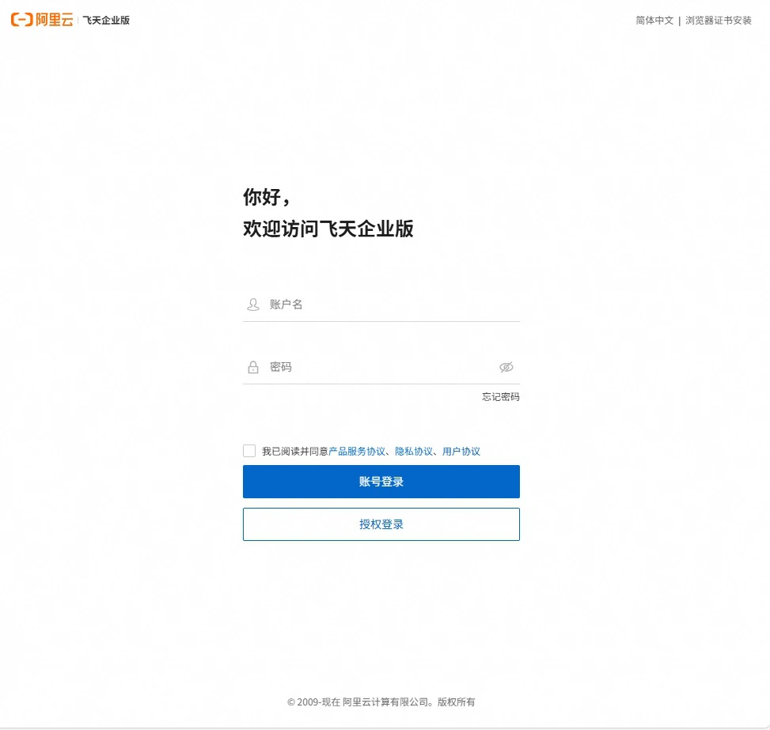
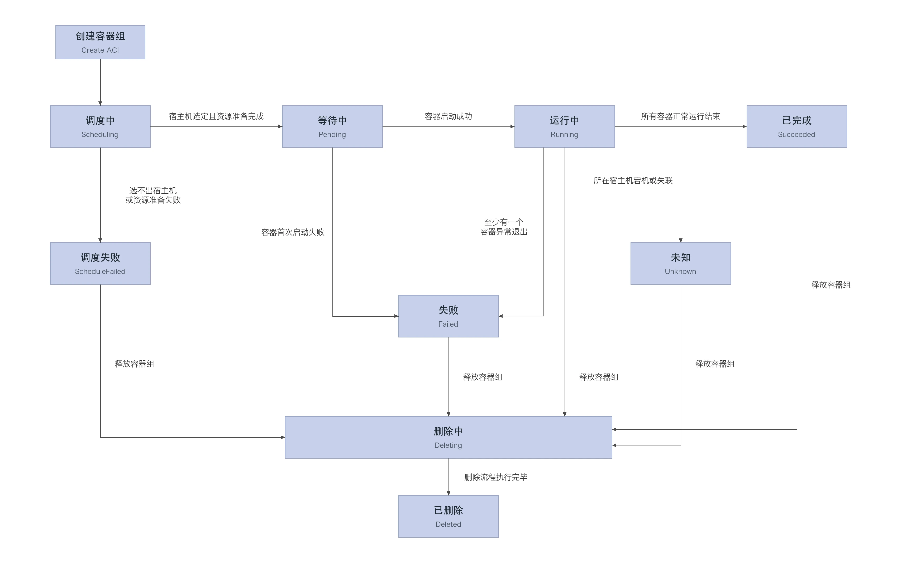

阿里云  
专有云  
云服务器ECS  
ACI用户指南  
产品版本：v3.18.6  
文档版本：20261023

**目录**

- [1.什么是智能体计算实例ACI](#section-1)
- [2.登录智能体计算实例ACI](#section-2)
- [3.概览](#section-3)
- [4.容器组](#section-4)
    - [4.1. 弹性容器组概述](#section-4-1)
    - [4.2. 弹性容器组生命周期](#section-4-2)
    - [4.3. 创建弹性容器组](#section-4-3)
    - [4.4. 查看弹性容器组](#section-4-4)
    - [4.5. 释放弹性容器组](#section-4-5)
- [5.预热池](#section-5)
    - [5.1. 创建预热池](#section-5-1)
    - [5.2. 查看预热池](#section-5-2)
    - [5.3. 修改预热池配置](#section-5-3)
    - [5.4. 删除预热池](#section-5-4)

# 1.什么是智能体计算实例ACI

智能体计算实例ACI（Agent Compute Instance）是面向智能体（Agent）场景的安全沙箱（Sandbox）算力服务，采用轻量虚拟化技术，兼具虚拟机的隔离性和容器的启动速度。您无需管理底层服务器，即可在控制台快速创建、运行和释放弹性容器组。

**产品概述**

智能体通常需要执行大模型生成的、未经信任的代码，且任务多为随起随停的短任务。共享宿主机内核的容器隔离性较弱，不适合运行此类代码；虚拟机的启动耗时和内存开销又难以支撑高并发的短任务。ACI针对这一矛盾提供安全沙箱算力，在隔离性、启动速度和内存开销之间取得平衡。

ACI采用轻量虚拟化技术，并支持快照预热：您可以提前创建预热池，预热池根据网络、规格等配置创建预热实例并保持常备状态，创建弹性容器组时直接命中池内已就绪的实例，从而省去冷启动耗时。

默认情况下，ACI禁止容器组之间互相访问，即使是同一账号下的容器组也默认禁止；同账号的容器组与云虚拟机之间允许通信，便于容器组访问您的数据库等云资源。

# 2.登录智能体计算实例ACI

本章节介绍如何登录智能体计算实例ACI控制台。

**前提条件**

- 登录Apsara Uni-manager运营控制台前，确认您已从部署人员处获取Apsara Uni-manager运营控制台的服务域名地址。

- 推荐使用Chrome浏览器。

**操作步骤**

1. 在浏览器地址栏中，输入Apsara Uni-manager运营控制台的服务域名地址，按回车键。

   

   > **说明**
   >
   > - 单击页面右上角的当前语言可以切换其它语言。
   >
   > - 由于浏览器证书过期或环境开启HTTPS认证等出现多次单击继续访问或无Apsara Uni-manager运营控制台地址入口等现象，此时需要安装证书才能正常访问。单击页面右上角的**浏览器证书安装**，可打开浏览器证书安装指南。**浏览器证书安装**在公网页面不显示。

2. 输入正确的用户名及密码。

   > **说明**
   >
   > - 请向运营管理员获取登录控制台的用户名和密码。
   >
   > - 首次登录Apsara Uni-manager运营控制台时，需要修改登录用户名的密码，请按照提示完成密码修改。为提高安全性，密码长度必须为10~32位，且包含英文字母大小写、阿拉伯数字和特殊符号（感叹号（!）、at（@）、井号（#）、美元符号（$）、百分号（%）等）。

3. 勾选**我已阅读并同意产品服务协议、隐私协议、用户协议**。

   > **说明**
   >
   > - 登录页展示的链接文字为文档标题，单击链接文字，可查看协议的详细内容。
   >
   > - **产品服务协议**、**隐私协议**和**用户协议**仅在已发布时才会显示。如果三种类型协议都没有发布，则不需要执行该操作。

4. 单击**账号登录**/**授权登录**。

   > **说明**
   >
   > “授权登录”仅第三方认证的全局IdP设置启用时才会显示，且该显示名称可自定义，默认显示名称为“授权登录”。

5. 如果账号已激活MFA多因素认证，请根据以下两种情况进行操作：

   > **说明**
   >
   > 公网场景下，登录入口默认强制开启多因素认证。

   - **开启MFA后的首次登录**

     <ol type="a">

     <li>

     输入账号密码登录后，展示绑定虚拟MFA设备页面。

     </li>

     <li>

     在绑定虚拟MFA设备页面中，按页面提示步骤绑定虚拟MFA设备。

     </li>

     </ol>

     <ol type="i" start="100">

     <li>

     登录成功，进入控制台。

     </li>

     </ol>

   - **已开启并绑定MFA**

     输入6位MFA码后单击**认证**。

6. 在页面顶部的导航栏中，选择**产品 > 计算 > 智能体计算实例 ACI**。

# 3.概览

概览页全景总览ACI资源运行信息，展示容器组状态分布与资源用量，并提供创建与运维入口。

**操作步骤**

1. 登录智能体计算实例ACI。

2. 在左侧导航栏中，单击**概览**。

3. 查看**容器组总览**区域的统计信息，包括**容器组总数**、**运行中**、**调度/等待中**、**已完成**、**异常**，以及**vCPU**和**内存已使用量/总量**等。

4. （可选）您可以执行以下操作：

   - 单击**创建弹性容器组**，快速跳转至创建页面。具体操作，请参见创建弹性容器组。

   - 在**最近创建的容器组**列表中，单击**查看全部**跳转至容器组列表页，或单击某一容器组的**容器组ID/名称**查看其详情。

# 4.容器组

## 4.1. 弹性容器组概述

弹性容器组是ACI中的核心资源对象，由一个或多个容器组成，拥有独立的IP地址和生命周期。本文介绍弹性容器组的基本配置、创建方式、生命周期及在控制台中的查看与操作。

**基本配置**

弹性容器组由计算规格、容器与镜像、网络、存储等部分组成。您无需管理和配置底层服务器，只需提供打包好的容器镜像即可运行容器。

- **计算规格**：一个容器组包含CPU和内存规格。创建时可选择基础模式（自行设置CPU和内存）或指定规格（从实例规格列表中选择），并可选择CPU类型（intel、海光）。

- **容器与镜像**：一个容器组由一个或多个容器组成，每个容器需指定容器镜像。镜像需要鉴权拉取时，可配置镜像仓库访问凭证（仓库地址、用户名和密码），并支持按需拉取或总是拉取。

- **网络**：容器组占用所属专有网络（VPC）下虚拟交换机的一个弹性网卡，默认具备一个独立的内网IP地址。创建时需指定专有网络、虚拟交换机和安全组。

- **存储**：容器组具备临时存储空间，并可通过数据卷挂载配置项、临时目录或云盘，供容器使用。

- **重启策略**：支持失败后重启、总是重启、永不重启，用于定义容器退出后的重启行为。

**创建方式**

根据业务场景，弹性容器组支持以下两种资源配置方式。

| 创建方式 | 说明 |
| --- | --- |
| 基础模式（指定CPU和内存） | 自行设置CPU和内存，并可指定CPU类型（intel、海光）。 |
| 指定规格 | 从实例规格列表中选择具体规格，列表展示实例规格、状态（可用/用完）、CPU类型、CPU核数、内存等信息。 |

**生命周期**

弹性容器组创建后会依次经历调度中、等待中、运行中等状态，并在运行结束后进入已完成或失败等终态。您可以根据容器组状态，设计和实现符合您业务逻辑的处理逻辑。各状态的含义及完整转换关系，请参见弹性容器组生命周期。

## 4.2. 弹性容器组生命周期

本文介绍弹性容器组的生命周期状态及各状态之间的转换关系，您可以根据容器组状态，设计和实现符合您业务逻辑的处理逻辑。

**容器组状态**

在容器组的生命周期中，不同的阶段有其固有的状态，具体如下表所示。

| 容器组状态 | 说明 |
| --- | --- |
| 调度中（Scheduling） | 系统正在为容器组选择宿主机，并准备所需的计算、网络资源，此阶段容器组尚未启动。 |
| 等待中（Pending） | 宿主机及资源已就绪，系统正在宿主机上拉起容器运行时并启动容器。 |
| 运行中（Running） | 容器组内所有容器均已创建成功，且至少有一个容器处于运行状态。 |
| 已完成（Succeeded） | 容器组内所有容器均已正常运行结束，且不会再重启。 |
| 调度失败（ScheduleFailed） | 容器组调度或准备资源阶段失败（如可选资源不足导致无法选出宿主机、创建设备失败），底层尚未开始运行容器。 |
| 失败（Failed） | 容器组内所有容器均已终止，且至少有一个容器异常退出（即容器以非0状态退出或被系统终止）；或资源已就绪但容器首次拉起失败。 |
| 未知（Unknown） | 容器组所在宿主机发生宕机或短暂失联，系统暂时无法获取容器组的真实运行状态。 |
| 删除中（Deleting） | 容器组正在删除，底层资源逐步回收。 |
| 已删除（Deleted） | 容器组已完成删除，不再占用资源。 |

容器组的生命周期状态转换如下图所示。

**状态转换**

容器组创建后，依次经历调度中、等待中，进入运行中；运行结束后进入已完成或失败终态；任一非删除状态下发起释放操作，容器组进入删除中，最终变为已删除。具体转换关系如下表所示。

| 起始状态 | 转换条件 | 目标状态 |
| --- | --- | --- |
| — | 创建容器组 | 调度中（Scheduling） |
| 调度中（Scheduling） | 宿主机选定且资源准备完成 | 等待中（Pending） |
| 调度中（Scheduling） | 选不出宿主机或资源准备失败 | 调度失败（ScheduleFailed） |
| 等待中（Pending） | 容器启动成功 | 运行中（Running） |
| 等待中（Pending） | 容器首次启动失败 | 失败（Failed） |
| 运行中（Running） | 所有容器正常运行结束 | 已完成（Succeeded） |
| 运行中（Running） | 至少有一个容器异常退出 | 失败（Failed） |
| 运行中（Running） | 所在宿主机宕机或失联 | 未知（Unknown） |
| 运行中（Running）、已完成（Succeeded）、失败（Failed）、调度失败（ScheduleFailed）、未知（Unknown） | 释放容器组 | 删除中（Deleting） |
| 删除中（Deleting） | 删除流程执行完毕 | 已删除（Deleted） |

容器组处于调度中（Scheduling）、等待中（Pending）时不支持删除操作，需等待状态收敛后再进行释放。

**容器重启说明**

容器组内单个容器的重启由创建容器组时设置的**重启策略**决定，由底层自动处理，不会改变容器组自身的生命周期状态（例如容器重启期间，容器组仍保持**运行中**）。

## 4.3. 创建弹性容器组

本章节介绍如何通过控制台创建弹性容器组，包括基本信息、网络配置、容器组配置和容器配置。

**前提条件**

- 已创建专有网络VPC和交换机，具体操作，请参见<strong>《专有网络VPC 用户指南》</strong>中的<strong>《创建和管理专有网络》</strong>章节。

- 已创建安全组，具体操作，请参见<strong>《云服务器ECS 用户指南》</strong>中的<strong>《创建安全组》</strong>章节。

**操作步骤**

1. 登录智能体计算实例ACI。

2. 在左侧导航栏中，选择**容器组**。

3. 单击**创建弹性容器组**。

4. 在**创建弹性容器组**页面，配置弹性容器组属性。

   **类型**

   **配置项**

   **是否必选**

   **说明**

   是

   弹性容器组所属的组织。

   **组织**

   是

   弹性容器组所属的资源集。

   **资源集**

   **基本信息**

   是

   弹性容器组所属的地域。

   **地域**

   是

   弹性容器组所属的可用区。

   **可用区**

   是

   选择已创建的专有网络。

   **专有网络**

   是

   选择已创建的虚拟交换机。

   **虚拟交换机**

   **网络配置**

   选择已创建安全组。

   是

   **安全组**

   通过配置安全组规则，可以允许或禁止安全组内的容器对公网或私网的访问，以及IP间的访问。

   是

   输入容器组名称。

   **容器组名称**

   选择重启策略。

   - **失败后重启**：仅当容器以非0状态码退出 （即运行失败）时才重启；若容器正常退出（exit 0），则不再重启。适用于批处理任务或可能因临时错误失败但可重试的作业。

   - **总是重启**：无论容器退出状态码为何（成功或失败），均立即重启。适用于长期运行的服务型应用（如 Web 服务器、API 服务），需保证容器持续可用。

   是

   **重启策略**

   > **说明**
   >
   > 即使容器正常退出（exit 0），也会被重启。

   - **永不重启**：无论容器退出原因如何，均不重启。适用于一次性任务（如数据迁移、初始化脚本）；需由上层编排系统（如 Job、CronJob）统一管理重试逻辑的场景。

   是

   支持**基础模式**和**指定规格**。

   **规格类型**

   **CPU类**

   **规格类型**为**基础模式**时，需选择**CPU类型**、**CPU**和**内**

   **型**、**CPU**、**内**

   条件可选

   **存**。

   **存**

   **容器组配置**

   条件可选

   **规格类型**为**指定规格**时，需选择具体的实例规格。

   **实例规格**

   下拉选择一个已创建的预热池。指定后，本次创建的容器组可直接命中池内已就绪的实例，缩短启动耗时。

   - 如本次创建同时在数据卷中配置了云盘，实例将不

   否

   **指定预热池**

   会命中预热池，仍按冷启动流程创建。

   - 如果预热池不支持配置好的规格，同样会降级为冷启动创建。

   关于预热池的说明，请参见创建预热池。

   - **数据卷**：开启后可创建配置项、临时目录与云盘，供容器挂载。

     - **配置项**：即ConfigFile数据卷，是一种用于存储配置文件的数据卷，可以向容器组注入配置数据。单击**添加配置项**，设置**数据卷名称**和**配置文件**。

     - **临时目录**：即EmptyDir数据卷，是一个空的目录，用于临时存放数据，便于容器之间共享数

   否

   **高级配置**

   据。单击**添加临时目录**，设置**名称**和shm大小。

   - **云盘**：云盘是阿里云提供的数据块级别的存储产品，具有低时延、高性能、持久性、高可靠等特点。单击**添加云盘**，设置**名称**、**类型**和**大小**。

   - **临时存储空间（GiB）**：默认大小为 5G，未设置或设置小于 5 的值都会取默认值，最大值与容器组规格有关，最大值=CPU 核数 \* 20。

   - **自动监控指标采集**：默认开启。

   一个弹性容器组内可配置多个容器。默认已有1个容器

   否

   **添加容器**

   （**container-1**），如需新增，单击**添加容器**。

   是

   输入容器名称。

   **容器名称**

   是

   输入容器镜像地址。

   **容器镜像**

   否

   可选**按需拉取**、**总是拉取**。

   **镜像拉取策略**

   **启动命令**、**启**

   设置容器的启动命令，可单击**添加参数**追加多个启动

   否

   参数。

   **动参数**

   **容器配置**

   展开后可配置以下参数：

   - **CPU**、**内存**：设置该容器使用的CPU和内存。

   - **环境变量**：设置**变量名称**和**变量值**，可单击**添加环境变量**追加多条。

   - **存储挂载**：选择在容器组高级配置中创建的**数据卷**作为**挂载源**，设置**容器内挂载路径**及是否**只读**，

   否

   **高级配置**

   可单击**添加挂载点**追加多个挂载点。

   - **健康检查**：开启后，可分别配置**应用存活探针**和**应用业务探针**，二者均需设置**延迟时间**、**超时时间**，检查方式支持**命令行脚本**和**HTTP请求方式**。

   - **生命周期**：开启后，可分别配置**启动后处理**和**停止前处理**的可执行命令。

   当容器镜像需要鉴权拉取时，单击**新增一项**，设置**仓**

   否

   **镜像仓库访问凭证**

   **库地址**、**用户名**和**密码**。

   否

   以键值对形式为容器组添加标签，最多可添加20个。

   **标签**

5. 单击**提交**。

## 4.4. 查看弹性容器组

您可以在容器组详情页查看容器组的基本信息，以及容器、数据卷、事件、日志和监控等信息。本文介绍如何查看ACI容器组的详情信息。

**操作步骤**

1. 登录智能体计算实例ACI。

2. 在左侧导航栏中，选择**容器组**。

3. 单击目标容器组的ID或**操作**列的**详情**，进入容器组详情页。

4. 在容器组详情页，可以查看基本信息、容器、数据卷、事件、日志或监控信息。

   <table>
     <tr>
       <th width="122">操作</th>
       <th>操作步骤</th>
     </tr>
     <tr>
       <td>查看基本信息</td>
       <td>在<strong>基本信息</strong>区域，可以查看容器组的实例信息、配置信息（实例规格、配置、重启策略等）和网络信息（IP 地址、专有网络、安全组等）。</td>
     </tr>
     <tr>
       <td>查看容器</td>
       <td>单击<strong>容器</strong>页签，可以查看容器组中各容器的容器名称、状态、CPU、内存、镜像、启动命令、环境变量和挂载的数据卷等参数。</td>
     </tr>
     <tr>
       <td>查看数据卷</td>
       <td>单击<strong>数据卷</strong>页签，可以查看容器组挂载的数据卷，包括配置项（ConfigFile）、临时目录（EmptyDir）、和云盘。</td>
     </tr>
     <tr>
       <td>查看事件</td>
       <td>单击<strong>事件</strong>页签，可以查看容器组的事件，包括事件类型、事件的归属对象名、事件名和事件消息等。</td>
     </tr>
     <tr>
       <td>查看日志</td>
       <td>单击<strong>日志</strong>页签，选择<strong>容器名称</strong>、<strong>日志行数</strong>和<strong>开始时间</strong>，单击<strong>查询</strong>，即可查看容器运行日志。</td>
     </tr>
     <tr>
       <td>查看监控信息</td>
       <td>单击<strong>监控</strong>页签，可以查看<strong>基础监控</strong>和<strong>容器稳定性监控</strong>信息。</td>
     </tr>
   </table>

## 4.5. 释放弹性容器组

当不再需要某个弹性容器组时，您可以将其释放。释放后，底层资源将被回收且不可恢复。

**操作步骤**

1. 登录智能体计算实例ACI。

2. 在左侧导航栏中，选择**容器组**。

3. 选择以下任一方式释放容器组：

   - **单个释放**：找到目标容器组，在其**操作**列单击**释放**。

     您也可以在容器组详情页，单击顶部的**释放**按钮。

   - **批量释放**：勾选目标容器组前的复选框（页面底部会显示已选择的数量），然后单击底部的**释放**按钮。

4. 在确认对话框中，阅读释放提示，然后单击**释放**。

   > **说明**
   >
   > 释放操作不可恢复，请确认容器组内已无需要保留的业务数据后再执行该操作。如只需取消本次操作，可单击**取消**关闭弹窗。

# 5.预热池

## 5.1. 创建预热池

预热池根据网络、规格等配置创建预热实例并保持常备状态，创建弹性容器组时可以直接命中池内运行中的实例，缩短启动耗时。本章节介绍如何通过控制台创建预热池。

**前提条件**

- 已创建专有网络VPC和交换机，具体操作，请参见<strong>《专有网络VPC 用户指南》</strong>中的<strong>《创建和管理专有网络》</strong>章节。

- 已创建安全组，具体操作，请参见<strong>《云服务器ECS 用户指南》</strong>中的<strong>《创建安全组》</strong>章节。

**操作步骤**

1. 登录智能体计算实例ACI。

2. 在左侧导航栏中，选择**预热池**。

3. 单击**创建预热池**。

4. 在**创建预热池**页面，配置以下参数。

   **类型**

   **配置项**

   **是否必选**

   **说明**

   是

   预热池所属的组织。

   **组织**

   是

   预热池所属的资源集。

   **资源集**

   是

   预热池所属的地域。

   **基本信息**

   **地域**

   是

   预热池所属的可用区。

   **可用区**

   否

   输入预热池名称。

   **预热池名称**

   是

   选择已创建的专有网络。

   **专有网络**

   是

   选择已创建的虚拟交换机。

   **虚拟交换机**

   **网络配置**

   选择已创建安全组。

   是

   **安全组**

   通过配置安全组规则，可以允许或禁止安全组内的容器对公网或私网的访问，以及IP间的访问。

   **CPU（vCPU**

   是

   设置池内实例的CPU。

   **）**

   **规格配置**

   是

   设置池内实例的内存规格。

   **内存（GiB）**

   是

   选择CPU类型。

   **CPU类型**

   是

   池内需要常备的实例数量。

   **目标水位**

   支持选择**持续补水**和**只减不增**。

   - **持续补水**：水位低于目标即拉起新实例。

   **水位配置**

   - **只减不增**：水位不足时不会自动补建新实例，池内

   是

   **补水策略**

   实例仅随命中消耗逐步减少。

   无论选择哪种策略，创建后均由补水任务异步收敛，受限于底层库存与限流配置，水位可能不会立即达到目标值。

   补水时下发给宿主机提前拉取，可减少实例启动耗

   否

   **预拉取镜像**

   时。

   **镜像预拉取**

   当预拉取的镜像需要鉴权时，设置对应的仓库访问凭

   否

   **镜像仓库凭证**

   证（包括仓库地址、用户名和密码）。

5. 单击**提交**。

## 5.2. 查看预热池

您可以在预热池详情页查看预热池的池信息、水位与补水、规格配置、网络配置以及镜像预拉取信息。

**操作步骤**

1. 登录智能体计算实例ACI。

2. 在左侧导航栏中，选择**预热池**。

3. 在预热池列表上方，输入预热池ID进行精确查找。

4. 单击目标预热池ID，进入预热池详情页。页面顶部提供**刷新**和**删除**按钮。下方展示以下信息：

   - **基本信息**

     - **池信息**：包括预热池ID、预热池名称、状态、地域、可用区、创建时间。

     - **水位与补水**：包括目标水位、实时水位、补水策略。

     - **规格配置**：包括CPU、内存、CPU类型、临时存储空间。

     - **网络配置**：包括专有网络、虚拟交换机、安全组。

   - **预拉取镜像**：展示镜像地址。

   - **镜像仓库凭证**：以表格展示**仓库地址**、**用户名**和**密码**，其中密码固定以掩码展示。

## 5.3. 修改预热池配置

您可以在预热池创建后调整其目标水位，池内实例数量将由补水任务异步收敛至新的目标值。

**操作步骤**

1. 登录智能体计算实例ACI。

2. 在左侧导航栏中，选择**预热池**。

3. 单击目标预热池**操作**列的**修改配置**。

4. 在**修改配置**弹窗中，调整**目标水位**的数值，然后单击**确定**。

## 5.4. 删除预热池

当不再需要某个预热池时，您可以将其删除。删除后目标水位归零，池内实例将逐步排空，最终池被移除。

**操作步骤**

1. 登录智能体计算实例ACI。

2. 在左侧导航栏中，选择**预热池**。

3. 单击目标预热池**操作**列的**删除**。

   您在预热池详情页，单击顶部的**删除**按钮。

4. 在**删除预热池**确认弹窗中，阅读删除预热池影响，然后单击**删除**。

   > **说明**
   >
   > 删除后，目标水位将归零，池内实例逐步排空后池被移除，该操作不可恢复。如需取消本次操作，可单击**取消**关闭弹窗。
