阿里云  
专有云  
云服务器ECS  
运维指南  
产品版本：v3.18.6  
文档版本：20261023

**目录**

- [1.登录Apsara Uni-manager运维控制台](#section-1)
- [2.ECS运维管理](#section-2)
    - [2.1. 计算运维概览](#section-2-1)
    - [2.2. 计算集群运维](#section-2-2)
        - [2.2.1. 查看集群列表](#section-2-2-1)
        - [2.2.2. 登录集群AG](#section-2-2-2)
        - [2.2.3. 管理计算集群](#section-2-2-3)
            - [2.2.3.1. 计算集群概览](#section-2-2-3-1)
            - [2.2.3.2. 管理集群配置](#section-2-2-3-2)
                - [2.2.3.2.1. 查看集群配置](#section-2-2-3-2-1)
                - [2.2.3.2.2. CPU超卖比](#section-2-2-3-2-2)
            - [2.2.3.3. 管理计算服务器](#section-2-2-3-3)
                - [2.2.3.3.1. 查看机器信息](#section-2-2-3-3-1)
                - [2.2.3.3.2. 管理机器业务状态](#section-2-2-3-3-2)
    - [2.3. 计算服务器运维](#section-2-3)
        - [2.3.1. 管理计算服务器](#section-2-3-1)
            - [2.3.1.1. 查看机器列表](#section-2-3-1-1)
            - [2.3.1.2. 查看计算服务器运维详情](#section-2-3-1-2)
            - [2.3.1.3. 诊断计算服务器](#section-2-3-1-3)
            - [2.3.1.4. 锁定NC](#section-2-3-1-4)
            - [2.3.1.5. 解锁NC](#section-2-3-1-5)
            - [2.3.1.6. 业务上线](#section-2-3-1-6)
            - [2.3.1.7. 整机迁移](#section-2-3-1-7)
            - [2.3.1.8. 下线维修](#section-2-3-1-8)
            - [2.3.1.9. 查看审计日志](#section-2-3-1-9)
        - [2.3.2. 查看整机迁移任务](#section-2-3-2)
        - [2.3.3. ECS物理机运维](#section-2-3-3)
    - [2.4. 专属资源池运维](#section-2-4)
        - [2.4.1. 创建专属资源池](#section-2-4-1)
        - [2.4.2. 查看专属资源池详情](#section-2-4-2)
        - [2.4.3. 管理专属资源池](#section-2-4-3)
            - [2.4.3.1. 新增服务器](#section-2-4-3-1)
            - [2.4.3.2. 将服务器移出DRP](#section-2-4-3-2)
            - [2.4.3.3. 修改管理员主账号ID](#section-2-4-3-3)
            - [2.4.3.4. 修改故障时物理机补充策略](#section-2-4-3-4)
            - [2.4.3.5. 管理机器业务状态](#section-2-4-3-5)
        - [2.4.4. 删除专属资源池](#section-2-4-4)
    - [2.5. ECS运维](#section-2-5)
        - [2.5.1. ECS实例](#section-2-5-1)
            - [2.5.1.1. 查看ECS实例列表](#section-2-5-1-1)
            - [2.5.1.2. 查看实例详情](#section-2-5-1-2)
            - [2.5.1.3. 管理实例状态](#section-2-5-1-3)
                - [2.5.1.3.1. 启动实例](#section-2-5-1-3-1)
                - [2.5.1.3.2. 停止实例](#section-2-5-1-3-2)
                - [2.5.1.3.3. 重启实例](#section-2-5-1-3-3)
            - [2.5.1.4. 迁移实例](#section-2-5-1-4)
            - [2.5.1.5. 后羿迁移日志](#section-2-5-1-5)
            - [2.5.1.6. ISO管理](#section-2-5-1-6)
            - [2.5.1.7. 修改内网带宽](#section-2-5-1-7)
        - [2.5.2. 云盘](#section-2-5-2)
            - [2.5.2.1. 查看云盘列表](#section-2-5-2-1)
            - [2.5.2.2. 查看云盘详情](#section-2-5-2-2)
            - [2.5.2.3. 查看快照](#section-2-5-2-3)
        - [2.5.3. 镜像](#section-2-5-3)
            - [2.5.3.1. 概述](#section-2-5-3-1)
            - [2.5.3.2. 镜像管理](#section-2-5-3-2)
            - [2.5.3.3. ISO管理](#section-2-5-3-3)
            - [2.5.3.4. 镜像格式转换](#section-2-5-3-4)
            - [2.5.3.5. 灰度下线镜像](#section-2-5-3-5)
        - [2.5.4. 快照](#section-2-5-4)
            - [2.5.4.1. 概述](#section-2-5-4-1)
            - [2.5.4.2. 查看快照](#section-2-5-4-2)
            - [2.5.4.3. 查看审计日志](#section-2-5-4-3)
            - [2.5.4.4. 自动快照策略](#section-2-5-4-4)
        - [2.5.5. 弹性网卡](#section-2-5-5)
            - [2.5.5.1. 查看网卡详情](#section-2-5-5-1)
            - [2.5.5.2. 查看审计日志](#section-2-5-5-2)
        - [2.5.6. 安全组](#section-2-5-6)
            - [2.5.6.1. 概述](#section-2-5-6-1)
            - [2.5.6.2. 查看安全组详情](#section-2-5-6-2)
            - [2.5.6.3. 安全组配置](#section-2-5-6-3)
            - [2.5.6.4. 查看审计日志](#section-2-5-6-4)
        - [2.5.7. 运维设备](#section-2-5-7)
            - [2.5.7.1. USB设备挂载](#section-2-5-7-1)
            - [2.5.7.2. CDROM设备挂载](#section-2-5-7-2)
    - [2.6. 规格容量运维](#section-2-6)
        - [2.6.1. 计算容量分析](#section-2-6-1)
        - [2.6.2. 规格管理](#section-2-6-2)
            - [2.6.2.1. 全部规格](#section-2-6-2-1)
            - [2.6.2.2. 自定义规格](#section-2-6-2-2)
                - [2.6.2.2.1. 添加自定义规格](#section-2-6-2-2-1)
                - [2.6.2.2.2. 查看自定义规格](#section-2-6-2-2-2)
                - [2.6.2.2.3. 禁用自定义规格](#section-2-6-2-2-3)
                - [2.6.2.2.4. 查看审计日志](#section-2-6-2-2-4)
        - [2.6.3. 资源预留](#section-2-6-3)
            - [2.6.3.1. 实例关联预留](#section-2-6-3-1)
            - [2.6.3.2. 物理机预留](#section-2-6-3-2)
    - [2.7. 迁移任务管理](#section-2-7)
        - [2.7.1. 管理迁移任务](#section-2-7-1)
            - [2.7.1.1. 创建单台ECS实例迁移任务](#section-2-7-1-1)
            - [2.7.1.2. 创建整机迁移任务](#section-2-7-1-2)
            - [2.7.1.3. 创建批量迁移ECS实例任务](#section-2-7-1-3)
            - [2.7.1.4. 创建批量整机迁移任务](#section-2-7-1-4)
            - [2.7.1.5. 创建集群迁移任务](#section-2-7-1-5)
            - [2.7.1.6. 低峰期迁移任务](#section-2-7-1-6)
            - [2.7.1.7. 查看迁移任务](#section-2-7-1-7)
            - [2.7.1.8. 终止迁移任务](#section-2-7-1-8)
        - [2.7.2. 配置迁移约束](#section-2-7-2)
        - [2.7.3. 查看CPU兼容性配置](#section-2-7-3)
    - [2.8. ECS智能运维](#section-2-8)
        - [2.8.1. ECS事件](#section-2-8-1)
            - [2.8.1.1. ECS实例事件](#section-2-8-1-1)
            - [2.8.1.2. 物理机事件](#section-2-8-1-2)
        - [2.8.2. ECS运维事件](#section-2-8-2)
            - [2.8.2.1. 物理机运维](#section-2-8-2-1)
            - [2.8.2.2. 实例运维](#section-2-8-2-2)
        - [2.8.3. ECS工作流](#section-2-8-3)
        - [2.8.4. ECS诊断](#section-2-8-4)
    - [2.9. 计算运维配置](#section-2-9)
        - [2.9.1. 监控配置](#section-2-9-1)
        - [2.9.2. 运维动作配置](#section-2-9-2)
            - [2.9.2.1. 为主动运维动作配置流控](#section-2-9-2-1)
            - [2.9.2.2. 为主动运维动作配置审批流程](#section-2-9-2-2)
        - [2.9.3. 调整云盘释放时间](#section-2-9-3)
    - [2.10. 运维审计日志](#section-2-10)
    - [2.11. 天宫运维](#section-2-11)
        - [2.11.1. 天宫云产品](#section-2-11-1)
        - [2.11.2. 天宫工作流](#section-2-11-2)
    - [2.12. ECS运维助手](#section-2-12)
- [3.ECS诊断](#section-3)
    - [3.1. NC运维指南](#section-3-1)
    - [3.2. 实例运维指南](#section-3-2)
    - [3.3. 查看运维事件列表](#section-3-3)
    - [3.4. 配置OpsCode限流规则](#section-3-4)
- [4.云盘热迁移](#section-4)
    - [4.1. 通过CDS Ops工具热迁移云盘](#section-4-1)
    - [4.2. 通过海图控制台自动迁移云盘](#section-4-2)
- [5.巡检](#section-5)
    - [5.1. 概述](#section-5-1)
    - [5.2. 集群基础健康状况巡检](#section-5-2)
        - [5.2.1. 概述](#section-5-2-1)
        - [5.2.2. 监控巡检](#section-5-2-2)
        - [5.2.3. 基础软件包版本巡检](#section-5-2-3)
        - [5.2.4. 基础公共资源巡检](#section-5-2-4)
    - [5.3. 集群资源巡检](#section-5-3)
        - [5.3.1. 概述](#section-5-3-1)
        - [5.3.2. 集群库存巡检](#section-5-3-2)
        - [5.3.3. VM 巡检](#section-5-3-3)
    - [5.4. ECS容灾部署模式下发生机房脑裂问题该如何处理？](#section-5-4)

<a id="section-1"></a>

# 1.登录Apsara Uni-manager运维控制台

本文介绍运维工程师等相关用户如何登录到Apsara Uni-manager运维控制台。

**前提条件**

- 已从部署人员或管理员处获取Apsara Uni-manager运维控制台的访问地址、用户名和密码。

  Apsara Uni-manager运维控制台访问地址格式为*region-id*.ops.console.*intranet-domain-id*。

- 推荐使用Chrome浏览器。

**操作步骤**

1. 打开浏览器。

2. 在地址栏中，输入Apsara Uni-manager运维控制台的访问地址，按回车键。

   

   > **说明**
   >
   > 您可以单击右上角的当前语言切换其它语言。当前支持简体中文、English语言切换。

3. 输入正确的用户名及密码。

   > **说明**
   >
   > - 登录Apsara Uni-manager运维控制台的用户名和密码请从部署人员或管理员处获取。
   >
   > - 若连续输入密码错误三次，系统将启动图片验证码登录功能；若连续输入错误五次，账户将被锁定，请联系管理员进行激活。
   >
   > - 首次登录Apsara Uni-manager运维控制台时，需要修改登录用户名的密码，请按照提示完成密码修改。
   >
   >   为提高安全性，密码必须满足以下要求：
   >
   >   - 必须包含英文大小写字母。
   >
   >   - 必须包含阿拉伯数字（0~9）。
   >
   >   - 必须包含特殊符号，包括感叹号（!）、at（@）、井号（#）、美元符号（$）、百分号（%）等。
   >
   >   - 密码长度为10~20个字符。

4. 单击**同意协议并登录**。

<a id="section-2"></a>

# 2.ECS运维管理

<a id="section-2-1"></a>

## 2.1. 计算运维概览

本文介绍如何查看IaaS运维相关产品的核心指标，及时掌控服务状态，了解产品检测、告警信息、库存使用率、关键指标和管控服务健康状况的概览信息。

**操作步骤**

1. 登录Apsara Uni-manager运维控制台。

2. 在顶部菜单栏，选择**产品运维 > 计算运维 > 计算运维控制台**。

3. 在**迁移数据**区域，查看迁移运维次数，包括**冷迁移**、**热迁移**、**整机迁**移和**集群迁移**。

4. 在**一键搜索**区域的文本框中，输入实例 ID、云盘 ID、镜像 ID（仅支持系统镜像）、弹性网卡 ID、安全组 ID、ECS实例私网 IP、ECS实例弹性公网 IP、物理机 IP 和物理机主机名等实现精确查找，根据搜索结果信息跳转相应页面。

5. 在**高可用监控**区域，查看高可用生效数据，包括**宕机次数/实例宕机迁移次数**、**夯机检测次数**、**物理机预留次数/实例预留次数**等。

6. 在**主动运维Top5**区域，查看主动运维次数排名前五的运维数据。

7. 在**产品检测**区域，查看得分以及处于**正常**、**风险**、**异常**和**建议**状态的检查项数量。

   > **说明**
   >
   > 检测正常项显示为绿色，检测异常项显示为红色，建议优化项显示为蓝色。

   您可以在该区域右上方，单击**立即检测**。在弹出的**产品检查**对话框，查看刷新后仪表盘分数和各检查项的状态以及异常详情。

8. 在**容量分配率**区域，查看目标集群各指标的总量、已使用量和分配率。指标**包含vCPU（核）**、<strong>内存（GiB）</strong>和**EIP（个）**。

   > **说明**
   >
   > 系统默认展示全部集群的指标统计数据。您可以在该区域右上方选择目标集群，系统将展示该目标集群各指标的统计数据。

   各指标说明如下表所示。

   | 指标 | 说明 |
   | --- | --- |
   | vCPU（核） | 虚拟CPU，是虚拟机的部件。 |
   | 内存（GiB） | 售卖内存。 |
   | EIP（个） | 弹性公网IP数量。 |

9. 在**资源数据**区域，查看**集群数**（包括**计算集群数**、**存储集群数**和**混部集群数**）、**计算服务器数**（包括**正常**、**运维锁定**、**业务宕机**和**预留锁定**状态的NC个数）和**ECS数**（包括**运行中**、**已停止**和**待启动**的ECS实例）。

10. 在**管控服务健康状态**区域，查看各产品下对应服务的健康状态。

    - 单击服务名称，在弹出的**部署机器列表**对话框，查看该服务的状态、服务角色、IP（服务所部署物理机IP）、主机名、集群、状态描述和所属产品。

    - 单击**ecs**右侧的**更多**，可以查看管控性能大盘，包括**API请求平均响应时间**、**API请求成功率**、**第三方服务调用平均响应时间**、**第三方服务调用成功率**和**容器资源**。

<a id="section-2-2"></a>

## 2.2. 计算集群运维

<a id="section-2-2-1"></a>

### 2.2.1. 查看集群列表

本文介绍搜索并查看所有计算集群信息的方法，包括查看集群总数、未达终态集群数量、已达终态集群数量、集群名称、集群类型和集群规格类型等。

**操作步骤**

1. 登录Apsara Uni-manager运维控制台。

2. 在顶部菜单栏，选择**产品运维 > 计算运维 > 计算运维控制台**。

3. 在左侧导航栏，单击**计算集群运维**，系统默认显示所有集群详细信息。

4. 在页面右上方，概览集群总数以及所有集群中未达终态和已达终态数量。

   > **说明**
   >
   > **未达终态**集群数量用红色显示。

5. （可选）变更集群列表的展示项和展示项所在列。

   <ol type="i">

   <li>

   在集群列表的右上方，单击  图标。

   </li>

   <li>

   选中或取消集群列表的展示项。

   集群列表的展示项将会实时更新。

   </li>

   </ol>

6. 在页面左上方，输入集群名称，支持模糊搜索查看目标集群列表。

   查看目标集群的**集群名称/别名**、**地域**、**CPU处理器**、**集群类型**、**计算类型**、**是否终态**、**可用区**、**服务器数量**、**规格族**和**集群规格类型**。

   > **说明**
   >
   > - **计算类型**说明如下：
   >
   >   - CPU：表示在KVM架构下为ECS实例提供CPU和内存资源。
   >
   >   - 本地盘：表示在KVM架构下为ECS实例提供本地存储、CPU和内存资源。
   >
   >   - GPU：表示在KVM架构下为ECS实例提供GPU、CPU和内存资源。
   >
   >   - 混部：表示在KVM架构下为ECS实例提供云存储、CPU和内存资源。
   >
   >   - 神龙：表示在神龙架构下为ECS实例提供CPU和内存资源。
   >
   >   - VMOC：表示VMOC架构下为ECS实例提供CPU和内存资源。其中，VMOC架构可以在非神龙物理机上部署神龙架构，为ECS实例提供算力支持。
   >
   > - **集群规格类型**说明如下：
   >
   >   - share,ncTypeHybrid表示共享集群。
   >
   >   - pin,exclusive,ncTypeHybrid表示独享集群。
   >
   >   - bare_metal表示裸金属集群。

   - 查看集群详情。

     在集群列表的**集群名称**列，单击目标集群，进入该集群的**概览**页签。您可以查看集群的基本信息、服务器资源和库存等信息。更多信息，请参见计算集群概览。

   - 查看集群配置和变更记录。

     在集群列表的**集群名称**列，单击目标集群，然后单击**配置**页签。您可以查看集群的配置信息和集群配置的变更记录。更多信息，请参见管理集群配置。

   - 管理计算服务器。

     在集群列表的**集群名称**列，单击目标集群，然后单击**计算服务器**页签。您可以查看集群下计算服务器的基本信息、计算服务器的运维详情或管理计算服务器的业务状态（例如手动锁定NC）。更多信息，请参见管理计算服务器。

   - 登录集群AG（Admin Gateway）进行虚拟机的简单运维。

     具体操作，请参见登录集群AG。

<a id="section-2-2-2"></a>

### 2.2.2. 登录集群AG

登录集群AG（Admin Gateway）是指登录集群运维网关，您可以通过该操作进入Terminal Service页面，对虚拟机进行命令行操作，实现简单运维。本文以在计算集群运维页面操作为例介绍如何登录集群AG。

**操作步骤**

1. 登录Apsara Uni-manager运维控制台。

2. 在顶部菜单栏，选择**产品运维 > 计算运维 > 计算运维控制台**。

3. 在左侧导航栏，选择**计算集群运维**，系统默认显示所有集群详细信息。

   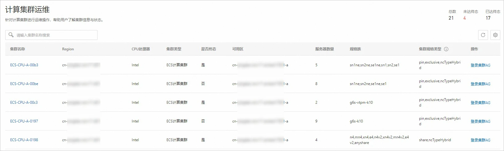

4. 在目标集群对应的**操作**列，单击**登录集群AG**。

5. 在弹出的对话框，阅读**影响**和**恢复方案**，勾选**我已阅读上述提示，并确认操作**，然后单击**确定**，系统将进入Terminal Service页面。

6. 在页面左侧单击***vmXXX***，选择登录的服务器账号，然后在右侧进行命令行操作。

   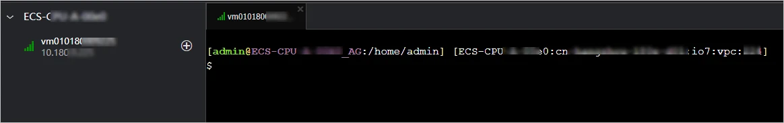

   > **说明**
   >
   > *vmXXX*为虚拟机ID。

<a id="section-2-2-3"></a>

### 2.2.3. 管理计算集群

<a id="section-2-2-3-1"></a>

#### 2.2.3.1. 计算集群概览

您可以在该页面查看集群信息、服务器资源、ECS实例、物理机（NC）状态分布、ECS实例状态分布、库存使用率和该集群下对应售卖规格的库存详情。

**操作步骤**

1. 登录Apsara Uni-manager运维控制台。

2. 在顶部菜单栏，选择**产品运维 > 计算运维 > 计算运维控制台**。

3. 在左侧导航栏，单击**计算集群运维**。

4. 在目标集群的**集群名称**列，单击集群名称。

   系统默认进入**计算集群运维详情**页面中的**概览**页签。

   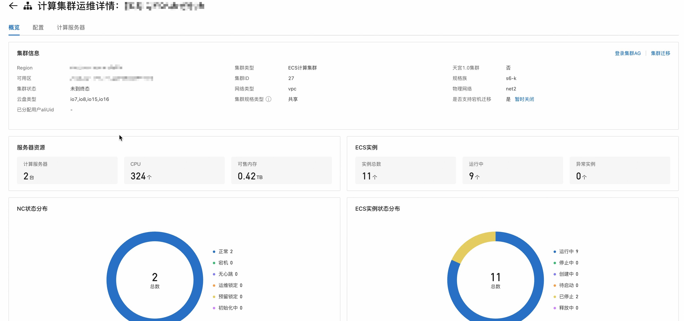

   > **说明**
   >
   > **云盘类型**：
   >
   > - IO7：SSD盘
   >
   > - IO8：高效云盘
   >
   > - IO9：本地盘（SSD）
   >
   > - IO11：本地盘（HDD）
   >
   > - IO15：高性能云盘
   >
   > - IO16：普通性能云盘

5. 查看该集群下计算服务器和ECS实例的详情。

   - 在**集群信息**区域，查看该集群的详细信息。其中包括集群所在Region（地域）、集群类型、是否为天宫集群、可用区和网络类型等信息。

     你可以在该区域的右上方，单击**登录集群AG**，登录集群运维网关，实现简单运维。具体操作，请参见登录集群AG。

     你可以在该区域配置集群**是否支持宕机迁移**选项，默认为是。若选择**暂时关闭**，则在倒计时时间内禁止宕机迁移，倒计时结束后将重新开启集群宕机迁移功能

   - 在**服务器资源**区域，查看该集群计算服务器台数、CPU个数、可售内存。

   - 在**ECS实例**区域，查看ECS实例总数、运行中实例和异常实例。

   - 在**NC状态分布**区域，查看物理机处于各种状态的统计数据。

     > **说明**
     >
     > 将鼠标悬停在分布图上，系统会显示对应状态及该状态下NC数量。

     物理机状态参数说明如下表所示。

     <table>
       <tr>
         <th width="89">参数</th>
         <th>说明</th>
       </tr>
       <tr>
         <td>宕机</td>
         <td>物理机宕机。</td>
       </tr>
       <tr>
         <td>正常</td>
         <td>物理机服务正常，表示可调度实例到此机器。</td>
       </tr>
       <tr>
         <td>无心跳</td>
         <td>物理机心跳丢失。</td>
       </tr>
       <tr>
         <td>运维锁定</td>
         <td>物理机运维锁定状态。</td>
       </tr>
       <tr>
         <td>预留锁定</td>
         <td>强制预留，该物理机可以供recover vm或modify vm使用，物理机资源缺少时要做碎片整理，否则会报警。因此需要保证心跳，随时可用。</td>
       </tr>
       <tr>
         <td>初始化中</td>
         <td>管控初始化物理机数据中。</td>
       </tr>
     </table>

   - 在**ECS实例状态分布**区域，查看ECS实例的状态分布图。

     ECS实例状态参数说明如下表所示。

     | 参数 | 说明 |
     | --- | --- |
     | 运行中 | 稳定状态，实例正常运行状态。 |
     | 已停止 | 稳定状态，实例已经创建完成等待启动，或者实例被正常停止，实例都会处于已停止状态。处于该状态下的实例不能对外提供业务。 |
     | 待启动 | 中间状态，实例创建后，在进入运行中之前的状态。如果长时间处于该状态，说明出现异常。 |
     | 创建中 | 中间状态，在控制台上或通过API接口执行重启、启动等操作后，实例进入运行中之前的状态。如果长时间处于该状态，说明出现异常。 |
     | 停止中 | 中间状态，在控制台上或通过API接口执行停止操作后，实例进入已停止之前的状态。如果长时间处于该状态，说明出现异常。 |
     | 释放中 | 中间状态，实例处于释放中，释放后实例进入已释放的状态。 |

   - 在**库存使用率**区域，查看各指标的总量、已用量和使用量占比。

   - 在**库存**区域，查看该集群下实例规格的库存详情，库存包括公共资源和专属资源。

     - 全部资源：包含公共资源和专属资源。

     - 公共资源：所有用户可以使用的资源。

     - drp-xxxx：专属资源，只有拥有该专属资源池权限的用户可以使用。

<a id="section-2-2-3-2"></a>

#### 2.2.3.2. 管理集群配置

<a id="section-2-2-3-2-1"></a>

##### 2.2.3.2.1. 查看集群配置

本文介绍如何查看集群配置信息，包括集群配置项的值和最后修改时间。

**操作步骤**

1. 登录Apsara Uni-manager运维控制台。

2. 在顶部菜单栏，选择**产品运维 > 计算运维 > 计算运维控制台**。

3. 在左侧导航栏，单击**计算集群运维**。

4. 在目标集群的**集群名称**列，单击集群名称。

   系统默认进入**计算集群运维详情**页面中的**概览**页签。

5. 在页面左上方，单击**配置**页签。

   系统默认进入**集群配置管理**页签。

6. 支持**配置CPU超卖比**以及查**看配置CPU超卖比记录**。

<a id="section-2-2-3-2-2"></a>

##### 2.2.3.2.2. CPU超卖比

本文介绍了如何以集群的维度修改CPU超卖比，根据实际需求动态调整集群中可售卖的CPU数量。

**配置CPU超卖比**

**使用限制**

- 仅支持在集群维度上调整CPU的超卖比。该功能仅适用于部分共享型实例，并要求集群的所有规格族皆属于以下支持范围内：

  - Intel实例：ecs.s5-k, ecs.s6-k, ecs.s7-k, ecs.s8-k

  - Hygon实例：ecs.s5-hg-k, ecs.s6-hg-k, ecs.s7-hg-k

  - Yitian实例：ecs.s8-yt-k

  - Kunpeng实例：ecs.s5-kp-k

  - Feiteng实例：ecs.s5-ft-k, ecs.s6-ft-k

  - Sunway实例：ecs.s6-sw-k

  - 自定义实例：ecs.anyshare（若某集群售卖仅有anyshare，则不支持。）

- 状态为**offline**的服务器不支持调整CPU超卖比。

- 在扩缩容中的集群不支持调整CPU超卖比。

- 集群所有服务器中至少有一台状态为**正常（free）**，则支持调整CPU超卖比。

- 单个集群3小时内只允许修改一次。

**注意事项**

- 发起CPU超卖比变更前会检测集群中所有服务器当前的超卖比是否一致<strong>，</strong>如果不一致则不允许变更。

- 发起CPU超卖比变更时会先进行预检任务，如果预检任务失败则不会发起超卖比变更任务。请根据预检任务中提示的失败信息处理后再次发起变更。同一个集群3小时内只允许调整一次CPU超卖比，预检任务没有该限制。

- 专有宿主机（Dedicated Host，DDH）不受集群超卖比调整影响，具体规则如下：

  - 集群调整超卖比后，DDH的vCPU值不变。

  - 当DDH被释放后，可售卖的vCPU值将会按照集群最新配置的超卖比计算。

- 下调集群CPU超卖比时，会检测**集群当前已售卖vCPU**是否大于（**集群调整后可售卖vCPU**\*80%）的数据；如果大于则不允许调整。

- 调整超卖比较大时，可能会导致性能下降，包括响应时间增加、资源争用加剧和主机稳定性问题，请谨慎调整。

- 调整超卖比后，可以在**配置CPU超卖比记录**中查询变更的详情，变更时间较长且不允许终止、取消、回滚。

- 不保证所有服务器变更成功，变更失败的服务器请联系运维人员按照EOCC修改。

- 调整超卖比后，不会影响专属资源池内的物理机，当物理机从专属资源池释放后，其超卖比将配置为集群最新的超卖比。

**操作步骤**

1. 登录Apsara Uni-manager运维控制台。

2. 在顶部菜单栏，选择**产品运维** > **计算运维** > **计算运维控制台**。

3. 在左侧导航栏，选择**计算集群运维**。

4. 单击目标集群名称，进入**计算集群运维详情**页面。

5. 切换至**配置**页签。

6. 在**配置CPU超卖比**页签下，支持CPU超卖比调整，输入**操作原因**后，勾选**我已阅读上述提示，并确认操作**，然后单击**提交**。

   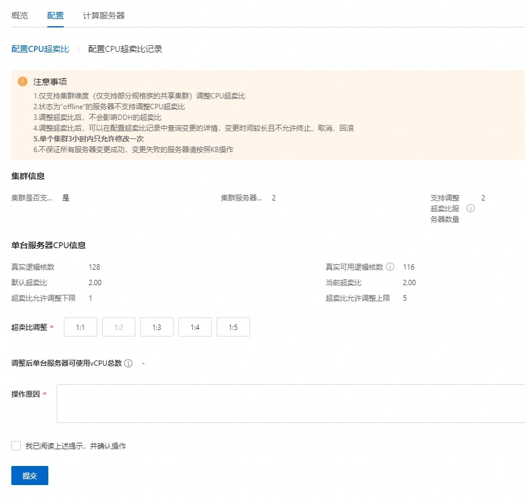

7. 在**配置CPU超卖比记录**页签下，支持查看配置CPU超卖比的记录。

   可以根据**任务类型**过滤目标记录，获取**任务ID**、**集群名**、**任务状态**、**任务类型**、**变更前单台服务器vCPU**、**变更后单台服务器vCPU**、**任务开始时间**、**任务结束时间**以及**结果**。

**重试CPU超卖比任务**

**使用限制**

仅以下CPU超卖比任务支持重试：

- 该任务为最新的CPU超卖比任务，历史任务不支持重试。

- CPU超卖比**任务状态**为**任务部分成功**。

**操作步骤**

1. 在**配置CPU超卖比记录**页签下，找到**任务状态**为**任务部分成功**的CPU超卖比任务。

2. 单击任务**操作**列下的**重试**。

**常见异常问题**

**部分服务器剩余vCPU为负数**

当下调集群CPU超卖比时，只会检测整个集群已售卖vCPU是否超过限制，不会检测单台服务器，可能出现部分服务器vCPU为负数的情况。此时可以通过热/冷迁移的方式将部分ecs迁移至其他的服务器。

<a id="section-2-2-3-3"></a>

#### 2.2.3.3. 管理计算服务器

<a id="section-2-2-3-3-1"></a>

##### 2.2.3.3.1. 查看机器信息

本文介绍如何查看目标集群下计算服务器的基本信息、计算服务器的运维详情和计算服务器上所部署的ECS实例相关信息。

**操作步骤**

1. 登录Apsara Uni-manager运维控制台。

2. 在顶部菜单栏，选择**产品运维 > 计算运维 > 计算运维控制台**。

3. 在左侧导航栏，单击**计算集群运维**。

4. 在目标集群的**集群名称**列，单击集群名称。

   系统默认进入**计算集群运维详情**页面中的**概览**页签。

5. 在页面左上方，单击**计算服务器**页签。

6. 查看计算服务器列表。

   <ol type="i">

   <li>

   <strong>可选：</strong>变更计算服务器列表的展示项。

   <ol type="a">

   <li>

   在页面右上方，单击  图标。

   </li>

   <li>

   在弹出的**自定义列表项显示**对话框，选中集群列表的展示项。

   </li>

   </ol>

   <ol type="i" start="100">

   <li>

   选中完成后，单击**确认**。

   </li>

   </ol>

   </li>

   <li>

   查看集群下计算服务器的主机名/别名、**NC IP/ID**、**专属资源池**、**CPU(核)/内存**、**机型**、**业务状态**、**ECS数量**、**是否是DDH**、**SN**、**机房/机柜**等。

   具体业务状态的参数说明，请参见计算集群概览。

   </li>

   </ol>

7. 查看计算服务器运维详情和机器上所部署的实例详情。

   - 查看计算服务器运维详情。

     <ol type="a">

     <li>

     单击目标**主机名/别名**。

     </li>

     <li>

     查看**计算服务器运维详情**。

     具体操作，请参见查看计算服务器运维详情。

     </li>

     </ol>

   - 查看ECS实例详情。

     <ol type="a">

     <li>

     在**ECS数量**列，单击对应数量。

     </li>

     <li>

     在弹出的**实例列表**面板，查看实例ID、状态、实例名称、CPU数量和占用内存。

     </li>

     </ol>

     <ol type="i" start="100">

     <li>

     查看实例详情：单击**实例ID**，系统进入**实例详情**页面，在该页面查看实例的基本信息和配置信息等。

     具体操作，请参见查看实例详情。

     </li>

     </ol>

<a id="section-2-2-3-3-2"></a>

##### 2.2.3.3.2. 管理机器业务状态

本文介绍如何管理目标集群下计算服务器的业务状态，包括手动锁定NC、解锁NC和业务上线操作。

**操作步骤**

1. 登录Apsara Uni-manager运维控制台。

2. 在顶部菜单栏，选择**产品运维 > 计算运维 > 计算运维控制台**。

3. 在左侧导航栏，单击**计算集群运维**。

4. 在目标集群的**集群名称**列，单击集群名称。系统默认进入**计算集群运维详情**页面中的**概览**页签。

5. 在页面左上方，单击**计算服务器**页签。

6. 在该页面下管理机器业务状态，具体操作如下表所示。

   | 操作项 | 操作场景 | 操作步骤 |
   | --- | --- | --- |
   | 锁定NC | • 如果该NC异常，不希望新建的实例分配到此NC，可进行手动锁定NC。该状态无法自动改变。<br>• 如果想要做资源预留，可进行手动锁定NC。 | i. 在物理服务器列表<strong>操作</strong>列，单击<strong>锁定</strong><strong>NC</strong>。ii. 在弹出<strong>锁定NC</strong>对话框，选择锁定状态，在对应的文本框，输入变更人、变更工单标题、锁定原因。iii. 配置完成后，单击<strong>确定</strong>。 |
   | 解锁NC | 解锁NC可以对无心跳、运维锁定、预留锁定状态的机器进行操作，使其可以被正常调度，解锁NC后机器会自动业务上线。 | i. 在物理服务器列表<strong>操作</strong>列，单击<strong>解锁</strong><strong>NC</strong>。ii. 在弹出<strong>解锁NC</strong>对话框，输入解锁原因。iii. 配置完成后，单击<strong>确定</strong>。 |
   | 业务上线 | 业务上线可以对无心跳、运维锁定、预留锁定、宕机和初始化中的机器进行操作，使其业务上线。 | i. 在物理服务器列表<strong>操作</strong>列，单击<strong>业务</strong><strong>上线</strong>。ii. 在弹出对话框的<strong>操作原因</strong>文本框，输入操作原因。iii. 配置完成后，单击<strong>确定</strong>。 |

<a id="section-2-3"></a>

## 2.3. 计算服务器运维

<a id="section-2-3-1"></a>

### 2.3.1. 管理计算服务器

<a id="section-2-3-1-1"></a>

#### 2.3.1.1. 查看机器列表

本文介绍如何查看目标机器的具体信息，包括主机名、IP地址、机型、CPU（核）、内存、CPU处理器、计算类型、是否是DDH、业务状态和所在集群等信息。

**操作步骤**

1. 登录Apsara Uni-manager运维控制台。

2. 在顶部菜单栏，选择**产品运维 > 计算运维 > 计算运维控制台**。

3. 在左侧导航栏，单击**计算服务器运维**。

   系统默认进入**机器列表**页签，并显示所有计算服务器的详细信息。

4. 在页面右上方，概览计算服务器总数和处于**free**、**mlock**和**nc_down**状态的计算服务器数量。

5. （可选）变更计算服务器列表的展示项。

   <ol type="i">

   <li>

   在页面右上方，单击  图标。

   </li>

   <li>

   在**自定义列表项显示**对话框，选中集群列表的展示项。

   </li>

   <li>

   选择完成后，单击**确定**。

   </li>

   </ol>

6. 在页面左上方，输入IP地址、主机名和SN（Serial Number），然后单击  图标，可以实现精确查

   找。

   您也可以单击**高级筛选**，在对应文本框输入机型、机房和机柜信息，然后单击**搜索**。

7. 在机器列表中查看**主机名/别名**、**NC IP/ID**、**CPU(核)/内存**、**集群/机型**、**专属资源池ID**、**业务状态**、**CPU处理器**、**计算类型**、**是否是ddh**、**SN**、**机房/机柜**等。

   > **说明**
   >
   > - **计算类型**说明如下：
   >
   >   - CPU：表示在KVM架构下为ECS实例提供CPU和内存资源。
   >
   >   - 本地盘：表示在KVM架构下为ECS实例提供本地存储、CPU和内存资源。
   >
   >   - GPU：表示在KVM架构下为ECS实例提供GPU、CPU和内存资源。
   >
   >   - 混部：表示在KVM架构下为ECS实例提供云存储、CPU和内存资源。
   >
   >   - 神龙：表示在神龙架构下为ECS实例提供CPU和内存资源。
   >
   >   - VMOC：表示VMOC架构下为ECS实例提供CPU和内存资源。其中，VMOC架构可以在非神龙物理机上部署神龙架构，为ECS实例提供算力支持。
   >
   > - **集群规格类型**说明如下：
   >
   >   - share,ncTypeHybrid表示共享集群。
   >
   >   - pin,exclusive,ncTypeHybrid表示独享集群。
   >
   >   - bare_metal表示裸金属集群。

   更多计算服务器业务状态参数信息，请参见计算集群概览。

8. 查看计算服务器的运维详情。

   <ol type="i">

   <li>

   在机器列表的**主机名/别名**列，单击目标计算服务器的主机名。

   </li>

   <li>

   在**计算服务器运维详情**页面，查看相关信息。

   更多信息，请参见查看计算服务器运维详情。

   </li>

   </ol>

<a id="section-2-3-1-2"></a>

#### 2.3.1.2. 查看计算服务器运维详情

本文介绍如何查看计算服务器的业务信息、硬件信息、资源信息、所部署的ECS实例列表、性能监控信息、管控服务状态、整机迁移任务列表和操作审计，同时您还可以在不同的页签进行相应操作。

**操作步骤**

1. 登录Apsara Uni-manager运维控制台。

2. 在顶部菜单栏，选择**产品运维 > 计算运维 > 计算运维控制台**。

3. 在左侧导航栏，单击**计算服务器运维**。

   系统默认进入**机器列表**页签，并显示所有计算服务器的详细信息。

4. 在机器列表**主机名/别名**列，单击目标主机名。

5. 查看目标计算服务器运维详情。

   具体查看项及相应操作如下表所示。

   <table>
     <tr>
       <th width="121">区域或页签</th>
       <th>说明</th>
     </tr>
     <tr>
       <td>业务信息</td>
       <td>查看业务ID、IP、主机名、业务状态、管控心跳、售卖形态、集群、售卖规格族、操作系统模板、计算类型、是否是DDH、是否支持宕机迁移和专属资源池ID等信息。<br>说明<strong>计算类型</strong>说明如下：<br>• CPU：表示在KVM架构下为ECS实例提供CPU和内存资源。<br>• 本地盘：表示在KVM架构下为ECS实例提供本地存储、CPU和内存资源。<br>• GPU：表示在KVM架构下为ECS实例提供GPU、CPU和内存资源。<br>• 混部：表示在KVM架构下为ECS实例提供云存储、CPU和内存资源。<br>• 神龙：表示在神龙架构下为ECS实例提供CPU和内存资源。<br>• VMOC：表示VMOC架构下为ECS实例提供CPU和内存资源。其中，VMOC架构可以在非神龙物理机上部署神龙架构，为ECS实例提供算力支持。<br>查看服务器所在的计算集群信息：单击目标集群名称，进入<strong>计算集群运维详情</strong>页面。更多信息，请参见计算集群概览。</td>
     </tr>
     <tr>
       <td>硬件信息</td>
       <td>查看计算服务器的SN、机型、机柜、CPU型号、GPU、CPU（核）和内存。</td>
     </tr>
     <tr>
       <td>资源信息</td>
       <td>查看CPU（核）、内存（GiB）的使用情况。</td>
     </tr>
     <tr>
       <td>ECS实例</td>
       <td>• 查看实例详情：包括实例的CPU/内存、状态、专属资源池ID、私网IP/公网IP、带宽、用户信息、镜像、实例创建时间和是否为天宫资源等。<br>• 管理实例：包括进行实例迁移、查看迁移历史、查看操作审计、变更实例状态、ISO管理和修改内网带宽。具体操作，请参见ECS实例。</td>
     </tr>
     <tr>
       <td>性能监控</td>
       <td>查看各性能指标趋势图：选择起始时间和终止时间，查看各指标的趋势图，指标包括CPU（%）、内存（%）、系统负载、网络重传（%）和网络流量（MB）。</td>
     </tr>
     <tr>
       <td>管控服务</td>
       <td>• 搜索并查看服务角色状态。<br>• 飞天基础运维平台运维：在目标服务角色的<strong>操作</strong>列，单击<strong>Tianji运维</strong>，系统将进入飞天基础运维平台运维的<strong>产品集群运维</strong>页面。更多信息，请参见专有云文档中心<em>《</em><em>飞天基础运维平台运维指南》</em>文档的<strong>产品集群运维</strong>章节。</td>
     </tr>
     <tr>
       <td>整机迁移任务</td>
       <td>• 查看整机迁移任务列表：包括任务ID、实例数量、目标物理机、任务状态、迁移进度、开始时间、更新时间和发起人。<br>• 查看整机迁移详情：在列表任务ID列，单击目标ID，在弹出的<strong>整机迁移实例详情</strong>面板，查看迁移状态、目标物理机、迁移类型和重试次数。<br>说明<br>• 冷迁移：实例状态为待启动的实例迁移。<br>• 热迁移：实例状态为运行中的实例迁移。<br>• 取消任务：如果您想取消任务，只需在<strong>操作</strong>列，单击<strong>终止任务</strong>。在弹出的对话框中，单击<strong>确定</strong>。更多信息，请参见终止迁移任务。</td>
     </tr>
     <tr>
       <td>操作审计</td>
       <td>目标计算服务器运维过程中，涉及风险的操作都会进行操作审计。您可以查看操作历史、POP API调用历史和后羿API调用历史。更多信息，请参见运维审计日志。</td>
     </tr>
   </table>

<a id="section-2-3-1-3"></a>

#### 2.3.1.3. 诊断计算服务器

本文介绍如何诊断计算服务器，查看诊断结果。

**操作步骤**

1. 登录Apsara Uni-manager运维控制台。

2. 在顶部菜单栏，选择**产品运维 > 计算运维 > 计算运维控制台**。

3. 在左侧导航栏，单击**计算服务器运维**。

   系统默认进入**机器列表**页签，并显示所有计算服务器的详细信息。

4. 单击目标机器的**主机名/别名**。

5. 在**计算服务器运维详情**界面右上角，单击**诊断**，系统进入**全链路定界**页面，并且**机器ID**中默认输入宿主机的NC IP。

6. 在查询结果中查看实例或宿主机的诊断信息。

   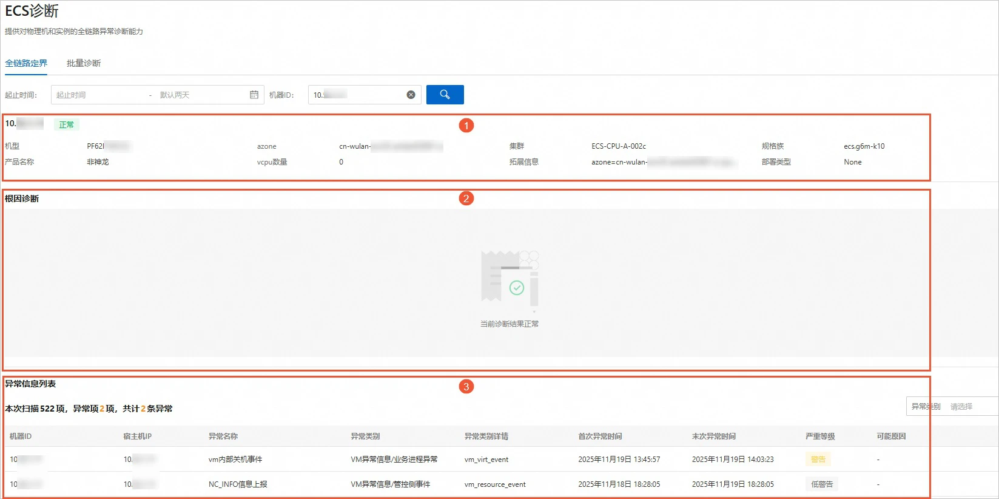

   | 区域 | 区域属性 | 说明 |
   | --- | --- | --- |
   | ① | 基本信息 | 显示机型、集群和规格族等信息。 |
   | ② | 根因诊断结果 | 显示诊断的问题类型和诊断信息。问题类型包括以下几种：<br>• <strong>控制面问题</strong>：指影响用户启动实例、停止实例、迁移实例、创建快照等操作的根因诊断。<br>• <strong>NC问题</strong>：指影响宿主机可用性的根因诊断，例如服务故障等。<br>• <strong>NC性能</strong>：指可能影响宿主机性能的根因诊断，例如L3 cache miss、内存带宽争抢、tdc retry变高等。<br>• <strong>VM可用性</strong>：指影响用户的ECS实例可用性的根因诊断，例如磁盘读写故障，服务故障等。<br>• <strong>VM性能</strong>：指ECS实例性能的根因诊断，例如限速丢包、安全组丢包等。诊断信息中包括所属宿主机、异常信息、异常原因等信息。您可以单击相应链接，查看具体信息。 |
   | ③ | 异常列表 | 查询与诊断机器相关的所有异常列表信息。 |

<a id="section-2-3-1-4"></a>

#### 2.3.1.4. 锁定NC

您可以根据不同的业务场景锁定NC，使NC无法创建新的实例。

**背景信息**

锁定NC主要应用于以下场景中：

- 运维锁定：锁定后该机器上的ECS实例发生重启会被调度到其他NC上，标记为宕机不迁移的ECS除外。

- 资源预留锁定：当正常NC无法满足宕机迁移所需资源时，资源预留锁定的NC会被用来做宕机恢复的NC。

**操作步骤**

1. 登录Apsara Uni-manager运维控制台。

2. 在顶部菜单栏，选择**产品运维 > 计算运维 > 计算运维控制台**。

3. 在左侧导航栏，单击**计算服务器运维**。

   系统默认进入**机器列表**页签，并显示所有计算服务器的详细信息。

4. 在目标机器的**操作**列，单击**锁定**。

5. 在弹出的**锁定NC**对话框，确认**操作机器**，选择**锁定状态**，填写**变更人**、**变更工单标题**以及**锁定原因**。

   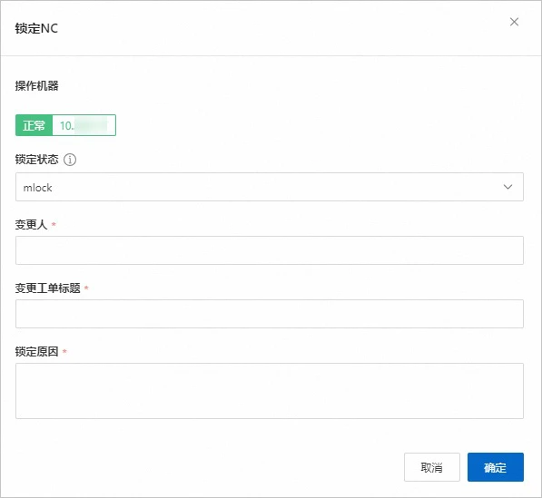

6. 配置完成后，单击**确定**。

<a id="section-2-3-1-5"></a>

#### 2.3.1.5. 解锁NC

您可以解锁NC，使其可以被正常调度，解锁NC后机器会自动业务上线。

**背景信息**

解锁NC可以对业务状态为无心跳、运维锁定、预留锁定状态的机器进行操作。

**操作步骤**

1. 登录Apsara Uni-manager运维控制台。

2. 在顶部菜单栏，选择**产品运维 > 计算运维 > 计算运维控制台**。

3. 在左侧导航栏，单击**计算服务器运维**。

   系统默认进入**机器列表**页签，并显示所有计算服务器的详细信息。

4. 在目标机器的**操作**列，将鼠标悬停于

   图标，单击**解锁**。

   

5. 在弹出的**解锁NC**对话框，确认**操作机器**并在**操作原因**文本框输入原因。

   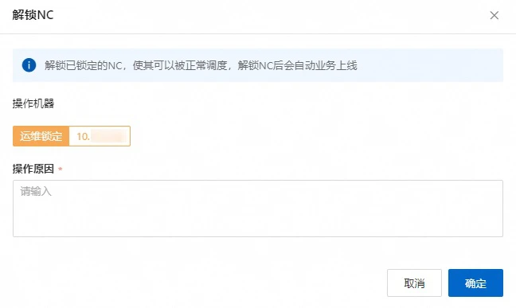

6. 配置完成后，单击**确定**。

<a id="section-2-3-1-6"></a>

#### 2.3.1.6. 业务上线

本文介绍如何手动使机器业务上线。

**前提条件**

计算服务器状态必须为**运维锁定**状态。

**背景信息**

业务上线可以对无心跳、运维锁定、预留锁定、宕机和初始化中的机器进行操作，使其业务上线。

**操作步骤**

1. 登录Apsara Uni-manager运维控制台。

2. 在顶部菜单栏，选择**产品运维 > 计算运维 > 计算运维控制台**。

3. 在左侧导航栏，单击**计算服务器运维**。

   系统默认进入**机器列表**页签，并显示所有计算服务器的详细信息。

4. 在目标计算服务器对应的**操作**列，将鼠标悬停于  图标，单击**上线**。

5. 在弹出的对话框，确认**主机名**并在**操作原因**文本框输入原因。

6. 配置完成后，单击**确定**。

<a id="section-2-3-1-7"></a>

#### 2.3.1.7. 整机迁移

本文介绍如何将计算服务器上的所有ECS实例迁移到其他计算服务器上。

**前提条件**

服务器状态必须为**正常**（ `free` ）或**运维锁定**（ `mlock` ）。

**使用场景**

在计算服务器缩容、服务器维修等场景下，您需要将该服务器上所有的ECS实例迁出，然后才可以对服务器进行操作。此时，可以使用整机迁移，将所有的ECS实例迁移到其他计算服务器上。

**注意事项**

使用整机迁移时，请先了解以下事项：

- 提交迁移任务之后服务器将进入运维锁定状态，任务完成、失败或取消之后需要手动提交解锁。

- 整机迁移任务会根据ECS调度规则，尽量将服务器上的ECS迁到其他服务器，迁移结果受多方因素影响，不保证一次整机迁移任务一定成功。

- **停止**或**待启动**状态的ECS如果被迁移，将会保持ECS的原有状态。

- 整机迁移结束或成功后，必须再次检查服务器上是否有ECS残留。

- 专属资源池实例只允许在专属资源池内迁移。

**操作步骤**

> **说明**
>
> 您也可以在**迁移任务管理 > 任务列表 > 整机迁移任务**页面，创建整机迁移任务。具体操作，请参见创建整机迁移任务。

1. 登录Apsara Uni-manager运维控制台。

2. 在顶部菜单栏，选择**产品运维 > 计算运维 > 计算运维控制台**。

3. 在左侧导航栏，单击**计算服务器运维**。

   系统默认进入**机器列表**页签，并显示所有计算服务器的详细信息。

4. 在目标服务器的**操作**列，选择

   **> 整机迁移**。

   

   您也可以通过如下任意一种方式创建整机迁移任务：

   - 选中目标服务器，单击服务器列表下方的**整机迁移**。

   - 单击目标服务器的主机名，然后在**计算服务器运维详情**页面的右上角单击**整机迁移**。

5. 在**创建整机迁移任务**页面，配置参数项。

   **配置区域**

   **参数项**

   **说明**

   选择待进行整机迁移的服务器。在NC列表上方的搜索框中输入主机名、NC IP或NC ID，搜索服务器并选中作为源物理机。

   **迁移源NC**

   **选择机器**

   > **重要**
   >
   > 仅支持选择1台服务器。

   开启灰度迁移，会按照灰度策略先迁移一批实例，然后停止任务，需要用户主动恢复任务后才能继续迁移，修

   **开启灰度迁移**

   改灰度迁移策略请参见配置迁移约束。

   启用该模式会在普通迁移的基础上，支持将ECS实例迁移到可用的跨代CPU型号的物理机上。CPU型号的兼容

   **增强热迁移兼容性**

   性信息，请参见查看CPU兼容性配置。

   - **随机选择**：默认目标物理机选择方式。实例会随机迁移至资源充足的机器上。

   - **指定NC**：手动指定实例迁移的机器，存在迁移失败的风险。在NC列表上方先根据集群、主机名、NC IP

   **迁移目标配置**

   或NC ID搜索目标机器，然后选中1台作为目标物理机。

   > **说明**
   >
   > 系统会对每1台物理机是否适合选择给出建议以供参考，但不影响目标物理机的选中，即您也可以根据实际情况，选中**不建议**的NC。

   **目标选择策略**

   - **指定集群**：手动指定实例迁移的集群，存在迁移失败的风险。在集群列表上方先根据集群名称搜索目标集群，然后选中1个作为目标集群。

     > **说明**
     >
     > 系统会对每1个集群是否适合选择给出建议以供参考，但不影响目标集群的选中，即您也可以根据实际情况，选中**不建议**的集群。

   热迁移最后阶段的业务中断时间。单位：ms。

   - 取值范围：200~2000。

   **允许业务中断时间**

   - 默认值：300。

   - 取值范围：

     - **是**：检查待迁移实例是否挂载SLB，如果已挂载，迁移任务可能会失败。

   **检查SLB**

   - **否**：不检查SLB，直接略过该检查进行迁移

   - 默认值：**否**。

   - 取值范围：

     - **是**：检查源宿主机与目标宿主机的AVS版本是否一致。如果不一致，迁移任务会失败。

   **检查AVS版本**

   - **否**：不检查AVS版本，直接略过该检查进行迁移。

   - 默认值：**是**。

   **迁移高级参数配置**

   > **说明**

   - 取值范围：

   > - 设置迁移高

   - **是**：检查目标宿主机的虚拟化版本是否能够进行热

   > 级参数可以

   迁移。如果不能，迁移任务会失败。

   **检查NC的虚拟化版**

   > 增加迁移的

   **本**

   - **否**：不检查虚拟化版本，直接略过该检查进行迁

   > 成功率，但

   移。

   > 您需要结合实际业务情

   - 默认值：**是**。

   > 况进行配置。
   >
   > - 您也可以单

   - 取值范围：

   > 击**配置说明**，查看该

   - **是**：允许将实例迁移到预留的宿主机上。

   > 区域下的参

   **允许使用预留NC**

   - **否**：不允许将实例迁移到预留的宿主机上。

   > 数说明。

   - 默认值：**否**。

   - 取值范围：

     - **是**：检查源宿主机的CPU标签集是否为目标宿主机标签集的子集。如果不是，迁移任务会失败。

   **检查CPU标志**

   - **否**：不检查宿主机的标签集，直接略过该检查进行迁移。

   - 默认值：**是**。

   - 取值范围：

     - **是**：检查镜像是否能够进行热迁移，若不能，迁移任务将会失败。

   **检查镜像**

   - **否**：不检查镜像，直接略过进行迁移。

   - 默认值：**是**。

   输入物理机进行整机迁移的原因。

   **操作信息**

   **操作原因**

6. 选中**我已阅读上述提示，并确认操作**，然后单击**提交**。

   - 您可以在迁移任务列表中查看迁移任务的执行情况。具体操作，请参见查看迁移任务。

   - 如果您不需要执行该迁移任务，则可以终止迁移任务。具体操作，请参见终止迁移任务。

<a id="section-2-3-1-8"></a>

#### 2.3.1.8. 下线维修

本文介绍物理机下线维修的具体操作。

**前提条件**

待下线的物理机所在集群中，至少有2台物理机。查看集群中物理机信息的具体操作，请参见查看机器信息。

**使用场景**

当前环境确认无法通过软件层面修复物理机故障，必须下线物理机进行维修时，您需要及时告知客户并且获得授权后才能到客户现场执行物理机下线维修操作，然后在物理机维修完成后重新将物理机上线回物理机原来的计算集群。

仅支持下线维修计算集群（CPU集群和MOC集群）中的物理机，暂不支持下线维修计算存储融合机型、GPU机型、SCC机型、SCC+RDMA机型的物理机。

> **说明**
>
> 您可以在**计算服务器运维**页面的**机器列表**页签下的**集群**列，查看物理机所在集群，其中CPU集群名称格式为 `ECS-CPU-X-XXXX` ，MOC集群名称格式为 `ECS-MOC-X-XXXX` 。

**注意事项**

下线维修物理机前，您需要注意如下事项：

- 下线维修物理机时，会自动将物理机上的ECS实例迁移到物理机所在集群的其他物理机上。该物理机维修完毕并上线成功后，会自动添加回原来的集群，已迁移的ECS实例不会重新迁移回该物理机。

  > **警告**
  >
  > 迁移过程中可能会导致业务中断，请您在空闲时间段内，谨慎操作。

- 如果ECS实例迁移后的目标物理机容量不足或存在其他问题，则会导致迁移失败。此时，您可以在物理机维修详情页面单击**步骤3：整机疏散**下方的**重试**。如果重试失败，您需要手动迁移物理机上的ECS实例，然后在物理机维修详情页面单击**步骤3：整机疏散**下方的**重试**，才能继续下线维修物理机。手动迁移ECS实例的操作，请参见整机迁移或者迁移实例。

**操作步骤**

1. 登录Apsara Uni-manager运维控制台。

2. 在顶部菜单栏，选择**产品运维 > 计算运维 > 计算运维控制台**。

3. 在顶部菜单栏处，选择组织、资源集和地域。

4. 创建下线维修任务。

   <ol type="i">

   <li>

   在左侧导航栏，单击**计算服务器运维**。

   系统默认进入**机器列表**页签，并显示所有计算服务器的详细信息。

   </li>

   <li>

   在目标物理机的**操作**列，选择

   **> 下线维修**。

   

   </li>

   <li>

   在**下线维修**对话框，确认目标物理机的**主机名**、**所在集群**等信息无误后，填写**下线理由**和**下线操作人**。

   </li>

   <li>

   单击**确定**。

   </li>

   </ol>

5. 在**物理机维修**页面的物理机列表中，单击目标物理机**操作**列下的**详情**。

   在目标物理机详情页面的**基本信息**区域，您可以查看物理机的IP地址、维修ID和维修状态等信息。

6. 在**执行信息**区域，查看物理机下线维修流程。

   如果**步骤5：ECS NC下线**操作完毕，表示目标物理机已从集群中下线，您可以对物理机进行维修。

   > **说明**
   >
   > 物理机下线过程中，您需要关注如下流程：
   >
   > - **步骤1：物理机下线前置检查**：如果检查失败说明目标物理机不符合下线要求。
   >
   > - **步骤3：整机疏散**：如果疏散失败（即ECS实例迁移失败），建议单击**步骤3：整机疏散**下方的**重试**或在手动迁移该物理机上的ECS实例后单击**步骤3：整机疏散**下方的**重试**。手动迁移ECS实例的操作，请参见整机迁移或者迁移实例。
   >
   > - **步骤4：飞天基础运维平台下线**：耗时较长，请您耐心等待并关注飞天基础运维平台上该物理机的状态。

7. 在确定目标物理机维修完成后，您需要在目标物理机维修详情页面的**步骤6：等待确认维修完成**区域，单击**维修步骤完成**，然后在弹出的对话框中，单击**确定**。

   物理机下线维修流程将会自动开始执行，直至**步骤9：完成运维**执行完毕，表示物理机下线维修完成，并且该物理机已自动添加回原来的计算集群。

   > **说明**
   >
   > 如果流程中的**步骤8：物理机上线动作**一直处于**等待**（**rolling**）状态，您需要关注飞天基础运维平台上物理机所在集群状态及集群的**rolling**进度。

<a id="section-2-3-1-9"></a>

#### 2.3.1.9. 查看审计日志

计算服务器运维过程中涉及风险的操作都会进行操作审计，您可以查看ASO操作历史、POP API调用历史和后羿API调用历史。

**操作步骤**

1. 登录Apsara Uni-manager运维控制台。

2. 在顶部菜单栏，选择**产品运维 > 计算运维 > 计算运维控制台**。

3. 在左侧导航栏，单击**计算服务器运维**。

   系统默认进入**机器列表**页签，并显示所有计算服务器的详细信息。

4. 在目标机器的**操作**列，单击**操作审计**。

5. 在弹出的**操作审计**面板查看审计日志。详细信息，请参见运维审计日志。

<a id="section-2-3-2"></a>

### 2.3.2. 查看整机迁移任务

执行整机迁移任务后，通过迁移任务可以查看迁移的执行情况，追踪迁移结果。同时您可以查看对应任务的所有实例详情和计算服务器的运维详情。

**操作步骤**

> **说明**
>
> 您也可以在**迁移任务管理 > 任务列表 > 整机迁移任务**页面，查看已创建的整机迁移任务信息。具体操作，请参见查看迁移任务。

1. 登录Apsara Uni-manager运维控制台。

2. 在顶部菜单栏，选择**产品运维 > 计算运维 > 计算运维控制台**。

3. 在左侧导航栏，单击**计算服务器运维**。

   系统默认进入**机器列表**页签，并显示所有计算服务器的详细信息。

4. 单击**整机迁移任务**页签，查看整机迁移任务详情。

   您可以在整机迁移任务列表中查看迁移任务信息，具体参数说明如下。支持通过任务ID或源物理机ID搜索目标任务。

   > **说明**
   >
   > 若整机迁移任务失败，建议再次单击**整机迁移**进行迁移。

   <table>
     <tr>
       <th width="125">参数项</th>
       <th>说明</th>
     </tr>
     <tr>
       <td>任务ID</td>
       <td>迁移任务ID。</td>
     </tr>
     <tr>
       <td>源NC ID及IP</td>
       <td>执行迁移任务的物理机IP地址及ID。</td>
     </tr>
     <tr>
       <td>目标数量</td>
       <td>被迁移的ECS实例数量。</td>
     </tr>
     <tr>
       <td>任务状态</td>
       <td>迁移任务状态。可能值：<br>• 任务执行中<br>• 已取消<br>• 任务部分成功<br>• 任务初始化<br>• 已暂停<br>• 创建ECS迁移任务中<br>• 迁移成功<br>• 定时中<br>• 迁移失败<br>• 任务创建失败</td>
     </tr>
     <tr>
       <td>任务成功率</td>
       <td>迁移任务的成功率，计算方式为：迁移任务的成功率=迁移成功的子任务数量÷所有子任务数量×100%</td>
     </tr>
     <tr>
       <td>目标选择策略</td>
       <td>创建迁移任务时，配置的<strong>目标选择策略</strong>。更多目标选择策略信息，请参见整机迁移。</td>
     </tr>
     <tr>
       <td>目标信息</td>
       <td>创建迁移任务时配置的目标机器或集群。</td>
     </tr>
     <tr>
       <td>任务结果</td>
       <td>迁移任务的执行结果。其中，<code> all ecs migrate tasks belong to this </code> <code>task success! </code>表示整机迁移任务执行成功。</td>
     </tr>
     <tr>
       <td>创建时间</td>
       <td>迁移任务的创建时间。</td>
     </tr>
     <tr>
       <td>更新时间</td>
       <td>迁移任务的更新时间。</td>
     </tr>
     <tr>
       <td>迁移原因</td>
       <td>创建迁移任务的原因。</td>
     </tr>
     <tr>
       <td>操作人</td>
       <td>创建迁移任务的账号。</td>
     </tr>
     <tr>
       <td>操作</td>
       <td>• <strong>详情</strong>：<br>• 任务基本信息：任务ID、实例数量和任务状态等。<br>• 迁移实例：该整机迁移任务中需要迁移的ECS实例迁移信息。各参数描述，请参见查看ECS实例迁移任务。<br>说明每1台ECS实例迁移信息，均为1个整机迁移任务的子任务。每个子任务的详细任务信息，均可以通过在<strong>ECS迁移任务</strong>页签的迁移任务列表中搜索该子任务的ECS实例ID进行查看。<br>• <strong>终止任务</strong>：取消该整机迁移任务。有关终止任务的注意事项和具体操作，请参见终止迁移任务。</td>
     </tr>
   </table>

<a id="section-2-3-3"></a>

### 2.3.3. ECS物理机运维

通过ECS物理机运维功能，创建并查看物理机关机维修或缩容任务。

**使用场景**

当前环境确认无法通过软件层面修复物理机故障，必须对物理机进行维修时，需要及时告知客户并且获得授权后才能到客户现场执行物理机维修操作，物理机维修包括**克隆下线**、**关机维修**和**缩容**。

| 维修类型 | 说明 | 适用场景 |
| --- | --- | --- |
| 克隆下线 | 自动将物理机上的ECS实例迁移到同集群的其他物理机上，该物理机维修完毕并上线成功后，会自动添加回原来的计算集群，已迁移的ECS实例不会重新迁移回该物理机。 | 物理机需要更换系统盘及SSD Cache盘等。 |
| 关机维修 | 物理机关机，维修完毕并上线成功后，会自动添加回原来的计算集群。 | 物理机需要更换更换内存、CPU、网卡、主板、电源、风扇等 |
| 缩容 | 自动将物理机上的ECS实例迁移到同集群的其他物理机上，该物理机维修完毕并上线成功后，不会再添加回原来的计算集群，已迁移的ECS实例不会重新迁移回该物理机。 | 物理机需要从原集群下线。 |

**使用限制**

仅支持计算集群中的物理机，即CPU集群和MOC集群。

> **说明**
>
> 在**计算服务器运维**页面的**机器列表**页签下，查看物理机所在**集群**列信息，其中CPU集群名称格式为 `ECS-CPU-X-XXXX` ，MOC集群名称格式为 `ECS-MOC-X-XXXX` 。

**注意事项**

- 迁移过程中可能会导致业务中断，请在空闲时间段内，谨慎操作。

- 如果ECS实例迁移后的目标物理机容量不足或存在其他问题，则会导致迁移失败。此时，可以在物理机维修详情页面单击**步骤3：整机疏散**下方的**重试**。如果重试失败，需要手动迁移物理机上的ECS实例，然后在物理机维修详情页面单击**步骤3：整机疏散**下方的**重试**，才能继续下线维修物理机。手动迁移ECS实例的操作，请参见创建单台ECS实例迁移任务。

**操作步骤**

1. 登录Apsara Uni-manager运维控制台。

2. 在顶部菜单栏，选择**产品运维** > **计算运维** > **计算运维控制台**。

3. 在左侧导航栏，单击**计算服务器运维**。

   系统默认进入**机器列表**页签，并显示所有计算服务器的详细信息。

4. 单击**ECS物理机运维**页签，然后单击**新建物理机维修**，创建物理机下线维修任务。

   > **说明**
   >
   > 也可以在**计算服务器运维**的**机器列表**页签下，通过**下线维修**创建物理机下线维修任务。

5. 配置如下参数后单击**确定**。

   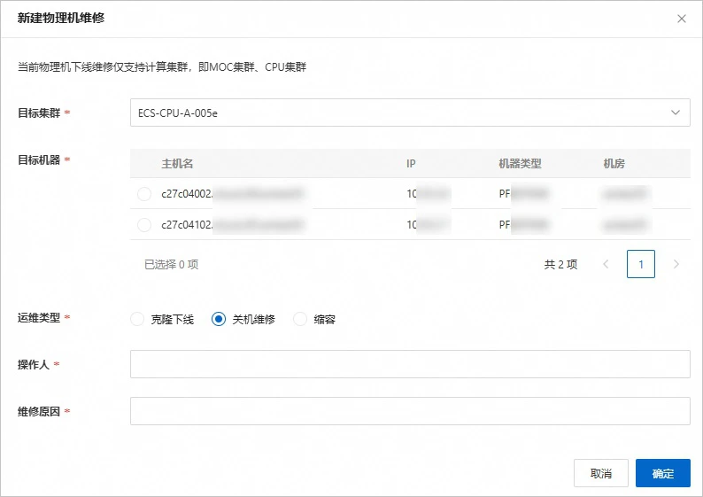

   | 配置项 | 说明 |
   | --- | --- |
   | 目标集群 | 选择物理机所在集群，仅支持选择CPU集群和MOC集群。 |
   | 目标机器 | 选择目标物理机。 |
   | 运维类型 | 支持<strong>克隆下线、关机维修</strong>和<strong>缩容</strong>。 |
   | 操作人 | 填写物理机下线维修的操作人。 |
   | 操作理由 | 根据实际情况填写物理机下线维修原因。 |

6. 查看物理机下线维修列表，包括**主机名**、**维修ID**、**IP**、**原集群**、**维修原因**、**维修状态**、**发起时间**、**机柜**和**操作人**。

   

7. 在目标物理机对应的**操作**列，单击**详情**获取物理机下线维修详情。

   - 在**基本信息**区域：查看**物理机IP**、**维修ID**、**当前步骤**、**维修状态**、**开始时间**、**结束时间**和**原集群**。

   - 在**执行信息**区域，查看物理机下线维修流程。

     <table>
       <tr>
         <th width="89">运维类型</th>
         <th>维修流程</th>
       </tr>
       <tr>
         <td>克隆下线</td>
         <td><strong>物理机下线前检查</strong>&gt;<strong>锁定物理机</strong>&gt;<strong>整机疏散</strong>&gt;<strong>天基下线</strong>&gt;<strong>ECS NC下线</strong>&gt;<strong>等待维修确认完</strong><strong>成</strong>&gt;<strong>物理机上线前前置检查</strong>&gt;<strong>物理机上线动作</strong>&gt;<strong>完成运维</strong></td>
       </tr>
       <tr>
         <td>关机维修</td>
         <td><strong>物理机下线前检查</strong>&gt;<strong>锁定物理机</strong>&gt;<strong>整机疏散</strong>&gt;<strong>天基power关机</strong>&gt;<strong>等待维修确认完成</strong>&gt;<strong>天基</strong><strong>power开机</strong>&gt;<strong>完成运维</strong></td>
       </tr>
       <tr>
         <td>缩容</td>
         <td><strong>物理机下线前检查</strong>&gt;<strong>锁定物理机</strong>&gt;<strong>整机疏散</strong>&gt;<strong>天基下线</strong>&gt;<strong>ECS NC下线</strong>&gt;<strong>完成运维</strong></td>
       </tr>
     </table>

     > **说明**
     >
     > 物理机下线过程中，需要关注如下流程：
     >
     > - **物理机下线前置检查**：如果检查失败说明目标物理机不符合下线要求。
     >
     > - **整机疏散**：如果疏散失败（即ECS实例迁移失败），建议单击**整机疏散**下方的**重试**或在手动迁移该物理机上的ECS实例后单击**整机疏散**下方的**重试**。手动迁移ECS实例的操作，请参见创建单台ECS实例迁移任务。
     >
     > - **天基下线**：耗时较长，请耐心等待并关注飞天基础运维平台上该物理机的状态。
     >
     > - 当**ECS NC下线**操作完毕，表示目标物理机已从集群中下线，可以对物理机进行维修。
     >
     > - 在确定目标物理机维修完成后，需要在**等待确认维修完成**区域，单击**维修步骤完成**，然后在弹出的对话框中，单击**确定**。
     >
     > - 如果流程中的**物理机上线动作**一直处于**等待**（**rolling**）状态，需要关注飞天基础运维平台上物理机所在集群状态及集群的**rolling**进度。
     >
     > - **完成运维**执行完毕，表示物理机下线维修完成，是否添加回原来的计算集群取决于创建物理机维修任务时选择的运维类型。

<a id="section-2-4"></a>

## 2.4. 专属资源池运维

专属资源池 DRP（Dedicate Resource Pool，DRP）是专属于某个租户的资源池，仅对该租户可见可用，其他租户未经授权不可见。专属资源池由运维管理员创建，并指定归属租户，具备资源划分灵活、支持租户共享、统一运维等特点。通过DRP，专有云运维管理员可将一组物理机授权给单一租户独享使用，确保租户无需与其他租户竞争物理资源，从而实现资源隔离。租户还可获取DRP详细属性信息，包括vCPU数量、内存大小、可用规格列表、剩余规格数量、超卖比调整权限等，以实现资源自主规划、满足安全合规要求并优化部署成本。DRP支持部署集能力，可以通过部署集对DRP内的实例的亲和性进行约束。

<a id="section-2-4-1"></a>

### 2.4.1. 创建专属资源池

本文介绍创建专属资源池DRP（Dedicate Resource Pool，DRP）的方法。

> **重要**
>
> 请先确保Apsara Uni-manager运营控制台版本已经为v3.18.6后再使用专属资源池功能。

**前提条件**

环境首次升级至v3.18.6版本或新部署v3.18.6后，需要手动配置专属资源池菜单的展示。否则，ECS运维控制台左侧导航栏将不会显示专属资源池运维，您可以按如下步骤开启专属资源池运维菜单的展示。

1. 登录Apsara Uni-manager运维控制台。

2. 在顶部导航栏，单击**用户权限**。

3. 在左侧导航栏，单击**菜单管理**。

4. 在菜单数据页面，选择**产品运维 > 计算运维 > 计算运维控制台 > 专属资源池**。

5. 在操作列，单击**修改**。

6. 在编辑菜单栏勾选**是否展示**后，单击**确定**。

更多**菜单管理**内容，请查看《Apsara Uni-manager运维控制台 用户指南》中**用户权限 > 菜单管理**章节。

**注意事项**

- 专属资源池不保证物理机间热迁移功能，为最大限度支持热迁移操作，请优先选择集群、CPU型号相同的物理机。

- 一台物理机只能同时属于一个专属资源池。在创建专属资源池时，如果物理机无法被选择，将鼠标悬停于选择框上，系统将显示具体限制原因。限制原因包括：

  - INVALID_STATUS_RLOCK：物理机状态为rlock。

  - MACHINE_HAS_ECS_INSTANCE：物理机中存在实例。

  - MACHINE_ALREADY_BOND_OTHER_DRP：物理机已绑定其他专属资源池。

  - MACHINE_ALREADY_BOND_CURRENT_DRP：物理机已绑定当前专属资源池。

  - MACHINE_IN_TIANGONG1：物理机属于天宫1.0集群。

  - MACHINE_ALREADY_CREATE_DEDICATED_HOST：物理机已创建专属宿主机。

  - CLUSTER_HAS_TOO_MANY_DRP：同集群中专属资源池数量过多。

  - UNKNOWN_REASON：未知原因。

**操作步骤**

1. 登录Apsara Uni-manager运维控制台。

2. 在顶部菜单栏，选择**产品运维 > 计算运维 > 计算运维控制台**。

3. 在左侧导航栏，选择**专属资源池运维**。

4. 在专属资源池列表上方，单击**创建专属资源池**。

5. 在**基础配置**页面进行基本信息的配置和机器组的选择，然后单击**下一步**。

   <table>
     <tr>
       <th>类别</th>
       <th>配置项</th>
       <th>是否必选</th>
       <th>说明</th>
     </tr>
     <tr>
       <td rowspan="2">基本信息</td>
       <td>可用区</td>
       <td>是</td>
       <td>同一个专属资源池中的物理机是同一个可用区。</td>
     </tr>
     <tr>
       <td>规格族</td>
       <td>否</td>
       <td>• 专属资源池支持的规格族在创建专属资源池时就需要确定，且后续不能修改。<br>• 该参数是可选项，如果不输入规格族在<strong>机器组选择</strong>中会默认展示该可用区中所有不同类型的机器组。<br>• 支持模糊搜索。</td>
     </tr>
     <tr>
       <td>机器组选择</td>
       <td>机器组选择</td>
       <td>是</td>
       <td>• 创建专属资源池时必须选择一个机器组，且后续不可更改。<br>• 同一机器组中的物理机，其规格族完全一致。</td>
     </tr>
   </table>

6. 在**物理机选择**页面选择物理机，然后单击下一步。

   默认仅展示支持扩容的可用物理机。您可以勾选**查看全部物理机**来查看该机器组下的所有物理机。此外，在列表上方的搜索栏中，支持通过输入NC ID、IP地址、主机名、SN进行搜索。

7. 在**配置基本信息**页面进行配置，配置完成后，单击**提交**。

   **类别**

   **配置项**

   **是否必选**

   **说明**

   专属资源池管理员ID，该ID与一级组织的UID相对应。查看一级组织UID的信息，请参见

   是

   《Apsara Uni-manager运营控制台用户指南》

   **管理员主账号ID**

   中的**企业中心 > 资源管理 > 组织管理 > 管理组织**章节。

   - 专属资源池名称的命名结构由三部分组成，且各部分之间以半角句号（.）进行分隔。

   **基本信息**

   - 固定前缀：drp。

   - 支持的规格族：ecs.xxx。

   是

   **专属资源池名称**

   - 用户自定义字段。

   - 专属资源池名称的长度为2～120个中文、英文字符。

   是

   长度为2～120个中文、英文字符。

   **专属资源池描述**

   在专属资源池中物理机异常且资源不足时，是否允许专属资源池内的实例临时移出专属资源池。

   - **不允许调度到公共资源池**：物理机异常且专属资源池内资源不足时实例保持停止状态，实例不会调度出专属资源池。

   - **允许临时调度到公共资源池**：实例允许临时调度出专属资源池，调度出去后实例依然属于专属资源池，当专属资源池内资源充足时，可以

   是

   **故障时实例调度策略**

   通过重启、启动、迁移操作将实例调度回专属资源池。

   > **说明**
   >
   > 支持本地盘的专属资源池不支持设置**允许临时调度到公共资源池**。

   **其他信息**

   专属资源池物理机宕机时物理机补充策略：

   - **不自动补充物理机**：物理机宕机后，不自动向DRP补充服务器；宕机物理机维修上线后，会自动补充到DRP中。

   - **自动补充物理机**：物理机宕机后，将自动从公共资源池补充一台空NC到DRP中；宕机物理机维修上线后自动补充到公用资源池。

     > **说明**
     >
     > <ol type="a">
     >
     > <li>
     >
     > 补充的物理机与宕机物理机必须处
     >
     > </li>
     >
     > </ol>

   是

   **故障时物理机补充策略**

   > 于同一集群。
   >
   > <ol type="a" start="2">
   >
   > <li>
   >
   > 宕机物理机上没有ECS实例时（全部通过宕机迁移成功疏散），才会发起自动补货。
   >
   > </li>
   >
   > </ol>

   是

   输入创建专属资源池的操作原因。

   **操作原因**

<a id="section-2-4-2"></a>

### 2.4.2. 查看专属资源池详情

您可以查看专属资源池的详情，包括专属资源池的ID、名称、状态、规格族、服务器信息等。

**操作步骤**

1. 登录Apsara Uni-manager运维控制台。

2. 在顶部菜单栏，选择**产品运维 > 计算运维 > 计算运维控制台**。

3. 在左侧导航栏，选择**专属资源池运维**。

4. 查看专属资源池信息。

   您可以查看专属资源池的基本信息，例如专属资源池的ID、名称、状态、规格族等。

   您也可以根据如下步骤，设置专属资源池列表的显示信息。

   <ol type="i">

   <li>

   在页面右上方，单击  图标。

   </li>

   <li>

   在**自定义列表项**对话框中，选中专属资源池的展示项。

   </li>

   <li>

   选择完成后，列表项将实时更新。

   </li>

   </ol>

5. 在页面左上方，输入专属资源池ID或管理主账号ID进行查询。

   默认展示全部专属资源池。

6. 找到需要查看详情的专属资源池，在**专属资源池ID/名称**列中，单击专属资源池ID。

   默认进入**概览**页签。

   专属资源池概览页的信息如下表所示。

   <table>
     <tr>
       <th width="155">区域</th>
       <th>说明</th>
     </tr>
     <tr>
       <td>专属资源池信息</td>
       <td>查看专属资源池的基本信息，包括专属资源池ID、名称、管理员主账号ID、规格族等。</td>
     </tr>
     <tr>
       <td>服务器资源</td>
       <td>查看专属资源池的服务器信息，包括服务器数量、CPU、可售内存。</td>
     </tr>
     <tr>
       <td>ECS实例</td>
       <td>查看专属资源池内的ECS实例总数、运行中的实例数、异常实例数、临时调度到公共资源池的实例数。</td>
     </tr>
     <tr>
       <td>NC状态分布</td>
       <td>查看物理机处于各种状态的统计数据。</td>
     </tr>
     <tr>
       <td>ECS实例状态分布</td>
       <td>查看ECS实例处于各种状态的统计数据。</td>
     </tr>
     <tr>
       <td>库存使用率</td>
       <td>查看各指标使用率，指标包括vCPU、内存、GPU、本地盘。<br>说明数据可能存在延迟，请以ECS规格库存为准。</td>
     </tr>
     <tr>
       <td>库存</td>
       <td>查看该专属资源池下实例规格的库存详情。您也可以在库存列表的左上方输入规格进行搜索。</td>
     </tr>
   </table>

7. 单击**计算服务器**页签，查看专属资源池的服务器信息。

<a id="section-2-4-3"></a>

### 2.4.3. 管理专属资源池

<a id="section-2-4-3-1"></a>

#### 2.4.3.1. 新增服务器

本文介绍如何扩容专属资源池资源。

**注意事项**

当物理机加入专属资源池后，其CPU超卖比会有以下的结果：

- 专属资源池调整过超卖比：扩容物理机与专属资源池CPU超卖比保持一致。

- 专属资源池未调整过超卖比：扩容物理机超卖比不变。

**操作步骤**

1. 登录Apsara Uni-manager运维控制台。

2. 在顶部菜单栏，选择**产品运维 > 计算运维 > 计算运维控制台**。

3. 在左侧导航栏，选择**专属资源池运维**。

4. 找到需要查看详情的专属资源池，在**专属资源池ID/名称**列中，单击专属资源池ID。

   默认进入**概览**页。

5. 单击**计算服务器**页签。

6. 在计算服务器列表上方，单击**新增服务器**。

7. 勾选物理服务器后，单击**确定**。

<a id="section-2-4-3-2"></a>

#### 2.4.3.2. 将服务器移出DRP

**注意事项**

- 不包含ECS实例的物理机可以移出DRP。

- 当物理机移出DRP后，其CPU超卖比会恢复到原集群的超卖比。

**操作步骤**

1. 登录Apsara Uni-manager运维控制台。

2. 在顶部菜单栏，选择**产品运维 > 计算运维 > 计算运维控制台**。

3. 在左侧导航栏，选择**专属资源池运维**。

4. 在**专属资源池ID/名称**列中，单击目标专属资源池ID。

   默认进入**概览**页。

5. 单击**计算服务器**页签。

6. 找到目标服务器，在**操作**列，单击**移出DRP**。

7. 在弹出的移出DRP确认页，确认专属资源池信息和待缩容物理机后，单击**确定**。

<a id="section-2-4-3-3"></a>

#### 2.4.3.3. 修改管理员主账号ID

管理员主账号ID是专属资源池管理员的ID，该ID与一级组织的UID相对应。本文介绍如何修改管理员主账号ID。

**注意事项**

修改管理员ID后，原管理员组织将自动变为普通用户。

**操作步骤**

1. 登录Apsara Uni-manager运维控制台。

2. 在顶部菜单栏，选择**产品运维 > 计算运维 > 计算运维控制台**。

3. 在左侧导航栏，选择**专属资源池运维**。

4. 在专属资源池列表，单击**专属资源池ID/名称**列。

5. 在专属资源池详情页，单击**管理员主账号ID**右侧的  图标。

6. 在弹出的对话框中，您可以清空输入框并从下拉菜单中选择主账号ID或直接输入主账号ID，然后单击**提交**。

   更多一级组织UID的信息，请参见<strong>《Apsara Uni-manager运营控制台用户指南》</strong>中的**企业中心 >资源管理 > 组织管理 > 管理组织**章节。

<a id="section-2-4-3-4"></a>

#### 2.4.3.4. 修改故障时物理机补充策略

本文介绍了如何修改专属资源池的故障时物理机补充策略以及两种策略之间的区别。

**操作步骤**

1. 登录Apsara Uni-manager运维控制台。

2. 在顶部菜单栏，选择**产品运维 > 计算运维 > 计算运维控制台**。

3. 在左侧导航栏，选择**专属资源池运维**。

4. 在专属资源池列表，单击**专属资源池ID/名称**列。

5. 在专属资源池详情页，单击**故障时物理机补充策略**右侧的  图标。

6. 在弹出的对话框中，选择**故障时物理机补充策略**并输入**操作原因**，然后单击**提交**。

   - **不自动补充物理机**：物理机宕机后，不自动向DRP补充服务器；宕机物理机维修上线后，会自动补充到DRP中。

   - **自动补充物理机**：物理机宕机后，将自动从公共资源池补充一台空NC到DRP中；宕机物理机维修上线后自动补充到公用资源池。

     > **说明**
     >
     > <ol type="a">
     >
     > <li>
     >
     > 补充的物理机与宕机物理机必须处于同一集群。
     >
     > </li>
     >
     > <li>
     >
     > 宕机物理机上没有ECS实例时（全部通过宕机迁移成功疏散），才会发起自动补货。
     >
     > </li>
     >
     > </ol>

<a id="section-2-4-3-5"></a>

#### 2.4.3.5. 管理机器业务状态

本文介绍如何管理专属资源池内机器的业务状态，包括锁定NC、解锁NC和业务上线的相关步骤。

**操作步骤**

1. 登录Apsara Uni-manager运维控制台。

2. 在顶部菜单栏，选择**产品运维 > 计算运维 > 计算运维控制台**。

3. 在左侧导航栏，选择**专属资源池运维**。

4. 找到需要查看详情的专属资源池，在**专属资源池ID/名称**列中，单击专属资源池ID。

   默认进入**概览**页。

5. 单击**计算服务器**页签。

6. 在操作列中管理机器业务状态，具体操作如下表所示。

   | 操作项 | 操作场景 | 操作步骤 |
   | --- | --- | --- |
   | 锁定NC | • 如果该NC异常，不希望新建的实例分配到此NC，可进行手动锁定NC。该状态无法自动改变。<br>• 如果想要做资源预留，可进行手动锁定。 | i. 在计算服务器列表操作列，单击<strong>锁定</strong><strong>NC</strong>。ii. 在弹出的<strong>锁定NC</strong>对话框中，确认操作机器，选择锁定状态，填写<strong>操作原</strong><strong>因</strong>。iii. 配置完成后，单击<strong>确定</strong>。 |
   | 解锁NC | 解锁NC可以对无心跳、运维锁定、预留锁定状态的机器进行操作，使其可以被正常调度，解锁NC后机器会自动业务上线。 | i. 在计算服务器列表操作列，单击<strong>解锁</strong><strong>NC</strong>。ii. 在弹出的<strong>解锁NC</strong>对话框中，确认操作机器，填写<strong>操作原因</strong>。iii. 填写完成后，单击<strong>确定</strong>。 |
   | 业务上线 | 业务上线可以对无心跳、运维锁定、预留资源、宕机和初始化中的机器进行操作，使其业务上线。 | i. 在计算服务器列表操作列，单击<strong>业务</strong><strong>上线</strong>。ii. 在弹出的对话框中，确认操作机器，填写<strong>操作原因</strong>。iii. 填写完成后，单击<strong>确定</strong>。 |

<a id="section-2-4-4"></a>

### 2.4.4. 删除专属资源池

**前提条件**

删除专属资源池前，请确保其中不包含任何实例。

**操作步骤**

1. 登录Apsara Uni-manager运维控制台。

2. 在顶部菜单栏，选择**产品运维 > 计算运维 > 计算运维控制台**。

3. 在左侧导航栏，选择**专属资源池运维**。

4. 在**操作**列，单击**删除**。

5. 在弹出的对话框中确认专属资源池信息，并填写**原因**后，单击**确定**。

<a id="section-2-5"></a>

## 2.5. ECS运维

<a id="section-2-5-1"></a>

### 2.5.1. ECS实例

<a id="section-2-5-1-1"></a>

#### 2.5.1.1. 查看ECS实例列表

本文介绍查看并搜索所有ECS实例的方法，例如查看实例所在的物理机、实例的主机名/别名、实例所在的集群、实例的状态、网络和带宽等信息。

**操作步骤**

1. 登录Apsara Uni-manager运维控制台。

2. 在顶部菜单栏，选择**产品运维 > 计算运维 > 计算运维控制台**。

3. 在左侧导航栏，选择**ECS运维 > ECS实例**。

   在页面右上方，概览ECS实例**总数**以及**运行中**、**已停止**、**待启动**、**创建中**和**释放中**的实例数量。

   > **说明**
   >
   > - 实例总数为ECS真实存在的实例数量，ECS实例列表的数量可能会因为管控工作流异常导致不准确，真实使用量以页面右上角的ECS实例总数为准。
   >
   > - **已停止**包括**停止-计算资源已释放**和**停止-普通停机**。
   >
   >   - **停止-普通停机**：停止实例后保留实例的资源并持续收费。
   >
   >   - **停止-计算资源已释放**：启用后，会产生以下影响：
   >
   >     - 计算资源（vCPU、内存和GPU）暂停计费。
   >
   >     - 系统盘、数据盘、快照持续计费。
   >
   >     - 计算资源（vCPU、内存和GPU）会被回收，再次启动时，可能因库存不足或配额限制而导致实例启动失败。
   >
   > - **软删除 - 已放入回收站**：放入回收站后，ECS实例将处于冷冻期时，实例的CPU、内存、GPU等计算资源将被释放，弹性公网IP会被自动解绑并保留。系统盘、实例上挂载的数据盘、快照会保留并继续计费。冷冻期过后，ECS资源会被彻底销毁，不可恢复。

4. 在页面左上方文本框，可以输入ECS实例ID、私网IP、弹性公网IP，实现精确查找；也可以根据**实例ID/私网IP/弹性公网IP**、**实例名称**、**宿主机ID**、**宿主机IP**、**主机名/别名**、**瑶池状态**、**后羿状态**、**VPC ID**、**主账号ID**和**天宫资源**组合筛选获取目标实例。

   > **说明**
   >
   > - **实例ID/私网IP/弹性公网IP**支持输入多个，多个可用英文逗号分隔。
   >
   > - **宿主机ID**、**宿主机IP**、**主机名/别名**无法组合筛选。
   >
   > - **主账号ID**与**天宫资源**无法组合筛选。
   >
   > - **天宫资源**：
   >
   >   - **天宫1.0**：指云产品On ECS部署的初级架构，该架构仅支持通过飞天基础运维平台部署。天宫1.0主要代理云产品对ECS的资源申请，且资源申请时会独占ECS集群。集群中的ECS实例归属天宫1.0账号和VPC。
   >
   >   - **天宫2.0**：指云产品On ECS部署的升级架构，该架构支持通过飞天基础运维平台或K8s云原生部署。天宫2.0架构上以IaC（Infrastructure as Code）基线声明形式屏蔽复杂的资源生命周期管理，资源调用时会共享租户侧ECS集群。集群中的ECS实例归属天宫2.0账号和VPC。

5. （可选）变更ECS实例列表的展示项。

   <ol type="i">

   <li>

   在页面右上方，单击  图标。

   </li>

   <li>

   在**自定义列表项显示**对话框中，选中实例列表的展示项。

   </li>

   <li>

   选择完成后，单击**确定**。

   </li>

   </ol>

6. （可选）单击页面上方的导出，可以导出ECS实例信息列表。

   导出后会自动下载ECS实例信息统计表到本地，可以在Excel表格中查看**实例ID**、**NC IP**、**NC ID**、**NC主机名**及**集群**。

7. 查看目标实例的**nc信息**、**主账号ID**、**集群**、**CPU/内存**、**状态**（包括瑶池状态、后羿状态、业务状态和云助手状态）、**私网IP/弹性公网IP**、**带宽**和**镜像**等信息。

   - 查看实例详情。

     在**ECS实例**列表的**实例ID/名称**列，单击目标实例ID，即可查看实例详情。更多实例信息，请参见查看实例详情。

   - 查看计算服务器运维详情。

     在**ECS实例**列表的**nc信息**列，单击目标宿主机的**NC IP**，即可查看计算服务器运维详情。更多计算服务器运维信息，请参见查看计算服务器运维详情。

   - 查看计算集群运维详情。

     在**ECS实例**列表的**集群**列，单击目标集群名称，即可查看计算集群运维详情。更多计算集群运维信息，请参见计算集群概览。

<a id="section-2-5-1-2"></a>

#### 2.5.1.2. 查看实例详情

本文介绍如何查看ECS实例的详细信息，对实例进行相关操作。

**操作步骤**

1. 登录Apsara Uni-manager运维控制台。

2. 在顶部菜单栏，选择**产品运维 > 计算运维 > 计算运维控制台**。

3. 在左侧导航栏，选择**ECS运维 > ECS实例**。

4. 在ECS实例列表**实例ID/名称**列，单击目标实例ID。

5. <strong>（可选）</strong>在实例详情页面右上角，您可以对目标实例进行相关操作，具体操作如下表所示。

   <table>
     <tr>
       <th width="122">操作</th>
       <th>步骤</th>
     </tr>
     <tr>
       <td>迁移</td>
       <td>单击<strong>迁移</strong>，具体操作，请参见迁移实例。</td>
     </tr>
     <tr>
       <td>登录AG</td>
       <td>单击<strong>登录AG</strong>，具体操作，请参见登录集群AG。</td>
     </tr>
     <tr>
       <td>变更实例状态</td>
       <td>在<strong>更多操作</strong>中，选择<strong>启动</strong>、<strong>停止</strong>或<strong>重启</strong>。具体操作，请参见启动实例、停止实例或重启实例。同时，您也可以在ECS实例列表下方批量变更ECS实例状态。</td>
     </tr>
     <tr>
       <td>ISO管理</td>
       <td>选择<strong>更多操作 &gt; ISO管理</strong>，具体操作，请参见ISO管理。</td>
     </tr>
     <tr>
       <td>ECS诊断</td>
       <td>单击<strong>诊断</strong>，具体操作，请参见诊断ECS实例或者宿主机的异常问题。</td>
     </tr>
   </table>

6. 查看目标实例详情并进行相关操作。

   查看项如下表所示。

   <table>
     <tr>
       <th width="127">区域或页签</th>
       <th>说明</th>
     </tr>
     <tr>
       <td>基本信息</td>
       <td>查看实例ID、实例名称、规格、Region、可用区、创建时间等基本信息。</td>
     </tr>
     <tr>
       <td>配置信息</td>
       <td>查看实例是否IO优化、系统镜像、操作系统、系统盘、网络类型、内网带宽、私有IP、RDMA IP等配置信息。</td>
     </tr>
     <tr>
       <td>云盘</td>
       <td>• 查看云盘列表：包括云盘ID、云盘类型、业务状态、集群和特性信息。<br>• 云盘相关操作：包括卸载云盘、操作审计、打快照和查看快照。具体操作，请参见<strong>ECS运维管理 &gt; ECS运维 &gt; 云盘</strong>章节。</td>
     </tr>
     <tr>
       <td>网卡</td>
       <td>• 查看网卡列表：包括网卡ID/MAC地址、状态、网卡类型、虚拟交换机和IP信息。<br>• 网卡相关操作：包括卸载网卡和操作审计。具体操作，请参见<strong>ECS运维管理 &gt; ECS运维 &gt; 弹性网卡</strong>章节。</td>
     </tr>
     <tr>
       <td>安全组</td>
       <td>• 查看安全组列表：安全组ID/名称、网络类型、专有网络ID和创建时间信息。<br>• 安全组相关操作：操作审计。具体操作，请参见<strong>ECS运维管理 &gt; ECS运维 &gt; 安全组</strong>章节。</td>
     </tr>
     <tr>
       <td>快照</td>
       <td>• 查看快照列表：快照ID/名称、后羿快照ID、快照类型等信息。<br>• 快照相关操作：删除快照、创建镜像和操作审计。具体操作，请参见<strong>ECS运维管理 &gt; ECS运维 &gt; 快照</strong>章节。</td>
     </tr>
     <tr>
       <td>性能监控</td>
       <td>查看实例性能指标一段时间的趋势图：包括CPU使用率、实例云盘读写BPS（Byte/s）、实例云盘IOPS（次/s）、公网带宽（bit/s）和内网带宽（bit/s）。</td>
     </tr>
     <tr>
       <td>ASO迁移任务</td>
       <td>在Apsara Uni-manager运维控制台触发迁移任务后，可以通过迁移任务查看本次迁移的执行情况，追踪迁移结果。查看ASO迁移任务：包括源NC ID及IP、目标NC ID及IP、迁移类型（包括冷迁移和热迁移）等信息。</td>
     </tr>
     <tr>
       <td>后羿迁移日志</td>
       <td>查询一个ECS生命周期内，通过ECS管控迁移调度的历史记录，包含冷迁移和热迁移。查看该实例迁移历史：包括源NC、目标NC、状态、迁移时间、结束时间和迁移原因等信息。</td>
     </tr>
     <tr>
       <td>操作审计</td>
       <td>查看该实例的ASO操作历史、POP API调用历史和后羿API调用历史。具体操作，请参见运维审计日志。</td>
     </tr>
   </table>

<a id="section-2-5-1-3"></a>

#### 2.5.1.3. 管理实例状态

<a id="section-2-5-1-3-1"></a>

##### 2.5.1.3.1. 启动实例

在实例处于已停止等无法正常提供服务的状态时，如需使用实例需要先启动实例。

**前提条件**

目标实例处于**待启动**、**停止**或**启动失败**状态。

**操作步骤**

1. 登录Apsara Uni-manager运维控制台。

2. 在顶部菜单栏，选择**产品运维 > 计算运维 > 计算运维控制台**。

3. 在左侧导航栏，选择**ECS运维 > ECS实例**。

4. 在目标ECS实例的**操作**列，将鼠标悬停在  图标上，单击**启动**。

   您也可以选中多个目标实例，在页面左下方，单击**启动**，批量启动实例。

5. 当启动的实例为租户侧实例，在弹出的对话框，确认获取客户授权后，单击**继续**。

6. 在弹出的对话框中的**操作原因**文本框，输入操作原因。

7. 填写完成后，单击**确定**。

<a id="section-2-5-1-3-2"></a>

##### 2.5.1.3.2. 停止实例

如果您暂时不需要使用一台实例，可以停止实例。

**前提条件**

目标实例处于**运行中**状态。

> **重要**
>
> 停止实例会导致实例上的程序中断运行，请确保在对业务影响最低的时段进行操作。

**操作步骤**

1. 登录Apsara Uni-manager运维控制台。

2. 在顶部菜单栏，选择**产品运维 > 计算运维 > 计算运维控制台**。

3. 在左侧导航栏，选择**ECS运维 > ECS实例**。

4. 在目标ECS实例的**操作**列，将鼠标悬停在

   图标上，并单击**停止**。

   

   您也可以选中多个目标实例，在页面左下方，单击**停止**，批量停止实例。

5. 当停止的实例为租户侧实例，在弹出的对话框，确认获取客户授权后，单击**继续**。

6. 在弹出的对话框中的**操作原因**文本框，输入操作原因。

7. 填写完成后，单击**确定**。

<a id="section-2-5-1-3-3"></a>

##### 2.5.1.3.3. 重启实例

修改实例登录密码后，或者安装系统更新等情况下，您需要重启实例。

**前提条件**

待重启的实例必须处于**运行中**状态。

> **警告**
>
> 重启操作会造成您的实例停止工作，造成业务中断，请谨慎执行。

**操作步骤**

1. 登录Apsara Uni-manager运维控制台。

2. 在顶部菜单栏，选择**产品运维 > 计算运维 > 计算运维控制台**。

3. 在左侧导航栏，选择**ECS运维 > ECS实例**。

4. 在目标ECS实例的**操作**列，将鼠标悬停在  图标上，单击**重启**。

   您也可以选中多个目标实例，在页面左下方，单击**重启**，批量重启实例。

5. 当重启的实例为租户侧实例，在弹出的对话框，确认获取客户授权后，单击**继续**。

6. 在弹出的对话框中，选择重启方式并输入操作原因。

7. 填写完成后，单击**确定**。

<a id="section-2-5-1-4"></a>

#### 2.5.1.4. 迁移实例

当实例或NC出现故障时，您可以通过实例迁移方式确保系统的稳定性，即将实例从某个NC迁移到其实例他正常的NC。实例迁移根据实例的状态分为冷迁移和热迁移。本文为您介绍迁移一台ECS实例的具体操作。

**使用限制**

当待迁移的实例存在以下情况时不支持迁移：

> **说明**
>
> 更多不支持迁移的限制以控制台显示为准。

**热迁移**

- 状态不为**运行中**（running）

- 专有宿主机实例

- GPU实例

- 本地盘实例

- 该实例存在一个运行中的迁移任务

- 实例携带了Trunk或者Member网卡

- 实例规格过大

- 实例挂载了ISO

**冷迁移**

- 状态不为**待启动**（Pending）或**停止**（Shutted）的实例。

- 专有宿主机实例

- 本地盘实例

- 实例携带了Trunk或者Member网卡

- 实例挂载了ISO

**操作步骤**

> **说明**
>
> 如果您需要同时迁移多台ECS实例，或迁移一台NC上的所有实例，具体操作，请参见创建批量迁移ECS实例任务或创建整机迁移任务。

1. 登录Apsara Uni-manager运维控制台。

2. 在顶部菜单栏，选择**产品运维 > 计算运维 > 计算运维控制台**。

3. 在左侧导航栏，选择**ECS运维 > ECS实例**。

4. 在目标ECS实例的**操作**列，选择**迁移 > 实例迁移**。

5. 在**创建ECS迁移任务**页面，配置相关参数。

   系统会根据目标实例的运行状态，自动选择**冷迁移**或**热迁移**，您可以在对应的迁移类型下配置相关参数，参数说明如下。

   - **冷迁移**：冷迁移是一种将停止状态的虚拟机从一个物理宿主机迁移到其它物理宿主机的技术，只能迁移状态为**待启动**（Pending）或**停止**（Shutted）的实例。

     | 配置区域 | 参数项 | 说明 |
     | --- | --- | --- |
     | 实例信息 | 选择实例 | 系统会自动在实例列表上方的搜索框中填充目标实例的实例ID，然后您需要在实例列表中选中该实例。您也可以根据实际需要修改待迁移的实例ID。<br>重要仅支持选择1台ECS实例。 |

     <table>
       <tr>
         <td rowspan="2">目标选择</td>
         <td>目标选择策略</td>
         <td>• <strong>随机选择</strong>：默认目标物理机选择方式，实例随机迁移至资源充足的机器上。<br>• <strong>系统推荐</strong>：系统经过过滤后筛选出的迁移成功率较高的目标物理机。<br>重要如果主机列表中数据为空，则说明没有符合条件的目标物理机，建议选择其他策略。<br>• <strong>指定NC</strong>：手动指定实例迁移机器。在NC列表上方先根据集群、主机名、NC IP或NC ID搜索目标机器，然后选中1台作为目标物理机。<br>说明系统会对每1台物理机是否适合选择给出建议以供参考，但不影响目标物理机的选中，即您也可以根据实际情况，选中<strong>不建</strong><strong>议</strong>的NC。<br>• <strong>指定集群</strong>：手动指定实例迁移的集群。在集群列表上方先根据集群名称搜索目标集群，然后选中1个作为目标集群。<br>说明系统会对每1个集群是否适合选择给出建议以供参考，但不影响目标集群的选中，即您也可以根据实际情况，选中<strong>不建议</strong>的集群。</td>
       </tr>
       <tr>
         <td>恢复模式</td>
         <td>选择实例迁移后机器的运行状态，取值范围：<br>• 迁移后启动<br>• 迁移后停机</td>
       </tr>
       <tr>
         <td>操作信息</td>
         <td>操作原因</td>
         <td>输入实例进行冷迁移的原因。</td>
       </tr>
     </table>

   - **热迁移**：热迁移是一种将运行状态的虚拟机从一个物理宿主机迁移到其它物理宿主机的技术，只能迁移状态为**运行中**的实例。

     **说明**

     **配置区域**

     **参数项**

     系统会自动在实例列表上方的搜索框中填充目标实例的实例ID，然后您需要在实例列表中选中该实例。您也可以根据实际需要修改待迁移的实例ID。

     **实例信息**

     **选择实例**

     > **重要**
     >
     > 仅支持选择1台ECS实例。

     输入迁移速率，单位为MBps。

     **迁移基本参数配置**

     **迁移速率**

     推荐大于500 Mbps。

     启用该模式会在普通迁移的基础上，支持将ECS实例迁移到可用的跨代CPU型号的物理机上。CPU型号的兼容性信息，请参见查看CPU兼容性配置。

     **增强热迁移兼容性**

     > **重要**
     >
     > 开启该功能后，如果**目标选择策略**设置为**系统推荐**策略，将会额外展示可用的跨代CPU型号的物理机。

     **目标选择**

     - **随机选择**：默认目标物理机选择方式，实例随机迁移至资源充足的机器上。

     - **系统推荐**：系统经过过滤后筛选出的迁移成功率较高的目标物理机。

       > **重要**
       >
       > 如果主机列表中数据为空，则说明没有符合条件的目标物理机，建议选择其他策略。

     - **指定NC**：手动指定实例迁移机器。在NC列表上方先根据集群、主机名、NC IP或NC ID搜索目标机器，然后选中1台作为目标物理机。

       > **说明**
       >
       > 系统会对每1台物理机是否适合选择给出建议以供参考，但不影响目标物理机的选中，即您也可以根据实际情况，选中**不建议**的NC。

     **目标选择策略**

     - **指定集群**：手动指定实例迁移的集群。在集群列表上方先根据集群名称搜索目标集群，然后选中1个作为目标集群。

       > **说明**
       >
       > 系统会对每1个集群是否适合选择给出建议以供参考，但不影响目标集群的选中，即您也可以根据实际情况，选中**不建议**的集群。

     热迁移最后阶段的业务中断时间。单位：ms。

     **允许业务中断时间**

     - 取值范围：200~2000。

     - 默认值：300。

     - 取值范围：

       - **是**：检查待迁移实例是否挂载SLB，如果已挂载，迁移任务可能会失败。

     **检查SLB**

     - **否**：不检查SLB，直接略过该检查进行迁移。

     - 默认值：**否**。

     - 取值范围：

       - **是**：检查源宿主机与目标宿主机的AVS版本是否一致。如果不一致，迁移任务会失败。

     **检查AVS版本**

     - **否**：不检查AVS版本，直接略过该检查进行迁移，当AVS版本跨度过大时，可能导致实例迁移失败。

     **迁移高级参数配置**

     - 默认值：**是**。

     > **说明**
     >
     > - 您也可以单击**配**

     - 取值范围：

     > **置说明**，查看该

     - **是**：检查目标宿主机的虚拟化版本是否能够进

     > 区域下的参数说

     行热迁移。如果不能，迁移任务会失败。

     > 明。

     **检查NC的虚拟化版**

     - **否**：不检查虚拟化版本，直接略过该检查进行

     > - 设置迁移高级参

     **本**

     迁移，当虚拟化版本跨度过大时，可能导致实

     > 数可以增加迁移

     例迁移失败。

     > 的成功率，但您需要结合实际业

     - 默认值：**是**。

     > 务情况进行配置。

     - 取值范围：

       - **是**：允许将实例迁移到预留的宿主机上。

     **允许使用预留NC**

     - **否**：不允许将实例迁移到预留的宿主机上。

     - 默认值：**否**。

     - 取值范围：

       - **是**：检查源宿主机的CPU标签集是否为目的宿主机标签集的子集。如果不是，迁移任务会失败。

     **检查CPU标志**

     - **否**：不检查宿主机的标签集，直接略过该检查进行迁移。如果目标宿主机缺少关键标签，可能导致实例迁移后运行异常。

     - 默认值：**是**。

     - 取值范围：

       - **是**：检查镜像是否能够进行热迁移，若不能，迁移任务将会失败。

     **检查镜像**

     - **否**：不检查镜像，直接略过进行迁移。

     - 默认值：**是**。

     输入实例进行热迁移的原因。

     **操作信息**

     **操作原因**

6. 检查无误后，勾选**我已阅读上述提示，并确认操作**。

7. 冷迁移单击**提交**，热迁移需单击**迁移前置检查**，等待预检通过后单击**提交**。

   您可以在迁移任务列表中查看迁移任务的执行情况。具体操作，请参见查看迁移任务。

**热迁移失败原因**

- 请求热迁移接口live_migrate_vm失败

  **错误码**

  **是否支**

  **说明**

  **错误**

  **排查建议**

  **持重试**

  **类型**

  是

  迁移的目标NC存储设备资

  “600xx”这一系列的报错都是资源不足，

  -60001

  源不够。

  即找不到一台适合的物理机作为热迁移的目的端，可以从以下几个方面排查某一台物理机为什么不支持作为目的端：

  是

  迁移的目标NC的内存资源

  -60002

  - 规格族是否一致：在**计算集群运维**页面

  不够。

  查看该物理机所在集群支持的规格族；对比ECS所在源物理机支持的规格族。目的端必须支持源端的规格族。

  是

  迁移的目标NC的CPU资源

  -60003

  - CPU是否一致：查看目的端物理机与源

  不够。

  端物理机的CPU型号是否一致。

  - CPU、内存、GPU资源是否充足：在**计算服务器运维**详情页面查看目的端物理

  是

  迁移的目标NC的PPS资源

  -60008

  机剩余的CPU、内存、GPU是否充足。

  不够。

  - 是否是DDH：确认源端、目的端物理机是否是专有宿主机（DDH），目前DDH不允许在ASO上迁移。

  是

  迁移的目标NC的BPS资源

  -60009

  不够.

  - 检测库存是否足够：

    <ol type="a">

    <li>

    先获得该ECS的规格，进入

    </li>

    </ol>

  资源

  houyiregiondb：select

  不足

  是

  迁移的目标NC上已有非

  -60011

  vm_type from vm where

  destroyed实例数量超过该

  \`name\`='{{instance_id}}';

  NC上允许创建实例个数的上限，单台NC有VM密度上

  <ol type="a" start="2">

  <li>

  通过库存诊断命令查询该ECS的规

  </li>

  </ol>

  限。

  格为什么在目的端物理机上没有库存，登录目的端物理机所在集群的ecs-ag.EcsAg#执行以下命令（替换 `vm_type` 和 `nc_id` 即

  是

  资源不足，在

  -60014

  可，前面两个可以从EcsAg#环境

  regionmaster侧，-600xx

  变量中直接获取）：

  类型的错误码很多最后都会用该错误码包装。

  ```text
  go2hyapi 
  inventory_diagnose_v2 
  ```

  是

  NC tag不满足VM迁移条

  -60017

  ```text
  region_id=$houyi_big_reg
  ```

  件。

  ```text
  ion_no 
  zone_ids=$houyi_region_n
  o"-A" 
  ```

  是

  目标NC上对应的实例规格

  -60019

  ```text
  instance_type='{{vm_type
  ```

  不足。

  ```text
  }}' nc_ids='{{nc_id}}'
  ```

  是

  获取zk锁失败，被流控了。

  可以再次发起热迁移请求。

  -1000006

  是

  源端NC上迁移的VM超过限

  默认情况下一台物理机只允许存在一个迁移

  -1020022

  制。

  流。

  在**计算服务器运维**页面查看源端/目的端物理机上的ECS实例是否有状态为“迁移中”，

  是

  目的端NC上迁移的VM超过

  如果有等待该ECS迁移结束后再发起迁移请

  -1020023

  限制。

  求。

  流控

  是

  Xen虚拟化类型才会有，限

  等待12分钟后，再次重试。

  -1002022

  制了同一台VM不能在12分钟内连续热迁移。

  是

  请求live_migrate_vm接口

  <ol type="i">

  <li>

  登录飞天基础运维平台查看ECS产品

  </li>

  </ol>

  -181

  超时。

  的下ECS-controller-xx-xx集群中ecs-houyi服务是否终态。

  <ol type="i" start="2">

  <li>

  服务异常优先将服务rolling到终态，

  </li>

  </ol>

  是

  系统异常，通常是

  -1000000

  服务正常的情况可以再次发起请求。

  regionmaster自身服务的问题。

  是

  VM的状态不符合预期，即

  <ol type="i">

  <li>

  在**ECS运维** > **ECS实例**页面查看该实

  </li>

  </ol>

  -15026

  不处于**运行中**状态。

  例状态。

  <ol type="i" start="2">

  <li>

  如果实例状态处于**运行中**，则可以再次发起迁移请求。

  </li>

  </ol>

  是

  调用对应物理机上pync服

  <ol type="i">

  <li>

  登录飞天基础运维平台进入ECS产

  </li>

  </ol>

  -1001000

  务时出现预期之外的错误。

  品，找到待迁移ECS所在的集群，查看ecs-nc服务是否终态。

  <ol type="i" start="2">

  <li>

  服务异常优先将服务rolling到终态，服务正常的情况可以再次发起请求。

  </li>

  </ol>

  是

  热迁移发起阶段失败出现预

  管控侧热迁移的准备阶段只要发生预期之外

  期之外的错误。

  的错误统一抛出该错误码，通常是相关服务报错导致的。

  <ol type="i">

  <li>

  登录飞天基础运维平台查看vpc、

  </li>

  </ol>

  -1002017

  ecs、cds服务是否终态。

  <ol type="i" start="2">

  <li>

  服务异常优先将服务rolling到终态，服务正常的情况可以再次发起请求。

  </li>

  </ol>

  否

  待热迁移的VM已经在迁移

  当前VM的状态是迁移中，不允许再次发起

  -1002052

  状态中了。

  迁移，可以等待迁移结束或主动停止迁移后再次发起。

  否

  热迁移的VM必须要在源端

  意外场景导致发起热迁移后，VM不在源端

  物理机上。

  物理机上。

  <ol type="i">

  <li>

  在**ECS运维** > **ECS实例**页面查看该实

  </li>

  </ol>

  -1020021

  例状态，确认该实例存活。

  <ol type="i" start="2">

  <li>

  确认实例状态正常后可以再次发起热迁移。

  </li>

  </ol>

  是

  源端物理机和目的端物理机

  <ol type="i">

  <li>

  在**ECS运维** > **ECS实例**页面查看该实

  </li>

  </ol>

  -1002014

  一致，不允许迁移。

  例所在的nc_id。

  <ol type="i" start="2">

  <li>

  确认迁移策略是否为**指定nc**，如果是则不能选择vm原本所在的nc_id。

  </li>

  </ol>

  接口异常

  是

  准备正式发起热迁移，准备

  需要根据具体报错信息判断。

  -1002021

  将除了虚拟化的组件都迁移，会先调用pync上的PreMigrateVm方法检查，检查失败。

  是

  <ol type="i">

  <li>

  热迁移发起后，轮询

  <ol type="i">

  <li>

  在**ECS运维** > **ECS实例**页面查看该实

  </li>

  </ol>

  迁移结果发现该实例

  例状态。

  不在迁移状态。

  <ol type="i" start="2">

  <li>

  实例状态正常的情况下可以重新发起

  </li>

  </ol>

  </li>

  </ol>

  -1020030

  <ol type="i" start="2">

  <li>

  调用取消热迁移接口

  迁移。

  时发现实例不在迁移。

  </li>

  </ol>

  是

  热迁移日志没有找到。

  当热迁移请求成功通过管控的前置检查后会

  -1005008

  生成一个迁移日志记录在houyiregiondb的migration_log，正式发起迁移时会查询该日志，如果查询不到说明出现了异常情况，可以做如下处理：

  <ol type="i">

  <li>

  在**ECS运维** > **ECS实例**页面查看该实例状态。

  </li>

  <li>

  实例状态正常的情况下可以重新发起迁移。

  </li>

  </ol>

  是

  没有找到源端物理机信息。

  根据VM信息，查询不到VM所在的物理机

  -1005009

  信息。

  <ol type="i">

  <li>

  在**ECS运维** > **ECS实例**页面查看该实例的物理机信息。

  </li>

  <li>

  在ASO计算运维控制台上查询对应物理机的详情。

  </li>

  <li>

  如果能够成功查询到物理机信息，则可以再次发起热迁移。

  </li>

  </ol>

  是

  更新热迁移日志的

  更新houyiregiondb的migration_log的

  -1005010

  result_code字段失败。

  result_code字段出错，可能是获取数据库锁、连接数据库等原因产生。

  <ol type="i">

  <li>

  在**ECS运维** > **ECS实例**页面查看该实例状态。

  </li>

  <li>

  实例状态正常的情况下可以重新发起迁移。

  </li>

  </ol>

  否

  VM所处的源物理机改变

  <ol type="i">

  <li>

  在**ECS运维** > **ECS实例**页面查看该实

  </li>

  </ol>

  -1020034

  了，该VM可能因为别的原

  例状态，确认该实例存活。

  因进行了调度，当准备正式

  <ol type="i" start="2">

  <li>

  确认实例状态正常后可以再次发起热

  </li>

  </ol>

  发起热迁移时发现该VM最

  迁移。

  新的源物理机不匹配。

  否

  VM携带声卡，不允许迁

  -1020026

  移。

  否

  裸金属禁止迁移。

  -1020038

  否

  携带了GPU的设备不允许迁

  -1015044

  移。

  否

  当虚拟化类型是Xen时，网

  -1015067

  络类型是VPC不允许迁移。

  否

  VM的规格族处于热迁移黑

  -1015091

  名单中（默认为ecs.ebmi3,ecs.ebmhfg5, ecs.ebmc）。

  否

  存在本地盘的VM禁止热迁

  -1002030

  移。

  否

  VM的规格处于热迁移黑名

  -1020039

  单中

  （默认情况下为：ecs.sccg5,ecs.scch5,ecs.sccgn5d,ecs.sccgn5,ec s.ebmg5,ecs.ebmr5,ecs. ebmr4,ecs.ebmg4,ecs.e bma1,ecs.ebmgn5t,ecs.

  管控严格禁止热迁移。

  sccgn5t,ecs.sccgn6,ecs. ebmgn5,ecs.ebmgn5i,e cs.ebmhfg5,ecs.ebmhfg 4,ecs.ebmc4,ecs.ebmi2, ecs.ebmi3,ecs.ebmm5-inc,ecs.ebmm5i1-inc）。

  否

  -1015099

  vm_name以“netvm-”和“storagev m-”开头的不支持热迁移，是网络、存储实例。

  是

  KVM实例和MOC实例不能

  -1005002

  互相迁移。

  是

  不同版本的MOC实例不能

  -1005003

  互迁。

  是

  源端物理机的vgpu特性必

  -1005005

  须是目的端的vgpu特性的子集。

  否

  挂载有iso的VM不支持热迁

  -1002020

  移。

  是

  经典网络不允许降配热迁

  -1020031

  移。

  是

  源端和目的端物理机的

  需要源端物理机和目的端物理机的NUMA节

  -1020020

  NUMA节点数不一致。

  点数一致。

  <ol type="i">

  <li>

  进入houyiregiondb，输入以下命令查询源和目的端物理机的NUMA节点数。

  ```sql
  select tag_value from 
  tag_instance where 
  `tag_name`='nc_numa_node_n
  ```

  </li>

  </ol>

  不支

  ```text
  um' and 
  ```

  持热

  ```text
  `nc_id`='{{nc_id}}';
  ```

  迁移

  <ol type="i" start="2">

  <li>

  判断两端的NUMA节点数是否相等。

  </li>

  </ol>

  否

  镜像不支持迁移：在

  <ol type="i">

  <li>

  进入houyiregiondb，输入以下命令

  </li>

  </ol>

  -319

  houyiregiondb中的

  查看该镜像是否支持迁移（0：不支持

  image表的flag字段记录了

  2：支持）：

  每一种镜像是否支持热迁移。

  ```sql
  select flag&1 from image where 
  `image_no`='{{image_no}}'
  ```

  <ol type="i" start="2">

  <li>

  不支持热迁移的镜像**不保证迁移后ecs正常运行**，如果仍然需要迁移，可以将**不检查镜像**设置为**是**。

  </li>

  </ol>

  否

  绑定了SLB的实例不允许迁

  当VM绑定了SLB时不允许热迁移，可能存

  -1002013

  移。

  在SLB短暂中断的风险。如果能够接受SLB短暂中断，可以将**不检查SLB**设置为**是**。

  否

  该VM存在未完成的变配任

  该VM存在变配或待迁移的任务未完成，此

  -1002019

  务或者待迁移任务。

  时不允许热迁移。

  <ol type="i">

  <li>

  进入houyiregiondb，输入以下命令： `select status from`

  </li>

  </ol>

  ```text
  modify_vm_log where 
  ```

  ```text
  `name`='{{instance_id}}' 
  ```

```text
order by `id` desc limit 
```

`1` ; status为0说明这条变配任务还未生效。

<ol type="i" start="2">

<li>

进入houyiregiondb，输入以下命令： `select status from`

</li>

</ol>

```text
transfer_log where 
```

```text
`name`='{{instance_id}}' 
```

```text
order by `id` desc limit 
```

`1` ; status为0则说明这条迁移任务还未完成。

否

VM所在的物理机是虚拟化

进入houyiregiondb，输入以下命

-1020032

2.0的，不支持热迁移。

令： `select node_strategy from`

```text
nc_resource where 
```

`` `id`='{{nc_id}}' `` ; 如果node_strategy为2说明是虚拟化2.0的，不允许迁移。

是

源端物理机和目的端物理机

热迁移时，AVS版本存在以下限制：

-1015080

AVS版本问题。

- 不允许从高版本迁移到低版本。

- 低版本迁移到高版本（仅限3->5），如果目标支持CrossVersion就可以迁移。

- 版本相同或者目标支持跨版本，源端所在集群打开了虚拟化开关，只要目的端物理机包含源端物理机支持的所有AVS Features就可以迁移。

可以将**检查AVS版本**设置为**是**跳过上述检查，但是**不保证迁移成功**，可能出现预期外错误。

是

源端物理机和目的端物理机

可以将**检查CPU标志**设置为**是**跳过该检

-1015081

之间的cpu flag不同，源端

查，但是**不保证迁移成功**，可能出现预期外

物理机的flag集合必须是目

错误。

标物理机的flag集合的子集。

是

默认只能同型号CPU之间热

<ol type="i">

<li>

在**迁移任务管理** > **CPU兼容性配置**页

</li>

</ol>

-1005001

迁移。

面查看CPU兼容列表。

<ol type="i" start="2">

<li>

如果源端物理机和目的端物理机的CPU型号兼容，可以将**增强热迁移兼容性**设置为**是**。

</li>

</ol>

- 调用live_migrate_vm接口成功，向虚拟化下发热迁移请求或者维护迁移结果时，可能上报的错误。

  **错误码**

  **是否支持**

  **说明**

  **错误**

  **排查建议**

  **重试**

  **类型**

  是

  维护迁移结果时，通过

  <ol type="i">

  <li>

  登录飞天基础运维平台进入ECS产品，

  </li>

  </ol>

  0

  pync查询实例迁移状态失

  找到待迁移ECS所在的集群，查看

  败，一般是网络问题。

  ecs-nc服务是否终态。

  <ol type="i" start="2">

  <li>

  服务异常优先将服务rolling到终态，服务正常的情况可以再次发起请求。

  </li>

  </ol>

  是

  准备向虚拟化发起热迁移

  -1

  请求时出现错误，可能情况：

  - 对应的迁移日志没有

  - 通过pync向虚拟化请求热迁移失败

  是

  人工回滚热迁移任务且回

  人工回滚热迁移，热迁移中断，实际不属于

  -2

  滚时迁移日志的

  异常情况。

  result_code为空才会填入该错误码。

  是

  调用虚拟化libvirt迁移接

  属于未知错误。

  -3

  口时失败。

  否

  发起热迁移后，发现源端

  异常情况。

  -4

  物理机和目的物理机都不

  <ol type="i">

  <li>

  在**ECS运维** > **ECS实例**页面查看该实

  </li>

  </ol>

  存在该VM。

  例状态，确认该实例存活。

  <ol type="i" start="2">

  <li>

  如果不存在该实例说明热迁移导致该

  </li>

  </ol>

  热迁

  vm丢失，需要联系研发排查，如果存

  否

  正式调用虚拟化热迁移接

  -6

  移异

  在该实例则可以再次发起热迁移。

  口先检查VM，发现不存在

  常

  该VM。

  是

  该VM的监控数据异常。

  <ol type="i">

  <li>

  在**ECS运维** > **ECS实例**页面查看该实

  </li>

  </ol>

  -7

  例状态，确认该实例存活。

  <ol type="i" start="2">

  <li>

  登录该VM所在的物理机，检查vmMonitor是否正常。

  </li>

  </ol>

  是

  维护迁移结果时，发现实

  <ol type="i">

  <li>

  在**ECS运维** > **ECS实例**页面查看该实

  </li>

  </ol>

  -8

  例还在源端物理机，但是

  例状态，确认该实例存活。

  VM的状态已经不是**迁移**

  <ol type="i" start="2">

  <li>

  如果实例状态正常则可以再次发起热

  </li>

  </ol>

  **中**。

  迁移

  是

  迁移时间太长，触发回

  <ol type="i">

  <li>

  检查迁移速率是否太低。

  </li>

  </ol>

  -9

  滚。

  <ol type="i" start="2">

  <li>

  业务允许情况下可以在白屏上适当调高**允许业务中断时间**。

  </li>

  </ol>

  是

  热迁移准备失败，很可能

  <ol type="i">

  <li>

  登录飞天基础运维平台进入ECS产品，

  </li>

  </ol>

  -31

  是由于在禁用虚拟机原有

  找到待迁移ECS所在的集群，查看

  挂载设备的缓存时出现了

  ecs-nc服务是否终态。

  问题。

  <ol type="i" start="2">

  <li>

  登录飞天基础运维平台检查vpc、ecs、cds服务是否终态。

  </li>

  <li>

  存在不终态的服务优先将服务rolling

  </li>

  </ol>

  是

  热迁移的准备工作失败，

  -32

  至终态。

  虚拟化迁移之前会将其他组件预先迁移，预先迁移过程中出现了错误。

- 管控侧成功向虚拟化发起热迁移请求，虚拟化层面可能上报的错误。

  <table>
    <tr>
      <th>错误码</th>
      <th>是否支持重试</th>
      <th>说明</th>
      <th>排查建议</th>
    </tr>
    <tr>
      <td>3000</td>
      <td rowspan="14">否，虚拟化侧上报这类错误码后再重试还是会上报同样的错误。</td>
      <td>虚拟化热迁移API调用成功。如果迁移失败后虚拟化错误码为3000则代表未知错误。</td>
      <td>3000为未知错误，请联系技术支持人员排查。</td>
    </tr>
    <tr>
      <td>3001</td>
      <td>虚拟化前置检查失败，目前只在跨QEMU版本迁移场景可能出现。</td>
      <td rowspan="13">查看源端libvirtd.log日志会有明显的错误原因提示。</td>
    </tr>
    <tr>
      <td>3002</td>
      <td>热迁移prepare阶段失败。</td>
    </tr>
    <tr>
      <td>3004</td>
      <td>配置网络路由失败。</td>
    </tr>
    <tr>
      <td>3006</td>
      <td>获取slb session num失败。</td>
    </tr>
    <tr>
      <td>3007</td>
      <td>reset slb session失败。</td>
    </tr>
    <tr>
      <td>3008</td>
      <td>待迁移VM当前slb session num超过阈值。</td>
    </tr>
    <tr>
      <td>3011</td>
      <td>slb copy调用AVS接口失败。</td>
    </tr>
    <tr>
      <td>3012</td>
      <td>slb copy时复制session文件失败。</td>
    </tr>
    <tr>
      <td>3013</td>
      <td>主动cancel（houyi cancel_live_migrate_vm命令）。</td>
    </tr>
    <tr>
      <td>3015</td>
      <td>迁移前置检查tdc/系统盘有异常。</td>
    </tr>
    <tr>
      <td>3016</td>
      <td>timeout机制：热迁移超时退出。</td>
    </tr>
    <tr>
      <td>3025</td>
      <td>设置的max_slb_session超过最大限制值。</td>
    </tr>
    <tr>
      <td>3030</td>
      <td>CPU兼容性检查失败，VM当前可感知指令集在目的端部分不可用。</td>
    </tr>
  </table>

<a id="section-2-5-1-5"></a>

#### 2.5.1.5. 后羿迁移日志

您可以通过ECS运维控制台，查询在一个生命周期内，ECS实例迁移调度的后羿迁移日志记录，其中包含冷迁移和热迁移。

**操作步骤**

1. 登录Apsara Uni-manager运维控制台。

2. 在顶部菜单栏，选择**产品运维 > 计算运维 > 计算运维控制台**。

3. 在左侧导航栏，选择**ECS运维 > ECS实例**。

4. 在目标ECS实例的**操作**列，选择**迁移 > 后羿迁移日志**。

5. 在弹出的**迁移历史**面板，通过筛选查看实例的迁移信息。

   <table>
     <tr>
       <th>筛选</th>
       <th>筛选项</th>
       <th>详情</th>
     </tr>
     <tr>
       <td rowspan="2">日志类型</td>
       <td>冷迁移</td>
       <td>查看项包括源NC、目标NC、状态、迁移时间、结束时间和迁移原因等信息。</td>
     </tr>
     <tr>
       <td>热迁移</td>
       <td>查看项包括源NC、目标NC、状态、迁移时间、更新时间、迁移速率和迁移原因等信息。</td>
     </tr>
     <tr>
       <td rowspan="5">日志状态</td>
       <td>迁移取消</td>
       <td>查看已取消的迁移任务信息。</td>
     </tr>
     <tr>
       <td>迁移初始化</td>
       <td>查看正在初始化的迁移任务信息。</td>
     </tr>
     <tr>
       <td>迁移成功</td>
       <td>查看已迁移成功的任务信息。</td>
     </tr>
     <tr>
       <td>迁移失败</td>
       <td>查看失败的迁移任务信息。</td>
     </tr>
     <tr>
       <td>迁移中</td>
       <td>查看正在迁移中的任务信息。</td>
     </tr>
   </table>

<a id="section-2-5-1-6"></a>

#### 2.5.1.6. ISO管理

您可以对目标实例挂载或卸载ISO，其中挂载ISO可以使系统进入救援模式对异常实例进行操作。

**前提条件**

待挂载或卸载ISO的实例状态为**停止**。

**操作步骤**

1. 登录Apsara Uni-manager运维控制台。

2. 在顶部菜单栏，选择**产品运维 > 计算运维 > 计算运维控制台**。

3. 在左侧导航栏，选择**ECS运维 > ECS实例**。

4. 在目标ECS实例的**操作**列，将鼠标悬停在

   图标上，单击**ISO管理**。

   

5. 在弹出的**ISO管理**对话框，根据业务需要，挂载ISO或卸载ISO。

   - 挂载ISO：在**可用ISO**列表**操作**列，单击**挂载**，系统会将挂载后的ISO显示在**已挂载ISO**列表中。

   - 卸载ISO：在**已挂载ISO**列表**操作**列，单击**卸载**，系统会将卸载后的ISO显示在**可用ISO**列表中。

6. 在弹出的对话框，输入操作人姓名、变更工单标题和操作原因，单击**确定。**

<a id="section-2-5-1-7"></a>

#### 2.5.1.7. 修改内网带宽

ECS实例配置内网带宽即可调整内网出入带宽峰值。内网带宽为同一地域、同一专有网络内的ECS实例之间的通信带宽，可在实例规格范围内自由配置。

**操作步骤**

1. 登录Apsara Uni-manager运维控制台。

2. 在顶部菜单栏，选择**产品运维 > 计算运维 > 计算运维控制台**。

3. 修改内网带宽有以下三处入口：

   - 在左侧导航栏，选择**ECS运维 > ECS实例**，在ECS实例操作中单击<strong>… > 修改内网带宽</strong>。

   - 在左侧导航栏，选择**ECS运维 > ECS实例**，单击实例名称进入实例详情页，在详情页展示的内网带宽右侧单击**修改内网带宽**。

   - 在左侧导航栏，选择**计算服务器运维**，在计算服务器运维页面单击机器名称进入机器详情页，在下方ECS实例**操作**中单击<strong>… > 修改内网带宽</strong>。

4. 当修改内网带宽的实例为租户侧实例，在弹出的对话框，确认获取客户授权后，单击**继续**。

5. 在弹出框中设置实例的内网入带宽、内网出带宽和操作原因，单位为Kb/s。

   > **重要**
   >
   > - 仅以下四种状态的ECS实例支持修改内网带宽：待启动（Pending）、运行中（Running）、停止（Shutted）、停止失败（ShutFailure）。
   >
   > - 支持批量修改实例内网带宽。修改单个实例时，将默认显示当前的内网入带宽和内网出带宽数值，批量修改时不显示。
   >
   > - 内网出带宽需要4核以上CPU才会生效。
   >
   > - 内网入带宽、内网出带宽最大为1048576000 Kb/s（1000 Gbps）。

<a id="section-2-5-2"></a>

### 2.5.2. 云盘

<a id="section-2-5-2-1"></a>

#### 2.5.2.1. 查看云盘列表

您可以在云盘列表查看云盘基本信息及详情，并查看云盘所在的ECS实例详情和计算集群运维详情。

**操作步骤**

1. 登录Apsara Uni-manager运维控制台。

2. 在顶部菜单栏，选择**产品运维 > 计算运维 > 计算运维控制台**。

3. 在左侧导航栏，选择**ECS运维 > 云盘**。

4. 在页面上方输入或选择对应信息，单击**搜索**，实现精确查找。

   在页面右上方，选中**仅天宫资源**，可对云盘进行筛选。

5. 查看目标云盘信息，包括云盘ID、云盘类型、容量、所挂载的ECS实例、挂载点等信息。

   - 查看云盘详情：在**云盘ID/名称**列，单击目标云盘ID，进入**云盘详情**页面查看。

     具体操作，请参见查看云盘详情。

   - 查看实例详情：在**ECS实例**列，单击目标实例，进入**实例详情**页面查看。

     具体操作，请参见查看实例详情。

   - 查看所在集群详情：在**所在集群**列，单击目标集群，进入**计算集群运维详情**页面查看。

     具体操作，请参见<strong>《管理计算集群》</strong>章节。

   > **说明**
   >
   > - 云盘类型：包括系统盘和数据盘。
   >
   > - 存储类型：包括本地SSD盘、SSD盘、高效云盘、普通性能云盘和高性能云盘。

<a id="section-2-5-2-2"></a>

#### 2.5.2.2. 查看云盘详情

您可以查看云盘的基本信息和快照信息。

**操作步骤**

1. 登录Apsara Uni-manager运维控制台。

2. 在顶部菜单栏，选择**产品运维 > 计算运维 > 计算运维控制台**。

3. 在左侧导航栏，选择**ECS运维 > 云盘**。

4. 在**云盘ID/名称**列，单击目标云盘ID。

5. 查看云盘基本信息和快照信息。

   - 云盘基本信息：包括云盘ID、后羿磁盘ID、云盘名称、云盘类型、存储类型、云盘容量、挂载点等信息。

   - 快照信息：自动快照策略ID。

<a id="section-2-5-2-3"></a>

#### 2.5.2.3. 查看快照

您可以查看目标云盘的快照信息，并进行快照管理和查看自动快照策略。

**操作步骤**

1. 登录Apsara Uni-manager运维控制台。

2. 在顶部菜单栏，选择**产品运维 > 计算运维 > 计算运维控制台**。

3. 在左侧导航栏，选择**ECS运维 > 云盘**。

4. 在云盘列表目标云盘的**操作**列，单击**查看快照**。更多详情，请参见查看快照。

<a id="section-2-5-3"></a>

### 2.5.3. 镜像

<a id="section-2-5-3-1"></a>

#### 2.5.3.1. 概述

镜像是ECS实例运行环境的模板，模板中包括了特定的操作系统信息，有时也额外包括了一些预装的应用程序。镜像文件相当于副本文件，该副本文件包含了一个或多个磁盘中的所有数据，对于云服务器ECS而言，这些磁盘可以是单个系统盘，也可以是系统盘加数据盘的组合。可以使用镜像创建新的ECS实例或更换ECS实例的系统盘。

<a id="section-2-5-3-2"></a>

#### 2.5.3.2. 镜像管理

在计算运维控制台，您可以查看当前的镜像列表及其相关信息。您也可以根据您的实际需要，将自定义镜像转为企业共享或取消企业共享。

**查看镜像信息**

在计算运维控制台，您可以在镜像列表中查看镜像相关信息。

1. 登录Apsara Uni-manager运维控制台。

2. 在顶部菜单栏，选择**产品运维 > 计算运维 > 计算运维控制台**。

3. 在左侧导航栏，选择**ECS运维 > 镜像**。

   系统默认进入**镜像管理**页签。您可以在镜像列表查看镜像ID/镜像名称、系统、容量、状态、地域和镜像类型。

4. <strong>可选：</strong>在镜像列表上方，输入镜像ID，然后选择**镜像类型**，即可在镜像列表中查看目标镜像信息。

   > **重要**
   >
   > 当您选择的**镜像类型**为**自定义镜像**时，必须选择**主账号ID**。

**设置企业共享**

您可以根据实际需要将您的自定义镜像转化为企业共享镜像，转化后，目标主账号ID下的所有组织均可以在ECS控制台查看和使用该镜像。如果转化的是本账号下的自定义镜像，您可以同时在ECS控制台的自定义镜像列表和企业共享镜像列表中查看该镜像。

> **说明**
>
> 更多企业共享镜像信息，请参见专有云文档中心<em>《云服务器ECS用户指南》</em>文档的**镜像 > 企业共享镜像**章节。

1. 登录Apsara Uni-manager运维控制台。

2. 在顶部菜单栏，选择**产品运维 > 计算运维 > 计算运维控制台**。

3. 在左侧导航栏，选择**ECS运维 > 镜像**。

   系统默认进入**镜像管理**页签。

4. 在镜像列表上方，配置参数，即可在镜像列表中查看目标自定义镜像信息。

   - **镜像类型**：选择**自定义镜像**。

   - **主账号ID**：选择待设置全局共享的主账号ID。

5. 在目标自定义镜像的**操作**列，单击**转为企业共享镜像**。

6. 在对话框中确认**镜像ID**和**主账号ID**无误后，在**操作原因**中输入本操作执行原因，然后单击**确定**。

**取消全局共享**

如果您的企业共享镜像不再需要共享给目标主账号ID下的所有组织，您可以取消该镜像的企业共享，但您需要注意如下事项：

- 取消后，使用该镜像创建的ECS实例不会受影响，可以继续使用。

- 取消后，该镜像将只展示在自定义镜像所在组织的自定义镜像列表中，其余组织将不能再查看和使用该镜像。

  > **说明**
  >
  > 如果后续您需要将该镜像共享给指定组织使用，请参见专有云文档中心<em>《云服务器ECS用户指南》</em>文档的**镜像 > 自定义镜像 > 共享自定义镜像**章节。

  1. 登录Apsara Uni-manager运维控制台。

  2. 在顶部菜单栏，选择**产品运维 > 计算运维 > 计算运维控制台**。

  3. 在左侧导航栏，选择**ECS运维 > 镜像**。

     系统默认进入**镜像管理**页签。

  4. 在镜像列表上方，**镜像类型**选择**企业共享镜像**。

  5. 在目标企业共享镜像的**操作**列，单击**取消企业共享**。

  6. 在对话框中确认**镜像ID**无误后，在**操作原因**中输入本操作执行原因，然后单击**确定**。

<a id="section-2-5-3-3"></a>

#### 2.5.3.3. ISO管理

本文介绍如何上传ISO镜像文件以及查看ISO文件的系统类型和是否为可挂载状态。

**操作步骤**

1. 登录Apsara Uni-manager运维控制台。

2. 在顶部菜单栏，选择**产品运维 > 计算运维 > 计算运维控制台**。

3. 在左侧导航栏，选择**ECS运维 > 镜像**。

   系统默认进入**镜像管理**页签。您可以在镜像列表查看镜像ID/镜像名称、系统、容量、状态、地域和镜像类型。

4. 单击**ISO管理**页签。

5. 单击**上传ISO**，在弹出框中输入需要上传的镜像文件、OSS和系统信息。

   > **重要**
   >
   > - 镜像文件命名规范：使用UTF-8编码，区分大小写，长度必须在1~1023字节之间，不能以/或\\字符开头。
   >
   > - 若文件名称已在ISO名称列表中存在，新上传的文件将覆盖原有版本。
   >
   > - 添加的文件大小不能超过5 GiB。

6. 单击**确定**，查看ISO是否上传成功。

7. 在**ISO管理**页签，可以查看ISO的系统类型和可挂载状态，可在页面左上方输入ISO名称，实现精确查找。

8. 如需挂载/卸载ISO，请参见ECS实例中ISO管理章节。

   > **重要**
   >
   > - 请确保挂载的ISO文件架构类型与当前实例架构类型完全一致，架构不匹配可能导致系统启动失败或运行异常。
   >
   > - 使用未经充分适配的ISO文件可能引发停止实例操作超时的风险，超时强制停止实例时间500秒。
   >
   > - 挂载ISO文件后，实例不支持管控操作（比如：实例热变配、热迁移等），请及时卸载ISO恢复实例正常使用，以免引起异常。

<a id="section-2-5-3-4"></a>

#### 2.5.3.4. 镜像格式转换

目前云平台暂不支持直接导入VMDK类型的镜像，可按照本文介绍的方式将VMDK格式镜像转换为RAW格式进行导入。

**背景信息**

- 镜像转换前，请先通过ASCM中OSS控制台将需要转换的本地镜像文件上传到Bucket。

- 转换格式目前仅支持VMDK转换为RAW，最大镜像大小支持100G。

**操作步骤**

1. 登录Apsara Uni-manager运维控制台。

2. 在顶部菜单栏，选择**产品运维 > 计算运维 > 计算运维控制台**。

3. 在左侧导航栏，选择**ECS运维 > 镜像**。

   系统默认进入**镜像管理**页签。您可以在镜像列表查看镜像ID/镜像名称、系统、容量、状态、地域和镜像类型。

4. 单击**格式转换任务**页签。

5. 单击**创建转换任务**，在弹出的输入框中填写以下内容。

   | 参数 | 说明 |
   | --- | --- |
   | AccessKey ID | 用户的访问密钥标识符，用于标识用户身份。 |
   | AccessKey Secret | 用户的密钥，必须严格保密，用于生成请求签名。 |
   | OSS Bucket | 存储镜像的容器属性。 |
   | OSS Object | 镜像内容属性。 |

   > **说明**
   >
   > - AccessKey ID、AccessKey Secret使用Bucket所在组织的信息，可在ASCM-企业-组织管理-管理Accesskey查询。
   >
   > - 镜像转换成功后会上传到原镜像Bucket下。

6. 单击**确定**，进行格式转换，等待完成后查看是否转换成功。

<a id="section-2-5-3-5"></a>

#### 2.5.3.5. 灰度下线镜像

本文介绍如何灰度下线镜像，下线后镜像将不再显示在选择镜像列表中。

**背景信息**

- 灰度下线后，镜像管理列表默认不展示已下线的镜像。您可以在筛选镜像类型中选择灰度下线镜像进行查看。

- 灰度下线后，在创建ECS实例时默认不展示已下线的镜像。

- 如需重新使用镜像，请单击目标镜像操作栏**上线**选项。

> **说明**
>
> 以下商用镜像具备独立的权限管理功能，不支持镜像下线操作：
>
> aliyun_3_x86_64_20G_pro_alibase_20241225.vhd
>
> aliyun_3_x86_64_20G_pro_dengbao_alibase_20241030.vhd
>
> aliyun_3_arm64_20G_uefi_pro_alibase_20241225.vhd
>
> aliyun_3_arm64_20G_uefi_pro_dengbao_alibase_20241030.vhd

**操作步骤**

1. 登录Apsara Uni-manager运维控制台。

2. 在顶部菜单栏，选择**产品运维 > 计算运维 > 计算运维控制台**。

3. 在左侧导航栏，选择**ECS运维 > 镜像**。

   系统默认进入**镜像管理**页签，选择目标镜像，单击右侧操作栏**灰度下线**选项。

4. 检查镜像ID无误并填写操作原因，然后单击**确定**。

<a id="section-2-5-4"></a>

### 2.5.4. 快照

<a id="section-2-5-4-1"></a>

#### 2.5.4.1. 概述

快照可以保留某个时间点上的云盘数据状态，用于数据备份或者制作自定义镜像。

在使用云盘的过程中，会遇到下面的场景：

- 当您在云盘上进行数据的写入和存储时，可能希望使用一块云盘上的数据作为其他云盘的基础数据。

- 云盘虽然提供了安全的存储方式，确保您所存储的任何内容都不丢失。但是，如果存储在云盘上的数据本身就是错误的，比如因为应用的错误，或黑客利用您的应用的漏洞进行恶意读写，那么就需要其他的机制来保证在您的数据出问题时，能够恢复到您期望的数据状态。

阿里云提供了快照机制，通过创建快照保留某一个时间点上一个云盘的数据拷贝，有计划地对云盘创建快照，是一个保证您业务可持续运行的非常好的习惯。

<a id="section-2-5-4-2"></a>

#### 2.5.4.2. 查看快照

在计算运维控制台，您可以查看当前的快照列表及其相关信息。

**操作步骤**

1. 登录Apsara Uni-manager运维控制台。

2. 在顶部菜单栏，选择**产品运维 > 计算运维 > 计算运维控制台**。

3. 在左侧导航栏，选择**ECS运维 > 快照**。

   系统默认进入**快照管理**页签。

4. 在快照列表上方的**主账号ID**列表选择目标主账号ID，然后在**快照ID**、**云盘ID**和**实例ID**输入对应信息，并单击**搜索**。

   > **说明**
   >
   > 其中**主账号ID**为必填信息。

5. 查看快照ID或名称、后羿快照ID、快照类型、云盘ID/类型、进度（创建快照的进度）等信息。

   > **说明**
   >
   > **后羿快照ID**：快照在第一次创建时，在ECS后羿数据库生成的唯一ID，仅在后羿数据库使用。
   >
   > **快照类型**：包括**系统快照**、**用户快照**、**定时快照**、**复制快照**。

<a id="section-2-5-4-3"></a>

#### 2.5.4.3. 查看审计日志

本章节介绍如何查看快照相关操作的操作审计日志。

**操作步骤**

1. 登录Apsara Uni-manager运维控制台。

2. 在顶部菜单栏，选择**产品运维 > 计算运维 > 计算运维控制台**。

3. 在左侧导航栏，选择**ECS运维 > 快照**。

   系统默认进入**快照管理**页签。

4. 在快照列表上方的**主账号ID**列表选择目标主账号ID，然后在**快照ID**、**云盘ID**和**实例ID**输入对应信息，并单击**搜索**。

   > **说明**
   >
   > 其中**主账号ID**为必填信息。

5. 在目标快照的**操作**列，单击**操作审计**。

6. 在弹出的**操作审计**面板，查看操作历史、POP API调用历史和后羿API调用历史。

<a id="section-2-5-4-4"></a>

#### 2.5.4.4. 自动快照策略

自动快照策略适用于系统盘和数据盘，可以周期性地为磁盘创建快照。您可以查看自动快照策略ID、自动快照策略名称和关联云盘数。

**背景信息**

自动快照策略可以有效避免手动创建快照可能存在的风险，例如：

- 当您在ECS实例上部署了个人网站或者数据库等应用，实例受到系统安全攻击或者触发系统漏洞时，可能来不及手动创建快照。使用最近时间点的自动快照回滚云盘可以有效恢复数据，降低损失。

- 将自动快照策略设置在系统定期维护之前，您可以免去手动创建快照，也能避免因人为疏忽忘记创建快照。

**操作步骤**

1. 登录Apsara Uni-manager运维控制台。

2. 在顶部菜单栏，选择**产品运维 > 计算运维 > 计算运维控制台**。

3. 在左侧导航栏，选择**ECS运维 > 快照**。

   系统默认进入**快照管理**页签。

4. 在页面左上方，单击**自动快照策略**页签。

5. 在**自动快照策略**列表，查看自动快照策略ID、自动快照策略名称和关联云盘数。

<a id="section-2-5-5"></a>

### 2.5.5. 弹性网卡

<a id="section-2-5-5-1"></a>

#### 2.5.5.1. 查看网卡详情

您可以查看弹性网卡列表和某一弹性网卡的详情。

**操作步骤**

1. 登录Apsara Uni-manager运维控制台。

2. 在顶部菜单栏，选择**产品运维 > 计算运维 > 计算运维控制台**。

3. 在左侧导航栏，选择**ECS运维 > 弹性网卡**。

4. 在弹性网卡列表上方的**网卡ID**、**VPC**、**ECS实例ID**和**私网IP**输入对应信息，然后单击**搜索**。

5. 查看目标弹性网卡详情和关联的ECS实例详情。

   - 查看弹性网卡详情。

     在弹性网卡列表的**网卡ID**列，单击目标网卡，即可进入**网卡详情**页面查看弹性网卡详情，包括弹性网卡的基本信息、业务信息、VPort信息和安全组信息。

   - 查看弹性网卡关联的ECS实例详情。

     在弹性网卡列表的**ECS实例ID**列，单击目标实例ID，即可进入**实例详情**页面查看ECS实例详情。更多ECS实例信息，请参见查看实例详情。

<a id="section-2-5-5-2"></a>

#### 2.5.5.2. 查看审计日志

您可以查看关于弹性网卡的ASO操作历史、POP API调用历史和后羿API调用历史。

**操作步骤**

1. 登录Apsara Uni-manager运维控制台。

2. 在顶部菜单栏，选择**产品运维 > 计算运维 > 计算运维控制台**。

3. 在左侧导航栏，选择**ECS运维 > 弹性网卡**。

4. 在弹性网卡列表上方的**网卡ID**、**VPC**、**ECS实例ID**和**私网IP**输入对应信息，然后单击**搜索**。

5. 在目标网卡的**操作**列，单击**操作审计**。

6. 在弹出的**操作审计**面板，查看ASO操作历史、POP API调用历史和后羿API调用历史。更多信息，请参见运维审计日志。

<a id="section-2-5-6"></a>

### 2.5.6. 安全组

<a id="section-2-5-6-1"></a>

#### 2.5.6.1. 概述

安全组是一种虚拟防火墙，具备状态检测包过滤功能。安全组提供类似虚拟防火墙的功能，安全组用于设置单台或多台云服务器的网络访问控制，它是重要的网络安全隔离手段，用于在云端划分安全域。

安全组规则可以允许或者禁止与安全组相关联的云服务器ECS实例的出入方向的访问。您可以随时授权和取消安全组规则。您的变更安全组规则会自动应用于与安全组相关联的ECS实例上。

在设置安全组规则的时候，安全组的规则务必简洁。如果您给一个实例分配多个安全组，则该实例可能会应用多达数百条规则。访问该实例时，可能会出现网络不通的问题。

<a id="section-2-5-6-2"></a>

#### 2.5.6.2. 查看安全组详情

您可以查看安全组列表，包括安全组所在地域、网络类型、专有网络ID、关联实例和创建时间。您也可以查看目标安全组的基本信息、安全组规则（包括入方向和出方向）以及安全组所关联的ECS实例详情。

**操作步骤**

1. 登录Apsara Uni-manager运维控制台。

2. 在顶部菜单栏，选择**产品运维 > 计算运维 > 计算运维控制台**。

3. 在左侧导航栏，选择**ECS运维 > 安全组**。

   您可以在安全组列表中查看安全组基本信息，包括安全组ID/名称、Region、网络类型、专有网络ID和创建时间等。

   您也可以通过在安全组列表上方的**安全组ID**或**ECS实例ID**输入目标信息或在**主账号ID**列表中选择主账号ID，然后单击**搜索**，来查找当前Region下符合要求的目标安全组。

4. 在安全组列表的**安全组ID/名称**列，单击目标安全组ID，进入安全组详情页。

5. 查看安全组详情，包括安全组基本信息、安全组规则和安全组关联ECS实例。

   - 查看基本信息：

     您可以在**基本信息**区域，查看安全组基本信息，包括安全组ID、VPC、描述、创建时间、修改时间和安全组关联的实例总数。

   - 查看安全组规则：

     您可以在**安全组规则**页签下，查看**入方向**和**出方向**的规则详情。相关参数说明如下表所示：

     <table>
       <tr>
         <th width="90">参数</th>
         <th>说明</th>
       </tr>
       <tr>
         <td>规则方向</td>
         <td>• <strong>出方向</strong>：指ECS实例访问内网中其他ECS实例或者公网上的资源。<br>• <strong>入方向</strong>：指内网中的其他ECS实例或公网上的资源访问ECS实例。</td>
       </tr>
       <tr>
         <td>授权策略</td>
         <td>• <strong>允许</strong>：放行该端口相应的访问请求。<br>• <strong>拒绝</strong>：直接丢弃数据包，不会返回任何回应信息。如果两个安全组规则其他都相同，只有授权策略不同，则<strong>拒绝</strong>策略生效，<strong>允许</strong>策略不生效。</td>
       </tr>
       <tr>
         <td>网卡类型</td>
         <td>仅支持内网网卡。专有网络中，ECS实例内部无法看到公网网卡，也只能设置内网安全组规则，但安全组规则同时对内网和公网生效。</td>
       </tr>
       <tr>
         <td>协议类型</td>
         <td>协议类型包括：<br>• <strong>ALL</strong>：可用于完全互相信任的应用场景。<br>• <strong>TCP</strong>：可用于允许或拒绝一个或几个连续的端口。<br>• <strong>UDP</strong>：可用于允许或拒绝一个或几个连续的端口。<br>• <strong>ICMP</strong>：使用<code> ping </code>程序检测实例之间的通信状况。<br>• <strong>ICMPv6</strong>：使用<code> ping6 </code>程序检测实例之间的通信状况。<br>• <strong>GRE</strong>：用于VPN服务。</td>
       </tr>
       <tr>
         <td>授权对象</td>
         <td>授权对象受授权类型影响。</td>
       </tr>
       <tr>
         <td>端口范围</td>
         <td>端口范围受协议类型影响。<br>• 协议类型为<strong>ALL</strong>：显示为<strong>-1/-1</strong>，表示不限制端口。<br>• 协议类型为<strong>TCP</strong>：自定义端口范围，有效的端口值是1~65535。必须采用&lt;开始端口&gt;/&lt;结束端口&gt;的格式。例如80/80表示端口80，1/22表示1到22端口。<br>• 协议类型为<strong>UDP</strong>：自定义端口范围，有效的端口值是1~65535。必须采用&lt;开始端口&gt;/&lt;结束端口&gt;的格式。例如80/80表示端口80，1/22表示1到22端口。<br>• 协议类型为<strong>ICMP</strong>：显示为<strong>-1/-1</strong>，表示不限制端口。<br>• 协议类型为<strong>ICMPv6</strong>：显示为<strong>-1/-1</strong>，表示不限制端口。<br>• 协议类型为<strong>GRE</strong>：显示为<strong>-1/-1</strong>，表示不限制端口。</td>
       </tr>
       <tr>
         <td>优先级</td>
         <td>默认值为1，即最高优先级，可设置范围为1~100。</td>
       </tr>
       <tr>
         <td>描述</td>
         <td>安全组规则描述信息，方便后续管理。长度为1~512个英文或中文字符。</td>
       </tr>
     </table>

   - 查看安全组关联ECS实例：

     您可以单击**ECS实例**页签，查看安全组关联的ECS实例列表。

<a id="section-2-5-6-3"></a>

#### 2.5.6.3. 安全组配置

每个安全组的入方向和出方向规则总数上限为1,000 条，如果您需要突破该限制，可以通过安全组配置提升至2,000 条。同时建议您定期清理冗余规则以提高管理效率。

**操作步骤**

1. 登录Apsara Uni-manager运维控制台。

2. 在顶部菜单栏，选择**产品运维 > 计算运维 > 计算运维控制台**。

3. 在左侧导航栏，选择**ECS运维 > 安全组**。

   系统默认进入**安全组**页签。

4. 在页面左上方，单击**安全组配置**页签。

5. 单击**添加配置**。

6. 在**添加配置**对话框配置**主账号ID**。

   - **主账号ID**：选择需要提升安全组规则数的主账号ID。

   - **套餐数量**：默认2000，表示该账号下每个安全组的入方向规则与出方向规则的总数可以达到2000条。

   - **类型**：默认**安全组白名单**。

> **说明**
>
> 如果您后续需要回退安全组规则数的限制，在已添加的配置所在行**操作**列，单击**删除**。

<a id="section-2-5-6-4"></a>

#### 2.5.6.4. 查看审计日志

您可以查看关于安全组的操作历史、POP API调用历史和后羿API调用历史。

**操作步骤**

1. 登录Apsara Uni-manager运维控制台。

2. 在顶部菜单栏，选择**产品运维 > 计算运维 > 计算运维控制台**。

3. 在左侧导航栏，选择**ECS运维 > 安全组**。

   您可以在安全组列表中查看安全组基本信息，包括安全组ID/名称、Region、网络类型、专有网络ID和创建时间等。

   您也可以通过在安全组列表上方的**安全组ID**或**ECS实例ID**输入目标信息或在**主账号ID**列表中选择主账号ID，然后单击**搜索**，来查找当前Region下符合要求的目标安全组。

4. 在目标安全组的**操作**列，单击**操作审计**。

5. 在弹出的**操作审计**面板，查看操作历史、POP API调用历史和后羿API调用历史。

   更多信息，请参见运维审计日志。

<a id="section-2-5-7"></a>

### 2.5.7. 运维设备

<a id="section-2-5-7-1"></a>

#### 2.5.7.1. USB设备挂载

本文介绍如何将物理机USB设备挂载到ECS实例。

**注意事项**

- 支持将物理机上的USB设备挂载到实例内部，供实例使用。单物理机、单实例挂载USB设备数量存在上限，默认均为4个设备。

- 挂载过程前，存在前置检查。挂载过程中，实例会做重启。挂载设备后，物理机会被置为运维锁定状态，实例会禁止冷迁移、白屏热迁移。

- 如挂载之后，实例被非预期迁移、USB设备被拔出，会标记为外部已卸载状态。

- 需要在挂载设备弹窗完成环境检查后，再插入设备进行挂载。外部卸载状态需要根据EOCC方案进行处理。

**操作步骤**

1. 登录Apsara Uni-manager运维控制台。

2. 在顶部菜单栏，选择**产品运维 > 计算运维 > 计算运维控制台**。

3. 在左侧导航栏，选择**ECS运维 > 运维设备**。

   系统默认进入**USB设备**页签。您可以在查看已挂载的USB设备相关信息，支持通过起止时间、物理机IP、实例ID和挂载状态进行精确筛选。

4. 在左上角单击**挂载设备**，在弹出框中输入需要挂载的实例名称和设备名称。

5. 单击**环境检查**和**查询**，确保设备可以正确挂载。

6. 确认无误后单击**挂载设备**，完成USB设备挂载。

7. 若USB设备不再使用，可在设备列表操作列中单击**卸载**，即可卸载USB设备。

<a id="section-2-5-7-2"></a>

#### 2.5.7.2. CDROM设备挂载

本文介绍如何将物理机CDROM设备挂载到ECS实例内部，供实例使用。

**注意事项**

- 单个实例仅支持挂载一个CDROM文件；挂载CDROM设备之后，物理机会被置为运维锁定状态，实例会禁止冷迁移、白屏热迁移。

- 如挂载之后，实例被非预期迁移、重启，会标记为外部已卸载状态。

**操作步骤**

1. 登录Apsara Uni-manager运维控制台。

2. 在顶部菜单栏，选择**产品运维 > 计算运维 > 计算运维控制台**。

3. 在左侧导航栏，选择**ECS运维 > 运维设备**。

4. 在页签中选择**CDROM设备**。

   您可以在CDROM设备页签查看已挂载的设备相关信息，支持通过起止时间、物理机IP、实例ID和挂载状态进行精确筛选。

5. 在左上角单击**挂载设备**，在弹出框中输入需要挂载的实例名称、设备名称、CDROM地址和MD5校验信息。

6. 单击**查询**，确保填写信息准确无误。

7. 确认无误后单击**挂载设备**，完成CDROM设备挂载。

8. 若CDROM设备不再使用，可在设备列表操作列中单击**卸载**，即可卸载CDROM设备。

<a id="section-2-6"></a>

## 2.6. 规格容量运维

<a id="section-2-6-1"></a>

### 2.6.1. 计算容量分析

本文介绍如何查询ECS规格库存使用情况，让您掌握ECS容量和库存使用趋势。

**操作步骤**

1. 登录Apsara Uni-manager运维控制台。

2. 在顶部菜单栏，选择**产品运维 > 计算运维 > 计算运维控制台**。

3. 在左侧导航栏，选择**规格容量运维 > 计算容量分析**。

4. 查看计算容量分析。

   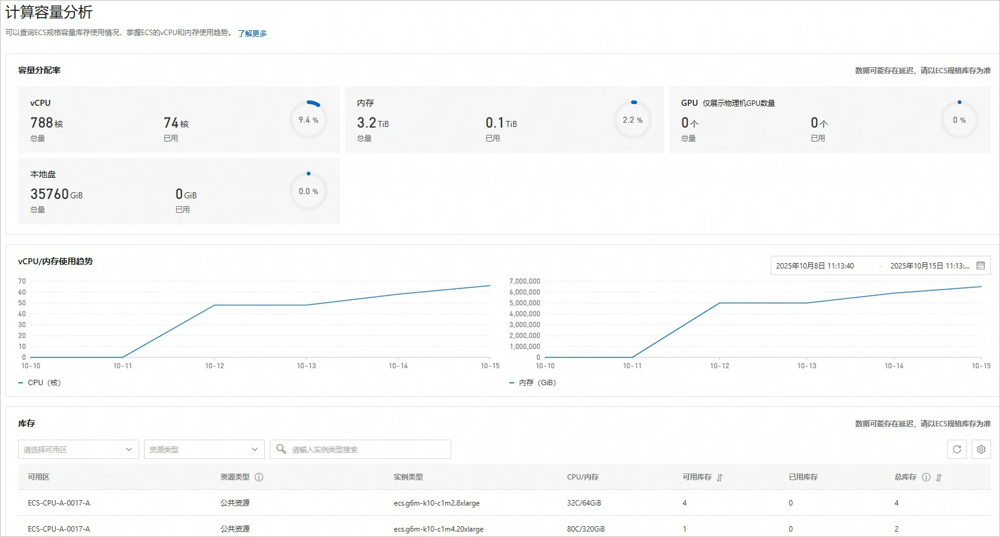

   - **容量分配率**：在**容量分配率**区域，您可以查看ECS实例规格各指标的库存使用情况，包括vCPU、内存、GPU和本地盘的库存总量、已用量和库存使用率。

   - **vCPU/内存使用趋势**：在**vCPU/内存使用趋势**区域，您可以查看在该区域右上方选择查询时间段，并查看vCPU和内存使用趋势。

     > **说明**
     >
     > 将鼠标悬停在折线图上，系统将显示当天对应指标的具体数值。

   - **库存**：在**库存**区域，您可以在该区域左上方选择可用区和资源类型，输入规格，查看对应的库存信息。

<a id="section-2-6-2"></a>

### 2.6.2. 规格管理

<a id="section-2-6-2-1"></a>

#### 2.6.2.1. 全部规格

在计算运维控制台，您可以查看全部规格（标准规格和自定义规格）及其信息。

**注意事项**

- 全部规格页面可以管理该region内所有的标准规格和自定义规格，无法管理DDH规格。

- 天宫规格、总库存为0的规格即使状态为**已启用**，也无法在ASCM平台上看到。

- 对规格进行上下线操作后，请在规格状态变为**已启用**或**已禁用**之前不要进行任何操作。

**操作步骤**

1. 登录Apsara Uni-manager运维控制台。

2. 在顶部菜单栏，选择**产品运维 > 计算运维 > 计算运维控制台**。

3. 在左侧导航栏，选择**规格容量运维 > 规格管理**。

4. 在**全部规格**页签的左上方文本框，选择规格族并输入规格名称，实现精确查找。

5. 查看目标规格的名称、规格族、状态、CPU核数(vCPU)、内存(GiB)、最大挂载云盘数量、最大挂载弹性网卡数量、最大网络带宽(Gbps)和网络收发包（万PPS）。

6. 管理全部规格。

   | 操作 | 操作步骤 |
   | --- | --- |
   | 查看详情 | 单击目标规格<strong>操作</strong>列的<strong>详情</strong>，查看目标规格的基本信息和拓展属性信息。 |
   | 禁用规格（包括标准规格和自定义规格） | i. 单击目标规格<strong>操作</strong>列的<strong>禁用</strong>。ii. 在弹出的对话框，输入操作原因，单击<strong>确定</strong>。<br>说明<br>• 已创建实例的规格不允许禁用。<br>• 后续如果需要继续使用该规格，您可以找到待启用的目标规格，在<strong>操作</strong>列单击<strong>启用</strong>。<br>• 禁用或启用实例规格后，不会立刻生效，需要等待系统同步时间。<br>• 对规格进行禁用或启用操作后，在规格状态变为<strong>已禁用</strong>或<strong>已启用</strong>之前请不要对该规格进行任何操作。 |
   | 查看操作记录 | 单击目标规格<strong>操作</strong>列的<strong>操作记录</strong>，可以查看目标规格的ASO操作历史和POP API调用历史。 |

<a id="section-2-6-2-2"></a>

#### 2.6.2.2. 自定义规格

<a id="section-2-6-2-2-1"></a>

##### 2.6.2.2.1. 添加自定义规格

在已有实例规格不能满足要求时，您可以在ECS运维管控平台添加自定义规格，然后创建自定义规格的实例。

**背景信息**

自定义规格对应的规格族格式为 实例规格族`.c`（`CPU`核数）`m`（内存大小）`.customize.XXX` （其中 `XXX` 为您手动输入的自定义规格描述），支持设置实例规格自定义名称、vCPU大小和内存大小，网络带宽能力、网络收发包能力、多队列等参数自动生成。

> **说明**
>
> SSD本地盘实例和SSD本地盘实例会增加本地盘数量参数，具体以Apsara Uni-manager运维控制台显示为准。

**使用说明**

支持添加自定义规格的规格族将会根据您环境的实际情况显示在Apsara Uni-manager运维控制台上，您可以在规格族列表中选择符合需求的规格族来添加自定义规格。更多实例规格族信息，请参见专有云文档中心<em>《云服务器ECS实例规格族&实例规格简介》</em>文档。

> **重要**
>
> 已添加的ecs.anyshare可以继续使用。

**操作步骤**

1. 登录Apsara Uni-manager运维控制台。

2. 在顶部菜单栏，选择**产品运维 > 计算运维 > 计算运维控制台**。

3. 在左侧导航栏，选择**规格容量运维 > 规格管理**。

4. 在**自定义规格**页签，单击**新增规格**。

5. 配置相关参数，然后单击**新增**。

   > **说明**
   >
   > 实例规格添加完成后，不会立刻生效，需要等待系统同步。

   参数配置说明如下表所示。

   | 参数 | 说明 |
   | --- | --- |
   | 规格族 | 必填项。仅支持在<strong>规格族</strong>列表中选择一个实例规格族。<br>说明支持选择的实例规格族以Apsara Uni-manager运维控制台显示为准。 |
   | 实例规格名称 | 自定义的实例规格名称为<code> </code>实例规格族<code>.c</code>（<code>CPU</code>核数）<code>m</code>（内存大小）<code>.customize.XXX </code>，具体说明如下：<br>重要<br>• 自定义SSD本地盘实例规格名称：<code> </code>实例规格族<code>.c</code>（<code>CPU</code>核数）<code>m</code>（内存大小）<code>i</code>（<code>SSD</code>本地盘数量）<code>.customize.XXX </code><br>• 自定义HDD本地盘实例规格名称：<code> </code>实例规格族<code>.c</code>（<code>CPU</code>核数）<code>m</code>（内存大小）<code>d</code>（<code>HDD</code>本地盘数量）<code>.customize.XXX </code><br>• <code> </code>实例规格族<code> </code>为您选择的<strong>规格族</strong>。<br>• <code> c</code>（<code>CPU</code>核数）<code>m</code>（内存大小）<code> </code>不允许修改，其中<code> c</code>（<code>CPU</code>核数）<code> </code>和<code> m</code>（内存大小）<code> </code>会在您配置<strong>CPU核数（vCPU）</strong>和<strong>内存大</strong><strong>小(GiB)</strong>参数后自动生成。<br>• <code> XXX </code>即为您手动输入的该自定义规格描述，最多支持输入10个小写英文字母，允许为空。<br>示例实例规格名称：<code> ecs.s6-k.c1m1.customize.test </code>。 |
   | CPU核数（vCPU） | 必填项。虚拟CPU，在参数配置中为变量。CPU为1或者大于1的偶数。<br>重要请勿超过物理机的最大核数，否则将提示错误并且无法成功添加该规格。 |
   | 内存大小(GiB) | 必填项。虚拟内存，在参数配置中为变量。内存大小为1或者大于1的偶数。<br>重要请勿超过物理机的内存大小，否则将提示错误并且无法成功添加该规格。 |
   | GPU数量 | 在<strong>规格族</strong>选择GPU规格族时生效，取值为0、1、2、3、4、8。 |
   | GPU规格 | 在<strong>规格族</strong>选择GPU规格族时生效，仅显示，不能编辑。 |
   | 本地盘数量（盘） | 在<strong>规格族</strong>选择本地盘规格族时生效，取值为0、1或大于1的整数。 |
   | 本地盘单盘可用存储容量（GB） | 在<strong>规格族</strong>选择本地盘规格族时生效，仅显示，不能编辑。 |
   | 本地盘磁盘类型 | 在<strong>规格族</strong>选择本地盘规格族时生效，仅显示，不能编辑。 |

   

   

   <table>
     <tr>
       <td>最大挂载云盘数量</td>
       <td>系统根据计算公式自动生成。仅显示，不能编辑。</td>
     </tr>
     <tr>
       <td>最大挂载弹性网卡数量</td>
       <td>系统根据计算公式自动生成。仅显示，不能编辑。</td>
     </tr>
     <tr>
       <td>最大网络带宽(Gbps)</td>
       <td>系统根据计算公式自动生成。您可以基于实际情况修改。<br>重要请勿超过物理机的最大网络带宽，否则将提示错误并且无法成功添加该规格。</td>
     </tr>
     <tr>
       <td>网络收发包（万PPS）</td>
       <td>系统根据计算公式自动生成。您可以基于实际情况修改。<br>重要请勿超过物理机的最大网络收发包速率，否则将提示错误并且无法成功添加该规格。</td>
     </tr>
     <tr>
       <td>操作原因</td>
       <td>必填项。输入操作原因。</td>
     </tr>
   </table>

**执行结果**

新的自定义规格出现在自定义规格列表中。添加自定义规格后，您可以创建自定义规格的实例，选择您已添加的自定义规格即可。具体操作，请参见专有云文档中心<em>《云服务器ECS用户指南》</em>的**实例 > 创建实例**章节。

<a id="section-2-6-2-2-2"></a>

##### 2.6.2.2.2. 查看自定义规格

在计算运维控制台中，您可以查看已添加的自定义规格信息及其详情内容。

**操作步骤**

1. 登录Apsara Uni-manager运维控制台。

2. 在顶部菜单栏，选择**产品运维 > 计算运维 > 计算运维控制台**。

3. 在左侧导航栏，选择**规格容量运维 > 规格管理**。

4. 在**全部规格**或**自定义规格**页签的左上方文本框，输入规格名称，实现精确查找。

5. 查看目标实例规格的规格族、规格名称、CPU核数(vCPU)、内存(GiB)、最大挂载云盘数量、最大挂载弹性网卡数量、最大网络带宽(Gbps)和网络收发包能力(万PPS)。

6. 单击目标实例规格的**操作**列中的**详情**，查看实例规格的基本信息和拓展属性。

<a id="section-2-6-2-2-3"></a>

##### 2.6.2.2.3. 禁用自定义规格

在计算运维控制台，您可以禁用不再使用的自定义规格。禁用自定义规格后，在创建新的实例时不能再选择该规格。

**操作步骤**

1. 登录Apsara Uni-manager运维控制台。

2. 在顶部菜单栏，选择**产品运维 > 计算运维 > 计算运维控制台**。

3. 在左侧导航栏，选择**规格容量运维 > 规格管理**。

4. 在**全部规格**或**自定义规格**页签中，找到待禁用的自定义规格，在**操作**列单击**禁用**。

5. 在弹出的对话框，输入操作原因，单击**确定**。

   > **说明**
   >
   > - 已创建实例的自定义规格不允许禁用。
   >
   > - 后续如果需要继续使用该自定义规格，您可以找到待启用的自定义规格，在**操作**列单击**启用**。
   >
   > - 禁用或启用实例规格后，不会立刻生效，需要等待系统同步时间。
   >
   > - 对规格进行禁用或启用操作后，在规格状态变为**已禁用**或**已启用**之前请不要对该规格进行任何操作。

<a id="section-2-6-2-2-4"></a>

##### 2.6.2.2.4. 查看审计日志

您可以查看自定义规格实例的操作历史和POP API调用历史。

**操作步骤**

1. 登录Apsara Uni-manager运维控制台。

2. 在顶部菜单栏，选择**产品运维 > 计算运维 > 计算运维控制台**。

3. 在左侧导航栏，选择**规格容量运维 > 规格管理**。

4. 在**全部规格**或**自定义规格**页签中，在目标实例规格的**操作**列，单击**操作记录**。

5. 在弹出的**操作记录**面板，查看ASO操作历史和POP API调用历史。

<a id="section-2-6-3"></a>

### 2.6.3. 资源预留

<a id="section-2-6-3-1"></a>

#### 2.6.3.1. 实例关联预留

本文介绍如何为ECS实例提供资源预留，保障实例故障触发HA时，计算集群有足够的可用资源。

**操作步骤**

1. 登录Apsara Uni-manager运维控制台。

2. 在顶部菜单栏，选择**产品运维 > 计算运维 > 计算运维控制台**。

3. 在左侧导航栏，选择**规格容量运维 > 资源预留**。

   系统默认进入**实例关联预留**页签。您可以在查看已预留资源的实例相关信息，支持通过实例ID、预留名称、状态和创建时间进行精确筛选。

4. 在左上角单击**创建实例预留**，在弹出框中输入需要预留的实例ID、预留名称、失效时间和预留说明。

5. 确认无误后单击**确定**，完成ECS实例的资源预留。

   > **重要**
   >
   > - 为指定的ECS实例提供1V1的资源预留能力，实例需要处于运行中或者已停止状态。
   >
   > - 实例资源预留创建成功后，会在其他非指定ECS实例所在的物理机上扣减资源提供预留。
   >
   > - 冷迁移（含宕机迁移）以及热迁移到预留物理机后会使用该预留资源。
   >
   > - 超过失效时间后6小时内状态自动流转。

<a id="section-2-6-3-2"></a>

#### 2.6.3.2. 物理机预留

本文介绍如何对物理机进行资源预留，保障物理机故障触发HA时，计算集群有足够的可用资源。

**注意事项**

- 为指定的ECS物理机提供资源预留能力，物理机上不能存在实例。

- 创建后物理机将会流转到预留锁定状态，并扣减库存。

**操作步骤**

1. 登录Apsara Uni-manager运维控制台。

2. 在顶部菜单栏，选择**产品运维 > 计算运维 > 计算运维控制台**。

3. 在左侧导航栏，选择**规格容量运维 > 资源预留**。

4. 选择**物理机预留**页签，您可以在查看已预留资源的物理机相关信息，支持通过物理机IP、预留名称、状态和创建时间进行精确筛选。

5. 在左上角单击**创建物理机预留**，在弹出框中输入需要预留的物理机IP、预留名称、失效时间和预留说明。

6. 确认无误后单击**确定**，完成物理机的资源预留。

<a id="section-2-7"></a>

## 2.7. 迁移任务管理

<a id="section-2-7-1"></a>

### 2.7.1. 管理迁移任务

<a id="section-2-7-1-1"></a>

#### 2.7.1.1. 创建单台ECS实例迁移任务

当实例或NC出现故障时，您可以通过实例迁移方式确保系统的稳定性，即将实例从某个NC迁移至其他正常的NC。本文为您介绍创建单台ECS实例迁移任务的具体操作。

**使用限制**

当待迁移的实例存在以下情况时不支持迁移：

> **说明**
>
> 更多不支持迁移的限制以控制台显示为准。

**热迁移**

- 状态不为**运行中**（running）

- 专有宿主机实例

- GPU实例

- 本地盘实例

- 该实例存在一个运行中的迁移任务

- 实例携带了Trunk或者Member网卡

- 实例规格过大

- 实例挂载了ISO

**冷迁移**

- 状态不为**待启动**（Pending）或**停止**（Shutted）的实例。

- 专有宿主机实例

- 本地盘实例

- 实例携带了Trunk或者Member网卡

- 实例挂载了ISO

**操作步骤**

> **说明**
>
> 您也可以在**ECS实例**页面找到目标ECS实例，然后为该实例创建迁移任务。具体操作，请参见迁移实例。

1. 登录Apsara Uni-manager运维控制台。

2. 在顶部菜单栏，选择**产品运维 > 计算运维 > 计算运维控制台**。

3. 在左侧导航栏，单击**迁移任务管理**。

   默认进入**任务列表**页签下的**ECS迁移任务**页签。

4. 在迁移任务列表上方，单击**创建ECS迁移任务**。

5. 在**创建ECS迁移任务**页面，配置参数项。

   - **冷迁移**：冷迁移是一种将停止状态的虚拟机从一个物理宿主机迁移到其它物理宿主机的技术，只能迁移状态为**待启动**（Pending）或**停止**（Shutted）的实例。

     > **重要**
     >
     > - 该功能是在ASO创建一个ECS冷迁移的调度任务，具体任务执行情况可以在任务列表或该ECS详情页查看。
     >
     > - 最终ECS的停留状态会按照任务配置参数执行。
     >
     > - 如冷迁移失败请查看迁移任务结果信息，再根据ECS日志排查具体原因。
     >
     > - 专属资源池实例只允许在专属资源池内迁移。

     <table>
       <tr>
         <th>配置区域</th>
         <th>参数项</th>
         <th>说明</th>
       </tr>
       <tr>
         <td>实例信息</td>
         <td>选择实例</td>
         <td>选择待迁移的实例。在实例列表上方的搜索框中输入待迁移的实例ID，然后在实例列表中选中该实例。<br>重要仅支持选择1台ECS实例。</td>
       </tr>
       <tr>
         <td rowspan="2">目标选择</td>
         <td>目标选择策略</td>
         <td>• <strong>随机选择</strong>：默认目标物理机选择方式，实例随机迁移至资源充足的机器上。<br>• <strong>系统推荐</strong>：系统经过过滤后筛选出的迁移成功率较高的目标物理机。<br>重要如果主机列表中数据为空，则说明没有符合条件的目标物理机，建议选择其他策略。<br>• <strong>指定NC</strong>：手动指定实例迁移机器。在NC列表上方先根据集群、主机名、NC IP或NC ID搜索目标机器，然后选中1台作为目标物理机。<br>说明系统会对每1台物理机是否适合选择给出建议以供参考，但不影响目标物理机的选中，即您也可以根据实际情况，选中<strong>不建议</strong>的NC。<br>• <strong>指定集群</strong>：手动指定实例迁移的集群。在集群列表上方先根据集群名称搜索目标集群，然后选中1个作为目标集群。<br>说明系统会对每1个集群是否适合选择给出建议以供参考，但不影响目标集群的选中，即您也可以根据实际情况，选中<strong>不建议</strong>的集群。</td>
       </tr>
       <tr>
         <td>恢复模式</td>
         <td>选择实例迁移后机器的运行状态，取值范围：<br>• 迁移后启动<br>• 迁移后停机</td>
       </tr>
       <tr>
         <td>操作信息</td>
         <td>操作原因</td>
         <td>输入实例进行冷迁移的原因。</td>
       </tr>
     </table>

   - **热迁移**：热迁移是一种将运行状态的虚拟机从一个物理宿主机迁移到其它物理宿主机的技术，只能迁移状态为**运行中**的实例。

     > **重要**
     >
     > - 该功能是在ASO创建一个ECS热迁移的调度任务，具体任务执行情况可以在任务列表或该ECS详情页查看。
     >
     > - 普通热迁移要求源端宿主机与目地端宿主机CPU型号一致，开启增强热迁移兼容性可以跨CPU型号迁移。
     >
     > - 频繁迁移ECS会导致ECS管控服务锁住该ECS热迁移等操作，可以再次尝试或按照KB增加更多NO_CHECK参数操作。
     >
     > - 神龙实例请在【迁移高级参数配置】中将【允许业务中断时间】设置为2000ms。
     >
     > - 专属资源池实例只允许在专属资源池内迁移。

     **配置区域**

     **参数项**

     **说明**

     选择待迁移的实例。在实例列表上方的搜索框中输入待迁移的实例ID，然后在实例列表中选中该实例。

     **实例信息**

     **选择实例**

     > **重要**
     >
     > 仅支持选择1台ECS实例。

     输入迁移速率，单位为MBps。

     建议将迁移速率设置为500~1000MBps，该值为迁移

     **迁移基本参数配置**

     **迁移速率**

     任务的理论最大带宽限制。实际迁移速率可能因物理机的操作系统、网络带宽、CPU负载及存储I/O等因素低于设定值。

     启用该模式会在普通迁移的基础上，支持将ECS实例迁移到可用的跨代CPU型号的物理机上。CPU型号的兼容性信息，请参见查看CPU兼容性配置。

     **增强热迁移兼容性**

     > **重要**
     >
     > 开启该功能后，如果**目标选择策略**设置为**系统推荐**策略，将会额外展示可用的跨代CPU型号的物理机。

     - **随机选择**：默认目标物理机选择方式，实例随机迁移至资源充足的机器上。

     - **系统推荐**：系统经过过滤后筛选出的迁移成功率较高的目标物理机。

       > **说明**
       >
       > 如果主机列表中数据为空，则说明没有符合条件的目标物理机，建议选择其他策略。

     **目标选择**

     - **指定NC**：手动指定实例迁移的机器，存在迁移失败的风险。在NC列表上方先根据集群、主机名、NC IP或NC ID搜索目标机器，然后选中1台作为目标物理机。

     **目标选择策略**

     > **说明**
     >
     > 系统会对每1台物理机是否适合选择给出建议以供参考，但不影响目标物理机的选中，即您也可以根据实际情况，选中**不建议**的NC。

     - **指定集群**：手动指定实例迁移的集群。在集群列表上方先根据集群名称搜索目标集群，然后选中1个作为目标集群。

       > **说明**
       >
       > 系统会对每1个集群是否适合选择给出建议以供参考，但不影响目标集群的选中，即您也可以根据实际情况，选中**不建议**的集群。

     热迁移最后阶段的业务中断时间。单位：ms。

     - 取值范围：200~2000。

     **允许业务中断时间**

     - 默认值：300。

     - 取值范围：

       - **是**：检查待迁移实例是否挂载SLB，如果已挂载，迁移任务可能会失败。

     **检查SLB**

     - **否**：不检查SLB，直接略过该检查进行迁移。

     - 默认值：**否**。

     - 取值范围：

       - **是**：检查源宿主机与目标宿主机的AVS版本是否一致。如果不一致，迁移任务会失败。

     **迁移高级参数配置**

     **检查AVS版本**

     - **否**：不检查AVS版本，直接略过该检查进行迁移，当AVS版本跨度过大时，可能导致实例迁移

     > **说明**

     失败。

     > - 您也可以单

     - 默认值：**是**。

     > 击**配置说明**，查看该区域下的参

     - 取值范围：

     > 数说明。

     - **是**：检查目标宿主机的虚拟化版本是否能够进行

     > - 设置迁移高

     热迁移。如果不能，迁移任务会失败。

     > 级参数可以

     **检查NC的虚拟化版**

     > 增加迁移的

     - **否**：不检查虚拟化版本，直接略过该检查进行迁

     **本**

     > 成功率，但

     移，当虚拟化版本跨度过大时，可能导致实例迁

     > 您需要结合

     移失败。

     > 实际业务情况进行配

     - 默认值：**是**。

     > 置。

     - 取值范围：

       - **是**：允许将实例迁移到预留的宿主机上。

     **允许使用预留NC**

     - **否**：不允许将实例迁移到预留的宿主机上。

     - 默认值：**否**。

     - 取值范围：

       - **是**：检查源宿主机的CPU标签集是否为目的宿主机标签集的子集。如果不是，迁移任务会失败。

     **检查CPU标志**

     - **否**：不检查宿主机的标签集，直接略过该检查进行迁移。如果目标宿主机缺少关键标签，可能导致实例迁移后运行异常。

     - 默认值：**是**。

     - 取值范围：

       - **是**：检查镜像是否能够进行热迁移，若不能，迁移任务将会失败。

     **检查镜像**

     - **否**：不检查镜像，直接略过进行迁移，可能导致实例迁移失败。

     - 默认值：**是**。

     输入实例进行热迁移的原因。

     **操作信息**

     **操作原因**

6. 检查无误后，勾选**我已阅读上述提示，并确认操作**。

7. 冷迁移单击**提交**，热迁移需单击**迁移前置检查**，等待预检通过后单击**提交**。

   您可以在迁移任务列表中查看迁移任务的执行情况。具体操作，请参见查看迁移任务。

<a id="section-2-7-1-2"></a>

#### 2.7.1.2. 创建整机迁移任务

本文介绍如何将计算服务器上的所有ECS实例迁移到其他计算服务器上。

**前提条件**

服务器状态必须为**正常**（ `free` ）或**运维锁定**（ `mlock` ）。

**使用场景**

在计算服务器缩容、服务器维修等场景下，您需要将该服务器上所有的ECS实例迁出，然后才可以对服务器进行操作。此时，可以使用整机迁移，将所有的ECS实例迁移到其他计算服务器上。

**注意事项**

使用整机迁移时，请先了解以下事项：

- 提交迁移任务之后服务器将进入运维锁定状态，任务完成、失败或取消之后需要手动提交解锁。

- 整机迁移任务会根据ECS调度规则，尽量将服务器上的ECS迁到其他服务器，迁移结果受多方因素影响，不保证一次整机迁移任务一定成功。

- **停止**或**待启动**状态的ECS如果被迁移，将会保持ECS的原有状态。

- 整机迁移结束或成功后，必须再次检查服务器上是否有ECS残留。

- 专属资源池实例只允许在专属资源池内迁移。

**操作步骤**

> **说明**
>
> 您也可以在**计算服务器运维**页面找到待进行整机迁移的服务器，然后为该服务器创建整机迁移任务。具体操作，请参见整机迁移。

1. 登录Apsara Uni-manager运维控制台。

2. 在顶部菜单栏，选择**产品运维 > 计算运维 > 计算运维控制台**。

3. 在左侧导航栏，单击**迁移任务管理**。

   默认进入**任务列表**页签下的**ECS迁移任务**页签。

4. 单击**整机迁移任务**页签，然后单击**创建整机迁移任务**。

5. 在**创建整机迁移任务**页面，配置参数项。

   **配置区域**

   **参数项**

   **说明**

   选择待进行整机迁移的服务器。在NC列表上方的搜索框中输入主机名、NC IP或NC ID，搜索服务器并选中作为源物理机。

   **迁移源NC**

   **选择机器**

   > **重要**
   >
   > 仅支持选择1台服务器。

   开启灰度迁移，会按照灰度策略先迁移一批实例，然后停止任务，需要用户主动恢复任务后才能继续迁移，修

   **开启灰度迁移**

   改灰度迁移策略请参见配置迁移约束。

   启用该模式会在普通迁移的基础上，支持将ECS实例迁移到可用的跨代CPU型号的物理机上。CPU型号的兼容

   **增强热迁移兼容性**

   性信息，请参见查看CPU兼容性配置。

   - **随机选择**：默认目标物理机选择方式。实例会随机迁移至资源充足的机器上。

   - **指定NC**：手动指定实例迁移的机器，存在迁移失败的风险。在NC列表上方先根据集群、主机名、NC IP或NC ID搜索目标机器，然后选中1台作为目标物理机。

     > **说明**
     >
     > 系统会对每1台物理机是否适合选择给出建议以供参考，但不影响目标物理机的选中，即您也可以根据实际情况，选中**不建议**的NC。

   **目标选择策略**

   **迁移目标配置**

   - **指定集群**：手动指定实例迁移的集群，存在迁移失败的风险。在集群列表上方先根据集群名称搜索目标集群，然后选中1个作为目标集群。

     > **说明**
     >
     > 系统会对每1个集群是否适合选择给出建议以供参考，但不影响目标集群的选中，即您也可以根据实际情况，选中**不建议**的集群。

   热迁移最后阶段的业务中断时间。单位：ms。

   - 取值范围：200~2000。

   **允许业务中断时间**

   - 默认值：300。

   - 取值范围：

     - **是**：检查待迁移实例是否挂载SLB，如果已挂载，迁移任务可能会失败。

   **检查SLB**

   - **否**：不检查SLB，直接略过该检查进行迁移。

   - 默认值：**否**。

   - 取值范围：

     - **是**：检查源宿主机与目标宿主机的AVS版本是否一致。如果不一致，迁移任务会失败。

   **检查AVS版本**

   - **否**：不检查AVS版本，直接略过该检查进行迁移，当AVS版本跨度过大时，可能导致实例迁移失败。

   - 默认值：**是**。

   - 取值范围：

     - **是**：检查目标宿主机的虚拟化版本是否能够进行热

   **迁移高级参数配置**

   迁移。如果不能，迁移任务会失败。

   **检查NC的虚拟化版**

   - **否**：不检查虚拟化版本，直接略过该检查进行迁

   > **说明**

   **本**

   移，当虚拟化版本跨度过大时，可能导致实例迁移

   > - 设置迁移高

   失败。

   > 级参数可以增加迁移的

   - 默认值：**是**。

   > 成功率，但您需要结合实际业务情

   - 取值范围：

   > 况进行配置。

   - **是**：允许将实例迁移到预留的宿主机上。

   **允许使用预留NC**

   > - 您也可以单

   - **否**：不允许将实例迁移到预留的宿主机上。

   > 击**配置说明**，查看该

   - 默认值：**否**。

   > 区域下的参数说明。

   - 取值范围：

     - **是**：检查源宿主机的CPU标签集是否为目的宿主机标签集的子集。如果不是，迁移任务会失败。

   **检查CPU标志**

   - **否**：不检查宿主机的标签集，直接略过该检查进行迁移。如果目标宿主机缺少关键标签，可能导致实例迁移后运行异常。

   - 默认值：**是**。

   - 取值范围：

     - **是**：检查镜像是否能够进行热迁移，若不能，迁移任务将会失败。

   **检查镜像**

   - **否**：不检查镜像，直接略过进行迁移，可能导致实例迁移失败。

   - 默认值：**是**。

   输入物理机进行整机迁移的原因。

   **操作信息**

   **操作原因**

6. 选中**我已阅读上述提示，并确认操作**，然后单击**提交**。

   - 您可以在迁移任务列表中查看迁移任务的执行情况。具体操作，请参见查看迁移任务。

   - 如果您不需要执行该迁移任务，则可以终止迁移任务。具体操作，请参见终止迁移任务。

<a id="section-2-7-1-3"></a>

#### 2.7.1.3. 创建批量迁移ECS实例任务

当实例或NC出现故障时，您可以通过故障迁移方式确保系统的稳定性，即将实例从某个NC迁移至其他正常的NC。除了单台实例和整机迁移外，还支持同时对多台实例进行迁移。本文为您介绍批量迁移ECS实例的方法。

**注意事项**

- 批量迁移任务会根据迁移目标配置尽量将这批ECS实例迁移到目标服务器，但受多方因素影响，不保证批量迁移任务一定会执行成功。

- 为提高批量任务的成功率，请尽量选择同一规格族的ECS实例。

- 仅支持批量迁移状态为**运行中**、**停止**或**待启动**的ECS实例。

- **停止**或**待启动**状态的ECS如果被迁移，会保持迁移前ECS实例的状态。

- 专属资源池实例只允许在专属资源池内迁移，为提高任务成功率，请尽量选择专属资源池ID相同的实例。

**使用限制**

当待迁移的实例存在以下情况时不支持迁移：

> **说明**
>
> 更多不支持迁移的限制以控制台显示为准。

**热迁移**

- 状态不为**运行中**（running）

- 专有宿主机实例

- GPU实例

- 本地盘实例

- 该实例存在一个运行中的迁移任务

- 实例携带了Trunk或者Member网卡

- 实例规格过大

- 实例挂载了ISO

**冷迁移**

- 状态不为**待启动**（Pending）或**停止**（Shutted）的实例。

- 专有宿主机实例

- 本地盘实例

- 实例携带了Trunk或者Member网卡

- 实例挂载了ISO

**操作步骤**

1. 登录Apsara Uni-manager运维控制台。

2. 在顶部菜单栏，选择**产品运维 > 计算运维 > 计算运维控制台**。

3. 在左侧导航栏，单击**迁移任务管理**。

   默认进入**任务列表**页签下的**ECS迁移任务**页签。

4. 单击**批量ECS迁移任务**页签，然后单击**创建批量迁移任务**。

5. 在**创建批量迁移任务**页面，配置参数项。

   **配置区域**

   **参数项**

   **说明**

   选择待迁移的多台ECS实例。

   您可以在实例列表上方输入实例ID，搜索待迁移的ECS实例，使用半角逗号（,）分隔。例如： `i-`

   **实例信息**

   **选择实例**

   ```text
   ez*****deuz,i-ez*****g4b4,i-
   ```

   `ez*****02zd` 。

   开启后，批量任务将分成不同批次进行迁移。

   **开启分批迁移**

   设置定时迁移时间后，批量迁移任务将在设置好的时间

   **迁移任务配置**

   **开启定时迁移**

   开始执行。

   开启定时迁移后，可以设置批量任务的执行时间。

   **定时迁移时间**

   开启灰度迁移，会按照灰度策略先迁移一批实例，然后停止任务，需要用户主动恢复任务后才能继续迁移，修

   **开启灰度迁移**

   改灰度迁移策略请参见配置迁移约束。

   启用该模式会在普通迁移的基础上，支持将ECS实例迁移到可用的跨代CPU型号的物理机上。CPU型号的兼容

   **增强热迁移兼容性**

   性信息，请参见查看CPU兼容性配置。

   - **随机选择**：默认目标物理机选择方式。实例会随机迁移至资源充足的机器上。

   **迁移目标配置**

   - **指定NC**：手动指定实例迁移的机器，存在迁移失败的风险。在NC列表上方先根据集群、主机名、NC IP或NC ID搜索目标机器，然后选中1台作为目标物理机。

     > **说明**
     >
     > 系统会对每1台物理机是否适合选择给出建议以供参考，但不影响目标物理机的选中，即您也可以根据实际情况，选中**不建议**的NC。

   **目标选择策略**

   - **指定集群**：手动指定实例迁移的集群，存在迁移失败的风险。在集群列表上方先根据集群名称搜索目标集群，然后选中1个作为目标集群。

     > **说明**
     >
     > 系统会对每1个集群是否适合选择给出建议以供参考，但不影响目标集群的选中，即您也可以根据实际情况，选中**不建议**的集群。

   热迁移最后阶段的业务中断时间。单位：ms。

   - 取值范围：200~2000。

   **允许业务中断时间**

   - 默认值：300。

   - 取值范围：

     - **是**：检查待迁移实例是否挂载SLB，如果已挂载，迁移任务可能会失败。

   **检查SLB**

   - **否**：不检查SLB，直接略过该检查进行迁移。

   - 默认值：**否**。

   - 取值范围：

     - **是**：检查源宿主机与目标宿主机的AVS版本是否一致。如果不一致，迁移任务会失败。

   **检查AVS版本**

   - **否**：不检查AVS版本，直接略过该检查进行迁移，当AVS版本跨度过大时，可能导致实例迁移失败。

   - 默认值：**是**。

   **迁移高级参数配置**

   - 取值范围：

     - **是**：检查目标宿主机的虚拟化版本是否能够进行热迁移。如果不能，迁移任务会失败。

   **检查NC的虚拟化版**

   - **否**：不检查虚拟化版本，直接略过该检查进行迁

   **本**

   移，当虚拟化版本跨度过大时，可能导致实例迁移失败。

   - 默认值：**是**。

   > **说明**

   - 取值范围：

   > - 设置迁移高

   - **是**：允许将实例迁移到预留的宿主机上。

   > 级参数可以

   **允许使用预留NC**

   - **否**：不允许将实例迁移到预留的宿主机上。

   > 增加迁移的成功率，但

   - 默认值：**否**。

   > 您需要结合实际业务情况进行配置。

   - 取值范围：

   > - 您也可以单

   - **是**：检查源宿主机的CPU标签集是否为目的宿主机

   > 击**配置说**

   标签集的子集。如果不是，迁移任务会失败。

   > **明**，查看该

   **检查CPU标志**

   - **否**：不检查宿主机的标签集，直接略过该检查进行

   > 区域下的参

   迁移。如果目标宿主机缺少关键标签，可能导致实

   > 数说明。

   例迁移后运行异常。

   - 默认值：**是**。

   - 取值范围：

     - **是**：检查镜像是否能够进行热迁移，若不能，迁移任务将会失败。

   **检查镜像**

   - **否**：不检查镜像，直接略过进行迁移，可能导致实例迁移失败。

   - 默认值：**是**。

   输入批量迁移ECS实例的原因。

   **操作信息**

   **操作原因**

6. 选中**我已阅读上述提示，并确认操作**，然后单击**提交**。

   - 您可以在迁移任务列表中查看迁移任务的执行情况。具体操作，请参见查看迁移任务。

   - 如果您不需要执行该迁移任务，则可以终止迁移任务。具体操作，请参见终止迁移任务。

<a id="section-2-7-1-4"></a>

#### 2.7.1.4. 创建批量整机迁移任务

本文介绍如何批量将计算服务器上的所有ECS实例迁移到其他计算服务器上。

**注意事项**

使用批量整机迁移时，请先了解以下事项：

- 提交迁移任务之后服务器将进入运维锁定状态，任务完成、失败或取消之后需要手动提交解锁。

- 迁移结果受多方因素影响，不保证一定成功，您可以通过任务详情查看每一台ECS的详细迁移信息。

- **停止**或**待启动**状态的ECS如果被迁移，将会保持ECS的原有状态。

- 专属资源池实例只允许在专属资源池内迁移，为了提供任务成功率，尽量选择专属资源池ID相同的物理机。

**操作步骤**

1. 登录Apsara Uni-manager运维控制台。

2. 在顶部菜单栏，选择**产品运维 > 计算运维 > 计算运维控制台**。

3. 在左侧导航栏，单击**迁移任务管理**。

   默认进入**任务列表**页签下的**ECS迁移任务**页签。

4. 单击**批量整机迁移任务**页签，然后单击**创建批量整机迁移任务**。

5. 在**创建批量整机迁移任务**页面，配置参数项。

   **配置区域**

   **参数项**

   **说明**

   选择待进行整机迁移的服务器。在NC列表上方的搜索框中输入主机名、NC IP或NC ID，搜索服务器并选中作为源物理机。

   **迁移源NC**

   **选择机器**

   > **说明**
   >
   > 您可以批量选择需要迁移的服务器，支持多台服务器一键清空。

   开启灰度迁移，批量整机迁移任务将会在迁移完部分物理机（默认为1台）后停止任务，需要用户主动恢复任务

   **开启灰度迁移**

   后才能继续迁移，修改灰度迁移策略请参见配置迁移约束。

   启用该模式会在普通迁移的基础上，支持将ECS实例迁

   **迁移目标配置**

   移到可用的跨代CPU型号的物理机上。CPU型号的兼容

   **增强热迁移兼容性**

   性信息，请参见查看CPU兼容性配置。

   **随机选择**：默认目标物理机选择方式。实例会随机迁移

   **目标选择策略**

   至资源充足的机器上。

   热迁移最后阶段的业务中断时间。单位：ms。

   - 取值范围：200~2000。

   **允许业务中断时间**

   - 默认值：300。

   - 取值范围：

     - **是**：检查待迁移实例是否挂载SLB，如果已挂载，迁移任务可能会失败。

   **检查SLB**

   - **否**：不检查SLB，直接略过该检查进行迁移。

   - 默认值：**否**。

   - 取值范围：

     - **是**：检查源宿主机与目标宿主机的AVS版本是否一致。如果不一致，迁移任务会失败。

   **检查AVS版本**

   - **否**：不检查AVS版本，直接略过该检查进行迁移，当AVS版本跨度过大时，可能导致实例迁移失败。

   - 默认值：**是**。

   **迁移高级参数配置**

   > **说明**

   - 取值范围：

   > - 设置迁移高

   - **是**：检查目标宿主机的虚拟化版本是否能够进行热

   > 级参数可以

   迁移。如果不能，迁移任务会失败。

   > 增加迁移的

   **检查NC的虚拟化版**

   - **否**：不检查虚拟化版本，直接略过该检查进行迁

   > 成功率，但

   **本**

   移，当虚拟化版本跨度过大时，可能导致实例迁移

   > 您需要结合

   失败。

   > 实际业务情况进行配

   - 默认值：**是**。

   > 置。
   >
   > - 您也可以单击**配置说**

   - 取值范围：

   > **明**，查看该区域下的参

   - **是**：允许将实例迁移到预留的宿主机上。

   > 数说明。

   **允许使用预留NC**

   - **否**：不允许将实例迁移到预留的宿主机上。

   - 默认值：**否**。

   - 取值范围：

     - **是**：检查源宿主机的CPU标签集是否为目的宿主机标签集的子集。如果不是，迁移任务会失败。

   **检查CPU标志**

   - **否**：不检查宿主机的标签集，直接略过该检查进行迁移。如果目标宿主机缺少关键标签，可能导致实例迁移后运行异常。

   - 默认值：**是**。

   - 取值范围：

     - **是**：检查镜像是否能够进行热迁移，若不能，迁移任务将会失败。

   **检查镜像**

   - **否**：不检查镜像，直接略过进行迁移，可能导致实例迁移失败。

   - 默认值：**是**。

   输入物理机进行整机迁移的原因。

   **操作信息**

   **操作原因**

6. 选中**我已阅读上述提示，并确认操作**，然后单击**提交**。

   - 您可以在迁移任务列表中查看迁移任务的执行情况。具体操作，请参见查看迁移任务。

   - 如果您不需要执行该迁移任务，则可以终止迁移任务。具体操作，请参见终止迁移任务。

<a id="section-2-7-1-5"></a>

#### 2.7.1.5. 创建集群迁移任务

本文介绍如何将计算集群上所有物理机迁移到其他计算集群上。

**注意事项**

集群迁移将会尽可能的清空集群内的所有物理机，请先了解以下注意事项：

- 提交迁移任务之后集群内的物理机都将进入运维锁定状态，任务成功/失败后需要手动提交解锁。

- 迁移可能受多方因素影响不一定成功，您可以通过任务详情查看每一台ECS的详细迁移信息。

- **停止**或**待启动**状态的ECS如果被迁移，会保持原来的状态。

**操作步骤**

1. 登录Apsara Uni-manager运维控制台。

2. 在顶部菜单栏，选择**产品运维 > 计算运维 > 计算运维控制台**。

3. 在左侧导航栏，单击**迁移任务管理**。

   默认进入**任务列表**页签下的**ECS迁移任务**页签。

4. 单击**集群迁移任务**页签，然后单击**创建集群迁移任务**。

5. 在**创建集群迁移任务**页面，配置参数项。

   **配置区域**

   **参数项**

   **说明**

   选择待进行集群迁移的计算集群。在列表上方的搜索框

   **集群名**

   **选择集群**

   中输入集群名进行搜索。

   开启灰度迁移，集群迁移任务将会在迁移完部分物理机（默认为1台）后停止任务，需要用户主动恢复任务后才

   **开启灰度迁移**

   能继续迁移，修改灰度迁移策略请参见配置迁移约束。

   启用该模式会在普通迁移的基础上，支持将ECS实例迁移到可用的跨代CPU型号的物理机上。CPU型号的兼容

   **迁移目标配置**

   **增强热迁移兼容性**

   性信息，请参见查看CPU兼容性配置。

   **随机选择**：默认目标集群选择方式。实例会随机迁移至

   **目标选择策略**

   资源充足的机器上。

   热迁移最后阶段的业务中断时间。单位：ms。

   - 取值范围：200~2000。

   **允许业务中断时间**

   - 默认值：300。

   - 取值范围：

     - **是**：检查待迁移实例是否挂载SLB，如果已挂载，迁移任务可能会失败。

   **检查SLB**

   - **否**：不检查SLB，直接略过该检查进行迁移。

   - 默认值：**否**。

   - 取值范围：

     - **是**：检查源宿主机与目标宿主机的AVS版本是否一致。如果不一致，迁移任务会失败。

   **检查AVS版本**

   - **否**：不检查AVS版本，直接略过该检查进行迁移，当AVS版本跨度过大时，可能导致实例迁移失败。

   - 默认值：**是**。

   **迁移高级参数配置**

   > **说明**

   - 取值范围：

   > - 设置迁移高

   - **是**：检查目标宿主机的虚拟化版本是否能够进行热

   > 级参数可以

   迁移。如果不能，迁移任务会失败。

   > 增加迁移的

   - **否**：不检查虚拟化版本，直接略过该检查进行迁

   > 成功率，但

   **检查NC的虚拟化版**

   移，当虚拟化版本跨度过大时，可能导致实例迁移

   > 您需要结合

   **本**

   失败。

   > 实际业务情况进行配

   - 默认值：**是**。

   > 置。
   >
   > - 您也可以单击**配置说明**，查看该区域下的参

   - 取值范围：

   > 数说明。

   - **是**：允许将实例迁移到预留的宿主机上。

   **允许使用预留NC**

   - **否**：不允许将实例迁移到预留的宿主机上。

   - 默认值：**否**。

   - 取值范围：

     - **是**：检查源宿主机的CPU标签集是否为目的宿主机标签集的子集。如果不是，迁移任务会失败。

   **检查CPU标志**

   - **否**：不检查宿主机的标签集，直接略过该检查进行迁移。如果目标宿主机缺少关键标签，可能导致实例迁移后运行异常。

   - 默认值：**是**。

   - 取值范围：

     - **是**：检查镜像是否能够进行热迁移，若不能，迁移任务将会失败。

   **检查镜像**

   - **否**：不检查镜像，直接略过进行迁移，可能导致实例迁移失败。

   - 默认值：**是**。

   输入集群迁移的原因。

   **操作信息**

   **操作原因**

6. 选中**我已阅读上述提示，并确认操作**，然后单击**提交**。

   - 您可以在迁移任务列表中查看迁移任务的执行情况。具体操作，请参见查看迁移任务。

   - 如果您不需要执行该迁移任务，则可以终止迁移任务。具体操作，请参见终止迁移任务。

<a id="section-2-7-1-6"></a>

#### 2.7.1.6. 低峰期迁移任务

对于拥有大规模业务的客户而言，执行ECS热迁移操作可能会对业务运行产生较大的性能影响，甚至导致业务暂时中断或者出现响应迟缓的情况，从而影响到正常的业务连续性和用户体验。因此有必要对用户业务进行分析评估，找到业务低峰期，根据低峰时段推荐热迁移时间窗口，减少热迁移对用户的影响。

**创建低峰期迁移任务**

**前提条件**

已在配置迁移约束中开启了低峰期迁移任务。

**使用限制**

- 只有处于**运行中**（running）状态的实例会在低峰期迁移。

- 状态为**待启动**（Pending）或**停止**（Shutted）的实例会立即进行迁移，并且会保持原来的状态，不会进行低峰期的分析和事件推送。

- 环境中同时处于低峰期迁移流程的ECS最高支持100台；如果提交任务后，同时处于低峰期迁移流程的ECS超过100台，任务将会失败。

**操作步骤**

1. 登录Apsara Uni-manager运维控制台。

2. 在顶部菜单栏，选择**产品运维 > 计算运维 > 计算运维控制台**。

3. 在左侧导航栏，单击**迁移任务管理**。

   默认进入**任务列表**页签下的**ECS迁移任务**页签。

4. 在迁移任务列表上方，单击**低峰期迁移任务**页签。

5. 单击**创建低峰期迁移任务**，配置迁移参数。

   **配置区域**

   **参数项**

   **说明**

   选择待迁移的实例。在实例列表上方的搜索框中输入待迁移的实例ID、NC IP、NC ID、组织ID，然后在实例列表中选中该实例。

   **实例信息**

   **请选择实例**

   - 输入实例ID时，多个实例ID之间用,隔开，最多支持选择100台ECS实例。

   - 输入NC IP、NC ID、组织ID，每次只能输入一个。

   支持选择单个或多个负载进行分析。

   支持设置负载阈值，如果不设置，会使用默认阈值进行低峰期分析。

   **负载分析**

   在选择多个负载的情况下，最终的低峰期为多个负载低峰期的交集。

   启用该选项后，低峰期迁移事件会推送至租户侧运维事件，租户可以设置实例的迁移时间。具体操作，请参

   **是否推送给租户**

   见<strong>《云服务器ECS用户指南》</strong>中的<strong>《运维事件》</strong>章节。

   截止时间默认为2天，最迟7天。

   **迁移截止时间**

   **基本配置**

   - 是：如果用户未设置迁移时间，实例会在迁移截止时间前12小时内的最后一个低峰期窗口迁移；如果迁移截止时间前12小时内没有低峰期窗口，则在迁移截止时间进行迁移。用户设置迁移时间后，系统不再修改迁移时间。

   - 否：关闭该选项时，需要用户主动设置迁移时间；如

   **截止时间自动迁移**

   果用户一直未设置迁移时间，实例迁移计划会在截止时间后超时。

   启用该模式会在普通迁移的基础上，支持将ECS实例迁移到可用的跨代CPU型号的物理机上。CPU型号的兼容性信息，请参见查看CPU兼容性配置。

   **迁移目标配置**

   **增强热迁移兼容性**

   > **重要**
   >
   > 开启该功能后，如果**目标选择策略**设置为**系统推荐**策略，将会额外展示可用的跨代CPU型号的物理机。

   热迁移最后阶段的业务中断时间。单位：ms。

   - 取值范围：200~2000。

   **允许业务中断时间**

   - 默认值：300。

   - 取值范围：

     - **是**：检查待迁移实例是否挂载SLB，如果已挂载，迁移任务可能会失败。

   **检查SLB**

   - **否**：不检查SLB，直接略过该检查进行迁移。

   - 默认值：**否**。

   - 取值范围：

     - **是**：检查源宿主机与目标宿主机的AVS版本是否一致。如果不一致，迁移任务会失败。

   **检查AVS版本**

   **迁移高级参数配置**

   - **否**：不检查AVS版本，直接略过该检查进行迁移，当AVS版本跨度过大时，可能导致实例迁移失败。

   - 默认值：**是**。

   - 取值范围：

     - **是**：检查目标宿主机的虚拟化版本是否能够进行热迁移。如果不能，迁移任务会失败。

   **检查NC的虚拟化版**

   - **否**：不检查虚拟化版本，直接略过该检查进行迁

   **本**

   移，当虚拟化版本跨度过大时，可能导致实例迁移失败。

   - 默认值：**是**。

   > **说明**

   - 取值范围：

   > - 您也可以单

   - **是**：允许将实例迁移到预留的宿主机上。

   > 击**配置说**

   **允许使用预留NC**

   - **否**：不允许将实例迁移到预留的宿主机上。

   > **明**，查看该区域下的参

   - 默认值：**否**。

   > 数说明。
   >
   > - 设置迁移高级参数可以

   - 取值范围：

   > 增加迁移的成功率，但

   - **是**：检查源宿主机的CPU标签集是否为目的宿主机

   > 您需要结合

   标签集的子集。如果不是，迁移任务会失败。

   > 实际业务情

   **检查CPU标志**

   - **否**：不检查宿主机的标签集，直接略过该检查进行

   > 况进行配

   迁移。如果目标宿主机缺少关键标签，可能导致实

   > 置。

   例迁移后运行异常。

   - 默认值：**是**。

   - 取值范围：

     - **是**：检查镜像是否能够进行热迁移，若不能，迁移任务将会失败。

   **检查镜像**

   - **否**：不检查镜像，直接略过进行迁移，可能导致实例迁移失败。

   - 默认值：**是**。

   输入实例进行低峰期迁移的原因。

   **操作信息**

   **操作原因**

6. 检查无误后，勾选**我已阅读上述提示，并确认操作**，单击**提交**。

   提交完成后，低峰期迁移任务列表中将会出现一个状态为**等待执行**的任务，具体执行时间及操作以您在基本配置中设置为准。

**查看低峰分析结果**

> **说明**
>
> 系统只保存7天内的负载数据，分析结束后，超过7天的负载数据将被逐渐清理。

1. 在**低峰期迁移任务**页签下，单击**ECS低峰分析结果**。

2. 在弹出的**ECS低峰分析结果**对话框，选择**实例**、**迁移计划**和**起止时间**。

3. 页面下方将展示该迁移任务的负载分析图及低峰时间段。

**管理低峰期迁移任务**

1. 单击**低峰期迁移任务**页签。

2. 在任务列表上方，输入任务ID或通过任务状态，筛选符合搜索条件的迁移任务。

3. 查看任务详情：

   <ol type="i">

   <li>

   单击**操作**列的**详情**。

   </li>

   <li>

   在弹出的任务面板中，展示了该迁移任务的**基本信息**、**已创建的迁移任务**和**实例迁移计划**。

   </li>

   <li>

   您可以在**实例迁移计划**区域，根据业务需求进行相应操作。

   <table>
     <tr>
       <th width="152">操作</th>
       <th>操作步骤</th>
     </tr>
     <tr>
       <td>取消迁移</td>
       <td>取消迁移将取消租户侧的低峰期迁移事件。<br>a. 单击待操作的迁移计划<strong>操作</strong>列的<strong>取消迁移</strong>。<br>b. 在弹出的对话框，单击<strong>确定</strong>。</td>
     </tr>
     <tr>
       <td>设置迁移时间</td>
       <td>设置迁移时间将取消租户侧的低峰期迁移事件，并且设置的迁移时间必须在任务的截止时间之前。<br>a. 单击待操作的迁移计划<strong>操作</strong>列的<strong>设置迁移时间</strong>。<br>b. 在弹出的对话框，设置<strong>迁移时间信息</strong>和是否<strong>立即迁移</strong>，然后单击<strong>确定</strong>。</td>
     </tr>
     <tr>
       <td>设置低峰负载阈值</td>
       <td>低峰分析每小时的整点进行一次；设置的阈值会在后续分析时生效，其中增量的真实数据和预测数据会采用该阈值进行分析。<br>a. 单击待操作的迁移计划<strong>操作</strong>列的<strong>设置低峰负载阈值</strong>。<br>b. 在弹出的对话框，选择<strong>负载类型</strong>并设置<strong>低峰阈值</strong>，然后单击<strong>确定</strong>。<br>说明负载类型必须和创建低峰期迁移任务时设置的一致，不允许修改。</td>
     </tr>
     <tr>
       <td>查看分析结果</td>
       <td>系统只保存7天内的负载数据，分析结束后，超过7天的负载数据将被逐渐清理。<br>a. 单击待操作的迁移计划<strong>操作</strong>列的<strong>分析结果</strong>。<br>b. 在弹出的对话框默认选择<strong>实例</strong>、<strong>迁移计划</strong>和<strong>起止时间</strong>。页面下方将展示该迁移任务的负载分析图及低峰时间段。</td>
     </tr>
   </table>

   </li>

   </ol>

4. 取消任务：

   > **说明**
   >
   > 取消低峰期迁移任务后，后台正在执行的数据分析任务不会立即停止，这些实例依旧会被计入环境内分析的实例数量。如果此时创建新的低峰期迁移任务，可能会提示环境内分析的实例超过100台，请等待之前的分析任务结束后再创建。

   <ol type="i">

   <li>

   单击**操作**列的**取消任务**。

   </li>

   <li>

   在弹出的对话框，单击**确定**。

   </li>

   </ol>

<a id="section-2-7-1-7"></a>

#### 2.7.1.7. 查看迁移任务

创建迁移任务后，可以在迁移任务列表中查看任务ID、实例信息、机器信息、任务状态、任务成功率、任务结果、迁移原因或操作人等信息。

**背景信息**

您可以查看ECS迁移任务、整机迁移任务和批量迁移任务信息，其中：

整机迁移任务或批量迁移任务实际由多个子任务（每个子任务为1台ECS实例迁移任务），因此，每个子任务的迁移任务信息也会显示在ECS迁移任务列表中，即ECS迁移任务列表中的ECS迁移任务包含您创建的单台ECS实例迁移任务，也可能包含整机迁移和批量迁移创建的子任务。

您可以根据实际需要创建迁移任务：

- 迁移一台ECS实例：创建单台ECS实例迁移任务

- 迁移物理机上的所有ECS实例：创建整机迁移任务

- 迁移多台ECS实例：创建批量迁移ECS实例任务

- 迁移多台物理机上的所有ECS实例：创建批量整机迁移任务

- 迁移集群：创建集群迁移任务

**操作步骤**

1. 登录Apsara Uni-manager运维控制台。

2. 在顶部菜单栏，选择**产品运维 > 计算运维 > 计算运维控制台**。

3. 在左侧导航栏，单击**迁移任务管理**。

   默认进入**任务列表**页签下的**ECS迁移任务**页签。

4. 查看ECS实例迁移任务。

   您可以在**ECS迁移任务**页签的迁移任务列表中查看所有的ECS实例迁移任务，支持迁移进度显示，包括整机迁移和批量迁移任务中的ECS实例迁移任务信息。支持通过任务ID、实例ID、任务类型（**热迁移**或**冷迁移**）或任务状态（例如**迁移成功**、**迁移中**等）搜索目标任务。

   <table>
     <tr>
       <th width="141">参数项</th>
       <th>说明</th>
     </tr>
     <tr>
       <td>任务ID</td>
       <td>迁移任务ID。</td>
     </tr>
     <tr>
       <td>实例ID</td>
       <td>被迁移ECS实例的实例ID。</td>
     </tr>
     <tr>
       <td>源NC ID及IP</td>
       <td>被迁移ECS实例所在的源物理机ID及IP地址。</td>
     </tr>
     <tr>
       <td>目标NC ID及IP</td>
       <td>迁移ECS实例的目标物理机ID及IP地址。</td>
     </tr>
     <tr>
       <td>任务状态</td>
       <td>迁移任务状态。可能值：<br>• 已取消<br>• 任务初始化<br>• 前置检查失败<br>• 等待中<br>• 迁移中<br>• 迁移成功<br>• 迁移失败</td>
     </tr>
     <tr>
       <td>任务类型</td>
       <td>迁移任务类型，可能值：<br>• 热迁移<br>• 冷迁移</td>
     </tr>
     <tr>
       <td>重试次数</td>
       <td>迁移任务失败后，重新执行的次数和最多可以重试的次数。最多支持重试5次，当5次迁移任务均执行失败时，该ECS迁移任务的<strong>任务状态</strong>会变为<strong>迁移失败</strong>。</td>
     </tr>
     <tr>
       <td>迁移请求结果</td>
       <td>发起迁移请求后，从后羿返回的结果，不代表迁移任务最终结果。迁移请求结果说明，请参见热迁移失败原因。</td>
     </tr>
     <tr>
       <td>创建时间</td>
       <td>迁移任务的创建时间。</td>
     </tr>
     <tr>
       <td>开始时间</td>
       <td>迁移任务的开始时间。</td>
     </tr>
     <tr>
       <td>更新时间</td>
       <td>迁移任务的更新时间。</td>
     </tr>
     <tr>
       <td>迁移原因</td>
       <td>创建迁移任务的原因。</td>
     </tr>
     <tr>
       <td>操作人</td>
       <td>创建迁移任务的账号。</td>
     </tr>
     <tr>
       <td>迁移任务结果</td>
       <td>迁移任务的执行结果。其中，<code> migration succeeded! </code>表示ECS迁移任务执行成功。</td>
     </tr>
     <tr>
       <td>操作</td>
       <td><strong>取消任务</strong>：取消该迁移任务。有关终止任务的注意事项和具体操作，请参见终止迁移任务。</td>
     </tr>
   </table>

5. 查看整机迁移任务。

   您可以单击**整机迁移任务**页签，然后在整机迁移任务列表中查看迁移任务信息。支持迁移任务成功率显示，支持通过任务ID或源物理机ID搜索目标任务。

   > **说明**
   >
   > 您也可以选择**计算服务器运维 > 整机迁移任务**，查看已创建的整机迁移任务信息。具体操作，请参见查看整机迁移任务。

   <table>
     <tr>
       <th width="125">参数项</th>
       <th>说明</th>
     </tr>
     <tr>
       <td>任务ID</td>
       <td>迁移任务ID。</td>
     </tr>
     <tr>
       <td>源NC ID及IP</td>
       <td>执行迁移任务的物理机IP地址及ID。</td>
     </tr>
     <tr>
       <td>目标数量</td>
       <td>被迁移的ECS实例数量。</td>
     </tr>
     <tr>
       <td>任务状态</td>
       <td>迁移任务状态。可能值：<br>• 任务执行中<br>• 已取消<br>• 任务部分成功<br>• 任务初始化<br>• 已暂停<br>• 创建ECS迁移任务中<br>• 迁移成功<br>• 定时中<br>• 迁移失败<br>• 任务创建失败</td>
     </tr>
     <tr>
       <td>任务成功率</td>
       <td>迁移任务的成功率，计算方式为：迁移任务的成功率=迁移成功的子任务数量÷所有子任务数量×100%</td>
     </tr>
     <tr>
       <td>目标选择策略</td>
       <td>创建迁移任务时，配置的<strong>目标选择策略</strong>。更多目标选择策略信息，请参见创建整机迁移任务。</td>
     </tr>
     <tr>
       <td>目标信息</td>
       <td>创建迁移任务时配置的目标机器或集群。</td>
     </tr>
     <tr>
       <td>任务结果</td>
       <td>迁移任务的执行结果。其中，<code> all ecs migrate tasks belong to this </code> <code>task success! </code>表示整机迁移任务执行成功。</td>
     </tr>
     <tr>
       <td>创建时间</td>
       <td>迁移任务的创建时间。</td>
     </tr>
     <tr>
       <td>更新时间</td>
       <td>迁移任务的更新时间。</td>
     </tr>
     <tr>
       <td>迁移原因</td>
       <td>创建迁移任务的原因。</td>
     </tr>
     <tr>
       <td>操作人</td>
       <td>创建迁移任务的账号。</td>
     </tr>
   </table>

   <table>
     <tr>
       <td>操作</td>
       <td>• <strong>详情</strong>：<br>• 任务基本信息：任务ID、实例数量和任务状态等。<br>• 迁移实例：该整机迁移任务中需要迁移的ECS实例迁移信息。各参数描述，请参见查看ECS实例迁移任务。<br>说明每1台ECS实例迁移信息，均为1个整机迁移任务的子任务。每个子任务的详细任务信息，均可以通过在<strong>ECS迁移任务</strong>页签的迁移任务列表中搜索该子任务的ECS实例ID进行查看。<br>• <strong>取消任务</strong>：取消该整机迁移任务。有关终止任务的注意事项和具体操作，请参见终止迁移任务。<br>• <strong>暂停任务</strong>：暂停该整机迁移任务。<br>• <strong>恢复任务</strong>：从暂停处继续执行迁移任务。</td>
     </tr>
   </table>

6. 查看批量ECS迁移任务。

   您可以单击**批量ECS迁移任务**页签，然后在批量迁移任务列表中查看迁移任务信息。支持迁移任务成功率显示，支持通过任务ID搜索目标任务。

   <table>
     <tr>
       <th width="121">参数项</th>
       <th>说明</th>
     </tr>
     <tr>
       <td>任务ID</td>
       <td>迁移任务ID。</td>
     </tr>
     <tr>
       <td>ECS列表</td>
       <td>被迁移的所有ECS实例ID，使用半角逗号（,）分隔。例如：<code> i-</code><code>ez*****deuz,i-ez*****g4b4,i-ez*****02zd </code>。</td>
     </tr>
     <tr>
       <td>实例数量</td>
       <td>被迁移的ECS实例数量。</td>
     </tr>
     <tr>
       <td>任务状态</td>
       <td>迁移任务状态。可能值：<br>• 任务执行中<br>• 已取消<br>• 任务部分成功<br>• 任务初始化<br>• 已暂停<br>• 创建ECS迁移任务中<br>• 迁移成功<br>• 定时中<br>• 迁移失败<br>• 任务创建失败</td>
     </tr>
     <tr>
       <td>任务成功率</td>
       <td>迁移任务的成功率，计算方式为：迁移任务的成功率=迁移成功的子任务数量÷所有子任务数量×100%</td>
     </tr>
     <tr>
       <td>目标选择策略</td>
       <td>创建迁移任务时，配置的<strong>目标选择策略</strong>。更多目标选择策略信息，请参见创建批量迁移ECS实例任务。</td>
     </tr>
     <tr>
       <td>目标信息</td>
       <td>创建迁移任务时配置的目标机器或集群。</td>
     </tr>
     <tr>
       <td>任务结果</td>
       <td>迁移任务的执行结果。其中，<code> all ecs migrate tasks belong to this </code> <code>task success! </code>表示批量迁移任务执行成功。</td>
     </tr>
     <tr>
       <td>迁移原因</td>
       <td>创建迁移任务的原因。</td>
     </tr>
     <tr>
       <td>创建时间</td>
       <td>迁移任务的创建时间。</td>
     </tr>
     <tr>
       <td>更新时间</td>
       <td>迁移任务的更新时间。</td>
     </tr>
     <tr>
       <td>操作人</td>
       <td>创建迁移任务的账号。</td>
     </tr>
     <tr>
       <td>操作</td>
       <td>• <strong>详情</strong>：<br>• 基本信息：任务ID、实例数量和任务状态等。<br>• 迁移实例：该批量迁移任务中需要迁移的ECS实例迁移信息。各参数描述，请参见查看ECS实例迁移任务。<br>说明每1台ECS实例迁移信息，均为1个批量迁移任务的子任务。每个子任务的详细任务信息，均可以通过在<strong>ECS迁移任务</strong>页签的迁移任务列表中搜索该子任务的ECS实例ID进行查看。<br>• <strong>取消任务</strong>：取消该批量迁移任务。有关终止任务的注意事项和具体操作，请参见终止迁移任务。<br>• <strong>暂停任务</strong>：暂停该批量迁移任务。<br>• <strong>恢复任务</strong>：从暂停处继续执行迁移任务。<br>• <strong>定时配置</strong>：配置定时迁移任务的定时信息。</td>
     </tr>
   </table>

7. 查看批量整机迁移任务。

   您可以单击**批量整机迁移任务**页签，然后在批量迁移任务列表中查看迁移任务信息。支持迁移任务成功率显示，支持通过任务ID搜索目标任务。

   <table>
     <tr>
       <th width="105">参数项</th>
       <th>说明</th>
     </tr>
     <tr>
       <td>任务ID</td>
       <td>迁移任务ID。</td>
     </tr>
     <tr>
       <td>物理机列表</td>
       <td>被迁移的所有物理机ID。</td>
     </tr>
     <tr>
       <td>物理机数量</td>
       <td>被迁移的物理机数量。</td>
     </tr>
     <tr>
       <td>任务状态</td>
       <td>迁移任务状态。可能值：<br>• 任务执行中<br>• 已取消<br>• 任务部分成功<br>• 任务初始化<br>• 已暂停<br>• 创建整机迁移任务中<br>• 迁移成功<br>• 迁移失败<br>• 任务创建失败</td>
     </tr>
     <tr>
       <td>任务成功率</td>
       <td>迁移任务的成功率，计算方式为：迁移任务的成功率=迁移成功的子任务数量÷所有子任务数量×100%</td>
     </tr>
     <tr>
       <td>任务结果</td>
       <td>迁移任务的执行结果。其中，<code> all ecs migrate tasks belong to this </code> <code>task success! </code>表示批量迁移任务执行成功。</td>
     </tr>
     <tr>
       <td>迁移原因</td>
       <td>创建迁移任务的原因。</td>
     </tr>
     <tr>
       <td>创建时间</td>
       <td>迁移任务的创建时间。</td>
     </tr>
     <tr>
       <td>更新时间</td>
       <td>迁移任务的更新时间。</td>
     </tr>
     <tr>
       <td>操作人</td>
       <td>创建迁移任务的账号。</td>
     </tr>
     <tr>
       <td>操作</td>
       <td>• <strong>详情</strong>：<br>• 基本信息：任务ID、物理机数量和任务状态等。<br>• 迁移物理机：该批量迁移任务中需要迁移的物理机迁移信息，单击指定物理机<strong>操作</strong>列的<strong>详情</strong>，可以查看该物理机中的ECS实例迁移信息。<br>• <strong>取消任务</strong>：取消该批量整机迁移任务。有关终止任务的注意事项和具体操作，请参见终止迁移任务。<br>• <strong>暂停任务</strong>：暂停该批量整机迁移任务。<br>• <strong>恢复任务</strong>：从暂停处继续执行迁移任务。</td>
     </tr>
   </table>

8. 查看集群迁移任务。

   您可以单击**集群迁移任务**页签，然后在集群迁移任务列表中查看迁移任务信息。支持迁移任务成功率显示，支持通过任务ID搜索目标任务。

   <table>
     <tr>
       <th width="105">参数项</th>
       <th>说明</th>
     </tr>
     <tr>
       <td>任务ID</td>
       <td>迁移任务ID。</td>
     </tr>
     <tr>
       <td>集群名称</td>
       <td>被迁移的集群名称，例如：<code> ECS-CPU-A-0087 </code>。</td>
     </tr>
     <tr>
       <td>物理机数量</td>
       <td>被迁移的物理机数量。</td>
     </tr>
     <tr>
       <td>任务状态</td>
       <td>迁移任务状态。可能值：<br>• 任务执行中<br>• 已取消<br>• 任务部分成功<br>• 任务初始化<br>• 已暂停<br>• 创建整机迁移任务中<br>• 迁移成功<br>• 迁移失败<br>• 任务创建失败</td>
     </tr>
     <tr>
       <td>任务成功率</td>
       <td>迁移任务的成功率，计算方式为：迁移任务的成功率=迁移成功的子任务数量÷所有子任务数量×100%</td>
     </tr>
     <tr>
       <td>迁移原因</td>
       <td>创建迁移任务的原因。</td>
     </tr>
     <tr>
       <td>创建时间</td>
       <td>迁移任务的创建时间。</td>
     </tr>
     <tr>
       <td>更新时间</td>
       <td>迁移任务的更新时间。</td>
     </tr>
     <tr>
       <td>操作人</td>
       <td>创建迁移任务的账号。</td>
     </tr>
     <tr>
       <td>操作</td>
       <td>• <strong>详情</strong>：<br>• 基本信息：任务ID、实例数量和任务状态等。<br>• 迁移物理机：该集群迁移任务中需要迁移的物理机迁移信息，单击指定物理机<strong>操作</strong>列的<strong>详情</strong>，可以查看该物理机中的ECS实例迁移信息。<br>• <strong>取消任务</strong>：取消该批量迁移任务。有关终止任务的注意事项和具体操作，请参见终止迁移任务。<br>• <strong>暂停任务</strong>：暂停该批量迁移任务。<br>• <strong>恢复任务</strong>：从暂停处继续执行迁移任务。</td>
     </tr>
   </table>

<a id="section-2-7-1-8"></a>

#### 2.7.1.8. 终止迁移任务

本文介绍如何终止进行中的迁移任务，整机迁移任务、批量ECS迁移任务、批量整机迁移任务和集群迁移任务都会包含多个子任务，您可以根据实际情况终止迁移任务。

**注意事项**

在终止迁移任务前，您需要了解如下事项：

- ECS迁移任务、整机迁移任务、批量ECS迁移任务、批量整机迁移任务和集群迁移任务均支持终止操作（即取消迁移任务）。

- 终止迁移任务后：

  - 该迁移任务的**任务状态**变为**已取消**。

  - 该迁移任务中处于**任务等待中**（init）的子任务会被终止。

    > **重要**
    >
    > 处于**等待中**（pending）和**迁移中**（migrating）的子任务不受影响。

**操作步骤**

1. 登录Apsara Uni-manager运维控制台。

2. 在顶部菜单栏，选择**产品运维 > 计算运维 > 计算运维控制台**。

3. 根据迁移任务类型，执行对应操作终止迁移任务。

   - **单台ECS实例迁移任务：**

     <ol type="a">

     <li>

     在左侧导航栏，单击**迁移任务管理**。

     </li>

     <li>

     默认进入**任务列表**页签下的**ECS迁移任务**页签。

     </li>

     </ol>

     <ol type="i" start="100">

     <li>

     在迁移任务列表中找到目标迁移任务，单击**操作**列的**取消任务**。

     </li>

     </ol>

   - **整机迁移任务：**

     - 方法一：在**计算服务器运维**页面终止迁移任务

       <ol type="a">

       <li>

       在左侧导航栏，单击**计算服务器运维**。

       系统默认进入**机器列表**页签，并显示所有计算服务器详细信息。

       </li>

       <li>

       单击**整机迁移任务**页签，然后在迁移任务列表中找到目标迁移任务，并单击**操作**列的**取消任务**。

       > **说明**
       >
       > 您也可以在**机器列表**页签下单击目标服务器的主机名，进入**计算服务器运维详情**页面，然后单击**整机迁移任务**页签找到目标迁移任务，再单击**操作**列的**取消任务**。

       </li>

       </ol>

     - 方法二：在**迁移任务管理**页面终止迁移任务

       <ol type="a">

       <li>

       在左侧导航栏，单击**迁移任务管理**。

       默认进入**任务列表**页签下的**ECS迁移任务**页签。

       </li>

       <li>

       单击**整机迁移任务**页签。

       </li>

       </ol>

       <ol type="i" start="100">

       <li>

       在迁移任务列表中找到目标迁移任务，单击**操作**列的**取消任务**。

       </li>

       </ol>

   - **批量ECS迁移任务**：

     <ol type="a">

     <li>

     在左侧导航栏，单击**迁移任务管理**。

     默认进入**任务列表**页签下的**ECS迁移任务**页签。

     </li>

     <li>

     单击**批量ECS迁移任务**页签。

     </li>

     </ol>

     <ol type="i" start="100">

     <li>

     在迁移任务列表中找到目标迁移任务，单击**操作**列的**取消任务**。

     </li>

     </ol>

   - **批量整机迁移任务**：

     <ol type="a">

     <li>

     在左侧导航栏，单击**迁移任务管理**。

     默认进入**任务列表**页签下的**ECS迁移任务**页签。

     </li>

     <li>

     单击**批量整机迁移任务**页签。

     </li>

     </ol>

     <ol type="i" start="100">

     <li>

     在迁移任务列表中找到目标迁移任务，单击**操作**列的**取消任务**。

     </li>

     </ol>

   - **集群迁移任务**：

     <ol type="a">

     <li>

     在左侧导航栏，单击**迁移任务管理**。

     默认进入**任务列表**页签下的**ECS迁移任务**页签。

     </li>

     <li>

     单击**集群迁移任务**页签。

     </li>

     </ol>

     <ol type="i" start="100">

     <li>

     在迁移任务列表中找到目标迁移任务，单击**操作**列的**取消任务**。

     </li>

     </ol>

4. 在弹出的对话框中，单击**确定**。

   - 您可以单击**操作**列的**详情**，查看目标迁移任务中子任务的任务状态。成功终止的子任务状态为**已取消**。

   - 整机迁移任务和批量ECS迁移任务的子任务的详细任务信息，可以通过在**ECS迁移任务**页签的迁移任务列表中搜索该子任务的ECS实例ID进行查看。批量整机迁移任务和集群迁移任务信息可以通过**操作**列的**详情**进行查看，更多信息请参见查看迁移任务。

<a id="section-2-7-2"></a>

### 2.7.2. 配置迁移约束

如果默认的迁移任务约束条件（即默认迁移速率和默认超时时间）不满足当前实际业务需要，您可以自定义配置迁移任务的约束条件。

**操作步骤**

> **说明**
>
> 在修改默认迁移速率和超时时间后创建的迁移任务，将使用新的默认迁移速率和超时时间进行迁移。

1. 登录Apsara Uni-manager运维控制台。

2. 在顶部菜单栏，选择**产品运维 > 计算运维 > 计算运维控制台**。

3. 在左侧导航栏，单击**迁移任务管理**。

   默认进入**任务列表**页签下的**ECS迁移任务**页签。

4. 单击**迁移约束配置**页签。

5. 配置参数项，然后单击**提交**。

   - <strong>默认速率配置：</strong>配置迁移任务的默认速率，若未设置迁移速率时将按照默认速率迁移，修改默认配置前请阅读如下提示：

     > **重要**
     >
     > - 设置的速率仅代表迁移中允许的最大速率，实际迁移速率受到物理机网络、负载等因素影响，可能会低于设定值。
     >
     > - 默认速率建议不小于500 MBps，请根据实际情况进行配置，若迁移速率过大可能影响机器上其他的实例。
     >
     > - 您在创建单台ECS迁移任务时，如果配置了迁移速率，则该迁移任务将以配置的速率进行迁移。如果未配置，将采用下表中的**KVM实例迁移速率**或**神龙实例迁移速率**进行迁移。
     >
     > - 您在创建整机迁移和批量迁移任务时，无法配置迁移速率。子任务会优先采用下表中的**整机迁移速率**或**批量迁移速率**进行迁移。

     | 配置项 | 说明 | 默认值 |
     | --- | --- | --- |
     | KVM实例迁移速率 | 使用KVM架构的ECS实例默认迁移速率。单位：MBps。取值范围：20~2000。<br>说明默认速率建议不低于500 MBps。 | 500 |
     | 神龙实例迁移速率 | 使用神龙架构的ECS实例默认迁移速率。单位：MBps。取值范围：20~2000。<br>说明默认速率建议不低于1024 MBps。 | 1024 |
     | 整机迁移速率 | 整机迁移速率。单位：MBps。取值范围：20~2000。<br>说明默认速率建议不低于800 MBps。 | 800 |
     | 批量ECS迁移速率 | 批量迁移速率。单位：MBps。取值范围：20~2000。<br>说明默认速率建议不低于800 MBps。 | 800 |
     | 批量整机、集群迁移速率 | 批量整机和集群的迁移速率。单位：MBps。取值范围：20~2000。<br>说明默认速率建议不低于800 MBps。 | 800 |

   - <strong>默认超时时间配置：</strong>配置迁移任务的默认超时时间。创建迁移任务时无法配置超时时间，只能使用默认超时时间，修改默认配置前请阅读如下提示：

     > **重要**
     >
     > - 超时时间仅限制ASO上的迁移任务，迁移任务超时会直接失败，但ECS可能仍然处于迁移中。
     >
     > - 建议默认超时时间不宜设置过小，对于超时的迁移任务请仔细检查对应的ECS状态。
     >
     > - 建议ECS迁移超时时间小于整机、批量迁移超时时间；批量整机、集群超时时间需要大于其余几项。
     >
     > - **ECS迁移超时时间**必须小于**整机迁移超时时间**和**批量迁移超时时间**。
     >
     > - 迁移任务超时则会直接失败，因此建议超时时间不宜设置过小（不建议低于5分钟）。

     | 配置项 | 说明 | 默认值 |
     | --- | --- | --- |
     | ECS迁移超时时间 | 单台ECS迁移任务超时时间。单位：分钟。取值范围：10~60。 | 60 |
     | 整机迁移超时时间 | 整机迁移任务超时时间。单位：分钟。取值范围：30~600。 | 120 |
     | 批量ECS迁移超时时间 | 批量ECS迁移任务超时时间。单位：分钟。取值范围：30~600。 | 60 |
     | 批量整机、集群超时时间 | 批量整机和集群迁移任务超时时间。单位：分钟。取值范围：30~600。 | 600 |

   - <strong>整机、批量ECS迁移任务灰度配置：</strong>配置整机和批量ECS迁移任务的灰度生效数量和比例。

     > **重要**
     >
     > 灰度迁移是一种逐步迁移的方式，迁移任务会按照灰度策略先迁移一批实例，然后停止任务，需要用户主动恢复任务后才能继续迁移。

     | 配置项 | 说明 | 默认值 |
     | --- | --- | --- |
     | 灰度生效最小实例数量 | 任务包含的实例数量必须大于等于该值时，灰度迁移才会生效。单位：台。取值范围：1~100。 | 5 |
     | 灰度生效比例 | 开启灰度迁移后，当已迁移实例数量达到总数量该比例时，任务会主动停止。单位：%。取值范围：1~100。 | 10 |

   - <strong>批量整机、集群迁移灰度配置：</strong>配置批量整机和集群迁移的灰度生效物理机数。

     > **重要**
     >
     > 灰度迁移是一种逐步迁移的方式，迁移任务会按照灰度策略先迁移一批物理机，然后停止任务，需要用户主动恢复任务后才能继续迁移。

     | 配置项 | 说明 | 默认值 |
     | --- | --- | --- |
     | 灰度生效物理机数 | 任务包含的物理机数量必须大于等于该值时，灰度迁移才会生效。单位：台。取值范围：1~10。 | 1 |

   - ASO迁移限制<strong>：</strong>配置热迁移任务允许的实例最大内存。

     > **重要**
     >
     > ASO默认的热迁移实例最大内存为256 GiB，即内存超过256 GiB的实例无法创建热迁移任务。
     >
     > 在创建迁移任务时，实例列表中将展示ASO是否支持热迁移，并注明原因。

     | 配置项 | 说明 | 默认值 |
     | --- | --- | --- |
     | 允许实例最大内存 | ASO允许热迁移的最大实例规格。单位：GiB。取值范围：128~1024。 | 256 |

   - <strong>低峰期迁移配置：</strong>是否开启低峰期迁移能力及设置迁移速率。

     | 配置项 | 说明 | 默认值 |
     | --- | --- | --- |
     | 是否开启低峰期迁移能力 | • <strong>是</strong>：任务列表中展示低峰期迁移任务。<br>• <strong>否</strong>：任务列表中不展示低峰期迁移任务。 | 是 |
     | 低峰期迁移速率 | ASO允许低峰期迁移的速率。单位：MBps。取值范围：20~2000。 | 800 |

<a id="section-2-7-3"></a>

### 2.7.3. 查看CPU兼容性配置

当进行ECS实例热迁移时，如果开启了**增强热迁移兼容性**（即可跨物理机CPU型号进行热迁移），则只有源物理机与目标物理机的CPU兼容才能迁移成功，否则该热迁移任务会失败。因此，建议您在开启**增强热迁移兼容性**功能前，先按照本文操作查看支持进行跨物理机CPU型号及CPU兼容性信息。

**热迁移CPU兼容性说明**

- 在**CPU兼容性配置**页面查询不到的CPU兼容性信息，Apsara Uni-manager运维控制台将会禁止热迁移ECS实例，该热迁移任务会失败。

- 不支持在Apsara Uni-manager运维控制台上新增热迁移CPU兼容性信息。

**操作步骤**

1. 登录Apsara Uni-manager运维控制台。

2. 在顶部菜单栏，选择**产品运维** > **计算运维** > **计算运维控制台**。

3. 在左侧导航栏，单击**迁移任务管理**。

   默认进入**任务列表**页签下的**ECS迁移任务**页签。

4. 单击**CPU兼容性配置**页签。

   您可以在CPU列表中查看CPU兼容性，支持通过源CPU型号搜索CPU兼容信息。

   | 配置项 | 说明 |
   | --- | --- |
   | 源CPU型号 | 待迁移ECS实例所在物理服务器的CPU型号。 |
   | 目标CPU型号 | 接收ECS实例的物理服务器的CPU型号。 |

<a id="section-2-8"></a>

## 2.8. ECS智能运维

<a id="section-2-8-1"></a>

### 2.8.1. ECS事件

<a id="section-2-8-1-1"></a>

#### 2.8.1.1. ECS实例事件

支持实例视角的事件查询，以便掌握ECS实例的异常态势。

**前提条件**

- ECS产品已到达终态。

- Apsara Uni-manager运维控制台已到达终态。

**操作步骤**

1. 登录Apsara Uni-manager运维控制台。

2. 在顶部菜单栏，选择**产品运维** > **计算运维** > **计算运维控制台**。

3. 在左侧导航栏，选择**ECS智能运维** > **ECS事件**，系统默认进入**ECS实例事件**页签。

4. 可以查询所有的ECS实例事件信息，也可以通过高级筛选根据**日期区段**、**OpsCode**、**事件ID**、**实例ID**、**物理机IP**、**磁盘ID**、**主机ID**组合筛选获取目标ECS实例事件。

   > **说明**
   >
   > - 在查询过程中，请至少填写一个除时间以外的参数。
   >
   > - OpsCode的含义如下所示。
   >
   >   - InstanceFailure.Reboot：实例重启
   >
   >   - SystemFailure.Alert：系统告警
   >
   >   - InstanceFailure.Alert：实例告警
   >
   >   - SystemMaintenance.Reboot：主动运维重启
   >
   >   - SystemFailure.PerformanceAffect：系统性能影响
   >
   >   - SystemFailure.PerformanceImpact：系统性能重大影响
   >
   >   - SystemFailure.Reboot：系统重启

   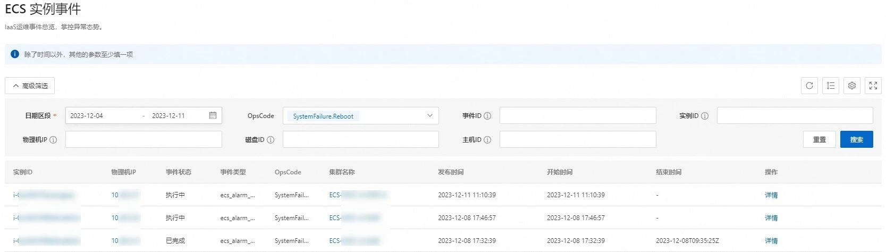

5. 在目标ECS实例事件的**操作**列，单击**详情**，可查看事件详情。

   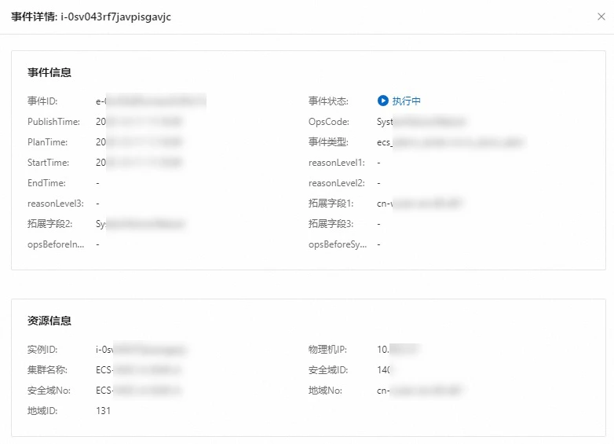

6. 在目标ECS实例事件的**实例ID**列，单击实例ID，可查看实例详情。

7. 在目标ECS实例事件的**物理机IP**列，单击物理机IP，可查看计算服务器运维详情。

8. 在目标ECS实例事件的**集群名称**列，单击集群名称，可查看计算集群运维详情。

<a id="section-2-8-1-2"></a>

#### 2.8.1.2. 物理机事件

支持物理机事件影响面分析，当有ECS的物理机宕机触发ECS宕机迁移时，可以查看被迁移的ECS实例。

**前提条件**

ECS产品已到达终态。

**操作步骤**

1. 登录Apsara Uni-manager运维控制台。

2. 在顶部菜单栏，选择**产品运维 > 计算运维 > 计算运维控制台**。

3. 在左侧导航栏，选择**ECS智能运维** > **ECS事件**，系统默认进入**ECS实例事件**页签。

4. 单击**物理机事件**页签。

5. 可以查看所有ECS物理机事件信息，也可以通过**日期区段**、**物理机IP**和**事件状态**组合筛选获取目标ECS物理机事件。

   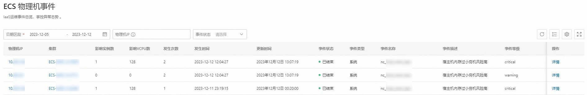

6. 查看ECS物理机事件列表，包括**物理机IP**、**集群**、**影响实例数**、**影响VCPU数**、**发生次数**、**发生时间**、**更新时间**、**事件状态**、**事件类型**、**事件名称**、**事件描述**、**事件等级**和**事件原因**。

7. 在目标ECS物理机事件对应的**操作**列，单击**详情**，可以查看ECS物理机事件的详细信息。

   <table>
     <tr>
       <th width="137">区域</th>
       <th>说明</th>
     </tr>
     <tr>
       <td>物理机基本信息</td>
       <td>• 包括<strong>物理机IP</strong>、<strong>主机名</strong>、<strong>SN</strong>、<strong>机型</strong>、<strong>CPU（核）</strong>、<strong>内存（MiB）</strong>、<strong>操作系统模</strong><strong>板</strong>、<strong>集群</strong>、<strong>机柜</strong>和<strong>CPU型号</strong>。<br>• 单击集群名称，页面跳转到<strong>计算集群运维详情</strong>页面，可以查看计算集群概览。</td>
     </tr>
     <tr>
       <td>事件详情</td>
       <td>包括<strong>事件ID</strong>、<strong>事件类型</strong>、<strong>影响ECS数</strong>、<strong>发布时间</strong>和<strong>状态</strong>。</td>
     </tr>
     <tr>
       <td>影响实例信息</td>
       <td>• 包括<strong>实例ID</strong>、<strong>实例名称</strong>、<strong>CPU（核）</strong>、<strong>内存（GiB）</strong>、<strong>告警详情</strong>和<strong>发布时间</strong>。<br>• 单击<strong>实例ID</strong>，可查看实例详情。<br>• 单击<strong>导出</strong>，页面跳转到下载链接，即可将该ECS物理机事件以表格格式导出。<br>说明宕机迁移事件无法导出物理机事件。</td>
     </tr>
   </table>

8. 单击目标ECS物理机事件对应的**物理机IP**，页面跳转到**计算服务器运维详情**页面，可以查看查看计算服务器运维详情。

9. 单击目标ECS物理机事件对应的**集群**，页面跳转到**计算集群运维详情**页面，可以查看计算集群概览。

<a id="section-2-8-2"></a>

### 2.8.2. ECS运维事件

<a id="section-2-8-2-1"></a>

#### 2.8.2.1. 物理机运维

通过ECS运维事件查看主动运维工作流，并支持自定义主动运维上报和上报本地盘维修单。

**查看主动运维工作流及详情**

1. 登录Apsara Uni-manager运维控制台。

2. 在顶部菜单栏，选择**产品运维 > 计算运维 > 计算运维控制台**。

3. 在左侧导航栏，选择**ECS智能运维** > **ECS运维事件**。

   默认进入**物理机运维**页签。

4. 单击**高级筛选**，可以根据**日期区段**、**主动运维类型**、**NC IP**和**事件状态**组合筛选获取目标主动运维工作流。

   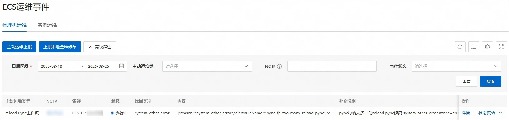

5. 查看主动运维工作流列表，包括**主动运维类型**、**NC IP**、**集群**、**状态**、**原因类别**、**内容**、**补充说明**、**更新时间**、**创建时间**、**提交人**和**操作**。

6. 在目标主动运维工作流对应**NC IP**列，单击IP，页面跳转至**计算服务器运维详情**，可以查看计算服务器运维详情。

7. 在目标主动运维工作流对应**操作**列，单击**详情**获取工作流的详细信息。

   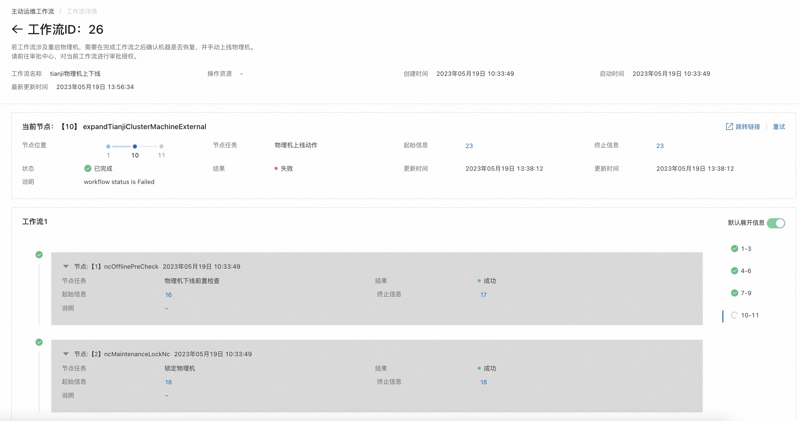

   <table>
     <tr>
       <th width="90">区域</th>
       <th>说明</th>
     </tr>
     <tr>
       <td>基础信息</td>
       <td>获取<strong>工作流ID</strong>、<strong>工作流名称</strong>、<strong>操作资源</strong>、<strong>创建时间</strong>、<strong>启动时间</strong>和<strong>最新更新时间</strong>。</td>
     </tr>
     <tr>
       <td>当前节点</td>
       <td>获取工作当前执行的工作项信息，包括<strong>节点位置</strong>、<strong>节点任务</strong>、<strong>起始信息</strong>、<strong>终止信息</strong>、<strong>状</strong><strong>态</strong>、<strong>结果</strong>、<strong>更新时间</strong>和<strong>说明</strong>。<br>• 单击<strong>起始信息</strong>或<strong>终止信息</strong>的数字项，可以获取起始信息或终止信息的详细内容。<br>• 单击<strong>跳转链接</strong>，跳转到主动运维页面获取详细的工作项信息，具体可参考《ECS诊断》。<br>• 当工作项状态为失败时，可以单击<strong>重试</strong>并输入<strong>操作原因</strong>进行重试操作。如果还是无法执行成功，可单击<strong>下一步</strong>，跳过当前步骤直接执行下一步节点任务。<br>警告仅在出现无法解析的报错，且需要在研发技术人员的指导下使用。</td>
     </tr>
     <tr>
       <td>工作流</td>
       <td>获取工作流的详细执行内容。<br>• 单击<strong>起始信息</strong>或<strong>终止信息</strong>的数字项，可以获取起始信息或终止信息的详细内容。<br>• 节点执行结果异常时，单击节点区域右侧的<strong>跳转链接</strong>，跳转到主动运维页面获取详细的工作项信息。</td>
     </tr>
   </table>

8. 当**主动运维类型**为**专有云本地隔离盘维修**时，在工作流详情页面下可以执行如下操作：

   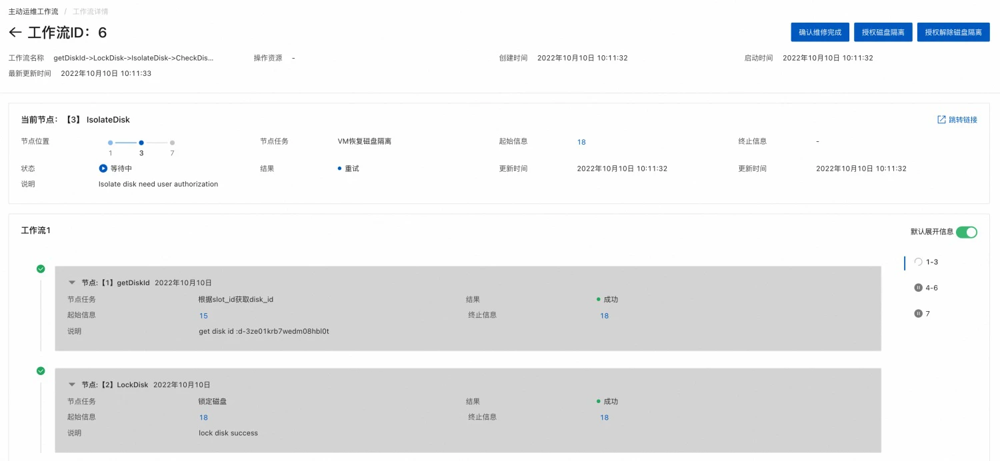

   <table>
     <tr>
       <th width="121">操作</th>
       <th>操作说明</th>
     </tr>
     <tr>
       <td>确认维修完成</td>
       <td>当用户维修完成后单击页面右上方<strong>确认维修完成</strong>，在弹出的对话框中填写原因，单击<strong>完成工作流</strong>修改工作流状态。</td>
     </tr>
     <tr>
       <td>授权磁盘隔离</td>
       <td>当用户确认发生本地盘异常并需要隔离维修的情况下，单击页面右上方<strong>授权磁盘</strong><strong>隔离</strong>，在弹出的对话框中填写原因，单击<strong>授权磁盘隔离</strong>完成授权。</td>
     </tr>
   </table>

   | 授权解除磁盘隔离 | 在用户单击确认维修完成之后，单击页面右上方<strong>授权解除磁盘隔离</strong>，在弹出的对话框中填写原因，单击<strong>授权解除磁盘隔离</strong>完成授权解除。 |
   | --- | --- |

**主动运维上报**

> **警告**
>
> 执行主动运维动作的过程中，可能会中断业务（例如重启操作），请务必告知用户并获得用户授权后谨慎操作。

**操作步骤**

1. 单击**主动运维上报**。

2. 配置如下参数后单击**确定**。

   | 参数 | 参数说明 |
   | --- | --- |
   | IP | 主动运维的目标服务器IP地址。 |

   <table>
     <tr>
       <td>主动运维类型</td>
       <td>即运维事件的OpsCode，选择范围如下所示。<br>• <strong>0x410A01-锁定NC</strong>：锁定物理机，锁定期间无法创建或迁移ECS实例到该物理机。<br>• <strong>0x40003000001001-物理机深度下线(无热迁移)</strong>：在运维窗口迁移物理机上的ECS实例后，重启物理机。<br>• <strong>0x40003000001066-NC模板变配工作流</strong>：物理机变配。<br>• <strong>0x400003-物理机深度下线(带热迁移-VM运维)</strong>：热迁移物理机上的ECS实例后，重启物理机。<br>• <strong>0x400012-物理机强制重启</strong>：强制重启物理机。<br>• <strong>0x400011-恢复物理机上线</strong>：将物理机流转到正常运行状态。<br>• <strong>0x3000000000802-野VM处理</strong>：清理环境中的野ECS实例。<br>• <strong>0x400016-本盘宕机拉起</strong>：本地盘物理机宕机后，带外重启物理机，然后启动ECS实例。<br>• <strong>0x400018-强制NC宕机迁移</strong>：对处于宕机状态的物理机，强制进行宕机迁移操作。<br>• <strong>0x30000000001005-VM crash启动</strong>：出现Crash异常之后，重启ECS实例。<br>• <strong>0x40001000008001-CN宕机清理MOC</strong>：神龙CN宕机后，标记MOC卡宕机并进行自动清理。<br>• <strong>0x4000A000000008-内存碎片整理</strong>：清理物理机中的内存碎片。<br>• <strong>0x4000A000000007-NC锁定后自动解锁</strong>：锁定物理机后，自动解锁。<br>• <strong>0x30003000001001-启动VM</strong>：启动ECS实例。<br>• <strong>0x99001000000001-专有云本地盘隔离维修</strong>：本地盘物理机磁盘隔离以及更换磁盘进行维修。<br>• <strong>0x30000000000408-qemu热升级工作流</strong>：热升级qemu进程。<br>• <strong>0x8000000000001-tianji物理机下线</strong>：物理机下线维修。<br>• <strong>0x40007000000203-reload Pync工作流</strong>：pync长时间运行产生的文件句柄过多。<br>• <strong>0x3000000000301-抢占盘冷迁移VM</strong>：对实例执行冷迁移。<br>• <strong>0x30000000001003-实例重启：</strong>实例qemu升级异常后的自动处理。<br>• <strong>0x30003000001002-DRP实例迁移：</strong>对于配置为宕机场景&amp;资源不足的实例，可以调度到专属资源池外的情况，进行实例调度。<br>• <strong>0x4000100000240-宕机场景下使用抢占盘冷迁移VM</strong>：忽略原始实例状态进行抢占，可以避免云盘出现脑裂等问题。<br>• <strong>0x40003000001009-tpm锁定物理机迁移：</strong>TPM物理机上执行整机迁移。<br>重要<br>• 选择的主动运维类型不同，需要填写的配置项也不同，请根据界面提示进行填写。<br>• 在配置主动运维上报时，仅支持选择允许手动上报的运维动作，可以屏蔽或放开需要的主动运维动作，来避免错误运维动作触发高风险操作，以满足现场运维需求。运维动作配置具体可参见为主动运维动作配置审批流程。</td>
     </tr>
     <tr>
       <td>原因分类</td>
       <td>物理机需要进行主动运维的原因，主要包含如下几类。<br>• 硬件：例如风扇、存储卡、主板故障。<br>• 内核：例如cgroup oom异常。<br>• 网络：例如网线故障。<br>• 系统：例如内存碎片化故障。<br>• 异常夯机。<br>• 安全攻防：例如网络DDoS攻击。<br>• 内部重启。</td>
     </tr>
     <tr>
       <td>操作原因</td>
       <td>填写运维动作的操作原因。</td>
     </tr>
   </table>

   **主动运维类型**

   | 分类 | 提交方式 | 流程解析 |
   | --- | --- | --- |
   | 锁定NC | 手动提交 | i. 服务器锁定ii. 完成运维 |
   | 恢复物理机上线 | 手动提交 | i. NC恢复上线状态ii. 完成运维 |
   | NC锁定后自动解锁 | 手动提交 | i. 服务器锁定ii. 等待定时解锁时间iii. 恢复NC状态iv. 完成运维 |
   | 物理机深度下线(无热迁移) | • 自动提交<br>• 手动提交 | i. ASO授权动作：需要系统管理员登录ASO控制台，在<strong>平台运维</strong> &gt; <strong>运维变更</strong> &gt; <strong>流程审批</strong>进行授权操作，并且在审批之前确保NC上的业务运行状态正常。ii. 服务器锁定iii. 初始化实例状态iv. 通知用户<br>v. 运维窗口内recoverVM：如果存在实例，则需要手动迁移处理后进行重试；也可以执行跳过，后续进行宕机迁移，但耗时较久。vi. 重启前检查vii. shutdown NC：需要登录ASO控制台，在<strong>飞天基础</strong><strong>运维平台</strong> &gt; <strong>资源管理</strong>进行审批各SR允许关机操作。<br>viii. publish event<br>ix. oob on NC<br>x. 检查NC是否启动xi. 完成运维 |
   | 物理机深度下线(带热迁移-VM运维) | • 自动提交<br>• 手动提交 | i. ASO授权动作：需要系统管理员登录ASO控制台，在<strong>平台运维</strong> &gt; <strong>运维变更</strong> &gt; <strong>流程审批</strong>进行授权操作，并且在审批之前确保NC上的业务运行状态正常。ii. 服务器锁定iii. 初始化实例状态iv. 在线迁移：如果迁移失败，则需要在<strong>迁移任务管理</strong>进行手动迁移操作。默认迁移50%以上的VM表示迁移完成。<br>v. VM预留RI资源vi. 通知用户vii. 运维窗口内recoverVM：若步骤4的迁移未完全迁移，则手动迁移处理后进行重试；也可以执行跳过，后续进行宕机迁移，但耗时较久。viii. 重启前检查<br>ix. publish event<br>x. shutdown NC：需要登录ASO控制台，在<strong>飞天基础</strong><strong>运维平台</strong> &gt; <strong>资源管理</strong>进行审批各SR允许关机操作。xi. 仅启动带vm或存储节点的机器<br>xii. publish event<br>xiii. 释放RI资源池xiv. 完成运维 |
   | 物理机强制重启 | • 自动提交<br>• 手动提交 | i. ASO授权动作：需要系统管理员登录ASO控制台，在<strong>平台运维</strong> &gt; <strong>运维变更</strong> &gt; <strong>流程审批</strong>进行授权操作，并且在审批之前确保NC上的业务运行状态正常。ii. shutdown NC：需要登录ASO控制台，在<strong>飞天基础</strong><strong>运维平台</strong> &gt; <strong>资源管理</strong>进行审批各SR允许关机操作。iii. 等VM迁移走iv. 等待NC Down<br>v. oob on NC<br>vi. 完成运维 |
   | 野VM处理 | 手动提交 | i. 虚拟机残留清理ii. 完成运维 |

   <table>
     <tr>
       <td>CN宕机清理MOC</td>
       <td>• 自动提交<br>• 手动提交</td>
       <td>i. ASO授权动作：需要系统管理员登录ASO控制台，在<strong>平台运维</strong> &gt; <strong>运维变更</strong> &gt; <strong>流程审批</strong>进行授权操作，并且在审批之前确保NC上的业务运行状态正常。ii. 服务器锁定iii. cn_down后清理moc iv. NC状态变为NCDown<br>v. shutdown NC：需要登录ASO控制台，在<strong>飞天基础</strong><strong>运维平台</strong> &gt; <strong>资源管理</strong>进行审批各SR允许关机操作。vi. 等VM迁移走vii. 等待NC Down<br>viii. oob on NC<br>ix. 完成运维</td>
     </tr>
     <tr>
       <td>内存碎片整理</td>
       <td>• 自动提交<br>• 手动提交</td>
       <td>i. 服务器锁定<br>ii. Drop Caches<br>iii. Trim Memory<br>iv. 恢复NC状态<br>v. 完成运维</td>
     </tr>
     <tr>
       <td>强制NC宕机迁移</td>
       <td>• 自动提交<br>• 手动提交</td>
       <td>i. NC变为NCDown ii. 完成运维</td>
     </tr>
     <tr>
       <td>Reload PYNC工作流</td>
       <td>• 自动提交<br>• 手动提交</td>
       <td>i. ASO授权动作ii. 服务器锁定iii. 重载pync iv. 恢复NC状态<br>v. 完成运维</td>
     </tr>
     <tr>
       <td>宕机场景下使用抢占盘冷迁移VM</td>
       <td>手动提交</td>
       <td>i. 尽可能使用抢占盘冷迁移NC上的VM ii. NC变为NCDown iii. shutdown NC：需要登录ASO控制台，在<strong>飞天基础</strong><strong>运维平台</strong> &gt; <strong>资源管理</strong>进行审批各SR允许关机操作。iv. 恢复NC状态<br>v. 完成运维</td>
     </tr>
     <tr>
       <td>tpm锁定物理机迁移</td>
       <td>手动提交</td>
       <td>i. ASO授权动作：需要系统管理员登录ASO控制台，在<strong>平台运维</strong> &gt; <strong>运维变更</strong> &gt; <strong>流程审批</strong>进行授权操作，并且在审批之前确保NC上的业务运行状态正常。ii. 锁定NC iii. 整机疏散iv. 完成运维</td>
     </tr>
     <tr>
       <td>VM crash启动</td>
       <td>• 自动提交<br>• 手动提交</td>
       <td>i. CrashVM订正状态ii. 启动VM iii. 完成VM运维</td>
     </tr>
     <tr>
       <td>启动VM</td>
       <td>手动提交</td>
       <td>i. 启动VM ii. 完成VM运维</td>
     </tr>
     <tr>
       <td>抢占盘冷迁移VM</td>
       <td>手动提交</td>
       <td>i. ASO授权动作：需要系统管理员登录ASO控制台，在<strong>平台运维</strong> &gt; <strong>运维变更</strong> &gt; <strong>流程审批</strong>进行授权操作，并且在审批之前确保NC上的业务运行状态正常。ii. 迁移VM iii. 等待VM迁移iv. 判断VM是否已迁移<br>v. 虚拟机残留清理vi. 完成VM运维</td>
     </tr>
     <tr>
       <td>实例重启</td>
       <td>手动提交</td>
       <td>i. 重启VM ii. 完成VM运维</td>
     </tr>
     <tr>
       <td>DRP实例迁移</td>
       <td>手动提交</td>
       <td>i. DRP实例迁移ii. 修改vm_gray_biz_type标签iii. 冷迁移VM iv. 恢复vm_gray_biz_type标签<br>v. 完成运维</td>
     </tr>
   </table>

**上报本地盘维修单**

> **说明**
>
> 若机器已经存在待解决的工作流，请先完成工作流再上报，否则上报不会生效。

**操作步骤**

1. 单击**上报本地盘维修单**。

2. 配置如下参数后单击**上报**。

   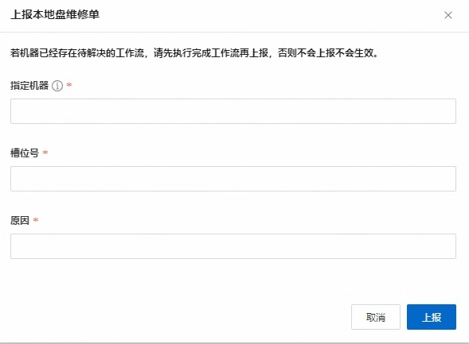

   <table>
     <tr>
       <th width="89">参数</th>
       <th>参数说明</th>
     </tr>
     <tr>
       <td>指定机器</td>
       <td>输入上报本地盘维修单机器的hostname，需要在现场环境物理机上获取。</td>
     </tr>
     <tr>
       <td>槽位号</td>
       <td>输入槽位号，需要在现场环境物理机上获取。</td>
     </tr>
     <tr>
       <td>原因</td>
       <td>输入上报本地盘维修单的原因。</td>
     </tr>
   </table>

**修改工作流状态**

**前提条件**

当主动运维工作流状态为执行中时支持状态流转。

**操作步骤**

- 完成工作流

  <ol type="i">

  <li>

  在目标主动运维工作流对应**操作**列，单击**状态流转** > **完成工作流**。

  </li>

  <li>

  在弹出的对话框中单击**确定**。

  </li>

  </ol>

- 取消工作流

  <ol type="i">

  <li>

  在目标主动运维工作流对应**操作**列，单击**状态流转** > **取消工作流**。

  </li>

  <li>

  在弹出的对话框中单击**确定**。

  </li>

  </ol>

<a id="section-2-8-2-2"></a>

#### 2.8.2.2. 实例运维

通过ECS运维事件查看ECS实例主动运维工作流，并支持修改工作流状态。

**查看主动运维工作流及详情**

1. 登录Apsara Uni-manager运维控制台。

2. 在顶部菜单栏，选择**产品运维** > **计算运维** > **计算运维控制台**。

3. 在左侧导航栏，选择**ECS智能运维 > ECS运维事件**，然后单击**实例运维**页签。

4. 单击**高级筛选**，可以根据**日期区段**、**主动运维类型**、**事件状态**和Instance Id组合筛选获取目标主动运维工作流。

5. 查看主动运维工作流列表，包括**主动运维类型**、**Instance Id**、**集群**、**状态**、**原因类别**、**内容**、**补充说明**、**更新时间**、**创建时间**、**提交人**和**操作**。

6. 在目标主动运维工作流对应**操作**列，单击**详情**获取工作流的详细信息。

   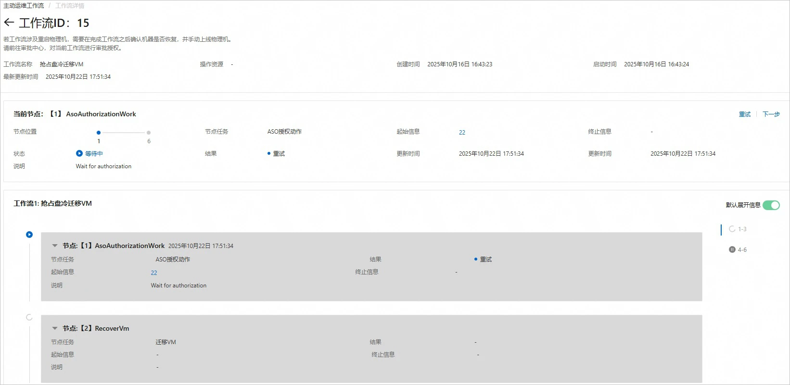

   <table>
     <tr>
       <th width="90">区域</th>
       <th>说明</th>
     </tr>
     <tr>
       <td>基础信息</td>
       <td>获取<strong>工作流ID</strong>、<strong>工作流名称</strong>、<strong>操作资源</strong>、<strong>创建时间</strong>、<strong>启动时间</strong>和<strong>最新更新时间</strong>。</td>
     </tr>
     <tr>
       <td>当前节点</td>
       <td>获取工作当前执行的工作项信息，包括<strong>节点位置</strong>、<strong>节点任务</strong>、<strong>起始信息</strong>、<strong>终止信息</strong>、<strong>状</strong><strong>态</strong>、<strong>结果</strong>、<strong>更新时间</strong>和<strong>说明</strong>。<br>• 单击<strong>起始信息</strong>或<strong>终止信息</strong>的数字项，可以获取起始信息或终止信息的详细内容。<br>• 对于执行卡住或者执行失败的节点，如果是因为环境原因导致的偶发问题，可以通过<strong>重试</strong>按钮重新执行该节点。<br>• 对于执行卡住或者执行失败的节点，如果判断跳过该节点不影响整体的运维流程，可以通过单击<strong>下一步</strong>来跳过该节点。<br>警告仅在出现无法解析的报错，且需要在研发技术人员的指导下使用。</td>
     </tr>
     <tr>
       <td>工作流</td>
       <td>获取工作流的详细执行内容。单击<strong>起始信息</strong>或<strong>终止信息</strong>的数字项，可以获取起始信息或终止信息的详细内容。</td>
     </tr>
   </table>

**修改工作流状态前提条件**

当主动运维工作流状态为执行中时支持状态流转。

**操作步骤**

- 完成工作流

  <ol type="i">

  <li>

  在目标主动运维工作流对应**操作**列，单击**状态流转** > **完成工作流**。

  </li>

  <li>

  在弹出的对话框中单击**确定**。

  </li>

  </ol>

- 取消工作流

  <ol type="i">

  <li>

  在目标主动运维工作流对应**操作**列，单击**状态流转** > **取消工作流**。

  </li>

  <li>

  在弹出的对话框中单击**确定**。

  </li>

  </ol>

<a id="section-2-8-3"></a>

### 2.8.3. ECS工作流

本文介绍如何获取ECS的工作流信息，包括查看工作流详情以及执行相关操作。

**查看工作流及活动详情**

1. 登录Apsara Uni-manager运维控制台。

2. 在顶部菜单栏，选择**产品运维** > **计算运维** > **计算运维控制台**。

3. 在左侧导航栏，单击**ECS智能运维 > ECS工作流**。

4. 单击**高级筛选**，可以根据**工作流实例id**、**工作流名称**、**工作流状态**、**业务ID**、**主账号ID**、**InstanceId**以及**查询时间段**组合筛选获取目标工作流。

   > **说明**
   >
   > **工作流状态**说明如下：
   >
   > - SCHEDULABLE：可调度状态
   >
   > - HUMAN_PROCESSING：等待人工处理状态
   >
   > - RUNNING：运行中
   >
   > - COMPLETED：成功执行完成
   >
   > - FAILED：运行失败
   >
   > - TERMINATED：终止状态

5. 查看工作流列表，包括**工作流名称**、**工作流实例ID**、**业务ID**、**主账号ID**、**InstanceId**、**开始时间**、**结束时间**、**执行节点**和**执行状态**。

   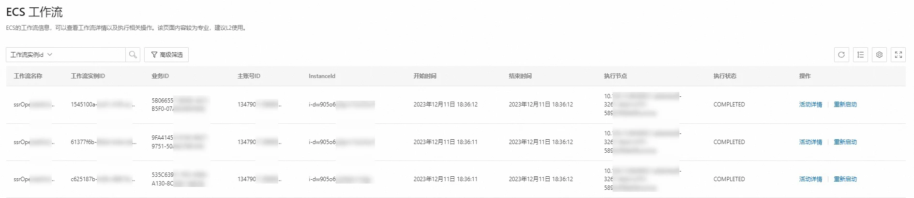

6. 在目标工作流对应的**操作**列，单击**活动详情**获取ECS工作流的详细信息，包括**活动ID**、**活动名称**、**方法**、**状态**、**输入**、**输出**、**异常**、**开始时间**和**结束时间**。

   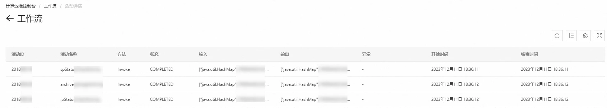

**重启工作流**

**前提条件**

当工作流状态为**COMPLETED**、**FAILED**或**HUMAN_PROCESSING**时支持重启工作流。

**操作步骤**

1. 在目标工作流对应**操作**列，单击**重新启动**。

2. 在弹出的对话框中单击**确定**。

**回滚工作流**

**前提条件**

当工作流状态为**HUMAN_PROCESSING**时支持回滚工作流。

**操作步骤**

1. 在目标工作流对应**操作**列，单击**回滚**。

2. 在弹出的对话框中单击**确定**。

**终止工作流**

**前提条件**

当工作流状态为**HUMAN_PROCESSING**时支持终止工作流。

**操作步骤**

1. 在目标工作流对应**操作**列，单击**终止**。

2. 在弹出的对话框中单击**确定**。

<a id="section-2-8-4"></a>

### 2.8.4. ECS诊断

ECS诊断提供对物理机和实例的全链路异常诊断能力。如果ECS实例（即VM）或者宿主机（即NC）存在异常，您可以在全链路定界页面或者批量诊断界面进行诊断，并根据诊断结果识别ECS实例或者宿主机的异常原因。

**前提条件**

您需要在Apsara Uni-manager运维控制台的**ECS实例**查看ECS实例ID和宿主机IP地址。具体操作，请参见查看实例详情。

**操作步骤**

1. 登录Apsara Uni-manager运维控制台。

2. 在顶部菜单栏，选择**产品运维** > **计算运维** > **计算运维控制台**。

3. 在左侧导航栏，单击**ECS智能运维 > ECS诊断**。

4. 单击**全链路定界**/**批量诊断**页签。

   - 全链路定界

     在**全链路定界**页面，设置查询条件，单击

     图标。

     

     <table>
       <tr>
         <th width="89">查询条件</th>
         <th>说明</th>
       </tr>
       <tr>
         <td>起止时间</td>
         <td>设置查询的开始和结束时间。默认情况下查询最近2天的异常信息。如果需要查询历史记录，您可以设置查询起始和结束时间，支持最大间隔时间为10天。</td>
       </tr>
       <tr>
         <td>机器ID</td>
         <td>设置ECS实例ID或者物理机IP地址。您可以在Apsara Uni-manager运维控制台的<strong>ECS实例</strong>查看ECS实例ID和宿主机IP地址。具体操作，请参见查看实例详情。</td>
       </tr>
     </table>

     在查询结果中可以查看实例或宿主机的基本信息、根因诊断结果和异常信息列表。

   - 批量诊断

     在**批量诊断**页面，设置查询条件，单击

     图标。

     

     <table>
       <tr>
         <th width="89">查询条件</th>
         <th>说明</th>
       </tr>
       <tr>
         <td>起止时间</td>
         <td>设置查询的开始和结束时间。默认情况下查询最近2天的异常信息。如果需要查询历史记录，您可以设置查询起始和结束时间，支持最大间隔时间为10天。</td>
       </tr>
       <tr>
         <td>诊断类别</td>
         <td>选择合适的诊断策略。诊断类别包括以下几种：<br>• vm可用性。<br>• nc性能。<br>• nc问题。<br>• 控制面问题。<br>• vm性能。<br>• 默认诊断策略。</td>
       </tr>
       <tr>
         <td>机器ID</td>
         <td>设置ECS实例ID或者物理机IP地址。</td>
       </tr>
     </table>

     在查询结果中可以查看**诊断目标**、**NcIP**、**是否本地盘**、**机器状态**、**异常时间**、**严重等级**、**可能原因**等诊断信息。

<a id="section-2-9"></a>

## 2.9. 计算运维配置

<a id="section-2-9-1"></a>

### 2.9.1. 监控配置

本文介绍如何为您的ECS监控项开启ASO告警推送并设置告警级别。

**使用场景**

当您为ECS监控项开启ASO告警推送并设置告警级别后，当该监控项产生ASO告警时，您将会在Apsara Uni-manager运维控制台的**监控告警 > 告警管理 > 告警列表**页面中收到该告警信息（包括您设置的告警级别），然后根据该告警详情快速处理问题。

> **说明**
>
> 查看告警信息的具体操作，请参见专有云文档中心<em>《专有云运维平台用户指南》</em>文档的**告警管理 > 告警列表**章节。

**使用说明**

仅当开启告警推送，且为该监控项的监控级别配置好在告警列表中对应显示的告警级别后，该监控项产生的告警信息才会被推送到告警列表中，具体说明如下：

1. 为ECS监控项开启告警推送，且在**ASO 告警级别**区域为ECS监控项的各监控级别设置告警等级。具体操作，请参见操作步骤。

   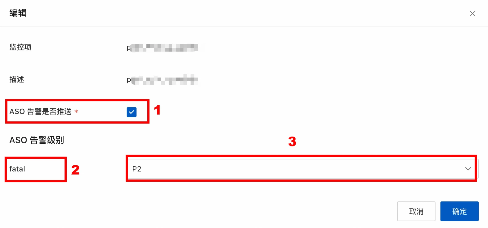

   - 图示1：开启告警推送。

   - 图示2：ECS监控项的监控级别。

     > **说明**
     >
     > 关于ECS监控项的监控级别说明如下：
     >
     > - 每个ECS监控项均已内置监控级别，监控级别严重程度从高到低分别为：
     >
     >   - `fatal` ：致命
     >
     >   - `critical` ：严重
     >
     >   - `warning` ：警告
     >
     >   - `low_warning` ：低警告
     >
     > - 不同的ECS监控项的监控级别有所不同。
     >
     >   例如pync_prepare_vm_exception监控项的监控级别为 `critical` 和 `warning` ，而nc_session_too_large监控项的监控级别为 `fatal` 。因此，具体监控项的监控级别请以**计算运维控制台 > 计算运维配置 > 监控配置**页面显示为准。

   - 图示3：监控级别的告警等级。

     > **说明**
     >
     > 告警等级严重程度从高到低分别为：
     >
     > - P1：紧急
     >
     > - P2：重要
     >
     > - P3：次要
     >
     > - P4：提醒

2. 查看告警信息。

   如果ECS监控项产生告警，您可以在Apsara Uni-manager运维控制台的**监控告警 > 告警管理 > 告警列表**中查看该告警信息，且**告警等级**为步骤1中为ECS监控项的监控级别设置的告警等级，示例如下。

   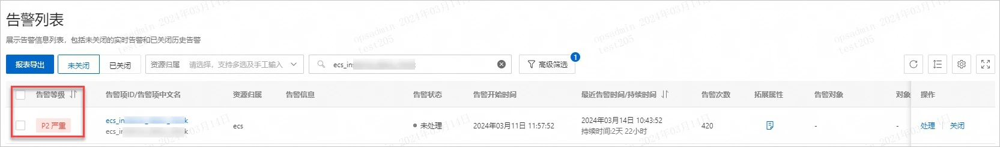

   > **重要**
   >
   > 如果您为同一个ECS监控项设置了多个告警级别（例如 `critical` 和 `warning` ），则只要其中一个告警级别产生告警，就会推送到告警列表中。因此，同一个ECS监控项可能会推送多条不同级别的告警信息到告警列表中。

**操作步骤**

1. 登录Apsara Uni-manager运维控制台。

2. 在顶部菜单栏，选择**产品运维 > 计算运维 > 计算运维控制台**。

3. 在左侧导航栏，单击**计算运维配置**。

4. 在**监控配置**页签下，单击监控类别页签。

   您可以在ECS监控项列表中查看监控项、监控项描述、监控类型、资源类型、是否推送ASO和ASO告警级别信息。

   <table>
     <tr>
       <th width="121">监控类别</th>
       <th>说明</th>
     </tr>
     <tr>
       <td>管控侧监控</td>
       <td>ECS软件管控层面相关的监控，例如<strong>monitor_data_loss_too_long</strong>（监控数据长时间异常丢失）。</td>
     </tr>
     <tr>
       <td>虚拟化侧监控</td>
       <td>ECS物理机上虚拟化服务相关的监控，例如<strong>vm_monitor_qemu_exception</strong>（虚拟化获取VM监控数据异常）。</td>
     </tr>
     <tr>
       <td>系统侧监控</td>
       <td>ECS物理机操作系统层面的监控，例如<strong>cgroup_mem_limitation</strong>（CGROUP内存超限）。</td>
     </tr>
     <tr>
       <td>硬件侧监控</td>
       <td>ECS物理机的硬件监控，例如<strong>hardware_exception_alarm</strong>（硬件异常告警）。</td>
     </tr>
     <tr>
       <td>夯机监控</td>
       <td>ECS物理机层面的夯机监控，例如<strong>nc_hang_exception</strong>（物理机夯机异常）。</td>
     </tr>
     <tr>
       <td>宕机迁移监控</td>
       <td>ECS物理机触发宕机后的实例迁移相关监控，例如<strong>nc_down_alert</strong>（NC宕机导致VM宕机）。</td>
     </tr>
   </table>

5. 在目标监控项的**操作**列单击**编辑**，编辑配置项。

   <table>
     <tr>
       <th width="164">配置项</th>
       <th>说明</th>
     </tr>
     <tr>
       <td>ASO 告警是否推送</td>
       <td>告警产生后是否会推送到告警列表中。<br>重要<br>• 如果关闭告警推送，您将不能在告警列表中收到该告警信息，可能会错过重要的告警。<br>• 如果开启告警推送，则只有设置了<strong>ASO 告警级别</strong>，才能在告警列表中收到该告警信息。</td>
     </tr>
     <tr>
       <td>ASO 告警级别</td>
       <td>在告警列表中显示的告警等级。<br>• 可能需要设置的参数项如下，具体参数项请实际界面显示为准。<br>• fatal<br>• critical<br>• warning<br>• low_warning<br>• 每个监控类型支持的告警等级取值范围如下：<br>• 管控侧监控、虚拟化侧监控、系统侧监控、硬件侧监控和宕机迁移监控：P2，P3和P4。<br>• 夯机监控：P2，P3和P4。<br>重要如果夯机监控项的告警级别从默认值P1修改为其他级别，则不能再修改回P1级别。</td>
     </tr>
   </table>

6. 单击**确定**。

   您可以在监控项列表的**ASO告警级别**列中，通过JSON文件获取该监控项已配置的告警级别。

<a id="section-2-9-2"></a>

### 2.9.2. 运维动作配置

<a id="section-2-9-2-1"></a>

#### 2.9.2.1. 为主动运维动作配置流控

您可以通过为主动运维动作设置一段时间内可以执行运维工作流的次数，即流控配置，来避免重复执行运维动作。本文介绍如何配置运维动作的流控配置。

**背景信息**

现场运维人员，可以根据实际需要调整主动运维动作的流控配置，支持增大或减小不同运维动作流控的大小，以满足现场运维需求。以您为物理机配置了夯机主动运维为例，说明如下：

当运维动作开始执行后，若环境问题未被修复，会一直下线、重启该物理机直至夯机问题修复。此时，如果您为主动运维动作流配置了流控（例如168小时内仅执行1次），则该运维动作执行1次后，Apsara Uni-manager运维控制台会自动放弃该工作流不再重复执行，您可以针对该问题进行其他运维操作，及时修复问题。

**操作步骤**

1. 登录Apsara Uni-manager运维控制台。

2. 在顶部菜单栏，选择**产品运维 > 计算运维 > 计算运维控制台**。

3. 在左侧导航栏，单击**计算运维配置**。

   > **说明**
   >
   > 系统默认进入**监控配置**页签。

4. 单击**运维动作配置**页签。

   您可以在主动运维动作列表中查看**OpsCode**（主动运维类型）、**流控状态**、**流控生效时间**等信息。

   > **说明**
   >
   > 主动运维动作的**是否允许手动上报**、**手动上报审批**信息与该主动运维动作的审批配置有关，更多信息，请参见为主动运维动作配置审批流程。

5. 在目标OpsCode的**操作**列单击**流控配置**，编辑如下配置项，然后单击**确定**。

   > **重要**
   >
   > 只要Region或集群维度任意一个超过主动运维动作的流控，Apsara Uni-manager运维控制台将不会再执行该主动运维动作。

   | 配置项 | 说明 |
   | --- | --- |
   | opscode | 主动运维动作的运维类型，不支持修改。 |
   | 是否打开流控 | 开启后，才能对主动运维动作配置流控。 |
   | 限流时长（分钟） | Region内，主动运维动作执行的时间段。推荐配置为10080分钟，即168小时。 |
   | 限流次数（次） | Region内，主动运维动作执行的次数。推荐配置为1次。 |
   | 集群限流时长（分钟） | 集群内，主动运维动作执行的时间段。推荐配置为10080分钟，即168小时。 |
   | 集群限流数（次） | 集群内，主动运维动作执行的次数。推荐配置为1次。 |
   | 限制策略 | 仅支持设置为<strong>放弃</strong>，表示当主动运维动作超过流控配置后，会自动放弃执行该工作流。 |

<a id="section-2-9-2-2"></a>

#### 2.9.2.2. 为主动运维动作配置审批流程

您可以对主动运维事件配置支持手动上报功能来方便您主动发起运维，同时可以根据实际需要调整主动运维的审批流程。

**背景信息**

- 现场运维人员可以根据实际需要创建主动运维动作并调整主动运维的审批步骤（例如跳过审批步骤直接开始执行运维操作），以满足现场运维需求。默认情况下，您需要联系Apsara Uni-manager运维控制台的管理员，在**任务中心 > 任务列表**下完成审批，才能进行主动运维。

  > **重要**
  >
  > - 跳过审批可能会不利于后期审计，建议保留审批流程，由Apsara Uni-manager运维控制台的管理员统一审批。
  >
  > - 如果在**访问控制**的**变更策略**中，**变更授权配置**中启用了变更授权，需授权管理员和系统管理员都完成审批，才能进行主动运维。

- 现场运维人员可以根据当前环境的运行情况，通过调整运维类型的**允许手动上报**功能来减少误操作。例如，您可以通过在**审批配置**中取消**0x400012-物理机强制重启**运维类型的**允许手动上报**功能，取消后，您将不能在**主动运维上报**页面选择该运维动作，可以有效减少该问题的误操作。

**注意事项**

- 运维类型均默认开启了**允许手动上报**功能，您可以配置主动运维上报，对当前问题进行处理。

  > **重要**
  >
  > 只有开启了该功能的运维类型，才可以配置主动运维上报。配置主动运维上报的具体操作，请参见为服务器配置主动运维上报。

- 具体支持配置手动上报功能和手动上报审批功能的运维类型以您的Apsara Uni-manager运维控制台显示为准，部分运维类型不允许修改审批配置，只能以默认配置为准。例如**0x4000A000000007-NC锁定后自动解锁**默认允许手动上报但不支持手动上报审批，表示该主动运维任务提交后，可以无需Apsara Uni-manager运维控制台管理员审批，直接执行运维任务。

**操作步骤**

1. 登录Apsara Uni-manager运维控制台。

2. 在顶部菜单栏，选择**产品运维 > 计算运维 > 计算运维控制台**。

3. 在左侧导航栏，单击**计算运维配置**。

   > **说明**
   >
   > 系统默认进入**监控配置**页签。

4. 单击**运维动作配置**页签。

   您可以在主动运维动作列表中查看**OpsCode**（运维类型）、**允许手动上报**和**手动上报审批**等信息。

5. 在目标OpsCode的**操作**列中单击**审批配置**，编辑如下配置项，然后单击**确定**。

   <table>
     <tr>
       <th width="152">配置项</th>
       <th>说明</th>
     </tr>
     <tr>
       <td>opscode</td>
       <td>运维类型，不支持修改。</td>
     </tr>
     <tr>
       <td>是否支持手动上报</td>
       <td>是否支持在<strong>主动运维</strong>页面配置主动运维事件上报。默认为<strong>是</strong>。<br>重要如果设置为<strong>否</strong>，您将不能在<strong>主动运维</strong>页面配置主动运维上报动作，请谨慎操作。</td>
     </tr>
     <tr>
       <td>手动上报审批</td>
       <td>主动运维上报动作是否需要审批。默认为<strong>是</strong>。<br>重要如果设置为<strong>否</strong>，表示主动运维上报动作无需审批即可开始执行。</td>
     </tr>
   </table>

<a id="section-2-9-3"></a>

### 2.9.3. 调整云盘释放时间

在专有云计算运维配置中，云盘的释放时间调整功能允许用户根据实际需求设置云盘的释放时间。这一功能主要用于避免资源浪费，同时确保数据安全和业务连续性。运维人员可以在计算运维控制台配置云盘释放时间，根据实际业务需求完成运维。

**注意事项**

- 释放云盘将导致数据不可恢复，建议在释放前创建快照备份数据。

- 自动快照是否随云盘释放取决于用户设置。若云盘已开启**自动快照随云盘释放**，自动快照会在云盘释放时一并删除。

**操作步骤**

1. 登录Apsara Uni-manager运维控制台。

2. 在顶部菜单栏，选择**产品运维 > 计算运维 > 计算运维控制台**。

3. 在左侧导航栏，选择**计算运维配置**。

4. 在**计算运维配置**页面，单击**云盘释放时间调整**。

5. 在**云盘释放时间调整**页面，完成如下配置，然后单击**提交**。

   <table>
     <tr>
       <th width="122">配置项</th>
       <th>配置说明</th>
     </tr>
     <tr>
       <td>磁盘回收时间</td>
       <td>• 0~48<br>设置实例释放时，同步释放的云盘从pangu中被回收时间。云盘将在实例释放后等待0~48小时自动回收，回收后可以正常使用该云盘。<br>• -1<br>云盘将采用ECS默认回收时间策略，实例释放时云盘将按照相应策略进行释放或回收。</td>
     </tr>
     <tr>
       <td>操作原因</td>
       <td>修改云盘释放时间原因。</td>
     </tr>
   </table>

<a id="section-2-10"></a>

## 2.10. 运维审计日志

您可以查看各资源的ASO操作历史、POP API调用历史和后羿API调用历史，从而知悉ECS计算控制台全局高危操作，使得操作有迹可循。

**操作步骤**

1. 登录Apsara Uni-manager运维控制台。

2. 在顶部菜单栏，选择**产品运维 > 计算运维 > 计算运维控制台**。

3. 在左侧导航栏，选择**运维审计日志**。

   系统默认进入**ASO操作历史**页签。

4. 在各页签查看对应信息。

   <table>
     <tr>
       <th width="162">页签</th>
       <th>说明</th>
     </tr>
     <tr>
       <td>ASO操作历史</td>
       <td>在页面上方的<strong>搜索关键字</strong>中输入操作Action、操作人、操作资源或RequestId，然后在<strong>日期区段</strong>选择对应时间段，单击<strong>搜索</strong>。查看目标历史记录的操作Action、操作时间、操作结果、操作人、操作资源、错误信息、RequestId、请求参数和操作原因。</td>
     </tr>
     <tr>
       <td>POP API调用历史</td>
       <td>在页面上方的<strong>搜索关键字</strong>中输入操作Action、RequestId或调用者，然后在<strong>日期</strong><strong>区段</strong>选择对应时间段，单击<strong>搜索</strong>。查看目标历史记录的操作Action、操作时间、RequestId、Http返回码、错误信息、产品、请求参数和调用者。</td>
     </tr>
     <tr>
       <td>后羿API调用历史</td>
       <td>在页面上方的<strong>搜索关键字</strong>中输入操作Action、RequestId或请求IP，然后在<strong>日期</strong><strong>区段</strong>选择对应时间段，单击<strong>搜索</strong>。查看目标历史记录的操作Action、RequestId、请求时间、请求返回码、请求IP、请求耗时（ms）和请求参数。</td>
     </tr>
   </table>

<a id="section-2-11"></a>

## 2.11. 天宫运维

<a id="section-2-11-1"></a>

### 2.11.1. 天宫云产品

本文将为您介绍如何查看部署形态为OnEcs的云产品基本信息，适用于天宫2.0架构。

**操作步骤**

1. 登录Apsara Uni-manager运维控制台。

2. 在顶部菜单栏，选择**产品运维 > 计算运维 > 计算运维控制台**。

3. 在左侧导航栏，选择**天宫运维** > **天宫云产品**。

4. 系统默认显示部署形态为OnEcs的云产品详细信息，包含**云产品名称**、**天宫架构**、**天宫机器组数量**。

   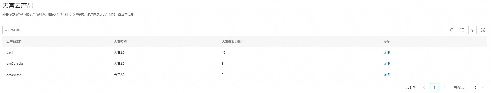

5. 在页面左上方，可以输入**云产品名称**精确查找相应的云产品。

6. 查看云产品详情。

   <ol type="i">

   <li>

   选择目标云产品，单击云产品**操作**列的**详情**，进入云产品详情页。

   </li>

   <li>

   在**概览**页签可查看**基本信息**以及**天宫资源库存**。

   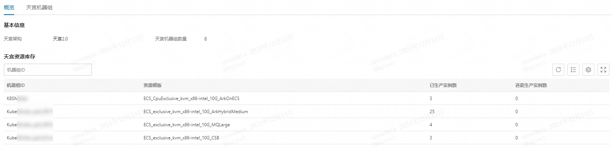

   - **基本信息**：包含**天宫架构**、**天宫机器组数量**。

   - **天宫资源库存**：包含**机器组ID**、**资源模板**、**已生产实例数**、**还能生产实例数**。

     输入**机器组ID**可精确查找相应的机器组。

   </li>

   <li>

   切换**天宫机器组**页签，可查看机器组的**类型**、**资源模板**、**VM镜像**、**支持规格（族）**、**部署策略**、<strong>天宫实例数（已创建/总数）</strong>详细信息。

   输入**机器组ID**可精确查找相应的机器组。

   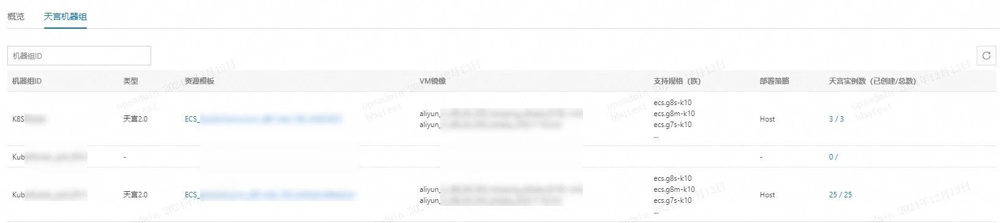

   - 单击**资源模板**，可查看机器组的资源模板详情。

   - 单击**天宫实例数（已创建/总数）**，可查看实例的状态详情。

   </li>

   </ol>

<a id="section-2-11-2"></a>

### 2.11.2. 天宫工作流

本文将为您介绍由飞天基础运维平台下发任务所触发的天宫适配层工作流信息，包含资源处理和实例克隆等状态信息，并提供常见运维操作。

**操作步骤**

1. 登录Apsara Uni-manager运维控制台。

2. 在顶部菜单栏，选择**产品运维 > 计算运维 > 计算运维控制台**。

3. 在左侧导航栏，选择**天宫运维** > **天宫工作流**。

4. 系统默认显示由天基下发任务所触发的天宫适配层工作流信息，包含**工作流ID**、**工作流发起者**、**工作流类型**、**实例ID/主机名**、**工作流状态**、**异常信息**。

   <table>
     <tr>
       <th width="130">参数</th>
       <th>说明</th>
     </tr>
     <tr>
       <td>工作流发起者</td>
       <td>由天基project、cluster和server_role_group信息组成，全局唯一。</td>
     </tr>
     <tr>
       <td>工作流类型</td>
       <td>包含单实例创建、单实例更新、实例删除、实例克隆、实例重新克隆。</td>
     </tr>
     <tr>
       <td>实例ID/主机名</td>
       <td>单击<strong>实例ID/主机名</strong>，您可查看实例详情，请参考查看实例详情。</td>
     </tr>
     <tr>
       <td>工作流状态</td>
       <td>包含完成、失败两种状态。</td>
     </tr>
     <tr>
       <td>异常信息</td>
       <td>您可查看工作流失败时的详细信息。</td>
     </tr>
   </table>

5. 单击**高级筛选**，支持根据**工作流ID**、**工作流类型**、**主机名**组合筛选精准查找目标工作流。

6. 查看工作流日志。

   <ol type="i">

   <li>

   选择目标工作流，单击**操作**列的**查看工作流日志**。

   </li>

   <li>

   选择**起始日期**及**结束日志**，系统将自动筛选出符合条件的工作流日志，您可查看日志详情，包含**时间**、**日志级别**、**日志内容**。

   > **说明**
   >
   > 仅支持查看7日内的日志。

   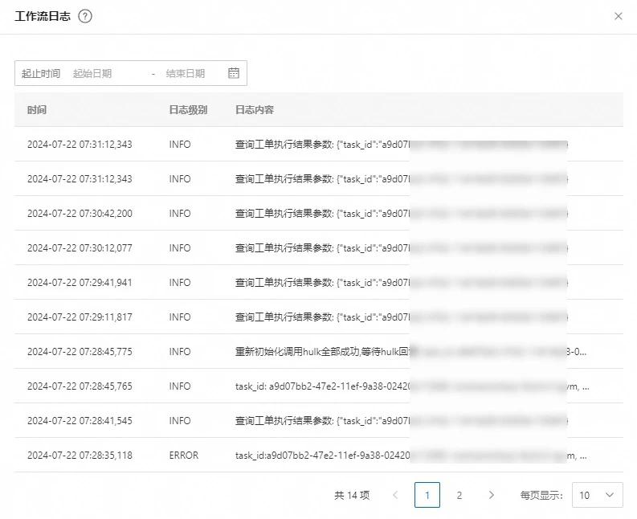

   </li>

   </ol>

<a id="section-2-12"></a>

## 2.12. ECS运维助手

ECS运维助手是基于云平台的ECS运维智能体，支持资源查询、告警分析和事件诊断三项能力。

> **重要**
>
> ECS运维助手回答的内容由AI自动生成，无法保证完全准确，仅供参考使用，建议您结合实际情况验证其准确性。

**ECS运维助手操作入口**

1. 登录Apsara Uni-manager运维控制台。

2. 在顶部菜单栏，选择**产品运维 > 计算运维 > 计算运维控制台**。

   

3. 在计算运维控制台任意界面右下角，单击

   图标。

   也可以在顶部导航栏，选择**平台运维 > 管控服务运维 > 云维小智**。

4. 在弹出的**云维小智**面板，切换智能体为**ECS运维助手**。

   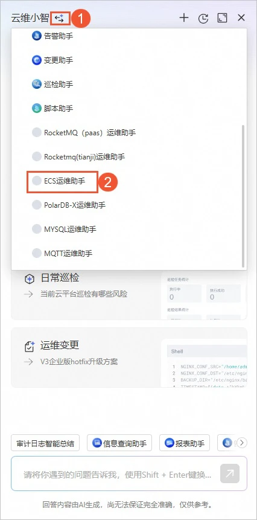

5. 在**ECS运维助手**中，输入遇到的问题，按Shift+Enter键，系统将能够理解用户意图并准确返回查询信息。

   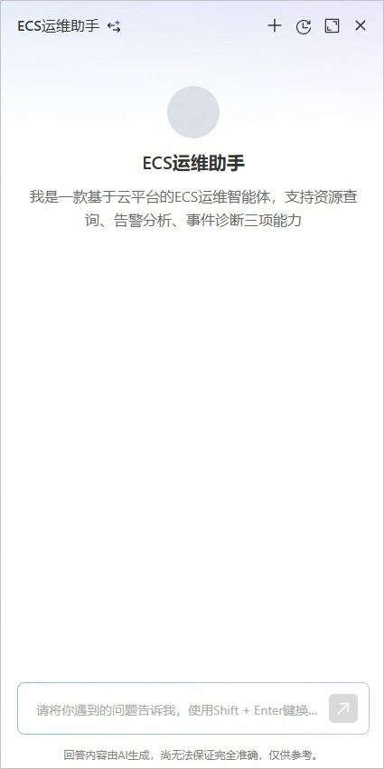

**资源查询**

**触发方式**

提问中包含查询实例、物理机、集群、云盘、网卡、安全组、镜像、规格、库存、容量等关键词，将会触发资源查询。

**限制说明**

- 查询结果超过10条时，仅展示前10条。例如：查询的实例超过10个，仅展示10个，其他实例会引导至对应实例页面查看。

- 复杂查询时，仅展示10条。例如：查询集群 `ecs-compute-xxx` 下每台物理机各有哪些实例，如果集群 `ecs-compute-xxx` 下超过10台物理机，仅展示10台物理机信息并终止查询任务，后续的查询实例操作不会进行。

- 仅支持查询操作，不支持修改或删除等操作。

**查询示例**

支持查询以下资源信息

<table>
  <tr>
    <th width="138">资源</th>
    <th>查询示例</th>
  </tr>
  <tr>
    <td>实例</td>
    <td>• 查询实例<code> i-9nh00jr6nk4lmrsb**** </code>的基本信息<br>• 实例<code> i-9nh00jr6nk4lmrsb**** </code>挂载了哪些云盘<br>• 查看实例<code> i-9nh00jr6nk4lmrsb**** </code>的网卡信息<br>• 实例<code> i-9nh00jr6nk4lmrsb**** </code>属于哪个安全组<br>• 实例<code> i-9nh00jr6nk4lmrsb**** </code>使用的镜像<br>• 实例<code> i-9nh00jr6nk4lmrsb**** </code>在哪台物理机上<br>• 实例<code> i-9nh00jr6nk4lmrsb**** </code>所在的集群</td>
  </tr>
  <tr>
    <td>物理机</td>
    <td>• 查询物理机<code> 10.0.0.*** </code>的信息<br>• 物理机<code> 10.0.0.*** </code>所属的集群信息<br>• 物理机<code> 10.0.0.*** </code>上有哪些实例</td>
  </tr>
  <tr>
    <td>集群</td>
    <td>• 查询集群<code> ecs-compute-xxx </code>的信息<br>• 集群<code> ecs-compute-xxx </code>有哪些物理机</td>
  </tr>
  <tr>
    <td>镜像</td>
    <td>查询镜像<code> m-9nh00jr6ld4q969w**** </code>的信息</td>
  </tr>
  <tr>
    <td>云盘</td>
    <td>查询云盘<code> d-9nh00jr6nk4lmrsa**** </code>的详细信息</td>
  </tr>
  <tr>
    <td>网卡</td>
    <td>查询网卡<code> eni-9nh00jr6nk4lmrsc**** </code>的详细信息</td>
  </tr>
  <tr>
    <td>安全组</td>
    <td>查询安全组<code> sg-9nh00jr6ld50xxax**** </code>的信息</td>
  </tr>
  <tr>
    <td>规格/库存</td>
    <td>• 当前<code> xxx region </code>哪些规格有库存<br>• 集群<code> ecs-compute-xxx </code>的库存情况<br>• 实例<code> i-9nh00jr6nk4lmrsb**** </code>的规格信息<br>• ecs.g6.large规格在集群<code> ecs-compute-xxx </code>还有多少库存</td>
  </tr>
  <tr>
    <td>容量</td>
    <td>• 当前<code> xxx region </code>有多少容量<br>• 集群<code> ecs-compute-xxx </code>的容量使用情况<br>• 物理机<code> 10.0.0.*** </code>的容量使用情况</td>
  </tr>
  <tr>
    <td>跨层级复杂查询</td>
    <td>实例<code> i-9nh00jr6nk4lmrsb**** </code>所在集群上的所有云盘</td>
  </tr>
</table>

**结果解读**

展示查询的资源列表/资源详情。

**告警分析**

**触发方式**

提问中包含告警、报警、预警、alert 等关键词，将会触发告警分析。

**限制说明**

- 查询结果超过10条时，仅展示前10条。更多告警会引导至告警列表查看。

- 支持全量查询和指定ID查询，查询范围为ECS告警，其中指定ID查询只支持传入单个告警名称

**查询示例**

| 场景 | 查询示例 |
| --- | --- |
| 全量告警查询，支持通过告警级别筛选 | • 当前有哪些告警<br>• 查一下当前P1级别的告警 |
| 针对单个告警的分析、处理、建议等。 | 帮我解读一下<code> ebs_ocean_jvm_threads_states_alarm </code>这个告警 |

**结果解读**

告警分析结果包括以下两种情况：

- 全量告警查询：先输出发告警列表（告警名称、告警描述、告警级别和影响资源），再输出告警触发原因、告警建议处理方案和告警注意事项。

- 分析特定告警：直接输出告警名称、告警级别、影响资源、告警触发原因、告警建议处理方案和告警注意事项。

**事件诊断**

**触发方式**

提问中包含诊断、排查、异常、故障、为什么等关键词，并涉及实例或物理机，将会触发查询事件诊断。

**限制说明**

- 查询结果超过10条时，仅展示前10条。更多事件会引导至事件诊断页面查看。

- 仅支持对单个NC/实例进行诊断。

**查询示例**

- 实例 `i-9nh00jr6nk4lmrsb****` 最近一直重启，帮我诊断

- 诊断物理机 `10.0.0.***` 的异常事件

- 实例 `i-9nh00jr6nk4lmrsb****` 的 CPU 异常，帮我排查

**结果解读**

事件诊断结果分为以下两部分

- 事件列表：包括事件名称、事件解释、影响资源、事件等级、出现次数和事件原因。

- 事件总结：包括事件分析和处理建议。

<a id="section-3"></a>

# 3.ECS诊断

<a id="section-3-1"></a>

## 3.1. NC运维指南

您在全链路定界页面诊断ECS实例或者宿主机的异常问题后，可以通过主动运维中的NC运维功能处理异常。

**背景信息**

当ECS实例或宿主机遇到异常故障时，您可以采取以下步骤进行运维处理：

1. 步骤一：创建NC运维事件

2. 步骤二：查看工作流执行结果

3. （可选）步骤三：批量管理NC运维事件

**步骤一：创建NC运维事件**

1. 登录Apsara Uni-manager运维控制台。

2. 在顶部菜单栏，选择**产品运维 > 计算运维 > ECS诊断**。

3. 在左侧导航栏，选择**主动运维 > NC运维**。

4. 单击**新建运维**，配置以下运维信息。

   | 参数 | 说明 |
   | --- | --- |
   | 指定服务器 | 设置宿主机的IP地址，支持设置多个IP地址，以半角逗号（,）分隔。 |
   | 选择运维类型 | 仅可选择<strong>自动运维</strong>。 |

   <table>
     <tr>
       <td>关联opcode</td>
       <td>选择要执行的运维工作流。<br>• 0x410A01-[NE]锁NC-&gt;完成通过本工作流锁定宿主机，宿主机状态变成<strong>mlock</strong>，系统将不能在此宿主机上创建ECS实例。<br>• 0x40003000001001-物理机深度下线（无热迁移）在运维窗口迁移物理机上的ECS实例后，重启物理机。<br>• 0x400003-[E][深]物理机下线（VM运维属性）热迁移物理机上的ECS实例后，重启物理机。<br>• 0x400012-NC强制重启当宿主机出现问题时，可以通过本工作流强制重启宿主机。<br>重要无论宿主机上是否存在ECS实例，执行此运维工作流后都会强制重启。<br>• 0x400011-恢复NC上线当宿主机重启之后，宿主机状态变成<strong>nc_down</strong>，系统将不能在此宿主机上创建ECS实例。如果您已经排查异常问题，确认能够重新使用此宿主机，通过本工作流可以将宿主机状态变成<strong>free</strong>，恢复上线。<br>• 0x10001000008002-NC上VM残留处理当ECS实例通过热迁移等操作，可能会在原宿主机上残留，通过本工作流可以处理残留的ECS实例。<br>• 0x400016-本盘宕机拉起本地盘物理机宕机后，带外重启物理机，然后启动ECS实例。<br>• 0x400018-强制NC宕机迁移对处于宕机状态的物理机，强制进行宕机迁移操作。<br>• 0x40001000008001-cn宕机清理MOC神龙CN宕机后，标记MOC卡宕机并进行自动清理。<br>• 0x4000A000000008-内存碎片整理清理物理机中的内存碎片。<br>• 0x4000A000000007-NC锁定后自动解锁锁定物理机后，自动解锁。<br>• 0x99001000000001-专有云本地盘隔离维修本地盘物理机磁盘隔离以及更换磁盘进行维修。<br>• 0x8000000000001-物理机tianji下线物理机下线维修。<br>• 0x40007000000203-reload Pync工作流Pync服务在长期运行过程中可能会累积过多文件句柄。通过本工作流可以关闭文件句柄，并重载Pync服务，使其回到正常状态。<br>• 0x40003000001009-TPM实例迁移<br>• <strong>0x4000100000240-宕机场景下使用抢占盘冷迁移VM</strong>：忽略原始实例状态进行抢占，可以避免云盘出现脑裂等问题。选择运维工作流后，还需要设置运维工作流涉及的相关设置项。更多信息，请参见工作流设置说明。</td>
     </tr>
   </table>

   | 是否发送通知 | 仅可选择<strong>否</strong>。 |
   | --- | --- |
   | 选择原因分类 | 根据故障类型选择运维的原因。 |
   | 原因补充 | 对故障问题进一步补充说明。 |
   | 忽略检查 | 默认选择<strong>否</strong>。 |

5. 单击**提交**。

   您可以在列表中查看NC运维事件。

**步骤二：查看工作流执行结果**

创建完NC运维事件后，系统会根据运维工作流执行运维操作，您可以在列表中查看工作流中每一个节点的执行情况。具体操作如下：

1. 选择**主动运维 > NC运维**，在**主动运维**页面，查看NC运维事件执行情况。

   在主动运维事件列表中，您可以查看已创建的NC运维事件、宿主机信息、运维状态、运维工作流等信息。

2. 在**工作流**列，单击查看运维工作流详情。

   在工作流详情页，您可以查看该运维工作流中每一个节点的执行情况。

   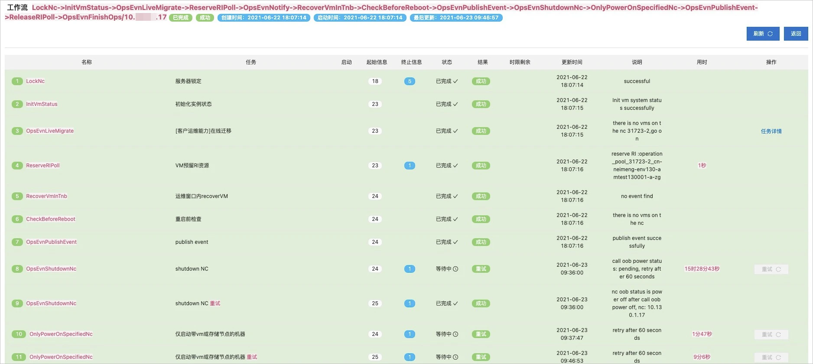

3. （条件必选）如果运维工作流的任务节点处于中断状态（例如**待执行**等），您可以在**操作**列执行对应操作。

运维工作流中所有任务节点执行完成后，系统将反馈最终执行结果。

**（可选）步骤三：批量管理NC运维事件**

您也可以批量管理NC运维事件。

1. 选择**主动运维 > NC运维**，在**主动运维**页面，选中多个NC运维事件。

2. 单击页面底部操作按钮，批量管理NC运维事件。

   支持以下批量操作：

   - **批量解锁**：批量解锁宿主机，对应宿主机的**nc状态**将从**mlock**状态变为**free**状态。

   - **批量取消运维**：批量取消宿主机的运维操作，对应宿主机的**操作**列变为**已取消**。

   - **批量完成**：批量完成宿主机运维的操作，对应宿主机的**操作**列变为**已完成**。

**工作流设置说明**

在**关联opcode**参数中可以选择不同的工作流，每个工作流的具体设置项如下所示。

> **说明**
>
> 一般情况下，您可以直接使用系统默认设置，无需修改。

- **0x410A01-[NE]锁NC->完成**

  | 工作流设置项 | 说明 |
  | --- | --- |
  | alertRuleName | 触发的运维规则名称。 |

- **0x40003000001001-物理机深度下线（无热迁移）**

  | 工作流设置项 | 说明 |
  | --- | --- |
  | alertRuleName | 触发的运维规则名称。 |
  | expectRate | 热迁移成功率，超过预设值则表示热迁移成功。单位：%。默认值为50%。 |
  | migpercent | 重启前进行检查，如果热迁移失败率小于预期，则返回成功。默认值为0.1。 |
  | needLimit | 运维限流开关。取值如下：<br>• 0：不限流<br>• 1：限流默认值为1。 |
  | orderId | 工单ID。 |
  | useNcDownRecover | 是否使用NC宕机迁移VM。取值如下：<br>• true：是。<br>• false：否。默认值为true。 |

- **0x400003-[E][深]物理机下线（VM运维属性）**

  | 工作流设置项 | 说明 |
  | --- | --- |
  | alertRuleName | 触发的运维规则名称。 |
  | OpsEvnLiveMigrate.expectRate | 热迁移成功率，超过预设值则表示热迁移成功。单位：%。默认值为50%。 |
  | CheckBeforeReboot.migpercent | 重启前进行检查，如果热迁移失败率小于预期，则返回成功，默认值为0.1。 |
  | needLimit | 运维限流开关。取值如下：<br>• 0：不限流<br>• 1：限流默认值为1。 |
  | orderId | 工单ID。 |
  | useNcDownRecover | 是否使用NC宕机迁移VM。取值如下：<br>• true：是。<br>• false：否。默认值为true。 |

- **0x400012-NC强制重启**

  <table>
    <tr>
      <th width="161">工作流设置项</th>
      <th>说明</th>
    </tr>
    <tr>
      <td>alertRuleName</td>
      <td>触发的运维规则名称。</td>
    </tr>
    <tr>
      <td>needDumpCn</td>
      <td>是否对管控节点CN（Controller Node）进行内存转储（Dump）。取值如下：<br>• 0：不限流<br>• 1：限流默认值为0。</td>
    </tr>
    <tr>
      <td>needLimit</td>
      <td>运维限流开关。取值如下：<br>• 0：不限流<br>• 1：限流默认值为1。</td>
    </tr>
  </table>

- **0x400011-恢复NC上线**

  | 工作流设置项 | 说明 |
  | --- | --- |
  | NcReOnline | 重启宿主机的间隔时间。 |
  | parallel | 设置并发数量，默认值为4。 |
  | ReOnline.ignoreStatus | 恢复上线时是否忽略后羿的状态。 |

- **0x10001000008002-NC上VM残留处理**

  <table>
    <tr>
      <th width="182">工作流设置项</th>
      <th>说明</th>
    </tr>
    <tr>
      <td>foreCleanWildVm</td>
      <td>是否检查ECS实例在宿主机上的进程状态。取值如下：<br>• true：当ECS为释放状态时，不会检查进程状态。<br>• false：当ECS为其他状态时，检查进程状态。默认值为false。</td>
    </tr>
    <tr>
      <td>vm</td>
      <td>设置ECS实例ID。</td>
    </tr>
  </table>

- **0x400016-本盘宕机拉起**

  | 工作流设置项 | 说明 |
  | --- | --- |
  | alertRuleName | 触发的运维规则名称。 |
  | ncIsFailure | 异常数据是否记录。取值如下：<br>• true:运维侧记录nc异常。<br>• false:不记录。 |
  | OpsEvnPowerOffNc.powerOffWait | 实例关机的等待时间，单位为分钟。默认值为0。 |
  | parallel | 设置并发数量，默认值为2。 |
  | WaitXSecondRetry.RetryTime | 等待重试时间，默认值为90。 |
  | StartVm.forceStart | 本地盘宕机拉起之后是否自动拉起实例。取值如下：<br>• true：是。<br>• false：否。默认值为false。 |
  | vm | 设置ECS实例ID。 |

- **0x400018-强制NC宕机迁移**

  | 工作流设置项 | 说明 |
  | --- | --- |
  | alertRuleName | 触发的运维规则名称。 |
  | parallel | 设置并发数量，默认值为2。 |

- **0x40001000008001-cn宕机清理MOC**

  | 工作流设置项 | 说明 |
  | --- | --- |
  | alertRuleName | 触发的运维规则名称。 |

- **0x4000A000000008-内存碎片整理**

  | 工作流设置项 | 说明 |
  | --- | --- |
  | alertRuleName | 触发的运维规则名称。 |
  | DropCachesMessage | 默认值为Drop Caches。 |
  | DropCachesSkip | 是否跳过删除缓存消息（<strong>DropCachesMessage</strong>）步骤。取值如下：<br>• true：跳过。<br>• false：不跳过。默认值为false。 |
  | forceMocDropCache | 神龙机器是否强制清理Moc内存。取值如下：<br>• true：是。<br>• false：否。默认值为false。 |
  | TrimMemoryMessage | 默认值为Trim Memory。 |
  | TrimMemorySkip | 是否跳过<strong>TrimMemoryMessage</strong>步骤。取值如下：<br>• true：跳过。<br>• false：不跳过。默认值为false。 |

- **0x4000A000000007-NC锁定后自动解锁**

  | 工作流设置项 | 说明 |
  | --- | --- |
  | alertRuleName | 触发的运维规则名称。 |
  | WaitThenRetry.waitMinutes | NC锁定后自动解锁时间，单位：分。默认为60分钟。 |

- **0x99001000000001-专有云本地盘隔离维修**

  | 工作流设置项 | 说明 |
  | --- | --- |
  | orderId | 工单ID。 |
  | pciSlot | 本地盘槽位号。 |
  | urlType | 维修单来源，默认值为0。 |

- **0x8000000000001-物理机tianji下线**

  > **说明**
  >
  > 该工作流无配置设置项需求，您可直接使用，无须进行任何设置。

- **0x40007000000203-reload Pync工作流**

  | 工作流设置项 | 说明 |
  | --- | --- |
  | alertRuleName | 触发的运维规则名称。 |

- **0x40003000001009-TPM实例迁移**

  > **说明**
  >
  > 该工作流无配置设置项需求，您可直接使用，无须进行任何设置。

- **0x4000100000240-宕机场景下使用抢占盘冷迁移VM**：忽略原始实例状态进行抢占，可以避免云盘出现脑裂等问题。

  | 工作流设置项 | 说明 |
  | --- | --- |
  | alertRuleName | 触发的运维规则名称。 |
  | fvt | 是否为功能验证，仅记录动作类型。 |
  | parallel | 设置并发数量，默认值为2。 |
  | preLock | 是否标记为运维事件侧锁定，如果标记为运维事件侧锁定，同机器其他运维事件无法提交。 |

<a id="section-3-2"></a>

## 3.2. 实例运维指南

您可以通过主动运维中的实例运维功能处理异常。

**背景信息**

当ECS实例遇到异常故障时，您可以采取以下步骤进行运维处理：

1. 步骤一：创建实例运维事件

2. 步骤二：查看工作流执行结果

3. （可选）步骤三：批量管理实例运维事件

**步骤一：创建实例运维事件**

1. 登录Apsara Uni-manager运维控制台。

2. 在顶部菜单栏，选择**产品运维 > 计算运维 > ECS诊断**。

3. 在左侧导航栏，选择**主动运维 > 实例运维**。

4. 单击**新建运维**，配置以下运维信息。

   <table>
     <tr>
       <th width="110">参数</th>
       <th>说明</th>
     </tr>
     <tr>
       <td>vm</td>
       <td>实例ID。</td>
     </tr>
     <tr>
       <td>运维类型</td>
       <td>选择要执行的运维工作流。<br>• 0x30000000001005-VM crash启动此操作用于启动处于崩溃（crash）状态的虚拟机。与标准的虚拟机启动不同，VM Crash启动会在重启过程中修正虚拟机的状态，确保其恢复到正常运行条件。<br>• 0x30003000001001-启动VM该功能针对已停止（stop）状态的虚拟机执行启动操作，将虚拟机从停止状态恢复到运行状态，使其可以继续执行任务。<br>• 0x30000000000408-qemu热升级工作流对虚拟机执行热升级，即在不中断虚拟机正在运行的服务的情况下，更新qemu进程以应用新的修补或功能增强。<br>• <strong>0x3000000000301-使用抢占盘冷迁移VM</strong>：对实例执行冷迁移。<br>• <strong>0x30003000001002-DRP实例迁移：</strong>对于配置为宕机场景&amp;资源不足的实例，可以调度到专属资源池外的情况，进行实例调度。<br>• <strong>0x30000000001003-实例重启：</strong>实例qemu升级异常后的自动处理。选择运维工作流后，还需要设置运维工作流涉及的相关设置项。更多信息，请参见工作流设置说明。</td>
     </tr>
     <tr>
       <td>原因分类</td>
       <td>根据故障类型选择运维的原因。</td>
     </tr>
     <tr>
       <td>comment</td>
       <td>运维任务描述信息。</td>
     </tr>
   </table>

5. 单击**确定**。

**步骤二：查看工作流执行结果**

创建完实例运维事件后，系统会根据运维工作流执行运维操作，您可以在列表中查看工作流中每一个节点的执行情况。具体操作如下：

1. 在**VM 粒度运维**页面，查看实例运维事件执行情况。

   在实例运维事件列表中，您可以查看已创建的实例运维事件的运维类型、原因类别、运维状态、运维工作流等信息。

2. 在**VmName**列，单击目标VM名称，在页面右侧弹出的面板中，查看该实例运维事件的基本信息。

3. 在**工作流**列，单击查看运维工作流详情。

   在工作流详情页，您可以查看该运维工作流中每一个节点的执行情况。

   

4. （条件必选）如果运维工作流的任务节点处于中断状态（例如**待执行**等），您可以在**操作**列执行对应的操作。

   运维工作流中所有任务节点执行完成后，系统将反馈最终执行结果。

**（可选）步骤三：批量管理实例运维事件**

您也可以批量管理多个实例运维事件。

1. 在**VM 粒度运维**页面，选中多个实例运维事件。

2. 单击页面左上角的操作按钮，批量管理实例运维事件。

   支持以下批量操作：

   - **批量完成**：批量完成虚拟机的运维操作。

   - **批量取消**：批量取消虚拟机的运维操作。

**工作流设置说明**

在**关联opcode**参数中可以选择不同的工作流，每个工作流的具体设置项如下所示。

> **说明**
>
> 一般情况下，您可以直接使用系统默认设置，无需修改。

- **0x30000000001005-VM crash启动**

  | 工作流设置项 | 说明 |
  | --- | --- |
  | alertRuleName | 触发的运维规则名称。 |
  | isRedeployStartVM | 迁移启动。 |

- **0x30003000001001-启动VM**

  | 工作流设置项 | 说明 |
  | --- | --- |
  | alertRuleName | 触发的运维规则名称。 |
  | isRedeployStartVM | 启动的时是否更换NC，取值如下：<br>• true：更换NC。<br>• false：不更换NC。默认值为false。 |
  | needDumpCn | 是否强制启动VM，取值如下：<br>• true：强制启动VM。<br>• false：不强制启动VM。默认值为false。 |

- **0x30000000000408-qemu热升级工作流**

  > **说明**
  >
  > 该工作流无配置设置项需求，您可直接使用，无须进行任何设置。

- **0x3000000000301-使用抢占盘冷迁移VM**

  | 工作流设置项 | 说明 |
  | --- | --- |
  | fvt | 是否为功能验证，仅记录动作类型。 |
  | gray.strategy | 灰度策略。<br>说明该参数暂未开放使用。 |
  | isLockDisk | 是否为本地盘。 |
  | isPreemptiveOpenDisk | 是否使用抢占盘迁移，取值如下：<br>• true：是。<br>• false：否。默认值为true。 |
  | preLock | 是否标记为运维事件侧锁定，如果标记为运维事件侧锁定，同机器其他运维事件无法提交。 |
  | send_event | 是否发送宕机事件，取值如下：<br>• true：发送。<br>• false：不发送。默认值为false。 |
  | WaitXSecondRetry.RetryTime | 等待多少秒迁移，默认值为5。 |

- **0x30003000001002-DRP实例迁移**

  > **说明**
  >
  > 该工作流无配置设置项需求，您可直接使用，无须进行任何设置。

- **0x30000000001003-实例重启**

  > **说明**
  >
  > 该工作流无配置设置项需求，您可直接使用，无须进行任何设置。

<a id="section-3-3"></a>

## 3.3. 查看运维事件列表

运维事件列表可记录包括NC运维、VM运维以及告警中心（alarmcenter）提交的运维事件。本文介绍如何在运维事件列表中搜索并查看事件信息的方法，包括查看运维事件ID、资源类型、事件状态、提交人、扩展字段和工作流等。

**操作步骤**

1. 登录Apsara Uni-manager运维控制台。

2. 在顶部菜单栏，选择**产品运维 > 计算运维 > ECS诊断**。

3. 在左侧导航栏，选择**主动运维 > 运维事件列表**。

4. 进入**运维事件列表**页面。

   系统展示所有运维事件的基本信息。具体参数说明如下：

   > **说明**
   >
   > 您可以在页面右上角通过输入资源ID，或者使用**高级搜索**筛选目标运维事件。

   <table>
     <tr>
       <th width="141">参数项</th>
       <th>说明</th>
     </tr>
     <tr>
       <td>eventId</td>
       <td>运维事件的唯一标识符ID。</td>
     </tr>
     <tr>
       <td>resourceId</td>
       <td>与事件关联的资源ID，用于快速识别受影响的资源。</td>
     </tr>
     <tr>
       <td>actionCode</td>
       <td>与事件相关的操作码（opcode），标记特定的运维动作。</td>
     </tr>
     <tr>
       <td>resouceType</td>
       <td>涉及的资源类型，例如虚拟机、物理机等。</td>
     </tr>
     <tr>
       <td>status</td>
       <td>运维事件的当前状态（英文）。</td>
     </tr>
     <tr>
       <td>状态</td>
       <td>运维事件的当前状态（中文）。</td>
     </tr>
     <tr>
       <td>提交人</td>
       <td>记录提交该运维事件的人员信息。</td>
     </tr>
     <tr>
       <td>扩展字段</td>
       <td>用于记录提交信息的字段。</td>
     </tr>
     <tr>
       <td>备注</td>
       <td>用于备注额外信息，以便于理解或处理事件的详细背景。</td>
     </tr>
     <tr>
       <td>bizEventId</td>
       <td>业务事件ID，若存在关联业务流程时使用。</td>
     </tr>
     <tr>
       <td>gmtCreate</td>
       <td>指运维事件的创建时间，遵循国际标准格式，例如：2024-02-29T16:09:40。</td>
     </tr>
     <tr>
       <td>运维时间</td>
       <td>指工作流的更新时间，遵循国际标准格式，例如：2024-02-29T16:09:40。<br>说明未产生工作流时显示为空。</td>
     </tr>
     <tr>
       <td>工作流</td>
       <td>运维事件相关的工作流ID，您可以单击工作流ID查看工作流执行详情。</td>
     </tr>
   </table>

   <table>
     <tr>
       <td>操作</td>
       <td>您可以修改运维事件状态如下所示：<br>• <strong>submitError-提交运维失败</strong>：标记事件提交过程中遇到的失败。<br>• <strong>ignore-忽略</strong>：忽略该事件，不进行进一步处理。<br>• <strong>wait-重试</strong>：等待后续操作或重试。<br>• <strong>plan-等待执行计划</strong>：标记事件为等待执行计划状态。<br>• <strong>scheduled-执行中</strong>：标记运维事件当前正在执行中，操作尚未完成。<br>• <strong>fail-失败</strong>：标记事件处理失败。<br>• <strong>limited-限流被放弃</strong>：标记运维事件由于限流策略已经被系统放弃，不会执行。<br>• <strong>blacked-运维被加黑</strong>：标记该运维事件由于某些原因被加入黑名单，不再允许执行相关操作。<br>• <strong>abort-被终止</strong>：标记运维事件在执行过程中被中断或主动终止，操作未能完成。<br>• <strong>success-成功</strong>：标记事件处理成功。<br>说明在页面左下角，您可以通过单击<strong>批量修改状态</strong>来同时更新多个运维事件的状态。</td>
     </tr>
   </table>

<a id="section-3-4"></a>

## 3.4. 配置OpsCode限流规则

通过配置OpsCode限流规则，您能够控制在指定时间段内允许执行的运维工作流次数，从而避免操作的冗余执行，确保系统稳定性和资源的合理分配。同时，您还可以按实际情况灵活调整限流规则，以适应不同的主动运维任务需求。本文介绍OpsCode限流规则的配置流程。

**操作步骤**

1. 登录Apsara Uni-manager运维控制台。

2. 在顶部菜单栏，选择**产品运维 > 计算运维 > ECS诊断**。

3. 在左侧导航栏，选择**主动运维 > opscode限流规则**。

4. 在**OpCode限流规则**页面，您可以查看每个特定OpCode的限流规则详情，包括全网限流时长、全网限流数、限流策略和失败保护策略等信息。同时，在页面右上角的搜索框中，输入OpCode可查看目标信息（支持模糊搜索）。

5. 单击页面右上角**新建**，在**新建/编辑OpsCodeLimit 限流规则**面板中，配置OpsCode限流规则。具体参数说明如下：

   > **重要**
   >
   > - 对于**限流策略**、**失败保护策略**和<strong>失败保护时长（分）</strong>以外的配置项，如果您将特定条件参数的限流数量设置为0，那么在对应维度下OpCode将不受限流控制。
   >
   > - 请根据实际需求调整限流参数，以确保您的OpCode限流规则能够正确地按照预期工作。

   <table>
     <tr>
       <th width="190">配置项</th>
       <th>说明</th>
     </tr>
     <tr>
       <td>OpsCode</td>
       <td>指定需要应用限流规则的OpCode。</td>
     </tr>
     <tr>
       <td>全网限流时长</td>
       <td>设置在全网络范围内限流特定OpCode的时长。单位：分钟。</td>
     </tr>
     <tr>
       <td>全网限流数（24小时）</td>
       <td>在24小时内，对全网络中特定OpCode的限流次数。</td>
     </tr>
     <tr>
       <td>全网单用户限流数</td>
       <td>设置单个用户对特定OpCode的限流次数上限。</td>
     </tr>
     <tr>
       <td>全网同原因限流数</td>
       <td>对相同原因触发的OpCode限流操作，在全网络范围内的限流次数上限。</td>
     </tr>
     <tr>
       <td>集群限流时长</td>
       <td>在特定集群内，OpsCode的限流时长。单位：分钟。推荐配置为10080分钟，即168小时。</td>
     </tr>
     <tr>
       <td>集群限流数</td>
       <td>在特定集群内，OpsCode的限流次数上限。推荐配置为1次。</td>
     </tr>
     <tr>
       <td>azone限流时长</td>
       <td>在特定可用区内，OpCode的限流时长。单位：分钟。</td>
     </tr>
     <tr>
       <td>azone限流数</td>
       <td>在特定可用区内，OpCode的限流次数上限。</td>
     </tr>
     <tr>
       <td>region限流时长</td>
       <td>在特定区域内，OpCode的限流时长。单位：分钟。</td>
     </tr>
     <tr>
       <td>region限流数</td>
       <td>在特定区域内，OpCode的限流次数上限。</td>
     </tr>
     <tr>
       <td>限流策略</td>
       <td>选择执行限流时所采用的策略规则。取值如下：<br>• <strong>放弃任务</strong>：表示当主动运维动作超过限流配置后，会自动放弃执行该工作流。<br>• <strong>延期执行</strong>：表示当主动运维动作超过限流配置后，会自动暂停执行该工作流，随后按照系统定时任务被重新激活并继续执行。</td>
     </tr>
     <tr>
       <td>失败保护策略</td>
       <td>当限流规则执行失败时，所采取的备用措施。取值如下：<br>• <strong>放弃任务</strong>：表示当主动运维动作超过限流配置后，会自动放弃执行该工作流。<br>• <strong>延期执行</strong>：表示当主动运维动作超过限流配置后，会自动暂停执行该工作流，随后按照系统定时任务被重新激活并继续执行。</td>
     </tr>
     <tr>
       <td>失败保护时长（分）</td>
       <td>设置失败保护策略的有效时长，单位：分钟。</td>
     </tr>
     <tr>
       <td>失败保护数量</td>
       <td>设置在失败保护时长内允许的最大操作次数。</td>
     </tr>
   </table>

6. 单击**提交**。

   > **说明**
   >
   > 您可以在OpCode限流规则列表中查看目标OpCode的**修改人**和**修改时间**信息。

7. （可选）如果您不再需要某条特定的OpCode限流规则，您可以进行删除操作。

   <ol type="i">

   <li>

   在OpCode限流规则列表中，找到待删除的规则，单击**操作**列的  图标。

   </li>

   <li>

   在弹出的**操作提示**对话框中，单击**确定**。

   </li>

   </ol>

<a id="section-4"></a>

# 4.云盘热迁移

<a id="section-4-1"></a>

## 4.1. 通过CDS Ops工具热迁移云盘

通过创建云盘热迁移任务，您可以快速完成块存储集群之间的云盘迁移，迁移期间不影响云盘的使用，提升云盘的维护效率。云盘热迁移功能支持在 EBS1.0 集群之间、CDS-EBS 集群之间以及 EBS1.0 与 CDS-EBS 集群之间，对单个或多个云盘进行在线迁移。

**注意事项**

- 只支持可用区内的迁移，迁移前后的云盘类型和云盘ID不变。

  > **重要**
  >
  > 迁移前后云盘格式和容量必须保持不变，且源集群与目标集群不可相同，否则迁移将失败。

- 不支持迁移具有IA快照或已加入复制对的云盘。

- 迁移源集群与目标集群的OSS domain必须相同。

- 迁移过程中会有1秒内的IO延迟，属于正常现象，建议在业务低谷时间段进行迁移。

- 迁移会占用网络带宽，请注意观察并控制并发数量。每个集群最多支持16个并发。

- 迁移任务在完成前可以取消。迁移任务成功后，如果云盘要迁回源集群，请再次发起一次迁移任务。

- 迁移完成后，数据将由源集群全量复制到目的集群。为了保证数据正确性，云盘在源集群中的数据会保留一段时间（7天）后自动释放。如果源集群使用率较高（80%以上），则数据保留时间可能会缩短。

**创建云盘迁移任务**

1. 登录CDS运维平台控制台。

   <ol type="i">

   <li>

   登录Apsara Uni-manager运维控制台。

   </li>

   <li>

   在顶部菜单栏，选择**产品运维 > 存储运维 > CDS运维·CDS-OPS**。

   </li>

   </ol>

2. 在左侧导航栏中，选择**CDS-块存储 > 云盘热迁移**。

3. 在**云盘热迁移**页面，单击**创建迁移**。

4. 在**创建云盘迁移任务**面板，任选一种方式配置要迁移的云盘以及选择目标集群。

   > **重要**
   >
   > 选定云盘后，目标集群必须支持该IO类型的云盘。

   - 选择**搜索类型**为**集群**并设置源集群后，在磁盘设备列表中选择单个或多个同一IO类型的云盘。

   - 选择**搜索类型**为**硬盘**后，在磁盘设备列表中选择单个或多个同一IO类型的云盘。

     系统支持根据磁盘设备（deviceKey）、磁盘前端ID、云盘ID或云盘名称搜索云盘，可同时查询多个（依次输入选中或同时输入多个并用半角逗号隔开），单次最多查询20个。

5. 单击**创建**。

   系统开始进行云盘热迁移。云盘热迁移需要花费一段时间，请耐心等待。

**相关操作**

创建云盘热迁移任务后，您可以查看各个云盘的迁移任务运行情况以及按需执行如下操作：

- 查询热迁移任务设置源集群、目标集群、DeviceKey、任务类型、状态中的一个或者多个参数来筛选热迁移任务。其中状态包括失败、成功、初始化、无效、已准备、已创建、运行中、已停止、验证、验证中、已验证和已销毁选项。

- 查看云盘热迁移任务的运行详情

  单击目标迁移任务**操作**列的**查看详情**后，在**任务详情**面板，查看任务的基础信息和日志详情。

- 恢复迁移任务

  当迁移任务执行失败或者已停止时，单击目标迁移任务**操作**列的**恢复**，然后在**恢复**对话框单击**确定**，重新执行该迁移任务。

- 关闭无效的迁移任务

  当迁移任务无效时，单击目标迁移任务**操作**列的**关闭**，然后在**关闭**对话框单击**确定**，关闭无效的迁移任务。

- 停止迁移任务

  当迁移任务处于已准备、已创建、运行中、验证、验证中或者已验证状态时，单击目标迁移任务**操作**列的**停止**，然后在**停止**对话框单击**确定**，停止该迁移任务。

<a id="section-4-2"></a>

## 4.2. 通过海图控制台自动迁移云盘

通过自动迁移功能，运维人员可实现单个或多个云盘在 EBS1.0 集群、CDS-EBS 集群之间以及 EBS1.0 与CDS-EBS 集群之间的跨集群在线迁移，全程无需停机，保障业务连续性，提升资源调度的灵活性与运维效率。

**注意事项**

- 迁移前后的云盘IO类型和云盘ID不变，建议迁移前为云盘创建快照。

  如需变更云盘IO类型，请在Apsara Uni-manager运营控制台中的ECS控制台使用云盘变配功能实现。

  > **重要**
  >
  > 迁移前后云盘格式和容量必须保持不变，且源集群与目标集群不可相同，否则迁移将失败。

- 不支持跨可用区迁移。

- 不支持迁移具有IA快照、极速可用快照、开启多重挂载或已加入复制对的云盘。

- 执行迁移操作时如果快照为“创建中”状态，则迁移可能会失败。

- 如果是通过存储集创建的云盘，则迁移后的新云盘不属于指定存储集。

- 迁移源集群与目标集群的OSS domain必须相同。

- 如果您是第一次使用该功能，请选择少量云盘进行灰度测试。

- 在进行EBS1.0集群间的云盘数据热迁移时，请确保云盘处于挂载中状态。

- 当tdc lsi中的云盘状态为RDCHANGE时，不支持从EBS1.0集群向CDS-EBS集群迁移数据。请将云盘状态更新为RW后再执行迁移操作。

- 不支持将云盘从高版本 CDS 迁移至低版本 CDS。

- 迁移过程中会有1秒内的IO延迟，属于正常现象，建议在业务低谷时间段进行迁移。

- 迁移会占用网络带宽，请注意观察并控制并发数量。每个集群最多支持16个并发。

- 迁移任务在完成前可以取消。迁移任务成功后，如果云盘要迁回源集群，请再次发起一次迁移任务。

- 不同迁移场景下的功能影响说明请参见下表。

  | 迁移场景 | 迁移类型 | 功能影响 |
  | --- | --- | --- |
  | EBS1.0集群间数据迁移 | 1 to 1 | • 云盘处于lazyloading状态时迁移可正常执行，即系统将等待云盘lazyloading完成后开始迁移。<br>• 迁移过程中可创建快照，对迁移任务无影响。 |
  | EBS1.0集群数据迁移到CDS-EBS集群 | 1 to 2 | • 虚拟机开关机、重新挂载云盘、云盘resize、云盘处于lazyloading状态均会导致迁移失败。<br>• 迁移过程中可创建快照，对迁移任务无影响，但是快照回滚会失败。 |
  | CDS-EBS集群间数据迁移 | 2 to 2 | • 云盘resize、云盘处于lazyloading状态均会导致迁移失败。<br>• 迁移过程中创建快照，可能导致迁移失败，但是支持快照回滚。 |

- 迁移完成后，数据将由源集群全量复制到目的集群。为了保证数据正确性，云盘在源集群中的数据会保留一段时间（7天）后自动释放。如果源集群使用率较高（80%以上），则数据保留时间可能会缩短。

**创建自动迁移任务**

1. 登录海图控制台。

2. 在左侧导航栏，选择**迁移复制运维 > 自动迁移**。

3. 在自动迁移页面，单击**创建任务**。

4. 在**创建迁移任务**页面，选择云盘。

   <ol type="i">

   <li>

   选择**数据源**为**运维平台**后，选择**源集群**和**迁移类型**，单击**查询**。

   迁移类型请根据待迁移云盘所属源集群类型和要迁移到的目标集群类型选择。**1 to 1**表示将EBS1.0集群的云盘数据迁移到EBS1.0集群，**1 to 2**表示将EBS1.0集群的云盘数据迁移到CDS-EBS集群，**2 to 2**表示将CDS-EBS集群的云盘数据迁移到CDS-EBS集群。

   </li>

   <li>

   选中要迁移的同IO类型的云盘，单击**下一步**。

   </li>

   </ol>

5. 配置基础信息。

   > **重要**
   >
   > 请确保所选的迁移类型正确。如需导出待迁移云盘的信息到本地，请单击**云盘数**后的**导出CSV**。

   <ol type="i">

   <li>

   填写任务名称并选择指定目的可用区。

   系统会自动选择目的可用区内的集群进行云盘迁移。

   </li>

   <li>

   按需设置自动迁移高级选项。

   <table>
     <tr>
       <th width="153">参数</th>
       <th>说明</th>
     </tr>
     <tr>
       <td>NcIP</td>
       <td>重要仅适用于迁移类型为<strong>1 to 1</strong>的任务。一般情况无需填写，使用前请联系阿里云技术支持评估后再操作。<br>迁移指定机器上的云盘。</td>
     </tr>
     <tr>
       <td>指定目的集群</td>
       <td>选择可用的目的集群。只能选择包含与待迁移IO类型相同云盘的集群。</td>
     </tr>
     <tr>
       <td>目的集群备选列表</td>
       <td>指定后，系统将从该列表中选择最优目的集群。多个集群之间用空格分隔。</td>
     </tr>
     <tr>
       <td>目的集群排除列表</td>
       <td>指定后，系统将这些集群排除在目的集群之外。多个集群之间用空格分隔。</td>
     </tr>
     <tr>
       <td>指定目的IOType</td>
       <td>与待迁移的IO类型一致。</td>
     </tr>
     <tr>
       <td>强制mode</td>
       <td>一般情况无需填写，使用前请联系阿里云技术支持确认参数正确性。</td>
     </tr>
     <tr>
       <td>是否全拷贝</td>
       <td>该属性仅在经过研发评估后使用。</td>
     </tr>
   </table>

   </li>

   </ol>

6. 单击**提交**后，在确认对话框中，单击**确认**。

   等待云盘数据完成迁移，当任务状态变为done且失败数为0时，表示任务中全部云盘数据迁移成功。

<a id="section-5"></a>

# 5.巡检

<a id="section-5-1"></a>

## 5.1. 概述

ECS 巡检大致可以分为集群基础健康状况巡检和集群资源巡检两个方面。

<a id="section-5-2"></a>

## 5.2. 集群基础健康状况巡检

<a id="section-5-2-1"></a>

### 5.2.1. 概述

集群基础健康状况巡检，主要包括监控巡检、基础软件包版本巡检和基础公共资源巡检。

<a id="section-5-2-2"></a>

### 5.2.2. 监控巡检

主要包括基础监控和连通性监控巡检。

<a id="section-5-2-3"></a>

### 5.2.3. 基础软件包版本巡检

主要包括控制系统组件、飞天操作系统和虚拟化包版本校验，以及基础依赖包的版本校验等。

<a id="section-5-2-4"></a>

### 5.2.4. 基础公共资源巡检

主要包括 ISO 巡检和基础镜像巡检。

**ISO 巡检**

目前， ECS 每个 Region 会提供 2 个基础 ISO：

- linux-virt-release-xxxx.iso

- windows-virt-release-xxxx.iso

可以通过数据库查询相关信息：

```sql
houyiregiondb
select name,os_type,version,path,oss_info from iso_resource where os_type!=''\G
```

其中：

- *name*：ISO 的名称，假设为 xxxx.iso。

- *os_type*：为 ISO 服务的镜像类型。

- *path*：为 ISO 在云盘集群中存放的 Pangu 路径。可以通过命令  `/apsara/deploy/pu meta $path` 查看该 ISO 是否存在于飞天分布式文件系统的文件中。

- *oss_info*：为 ISO 在本地磁盘集群中存放 OSS 路径。若要查询，请提供相关信息给 OSS 的运维工程师进行检查。

**基础镜像巡检**

- 检查基础镜像在数据库中的状态：

  ```text
  houyiregiondb
  select image_no,status,visibility,platform,
  region_no from image;
  ```

- 检查基础镜像是否能正常使用。通过调用 create_instance 的 API，利用相关镜像创建 VM，手动测试是否可以正常运行。

<a id="section-5-3"></a>

## 5.3. 集群资源巡检

<a id="section-5-3-1"></a>

### 5.3.1. 概述

集群资源巡检主要包含集群库存巡检和 VM 巡检等。

<a id="section-5-3-2"></a>

### 5.3.2. 集群库存巡检

集群库存资源主要是指集群中的剩余资源，可以用来创建不同规格VM的数量。您可以通过数据库进行查询。

假设需要查询16 核 64 GB VM的库存量：

```sql
houyiregiondb
select sum( least ( floor(available_cpu/16),floor(available_memory/64/1024))) from nc_resource,nc where nc.cluster_id=$id and nc.biz_status='free' and nc.id=nc_resource.id;
```

如果当前集群中有较大规格的VM，要保证集群中有足够的状态为Free，且可用资源充足的物理机作备用，用于物理机宕机后大规格VM的迁移。否则，将导致大规格VM宕机后无法迁移，必须通过热迁移腾挪资源，或者释放集群中冗余的VM来解决。

**NC 状态巡检**

NC 状态巡检主要是巡检物理机在数据库以及飞天基础运维平台中的状态是否正常。

- 飞天基础运维平台中几种机器的状态表示：

  - GOOD：表示该机器是正常工作状态。

  - ERROR：表示机器有监控报警。

  - PROBATION：表示观察期， 机器有可能出现故障。

  - OS_ERROR ：表示机器出现故障，正在克隆。

  - HW_ERROR： 表示机器硬件故障正在修复中。

  - OS_PROBATION：表示从故障或者硬件故障中恢复，正在观察期。若观察期通过，转为PROBATION；若观察期没过（期间有monitor报错）， 转为OS_ERROR。

  > 这里将状态GOOD称为稳定状态，其它状态统称为不稳定状态。
  >
  > **说明**

- 飞天基础运维平台中机器所在集群的意义：

  - default集群：NC从业务属性中下线所在的集群。

  - 非default集群：未下线的NC所在的集群。

  正常运行的NC在集群中为非default集群，且状态为GOOD。

ECS数据库物理机状态和飞天基础运维平台中物理机状态的对应关系表如ECS 数据库物理机状态和飞天基础运维平台中物理机状态的对应关系所示。

表 1. ECS 数据库物理机状态和飞天基础运维平台中物理机状态的对应关系

| 数据库状态 | 集群 | 机器状态 | 场景 |
| --- | --- | --- | --- |
| mlock | 非default集群 | 不稳定 | 新上线的机器主动锁定。 |
| locked | 非default集群 | 不稳定 | 解锁 NC。 |
| free | 非default集群 | 稳定 | 正常运行。 |
| nc_down | 非default集群 | 不稳定 | 正常运行或者处于宕机状态。 |
| offline | default集群 | 不稳定 | 从业务属性中下线。 |

<a id="section-5-3-3"></a>

### 5.3.3. VM 巡检

VM巡检主要包括Pending VM 巡检、VM 状态巡检及VM 资源巡检。

**Pending VM 巡检**

该类巡检主要是针对集群中长期处于 Pending 状态的 VM 的巡检。如果 VM 长期处于 Pending 状态，则认为该 VM 是冗余资源，联系用户进行处理。

**VM 状态巡检**

该类巡检主要是巡检 VM 的服务状态是否一致。例如：VM 在数据库中的状态为 Stopped，但是在 NC 上为 Running 的状态。巡检的方法是对比数据库中记录的状态和实际物理机上运行的状态，对不一致的 VM进行相应的处理。

- 获取数据库状态

  ```text
  houyiregiondb –Ne “select status from vm where name=’$name’”
  ```

- 获取物理机状态

  ```bash
  sudo virsh list | grep $name
  ```

**VM 资源巡检**

该类巡检主要是巡检 VM 在变配后数据库中记录的配置和实际在物理机上使用的配置是否一致。

- 获取数据库状态

  ```text
  houyiregiondb –Ne “select vcpu, memory from vm where name=’$name’”
  ```

- 获取物理机状态

  ```bash
  sudo virsh list | grep $name
  ```

  查看对应的字段获取 CPU 和内存信息。

<a id="section-5-4"></a>

## 5.4. ECS容灾部署模式下发生机房脑裂问题该如何处理？

机房脑裂是极端的物理网络侧发生的重大故障，对ECS运行和管控侧可能出现一些异常现象，本文给出影响的说明和异常处理方案。

**背景信息**

ECS双机房容灾部署模式（双机房水平部署管控节点，每个机房独立AZ，同时部署计算+存储节点），此时2个机房间的物理网络由于网络设备或者其他原因发生断开隔离，此时认为是机房脑裂。

**问题影响**

ECS管控主DB所在的机房为主机房，备DB所在机房认为是从机房。脑裂主要可能遇到的问题：

vm运行侧影响

主备机房实际运行的vm，预期运行不受影响，能够继续运行，但是实际是否对外服务取决于网络故障影响面。

vm管控侧影响

由于管控发生脑裂，ECS主机房无法联通备机房，如果网络恢复时间过长（超过1分钟），备机房的实例状态会逐步变成关机状态。

脑裂期间备机房的所有实例的写操作（启动、迁移、关机、释放）会出现非预期错误，需要等待网络故障恢复。主机房的实例理论在容灾架构下，不会受到状态和操作的影响。

故障迁移事件影响

在故障期间由于主机房和备机房网络无法联通，备机房实例和nc心跳无法上报，会触发部分实例的宕机迁移任务，预期对客户业务无感，但是可能会收到宕机迁移事件提醒可能是误报。

实际机房脑裂类似较大规模故障会自动开启迁移任务流控（1小时单集群超过一定数量，自动流控降低故障误报）。

以下主要描述未被流控的任务预期的情况：

1. 未被流控的宕机迁移任务在脑裂期间是无法完成的，会不间断尝试等待迁移vpc vport迁移成功。

2. 等到脑裂恢复后，网络迁移任务会立即成功，此时迁移任务会继续执行，尝试在其他nc上开始启动vm。

3. 此时宕机迁移是否真正成功取决于备机房原vm是否还真实运行，

   - 如果备机房原vm还真实运行，预期宕机迁移任务失败，vm侧运行没有任何影响。

   - 如果备机房原vm有其他故障（物理宕机，机房内网络不通，内部关机等），此时宕机迁移任务会成功，vm侧看到的情况是实例被重启过后恢复了。

**解决方案**

机房脑裂后，当机房间网络恢复联通时，vm状态和nc状态恢复说明如下：

- vm状态恢复：机房间网络恢复联通，此时ECS管控vm状态恢复需要等待一个全量心跳周期，预期时间为15分钟～30分钟。

- nc状态恢复：脑裂期间部分nc状态异常，变成**ncDown**宕机状态。需要执行houyiapi使其恢复正常。
